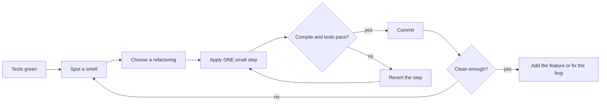
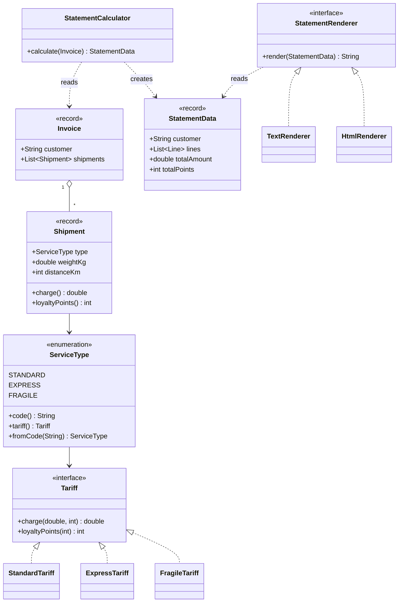
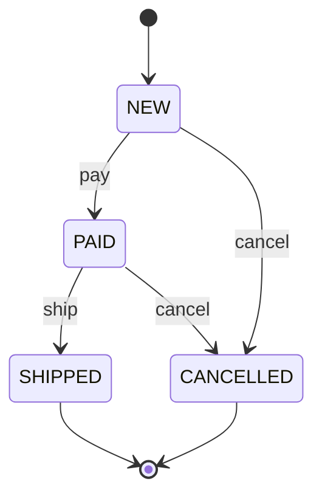

# Chapter 7 — Refactoring

> **What you will learn.** What refactoring is (and is not), when to do it, how tests make it safe, the full catalogues of **code smells** (signals of *where* to refactor) and **refactorings** from Martin Fowler's *Refactoring* (2nd edition, 2018), a smell → refactoring lookup, a worked Java example from messy to clean in six compiling steps, and how refactoring leads toward design patterns (named, reusable solutions to recurring design problems; Chapters 8–11).
>
> **Why it matters for LLD interviews.** Machine-coding rounds (build a small working program in about 60–120 minutes; a core part of LLD — low-level design — interviews) often end with "now add feature X" or "what would you clean up?". Interviewers want you to name the smell ("this switch is repeated in three places — Repeated Switches") and the fix ("Replace Conditional with Polymorphism, giving a Strategy" — each interchangeable algorithm in its own class). This chapter gives you that vocabulary.

**Chapter map**

| Part | Content |
|---|---|
| 7.1 | Refactoring fundamentals — definition, two hats, why, when, when not, tests, performance, rewrite vs refactor, IDE (Integrated Development Environment, e.g. IntelliJ IDEA) automation, legacy code |
| 7.2 | Code smells — the 24 smells of the 2nd edition, grouped the refactoring.guru way |
| 7.3 | The refactoring catalogue — all 61 named refactorings of the 2nd edition, by book chapter, plus the extra ones on refactoring.com |
| 7.4 | Smell → refactorings lookup table |
| 7.5 | Worked example — a messy invoice class refactored in six compiling steps |
| 7.6 | Refactoring toward patterns — Strategy, State, Special Case, Template Method, Factory |
| 7.7 | Trade-offs, mistakes, real-world examples, interview answers, self-check, TL;DR |
| 7.8 | Source layout, how to run, final program output |

---

## 7.1 Refactoring fundamentals

### What it is

**Refactoring (noun)** is a change made to the internal structure of software to make it easier to understand and cheaper to modify, *without changing its observable behaviour*.

**Refactoring (verb)** is restructuring software by applying a *series* of such small, behaviour-preserving changes.

Two words in that definition do all the work:

- **Behaviour-preserving.** Same outputs for the same inputs, same side effects (changes besides returning a value, such as writing a file), same errors. Only *internal* things change — names, where code lives, how it is split. (Performance may change a little; see 7.1.9.)
- **Small steps.** Each step is so small it is almost impossible to get wrong; the code compiles and the tests pass after *every* step, and many tiny steps chain into a big change. If you sit with broken code for an hour, you were not refactoring — you were rewriting.

**Everyday analogy.** Reorganising a restaurant kitchen while it stays open: one shelf at a time, and after each move the cooks can still make every dish.

> **Term — observable behaviour.** What a user (or calling code) can see: return values, printed output, data written, exceptions thrown. The *call stack* (the chain of method calls in progress), the *class structure* and the *names of private methods* are not observable behaviour.

**What refactoring is NOT.**

| Activity | Is it refactoring? | Why |
|---|---|---|
| Renaming a method with the IDE | Yes | Behaviour unchanged, tiny step |
| Fixing a bug | No | Behaviour changes (on purpose) |
| Adding a feature | No | Behaviour changes |
| Performance tuning | No | Goal is speed, not clarity (though behaviour is preserved) |
| "I spent two days restructuring and nothing worked until the end" | No | That is restructuring/rewriting, not refactoring |
| Reformatting code | Borderline | Behaviour-preserving, but it does not improve design |

> **Term — restructuring.** The general word for reorganising code. Refactoring is a *specific kind* of restructuring: small, behaviour-preserving steps.

### The problem it solves

Code decays: every quick fix, extra `if` and copy-paste makes the next change harder. This is **design decay** or **technical debt** — the extra cost paid on every future change because the code is harder to work with than it needs to be. Refactoring pays the debt down *continuously*, instead of hoping to get the design right up front (which never fully works, because requirements change).

### How it works

1. **Make sure you have tests** that pin down current behaviour (7.1.7); they must be green (all passing).
2. **Spot a smell** — a surface sign the design could be better (7.2).
3. **Pick a named refactoring** that cures it (7.3, 7.4).
4. **Apply one small step** (ideally with the IDE's automated refactoring).
5. **Compile and run the tests.** Green? Commit locally (save a snapshot in version control such as Git). Red? Undo the step (don't debug) and take a smaller one.
6. **Repeat** until the code is clean enough for the job at hand.



### 7.1.1 The two hats

Kent Beck's metaphor: at any moment you wear **one of two hats**.

| Hat | You are allowed to | You are NOT allowed to |
|---|---|---|
| **Adding function** | Add new behaviour, add new tests | Restructure existing code |
| **Refactoring** | Restructure code | Add behaviour or tests for new behaviour (you may add tests for *existing* behaviour you forgot to cover) |

You swap hats often — maybe every few minutes — but always know which you wear. Mixing them ("I'll fix this bug while I extract this method") means a failing test can't tell you which change caused it.

### 7.1.2 Why refactor

- **It improves the design**, which otherwise decays under short-term changes — largely by **removing duplication** (each fact in one place).
- **It makes software easier to understand**: it moves your understanding *out of your head and into the code* for the next reader (including you in six months).
- **It helps you find bugs**: clearer structure exposes assumptions.
- **It helps you program faster.** Fowler's **Design Stamina Hypothesis**: a team that keeps internal quality high soon adds features *faster* than one that doesn't, because each feature builds on clean code instead of fighting a mess. Speed — not "clean code for its own sake" — is the economic argument.

### 7.1.3 When to refactor

| Trigger | What it means | Example |
|---|---|---|
| **Rule of Three** (Don Roberts) | First time, just do it. Second time you do something similar, wince but duplicate. Third time, refactor. | Third copy of the same validation code → extract a validator |
| **Preparatory refactoring** | Refactor *just before* adding a feature, to make it easy to add. "Make the change easy, then make the easy change." | Before adding HTML output, split calculation from text formatting (7.5, step 3) |
| **Comprehension refactoring** | Rename or extract as you come to understand code you are reading, so the understanding moves into the code. | Rename `d` to `daysOverdue` after working out what it holds |
| **Litter-pickup refactoring** | Mess noticed in passing: fix it if quick, else note it. The **Boy Scout Rule** — leave the campground cleaner than you found it. | Remove an unused parameter while passing by |
| **Planned vs opportunistic** | Mostly *opportunistic* — woven into features and fixes; planned episodes (after neglect) should be rare. | Good: every feature PR (pull request — a change submitted for review) has a few small refactoring commits. Warning sign: a "refactoring sprint" (a fixed 1–4-week work period) every quarter |
| **Long-term refactoring** | Big changes (replace a library, split a module) done gradually over weeks with the system working — e.g. **Branch by Abstraction** (add an abstraction layer, switch callers to it, swap the implementation behind it, delete the old). | Moving from one ORM (library mapping objects to database tables) to another behind a repository interface |
| **During code review** | Suggest or pair on refactorings; Fowler prefers trying them *with the author* over only commenting. | "This method has four flag parameters — can we Remove Flag Argument?" |

> **Term — Rule of Three.** Don't abstract on the first or second occurrence (you don't yet know what varies); abstract on the third, when the shape is clear.

**Should you tell your manager?** Fowler: don't ask permission to refactor any more than to write tests — it is how professionals deliver features quickly (large planned efforts should be discussed).

### 7.1.4 When NOT to refactor

- **Code you never need to touch or understand.** Messy code behind a clean API (the methods other code calls) that works and never changes can stay messy.
- **When rewriting is cheaper** (7.1.10) — a judgement call that usually needs experience.
- **Without a safety net** — if you can neither test it nor use safe automated refactorings, add tests first (7.1.11).
- **On a deadline that truly cannot move**, a big refactoring may wait — though the Design Stamina Hypothesis says skipping it usually makes you *slower* even short term; deadlines are rarely an excuse for small refactorings.
- **Published interfaces** whose callers you don't control (a public library API, a REST endpoint — a URL of a web API, see [System Design Fundamentals](../../../system-design-patterns/modules/00-system-design-fundamentals/README.md) — used by other teams). You can still refactor them, but must keep the old version working for a while and deprecate it (mark it outdated and due for removal) — see *Change Function Declaration*, migration mechanics.

### 7.1.5 Problems and costs of refactoring

| Problem | What goes wrong | Mitigation |
|---|---|---|
| Slowing down new features | "Takes time away" from features | Refactor *because* it speeds features up; focus on code you're about to change |
| Code ownership | You cannot rename a method whose callers are in another team's repo (repository — a project's version-controlled code store) | Keep the old name as a delegating, `@Deprecated` method; migrate callers later; prefer weak (team-wide) code ownership |
| Long-lived feature branches (lines of work kept apart from the main code for a long time) | Refactoring renames and moves code, which makes merges painful | **Continuous Integration** (merge into the shared main line often, with automatic builds and tests) / trunk-based development (everyone works on one main branch): integrate at least daily, so refactorings conflict less |
| Missing tests | Refactoring without tests is risky | Add tests first; use only IDE-automated, provably-safe refactorings until tests exist |
| Legacy code | Big, untested, tangled | Feathers' techniques (7.1.11) |
| Databases | Schema (table structure) changes are hard to reverse | **Evolutionary database design**: small migration scripts (scripts that change the database structure), versioned with the code; use **parallel change** (add new column, copy, switch readers, remove old) |

> **Term — parallel change (expand / contract).** A breaking change in three phases: *expand* (add the new thing alongside the old), *migrate* (move all users to it), *contract* (remove the old). Nothing is ever broken.

### 7.1.6 Refactoring, architecture and YAGNI

Because refactoring lets you reshape code safely later, you needn't get the architecture "right" up front: build **only what today's requirements need** and evolve the design — **YAGNI** ("You Aren't Gonna Need It"; no flexibility for imagined requirements). It doesn't mean ignoring architecture: trust refactoring to add flexibility when the need is real, and think hard up front only about things *truly* hard to change later, like a public API or a database schema.

### 7.1.7 Tests as the safety net

Refactoring is safe only if you detect a behaviour change immediately — that is what **self-testing code** gives you: an automated suite that checks itself (pass/fail, no human reading output) and runs in seconds.

- Run tests after **every** small step, so a failure points at the few lines just changed; if one fails, **revert** (don't debug a refactoring) and redo in smaller steps.
- Test **behaviour** (public API, outputs), not private structure; tests of private methods break on every refactoring and become a cost.
- **Characterisation tests** (Michael Feathers): for code without tests, record what it *currently does* — even if that looks wrong — so you notice if a refactoring changes it. 7.5 uses exactly this: a checker comparing every step's output with the original, byte for byte.
- **Mutation testing** (e.g. PIT for Java) checks that your tests catch changes: it introduces small bugs deliberately and reports any your tests miss.

> **Term — safety net.** Anything that tells you quickly and reliably that you broke something: unit tests (one class in isolation), integration tests (several real parts together), the compiler's type checks, and the IDE's automated refactorings (proven safe by the tool).

### 7.1.8 IDE automation

Modern IDEs perform many refactorings *automatically and safely* using the compiler's knowledge of the code — the **syntax tree** and **symbol resolution** (the parsed structure, and exactly which declaration each name refers to) — not text search. A text replace of `name` would also hit comments, strings and unrelated fields; the IDE's Rename changes only that symbol and its real references.

History in one line: Bill Opdyke's 1992 PhD thesis formalised refactorings; John Brant and Don Roberts built the Smalltalk (an early object-oriented language) *Refactoring Browser*, the first automated tool; Java IDEs (IntelliJ IDEA, Eclipse) popularised it.

| Refactoring | IntelliJ IDEA (Windows/Linux · macOS) | Eclipse (Windows/Linux) |
|---|---|---|
| Rename | Shift+F6 · Shift+F6 | Alt+Shift+R |
| Extract Method (Extract Function) | Ctrl+Alt+M · Cmd+Opt+M | Alt+Shift+M |
| Extract Variable | Ctrl+Alt+V · Cmd+Opt+V | Alt+Shift+L |
| Extract Field / Constant / Parameter | Ctrl+Alt+F / C / P · Cmd+Opt+F / C / P | (Refactor menu) |
| Inline | Ctrl+Alt+N · Cmd+Opt+N | Alt+Shift+I |
| Change Signature | Ctrl+F6 · Cmd+F6 | Alt+Shift+C |
| Move | F6 · F6 | Alt+Shift+V |
| "Refactor This" menu | Ctrl+Alt+Shift+T · Ctrl+T | Alt+Shift+T |

(Default keymaps; check your IDE if you use a custom one.)

**Large-scale automated refactoring tools** such as OpenRewrite (recipes that, e.g., migrate a whole codebase between framework versions) and Google's Refaster templates in Error Prone (Google's bug-finding plugin for the Java compiler) apply the same refactoring across thousands of files.

> **Caution.** Automated refactorings are safe for statically known calls. They can miss **reflection** (`Class.forName("…")` — looking up classes or methods by name at runtime), names in **configuration files**, **serialised field names** (serialising = turning objects into text or bytes, e.g. JSON, a plain-text data format; JSON/Jackson, JPA — Java's standard ORM API — column names inferred from field names), and code in other repositories. After an IDE rename of a serialised field, the JSON your API returns changes — that *is* an observable behaviour change.

### 7.1.9 Performance and refactoring

"Refactoring adds method calls and small objects, so the program gets slower." Fowler's three-part answer:

1. **Most refactorings have negligible performance effect.** The JIT (Just-In-Time) compiler — the part of the JVM, Java's runtime, that compiles frequently run code to machine code while the program runs — inlines small methods (copies their body into the caller), so extra calls are nearly free.
2. **Programs spend most of their time in a small fraction of the code**, so optimising everywhere wastes effort. (The book retells Ron Jeffries' story of Chrysler's slow payroll system: nobody's guesses about the cause were right; profiling — measuring where a program actually spends its time — found one unexpected spot, and a small fix there made it fast.)
3. **Well-factored code is easier to tune**: profiling finds the hot spot (where most time goes), and in well-structured code it is small, isolated and easy to optimise.

Order: **make it work → make it clean (refactor) → make it fast (profile, then optimise only hot spots)**; a slightly slower refactoring is fine if it eases that later optimisation.

**Example from this chapter.** In 7.5 step 2 a summing loop becomes a stream (Java's pipeline for processing a sequence of elements). `DoubleStream.sum()` may use *compensated summation* (tracking rounding errors to make floating-point sums more accurate; OpenJDK, the reference Java implementation, does), so its result can differ from a plain loop in the last bit — a tiny *behaviour change*. To stay a true refactoring we used `reduce(0.0, Double::sum)`, which adds left to right exactly like the loop.

### 7.1.10 Refactoring vs rewriting

| | Refactoring | Rewriting |
|---|---|---|
| Unit of change | Many tiny, safe steps | One big replacement |
| System works during the change? | Always | Usually not until the end |
| Risk | Low | High — known bugs fixed years ago get reintroduced; the old system keeps evolving while you rewrite |
| Delivers value | Continuously | Only at the end |
| Good when | Code mostly works, needs reshaping | Code is so broken it does not work at all, or the technology must change completely |

Even a replacement is rarely done in one go. The **Strangler Fig** approach (Fowler, after a vine that slowly grows around a tree) builds the new system *around* the old one, routing one feature at a time to the new code until the old can be switched off — the rewrite equivalent of "small steps".

### 7.1.11 Legacy code

Michael Feathers (*Working Effectively with Legacy Code*, 2004) defines **legacy code as code without tests** — hard to refactor (no safety net) and hard to test (not designed for it). The way out is a loop:

1. **Identify change points** — where you need to change code.
2. **Find test points** — where you can observe behaviour.
3. **Break dependencies** using a **seam**: a place where behaviour can change without editing the code there, e.g. passing in an interface instead of calling `new Database()` inside a method (constructor injection), or overriding a method in a test subclass.
4. **Write characterisation tests** that pin down current behaviour.
5. **Make the change and refactor** under that safety net.

Other techniques from the book:

- **Sprout Method / Sprout Class** — the new feature as a *new*, fully tested method or class, called from the old code by a one-line change.
- **Wrap Method / Wrap Class** — rename the old method; a new one with the old name calls it plus the new behaviour (Decorator-like — a Decorator wraps an object to add behaviour).
- **Safe automated refactorings only** (IDE Rename, Extract Method) until tests exist.
- Refactor only what you touch; over time the most-changed code becomes the cleanest.

---

## 7.2 Code smells

### What it is

A **code smell** (Kent Beck's term) is a *surface sign* that usually points to a deeper design problem. It is not a bug — the code works — but the code will be hard to understand or change. Like a smell in a fridge, it tells you *where to look*, not exactly what is wrong. Smells are **heuristics, not rules**: a long method or a switch is not always bad; look closer and use judgement.

### The problem it solves

You must know *when* and *where* to refactor, not just how. Fowler and Beck deliberately give no precise metrics ("no method longer than 10 lines") but a catalogue of named smells with their usual cures. Names matter: in review, "Feature Envy" says in two words what would otherwise take a paragraph.

### How it works

Notice discomfort ("I had to scroll", "I changed five files for one feature", "what is `x2`?") → match it to a named smell → look up its cures (each smell below, and 7.4) → apply them in small steps under tests.

### Smell groups (refactoring.guru classification)

refactoring.guru (a popular website on refactoring and design patterns) groups smells into five families. It uses mostly the 1st-edition names, so the table maps them to the 2nd-edition names used in this chapter.

| Group | Idea | Smells (2nd-ed name; refactoring.guru name in brackets if different) |
|---|---|---|
| **Bloaters** | Code, methods and classes that have grown so big they are hard to work with. They usually grow slowly. | Long Function *(Long Method)*, Large Class, Primitive Obsession, Long Parameter List, Data Clumps |
| **Object-Orientation Abusers** | Incomplete or wrong use of OO (object-oriented) principles. | Repeated Switches *(Switch Statements)*, Temporary Field, Refused Bequest, Alternative Classes with Different Interfaces |
| **Change Preventers** | One change forces many other changes. | Divergent Change, Shotgun Surgery *(also: Parallel Inheritance Hierarchies — a 1st-ed smell)* |
| **Dispensables** | Something pointless whose removal makes the code cleaner. | Comments, Duplicated Code *(Duplicate Code)*, Lazy Element *(Lazy Class)*, Data Class, Speculative Generality *(also: Dead Code — in the 2nd ed. this is the refactoring Remove Dead Code)* |
| **Couplers** | Too much coupling between classes, or too much delegation (handing work off to another object). | Feature Envy, Insider Trading *(Inappropriate Intimacy)*, Message Chains, Middle Man *(also: Incomplete Library Class — a 1st-ed smell)* |
| *New in the 2nd edition (not in refactoring.guru's five groups)* | | Mysterious Name (a comprehension smell), Global Data and Mutable Data (both about uncontrolled shared state — closest to Couplers/Change Preventers), Loops (closest to Bloaters) |

> **Term — coupling.** How much one piece of code depends on another. High coupling means a change in one place forces changes in others. **Cohesion** is the opposite idea inside one unit: how strongly the things inside a class or module belong together. Good design: low coupling, high cohesion.

Below are all 24 smells from the 2nd edition, in the book's order. Each has: **what it is**, **why it hurts**, a small **Java example** (smelly → cured), and **refactorings that fix it** (the ones Fowler names for that smell; anything extra is marked). The names match the catalogue in 7.3.

> **Note on the snippets.** Several short snippets use `double` for prices or balances to stay tiny. Real money should use `BigDecimal` (Java's exact decimal type) or a `Money` value object (a small immutable object compared by its value) — see 7.2.11 and `code/smells/Money.java`.

---

### 7.2.1 Mysterious Name

**What it is.** A function, variable, field, class or module whose name does not tell you what it does or holds: `data`, `tmp`, `proc()`, `x2`, `Manager`, `handle()`.

**Why it hurts.** A bad name forces every reader to decode the implementation. If you *cannot* find a good name, the thing probably does too much or has no clear purpose.

```java
// Smelly
double calc(List<Double> l, int d) { ... }

// Cured
double averageDailyRevenue(List<Double> dailyRevenues, int daysInPeriod) { ... }
```

**Refactorings.** Change Function Declaration (rename), Rename Variable, Rename Field.

---

### 7.2.2 Duplicated Code

**What it is.** The same (or nearly the same) code structure in more than one place.

**Why it hurts.** Every change must be made — and every copy found and its small differences checked — in every copy; sooner or later one is missed.

```java
// Smelly: two methods repeat the same tax rule
double invoiceTotal(double net)  { return net + net * 0.18; }
double quoteTotal(double net)    { return net + net * 0.18; }

// Cured: one place owns the rule
private static final double GST_RATE = 0.18;
double withTax(double net)       { return net + net * GST_RATE; }
double invoiceTotal(double net)  { return withTax(net); }
double quoteTotal(double net)    { return withTax(net); }
```

**Refactorings.** Fowler lists: Extract Function; Slide Statements (to bring similar code together so it can be extracted); Pull Up Method (if the copies are in sibling subclasses). Also useful (not in Fowler's list for this smell): Replace Inline Code with Function Call (if a library already does it); Substitute Algorithm (if two different algorithms do the same thing).

---

### 7.2.3 Long Function

**What it is.** A function too long to understand at a glance. Fowler's heuristic: whenever you feel a block needs a **comment**, extract it into a function named after its *intent*.

**Why it hurts.** Hard to understand, reuse partially or test. Short, well-named functions are self-documenting: read the name, skip the body.

```java
// Smelly
void printOwing(Invoice inv) {
    System.out.println("*** Customer Owes ***");
    double outstanding = 0;
    for (Order o : inv.orders()) outstanding += o.amount();      // calculate outstanding
    inv.setDueDate(LocalDate.now().plusDays(30));               // record due date
    System.out.println("name: " + inv.customer());               // print details
    System.out.println("amount: " + outstanding);
}

// Cured: each block became a named function
void printOwing(Invoice inv) {
    printBanner();
    double outstanding = outstandingOf(inv);
    recordDueDate(inv);
    printDetails(inv, outstanding);
}
```

**Refactorings.** Extract Function (the main one, ~99% of the time), Replace Temp with Query, Introduce Parameter Object, Preserve Whole Object, Replace Function with Command, Decompose Conditional, Replace Conditional with Polymorphism, Split Loop.

---

### 7.2.4 Long Parameter List

**What it is.** A function that takes many parameters (often more than three or four), especially several of the same type, or boolean flags.

**Why it hurts.** Callers mix up the order (`move(10, 20, 5, 3)` — which is which?), every new parameter changes every caller, and long lists often hide a missing concept.

```java
// Smelly
Booking book(String hotelId, LocalDate from, LocalDate to, int adults, int children, boolean breakfast) { ... }

// Cured: parameter objects for the clumps, and an explicit enum instead of an unreadable boolean flag
record Stay(LocalDate from, LocalDate to) { }
record Guests(int adults, int children) { }
Booking book(Hotel hotel, Stay stay, Guests guests, MealPlan mealPlan) { ... }
```

**Refactorings.** Replace Parameter with Query, Preserve Whole Object, Introduce Parameter Object, Remove Flag Argument, Combine Functions into Class (several functions share the same parameters → make them fields of a class).

---

### 7.2.5 Global Data

**What it is.** Data readable and modifiable from anywhere: global variables, public static mutable fields (`static` fields belong to the class, shared program-wide), mutable singletons (classes with one shared instance).

**Why it hurts.** Any code anywhere can change it and you can't find *who* did; bugs appear far from their cause. Fowler calls it one of the most pungent smells, worsening with program size.

```java
// Smelly
public class Config { public static double discountRate = 0.1; }      // anyone can write it

// Cured: Encapsulate Variable - one controlled access point, easy to find every writer.
// (The range check is a NEW rule added afterwards, wearing the "adding function" hat - it is a behaviour change, not part of the refactoring.)
public final class Config {
    private static volatile double discountRate = 0.1;
    public static double discountRate() { return discountRate; }
    public static void setDiscountRate(double rate) {
        if (rate < 0 || rate > 0.5) throw new IllegalArgumentException("rate out of range");
        discountRate = rate;
    }
}
// Even better: pass the value in (dependency injection) instead of reading a static at all.
```

**Refactorings.** Encapsulate Variable (first step, always), then narrow its scope — ideally move it into a class or module so only a few functions can see it.

---

### 7.2.6 Mutable Data

**What it is.** Data that is changed after creation, especially when it is shared, or when the same variable is updated for different purposes.

**Why it hurts.** A change in one place breaks code elsewhere that assumed the value stayed the same — hard to find, especially with threads (several paths of execution running at once). Functional programming forbids changing data; you needn't go that far, but limit where mutation can happen.

```java
// Smelly: callers can change the list inside the object, and total is a stored copy that can go stale
class Cart {
    public List<Item> items = new ArrayList<>();
    public double total;                          // must be updated by hand after every change
}

// Cured
final class Cart {
    private final List<Item> items = new ArrayList<>();
    void add(Item item) { items.add(item); }
    List<Item> items() { return List.copyOf(items); }                       // Encapsulate Collection
    double total() { return items.stream().mapToDouble(Item::price).sum(); } // Replace Derived Variable with Query
}
```

**Refactorings.** Encapsulate Variable, Split Variable, Slide Statements, Extract Function, Separate Query from Modifier, Remove Setting Method, Replace Derived Variable with Query, Combine Functions into Class, Combine Functions into Transform, Change Reference to Value (use immutable value objects such as Java records — compact, immutable data classes).

---

### 7.2.7 Divergent Change

**What it is.** **One class is changed for many different reasons.** "I have to edit this class when we add a database, *and* when we add a financial instrument, *and* when we change the report format."

**Why it hurts.** It mixes responsibilities (breaking the **Single Responsibility Principle**, Chapter 4): each kind of change risks the others, and people edit the same file for unrelated reasons.

```java
// Smelly: storage, pricing and formatting in one class
class ProductService {
    void saveToMySql(Product p) { ... }         // changes when the database changes
    double priceWithTax(Product p) { ... }      // changes when tax rules change
    String toCsv(Product p) { ... }             // changes when the export format changes
}

// Cured: one reason to change per class
class ProductRepository { void save(Product p) { ... } }
class PricingService    { double priceWithTax(Product p) { ... } }
class ProductCsvWriter  { String toCsv(Product p) { ... } }
```

**Refactorings.** Split Phase (when the changes fall into sequential phases, e.g. parse then compute), Move Function, Extract Function, Extract Class.

---

### 7.2.8 Shotgun Surgery

**What it is.** The opposite of Divergent Change: **one change forces many small edits in many classes.**

**Why it hurts.** You have to find all the places, and it is easy to miss one. The logic for one concept is scattered.

```java
// Smelly: the "free-shipping threshold" rule appears in 4 classes
class CartView      { boolean showBanner(double t)  { return t >= 500; } }
class CheckoutCtrl  { double shipping(double t)     { return t >= 500 ? 0 : 40; } }
class EmailBuilder  { String line(double t)         { return t >= 500 ? "Free shipping!" : ""; } }
class ReportJob     { long freeOrders(List<Double> ts) { return ts.stream().filter(t -> t >= 500).count(); } }

// Cured: the concept lives in one class, and the four callers use it
final class ShippingPolicy {
    static final double FREE_SHIPPING_THRESHOLD = 500;
    static boolean isFree(double total)   { return total >= FREE_SHIPPING_THRESHOLD; }
    static double charge(double total)    { return isFree(total) ? 0 : 40; }
}
```

**Refactorings.** Move Function and Move Field (gather everything into one module), Combine Functions into Class, Combine Functions into Transform, Split Phase; sometimes Inline Function / Inline Class first to pull the scattered bits together, then extract a better-shaped unit.

| | Divergent Change | Shotgun Surgery |
|---|---|---|
| Shape | One class, many reasons to change | One reason to change, many classes |
| Fix | Split the class | Gather the scattered code |

---

### 7.2.9 Feature Envy

**What it is.** A method that is more interested in *another* class's data than in its own — it calls many getters (methods that just return a field) on another object to compute something.

**Why it hurts.** Behaviour away from its data means a data change needs changes elsewhere. The basic OO rule: **put behaviour next to the data it uses**. (Strategy and Visitor — an object carrying one operation across a group of classes — separate them deliberately, to allow swapping behaviour.)

```java
// Smelly: Order computes a line total using only Line's data
class Order {
    double lineTotal(Line line) {
        return line.getUnitPrice() * line.getQuantity() * (1 - line.getDiscount());
    }
}

// Cured: Move Function - Line computes its own total
record Line(double unitPrice, int quantity, double discount) {
    double total() { return unitPrice * quantity * (1 - discount); }
}
```

**Refactorings.** Move Function; Extract Function first if only *part* of the method is envious, then move that part.

---

### 7.2.10 Data Clumps

**What it is.** The same group of data items always appear together — as fields in several classes, or as parameters in many signatures: `(street, city, zip)`, `(startDate, endDate)`, `(x, y)`, `(amount, currency)`.

**Why it hurts.** The group is an unnamed concept; without a class, behaviour about it ("does this range contain a date?") is duplicated everywhere. **Test:** delete one item — if the others no longer make sense alone, they belong in an object.

```java
// Smelly
boolean isAvailable(LocalDate start, LocalDate end) { ... }
double price(LocalDate start, LocalDate end, double nightly) { ... }

// Cured (see code/smells/DateRange.java)
record DateRange(LocalDate start, LocalDate end) {
    boolean contains(LocalDate day) { return !day.isBefore(start) && !day.isAfter(end); }
}
boolean isAvailable(DateRange stay) { ... }
```

**Refactorings.** Extract Class (for clumps of fields), Introduce Parameter Object and Preserve Whole Object (for clumps of parameters). Then look for Feature Envy — behaviour will want to move onto the new class.

---

### 7.2.11 Primitive Obsession

**What it is.** Using primitive types (`int`, `double`, `String`, `boolean`) for domain concepts that deserve their own type: money as `double`, phone numbers as `String`, a status as `"ACTIVE"`, a temperature as a bare `int` without a unit.

**Why it hurts.** No validation (`"banana"` is a valid `String` phone number), no behaviour (formatting and comparing logic is duplicated), easy mix-ups (`transfer(double amount, double fee)` — swap them and nothing complains). Money as `double` also suffers from floating-point error (binary `double` numbers cannot store most decimal fractions exactly): `0.1 + 0.2` prints `0.30000000000000004` (see the smells output in 7.6).

```java
// Smelly
void charge(double amount, String currency) { ... }

// Cured (see code/smells/Money.java): validation and arithmetic live in one type
record Money(BigDecimal amount, Currency currency) {
    Money plus(Money other) { /* checks same currency, then adds */ }
}
void charge(Money amount) { ... }
```

**Refactorings.** Replace Primitive with Object, Replace Type Code with Subclasses, Replace Conditional with Polymorphism (for type codes that drive behaviour), Extract Class, Introduce Parameter Object.

---

### 7.2.12 Repeated Switches

**What it is.** The *same* `switch` (or `if/else if` chain) on the same type code (a field, e.g. a string or int, saying which kind of thing an object is) in several places. (1st edition: "Switch Statements" — *any* switch; the 2nd edition narrowed it — one switch is fine, *repetition* is the problem.)

**Why it hurts.** Adding a new case means finding and updating every switch — Shotgun Surgery. Miss one and you have a bug.

```java
// Smelly: three switches on the same type
double speed(Bird b)    { switch (b.type) { case "EUROPEAN": ...; case "AFRICAN": ...; case "PARROT": ...; } }
String plumage(Bird b)  { switch (b.type) { case "EUROPEAN": ...; case "AFRICAN": ...; case "PARROT": ...; } }
int    lifespan(Bird b) { switch (b.type) { ... } }

// Cured: Replace Conditional with Polymorphism
sealed interface Bird permits EuropeanSwallow, AfricanSwallow, NorwegianBlueParrot {
    double speed();
    String plumage();
}
```

**Refactorings.** Replace Conditional with Polymorphism. (Java note: with a `sealed` type (one that lists all its permitted subtypes) or an `enum` (a fixed set of named constants), a *switch expression* is checked for exhaustiveness — covering every case — by the compiler, which removes much of the risk. A few such switches may be acceptable; polymorphism is still better when the behaviour per case is large.)

---

### 7.2.13 Loops

**What it is.** A `for`/`while` loop that filters, maps or aggregates where a pipeline would state the intent more clearly. (New in the 2nd edition, now that languages have first-class functions — storable in variables and passable; in Java, the Stream API since Java 8.)

**Why it hurts.** A loop makes the reader simulate the steps to see what it does. A pipeline names each step: *filter*, *map*, *collect*.

```java
// Smelly
List<String> names = new ArrayList<>();
for (Employee e : employees) {
    if (e.department().equals("IT")) {
        names.add(e.name());
    }
}

// Cured: Replace Loop with Pipeline
List<String> names = employees.stream()
        .filter(e -> e.department().equals("IT"))
        .map(Employee::name)
        .toList();                      // Java 16+: returns an unmodifiable list
```

**Refactorings.** Replace Loop with Pipeline. (Note: `Stream.toList()` returns an *unmodifiable* list, while the loop built a mutable `ArrayList`. If a caller later adds to the list, that is a behaviour change — use `collect(Collectors.toCollection(ArrayList::new))` in that case.)

---

### 7.2.14 Lazy Element

**What it is.** An element that doesn't pull its weight — a class with one trivial method, a function whose body is as clear as its name, a subclass adding nothing. (1st edition: "Lazy Class".)

**Why it hurts.** Every element costs a name to learn, a file to open, an indirection to follow; adding nothing, it is pure cost. Often left behind by other refactorings, or created for growth that never came.

```java
// Smelly: a wrapper that adds nothing
class NameFormatter { String format(String s) { return s.trim(); } }

// Cured: Inline Class / Inline Function
String cleanName = rawName.trim();
```

**Refactorings.** Inline Function, Inline Class, Collapse Hierarchy.

---

### 7.2.15 Speculative Generality

**What it is.** Hooks, abstract classes, parameters and special cases added "because we might need them someday" and never used: an abstract class with one subclass, unused parameters, methods called only by tests, a plug-in system with one plug-in.

**Why it hurts.** Harder to understand and maintain for no benefit — it violates **YAGNI**. If the need comes, refactoring adds the flexibility then, usually better shaped because the real requirement is known.

```java
// Smelly
interface PaymentProcessorFactoryProvider { PaymentProcessorFactory get(); }   // one implementation, ever
void pay(Money m, Map<String, Object> futureOptions) { ... }                  // futureOptions never used

// Cured
void pay(Money m) { processor.process(m); }
```

**Refactorings.** Collapse Hierarchy (useless abstract class), Inline Function and Inline Class (useless delegation), Change Function Declaration (remove unused parameters), Remove Dead Code (for code used only by its own tests — delete the tests too).

---

### 7.2.16 Temporary Field

**What it is.** A field that is set and used only in some situations (e.g. only during one complex calculation) and is empty/null the rest of the time.

**Why it hurts.** Readers expect an object to need all its fields. A field that is usually `null` is confusing — "why is this null? is that a bug?"

```java
// Smelly: these fields are only meaningful while computeRoute() runs
class Planner {
    private Graph graph;
    private Map<Node, Integer> tmpDistances;   // null except inside computeRoute
    private Node tmpTarget;                    // null except inside computeRoute
}

// Cured: Extract Class - the temporary state gets its own short-lived object
class Planner {
    private Graph graph;
    Route computeRoute(Node from, Node to) { return new RouteSearch(graph, from, to).run(); }
}
final class RouteSearch {                      // lives only for one search
    private final Map<Node, Integer> distances = new HashMap<>();
    ...
}
```

**Refactorings.** Extract Class (put the fields and the code that uses them in their own class), Move Function, Introduce Special Case (for the conditional code that checks whether the field is set).

---

### 7.2.17 Message Chains

**What it is.** A client asks one object for another object, then asks that for another, and so on: `order.getCustomer().getAddress().getCity().getName()`. Also a long chain of temporary variables doing the same thing.

**Why it hurts.** The client is coupled to the *whole navigation structure*; any change in between breaks it. It violates the **Law of Demeter** ("talk only to your immediate friends", Chapter 5).

```java
// Smelly
String city = order.getCustomer().getAddress().getCity();

// Cured: Hide Delegate (see code/smells/Order.java)
String city = order.shippingCity();
```

Caution: do not blindly hide every delegate — that creates Middle Men. Often better: look at what the final object is *used for*, and Extract Function + Move Function that usage down the chain.

**Refactorings.** Hide Delegate, Extract Function, Move Function.

---

### 7.2.18 Middle Man

**What it is.** A class whose methods mostly just forward calls to another class, adding nothing. (Some delegation is good — that is encapsulation. The smell is when *most* of the class is pass-through.)

**Why it hurts.** An extra layer to read and maintain, with no value. Every new feature of the delegate requires a new forwarding method.

```java
// Smelly
class Person {
    private Department dept;
    Person getManager()           { return dept.getManager(); }
    String getDepartmentCode()    { return dept.getCode(); }
    Budget getDepartmentBudget()  { return dept.getBudget(); }
    // ... ten more forwarding methods
}

// Cured: Remove Middle Man - let clients talk to the Department directly
Department department() { return dept; }
```

**Refactorings.** Remove Middle Man, Inline Function (for a few forwarders), Replace Superclass with Delegate or Replace Subclass with Delegate (if the middle man is tied up in inheritance).

Message Chains and Middle Man pull in opposite directions — Hide Delegate cures one and can cause the other. Use judgement to find the balance.

---

### 7.2.19 Insider Trading

**What it is.** Modules (classes, packages) poking at each other's internals — commonly subclasses knowing too much about their parents'. (1st edition: "Inappropriate Intimacy".)

**Why it hurts.** The modules are tightly coupled: you cannot change one without changing the other. Some trading is necessary; the goal is to keep it small and visible.

```java
// Smelly: Invoice reaches into Customer's internal map
double discount = customer.internalLoyaltyTable.get(customer.tierCode) * 0.01;

// Cured: Customer owns its own rule, Invoice asks
double discount = customer.loyaltyDiscount();
```

**Refactorings.** Move Function and Move Field (reduce the need to talk), Hide Delegate (make a third module the go-between), Replace Subclass with Delegate or Replace Superclass with Delegate (when inheritance creates the intimacy).

---

### 7.2.20 Large Class

**What it is.** A class trying to do too much — too many fields, too many methods, too much code. Often called a **God Class**.

**Why it hurts.** It becomes a magnet for duplication and a bottleneck for changes (everyone edits it). It usually violates the Single Responsibility Principle.

```java
// Smelly
class Employee {
    String name; String email;                       // identity
    String street, city, zip;                        // address clump
    double baseSalary, bonus, taxRate;               // payroll
    List<Review> reviews; int rating;                // performance
    ...
}

// Cured: Extract Class for each cohesive subset (look for fields with common prefixes/suffixes,
// or fields used together by the same methods)
class Employee {
    String name; String email;
    Address address;
    Compensation compensation;
    PerformanceRecord performance;
}
```

**Refactorings.** Extract Class, Extract Superclass, Replace Type Code with Subclasses (Extract Subclass). Tip: look at how *clients* use the class — distinct groups of clients using distinct subsets of methods suggest how to split it.

---

### 7.2.21 Alternative Classes with Different Interfaces

**What it is.** Two classes that do the same kind of job but have different method names or signatures, so you cannot substitute one for the other: `EmailSender.sendMail(to, body)` and `SmsGateway.dispatch(msg, phone)`.

**Why it hurts.** You cannot treat them polymorphically (through one shared interface, without caring which class you have), so callers write `if email ... else if sms ...`. It also often hides duplicated code.

```java
// Smelly
class EmailSender { void sendMail(String to, String body) { ... } }
class SmsGateway  { void dispatch(String body, String phone) { ... } }

// Cured: rename and align signatures, then extract a common interface
interface Notifier { void send(String recipient, String message); }
class EmailNotifier implements Notifier { ... }
class SmsNotifier   implements Notifier { ... }
```

**Refactorings.** Change Function Declaration (make signatures match), Move Function (until the protocols match), Extract Superclass (if the implementations then share code). If you cannot edit one of the classes (third-party), wrap it in an **Adapter** (Chapter 9) — a class that converts one interface into the one you expect.

---

### 7.2.22 Data Class

**What it is.** A class with only fields and getters/setters (setters are methods that just overwrite a field), and no behaviour. Other classes manipulate its data in detail.

**Why it hurts.** Its behaviour lives in clients (as Feature Envy), often duplicated; public setters let anyone break its invariants (rules that must always hold, e.g. "balance is never negative").

**Important exceptions.** Immutable data carriers are fine: a Java **record** that is a computation's *result* (e.g. Split Phase output), a DTO (Data Transfer Object) crossing a network boundary, a value object. The smell is *mutable* data classes with their logic scattered around them.

```java
// Smelly
class Account { private double balance; public double getBalance() {...} public void setBalance(double b) {...} }
// ...and in a service:
if (acc.getBalance() >= amt) acc.setBalance(acc.getBalance() - amt); else throw ...;

// Cured: Remove Setting Method + Move Function - the rule lives with the data
class Account {
    private double balance;
    void withdraw(double amount) {
        if (amount > balance) throw new IllegalStateException("insufficient funds");
        balance -= amount;
    }
}
```

**Refactorings.** Encapsulate Record, Remove Setting Method (for fields that should not change), Move Function and Extract Function (bring behaviour in from the clients), Split Phase (when the data class is the result of a phase — then it is fine as an immutable record). Also useful (not in Fowler's list for this smell): Encapsulate Collection for public collection fields.

---

### 7.2.23 Refused Bequest

**What it is.** A subclass inherits methods and data from its parent but does not want or need them — or worse, refuses the parent's *interface* (overrides methods to throw `UnsupportedOperationException`).

**Why it hurts.** The inheritance is wrong. Refusing *implementation* is mild (Fowler: often not worth fixing); refusing the *interface* is serious — it breaks the **Liskov Substitution Principle** (Chapter 4: a subclass must work anywhere its parent is expected), so code using the parent type fails with this subclass.

```java
// Smelly: Stack extends a list type, and so inherits add(index, e), remove(index) ... which break stack rules
class Stack<T> extends ArrayList<T> {
    void push(T t) { add(t); }
    T pop() { return remove(size() - 1); }
}
// (java.util.Stack extends Vector - the JDK's own famous example of this smell.)

// Cured: Replace Superclass with Delegate - use a list, don't be one
final class Stack<T> {
    private final Deque<T> items = new ArrayDeque<>();
    void push(T t) { items.push(t); }
    T pop()        { return items.pop(); }
}
// Behaviour check: pop() on an empty stack now throws NoSuchElementException instead of
// IndexOutOfBoundsException, and ArrayDeque rejects null elements. If callers rely on either,
// keep the old behaviour (e.g. an ArrayList delegate) - a refactoring must not change it.
```

**Refactorings.** Push Down Method and Push Down Field (move unused parent members into a sibling that does use them, leaving the parent with only what is shared), Replace Subclass with Delegate, Replace Superclass with Delegate.

---

### 7.2.24 Comments

**What it is.** Comments aren't bad in themselves — Fowler calls them a *sweet* smell. The smell is comments as **deodorant**: explaining *what* a confusing block does instead of making the block clear.

**Why it hurts.** Comments go stale, and a *what* comment signals code that doesn't explain itself. **Good comments** (keep them): *why* something is done, a warning, a reference to an algorithm or bug ticket, a note of uncertainty, public API docs (Javadoc). Chapter 6, [§3 Comments](../06-clean-code/README.md#3-comments), catalogues good and bad comments in full.

```java
// Smelly
// check if the customer is eligible for the senior discount
if (customer.getAge() >= 60 && customer.getMembershipYears() > 2 && !customer.isBlocked()) { ... }

// Cured: Extract Function - the name replaces the comment
if (isEligibleForSeniorDiscount(customer)) { ... }

// Smelly: comment states an assumption
// rate must never be negative here
// Cured: Introduce Assertion
assert rate >= 0 : "rate must not be negative";
```

**Refactorings.** Extract Function (comment explains a block), Change Function Declaration (comment explains what a function does — rename it), Introduce Assertion (comment states a required condition).

---

### 1st-edition smell names (renamed or dropped in the 2nd edition)

refactoring.guru still uses the 1st-edition (1999) names. You may hear them in interviews:

| 1st-edition smell | Meaning | Where it went / fix |
|---|---|---|
| Long Method | Method too long to understand | Renamed **Long Function** |
| Switch Statements | Any complex switch | Narrowed to **Repeated Switches** |
| Lazy Class | Class that does too little | Generalised to **Lazy Element** |
| Inappropriate Intimacy | Classes too involved in each other's privates | Renamed **Insider Trading** |
| Parallel Inheritance Hierarchies | Every time you add a subclass in one hierarchy you must add one in another | A special case of Shotgun Surgery; fix with Move Function / Move Field so one hierarchy disappears |
| Incomplete Library Class | A library lacks a method you need and you cannot change it | Add a wrapper or utility (Introduce Foreign Method / Introduce Local Extension in the 1st ed.), or an Adapter |
| Dead Code | Unused variables, parameters, methods, classes | The 2nd ed. treats it as the refactoring **Remove Dead Code** |

---

## 7.3 The refactoring catalogue

### What it is

A **named refactoring** is a small, well-defined transformation with a name, a *motivation* (when and why), *mechanics* (the safe steps) and examples. Fowler's 2nd edition catalogues 61 in seven chapters (book Chapters 6–12); the same catalogue plus a few extras is online at refactoring.com/catalog. Many 1st-edition (1999) names became language-neutral ("function" not "method") — the old names appear as *aliases*. Many refactorings are **inverse pairs** (Extract Function ↔ Inline Function); move whichever way makes the code clearer *for the change you are about to make*.

### How to read each entry

**Motivation** (when and why), a short **Before → After** Java sketch (`// ...` marks irrelevant code; obvious ones are omitted; compiling examples are in `code/` — 7.5, 7.6, 7.8), and the **inverse** refactoring in the heading, if one exists.

**Catalogue at a glance**

| Book chapter | Refactorings |
|---|---|
| 6 — A First Set | Extract Function, Inline Function, Extract Variable, Inline Variable, Change Function Declaration, Encapsulate Variable, Rename Variable, Introduce Parameter Object, Combine Functions into Class, Combine Functions into Transform, Split Phase |
| 7 — Encapsulation | Encapsulate Record, Encapsulate Collection, Replace Primitive with Object, Replace Temp with Query, Extract Class, Inline Class, Hide Delegate, Remove Middle Man, Substitute Algorithm |
| 8 — Moving Features | Move Function, Move Field, Move Statements into Function, Move Statements to Callers, Replace Inline Code with Function Call, Slide Statements, Split Loop, Replace Loop with Pipeline, Remove Dead Code |
| 9 — Organizing Data | Split Variable, Rename Field, Replace Derived Variable with Query, Change Reference to Value, Change Value to Reference |
| 10 — Simplifying Conditional Logic | Decompose Conditional, Consolidate Conditional Expression, Replace Nested Conditional with Guard Clauses, Replace Conditional with Polymorphism, Introduce Special Case, Introduce Assertion |
| 11 — Refactoring APIs | Separate Query from Modifier, Parameterize Function, Remove Flag Argument, Preserve Whole Object, Replace Parameter with Query, Replace Query with Parameter, Remove Setting Method, Replace Constructor with Factory Function, Replace Function with Command, Replace Command with Function |
| 12 — Dealing with Inheritance | Pull Up Method, Pull Up Field, Pull Up Constructor Body, Push Down Method, Push Down Field, Replace Type Code with Subclasses, Remove Subclass, Extract Superclass, Collapse Hierarchy, Replace Subclass with Delegate, Replace Superclass with Delegate |
| refactoring.com extras (web edition) | Replace Control Flag with Break, Replace Error Code with Exception, Replace Exception with Precheck, Replace Magic Literal, Return Modified Value |

11 + 9 + 9 + 5 + 6 + 10 + 11 = **61** book refactorings.

---

### 7.3.1 A First Set of Refactorings (book chapter 6)

These are the refactorings you will use most — every day.

#### Extract Function *(alias: Extract Method)* · inverse: Inline Function

**Motivation.** Separate *intention* from *implementation*: if working out *what* a fragment does takes effort, extract it into a function named after that "what" — even one line, if the name says more than the code. Short functions are cheap in Java (the JIT inlines them).

```java
// Before
void printOwing(Invoice invoice) {
    double outstanding = invoice.outstanding();
    System.out.println("name: " + invoice.customer());
    System.out.println("amount: " + outstanding);
}
// After
void printOwing(Invoice invoice) {
    printDetails(invoice, invoice.outstanding());
}
private void printDetails(Invoice invoice, double outstanding) {
    System.out.println("name: " + invoice.customer());
    System.out.println("amount: " + outstanding);
}
```

#### Inline Function *(alias: Inline Method)* · inverse: Extract Function

**Motivation.** When a function's body is as clear as its name, or when you have a tangle of badly factored small functions, put them back together — then extract again in better places. Also useful to remove needless indirection (a function that only delegates).

```java
// Before
int rating(Driver d) { return moreThanFiveLateDeliveries(d) ? 2 : 1; }
boolean moreThanFiveLateDeliveries(Driver d) { return d.lateDeliveries() > 5; }
// After
int rating(Driver d) { return d.lateDeliveries() > 5 ? 2 : 1; }
```

#### Extract Variable *(alias: Introduce Explaining Variable)* · inverse: Inline Variable

**Motivation.** Complex expressions are hard to read. Name the parts with local variables. If the name makes sense beyond this function, prefer Extract Function (or Replace Temp with Query) instead so others can reuse it.

```java
// Before
return order.quantity() * order.itemPrice()
     - Math.max(0, order.quantity() - 500) * order.itemPrice() * 0.05
     + Math.min(order.quantity() * order.itemPrice() * 0.1, 100);
// After
double basePrice = order.quantity() * order.itemPrice();
double quantityDiscount = Math.max(0, order.quantity() - 500) * order.itemPrice() * 0.05;
double shipping = Math.min(basePrice * 0.1, 100);
return basePrice - quantityDiscount + shipping;
```

#### Inline Variable *(alias: Inline Temp)* · inverse: Extract Variable

**Motivation.** A variable whose name says no more than the expression, or which gets in the way of another refactoring (e.g. Extract Function), should be removed.

#### Change Function Declaration *(aliases: Rename Function, Rename Method, Add Parameter, Remove Parameter, Change Signature)*

**Motivation.** Function names and parameters are the joints of the system. Rename a function the moment you understand it better; add or remove parameters to change what it depends on. Two ways: the **simple mechanics** (change the declaration and all callers at once — fine when you can see all callers, e.g. with the IDE) and the **migration mechanics** (create the new function, make the old one delegate to it and mark it `@Deprecated`, migrate callers gradually, then delete the old one — needed for published APIs).

```java
// Before
double circum(double radius) { return 2 * Math.PI * radius; }
// After (migration mechanics)
double circumference(double radius) { return 2 * Math.PI * radius; }
@Deprecated(forRemoval = true)
double circum(double radius) { return circumference(radius); }   // delete when no callers remain
```

#### Encapsulate Variable *(aliases: Encapsulate Field, Self-Encapsulate Field)*

**Motivation.** Data is harder to refactor than functions (every reference changes at once). Wrapping widely used data in accessors (getter/setter methods) turns "reorganise data" into "reorganise functions" and gives one place for validation, logging or change notifications. Always the first step for Global Data (see the `Config` sketch in 7.2.5).

#### Rename Variable

**Motivation.** Good names are the heart of clear code. The wider the scope of a variable, the more its name matters. A short name is fine in a three-line lambda; a field needs a descriptive name.

#### Introduce Parameter Object

**Motivation.** A group of parameters that always travel together (a Data Clump) becomes one object. Signatures shrink, the relationship between the values is made explicit, and behaviour about them now has a home — often the start of a useful domain class.

```java
// Before
List<Reading> readingsOutsideRange(Station s, int min, int max) { ... }
// After
record NumberRange(int min, int max) {
    boolean contains(int v) { return v >= min && v <= max; }
}
List<Reading> readingsOutsideRange(Station s, NumberRange range) { ... }
```

#### Combine Functions into Class

**Motivation.** When several functions work on the same data (often the same argument), make a class holding the data as fields with the functions as methods; the shared environment becomes explicit and clients stop passing the data around.

```java
// Before
double base(Reading r) { ... }
double taxableCharge(Reading r) { ... }
double calculateBaseCharge(Reading r) { ... }
// After
final class ReadingCalculator {
    private final Reading reading;
    ReadingCalculator(Reading reading) { this.reading = reading; }
    double base() { ... }
    double taxableCharge() { ... }
}
```

#### Combine Functions into Transform

**Motivation.** For read-only source data, an alternative to Combine Functions into Class: a *transform* takes the raw data and returns an enriched copy with all derived values, keeping derivation logic in one place. (If the source can change, use a class — the copy would go stale.)

```java
// Before (derived values computed in several places)
double base = baseRate(r.month(), r.year()) * r.quantity();
double taxable = Math.max(0, base - taxThreshold(r.year()));
// After
record EnrichedReading(Reading raw, double baseCharge, double taxableCharge) { }
static EnrichedReading enrichReading(Reading r) {
    double base = baseRate(r.month(), r.year()) * r.quantity();
    return new EnrichedReading(r, base, Math.max(0, base - taxThreshold(r.year())));
}
```

#### Split Phase

**Motivation.** When code deals with two different things in sequence (e.g. parse input, then compute; or compute, then format), split it into two phases connected by an intermediate data structure. Each phase can be understood and changed separately — a classic cure for Divergent Change. Compilers are the textbook example (tokenise — split text into words and symbols → parse into a structure tree → generate code); see 7.5, step 3.

```java
// Before
String priceOrder(String orderLine) {
    String[] parts = orderLine.split("\\s+");
    Product p = catalog.get(parts[0].split("-")[1]);
    int qty = Integer.parseInt(parts[1]);
    return "Total: " + qty * p.price();
}
// After
record OrderRequest(String productId, int quantity) { }            // the intermediate data structure
OrderRequest parse(String line) {                                   // phase 1
    String[] parts = line.split("\\s+");
    return new OrderRequest(parts[0].split("-")[1], Integer.parseInt(parts[1]));
}
String price(OrderRequest req) {                                    // phase 2
    return "Total: " + req.quantity() * catalog.get(req.productId()).price();
}
String priceOrder(String orderLine) { return price(parse(orderLine)); }
```

---

### 7.3.2 Encapsulation (book chapter 7)

The key to modular design is deciding what each module *hides*. These refactorings hide data structures, temporary variables, and relationships between classes.

#### Encapsulate Record *(alias: Replace Record with Data Class)*

**Motivation.** A raw record-like structure (a `Map<String,Object>`, an array, a struct with public fields) forces clients to know its layout and lets anyone change it. Replace it with a class (or a Java `record`) whose accessors hide the storage and can compute derived values.

```java
// Before
Map<String, Object> organization = Map.of("name", "Acme", "country", "GB");
String name = (String) organization.get("name");
// After
record Organization(String name, String country) { }
Organization organization = new Organization("Acme", "GB");
String name = organization.name();
```

#### Encapsulate Collection

**Motivation.** If a getter returns the internal collection, clients can modify it without the owner knowing. Offer `add`/`remove` methods on the owner, and have the getter return a read-only view or a copy.

```java
// Before
class Person {
    private List<Course> courses = new ArrayList<>();
    List<Course> getCourses() { return courses; }                   // caller can add/clear!
    void setCourses(List<Course> c) { courses = c; }
}
// After
class Person {
    private final List<Course> courses = new ArrayList<>();
    List<Course> courses()        { return Collections.unmodifiableList(courses); }
    void addCourse(Course c)      { courses.add(c); }
    void removeCourse(Course c)   { courses.remove(c); }
}
```

#### Replace Primitive with Object *(aliases: Replace Data Value with Object, Replace Type Code with Class)*

**Motivation.** A simple value (a phone number string, a priority `"high"`) soon needs behaviour: validation, formatting, comparison. Wrap it in its own type as soon as you see that. A cure for Primitive Obsession.

```java
// Before
List<Order> urgent = orders.stream().filter(o -> o.priority().equals("high") || o.priority().equals("rush")).toList();
// After
enum Priority { LOW, NORMAL, HIGH, RUSH;
    boolean higherThan(Priority other) { return compareTo(other) > 0; } }
List<Order> urgent = orders.stream().filter(o -> o.priority().higherThan(Priority.NORMAL)).toList();
```

#### Replace Temp with Query

**Motivation.** A temp holding a computed value is usable only inside its function; as a method, every method of the class can use it, and Extract Function gets easier (fewer locals). Best when the temp is assigned once and its computation has no side effects.

```java
// Before
double price() {
    double basePrice = quantity * itemPrice;
    return basePrice > 1000 ? basePrice * 0.95 : basePrice * 0.98;
}
// After
double price()     { return basePrice() > 1000 ? basePrice() * 0.95 : basePrice() * 0.98; }
double basePrice() { return quantity * itemPrice; }
```

#### Extract Class · inverse: Inline Class

**Motivation.** Classes grow. When a subset of fields and methods clearly go together (and change together), move them to a new class. A cure for Large Class and Divergent Change.

```java
// Before
class Person {
    String name; String officeAreaCode; String officeNumber;
    String telephoneNumber() { return "(" + officeAreaCode + ") " + officeNumber; }
}
// After
class Person {
    String name; TelephoneNumber officeTelephone;
    String telephoneNumber() { return officeTelephone.toString(); }
}
record TelephoneNumber(String areaCode, String number) {
    @Override public String toString() { return "(" + areaCode + ") " + number; }
}
```

#### Inline Class · inverse: Extract Class

**Motivation.** A class that no longer does enough (often after its responsibilities moved away) should be folded into its main user. Also a useful first step when re-splitting two classes differently: merge them, then extract again.

```java
// Before
class Shipment { TrackingInformation trackingInfo; }
class TrackingInformation { String shippingCompany; String trackingNumber; }
// After
class Shipment { String shippingCompany; String trackingNumber; }
```

#### Hide Delegate · inverse: Remove Middle Man

**Motivation.** If a client calls `a.getB().doSomething()`, it depends on `B`. Adding a delegating method `a.doSomething()` hides `B`; if `B` changes, only `A` changes. A cure for Message Chains and the Law of Demeter.

```java
// Before
Person manager = person.getDepartment().getManager();
// After
class Person { Person manager() { return department.getManager(); } }
Person manager = person.manager();
```

#### Remove Middle Man · inverse: Hide Delegate

**Motivation.** When a class has so many delegating methods that it is just a pass-through, let clients call the delegate directly. The right amount of hiding changes as the system changes.

#### Substitute Algorithm

**Motivation.** If you find a clearer way to do something, replace the whole body with the clearer algorithm (after decomposing the old one as far as possible, and with tests proving they agree). Also used to replace hand-written code with a library call.

```java
// Before
String foundPerson(List<String> people) {
    for (String p : people) {
        if (p.equals("Don")) return "Don";
        if (p.equals("John")) return "John";
        if (p.equals("Kent")) return "Kent";
    }
    return "";
}
// After
String foundPerson(List<String> people) {
    Set<String> candidates = Set.of("Don", "John", "Kent");
    return people.stream().filter(candidates::contains).findFirst().orElse("");
}
```

---

### 7.3.3 Moving Features (book chapter 8)

These refactorings move code between contexts — between classes, between functions, and around inside a function.

#### Move Function *(alias: Move Method)*

**Motivation.** Put a function in the context (class/module) whose data and functions it references most. A cure for Feature Envy and Shotgun Surgery. Good modules keep related things together.

```java
// Before
class Account {
    double overdraftCharge() {
        if (type.isPremium()) { double base = 10; return daysOverdrawn > 7 ? base + (daysOverdrawn - 7) * 0.85 : base; }
        return daysOverdrawn * 1.75;
    }
}
// After - the rule depends mostly on AccountType, so it moves there
class AccountType {
    double overdraftCharge(int daysOverdrawn) { /* same logic, using isPremium() */ }
}
class Account { double overdraftCharge() { return type.overdraftCharge(daysOverdrawn); } }
```

#### Move Field

**Motivation.** Data structures are the backbone of a program. If you always pass a field of A alongside B, or a change in B forces a change to A's field, the field probably belongs in B. Encapsulate it first (Encapsulate Variable) to make the move easy.

```java
// Before
class Customer { Plan plan; double discountRate; }
class Plan { }
// After - the discount rate is a property of the plan, not of each customer
class Customer { Plan plan; double discountRate() { return plan.discountRate(); } }
class Plan { double discountRate; double discountRate() { return discountRate; } }
```

#### Move Statements into Function · inverse: Move Statements to Callers

**Motivation.** If the same statements run every time a function is called, move them into the function, removing duplication at every call site.

```java
// Before
result.add("<p>title: " + photo.title() + "</p>");
result.addAll(photoData(photo));
List<String> photoData(Photo p) { return List.of("<p>location: " + p.location() + "</p>"); }
// After
result.addAll(photoData(photo));
List<String> photoData(Photo p) {
    return List.of("<p>title: " + p.title() + "</p>", "<p>location: " + p.location() + "</p>");
}
```

#### Move Statements to Callers · inverse: Move Statements into Function

**Motivation.** When a function that was shared starts needing *different* behaviour for different callers, move the varying statements out to the callers.

```java
// Before
void emitPhotoData(Writer out, Photo p) { out.write(p.title()); out.write(p.location()); }
// After - the location line moves out to every caller; behaviour is still identical
void emitPhotoData(Writer out, Photo p) { out.write(p.title()); }
// caller A:
emitPhotoData(out, p); out.write(p.location());
// caller B:
emitPhotoData(out, p); out.write(p.location());
// Now caller B can change its own line later (e.g. hide the location) - as a separate, deliberate behaviour change.
```

#### Replace Inline Code with Function Call

**Motivation.** If code does what an existing function (yours or a library's) already does, call the function. You gain a name and one place to fix bugs.

```java
// Before
boolean appliesToMass = false;
for (String s : states) { if (s.equals("MA")) appliesToMass = true; }
// After
boolean appliesToMass = states.contains("MA");
```

#### Slide Statements *(alias: Consolidate Duplicate Conditional Fragments)*

**Motivation.** Related statements belong together — e.g. declare a variable right before its first use; sliding often prepares Extract Function. The 1st-edition alias is one case: a statement repeated in every branch of a conditional slides out of it. You cannot slide past code the statement interferes with (shared variables, side effects).

```java
// Before
String pricingPlan = retrievePricingPlan();
Order order = retrieveOrder();
double baseCharge = pricingPlan.base();
// After - declare each value next to its use
Order order = retrieveOrder();
String pricingPlan = retrievePricingPlan();
double baseCharge = pricingPlan.base();
```

#### Split Loop

**Motivation.** A loop doing two things makes you understand both to change either. Split it so each loop does one thing and can be extracted or turned into a pipeline. Iterating twice is rarely a bottleneck — optimise later if the profiler says so.

```java
// Before
int youngest = Integer.MAX_VALUE; double totalSalary = 0;
for (Person p : people) {
    if (p.age() < youngest) youngest = p.age();
    totalSalary += p.salary();
}
// After
double totalSalary = 0;
for (Person p : people) totalSalary += p.salary();
int youngest = Integer.MAX_VALUE;
for (Person p : people) if (p.age() < youngest) youngest = p.age();
```

#### Replace Loop with Pipeline

**Motivation.** Collection pipelines (`filter`, `map`, `reduce`) describe the processing as a series of named operations, which is easier to read than a loop. See the Loops smell.

```java
// Before
List<String> result = new ArrayList<>();
for (String line : lines) {
    if (line.isBlank() || line.startsWith("#")) continue;
    result.add(line.split(",")[1].trim());
}
// After
List<String> result = lines.stream()
        .filter(l -> !l.isBlank() && !l.startsWith("#"))
        .map(l -> l.split(",")[1].trim())
        .toList();
```

#### Remove Dead Code

**Motivation.** Unused code still costs readers time ("is this called somewhere?"). Delete it — version control remembers it if you ever need it back. Do not comment it out.

---

### 7.3.4 Organizing Data (book chapter 9)

Data structures play an important role; these refactorings improve how data is named and shared.

#### Split Variable *(aliases: Remove Assignments to Parameters, Split Temp)*

**Motivation.** A variable (other than a loop counter or an accumulator) assigned more than once usually has more than one responsibility. Give each responsibility its own variable (ideally `final`). The 1st-ed "Remove Assignments to Parameters" is a special case: do not reuse a parameter as a local.

```java
// Before
double temp = 2 * (height + width);
System.out.println(temp);
temp = height * width;
System.out.println(temp);
// After
final double perimeter = 2 * (height + width);
System.out.println(perimeter);
final double area = height * width;
System.out.println(area);
```

#### Rename Field

**Motivation.** Field names explain the data structure; they deserve as much care as function names. Encapsulate first if the field is widely used, then rename. (For records, the accessor name changes too.)

#### Replace Derived Variable with Query

**Motivation.** Mutable data that is *computed from* other data can drift out of sync. Compute it on demand instead. Exception: if the source data is immutable, a stored derived value is safe (e.g. a record computed once).

```java
// Before
class ProductionPlan {
    private double production;
    private final List<Adjustment> adjustments = new ArrayList<>();
    void apply(Adjustment a) { adjustments.add(a); production += a.amount(); }  // two updates to keep in sync
    double production() { return production; }
}
// After
class ProductionPlan {
    private final List<Adjustment> adjustments = new ArrayList<>();
    void apply(Adjustment a) { adjustments.add(a); }
    double production() { return adjustments.stream().mapToDouble(Adjustment::amount).sum(); }
}
```

#### Change Reference to Value · inverse: Change Value to Reference

**Motivation.** If an inner object needs no identity (tracking as one specific object — two telephone numbers with the same digits are "the same"), make it an immutable **value object**: replace it wholesale rather than mutate it, compare by value (`equals`/`hashCode`). Values are safe to share across threads; Java `record`s are ideal.

```java
// Before
class TelephoneNumber { String areaCode; String number; void setAreaCode(String a) { areaCode = a; } }
person.telephone().setAreaCode("020");
// After
record TelephoneNumber(String areaCode, String number) { }                  // immutable, equals by value
person.setTelephone(new TelephoneNumber("020", person.telephone().number()));
```

#### Change Value to Reference · inverse: Change Reference to Value

**Motivation.** If many objects hold *copies* of one logical entity (each order its own `Customer`) and it gets updated, the other copies don't see the change. Share **one** reference instead, usually via a **repository** (an object that stores domain objects and looks them up, usually by ID) that hands out the single instance per ID.

```java
// Before
Order(String customerId) { this.customer = new Customer(customerId); }      // each order its own copy
// After
Order(String customerId, CustomerRepository repo) { this.customer = repo.findOrCreate(customerId); }
```

---

### 7.3.5 Simplifying Conditional Logic (book chapter 10)

Conditionals are where much of a program's complexity hides.

#### Decompose Conditional

**Motivation.** A complex `if`/`else` mixes *why* (the condition) and *what* (each branch). Extract the condition and each branch into well-named functions. A special case of Extract Function.

```java
// Before
if (!date.isBefore(plan.summerStart()) && !date.isAfter(plan.summerEnd()))
    charge = quantity * plan.summerRate();
else
    charge = quantity * plan.regularRate() + plan.regularServiceCharge();
// After
charge = isSummer(date) ? summerCharge() : regularCharge();
```

#### Consolidate Conditional Expression

**Motivation.** Several checks that all lead to the same result are really one condition. Combine them with `&&`/`||` and extract the result into a named function. (Only when the checks have no side effects and truly form one decision.)

```java
// Before
if (employee.seniority() < 2) return 0;
if (employee.monthsDisabled() > 12) return 0;
if (employee.isPartTime()) return 0;
// After
if (isNotEligibleForDisability(employee)) return 0;
boolean isNotEligibleForDisability(Employee e) {
    return e.seniority() < 2 || e.monthsDisabled() > 12 || e.isPartTime();
}
```

#### Replace Nested Conditional with Guard Clauses

**Motivation.** When one branch is the normal case and the others are unusual, check the unusual cases first and return immediately (**guard clauses**). The normal path then reads straight down, without deep nesting. ("One exit point" is not a rule worth keeping if it hurts clarity.)

```java
// Before
double payAmount(Employee e) {
    double result;
    if (e.isSeparated()) result = 0;
    else { if (e.isRetired()) result = 0; else { result = normalPay(e); } }
    return result;
}
// After
double payAmount(Employee e) {
    if (e.isSeparated()) return 0;
    if (e.isRetired()) return 0;
    return normalPay(e);
}
```

#### Replace Conditional with Polymorphism

**Motivation.** When a switch on a type appears in several places (Repeated Switches), or when there is a base behaviour with variants, create a class per case and let dynamic dispatch (the runtime choosing which class's method to run from the object's actual type) pick the behaviour. A new case means a new class, not edits to every switch. This is how you arrive at **Strategy** or **State** (7.6 — State gives each state of an object its own class supplying that state's behaviour); 7.5 step 5 does exactly this.

```java
// Before
double speed(Bird b) {
    return switch (b.type()) {
        case "EUROPEAN" -> 35;
        case "AFRICAN"  -> 40 - 2 * b.numberOfCoconuts();
        case "PARROT"   -> b.isNailed() ? 0 : 10 + b.voltage() / 10.0;
        default -> throw new IllegalArgumentException(b.type());
    };
}
// After
sealed interface Bird permits EuropeanSwallow, AfricanSwallow, NorwegianBlueParrot { double speed(); }
record EuropeanSwallow() implements Bird { public double speed() { return 35; } }
record AfricanSwallow(int numberOfCoconuts) implements Bird { public double speed() { return 40 - 2 * numberOfCoconuts; } }
record NorwegianBlueParrot(boolean isNailed, int voltage) implements Bird {
    public double speed() { return isNailed ? 0 : 10 + voltage / 10.0; }
}
```

#### Introduce Special Case *(alias: Introduce Null Object)*

**Motivation.** Many clients check for the same special value (usually `null`, or an "unknown customer") and do the same thing. Create a **special-case object** that answers those questions itself. The **Null Object** pattern is the most common form. See 7.6 for a runnable example.

```java
// Before
String name = (customer == null) ? "occupant" : customer.name();
Plan plan  = (customer == null) ? Plan.BASIC : customer.plan();
// After
final class UnknownCustomer implements Customer {
    public String name() { return "occupant"; }
    public Plan plan()   { return Plan.BASIC; }
}
String name = customer.name();          // repository returns UnknownCustomer instead of null
```

(Java's `Optional<T>` is a related tool: it makes "may be absent" visible in the type, but callers still decide what to do. A special case object *centralises* that decision.)

#### Introduce Assertion

**Motivation.** Make an assumption the code relies on (a discount rate is never negative) explicit with an assertion: it documents the assumption and catches programmer errors early; the program must be correct *without* it. In Java, `assert` is disabled by default (enable with `java -ea`), so do not use it to validate external input — use exceptions for that.

```java
// Before
double applyDiscount(double amount) {
    // discountRate should never be negative here
    return amount - discountRate * amount;
}
// After
double applyDiscount(double amount) {
    assert discountRate >= 0 : "discountRate must not be negative";
    return amount - discountRate * amount;
}
```

---

### 7.3.6 Refactoring APIs (book chapter 11)

Modules and their functions are the building blocks; APIs are the joints. These make APIs easier to understand and use.

#### Separate Query from Modifier

**Motivation.** A function that returns a value should have no observable side effects — then you can call it anywhere, as often as you like, safely. This is **Command–Query Separation** (Bertrand Meyer). If a function both returns something and changes state, split it into a query and a modifier.

```java
// Before
String alertForMiscreant(List<String> people) {
    for (String p : people) {
        if (p.equals("Don") || p.equals("John")) { setOffAlarms(); return p; }
    }
    return "";
}
// After
String findMiscreant(List<String> people) {                       // query - no side effects
    return people.stream().filter(p -> p.equals("Don") || p.equals("John")).findFirst().orElse("");
}
void alertForMiscreant(List<String> people) {                      // modifier
    if (!findMiscreant(people).isEmpty()) setOffAlarms();
}
```

#### Parameterize Function *(alias: Parameterize Method)*

**Motivation.** Functions with the same logic differing only in literal values become one function with a parameter (`tenPercentRaise(p)` + `fivePercentRaise(p)` → `raise(p, factor)`).

#### Remove Flag Argument *(alias: Replace Parameter with Explicit Methods)*

**Motivation.** A **flag argument** (a boolean or enum literal that the caller passes to choose which code path runs) makes calls unreadable: what does `book(customer, true)` mean? Provide an explicit function per path.

```java
// Before
void setDimension(String name, double value) { if (name.equals("height")) height = value; else if (name.equals("width")) width = value; }
LocalDate deliveryDate(Order o, boolean isRush) { ... }
deliveryDate(order, true);
// After
void setHeight(double value) { height = value; }
void setWidth(double value)  { width = value; }
LocalDate rushDeliveryDate(Order o)    { ... }
LocalDate regularDeliveryDate(Order o) { ... }
```

#### Preserve Whole Object

**Motivation.** If you pull several values out of one object only to pass them to a function, pass the whole object. The function can then take whatever it needs, and signatures stay stable when needs change. (Don't do it if you want to keep the function independent of that object's type.)

```java
// Before
int low = room.daysTempRange().low();
int high = room.daysTempRange().high();
if (!plan.withinRange(low, high)) alerts.add("room temperature out of range");
// After
if (!plan.withinRange(room.daysTempRange())) alerts.add("room temperature out of range");
```

#### Replace Parameter with Query *(alias: Replace Parameter with Method)* · inverse: Replace Query with Parameter

**Motivation.** If the function can easily get a value itself (from its own object, or from another parameter), the caller should not have to pass it. Removing the parameter simplifies every call. (Don't do it if it would add an unwanted dependency.)

```java
// Before
double finalPrice() { return discountedPrice(basePrice(), discountLevel()); }
double discountedPrice(double base, int discountLevel) { return discountLevel == 2 ? base * 0.9 : base * 0.95; }
// After
double finalPrice() { return discountedPrice(basePrice()); }
double discountedPrice(double base) { return discountLevel() == 2 ? base * 0.9 : base * 0.95; }
```

#### Replace Query with Parameter · inverse: Replace Parameter with Query

**Motivation.** If a function reaches out to a global, a singleton or a mutable field, it is harder to test and not **referentially transparent** (same inputs do not always give the same output). Pass the value in as a parameter instead — the caller takes on the dependency.

```java
// Before
double targetTemperature(HeatingPlan plan) {
    double current = Thermostat.INSTANCE.currentTemperature();         // hidden global dependency
    return Math.clamp(current, plan.min(), plan.max());
}
// After
double targetTemperature(HeatingPlan plan, double currentTemperature) {
    return Math.clamp(currentTemperature, plan.min(), plan.max());      // Math.clamp: Java 21+
}
```

#### Remove Setting Method

**Motivation.** If a field should not change after construction, remove its setter and set it in the constructor (make it `final`). The class then clearly communicates immutability.

#### Replace Constructor with Factory Function *(alias: Replace Constructor with Factory Method)*

**Motivation.** A constructor must return a new instance of exactly its class, under a fixed name, via `new`. A static factory method (a `static` method that creates and returns an instance) can have an intention-revealing name, return a subclass or cached instance, and hide construction details. (Joshua Bloch's *Effective Java*, Item 1, makes the same argument. JDK examples: `List.of`, `Integer.valueOf`, `LocalDate.of`.)

```java
// Before
Employee leadEngineer = new Employee(document.leadEngineer(), "E");
// After
static Employee createEngineer(String name) { return new Employee(name, "E"); }
Employee leadEngineer = Employee.createEngineer(document.leadEngineer());
```

#### Replace Function with Command *(alias: Replace Method with Method Object)* · inverse: Replace Command with Function

**Motivation.** Wrap a function in its own object (a **command**, usually with one `execute()` method). It can hold state across steps, support undo and be queued — and, most often in refactoring, lets a big function with many locals split into small methods sharing those locals as fields.

```java
// Before
int score(Candidate c, MedicalExam exam, ScoringGuide guide) {
    int result = 0; int healthLevel = 0; boolean highMedicalRisk = false;
    // ... 60 lines using result, healthLevel, highMedicalRisk
    return result;
}
// After
final class Scorer {
    private final Candidate candidate; private final MedicalExam exam; private final ScoringGuide guide;
    private int result; private int healthLevel; private boolean highMedicalRisk;
    Scorer(Candidate c, MedicalExam e, ScoringGuide g) { candidate = c; exam = e; guide = g; }
    int execute() { scoreSmoking(); scoreCertification(); return result - Math.max(healthLevel - 5, 0); }
    private void scoreSmoking() { /* uses fields, no parameter passing */ }
    private void scoreCertification() { /* ... */ }
}
int score(Candidate c, MedicalExam exam, ScoringGuide guide) { return new Scorer(c, exam, guide).execute(); }
```

#### Replace Command with Function · inverse: Replace Function with Command

**Motivation.** If a command object is simple and adds nothing a function couldn't do, turn it back into a function. Commands are powerful but cost extra complexity.

```java
// Before
final class ChargeCalculator {
    private final Customer customer; private final int usage;
    ChargeCalculator(Customer c, int usage) { this.customer = c; this.usage = usage; }
    double charge() { return customer.rate() * usage; }
}
double monthCharge = new ChargeCalculator(customer, usage).charge();
// After
static double charge(Customer customer, int usage) { return customer.rate() * usage; }
double monthCharge = charge(customer, usage);
```

---

### 7.3.7 Dealing with Inheritance (book chapter 12)

Inheritance is powerful and easy to misuse. These refactorings move features up and down a hierarchy and replace inheritance with delegation (composition — one object holding another and forwarding work to it) where needed.

#### Pull Up Method · inverse: Push Down Method

**Motivation.** Duplicate methods in sibling subclasses belong in the superclass. If they are similar but not identical, first make them identical (Parameterize Function), or use a Template Method (7.6) — a base-class method that fixes an algorithm's steps and lets subclasses fill some in.

#### Pull Up Field · inverse: Push Down Field

**Motivation.** Subclasses developed independently often have the same field (maybe with different names). Rename to match, then move the field to the superclass.

#### Pull Up Constructor Body

**Motivation.** Constructors in subclasses that repeat the same initialisation should call a superclass constructor that does it. In Java 21 `super(...)` must be the first statement of a constructor (Java 25 relaxed this with flexible constructor bodies, JEP 513 — a JDK Enhancement Proposal), so the common code goes into the superclass constructor.

```java
// Before
class Manager extends Employee {
    Manager(String name, String id, int grade) { this.name = name; this.id = id; this.grade = grade; }
}
// After
class Employee { Employee(String name, String id) { this.name = name; this.id = id; } }
class Manager extends Employee {
    Manager(String name, String id, int grade) { super(name, id); this.grade = grade; }
}
```

#### Push Down Method · inverse: Pull Up Method

**Motivation.** If a superclass method is only relevant to one (or a few) subclasses, move it down to them. Callers must then know they have that subclass — only do it when they do.

#### Push Down Field · inverse: Pull Up Field

**Motivation.** A field used by only one subclass should live in that subclass.

#### Replace Type Code with Subclasses *(aliases: Extract Subclass, Replace Type Code with State/Strategy)* · inverse: Remove Subclass

**Motivation.** A type code field (`"engineer"`, `"manager"`) that drives behaviour hints at subclasses, after which conditionals can become polymorphism. Two ways: **direct inheritance** (subclass the class itself) or **indirect** (the class holds a separate type object, e.g. `EmployeeType`, which is subclassed — needed if the type can change at runtime or the class is already subclassed for another reason; this is the old "Replace Type Code with State/Strategy").

```java
// Before
class Employee { String type; Employee(String name, String type) { ... } }
// After (direct)
abstract sealed class Employee permits Engineer, Manager, Salesman { ... }
static Employee create(String name, String type) {
    return switch (type) {
        case "engineer" -> new Engineer(name);
        case "manager"  -> new Manager(name);
        case "salesman" -> new Salesman(name);
        default -> throw new IllegalArgumentException("Employee cannot be of type " + type);
    };
}
```

#### Remove Subclass *(alias: Replace Subclass with Fields)* · inverse: Replace Type Code with Subclasses

**Motivation.** Subclasses that no longer differ in behaviour (e.g. they differ only in a constant) are not worth their cost. Replace them with a field in the superclass.

```java
// Before
abstract class Person { abstract String genderCode(); }
class Male extends Person   { String genderCode() { return "M"; } }
class Female extends Person { String genderCode() { return "F"; } }
// After
class Person {
    private final String genderCode;
    Person(String name, String genderCode) { ...; this.genderCode = genderCode; }
    String genderCode() { return genderCode; }
}
```

#### Extract Superclass

**Motivation.** Two classes doing similar things have duplicated fields and methods. Create a common superclass and pull the shared parts up. (Alternative: Extract Class and use delegation. Fowler notes you can start with inheritance and switch to delegation later with Replace Superclass with Delegate if it becomes a problem.)

```java
// Before
class Department { String name; double totalAnnualCost() { ... } int headCount() { ... } }
class Employee   { String name; double annualCost() { ... } String id() { ... } }
// After
abstract class Party { protected String name; abstract double annualCost(); }
class Department extends Party { ... }
class Employee extends Party { ... }
```

#### Collapse Hierarchy

**Motivation.** When a subclass and its superclass are no longer different enough to be worth keeping separate, merge them. A cure for Lazy Element and Speculative Generality.

#### Replace Subclass with Delegate

**Motivation.** Inheritance has two limits: you can vary only **one** axis (a person cannot be subclassed by both age-group and income-level), and subclasses are tightly coupled to their parent. Delegation (composition) handles both: the varying behaviour moves to a delegate object that can change at runtime. This is "favour object composition over class inheritance" (GoF — the "Gang of Four" authors of the 1994 *Design Patterns* book), and the core of the **State** and **Strategy** patterns.

```java
// Before
class Booking { double basePrice() { return show.price(); } }
class PremiumBooking extends Booking { @Override double basePrice() { return super.basePrice() + extras.premiumFee(); } }
// After
class Booking {
    private PremiumDelegate premiumDelegate;           // null unless premium - can be set at runtime
    void bePremium(Extras extras) { premiumDelegate = new PremiumDelegate(this, extras); }
    double basePrice() {
        double result = show.price();
        return premiumDelegate == null ? result : premiumDelegate.extendBasePrice(result);
    }
}
```

#### Replace Superclass with Delegate *(alias: Replace Inheritance with Delegation)*

**Motivation.** If a subclass uses only part of its superclass, or the superclass's methods do not make sense for it (Refused Bequest, broken Liskov substitution), stop inheriting and hold an instance instead, forwarding only what you need. Classic example: a `Stack` that extends a list type (the JDK's `java.util.Stack extends Vector` is often cited).

```java
// Before
class Scroll extends CatalogItem { ... }     // but a scroll is a physical copy, not a catalogue entry
// After
class Scroll {
    private final CatalogItem catalogItem;   // delegate
    String title() { return catalogItem.title(); }
    boolean hasTag(String tag) { return catalogItem.hasTag(tag); }
    LocalDate lastCleaned;                   // scroll's own data
}
```

---

### 7.3.8 Extra refactorings on refactoring.com

The online catalogue (web edition) adds five refactorings that are not among the book's 61:

#### Replace Control Flag with Break *(alias: Remove Control Flag)*

**Motivation.** A boolean "found" flag that only exists to stop a loop is clumsy. Use `break`, `continue` or `return`.

```java
// Before
boolean found = false;
for (String p : people) {
    if (!found && p.equals("Don")) { sendAlert(); found = true; }
}
// After
for (String p : people) {
    if (p.equals("Don")) { sendAlert(); break; }
}
```

#### Replace Error Code with Exception

**Motivation.** Returning special codes (`-1`, `null`) for errors makes every caller check them — and callers forget. Throw an exception so errors cannot be silently ignored and the normal path stays clean.

```java
// Before
int withdraw(double amount) { if (amount > balance) return -1; balance -= amount; return 0; }
// After
void withdraw(double amount) {
    if (amount > balance) throw new InsufficientFundsException(amount, balance);
    balance -= amount;
}
```

#### Replace Exception with Precheck *(alias: Replace Exception with Test)*

**Motivation.** Exceptions are for *exceptional* behaviour. If the caller can easily check the condition first, check it instead of catching an exception.

```java
// Before
double valueAt(int i) { try { return values[i]; } catch (ArrayIndexOutOfBoundsException e) { return 0; } }
// After
double valueAt(int i) { return (i >= 0 && i < values.length) ? values[i] : 0; }
```

#### Replace Magic Literal *(alias: Replace Magic Number with Symbolic Constant)*

**Motivation.** A literal like `9.81` or `"STD"` with special meaning should get a name, so readers know what it means and there is one place to change it. (Don't bother when the meaning is obvious, e.g. `0` as an initial sum.) The worked example's step 4 does this.

```java
// Before
double potentialEnergy(double mass, double height) { return mass * 9.81 * height; }
// After
static final double STANDARD_GRAVITY = 9.81;
double potentialEnergy(double mass, double height) { return mass * STANDARD_GRAVITY * height; }
```

#### Return Modified Value

**Motivation.** When a function modifies a variable passed in or shared, make it *return* the new value instead and let the caller assign it. The data flow becomes visible.

```java
// Before
double totalAscent = 0;
calculateAscent();                       // secretly updates the field totalAscent
// After
double totalAscent = calculateAscent();
double calculateAscent() {
    double result = 0;
    for (int i = 1; i < points.size(); i++) {
        double diff = points.get(i).elevation() - points.get(i - 1).elevation();
        result += Math.max(diff, 0);
    }
    return result;
}
```

### 1st-edition names you may still hear

The *alias* in each heading above is the 1st-edition (1999) name you may still hear (e.g. Extract Method, Inline Temp, Introduce Null Object, Replace Method with Method Object, Replace Inheritance with Delegation); the five in 7.3.8 exist only in the online (web) catalogue.

---

## 7.4 Smell → refactorings lookup table

Use this when you have named a smell and need a cure. The first move is listed here; each smell's full list of cures, with when to use each, is under its 7.2 entry.

| Smell | Group | Usual first move | Then / also |
|---|---|---|---|
| Mysterious Name | 2nd-ed extra | **Change Function Declaration** | Rename Variable, Rename Field |
| Duplicated Code | Dispensables | **Extract Function** | Slide Statements, Pull Up Method |
| Long Function | Bloaters | **Extract Function** | Replace Temp with Query, Decompose Conditional, Split Loop, … |
| Long Parameter List | Bloaters | **Preserve Whole Object**, **Introduce Parameter Object** | Remove Flag Argument, Replace Parameter with Query |
| Global Data | 2nd-ed extra | **Encapsulate Variable** | then shrink its scope |
| Mutable Data | 2nd-ed extra | **Encapsulate Variable** | Split Variable, Replace Derived Variable with Query, Change Reference to Value, … |
| Divergent Change | Change Preventers | **Split Phase**, **Extract Class** | Move Function, Extract Function |
| Shotgun Surgery | Change Preventers | **Move Function**, **Move Field** | Combine Functions into Class/Transform, Inline first |
| Feature Envy | Couplers | **Move Function** | Extract Function first |
| Data Clumps | Bloaters | **Extract Class**, **Introduce Parameter Object** | Preserve Whole Object |
| Primitive Obsession | Bloaters | **Replace Primitive with Object** | Replace Type Code with Subclasses, Replace Conditional with Polymorphism |
| Repeated Switches | OO Abusers | **Replace Conditional with Polymorphism** | — |
| Loops | 2nd-ed extra | **Replace Loop with Pipeline** | — |
| Lazy Element | Dispensables | **Inline Function**, **Inline Class** | Collapse Hierarchy |
| Speculative Generality | Dispensables | Collapse Hierarchy, Inline Function/Class | Change Function Declaration, Remove Dead Code |
| Temporary Field | OO Abusers | **Extract Class** | Move Function, Introduce Special Case |
| Message Chains | Couplers | **Hide Delegate** | Extract Function, Move Function |
| Middle Man | Couplers | **Remove Middle Man** | Inline Function, Replace Super/Subclass with Delegate |
| Insider Trading | Couplers | **Move Function**, **Move Field** | Hide Delegate, Replace Super/Subclass with Delegate |
| Large Class | Bloaters | **Extract Class** | Extract Superclass, Replace Type Code with Subclasses |
| Alternative Classes with Different Interfaces | OO Abusers | **Change Function Declaration** | Move Function, Extract Superclass |
| Data Class | Dispensables | **Encapsulate Record** | Remove Setting Method, Move Function |
| Refused Bequest | OO Abusers | **Replace Subclass with Delegate**, **Replace Superclass with Delegate** | Push Down Method/Field |
| Comments | Dispensables | **Extract Function** | Change Function Declaration, Introduce Assertion |

And the reverse view — which **design principle** each family of smells violates (links to Chapters 4–6):

| Smell family | Principle it violates |
|---|---|
| Divergent Change, Large Class | Single Responsibility Principle |
| Repeated Switches, Shotgun Surgery | Open/Closed Principle |
| Refused Bequest | Liskov Substitution Principle |
| Long Parameter List with flags, fat interfaces | Interface Segregation / clean function design |
| Global Data, Mutable Data | Encapsulation / information hiding (control who can change what) |
| Hard-wired `new` of concrete dependencies | Dependency Inversion |
| Duplicated Code | DRY (Don't Repeat Yourself) |
| Speculative Generality | YAGNI |
| Message Chains, Insider Trading | Law of Demeter / encapsulation |
| Feature Envy, Data Class | "Tell, Don't Ask" — put behaviour with data |

---

## 7.5 Worked example — from messy to clean in six compiling steps

### The starting point

A courier company prints invoices. Each shipment has a **service type** (`STD` standard, `EXP` express, `FRG` fragile), a weight and a distance.

Tariffs:

| Type | Charge | Loyalty points |
|---|---|---|
| STD | 5 + 1.2 per kg, plus 0.05 per km beyond 100 km | 1 per full 100 km |
| EXP | 12 + 2.0 per kg, plus 0.10 per km beyond 50 km | 1 per full 100 km, +2 bonus |
| FRG | 8 + 1.5 per kg + 3 handling; ×1.2 if heavier than 10 kg | 1 per full 100 km |

**New feature request:** "an HTML invoice for the web portal; next quarter, an OVERNIGHT service."

The current code (step 0, abridged — full file `code/worked/step0/Main.java`):

```java
static String print(Inv inv) {
    double tot = 0;
    int pts = 0;
    int unused = 0;                                   // dead code
    StringBuilder r = new StringBuilder("Invoice for " + inv.cust + "\n");
    for (Shp s : inv.list) {
        double amt = 0;
        switch (s.t) {
            case "STD": amt = 5 + s.kg * 1.2;       if (s.km > 100) amt += (s.km - 100) * 0.05; break;
            case "EXP": amt = 12 + s.kg * 2.0;      if (s.km > 50)  amt += (s.km - 50) * 0.10;  break;
            case "FRG": amt = 8 + s.kg * 1.5 + 3;   if (s.kg > 10)  amt = amt * 1.2;            break;
            default: throw new IllegalArgumentException("unknown type: " + s.t);
        }
        pts += s.km / 100;
        if ("EXP".equals(s.t)) pts += 2;
        r.append("  ").append(s.t).append(" ").append(s.kg).append("kg ")
         .append(s.km).append("km: ").append(String.format(Locale.ROOT, "%.2f", amt)).append("\n");
        tot += amt;
    }
    r.append("Amount owed: ").append(String.format(Locale.ROOT, "%.2f", tot)).append("\n");
    r.append("Points earned: ").append(pts).append("\n");
    return r.toString();
}
```

**Smells spotted.**

| Smell | Where |
|---|---|
| Mysterious Name | `Shp`, `Inv`, `t`, `kg`, `km`, `amt`, `tot`, `pts`, `r` |
| Long Function | `print` calculates charges, calculates points, and formats — three jobs |
| Divergent Change | HTML output would force copying the whole function; a new tariff means editing the formatting function |
| Repeated Switches (waiting to happen) | The type code `"EXP"` is checked in two places already |
| Primitive Obsession | The service type is a `String`; any typo compiles |
| Magic literals | `5`, `1.2`, `100`, `0.05`, `12`, ... |
| Data Class / Mutable Data | Public mutable fields in `Shp` and `Inv` |
| Dead code | `int unused` |

Adding HTML now would duplicate everything, so we do **preparatory refactoring** first.

### The safety net

First, a **characterisation check** — `lld.ch07.worked.Main` — records step 0's "golden" output and compares every later step's output with it **byte for byte**. The fixture (fixed test input) includes boundary cases (exactly 100 km for STD, exactly 10 kg for FRG), where refactorings most often break behaviour. In a real project this would be a JUnit test (the standard Java test framework); here it is a plain `main` that runs with the JDK (Java Development Kit) alone. Each step has its own package (`step0` … `step5`) so you can diff them; after *every* step the checker prints `SAME output`.

### Step 1 — Extract Function, Rename Variable/Field, Remove Dead Code

- **Rename Field**: `t → type`, `kg → weightKg`, `km → distanceKm`; classes `Shp → Shipment`, `Inv → Invoice`.
- **Rename Variable**: `tot → totalAmount`, `pts → loyaltyPoints`, `r → result`.
- **Extract Function** ×3: the switch becomes `amountFor(shipment)`, the points logic becomes `pointsFor(shipment)`, the formatting becomes `money(amount)`.
- **Remove Dead Code**: `unused` is gone.

```java
for (Shipment shipment : invoice.shipments) {
    double thisAmount = amountFor(shipment);
    loyaltyPoints += pointsFor(shipment);
    result.append(...).append(money(thisAmount)).append("\n");
    totalAmount += thisAmount;
}
```

The switch was *moved*, not changed — move before changing: two small safe steps instead of one risky one.

### Step 2 — Inline Variable, Split Loop, Replace Temp with Query, Replace Loop with Pipeline, Slide Statements

The loop still does three jobs (print a line, add to total, add points). We:

1. **Inline Variable** `thisAmount` — call `amountFor(shipment)` directly.
2. **Split Loop** — one loop for printing, one for the total, one for points.
3. **Replace Temp with Query** — the total and the points become `totalAmount(invoice)` and `totalPoints(invoice)`.
4. **Replace Loop with Pipeline** — those two queries become streams.
5. **Slide Statements** — the declarations disappear; each value is computed where it is used.

```java
static double totalAmount(Invoice invoice) {
    return invoice.shipments.stream().map(Main::amountFor).reduce(0.0, Double::sum);
}
static int totalPoints(Invoice invoice) {
    return invoice.shipments.stream().mapToInt(Main::pointsFor).sum();
}
```

**A subtle trap.** The obvious `mapToDouble(...).sum()` may use compensated summation (7.1.9) and differ from the loop in the last bit — a behaviour change; `reduce(0.0, Double::sum)` on a sequential stream adds in encounter order, exactly like the loop. (`int` addition is exact, so `IntStream.sum()` is safe.) We now call `amountFor` twice per shipment — the kind of cost Fowler says to ignore until a profiler shows it matters.

### Step 3 — Split Phase, Encapsulate Record, Encapsulate Collection, Combine Functions into Transform

Now the key preparatory move. Calculation and formatting are two **phases**. We split them with an intermediate data structure:

- `StatementData` (a record) — everything the renderer needs: customer, one `Line` per shipment with its computed amount, total, points.
- `StatementCalculator.calculate(Invoice)` — phase 1, a **transform** (Combine Functions into Transform): raw invoice in, enriched data out.
- `TextRenderer.render(StatementData)` — phase 2. It knows nothing about tariffs.
- `Shipment` and `Invoice` become **records** (Encapsulate Record — no more public mutable fields), and `Invoice` copies its list with `List.copyOf` (Encapsulate Collection).

```java
return new TextRenderer().render(new StatementCalculator().calculate(invoice));
```

### Step 4 — Replace Primitive with Object, Replace Magic Literal

- **Replace Primitive with Object**: the `String` type code becomes `enum ServiceType { STANDARD("STD"), EXPRESS("EXP"), FRAGILE("FRG") }` with `fromCode(String)`; `"STD"` strings survive only where data enters and where it is printed. An unknown code now fails *at the boundary* (shipment creation) instead of deep in the calculation — same exception type and message, and here shipments are always built and printed together, so behaviour is unchanged (if a caller built invoices without printing them, the earlier failure would be a behaviour change to check first).
- **Replace Magic Literal**: every tariff number gets a name (`STD_FREE_KM`, `FRG_HEAVY_FACTOR`, ...).
- The switch becomes a **switch expression** over the enum; with no `default` branch, the compiler checks it is exhaustive.

```java
return switch (s.type()) {
    case STANDARD -> STD_BASE + s.weightKg() * STD_PER_KG
            + (s.distanceKm() > STD_FREE_KM ? (s.distanceKm() - STD_FREE_KM) * STD_PER_EXTRA_KM : 0);
    case EXPRESS  -> ...
    case FRAGILE  -> { double base = ...; yield s.weightKg() > FRG_HEAVY_KG ? base * FRG_HEAVY_FACTOR : base; }
};
```

(Is `x + 0` the same as the old "`if` not taken"? For `double`, adding `+0.0` leaves any value unchanged except `-0.0`, which cannot occur here. The checker confirms it.)

### Step 5 — Replace Conditional with Polymorphism, Move Function, then the new feature

- **Replace Conditional with Polymorphism**: each switch branch becomes a class implementing `sealed interface Tariff { double charge(double weightKg, int distanceKm); default int loyaltyPoints(int distanceKm) }`. `ExpressTariff` overrides `loyaltyPoints` to add its bonus — the second `"EXP"` check disappears too. Each enum constant holds its `Tariff` (a **Strategy**).
- **Move Function**: `Shipment.charge()` and `Shipment.loyaltyPoints()` — the calculator no longer reaches into shipment data (Feature Envy cured).
- `StatementCalculator` has **no conditionals left**.

Then — wearing the *adding function* hat now — the new feature is easy:

- Extract a `StatementRenderer` interface; `TextRenderer` implements it.
- Add `HtmlRenderer` — about 15 lines, reusing phase 1 unchanged.
- Adding OVERNIGHT next quarter = one new `Tariff` record, one new enum constant, and one more name in `Tariff`'s `permits` list (a sealed interface must list every implementation). The calculator and the renderers do not change (Open/Closed Principle for the calculation and rendering code).



At runtime `Main` calls `StatementCalculator.calculate(invoice)`, which asks each `Shipment` for `charge()` and `loyaltyPoints()` (each delegating to its `Tariff`) and returns `StatementData`; a `StatementRenderer` turns that into text or HTML.

### What changed, step by step

| Step | Refactorings | Smells removed |
|---|---|---|
| 1 | Extract Function ×3, Rename Variable, Rename Field, Remove Dead Code | Mysterious Name, part of Long Function, dead code |
| 2 | Inline Variable, Split Loop, Replace Temp with Query, Replace Loop with Pipeline, Slide Statements | Long Function (loop doing 3 jobs), Loops |
| 3 | Split Phase, Combine Functions into Transform, Encapsulate Record, Encapsulate Collection | Divergent Change, Data Class, Mutable Data |
| 4 | Replace Primitive with Object, Replace Magic Literal | Primitive Obsession, magic numbers |
| 5 | Replace Conditional with Polymorphism, Move Function, (then Extract interface for renderers) | Repeated Switches, Feature Envy |

**Checker output** (`java lld.ch07.worked.Main`):

```text
Golden output from step 0:
Invoice for Asha Traders
  STD 4.0kg 250km: 17.30
  EXP 2.5kg 80km: 20.00
  FRG 12.0kg 40km: 34.80
  STD 1.0kg 90km: 6.20
  STD 0.5kg 100km: 5.60
  FRG 10.0kg 150km: 26.00
Amount owed: 109.90
Points earned: 6
---
step0 (messy original)         SAME output
step1 extract + rename         SAME output
step2 split loop + pipeline    SAME output
step3 split phase              SAME output
step4 primitive -> object      SAME output
step5 polymorphism (final)     SAME output
All steps preserve behaviour.
```

**What we deliberately did NOT do.** Money is still a `double`: switching to `BigDecimal` (or `code/smells`' `Money`) would change some rounding — a *behaviour change* for the "adding function" hat, with its own tests and a product decision on rounding rules.

---

## 7.6 Refactoring toward patterns

### What it is

Design patterns (Chapters 8–11) are not only designed up front: you often **arrive at a pattern by refactoring** when the code asks for it. Joshua Kerievsky's *Refactoring to Patterns* (2004) catalogues these moves, mostly compositions of Fowler's small refactorings. Don't force patterns in early (Speculative Generality); refactor *toward* one when a smell appears, and *away* from one that no longer pulls its weight.

### How it works

> **Key term — patterns in this table not met earlier in this chapter** (all are covered in Chapters 8–11). **Factory**: an object or method whose only job is creating other objects; a **Builder** assembles one complex object step by step. **Observer**: subscribers register with an object and are notified automatically when it changes. **Bridge**: separates an abstraction from its implementation so the two can vary independently. **Composite**: a tree structure in which single items and groups of items are treated the same way.

| Smell you see | Refactor toward | Via (Fowler's steps) |
|---|---|---|
| A switch/if-chain choosing an algorithm (e.g. discount by customer tier) | **Strategy** | Extract Function per branch → Replace Conditional with Polymorphism (Kerievsky: *Replace Conditional Logic with Strategy*) |
| Methods that check a status field and change it (`if status == PAID then ...`) | **State** | Replace Type Code with Subclasses (indirect, via a state object) → Replace Conditional with Polymorphism (Kerievsky: *Replace State-Altering Conditionals with State*) |
| `if (x == null)` repeated at many call sites | **Null Object / Special Case** | Introduce Special Case (Kerievsky: *Introduce Null Object*) |
| Sibling subclasses with the same algorithm skeleton but different steps | **Template Method** | Extract Function in each → Pull Up Method (Kerievsky: *Form Template Method*) |
| Many constructors with confusing boolean/int parameters | **Factory Method / Creation Methods** | Replace Constructor with Factory Function (Kerievsky: *Replace Constructors with Creation Methods*) |
| Many `new ConcreteX()` calls scattered; clients should not know which class | **Factory** | Replace Constructor with Factory Function + Move Function to a factory class (Kerievsky: *Encapsulate Classes with Factory*) |
| Complex object (in Kerievsky's refactoring, a Composite tree) built step by step with many calls in the right order | **Builder** | Kerievsky: *Encapsulate Composite with Builder* |
| A function too big to decompose because of many shared locals; or you need undo/queueing | **Command** | Replace Function with Command |
| Embellishment code (logging, caching) mixed into a core class | **Decorator** | Kerievsky: *Move Embellishment to Decorator* |
| Many objects polling one object for changes; hard-coded notification | **Observer** | Kerievsky: *Replace Hard-Coded Notifications with Observer* |
| Two classes with different interfaces doing the same job | **Adapter** | Change Function Declaration / Extract Superclass; wrap third-party code (Kerievsky: *Extract Adapter*, *Unify Interfaces with Adapter*) |
| A switch on a type code to create objects | **Factory + polymorphism** | Replace Type Code with Subclasses + Replace Constructor with Factory Function |
| Subclass explosion for combinations of features | **Strategy / Decorator / Bridge** | Replace Subclass with Delegate |
| A pattern that no longer earns its keep (one strategy, one decorator) | *Remove the pattern* | Inline Class, Collapse Hierarchy (Kerievsky: *Inline Singleton* and similar "away from" moves) |

The runnable package `lld.ch07.towardpatterns` shows five of these, **before** and **after** side by side, and checks both give the same results (prices and loan amounts are `double` only for brevity; use `BigDecimal` or `Money` in production).

### Replace Conditional Logic with Strategy

**Before:** a `switch (tier)` that every new tier must edit. **After:** a `DiscountPolicy` functional interface (one abstract method, so a lambda — a short inline function — can implement it), one policy per tier (classes if a policy grows) in an `EnumMap` (a map keyed by enum constants). New tiers are *registered*, not coded into a switch.

```java
@FunctionalInterface
interface DiscountPolicy { double apply(double amount); }

double price(Tier tier, double amount) {
    return policies.getOrDefault(tier, fallback).apply(amount);
}
```

### Replace State-Altering Conditionals with State

**Before:** every method checks and changes `status` strings — the lifecycle rules are scattered. **After:** each state is an enum constant implementing `OrderState`, overriding only the moves it allows; default methods (interface methods with a body) reject the rest. `Order` just delegates: `state = state.pay(this)`.



```java
enum States implements OrderState {
    NEW {
        @Override public OrderState pay(Order o)    { o.log("paid"); return PAID; }
        @Override public OrderState cancel(Order o) { o.log("cancelled"); return CANCELLED; }
    },
    PAID {
        @Override public OrderState ship(Order o)   { o.log("shipped"); return SHIPPED; }
        @Override public OrderState cancel(Order o) { o.log("cancelled"); return CANCELLED; }
    },
    SHIPPED, CANCELLED
}
```

Strategy vs State: they have the same class structure. The difference is intent — a **strategy** is usually chosen by the client and stays fixed; a **state** changes *itself* as the object moves through its lifecycle.

### Introduce Special Case (Null Object)

**Before:** `(c == null) ? "occupant" : c.name()` in every client. **After:** `find(id)` returns an `UnknownCustomer` that answers `"occupant"` and `"basic"` itself. Clients have no null checks.

### Form Template Method

**Before:** `legacyCsv` and `legacyMarkdown` repeat the same skeleton (header, one row per item, footer). **After:** an abstract `Exporter.export()` (declared `final`) holds the skeleton once and calls abstract `header()`, `row()`, `footer()` steps; `CsvExporter` and `MarkdownExporter` fill them in.

### Replace Constructors with Creation Methods

**Before:** `new LegacyLoan(5000, false, 12)` — what does `false` mean? **After:** a private constructor plus `Loan.termLoan(5000, 12)` and `Loan.revolver(2000)`.

**Output** (`java lld.ch07.towardpatterns.Main`):

```text
Strategy:        GOLD 250 -> 200.0, NEW 250 -> 240.0 | same as switch: true
State:           cannot ship when NEW; paid; cannot pay when PAID; shipped; cannot cancel when SHIPPED; | same as if-chains: true
Special Case:    Hello Ravi on premium / Hello occupant on basic | same: true
Template Method: CSV and Markdown exporters | same: true
Factory:         term 5000.0/12, revolver 2000.0/0 | same: true
All pattern refactorings preserve behaviour.
```

### Small smell cures (package `lld.ch07.smells`)

Cures from 7.2 as real code: `Money` (Primitive Obsession), `DateRange` (Data Clumps), and `Order` with `shippingCity()` (Message Chains → Hide Delegate), `Line.total()` (Feature Envy → Move Function) and a read-only `lines()` view (Mutable Data → Encapsulate Collection).

**Output** (`java lld.ch07.smells.Main`):

```text
double 0.1+0.2       = 0.30000000000000004
Money  0.10+0.20     = USD 0.30
mixing currencies    -> currency mismatch: USD vs EUR
booking contains 3rd = true, overlaps other = true
ship to Bengaluru, total INR 301.00
outsider tried lines().clear() -> UnsupportedOperationException (collection is encapsulated)
```

---

## 7.7 Putting it together

### Trade-offs

| Benefit | Cost / risk |
|---|---|
| Easier to read and change; features get faster (Design Stamina) | Takes time now; pay-off later and hard to measure |
| Bugs become visible | Without tests, you can introduce bugs |
| Design can evolve with requirements (less up-front guessing) | Renames and moves cause merge conflicts on long-lived branches |
| Small steps are safe and can stop at any point | Feel slow to beginners (fast with practice and IDE support) |
| More small classes and methods, each easy to understand | More indirection — too much creates Middle Men and Lazy Elements |
| Removes duplication | Premature abstraction (before the Rule of Three) risks the *wrong* abstraction, costlier than duplication |

### When not to use it

See 7.1.4. In short: not code you never touch, not without a safety net, not instead of a rewrite when the code doesn't work at all, not a published interface without a migration path — and never mixed with behaviour changes in one step.

### Common mistakes

| Mistake | Why it is a problem | Do this instead |
|---|---|---|
| Calling any code change "refactoring" | Behaviour changes hide inside "refactoring" commits; reviewers relax | Keep refactoring commits separate from feature/bug-fix commits |
| Big-bang refactoring (days with broken code) | High risk, merge pain, no way to stop halfway | Tiny steps, compile and test after each, commit often |
| Refactoring without tests, or debugging a failed step | Silent behaviour changes; wasted time | Characterisation tests first; revert and redo smaller (7.1.7) |
| Tests coupled to private implementation | Every refactoring breaks tests | Test behaviour through public APIs |
| Text search-and-replace for renames | Changes strings, comments, unrelated symbols | IDE Rename — and check reflection/config/serialisation (7.1.8) |
| Abstracting on the first duplication | Wrong abstraction; many flags later | Rule of Three |
| Changing rounding/ordering "while you're there" (e.g. `DoubleStream.sum()` vs loop, `toList()` vs mutable `ArrayList`) | Subtle behaviour changes | Know the exact semantics of the replacement API |
| Adding patterns everywhere "for flexibility" | Speculative Generality | Refactor toward a pattern when a smell demands it |
| Refactoring sprints as the main approach | Business sees refactoring as a separate, optional cost | Opportunistic refactoring inside every feature |

### Real-world examples

- **IntelliJ IDEA, Eclipse, VS Code (Java extension)** — automated Rename, Extract Method, Inline, Change Signature, Move, Pull Up / Push Down implement catalogue entries directly.
- **OpenRewrite** — open-source engine for large-scale automated refactoring with "recipes", e.g. migrating between Spring Boot (a popular Java framework) versions or from JUnit 4 to JUnit 5.
- **Google** — Error Prone with Refaster templates, used for large automated changes across its monorepo (one giant repository holding most of the company's code).
- **JDK history.** `java.util.Stack extends Vector` and `java.util.Properties extends Hashtable` are classic Refused Bequest cases; the JDK docs recommend `ArrayDeque` (via `Deque`) over `Stack` for new code. `Date` → `java.time` (Java 8) replaced Primitive Obsession/Mutable Data with immutable value types (`LocalDate`, `Instant`, `Duration`) — a new API alongside the old rather than an in-place refactor, because the old API is published.
- **Deprecation as migration mechanics.** The JDK and Spring keep old methods `@Deprecated` (Java 9 added `forRemoval`) and delegating for several releases — *Change Function Declaration*'s migration mechanics.
- **Java language features that support refactoring**: records (Encapsulate Record, value objects), `sealed` interfaces + switch pattern matching (safe type hierarchies), streams (Replace Loop with Pipeline), `Optional` (making absence explicit), `List.copyOf` / `Collections.unmodifiableList` (Encapsulate Collection).
- **Strangler Fig in industry.** Companies splitting a monolith (an application deployed as one unit) into services route one feature at a time to the new system (as Fowler's write-ups describe) instead of a big-bang rewrite.

### In the interview

**30-second answer — "What is refactoring?"**
"Changing code's internal structure to make it easier to understand and modify, without changing its observable behaviour — in very small steps that each compile and pass the tests, so the system is never broken. Smells like Long Function, Duplicated Code or Repeated Switches show where; named refactorings like Extract Function, Move Function or Replace Conditional with Polymorphism fix them; tests are the safety net. The goal is economic: clean code lets you add features faster."

**Follow-ups (with answers)**

- **Q: How do you refactor code that has no tests?**
  A: As legacy code: characterisation tests first; if it's hard to test, break dependencies at a seam (pass an interface through the constructor instead of `new` inside); until tests exist, only IDE-automated, symbol-aware refactorings; Sprout Method/Class adds new, tested code without cleaning everything first.

- **Q: Refactor or rewrite?**
  A: Default to refactoring — small safe steps, system always working. Rewrite only when the code really doesn't work or the platform must change, and then piece by piece (Strangler Fig).

- **Q: Doesn't refactoring hurt performance?**
  A: Rarely: the JIT inlines small methods and most time is spent in a small part of the code. Refactor for clarity, then profile and optimise the real hot spots — easier in well-factored code.

- **Q: What would you refactor in this code?** (In a machine-coding round.)
  A: Name smells and cures: "`processOrder` is a Long Function — I'd Extract Function for validation, pricing and persistence. The switch on `vehicleType` appears in three places — Repeated Switches — I'd Replace Conditional with Polymorphism, giving a Strategy per vehicle type. `double price` is Primitive Obsession — a `Money` value object. And `getParkingLot().getFloor(1).getSpot(3)` is a Message Chain — Hide Delegate."

- **Q: When do you remove duplication?**
  A: Rule of Three — by the third occurrence what varies is clear; earlier abstraction risks the wrong one.

- **Q: Difference between Divergent Change and Shotgun Surgery?**
  A: Divergent Change: one class, many reasons to change → split it. Shotgun Surgery: one reason, many classes → gather the code.

- **Q: How do you get from a switch statement to the Strategy or State pattern?**
  A: Extract each branch into a function, then Replace Conditional with Polymorphism: an interface with one implementation per case, held by the object. Fixed by the client → Strategy; the object moves between cases itself → State.

- **Q: Is a data class always bad?**
  A: No — immutable records as values, DTOs or Split Phase output are fine; the smell is a *mutable* getter/setter class whose behaviour lives elsewhere.

- **Q: How do you rename a public API method used by other teams?**
  A: Change Function Declaration's migration mechanics: new method, old one delegating and `@Deprecated`, migrate callers, then remove it. For REST APIs, versioning or expand/contract.

### Self-check

1. **Q:** Is fixing a bug while tidying the method one refactoring?
   **A:** No. The bug fix changes behaviour. Do the refactoring and the fix as separate steps (two hats), ideally separate commits.
2. **Q:** A method prints a banner, sums orders, sets a due date and prints details. Which smell and which refactoring?
   **A:** Long Function; Extract Function for each block (and maybe Split Loop / Replace Temp with Query).
3. **Q:** `book(hotel, from, to, 2, 1, true)` — which smells?
   **A:** Long Parameter List, Data Clumps (`from`, `to` and the two guest counts), a flag argument (`true`). Cures: Introduce Parameter Object (`Stay`, `Guests`), Remove Flag Argument (or replace the boolean with an explicit enum such as `MealPlan`).
4. **Q:** Why did the worked example use `reduce(0.0, Double::sum)` instead of `DoubleStream.sum()`?
   **A:** `DoubleStream.sum()` may use compensated summation and can differ from a plain loop in the last bit; `reduce` on a sequential stream adds left to right like the loop, so behaviour is preserved.
5. **Q:** Which smell does `class Stack extends ArrayList` have, and what is the cure?
   **A:** Refused Bequest (it inherits list operations that break stack rules, violating Liskov). Replace Superclass with Delegate — hold a `Deque` instead.
6. **Q:** What is preparatory refactoring?
   **A:** Refactoring just before a feature so that the feature becomes easy to add — "make the change easy, then make the easy change". Step 3 (Split Phase) of the worked example did this for HTML output.
7. **Q:** When is a comment not a smell?
   **A:** When it explains *why* (a decision, a trade-off, a reference, a warning), not *what* the code does.
8. **Q:** A Java IDE rename of a field broke the JSON response. Was it a refactoring?
   **A:** It was meant to be, but the JSON field name (observable behaviour) changed, so behaviour was not preserved. Check serialisation, reflection and config when renaming.

### TL;DR

- **Refactoring = small, behaviour-preserving changes** to internal structure, continuously, tests after every step; never refactor and change behaviour at once (two hats).
- **When:** Rule of Three, preparatory ("make the change easy, then make the easy change"), comprehension, litter-pickup, code review — mostly opportunistic. **Not** for code you never touch, nor without a safety net.
- **Smells** tell you *where*: 24 in the 2nd edition — Mysterious Name, Duplicated Code, Long Function, Long Parameter List, Global Data, Mutable Data, Divergent Change, Shotgun Surgery, Feature Envy, Data Clumps, Primitive Obsession, Repeated Switches, Loops, Lazy Element, Speculative Generality, Temporary Field, Message Chains, Middle Man, Insider Trading, Large Class, Alternative Classes with Different Interfaces, Data Class, Refused Bequest, Comments. Groups: Bloaters, OO Abusers, Change Preventers, Dispensables, Couplers.
- **Refactorings** tell you *how*: 61 named ones in seven families; the everyday core is Extract/Inline Function, Rename, Move Function, Extract Class, Split Phase, Replace Conditional with Polymorphism.
- **Performance:** refactor first, then profile and optimise hot spots. **Rewrite** only rarely, and then with a Strangler Fig. **Legacy code** = code without tests → characterisation tests, seams, sprout/wrap.
- **Patterns** are often reached by refactoring: switch → Strategy/State, null checks → Null Object, duplicated skeleton → Template Method, confusing constructors → Factory methods.

---

## 7.8 Full source code and output

The complete, compiling source for this chapter lives in `chapters/07-refactoring/code/` (the listings in 7.2–7.6 are the essential excerpts). **How to compile and run** (Java 21, standard library only):

```bash
cd chapters/07-refactoring/code
javac --release 21 -d /tmp/lld_07 $(find . -name '*.java')
java -cp /tmp/lld_07 lld.ch07.worked.Main           # characterisation check over all six steps
java -cp /tmp/lld_07 lld.ch07.worked.step5.Main     # final design + new HTML feature
java -cp /tmp/lld_07 lld.ch07.towardpatterns.Main   # refactoring toward patterns
java -cp /tmp/lld_07 lld.ch07.smells.Main           # small smell cures
```

Packages: `lld.ch07.worked` (checker), `lld.ch07.worked.step0` … `step5` (each has its own `Main`; steps 0–4 print the text invoice only), `lld.ch07.towardpatterns`, `lld.ch07.smells`. All 9 `Main` classes compile and run.

| Folder | Files | What they show |
|---|---|---|
| `worked/` | `Main.java` | The characterisation check: records step 0's output as the "golden" text, runs every step, prints `SAME output` or `DIFFERENT output!` per step, and exits with an error if any step changed behaviour |
| `worked/step0`–`step2` | `Main.java` | The messy original (`Shp`, `Inv`, one `print` with a switch), then Extract Function/Rename (step 1) and Split Loop/pipelines (step 2) |
| `worked/step3`–`step4` | `Shipment`, `Invoice`, `StatementData`, `StatementCalculator`, `TextRenderer` (+ `ServiceType` in step 4), `Main` | Split Phase into calculate → render; then the `ServiceType` enum and named tariff constants |
| `worked/step5` | adds `Tariff`, `StandardTariff`, `ExpressTariff`, `FragileTariff`, `StatementRenderer`, `HtmlRenderer` | Polymorphic tariffs (no conditionals left in the calculator) and the new HTML feature |
| `towardpatterns/` | `StrategyRefactoring`, `StateRefactoring`, `SpecialCaseRefactoring`, `TemplateMethodRefactoring`, `FactoryRefactoring`, `Main` | Each has the *before* and *after* code and a `demo()` that checks both give the same result |
| `smells/` | `Money`, `DateRange`, `Order`, `Main` | Primitive Obsession, Data Clumps, Hide Delegate / Move Function / Encapsulate Collection cures |

Output of `lld.ch07.worked.step5.Main` (steps 0–4 each print the same text invoice as its first nine lines; the checker's output is in 7.5):

```text
Invoice for Asha Traders
  STD 4.0kg 250km: 17.30
  EXP 2.5kg 80km: 20.00
  FRG 12.0kg 40km: 34.80
  STD 1.0kg 90km: 6.20
  STD 0.5kg 100km: 5.60
  FRG 10.0kg 150km: 26.00
Amount owed: 109.90
Points earned: 6
--- new feature: HTML statement ---
<h1>Invoice for Asha Traders</h1>
<table>
  <tr><td>STD</td><td>4.0kg</td><td>250km</td><td>17.30</td></tr>
  <tr><td>EXP</td><td>2.5kg</td><td>80km</td><td>20.00</td></tr>
  <tr><td>FRG</td><td>12.0kg</td><td>40km</td><td>34.80</td></tr>
  <tr><td>STD</td><td>1.0kg</td><td>90km</td><td>6.20</td></tr>
  <tr><td>STD</td><td>0.5kg</td><td>100km</td><td>5.60</td></tr>
  <tr><td>FRG</td><td>10.0kg</td><td>150km</td><td>26.00</td></tr>
</table>
<p>Amount owed: <b>109.90</b></p>
<p>Points earned: <b>6</b></p>
```

The outputs of `lld.ch07.towardpatterns.Main` and `lld.ch07.smells.Main` are shown in 7.6.

---

### Sources combined in this chapter

Martin Fowler, *Refactoring: Improving the Design of Existing Code*, 2nd ed. (2018) and the online catalogue at refactoring.com; refactoring.guru's smell groups; Michael Feathers, *Working Effectively with Legacy Code* (2004); Joshua Kerievsky, *Refactoring to Patterns* (2004). All explanations and code are original.
