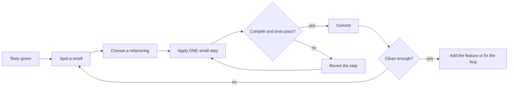
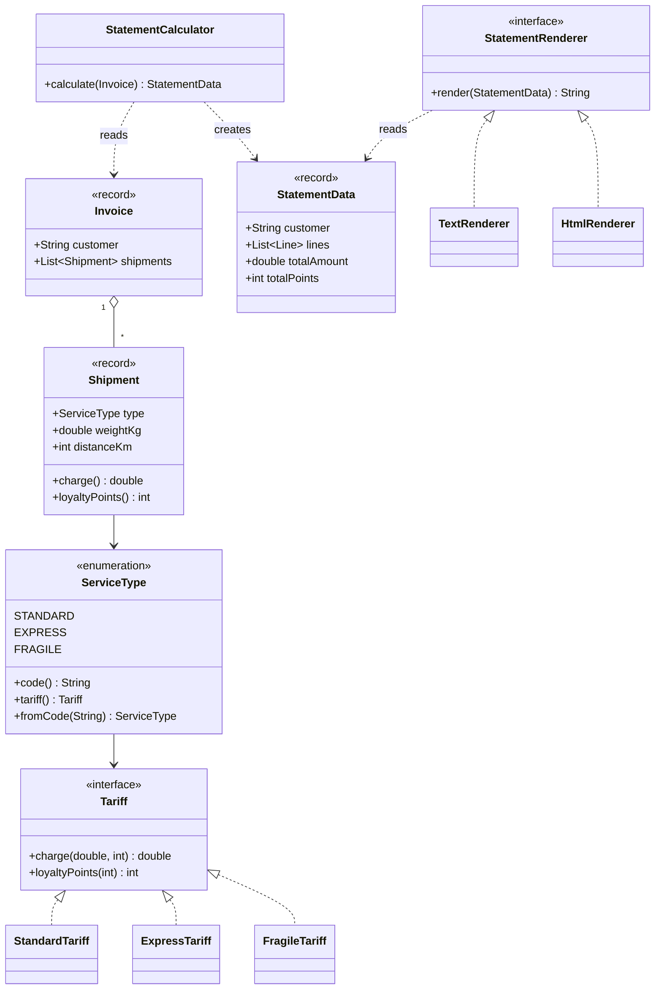
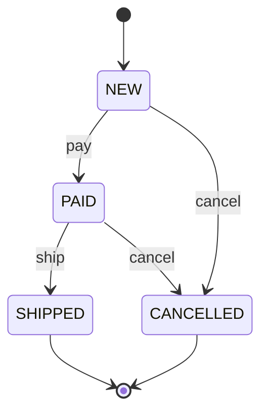

# Chapter 7 — Refactoring (Study Edition)

> **Study Edition.** A shorter version of Chapter 7: every topic, all 24 smells and all 61 refactorings are here, but in compact form. The full chapter (README.md) has longer explanations and the complete source code.
>
> **What you will learn.** What refactoring is, when (and when not) to do it, how tests make it safe, the 24 **code smells** that tell you *where* to refactor, the 61 **refactorings** of Fowler's *Refactoring* (2nd ed., 2018) that tell you *how*, a smell → refactoring lookup table, a worked Java example in six compiling steps, and how refactoring leads to design patterns.
>
> **Why it matters for LLD interviews.** Machine-coding rounds often end with "now add feature X" or "what would you clean up?". You want to say: "this switch is repeated in three places — Repeated Switches — so I'd Replace Conditional with Polymorphism, which gives a Strategy."

---

## 7.1 Refactoring fundamentals

### What it is

**Refactoring (noun):** a change to the internal structure of software that makes it easier to understand and cheaper to modify, *without changing its observable behaviour*. **Refactoring (verb):** applying a *series* of such small changes.

- **Behaviour-preserving** — same outputs, side effects and errors for the same inputs. Only internals (names, where code lives, how it is split) change.
- **Small steps** — each step compiles and passes the tests. If your code is broken for an hour, you are rewriting, not refactoring.

> **Term — observable behaviour.** What callers or users can see: return values, output, data written, exceptions. Call stacks, class structure and private method names are *not* observable behaviour.

| Activity | Refactoring? | Why |
|---|---|---|
| Renaming a method with the IDE | Yes | Behaviour unchanged, tiny step |
| Fixing a bug / adding a feature | No | Behaviour changes on purpose |
| Performance tuning | No | Goal is speed, not clarity |
| Two days of "nothing works until the end" | No | That is restructuring/rewriting |

> **Term — restructuring.** The general word for reorganising code; refactoring is the small-step, behaviour-preserving kind.

### The problem it solves

Code decays: every quick fix and copy-paste makes the next change harder. This **technical debt** is the extra cost on every future change. Refactoring pays it down continuously, instead of trying to get the design right up front (which never fully works, because requirements change).

### How it works

1. Have tests that pin current behaviour — green. 2. Spot a smell (7.2). 3. Pick a named refactoring (7.3, 7.4). 4. Apply **one** small step (ideally IDE-automated). 5. Compile and test: green → commit locally; red → **revert** (don't debug) and take a smaller step. 6. Repeat until clean enough for the job at hand.



### 7.1.1 The two hats

Kent Beck: at any moment you wear one hat. **Adding function** — add behaviour and tests, don't restructure. **Refactoring** — restructure, don't add behaviour (tests for *existing* behaviour are fine). Swap often, but never mix: if a test fails while you did both, you can't tell which change broke it.

### 7.1.2 Why refactor

- **Improves the design** — stops decay; removes duplication so each fact lives in one place.
- **Makes code easier to understand** — moves understanding out of your head into the code.
- **Helps find bugs** — clear structure leaves bugs fewer places to hide.
- **Helps you program faster** — Fowler's **Design Stamina Hypothesis**: teams that keep internal quality high soon add features *faster*. Speed is the economic argument, not "clean code for its own sake".

### 7.1.3 When to refactor

| Trigger | Meaning |
|---|---|
| **Rule of Three** (Don Roberts) | 1st time do it, 2nd time wince and duplicate, 3rd time refactor |
| **Preparatory** | Just before a feature: "make the change easy, then make the easy change" (7.5 step 3) |
| **Comprehension** | Rename/extract as you come to understand code |
| **Litter-pickup** | Boy Scout Rule — fix small mess you pass; note bigger mess for later |
| **Planned vs opportunistic** | Mostly opportunistic, inside feature work; a quarterly "refactoring sprint" is a warning sign |
| **Long-term** | Gradual big changes, e.g. **Branch by Abstraction** (abstraction → move callers → swap impl → delete old) |
| **Code review** | Suggest or pair on refactorings, ideally with the author |

> **Term — Rule of Three.** Don't abstract on the 1st or 2nd occurrence (you don't know what varies yet); abstract on the 3rd.

**Ask your manager?** Fowler: no more than for writing tests; discuss only large planned efforts.

### 7.1.4 When NOT to refactor

- Messy code behind a clean API that you never touch.
- When a rewrite is cheaper (7.1.10).
- Without a safety net — add tests first (7.1.11).
- An immovable deadline may postpone a *big* refactoring (skipping small ones usually slows you).
- **Published interfaces** — possible, but keep the old version working and deprecate it (Change Function Declaration, migration mechanics).

### 7.1.5 Problems and costs of refactoring

| Problem | Mitigation |
|---|---|
| "Slows down features" | Refactor *because* it speeds features; focus on code you're about to change |
| Code ownership (callers in another repo) | Keep old name as a delegating `@Deprecated` method; migrate later |
| Long-lived feature branches | Continuous Integration / trunk-based — integrate at least daily |
| Missing tests | Add tests first; only IDE-automated refactorings until then |
| Databases | Evolutionary database design; small versioned migrations; **parallel change** |

> **Term — parallel change (expand / contract).** *Expand* (add new beside old), *migrate* (move users), *contract* (remove old). Nothing is ever broken.

### 7.1.6 Refactoring, architecture and YAGNI

Because you can reshape code safely later, build only what today's requirements need — **YAGNI** ("You Aren't Gonna Need It"). This does not mean "no architecture": think hard up front only about things truly hard to change later (public APIs, database schemas).

### 7.1.7 Tests as the safety net

**Self-testing code** = automated tests that check themselves and run in seconds.

- Run tests after **every** step; on failure, **revert** and redo smaller.
- Test **behaviour** (public API), not private structure — otherwise every refactoring breaks tests.
- **Characterisation tests** (Feathers): record what code *currently* does, even if wrong. 7.5 uses a byte-for-byte output checker.
- **Mutation testing** (e.g. PIT) checks that your tests actually catch injected bugs.

> **Term — safety net.** Anything that tells you quickly you broke something: tests, compiler type checks, IDE-automated refactorings.

### 7.1.8 IDE automation

IDEs refactor using the **syntax tree and symbol resolution**, not text search — Rename changes only that symbol and its real references. (History: Opdyke's 1992 thesis → the Smalltalk *Refactoring Browser* → Java IDEs.)

| Refactoring | IntelliJ (Win/Linux · macOS) | Eclipse |
|---|---|---|
| Rename | Shift+F6 · Shift+F6 | Alt+Shift+R |
| Extract Method | Ctrl+Alt+M · Cmd+Opt+M | Alt+Shift+M |
| Extract Variable | Ctrl+Alt+V · Cmd+Opt+V | Alt+Shift+L |
| Inline | Ctrl+Alt+N · Cmd+Opt+N | Alt+Shift+I |
| Change Signature | Ctrl+F6 · Cmd+F6 | Alt+Shift+C |
| Move | F6 · F6 | Alt+Shift+V |

Large-scale tools: **OpenRewrite** recipes, Google's **Refaster** templates in Error Prone.

> **Caution.** Automated refactorings can miss **reflection**, names in **config files**, **serialised field names** (JSON/Jackson, JPA) and other repositories. Renaming a serialised field changes your API's JSON — an observable behaviour change.

### 7.1.9 Performance and refactoring

1. Most refactorings have negligible cost — the JIT inlines small methods.
2. Programs spend most time in a small fraction of code (Chrysler payroll story: profiling found a hot spot nobody guessed).
3. Well-factored code is **easier to tune** — the hot spot is small and isolated.

Order: **make it work → make it clean → make it fast (profile, optimise hot spots)**.

Care is still needed: see the `DoubleStream.sum()` trap in 7.5 step 2.

### 7.1.10 Refactoring vs rewriting

| | Refactoring | Rewriting |
|---|---|---|
| Unit of change | Many tiny safe steps | One big replacement |
| System works during change? | Always | Usually not until the end |
| Risk | Low | High — old bug fixes lost; old system keeps evolving |
| Delivers value | Continuously | Only at the end |
| Good when | Code mostly works | Code doesn't work at all, or technology must change |

Even replacements go piece by piece: the **Strangler Fig** builds the new system around the old, routing one feature at a time until the old one can be switched off.

### 7.1.11 Legacy code

Feathers (*Working Effectively with Legacy Code*, 2004): **legacy code = code without tests**. The loop: identify change points → find test points → break dependencies at a **seam** (a place to change behaviour without editing there, e.g. inject an interface instead of `new Database()`, or override in a test subclass) → write characterisation tests → change and refactor.

Also: **Sprout Method/Class** (new tested code, called by a one-line change), **Wrap Method/Class** (rename old; new method with the old name calls old + new behaviour); automated refactorings only until tests exist; clean only what you touch.

---

## 7.2 Code smells

### What it is

A **code smell** (Kent Beck's term) is a *surface sign* that usually points to a deeper design problem. It is not a bug — it tells you *where to look*. Smells are **heuristics, not rules**.

### The problem it solves

You must know *when* and *where* to refactor, not just how. Fowler and Beck give no metrics ("max 10 lines"); they give **named** smells with their usual cures. Names help reviews: "Feature Envy" says in two words what would take a paragraph.

### How it works

Notice discomfort → match it to a named smell → look up its cures (7.4) → apply in small steps under tests.

### Smell groups (refactoring.guru classification)

| Group | Idea | Smells (2nd-ed name; *guru name*) |
|---|---|---|
| **Bloaters** | Grown too big | Long Function *(Long Method)*, Large Class, Primitive Obsession, Long Parameter List, Data Clumps |
| **OO Abusers** | Wrong/incomplete OO | Repeated Switches *(Switch Statements)*, Temporary Field, Refused Bequest, Alternative Classes with Different Interfaces |
| **Change Preventers** | One change forces many | Divergent Change, Shotgun Surgery *(+ Parallel Inheritance Hierarchies, 1st ed.)* |
| **Dispensables** | Pointless; removing helps | Comments, Duplicated Code, Lazy Element *(Lazy Class)*, Data Class, Speculative Generality *(+ Dead Code)* |
| **Couplers** | Too much coupling/delegation | Feature Envy, Insider Trading *(Inappropriate Intimacy)*, Message Chains, Middle Man *(+ Incomplete Library Class)* |
| *2nd-edition extras* | | Mysterious Name, Global Data, Mutable Data, Loops |

> **Term — coupling / cohesion.** Coupling: how much one piece depends on another. Cohesion: how strongly the things inside one unit belong together. Aim for low coupling, high cohesion.

Below, all 24 smells in the book's order: what it is, why it hurts, a tiny smelly → cured sketch, and the cures. (Snippets use `double` for money to stay short; real money needs `BigDecimal` or a `Money` type — see `code/smells/Money.java`.)

### 7.2.1 Mysterious Name
**What.** Names that don't say what a thing does or holds: `data`, `tmp`, `proc()`, `x2`, `Manager`. **Hurts.** Every reader must decode the body; if you *can't* find a good name, the thing may do too much. `calc(l, d)` → `averageDailyRevenue(dailyRevenues, daysInPeriod)`. **Cures:** Change Function Declaration, Rename Variable, Rename Field.

### 7.2.2 Duplicated Code
**What.** The same code structure in more than one place. **Hurts.** Every change must find every copy; one gets missed. `net + net * 0.18` in two methods → one `withTax(net)` using `GST_RATE`. **Cures:** Extract Function; Slide Statements; Pull Up Method.

### 7.2.3 Long Function
**What.** A function too long to grasp at a glance. Heuristic: when you feel a block needs a **comment**, extract it and name it after its *intent*. **Hurts.** Hard to understand, reuse and test. `printOwing` → `printBanner(); outstandingOf(inv); recordDueDate(inv); printDetails(...)`. **Cures:** Extract Function (~99% of the time), plus Replace Temp with Query, Decompose Conditional, Split Loop and others (7.4).

### 7.2.4 Long Parameter List
**What.** Many parameters, often same-typed, or boolean flags. **Hurts.** Callers mix up order; each new parameter touches every caller; hides a missing concept. `book(hotelId, from, to, adults, children, breakfast)` → `book(hotel, Stay, Guests, MealPlan)`. **Cures:** Introduce Parameter Object, Preserve Whole Object, Remove Flag Argument (+ 7.4).

### 7.2.5 Global Data
**What.** Data readable and writable from anywhere: globals, public static mutable fields, mutable singletons. **Hurts.** No way to find who changed it; bugs appear far from their cause. One of the most pungent smells. `public static double discountRate` → private field + `discountRate()` / `setDiscountRate()`; better still, inject the value. **Cures:** Encapsulate Variable first, always; then narrow its scope.

### 7.2.6 Mutable Data
**What.** Data changed after creation, especially when shared or reused for different purposes. **Hurts.** A change in one place breaks code elsewhere that assumed the value stayed put — worse with threads. `public List<Item> items; public double total;` → private list with `add()`, `items()` returning `List.copyOf`, and `total()` computed on demand. **Cures:** Encapsulate Variable, Replace Derived Variable with Query, Remove Setting Method, Change Reference to Value (+ 7.4).

### 7.2.7 Divergent Change
**What.** **One class changed for many different reasons** (new database *and* new instrument *and* new report format). **Hurts.** Mixed responsibilities break SRP; changes interfere. `ProductService` (save + price + CSV) → `ProductRepository`, `PricingService`, `ProductCsvWriter`. **Cures:** Split Phase, Extract Class (+ Move/Extract Function).

### 7.2.8 Shotgun Surgery
**What.** The opposite: **one change forces small edits in many classes**. **Hurts.** Easy to miss one place; the concept is scattered. The "free shipping at 500" rule in four classes → one `ShippingPolicy` with `FREE_SHIPPING_THRESHOLD`, `isFree()`, `charge()`. **Cures:** Move Function, Move Field (+ 7.4); sometimes Inline first, then re-extract.

| | Divergent Change | Shotgun Surgery |
|---|---|---|
| Shape | One class, many reasons to change | One reason, many classes |
| Fix | Split the class | Gather the scattered code |

### 7.2.9 Feature Envy
**What.** A method more interested in another class's data than its own (calls many getters). **Hurts.** Behaviour lives away from its data. Rule: **put behaviour next to the data it uses** (Strategy/Visitor separate them on purpose). `order.lineTotal(line)` → `line.total()`. **Cures:** Move Function (Extract Function first if only part is envious).

### 7.2.10 Data Clumps
**What.** The same group of values always travels together: `(street, city, zip)`, `(start, end)`, `(amount, currency)`. **Hurts.** An unnamed concept; its behaviour gets duplicated. **Test:** delete one item — if the rest makes no sense alone, make an object. `(LocalDate start, LocalDate end)` → `record DateRange` with `contains()` (see `code/smells/DateRange.java`). **Cures:** Extract Class, Introduce Parameter Object, Preserve Whole Object — then watch for Feature Envy moving onto the new class.

### 7.2.11 Primitive Obsession
**What.** Primitives for domain concepts: money as `double`, phone as `String`, status as `"ACTIVE"`. **Hurts.** No validation, duplicated formatting, easy mix-ups (`transfer(amount, fee)` swapped compiles), and `0.1 + 0.2 = 0.30000000000000004`. `charge(double, String)` → `charge(Money)`. **Cures:** Replace Primitive with Object (+ Replace Type Code with Subclasses, 7.4).

### 7.2.12 Repeated Switches
**What.** The *same* switch on the same type code in several places. (1st ed. "Switch Statements" flagged any switch; the 2nd ed. flags only the repetition.) **Hurts.** A new case means finding every switch — Shotgun Surgery. Three `switch (b.type)` methods → `sealed interface Bird` with `speed()`, `plumage()`. **Cures:** Replace Conditional with Polymorphism. (With a `sealed` type or `enum`, switch *expressions* are exhaustiveness-checked, so a few are acceptable.)

### 7.2.13 Loops
**What.** A `for` loop that filters/maps/aggregates where a pipeline says it better (new in 2nd ed.). **Hurts.** The reader must simulate the loop. Loop adding IT names → `employees.stream().filter(...).map(Employee::name).toList()`. **Cures:** Replace Loop with Pipeline. Careful: `toList()` is **unmodifiable**; use `Collectors.toCollection(ArrayList::new)` if callers mutate.

### 7.2.14 Lazy Element
**What.** A class/function/subclass that doesn't pull its weight (1st ed. "Lazy Class"). **Hurts.** Every element costs a name, a file, an indirection. `NameFormatter.format(s)` that only trims → `rawName.trim()`. **Cures:** Inline Function, Inline Class, Collapse Hierarchy.

### 7.2.15 Speculative Generality
**What.** Hooks and abstractions "we might need someday": abstract class with one subclass, unused parameters, methods used only by tests. **Hurts.** Cost with no benefit; violates **YAGNI**. `PaymentProcessorFactoryProvider` with one implementation, `futureOptions` never used → `pay(Money m)`. **Cures:** Collapse Hierarchy, Inline Function, Inline Class, Change Function Declaration, Remove Dead Code (delete the tests too).

### 7.2.16 Temporary Field
**What.** A field set and used only in some situations, null the rest of the time. **Hurts.** Readers expect every field to matter — "is this null a bug?". `Planner.tmpDistances`, `tmpTarget` → a short-lived `RouteSearch` object holding that state. **Cures:** Extract Class, Move Function, Introduce Special Case.

### 7.2.17 Message Chains
**What.** `order.getCustomer().getAddress().getCity()`. **Hurts.** Client coupled to the whole navigation path; violates the **Law of Demeter**. → `order.shippingCity()` (see `code/smells/Order.java`). Don't hide every delegate (creates Middle Men). **Cures:** Hide Delegate, Extract Function, Move Function.

### 7.2.18 Middle Man
**What.** A class whose methods *mostly* just forward to another class. **Hurts.** A layer with no value; every delegate feature needs a new forwarder. `Person` with ten `dept.getX()` forwarders → `department()` accessor. **Cures:** Remove Middle Man, Inline Function, Replace Superclass/Subclass with Delegate. Message Chains and Middle Man pull in opposite directions — balance them.

### 7.2.19 Insider Trading
**What.** Modules poking at each other's internals; subclasses knowing too much about parents (1st ed. "Inappropriate Intimacy"). **Hurts.** Can't change one without the other. `customer.internalLoyaltyTable.get(customer.tierCode)` → `customer.loyaltyDiscount()`. **Cures:** Move Function, Move Field, Hide Delegate, Replace Subclass/Superclass with Delegate.

### 7.2.20 Large Class
**What.** A class doing too much — a **God Class**. **Hurts.** Magnet for duplication, bottleneck for changes, breaks SRP. `Employee` with identity + address + payroll + performance fields → `Address`, `Compensation`, `PerformanceRecord`. **Cures:** Extract Class, Extract Superclass, Replace Type Code with Subclasses.

### 7.2.21 Alternative Classes with Different Interfaces
**What.** Classes doing the same job with different signatures: `EmailSender.sendMail(to, body)` vs `SmsGateway.dispatch(msg, phone)`. **Hurts.** No polymorphism → callers write `if email ... else sms`. → `interface Notifier { void send(String recipient, String message); }`. **Cures:** Change Function Declaration, Move Function, Extract Superclass; for third-party classes, an **Adapter** (Ch. 9).

### 7.2.22 Data Class
**What.** Only fields and getters/setters; others manipulate its data. **Hurts.** Behaviour lives elsewhere (Feature Envy), duplicated; public setters break invariants. **Exceptions:** immutable records — Split Phase results, DTOs, value objects — are fine. `if (acc.getBalance() >= amt) acc.setBalance(...)` → `account.withdraw(amount)`. **Cures:** Encapsulate Record, Remove Setting Method, Move Function (+ 7.4).

### 7.2.23 Refused Bequest
**What.** A subclass that doesn't want what it inherits — or refuses the *interface* (throws `UnsupportedOperationException`). **Hurts.** Refusing implementation is mild; refusing the interface breaks **Liskov** (Ch. 4). `Stack<T> extends ArrayList<T>` (cf. `java.util.Stack extends Vector`) → `Stack` holding a `Deque`. (Check: empty `pop()` now throws a different exception and `ArrayDeque` rejects nulls.) **Cures:** Push Down Method/Field, Replace Subclass with Delegate, Replace Superclass with Delegate.

### 7.2.24 Comments
**What.** Comments used as **deodorant** — explaining *what* confusing code does (Fowler: a "sweet" smell). **Hurts.** Comments go stale. **Good comments:** *why*, warnings, algorithm/ticket references, uncertainty notes, Javadoc. `// check senior discount` + complex `if` → `if (isEligibleForSeniorDiscount(customer))`; `// rate never negative` → `assert rate >= 0`. **Cures:** Extract Function, Change Function Declaration, Introduce Assertion.

### 1st-edition smell names (renamed or dropped in the 2nd edition)

| 1st-edition smell | Where it went |
|---|---|
| Long Method | **Long Function** |
| Switch Statements | Narrowed to **Repeated Switches** |
| Lazy Class | **Lazy Element** |
| Inappropriate Intimacy | **Insider Trading** |
| Parallel Inheritance Hierarchies | Special case of Shotgun Surgery; Move Function/Field so one hierarchy disappears |
| Incomplete Library Class | Wrapper/utility (1st ed. Introduce Foreign Method / Local Extension) or Adapter |
| Dead Code | The refactoring **Remove Dead Code** |

---

## 7.3 The refactoring catalogue

### What it is

A **named refactoring** is a small, well-defined transformation with a name, a motivation, safe mechanics and examples. Fowler's 2nd edition has **61**, in book chapters 6–12 (online at refactoring.com/catalog). Old 1st-edition names appear as aliases. Many come in **inverse pairs** (Extract ↔ Inline Function) — go whichever way makes the code clearer for the change you're about to make.

### How to read each entry

Each row: **name** (*alias*; ⇄ inverse), **when/why**, and a tiny **before → after** sketch (illustrative; the fully compiling examples are in `code/`).

| Book chapter | Count |
|---|---|
| 6 A First Set · 7 Encapsulation · 8 Moving Features · 9 Organizing Data · 10 Simplifying Conditionals · 11 Refactoring APIs · 12 Inheritance | 11 + 9 + 9 + 5 + 6 + 10 + 11 = **61** |
| refactoring.com extras | 5 more |

### 7.3.1 A First Set of Refactorings (book chapter 6)

The everyday ones.

| Refactoring | When / why | Before → After |
|---|---|---|
| **Extract Function** (*Extract Method*; ⇄ Inline Function) | Separate *intention* from implementation: if you must study a fragment to see *what* it does, extract it and name it that. Even one line is worth it. | inline print lines → `printDetails(invoice, outstanding)` |
| **Inline Function** (*Inline Method*; ⇄ Extract Function) | Body as clear as the name, or a tangle of bad small functions (inline, then re-extract), or pure delegation | `moreThanFiveLateDeliveries(d) ? 2 : 1` → `d.lateDeliveries() > 5 ? 2 : 1` |
| **Extract Variable** (*Introduce Explaining Variable*; ⇄ Inline Variable) | Name parts of a complex expression; if the name matters beyond the function, extract a function instead | long price formula → `basePrice - quantityDiscount + shipping` |
| **Inline Variable** (*Inline Temp*; ⇄ Extract Variable) | Name says no more than the expression, or blocks another refactoring | `double basePrice = order.basePrice(); return basePrice > 1000;` → `return order.basePrice() > 1000;` |
| **Change Function Declaration** (*Rename Function/Method, Add/Remove Parameter, Change Signature*) | Names and parameters are the joints of the system. **Simple mechanics**: change all callers at once. **Migration mechanics**: new function, old one delegates + `@Deprecated`, migrate, delete. | `circum(r)` → `circumference(r)` + deprecated `circum` delegating |
| **Encapsulate Variable** (*Encapsulate Field, Self-Encapsulate Field*) | Turns "reorganise data" into "reorganise functions"; one place for validation/logging. First step for Global Data | `public static Owner defaultOwner` → private + `defaultOwner()` / `setDefaultOwner()` |
| **Rename Variable** | The wider the scope, the more the name matters | `double a = height * width` → `double area = ...` |
| **Introduce Parameter Object** | A Data Clump of parameters becomes one object — often the seed of a domain class | `(station, min, max)` → `(station, NumberRange range)` with `contains(v)` |
| **Combine Functions into Class** | Several functions share the same data argument → a class holding it as fields | `base(r)`, `taxableCharge(r)` → `ReadingCalculator(reading).base()` |
| **Combine Functions into Transform** | Read-only source data: one function returns an enriched copy with all derived values (use a class if the source can change — the copy would go stale) | scattered `base`, `taxable` → `enrichReading(r)` returning `EnrichedReading` |
| **Split Phase** | Code doing two things in sequence (parse then compute; compute then format) → two phases joined by an intermediate data structure. Cures Divergent Change; see 7.5 step 3 | `priceOrder(line)` → `price(parse(line))` via `record OrderRequest` |

### 7.3.2 Encapsulation (book chapter 7)

Deciding what each module *hides*: data structures, temps, relationships.

| Refactoring | When / why | Before → After |
|---|---|---|
| **Encapsulate Record** (*Replace Record with Data Class*) | Raw maps/arrays/public-field structs expose layout | `Map.of("name", "Acme", ...)` → `record Organization(String name, String country)` |
| **Encapsulate Collection** | Getter returning the internal collection lets clients change it behind the owner's back | `getCourses()` returning the list → `courses()` unmodifiable + `addCourse` / `removeCourse` |
| **Replace Primitive with Object** (*Replace Data Value with Object, Replace Type Code with Class*) | A simple value soon needs validation/formatting/comparison. Cures Primitive Obsession | `priority().equals("high") \|\| ...("rush")` → `enum Priority` with `higherThan(NORMAL)` |
| **Replace Temp with Query** | A temp is visible only in its function; a method is usable class-wide and eases extraction. Best if assigned once and side-effect free | `double basePrice = quantity * itemPrice` → `basePrice()` method |
| **Extract Class** (⇄ Inline Class) | A subset of fields/methods that go (and change) together. Cures Large Class, Divergent Change | `Person.officeAreaCode, officeNumber` → `record TelephoneNumber` |
| **Inline Class** (⇄ Extract Class) | Class no longer does enough; or merge-then-re-split | `Shipment.trackingInfo` → fields directly in `Shipment` |
| **Hide Delegate** (⇄ Remove Middle Man) | `a.getB().do()` couples client to B; add `a.do()`. Cures Message Chains | `person.getDepartment().getManager()` → `person.manager()` |
| **Remove Middle Man** (⇄ Hide Delegate) | Too many forwarders; let clients call the delegate | `person.manager()` → `person.department().getManager()` |
| **Substitute Algorithm** | Replace a whole body with a clearer algorithm or a library call (with tests proving they agree) | loop of `if equals "Don"/"John"/"Kent"` → `Set.of(...)` + `stream().filter(candidates::contains).findFirst()` |

### 7.3.3 Moving Features (book chapter 8)

Moving code between classes, between functions, and within a function.

| Refactoring | When / why | Before → After |
|---|---|---|
| **Move Function** (*Move Method*) | Put a function where the data it uses most lives. Cures Feature Envy, Shotgun Surgery | `Account.overdraftCharge()` logic → `AccountType.overdraftCharge(daysOverdrawn)`; `Account` delegates |
| **Move Field** | A field always passed alongside another object, or changed with it, belongs there (encapsulate first) | `Customer.discountRate` → `Plan.discountRate`; `Customer.discountRate()` delegates |
| **Move Statements into Function** (⇄ Move Statements to Callers) | Same statements run with every call → move them inside | title line at every caller → inside `photoData(p)` |
| **Move Statements to Callers** (⇄ Move Statements into Function) | A shared function needs different behaviour per caller → move the varying lines out (identical at first; vary later as a separate change) | `emitPhotoData` writes location → each caller writes location itself |
| **Replace Inline Code with Function Call** | Code repeats what an existing function does | flag loop over `states` → `states.contains("MA")` |
| **Slide Statements** (*Consolidate Duplicate Conditional Fragments*) | Keep related statements together (declare right before use); prepares Extract Function; a statement repeated in every branch slides out. Can't slide past interfering code | reorder so `pricingPlan` is declared next to `baseCharge` |
| **Split Loop** | A loop doing two things → two loops, each extractable. Double iteration is rarely a bottleneck | one loop for youngest + total salary → two loops |
| **Replace Loop with Pipeline** | `filter`/`map`/`reduce` name each step | skip-blank/comment loop → `lines.stream().filter(...).map(...).toList()` |
| **Remove Dead Code** | Unused code costs readers; version control remembers it. Don't comment it out | `if (false) { legacyDiscount(); }` → gone |

### 7.3.4 Organizing Data (book chapter 9)

| Refactoring | When / why | Before → After |
|---|---|---|
| **Split Variable** (*Remove Assignments to Parameters, Split Temp*) | A variable (not a loop counter/accumulator) assigned twice has two jobs; don't reuse parameters as locals | `temp` = perimeter, then area → `final double perimeter`, `final double area` |
| **Rename Field** | Field names explain the data structure; encapsulate first if widely used | `record Organization(String nm, ...)` → `(String name, ...)` |
| **Replace Derived Variable with Query** | Stored derived mutable data drifts out of sync; compute on demand (fine to store if the source is immutable) | `production += a.amount()` on every apply → `production()` sums the adjustments |
| **Change Reference to Value** (⇄ Change Value to Reference) | Inner object without identity → immutable **value object**, replaced wholesale, equal by value; safe to share across threads. Records are ideal | mutable `TelephoneNumber.setAreaCode` → `record TelephoneNumber` + `setTelephone(new ...)` |
| **Change Value to Reference** (⇄ Change Reference to Value) | Many copies of one logical entity must see updates → share one instance via a **repository** | `new Customer(id)` per order → `repo.findOrCreate(id)` |

### 7.3.5 Simplifying Conditional Logic (book chapter 10)

| Refactoring | When / why | Before → After |
|---|---|---|
| **Decompose Conditional** | Extract the condition and each branch into named functions (a special Extract Function) | summer date-range `if/else` → `isSummer(date) ? summerCharge() : regularCharge()` |
| **Consolidate Conditional Expression** | Several side-effect-free checks with the same result are one condition | three `return 0` checks → `if (isNotEligibleForDisability(e)) return 0;` |
| **Replace Nested Conditional with Guard Clauses** | Handle unusual cases first and return; the normal path reads straight down. "One exit point" is not worth unclarity | nested `if/else` in `payAmount` → `if (separated) return 0; if (retired) return 0; return normalPay(e);` |
| **Replace Conditional with Polymorphism** | Repeated switches on a type, or base behaviour with variants → class per case, dynamic dispatch. Leads to **Strategy/State** (7.6); 7.5 step 5 | `switch (b.type())` in `speed()` → `sealed interface Bird` + one record per bird |
| **Introduce Special Case** (*Introduce Null Object*) | Many clients check the same special value (null/"unknown") and do the same thing → an object that answers itself. `Optional` shows absence in the type but callers still decide; a special case centralises the decision | `customer == null ? "occupant" : ...` → `UnknownCustomer` |
| **Introduce Assertion** | Make an assumption explicit; program must be correct without it. Java `assert` is off by default (`-ea`) — never use it for external input | `// discountRate never negative` → `assert discountRate >= 0 : ...` |

### 7.3.6 Refactoring APIs (book chapter 11)

| Refactoring | When / why | Before → After |
|---|---|---|
| **Separate Query from Modifier** | A value-returning function should have no observable side effects — **Command–Query Separation** (Meyer) | `alertForMiscreant` returns name *and* sets alarms → `findMiscreant()` (query) + `alertForMiscreant()` (modifier) |
| **Parameterize Function** (*Parameterize Method*) | Near-identical functions differing only in literals | `tenPercentRaise`, `fivePercentRaise` → `raise(p, factor)` |
| **Remove Flag Argument** (*Replace Parameter with Explicit Methods*) | A literal that picks the code path makes calls unreadable (`deliveryDate(order, true)`) | → `rushDeliveryDate(o)`, `regularDeliveryDate(o)`; `setDimension("height", v)` → `setHeight(v)` |
| **Preserve Whole Object** | Don't unpack values from one object just to pass them (unless you want independence from its type) | `withinRange(low, high)` → `withinRange(room.daysTempRange())` |
| **Replace Parameter with Query** (*Replace Parameter with Method*; ⇄ Replace Query with Parameter) | The function can get the value itself — don't make callers pass it (unless it adds an unwanted dependency) | `discountedPrice(base, discountLevel())` → `discountedPrice(base)` |
| **Replace Query with Parameter** (⇄ Replace Parameter with Query) | Reaching into a global/singleton hurts testing and **referential transparency** — pass the value in | `Thermostat.INSTANCE.currentTemperature()` inside → `targetTemperature(plan, currentTemperature)` |
| **Remove Setting Method** | Field shouldn't change after construction → set in constructor, `final` | `setId(id)` → constructor + `final String id` |
| **Replace Constructor with Factory Function** (*Replace Constructor with Factory Method*) | Constructors have a fixed name, must return that exact class, need `new`. Factories can be named, return subclasses or cached instances (*Effective Java* Item 1; `List.of`, `Integer.valueOf`) | `new Employee(name, "E")` → `Employee.createEngineer(name)` |
| **Replace Function with Command** (*Replace Method with Method Object*; ⇄ Replace Command with Function) | Wrap a function in an object with `execute()`: holds state, supports undo/queueing, and splits a big function whose locals become fields | 60-line `score(...)` → `new Scorer(c, exam, guide).execute()` |
| **Replace Command with Function** (⇄ Replace Function with Command) | A simple command adds nothing a function couldn't | `new ChargeCalculator(customer, usage).charge()` → `charge(customer, usage)` |

### 7.3.7 Dealing with Inheritance (book chapter 12)

| Refactoring | When / why | Before → After |
|---|---|---|
| **Pull Up Method** (⇄ Push Down Method) | Identical methods in siblings → superclass (make them identical first, or use Template Method) | `Salesman.name()`, `Engineer.name()` → `Employee.name()` |
| **Pull Up Field** (⇄ Push Down Field) | Same field in siblings (rename to match first) | `protected String name` in both → in `Employee` |
| **Pull Up Constructor Body** | Repeated init in subclass constructors → superclass constructor (Java 21 needs `super(...)` first; Java 25 relaxed this, JEP 513) | `Manager` sets name/id → `super(name, id); this.grade = grade;` |
| **Push Down Method** (⇄ Pull Up Method) | Method relevant only to some subclasses (callers must know the subclass) | `Employee.quota()` → `Salesman.quota()` |
| **Push Down Field** (⇄ Pull Up Field) | Field used by only one subclass | `Employee.quota` → `Salesman.quota` |
| **Replace Type Code with Subclasses** (*Extract Subclass, Replace Type Code with State/Strategy*; ⇄ Remove Subclass) | A type code driving behaviour. **Direct** (subclass the class) or **indirect** (subclass a separate type object — needed if the type changes at runtime or the class is already subclassed) | `Employee.type` → `sealed Employee permits Engineer, Manager, Salesman` + `create(name, type)` switch |
| **Remove Subclass** (*Replace Subclass with Fields*; ⇄ Replace Type Code with Subclasses) | Subclasses differing only in a constant aren't worth it | `Male`/`Female` returning `"M"`/`"F"` → `Person.genderCode` field |
| **Extract Superclass** | Two similar classes duplicate fields/methods (alternative: Extract Class + delegation; you can switch later) | `Department`, `Employee` → `abstract class Party` |
| **Collapse Hierarchy** | Parent and child no longer different enough. Cures Lazy Element, Speculative Generality | empty `Salesman extends Employee` → just `Employee` |
| **Replace Subclass with Delegate** | Inheritance varies only **one** axis and couples tightly; a delegate can vary independently and change at runtime — "favour composition over inheritance", the core of **State/Strategy** | `PremiumBooking extends Booking` → `Booking.premiumDelegate` set by `bePremium(extras)` |
| **Replace Superclass with Delegate** (*Replace Inheritance with Delegation*) | Subclass uses only part of its parent, or parent methods don't make sense (Refused Bequest, broken Liskov) → hold an instance and forward what you need | `Scroll extends CatalogItem` → `Scroll` holding a `catalogItem` delegate |

### 7.3.8 Extra refactorings on refactoring.com

Five more in the online catalogue (not among the 61):

| Refactoring | When / why | Before → After |
|---|---|---|
| **Replace Control Flag with Break** (*Remove Control Flag*) | A `found` flag only to stop a loop | flag → `break` / `continue` / `return` |
| **Replace Error Code with Exception** | Special codes (`-1`, `null`) get ignored by callers | `return -1` → `throw new InsufficientFundsException(...)` |
| **Replace Exception with Precheck** (*Replace Exception with Test*) | Exceptions are for exceptional cases; check first if it's easy | catch `ArrayIndexOutOfBoundsException` → bounds check |
| **Replace Magic Literal** (*Replace Magic Number with Symbolic Constant*) | A special-meaning literal needs a name and one home (not for obvious `0`); 7.5 step 4 | `9.81` → `STANDARD_GRAVITY` |
| **Return Modified Value** | A function secretly updating shared state → return the new value; the data flow becomes visible | `calculateAscent();` → `totalAscent = calculateAscent();` |

### 1st-edition names you may still hear

The old (1999) names are shown as *aliases* in every row above (e.g. Extract Method → Extract Function, Introduce Null Object → Introduce Special Case, Replace Inheritance with Delegation → Replace Superclass with Delegate, Remove Control Flag → Replace Control Flag with Break). The full old → new table is in the Full Edition.

---

## 7.4 Smell → refactorings lookup table

**Bold** = the usual first move.

| Smell | Group | Refactorings |
|---|---|---|
| Mysterious Name | 2nd-ed extra | **Change Function Declaration**, Rename Variable, Rename Field |
| Duplicated Code | Dispensables | **Extract Function**, Slide Statements, Pull Up Method *(also: Replace Inline Code with Function Call, Substitute Algorithm)* |
| Long Function | Bloaters | **Extract Function**, Replace Temp with Query, Introduce Parameter Object, Preserve Whole Object, Replace Function with Command, Decompose Conditional, Replace Conditional with Polymorphism, Split Loop |
| Long Parameter List | Bloaters | Replace Parameter with Query, **Preserve Whole Object**, **Introduce Parameter Object**, Remove Flag Argument, Combine Functions into Class |
| Global Data | 2nd-ed extra | **Encapsulate Variable** (then shrink scope) |
| Mutable Data | 2nd-ed extra | **Encapsulate Variable**, Split Variable, Slide Statements, Extract Function, Separate Query from Modifier, Remove Setting Method, Replace Derived Variable with Query, Combine Functions into Class/Transform, Change Reference to Value |
| Divergent Change | Change Preventers | **Split Phase**, Move Function, Extract Function, **Extract Class** |
| Shotgun Surgery | Change Preventers | **Move Function**, **Move Field**, Combine Functions into Class/Transform, Split Phase, Inline Function, Inline Class |
| Feature Envy | Couplers | **Move Function**, Extract Function |
| Data Clumps | Bloaters | **Extract Class**, **Introduce Parameter Object**, Preserve Whole Object |
| Primitive Obsession | Bloaters | **Replace Primitive with Object**, Replace Type Code with Subclasses, Replace Conditional with Polymorphism, Extract Class, Introduce Parameter Object |
| Repeated Switches | OO Abusers | **Replace Conditional with Polymorphism** |
| Loops | 2nd-ed extra | **Replace Loop with Pipeline** |
| Lazy Element | Dispensables | **Inline Function**, **Inline Class**, Collapse Hierarchy |
| Speculative Generality | Dispensables | Collapse Hierarchy, Inline Function, Inline Class, Change Function Declaration, Remove Dead Code |
| Temporary Field | OO Abusers | **Extract Class**, Move Function, Introduce Special Case |
| Message Chains | Couplers | **Hide Delegate**, Extract Function, Move Function |
| Middle Man | Couplers | **Remove Middle Man**, Inline Function, Replace Superclass/Subclass with Delegate |
| Insider Trading | Couplers | **Move Function**, **Move Field**, Hide Delegate, Replace Subclass/Superclass with Delegate |
| Large Class | Bloaters | **Extract Class**, Extract Superclass, Replace Type Code with Subclasses |
| Alternative Classes w/ Different Interfaces | OO Abusers | **Change Function Declaration**, Move Function, Extract Superclass |
| Data Class | Dispensables | **Encapsulate Record**, Remove Setting Method, Move Function, Extract Function, Split Phase |
| Refused Bequest | OO Abusers | Push Down Method/Field, **Replace Subclass with Delegate**, **Replace Superclass with Delegate** |
| Comments | Dispensables | **Extract Function**, Change Function Declaration, Introduce Assertion |

**Which principle each smell family violates** (Chapters 4–6):

| Smell family | Principle violated |
|---|---|
| Divergent Change, Large Class | Single Responsibility |
| Repeated Switches, Shotgun Surgery | Open/Closed |
| Refused Bequest | Liskov Substitution |
| Long Parameter List with flags, fat interfaces | Interface Segregation / clean functions |
| Global Data, Mutable Data | Encapsulation / information hiding |
| Hard-wired `new` of concrete dependencies | Dependency Inversion |
| Duplicated Code | DRY |
| Speculative Generality | YAGNI |
| Message Chains, Insider Trading | Law of Demeter |
| Feature Envy, Data Class | Tell, Don't Ask |

---

## 7.5 Worked example — from messy to clean in six compiling steps

### The starting point

A courier prints invoices. Each shipment has a **service type** (`STD`, `EXP`, `FRG`), a weight and a distance.

| Type | Charge | Loyalty points |
|---|---|---|
| STD | 5 + 1.2/kg, + 0.05/km beyond 100 km | 1 per full 100 km |
| EXP | 12 + 2.0/kg, + 0.10/km beyond 50 km | 1 per full 100 km, +2 bonus |
| FRG | 8 + 1.5/kg + 3 handling; ×1.2 if > 10 kg | 1 per full 100 km |

**New feature request:** an HTML invoice now, and an OVERNIGHT service next quarter.

Step 0 (excerpt from `code/worked/step0/Main.java`):

```java
    static String print(Inv inv) {
        double tot = 0;
        int pts = 0;
        int unused = 0;                                   // dead code
        StringBuilder r = new StringBuilder("Invoice for " + inv.cust + "\n");
        for (Shp s : inv.list) {
            double amt = 0;
            switch (s.t) {
                case "STD":
                    amt = 5 + s.kg * 1.2;
                    if (s.km > 100) amt += (s.km - 100) * 0.05;
                    break;
                // ... EXP and FRG cases ...
                default:
                    throw new IllegalArgumentException("unknown type: " + s.t);
            }
            // loyalty points
            pts += s.km / 100;
            if ("EXP".equals(s.t)) pts += 2;
            // ... append the formatted line ...
            tot += amt;
        }
        // ... append "Amount owed" and "Points earned" ...
        return r.toString();
    }
```

| Smell | Where |
|---|---|
| Mysterious Name | `Shp`, `Inv`, `t`, `kg`, `km`, `amt`, `tot`, `pts`, `r` |
| Long Function | `print` computes charges, points *and* formats |
| Divergent Change | HTML would copy everything; a new tariff edits the formatter |
| Repeated Switches (coming) | `"EXP"` checked in two places |
| Primitive Obsession | Service type is a `String` |
| Magic literals | `5`, `1.2`, `100`, `0.05`, ... |
| Data Class / Mutable Data | Public mutable fields in `Shp`, `Inv` |
| Dead code | `int unused` |

So: **preparatory refactoring** first.

### The safety net

`lld.ch07.worked.Main` (`code/worked/Main.java`) is a **characterisation check**: it records step 0's output as "golden" and compares every later step **byte for byte**. The fixture includes boundaries (exactly 100 km STD, exactly 10 kg FRG). Each step lives in its own package `step0`…`step5`.

### Step 1 — Extract Function, Rename Variable/Field, Remove Dead Code

Rename Field (`t → type`, `kg → weightKg`, `km → distanceKm`; `Shp → Shipment`, `Inv → Invoice`), Rename Variable (`tot → totalAmount`, `pts → loyaltyPoints`, `r → result`), Extract Function ×3 (`amountFor`, `pointsFor`, `money`), Remove Dead Code. The switch was *moved*, not changed — **move before you change**.

### Step 2 — Inline Variable, Split Loop, Replace Temp with Query, Replace Loop with Pipeline, Slide Statements

Inline `thisAmount`; split the three-job loop; turn total and points into queries; make them streams; slide declarations away.

```java
    static double totalAmount(Invoice invoice) {
        return invoice.shipments.stream().map(Main::amountFor).reduce(0.0, Double::sum);
    }
```

**Trap:** `mapToDouble(...).sum()` may use compensated summation and differ in the last bit; `reduce(0.0, Double::sum)` adds in order like the loop. (`IntStream.sum()` is exact.) `amountFor` now runs twice per shipment — ignore until a profiler says otherwise.

### Step 3 — Split Phase, Encapsulate Record, Encapsulate Collection, Combine Functions into Transform

The key preparatory move: `StatementCalculator.calculate(Invoice)` (phase 1, a transform) → `StatementData` record → `TextRenderer.render(StatementData)` (phase 2, knows no tariffs). `Shipment`/`Invoice` become records; `Invoice` uses `List.copyOf`.

### Step 4 — Replace Primitive with Object, Replace Magic Literal

The type code becomes `enum ServiceType { STANDARD("STD"), EXPRESS("EXP"), FRAGILE("FRG") }` with `fromCode()`, so a bad code fails **at the boundary** (same exception and message; here shipments are always built and printed together, so behaviour is unchanged — check this in real code). Every tariff number gets a name (`STD_FREE_KM`, ...). The switch becomes an exhaustive **switch expression** with no `default`. (`x + 0` equals the old "if not taken" for all doubles except `-0.0`, which can't occur.)

### Step 5 — Replace Conditional with Polymorphism, Move Function, then the new feature

Each switch branch becomes a `Tariff` class (a **Strategy**); `ExpressTariff` overrides `loyaltyPoints`, removing the second `"EXP"` check. Move Function puts `charge()` / `loyaltyPoints()` on `Shipment` (Feature Envy cured). The calculator has **no conditionals**.

```java
public sealed interface Tariff permits StandardTariff, ExpressTariff, FragileTariff {

    double charge(double weightKg, int distanceKm);

    /** Default behaviour shared by most tariffs; ExpressTariff overrides it. */
    default int loyaltyPoints(int distanceKm) {
        return distanceKm / 100;
    }
}

public record ExpressTariff() implements Tariff {
    private static final double BASE = 12, PER_KG = 2.0, FREE_KM = 50, PER_EXTRA_KM = 0.10;
    private static final int BONUS_POINTS = 2;
    // ... charge(...) ...
    @Override
    public int loyaltyPoints(int distanceKm) {
        return Tariff.super.loyaltyPoints(distanceKm) + BONUS_POINTS;
    }
}

public record Shipment(ServiceType type, double weightKg, int distanceKm) {
    // ... compact constructor: requireNonNull(type) ...
    public double charge() { return type.tariff().charge(weightKg, distanceKm); }

    public int loyaltyPoints() { return type.tariff().loyaltyPoints(distanceKm); }
}

/** Phase 1. No switch left: adding a tariff never touches this class (Open/Closed). */
public final class StatementCalculator {

    public StatementData calculate(Invoice invoice) {
        List<StatementData.Line> lines = invoice.shipments().stream()
                .map(s -> new StatementData.Line(s.type(), s.weightKg(), s.distanceKm(), s.charge()))
                .toList();
        double total = lines.stream().map(StatementData.Line::amount).reduce(0.0, Double::sum);
        int points = invoice.shipments().stream().mapToInt(Shipment::loyaltyPoints).sum();
        return new StatementData(invoice.customer(), lines, total, points);
    }
}
```

Full runnable code: code/worked/step5/ (package `lld.ch07.worked.step5`; see the Full Edition).

Then, **adding-function hat**: extract a `StatementRenderer` interface, add a ~15-line `HtmlRenderer` reusing phase 1 unchanged. OVERNIGHT later = one `Tariff` record + one enum constant + one name in `permits`. Calculator and renderers don't change (Open/Closed).



### What changed, step by step

| Step | Refactorings | Smells removed |
|---|---|---|
| 1 | Extract Function ×3, Rename Variable/Field, Remove Dead Code | Mysterious Name, part of Long Function, dead code |
| 2 | Inline Variable, Split Loop, Replace Temp with Query, Replace Loop with Pipeline, Slide Statements | Long Function, Loops |
| 3 | Split Phase, Combine Functions into Transform, Encapsulate Record/Collection | Divergent Change, Data Class, Mutable Data |
| 4 | Replace Primitive with Object, Replace Magic Literal | Primitive Obsession, magic numbers |
| 5 | Replace Conditional with Polymorphism, Move Function (+ extract renderer interface) | Repeated Switches, Feature Envy |

The checker prints `SAME output` for step0 … step5 and ends with `All steps preserve behaviour.`

**Deliberately not done:** money stays `double`. `BigDecimal` would change rounding — a behaviour change for the other hat, with its own tests and a product decision.

---

## 7.6 Refactoring toward patterns

### What it is

You often **arrive at a pattern by refactoring** instead of designing it up front. Kerievsky's *Refactoring to Patterns* (2004) catalogues these moves, mostly compositions of Fowler's refactorings. Don't force patterns early (Speculative Generality); refactor *toward* one when a smell appears — and *away* when it stops earning its keep.

### How it works

| Smell | Toward | Via |
|---|---|---|
| Switch choosing an algorithm | **Strategy** | Extract Function per branch → Replace Conditional with Polymorphism (*Replace Conditional Logic with Strategy*) |
| Methods checking and changing a status field | **State** | Replace Type Code with Subclasses (indirect) → Replace Conditional with Polymorphism (*Replace State-Altering Conditionals with State*) |
| `if (x == null)` everywhere | **Null Object** | Introduce Special Case |
| Siblings with same skeleton, different steps | **Template Method** | Extract Function → Pull Up Method (*Form Template Method*) |
| Confusing constructors | **Creation Methods** | Replace Constructor with Factory Function |
| Scattered `new ConcreteX()` | **Factory** | + Move Function to a factory class (*Encapsulate Classes with Factory*) |
| Complex (Composite) object built by many ordered calls | **Builder** | *Encapsulate Composite with Builder* |
| Huge function with shared locals; undo/queue | **Command** | Replace Function with Command |
| Logging/caching mixed into a core class | **Decorator** | *Move Embellishment to Decorator* |
| Hard-coded notifications / polling | **Observer** | *Replace Hard-Coded Notifications with Observer* |
| Same job, different interfaces | **Adapter** | *Extract Adapter*, *Unify Interfaces with Adapter* |
| Subclass explosion for feature combinations | **Strategy / Decorator / Bridge** | Replace Subclass with Delegate |
| Pattern no longer earning its keep | *Remove it* | Inline Class, Collapse Hierarchy (*Inline Singleton*) |

Package `lld.ch07.towardpatterns` (`code/towardpatterns/`) shows five of these with before and after side by side and checks they agree.

### Replace Conditional Logic with Strategy

A `switch (tier)` becomes a `DiscountPolicy` per tier stored in an `EnumMap`; new tiers are **registered**, not coded.

```java
    @FunctionalInterface
    interface DiscountPolicy {
        double apply(double amount);
    }
    // ...
    static final class PriceCalculator {
        private final Map<Tier, DiscountPolicy> policies = new EnumMap<>(Tier.class);
        private final DiscountPolicy fallback = amount -> amount;
        // ... constructor registers GOLD, SILVER, NEW lambdas ...
        /** New tiers are registered, not coded into a switch (Open/Closed). */
        void register(Tier tier, DiscountPolicy policy) { policies.put(tier, policy); }

        double price(Tier tier, double amount) {
            return policies.getOrDefault(tier, fallback).apply(amount);
        }
    }
```

### Replace State-Altering Conditionals with State

Each state is an enum constant overriding only the moves it allows; default methods reject the rest. `Order` just does `state = state.pay(this)`.



```java
    enum States implements OrderState {
        NEW {
            @Override public OrderState pay(Order o)    { o.log("paid"); return PAID; }
            @Override public OrderState cancel(Order o) { o.log("cancelled"); return CANCELLED; }
        },
        PAID {
            @Override public OrderState ship(Order o)   { o.log("shipped"); return SHIPPED; }
            @Override public OrderState cancel(Order o) { o.log("cancelled"); return CANCELLED; }
        },
        SHIPPED, CANCELLED
    }
```

**Strategy vs State:** same structure, different intent — a strategy is chosen by the client and stays; a state replaces *itself* as the object moves through its lifecycle.

### Introduce Special Case (Null Object)

`find(id)` returns an `UnknownCustomer` answering `"occupant"` / `"basic"`, so clients have no null checks.

### Form Template Method

`legacyCsv` and `legacyMarkdown` repeat header/rows/footer. After: `Exporter.export()` is `final` and calls abstract `header()`, `row()`, `footer()`; `CsvExporter` and `MarkdownExporter` fill them in.

### Replace Constructors with Creation Methods

`new LegacyLoan(5000, false, 12)` — what is `false`? After: private constructor + `Loan.termLoan(5000, 12)` and `Loan.revolver(2000)`.

```text
Strategy:        GOLD 250 -> 200.0, NEW 250 -> 240.0 | same as switch: true
State:           cannot ship when NEW; paid; cannot pay when PAID; shipped; cannot cancel when SHIPPED; | same as if-chains: true
All pattern refactorings preserve behaviour.
```

Full runnable code: code/towardpatterns/ (package `lld.ch07.towardpatterns`; see the Full Edition).

### Small smell cures (package `lld.ch07.smells`)

`code/smells/` shows `Money` (Primitive Obsession), `DateRange` (Data Clumps), and `Order` with `shippingCity()` (Hide Delegate), `Line.total()` (Move Function) and a read-only `lines()` (Encapsulate Collection).

```text
double 0.1+0.2       = 0.30000000000000004
Money  0.10+0.20     = USD 0.30
mixing currencies    -> currency mismatch: USD vs EUR
outsider tried lines().clear() -> UnsupportedOperationException (collection is encapsulated)
```

---

## 7.7 Putting it together

### Trade-offs

| Benefit | Cost / risk |
|---|---|
| Easier to change; features get faster (Design Stamina) | Takes time now; pay-off later, hard to measure |
| Bugs become visible | Without tests you can introduce bugs |
| Design evolves with requirements | Renames/moves cause merge conflicts on long branches |
| Small steps are safe, can stop anytime | Feel slow to beginners |
| Small, understandable units | Too much indirection → Middle Men, Lazy Elements |
| Removes duplication | Premature abstraction → the *wrong* abstraction, costlier than duplication |

### When not to use it

Not for code you don't touch; not without a safety net; not instead of a rewrite when the code doesn't work at all; not on published interfaces without a migration path; never mixed with behaviour changes in the same step.

### Common mistakes

| Mistake | Do this instead |
|---|---|
| Calling any change "refactoring" | Separate refactoring commits from feature/fix commits |
| Big-bang refactoring | Tiny steps, test after each, commit often |
| Refactoring without tests | Characterisation tests first; IDE-automated refactorings |
| Text search-and-replace renames | Symbol-aware IDE Rename; check reflection/config/serialisation |
| Abstracting on the first duplicate | Rule of Three |
| Changing rounding/ordering "while there" (`DoubleStream.sum()`, `toList()`) | Know the replacement API's exact semantics |
| Patterns everywhere "for flexibility" | Refactor toward a pattern when a smell demands it |

### Real-world examples

- **IDEs** automate catalogue entries; **OpenRewrite** (Spring Boot upgrades, JUnit 4 → 5) and Google's **Refaster** do it at scale.
- **JDK:** `Stack extends Vector`, `Properties extends Hashtable` — Refused Bequest (use `ArrayDeque`). `Date` → `java.time` replaced mutable primitive-ish types with immutable values, as a *new* API beside the published old one.
- **Strangler Fig** for monolith-to-services migrations.

### In the interview

**30-second answer — "What is refactoring?"** "Changing the internal structure of code to make it easier to understand and modify, without changing observable behaviour. I do it in very small steps, each compiling and passing tests, so the system is never broken. Smells like Long Function or Repeated Switches tell me where; named refactorings like Extract Function or Replace Conditional with Polymorphism tell me how. Tests are the safety net, and the goal is economic: clean code lets us add features faster."

- **Q: How do you refactor code with no tests?** A: Characterisation tests first; break dependencies at a seam (inject an interface instead of `new`); until then use only IDE-automated refactorings; Sprout Method/Class for new code.
- **Q: What would you refactor here?** (machine coding) A: Name smell + cure: "`processOrder` is a Long Function → Extract Function; the `vehicleType` switch in three places is Repeated Switches → Replace Conditional with Polymorphism (Strategy); `double price` is Primitive Obsession → `Money`; `getParkingLot().getFloor(1).getSpot(3)` is a Message Chain → Hide Delegate."
- **Q: How do you rename a public API method used by other teams?** A: Migration mechanics: new method, old one delegates and is `@Deprecated`, migrate callers, then delete. For REST: versioning or expand/contract.

### Self-check

1. **Q:** Fixing a bug while tidying a method — one refactoring? **A:** No; the fix changes behaviour. Two hats, separate steps and commits.
2. **Q:** `book(hotel, from, to, 2, 1, true)` — smells? **A:** Long Parameter List, Data Clumps, flag argument → Introduce Parameter Object (`Stay`, `Guests`), Remove Flag Argument / an enum like `MealPlan`.
3. **Q:** Why `reduce(0.0, Double::sum)` and not `DoubleStream.sum()`? **A:** `sum()` may use compensated summation and differ in the last bit; `reduce` adds in order like the loop.
4. **Q:** An IDE field rename broke the JSON response — was it a refactoring? **A:** It was meant to be, but the JSON name is observable behaviour, so no. Check serialisation, reflection and config.

### TL;DR

- **Refactoring = small, behaviour-preserving changes**, tests after every step, never mixed with behaviour changes (two hats).
- **When:** Rule of Three, preparatory, comprehension, litter-pickup, code review — mostly opportunistic. **Not** for untouched code or without a safety net.
- **24 smells** say *where*: Mysterious Name, Duplicated Code, Long Function, Long Parameter List, Global Data, Mutable Data, Divergent Change, Shotgun Surgery, Feature Envy, Data Clumps, Primitive Obsession, Repeated Switches, Loops, Lazy Element, Speculative Generality, Temporary Field, Message Chains, Middle Man, Insider Trading, Large Class, Alternative Classes with Different Interfaces, Data Class, Refused Bequest, Comments.
- **61 refactorings** say *how*; the everyday core: Extract/Inline Function, Rename, Move Function, Extract Class, Split Phase, Replace Conditional with Polymorphism.
- **Performance:** clean first, then profile. **Rewrite** rarely, with a Strangler Fig. **Legacy code** = no tests → characterisation tests, seams, sprout/wrap.
- **Patterns** emerge: switch → Strategy/State, null checks → Null Object, duplicated skeleton → Template Method, confusing constructors → factory methods.

---

## 7.8 Full source code and output

The complete listings (checker, steps 0–5, toward-patterns, smell cures) are in the Full Edition (README.md, section 7.8). Compile and run with Java 21:

```bash
cd chapters/07-refactoring/code
javac --release 21 -d /tmp/lld_07 $(find . -name '*.java')
java -cp /tmp/lld_07 lld.ch07.worked.Main           # characterisation check over all six steps
java -cp /tmp/lld_07 lld.ch07.worked.step5.Main     # final design + new HTML feature
java -cp /tmp/lld_07 lld.ch07.towardpatterns.Main   # refactoring toward patterns
java -cp /tmp/lld_07 lld.ch07.smells.Main           # small smell cures
```

Packages: `code/worked/` (checker), `code/worked/step0/`, `code/worked/step1/`, `code/worked/step2/`, `code/worked/step3/`, `code/worked/step4/`, `code/worked/step5/` (steps 0–4 print the text invoice only), `code/towardpatterns/`, `code/smells/`.

**Sources:** Fowler, *Refactoring*, 2nd ed. (2018) and refactoring.com; refactoring.guru's smell groups; Feathers, *Working Effectively with Legacy Code* (2004); Kerievsky, *Refactoring to Patterns* (2004).
