# Chapter 8 — Design Patterns: Introduction & Creational Patterns

> **What you will learn.** What a design pattern is and where the idea came from, the full Gang of Four catalogue of 23 patterns, the object-oriented principles that sit underneath all of them, how to choose a pattern (and how to *not* choose one), the anti-patterns that come from overusing them, and then — in depth — the five creational patterns (Singleton, Factory Method, Abstract Factory, Builder, Prototype), the Simple Factory idiom, and the Object Pool bonus pattern.
>
> **How to read it.** Part A is the map. Part B walks through each creational pattern with the same template: *what it is → the problem → how it works → Java code (with real output) → trade-offs → when not to use it → common mistakes → real-world examples → interview answers → self-check → TL;DR*. The chapter ends with one big comparison table.
>
> **Code.** Everything lives in `chapters/08-patterns-creational/code/lld/ch08/<pattern>/`. Each package (a named folder of related Java classes that also acts as a namespace) has a `Main` (the class whose `main` method the program starts from). Compile and run all of them with:
>
> ```bash
> cd chapters/08-patterns-creational/code
> javac --release 21 -d /tmp/lld_08 $(find . -name '*.java')
> java -cp /tmp/lld_08 lld.ch08.singleton.Main        # or .simplefactory / .factorymethod / .abstractfactory / .builder / .prototype / .objectpool
> ```

---

# Part A — Design patterns: the big picture

## 8.1 What is a design pattern?

### What it is

A **design pattern** is a named, reusable description of a good solution to a problem that keeps showing up in software design. It is not a library and not a piece of code you paste in. It is closer to a *recipe* you adapt to your kitchen.

**Everyday analogy.** Think about building houses. Every builder has to decide where to put the front door so people can move through the house easily. Over hundreds of houses, builders learned which placements work. If someone wrote that experience down as a guideline — "put the door here, for these reasons, and this is what you give up" — that guideline would be a pattern. A design pattern is the same thing for code: the combined experience of many developers, written down so you do not have to rediscover it.

Two words you will see everywhere:

- **Intent** — the one-sentence purpose of a pattern ("ensure a class has only one instance").
- **Participants** — the roles (classes/interfaces — an **interface** is a type that lists method signatures without bodies, which classes then implement) that take part in the pattern, such as *Creator*, *Product*, *Client*.

### The problem it solves

Without patterns, every team solves the same recurring problems (how to create objects without hard-coding classes, how to add behaviour without editing old code, how to notify many listeners) from scratch, each in a slightly different, slightly buggy way. Patterns fix that in seven ways:

| Benefit | What it means in practice |
|---|---|
| Solve common design problems | You start from a proven solution that has been refined over years. |
| Avoid reinventing the wheel | Less time designing, fewer surprises. |
| Readability and maintainability | Code that follows a known shape is easier for the next person to understand. |
| Shared vocabulary | Saying "this is a Factory" or "use an Observer" replaces a paragraph of explanation. This is the biggest win in interviews. |
| Best practices built in | Patterns embody good principles (loose coupling — parts know little about each other; open/closed — extend without editing), so code tends to be more testable. |
| Adaptability and scalability | Many patterns exist precisely so code can absorb change later. |
| Faster development | Tested paradigms speed up design decisions. |

### How it works

Every classic pattern description has four essential parts (this is how the Gang of Four book frames them):

1. **Name** — a word or two that becomes part of the team's vocabulary.
2. **Problem** — when to apply it: the situation and the forces in tension.
3. **Solution** — the participants, their responsibilities and how they collaborate. It is abstract: a *template*, not concrete code.
4. **Consequences** — the costs and benefits. A pattern without its trade-offs is only half a pattern.

You then **adapt** the template to your language and your problem. Two correct implementations of the same pattern can look quite different.

### When not to use it

Patterns must be used with judgement. Not every problem needs one. Forcing a pattern where it is not needed adds classes, indirection (extra layers you must step through to reach the code that does the real work) and confusion — which is worse than having no pattern at all. We come back to this in [8.6 Anti-patterns](#86-anti-patterns-when-patterns-go-wrong).

### TL;DR

A design pattern = **name + problem + solution template + consequences**. It is shared experience, not copy-paste code. Its biggest value is vocabulary and proven trade-offs; its biggest risk is overuse.

---

## 8.2 A short history: from buildings to the "Gang of Four"

| Year | Event | Why it matters |
|---|---|---|
| 1977 | Architect **Christopher Alexander** publishes *A Pattern Language*, a catalogue of solutions for towns and buildings. | The idea of a "pattern" as a named, reusable solution comes from architecture, not software. |
| 1987 | **Kent Beck** and **Ward Cunningham** experiment with applying pattern languages to programming (user-interface design in Smalltalk, an early object-oriented language). | First bridge from architecture to software. |
| 1994 | **Erich Gamma, Richard Helm, Ralph Johnson and John Vlissides** publish *Design Patterns: Elements of Reusable Object-Oriented Software*. The four authors are nicknamed the **Gang of Four (GoF)**. | Catalogues **23 patterns** in three categories, with C++ and Smalltalk examples. This is the book people mean when they say "GoF patterns". |
| 2004 | *Head First Design Patterns* (Freeman & Robson, with Sierra and Bates) teaches the same patterns in Java with pictures and stories (the pizza store for factories, the chocolate boiler for Singleton, the Starbuzz coffee shop for Decorator). | Made the GoF catalogue approachable, and put the **OO principles** behind patterns front and centre. |

The GoF book states two principles that run through the whole catalogue:

1. **Program to an interface, not an implementation.** Variables and parameters should be typed by abstractions (interfaces or abstract classes that say *what* something does, not *how*), so callers do not care which concrete class (an ordinary, fully implemented class you can create with `new`) they get.
2. **Favour object composition over class inheritance.** Build behaviour by *holding* other objects ("has-a"), not only by extending classes ("is-a"). Composition is "black-box" reuse; inheritance exposes a parent's internals to its children.

Creational patterns are what make principle 1 practical: if code must not name concrete classes, *someone* still has to create those objects — and creational patterns decide who and how.

---

## 8.3 The three categories and all 23 GoF patterns

### What it is

The GoF grouped patterns by **purpose** — what problem family they address:

| Category | Question it answers | In one line |
|---|---|---|
| **Creational** | *How do objects get made?* | Control object creation so the system does not depend on concrete classes or on the messy details of construction. |
| **Structural** | *How are objects put together?* | Compose classes and objects into larger structures while keeping them flexible — simple ways to realise relationships between entities. |
| **Behavioral** | *How do objects talk and share work?* | Assign responsibilities and design communication between objects, so you think about how objects are connected instead of about raw control flow. |

The GoF also used a second axis, **scope**:

- **Class patterns** use inheritance, fixed at compile time (when the compiler translates the source code, before the program runs) (Factory Method, class Adapter, Template Method, Interpreter).
- **Object patterns** use composition, changeable at run time (while the program is running) (almost everything else).

### The full catalogue

| # | Pattern | Category | Intent in one line | Chapter |
|---|---|---|---|---|
| 1 | **Abstract Factory** | Creational | Create *families* of related objects without naming their concrete classes. | 8 |
| 2 | **Builder** | Creational | Build a complex object step by step, separating construction from the final representation. | 8 |
| 3 | **Factory Method** | Creational | Let subclasses decide which concrete class to instantiate through an overridable creation method. | 8 |
| 4 | **Prototype** | Creational | Create new objects by copying a pre-configured instance. | 8 |
| 5 | **Singleton** | Creational | Ensure a class has exactly one instance and give a global access point to it. | 8 |
| 6 | **Adapter** (also called Wrapper) | Structural | Convert one interface into another that clients expect. | 9 |
| 7 | **Bridge** | Structural | Split an abstraction from its implementation so both can vary independently. | 9 |
| 8 | **Composite** | Structural | Treat individual objects and trees of objects uniformly. | 9 |
| 9 | **Decorator** | Structural | Attach extra responsibilities to an object dynamically by wrapping it. | 9 |
| 10 | **Facade** | Structural | Give a simple, unified entry point to a complex subsystem. | 9 |
| 11 | **Flyweight** | Structural | Share common (intrinsic) state to support huge numbers of fine-grained objects cheaply. | 9 |
| 12 | **Proxy** | Structural | Provide a stand-in that controls access to another object (lazy, remote, protective…). | 9 |
| 13 | **Chain of Responsibility** | Behavioral | Pass a request along a chain of handlers until one handles it. | 10/11 |
| 14 | **Command** | Behavioral | Turn a request into an object so it can be queued, logged or undone. | 10/11 |
| 15 | **Interpreter** | Behavioral | Represent a small language's grammar as classes and evaluate sentences in it. | 10/11 |
| 16 | **Iterator** | Behavioral | Traverse a collection without exposing how it is stored. | 10/11 |
| 17 | **Mediator** | Behavioral | Centralise complex communication between objects in one mediator object. | 10/11 |
| 18 | **Memento** | Behavioral | Capture and restore an object's state without breaking encapsulation (keeping internals private). | 10/11 |
| 19 | **Observer** | Behavioral | Notify many dependents automatically when one object changes. | 10/11 |
| 20 | **State** | Behavioral | Let an object change behaviour when its internal state changes, as if it changed class. | 10/11 |
| 21 | **Strategy** | Behavioral | Make a family of algorithms interchangeable behind one interface. | 10/11 |
| 22 | **Template Method** | Behavioral | Fix an algorithm's skeleton in a base class and let subclasses fill in steps. | 10/11 |
| 23 | **Visitor** | Behavioral | Add new operations to a set of classes without changing those classes. | 10/11 |

**Count check:** 5 creational + 7 structural + 11 behavioral = **23**. (Some course lists show ten behavioral patterns and leave out Interpreter, which is rarely used in practice — it is still one of the 23.)

**Not in the GoF 23 but you will meet them:** *Simple Factory* (an idiom), *Object Pool* (covered at the end of this chapter), *Dependency Injection* (handing an object the things it needs from outside instead of letting it create them), *Null Object*, *Repository*, *MVC* (Model–View–Controller, which splits an app into data, display and input handling; Head First calls it a "compound pattern" built from Observer, Strategy and Composite).

### Self-check

- **Q:** Which creational pattern is a *class* pattern (uses inheritance) rather than an object pattern? **A:** Factory Method — subclasses override the creation method.
- **Q:** How many behavioral GoF patterns are there? **A:** Eleven.

---

## 8.4 The OO principles behind every pattern

Patterns are not magic; they are principles applied to recurring situations. *Head First Design Patterns* collects these principles as it goes; together with SOLID (Chapter 4 — five object-oriented design rules: Single responsibility, Open–closed, Liskov substitution, Interface segregation, Dependency inversion) they explain *why* each pattern is shaped the way it is.

| Principle (plain words) | What it means | Patterns that apply it (examples) |
|---|---|---|
| **Encapsulate what varies** | Find the part of the code that changes and put it behind its own abstraction, separate from what stays the same. | Factory Method (the created type varies), Strategy, State, Builder |
| **Favour composition over inheritance** | Get behaviour by holding objects, not only by subclassing. | Abstract Factory (client *holds* a factory), Strategy, Decorator |
| **Program to interfaces, not implementations** | Depend on the supertype. Callers should not care which concrete class they get. | Every creational pattern returns an interface type |
| **Strive for loosely coupled designs between objects that interact** | Objects should know as little about each other as possible. | Observer, Mediator, factories |
| **Open–Closed Principle** — open for extension, closed for modification | Add new behaviour by adding code, not by editing tested code. | Factory Method (new product = new subclass), Decorator |
| **Dependency Inversion** — depend on abstractions, not concrete classes | High-level code and low-level code both depend on interfaces. | The core of all factory patterns: the client never calls `new ConcreteThing()` |
| **Least Knowledge** ("only talk to your friends") | A method should call only its own object, its parameters, objects it creates and its fields. | Facade |
| **Hollywood Principle** ("don't call us, we'll call you") | High-level components decide when low-level ones run. | Template Method, Factory Method (the base class calls the subclass's hook), frameworks/IoC (inversion of control) |
| **Single Responsibility** — one reason to change | Each class does one job. | Builder (construction separated from the product), Iterator |

**Why creational patterns exist, in one sentence:** Dependency Inversion says "do not depend on concrete classes", but `new PdfDocument()` *is* a dependency on a concrete class — so creational patterns move that `new` somewhere controlled (a factory, a subclass, a builder, a prototype, a container).

---

## 8.5 How to pick a pattern

### The problem it solves

Beginners often learn 23 patterns and then look for places to use them. That is backwards. You should start from a **signal** in the requirements and only then reach for the pattern that answers it.

### How it works

1. **Name the problem first**, in plain words: "the pricing rule will change", "there must be exactly one of these", "the constructor has ten arguments".
2. **Decide the category**: is it about *creating*, *structuring*, or *communicating/behaving*?
3. **Match the signal** to a pattern using the tables below.
4. **Check the cost**: how many classes does it add? Is there a simpler option (an enum — a type with a fixed list of named constants; a lambda — a short unnamed function; a constructor; a DI container — a framework that creates objects and hands them their dependencies)?
5. **Say what you rejected and why.** In an interview this is worth as much as the pattern you picked.

The flowchart below is a decision guide for the creational family plus the most common neighbours.

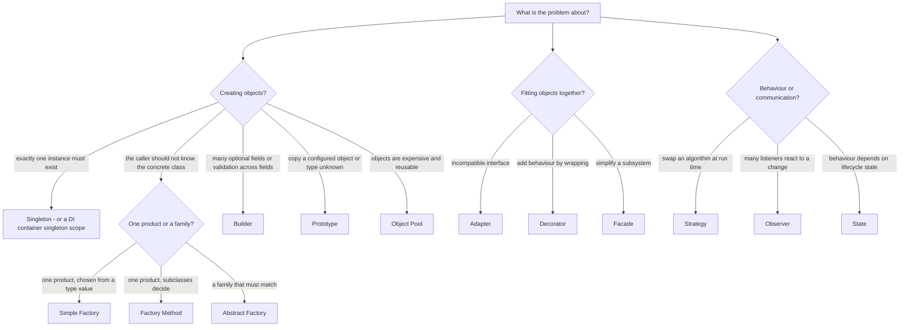

### The six patterns that come up in almost every LLD interview

Six patterns turn up again and again in an object-oriented design round. Knowing their names pays off twice: a single word replaces a long explanation, and it signals to the interviewer that you have met this kind of problem before. The flip side matters more — dropping a pattern into a place that does not need it costs you more than never having heard of it. So learn each one together with its **signal**: the clue in the problem statement that says it fits.

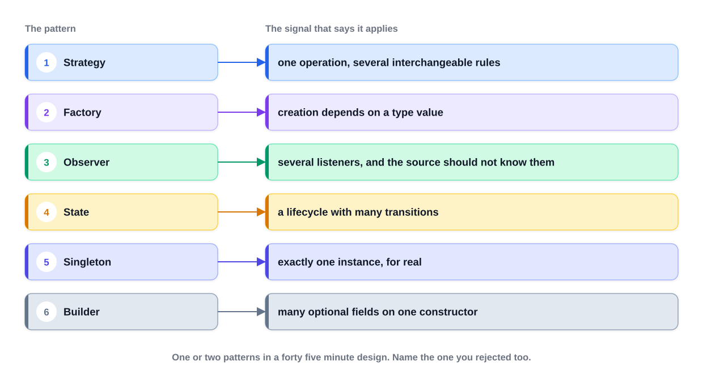
*Figure — the six interview patterns and the signal that tells you each one applies (course diagram)*

As the figure above shows, each pattern is paired with a trigger, not a place to force it in:

| Pattern | The signal | Where it typically applies | Use it when | Do **not** use it when |
|---|---|---|---|---|
| **Strategy** | A single operation comes in several swappable versions, and which one runs is decided at run time | Pricing, matching, sorting, ranking, routing | There is one operation with several interchangeable rules | Only one rule exists and nothing hints at a second |
| **Factory** | Something has to be created, and the caller should not care which concrete class it gets | Turning a type value into a vehicle, spot, payment or notification | The class to create depends on a type value | Only one concrete class exists |
| **Observer** | One object changes and several others must react, without the changing object knowing who they are | Display boards, notifications, live updates, event logs | There are several listeners the source should stay ignorant of | There is a single listener the source already has a reference to |
| **State** | What an object does depends on its current status, and the allowed moves between statuses are fixed | Tickets, orders, bookings, loans — anything with a lifecycle | The lifecycle has many states and transitions | Three or four states can be handled by one guarded method |
| **Singleton** | The program genuinely needs one and only one instance | The top-level object, e.g. `ParkingLot`, `Library` | There really must be exactly one | All you want is an easy global handle |
| **Builder** | Many fields are optional and the constructor keeps getting longer | A book copy, a booking, a search query | Lots of optional fields | A handful of required fields |

How each signal shows up in a parking-lot or library design:

- **Strategy.** At first the price is simply "per hour". Later the business wants a weekend tariff and a monthly pass too. With no pattern, the fee method grows a `switch` that someone has to edit whenever a tariff appears. Strategy instead defines an **interface** (a type that lists method signatures without bodies) named `ParkingRate`, whose one method turns hours into an amount; `HourlyRate`, `WeekendRate` and `MonthlyPass` implement it, and the lot holds a reference to the one currently in force. Adding a tariff means writing one class and editing nothing. Use this when the interviewer asks near the end, "what if the pricing rules change?" — the follow-up you will hear more than any other.
- **Factory.** At some point a string or enum value has to turn into a `Vehicle` object. If that conversion lives inside the entrance panel, the panel must know every vehicle type and changes whenever a type is added. Hand the job to a factory instead: it receives the type and gives back the right object, so the panel simply asks for "a vehicle". The factory becomes the single registration point for new types — the Open–Closed Principle in practice. Keep it lean: in a 45-minute round a creation method on a class you already have is normally enough; one factory class per vehicle type is more structure than the time allows.
- **Observer.** When a spot is taken, every display board on that floor must refresh. The naive version has the floor recompute its counts and push them to its single board. With Observer the spot is the *subject*, and boards, entrance panels and floor portals *subscribe* to it; on each status change the spot notifies all subscribers without knowing what they are. Adding another board needs no change to the spot. Contrast the library: when a reserved book is returned, exactly one member must be told — a direct method call is enough, because a single listener does not justify Observer.
- **State.** A parking ticket goes active → paid → closed; a book copy can be available, reserved, on loan or lost. Without the pattern every method opens with "if status is…", and the rules about which move is legal end up scattered through the class. State gives each status its own small class that knows the legal next steps, so an illegal move cannot even be written, rather than merely being absent. Be candid about the cost: with four states and three transitions, an `enum` plus one method with a guard reads more easily. Reach for State when the transition table is big, and explain why.
- **Singleton.** A car park is one physical place, so the design has one `ParkingLot`; a private constructor plus one accessor enforce that. Interviewers nearly always probe two points, so raise them yourself: fetching the instance must be correct when several threads (independent paths of execution running at the same time inside one program) ask at once (use a lock — a guard that lets only one thread at a time run a piece of code — or create it eagerly), and a singleton is global state (data that any part of the program can read and change) that makes tests harder — which is why many teams create one instance and pass it around instead. Stating that trade-off earns more credit than naming the pattern.
- **Builder.** A `BookItem` needs a barcode, price, format, purchase date, publication date and rack — an eight-argument constructor is easy to call wrongly, because two neighbouring `String` parameters can be exchanged and the compiler says nothing. A builder names every field and produces the finished object at the end. Bring it up once a constructor in your design passes about six arguments, then move on: it improves readability, it does not change the structure.

**Rules of thumb for the interview:**

- **One or two patterns** in a 45-minute design is the right number, placed exactly where their signal appears. If you count six, the design has probably drifted away from the requirements.
- **Compare out loud.** For example: "Strategy for the rates, because a second tariff is clearly coming; no State for the ticket, because a single guard handles three statuses." Explaining the pattern you *rejected* shows as much judgement as the one you chose — and that comparison is the real reason to learn the names.

---

## 8.6 Anti-patterns: when patterns go wrong

### What it is

An **anti-pattern** is a common "solution" that looks reasonable but reliably causes more problems than it solves. Knowing them is how you avoid misusing real patterns.

| Anti-pattern | What it looks like | Why it hurts | The fix |
|---|---|---|---|
| **God Object** (God class, the Blob) | One class knows and does almost everything: `SystemManager` with 80 methods and 40 fields. | Violates Single Responsibility. Every change touches it, merge conflicts (clashing edits by different people to the same lines) everywhere, impossible to test in isolation. | Split by responsibility (Extract Class — Chapter 7), push behaviour to the objects that own the data. |
| **Golden Hammer** | "When all you have is a hammer, everything looks like a nail." The team's favourite tool or pattern is applied to every problem. | The solution is forced onto problems it does not fit, e.g. every object is a Singleton, every `if` becomes a Strategy. | Start from the problem's signal (8.5), not from the tool. |
| **Pattern overuse** ("patternitis") | Factories that create one class, interfaces with one implementation "just in case", five layers of indirection for a CRUD (create, read, update, delete) screen. | More classes, more hops to read, no benefit. Fowler calls the underlying smell **Speculative Generality** (building for imagined future needs). | Apply YAGNI ("You Aren't Gonna Need It", Chapter 5): add the pattern when the *second* variant actually arrives. Refactor towards a pattern, do not start from one. |
| **Singletonitis** | Singletons used as convenient global variables. | Hidden dependencies, order-dependent tests, hard to replace. | Dependency injection; pass the object in (8.8). |
| **Cargo-cult patterns** | Copying a pattern's structure without understanding its intent (e.g. a "Builder" that only copies fields with no validation, a "Factory Method" that is really a switch). | Ceremony with none of the guarantees. | Know the *intent*: what property does the pattern give you? If you cannot name it, drop it. |

### TL;DR

Patterns are a vocabulary, not a checklist. The God Object comes from ignoring design; the Golden Hammer and pattern overuse come from over-applying it.

---

# Part B — Creational patterns

## 8.7 Creational patterns at a glance

### What it is

**Creational patterns** control *how objects are created*, so that the rest of the system is not tied to the concrete classes or the construction details. They hide *which* class is instantiated, *how* it is assembled, and sometimes *whether* a new object is made at all.

Using them lets a system:

- be **independent** of how its objects are created, composed and represented;
- **hide the complexity** of creation (long setup, validation, choosing a subtype);
- keep **flexibility** about *what* gets created, *who* creates it, *how*, and *when*.

| Pattern | Intent in one line |
|---|---|
| **Singleton** | Exactly one instance of a class, with one global way to reach it. |
| **Factory Method** | A base class defines a creation method; subclasses decide which concrete class it returns. |
| **Abstract Factory** | One factory object creates a whole *family* of related objects that must match. |
| **Builder** | Assemble one complex object step by step; the same construction process can produce different representations. |
| **Prototype** | Create new objects by cloning a prototypical instance. |
| *Simple Factory* (idiom) | One method with a switch/registry decides which class to create. |
| *Object Pool* (bonus) | Reuse a bounded set of expensive objects instead of creating and destroying them. |


---

## 8.8 Singleton

### What it is

The **Singleton** pattern restricts a class to **exactly one instance** (per process — one running program — or, strictly, per class loader — the part of the JVM, the Java Virtual Machine that runs compiled Java code, which loads classes into memory) and gives every caller **one well-known way to reach it**.

**Everyday analogy.** A country has one official government. Whoever needs "the government" — a citizen, a company, a foreign embassy — reaches the same one through a known channel. Nobody is allowed to set up a second one.

Terms used below:

- **Instance** — one object created from a class.
- **Eager initialization** — create the object as soon as the class is loaded.
- **Lazy initialization** — create it only the first time someone asks for it.
- **Thread-safe** — gives correct results even when many threads call it at the same moment.

**GoF intent and participants.** Intent: guarantee that a class never has more than one instance, and give every client a well-known way to reach it. There is a single participant, **Singleton**, which (a) defines a class-level operation (`getInstance()`) that lets clients reach the unique instance and (b) is usually responsible for creating that instance itself. Clients simply call that operation.

### The problem it solves

A few things in a program really are "one per process": the settings loaded from a file when the app starts, the pool of database connections (a set of open connections kept ready for reuse), the registry that collects metrics (counters and timings the app records about itself). Let every module create its own and you end up with many copies of the settings, the same file parsed many times, and metrics split across registries whose totals no one can combine.

Picture a `ConfigStore` filled from a settings file: the cloud region to talk to, the retry count, the timeout (how long to wait before giving up). The billing service reads it, so does the nightly reporting job, so does the mailer. If each of them builds a private copy, the file is parsed three times, and a value one service changes never reaches the other two.

A plain global variable looks like the easy fix, but it has two problems. Tests all share it, so a test's result can depend on which test happened to run before it. And *some* code has to assign it before anyone reads it — get the start-up order wrong and a caller finds `null` (Java's "no object here" value). Singleton moves both jobs into the class: **the class decides how many instances may exist and creates the one it allows**, on demand. Callers never assign anything, so there is no ordering mistake to make.

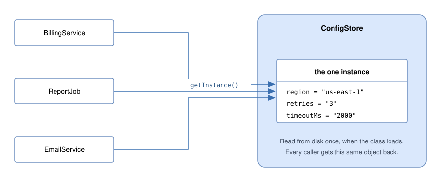
*Figure — BillingService, ReportJob and EmailService all call getInstance() and receive the same ConfigStore, which was read from disk once (course diagram)*

In the figure, none of the three services constructs a `ConfigStore`; each one asks the class for it and gets back the very same object, whose settings were loaded a single time.

### How it works

1. Make the **constructor `private`**, so code outside the class cannot write `new ConfigStore()`. That access modifier (the `public` / `protected` / `private` keyword that says who may use a member) is the whole enforcement mechanism; make the constructor public and any caller can create a second one.
2. Keep the single instance in a **`private static` field** — static because it is owned by the class itself, not by whichever object asks for it.
3. Expose a **`public static getInstance()`** method. It has to be static: a caller has no instance yet (getting one is the whole point), so it can only call something on the class.
4. Inside `getInstance()`, return the stored instance, creating it first if needed (and doing that creation safely when threads are involved).
5. Add ordinary instance methods (`get`, `set`, …) for the actual work.

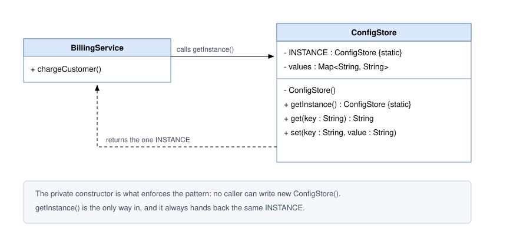
*Figure — ConfigStore with a private static INSTANCE, a private constructor and a static getInstance(); BillingService only calls getInstance() (course diagram)*

Our Java design (all the variants in the code package):


### The six ways to write a Singleton in Java

Two terms in the table: **serialization** turns an object into bytes so it can be saved or sent (and **deserialization** rebuilds an object from those bytes); **reflection** is Java's ability to inspect and call a class's members — even private ones — at run time. "Contention" means many threads competing for the same lock.

| # | Variant | Lazy? | Thread-safe? | Cost on each call | Survives serialization / reflection? | Verdict |
|---|---|---|---|---|---|---|
| 1 | **Eager** `static final` field | No (built when the class is initialized) | Yes — the JVM initializes a class exactly once | None | No / No (needs defences) | Default choice when construction is cheap |
| 2 | **Naive lazy** `if (instance == null)` | Yes | **No** | None | No / No | Never in multi-threaded code |
| 3 | **`synchronized` getInstance()** | Yes | Yes | A lock on *every* call | No / No | Correct but slow under contention |
| 4 | **Double-checked locking** + `volatile` | Yes | Yes (Java 5+) | One volatile read | No / No | When the instance depends on run-time input |
| 5 | **Bill Pugh / holder idiom** | Yes | Yes — class-loading guarantee | None | No / No | Best lazy option in plain Java |
| 6 | **`enum` with one constant** | No (created when the enum class initializes) | Yes | None | **Yes / Yes** (JVM guarantees) | Shortest and most robust; recommended by *Effective Java* (Joshua Bloch's best-practice book) |

Let us walk through each one.

**1 — Eager.** The `static final` field is assigned while the class is being *initialized*. In Java that happens on the class's first active use — typically the first `getInstance()` call, but also the first access to any other static method or non-constant static field of the class — not at JVM start-up. The Java Language Specification (§12.4.2) guarantees that initialization runs exactly once, under an internal lock, even if many threads trigger it at the same moment, and that every thread afterwards sees the fully built object — so you get thread safety without writing any. The only cost: the object is built as soon as the class is touched for *any* reason, even if that code path never needs the instance. If the constructor opens a file or a socket (an endpoint of a network connection), that may matter.

**2 — Naive lazy (broken).** "Create on first use" is written as *check, then act*:

```java
// Do NOT use this in multi-threaded code.
public static ConfigStore getInstance() {
    if (instance == null) {            // two threads can both see null here...
        instance = new ConfigStore();  // ...and both construct
    }
    return instance;
}
```

Nothing stops thread A and thread B from both reading `null` before either has stored its object. Each then constructs its own store, and whatever one caller writes into its copy never shows up in the other's. Run it in a single-threaded test and it behaves perfectly, which is exactly why the bug slips through review. Our demo starts eight threads at the same instant: the naive version built **more than one** object (eight in the run shown below).

**3 — `synchronized` method.** Putting `synchronized` on `getInstance()` fixes the race (a **race condition**: a bug whose outcome depends on the unlucky timing of threads) — only one thread can be inside at a time. But the lock is taken on *every* call, forever, even though it is only needed for the first one.

**4 — Double-checked locking (DCL).** Check *without* the lock first (fast path), and only if the instance is missing, take the lock and **check again** (another thread may have created it while you waited):

- The second check is what prevents two constructions.
- The field **must be `volatile`** (a Java keyword that makes each write to the field immediately visible to every thread and forbids reordering around it). Creating an object is really three steps — allocate memory, run the constructor, store the reference. Without `volatile`, the Java Memory Model (the rules for when one thread's writes become visible to other threads) allows another thread to see the stored reference *before* the constructor's writes are visible, i.e. a half-built object. A `volatile` write/read creates a **happens-before** relationship: everything the constructor did is visible to any thread that reads the reference. (Before Java 5's memory model, DCL was broken even with `volatile`.)
- Copying the field into a local variable (`local`) means the common path reads the volatile field only once — a small optimization shown in *Effective Java*.

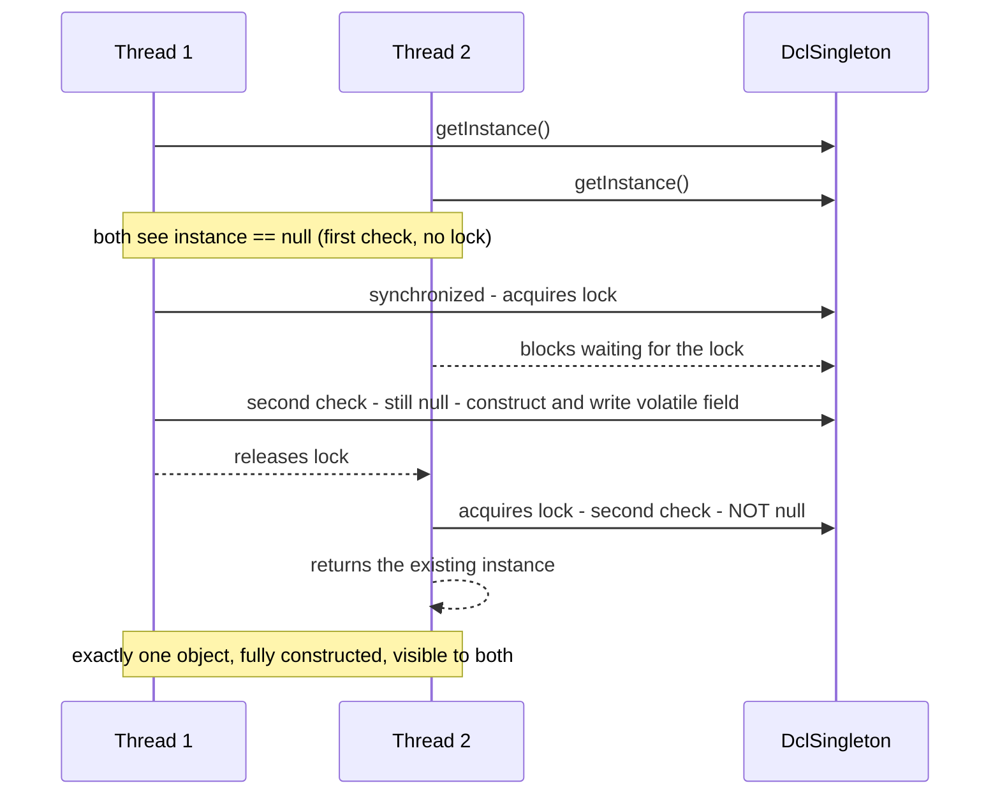

**5 — Bill Pugh / initialization-on-demand holder.** Put the instance in a private *nested* class (a class declared inside another class). The JVM does not initialize `Holder` until `getInstance()` first touches `Holder.INSTANCE`, so creation is lazy; and class initialization is guaranteed to run once and be safely published (made visible to other threads only once fully built), so it is thread-safe with **no locks and no `volatile`**. Named after Bill Pugh, who led the work on the Java memory model. This is the usual choice for a lazy singleton.

**6 — Enum.** `enum EnumConfigStore { INSTANCE; ... }`. The JVM guarantees each enum constant exists once; `Constructor.newInstance` refuses to create enum objects; and enum serialization is special-cased to return the existing constant. It is the shortest correct version. Limits: an enum cannot extend another class (it can implement interfaces), and it is created when the enum class initializes rather than truly on demand.

**Which one to pick.** Default to **eager**: fewest lines and no race is possible; its only drawback matters when construction is costly. Switch to the **holder** idiom once you have *measured* a start-up cost worth avoiding. Choose **double-checked locking** when building the instance needs a value that only exists at run time (a holder's static initializer cannot take a parameter) — and always declare the field `volatile`. Choose **enum** when you also want serialization and reflection safety without writing any defensive code.

### Breaking a Singleton — and the fixes

A `private` constructor is a *language* rule, not a JVM guarantee. There are three classic ways around it:

| Attack | How it creates a second instance | Fix |
|---|---|---|
| **Reflection** | `getDeclaredConstructor().setAccessible(true).newInstance()` calls the private constructor. | Throw from the constructor if the instance already exists (reliable for eager/holder, racy for lazy). Or use an **enum** — the JVM refuses. |
| **Serialization** | `ObjectInputStream.readObject()` builds a new object without calling your constructor. | Add `private Object readResolve() { return INSTANCE; }` — the deserialized copy is replaced by the real one. Mark instance fields `transient` (skipped by serialization) if they should not travel. Or use an **enum**. |
| **Cloning** | If the class (or a parent) implements `Cloneable` and exposes `clone()`, `clone()` copies the object. | Override `clone()` to throw `CloneNotSupportedException` (or return `INSTANCE`). If no ancestor is `Cloneable`, `Object.clone()` is `protected` and this attack does not apply. |
| **Multiple class loaders** | Each class loader loads its own copy of the class, so each has its own "single" instance (common in app servers and plugin systems). | Load the class from a shared parent loader, or let a container own the instance. |
| **Multiple processes / servers** | A singleton is one per JVM. On four servers you have four. | Use an external coordinator (database, Redis — an in-memory data store, ZooKeeper — a coordination service) for anything that must be unique system-wide, e.g. ID generation or locks. |

Our demo attacks an undefended singleton and a hardened one, then the enum (see output).

### Subclassing a Singleton

The GoF book notes a singleton *can* be subclassed if its constructor is `protected` rather than `private`, and `getInstance()` decides **once, at run time**, which subclass becomes "the" instance. `AppLogger` below picks `PlainLogger` or `JsonLogger` from a system property (a key=value setting passed to the JVM at launch, e.g. `-Dlog.format=json`). With a `private` constructor (the usual case) the class cannot be subclassed at all — so the flexibility is only there if you design for it.

### The dependency-injection alternative

In modern code the best singleton is often **not a Singleton class at all**. Write a normal class with a public constructor, create **one** instance at start-up (the *composition root*), and **pass it in** through constructors. "One instance" becomes a wiring decision, not a property baked into the class.

- Dependencies become visible in constructors (no hidden `getInstance()` calls).
- Tests pass a fake (a simple stand-in object written for tests) (`new BillingService(testConfig)`) — no reset hooks needed.
- Spring, Guice, Micronaut, Dagger, NestJS and friends (dependency-injection frameworks) do exactly this: in Spring every bean (an object that Spring creates and manages) is **singleton-scoped by default**, meaning *one shared instance per bean definition per container* (`ApplicationContext`) — not one per JVM, and without any private constructor. Two contexts in one JVM hold two instances, and nothing stops other code calling `new` on the class. Spring's opposite, **`prototype` scope**, creates a fresh instance on every lookup.

### Java implementation

```java
// File: code/lld/ch08/singleton/EagerConfigStore.java
package lld.ch08.singleton;

import java.util.Map;
import java.util.concurrent.ConcurrentHashMap;

/** 1. Eager: the instance is created when the class is initialised. Thread-safe for free. */
public final class EagerConfigStore {

    private static final EagerConfigStore INSTANCE = new EagerConfigStore();

    private final Map<String, String> values = new ConcurrentHashMap<>();

    private EagerConfigStore() {                       // private: nobody else can call new
        System.out.println("  [EagerConfigStore] reading settings from disk (runs once)");
        values.put("region", "us-east-1");
        values.put("retries", "3");
    }

    public static EagerConfigStore getInstance() { return INSTANCE; }

    public String get(String key)             { return values.get(key); }
    public void set(String key, String value) { values.put(key, value); }
}
```

```java
// File: code/lld/ch08/singleton/LazyVariants.java
package lld.ch08.singleton;

import java.util.concurrent.atomic.AtomicInteger;

/** 2. Naive lazy: NOT thread-safe. Two threads can both see null and both construct. */
final class NaiveLazySingleton {
    static final AtomicInteger CONSTRUCTED = new AtomicInteger();
    private static NaiveLazySingleton instance;

    private NaiveLazySingleton() {
        CONSTRUCTED.incrementAndGet();
        try { Thread.sleep(20); } catch (InterruptedException e) { Thread.currentThread().interrupt(); }
    }

    static NaiveLazySingleton getInstance() {
        if (instance == null) {                 // check ...
            instance = new NaiveLazySingleton(); // ... then act: a race window
        }
        return instance;
    }
}

/** 3. Synchronized lazy: correct, but every call pays for the lock. */
final class SynchronizedLazySingleton {
    static final AtomicInteger CONSTRUCTED = new AtomicInteger();
    private static SynchronizedLazySingleton instance;

    private SynchronizedLazySingleton() {
        CONSTRUCTED.incrementAndGet();
        try { Thread.sleep(20); } catch (InterruptedException e) { Thread.currentThread().interrupt(); }
    }

    static synchronized SynchronizedLazySingleton getInstance() {
        if (instance == null) instance = new SynchronizedLazySingleton();
        return instance;
    }
}

/** 4. Double-checked locking: lock only on the first calls. volatile is mandatory. */
final class DclSingleton {
    static final AtomicInteger CONSTRUCTED = new AtomicInteger();
    private static volatile DclSingleton instance;

    private DclSingleton() {
        CONSTRUCTED.incrementAndGet();
        try { Thread.sleep(20); } catch (InterruptedException e) { Thread.currentThread().interrupt(); }
    }

    static DclSingleton getInstance() {
        DclSingleton local = instance;           // one volatile read on the fast path
        if (local == null) {                     // 1st check, no lock
            synchronized (DclSingleton.class) {
                local = instance;
                if (local == null) {             // 2nd check, under the lock
                    local = new DclSingleton();
                    instance = local;            // volatile write publishes a fully built object
                }
            }
        }
        return local;
    }
}

/** 5. Bill Pugh / initialization-on-demand holder: lazy, lock-free, thread-safe via class loading. */
final class HolderSingleton {
    static final AtomicInteger CONSTRUCTED = new AtomicInteger();

    private HolderSingleton() {
        CONSTRUCTED.incrementAndGet();
        System.out.println("  [HolderSingleton] constructed on first getInstance()");
    }

    private static final class Holder {          // not initialised until first touched
        private static final HolderSingleton INSTANCE = new HolderSingleton();
    }

    static HolderSingleton getInstance() { return Holder.INSTANCE; }
}
```

```java
// File: code/lld/ch08/singleton/EnumConfigStore.java
package lld.ch08.singleton;

import java.util.Map;
import java.util.concurrent.ConcurrentHashMap;

/** 6. Enum singleton: shortest form, safe against reflection and serialization by the JVM itself. */
public enum EnumConfigStore {
    INSTANCE;

    private final Map<String, String> values = new ConcurrentHashMap<>(Map.of("region", "us-east-1"));

    public String get(String key)             { return values.get(key); }
    public void set(String key, String value) { values.put(key, value); }
}
```

```java
// File: code/lld/ch08/singleton/BreakableSingleton.java
package lld.ch08.singleton;

import java.io.Serializable;

/** A parent that (unwisely) exposes a public clone(). Children inherit it. */
class CloneableBase implements Cloneable {
    @Override
    public Object clone() throws CloneNotSupportedException { return super.clone(); }
}

/** A classic eager singleton with NO defences. Reflection, serialization and cloning all break it. */
public final class BreakableSingleton extends CloneableBase implements Serializable {
    private static final long serialVersionUID = 1L;
    public static final BreakableSingleton INSTANCE = new BreakableSingleton();

    private BreakableSingleton() { }
}
```

```java
// File: code/lld/ch08/singleton/HardenedSingleton.java
package lld.ch08.singleton;

import java.io.Serial;
import java.io.Serializable;

/** The same singleton with the three classic defences. */
public final class HardenedSingleton extends CloneableBase implements Serializable {
    @Serial private static final long serialVersionUID = 1L;
    public static final HardenedSingleton INSTANCE = new HardenedSingleton();

    private HardenedSingleton() {
        // Defence 1 - reflection: refuse a second construction.
        // (Works reliably with eager init, because INSTANCE is set during class init.)
        if (INSTANCE != null) {
            throw new IllegalStateException("Singleton already exists - use INSTANCE");
        }
    }

    // Defence 2 - serialization: replace whatever was deserialized with the real instance.
    @Serial
    private Object readResolve() { return INSTANCE; }

    // Defence 3 - cloning: override the inherited public clone() and refuse.
    @Override
    public Object clone() throws CloneNotSupportedException {
        throw new CloneNotSupportedException("Singleton cannot be cloned");
    }
}
```

```java
// File: code/lld/ch08/singleton/AppLogger.java
package lld.ch08.singleton;

/**
 * GoF note: a Singleton may be subclassed if the constructor is protected.
 * getInstance() decides ONCE, at run time, which subclass becomes "the" instance.
 */
public abstract class AppLogger {

    protected AppLogger() { }                              // protected, not private

    private static final class Holder {
        private static final AppLogger INSTANCE =
                "json".equals(System.getProperty("log.format")) ? new JsonLogger() : new PlainLogger();
    }

    public static AppLogger getInstance() { return Holder.INSTANCE; }

    public abstract void log(String message);
}

final class PlainLogger extends AppLogger {
    @Override public void log(String message) { System.out.println("  LOG " + message); }
}

final class JsonLogger extends AppLogger {
    @Override public void log(String message) { System.out.println("  {\"log\":\"" + message + "\"}"); }
}
```

```java
// File: code/lld/ch08/singleton/DiAlternative.java
package lld.ch08.singleton;

import java.util.Map;

/** The dependency-injection alternative: "one instance" is decided by the wiring code, not the class. */
interface Config {
    String get(String key);
}

record MapConfig(Map<String, String> values) implements Config {
    public String get(String key) { return values.get(key); }
}

final class BillingService {
    private final Config config;                       // dependency is visible in the constructor
    BillingService(Config config) { this.config = config; }
    String charge(int cents) { return "charged " + cents + " cents in " + config.get("region"); }
}

final class ReportJob {
    private final Config config;
    ReportJob(Config config) { this.config = config; }
    String run() { return "report for " + config.get("region"); }
}
```

```java
// File: code/lld/ch08/singleton/Main.java
package lld.ch08.singleton;

import java.io.*;
import java.lang.reflect.Constructor;
import java.util.*;
import java.util.concurrent.*;
import java.util.function.Supplier;

public class Main {

    public static void main(String[] args) throws Exception {
        System.out.println("== 1. Eager singleton: every caller shares one store ==");
        EagerConfigStore billing = EagerConfigStore.getInstance();
        EagerConfigStore reports = EagerConfigStore.getInstance();
        System.out.println("  billing reads region = " + billing.get("region"));
        reports.set("region", "eu-west-1");
        System.out.println("  after reports.set, billing reads = " + billing.get("region"));
        System.out.println("  same object? " + (billing == reports));

        System.out.println("\n== 2-4. Lazy variants hit by 8 threads at the same instant ==");
        race("naive lazy (unsafe)", NaiveLazySingleton::getInstance, NaiveLazySingleton.CONSTRUCTED::get);
        race("synchronized lazy", SynchronizedLazySingleton::getInstance, SynchronizedLazySingleton.CONSTRUCTED::get);
        race("double-checked locking", DclSingleton::getInstance, DclSingleton.CONSTRUCTED::get);

        System.out.println("\n== 5. Bill Pugh holder: nothing built until first use ==");
        System.out.println("  constructed so far: " + HolderSingleton.CONSTRUCTED.get());
        HolderSingleton h1 = HolderSingleton.getInstance();
        HolderSingleton h2 = HolderSingleton.getInstance();
        System.out.println("  constructed now: " + HolderSingleton.CONSTRUCTED.get() + ", same? " + (h1 == h2));

        System.out.println("\n== 6. Enum singleton ==");
        EnumConfigStore.INSTANCE.set("retries", "5");
        System.out.println("  retries = " + EnumConfigStore.INSTANCE.get("retries"));

        System.out.println("\n== 7. Breaking a naive singleton ==");
        attack("BreakableSingleton", BreakableSingleton.INSTANCE, BreakableSingleton.class);
        System.out.println("\n== 8. The hardened version ==");
        attack("HardenedSingleton", HardenedSingleton.INSTANCE, HardenedSingleton.class);
        System.out.println("\n== 9. Enum resists reflection and serialization ==");
        attackEnum();

        System.out.println("\n== 10. Subclassable singleton (protected constructor) ==");
        AppLogger.getInstance().log("chosen subclass = " + AppLogger.getInstance().getClass().getSimpleName());

        System.out.println("\n== 11. DI alternative: one instance created by the composition root ==");
        Config shared = new MapConfig(Map.of("region", "ap-south-1"));
        BillingService billingService = new BillingService(shared);
        ReportJob reportJob = new ReportJob(shared);
        System.out.println("  " + billingService.charge(499));
        System.out.println("  " + reportJob.run());
        Config testConfig = new MapConfig(Map.of("region", "test-region"));
        System.out.println("  in a test: " + new BillingService(testConfig).charge(1));
    }

    /** Starts 8 threads that all call getInstance() at the same moment. */
    private static void race(String label, Supplier<Object> getInstance, Supplier<Integer> constructed)
            throws Exception {
        int threads = 8;
        CountDownLatch start = new CountDownLatch(1);
        try (ExecutorService pool = Executors.newFixedThreadPool(threads)) {
            List<Future<Object>> results = new ArrayList<>();
            for (int i = 0; i < threads; i++) {
                results.add(pool.submit(() -> { start.await(); return getInstance.get(); }));
            }
            start.countDown();
            Set<Object> distinct = Collections.newSetFromMap(new IdentityHashMap<>());
            for (Future<Object> f : results) distinct.add(f.get());
            System.out.printf("  %-24s constructor ran %d time(s), callers saw %d distinct object(s)%n",
                    label, constructed.get(), distinct.size());
        }
    }

    private static void attack(String name, Object instance, Class<?> type) {
        // Reflection
        try {
            Constructor<?> c = type.getDeclaredConstructor();
            c.setAccessible(true);
            Object other = c.newInstance();
            System.out.println("  reflection    -> new object, same? " + (other == instance));
        } catch (ReflectiveOperationException | RuntimeException e) {
            Throwable cause = e.getCause() != null ? e.getCause() : e;
            System.out.println("  reflection    -> blocked: " + cause.getMessage());
        }
        // Serialization
        try {
            Object copy = roundTrip(instance);
            System.out.println("  serialization -> same? " + (copy == instance));
        } catch (Exception e) {
            System.out.println("  serialization -> failed: " + e);
        }
        // Cloning
        try {
            Object clone = ((CloneableBase) instance).clone();
            System.out.println("  clone         -> same? " + (clone == instance));
        } catch (CloneNotSupportedException e) {
            System.out.println("  clone         -> blocked: " + e.getMessage());
        }
    }

    private static void attackEnum() throws Exception {
        try {
            Constructor<?> c = EnumConfigStore.class.getDeclaredConstructors()[0];
            c.setAccessible(true);
            c.newInstance("SECOND", 1);
        } catch (IllegalArgumentException e) {
            System.out.println("  reflection    -> blocked: " + e.getMessage());
        }
        System.out.println("  serialization -> same? " + (roundTrip(EnumConfigStore.INSTANCE) == EnumConfigStore.INSTANCE));
    }

    private static Object roundTrip(Object o) throws IOException, ClassNotFoundException {
        ByteArrayOutputStream bytes = new ByteArrayOutputStream();
        try (ObjectOutputStream out = new ObjectOutputStream(bytes)) { out.writeObject(o); }
        try (ObjectInputStream in = new ObjectInputStream(new ByteArrayInputStream(bytes.toByteArray()))) {
            return in.readObject();
        }
    }
}
```

**Explaining the parts:**

- `EagerConfigStore` — the classic shape: private constructor, `static final INSTANCE`, `getInstance()`. Section 1 of `Main` shows why anyone wants this: `reports` updates the region and `billing` immediately reads the new value, even though neither holds a reference to the other — they share the one store.
- `LazyVariants.java` — each constructor sleeps 20 ms to widen the race window, and counts how many times it ran. The `race(...)` helper releases eight threads at once with a `CountDownLatch`.
- `HolderSingleton` — prints "constructed so far: 0" before first use, proving laziness.
- `BreakableSingleton` vs `HardenedSingleton` — identical except for the three defences (constructor guard, `readResolve`, throwing `clone`).
- `AppLogger` — a subclassable singleton using a holder; `DiAlternative.java` — the DI version with no singleton code at all.

Output:

```text
== 1. Eager singleton: every caller shares one store ==
  [EagerConfigStore] reading settings from disk (runs once)
  billing reads region = us-east-1
  after reports.set, billing reads = eu-west-1
  same object? true

== 2-4. Lazy variants hit by 8 threads at the same instant ==
  naive lazy (unsafe)      constructor ran 8 time(s), callers saw 8 distinct object(s)
  synchronized lazy        constructor ran 1 time(s), callers saw 1 distinct object(s)
  double-checked locking   constructor ran 1 time(s), callers saw 1 distinct object(s)

== 5. Bill Pugh holder: nothing built until first use ==
  constructed so far: 0
  [HolderSingleton] constructed on first getInstance()
  constructed now: 1, same? true

== 6. Enum singleton ==
  retries = 5

== 7. Breaking a naive singleton ==
  reflection    -> new object, same? false
  serialization -> same? false
  clone         -> same? false

== 8. The hardened version ==
  reflection    -> blocked: Singleton already exists - use INSTANCE
  serialization -> same? true
  clone         -> blocked: Singleton cannot be cloned

== 9. Enum resists reflection and serialization ==
  reflection    -> blocked: Cannot reflectively create enum objects
  serialization -> same? true

== 10. Subclassable singleton (protected constructor) ==
  LOG chosen subclass = PlainLogger

== 11. DI alternative: one instance created by the composition root ==
  charged 499 cents in ap-south-1
  report for ap-south-1
  in a test: charged 1 cents in test-region
```

(The naive-lazy line is a race, so its count varies from run to run — anything above 1 is the bug.)

### Trade-offs

| Pros | Cons |
|---|---|
| **Controlled access** — the class guarantees a single instance and there is exactly one documented door to it. | **Global state** — in practice it tends to become shared mutable (changeable) state that anything can change, with all the classic problems that brings. |
| **You choose when it is built** — eagerly (simplest) or lazily on first request (cheaper start-up). | **Awkward to test** — replacing it with a fake needs a reset/injection hook, and that hook then ships in production code (the code running the live system real users depend on) where someone may misuse it. |
| **Right fit for a shared resource** — a pool, a cache or a device handle, where a second copy would be a bug. | **Invisible dependencies** — a class that calls `getInstance()` internally does not show that dependency in its constructor, so readers and tests cannot see it. |
| **Setup cost paid once** — the expensive initialization runs once per process instead of once per caller. | **Uniqueness ends at the process** (strictly, the class loader) — it cannot coordinate anything across machines, which surprises people who try. |
| **Subclassing is possible if designed in** — with a `protected` constructor, `getInstance()` can pick a subclass at run time (see `AppLogger`). With a `private` constructor, as in most examples, it cannot. | **Hard to undo** — by the time you want an ordinary class back, `getInstance()` calls are scattered everywhere. It also mixes two jobs (SRP — Single Responsibility Principle): managing its own lifecycle *and* doing its real work. |

**Often confused with:**

| Looks like | The actual difference |
|---|---|
| **Static utility class** (`Math`) | A class with only static members is not an object: it cannot implement an interface or be handed to a method as an argument. A Singleton *is* an object, so it can hide behind an interface and a test can substitute another implementation. That difference is the main argument for a Singleton over a static class. |
| **Prototype** | The intents point in opposite directions: Singleton caps the count at one, Prototype exists to churn out many copies. |
| **DI container singleton scope** | Achieves the same "one shared instance" with a better mechanism: the container manages the lifecycle, classes still declare what they need in their constructors, and tests swap in replacements freely. |
| **Multiton / registry** (`Logger.getLogger(name)`) | One instance *per key*, not one per class. |

**In other languages:** in Python, a module's top-level code runs only once, so an object created at module level is already shared by every importer (the hand-written `__new__` version has the same check-then-act race as Java's naive lazy form and needs a `threading.Lock` with a double check). In JavaScript/TypeScript, exporting an object that is already constructed gives the same effect; because a single event loop (the one loop that runs JavaScript tasks one after another) never interleaves two synchronous blocks of code, no locking is needed — but each Web Worker (a background thread in the browser) has its own separate memory, so each gets its own copy. In Go, a package-level variable initialized through `sync.Once`. In C++, a function-local `static` (the "Meyers Singleton") is created on first call and the language standard guarantees that happens once even under concurrent calls. In Java, the single-element `enum` is the shortest thread-safe form and, unlike the field-based versions, survives serialization without extra code.

### When not to use it

No creational pattern is misapplied more often than this one.

- **The real motive is convenience.** Wanting to reach an object from anywhere is not a design requirement — a constructor or method parameter delivers it just as well, and this motive explains most of the singletons that should never have existed.
- **It holds mutable state that tests read or write.** All tests then share that state, and you get the maddening case of a test that passes in isolation but fails when the whole suite (all the tests together) runs.
- **A framework already manages lifecycles.** In Spring, Guice, NestJS and similar containers, declare the class with singleton scope and write no singleton code at all.
- **More than one process is involved.** Each JVM has its own instance, so four servers means four "singletons". Relying on one for a distributed lock (a lock shared by several machines) or for unique IDs is a **correctness bug**, not a matter of style.

### Common mistakes

- Using the **naive lazy** version in a web server or any multi-threaded code.
- Writing double-checked locking **without `volatile`**.
- Forgetting that `implements Serializable` silently breaks the guarantee unless you add `readResolve()`.
- Putting **mutable state** in a singleton without thread-safe structures (our `ConfigStore` uses `ConcurrentHashMap` because many threads may `set` concurrently).
- Adding a `public static void reset()` "for tests" — it will be called in production one day.
- Assuming "one instance" means one in the whole system (it is one per JVM / class loader).

### Real-world examples

- **JDK** (Java Development Kit — Java's compiler, tools and standard library)**:** `Runtime.getRuntime()` is the textbook case: `Runtime` has a private constructor and a single static instance for the whole JVM. `java.awt.Desktop.getDesktop()` also hands back one shared instance. `Collections.emptyList()` returns one shared immutable (unchangeable after creation) constant — singleton-*like* caching of an immutable value rather than the full pattern. `Logger.getLogger(name)` (java.util.logging) returns one shared logger per name — a registry (multiton), one instance per key.
- **Not singletons, despite the name `getInstance()`:** `Calendar.getInstance()`, `NumberFormat.getInstance()` and `Cipher.getInstance(...)` return a **new object on every call** — they are static factory methods (see 8.9). A method called `getInstance` proves nothing; what matters is whether only one instance can ever exist.
- **Spring:** beans are singleton-scoped by default — one per bean definition per `ApplicationContext`, managed by the container rather than by a private constructor. This is the DI alternative in production; it is "one per container", not "one per JVM".
- **Everyday infrastructure:** connection pools (HikariCP's pool is usually one per data source), metrics registries (Micrometer's global registry), feature-flag clients (switches that turn features on or off without redeploying) — each stands for something that truly exists once (one pool of sockets, one set of counters). Ask that question before choosing the pattern. The browser's `window` object is a singleton per page.
- **Head First's example:** a chocolate factory's boiler controller — there is one physical boiler, so two controller objects could both try to fill it and overflow it. Their fix walks through the same lazy → synchronized → double-checked / eager progression you saw above.

### In the interview

**30-second answer:** "Singleton guarantees one instance per JVM (strictly, per class loader) with a single access point: private constructor, static accessor. I'd use eager initialization — the class loader makes it thread-safe for free — or the holder idiom if construction is expensive. If it must survive serialization or reflection I'd use an enum. But it's global state with hidden dependencies, so in a Spring app I'd just make it a singleton-scoped bean and inject it."

**Follow-ups:**

- *Q: Why is the naive lazy version broken?* — A: It is check-then-act without synchronization; two threads can both see `null` and both construct.
- *Q: Why does DCL need `volatile`?* — A: Without it the reference can be published before the constructor's writes are visible, so another thread might use a half-initialized object. `volatile` gives a happens-before edge between the write and later reads.
- *Q: Why is the holder idiom thread-safe without locks?* — A: The JVM initializes a class once and publishes its static fields safely; the nested class is only initialized on first access.
- *Q: How can a singleton be broken?* — A: Reflection, serialization, cloning, multiple class loaders. Fixes: constructor guard, `readResolve`, throwing `clone`, or just use an enum.
- *Q: Singleton vs static class?* — A: A singleton is an object: it can implement interfaces, be passed around, be lazily created and be mocked (replaced in a test by a fake that records how it was called). A static class can do none of that.
- *Q: Is Singleton an anti-pattern?* — A: It is often *used* as one (glorified global). It is fine for genuinely single resources; prefer DI to enforce "one instance" from outside.
- *Q: How do you make a unique ID generator across 10 servers?* — A: Not with a Singleton — it is one per JVM. Use a database sequence (a database counter that hands out increasing numbers), a Snowflake-style ID (timestamp + machine id + counter), or UUIDs (128-bit randomly generated IDs that practically never repeat).

### Self-check

- **Q:** Which single keyword enforces the pattern? **A:** `private` on the constructor.
- **Q:** Which Java variant is lazy, lock-free and thread-safe? **A:** The Bill Pugh holder idiom.
- **Q:** Which variant resists both reflection and serialization with no extra code? **A:** The single-element enum.
- **Q:** What does `readResolve` do? **A:** It replaces the object produced by deserialization with the one you return — the real instance.
- **Q:** In Spring, how many instances of a default bean exist? **A:** One per application context (container), not one per JVM.

### TL;DR

Private constructor + static accessor = one instance per JVM. Prefer **eager**, then **holder**, then **enum** (bullet-proof); **DCL needs `volatile`**; never naive lazy. Know the four ways to break it. Mention the costs (global state, hidden deps, tests) and that DI singleton scope is usually the better tool.

---

## 8.9 Simple Factory (an idiom, not a GoF pattern)

### What it is

A **Simple Factory** is one class (usually one static method) that takes a type value — a string or enum — and returns the matching object, typed as a common interface. It is extremely common and often the right answer, but it is **not** one of the 23 GoF patterns. *Head First* calls it a programming idiom rather than a real pattern.

**Everyday analogy.** A vending machine: you press "B3" and a snack comes out. You do not know or care how the machine picks and releases the item — you only know you asked for B3.

### The problem it solves

Without it, the `if/else` or `switch` that turns `"sms"` into `new SmsNotification()` is copied into every place that needs a notification. A new channel means hunting down every copy. A simple factory **centralizes** that decision in one place, and callers depend only on the `Notification` interface.

Important: it **centralizes** the decision; it does not **remove** it. Adding a channel still means editing the factory, and the factory still knows every type. The registry version below softens this — new types are *registered* at start-up rather than coded into a switch.

### How it works

1. Define a product **interface** (`Notification`).
2. Write the concrete classes (`EmailNotification`, `SmsNotification`, `PushNotification`).
3. Write one `create(type)` method that maps the type to a concrete class — with an exhaustive `switch` over an enum, or with a `Map<String, Supplier<Notification>>` registry (a lookup table from type names to `Supplier`s; a `Supplier` is Java's built-in "give me a new value" function type).
4. Callers call `create(...)` and hold the result as the interface. They never write `new ConcreteClass()`.
5. Reject unknown types loudly (`IllegalArgumentException`).

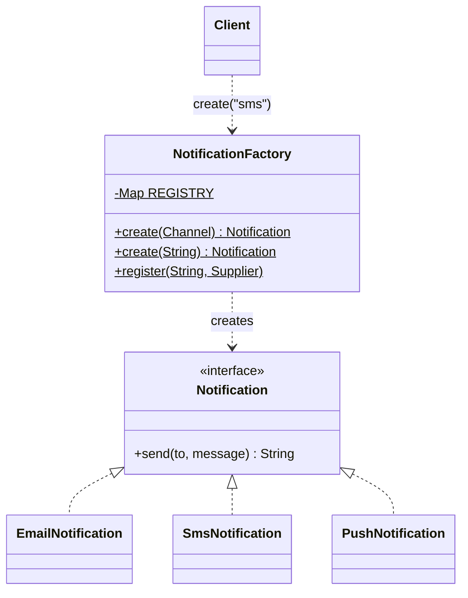

### Java implementation

```java
// File: code/lld/ch08/simplefactory/Notification.java
package lld.ch08.simplefactory;

/** The product interface every caller programs against. */
public interface Notification {
    String send(String to, String message);
}

record EmailNotification() implements Notification {
    public String send(String to, String message) { return "EMAIL to " + to + ": " + message; }
}

record SmsNotification() implements Notification {
    public String send(String to, String message) { return "SMS to " + to + ": " + message; }
}

record PushNotification() implements Notification {
    public String send(String to, String message) { return "PUSH to " + to + ": " + message; }
}
```

```java
// File: code/lld/ch08/simplefactory/NotificationFactory.java
package lld.ch08.simplefactory;

import java.util.Map;
import java.util.Locale;
import java.util.concurrent.ConcurrentHashMap;
import java.util.function.Supplier;

/** Simple Factory (an idiom, not a GoF pattern): one static method owns the "which class?" decision. */
public final class NotificationFactory {

    public enum Channel { EMAIL, SMS, PUSH }

    private NotificationFactory() { }

    /** Version 1: a switch. Adding a channel means editing this method (and the enum). */
    public static Notification create(Channel channel) {
        return switch (channel) {                      // exhaustive switch: the compiler checks every enum value
            case EMAIL -> new EmailNotification();
            case SMS   -> new SmsNotification();
            case PUSH  -> new PushNotification();
        };
    }

    /** Version 2: a registry of suppliers. New types are registered, not coded into a switch. */
    private static final Map<String, Supplier<? extends Notification>> REGISTRY = new ConcurrentHashMap<>(Map.of(
            "email", EmailNotification::new,
            "sms", SmsNotification::new,
            "push", PushNotification::new));

    public static void register(String type, Supplier<? extends Notification> supplier) {
        REGISTRY.put(type.toLowerCase(Locale.ROOT), supplier);
    }

    public static Notification create(String type) {
        Supplier<? extends Notification> s = REGISTRY.get(type.toLowerCase(Locale.ROOT));
        if (s == null) throw new IllegalArgumentException("Unknown notification type: " + type);
        return s.get();
    }
}
```

```java
// File: code/lld/ch08/simplefactory/Main.java
package lld.ch08.simplefactory;

public class Main {
    public static void main(String[] args) {
        System.out.println("== Simple Factory with an enum switch ==");
        for (NotificationFactory.Channel c : NotificationFactory.Channel.values()) {
            Notification n = NotificationFactory.create(c);      // caller never writes "new XxxNotification"
            System.out.println("  " + n.send("ada", "Your order shipped"));
        }

        System.out.println("\n== Simple Factory with a registry (string keys from config) ==");
        System.out.println("  " + NotificationFactory.create("SMS").send("+91-98xxxx", "OTP 4821"));
        try {
            NotificationFactory.create("whatsapp");
        } catch (IllegalArgumentException e) {
            System.out.println("  rejected: " + e.getMessage());
        }
        // A new channel is registered at start-up - the factory's code is not edited.
        NotificationFactory.register("whatsapp", () -> (to, msg) -> "WHATSAPP to " + to + ": " + msg);
        System.out.println("  " + NotificationFactory.create("whatsapp").send("grace", "Table for 2 confirmed"));
    }
}
```

- The enum `switch` has **no `default`**: the Java compiler checks that every `Channel` value is covered, so adding `WHATSAPP` to the enum without handling it is a compile error. That is a nice safety net.
- The registry version maps lower-cased names to **constructor references** (`EmailNotification::new` — shorthand for "call this constructor"). `register(...)` lets start-up code add a channel without touching the factory. Because `Notification` has one abstract method, a lambda can implement it (an interface with exactly one abstract method is called a *functional interface*).
- `Locale.ROOT` avoids surprising lower-casing in some locales (language-and-region settings) (the Turkish dotless "i" problem).

Output:

```text
== Simple Factory with an enum switch ==
  EMAIL to ada: Your order shipped
  SMS to ada: Your order shipped
  PUSH to ada: Your order shipped

== Simple Factory with a registry (string keys from config) ==
  SMS to +91-98xxxx: OTP 4821
  rejected: Unknown notification type: whatsapp
  WHATSAPP to grace: Table for 2 confirmed
```

### Trade-offs

| Simple Factory | Factory Method (next section) |
|---|---|
| One method, usually a switch | The decision is spread across subclasses, one each |
| Adding a type = edit the factory | Adding a type = add a class |
| No inheritance needed | Needs a creator subclass per product |
| Not a GoF pattern | A GoF pattern |

**Which to use:** when the list of types is short, rarely changes and is selected by a configuration value, a Simple Factory is the shorter, clearer choice and is perfectly respectable. Move to Factory Method when new types will be contributed by *other* developers — perhaps in separate modules — who should be able to add them without modifying your class.

### When not to use it

- There is only **one** concrete class — just call the constructor.
- The objects differ only in **data**, not behaviour — use one class with a field.

### Common mistakes

- Calling a switch-based factory a "Factory Method" in an interview.
- A `default` branch that silently returns `null` or a "default" object instead of failing.
- Letting the factory grow into a God class that also configures, caches and logs.

### Real-world examples

These are **static factory methods** (Joshua Bloch, *Effective Java* item 1): named static methods that return an instance, possibly of a hidden subclass. They are Simple-Factory style, **not** the GoF Factory Method — there is no Creator class whose subclasses override a creation hook — and **not** Singletons: most return a new object on each call.

- `Calendar.getInstance()` — returns a **new** `GregorianCalendar` on every call in most locales (a different calendar for a few, such as Japanese imperial or Buddhist). The name suggests Singleton; it is not one.
- `NumberFormat.getInstance()` / `getCurrencyInstance(locale)` — also a fresh (locale-specific, usually `DecimalFormat`) object per call.
- `EnumSet.noneOf(type)` — returns a `RegularEnumSet` (≤ 64 constants, one `long` bit-vector) or a `JumboEnumSet`; you never see either class.
- `List.of(...)`, `Map.of(...)`, `Optional.of(...)`, `Integer.valueOf(...)`, `Path.of(...)`.
- `Executors.newFixedThreadPool(n)`, `Executors.newVirtualThreadPerTaskExecutor()` — return configured `ExecutorService` implementations (Java's thread-pool interface for running tasks on reusable threads).
- **Spring:** `@Bean` methods (`@Bean` is an annotation — a `@` tag on code that a framework reads) in a `@Configuration` class are factory methods the container calls to create beans.

### In the interview

**30-second answer:** "A simple factory is one method that maps a type value to a concrete class and returns it as an interface. It centralizes the switch so callers don't depend on concrete classes. It's an idiom, not a GoF pattern — adding a type still edits the factory. If I want new types without editing it, I use a registry of suppliers or Factory Method."

- *Q: Is it Open–Closed?* — A: Not strictly: the factory is edited for each new type. A registry makes it open for extension via registration.
- *Q: Static factory method vs constructor?* — A: Static factories have names, can cache/return existing instances (`Integer.valueOf`), and can return subtypes. Constructors cannot.

### Self-check

- **Q:** What does a Simple Factory centralize but not remove? **A:** The switch (knowledge of every concrete type).
- **Q:** Why does the enum `switch` have no `default`? **A:** So the compiler flags any unhandled enum constant.

### TL;DR

One `create(type)` method, returns an interface. Great default for small, stable sets of types. Not GoF. Registry of `Supplier`s = extensible variant.

---

## 8.10 Factory Method

### What it is

**Factory Method** defines a method for creating an object in a base class, but lets **subclasses decide which concrete class** that method returns. The base class then uses the created object without ever naming its concrete type.

**Everyday analogy.** A franchise restaurant chain writes one operations manual: take the order, *prepare the dish*, serve, bill. Every branch follows the manual exactly, but "prepare the dish" is left to each branch — the New York branch makes a thin-crust pizza, the Chicago branch a deep-dish one. (This is exactly *Head First*'s pizza-store example: `PizzaStore.orderPizza()` is fixed, and each regional store overrides `createPizza()`.)

Terms:

- **Product** — the interface of the object being created (`Document`).
- **Concrete product** — an implementation (`PdfDocument`).
- **Creator** — the base class that declares the factory method and contains the shared logic (`ReportGenerator`).
- **Concrete creator** — a subclass that overrides the factory method (`PdfReportGenerator`).

**GoF intent and participants.** Intent: declare an operation that creates an object, but leave the choice of concrete class to subclasses — the base class postpones instantiation to them. The four participants are **Product** (the interface of the objects created), **ConcreteProduct** (implements Product), **Creator** (declares the factory method returning a Product, may supply a default implementation, and — crucially — *calls* it from its own operations) and **ConcreteCreator** (overrides the factory method to return a ConcreteProduct).

> **Factory Method is not a "static factory method".** The word "factory" is overloaded. A *static factory method* (`List.of`, `Integer.valueOf`, `Calendar.getInstance`) and a *Simple Factory* (`NotificationFactory.create(type)`, 8.9) are **one static method that decides** what to return. They cannot be overridden (static methods are not polymorphic — a call cannot be redirected to a subclass's version at run time), and there is no Creator hierarchy. The GoF **Factory Method** is an **instance method, overridden in subclasses**, that the base class itself calls. If there is no inheritance and no overriding, it is not this pattern.

### The problem it solves

Plenty of classes must create an object whose exact type they should not decide: a report generator needs a document, a parser needs tree nodes, a notification service needs messages. Once `ReportGenerator` contains `new PdfDocument()`, it is hard-wired to PDF, and supporting HTML means reopening a class that is finished and tested.

Our `ReportGenerator` does four things: gather the rows, create a document from them, render it, and announce the file name. **Only the "create a document" step cares about the output format**; the other three are identical for PDF, HTML or CSV. The first instinct is a `switch` on a format string. That holds up until a second method needs the same `switch`, then a third — and from then on each new format means hunting down every copy.

Factory Method instead leaves a deliberate **gap** in the base class: the complete procedure lives there, but at the moment a document is needed it calls an abstract method that the base class does not implement. Every subclass supplies just that one method.

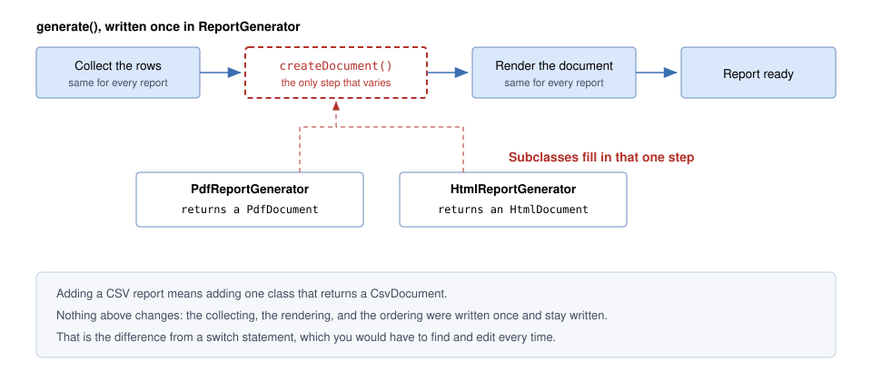
*Figure — generate() is written once in ReportGenerator; only createDocument() varies, filled in by PdfReportGenerator or HtmlReportGenerator (course diagram)*

In the figure, gathering, rendering and announcing are inherited unchanged; supporting CSV only requires one more subclass whose override returns a `CsvDocument`. Compare that with a `switch`, which has to be located and edited for every new format.

### How it works

1. Define the **product interface** (`Document`: `render(rows)`, `fileName()`).
2. Write **concrete products** (`PdfDocument`, `HtmlDocument`, later `CsvDocument`).
3. Write the **creator** as an abstract class with an **abstract, `protected` factory method** (`createDocument()`). `protected` signals that it is an extension point meant for subclasses rather than something outside callers invoke — they call `generate()`.
4. Write the **shared logic** in the creator (`generate()`), calling `createDocument()` where it needs a product. It depends only on `Document`.
5. Write one **concrete creator** per product, overriding only the factory method. That override is the *only* place a concrete type is named.
6. The **client** picks a creator once and then works entirely through `ReportGenerator` and `Document`.

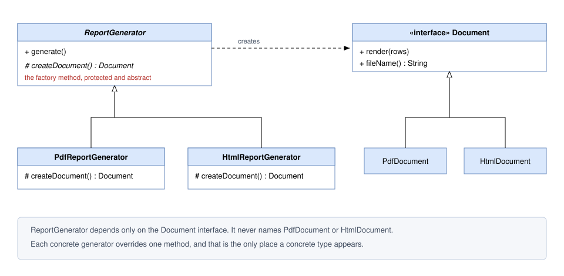
*Figure — ReportGenerator declares the protected factory method createDocument(); each concrete generator overrides it to return its own Document (course diagram)*

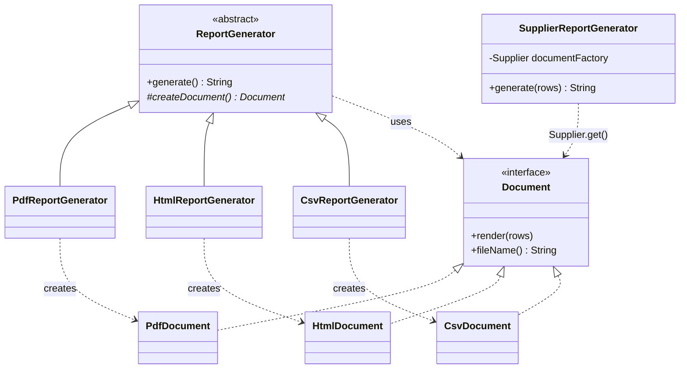

### Java implementation

```java
// File: code/lld/ch08/factorymethod/Document.java
package lld.ch08.factorymethod;

import java.util.List;

/** Product: the only document type ReportGenerator knows about. */
public interface Document {
    void render(List<String> rows);
    String fileName();
}

final class PdfDocument implements Document {
    public void render(List<String> rows) { System.out.println("  Rendering as PDF: " + rows.size() + " rows"); }
    public String fileName() { return "sales.pdf"; }
}

final class HtmlDocument implements Document {
    public void render(List<String> rows) { System.out.println("  Rendering as HTML table: " + rows.size() + " rows"); }
    public String fileName() { return "sales.html"; }
}

/** Added later - no existing class had to change. */
final class CsvDocument implements Document {
    public void render(List<String> rows) { rows.forEach(r -> System.out.println("  csv> " + r)); }
    public String fileName() { return "sales.csv"; }
}
```

```java
// File: code/lld/ch08/factorymethod/ReportGenerator.java
package lld.ch08.factorymethod;

import java.util.List;

/** Creator: writes the whole procedure once and leaves one hole - the factory method. */
public abstract class ReportGenerator {

    /** The factory method. Protected: a hook for subclasses, not public API. */
    protected abstract Document createDocument();

    /** The template that USES the factory method. It never names a concrete document. */
    public final String generate() {
        System.out.println("  Collecting rows for the monthly sales report...");
        List<String> rows = List.of("north,120", "south,95", "east,140");
        Document document = createDocument();
        document.render(rows);
        System.out.println("  Report ready: " + document.fileName());
        return document.fileName();
    }
}

final class PdfReportGenerator extends ReportGenerator {
    @Override protected Document createDocument() { return new PdfDocument(); }
}

final class HtmlReportGenerator extends ReportGenerator {
    @Override protected Document createDocument() { return new HtmlDocument(); }
}

final class CsvReportGenerator extends ReportGenerator {
    @Override protected Document createDocument() { return new CsvDocument(); }
}
```

```java
// File: code/lld/ch08/factorymethod/SupplierReportGenerator.java
package lld.ch08.factorymethod;

import java.util.List;
import java.util.function.Supplier;

/** The modern, composition-based variant: pass the "factory method" in as a Supplier. */
public final class SupplierReportGenerator {
    private final Supplier<? extends Document> documentFactory;

    public SupplierReportGenerator(Supplier<? extends Document> documentFactory) {
        this.documentFactory = documentFactory;
    }

    public String generate(List<String> rows) {
        Document d = documentFactory.get();
        d.render(rows);
        return d.fileName();
    }
}
```

```java
// File: code/lld/ch08/factorymethod/Main.java
package lld.ch08.factorymethod;

import java.util.List;

public class Main {
    public static void main(String[] args) {
        // The client picks a creator once, then only talks to ReportGenerator and Document.
        for (ReportGenerator g : List.of(new PdfReportGenerator(), new HtmlReportGenerator(), new CsvReportGenerator())) {
            System.out.println("== " + g.getClass().getSimpleName() + " ==");
            g.generate();
        }

        System.out.println("\n== Supplier-based variant (composition instead of subclassing) ==");
        SupplierReportGenerator gen = new SupplierReportGenerator(HtmlDocument::new);
        System.out.println("  produced " + gen.generate(List.of("west,77")));

        // A test can plug in a fake product with a lambda - no subclass needed.
        SupplierReportGenerator testGen = new SupplierReportGenerator(() -> new Document() {
            public void render(List<String> rows) { System.out.println("  (fake) captured " + rows); }
            public String fileName() { return "fake.txt"; }
        });
        System.out.println("  produced " + testGen.generate(List.of("row-1")));
    }
}
```

- `generate()` is `final`: subclasses may change *what* is created, not the procedure. Notice it never mentions PDF, HTML or CSV.
- `CsvDocument` + `CsvReportGenerator` were "added later" — **no existing class was edited** (Open–Closed Principle).
- `SupplierReportGenerator` is the modern alternative: pass a `Supplier<Document>` (a function that creates a product) instead of subclassing. It composes better and a test can supply a lambda.

Output:

```text
== PdfReportGenerator ==
  Collecting rows for the monthly sales report...
  Rendering as PDF: 3 rows
  Report ready: sales.pdf
== HtmlReportGenerator ==
  Collecting rows for the monthly sales report...
  Rendering as HTML table: 3 rows
  Report ready: sales.html
== CsvReportGenerator ==
  Collecting rows for the monthly sales report...
  csv> north,120
  csv> south,95
  csv> east,140
  Report ready: sales.csv

== Supplier-based variant (composition instead of subclassing) ==
  Rendering as HTML table: 1 rows
  produced sales.html
  (fake) captured [row-1]
  produced fake.txt
```

All three generators print an identical "Collecting rows…" line, since that code exists only once, in `ReportGenerator`; the rendering line is the only thing that changes.

### Trade-offs

| Pros | Cons |
|---|---|
| **Extensible without edits** — supporting another product means writing another class; no existing class is reopened. | **More classes** — every product type needs its own creator subclass, which is a lot of files for a small feature. |
| **Common procedure in one place** — everything around the creation step is written once in the base class. | **Indirection** — the concrete type is not visible where it is used; you have to find out which subclass you are holding. |
| **Built-in test seam** (a spot where a test can plug in its own object) — a test can subclass the creator and hand back a fake product. | **Relies on inheritance** — Java allows one superclass, and inheritance combines less flexibly than passing in a function. |
| **Nobody holds the full list of types** — no class has to know every format. | **Tempting too early** — with only one product type it is all cost and no benefit. |

**Often confused with:**

| Looks like | The actual difference |
|---|---|
| **Simple Factory** | One static `create` method with a `switch`. Not a GoF pattern, and frequently the better choice for small stable sets. It gathers the `switch` into one place instead of eliminating it. |
| **Abstract Factory** | Factory Method produces **one** product and varies it by **subclassing** the creator. Abstract Factory produces a **family** of products and is varied by **passing in** a different factory object (composition). Abstract Factories are often built out of factory methods. |
| **Template Method** | Same mechanism (a base-class method calls an overridable hook), different goal: Template Method lets subclasses vary a *step of an algorithm*; Factory Method lets them vary *which object gets created*. Factory Method can be seen as a special case of Template Method — `generate()` here *is* a template method. |
| **Builder** | Factory Method chooses a type in a single call; Builder assembles one complex object across many calls. |
| **"Static factory method"** (`List.of`) | A named static method used instead of a constructor, *Effective Java* style. It cannot be overridden, so it is not this pattern — only the word "factory" is shared. |

**In other languages (and modern Java):** wherever functions are values, you can hand the creator a *creation function* instead of subclassing it. Python: `ReportGenerator(create_document=PdfDocument)` (a class is callable). JavaScript/TypeScript: pass `() => new PdfDocument()` into the constructor, and a test passes its own arrow function (JavaScript's short `() => ...` function syntax). Java: a `Supplier<Document>` field, as in `SupplierReportGenerator`. This is usually the better default because it needs no new class; keep the subclassing form for framework base classes that other teams extend — which is where the pattern was born.

### When not to use it

- **There is one product type and no second one on the horizon.** Just call the constructor, and introduce the pattern on the day a second type actually appears. Adding it earlier is the most frequent over-design in the whole creational group.
- **The base class has no shared work of its own.** If `generate()` did nothing except call `createDocument()`, the abstract class would be an interface wearing a costume. The pattern pays only when real logic is written once in the creator.
- **Types differ by data, not by behaviour.** If a configuration string picks the type and the types do not behave differently, a `Map` from string to constructor reference (`Map<String, Supplier<Document>>`) is shorter than a subclass per type.
- **You need several objects that must match.** That is Abstract Factory's job.

### Common mistakes

- Making the factory method **public** — it becomes part of the API (Application Programming Interface — the methods others are meant to call) and callers bypass the shared procedure.
- Calling the base class's factory method from its **constructor** — the subclass's fields are not initialized yet when the override runs.
- Calling a switch-in-one-method a Factory Method. (A learner asked exactly this about a code sample: if one method decides with `if/switch`, it is a *simple factory*; if subclasses override a creation hook used by shared base-class logic, it is a *factory method*.)

### Real-world examples

- **JDK:** `Iterable.iterator()` / `Collection.iterator()` — the interface declares the creation method (Creator), and `ArrayList`, `LinkedList`, `HashSet`… (ConcreteCreators) each return their own `Iterator` implementation (ConcreteProduct); the enhanced `for` loop and every method written against `Iterator` (Product) never learn which one. `AbstractList` implements `iterator()` on top of its abstract `get(int)` — the template/factory mix in action.
- **JDK XML (as a building block):** `DocumentBuilderFactory.newDocumentBuilder()` and `TransformerFactory.newTransformer()` are abstract methods that each parser implementation's factory subclass overrides — factory methods living inside what, as a whole, is an Abstract Factory (8.11). Note that `DocumentBuilderFactory.newInstance()` itself is a *static* factory method, not a Factory Method.
- **Spring:** `FactoryBean<T>.getObject()` — a bean whose job is to create another object (e.g. proxies, `SqlSessionFactoryBean` in MyBatis-Spring). Spring's `AbstractApplicationContext` also exposes overridable creation hooks for subclasses.
- **Frameworks:** Android's `Fragment.onCreateView()` — you override a `create…` hook the framework calls. JUnit/TestNG (Java testing frameworks) fixture (shared test setup) base classes with overridable `create…` methods.

### In the interview

**30-second answer:** "Factory Method puts a creation hook in a base class. The base class writes the whole procedure once against a product interface; each subclass overrides the protected factory method to return its concrete product. New types are new classes, so it's Open–Closed. It only pays off when there's genuine shared logic in the base class — otherwise a constructor or a simple factory is simpler. In modern Java I'd often pass a `Supplier` instead of subclassing."

- *Q: Difference from Simple Factory?* — A: Simple Factory = one (static) method with a switch that knows every type. Factory Method = subclasses override an instance hook that the base class calls; nothing knows the full list. Raise this distinction yourself before you are asked — calling a `switch` a "Factory Method" is a classic slip interviewers listen for.
- *Q: Difference from Abstract Factory?* — A: One product via inheritance vs a family of matched products via a factory object passed in.
- *Q: Why protected?* — A: It is an extension point for subclasses, not something callers should invoke directly.
- *Q: How do you test `generate()`?* — A: Subclass the creator in the test (or pass a `Supplier`) and return a fake `Document` that records calls.

### Self-check

- **Q:** Where is the only place a concrete product class is named? **A:** Inside each concrete creator's override of the factory method.
- **Q:** What must exist in the base class for this pattern to be worthwhile? **A:** Shared logic that uses the product (here, `generate()`).
- **Q:** Which principle does adding `CsvReportGenerator` demonstrate? **A:** Open–Closed.

### TL;DR

Base class = procedure + abstract `protected createX()`; subclasses decide the concrete type. One product, varied by inheritance. Worth it only with shared logic and multiple (growing) product types; `Supplier` is the lightweight modern form.

---

## 8.11 Abstract Factory

### What it is

**Abstract Factory** provides an interface for creating **families of related objects** that must be used together, without the client naming any concrete class. Choosing a family = choosing a factory; everything created afterwards automatically matches.

**Everyday analogy.** Furniture showrooms sell matching sets. If you pick the "Victorian" catalogue, the chair, sofa and table you order all come in the Victorian style. You cannot accidentally get a modern chair with a Victorian sofa, because you ordered from one catalogue. (The course summary uses the GUI (graphical user interface) version: one factory per OS (operating system) theme — Windows or macOS — producing buttons, checkboxes and scrollbars that belong together. *Head First* uses a pizza *ingredient* factory per region: New York dough, sauce and cheese vs Chicago dough, sauce and cheese.)

Terms:

- **Family** — a set of products designed to work together (Postgres connection + Postgres query builder; Postgres is short for PostgreSQL, a popular open-source database, and a query builder is an object that writes the SQL text for you).
- **Abstract product** — an interface per product kind (`Connection`, `QueryBuilder`).
- **Abstract factory** — an interface with one `create…` method per product kind (`StorageFactory`).
- **Concrete factory** — implements *every* create method for one family (`PostgresFactory`).

**GoF intent and participants.** Intent: offer one interface through which a client creates a whole set of related or interdependent objects, without naming their concrete classes. Participants: **AbstractFactory** (declares one creation operation per product kind — `StorageFactory`), **ConcreteFactory** (implements those operations for one family — `PostgresFactory`), **AbstractProduct** (the interface for one kind of product — `Connection`, `QueryBuilder`), **ConcreteProduct** (a product of one family, created by the matching concrete factory — `PostgresQueryBuilder`) and **Client** (uses *only* the AbstractFactory and AbstractProduct types — `ReportService`). GoF also notes that an application usually needs just one ConcreteFactory per family, which is why it is often made a Singleton (though passing it in is better).

### The problem it solves

Certain objects are only correct alongside partners from the same variant. A Postgres connection needs a Postgres-flavoured query builder: Postgres wraps identifiers (table and column names) in double quotes, MySQL in backticks. A macOS-styled button should sit next to a macOS-styled checkbox. A test run wants a fake payment client, a fake mailer *and* a fake clock — never a mixture of fake and real.

When each of those objects is constructed independently, nothing prevents a bad combination. Pairing a `PostgresConnection` with a `MySqlQueryBuilder` compiles without a murmur; the mistake only surfaces later as an SQL (the standard language for querying relational databases) syntax error from the server, with a stack trace (the list of method calls that were active when the error happened) that points nowhere near the two lines that made the wrong choice.

This is also what separates it from Factory Method: Factory Method varies **one** product, Abstract Factory varies a **set** of products that must stay consistent.

Abstract Factory hands responsibility for the **entire set to one object**. Each concrete factory can only return members of its own family, so writing a mismatched pair is no longer possible through the factory. Remember the pattern by what it guarantees: *it does not help you choose the right combination — it removes the ability to build a wrong one.*

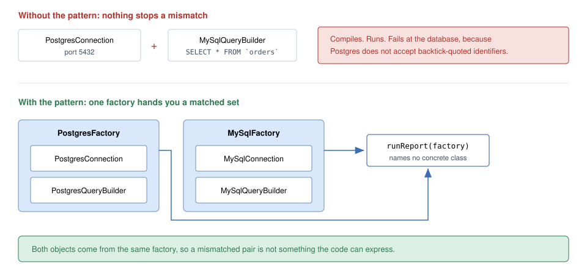
*Figure — without the pattern a PostgresConnection can be paired with a MySqlQueryBuilder and fail at the database; with it, each factory hands out a matched set (course diagram)*

The upper half of the figure shows the failure — the code compiles and starts, and then Postgres rejects the table name wrapped in backticks. The lower half shows the cure: `runReport(factory)` obtains both objects from one factory.

### How it works

1. Identify the **product kinds** in the family and give each an interface (`Connection`, `QueryBuilder`).
2. Write the **abstract factory** interface with one creation method per product kind.
3. For each variant, write the **concrete products** and a **concrete factory** that implements *every* method and returns only that family's products (Java's covariant return types (an override may declare a more specific return type than the method it overrides) let `PostgresFactory.createConnection()` declare `PostgresConnection`, documenting the family).
4. The **client** receives a factory (composition, usually via its constructor) and only uses the abstract types.
5. Choose the concrete factory **once**, at the **composition root** — the spot close to `main` where the application wires its concrete parts together — and pass it down.

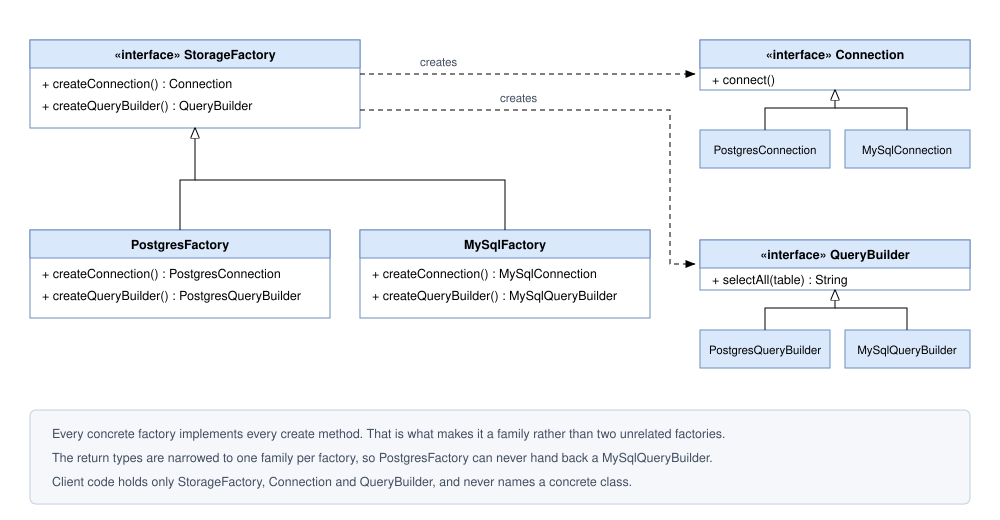
*Figure — StorageFactory with createConnection() and createQueryBuilder(); PostgresFactory and MySqlFactory each create their own Connection and QueryBuilder (course diagram)*

Note in the figure above that every concrete factory implements *every* create method — that is what makes it a family rather than two unrelated factories. (A learner pointed out that an older café example showed factories returning only one product each; a correct Abstract Factory must return **all** products of its family.)

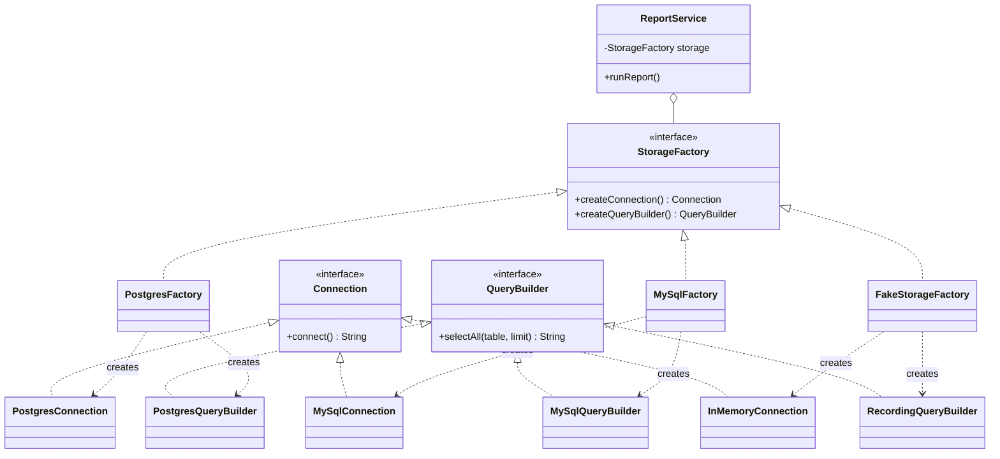

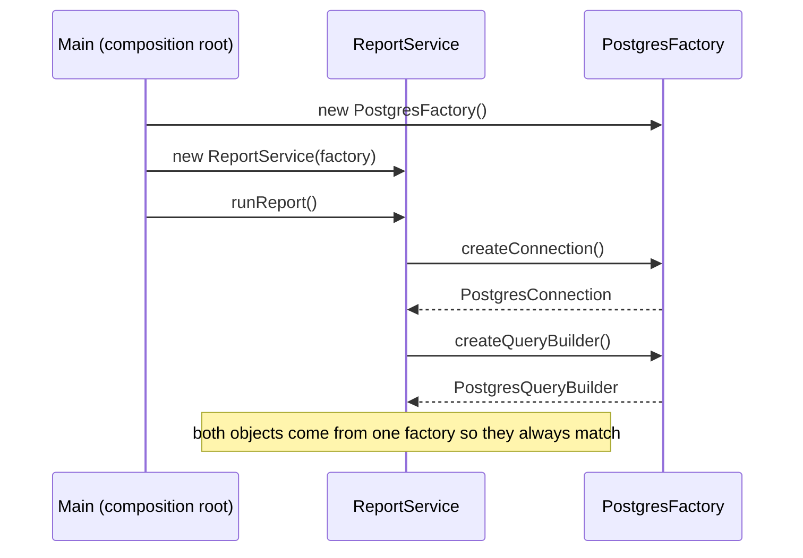

### Java implementation

```java
// File: code/lld/ch08/abstractfactory/Products.java
package lld.ch08.abstractfactory;

/** Abstract product 1. */
interface Connection {
    String connect();
}

/** Abstract product 2. Must agree with the Connection about the SQL dialect. */
interface QueryBuilder {
    String selectAll(String table, int limit);
}

// ---- Postgres family ----
final class PostgresConnection implements Connection {
    public String connect() { return "connected to postgres://localhost:5432/app"; }
}
final class PostgresQueryBuilder implements QueryBuilder {
    public String selectAll(String table, int limit) {
        return "SELECT * FROM \"" + table + "\" LIMIT " + limit;      // Postgres quotes with double quotes
    }
}

// ---- MySQL family ----
final class MySqlConnection implements Connection {
    public String connect() { return "connected to mysql://localhost:3306/app"; }
}
final class MySqlQueryBuilder implements QueryBuilder {
    public String selectAll(String table, int limit) {
        return "SELECT * FROM `" + table + "` LIMIT " + limit;        // MySQL quotes with backticks
    }
}

// ---- Fake family for tests ----
final class InMemoryConnection implements Connection {
    public String connect() { return "connected to in-memory store (no network)"; }
}
final class RecordingQueryBuilder implements QueryBuilder {
    public String selectAll(String table, int limit) { return "[recorded] selectAll(" + table + ", " + limit + ")"; }
}
```

```java
// File: code/lld/ch08/abstractfactory/StorageFactory.java
package lld.ch08.abstractfactory;

/** Abstract factory: one creation method per product in the family. */
public interface StorageFactory {
    Connection createConnection();
    QueryBuilder createQueryBuilder();
}

/** Concrete factories implement EVERY method and return only their own family (covariant return types). */
final class PostgresFactory implements StorageFactory {
    @Override public PostgresConnection createConnection()     { return new PostgresConnection(); }
    @Override public PostgresQueryBuilder createQueryBuilder() { return new PostgresQueryBuilder(); }
}

final class MySqlFactory implements StorageFactory {
    @Override public MySqlConnection createConnection()     { return new MySqlConnection(); }
    @Override public MySqlQueryBuilder createQueryBuilder() { return new MySqlQueryBuilder(); }
}

final class FakeStorageFactory implements StorageFactory {
    @Override public Connection createConnection()     { return new InMemoryConnection(); }
    @Override public QueryBuilder createQueryBuilder() { return new RecordingQueryBuilder(); }
}
```

```java
// File: code/lld/ch08/abstractfactory/ReportService.java
package lld.ch08.abstractfactory;

/** Client: holds only the abstract factory and abstract products. It cannot mix families. */
public final class ReportService {
    private final StorageFactory storage;

    public ReportService(StorageFactory storage) { this.storage = storage; }

    public void runReport() {
        Connection connection = storage.createConnection();
        QueryBuilder queries = storage.createQueryBuilder();
        System.out.println("  " + connection.connect());
        System.out.println("  " + queries.selectAll("orders", 10));
    }
}
```

```java
// File: code/lld/ch08/abstractfactory/Main.java
package lld.ch08.abstractfactory;

public class Main {

    /** Composition root: the ONE place that chooses the family. */
    static StorageFactory chooseFactory(String db) {
        return switch (db) {
            case "postgres" -> new PostgresFactory();
            case "mysql"    -> new MySqlFactory();
            case "fake"     -> new FakeStorageFactory();
            default -> throw new IllegalArgumentException("unknown db " + db);
        };
    }

    public static void main(String[] args) {
        String fromEnv = System.getenv().getOrDefault("DB", "postgres");
        for (String db : new String[] { fromEnv, "mysql", "fake" }) {
            System.out.println("== Using " + db + " ==");
            new ReportService(chooseFactory(db)).runReport();   // ReportService never changes
        }
    }
}
```

- `ReportService` contains **no branch** on the database — the SQL differs purely because the factory differs.
- `chooseFactory(...)` is the **composition root** and holds the program's only `switch` on the database. Had we put that `switch` inside `runReport`, it would merely have been relocated, and every other class that later needs a connection would sprout a duplicate of it.
- `FakeStorageFactory` shows the most valuable use: swap the **whole environment** for tests with one line.

Output (with no `DB` environment variable set — an environment variable is a named setting the operating system passes to a program):

```text
== Using postgres ==
  connected to postgres://localhost:5432/app
  SELECT * FROM "orders" LIMIT 10
== Using mysql ==
  connected to mysql://localhost:3306/app
  SELECT * FROM `orders` LIMIT 10
== Using fake ==
  connected to in-memory store (no network)
  [recorded] selectAll(orders, 10)
```

### Trade-offs

| Pros | Cons |
|---|---|
| **Wrong combinations cannot be written** — the family is fixed once, when the factory is chosen. | **Many types** — one interface per product kind plus one class per product per family adds up fast. |
| **One switch for a whole environment** — real ↔ fake, Postgres ↔ MySQL, light ↔ dark theme. | **New product kinds are expensive** — the factory interface grows, and every concrete factory must be edited. |
| **Client never names a concrete class** — it depends only on abstractions (Dependency Inversion). | **Another layer to trace** — to know what was actually created you must find out which factory was picked. |
| **Test seam** — a single fake factory stands in for everything outside the process. | **Pointless with one family** — with a single variant it is pure ceremony. |

**The asymmetry to remember:** adding a new **family** (e.g. `SqliteFactory`) is easy and Open–Closed; adding a new **product kind** (e.g. `createMigrationRunner()`) is hard, because every factory must change.

### Abstract Factory vs Factory Method

| | Factory Method | Abstract Factory |
|---|---|---|
| Creates | **One** product | A **family** of related products |
| Mechanism | **Inheritance** — subclass overrides a method | **Composition** — client holds a factory object |
| Who chooses the concrete type | The subclass of the creator | The concrete factory passed in |
| Shape | One abstract method in a class that has other logic | An interface whose *only* job is creation (several methods) |
| Guarantees | New types without editing the creator | Products from one factory are always compatible |
| Adding a new variant | New creator subclass + new product | New factory + one new product per kind |
| Adding a new product kind | n/a | Edit the interface and **every** factory |
| Relationship | — | Each `create…` method in a concrete factory is often itself a factory method |
| Typical example | `Collection.iterator()` | `DocumentBuilderFactory`, UI toolkits, DB dialects |

**Often confused with:** *Builder* (Abstract Factory returns several finished products immediately; Builder assembles one product step by step and hands it over at the end); a *DI container* (same outcome through a more general mechanism — Spring profiles or Guice modules bind a whole set of implementations as configuration; if you already have a container, prefer it); a *Facade* over several factories (a Facade simplifies an existing interface, whereas Abstract Factory guarantees consistency — similar shapes, unrelated purposes).

**In other languages:** in Python or JavaScript, a plain dictionary/object of creation functions — `{"connection": PostgresConnection, "queries": PostgresQueryBuilder}` — already acts as a factory, no classes needed. In Java, a `record` (Java's short syntax for an immutable data class) with several `Supplier` fields (`record StorageKit(Supplier<Connection> connection, Supplier<QueryBuilder> queries)`) is often shorter than an interface plus one class per family. With a DI container, write the pattern by hand only when you are building the framework, not when using one.

### When not to use it

- **The objects do not belong together.** A "factory" exposing `createLogger()` and `createInvoice()` is a grab-bag of unrelated dependencies, not a matched set — inject them separately.
- **There is only one variant** and no second is expected: an interface plus a single implementation is cost without benefit.
- **The set of product kinds keeps growing** (beyond roughly five or six) — each new kind edits every factory; a container or registry scales better.
- **Your DI container already does it** (Spring `@Profile`, Guice modules, NestJS providers) — that *is* this pattern, expressed as configuration instead of code.

### Common mistakes

- A concrete factory that implements only some methods, or returns products from another family.
- Choosing the factory deep in the call stack (the chain of method calls that led to the current one) instead of once at the composition root.
- Making the factory a Singleton by reflex — pass it in instead.

### Real-world examples

- **JDK:** `javax.xml.parsers.DocumentBuilderFactory`, `javax.xml.transform.TransformerFactory`, `XPathFactory` — the abstract factory class is what client code holds; the static `newInstance()` locates one implementation (e.g. the JDK's built-in Xerces/Xalan-based ones, or Saxon if configured), and that concrete factory hands out objects belonging to the same implementation (`TransformerFactory` creates both `Transformer` and `Templates`). Swapping the implementation swaps the whole set. JDBC's (Java Database Connectivity, Java's standard database API) `java.sql.Connection` acts as a factory for a driver-specific (a driver is the library that talks to one particular database) family: `createStatement()`, `prepareStatement()`, `prepareCall()`, `createBlob()` all return objects of the same driver.
- **UI toolkits:** the original GoF example — a factory per look-and-feel producing matching widgets. Swing's pluggable look-and-feel follows the same idea.
- **ORMs:** Hibernate's `Dialect` bundles database-specific SQL generation, type mapping and identifier quoting that must agree with each other. (An ORM — object-relational mapper — is a library that maps classes to database tables so you rarely write SQL by hand.)
- **Spring:** `@Profile("test")` vs `@Profile("prod")` configurations swap a whole set of beans (fake mailer, fake payments, in-memory DB) together.
- **Cloud SDKs:** switching between AWS and GCP clients in a multi-cloud abstraction (SDK = software development kit, a provider's client library; AWS and GCP are Amazon's and Google's cloud platforms) (storage client + queue client + secrets client per provider).

### In the interview

**30-second answer:** "Abstract Factory is an interface with one create method per product in a family; each concrete factory returns a matched set. The client holds only the factory and the abstract products, so it can't mix, say, a Postgres connection with a MySQL query builder. I pick the factory once at the composition root. The cost is that adding a new product kind means editing every factory."

- *Q: Factory Method vs Abstract Factory?* — A: One product via inheritance vs a family via composition; Abstract Factory often uses factory methods internally.
- *Q: How would you add SQLite?* — A: `SqliteConnection`, `SqliteQueryBuilder`, `SqliteFactory`, and one line in the composition root. Nothing else changes.
- *Q: How would you add a `MigrationRunner` product?* — A: Add `createMigrationRunner()` to the interface and implement it in every factory — this is the pattern's weak spot.
- *Q: How is this used in tests?* — A: A fake factory returns in-memory/recording products, so one line swaps the entire outside world.

### Self-check

- **Q:** What property does Abstract Factory guarantee? **A:** Products from one factory are always from the same family — mismatches cannot be expressed.
- **Q:** What is the composition root? **A:** The one place near start-up where concrete choices (like which factory) are made and passed down.
- **Q:** Which change is easy and which is hard? **A:** New family = easy; new product kind = edit every factory.

### TL;DR

One factory object → a matched family of products. Chosen once, passed down. Easy to add families, hard to add product kinds. Prefer a DI container's profiles if you already have one.

---

## 8.12 Builder

### What it is

**Builder** separates the *construction* of a complex object from the object itself. A separate builder object collects the values **one named step at a time**, and a final `build()` call produces the finished — usually **immutable** — product. The GoF phrasing adds that the same construction process can create different representations.

**Everyday analogy.** Ordering a custom meal at a fast-food counter (the course's example) or a sandwich at Subway: bread → cheese → vegetables → sauce, each step named, many optional, and only at the end do you get the finished sandwich. Nobody hands the cashier a row of ten unlabelled values.

Terms:

- **Product** — the object being built (`HttpRequest`).
- **Builder** — collects the values and has `build()`.
- **Fluent interface** — each method returns `this` so calls can be chained: `.method("POST").timeoutSeconds(5)`.
- **Director** — optional class that knows a *recipe* (the order of steps) and runs it on a builder.
- **Immutable** — cannot change after creation (all fields `final`, no setters).

**Two different "Builders" share the name — know both:**

| | **GoF Builder** (1994) | **Bloch's Builder** (*Effective Java*, item 2) |
|---|---|---|
| Problem it targets | One *construction process* should be able to produce *different representations* (the GoF example: one RTF reader converting a document to plain ASCII, TeX, or an editable text widget) | A constructor with many optional parameters (telescoping constructors) and the wish for an immutable, validated object |
| Participants | **Builder** (abstract interface with one method per part, e.g. `buildParagraph()`), **ConcreteBuilder** (implements the parts for one representation, keeps the result, exposes `getResult()`), **Director** (runs the construction steps through the Builder interface), **Product** (the complex object being built — its type can differ per ConcreteBuilder) | One product class plus one `static` nested `Builder` class: fluent setters that return `this`, and `build()` that validates and calls the product's private constructor. No Director, no abstract Builder interface |
| What varies | *Which* ConcreteBuilder is plugged in — the steps stay the same, the output type/format differs | Only the *values* the caller supplies |
| Examples | The GoF RTF converter; a report exporter whose one traversal drives a PDF builder, an HTML builder or a CSV builder | `HttpRequest.newBuilder()`, `Locale.Builder`, Lombok `@Builder`, this chapter's `HttpRequest.Builder` |

Most code you will see (and write) is Bloch's fluent builder; interviews often expect you to *name* the GoF participants too. The two ideas overlap in the core insight — separate the step-by-step assembly from the finished object.

### The problem it solves

A class keeps collecting fields, and most of them are optional. Its constructor grows until a call site looks like this:

```java
new HttpRequest(url, "GET", headers, null, 30, 3, true, false, null);
```

A reader cannot tell what this does. Which of the `null`s is the body? What does the first `true` switch on? If someone exchanges the two booleans, the compiler accepts it, and the mistake only shows up in production — for example as requests that follow redirects although they were meant not to.

The two usual "fixes" are both bad:

| Approach | What goes wrong |
|---|---|
| **Telescoping constructors** — one overload per useful combination: `Pizza(size)`, `Pizza(size, crust)`, `Pizza(size, crust, cheese)`, … | The number of overloads explodes with every field; call sites are still positional and unreadable; two parameters of the same type are easy to swap. |
| **JavaBeans style** — empty constructor + setters (methods that each change one field) | The object exists in a **half-built** state; nothing stops use before it is ready; it **cannot be immutable**; no single place to validate rules that span several fields. |

Builder fixes both: every value is **named** at the call site, optional fields have **defaults**, the product can be **immutable**, and `build()` is **one gate** that can refuse to create an invalid object. Our API adopts the rule "a GET must not carry a body" (HTTP — the request/response protocol of the web, see [System Design Fundamentals](../../../system-design-patterns/modules/00-system-design-fundamentals/README.md) — gives a GET, its "read this resource" request, no defined meaning for a body — RFC 9110 §9.3.1, the official HTTP standard — and many servers and proxies (middlemen that forward requests) reject or drop it). That rule involves two fields at once (`method` and `body`), so no single setter can enforce it; `build()` is the natural place for it.

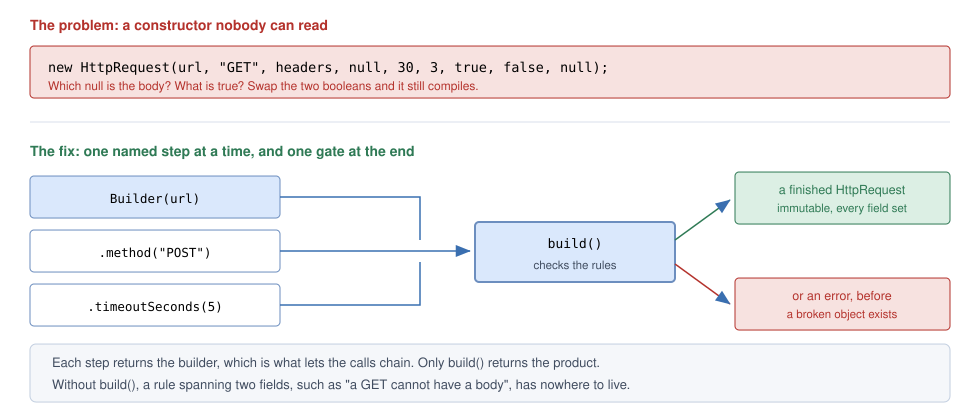
*Figure — the unreadable positional constructor versus named builder steps that end in one build() gate which validates and returns an immutable HttpRequest or an error (course diagram)*

In the figure, every step hands back the builder itself (which is what lets the calls chain), and only `build()` hands back a product — or throws, so an invalid request never comes into existence.

### How it works

1. Make the product's fields **`final`** and its constructor **`private`**, taking the builder. Nobody can build a half-filled product directly.
2. Create a **`static` nested `Builder`** class with the same fields, mutable, each optional one with a **default**.
3. Take **required** values in the builder's constructor (or factory method `builder(url)`) so they cannot be forgotten.
4. Give every setter-like method a **name that says what it sets** and have it **`return this`**.
5. Write **`build()`**: validate cross-field rules, **copy mutable collections**, and call the private product constructor. Every other builder method returns the builder; `build()` alone returns the product.
6. Optionally add a **Director** for reusable recipes, a **`toBuilder()`** for copy-and-modify, or a **staged builder** so the compiler enforces required steps.

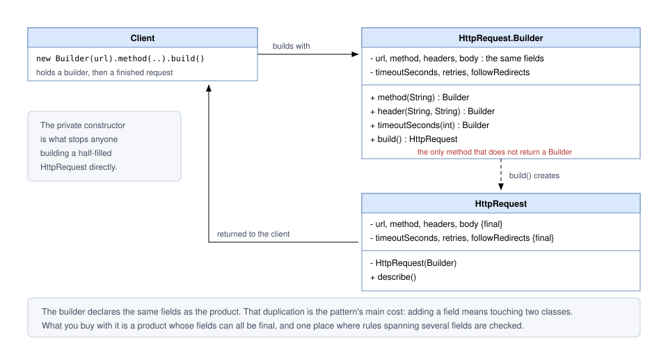
*Figure — HttpRequest with final fields and a private constructor; HttpRequest.Builder with the same mutable fields, setters returning Builder, and build() returning HttpRequest (course diagram)*

The diagram also exposes the price: the builder repeats every field of the product, so each new field must be added in two places. In exchange, the product has no setters, all of its fields are `final`, and every instance passes through one validation point.

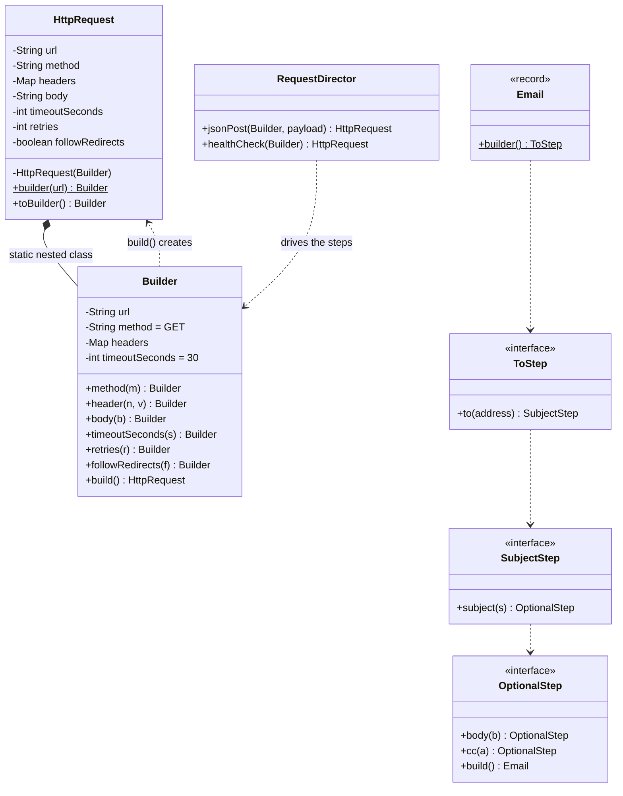

### The Director — and why you rarely see one

The GoF version has a fourth participant, the **Director**: a class that knows the **order of steps** and runs them on whichever builder it is given. It exists to make a *sequence* reusable — if many places build "a JSON POST with our usual headers and timeout", that recipe deserves a name, and the Director is its home. (In the GoF book's example, one director — an RTF reader — drives different builders that output plain text or TeX: same process, different representations.)

Day to day you will mostly see the **fluent** builder, because what changes between call sites is normally the *values*, not the order of steps. If only values change, a Director adds nothing a caller could not write as one chained expression. **A quick test:** will this Director ever be given a *different* kind of builder? If so, it separates the recipe from the thing being built and is worth keeping. If not, remove it and let callers chain the calls themselves. (Our `RequestDirector` is deliberately simplified: it only accepts `HttpRequest.Builder`, so it shows the "named recipe" half of the idea. A full GoF Director would be typed against an abstract Builder interface with several implementations.)

### The staged (step) builder

When some steps are required or must come in order, encode it in the **types**: each step returns an interface exposing only the legal next calls. `Email.builder()` returns a `ToStep` (only `to(...)`), which returns a `SubjectStep` (only `subject(...)`), which returns an `OptionalStep` that finally has `build()`. Now `Email.builder().build()` **does not compile**. This is the answer to "how would you stop a caller forgetting a required field?" — heavier than most code needs, but good to know.

### Lombok-style builders and records

- **Lombok `@Builder`** (Lombok is a library that writes Java boilerplate for you at compile time) generates all of this from an annotation: a static `builder()` method, a nested builder class with one method per field, and `build()`. `@Builder(toBuilder = true)` adds `toBuilder()` for copy-and-modify; `@Singular` generates `header(name, value)`-style methods that add to collections. Lombok's builder does **not** validate by default — you add validation in the constructor it calls.
- **Java records** give you the immutable product for free. A record plus a static nested builder (like `Email`) is now a common shape. Put validation in the record's compact constructor (a constructor with no parameter list that runs on every creation) so it runs however the record is created.
- **Immutability checklist:** `final` class or private constructor, `final` fields, no setters, defensive copies (private copies, so outside code cannot change your internals) of mutable inputs (`Map.copyOf`, `List.copyOf`), and getters that do not leak mutable internals.

### Java implementation

```java
// File: code/lld/ch08/builder/TelescopingPizza.java
package lld.ch08.builder;

/** The PROBLEM: telescoping constructors. Each new optional field adds another overload. */
public final class TelescopingPizza {
    private final String size;          // required
    private final String crust;         // optional
    private final boolean cheese;       // optional
    private final boolean olives;       // optional
    private final boolean jalapenos;    // optional

    public TelescopingPizza(String size) { this(size, "regular"); }
    public TelescopingPizza(String size, String crust) { this(size, crust, true); }
    public TelescopingPizza(String size, String crust, boolean cheese) { this(size, crust, cheese, false); }
    public TelescopingPizza(String size, String crust, boolean cheese, boolean olives) {
        this(size, crust, cheese, olives, false);
    }
    public TelescopingPizza(String size, String crust, boolean cheese, boolean olives, boolean jalapenos) {
        this.size = size; this.crust = crust; this.cheese = cheese; this.olives = olives; this.jalapenos = jalapenos;
    }

    @Override public String toString() {
        return "Pizza[size=" + size + ", crust=" + crust + ", cheese=" + cheese
                + ", olives=" + olives + ", jalapenos=" + jalapenos + "]";
    }
}
```

```java
// File: code/lld/ch08/builder/HttpRequest.java
package lld.ch08.builder;

import java.util.LinkedHashMap;
import java.util.Map;
import java.util.Objects;

/** Product: immutable. Only the nested Builder can create one. */
public final class HttpRequest {
    private final String url;
    private final String method;
    private final Map<String, String> headers;
    private final String body;
    private final int timeoutSeconds;
    private final int retries;
    private final boolean followRedirects;

    private HttpRequest(Builder b) {
        this.url = b.url;
        this.method = b.method;
        this.headers = Map.copyOf(b.headers);      // defensive, unmodifiable copy
        this.body = b.body;
        this.timeoutSeconds = b.timeoutSeconds;
        this.retries = b.retries;
        this.followRedirects = b.followRedirects;
    }

    public static Builder builder(String url) { return new Builder(url); }

    /** Lombok-style toBuilder(): start a new builder pre-filled from this object. */
    public Builder toBuilder() {
        Builder b = new Builder(url).method(method).timeoutSeconds(timeoutSeconds)
                .retries(retries).followRedirects(followRedirects);
        headers.forEach(b::header);
        if (body != null) b.body(body);
        return b;
    }

    public String url() { return url; }
    public String method() { return method; }
    public Map<String, String> headers() { return headers; }

    @Override public String toString() {
        return method + " " + url + " headers=" + new java.util.TreeMap<>(headers)
                + (body == null ? "" : " body=" + body)
                + " timeout=" + timeoutSeconds + "s retries=" + retries + " followRedirects=" + followRedirects;
    }

    /** The builder: same fields, mutable, with defaults. Every setter returns this. */
    public static final class Builder {
        private final String url;                                  // required -> constructor
        private String method = "GET";                             // optional -> defaults
        private final Map<String, String> headers = new LinkedHashMap<>();
        private String body;
        private int timeoutSeconds = 30;
        private int retries = 3;
        private boolean followRedirects = true;

        private Builder(String url) { this.url = Objects.requireNonNull(url, "url"); }

        public Builder method(String m)             { this.method = m; return this; }
        public Builder header(String n, String v)   { headers.put(n, v); return this; }
        public Builder body(String b)               { this.body = b; return this; }
        public Builder timeoutSeconds(int s)        { this.timeoutSeconds = s; return this; }
        public Builder retries(int r)               { this.retries = r; return this; }
        public Builder followRedirects(boolean f)   { this.followRedirects = f; return this; }

        /** The single gate: cross-field validation happens here, before any product exists. */
        public HttpRequest build() {
            if (url.isBlank()) throw new IllegalStateException("url is required");
            if (method.equals("GET") && body != null) throw new IllegalStateException("a GET request cannot have a body");
            if (retries < 0) throw new IllegalStateException("retries cannot be negative");
            if (timeoutSeconds <= 0) throw new IllegalStateException("timeout must be positive");
            return new HttpRequest(this);
        }
    }
}
```

```java
// File: code/lld/ch08/builder/RequestDirector.java
package lld.ch08.builder;

/** Director: a named, reusable RECIPE (order of steps). It does not know the values the caller varies. */
public final class RequestDirector {

    public HttpRequest jsonPost(HttpRequest.Builder builder, String payload) {
        return builder.method("POST")
                .header("Content-Type", "application/json")
                .header("Accept", "application/json")
                .body(payload)
                .timeoutSeconds(5)
                .build();
    }

    public HttpRequest healthCheck(HttpRequest.Builder builder) {
        return builder.method("HEAD").timeoutSeconds(1).retries(0).followRedirects(false).build();
    }
}
```

```java
// File: code/lld/ch08/builder/Email.java
package lld.ch08.builder;

import java.util.ArrayList;
import java.util.List;

/**
 * Staged (step) builder: each step returns an interface exposing only the legal next calls,
 * so the compiler forces "to" and "subject" before build() is even visible.
 */
public record Email(String to, String subject, String body, List<String> cc) {

    public Email { cc = List.copyOf(cc); }                    // records + builder = immutable product

    public interface ToStep      { SubjectStep to(String address); }
    public interface SubjectStep { OptionalStep subject(String subject); }
    public interface OptionalStep {
        OptionalStep body(String body);
        OptionalStep cc(String address);
        Email build();
    }

    public static ToStep builder() { return new Steps(); }

    private static final class Steps implements ToStep, SubjectStep, OptionalStep {
        private String to, subject, body = "";
        private final List<String> cc = new ArrayList<>();
        public SubjectStep to(String a)       { this.to = a; return this; }
        public OptionalStep subject(String s) { this.subject = s; return this; }
        public OptionalStep body(String b)    { this.body = b; return this; }
        public OptionalStep cc(String a)      { cc.add(a); return this; }
        public Email build()                  { return new Email(to, subject, body, cc); }
    }
}
```

```java
// File: code/lld/ch08/builder/Main.java
package lld.ch08.builder;

public class Main {
    public static void main(String[] args) {
        System.out.println("== The problem: telescoping constructors ==");
        // Which boolean is which? Swap two of them and it still compiles.
        System.out.println("  " + new TelescopingPizza("large", "thin", true, false, true));

        System.out.println("\n== Fluent builder: every value is named ==");
        HttpRequest get = HttpRequest.builder("https://api.example.com/orders")
                .header("Accept", "application/json")
                .build();
        System.out.println("  " + get);

        HttpRequest post = HttpRequest.builder("https://api.example.com/orders")
                .method("POST")
                .header("Content-Type", "application/json")
                .body("{\"item\":\"widget\"}")
                .timeoutSeconds(5)
                .retries(0)
                .followRedirects(false)
                .build();
        System.out.println("  " + post);

        System.out.println("\n== build() refuses broken objects ==");
        try {
            HttpRequest.builder("https://api.example.com/orders").body("{}").build();
        } catch (IllegalStateException e) {
            System.out.println("  rejected: " + e.getMessage());
        }

        System.out.println("\n== Reusing a builder does not leak state into earlier products ==");
        HttpRequest.Builder reused = HttpRequest.builder("https://api.example.com/users").header("X-Trace", "1");
        HttpRequest first = reused.build();
        HttpRequest second = reused.header("X-Debug", "true").build();
        System.out.println("  first headers  = " + first.headers());
        System.out.println("  second headers = " + new java.util.TreeMap<>(second.headers()));

        System.out.println("\n== Product is immutable ==");
        try {
            post.headers().put("Hack", "yes");
        } catch (UnsupportedOperationException e) {
            System.out.println("  headers().put -> UnsupportedOperationException");
        }

        System.out.println("\n== toBuilder(): copy-and-change, like Lombok @Builder(toBuilder = true) ==");
        HttpRequest slowPost = post.toBuilder().timeoutSeconds(60).build();
        System.out.println("  " + slowPost);

        System.out.println("\n== Director: named recipes over any builder ==");
        RequestDirector director = new RequestDirector();
        System.out.println("  " + director.jsonPost(HttpRequest.builder("https://api.example.com/payments"), "{\"amount\":499}"));
        System.out.println("  " + director.healthCheck(HttpRequest.builder("https://api.example.com/health")));

        System.out.println("\n== Staged builder: the compiler enforces required steps ==");
        Email email = Email.builder()
                .to("ada@example.com")          // must come first
                .subject("Welcome")             // then this
                .body("Glad to have you")       // optional, any order
                .cc("team@example.com")
                .build();
        System.out.println("  " + email);
        // Email.builder().build();   // does not compile: ToStep has no build()
    }
}
```

- `TelescopingPizza` is the anti-example: five constructors for five fields, and the call `("large", "thin", true, false, true)` hides which boolean means what.
- In `HttpRequest`, the constructor does `Map.copyOf(b.headers)`. Without that copy, building twice from one builder would hand both products **the same map**, and a header added later would appear in the earlier product. The "reuse" demo proves `first` did not pick up `X-Debug`. `Map.copyOf` is also unmodifiable, which is why `headers().put(...)` throws.
- `build()` enforces four rules, including the cross-field one (GET + body).
- `toBuilder()` gives Lombok-style "same as this, but…" copies.

Output:

```text
== The problem: telescoping constructors ==
  Pizza[size=large, crust=thin, cheese=true, olives=false, jalapenos=true]

== Fluent builder: every value is named ==
  GET https://api.example.com/orders headers={Accept=application/json} timeout=30s retries=3 followRedirects=true
  POST https://api.example.com/orders headers={Content-Type=application/json} body={"item":"widget"} timeout=5s retries=0 followRedirects=false

== build() refuses broken objects ==
  rejected: a GET request cannot have a body

== Reusing a builder does not leak state into earlier products ==
  first headers  = {X-Trace=1}
  second headers = {X-Debug=true, X-Trace=1}

== Product is immutable ==
  headers().put -> UnsupportedOperationException

== toBuilder(): copy-and-change, like Lombok @Builder(toBuilder = true) ==
  POST https://api.example.com/orders headers={Content-Type=application/json} body={"item":"widget"} timeout=60s retries=0 followRedirects=false

== Director: named recipes over any builder ==
  POST https://api.example.com/payments headers={Accept=application/json, Content-Type=application/json} body={"amount":499} timeout=5s retries=3 followRedirects=true
  HEAD https://api.example.com/health headers={} timeout=1s retries=0 followRedirects=false

== Staged builder: the compiler enforces required steps ==
  Email[to=ada@example.com, subject=Welcome, body=Glad to have you, cc=[team@example.com]]
```

### Trade-offs

| Pros | Cons |
|---|---|
| **Self-describing call sites** — each value is labelled where it is passed, so parameter order no longer matters. | **Duplicated fields** — the builder repeats every field of the product; a new field means two edits. |
| **Immutable products** — all fields can be `final` because they are fixed before the object exists; safe to share between threads. | **Forgettable last step** — omit `build()` and you are holding a builder, not the object you wanted. |
| **A home for validation** — rules that involve several fields are checked in `build()`. | **Easily overused** — for a value object (a small object defined only by its values, like `Money`) with three fields it only adds noise. |
| **Free optional fields** — defaults sit in the builder, callers mention only what they change. | **Reuse pitfall** — building twice from one builder can leave two products sharing one mutable collection unless it is copied. |
| **Different representations** (GoF) — a Director can drive different ConcreteBuilders through the same steps. | One extra short-lived object per construction — almost never measurable. |

**Often confused with:**

| Looks like | The actual difference |
|---|---|
| **Factory Method** | Chooses *which type* to create, in a single call. Builder assembles *one known type* over a series of calls. |
| **Abstract Factory** | Hands back several finished products straight away. Builder hands back one product after a sequence of steps. |
| **Fluent interface** | Chaining is merely a calling style. A chained API that modifies and returns the *same* object (a jQuery chain, a `StringBuilder`-style mutator used as the result itself) has no separate finished product, so on its own it is not the Builder pattern. |
| **Prototype** | Prototype begins with a ready-made object and duplicates it; Builder begins with nothing and fills values in. Both are ways around a huge constructor — one starts from the end result, the other from scratch. |

**In other languages:** Python and Kotlin (and C#) have **named arguments with defaults** — `HttpRequest(url, method="POST", timeout=5)` — which already make call sites readable; Python's `@dataclass(frozen=True)` and Kotlin's `data class` (with `.copy(...)`) supply the immutable product. Use a builder there only for cross-field validation or staged construction. JavaScript/TypeScript usually pass an options object: `new HttpRequest({ url, method: "POST" })`.

### When not to use it

- **A few fields, all required.** A plain constructor is shorter and just as clear — this is the misuse you will see most.
- **The language has named/default arguments** — see above.
- **The builder merely copies fields**, validates nothing, and the product is mutable anyway — that is an extra class with no payoff. Either add the validation or remove the builder.
- **The object is mutable and lives only inside one method** — ordinary setters are fine there.

### Common mistakes

- Setters that **don't return the builder** (breaks chaining). Every step returns `Builder`; only `build()` returns the product.
- **No validation** in `build()`.
- **Sharing mutable collections** between the builder and the products.
- Making the product constructor public (then nobody has to use the builder or its validation).
- Using a Director when the order never varies.

### Real-world examples

- **JDK:** `StringBuilder` (append repeatedly, `toString()` once); `java.net.http.HttpClient.newBuilder()` and `HttpRequest.newBuilder()` (Java 11+); `Locale.Builder`; `Calendar.Builder` (Java 8+); `Stream.builder()`; `Thread.ofVirtual().name("w").start(task)` — the `Thread.Builder` API in Java 21; `ProcessBuilder`.
- **Spring:** `UriComponentsBuilder`, `ResponseEntity.ok().header(...).body(...)`, `WebClient.builder()`, `MockMvcRequestBuilders.get("/x").param(...)`, Spring Security's `HttpSecurity` DSL (domain-specific language — a mini-language built for one job).
- **Libraries:** OkHttp `Request.Builder`; Protocol Buffers generated messages (immutable messages + generated builders); Guava `ImmutableList.builder()`; Lombok `@Builder`; test-data builders like `aUser().withEmail("x@y.com").build()`.

### In the interview

**30-second answer:** "When a constructor has many optional parameters, I use a Builder: required values in the builder's constructor, one named method per optional field that returns the builder, and `build()` that validates cross-field rules and creates an immutable product through a private constructor. I'd mention the classic Director but usually skip it because only values vary. For tiny objects or languages with named arguments, I wouldn't bother."

- *Q: Why not setters?* — A: Half-built objects, no immutability, nowhere for cross-field validation.
- *Q: How do you enforce required fields?* — A: Take them in the builder's constructor, validate in `build()`, or use a staged builder so the compiler enforces them.
- *Q: Is `StringBuilder` a GoF Builder?* — A: Not in the full GoF structure (no Director, one representation), but it is the everyday example of the idea: accumulate parts step by step, produce the final `String` once.
- *Q: Is the built object thread-safe?* — A: The product is, if immutable. The builder itself is not — do not share a builder across threads.

### Self-check

- **Q:** What is the only builder method that does not return the builder? **A:** `build()`.
- **Q:** What bug does copying the headers map in `build()`/the constructor prevent? **A:** Two products built from one builder sharing (and mutating) the same map.
- **Q:** When is a Director worth it? **A:** When the same recipe (order of steps) is reused, possibly with different builders.

### TL;DR

Named steps + defaults + one validating `build()` → immutable product. Solves telescoping constructors and half-built JavaBeans. Director optional; staged builder for compile-time required steps; Lombok/records remove the boilerplate.

---

## 8.13 Prototype

### What it is

**Prototype** creates new objects by **copying an existing, already-configured object** (the prototype) instead of building from scratch. The object itself offers a `copy()` method, so the caller does not need to know its concrete class.

**Everyday analogy.** A photocopier, or cell division: you do not rebuild a document or a cell from raw materials — you duplicate one that already exists and then change what differs. Another: a company's contract template. Legal drafted it once; each new contract is a copy with the name and date changed.

Terms:

- **Prototype** — the original object that gets copied.
- **Clone / copy** — the new object produced.
- **Shallow copy** — copies the fields; if a field is a reference, the copy points to the *same* object.
- **Deep copy** — copies the fields *and* the objects they point to, so nothing mutable is shared.
- **Copy constructor** — a constructor that takes another instance of the same class and copies it.
- **Prototype registry** — a map of named, pre-configured prototypes you ask for copies of.

**GoF intent and participants.** Intent: use a ready-configured instance as the model for the kind of object you want, and make new objects by copying that model. Participants: **Prototype** (declares the operation that copies itself — our `Shape` with `copy()`), **ConcretePrototype** (implements that copy operation — `Circle`, `Rectangle`, `Group`, or `NotificationTemplate`, which plays both roles) and **Client** (asks a prototype to copy itself instead of calling a constructor — `Main`, or `ShapeRegistry`, which GoF calls a *prototype manager*).

### The problem it solves

There are two versions of the problem:

1. **Construction is expensive.** Initialization might load a file, hit a database, parse a template or fill in dozens of default values. Suppose a `NotificationTemplate` is parsed from disk at start-up; every welcome email differs from it only in the subject line and one added channel. Re-parsing the file for each recipient repeats the slowest work for nothing.
2. **You do not know the concrete class** — the more important case in practice. The code holds a reference typed as `Shape` or `Template` and needs *one more of the same*. Writing `new` is impossible, because you do not know which class name to write. Asking the object to copy itself solves it: the object always knows its own class. No factory or `switch` is needed to work the type out, and the copy starts from values that are already correct, so it skips the expensive setup.

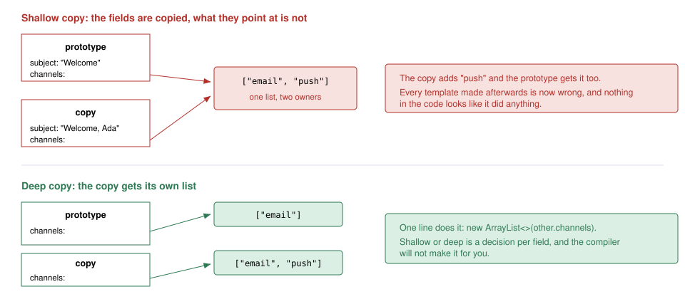
*Figure — a shallow copy shares the channels list with the prototype, so adding "push" to the copy corrupts the prototype; a deep copy gets its own list (course diagram)*

The figure highlights the one decision in this pattern that really needs thought: **how far down the object graph (every object reachable by following references from this one) the copy reaches.** The structure itself is simple: two entrances to the class — an ordinary constructor that does the expensive work, and a copy path that does none of it.

### How it works

1. Give the class two ways in: the **normal constructor** (expensive setup) and a **copy path** that does none of it.
2. Implement the copy path, preferably as a **private copy constructor** `NotificationTemplate(NotificationTemplate other)`.
3. For each field, decide: immutable (share it — `String`, records of immutables) or mutable (copy it — `new ArrayList<>(other.channels)`), and recurse for nested mutable objects.
4. Expose a public **`copy()`** returning a new, independent instance.
5. If clients hold several unrelated types, add a **prototype interface** (`Shape { Shape copy(); }`) so they can copy polymorphically.
6. Optionally keep a **registry** of named prototypes that always hands out copies, never the original.

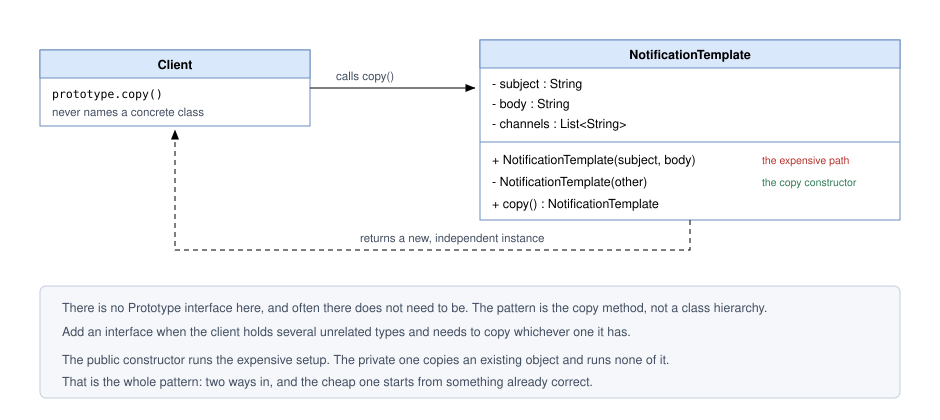
*Figure — NotificationTemplate is both prototype and product: a public expensive constructor, a private copy constructor, and copy() that the Client calls (course diagram)*

Notice in the class diagram that there is **no separate creator class and no Prototype interface** — unlike the other creational patterns, the product creates its own copies. What makes it Prototype is the copy method, not a class hierarchy. Introduce a Prototype interface (like `Shape` below) only when the client holds several unrelated types and must copy whichever it happens to have.

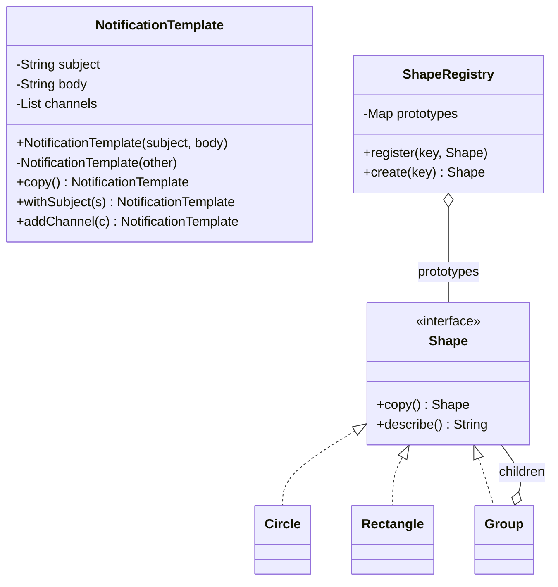

### Shallow vs deep copy

| | Shallow copy | Deep copy |
|---|---|---|
| Primitives (`int`, `double`, `boolean`…), `String`, other immutables | Copied / safely shared | Copied / safely shared |
| Mutable fields (lists, maps, objects) | **Shared** — both objects point to the same one | **Duplicated** — each has its own |
| Cost | Cheap | Proportional to the size of the object graph |
| Risk | Changing the copy silently changes the original | Cycles, copying things you meant to share (caches), copying resources |
| Java default | `Object.clone()` | You write it (per field) |

Suppose the copy constructor had written `this.channels = other.channels`. Both templates would then point at a single list, so adding "push" to the copy silently adds it to the prototype too — and **every later copy inherits the stray channel**, although no line of code visibly touched the prototype. That shared-mutable-collection bug is the one you will meet most often with this pattern. The cure is one line per mutable field — `new ArrayList<>(other.channels)` — i.e. a copy one level deeper. Had the list contained mutable objects instead of `String`s, those would need copying as well, and so on down the graph. **The depth of the copy is a design choice you make field by field**; neither Java nor the compiler will make it for you.

Three related traps:

- **A new field added without updating the copy** — the copy quietly drops it; no compiler error, and usually no test catches it, so the drift can go unnoticed for months.
- **Copying something that owns a resource** (connection, file handle) — two objects now think they own it and both try to close it.
- **Cycles** — a naive recursive deep copy of objects that point to each other never terminates. Real deep-copy utilities track visited objects.

### Why Java's `Cloneable` is a trap

Java's built-in version of Prototype is `Object.clone()` + the `Cloneable` interface, and it is widely considered broken (*Effective Java*, item 13):

- `Cloneable` is a **marker interface with no methods** — it does not declare `clone()`. It only changes the behaviour of `Object.clone()` (without it, `clone()` throws `CloneNotSupportedException`).
- `Object.clone()` is **`protected`**, so you must override it as `public` to make it usable.
- It makes a **shallow** field-by-field copy.
- It **creates the object without running any constructor**, so constructor validation and invariants (rules that must always hold for the object) are skipped.
- To deep-copy you must reassign fields after `super.clone()` — which is **impossible for `final` fields**.
- It throws a **checked** exception (one the compiler forces you to catch or declare) you have to catch even when it cannot happen.

**Prefer a copy constructor or a static copy factory** (`static Foo copyOf(Foo other)`). It is ordinary code, runs your validation, works with `final` fields, and its behaviour is visible where you wrote it. The exception is arrays: `array.clone()` works well for primitive arrays.

### Java implementation

```java
// File: code/lld/ch08/prototype/NotificationTemplate.java
package lld.ch08.prototype;

import java.util.ArrayList;
import java.util.List;

/** Prototype via a copy constructor: one expensive path, one cheap copy path. */
public final class NotificationTemplate {
    static int parses = 0;

    private String subject;
    private final String body;
    private final List<String> channels;

    /** The expensive path (imagine parsing a template file). */
    public NotificationTemplate(String subject, String body) {
        parses++;
        System.out.println("  Parsing template from disk... (expensive)");
        this.subject = subject;
        this.body = body;
        this.channels = new ArrayList<>(List.of("email"));
    }

    /** The copy path: no parsing. Deep-copies the mutable list. */
    private NotificationTemplate(NotificationTemplate other) {
        this.subject = other.subject;               // String is immutable -> sharing is safe
        this.body = other.body;
        this.channels = new ArrayList<>(other.channels);  // NEW list -> the copy owns its own
    }

    public NotificationTemplate copy() { return new NotificationTemplate(this); }

    public NotificationTemplate withSubject(String s) { this.subject = s; return this; }
    public NotificationTemplate addChannel(String c) { channels.add(c); return this; }

    @Override public String toString() { return "subject=\"" + subject + "\" channels=" + channels; }
}
```

```java
// File: code/lld/ch08/prototype/Shapes.java
package lld.ch08.prototype;

import java.util.ArrayList;
import java.util.List;

/** Prototype interface: lets code copy an object whose concrete class it does not know. */
interface Shape {
    Shape copy();
    String describe();
}

final class Circle implements Shape {
    private final int radius;
    private final String color;
    Circle(int radius, String color) { this.radius = radius; this.color = color; }
    private Circle(Circle other) { this(other.radius, other.color); }            // copy constructor
    @Override public Circle copy() { return new Circle(this); }                  // covariant return
    @Override public String describe() { return color + " circle r=" + radius; }
}

final class Rectangle implements Shape {
    private final int w, h;
    private final String color;
    Rectangle(int w, int h, String color) { this.w = w; this.h = h; this.color = color; }
    @Override public Rectangle copy() { return new Rectangle(w, h, color); }
    @Override public String describe() { return color + " rectangle " + w + "x" + h; }
}

/** A composite prototype: deep copy must copy the children too. */
final class Group implements Shape {
    private final List<Shape> children = new ArrayList<>();
    Group add(Shape s) { children.add(s); return this; }
    @Override public Group copy() {
        Group g = new Group();
        for (Shape s : children) g.add(s.copy());       // recursive deep copy
        return g;
    }
    @Override public String describe() { return "group" + children.stream().map(Shape::describe).toList(); }
    int size() { return children.size(); }
}
```

```java
// File: code/lld/ch08/prototype/ShapeRegistry.java
package lld.ch08.prototype;

import java.util.HashMap;
import java.util.Map;

/** Prototype registry (a.k.a. prototype manager): named, pre-configured objects handed out as copies. */
final class ShapeRegistry {
    private final Map<String, Shape> prototypes = new HashMap<>();

    void register(String key, Shape prototype) { prototypes.put(key, prototype); }

    Shape create(String key) {
        Shape p = prototypes.get(key);
        if (p == null) throw new IllegalArgumentException("no prototype named " + key);
        return p.copy();                                 // never hand out the original
    }
}
```

```java
// File: code/lld/ch08/prototype/CloneablePitfall.java
package lld.ch08.prototype;

import java.util.ArrayList;
import java.util.List;

/** Why Cloneable is risky: Object.clone() is shallow, so mutable fields are shared. */
class ShallowPlaylist implements Cloneable {
    String name;
    List<String> songs = new ArrayList<>();

    @Override
    public ShallowPlaylist clone() {
        try {
            return (ShallowPlaylist) super.clone();       // field-by-field copy: 'songs' reference is shared
        } catch (CloneNotSupportedException e) {
            throw new AssertionError(e);                  // cannot happen: we implement Cloneable
        }
    }
}

/** The fixed clone(): deep-copy each mutable field by hand. (It cannot do this for a final field.) */
class DeepPlaylist implements Cloneable {
    String name;
    List<String> songs = new ArrayList<>();

    @Override
    public DeepPlaylist clone() {
        try {
            DeepPlaylist copy = (DeepPlaylist) super.clone();
            copy.songs = new ArrayList<>(songs);          // re-assigning is why 'songs' cannot be final
            return copy;
        } catch (CloneNotSupportedException e) {
            throw new AssertionError(e);
        }
    }
}
```

```java
// File: code/lld/ch08/prototype/Main.java
package lld.ch08.prototype;

public class Main {
    public static void main(String[] args) {
        System.out.println("== Copy instead of re-parsing ==");
        NotificationTemplate prototype = new NotificationTemplate("Welcome", "Hello there");
        NotificationTemplate ada = prototype.copy().withSubject("Welcome, Ada").addChannel("push");
        NotificationTemplate grace = prototype.copy().withSubject("Welcome, Grace").addChannel("sms");
        System.out.println("  ada       : " + ada);
        System.out.println("  grace     : " + grace);
        System.out.println("  prototype : " + prototype + "   <- unchanged (deep copy of the list)");
        System.out.println("  templates parsed: " + NotificationTemplate.parses);

        System.out.println("\n== Cloneable pitfall: shallow copy shares the list ==");
        ShallowPlaylist p1 = new ShallowPlaylist();
        p1.name = "Road trip"; p1.songs.add("Song A");
        ShallowPlaylist p2 = p1.clone();
        p2.songs.add("Song B");
        System.out.println("  original songs after editing the CLONE: " + p1.songs + "   <- bug");

        DeepPlaylist d1 = new DeepPlaylist();
        d1.name = "Road trip"; d1.songs.add("Song A");
        DeepPlaylist d2 = d1.clone();
        d2.songs.add("Song B");
        System.out.println("  deep clone -> original " + d1.songs + ", copy " + d2.songs);

        System.out.println("\n== Polymorphic copy: the caller only knows 'Shape' ==");
        Shape unknown = args.length > 0 ? new Rectangle(2, 3, "green") : new Circle(5, "red");
        Shape twin = unknown.copy();
        System.out.println("  copied a " + twin.getClass().getSimpleName() + ": " + twin.describe()
                + ", same object? " + (twin == unknown));

        System.out.println("\n== Prototype registry ==");
        ShapeRegistry registry = new ShapeRegistry();
        registry.register("button-bg", new Rectangle(120, 40, "blue"));
        registry.register("avatar", new Circle(24, "grey"));
        registry.register("badge", new Group().add(new Circle(8, "gold")).add(new Rectangle(30, 10, "gold")));
        Shape b1 = registry.create("badge");
        Shape b2 = registry.create("badge");
        System.out.println("  " + registry.create("button-bg").describe());
        System.out.println("  " + registry.create("avatar").describe());
        System.out.println("  " + b1.describe() + ", two badges distinct? " + (b1 != b2));
    }
}
```

- "Parsing template from disk" prints **once** although three templates exist — the copies skipped the expensive setup.
- The prototype still has only `[email]` — each copy owns its list.
- `ShallowPlaylist` shows the `Cloneable` bug: editing the clone changed the original. `DeepPlaylist` fixes it, but only because `songs` is not `final`.
- `Circle.copy()` returns `Circle` (a covariant return type) — handy when you know the type, while `Shape` callers still get a `Shape`.
- `Group.copy()` recursively copies its children — a deep copy of a composite.
- `ShapeRegistry.create()` always returns `p.copy()`, never the stored prototype, so callers cannot corrupt it.

Output:

```text
== Copy instead of re-parsing ==
  Parsing template from disk... (expensive)
  ada       : subject="Welcome, Ada" channels=[email, push]
  grace     : subject="Welcome, Grace" channels=[email, sms]
  prototype : subject="Welcome" channels=[email]   <- unchanged (deep copy of the list)
  templates parsed: 1

== Cloneable pitfall: shallow copy shares the list ==
  original songs after editing the CLONE: [Song A, Song B]   <- bug
  deep clone -> original [Song A], copy [Song A, Song B]

== Polymorphic copy: the caller only knows 'Shape' ==
  copied a Circle: red circle r=5, same object? false

== Prototype registry ==
  blue rectangle 120x40
  grey circle r=24
  group[gold circle r=8, gold rectangle 30x10], two badges distinct? true
```

### Trade-offs

| Pros | Cons |
|---|---|
| **Costly setup is paid once** — the prototype does the parsing/loading; each copy is cheap. | **Every class carries copy code** — and it falls out of date as soon as someone adds a field and forgets the copy. |
| **Create without naming a class** — the only option when all you hold is an interface. | **Shallow vs deep must be decided per field** — a wrong call makes two objects secretly share state. |
| **New kinds at run time** — configured prototypes can be registered and copied without compiling a class for each (fewer subclasses). | **Cyclic graphs** need special care, or a naive deep copy recurses forever. |
| **Saved starting points** — users can keep a template, a filter or a layout and begin new work from it. | **Hazardous for objects with identity** — primary keys (unique row IDs in a database), handles and connections must not be duplicated. |
| | **Uneven language support** — some languages offer no built-in cloning, and Java's built-in one (`Cloneable`) is flawed, so you write the copy logic yourself. |

**Often confused with:**

| Looks like | The actual difference |
|---|---|
| **Factory Method** | Creates a fresh object from nothing, with the type chosen by a subclass. Prototype duplicates an existing instance, so the type comes along automatically. |
| **Builder** | Builder puts an object together from parts the caller supplies; Prototype takes a finished object and adjusts only what differs. |
| **Copy constructor** | The usual *implementation*. It becomes the pattern when callers use a polymorphic `copy()` without knowing the concrete type. |
| **Object Pool** | A pool lends out **existing** objects and takes them back, so identity is reused. Prototype produces **new** objects, so identity is never shared. |
| **Spring `prototype` scope** | Despite the name, Spring creates a **new instance** via the constructor on every `getBean()` — it does not clone anything. |
| **JavaScript prototypes** | JS prototypal inheritance (the prototype chain) is a language feature for sharing behaviour, not this pattern. |

**In other languages:** Python has `copy.copy()` / `copy.deepcopy()` built in, and `dataclasses.replace(obj, subject="x")` returns a modified copy. JavaScript's spread `{...original, subject: "x"}` is a *shallow* copy (same trap as above), while `structuredClone()` deep-copies plain data. Kotlin/Scala `data class` gives `.copy(subject = "x")`. In C++ the copy constructor is part of the language, and the "rule of zero" means the compiler-generated one copies every member correctly as long as the class owns no raw resources. In Java, a `record` is a natural copy point (all components are available to a copy constructor or a `withX(...)` method), and a hand-written copy constructor is still preferred to `Cloneable`.

### When not to use it

- **Creating from scratch is cheap** — a constructor is clearer and has no copy semantics to get wrong.
- **The object has identity** — duplicating something that holds a database primary key, a socket or an open file yields an object that *looks* fine but is not. Two rows sharing one ID is a far worse bug than a slow constructor.
- **The object graph is large** — a deep copy may cost more than rebuilding and may duplicate things you meant to share, such as a cache.
- **The object is immutable** — no one can change it, so just share the same instance.

### Common mistakes

- Shallow-copying a mutable collection (the classic bug).
- Implementing `Cloneable` and trusting `super.clone()`.
- Forgetting to update the copy constructor when adding a field.
- Handing out the registry's original prototype instead of a copy.

### Real-world examples

- **JDK:** `Object.clone()` and arrays' `clone()`; `ArrayList.clone()` and `HashMap.clone()` (documented as **shallow** — elements are not copied); copy constructors everywhere: `new ArrayList<>(collection)`, `new HashMap<>(map)`, `new TreeMap<>(sortedMap)`, `new EnumMap<>(enumMap)`; `List.copyOf(...)` for immutable snapshots.
- **Game engines:** Unity's `Instantiate(prefab)` clones a configured "prefab" object to spawn enemies, bullets and so on — load the model, stats and animations once, then copy it for each of the hundreds of enemies on a level.
- **Products:** "Duplicate" in Google Docs/Slides/Figma, "Save as template" / "Use template" in Notion or Jira, saved search filters and report layouts.
- **Tests:** a valid base fixture copied and nudged per test.

### In the interview

**30-second answer:** "Prototype creates objects by copying a configured instance through a `copy()` method on the object. It saves expensive setup and — the deeper reason — it lets me create an object when I only hold an interface. The main decision is shallow vs deep copy per field; sharing a mutable list is the classic bug. In Java I'd write a copy constructor rather than use `Cloneable`, and I'd refuse to copy anything with identity like a DB id or a connection."

- *Q: Why avoid `Cloneable`?* — A: No `clone()` in the interface, protected `Object.clone()`, shallow by default, skips constructors, cannot deep-copy `final` fields, checked exception.
- *Q: How do you deep-copy an object graph with cycles?* — A: Keep an identity map from original → copy; before copying an object, check the map and reuse the copy if it exists.
- *Q: Prototype vs Spring prototype scope?* — A: Spring's scope just means "new instance per request for the bean" — it constructs, it does not clone.
- *Q: Serialization-based deep copy?* — A: Possible (serialize then deserialize) but slow, needs everything `Serializable`, and bypasses constructors — a last resort.

### Self-check

- **Q:** What is the difference between shallow and deep copy? **A:** Shallow copies references (mutable parts are shared); deep also copies what they point to.
- **Q:** Why can't `DeepPlaylist` make `songs` final? **A:** `clone()` must reassign it after `super.clone()`, which is impossible for a final field.
- **Q:** What should a prototype registry return? **A:** A copy of the stored prototype, never the original.

### TL;DR

Copy a configured object instead of building one — saves setup and works when you only know the interface. Decide shallow vs deep per field. Copy constructors, not `Cloneable`. Never copy things with identity.

---

## 8.14 Bonus — Object Pool

### What it is

An **Object Pool** keeps a **bounded set of reusable objects**. Instead of creating an object, using it once and throwing it away, a client **borrows** one from the pool (`acquire`), uses it, and **returns** it (`release`) so the next client can reuse it. It is not one of the GoF 23, but it is a well-known creational pattern.

**Everyday analogy.** A library, or a bike-sharing dock. There are a fixed number of bikes. You take one, ride, and dock it again. If all are out, you wait (or give up after a while). Nobody builds a new bike for every ride.

### The problem it solves

Some objects are **expensive to create** (a database connection needs a TCP handshake — the back-and-forth that opens a network connection — then TLS, the encryption layer behind `https`, then authentication, proving who you are; see [System Design Fundamentals](../../../system-design-patterns/modules/00-system-design-fundamentals/README.md)) and/or **limited** (the database accepts only so many connections). Creating one per request is slow and can overwhelm the server. A pool pays the creation cost a few times and **caps** the total.

### How it works

1. Keep an **idle queue** (a first-in, first-out waiting line) of ready objects, a count of how many are alive, and a cap on how many may be lent out at once (here a `Semaphore` — a counter of permits that a thread must take before going on and hand back afterwards — with one permit per object).
2. **acquire()**: wait (with a timeout) for a free slot; then take an idle object if there is one, otherwise create a new one. If no slot frees up before the timeout, fail.
3. The client uses the object and **always releases it in a `finally` block** (code that always runs, even if an exception was thrown) — a leaked (never returned) object is gone from the pool forever.
4. **release()**: **validate** the object (is the connection still alive?); if broken, discard it so a fresh one can be made later; otherwise **reset** its state (clear per-borrower data) and put it back. Either way, free the slot.
5. Make all of this **thread-safe** — pools exist *because* many threads compete.

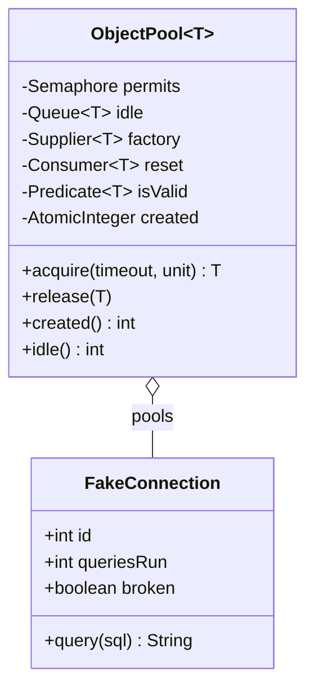

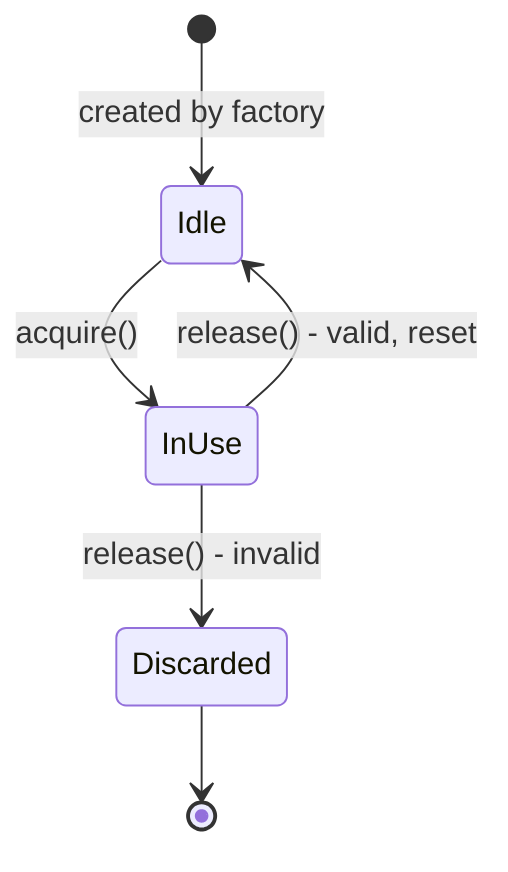

### Java implementation

```java
// File: code/lld/ch08/objectpool/ObjectPool.java
package lld.ch08.objectpool;

import java.util.concurrent.ConcurrentLinkedQueue;
import java.util.concurrent.Semaphore;
import java.util.concurrent.TimeUnit;
import java.util.concurrent.atomic.AtomicInteger;
import java.util.function.Consumer;
import java.util.function.Predicate;
import java.util.function.Supplier;

/**
 * A bounded, thread-safe object pool.
 * A Semaphore holds one permit per object that may be lent out, so at most maxSize objects
 * are ever borrowed at once. Objects are created lazily, handed out with acquire(), and
 * returned with release().
 */
public final class ObjectPool<T> {
    private final Semaphore permits;                               // one permit = one object may be borrowed
    private final ConcurrentLinkedQueue<T> idle = new ConcurrentLinkedQueue<>();
    private final Supplier<T> factory;        // how to make a new object
    private final Consumer<T> reset;          // how to clean an object before reuse
    private final Predicate<T> isValid;       // is a returned object still usable?
    private final AtomicInteger created = new AtomicInteger();    // objects currently alive (idle + borrowed)

    public ObjectPool(int maxSize, Supplier<T> factory, Consumer<T> reset, Predicate<T> isValid) {
        if (maxSize <= 0) throw new IllegalArgumentException("maxSize must be positive");
        this.permits = new Semaphore(maxSize, true);               // fair: waiters are served in order
        this.factory = factory;
        this.reset = reset;
        this.isValid = isValid;
    }

    /** Borrow an object, waiting up to the timeout if all are in use. */
    public T acquire(long timeout, TimeUnit unit) throws InterruptedException {
        if (!permits.tryAcquire(timeout, unit)) {
            throw new IllegalStateException("pool exhausted: timed out after " + timeout + " " + unit);
        }
        // Holding a permit guarantees we are within the cap: reuse an idle object or create one.
        T obj = idle.poll();
        if (obj != null) return obj;
        try {
            obj = factory.get();
            created.incrementAndGet();
            return obj;
        } catch (RuntimeException e) {
            permits.release();                                     // creation failed: give the permit back
            throw e;
        }
    }

    /** Give an object back. Broken objects are discarded so a fresh one can be created later. */
    public void release(T obj) {
        try {
            if (isValid.test(obj)) {
                reset.accept(obj);
                idle.offer(obj);
            } else {
                created.decrementAndGet();                         // discard it; its permit still comes back
            }
        } finally {
            permits.release();                                     // wakes one waiting borrower, if any
        }
    }

    public int created() { return created.get(); }
    public int idle() { return idle.size(); }
}
```

```java
// File: code/lld/ch08/objectpool/Main.java
package lld.ch08.objectpool;

import java.util.ArrayList;
import java.util.List;
import java.util.concurrent.*;
import java.util.concurrent.atomic.AtomicInteger;

public class Main {

    /** Stand-in for an expensive resource such as a DB connection. */
    static final class FakeConnection {
        private static final AtomicInteger IDS = new AtomicInteger();
        final int id = IDS.incrementAndGet();
        int queriesRun = 0;
        boolean broken = false;
        String query(String sql) { queriesRun++; return "conn#" + id + " ran: " + sql; }
    }

    public static void main(String[] args) throws Exception {
        ObjectPool<FakeConnection> pool = new ObjectPool<>(
                3,
                () -> { System.out.println("  (opening a new connection - expensive)"); return new FakeConnection(); },
                c -> c.queriesRun = 0,              // reset per-borrower state
                c -> !c.broken);                    // validate on return

        System.out.println("== 10 tasks on 6 threads share at most 3 connections ==");
        List<Integer> usedIds = new CopyOnWriteArrayList<>();
        try (ExecutorService workers = Executors.newFixedThreadPool(6)) {
            List<Future<?>> futures = new ArrayList<>();
            for (int i = 0; i < 10; i++) {
                final int task = i;
                futures.add(workers.submit(() -> {
                    FakeConnection c = pool.acquire(2, TimeUnit.SECONDS);
                    try {                                       // ALWAYS release in finally
                        c.query("SELECT " + task);
                        usedIds.add(c.id);
                        Thread.sleep(20);
                    } finally {
                        pool.release(c);
                    }
                    return null;
                }));
            }
            for (Future<?> f : futures) f.get();
        }
        System.out.println("  tasks finished: " + usedIds.size()
                + ", connections ever created: " + pool.created()
                + ", distinct connections used: " + usedIds.stream().distinct().count());

        System.out.println("\n== A broken connection is discarded, not reused ==");
        FakeConnection c = pool.acquire(1, TimeUnit.SECONDS);
        c.broken = true;
        pool.release(c);
        System.out.println("  created after discarding: " + pool.created() + ", idle: " + pool.idle());

        System.out.println("\n== Exhaustion: borrowers wait, then time out ==");
        List<FakeConnection> held = new ArrayList<>();
        for (int i = 0; i < 3; i++) held.add(pool.acquire(1, TimeUnit.SECONDS));
        try {
            pool.acquire(100, TimeUnit.MILLISECONDS);
        } catch (IllegalStateException e) {
            System.out.println("  " + e.getMessage());
        }
        held.forEach(pool::release);
        System.out.println("  after returning all: idle = " + pool.idle());
    }
}
```

- A **`Semaphore`** with `maxSize` permits enforces the cap: a borrower must obtain a permit first (`tryAcquire(timeout)` waits with a deadline), so no more than `maxSize` objects can ever be out at once — however many threads race. Holding a permit then means "reuse an idle object if there is one, otherwise it is safe to create one".
- `release()` returns the permit in a `finally` block, **even when the object is discarded** — so a borrower waiting for a slot wakes up and can create a replacement. (A design that only waits on the idle queue would leave that waiter stuck until its timeout although capacity is free.) If the factory throws, `acquire()` gives its permit back too, so a failed creation never shrinks the pool.
- `ConcurrentLinkedQueue` holds the idle objects; handing an object from one thread to another through a concurrent queue (and the semaphore) also makes the previous borrower's writes visible to the next one.
- Validation + reset on `release()` keep broken or dirty objects out.
- `Main` runs 10 tasks on 6 threads with a pool of 3: only 3 connections are ever opened.

Output:

```text
== 10 tasks on 6 threads share at most 3 connections ==
  (opening a new connection - expensive)
  (opening a new connection - expensive)
  (opening a new connection - expensive)
  tasks finished: 10, connections ever created: 3, distinct connections used: 3

== A broken connection is discarded, not reused ==
  created after discarding: 2, idle: 2

== Exhaustion: borrowers wait, then time out ==
  (opening a new connection - expensive)
  pool exhausted: timed out after 100 MILLISECONDS
  after returning all: idle = 3
```

### Trade-offs

| Pros | Cons |
|---|---|
| Avoids repeated expensive creation | Complexity: sizing, validation, timeouts, leak detection |
| Caps resource usage (protects the DB) | Leaked (never released) objects shrink the pool until it deadlocks (everyone waits forever) |
| Predictable latency (time per request) after warm-up | Stale state if reset is incomplete — one user's data leaks to the next |
| | For cheap objects it is **slower** than `new` — modern JVM allocation and GC (garbage collection — the JVM's automatic memory clean-up) are very fast |

### When not to use it

- For **cheap** objects (small value objects, `StringBuilder`s) — the JVM allocates them faster than a pool can hand them out.
- For **virtual threads** (Java 21; lightweight threads managed by the JVM, cheap enough to create by the million) — they are cheap by design; create one per task instead of pooling them.
- When a **well-tested library** exists — use HikariCP, Apache Commons Pool 2 or your framework's pool rather than writing your own in production.

### Common mistakes

- Not releasing in `finally` (or not using try-with-resources (Java's `try (...)` form that closes things automatically) wrappers).
- Not resetting borrower state.
- Unbounded waits — always use a timeout.
- Returning the same object twice (double release). In our teaching pool that would put one object in the idle queue twice *and* add an extra permit, silently raising the cap; production pools track which objects are currently borrowed and reject a second release.

### Real-world examples

- **Database connection pools:** HikariCP (Spring Boot's default), Apache DBCP, c3p0.
- **Thread pools:** `ThreadPoolExecutor` / `Executors.newFixedThreadPool` reuse worker threads.
- **Apache Commons Pool 2** `GenericObjectPool` (used by Jedis for Redis connections).
- **Netty** `PooledByteBufAllocator` pools buffers to reduce GC pressure.
- Not pools, though often confused: the `String` intern pool and the `Integer` cache (-128..127) share immutable instances — that is **Flyweight** (Chapter 9), nothing is borrowed or returned.

### In the interview

**30-second answer:** "An object pool reuses a bounded set of expensive objects like DB connections. acquire takes an idle one, creates one if under the cap, or waits with a timeout; release validates, resets and returns it. It must be thread-safe, and clients must release in finally. For cheap objects it's counter-productive, and in production I'd use HikariCP."

- *Q: How do you size a pool?* — A: From measured concurrency and downstream limits (the capacity of the services you call, e.g. the database); HikariCP's guidance is that small pools (roughly core-count scale) often beat big ones, because the database can only do so much in parallel.
- *Q: How do you detect leaks?* — A: Record who borrowed each object and when; log if held longer than a threshold (HikariCP's `leakDetectionThreshold` does this).

### Self-check

- **Q:** Object Pool vs Flyweight? **A:** Pool lends mutable objects exclusively and takes them back; Flyweight shares immutable objects among everyone at once.
- **Q:** Why validate on release? **A:** So broken objects (dead connections) are discarded instead of handed to the next borrower.

### TL;DR

Borrow → use → return (in `finally`). Bounded, thread-safe, validated, reset. Worth it only for expensive or limited resources; use a mature library in production.

---

## 8.15 Creational patterns compared

### At a glance

| Pattern | Distinctive feature | Use when | Course example | JDK / Spring example | Pros | Cons |
|---|---|---|---|---|---|---|
| **Singleton** | Only one instance of the class exists | One shared resource: configuration, pool, registry | One `ConfigStore` (or one DB connection pool) | `Runtime.getRuntime()`, Spring singleton-scoped beans | Global access; single initialization | Hurts unit testing (testing one class on its own); hidden dependencies; global state |
| **Simple Factory** *(idiom)* | One method maps a type value to a class | Small, stable set of types chosen by config | Notification by channel | `Calendar.getInstance()`, `EnumSet.noneOf`, `@Bean` methods | Short, centralizes the switch | Edit it for every new type |
| **Factory Method** | Subclasses decide the created type via an overridable method | Shared procedure, varying product; others will add types | PDF / HTML report generator (documents of different types — PDF, Word, HTML…) | `Collection.iterator()`, Spring `FactoryBean` | Open–Closed; decouples creator from products | More classes; needs subclasses |
| **Abstract Factory** | Creates *families* of related objects without concrete classes | Products must be compatible; swap a whole set at once | Postgres vs MySQL storage; Windows vs macOS widgets | `DocumentBuilderFactory`, JDBC `Connection`, Spring profiles | Guarantees compatibility; Open–Closed for families | Complex; adding a product kind edits every factory |
| **Builder** | Separates construction of a complex object from its representation | Many optional fields, validation, immutability, step-by-step control | `HttpRequest`; building a custom meal | `StringBuilder`, `HttpClient.newBuilder()`, `UriComponentsBuilder` | Step-by-step, readable, immutable, validated | Verbose for simple objects; field duplication; Director optional |
| **Prototype** | Creates objects by copying an existing one | Setup is expensive, or only the interface is known | `NotificationTemplate`; cloning a customized car configuration | Copy constructors, `ArrayList.clone()`, Unity `Instantiate` | Skips setup; fewer subclasses; runtime-configured kinds | Deep copy is hard; `Cloneable` is broken; identity issues |
| **Object Pool** *(bonus)* | Reuses a bounded set of objects | Expensive or limited resources | DB connections | HikariCP, `ThreadPoolExecutor` | Fast reuse; caps load | Leaks, stale state, pointless for cheap objects |

### Pick by the question you are asking

| You are asking… | Pattern |
|---|---|
| "How do I make sure there is only one?" | Singleton (or DI singleton scope) |
| "How do I avoid `new ConcreteClass()` scattered around?" | Simple Factory |
| "How do I let subclasses/plug-ins decide what to create?" | Factory Method |
| "How do I make sure these objects always match?" | Abstract Factory |
| "How do I make this 10-argument constructor readable and safe?" | Builder |
| "How do I make another one of *this*, cheaply or without knowing its class?" | Prototype |
| "How do I stop creating and destroying this expensive thing?" | Object Pool |

### How they combine

- An **Abstract Factory** is often implemented with **Factory Methods**, may use **Prototypes** (a factory configured with prototype objects it copies), and is frequently a **Singleton** (one factory per family) — though passing it in is better.
- A **Builder** can use a **Factory** to pick which parts to build, and a **Director** can be a Singleton-like stateless (keeps no data between calls) service.
- Designs often *start* with Factory Method (simple, subclass-based) and *evolve* towards Abstract Factory, Prototype or Builder as more flexibility is needed.

---

## 8.16 Chapter self-check

1. **Q:** Name the three GoF categories and how many patterns each has. **A:** Creational 5, Structural 7, Behavioral 11 = 23.
2. **Q:** Which two principles does the GoF book put at the centre? **A:** Program to an interface, not an implementation; favour composition over inheritance.
3. **Q:** What is the Golden Hammer? **A:** Applying a favourite tool/pattern to every problem regardless of fit.
4. **Q:** Why must the DCL field be `volatile`? **A:** To prevent another thread from seeing a reference to a not-yet-fully-constructed object (it creates a happens-before edge).
5. **Q:** Simple Factory vs Factory Method in one line? **A:** A switch in one method vs a creation hook overridden by subclasses.
6. **Q:** Factory Method vs Abstract Factory in one line? **A:** One product by inheritance vs a family of matching products by composition.
7. **Q:** Builder's single most important method, and why? **A:** `build()` — the one gate that validates cross-field rules and creates the immutable product.
8. **Q:** What is the classic Prototype bug? **A:** A shallow copy sharing a mutable collection with the original.
9. **Q:** Why is `enum` the most robust Java singleton? **A:** The JVM guarantees one instance per constant and blocks reflective creation and serialization duplicates.
10. **Q:** In an interview, how many patterns should a 45-minute design use? **A:** Usually one or two — and name the one you rejected.

## 8.17 Chapter TL;DR

- **Patterns** are named, proven solution templates with trade-offs — vocabulary first, code second. GoF (1994) catalogued 23 in three categories.
- **Pick from the signal, not the catalogue.** One or two patterns per interview design; always state the cost and the alternative.
- **Singleton** — one per JVM; eager / holder / enum; DCL needs `volatile`; prefer DI.
- **Simple Factory** — one `create(type)`; idiom, not GoF.
- **Factory Method** — base-class procedure + subclass-chosen product.
- **Abstract Factory** — one factory, one matching family; chosen at the composition root.
- **Builder** — named steps, one validating `build()`, immutable product.
- **Prototype** — copy a configured object; decide shallow vs deep; avoid `Cloneable`.
- **Object Pool** — borrow/return expensive objects; use a real library in production.
