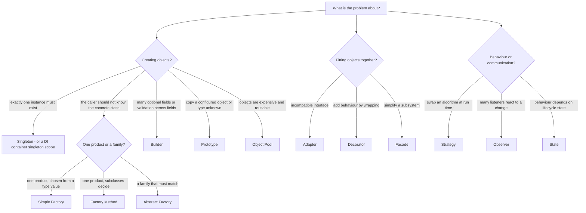
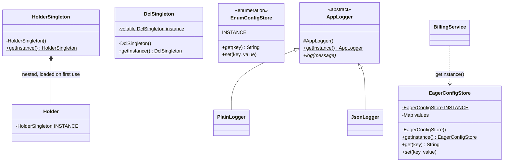
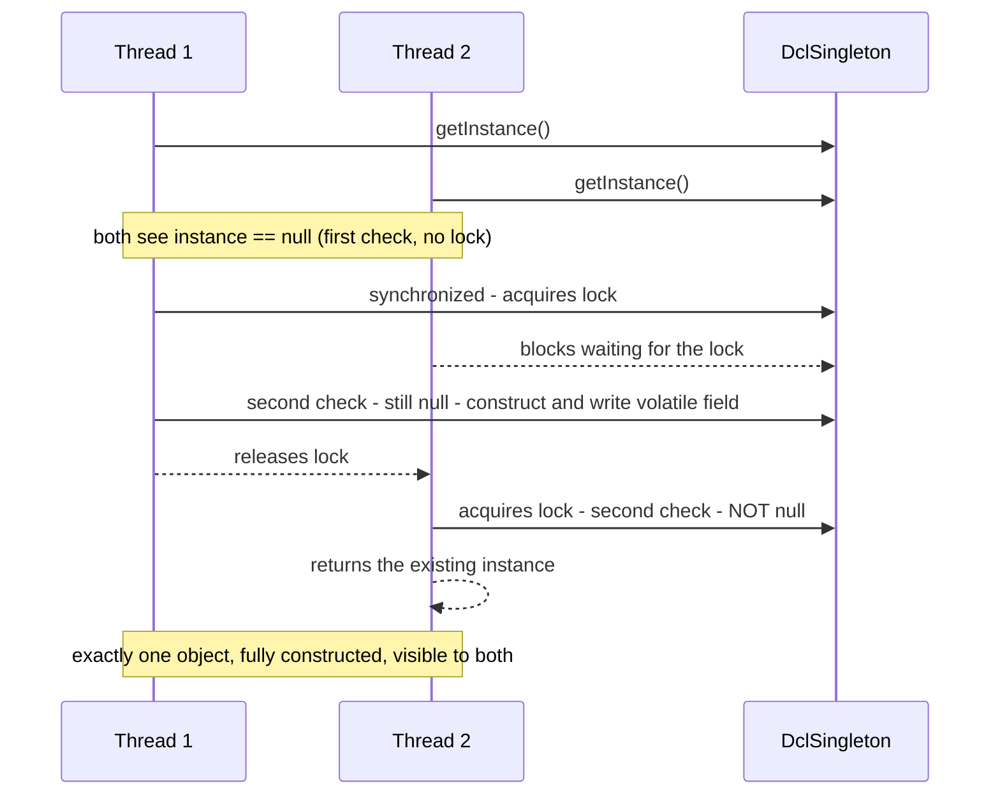
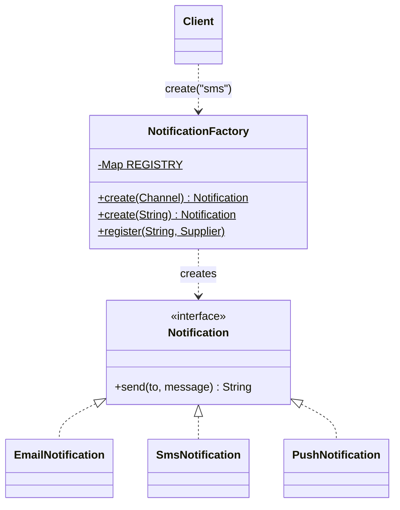
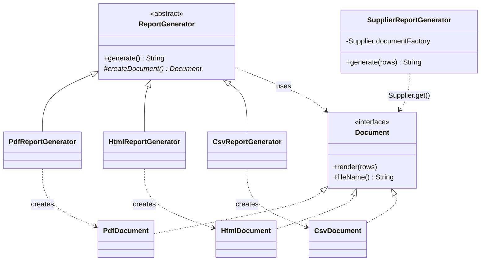
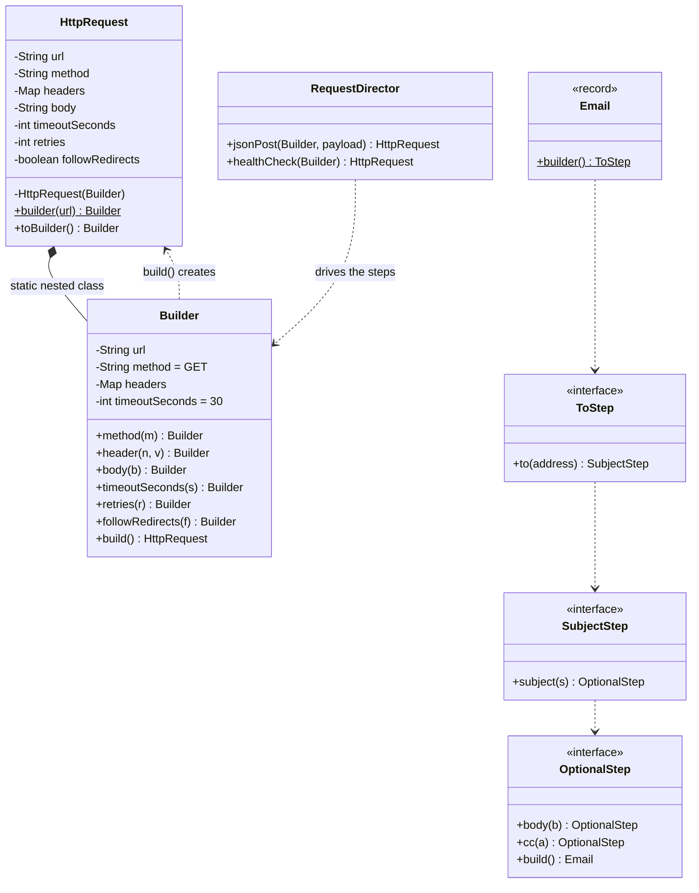
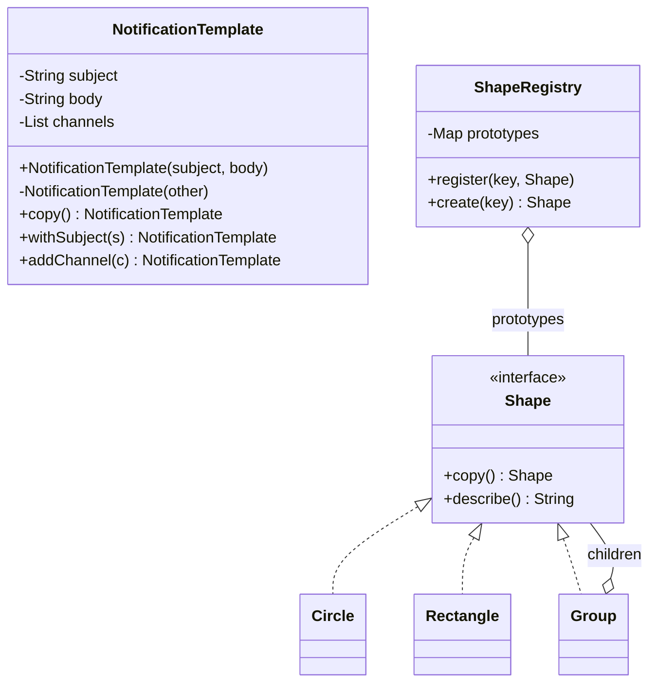
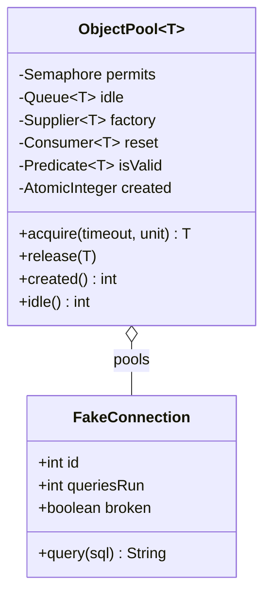
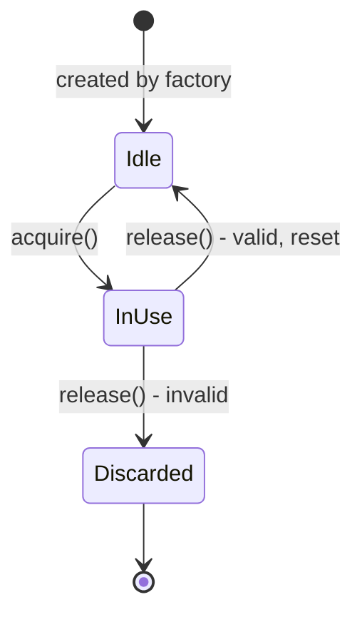

# Chapter 8 — Design Patterns: Introduction & Creational Patterns

> **What you will learn.** What a design pattern is and where the idea came from, the full Gang of Four catalogue of 23 patterns, the OO principles underneath them, how to choose (and *not* choose) a pattern, the anti-patterns of overuse — and then, in depth, the five creational patterns (Singleton, Factory Method, Abstract Factory, Builder, Prototype), the Simple Factory idiom and the Object Pool bonus pattern.
>
> **How to read it.** Part A is the map. Part B covers each creational pattern with the same template: *what it is → problem → how it works → Java code (real output) → trade-offs → when not to use it → mistakes → real-world examples → interview answers → self-check → TL;DR*. The chapter ends with one comparison table.
>
> **Code.** Everything lives in `chapters/08-patterns-creational/code/lld/ch08/<pattern>/`. Each package (a named folder of related classes that also acts as a namespace) has a `Main` (the class whose `main` method starts the program). Listings below show the essential lines; the full runnable files are in that folder. Compile and run with:
>
> ```bash
> cd chapters/08-patterns-creational/code
> javac --release 21 -d /tmp/lld_08 $(find . -name '*.java')
> java -cp /tmp/lld_08 lld.ch08.singleton.Main        # or .simplefactory / .factorymethod / .abstractfactory / .builder / .prototype / .objectpool
> ```

---

# Part A — Design patterns: the big picture

## 8.1 What is a design pattern?

### What it is

A **design pattern** is a named, reusable description of a good solution to a problem that keeps recurring in software design. It is not a library or code you paste in — it is a *recipe* you adapt, the written-down experience of many developers so you do not have to rediscover it (as builders learned over hundreds of houses where a front door works best).

- **Intent** — the one-sentence purpose of a pattern ("ensure a class has only one instance").
- **Participants** — the roles (classes/interfaces — an **interface** is a type listing method signatures without bodies, which classes implement) in the pattern, such as *Creator*, *Product*, *Client*.

### The problem it solves

Without patterns every team re-solves the same recurring problems (creating objects without hard-coding classes, adding behaviour without editing old code, notifying many listeners), each in a slightly different, slightly buggy way. Patterns give you:

| Benefit | What it means in practice |
|---|---|
| Solve common design problems | Start from a solution refined over years. |
| Avoid reinventing the wheel | Less design time, fewer surprises. |
| Readability and maintainability | A known shape is easier for the next person. |
| Shared vocabulary | "This is a Factory" replaces a paragraph. The biggest win in interviews. |
| Best practices built in | Patterns embody loose coupling (parts know little about each other) and open/closed (extend without editing), so code tends to be more testable. |
| Adaptability and scalability | Many patterns exist so code can absorb change later. |
| Faster development | Tested paradigms speed up decisions. |

### How it works

Every classic pattern description (the Gang of Four framing) has four parts:

1. **Name** — a word or two that becomes team vocabulary.
2. **Problem** — when to apply it: the situation and the forces in tension.
3. **Solution** — participants, responsibilities and collaborations; an abstract *template*, not concrete code.
4. **Consequences** — costs and benefits. A pattern without its trade-offs is half a pattern.

You **adapt** the template to your language and problem; two correct implementations can look quite different.

### When not to use it

Not every problem needs a pattern. Forcing one adds classes, indirection (extra layers between you and the code doing the real work) and confusion — worse than no pattern. See [8.6 Anti-patterns](#86-anti-patterns-when-patterns-go-wrong).

### TL;DR

A design pattern = **name + problem + solution template + consequences**. Shared experience, not copy-paste code. Biggest value: vocabulary and proven trade-offs; biggest risk: overuse.

---

## 8.2 A short history: from buildings to the "Gang of Four"

| Year | Event | Why it matters |
|---|---|---|
| 1977 | Architect **Christopher Alexander** publishes *A Pattern Language*, solutions for towns and buildings. | The "pattern" idea comes from architecture, not software. |
| 1987 | **Kent Beck** and **Ward Cunningham** apply pattern languages to programming (UI design in Smalltalk, an early OO language). | First bridge to software. |
| 1994 | **Erich Gamma, Richard Helm, Ralph Johnson, John Vlissides** publish *Design Patterns: Elements of Reusable Object-Oriented Software* — the **Gang of Four (GoF)**. | Catalogues **23 patterns** in three categories, with C++ and Smalltalk examples. |
| 2004 | *Head First Design Patterns* (Freeman & Robson, with Sierra and Bates) teaches them in Java with stories (pizza store for factories, chocolate boiler for Singleton, Starbuzz coffee for Decorator). | Made GoF approachable and put the **OO principles** front and centre. |

Two GoF principles run through the whole catalogue:

1. **Program to an interface, not an implementation.** Type variables and parameters by abstractions (interfaces or abstract classes that say *what*, not *how*), so callers do not care which concrete class (a fully implemented class you can `new`) they get.
2. **Favour object composition over class inheritance.** Build behaviour by *holding* objects ("has-a"), not only by extending classes ("is-a"). Composition is "black-box" reuse; inheritance exposes a parent's internals.

Creational patterns make principle 1 practical: if code must not name concrete classes, *someone* still has to create the objects — creational patterns decide who and how.

---

## 8.3 The three categories and all 23 GoF patterns

### What it is

The GoF grouped patterns by **purpose**:

| Category | Question it answers | In one line |
|---|---|---|
| **Creational** | *How do objects get made?* | Control creation so the system does not depend on concrete classes or messy construction details. |
| **Structural** | *How are objects put together?* | Compose classes and objects into larger, flexible structures — simple ways to realise relationships between entities. |
| **Behavioral** | *How do objects talk and share work?* | Assign responsibilities and design communication between objects, rather than thinking in raw control flow. |

A second axis is **scope**: **class patterns** use inheritance, fixed at compile time (Factory Method, class Adapter, Template Method, Interpreter); **object patterns** use composition, changeable at run time (almost everything else).

### The full catalogue

| # | Pattern | Category | Intent in one line | Chapter |
|---|---|---|---|---|
| 1 | **Abstract Factory** | Creational | Create *families* of related objects without naming their concrete classes. | 8 |
| 2 | **Builder** | Creational | Build a complex object step by step, separating construction from the final representation. | 8 |
| 3 | **Factory Method** | Creational | Let subclasses decide which concrete class to instantiate through an overridable creation method. | 8 |
| 4 | **Prototype** | Creational | Create new objects by copying a pre-configured instance. | 8 |
| 5 | **Singleton** | Creational | Ensure a class has exactly one instance and give a global access point to it. | 8 |
| 6 | **Adapter** (also called Wrapper) | Structural | Convert one interface into another that clients expect. | 9 |
| 7 | **Bridge** | Structural | Split an abstraction from its implementation so both can vary independently. | 9 |
| 8 | **Composite** | Structural | Treat individual objects and trees of objects uniformly. | 9 |
| 9 | **Decorator** | Structural | Attach extra responsibilities to an object dynamically by wrapping it. | 9 |
| 10 | **Facade** | Structural | Give a simple, unified entry point to a complex subsystem. | 9 |
| 11 | **Flyweight** | Structural | Share common (intrinsic) state to support huge numbers of fine-grained objects cheaply. | 9 |
| 12 | **Proxy** | Structural | Provide a stand-in that controls access to another object (lazy, remote, protective…). | 9 |
| 13 | **Chain of Responsibility** | Behavioral | Pass a request along a chain of handlers until one handles it. | 10/11 |
| 14 | **Command** | Behavioral | Turn a request into an object so it can be queued, logged or undone. | 10/11 |
| 15 | **Interpreter** | Behavioral | Represent a small language's grammar as classes and evaluate sentences in it. | 10/11 |
| 16 | **Iterator** | Behavioral | Traverse a collection without exposing how it is stored. | 10/11 |
| 17 | **Mediator** | Behavioral | Centralise complex communication between objects in one mediator object. | 10/11 |
| 18 | **Memento** | Behavioral | Capture and restore an object's state without breaking encapsulation (keeping internals private). | 10/11 |
| 19 | **Observer** | Behavioral | Notify many dependents automatically when one object changes. | 10/11 |
| 20 | **State** | Behavioral | Let an object change behaviour when its internal state changes, as if it changed class. | 10/11 |
| 21 | **Strategy** | Behavioral | Make a family of algorithms interchangeable behind one interface. | 10/11 |
| 22 | **Template Method** | Behavioral | Fix an algorithm's skeleton in a base class and let subclasses fill in steps. | 10/11 |
| 23 | **Visitor** | Behavioral | Add new operations to a set of classes without changing those classes. | 10/11 |

**Count check:** 5 creational + 7 structural + 11 behavioral = **23**. (Some course lists show ten behavioral patterns, omitting the rarely used Interpreter — it is still one of the 23.)

**Not in the GoF 23 but you will meet them:** *Simple Factory* (an idiom), *Object Pool* (end of this chapter), *Dependency Injection* (handing an object its dependencies from outside instead of letting it create them), *Null Object*, *Repository*, *MVC* (Model–View–Controller: data, display and input handling split apart; Head First's "compound pattern" of Observer, Strategy and Composite).

### Self-check

- **Q:** Which creational pattern is a *class* pattern (uses inheritance)? **A:** Factory Method — subclasses override the creation method.
- **Q:** How many behavioral GoF patterns are there? **A:** Eleven.

---

## 8.4 The OO principles behind every pattern

Patterns are principles applied to recurring situations. *Head First* collects these as it goes; together with SOLID (Chapter 4 — Single responsibility, Open–closed, Liskov substitution, Interface segregation, Dependency inversion) they explain *why* each pattern is shaped as it is.

| Principle (plain words) | What it means | Patterns that apply it (examples) |
|---|---|---|
| **Encapsulate what varies** | Put the part that changes behind its own abstraction, apart from what stays the same. | Factory Method (the created type varies), Strategy, State, Builder |
| **Favour composition over inheritance** | Get behaviour by holding objects, not only by subclassing. | Abstract Factory (client *holds* a factory), Strategy, Decorator |
| **Program to interfaces, not implementations** | Depend on the supertype. | Every creational pattern returns an interface type |
| **Strive for loosely coupled designs between objects that interact** | Objects know as little about each other as possible. | Observer, Mediator, factories |
| **Open–Closed Principle** — open for extension, closed for modification | Add behaviour by adding code, not editing tested code. | Factory Method (new product = new subclass), Decorator |
| **Dependency Inversion** — depend on abstractions, not concrete classes | High- and low-level code both depend on interfaces. | The core of all factory patterns: the client never calls `new ConcreteThing()` |
| **Least Knowledge** ("only talk to your friends") | A method calls only its own object, its parameters, objects it creates and its fields. | Facade |
| **Hollywood Principle** ("don't call us, we'll call you") | High-level components decide when low-level ones run. | Template Method, Factory Method (base class calls the subclass's hook), frameworks/IoC (inversion of control) |
| **Single Responsibility** — one reason to change | Each class does one job. | Builder (construction separated from the product), Iterator |

**Why creational patterns exist, in one sentence:** Dependency Inversion says "do not depend on concrete classes", but `new PdfDocument()` *is* such a dependency — so creational patterns move that `new` somewhere controlled (a factory, a subclass, a builder, a prototype, a container).

---

## 8.5 How to pick a pattern

### The problem it solves

Learning 23 patterns and then hunting for places to use them is backwards. Start from a **signal** in the requirements, then reach for the pattern that answers it.

### How it works

1. **Name the problem** in plain words: "the pricing rule will change", "there must be exactly one", "the constructor has ten arguments".
2. **Decide the category**: creating, structuring, or behaving/communicating?
3. **Match the signal** to a pattern (tables below).
4. **Check the cost**: how many classes does it add? Is there a simpler option — an enum (a type with a fixed list of named constants), a lambda (a short unnamed function), a constructor, a DI container (a framework that creates objects and hands them their dependencies)?
5. **Say what you rejected and why** — in an interview, worth as much as the pick.



### The six patterns that come up in almost every LLD interview

Six patterns recur in object-oriented design rounds. A name replaces a long explanation and signals you have met the problem before — but forcing a pattern where it is not needed costs more than not knowing it. So learn each with its **signal**: the clue in the problem statement that says it fits.


*Figure — the six interview patterns and the signal that tells you each one applies (course diagram)*

| Pattern | The signal | Where it typically applies | Use it when | Do **not** use it when |
|---|---|---|---|---|
| **Strategy** | One operation comes in several swappable versions, chosen at run time | Pricing, matching, sorting, ranking, routing | One operation with several interchangeable rules | Only one rule exists and nothing hints at a second |
| **Factory** | Something must be created and the caller should not care which concrete class | Type value → vehicle, spot, payment or notification | The class to create depends on a type value | Only one concrete class exists |
| **Observer** | One object changes and several others must react, without it knowing who they are | Display boards, notifications, live updates, event logs | Several listeners the source should stay ignorant of | A single listener the source already references |
| **State** | Behaviour depends on current status, and allowed moves between statuses are fixed | Tickets, orders, bookings, loans — anything with a lifecycle | Many states and transitions | Three or four states handled by one guarded method |
| **Singleton** | Genuinely one and only one instance | The top-level object, e.g. `ParkingLot`, `Library` | There really must be exactly one | You just want an easy global handle |
| **Builder** | Many optional fields; the constructor keeps growing | A book copy, a booking, a search query | Lots of optional fields | A handful of required fields |

How each signal shows up in a parking-lot or library design:

- **Strategy.** Price starts as "per hour"; later come a weekend tariff and a monthly pass. Without a pattern the fee method grows a `switch` edited for every tariff. Strategy defines an interface `ParkingRate` (hours → amount); `HourlyRate`, `WeekendRate`, `MonthlyPass` implement it and the lot holds the one in force. A new tariff is one new class, no edits. This answers the most common follow-up: "what if the pricing rules change?"
- **Factory.** A string or enum must become a `Vehicle`. If that lives in the entrance panel, the panel knows every type and changes with each new one. A factory takes the type and returns the object — the single registration point for new types (Open–Closed in practice). Keep it lean: in 45 minutes a creation method on an existing class is usually enough; one factory class per vehicle type is too much.
- **Observer.** When a spot is taken, every display board on that floor must refresh. The spot is the *subject*; boards, entrance panels and floor portals *subscribe*; on each change it notifies them without knowing what they are, so a new board needs no change to the spot. Contrast the library: a returned reserved book must notify exactly one member — a direct call suffices; one listener does not justify Observer.
- **State.** A parking ticket goes active → paid → closed; a book copy is available, reserved, on loan or lost. Without the pattern every method opens with "if status is…" and legality rules scatter. State gives each status a small class knowing its legal next steps, so an illegal move cannot even be written. Cost: with four states and three transitions an `enum` plus one guarded method reads better — reach for State when the transition table is big, and say why.
- **Singleton.** A car park is one physical place, so one `ParkingLot`: private constructor plus one accessor. Interviewers probe two points, so raise them yourself: fetching the instance must be correct when several threads (independent paths of execution in one program) ask at once (use a lock — a guard letting one thread at a time run a piece of code — or create it eagerly), and a singleton is global state (data any part of the program can read and change) that makes tests harder, which is why many teams create one instance and pass it around. Stating that trade-off earns more than naming the pattern.
- **Builder.** A `BookItem` needs barcode, price, format, purchase date, publication date and rack — an eight-argument constructor is easy to misuse, since two adjacent `String` parameters can be swapped silently. A builder names every field and builds at the end. Raise it once a constructor passes about six arguments, then move on: it improves readability, not structure.

**Rules of thumb for the interview:**

- **One or two patterns** in a 45-minute design, placed exactly where their signal appears. Six means the design has drifted from the requirements.
- **Compare out loud:** "Strategy for rates, because a second tariff is clearly coming; no State for the ticket, because one guard handles three statuses." Explaining what you *rejected* shows as much judgement as what you chose.

---

## 8.6 Anti-patterns: when patterns go wrong

### What it is

An **anti-pattern** is a common "solution" that looks reasonable but reliably causes more problems than it solves.

| Anti-pattern | What it looks like | Why it hurts | The fix |
|---|---|---|---|
| **God Object** (God class, the Blob) | One class knows and does almost everything: `SystemManager` with 80 methods and 40 fields. | Violates Single Responsibility; every change touches it, merge conflicts (clashing edits to the same lines) everywhere, untestable in isolation. | Split by responsibility (Extract Class — Chapter 7); push behaviour to the objects that own the data. |
| **Golden Hammer** | "When all you have is a hammer, everything looks like a nail" — the favourite tool or pattern applied everywhere. | Forced onto problems it does not fit: every object a Singleton, every `if` a Strategy. | Start from the problem's signal (8.5), not the tool. |
| **Pattern overuse** ("patternitis") | Factories creating one class, single-implementation interfaces "just in case", five layers of indirection for a CRUD (create, read, update, delete) screen. | More classes and hops, no benefit. Fowler's smell: **Speculative Generality** (building for imagined needs). | YAGNI ("You Aren't Gonna Need It", Chapter 5): add the pattern when the *second* variant arrives. Refactor towards a pattern; do not start from one. |
| **Singletonitis** | Singletons as convenient global variables. | Hidden dependencies, order-dependent tests, hard to replace. | Dependency injection; pass the object in (8.8). |
| **Cargo-cult patterns** | Copying structure without the intent (a "Builder" that only copies fields with no validation, a "Factory Method" that is really a switch). | Ceremony with none of the guarantees. | Know the *intent*: what property does it give you? If you cannot name it, drop it. |

### TL;DR

Patterns are a vocabulary, not a checklist. The God Object comes from ignoring design; Golden Hammer and pattern overuse from over-applying it.

---

# Part B — Creational patterns

## 8.7 Creational patterns at a glance

### What it is

**Creational patterns** control *how objects are created* so the rest of the system is not tied to concrete classes or construction details. They hide *which* class is instantiated, *how* it is assembled, and sometimes *whether* a new object is made at all — keeping the system **independent** of how objects are created, composed and represented, **hiding the complexity** of creation (long setup, validation, choosing a subtype), and keeping **flexibility** over *what*, *who*, *how* and *when*.

| Pattern | Intent in one line |
|---|---|
| **Singleton** | Exactly one instance of a class, with one global way to reach it. |
| **Factory Method** | A base class defines a creation method; subclasses decide which concrete class it returns. |
| **Abstract Factory** | One factory object creates a whole *family* of related objects that must match. |
| **Builder** | Assemble one complex object step by step; the same process can produce different representations. |
| **Prototype** | Create new objects by cloning a prototypical instance. |
| *Simple Factory* (idiom) | One method with a switch/registry decides which class to create. |
| *Object Pool* (bonus) | Reuse a bounded set of expensive objects instead of creating and destroying them. |

---

## 8.8 Singleton

### What it is

The **Singleton** pattern restricts a class to **exactly one instance** (per process — one running program — or, strictly, per class loader, the part of the JVM (Java Virtual Machine) that loads classes into memory) and gives every caller **one well-known way to reach it** — like a country's one official government that everyone reaches through a known channel.

- **Instance** — one object created from a class.
- **Eager initialization** — create the object as soon as the class is loaded.
- **Lazy initialization** — create it the first time someone asks.
- **Thread-safe** — correct even when many threads call it at the same moment.

**GoF intent and participants.** Intent: a class never has more than one instance, and every client has a well-known way to reach it. One participant, **Singleton**, which (a) defines a class-level operation (`getInstance()`) to reach the unique instance and (b) usually creates that instance itself. Clients just call that operation.

### The problem it solves

Some things really are "one per process": settings loaded at start-up, the pool of database connections (open connections kept ready for reuse), the metrics registry (counters and timings the app records about itself). If every module creates its own, settings are parsed many times and metrics split across registries nobody can combine. E.g. a `ConfigStore` (region, retry count, timeout) read by billing, the nightly report job and the mailer: three private copies mean three parses, and a change in one never reaches the others.

A plain global variable has two problems: tests share it (a result depends on which test ran before), and *some* code must assign it before anyone reads it — get start-up order wrong and a caller finds `null`. Singleton moves both jobs into the class: **the class decides how many instances may exist and creates the one it allows**, on demand, so there is no ordering mistake to make.


*Figure — BillingService, ReportJob and EmailService all call getInstance() and receive the same ConfigStore, which was read from disk once (course diagram)*

### How it works

1. Make the **constructor `private`** so outside code cannot write `new ConfigStore()`. That access modifier (`public` / `protected` / `private` — who may use a member) is the whole enforcement; make it public and anyone can create a second one.
2. Keep the instance in a **`private static` field** — owned by the class, not by any object.
3. Expose a **`public static getInstance()`** — static because a caller has no instance yet.
4. Inside it, return the stored instance, creating it first if needed (safely when threads are involved).
5. Add ordinary instance methods (`get`, `set`, …) for the real work.


*Figure — ConfigStore with a private static INSTANCE, a private constructor and a static getInstance(); BillingService only calls getInstance() (course diagram)*

Our Java design (all the variants in the code package):



### The six ways to write a Singleton in Java

Terms: **serialization** turns an object into bytes to save or send (**deserialization** rebuilds it); **reflection** is Java's ability to inspect and call a class's members — even private ones — at run time; **contention** is many threads competing for one lock.

| # | Variant | Lazy? | Thread-safe? | Cost on each call | Survives serialization / reflection? | Verdict |
|---|---|---|---|---|---|---|
| 1 | **Eager** `static final` field | No (built when the class is initialized) | Yes — the JVM initializes a class exactly once | None | No / No (needs defences) | Default choice when construction is cheap |
| 2 | **Naive lazy** `if (instance == null)` | Yes | **No** | None | No / No | Never in multi-threaded code |
| 3 | **`synchronized` getInstance()** | Yes | Yes | A lock on *every* call | No / No | Correct but slow under contention |
| 4 | **Double-checked locking** + `volatile` | Yes | Yes (Java 5+) | One volatile read | No / No | When the instance depends on run-time input |
| 5 | **Bill Pugh / holder idiom** | Yes | Yes — class-loading guarantee | None | No / No | Best lazy option in plain Java |
| 6 | **`enum` with one constant** | No (created when the enum class initializes) | Yes | None | **Yes / Yes** (JVM guarantees) | Shortest and most robust; recommended by *Effective Java* (Joshua Bloch's best-practice book) |

**1 — Eager.** The `static final` field is assigned when the class is *initialized* — on its first active use (typically the first `getInstance()`, but also any other static method or non-constant static field), not at JVM start-up. The Java Language Specification (§12.4.2) guarantees initialization runs exactly once, under an internal lock, and every thread then sees the fully built object — thread safety for free. Cost: the object is built when the class is touched for *any* reason; matters if the constructor opens a file or socket (a network connection endpoint).

**2 — Naive lazy (broken).** "Create on first use" written as *check, then act*:

```java
// Do NOT use this in multi-threaded code.
public static ConfigStore getInstance() {
    if (instance == null) {            // two threads can both see null here...
        instance = new ConfigStore();  // ...and both construct
    }
    return instance;
}
```

Threads A and B can both read `null` before either stores its object; each builds its own store and writes to one never show in the other. It passes every single-threaded test, which is why it slips through review. Our demo releases eight threads at once: the naive version built **more than one** object (eight in the run below).

**3 — `synchronized` method.** Fixes the race (a **race condition**: a bug whose outcome depends on unlucky thread timing) — one thread inside at a time — but takes the lock on *every* call forever, though only the first needs it.

**4 — Double-checked locking (DCL).** Check *without* the lock (fast path); only if missing, take the lock and **check again** (another thread may have created it meanwhile):

- The second check prevents two constructions.
- The field **must be `volatile`** (makes each write immediately visible to all threads and forbids reordering around it). Creating an object is three steps — allocate, run constructor, store reference. Without `volatile` the Java Memory Model (rules for when one thread's writes become visible to others) lets another thread see the reference *before* the constructor's writes — a half-built object. A `volatile` write/read creates a **happens-before** relationship: everything the constructor did is visible to any thread that reads the reference. (Before Java 5's memory model, DCL was broken even with `volatile`.)
- Copying the field into a local (`local`) means the common path reads the volatile field once — an *Effective Java* optimization.



**5 — Bill Pugh / initialization-on-demand holder.** Put the instance in a private *nested* class (declared inside another class). The JVM does not initialize `Holder` until `getInstance()` first touches `Holder.INSTANCE` (lazy), and class initialization runs once and is safely published (visible to other threads only once fully built) — thread-safe with **no locks and no `volatile`**. Named after Bill Pugh, who led the Java memory model work. The usual lazy choice.

**6 — Enum.** `enum EnumConfigStore { INSTANCE; ... }`. The JVM guarantees each constant exists once; `Constructor.newInstance` refuses enum objects; enum serialization returns the existing constant. Shortest correct version. Limits: cannot extend a class (can implement interfaces); created when the enum class initializes, not truly on demand.

**Which one to pick.** Default to **eager** (fewest lines, no race possible; drawback only when construction is costly). Switch to **holder** once you have *measured* a start-up cost worth avoiding. Use **DCL** when construction needs a value only known at run time (a holder's static initializer cannot take a parameter) — always `volatile`. Use **enum** for serialization and reflection safety with no defensive code.

### Breaking a Singleton — and the fixes

A `private` constructor is a *language* rule, not a JVM guarantee:

| Attack | How it creates a second instance | Fix |
|---|---|---|
| **Reflection** | `getDeclaredConstructor().setAccessible(true).newInstance()` calls the private constructor. | Throw from the constructor if the instance already exists (reliable for eager/holder, racy for lazy). Or use an **enum** — the JVM refuses. |
| **Serialization** | `ObjectInputStream.readObject()` builds a new object without calling your constructor. | Add `private Object readResolve() { return INSTANCE; }` — the deserialized copy is replaced by the real one. Mark instance fields `transient` (skipped by serialization) if they should not travel. Or use an **enum**. |
| **Cloning** | If the class (or a parent) implements `Cloneable` and exposes `clone()`, `clone()` copies the object. | Override `clone()` to throw `CloneNotSupportedException` (or return `INSTANCE`). If no ancestor is `Cloneable`, `Object.clone()` is `protected` and this attack does not apply. |
| **Multiple class loaders** | Each class loader loads its own copy of the class, each with its own "single" instance (common in app servers and plugin systems). | Load the class from a shared parent loader, or let a container own the instance. |
| **Multiple processes / servers** | One per JVM: four servers, four instances. | Use an external coordinator (database, Redis — an in-memory data store, ZooKeeper — a coordination service) for anything unique system-wide, e.g. ID generation or locks. |

The demo attacks an undefended singleton, a hardened one, then the enum (see output).

### Subclassing a Singleton

GoF notes a singleton *can* be subclassed if its constructor is `protected`, with `getInstance()` deciding **once, at run time**, which subclass becomes "the" instance. `AppLogger` picks `PlainLogger` or `JsonLogger` from a system property (a key=value setting passed at launch, e.g. `-Dlog.format=json`). With a `private` constructor (the usual case) it cannot be subclassed — the flexibility exists only if designed in.

### The dependency-injection alternative

In modern code the best singleton is often **not a Singleton class at all**: a normal class with a public constructor, **one** instance created at start-up (the *composition root*), and **passed in** through constructors. "One instance" becomes a wiring decision, not a property of the class.

- Dependencies are visible in constructors (no hidden `getInstance()` calls).
- Tests pass a fake (a simple stand-in written for tests): `new BillingService(testConfig)` — no reset hooks.
- Spring, Guice, Micronaut, Dagger, NestJS (DI frameworks) do exactly this: in Spring every bean (an object Spring creates and manages) is **singleton-scoped by default** — *one shared instance per bean definition per container* (`ApplicationContext`), not one per JVM, and with no private constructor. Two contexts hold two instances, and nothing stops other code calling `new`. The opposite, **`prototype` scope**, creates a fresh instance on every lookup.

### Java implementation

Full code: `code/lld/ch08/singleton/` — `EagerConfigStore`, `LazyVariants` (naive, synchronized, DCL, holder), `EnumConfigStore`, `BreakableSingleton`, `HardenedSingleton`, `AppLogger`, `DiAlternative`, and `Main` (the demo driver).

```java
// EagerConfigStore.java — 1. Eager: created when the class is initialised. Thread-safe for free.
public final class EagerConfigStore {
    private static final EagerConfigStore INSTANCE = new EagerConfigStore();
    private final Map<String, String> values = new ConcurrentHashMap<>();

    private EagerConfigStore() {                       // private: nobody else can call new
        System.out.println("  [EagerConfigStore] reading settings from disk (runs once)");
        values.put("region", "us-east-1");
        values.put("retries", "3");
    }
    public static EagerConfigStore getInstance() { return INSTANCE; }
    public String get(String key)             { return values.get(key); }
    public void set(String key, String value) { values.put(key, value); }
}
```

```java
// LazyVariants.java (excerpt) — 4. DCL: lock only on the first calls. volatile is mandatory.
private static volatile DclSingleton instance;
static DclSingleton getInstance() {
    DclSingleton local = instance;           // one volatile read on the fast path
    if (local == null) {                     // 1st check, no lock
        synchronized (DclSingleton.class) {
            local = instance;
            if (local == null) {             // 2nd check, under the lock
                local = new DclSingleton();
                instance = local;            // volatile write publishes a fully built object
            }
        }
    }
    return local;
}

// 5. Bill Pugh holder: lazy, lock-free, thread-safe via class loading.
private static final class Holder {          // not initialised until first touched
    private static final HolderSingleton INSTANCE = new HolderSingleton();
}
static HolderSingleton getInstance() { return Holder.INSTANCE; }
```

```java
// EnumConfigStore.java — 6. Safe against reflection and serialization by the JVM itself.
public enum EnumConfigStore {
    INSTANCE;
    private final Map<String, String> values = new ConcurrentHashMap<>(Map.of("region", "us-east-1"));
    public String get(String key)             { return values.get(key); }
    public void set(String key, String value) { values.put(key, value); }
}
```

```java
// HardenedSingleton.java — BreakableSingleton is identical minus these three defences.
// CloneableBase is a parent that (unwisely) exposes a public clone().
public final class HardenedSingleton extends CloneableBase implements Serializable {
    public static final HardenedSingleton INSTANCE = new HardenedSingleton();

    private HardenedSingleton() {
        // Defence 1 - reflection (reliable with eager init: INSTANCE is set during class init)
        if (INSTANCE != null) throw new IllegalStateException("Singleton already exists - use INSTANCE");
    }
    @Serial private Object readResolve() { return INSTANCE; }   // Defence 2 - serialization
    @Override public Object clone() throws CloneNotSupportedException {   // Defence 3 - cloning
        throw new CloneNotSupportedException("Singleton cannot be cloned");
    }
}
```

```java
// AppLogger.java — subclassable singleton: protected constructor, subclass chosen once at run time.
public abstract class AppLogger {
    protected AppLogger() { }
    private static final class Holder {
        private static final AppLogger INSTANCE =
                "json".equals(System.getProperty("log.format")) ? new JsonLogger() : new PlainLogger();
    }
    public static AppLogger getInstance() { return Holder.INSTANCE; }
    public abstract void log(String message);
}

// DiAlternative.java — "one instance" decided by wiring code; dependency visible in the constructor.
final class BillingService {
    private final Config config;
    BillingService(Config config) { this.config = config; }
    String charge(int cents) { return "charged " + cents + " cents in " + config.get("region"); }
}
```

**Explaining the parts:**

- `EagerConfigStore` — Section 1 of `Main` shows the point: `reports` sets the region and `billing` immediately reads the new value — they share one store without referencing each other.
- `LazyVariants.java` — each constructor sleeps 20 ms to widen the race window and counts its runs; `Main.race(...)` releases eight threads at once with a `CountDownLatch`.
- `HolderSingleton` prints "constructed so far: 0" before first use, proving laziness.
- `Main.attack(...)` tries reflection, a serialization round-trip and `clone()` on each version.

Output:

```text
== 1. Eager singleton: every caller shares one store ==
  [EagerConfigStore] reading settings from disk (runs once)
  billing reads region = us-east-1
  after reports.set, billing reads = eu-west-1
  same object? true

== 2-4. Lazy variants hit by 8 threads at the same instant ==
  naive lazy (unsafe)      constructor ran 8 time(s), callers saw 8 distinct object(s)
  synchronized lazy        constructor ran 1 time(s), callers saw 1 distinct object(s)
  double-checked locking   constructor ran 1 time(s), callers saw 1 distinct object(s)

== 5. Bill Pugh holder: nothing built until first use ==
  constructed so far: 0
  [HolderSingleton] constructed on first getInstance()
  constructed now: 1, same? true

== 6. Enum singleton ==
  retries = 5

== 7. Breaking a naive singleton ==
  reflection    -> new object, same? false
  serialization -> same? false
  clone         -> same? false

== 8. The hardened version ==
  reflection    -> blocked: Singleton already exists - use INSTANCE
  serialization -> same? true
  clone         -> blocked: Singleton cannot be cloned

== 9. Enum resists reflection and serialization ==
  reflection    -> blocked: Cannot reflectively create enum objects
  serialization -> same? true

== 10. Subclassable singleton (protected constructor) ==
  LOG chosen subclass = PlainLogger

== 11. DI alternative: one instance created by the composition root ==
  charged 499 cents in ap-south-1
  report for ap-south-1
  in a test: charged 1 cents in test-region
```

(The naive-lazy line is a race, so its count varies run to run — anything above 1 is the bug.)

### Trade-offs

| Pros | Cons |
|---|---|
| **Controlled access** — one guaranteed instance, one documented door. | **Global state** — tends to become shared mutable (changeable) state anything can change. |
| **You choose when it is built** — eagerly (simplest) or lazily (cheaper start-up). | **Awkward to test** — swapping in a fake needs a reset/injection hook that then ships in production code, where someone may misuse it. |
| **Right fit for a shared resource** — a pool, cache or device handle where a second copy is a bug. | **Invisible dependencies** — a class calling `getInstance()` internally hides that dependency from its constructor, readers and tests. |
| **Setup cost paid once** per process instead of per caller. | **Uniqueness ends at the process** (strictly, the class loader) — cannot coordinate across machines. |
| **Subclassing is possible if designed in** — `protected` constructor, subclass picked at run time (`AppLogger`). Not with a `private` one. | **Hard to undo** — `getInstance()` calls end up everywhere. It also mixes two jobs (SRP — Single Responsibility Principle): managing its lifecycle *and* its real work. |

**Often confused with:**

| Looks like | The actual difference |
|---|---|
| **Static utility class** (`Math`) | Only static members — not an object, so it cannot implement an interface or be passed as an argument. A Singleton *is* an object: it can hide behind an interface and tests can substitute another implementation — the main argument for it over a static class. |
| **Prototype** | Opposite intents: Singleton caps the count at one; Prototype churns out copies. |
| **DI container singleton scope** | Same "one shared instance", better mechanism: the container manages the lifecycle, classes declare needs in constructors, tests swap replacements freely. |
| **Multiton / registry** (`Logger.getLogger(name)`) | One instance *per key*, not per class. |

**In other languages:** Python — module top-level code runs once, so a module-level object is shared by every importer (a hand-written `__new__` version has the naive-lazy race and needs a `threading.Lock` with a double check). JavaScript/TypeScript — export an already-constructed object; the single event loop (runs tasks one after another) never interleaves synchronous code, so no locking — but each Web Worker (a background browser thread) has its own memory and copy. Go — a package-level variable initialized via `sync.Once`. C++ — a function-local `static` (the "Meyers Singleton"), created on first call, guaranteed once even under concurrent calls. Java — the single-element `enum` is the shortest thread-safe form and, unlike field-based versions, survives serialization with no extra code.

### When not to use it

No creational pattern is misapplied more often.

- **The real motive is convenience.** Reaching an object from anywhere is not a requirement — a constructor or method parameter does it just as well. This explains most singletons that should never have existed.
- **It holds mutable state tests read or write** — tests then share it, giving the test that passes alone but fails in the full suite.
- **A framework already manages lifecycles** (Spring, Guice, NestJS) — declare singleton scope and write no singleton code.
- **More than one process is involved** — four servers, four "singletons". Relying on one for a distributed lock (shared by several machines) or unique IDs is a **correctness bug**, not style.

### Common mistakes

- Using the **naive lazy** version in a web server or any multi-threaded code.
- Writing double-checked locking **without `volatile`**.
- Forgetting that `implements Serializable` silently breaks the guarantee unless you add `readResolve()`.
- **Mutable state** without thread-safe structures (`ConfigStore` uses `ConcurrentHashMap` because many threads may `set` concurrently).
- A `public static void reset()` "for tests" — it will be called in production one day.
- Assuming "one instance" means one in the whole system (it is one per JVM / class loader).

### Real-world examples

- **JDK** (Java Development Kit — compiler, tools, standard library): `Runtime.getRuntime()` is the textbook case (private constructor, one instance per JVM); `java.awt.Desktop.getDesktop()` also returns one shared instance. `Collections.emptyList()` returns one shared immutable constant — singleton-*like* caching rather than the full pattern. `Logger.getLogger(name)` (java.util.logging) returns one logger per name — a multiton.
- **Not singletons despite `getInstance()`:** `Calendar.getInstance()`, `NumberFormat.getInstance()`, `Cipher.getInstance(...)` return a **new object each call** — static factory methods (8.9). What matters is whether only one instance can ever exist.
- **Spring:** beans are singleton-scoped by default — one per bean definition per `ApplicationContext`, container-managed; "one per container", not "one per JVM".
- **Everyday infrastructure:** connection pools (HikariCP, usually one per data source), metrics registries (Micrometer's global registry), feature-flag clients (switch features on/off without redeploying) — each stands for something that truly exists once. The browser's `window` is a singleton per page.
- **Head First's example:** a chocolate boiler controller — one physical boiler, so two controllers could both fill it and overflow it. Their fix walks the same lazy → synchronized → double-checked / eager progression.

### In the interview

**30-second answer:** "Singleton guarantees one instance per JVM (strictly, per class loader) with a single access point: private constructor, static accessor. I'd use eager initialization — the class loader makes it thread-safe for free — or the holder idiom if construction is expensive. If it must survive serialization or reflection I'd use an enum. But it's global state with hidden dependencies, so in a Spring app I'd just make it a singleton-scoped bean and inject it."

**Follow-ups:**

- *Q: Why is the naive lazy version broken?* — A: Check-then-act without synchronization; two threads can both see `null` and both construct.
- *Q: Why does DCL need `volatile`?* — A: Without it the reference can be published before the constructor's writes are visible, so another thread may use a half-initialized object. `volatile` gives a happens-before edge between the write and later reads.
- *Q: Why is the holder idiom thread-safe without locks?* — A: The JVM initializes a class once and publishes its static fields safely; the nested class initializes only on first access.
- *Q: How can a singleton be broken?* — A: Reflection, serialization, cloning, multiple class loaders. Fixes: constructor guard, `readResolve`, throwing `clone`, or an enum.
- *Q: Singleton vs static class?* — A: A singleton is an object: it can implement interfaces, be passed around, be lazily created and be mocked (replaced in a test by a fake that records calls). A static class can do none of that.
- *Q: Is Singleton an anti-pattern?* — A: Often *used* as one (glorified global). Fine for genuinely single resources; prefer DI to enforce "one instance" from outside.
- *Q: Unique ID generator across 10 servers?* — A: Not a Singleton — it is one per JVM. Use a database sequence (an increasing counter), a Snowflake-style ID (timestamp + machine id + counter), or UUIDs (128-bit random IDs that practically never repeat).

### Self-check

- **Q:** Which single keyword enforces the pattern? **A:** `private` on the constructor.
- **Q:** Which Java variant is lazy, lock-free and thread-safe? **A:** The Bill Pugh holder idiom.
- **Q:** Which variant resists both reflection and serialization with no extra code? **A:** The single-element enum.
- **Q:** What does `readResolve` do? **A:** Replaces the deserialized object with the one you return — the real instance.
- **Q:** In Spring, how many instances of a default bean exist? **A:** One per application context (container), not one per JVM.

### TL;DR

Private constructor + static accessor = one instance per JVM. Prefer **eager**, then **holder**, then **enum** (bullet-proof); **DCL needs `volatile`**; never naive lazy. Know the four ways to break it. Mention the costs (global state, hidden deps, tests) and that DI singleton scope is usually the better tool.

---

## 8.9 Simple Factory (an idiom, not a GoF pattern)

### What it is

A **Simple Factory** is one class (usually one static method) that takes a type value — a string or enum — and returns the matching object, typed as a common interface. Like a vending machine: press "B3", get a snack, never mind how it is picked. Extremely common and often the right answer, but **not** one of the 23 GoF patterns — *Head First* calls it a programming idiom.

### The problem it solves

Without it, the `if/else` or `switch` turning `"sms"` into `new SmsNotification()` is copied everywhere a notification is needed, and a new channel means hunting every copy. A simple factory **centralizes** that decision; callers depend only on the `Notification` interface.

It **centralizes** the decision; it does not **remove** it — a new channel still edits the factory, which still knows every type. The registry version softens this: new types are *registered* at start-up rather than coded into a switch.

### How it works

1. Define a product **interface** (`Notification`).
2. Write the concrete classes (`EmailNotification`, `SmsNotification`, `PushNotification`).
3. Write one `create(type)` mapping the type to a class — an exhaustive `switch` over an enum, or a `Map<String, Supplier<Notification>>` registry (a lookup table from names to `Supplier`s; a `Supplier` is Java's built-in "give me a new value" function type).
4. Callers hold the result as the interface and never write `new ConcreteClass()`.
5. Reject unknown types loudly (`IllegalArgumentException`).



### Java implementation

Full code: `code/lld/ch08/simplefactory/` (`Notification` with three record implementations, `NotificationFactory`, `Main`).

```java
// NotificationFactory.java (core)
public enum Channel { EMAIL, SMS, PUSH }

/** Version 1: a switch. Adding a channel means editing this method (and the enum). */
public static Notification create(Channel channel) {
    return switch (channel) {                      // exhaustive switch: the compiler checks every enum value
        case EMAIL -> new EmailNotification();
        case SMS   -> new SmsNotification();
        case PUSH  -> new PushNotification();
    };
}

/** Version 2: a registry of suppliers. New types are registered, not coded into a switch. */
private static final Map<String, Supplier<? extends Notification>> REGISTRY = new ConcurrentHashMap<>(Map.of(
        "email", EmailNotification::new, "sms", SmsNotification::new, "push", PushNotification::new));

public static void register(String type, Supplier<? extends Notification> supplier) {
    REGISTRY.put(type.toLowerCase(Locale.ROOT), supplier);
}
public static Notification create(String type) {
    Supplier<? extends Notification> s = REGISTRY.get(type.toLowerCase(Locale.ROOT));
    if (s == null) throw new IllegalArgumentException("Unknown notification type: " + type);
    return s.get();
}

// Main.java: a new channel is registered at start-up - the factory's code is not edited.
NotificationFactory.register("whatsapp", () -> (to, msg) -> "WHATSAPP to " + to + ": " + msg);
```

- The enum `switch` has **no `default`**: the compiler checks every `Channel` is covered, so adding `WHATSAPP` to the enum without handling it is a compile error.
- The registry maps lower-cased names to **constructor references** (`EmailNotification::new` — "call this constructor"). Because `Notification` has one abstract method (a *functional interface*), a lambda can implement it.
- `Locale.ROOT` avoids surprising lower-casing in some locales (language-and-region settings) — the Turkish dotless "i" problem.

Output:

```text
== Simple Factory with an enum switch ==
  EMAIL to ada: Your order shipped
  SMS to ada: Your order shipped
  PUSH to ada: Your order shipped

== Simple Factory with a registry (string keys from config) ==
  SMS to +91-98xxxx: OTP 4821
  rejected: Unknown notification type: whatsapp
  WHATSAPP to grace: Table for 2 confirmed
```

### Trade-offs

| Simple Factory | Factory Method (next section) |
|---|---|
| One method, usually a switch | The decision is spread across subclasses, one each |
| Adding a type = edit the factory | Adding a type = add a class |
| No inheritance needed | Needs a creator subclass per product |
| Not a GoF pattern | A GoF pattern |

**Which to use:** a short, rarely changing list selected by a configuration value → Simple Factory, shorter and perfectly respectable. Move to Factory Method when *other* developers (perhaps in separate modules) will add types without modifying your class.

### When not to use it

- Only **one** concrete class — call the constructor.
- Objects differ only in **data**, not behaviour — one class with a field.

### Common mistakes

- Calling a switch-based factory a "Factory Method" in an interview.
- A `default` branch that silently returns `null` or a "default" object instead of failing.
- Letting the factory grow into a God class that also configures, caches and logs.

### Real-world examples

These are **static factory methods** (*Effective Java* item 1): named static methods returning an instance, possibly of a hidden subclass. Simple-Factory style — **not** GoF Factory Method (no Creator whose subclasses override a hook) and **not** Singletons (most return a new object per call).

- `Calendar.getInstance()` — a **new** `GregorianCalendar` per call in most locales (a different calendar for a few, e.g. Japanese imperial or Buddhist). The name suggests Singleton; it is not.
- `NumberFormat.getInstance()` / `getCurrencyInstance(locale)` — a fresh (locale-specific, usually `DecimalFormat`) object per call.
- `EnumSet.noneOf(type)` — returns a `RegularEnumSet` (≤ 64 constants, one `long` bit-vector) or a `JumboEnumSet`; you never see either class.
- `List.of(...)`, `Map.of(...)`, `Optional.of(...)`, `Integer.valueOf(...)`, `Path.of(...)`.
- `Executors.newFixedThreadPool(n)`, `Executors.newVirtualThreadPerTaskExecutor()` — return configured `ExecutorService` implementations (Java's interface for running tasks on reusable threads).
- **Spring:** `@Bean` methods (an annotation — a `@` tag a framework reads) in a `@Configuration` class are factory methods the container calls to create beans.

### In the interview

**30-second answer:** "A simple factory is one method that maps a type value to a concrete class and returns it as an interface. It centralizes the switch so callers don't depend on concrete classes. It's an idiom, not a GoF pattern — adding a type still edits the factory. If I want new types without editing it, I use a registry of suppliers or Factory Method."

- *Q: Is it Open–Closed?* — A: Not strictly: the factory is edited per new type. A registry makes it open for extension via registration.
- *Q: Static factory method vs constructor?* — A: Static factories have names, can cache/return existing instances (`Integer.valueOf`), and can return subtypes. Constructors cannot.

### Self-check

- **Q:** What does a Simple Factory centralize but not remove? **A:** The switch (knowledge of every concrete type).
- **Q:** Why does the enum `switch` have no `default`? **A:** So the compiler flags any unhandled enum constant.

### TL;DR

One `create(type)` method, returns an interface. Great default for small, stable sets of types. Not GoF. Registry of `Supplier`s = extensible variant.

---

## 8.10 Factory Method

### What it is

**Factory Method** defines a creation method in a base class but lets **subclasses decide which concrete class** it returns; the base class uses the object without naming its concrete type. Like a franchise manual — take order, *prepare the dish*, serve, bill — where only "prepare" differs per branch (*Head First*'s pizza store: `PizzaStore.orderPizza()` is fixed, each regional store overrides `createPizza()`).

- **Product** — the interface of the created object (`Document`).
- **Concrete product** — an implementation (`PdfDocument`).
- **Creator** — the base class declaring the factory method and holding the shared logic (`ReportGenerator`).
- **Concrete creator** — a subclass overriding the factory method (`PdfReportGenerator`).

**GoF intent and participants.** Declare an operation that creates an object but leave the concrete class to subclasses — instantiation is postponed to them. **Product**; **ConcreteProduct**; **Creator** (declares the factory method returning a Product, may give a default, and — crucially — *calls* it from its own operations); **ConcreteCreator** (overrides it to return a ConcreteProduct).

> **Factory Method is not a "static factory method".** A *static factory method* (`List.of`, `Integer.valueOf`, `Calendar.getInstance`) and a *Simple Factory* (`NotificationFactory.create(type)`, 8.9) are **one static method that decides**. They cannot be overridden (static methods are not polymorphic — a call cannot be redirected to a subclass's version at run time), and there is no Creator hierarchy. GoF **Factory Method** is an **instance method, overridden in subclasses**, that the base class itself calls. No inheritance and no overriding → not this pattern.

### The problem it solves

Many classes must create an object whose exact type they should not decide (a report generator needs a document, a parser tree nodes). Once `ReportGenerator` contains `new PdfDocument()` it is hard-wired to PDF, and HTML means reopening finished, tested code.

`ReportGenerator` gathers rows, creates a document, renders it, announces the file name — **only "create a document" depends on the format**. A `switch` on a format string holds until a second and third method need the same `switch`, after which each format means hunting every copy. Factory Method leaves a deliberate **gap**: the full procedure lives in the base class, which calls an abstract method at the point it needs a document; each subclass supplies just that method.


*Figure — generate() is written once in ReportGenerator; only createDocument() varies, filled in by PdfReportGenerator or HtmlReportGenerator (course diagram)*

Supporting CSV needs only one more subclass returning a `CsvDocument`.

### How it works

1. Define the **product interface** (`Document`: `render(rows)`, `fileName()`).
2. Write **concrete products** (`PdfDocument`, `HtmlDocument`, later `CsvDocument`).
3. Write the **creator** as an abstract class with an **abstract, `protected` factory method** (`createDocument()`) — `protected` marks an extension point for subclasses; outside callers call `generate()`.
4. Write the **shared logic** (`generate()`) in the creator, calling `createDocument()`; it depends only on `Document`.
5. Write one **concrete creator** per product overriding only the factory method — the *only* place a concrete type is named.
6. The **client** picks a creator once, then works through `ReportGenerator` and `Document`.


*Figure — ReportGenerator declares the protected factory method createDocument(); each concrete generator overrides it to return its own Document (course diagram)*



### Java implementation

Full code: `code/lld/ch08/factorymethod/` (`Document` + PDF/HTML/CSV products, `ReportGenerator` + three creators, `SupplierReportGenerator`, `Main`).

```java
// ReportGenerator.java — Creator: writes the whole procedure once and leaves one hole.
public abstract class ReportGenerator {
    /** The factory method. Protected: a hook for subclasses, not public API. */
    protected abstract Document createDocument();

    /** The template that USES the factory method. It never names a concrete document. */
    public final String generate() {
        System.out.println("  Collecting rows for the monthly sales report...");
        List<String> rows = List.of("north,120", "south,95", "east,140");
        Document document = createDocument();
        document.render(rows);
        System.out.println("  Report ready: " + document.fileName());
        return document.fileName();
    }
}
final class PdfReportGenerator extends ReportGenerator {
    @Override protected Document createDocument() { return new PdfDocument(); }
}
// HtmlReportGenerator likewise; CsvReportGenerator + CsvDocument "added later" - nothing edited.

// SupplierReportGenerator.java — composition variant: pass the "factory method" in.
public final class SupplierReportGenerator {
    private final Supplier<? extends Document> documentFactory;
    public SupplierReportGenerator(Supplier<? extends Document> documentFactory) { this.documentFactory = documentFactory; }
    public String generate(List<String> rows) {
        Document d = documentFactory.get();
        d.render(rows);
        return d.fileName();
    }
}
// Main: new SupplierReportGenerator(HtmlDocument::new); a test passes a lambda returning a fake Document.
```

- `generate()` is `final`: subclasses change *what* is created, not the procedure; it never mentions PDF, HTML or CSV.
- `CsvDocument` + `CsvReportGenerator` were added later — **no existing class was edited** (Open–Closed).
- `SupplierReportGenerator` — pass a `Supplier<Document>` instead of subclassing; composes better and a test can supply a lambda.

Output:

```text
== PdfReportGenerator ==
  Collecting rows for the monthly sales report...
  Rendering as PDF: 3 rows
  Report ready: sales.pdf
== HtmlReportGenerator ==
  Collecting rows for the monthly sales report...
  Rendering as HTML table: 3 rows
  Report ready: sales.html
== CsvReportGenerator ==
  Collecting rows for the monthly sales report...
  csv> north,120
  csv> south,95
  csv> east,140
  Report ready: sales.csv

== Supplier-based variant (composition instead of subclassing) ==
  Rendering as HTML table: 1 rows
  produced sales.html
  (fake) captured [row-1]
  produced fake.txt
```

The identical "Collecting rows…" line comes from code that exists once, in `ReportGenerator`; only rendering changes.

### Trade-offs

| Pros | Cons |
|---|---|
| **Extensible without edits** — another product is another class; nothing is reopened. | **More classes** — a creator subclass per product type. |
| **Common procedure in one place** — everything around creation is written once. | **Indirection** — the concrete type is not visible where used. |
| **Built-in test seam** (a spot a test can plug in its own object) — subclass the creator, return a fake. | **Relies on inheritance** — one superclass only; combines less flexibly than passing a function. |
| **Nobody holds the full list of types.** | **Tempting too early** — with one product type it is all cost. |

**Often confused with:**

| Looks like | The actual difference |
|---|---|
| **Simple Factory** | One static `create` with a `switch`; not GoF, often better for small stable sets; gathers the `switch` rather than eliminating it. |
| **Abstract Factory** | Factory Method: **one** product, varied by **subclassing** the creator. Abstract Factory: a **family**, varied by **passing in** a different factory object (composition). Abstract Factories are often built from factory methods. |
| **Template Method** | Same mechanism (base method calls an overridable hook), different goal: vary *a step of an algorithm* vs vary *which object gets created*. Factory Method is a special case — `generate()` here *is* a template method. |
| **Builder** | Factory Method chooses a type in one call; Builder assembles one complex object across many calls. |
| **"Static factory method"** (`List.of`) | A named static method instead of a constructor; cannot be overridden, so not this pattern. |

**In other languages (and modern Java):** where functions are values, hand the creator a *creation function* instead of subclassing. Python: `ReportGenerator(create_document=PdfDocument)` (a class is callable). JS/TS: pass `() => new PdfDocument()` (arrow-function syntax); a test passes its own. Java: a `Supplier<Document>` field, as in `SupplierReportGenerator`. Usually the better default (no new class); keep subclassing for framework base classes other teams extend — where the pattern was born.

### When not to use it

- **One product type, no second in sight** — call the constructor; introduce the pattern the day a second type appears. The most frequent over-design in the creational group.
- **The base class has no shared work.** If `generate()` only called `createDocument()`, the abstract class would be an interface in costume.
- **Types differ by data, not behaviour** — a `Map<String, Supplier<Document>>` beats a subclass per type.
- **Several objects must match** — Abstract Factory's job.

### Common mistakes

- Making the factory method **public** — it joins the API (Application Programming Interface — the methods others are meant to call) and callers bypass the shared procedure.
- Calling the factory method from the base **constructor** — subclass fields are not yet initialized when the override runs.
- Calling a switch-in-one-method a Factory Method. (A learner asked exactly this: one method deciding with `if/switch` = *simple factory*; subclasses overriding a creation hook used by shared base logic = *factory method*.)

### Real-world examples

- **JDK:** `Iterable.iterator()` / `Collection.iterator()` — the interface declares the creation method (Creator); `ArrayList`, `LinkedList`, `HashSet`… (ConcreteCreators) return their own `Iterator` (ConcreteProduct); the enhanced `for` loop and code written against `Iterator` (Product) never learn which. `AbstractList` implements `iterator()` on its abstract `get(int)` — template/factory mix.
- **JDK XML:** `DocumentBuilderFactory.newDocumentBuilder()` and `TransformerFactory.newTransformer()` are abstract methods each parser's factory subclass overrides — factory methods inside what is, as a whole, an Abstract Factory (8.11). `DocumentBuilderFactory.newInstance()` itself is a *static* factory method.
- **Spring:** `FactoryBean<T>.getObject()` — a bean that creates another object (proxies, `SqlSessionFactoryBean` in MyBatis-Spring). `AbstractApplicationContext` exposes overridable creation hooks.
- **Frameworks:** Android's `Fragment.onCreateView()`; JUnit/TestNG fixture (shared test setup) base classes with overridable `create…` methods.

### In the interview

**30-second answer:** "Factory Method puts a creation hook in a base class. The base class writes the whole procedure once against a product interface; each subclass overrides the protected factory method to return its concrete product. New types are new classes, so it's Open–Closed. It only pays off when there's genuine shared logic in the base class — otherwise a constructor or a simple factory is simpler. In modern Java I'd often pass a `Supplier` instead of subclassing."

- *Q: Difference from Simple Factory?* — A: Simple Factory = one (static) method with a switch knowing every type. Factory Method = subclasses override an instance hook the base class calls; nothing knows the full list. Raise this yourself — calling a `switch` a "Factory Method" is a classic slip.
- *Q: Difference from Abstract Factory?* — A: One product via inheritance vs a family of matched products via a factory object passed in.
- *Q: Why protected?* — A: An extension point for subclasses, not for callers.
- *Q: How do you test `generate()`?* — A: Subclass the creator in the test (or pass a `Supplier`) returning a fake `Document` that records calls.

### Self-check

- **Q:** Where is the only place a concrete product class is named? **A:** Inside each concrete creator's override of the factory method.
- **Q:** What must exist in the base class for this pattern to be worthwhile? **A:** Shared logic that uses the product (here, `generate()`).
- **Q:** Which principle does adding `CsvReportGenerator` demonstrate? **A:** Open–Closed.

### TL;DR

Base class = procedure + abstract `protected createX()`; subclasses decide the concrete type. One product, varied by inheritance. Worth it only with shared logic and multiple (growing) product types; `Supplier` is the lightweight modern form.

---

## 8.11 Abstract Factory

### What it is

**Abstract Factory** provides an interface for creating **families of related objects** that must be used together, without the client naming any concrete class. Choosing a family = choosing a factory; everything created afterwards matches — like ordering chair, sofa and table from one "Victorian" catalogue. (The course uses one GUI (graphical user interface) factory per OS theme — Windows or macOS — producing matching buttons, checkboxes and scrollbars; *Head First* a pizza *ingredient* factory per region: New York vs Chicago dough, sauce and cheese.)

- **Family** — products designed to work together (Postgres connection + Postgres query builder; Postgres = PostgreSQL, a popular open-source database; a query builder writes the SQL text for you).
- **Abstract product** — an interface per product kind (`Connection`, `QueryBuilder`).
- **Abstract factory** — an interface with one `create…` method per product kind (`StorageFactory`).
- **Concrete factory** — implements *every* create method for one family (`PostgresFactory`).

**GoF intent and participants.** One interface through which a client creates a whole set of related or interdependent objects without naming their concrete classes. **AbstractFactory** (`StorageFactory`), **ConcreteFactory** (`PostgresFactory`), **AbstractProduct** (`Connection`, `QueryBuilder`), **ConcreteProduct** (`PostgresQueryBuilder`), **Client** (uses *only* abstract types — `ReportService`). GoF notes an application usually needs one ConcreteFactory per family, so it is often made a Singleton (though passing it in is better).

### The problem it solves

Some objects are only correct with partners from the same variant. A Postgres connection needs a Postgres-flavoured query builder (Postgres wraps identifiers — table and column names — in double quotes, MySQL in backticks); a macOS button belongs next to a macOS checkbox; a test wants a fake payment client, mailer *and* clock — never a mix.

Constructed independently, nothing prevents a bad combination: `PostgresConnection` + `MySqlQueryBuilder` compiles silently and surfaces later as an SQL (the standard query language for relational databases) syntax error whose stack trace (the method calls active when the error happened) points nowhere near the wrong choice. (Factory Method varies **one** product; Abstract Factory varies a **set** that must stay consistent.)

Abstract Factory gives responsibility for the **entire set to one object**; each concrete factory returns only its own family. *It does not help you choose the right combination — it removes the ability to build a wrong one.*


*Figure — without the pattern a PostgresConnection can be paired with a MySqlQueryBuilder and fail at the database; with it, each factory hands out a matched set (course diagram)*

Top: the code compiles and starts, then Postgres rejects the backtick-quoted table name. Bottom: `runReport(factory)` gets both objects from one factory.

### How it works

1. Identify the **product kinds** and give each an interface (`Connection`, `QueryBuilder`).
2. Write the **abstract factory** with one creation method per kind.
3. Per variant, write the **concrete products** and a **concrete factory** implementing *every* method, returning only that family (Java's covariant return types — an override may declare a more specific return type — let `PostgresFactory.createConnection()` declare `PostgresConnection`, documenting the family).
4. The **client** receives a factory (composition, usually via its constructor) and uses only abstract types.
5. Choose the concrete factory **once**, at the **composition root** — the spot near `main` where the application wires its concrete parts — and pass it down.


*Figure — StorageFactory with createConnection() and createQueryBuilder(); PostgresFactory and MySqlFactory each create their own Connection and QueryBuilder (course diagram)*

Every concrete factory implements *every* create method — that makes it a family rather than unrelated factories. (A learner noted an older café example whose factories returned one product each; a correct Abstract Factory returns **all** products of its family.)


The call order: `Main` (composition root) creates `PostgresFactory`, passes it to `new ReportService(factory)`, and `runReport()` asks the same factory for both the connection and the query builder — so they always match.

### Java implementation

Full code: `code/lld/ch08/abstractfactory/` (`Products` — Postgres, MySQL and fake families; `StorageFactory` + three factories; `ReportService`; `Main`).

```java
// StorageFactory.java — one creation method per product in the family.
public interface StorageFactory {
    Connection createConnection();
    QueryBuilder createQueryBuilder();
}
/** Concrete factories implement EVERY method and return only their own family (covariant return types). */
final class PostgresFactory implements StorageFactory {
    @Override public PostgresConnection createConnection()     { return new PostgresConnection(); }
    @Override public PostgresQueryBuilder createQueryBuilder() { return new PostgresQueryBuilder(); }
}
// MySqlFactory likewise; FakeStorageFactory returns InMemoryConnection + RecordingQueryBuilder.
// PostgresQueryBuilder quotes with "double quotes"; MySqlQueryBuilder with `backticks`.

// ReportService.java — Client: holds only abstract types. It cannot mix families.
public void runReport() {
    Connection connection = storage.createConnection();
    QueryBuilder queries = storage.createQueryBuilder();
    System.out.println("  " + connection.connect());
    System.out.println("  " + queries.selectAll("orders", 10));
}

// Main.java — Composition root: the ONE place that chooses the family.
static StorageFactory chooseFactory(String db) {
    return switch (db) {
        case "postgres" -> new PostgresFactory();
        case "mysql"    -> new MySqlFactory();
        case "fake"     -> new FakeStorageFactory();
        default -> throw new IllegalArgumentException("unknown db " + db);
    };
}
// main: for db in {env DB or "postgres", "mysql", "fake"}: new ReportService(chooseFactory(db)).runReport();
```

- `ReportService` has **no branch** on the database — the SQL differs purely because the factory differs.
- `chooseFactory(...)` holds the program's only `switch` on the database. Inside `runReport` it would merely be relocated, and every later class needing a connection would grow a duplicate.
- `FakeStorageFactory` is the most valuable use: swap the **whole environment** for tests with one line.

Output (no `DB` environment variable set — a named setting the OS passes to a program):

```text
== Using postgres ==
  connected to postgres://localhost:5432/app
  SELECT * FROM "orders" LIMIT 10
== Using mysql ==
  connected to mysql://localhost:3306/app
  SELECT * FROM `orders` LIMIT 10
== Using fake ==
  connected to in-memory store (no network)
  [recorded] selectAll(orders, 10)
```

### Trade-offs

| Pros | Cons |
|---|---|
| **Wrong combinations cannot be written** — the family is fixed when the factory is chosen. | **Many types** — an interface per product kind plus a class per product per family. |
| **One switch for a whole environment** — real ↔ fake, Postgres ↔ MySQL, light ↔ dark theme. | **New product kinds are expensive** — the interface grows and every factory is edited. |
| **Client never names a concrete class** (Dependency Inversion). | **Another layer to trace** — which factory was picked? |
| **Test seam** — one fake factory stands in for everything outside the process. | **Pointless with one family.** |

**The asymmetry to remember:** a new **family** (`SqliteFactory`) is easy and Open–Closed; a new **product kind** (`createMigrationRunner()`) is hard — every factory changes.

### Abstract Factory vs Factory Method

| | Factory Method | Abstract Factory |
|---|---|---|
| Creates | **One** product | A **family** of related products |
| Mechanism | **Inheritance** — subclass overrides a method | **Composition** — client holds a factory object |
| Who chooses the concrete type | The subclass of the creator | The concrete factory passed in |
| Shape | One abstract method in a class that has other logic | An interface whose *only* job is creation (several methods) |
| Guarantees | New types without editing the creator | Products from one factory are always compatible |
| Adding a new variant | New creator subclass + new product | New factory + one new product per kind |
| Adding a new product kind | n/a | Edit the interface and **every** factory |
| Relationship | — | Each `create…` method in a concrete factory is often itself a factory method |
| Typical example | `Collection.iterator()` | `DocumentBuilderFactory`, UI toolkits, DB dialects |

**Often confused with:** *Builder* (Abstract Factory returns several finished products at once; Builder assembles one step by step); a *DI container* (same outcome, more general — Spring profiles or Guice modules bind a whole set as configuration; prefer it if you have one); a *Facade* over factories (simplifies an interface vs guarantees consistency — similar shape, unrelated purpose).

**In other languages:** in Python or JavaScript a dictionary/object of creation functions — `{"connection": PostgresConnection, "queries": PostgresQueryBuilder}` — already is a factory. In Java, a `record` (short syntax for an immutable data class) of `Supplier`s (`record StorageKit(Supplier<Connection> connection, Supplier<QueryBuilder> queries)`) is often shorter than interface + class per family. With a DI container, hand-write the pattern only when building the framework.

### When not to use it

- **The objects do not belong together** — `createLogger()` + `createInvoice()` is a grab-bag, not a matched set; inject them separately.
- **Only one variant** and none expected.
- **Product kinds keep growing** (beyond roughly five or six) — each edits every factory; a container or registry scales better.
- **Your DI container already does it** (Spring `@Profile`, Guice modules, NestJS providers) — that *is* this pattern as configuration.

### Common mistakes

- A concrete factory implementing only some methods, or returning another family's products.
- Choosing the factory deep in the call stack (the chain of calls leading to the current one) instead of once at the composition root.
- Making the factory a Singleton by reflex — pass it in.

### Real-world examples

- **JDK:** `javax.xml.parsers.DocumentBuilderFactory`, `javax.xml.transform.TransformerFactory`, `XPathFactory` — clients hold the abstract factory; static `newInstance()` locates one implementation (the JDK's built-in Xerces/Xalan-based ones, or Saxon if configured), whose factory hands out objects of the same implementation (`TransformerFactory` creates both `Transformer` and `Templates`). JDBC's (Java Database Connectivity) `java.sql.Connection` is a factory for a driver-specific family (a driver is the library for one database): `createStatement()`, `prepareStatement()`, `prepareCall()`, `createBlob()`.
- **UI toolkits:** the original GoF example — a factory per look-and-feel; Swing's pluggable look-and-feel follows it.
- **ORMs** (object-relational mappers, mapping classes to tables): Hibernate's `Dialect` bundles SQL generation, type mapping and identifier quoting that must agree.
- **Spring:** `@Profile("test")` vs `@Profile("prod")` swap a whole set of beans (fake mailer, fake payments, in-memory DB) together.
- **Cloud SDKs** (a provider's client libraries): a multi-cloud abstraction switching AWS vs GCP storage + queue + secrets clients per provider.

### In the interview

**30-second answer:** "Abstract Factory is an interface with one create method per product in a family; each concrete factory returns a matched set. The client holds only the factory and the abstract products, so it can't mix, say, a Postgres connection with a MySQL query builder. I pick the factory once at the composition root. The cost is that adding a new product kind means editing every factory."

- *Q: Factory Method vs Abstract Factory?* — A: One product via inheritance vs a family via composition; Abstract Factory often uses factory methods internally.
- *Q: How would you add SQLite?* — A: `SqliteConnection`, `SqliteQueryBuilder`, `SqliteFactory`, one line in the composition root. Nothing else changes.
- *Q: How would you add a `MigrationRunner` product?* — A: Add `createMigrationRunner()` to the interface and every factory — the pattern's weak spot.
- *Q: How is this used in tests?* — A: A fake factory returns in-memory/recording products; one line swaps the entire outside world.

### Self-check

- **Q:** What property does Abstract Factory guarantee? **A:** Products from one factory are always from the same family — mismatches cannot be expressed.
- **Q:** What is the composition root? **A:** The one place near start-up where concrete choices (like which factory) are made and passed down.
- **Q:** Which change is easy and which is hard? **A:** New family = easy; new product kind = edit every factory.

### TL;DR

One factory object → a matched family of products. Chosen once, passed down. Easy to add families, hard to add product kinds. Prefer a DI container's profiles if you already have one.

---

## 8.12 Builder

### What it is

**Builder** separates the *construction* of a complex object from the object itself: a builder collects values **one named step at a time** and a final `build()` produces the finished — usually **immutable** — product. GoF adds that the same construction process can create different representations. Like ordering at Subway (or the course's fast-food counter): bread → cheese → vegetables → sauce, each named, many optional, the sandwich only at the end.

- **Product** — the object being built (`HttpRequest`).
- **Builder** — collects the values and has `build()`.
- **Fluent interface** — each method returns `this` so calls chain: `.method("POST").timeoutSeconds(5)`.
- **Director** — optional class that knows a *recipe* (the order of steps) and runs it on a builder.
- **Immutable** — cannot change after creation (all fields `final`, no setters).

**Two different "Builders" share the name — know both:**

| | **GoF Builder** (1994) | **Bloch's Builder** (*Effective Java*, item 2) |
|---|---|---|
| Problem it targets | One *construction process* should produce *different representations* (GoF: one RTF reader converting a document to plain ASCII, TeX, or an editable text widget) | A constructor with many optional parameters (telescoping constructors) and the wish for an immutable, validated object |
| Participants | **Builder** (abstract interface, one method per part, e.g. `buildParagraph()`), **ConcreteBuilder** (implements parts for one representation, keeps the result, `getResult()`), **Director** (runs the steps through the Builder interface), **Product** (type can differ per ConcreteBuilder) | One product class plus a `static` nested `Builder`: fluent setters returning `this`, `build()` that validates and calls the product's private constructor. No Director, no abstract Builder |
| What varies | *Which* ConcreteBuilder is plugged in — same steps, different output type/format | Only the *values* the caller supplies |
| Examples | The GoF RTF converter; a report exporter whose one traversal drives a PDF, HTML or CSV builder | `HttpRequest.newBuilder()`, `Locale.Builder`, Lombok `@Builder`, this chapter's `HttpRequest.Builder` |

Most code is Bloch's fluent builder; interviews often expect you to *name* the GoF participants too. Shared core insight: separate step-by-step assembly from the finished object.

### The problem it solves

A class gathers fields, most optional, until a call site reads:

```java
new HttpRequest(url, "GET", headers, null, 30, 3, true, false, null);
```

Which `null` is the body? What does the first `true` switch on? Swap the two booleans and it compiles, surfacing in production as, say, requests that follow redirects when they should not. The two usual "fixes" are both bad:

| Approach | What goes wrong |
|---|---|
| **Telescoping constructors** — one overload per useful combination: `Pizza(size)`, `Pizza(size, crust)`, `Pizza(size, crust, cheese)`, … | Overloads explode with every field; call sites stay positional and unreadable; same-typed parameters are easy to swap. |
| **JavaBeans style** — empty constructor + setters (methods that each change one field) | The object exists **half-built**; nothing stops use before it is ready; it **cannot be immutable**; no single place to validate rules spanning several fields. |

Builder fixes both: values **named** at the call site, optional fields **defaulted**, product **immutable**, and `build()` is **one gate** that refuses invalid objects. Our rule "a GET must not carry a body" (HTTP — the web's request/response protocol, see [System Design Fundamentals](../../../system-design-patterns/modules/00-system-design-fundamentals/README.md) — gives a GET body no defined meaning, RFC 9110 §9.3.1, and many servers and proxies (forwarding middlemen) reject or drop it) spans `method` and `body`, so no single setter can enforce it — `build()` can.


*Figure — the unreadable positional constructor versus named builder steps that end in one build() gate which validates and returns an immutable HttpRequest or an error (course diagram)*

Every step returns the builder (enabling chaining); only `build()` returns a product — or throws, so an invalid request never exists.

### How it works

1. Product fields **`final`**, constructor **`private`** taking the builder — no half-filled product can be made directly.
2. A **`static` nested `Builder`** with the same fields, mutable, optional ones **defaulted**.
3. **Required** values in the builder's constructor (or `builder(url)`) so they cannot be forgotten.
4. Each setter-like method **named for what it sets**, **`return this`**.
5. **`build()`**: validate cross-field rules, **copy mutable collections**, call the private constructor. It alone returns the product.
6. Optionally a **Director** for reusable recipes, **`toBuilder()`** for copy-and-modify, or a **staged builder** so the compiler enforces required steps.


*Figure — HttpRequest with final fields and a private constructor; HttpRequest.Builder with the same mutable fields, setters returning Builder, and build() returning HttpRequest (course diagram)*

The price is visible: every field is repeated in the builder (two edits per new field). In exchange the product has no setters, all fields `final`, and one validation point.



### The Director — and why you rarely see one

The GoF **Director** knows the **order of steps** and runs them on whichever builder it is given, making a *sequence* reusable — "a JSON POST with our usual headers and timeout" deserves a name. (GoF: one RTF reader drives builders outputting plain text or TeX — same process, different representations.)

Day to day you see the **fluent** builder, because what varies between call sites is usually *values*, not order — and then a Director adds nothing a chained expression could not. **Quick test:** will this Director ever get a *different* kind of builder? If yes, keep it; if not, remove it. (Our `RequestDirector` only accepts `HttpRequest.Builder`, so it shows only the "named recipe" half; a full GoF Director is typed against an abstract Builder with several implementations.)

### The staged (step) builder

When steps are required or ordered, encode it in **types**: each step returns an interface exposing only the legal next calls. `Email.builder()` returns `ToStep` (only `to(...)`) → `SubjectStep` (only `subject(...)`) → `OptionalStep`, which finally has `build()`. `Email.builder().build()` **does not compile** — the answer to "how would you stop a caller forgetting a required field?". Heavier than most code needs.

### Lombok-style builders and records

- **Lombok `@Builder`** (Lombok writes Java boilerplate at compile time) generates a static `builder()`, a nested builder with one method per field, and `build()`. `@Builder(toBuilder = true)` adds `toBuilder()`; `@Singular` generates `header(name, value)`-style collection adders. It does **not** validate by default — add validation in the constructor it calls.
- **Java records** give the immutable product for free; record + static nested builder (like `Email`) is now common. Validate in the record's compact constructor (no parameter list, runs on every creation) so it runs however the record is created.
- **Immutability checklist:** `final` class or private constructor, `final` fields, no setters, defensive copies (private copies so outside code cannot change your internals) of mutable inputs (`Map.copyOf`, `List.copyOf`), getters that do not leak mutable internals.

### Java implementation

Full code: `code/lld/ch08/builder/` (`TelescopingPizza` — the anti-example, five constructors for five fields; `HttpRequest`; `RequestDirector`; `Email`; `Main`).

```java
// HttpRequest.java — immutable product; only the nested Builder can create one.
public final class HttpRequest {
    private final String url, method, body;
    private final Map<String, String> headers;
    private final int timeoutSeconds, retries;
    private final boolean followRedirects;

    private HttpRequest(Builder b) {
        this.url = b.url;  this.method = b.method;
        this.headers = Map.copyOf(b.headers);      // defensive, unmodifiable copy
        this.body = b.body;  this.timeoutSeconds = b.timeoutSeconds;
        this.retries = b.retries;  this.followRedirects = b.followRedirects;
    }
    public static Builder builder(String url) { return new Builder(url); }
    /** Lombok-style toBuilder(): a new builder pre-filled from this object. */
    public Builder toBuilder() {
        Builder b = new Builder(url).method(method).timeoutSeconds(timeoutSeconds)
                .retries(retries).followRedirects(followRedirects);
        headers.forEach(b::header);
        if (body != null) b.body(body);
        return b;
    }

    public static final class Builder {
        private final String url;                                  // required -> constructor
        private String method = "GET";                             // optional -> defaults
        private final Map<String, String> headers = new LinkedHashMap<>();
        private String body;
        private int timeoutSeconds = 30;
        private int retries = 3;
        private boolean followRedirects = true;

        private Builder(String url) { this.url = Objects.requireNonNull(url, "url"); }
        public Builder method(String m)           { this.method = m; return this; }
        public Builder header(String n, String v) { headers.put(n, v); return this; }
        public Builder body(String b)             { this.body = b; return this; }
        // timeoutSeconds(int), retries(int), followRedirects(boolean) likewise

        /** The single gate: cross-field validation happens here, before any product exists. */
        public HttpRequest build() {
            if (url.isBlank()) throw new IllegalStateException("url is required");
            if (method.equals("GET") && body != null) throw new IllegalStateException("a GET request cannot have a body");
            if (retries < 0) throw new IllegalStateException("retries cannot be negative");
            if (timeoutSeconds <= 0) throw new IllegalStateException("timeout must be positive");
            return new HttpRequest(this);
        }
    }
}
```

```java
// RequestDirector.java — a named, reusable RECIPE (order of steps).
public HttpRequest jsonPost(HttpRequest.Builder builder, String payload) {
    return builder.method("POST").header("Content-Type", "application/json")
            .header("Accept", "application/json").body(payload).timeoutSeconds(5).build();
}
public HttpRequest healthCheck(HttpRequest.Builder builder) {
    return builder.method("HEAD").timeoutSeconds(1).retries(0).followRedirects(false).build();
}

// Email.java — staged builder: the compiler forces "to" and "subject" before build() is visible.
public record Email(String to, String subject, String body, List<String> cc) {
    public Email { cc = List.copyOf(cc); }                    // records + builder = immutable product
    public interface ToStep      { SubjectStep to(String address); }
    public interface SubjectStep { OptionalStep subject(String subject); }
    public interface OptionalStep { OptionalStep body(String body); OptionalStep cc(String address); Email build(); }
    public static ToStep builder() { return new Steps(); }   // Steps implements all three interfaces
}
// Email.builder().build();   // does not compile: ToStep has no build()
```

- `TelescopingPizza("large", "thin", true, false, true)` hides which boolean means what.
- `Map.copyOf(b.headers)`: without it, building twice from one builder hands both products **the same map**, and a later header appears in the earlier product. The reuse demo proves `first` did not pick up `X-Debug`. `Map.copyOf` is also unmodifiable, so `headers().put(...)` throws.
- `build()` enforces four rules, including the cross-field one (GET + body); `toBuilder()` gives Lombok-style "same as this, but…" copies.

Output:

```text
== The problem: telescoping constructors ==
  Pizza[size=large, crust=thin, cheese=true, olives=false, jalapenos=true]

== Fluent builder: every value is named ==
  GET https://api.example.com/orders headers={Accept=application/json} timeout=30s retries=3 followRedirects=true
  POST https://api.example.com/orders headers={Content-Type=application/json} body={"item":"widget"} timeout=5s retries=0 followRedirects=false

== build() refuses broken objects ==
  rejected: a GET request cannot have a body

== Reusing a builder does not leak state into earlier products ==
  first headers  = {X-Trace=1}
  second headers = {X-Debug=true, X-Trace=1}

== Product is immutable ==
  headers().put -> UnsupportedOperationException

== toBuilder(): copy-and-change, like Lombok @Builder(toBuilder = true) ==
  POST https://api.example.com/orders headers={Content-Type=application/json} body={"item":"widget"} timeout=60s retries=0 followRedirects=false

== Director: named recipes over any builder ==
  POST https://api.example.com/payments headers={Accept=application/json, Content-Type=application/json} body={"amount":499} timeout=5s retries=3 followRedirects=true
  HEAD https://api.example.com/health headers={} timeout=1s retries=0 followRedirects=false

== Staged builder: the compiler enforces required steps ==
  Email[to=ada@example.com, subject=Welcome, body=Glad to have you, cc=[team@example.com]]
```

### Trade-offs

| Pros | Cons |
|---|---|
| **Self-describing call sites** — each value labelled; parameter order no longer matters. | **Duplicated fields** — two edits per new field. |
| **Immutable products** — fields fixed before the object exists; safe to share between threads. | **Forgettable last step** — omit `build()` and you hold a builder. |
| **A home for validation** of multi-field rules in `build()`. | **Easily overused** — for a three-field value object (defined only by its values, like `Money`) it is noise. |
| **Free optional fields** — defaults in the builder; callers mention only changes. | **Reuse pitfall** — two products sharing one mutable collection unless copied. |
| **Different representations** (GoF) — a Director drives different ConcreteBuilders through the same steps. | One extra short-lived object per construction — almost never measurable. |

**Often confused with:**

| Looks like | The actual difference |
|---|---|
| **Factory Method** | Chooses *which type*, in one call. Builder assembles *one known type* over many calls. |
| **Abstract Factory** | Several finished products straight away vs one product after a sequence of steps. |
| **Fluent interface** | Just a calling style. A chain that modifies and returns the *same* object (a jQuery chain, a `StringBuilder`-style mutator used as the result) has no separate finished product, so it is not Builder by itself. |
| **Prototype** | Starts from a ready-made object and duplicates it; Builder starts from nothing. Both avoid a huge constructor. |

**In other languages:** Python, Kotlin and C# have **named arguments with defaults** — `HttpRequest(url, method="POST", timeout=5)`; Python's `@dataclass(frozen=True)` and Kotlin's `data class` (with `.copy(...)`) give the immutable product. Use a builder there only for cross-field validation or staged construction. JS/TS usually pass an options object: `new HttpRequest({ url, method: "POST" })`.

### When not to use it

- **A few fields, all required** — a plain constructor; the most common misuse.
- **The language has named/default arguments.**
- **The builder merely copies fields**, validates nothing, and the product is mutable anyway — add validation or remove it.
- **The object is mutable and lives inside one method** — setters are fine.

### Common mistakes

- Setters that **don't return the builder** (breaks chaining); only `build()` returns the product.
- **No validation** in `build()`.
- **Sharing mutable collections** between builder and products.
- A public product constructor (bypasses the builder and its validation).
- A Director when the order never varies.

### Real-world examples

- **JDK:** `StringBuilder` (append repeatedly, `toString()` once); `java.net.http.HttpClient.newBuilder()` and `HttpRequest.newBuilder()` (Java 11+); `Locale.Builder`; `Calendar.Builder` (Java 8+); `Stream.builder()`; `Thread.ofVirtual().name("w").start(task)` — `Thread.Builder` in Java 21; `ProcessBuilder`.
- **Spring:** `UriComponentsBuilder`, `ResponseEntity.ok().header(...).body(...)`, `WebClient.builder()`, `MockMvcRequestBuilders.get("/x").param(...)`, Spring Security's `HttpSecurity` DSL (domain-specific language — a mini-language for one job).
- **Libraries:** OkHttp `Request.Builder`; Protocol Buffers (immutable messages + generated builders); Guava `ImmutableList.builder()`; Lombok `@Builder`; test-data builders like `aUser().withEmail("x@y.com").build()`.

### In the interview

**30-second answer:** "When a constructor has many optional parameters, I use a Builder: required values in the builder's constructor, one named method per optional field that returns the builder, and `build()` that validates cross-field rules and creates an immutable product through a private constructor. I'd mention the classic Director but usually skip it because only values vary. For tiny objects or languages with named arguments, I wouldn't bother."

- *Q: Why not setters?* — A: Half-built objects, no immutability, nowhere for cross-field validation.
- *Q: How do you enforce required fields?* — A: Builder constructor, validation in `build()`, or a staged builder so the compiler enforces them.
- *Q: Is `StringBuilder` a GoF Builder?* — A: Not the full structure (no Director, one representation), but the everyday example of the idea: accumulate parts, produce the `String` once.
- *Q: Is the built object thread-safe?* — A: The product is, if immutable. The builder is not — do not share it across threads.

### Self-check

- **Q:** What is the only builder method that does not return the builder? **A:** `build()`.
- **Q:** What bug does copying the headers map in `build()`/the constructor prevent? **A:** Two products built from one builder sharing (and mutating) the same map.
- **Q:** When is a Director worth it? **A:** When the same recipe (order of steps) is reused, possibly with different builders.

### TL;DR

Named steps + defaults + one validating `build()` → immutable product. Solves telescoping constructors and half-built JavaBeans. Director optional; staged builder for compile-time required steps; Lombok/records remove the boilerplate.

---

## 8.13 Prototype

### What it is

**Prototype** creates new objects by **copying an existing, already-configured object** (the prototype) instead of building from scratch. The object offers a `copy()` method, so the caller need not know its concrete class — like photocopying a contract template legal drafted once and changing only the name and date.

- **Prototype** — the original object that gets copied.
- **Clone / copy** — the new object produced.
- **Shallow copy** — copies the fields; a reference field in the copy points to the *same* object.
- **Deep copy** — copies the fields *and* the objects they point to, so nothing mutable is shared.
- **Copy constructor** — a constructor taking another instance of the same class and copying it.
- **Prototype registry** — a map of named, pre-configured prototypes you ask for copies of.

**GoF intent and participants.** Use a ready-configured instance as the model and make new objects by copying it. **Prototype** (declares the self-copy operation — `Shape` with `copy()`), **ConcretePrototype** (implements it — `Circle`, `Rectangle`, `Group`, or `NotificationTemplate`, which plays both roles), **Client** (asks a prototype to copy itself — `Main`, or `ShapeRegistry`, which GoF calls a *prototype manager*).

### The problem it solves

1. **Construction is expensive** — loading a file, hitting a database, parsing a template, filling dozens of defaults. A `NotificationTemplate` parsed from disk at start-up, where each welcome email differs only in subject and one channel: re-parsing per recipient repeats the slowest work for nothing.
2. **You do not know the concrete class** — the more important case. Code holding a `Shape` or `Template` needs *one more of the same* but cannot write `new` without a class name. The object always knows its own class, so asking it to copy itself needs no factory or `switch`, and the copy starts from already-correct values.


*Figure — a shallow copy shares the channels list with the prototype, so adding "push" to the copy corrupts the prototype; a deep copy gets its own list (course diagram)*

The one decision that needs thought: **how far down the object graph (every object reachable through references) the copy reaches.** The structure is simple: an ordinary constructor doing the expensive work, and a copy path doing none of it.

### How it works

1. Two ways in: the **normal constructor** (expensive setup) and a **copy path** (none of it).
2. Implement the copy path, preferably as a **private copy constructor** `NotificationTemplate(NotificationTemplate other)`.
3. Per field: immutable → share it (`String`, records of immutables); mutable → copy it (`new ArrayList<>(other.channels)`), recursing for nested mutable objects.
4. Expose a public **`copy()`** returning a new, independent instance.
5. If clients hold several unrelated types, add a **prototype interface** (`Shape { Shape copy(); }`) for polymorphic copying.
6. Optionally a **registry** of named prototypes that always hands out copies, never the original.


*Figure — NotificationTemplate is both prototype and product: a public expensive constructor, a private copy constructor, and copy() that the Client calls (course diagram)*

There is **no separate creator class and no Prototype interface** here — the product creates its own copies; the copy method, not a hierarchy, makes it Prototype. Add an interface (like `Shape`) only when the client must copy whichever of several unrelated types it holds.



### Shallow vs deep copy

| | Shallow copy | Deep copy |
|---|---|---|
| Primitives (`int`, `double`, `boolean`…), `String`, other immutables | Copied / safely shared | Copied / safely shared |
| Mutable fields (lists, maps, objects) | **Shared** — both objects point to the same one | **Duplicated** — each has its own |
| Cost | Cheap | Proportional to the size of the object graph |
| Risk | Changing the copy silently changes the original | Cycles, copying things you meant to share (caches), copying resources |
| Java default | `Object.clone()` | You write it (per field) |

Had the copy constructor written `this.channels = other.channels`, adding "push" to the copy would add it to the prototype — and **every later copy would inherit the stray channel**, though no visible line touched the prototype. This shared-mutable-collection bug is the one you will meet most. The cure is one line per mutable field (`new ArrayList<>(other.channels)`); mutable elements would need copying too, and so on down. **Copy depth is a design choice made field by field**; Java will not make it for you.

Three related traps:

- **A new field added without updating the copy** — silently dropped; no compiler error, rarely a test, so it drifts unnoticed for months.
- **Copying something that owns a resource** (connection, file handle) — two objects think they own it and both close it.
- **Cycles** — naive recursive deep copy of mutually referencing objects never terminates; real utilities track visited objects.

### Why Java's `Cloneable` is a trap

Java's built-in Prototype, `Object.clone()` + `Cloneable`, is widely considered broken (*Effective Java*, item 13):

- `Cloneable` is a **marker interface with no methods** — it does not declare `clone()`; it only changes `Object.clone()`'s behaviour (without it, `clone()` throws `CloneNotSupportedException`).
- `Object.clone()` is **`protected`** — you must override it as `public`.
- It makes a **shallow** field-by-field copy.
- It **creates the object without running any constructor**, skipping validation and invariants (rules that must always hold).
- Deep-copying means reassigning fields after `super.clone()` — **impossible for `final` fields**.
- It throws a **checked** exception (one the compiler forces you to catch or declare) even when it cannot happen.

**Prefer a copy constructor or static copy factory** (`static Foo copyOf(Foo other)`): ordinary code, runs your validation, works with `final` fields, behaviour visible. Exception: `array.clone()` works well for primitive arrays.

### Java implementation

Full code: `code/lld/ch08/prototype/` (`NotificationTemplate`, `Shapes` — `Circle`, `Rectangle`, `Group`; `ShapeRegistry`; `CloneablePitfall` — `ShallowPlaylist`/`DeepPlaylist`; `Main`).

```java
// NotificationTemplate.java — one expensive path, one cheap copy path.
public NotificationTemplate(String subject, String body) {        // the expensive path
    parses++;
    System.out.println("  Parsing template from disk... (expensive)");
    this.subject = subject;
    this.body = body;
    this.channels = new ArrayList<>(List.of("email"));
}
private NotificationTemplate(NotificationTemplate other) {         // the copy path: no parsing
    this.subject = other.subject;                    // String is immutable -> sharing is safe
    this.body = other.body;
    this.channels = new ArrayList<>(other.channels); // NEW list -> the copy owns its own
}
public NotificationTemplate copy() { return new NotificationTemplate(this); }
```

```java
// Shapes.java — prototype interface lets code copy an object whose class it does not know.
interface Shape { Shape copy(); String describe(); }

final class Circle implements Shape {
    private Circle(Circle other) { this(other.radius, other.color); }   // copy constructor
    @Override public Circle copy() { return new Circle(this); }         // covariant return
    ...
}
final class Group implements Shape {           // composite prototype: deep copy must copy children
    private final List<Shape> children = new ArrayList<>();
    @Override public Group copy() {
        Group g = new Group();
        for (Shape s : children) g.add(s.copy());       // recursive deep copy
        return g;
    }
    ...
}

// ShapeRegistry.java — prototype manager: named prototypes handed out as copies.
Shape create(String key) {
    Shape p = prototypes.get(key);
    if (p == null) throw new IllegalArgumentException("no prototype named " + key);
    return p.copy();                                 // never hand out the original
}
```

```java
// CloneablePitfall.java — Object.clone() is shallow, so mutable fields are shared.
class ShallowPlaylist implements Cloneable {
    String name;
    List<String> songs = new ArrayList<>();
    @Override public ShallowPlaylist clone() {
        try { return (ShallowPlaylist) super.clone(); }   // 'songs' reference is shared
        catch (CloneNotSupportedException e) { throw new AssertionError(e); }  // cannot happen
    }
}
// DeepPlaylist.clone(): copy = (DeepPlaylist) super.clone(); copy.songs = new ArrayList<>(songs);
// re-assigning is why 'songs' cannot be final.
```

- "Parsing template from disk" prints **once** though three templates exist; the prototype keeps only `[email]` — each copy owns its list.
- `ShallowPlaylist`: editing the clone changed the original. `DeepPlaylist` fixes it only because `songs` is not `final`.
- `Circle.copy()` returns `Circle` (covariant) — handy when you know the type; `Shape` callers still get a `Shape`.
- `Group.copy()` deep-copies a composite; `ShapeRegistry.create()` returns `p.copy()`, so callers cannot corrupt the stored prototype.

Output:

```text
== Copy instead of re-parsing ==
  Parsing template from disk... (expensive)
  ada       : subject="Welcome, Ada" channels=[email, push]
  grace     : subject="Welcome, Grace" channels=[email, sms]
  prototype : subject="Welcome" channels=[email]   <- unchanged (deep copy of the list)
  templates parsed: 1

== Cloneable pitfall: shallow copy shares the list ==
  original songs after editing the CLONE: [Song A, Song B]   <- bug
  deep clone -> original [Song A], copy [Song A, Song B]

== Polymorphic copy: the caller only knows 'Shape' ==
  copied a Circle: red circle r=5, same object? false

== Prototype registry ==
  blue rectangle 120x40
  grey circle r=24
  group[gold circle r=8, gold rectangle 30x10], two badges distinct? true
```

### Trade-offs

| Pros | Cons |
|---|---|
| **Costly setup paid once** — the prototype parses/loads; each copy is cheap. | **Every class carries copy code** — out of date as soon as a field is added and the copy forgotten. |
| **Create without naming a class** — the only option when you hold an interface. | **Shallow vs deep decided per field** — a wrong call makes objects secretly share state. |
| **New kinds at run time** — configured prototypes registered and copied without a class each (fewer subclasses). | **Cyclic graphs** need care or a naive deep copy recurses forever. |
| **Saved starting points** — users keep a template, filter or layout to start from. | **Hazardous for objects with identity** — primary keys (unique DB row IDs), handles, connections must not be duplicated. |
| | **Uneven language support** — some languages have no built-in cloning and Java's (`Cloneable`) is flawed, so you write copy logic yourself. |

**Often confused with:**

| Looks like | The actual difference |
|---|---|
| **Factory Method** | Fresh object from nothing, type chosen by a subclass. Prototype duplicates an instance, so the type comes along automatically. |
| **Builder** | Assembles from caller-supplied parts; Prototype adjusts a finished object. |
| **Copy constructor** | The usual *implementation*; becomes the pattern when callers use a polymorphic `copy()` without knowing the type. |
| **Object Pool** | Lends **existing** objects and takes them back (identity reused); Prototype produces **new** objects (identity never shared). |
| **Spring `prototype` scope** | Despite the name, Spring constructs a **new instance** on every `getBean()` — no cloning. |
| **JavaScript prototypes** | Prototypal inheritance (the prototype chain) is a language feature for sharing behaviour, not this pattern. |

**In other languages:** Python has `copy.copy()` / `copy.deepcopy()` and `dataclasses.replace(obj, subject="x")`. JavaScript's spread `{...original, subject: "x"}` is *shallow* (same trap); `structuredClone()` deep-copies plain data. Kotlin/Scala `data class` gives `.copy(subject = "x")`. C++ has the copy constructor built in; the "rule of zero" means the compiler-generated one copies every member correctly if the class owns no raw resources. In Java a `record` is a natural copy point (all components available to a copy constructor or `withX(...)`); still prefer a hand-written copy constructor to `Cloneable`.

### When not to use it

- **Creating from scratch is cheap** — a constructor is clearer.
- **The object has identity** — copying something holding a DB primary key, socket or open file yields an object that *looks* fine but is not; two rows sharing one ID is far worse than a slow constructor.
- **The object graph is large** — a deep copy may cost more than rebuilding and duplicate things meant to be shared (a cache).
- **The object is immutable** — just share the instance.

### Common mistakes

- Shallow-copying a mutable collection (the classic bug).
- Implementing `Cloneable` and trusting `super.clone()`.
- Forgetting to update the copy constructor when adding a field.
- Handing out the registry's original instead of a copy.

### Real-world examples

- **JDK:** `Object.clone()` and arrays' `clone()`; `ArrayList.clone()` and `HashMap.clone()` (documented **shallow** — elements not copied); copy constructors everywhere: `new ArrayList<>(collection)`, `new HashMap<>(map)`, `new TreeMap<>(sortedMap)`, `new EnumMap<>(enumMap)`; `List.copyOf(...)` for immutable snapshots.
- **Game engines:** Unity's `Instantiate(prefab)` clones a configured "prefab" — load model, stats and animations once, copy for each of hundreds of enemies or bullets.
- **Products:** "Duplicate" in Google Docs/Slides/Figma, "Save as template" / "Use template" in Notion or Jira, saved search filters and report layouts.
- **Tests:** a valid base fixture copied and nudged per test.

### In the interview

**30-second answer:** "Prototype creates objects by copying a configured instance through a `copy()` method on the object. It saves expensive setup and — the deeper reason — it lets me create an object when I only hold an interface. The main decision is shallow vs deep copy per field; sharing a mutable list is the classic bug. In Java I'd write a copy constructor rather than use `Cloneable`, and I'd refuse to copy anything with identity like a DB id or a connection."

- *Q: Why avoid `Cloneable`?* — A: No `clone()` in the interface, protected `Object.clone()`, shallow by default, skips constructors, cannot deep-copy `final` fields, checked exception.
- *Q: How do you deep-copy a graph with cycles?* — A: An identity map original → copy; check it before copying and reuse an existing copy.
- *Q: Prototype vs Spring prototype scope?* — A: Spring's scope means "new instance per request for the bean" — it constructs, it does not clone.
- *Q: Serialization-based deep copy?* — A: Possible (serialize then deserialize) but slow, needs everything `Serializable`, bypasses constructors — a last resort.

### Self-check

- **Q:** What is the difference between shallow and deep copy? **A:** Shallow copies references (mutable parts are shared); deep also copies what they point to.
- **Q:** Why can't `DeepPlaylist` make `songs` final? **A:** `clone()` must reassign it after `super.clone()`, which is impossible for a final field.
- **Q:** What should a prototype registry return? **A:** A copy of the stored prototype, never the original.

### TL;DR

Copy a configured object instead of building one — saves setup and works when you only know the interface. Decide shallow vs deep per field. Copy constructors, not `Cloneable`. Never copy things with identity.

---

## 8.14 Bonus — Object Pool

### What it is

An **Object Pool** keeps a **bounded set of reusable objects**: a client **borrows** one (`acquire`), uses it and **returns** it (`release`) for the next client, instead of create–use–discard. Not one of the GoF 23, but a well-known creational pattern. Like a bike-sharing dock: fixed bikes, take one, ride, dock it; if all are out you wait (or give up after a while).

### The problem it solves

Some objects are **expensive to create** (a database connection needs a TCP handshake — the exchange that opens a network connection — then TLS, the encryption behind `https`, then authentication; see [System Design Fundamentals](../../../system-design-patterns/modules/00-system-design-fundamentals/README.md)) and/or **limited** (the database accepts only so many connections). One per request is slow and can overwhelm the server. A pool pays creation a few times and **caps** the total.

### How it works

1. Keep an **idle queue** (first-in, first-out) of ready objects, a count of how many are alive, and a cap on how many may be lent at once (here a `Semaphore` — a counter of permits a thread takes before going on and hands back afterwards — one permit per object).
2. **acquire()**: wait (with a timeout) for a free slot; take an idle object if any, else create one. No slot before the timeout → fail.
3. The client **always releases in a `finally` block** (runs even if an exception was thrown) — a leaked (never returned) object is gone from the pool forever.
4. **release()**: **validate** (connection still alive?); if broken, discard so a fresh one can be made later; else **reset** per-borrower state and put it back. Either way, free the slot.
5. Make it all **thread-safe** — pools exist *because* threads compete.





### Java implementation

Full code: `code/lld/ch08/objectpool/` (`ObjectPool`, and `Main` with a `FakeConnection` stand-in).

```java
// ObjectPool.java — bounded, thread-safe; one Semaphore permit per object that may be lent out.
public final class ObjectPool<T> {
    private final Semaphore permits;
    private final ConcurrentLinkedQueue<T> idle = new ConcurrentLinkedQueue<>();
    private final Supplier<T> factory;        // how to make a new object
    private final Consumer<T> reset;          // how to clean an object before reuse
    private final Predicate<T> isValid;       // is a returned object still usable?
    private final AtomicInteger created = new AtomicInteger();    // alive (idle + borrowed)

    public ObjectPool(int maxSize, Supplier<T> factory, Consumer<T> reset, Predicate<T> isValid) {
        if (maxSize <= 0) throw new IllegalArgumentException("maxSize must be positive");
        this.permits = new Semaphore(maxSize, true);               // fair: waiters served in order
        this.factory = factory; this.reset = reset; this.isValid = isValid;
    }

    public T acquire(long timeout, TimeUnit unit) throws InterruptedException {
        if (!permits.tryAcquire(timeout, unit)) {
            throw new IllegalStateException("pool exhausted: timed out after " + timeout + " " + unit);
        }
        T obj = idle.poll();                       // holding a permit = within the cap
        if (obj != null) return obj;
        try {
            obj = factory.get();
            created.incrementAndGet();
            return obj;
        } catch (RuntimeException e) {
            permits.release();                     // creation failed: give the permit back
            throw e;
        }
    }

    public void release(T obj) {
        try {
            if (isValid.test(obj)) { reset.accept(obj); idle.offer(obj); }
            else created.decrementAndGet();        // discard it; its permit still comes back
        } finally {
            permits.release();                     // wakes one waiting borrower, if any
        }
    }
}
// Main: pool of 3 FakeConnections (reset c.queriesRun = 0; valid if !c.broken); 10 tasks on 6 threads,
// each does acquire(2, SECONDS) ... finally { pool.release(c); }
```

- The **`Semaphore`** enforces the cap: a borrower needs a permit first (`tryAcquire(timeout)` waits with a deadline), so at most `maxSize` objects are ever out however many threads race; holding one means "reuse idle, or it is safe to create".
- `release()` returns the permit in `finally` **even when discarding** — a waiting borrower wakes and can create a replacement. (Waiting only on the idle queue would leave it stuck until timeout though capacity is free.) A failed factory call also returns its permit, so failures never shrink the pool.
- Handing an object between threads through `ConcurrentLinkedQueue` (and the semaphore) also makes the previous borrower's writes visible to the next.
- Validation + reset on `release()` keep broken or dirty objects out. 10 tasks on 6 threads with a pool of 3 open only 3 connections.

Output:

```text
== 10 tasks on 6 threads share at most 3 connections ==
  (opening a new connection - expensive)
  (opening a new connection - expensive)
  (opening a new connection - expensive)
  tasks finished: 10, connections ever created: 3, distinct connections used: 3

== A broken connection is discarded, not reused ==
  created after discarding: 2, idle: 2

== Exhaustion: borrowers wait, then time out ==
  (opening a new connection - expensive)
  pool exhausted: timed out after 100 MILLISECONDS
  after returning all: idle = 3
```

### Trade-offs

| Pros | Cons |
|---|---|
| Avoids repeated expensive creation | Complexity: sizing, validation, timeouts, leak detection |
| Caps resource usage (protects the DB) | Leaked (never released) objects shrink the pool until it deadlocks (everyone waits forever) |
| Predictable latency (time per request) after warm-up | Stale state if reset is incomplete — one user's data leaks to the next |
| | For cheap objects it is **slower** than `new` — modern JVM allocation and GC (garbage collection — automatic memory clean-up) are very fast |

### When not to use it

- **Cheap** objects (small value objects, `StringBuilder`s) — the JVM allocates faster than a pool hands out.
- **Virtual threads** (Java 21; lightweight JVM-managed threads, cheap enough to create by the million) — create one per task instead of pooling.
- A **well-tested library** exists — HikariCP, Apache Commons Pool 2 or your framework's pool, not your own in production.

### Common mistakes

- Not releasing in `finally` (or not using try-with-resources — Java's `try (...)` that closes things automatically — wrappers).
- Not resetting borrower state.
- Unbounded waits — always use a timeout.
- Double release. In our teaching pool it would put one object in the idle queue twice *and* add a permit, silently raising the cap; production pools track borrowed objects and reject a second release.

### Real-world examples

- **Database connection pools:** HikariCP (Spring Boot's default), Apache DBCP, c3p0.
- **Thread pools:** `ThreadPoolExecutor` / `Executors.newFixedThreadPool` reuse worker threads.
- **Apache Commons Pool 2** `GenericObjectPool` (used by Jedis for Redis connections).
- **Netty** `PooledByteBufAllocator` pools buffers to reduce GC pressure.
- Not pools, though often confused: the `String` intern pool and the `Integer` cache (-128..127) share immutable instances — **Flyweight** (Chapter 9); nothing is borrowed or returned.

### In the interview

**30-second answer:** "An object pool reuses a bounded set of expensive objects like DB connections. acquire takes an idle one, creates one if under the cap, or waits with a timeout; release validates, resets and returns it. It must be thread-safe, and clients must release in finally. For cheap objects it's counter-productive, and in production I'd use HikariCP."

- *Q: How do you size a pool?* — A: From measured concurrency and downstream limits (capacity of the services you call, e.g. the database); HikariCP's guidance: small pools (roughly core-count scale) often beat big ones, since the database can only do so much in parallel.
- *Q: How do you detect leaks?* — A: Record who borrowed each object and when; log if held past a threshold (HikariCP's `leakDetectionThreshold`).

### Self-check

- **Q:** Object Pool vs Flyweight? **A:** Pool lends mutable objects exclusively and takes them back; Flyweight shares immutable objects among everyone at once.
- **Q:** Why validate on release? **A:** So broken objects (dead connections) are discarded instead of handed to the next borrower.

### TL;DR

Borrow → use → return (in `finally`). Bounded, thread-safe, validated, reset. Worth it only for expensive or limited resources; use a mature library in production.

---

## 8.15 Creational patterns compared

### At a glance

| Pattern | Distinctive feature | Use when | Course example | JDK / Spring example | Pros | Cons |
|---|---|---|---|---|---|---|
| **Singleton** | Only one instance of the class exists | One shared resource: configuration, pool, registry | One `ConfigStore` (or one DB connection pool) | `Runtime.getRuntime()`, Spring singleton-scoped beans | Global access; single initialization | Hurts unit testing (testing one class on its own); hidden dependencies; global state |
| **Simple Factory** *(idiom)* | One method maps a type value to a class | Small, stable set of types chosen by config | Notification by channel | `Calendar.getInstance()`, `EnumSet.noneOf`, `@Bean` methods | Short, centralizes the switch | Edit it for every new type |
| **Factory Method** | Subclasses decide the created type via an overridable method | Shared procedure, varying product; others will add types | PDF / HTML report generator (documents of different types — PDF, Word, HTML…) | `Collection.iterator()`, Spring `FactoryBean` | Open–Closed; decouples creator from products | More classes; needs subclasses |
| **Abstract Factory** | Creates *families* of related objects without concrete classes | Products must be compatible; swap a whole set at once | Postgres vs MySQL storage; Windows vs macOS widgets | `DocumentBuilderFactory`, JDBC `Connection`, Spring profiles | Guarantees compatibility; Open–Closed for families | Complex; adding a product kind edits every factory |
| **Builder** | Separates construction of a complex object from its representation | Many optional fields, validation, immutability, step-by-step control | `HttpRequest`; building a custom meal | `StringBuilder`, `HttpClient.newBuilder()`, `UriComponentsBuilder` | Step-by-step, readable, immutable, validated | Verbose for simple objects; field duplication; Director optional |
| **Prototype** | Creates objects by copying an existing one | Setup is expensive, or only the interface is known | `NotificationTemplate`; cloning a customized car configuration | Copy constructors, `ArrayList.clone()`, Unity `Instantiate` | Skips setup; fewer subclasses; runtime-configured kinds | Deep copy is hard; `Cloneable` is broken; identity issues |
| **Object Pool** *(bonus)* | Reuses a bounded set of objects | Expensive or limited resources | DB connections | HikariCP, `ThreadPoolExecutor` | Fast reuse; caps load | Leaks, stale state, pointless for cheap objects |

### Pick by the question you are asking

| You are asking… | Pattern |
|---|---|
| "How do I make sure there is only one?" | Singleton (or DI singleton scope) |
| "How do I avoid `new ConcreteClass()` scattered around?" | Simple Factory |
| "How do I let subclasses/plug-ins decide what to create?" | Factory Method |
| "How do I make sure these objects always match?" | Abstract Factory |
| "How do I make this 10-argument constructor readable and safe?" | Builder |
| "How do I make another one of *this*, cheaply or without knowing its class?" | Prototype |
| "How do I stop creating and destroying this expensive thing?" | Object Pool |

### How they combine

- An **Abstract Factory** is often implemented with **Factory Methods**, may use **Prototypes** (a factory configured with prototype objects it copies), and is frequently a **Singleton** (one factory per family) — though passing it in is better.
- A **Builder** can use a **Factory** to pick which parts to build, and a **Director** can be a Singleton-like stateless (keeps no data between calls) service.
- Designs often *start* with Factory Method (simple, subclass-based) and *evolve* towards Abstract Factory, Prototype or Builder as more flexibility is needed.

---

## 8.16 Chapter self-check

1. **Q:** Name the three GoF categories and how many patterns each has. **A:** Creational 5, Structural 7, Behavioral 11 = 23.
2. **Q:** Which two principles does the GoF book put at the centre? **A:** Program to an interface, not an implementation; favour composition over inheritance.
3. **Q:** What is the Golden Hammer? **A:** Applying a favourite tool/pattern to every problem regardless of fit.
4. **Q:** Why must the DCL field be `volatile`? **A:** To prevent another thread from seeing a reference to a not-yet-fully-constructed object (it creates a happens-before edge).
5. **Q:** Simple Factory vs Factory Method in one line? **A:** A switch in one method vs a creation hook overridden by subclasses.
6. **Q:** Factory Method vs Abstract Factory in one line? **A:** One product by inheritance vs a family of matching products by composition.
7. **Q:** Builder's single most important method, and why? **A:** `build()` — the one gate that validates cross-field rules and creates the immutable product.
8. **Q:** What is the classic Prototype bug? **A:** A shallow copy sharing a mutable collection with the original.
9. **Q:** Why is `enum` the most robust Java singleton? **A:** The JVM guarantees one instance per constant and blocks reflective creation and serialization duplicates.
10. **Q:** In an interview, how many patterns should a 45-minute design use? **A:** Usually one or two — and name the one you rejected.

## 8.17 Chapter TL;DR

- **Patterns** are named, proven solution templates with trade-offs — vocabulary first, code second. GoF (1994) catalogued 23 in three categories.
- **Pick from the signal, not the catalogue.** One or two patterns per interview design; always state the cost and the alternative.
- **Singleton** — one per JVM; eager / holder / enum; DCL needs `volatile`; prefer DI.
- **Simple Factory** — one `create(type)`; idiom, not GoF.
- **Factory Method** — base-class procedure + subclass-chosen product.
- **Abstract Factory** — one factory, one matching family; chosen at the composition root.
- **Builder** — named steps, one validating `build()`, immutable product.
- **Prototype** — copy a configured object; decide shallow vs deep; avoid `Cloneable`.
- **Object Pool** — borrow/return expensive objects; use a real library in production.
