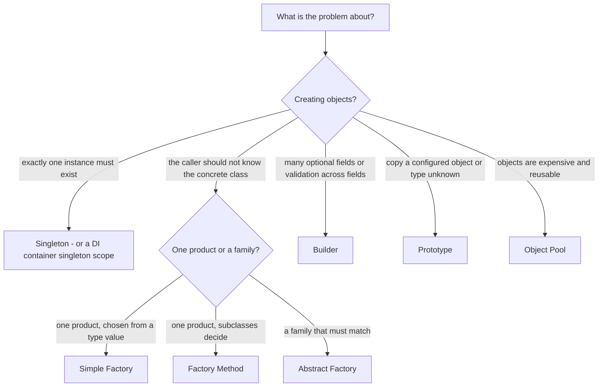
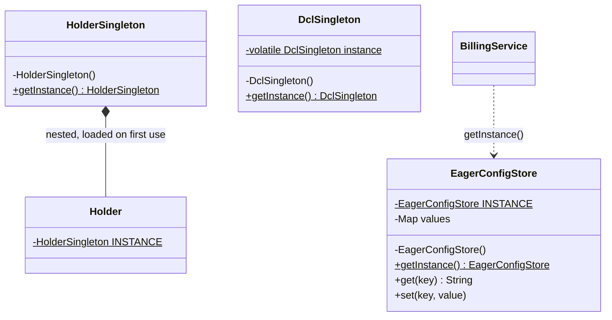
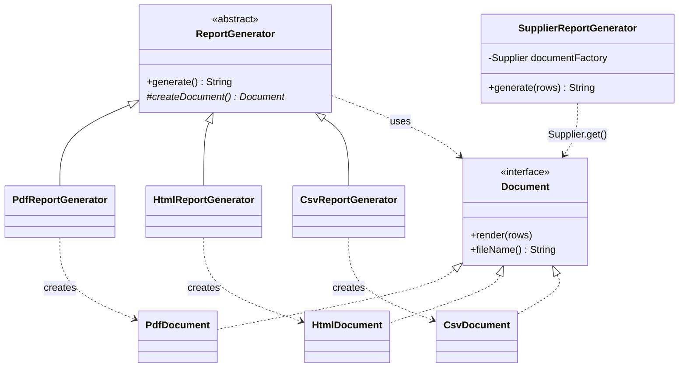
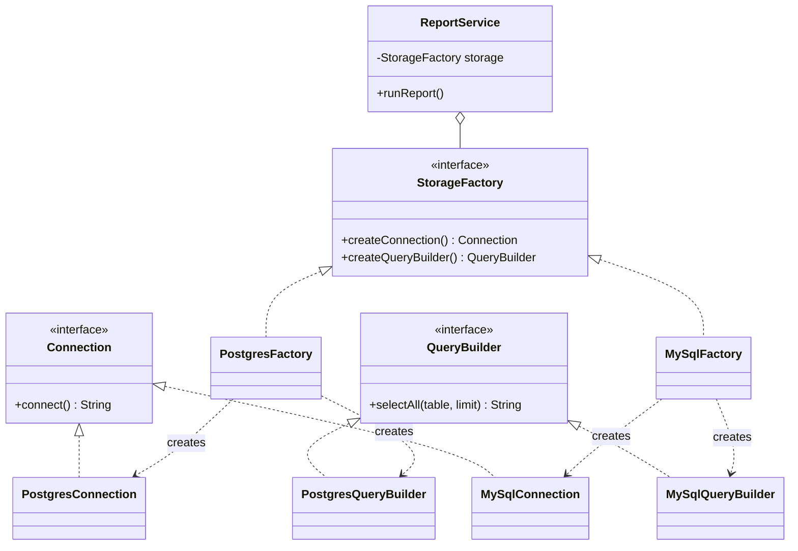
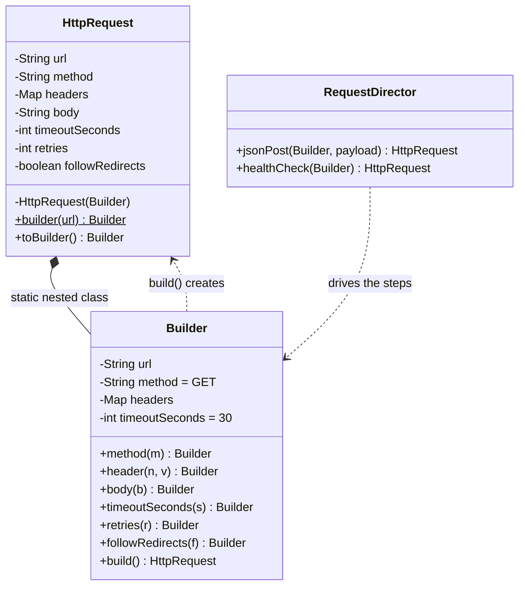
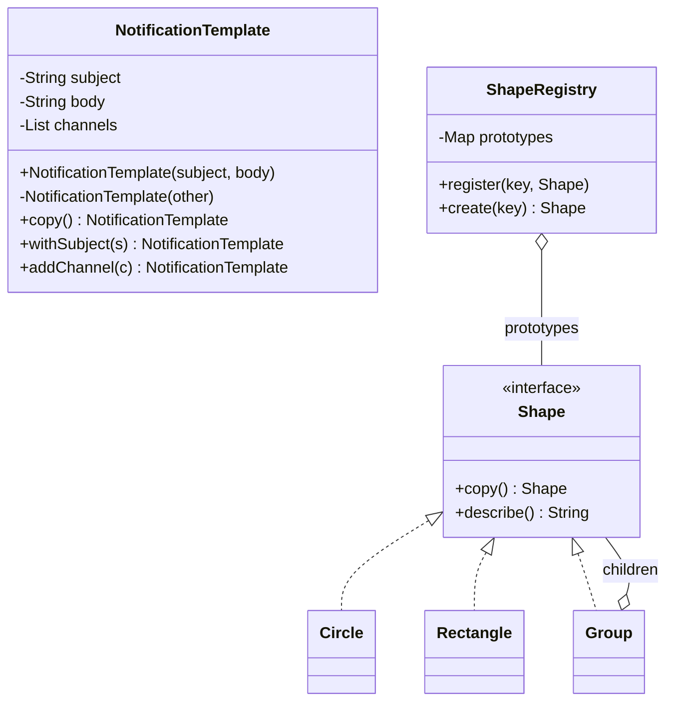
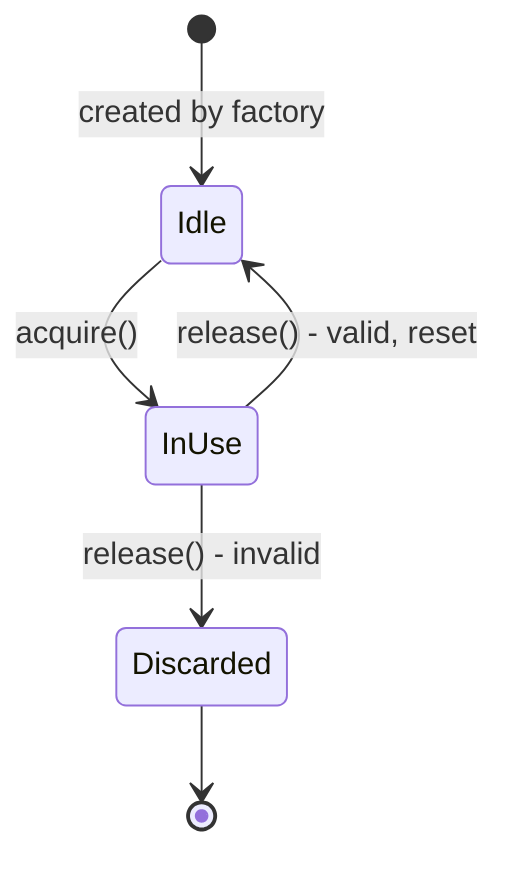

# Chapter 8 — Design Patterns: Introduction & Creational Patterns (Study Edition)

> **Study Edition.** A shorter version of Chapter 8 with every topic kept and the padding removed. The full chapter (README.md) has the complete code, full outputs and more follow-ups.
>
> **What you will learn.** What a design pattern is, where the idea came from, all 23 GoF patterns, the OO principles behind them, how to pick (and not pick) a pattern, anti-patterns, and the creational patterns in depth: Singleton, Simple Factory (idiom), Factory Method, Abstract Factory, Builder, Prototype and the bonus Object Pool.
>
> **Code.** `chapters/08-patterns-creational/code/lld/ch08/<pattern>/`, one `Main` per package (Java 21: `javac --release 21`, then `java lld.ch08.<pattern>.Main`).

---

# Part A — Design patterns: the big picture

## 8.1 What is a design pattern?

### What it is

A **design pattern** is a named, reusable description of a good solution to a recurring design problem. It is not a library or paste-in code — more like a *recipe* you adapt. (Analogy: builders learned over hundreds of houses where the front door works best; writing that down, with reasons and costs, is a pattern.)

- **Intent** — the one-sentence purpose ("ensure a class has only one instance").
- **Participants** — the roles that take part (*Creator*, *Product*, *Client*).

### The problem it solves

Without patterns every team re-solves the same problems in slightly different, slightly buggy ways. Patterns give proven solutions, readable code, built-in good principles (loose coupling, open/closed), adaptability and faster decisions — and a **shared vocabulary** ("use an Observer" replaces a paragraph), the biggest interview win.

### How it works

Every GoF pattern has four parts: **Name**, **Problem** (when to apply, forces in tension), **Solution** (participants and collaborations — a template, not code), **Consequences** (costs and benefits — a pattern without trade-offs is half a pattern). You adapt the template to your language and problem.

### When not to use it

Not every problem needs a pattern. Forcing one adds classes and indirection — worse than none (see 8.6).

### TL;DR

Pattern = **name + problem + solution template + consequences**. Value: vocabulary and proven trade-offs. Risk: overuse.

---

## 8.2 A short history: from buildings to the "Gang of Four"

| Year | Event |
|---|---|
| 1977 | Architect **Christopher Alexander**, *A Pattern Language* — named solutions for towns and buildings |
| 1987 | **Kent Beck** and **Ward Cunningham** apply pattern languages to Smalltalk UI design |
| 1994 | **Gamma, Helm, Johnson, Vlissides** — the **Gang of Four (GoF)** — publish *Design Patterns*: **23 patterns** in three categories |
| 2004 | *Head First Design Patterns* — the same patterns in Java, OO principles front and centre |

The GoF's two central principles:

1. **Program to an interface, not an implementation.**
2. **Favour object composition over class inheritance** ("has-a" black-box reuse over "is-a").

Creational patterns make principle 1 practical: if code must not name concrete classes, *someone* still has to create the objects.

---

## 8.3 The three categories and all 23 GoF patterns

### What it is

| Category | In one line |
|---|---|
| **Creational** | Control creation so the system doesn't depend on concrete classes or construction details |
| **Structural** | Compose classes/objects into larger, flexible structures |
| **Behavioral** | Assign responsibilities and design communication |

Second GoF axis, **scope**: **class patterns** use inheritance, fixed at compile time (Factory Method, class Adapter, Template Method, Interpreter); **object patterns** use composition, changeable at run time (the rest).

### The full catalogue

| # | Pattern | Category | Intent |
|---|---|---|---|
| 1 | **Abstract Factory** | Creational | Create *families* of related objects without naming concrete classes |
| 2 | **Builder** | Creational | Build a complex object step by step, separate from its representation |
| 3 | **Factory Method** | Creational | Subclasses decide which class to instantiate via an overridable method |
| 4 | **Prototype** | Creational | Create objects by copying a configured instance |
| 5 | **Singleton** | Creational | Exactly one instance with a global access point |
| 6 | **Adapter** (Wrapper) | Structural | Convert one interface into another |
| 7 | **Bridge** | Structural | Split abstraction from implementation so both vary |
| 8 | **Composite** | Structural | Treat single objects and trees uniformly |
| 9 | **Decorator** | Structural | Add responsibilities dynamically by wrapping |
| 10 | **Facade** | Structural | Simple entry point to a complex subsystem |
| 11 | **Flyweight** | Structural | Share intrinsic state across huge numbers of objects |
| 12 | **Proxy** | Structural | Stand-in controlling access to another object |
| 13 | **Chain of Responsibility** | Behavioral | Pass a request along handlers until one handles it |
| 14 | **Command** | Behavioral | Request as an object — queue, log, undo |
| 15 | **Interpreter** | Behavioral | Grammar as classes; evaluate sentences |
| 16 | **Iterator** | Behavioral | Traverse without exposing storage |
| 17 | **Mediator** | Behavioral | Centralise communication between objects |
| 18 | **Memento** | Behavioral | Capture/restore state without breaking encapsulation |
| 19 | **Observer** | Behavioral | Notify dependents when one object changes |
| 20 | **State** | Behavioral | Behaviour changes with internal state |
| 21 | **Strategy** | Behavioral | Interchangeable algorithms behind one interface |
| 22 | **Template Method** | Behavioral | Base class fixes the skeleton, subclasses fill steps |
| 23 | **Visitor** | Behavioral | Add operations without changing the classes |

Creational → this chapter, structural → Ch. 9, behavioral → Ch. 10–11. **5 + 7 + 11 = 23.** (Some course lists show ten behavioral patterns, omitting the rarely used Interpreter.) **Not GoF but common:** Simple Factory (idiom), Object Pool, Dependency Injection, Null Object, Repository, MVC (a "compound pattern" of Observer + Strategy + Composite).

### Self-check

- **Q:** Which creational pattern is a *class* pattern? **A:** Factory Method — subclasses override the creation method.
- **Q:** How many behavioral GoF patterns? **A:** Eleven.

---

## 8.4 The OO principles behind every pattern

| Principle | Patterns applying it |
|---|---|
| **Encapsulate what varies** | Factory Method, Strategy, State, Builder |
| **Composition over inheritance** | Abstract Factory (client *holds* a factory), Strategy, Decorator |
| **Program to interfaces** | Every creational pattern returns an interface |
| **Loose coupling** | Observer, Mediator, factories |
| **Open–Closed** | Factory Method, Decorator |
| **Dependency Inversion** | All factories — the client never calls `new ConcreteThing()` |
| **Least Knowledge** | Facade |
| **Hollywood Principle** | Template Method, Factory Method, frameworks/IoC |
| **Single Responsibility** | Builder, Iterator |

**Why creational patterns exist:** DIP says don't depend on concrete classes, but `new PdfDocument()` *is* such a dependency — so creational patterns move that `new` somewhere controlled (a factory, subclass, builder, prototype or container).

---

## 8.5 How to pick a pattern

### The problem it solves

Learning 23 patterns and hunting for places to use them is backwards. Start from a **signal** in the requirements.

### How it works

1. **Name the problem** in plain words ("pricing will change", "exactly one of these", "ten-argument constructor").
2. **Decide the category** — creating, structuring or behaving.
3. **Match the signal** to a pattern.
4. **Check the cost** — is there something simpler (enum, lambda, constructor, DI container)?
5. **Say what you rejected and why** — worth as much as the pick.



(For fitting objects together: Adapter, Decorator, Facade; for behaviour: Strategy, Observer, State.)

### The six patterns that come up in almost every LLD interview

Learn each with its **signal** — forcing a pattern where it doesn't fit costs more than not knowing it.


*Figure — the six interview patterns and the signal that tells you each one applies (course diagram)*

| Pattern | Signal | Use when | Don't use when |
|---|---|---|---|
| **Strategy** | One operation, several swappable versions chosen at run time | Several interchangeable rules | Only one rule, no hint of a second |
| **Factory** | Something must be created; the caller shouldn't care which class | Class depends on a type value | Only one concrete class |
| **Observer** | One object changes, several others must react unknown to it | Several listeners | A single listener already referenced |
| **State** | Behaviour depends on status; allowed moves are fixed | Many states and transitions | 3–4 states handled by one guarded method |
| **Singleton** | Genuinely one instance | Must be exactly one | You just want a global handle |
| **Builder** | Many optional fields; constructor keeps growing | Lots of optional fields | A few required fields |

In a parking-lot / library design: **Strategy** — a `ParkingRate` interface (`HourlyRate`, `WeekendRate`, `MonthlyPass`), the answer to "what if pricing changes?"; **Factory** — type value → `Vehicle`, keep it lean (a creation method is often enough in 45 min); **Observer** — spot as subject, boards subscribe (but one reserved-book member needs only a direct call); **State** — ticket active → paid → closed (with 3–4 states an `enum` + guard is clearer); **Singleton** — one `ParkingLot`, raise thread safety and testability yourself; **Builder** — a `BookItem` past ~6 arguments.

**Rules of thumb:** one or two patterns per 45-minute design, placed where their signal appears; **compare out loud** — "Strategy for rates because a second tariff is coming; no State for the ticket because one guard handles three statuses."

---

## 8.6 Anti-patterns: when patterns go wrong

### What it is

An **anti-pattern** is a common "solution" that looks reasonable but reliably causes more problems than it solves.

| Anti-pattern | Looks like | Fix |
|---|---|---|
| **God Object** (Blob) | `SystemManager` with 80 methods — violates SRP, untestable | Extract Class (Ch. 7); move behaviour to data owners |
| **Golden Hammer** | Favourite tool/pattern applied everywhere | Start from the problem's signal (8.5) |
| **Pattern overuse** ("patternitis") | Factories for one class, interfaces "just in case" — **Speculative Generality** | YAGNI: add the pattern when the *second* variant arrives |
| **Singletonitis** | Singletons as globals — hidden deps, order-dependent tests | Dependency injection (8.8) |
| **Cargo-cult patterns** | Structure without intent (a "Builder" that validates nothing) | Know the property the pattern gives you, or drop it |

### TL;DR

Patterns are a vocabulary, not a checklist. God Object comes from ignoring design; Golden Hammer and overuse from over-applying it.

---

# Part B — Creational patterns

## 8.7 Creational patterns at a glance

### What it is

**Creational patterns** control *how objects are created*, hiding *which* class is instantiated, *how* it is assembled, and sometimes *whether* a new object is made. The system becomes independent of creation, hides creation complexity, and stays flexible about what/who/how/when.

| Pattern | Intent |
|---|---|
| **Singleton** | Exactly one instance, one global way to reach it |
| **Factory Method** | Base class defines a creation method; subclasses choose the class |
| **Abstract Factory** | One factory object creates a matching *family* |
| **Builder** | Assemble one complex object step by step |
| **Prototype** | Create by cloning a prototypical instance |
| *Simple Factory* (idiom) | One method with a switch/registry picks the class |
| *Object Pool* (bonus) | Reuse a bounded set of expensive objects |

---

## 8.8 Singleton

### What it is

**Singleton** restricts a class to **exactly one instance** (per process / class loader) with **one well-known access point** — like a country's one government. **Eager** = create at class initialisation; **lazy** = on first request.

**GoF intent and participants.** Intent: never more than one instance; a well-known way to reach it. One participant, **Singleton**: a class-level `getInstance()` operation, usually also creating the instance. Clients just call it.

### The problem it solves

Some things are one per process: settings loaded from a file, a connection pool, a metrics registry. If billing, reporting and the mailer each build their own `ConfigStore`, the file is parsed three times and one service's change never reaches the others. A plain global has two problems: tests share it (results depend on test order), and someone must assign it before use (wrong start-up order → `null`). Singleton makes **the class decide how many instances exist and create the one it allows**, on demand.


*Figure — ConfigStore with a private static INSTANCE, a private constructor and a static getInstance(); BillingService only calls getInstance() (course diagram)*

### How it works

1. **`private` constructor** — the whole enforcement mechanism.
2. The instance in a **`private static` field** (owned by the class).
3. A **`public static getInstance()`** (static: callers have no instance yet).
4. Return the instance, creating it (safely) if needed.
5. Ordinary instance methods for the real work.



### The six ways to write a Singleton in Java

| # | Variant | Lazy? | Thread-safe? | Per-call cost | Survives serialization / reflection? | Verdict |
|---|---|---|---|---|---|---|
| 1 | **Eager** `static final` | No | Yes — class init runs once | None | No / No | Default when construction is cheap |
| 2 | **Naive lazy** `if (instance == null)` | Yes | **No** | None | No / No | Never in multi-threaded code |
| 3 | **`synchronized` getInstance()** | Yes | Yes | Lock on *every* call | No / No | Correct but slow under contention |
| 4 | **Double-checked locking** + `volatile` | Yes | Yes (Java 5+) | One volatile read | No / No | When creation needs run-time input |
| 5 | **Bill Pugh holder** | Yes | Yes — class loading | None | No / No | Best lazy option in plain Java |
| 6 | **`enum`** | No | Yes | None | **Yes / Yes** | Shortest, most robust (*Effective Java*) |

- **Eager:** set during class *initialisation* (first active use, not JVM start); JLS §12.4.2 guarantees once-only, safely published. Cost: built even if the class is touched for another reason.
- **Naive lazy:** *check-then-act* — two threads both see `null` and both construct. Passes single-threaded tests; our 8-thread demo built **8** objects.
- **`synchronized`:** fixes the race but locks forever for a first-call problem.
- **DCL:** check without the lock, lock, **check again**. The field **must be `volatile`**: object creation is allocate → construct → store, and without `volatile` another thread may see the reference before the constructor's writes (a half-built object). `volatile` gives a **happens-before** edge. Copying to a local reads the volatile once on the fast path.
- **Holder:** `private static final class Holder { static final X INSTANCE = new X(); }` and `getInstance()` returns `Holder.INSTANCE`; `Holder` isn't initialised until first touched — lazy, thread-safe, **no locks, no `volatile`**.
- **Enum** (`enum EnumConfigStore { INSTANCE; ... }`): one instance per constant, reflective creation refused, serialization special-cased. Can't extend a class; not truly on-demand.

**Which to pick:** default **eager**; **holder** once you've *measured* a start-up cost; **DCL** when creation needs a run-time value (and always `volatile`); **enum** for free serialization/reflection safety.

```java
/** 4. Double-checked locking: lock only on the first calls. volatile is mandatory. */
final class DclSingleton {
    static final AtomicInteger CONSTRUCTED = new AtomicInteger();
    private static volatile DclSingleton instance;
    // ... private constructor ...
    static DclSingleton getInstance() {
        DclSingleton local = instance;           // one volatile read on the fast path
        if (local == null) {                     // 1st check, no lock
            synchronized (DclSingleton.class) {
                local = instance;
                if (local == null) {             // 2nd check, under the lock
                    local = new DclSingleton();
                    instance = local;            // volatile write publishes a fully built object
                }
            }
        }
        return local;
    }
}

```

### Breaking a Singleton — and the fixes

| Attack | How | Fix |
|---|---|---|
| **Reflection** | `setAccessible(true).newInstance()` calls the private constructor | Throw from the constructor if `INSTANCE` exists (reliable for eager/holder, racy for lazy), or **enum** |
| **Serialization** | `readObject()` builds a new object without the constructor | `private Object readResolve() { return INSTANCE; }` (+ `transient` fields), or **enum** |
| **Cloning** | A `Cloneable` ancestor exposing `clone()` | Override `clone()` to throw (not an issue if no ancestor is `Cloneable` — `Object.clone()` is protected) |
| **Multiple class loaders** | Each loader has its own copy | Load from a shared parent loader, or let a container own it |
| **Multiple processes** | One per JVM — four servers, four instances | External coordinator (DB, Redis, ZooKeeper) for system-wide uniqueness |

`HardenedSingleton` adds all three defences (constructor guard, `readResolve`, throwing `clone`). Output: the naive lazy version under 8 threads — `constructor ran 8 time(s)` (varies; anything above 1 is the bug), DCL — `1`; the hardened and enum versions print `reflection -> blocked` and `serialization -> same? true`.

### Subclassing a Singleton

GoF: possible with a **`protected`** constructor, where `getInstance()` picks the subclass **once, at run time** — `AppLogger` chooses `PlainLogger` or `JsonLogger` from a system property. With a `private` constructor it can't be subclassed.

### The dependency-injection alternative

Often the best singleton is **not a Singleton class**: a normal class, **one** instance created at the **composition root**, passed in through constructors. Dependencies become visible; tests pass a fake (`new BillingService(testConfig)`). Spring beans are **singleton-scoped by default** — one per bean definition **per container**, not per JVM, and nothing stops `new`. Spring's **`prototype` scope** creates a fresh instance per lookup.

### Java implementation

The package also has `EagerConfigStore`, `EnumConfigStore`, `BreakableSingleton`/`HardenedSingleton`, `AppLogger` and `DiAlternative`.

Full runnable code: code/lld/ch08/singleton/ (see the Full Edition).

### Trade-offs

| Pros | Cons |
|---|---|
| **Controlled access** — one instance, one documented door | **Global state** — shared mutable state anyone can change |
| **You choose when** — eager or lazy | **Awkward to test** — needs a reset/injection hook that ships to production |
| **Fits shared resources** — pool, cache, device handle | **Invisible dependencies** — `getInstance()` inside isn't in the constructor |
| **Setup paid once** per process | **Uniqueness ends at the process** (class loader) |
| **Subclassable if designed in** (`protected`) | **Hard to undo**; mixes lifecycle management with real work (SRP) |

**Often confused with:** a **static utility class** (not an object — can't implement an interface or be mocked); **DI singleton scope** (same result, better mechanism); **Multiton** (`Logger.getLogger(name)` — one per key); Prototype (opposite intent). Elsewhere: Python module object, Go `sync.Once`, C++ Meyers Singleton.

### When not to use it

- **The motive is convenience** — a parameter delivers access just as well.
- **Mutable state tests touch** — tests pass alone, fail in the suite.
- **A framework manages lifecycles** — use singleton scope.
- **Multiple processes** — four servers = four "singletons"; using one for distributed locks or unique IDs is a **correctness bug**.

### Common mistakes

Naive lazy in multi-threaded code; DCL without `volatile`; `Serializable` without `readResolve()`; mutable state without thread-safe structures (`ConfigStore` uses `ConcurrentHashMap`); a `public static reset()` "for tests"; assuming one per system rather than per JVM/class loader.

### Real-world examples

- **JDK:** `Runtime.getRuntime()` (textbook), `Desktop.getDesktop()`; `Collections.emptyList()` (singleton-like shared constant); `Logger.getLogger(name)` (multiton).
- **Not singletons despite `getInstance()`:** `Calendar.getInstance()`, `NumberFormat.getInstance()`, `Cipher.getInstance()` return **new objects** — static factory methods (8.9).
- Spring singleton beans; connection pools, metrics registries; *Head First*'s chocolate boiler.

### In the interview

**30-second answer:** "Singleton guarantees one instance per JVM (strictly, per class loader) with a single access point: private constructor, static accessor. I'd use eager initialisation — the class loader makes it thread-safe for free — or the holder idiom if construction is expensive; an enum if it must survive serialization or reflection. But it's global state with hidden dependencies, so in a Spring app I'd make it a singleton-scoped bean and inject it."

- *Q: Why does DCL need `volatile`?* — A: Otherwise the reference can be published before the constructor's writes are visible; `volatile` gives a happens-before edge.
- *Q: Unique IDs across 10 servers?* — A: Not a Singleton (one per JVM). Use a DB sequence, Snowflake-style IDs (timestamp + machine id + counter) or UUIDs.

### Self-check

- **Q:** Which keyword enforces the pattern? **A:** `private` on the constructor.
- **Q:** Lazy, lock-free, thread-safe variant? **A:** The holder idiom.
- **Q:** What does `readResolve` do? **A:** Replaces the deserialized object with the real instance.

### TL;DR

Private constructor + static accessor = one per JVM. Prefer **eager**, then **holder**, then **enum**; **DCL needs `volatile`**; never naive lazy. Know the ways to break it. Mention the costs; DI singleton scope is usually better.

---

## 8.9 Simple Factory (an idiom, not a GoF pattern)

### What it is

One class (usually one static method) takes a type value and returns the matching object as a common interface. Very common, often right, but **not** GoF — *Head First* calls it an idiom. Analogy: a vending machine — press "B3", get the snack.

### The problem it solves

The `switch` turning `"sms"` into `new SmsNotification()` gets copied everywhere. A simple factory **centralises** the decision — it doesn't **remove** it: adding a channel still edits the factory. A registry softens this (types are *registered* at start-up).

### How it works

1. Product interface (`Notification`). 2. Concrete classes. 3. One `create(type)` — an exhaustive `switch` over an enum, or a `Map<String, Supplier<Notification>>` registry. 4. Callers hold the interface, never `new`. 5. Reject unknown types loudly.

### Java implementation

```java
/** Simple Factory (an idiom, not a GoF pattern): one static method owns the "which class?" decision. */
public final class NotificationFactory {

    public enum Channel { EMAIL, SMS, PUSH }

    private NotificationFactory() { }

    /** Version 1: a switch. Adding a channel means editing this method (and the enum). */
    public static Notification create(Channel channel) {
        return switch (channel) {                      // exhaustive switch: the compiler checks every enum value
            case EMAIL -> new EmailNotification();
            case SMS   -> new SmsNotification();
            case PUSH  -> new PushNotification();
        };
    }

    /** Version 2: a registry of suppliers. New types are registered, not coded into a switch. */
    private static final Map<String, Supplier<? extends Notification>> REGISTRY = new ConcurrentHashMap<>(Map.of(
            "email", EmailNotification::new,
            "sms", SmsNotification::new,
            "push", PushNotification::new));

    public static void register(String type, Supplier<? extends Notification> supplier) {
        REGISTRY.put(type.toLowerCase(Locale.ROOT), supplier);
    }

    public static Notification create(String type) {
        Supplier<? extends Notification> s = REGISTRY.get(type.toLowerCase(Locale.ROOT));
        if (s == null) throw new IllegalArgumentException("Unknown notification type: " + type);
        return s.get();
    }
}
```

- No `default` in the enum switch — the compiler flags an unhandled constant.
- The registry maps names to constructor references; `register("whatsapp", ...)` adds a channel without editing the factory (a lambda works because `Notification` has one abstract method).
- `Locale.ROOT` avoids the Turkish dotless-"i" lower-casing surprise.

Full runnable code: code/lld/ch08/simplefactory/ (see the Full Edition).

### Trade-offs

| Simple Factory | Factory Method |
|---|---|
| One method, usually a switch | Decision spread across subclasses |
| New type = edit the factory | New type = add a class |
| No inheritance | Creator subclass per product |
| Not GoF | GoF |

Short, stable, config-selected type list → Simple Factory is perfectly respectable. Other developers/modules adding types without editing your class → Factory Method.

### When not to use it

Only **one** concrete class (call the constructor); objects differ only in **data** (one class with a field).

### Common mistakes

Calling a switch-based factory a "Factory Method"; a `default` that returns `null` or a silent default; letting the factory grow into a God class.

### Real-world examples

**Static factory methods** (*Effective Java* item 1) — not GoF Factory Method, usually not singletons: `Calendar.getInstance()` (new object per call), `EnumSet.noneOf` (hidden `RegularEnumSet`/`JumboEnumSet`), `List.of`, `Integer.valueOf`, `Executors.newFixedThreadPool`; Spring `@Bean` methods.

### In the interview

**30-second answer:** "A simple factory is one method that maps a type value to a concrete class and returns it as an interface. It centralises the switch so callers don't depend on concrete classes. It's an idiom, not GoF — adding a type still edits it. For new types without editing, I'd use a registry of suppliers or Factory Method."

- *Q: Is it Open–Closed?* — A: Not strictly; a registry makes it open via registration.
- *Q: Static factory vs constructor?* — A: Names, caching (`Integer.valueOf`), can return subtypes.

### Self-check

- **Q:** What does it centralise but not remove? **A:** The switch — knowledge of every concrete type.
- **Q:** Why no `default` in the enum switch? **A:** So the compiler flags unhandled constants.

### TL;DR

One `create(type)` returning an interface. Great for small stable sets. Not GoF. `Supplier` registry = extensible variant.

---

## 8.10 Factory Method

### What it is

A base class defines a creation method but **subclasses decide the concrete class**; the base class uses the product without naming its type. Analogy: a franchise manual — take order, *prepare the dish* (each branch's own), serve, bill (*Head First*'s `PizzaStore.orderPizza()` with regional `createPizza()`).

**GoF intent and participants.** Intent: declare an operation that creates an object but let subclasses choose the class — instantiation is deferred to them. **Product** (`Document`), **ConcreteProduct** (`PdfDocument`), **Creator** (`ReportGenerator` — declares the factory method and *calls* it from its own operations), **ConcreteCreator** (`PdfReportGenerator` — overrides it).

> **Not a "static factory method".** `List.of`, `Calendar.getInstance` and Simple Factories are **one static method that decides** — not overridable, no Creator hierarchy. GoF Factory Method is an **instance method overridden in subclasses** and called by the base class. No inheritance + overriding → not this pattern.

### The problem it solves

`new PdfDocument()` inside `ReportGenerator` hard-wires PDF. The generator gathers rows, **creates a document**, renders, announces — only creation depends on format. A `switch` works until a second and third method need the same switch. Factory Method leaves a deliberate **gap**: the full procedure in the base class calls an abstract method each subclass fills.


*Figure — ReportGenerator declares the protected factory method createDocument(); each concrete generator overrides it to return its own Document (course diagram)*

### How it works

1. Product interface (`Document`: `render(rows)`, `fileName()`). 2. Concrete products. 3. Abstract creator with an **abstract `protected`** `createDocument()` (an extension point, not API). 4. Shared logic in the creator (`generate()`) calling it. 5. One concrete creator per product — the *only* place a concrete type is named. 6. The client picks a creator once, then uses `ReportGenerator` and `Document`.



### Java implementation

```java
/** Creator: writes the whole procedure once and leaves one hole - the factory method. */
public abstract class ReportGenerator {

    /** The factory method. Protected: a hook for subclasses, not public API. */
    protected abstract Document createDocument();

    /** The template that USES the factory method. It never names a concrete document. */
    public final String generate() {
        System.out.println("  Collecting rows for the monthly sales report...");
        List<String> rows = List.of("north,120", "south,95", "east,140");
        Document document = createDocument();
        document.render(rows);
        System.out.println("  Report ready: " + document.fileName());
        return document.fileName();
    }
}

final class PdfReportGenerator extends ReportGenerator {
    @Override protected Document createDocument() { return new PdfDocument(); }
}
// ... HtmlReportGenerator, CsvReportGenerator (CSV added later - no existing class edited) ...

/** The modern, composition-based variant: pass the "factory method" in as a Supplier. */
public final class SupplierReportGenerator {
    private final Supplier<? extends Document> documentFactory;
    // ... constructor ...
    public String generate(List<String> rows) {
        Document d = documentFactory.get();
        d.render(rows);
        return d.fileName();
    }
}
```

`generate()` is `final` — subclasses change *what* is created, not the procedure. `CsvDocument` + `CsvReportGenerator` were added with no edits (Open–Closed). The `Supplier` variant composes better and a test can pass a lambda. In the output, every generator prints the same "Collecting rows…" line — that code exists once.

Full runnable code: code/lld/ch08/factorymethod/ (see the Full Edition).

### Trade-offs

| Pros | Cons |
|---|---|
| **Extensible without edits** — new product = new class | **More classes** — a creator per product |
| **Common procedure in one place** | **Indirection** — which subclass am I holding? |
| **Test seam** — subclass returns a fake | **Relies on inheritance** (one superclass) |
| **Nobody holds the full type list** | **Tempting too early** — all cost with one product |

**Often confused with:** Simple Factory (one static switch); Abstract Factory (a *family* via a passed-in factory); **Template Method** (same hook mechanism but varies a *step* — `generate()` *is* one); Builder (many calls). In languages with first-class functions, passing a creation function is usually the better default.

### When not to use it

One product type and no second coming (most frequent over-design); the base class has no shared work; types differ by data (use `Map<String, Supplier<Document>>`); you need matching objects (Abstract Factory).

### Common mistakes

A **public** factory method (callers bypass the procedure); calling it from the base **constructor** (subclass fields not yet initialised); calling a switch-in-one-method a Factory Method.

### Real-world examples

- **JDK:** `Collection.iterator()` — each collection (ConcreteCreator) returns its own `Iterator` (ConcreteProduct); `AbstractList.iterator()` built on abstract `get(int)`.
- **JDK XML:** `DocumentBuilderFactory.newDocumentBuilder()`, `TransformerFactory.newTransformer()` — factory methods inside an Abstract Factory (`newInstance()` itself is a *static* factory).
- Spring `FactoryBean<T>.getObject()`; Android `Fragment.onCreateView()`.

### In the interview

**30-second answer:** "Factory Method puts a creation hook in a base class. The base class writes the procedure once against a product interface; each subclass overrides the protected factory method to return its product. New types are new classes — Open–Closed. It pays off only with real shared logic in the base class; otherwise a constructor or simple factory is simpler. In modern Java I'd often pass a `Supplier`."

- *Q: vs Simple Factory?* — A: One static switch that knows every type vs subclasses overriding a hook the base calls. Raise this yourself — calling a switch a Factory Method is a classic slip.
- *Q: How do you test `generate()`?* — A: Subclass the creator (or pass a `Supplier`) returning a fake `Document`.

### Self-check

- **Q:** The only place a concrete product is named? **A:** Each concrete creator's override.
- **Q:** What must the base class have for this to be worthwhile? **A:** Shared logic using the product.
- **Q:** Adding `CsvReportGenerator` shows which principle? **A:** Open–Closed.

### TL;DR

Base class = procedure + abstract `protected createX()`; subclasses pick the type. One product, varied by inheritance. `Supplier` is the light modern form.

---

## 8.11 Abstract Factory

### What it is

An interface for creating **families of related objects** that must be used together, without naming concrete classes. Choosing a family = choosing a factory. Analogy: a furniture catalogue — order from "Victorian" and every piece matches. (Course: one factory per OS theme; *Head First*: a regional pizza-ingredient factory.)

**GoF intent and participants.** Intent: one interface to create a set of related objects without naming their classes. **AbstractFactory** (`StorageFactory` — one create method per product kind), **ConcreteFactory** (`PostgresFactory`), **AbstractProduct** (`Connection`, `QueryBuilder`), **ConcreteProduct** (`PostgresQueryBuilder`), **Client** (`ReportService` — only abstract types). GoF notes one ConcreteFactory per family is typical, hence often a Singleton (passing it in is better).

### The problem it solves

Some objects are only correct with partners from the same variant: Postgres quotes identifiers with `"`, MySQL with backticks; macOS buttons with macOS checkboxes; fake payments + fake mailer + fake clock, never a mix. Pairing `PostgresConnection` with `MySqlQueryBuilder` compiles and fails later at the database. Factory Method varies **one** product; Abstract Factory keeps a **set** consistent. *It doesn't help you choose the right combination — it removes the ability to build a wrong one.*


*Figure — without the pattern a PostgresConnection can be paired with a MySqlQueryBuilder and fail at the database; with it, each factory hands out a matched set (course diagram)*

### How it works

1. Interface per **product kind**. 2. **Abstract factory** with one create method per kind. 3. Per variant, concrete products and a **concrete factory implementing every method** (covariant returns document the family). 4. The **client** receives a factory (constructor) and uses only abstract types. 5. Choose the factory **once at the composition root** (near `main`) and pass it down. (A correct Abstract Factory returns **all** products of its family — not one each.)



### Java implementation

```java
/** Abstract factory: one creation method per product in the family. */
public interface StorageFactory {
    Connection createConnection();
    QueryBuilder createQueryBuilder();
}

/** Concrete factories implement EVERY method and return only their own family (covariant return types). */
final class PostgresFactory implements StorageFactory {
    @Override public PostgresConnection createConnection()     { return new PostgresConnection(); }
    @Override public PostgresQueryBuilder createQueryBuilder() { return new PostgresQueryBuilder(); }
}
// ... MySqlFactory, FakeStorageFactory ...

/** Client: holds only the abstract factory and abstract products. It cannot mix families. */
public final class ReportService {
    private final StorageFactory storage;

    public ReportService(StorageFactory storage) { this.storage = storage; }

    public void runReport() {
        Connection connection = storage.createConnection();
        QueryBuilder queries = storage.createQueryBuilder();
        System.out.println("  " + connection.connect());
        System.out.println("  " + queries.selectAll("orders", 10));
    }
}
```

`ReportService` has **no branch** on the database. `Main.chooseFactory(db)` — the composition root — holds the only `switch`. `FakeStorageFactory` swaps the **whole environment** for tests in one line.

Full runnable code: code/lld/ch08/abstractfactory/ (see the Full Edition).

### Trade-offs

| Pros | Cons |
|---|---|
| **Wrong combinations can't be written** | **Many types** — interface per kind + class per product per family |
| **One switch for a whole environment** (real↔fake, Postgres↔MySQL, themes) | **New product kinds are expensive** — edit every factory |
| **Client never names a concrete class** (DIP) | **Another layer to trace** |
| **Test seam** — one fake factory | **Pointless with one family** |

**The asymmetry:** new **family** (`SqliteFactory`) = easy, Open–Closed; new **product kind** (`createMigrationRunner()`) = edit every factory.

### Abstract Factory vs Factory Method

| | Factory Method | Abstract Factory |
|---|---|---|
| Creates | **One** product | A **family** |
| Mechanism | **Inheritance** — subclass overrides | **Composition** — client holds a factory |
| Who chooses | Creator subclass | Factory passed in |
| Guarantees | New types without editing the creator | Products from one factory are compatible |
| New variant | New creator subclass + product | New factory + one product per kind |
| New product kind | n/a | Edit the interface and **every** factory |
| Example | `Collection.iterator()` | `DocumentBuilderFactory`, UI toolkits, DB dialects |

**Often confused with:** Builder (one product, many steps); a DI container (same outcome via profiles — prefer it if you have one); Facade (simplifies, no consistency guarantee).

### When not to use it

Objects that don't belong together (`createLogger()` + `createInvoice()` is a grab-bag); one variant only; a product-kind list that keeps growing (> 5–6); your DI container already does it (`@Profile`, Guice modules).

### Common mistakes

A factory implementing only some methods or mixing families; choosing the factory deep in the call stack; making it a Singleton by reflex.

### Real-world examples

- **JDK:** `DocumentBuilderFactory`, `TransformerFactory` (creates `Transformer` and `Templates`), `XPathFactory` — `newInstance()` locates an implementation whose products all match. JDBC `Connection` creates driver-specific `Statement`, `PreparedStatement`, `Blob`.
- UI toolkits (GoF's example), Hibernate `Dialect`, Spring `@Profile` bean sets.

### In the interview

**30-second answer:** "Abstract Factory is an interface with one create method per product in a family; each concrete factory returns a matched set. The client holds only the factory and abstract products, so it can't mix a Postgres connection with a MySQL query builder. I pick the factory once at the composition root. The cost: a new product kind means editing every factory."

- *Q: Add SQLite?* — A: `SqliteConnection`, `SqliteQueryBuilder`, `SqliteFactory`, one line in the composition root.
- *Q: Add a `MigrationRunner`?* — A: New method on the interface and every factory — the weak spot.

### Self-check

- **Q:** What does it guarantee? **A:** Products from one factory are always the same family.
- **Q:** What is the composition root? **A:** The one place near start-up where concrete choices are made and passed down.
- **Q:** Easy vs hard change? **A:** New family easy; new product kind hard.

### TL;DR

One factory → a matched family. Chosen once, passed down. Easy families, hard product kinds. Prefer DI profiles if you have a container.

---

## 8.12 Builder

### What it is

**Builder** separates the *construction* of a complex object from the object. A builder collects values **one named step at a time** (a **fluent interface** — each returns `this`); `build()` produces the finished, usually **immutable**, product. Analogy: ordering at Subway, step by step.

| | **GoF Builder** (1994) | **Bloch's Builder** (*Effective Java* item 2) |
|---|---|---|
| Targets | One construction process → **different representations** (RTF reader → ASCII, TeX, text widget) | Many optional parameters; wish for an immutable, validated object |
| Participants | **Builder** (abstract, one method per part), **ConcreteBuilder** (one representation, `getResult()`), **Director** (runs the steps), **Product** | Product + static nested `Builder`: fluent setters, validating `build()`; no Director or abstract Builder |
| What varies | Which ConcreteBuilder is plugged in | Only the values |

Most real code is Bloch's; interviews may expect the GoF participant names too.

### The problem it solves

`new HttpRequest(url, "GET", headers, null, 30, 3, true, false, null)` — which `null` is the body? Swap two booleans and it still compiles.

| Approach | What goes wrong |
|---|---|
| **Telescoping constructors** | Overloads explode; still positional; same-typed params swap silently |
| **JavaBeans** (empty constructor + setters) | Half-built objects; can't be immutable; nowhere to validate cross-field rules |

Builder: **named** values, **defaults**, **immutable** product, and `build()` as **one gate**. Our rule "a GET must not carry a body" (no defined meaning per RFC 9110 §9.3.1) spans two fields, so only `build()` can enforce it.


*Figure — HttpRequest with final fields and a private constructor; HttpRequest.Builder with the same mutable fields, setters returning Builder, and build() returning HttpRequest (course diagram)*

### How it works

1. Product fields **`final`**, constructor **`private`** taking the builder. 2. **`static` nested `Builder`** with mutable fields and **defaults**. 3. **Required** values in the builder's constructor / `builder(url)`. 4. Named step methods that **`return this`**. 5. **`build()`**: validate cross-field rules, **copy mutable collections**, call the private constructor — the only method returning the product. 6. Optional: **Director**, **`toBuilder()`**, **staged builder**. Price: every field is written twice.



### The Director — and why you rarely see one

The GoF **Director** knows the **order of steps** and runs them on whatever builder it gets — a home for a reusable recipe. Day to day, only *values* vary, so callers chain the calls themselves. **Test:** will the Director ever get a *different kind* of builder? If not, drop it. (Our `RequestDirector` only takes `HttpRequest.Builder` — it shows just the "named recipe" half.)

### The staged (step) builder

Encode required/ordered steps in **types**: `Email.builder()` returns `ToStep` (only `to()`), then `SubjectStep` (only `subject()`), then `OptionalStep` with `build()`. `Email.builder().build()` **does not compile** — the answer to "how do you stop callers forgetting a required field?".

### Lombok-style builders and records

- **Lombok `@Builder`** generates it all (`toBuilder = true`, `@Singular`) but does **not** validate by default. **Records** give the immutable product — validate in the compact constructor. **Immutability checklist:** final class/private constructor, `final` fields, no setters, defensive copies, no leaking getters.

### Java implementation

```java
// ... HttpRequest: final fields; private HttpRequest(Builder b) copies them, with headers = Map.copyOf(b.headers)
    /** The builder: same fields, mutable, with defaults. Every setter returns this. */
    public static final class Builder {
        private final String url;                                  // required -> constructor
        private String method = "GET";                             // optional -> defaults
        private final Map<String, String> headers = new LinkedHashMap<>();
        private String body;
        private int timeoutSeconds = 30;
        private int retries = 3;
        private boolean followRedirects = true;

        private Builder(String url) { this.url = Objects.requireNonNull(url, "url"); }

        public Builder method(String m)             { this.method = m; return this; }
        public Builder header(String n, String v)   { headers.put(n, v); return this; }
        public Builder body(String b)               { this.body = b; return this; }
        // ... timeoutSeconds, retries, followRedirects ...

        /** The single gate: cross-field validation happens here, before any product exists. */
        public HttpRequest build() {
            if (url.isBlank()) throw new IllegalStateException("url is required");
            if (method.equals("GET") && body != null) throw new IllegalStateException("a GET request cannot have a body");
            if (retries < 0) throw new IllegalStateException("retries cannot be negative");
            if (timeoutSeconds <= 0) throw new IllegalStateException("timeout must be positive");
            return new HttpRequest(this);
        }
    }
}
```

- `TelescopingPizza` is the anti-example (five constructors; `("large", "thin", true, false, true)`).
- **`Map.copyOf`** matters: without it, two products built from one builder share one map, and a later header leaks into the earlier product. It's also unmodifiable, so `headers().put(...)` throws.
- `toBuilder()` gives "same as this, but…" copies; `RequestDirector.jsonPost/healthCheck` are named recipes; `Email` is the staged builder.

Full runnable code: code/lld/ch08/builder/ (see the Full Edition).

### Trade-offs

| Pros | Cons |
|---|---|
| **Self-describing call sites** | **Duplicated fields** — two edits per new field |
| **Immutable products**, thread-safe to share | **Forgettable `build()`** |
| **Home for validation** | **Overused** for 3-field objects |
| **Free optional fields** via defaults | **Reuse pitfall** — shared collections unless copied |
| **Different representations** (GoF Director) | One extra short-lived object (rarely measurable) |

**Often confused with:** Factory Method (one call picks a type); Abstract Factory (several products at once); a **fluent interface** (a calling style — no separate product); Prototype (starts from a finished object). Named/default arguments (Python, Kotlin) usually replace builders.

### When not to use it

A few required fields (the most common misuse); named/default arguments available; a builder that validates nothing for a mutable product; a mutable object living inside one method.

### Common mistakes

Setters not returning the builder; no validation in `build()`; sharing mutable collections with products; a public product constructor (bypasses validation); a Director when the order never varies.

### Real-world examples

- **JDK:** `StringBuilder`, `HttpClient.newBuilder()`, `HttpRequest.newBuilder()`, `Locale.Builder`, `Calendar.Builder`, `Stream.builder()`, `Thread.ofVirtual().name("w").start(task)`, `ProcessBuilder`.
- **Spring/libraries:** `UriComponentsBuilder`, `ResponseEntity.ok()...`, `WebClient.builder()`, OkHttp, Protobuf, Guava `ImmutableList.builder()`.

### In the interview

**30-second answer:** "With many optional parameters I use a Builder: required values in the builder's constructor, one named method per optional field returning the builder, and `build()` that validates cross-field rules and creates an immutable product via a private constructor. I'd mention the GoF Director but usually skip it since only values vary. For tiny objects or languages with named arguments, I wouldn't bother."

- *Q: How do you enforce required fields?* — A: Builder constructor, validation in `build()`, or a staged builder.
- *Q: Is the built object thread-safe?* — A: The immutable product is; don't share the builder across threads.

### Self-check

- **Q:** The only builder method not returning the builder? **A:** `build()`.
- **Q:** What bug does copying the headers map prevent? **A:** Two products sharing and mutating one map.
- **Q:** When is a Director worth it? **A:** When the same recipe is reused, possibly with different builders.

### TL;DR

Named steps + defaults + one validating `build()` → immutable product. Fixes telescoping constructors and half-built JavaBeans. Director optional; staged builder for compile-time required steps; Lombok/records cut boilerplate.

---

## 8.13 Prototype

### What it is

Create objects by **copying an existing, configured object** via its own `copy()` — the caller needn't know the concrete class. Analogy: copying a contract template and changing the name and date.

**GoF intent and participants.** Intent: use a configured instance as the model and make new objects by copying it. **Prototype** (declares the copy operation — `Shape.copy()`), **ConcretePrototype** (`Circle`, `Rectangle`, `Group`; `NotificationTemplate` plays both roles), **Client** (asks a prototype to copy itself — `Main`, or `ShapeRegistry`, a *prototype manager*).

### The problem it solves

1. **Expensive construction** — a `NotificationTemplate` parsed from disk; each welcome email differs only in subject and one channel. Re-parsing per recipient repeats the slowest work.
2. **Unknown concrete class** (the more important case) — you hold a `Shape` and need one more of the same; you can't write `new`. The object knows its own class, so it copies itself — no factory or `switch`, and the copy starts from correct values.


*Figure — a shallow copy shares the channels list with the prototype, so adding "push" to the copy corrupts the prototype; a deep copy gets its own list (course diagram)*

### How it works

1. Two entrances: the **normal constructor** (expensive) and a **copy path** (none of it). 2. Implement the copy as a **private copy constructor**. 3. Per field: immutable → share; mutable → copy (`new ArrayList<>(other.channels)`), recursing for nested mutables. 4. Public **`copy()`**. 5. A **prototype interface** (`Shape { Shape copy(); }`) only when clients hold several unrelated types. 6. Optional **registry** that always hands out copies. (No separate creator class — the product copies itself.)



### Shallow vs deep copy

| | Shallow | Deep |
|---|---|---|
| Primitives, `String`, immutables | Copied / safely shared | Copied / safely shared |
| Mutable fields | **Shared** | **Duplicated** |
| Cost | Cheap | Proportional to the object graph |
| Risk | Editing the copy changes the original | Cycles; copying caches or resources |
| Java default | `Object.clone()` | You write it per field |

With `this.channels = other.channels`, adding "push" to a copy adds it to the prototype — and **every later copy** inherits it. The fix is one line per mutable field. **Copy depth is a per-field design choice.** Related traps: a **new field not added to the copy** (silently dropped); copying something that **owns a resource** (both try to close it); **cycles** (naive recursive copy never ends — track visited objects).

### Why Java's `Cloneable` is a trap

(*Effective Java* item 13.) `Cloneable` is a **marker with no methods**; `Object.clone()` is **`protected`**; it's **shallow**; it **skips constructors** (and their validation); deep-copying needs reassignment — **impossible for `final` fields**; it throws a **checked** exception. **Prefer a copy constructor or static `copyOf(other)`.** Exception: `array.clone()` for primitive arrays is fine.

### Java implementation

```java
/** Prototype via a copy constructor: one expensive path, one cheap copy path. */
public final class NotificationTemplate {
    static int parses = 0;

    private String subject;
    private final String body;
    private final List<String> channels;

    /** The expensive path (imagine parsing a template file). */
    public NotificationTemplate(String subject, String body) {
        parses++;
        System.out.println("  Parsing template from disk... (expensive)");
        this.subject = subject;
        this.body = body;
        this.channels = new ArrayList<>(List.of("email"));
    }

    /** The copy path: no parsing. Deep-copies the mutable list. */
    private NotificationTemplate(NotificationTemplate other) {
        this.subject = other.subject;               // String is immutable -> sharing is safe
        this.body = other.body;
        this.channels = new ArrayList<>(other.channels);  // NEW list -> the copy owns its own
    }

    public NotificationTemplate copy() { return new NotificationTemplate(this); }
    // ... withSubject, addChannel, toString ...
}

```

Also in the package: `Group.copy()` (recursive deep copy of children), `Circle.copy()` with a covariant return, `ShapeRegistry.create()` returning `p.copy()` (never the original), and `CloneablePitfall.java` (`ShallowPlaylist` bug vs `DeepPlaylist`, whose `songs` can't be `final`).

Output: "Parsing template from disk" prints **once** for three templates, and the prototype keeps `channels=[email]` while copies add `push`/`sms`.

Full runnable code: code/lld/ch08/prototype/ (see the Full Edition).

### Trade-offs

| Pros | Cons |
|---|---|
| **Costly setup paid once** | **Copy code in every class** — drifts when fields are added |
| **Create without naming a class** | **Shallow vs deep per field** — wrong call shares state |
| **New kinds at run time** via registered prototypes | **Cyclic graphs** need care |
| **Saved starting points** (templates, layouts) | **Hazardous for identity** (keys, handles, connections); Java's `Cloneable` is flawed |

**Often confused with:** Factory Method (fresh object); Builder (from parts); **Object Pool** (lends *existing* objects); **Spring `prototype` scope** (constructs anew — no cloning); JS prototypes (a language feature). JS spread is *shallow*; `structuredClone()` and Python `deepcopy` are deep.

### When not to use it

Cheap construction; objects with **identity** (two rows sharing an ID is worse than a slow constructor); large graphs; immutable objects (just share them).

### Common mistakes

Shallow-copying a mutable collection; trusting `super.clone()`; forgetting to update the copy constructor; handing out the registry's original.

### Real-world examples

`ArrayList.clone()` / `HashMap.clone()` (**shallow**), copy constructors (`new ArrayList<>(c)`), `List.copyOf`; Unity `Instantiate(prefab)`; "Duplicate" in Docs/Figma; templates in Notion/Jira.

### In the interview

**30-second answer:** "Prototype creates objects by copying a configured instance via `copy()`. It saves expensive setup and — the deeper reason — lets me create an object when I only hold an interface. The main decision is shallow vs deep per field; a shared mutable list is the classic bug. In Java I'd write a copy constructor, not `Cloneable`, and never copy things with identity like a DB id or connection."

- *Q: Deep copy with cycles?* — A: An identity map original → copy; reuse the copy if already made.
- *Q: Serialization-based deep copy?* — A: Possible but slow, needs `Serializable`, bypasses constructors — last resort.

### Self-check

- **Q:** Shallow vs deep? **A:** Shallow copies references; deep also copies the referenced mutable objects.
- **Q:** Why can't `DeepPlaylist.songs` be `final`? **A:** `clone()` must reassign it after `super.clone()`.
- **Q:** What should a registry return? **A:** A copy, never the original.

### TL;DR

Copy a configured object — saves setup and works with only an interface. Decide shallow vs deep per field. Copy constructors, not `Cloneable`. Never copy identity.

---

## 8.14 Bonus — Object Pool

### What it is

A **bounded set of reusable objects**: clients **acquire**, use, and **release** so others can reuse them. Not GoF, but a known creational pattern. Analogy: a bike-sharing dock — take, ride, return; if none, wait (or give up).

### The problem it solves

Some objects are **expensive** (DB connection: TCP + TLS + auth) and/or **limited** (the DB caps connections). One per request is slow and can overwhelm the server. A pool pays creation a few times and **caps** the total.

### How it works

1. An **idle queue**, a live count, and a cap (a `Semaphore` with one permit per lendable object).
2. **acquire()**: wait (with timeout) for a permit; take an idle object or create one; fail on timeout.
3. Client **always releases in `finally`** — a leak is lost forever.
4. **release()**: **validate** (discard broken ones), **reset** per-borrower state, return it; always free the permit.
5. Everything **thread-safe**.



### Java implementation

```java
// ... ObjectPool<T> fields: Semaphore permits (maxSize, fair), ConcurrentLinkedQueue<T> idle,
// ...   Supplier<T> factory, Consumer<T> reset, Predicate<T> isValid, AtomicInteger created
    /** Borrow an object, waiting up to the timeout if all are in use. */
    public T acquire(long timeout, TimeUnit unit) throws InterruptedException {
        if (!permits.tryAcquire(timeout, unit)) {
            throw new IllegalStateException("pool exhausted: timed out after " + timeout + " " + unit);
        }
        // Holding a permit guarantees we are within the cap: reuse an idle object or create one.
        T obj = idle.poll();
        if (obj != null) return obj;
        try {
            obj = factory.get();
            created.incrementAndGet();
            return obj;
        } catch (RuntimeException e) {
            permits.release();                                     // creation failed: give the permit back
            throw e;
        }
    }

    /** Give an object back. Broken objects are discarded so a fresh one can be created later. */
    public void release(T obj) {
        try {
            if (isValid.test(obj)) {
                reset.accept(obj);
                idle.offer(obj);
            } else {
                created.decrementAndGet();                         // discard it; its permit still comes back
            }
        } finally {
            permits.release();                                     // wakes one waiting borrower, if any
        }
    }
```

- The **`Semaphore`** caps borrowed objects however many threads race; holding a permit means "reuse idle, else safe to create".
- `release()` frees the permit **even when discarding**, so a waiter can create a replacement; a failed factory call also returns its permit.
- Handing objects through a concurrent queue + semaphore makes the previous borrower's writes visible to the next.
- `Main`: 10 tasks on 6 threads with a pool of 3 → `connections ever created: 3`; exhaustion prints `pool exhausted: timed out after 100 MILLISECONDS`.

Full runnable code: code/lld/ch08/objectpool/ (see the Full Edition).

### Trade-offs

| Pros | Cons |
|---|---|
| Avoids repeated expensive creation | Complexity: sizing, validation, timeouts, leak detection |
| Caps resource usage (protects the DB) | Leaks shrink the pool until it deadlocks |
| Predictable latency after warm-up | Incomplete reset leaks one user's data to the next |
| | **Slower than `new`** for cheap objects |

### When not to use it

**Cheap** objects (JVM allocation is faster); **virtual threads** (Java 21 — create one per task); when a **library** exists (HikariCP, Commons Pool 2).

### Common mistakes

Not releasing in `finally`; not resetting state; unbounded waits; **double release** (here it would queue one object twice *and* add a permit, silently raising the cap — real pools track borrowed objects).

### Real-world examples

HikariCP (Spring Boot default), DBCP, c3p0; `ThreadPoolExecutor`; Commons Pool 2 `GenericObjectPool` (Jedis); Netty `PooledByteBufAllocator`. *Not* pools: the `String` intern pool and `Integer` cache (-128..127) share immutables — that's **Flyweight** (Ch. 9).

### In the interview

**30-second answer:** "An object pool reuses a bounded set of expensive objects like DB connections. acquire takes an idle one, creates one if under the cap, or waits with a timeout; release validates, resets and returns it. It must be thread-safe and clients release in finally. For cheap objects it's counter-productive; in production I'd use HikariCP."

- *Q: Sizing?* — A: From measured concurrency and downstream limits; small pools (≈ core-count scale) often win.
- *Q: Leaks?* — A: Record borrower and time; log long holds (HikariCP `leakDetectionThreshold`).

### Self-check

- **Q:** Pool vs Flyweight? **A:** Pool lends mutable objects exclusively and takes them back; Flyweight shares immutable objects with everyone at once.
- **Q:** Why validate on release? **A:** So dead objects aren't handed to the next borrower.

### TL;DR

Borrow → use → return (in `finally`). Bounded, thread-safe, validated, reset. Only for expensive/limited resources; use a mature library.

---

## 8.15 Creational patterns compared

### At a glance

| Pattern | Distinctive feature | Use when | JDK / Spring |
|---|---|---|---|
| **Singleton** | One instance | One shared resource | `Runtime.getRuntime()`, singleton beans |
| **Simple Factory** | One method maps type → class | Small, stable, config-chosen set | `Calendar.getInstance()`, `EnumSet.noneOf`, `@Bean` |
| **Factory Method** | Subclasses choose via overridable method | Shared procedure, varying product | `Collection.iterator()`, `FactoryBean` |
| **Abstract Factory** | Families without concrete classes | Products must match | `DocumentBuilderFactory`, JDBC `Connection`, profiles |
| **Builder** | Construction separate from representation | Optional fields, validation, immutability | `StringBuilder`, `HttpClient.newBuilder()` |
| **Prototype** | Copy an existing object | Expensive setup, or only interface known | Copy constructors, `ArrayList.clone()`, Unity |
| **Object Pool** | Reuse a bounded set | Expensive/limited resources | HikariCP, `ThreadPoolExecutor` |

### Pick by the question you are asking

| You are asking… | Pattern |
|---|---|
| "Only one?" | Singleton (or DI singleton scope) |
| "Avoid scattered `new ConcreteClass()`?" | Simple Factory |
| "Let subclasses/plug-ins decide?" | Factory Method |
| "Make sure these always match?" | Abstract Factory |
| "Make a 10-argument constructor readable and safe?" | Builder |
| "Another one of *this*, cheaply or without knowing its class?" | Prototype |
| "Stop creating and destroying this expensive thing?" | Object Pool |

### How they combine

- **Abstract Factory** is often built from **Factory Methods**, may use **Prototypes**, and is often a **Singleton** (passing it in is better).
- A **Builder** can use a **Factory** to pick parts; a **Director** can be a stateless shared service.
- Designs often *start* with Factory Method and *evolve* toward Abstract Factory, Prototype or Builder.

---

## 8.16 Chapter self-check

1. **Q:** The three GoF categories and counts? **A:** Creational 5, Structural 7, Behavioral 11 = 23.
2. **Q:** The two GoF central principles? **A:** Program to an interface; favour composition over inheritance.
3. **Q:** Why must the DCL field be `volatile`? **A:** So no thread sees a reference to a not-yet-constructed object (happens-before).
4. **Q:** Factory Method vs Abstract Factory? **A:** One product by inheritance vs a matching family by composition.
5. **Q:** How many patterns in a 45-minute design? **A:** One or two — and name the one you rejected.

## 8.17 Chapter TL;DR

- **Patterns** = named, proven templates with trade-offs; GoF (1994) catalogued 23 in three categories.
- **Pick from the signal**, one or two per design; state cost and alternative.
- **Singleton** — one per JVM; eager / holder / enum; DCL needs `volatile`; prefer DI.
- **Simple Factory** — one `create(type)`; idiom, not GoF.
- **Factory Method** — base-class procedure + subclass-chosen product.
- **Abstract Factory** — one factory, one matching family, chosen at the composition root.
- **Builder** — named steps, one validating `build()`, immutable product.
- **Prototype** — copy a configured object; shallow vs deep; avoid `Cloneable`.
- **Object Pool** — borrow/return expensive objects; use a real library.
