# Chapter 9 — Structural Design Patterns

> **Where this fits.** Chapter 8 was about *creating* objects. This chapter is about *putting objects together*: connecting, wrapping, nesting and sharing them so larger structures stay flexible. Chapters 10–11 cover how objects *talk to each other* (behavioral patterns).

**What you will learn**

| # | Pattern | One-line intent | Everyday analogy |
|---|---|---|---|
| 9.1 | Adapter | Translate a class's interface into the one your code already uses | A travel plug adapter |
| 9.2 | Bridge | Separate two independently varying dimensions into two hierarchies joined by a reference | A TV remote (control) and the TV (device) are sold separately |
| 9.3 | Composite | Treat one object and a tree of objects the same way | A folder can hold files and other folders |
| 9.4 | Decorator | Add behaviour to one object at run time by wrapping it | Toppings on a coffee |
| 9.5 | Facade | One simple entry point in front of a complicated subsystem | A hotel concierge |
| 9.6 | Flyweight | Share the repeating part of many objects to save memory | One font glyph "e" reused for every "e" on a page |
| 9.7 | Proxy | A stand-in with the same interface that controls access | A receptionist who decides whether you may see the manager |
| 9.8 | Comparison | Adapter vs Decorator vs Proxy vs Facade vs Bridge | — |

**How to run every example in this chapter**

```bash
cd chapters/09-patterns-structural/code
javac --release 21 -d /tmp/lld_09 $(find . -name '*.java')
java -cp /tmp/lld_09 lld.ch09.adapter.Main     # or bridge, composite, decorator, facade, flyweight, proxy
```

All seven `Main` classes compile with Java 21 (standard library only) and run; each pasted output is that program's real output.

> **Code-style note.** In `code/` every top-level type has its own file and is package-private (visible only within its package — a named folder of related classes). The folder compiles with `javac --release 21 -Xlint:all` with **zero warnings**. The listings below show the essential lines of those files; open the folder for the full runnable code.

---

## 9.0 What structural patterns are

### What it is

A **design pattern** is a named, reusable solution to a recurring design problem. The "Gang of Four" (GoF) book — *Design Patterns: Elements of Reusable Object-Oriented Software* (Gamma, Helm, Johnson, Vlissides, 1994) — sorted its 23 patterns into three families:

| Family | Question it answers | Examples |
|---|---|---|
| Creational (Ch. 8) | How do I create objects? | Singleton, Factory Method, Builder |
| **Structural (this chapter)** | **How do I combine classes and objects into bigger structures?** | **Adapter, Bridge, Composite, Decorator, Facade, Flyweight, Proxy** |
| Behavioral (Ch. 10–11) | How do objects share work and talk? | Strategy, Observer, Command |

**Structural patterns** combine small objects and classes into larger structures while keeping them flexible and efficient. Used well, they **simplify complex structures** (a Facade hides many steps; a Composite hides nesting), **promote reuse** (an Adapter reuses a class whose interface does not fit), **improve flexibility by decoupling** classes — reducing how much each depends on the others' details (Bridge, Decorator, Proxy) — and **improve maintainability**, since relationships are clear and changes stay local. The seven the GoF named, and interviewers ask about, are **Adapter, Bridge, Composite, Decorator, Facade, Flyweight and Proxy**.

### Three words you need first

- **Composition** ("has-a"): an object holds and uses a reference to another. Almost every structural pattern is built on it.
- **Delegation**: forwarding a call to the object you hold. `wrapper.pay()` calls `inner.charge()`.
- **Interface** (design sense): the set of methods a caller can use on an object — often, not always, a Java `interface` type.

> **Key insight.** Adapter, Decorator, Proxy and Facade have the *same physical shape*: one object holds another and forwards calls. **Intent** — what changes as the call passes through — tells them apart. Section 9.8 puts them side by side.

---

## 9.1 Adapter Pattern

### What it is

The **Adapter** lets your code use a class whose methods have the "wrong" shape — one you cannot change — by placing a small translator between them, like a travel plug adapter between a US charger and an Indian socket. GoF's intent: *convert the interface of a class into another interface clients expect; Adapter lets classes work together that couldn't otherwise because of incompatible interfaces.* GoF also calls it **Wrapper**.

| Term | Meaning |
|---|---|
| **Target** | The interface your code wants to use (`PaymentGateway`). |
| **Adaptee** | The existing class with the "wrong" interface (`StripeClient`). You usually do not own it. |
| **Adapter** | The class that implements the Target and translates calls to the Adaptee (`StripeGateway`). |
| **Client** | Code that uses the Target (`checkout`). |

### The problem it solves

The shape your code calls and the shape the other side offers do not match:

- checkout wants `pay(Money)`, but the payment SDK (software development kit — the vendor's client library) offers `charge(amountInCents, currencyCode)`;
- an old service answers in XML while every consumer works with JSON (two common text formats for structured data);
- an analytics library wants `track(String, Map)` while your code produces an `Event`.

The key constraint: **the other side is not yours to change** — a third-party library (owned by an outside company or project), another team's service, or code with dozens of callers. Bending *your* code to its shape touches every call site (each place that calls the method), and you repeat it the day the vendor is swapped.

Concretely: checkout must support Stripe now and perhaps PayPal later (both online payment providers). Stripe wants whole **cents** plus a **lowercase** currency; PayPal a **decimal string** like "42.50" plus an **uppercase** code. Your code would rather reason in `Money`.

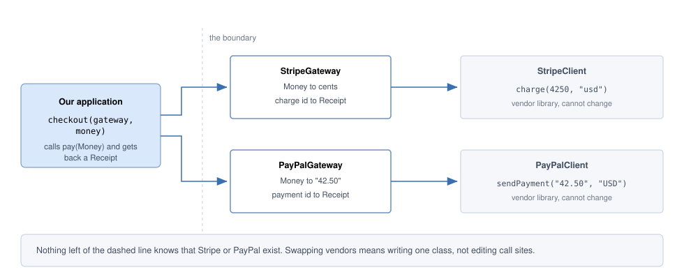
*Figure — Two adapters (StripeGateway, PayPalGateway) translate our `pay(Money)` into each vendor's own call; nothing on the application side knows which vendor exists (course diagram)*

Left of the dashed boundary everything speaks `Money` and `Receipt`; swapping vendors means one new class, no call-site changes.

### How it works

1. **Define the Target in your own vocabulary** (`PaymentGateway.pay(Money) -> Receipt`), mentioning no vendor.
2. **One adapter class per adaptee**: it `implements` the Target and **holds** the vendor object.
3. **Translate inputs** (`Money` → cents + lowercase code).
4. **Call the adaptee.**
5. **Translate outputs and errors back**: vendor result → `Receipt`; vendor exception → *your* exception.
6. **Clients depend only on the Target** and never learn which vendor answered.

> **The rule that makes it work:** the adapter's public methods mention **only your types** — parameters, return values *and* exceptions. Once `pay` returns a `StripeCharge`, or lets a `StripeCardException` propagate (travel up, uncaught, to callers), callers depend on Stripe again and nothing is decoupled.

### Structure

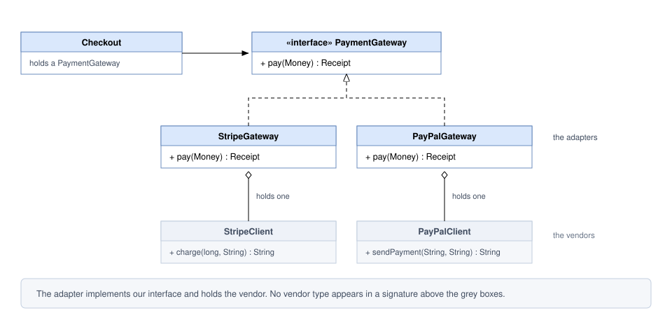
*Figure — Adapter class diagram: `Checkout` holds a `PaymentGateway`; `StripeGateway` and `PayPalGateway` implement it and each wrap a vendor client, shown in grey because we do not own them (course diagram)*

`PaymentGateway` is the Target (yours); `StripeGateway`/`PayPalGateway` the Adapters; `StripeClient`/`PayPalClient` the Adaptees (third-party); `Checkout` any Client. Every mismatch — names, parameter types, casing — is soaked up inside the adapters.

Our Java design (including the class and two-way adapters):

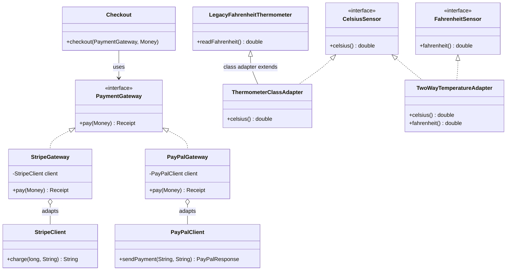

### Java example

Full code: `code/lld/ch09/adapter/` — our vocabulary (`Money`, `Receipt`, `PaymentGateway`, `PaymentFailedException`), the adaptees (`StripeClient` + `StripeCardException`, `PayPalClient`), the adapters, the temperature sensors, and `Main`.

```java
// Money.java — our own vocabulary; no vendor type ever appears here.
record Money(long cents, String currency) {
    Money {
        if (cents < 0) throw new IllegalArgumentException("negative amount");
        currency = currency.toUpperCase(Locale.ROOT);
    }
    String asDecimal() { return String.format(Locale.ROOT, "%d.%02d", cents / 100, cents % 100); }  // 4250 -> "42.50"
}
interface PaymentGateway { Receipt pay(Money amount); }   // TARGET

// ADAPTEES (pretend third-party jars we cannot edit):
//   StripeClient.charge(long amountInCents, String currencyCode) -> charge id; throws StripeCardException over 100_000
//   PayPalClient.sendPayment(String total, String currency) -> PayPalResponse(paymentId, state)

// StripeGateway.java — OBJECT ADAPTER: implements our interface, HOLDS the vendor object.
final class StripeGateway implements PaymentGateway {
    private final StripeClient client;
    StripeGateway(StripeClient client) { this.client = client; }

    @Override public Receipt pay(Money amount) {
        try {
            String chargeId = client.charge(amount.cents(), amount.currency().toLowerCase(Locale.ROOT));
            return new Receipt(chargeId, "SUCCEEDED");
        } catch (StripeCardException e) {               // translate the vendor's error too
            throw new PaymentFailedException("Stripe declined: " + e.getMessage(), e);
        }
    }
}

// PayPalGateway.java
@Override public Receipt pay(Money amount) {
    PayPalClient.PayPalResponse r = client.sendPayment(amount.asDecimal(), amount.currency());
    return new Receipt(r.paymentId(), "approved".equals(r.state()) ? "SUCCEEDED" : "FAILED");
}
```

```java
// ThermometerClassAdapter.java — CLASS ADAPTER: inherits the adaptee, implements the target
// (works in Java only because the target is an interface).
final class ThermometerClassAdapter extends LegacyFahrenheitThermometer implements CelsiusSensor {
    ThermometerClassAdapter(double fahrenheit) { super(fahrenheit); }
    @Override public double celsius() { return (readFahrenheit() - 32) * 5.0 / 9.0; }
    // Downside: readFahrenheit() is still public on this object -> the adaptee's API leaks.
}

// TwoWayTemperatureAdapter.java — implements BOTH interfaces for new (Celsius) and old (Fahrenheit) code.
final class TwoWayTemperatureAdapter implements CelsiusSensor, FahrenheitSensor {
    private final double celsius;
    static TwoWayTemperatureAdapter from(CelsiusSensor s)    { return new TwoWayTemperatureAdapter(s.celsius()); }
    static TwoWayTemperatureAdapter from(FahrenheitSensor s) { return new TwoWayTemperatureAdapter((s.fahrenheit() - 32) * 5.0 / 9.0); }
    @Override public double celsius()    { return celsius; }
    @Override public double fahrenheit() { return celsius * 9.0 / 5.0 + 32; }
}

// Main.java — the CLIENT talks only to OUR interface and never names a vendor.
static void checkout(PaymentGateway gateway, Money amount) {
    try {
        Receipt r = gateway.pay(amount);
        System.out.println("  receipt " + r.id() + " " + r.status());
    } catch (PaymentFailedException e) {
        System.out.println("  payment failed -> " + e.getMessage());
    }
}
// main also demos Arrays.asList (array -> List view, no copy) and InputStreamReader (bytes -> chars).
```

**Output:**

```text
== Object adapters (payment) ==
  [stripe] charge(4250, "usd")
  receipt ch_1001 SUCCEEDED
  [paypal] sendPayment("42.50", "USD")
  receipt PAY-4250 SUCCEEDED
  [stripe] charge(250000, "usd")
  payment failed -> Stripe declined: card_declined
== Class adapter ==
  98.6F -> 37.0C
== Two-way adapter ==
  new code sees 100.0C, old code sees 212.0F
== JDK adapters ==
  Arrays.asList sees array change: [z, b, c]
  cannot resize an array-backed list: UnsupportedOperationException
  InputStreamReader decoded: héllo
```

**What each part does**

- `Money`, `Receipt`, `PaymentGateway`, `PaymentFailedException` — **our** vocabulary. The compact constructor (no parameter list, runs on every creation) of the `Money` record (short syntax for an immutable data class) upper-cases the currency once, so every adapter can rely on it.
- `StripeGateway` — an **object adapter** converting `Money` → `(cents, "usd")`, charge id → `Receipt`, `StripeCardException` → `PaymentFailedException` (third output call: the client sees *our* error type). `PayPalGateway` translates differently (`Money.asDecimal()` → "42.50"; `"approved"` → `"SUCCEEDED"`).
- `checkout(...)` — the **client**: one function, two vendors, no `if (stripe)` branch. The JDK section shows two adapters you already use: `Arrays.asList` and `InputStreamReader`.

### Object adapter vs class adapter

| | **Object adapter** (composition) | **Class adapter** (inheritance) |
|---|---|---|
| How | Adapter *holds* an adaptee instance and implements the Target | Adapter *extends* the adaptee class and implements the Target |
| In our code | `StripeGateway`, `PayPalGateway` | `ThermometerClassAdapter extends LegacyFahrenheitThermometer implements CelsiusSensor` |
| Works when adaptee is `final`? | Yes | **No** — you cannot extend a final class (our `StripeClient` is `final`) |
| Can adapt a whole family (adaptee + subclasses)? | Yes — pass any subclass instance in | No — bound to one concrete class at compile time |
| Can override adaptee behaviour? | Harder — subclass the adaptee and adapt that subclass | Yes (it is a subclass) |
| Leaks the adaptee's API (its public methods)? | No — only the Target methods are visible | **Yes** — every public adaptee method (e.g. `readFahrenheit()`) is also on the adapter |
| Java constraint | none | Java has no multiple class inheritance (extending two classes at once), so the **Target must be an interface** |

**Rule of thumb:** prefer the **object adapter** — composition over inheritance, works with final classes, can wrap several objects, inherits nothing unwanted. Use a class adapter only to override adaptee behaviour when the adaptee is designed for extension.

### Two-way adapter

A **two-way adapter** implements *both* interfaces so one object serves clients of either side (GoF: two clients needing to view one object in two ways). `TwoWayTemperatureAdapter implements CelsiusSensor, FahrenheitSensor` is built from either kind of sensor; new dashboard code sees `100.0C`, old US reporting code `212.0F` — same object. Handy during a **migration** (gradually moving code from an old system to a new one).

### Adapter vs Facade vs Decorator vs Proxy (quick view)

In one line each (full table in [9.8](#98-putting-it-all-together--comparison)): **Adapter** *translates* the interface, same work; **Decorator** keeps the interface and *extends* the work; **Proxy** keeps interface and work but *gates* it (postponed, served from a cache — a store of earlier results for quick reuse — or rejected); **Facade** *replaces* many interfaces with one simpler one, fewer calls for the client.

A useful test: *adapters exist because someone else picked the interface.* If the vendor rewrote its API to match yours tomorrow and your class would lose its reason to exist, it was an Adapter; the other three exist because you chose to add something. Bridge uses the same boxes with reversed timing: planned *before* the classes exist so two hierarchies never fuse; an Adapter is bolted on *after* to reconcile two existing things.

### Trade-offs

| Pros | Cons |
|---|---|
| **The foreign format is contained** — one class knows the vendor's conventions. | **An extra class and call** — stack traces (calls listed when an error happens) gain a frame whose only job is conversion. |
| **Changing vendor is local** — PayPal beside Stripe is a new class, not edited callers (Open/Closed Principle). | **Conversions can drop information** invisibly to callers. |
| **Easy to test** — faking your one-method interface beats faking a vendor SDK. | **Two data models must stay aligned** — each vendor API change forces a mapping change. |
| **Your code keeps its own language** (`Money`, `Receipt`); conversion has one home (Single Responsibility). | **Logic creeps in** — retries (automatic re-tries of failed calls) and pricing rules drift in unless reviews stop them. |

### When not to use it

- **Both sides are yours** — change one interface; an adapter between your own code is overhead paid forever for a removable mismatch.
- **The two models really disagree** — if mapping drops data or forces guesses, the "adapter" becomes a buggy mini-application; redraw the boundary.
- **You want extra behaviour, not translation** — a Decorator's job.
- **The conversion happens in exactly one place** — a few inline lines read better.

### Common mistakes

- **Leaking vendor types** (`StripeCharge` return type, `StripeCardException` escaping) — nothing is decoupled.
- **Business logic in the adapter** (discounts, retries). Adapters translate; they do not decide.
- **Class adapter by default** — exposes the adaptee's whole API and breaks on `final` classes.
- **One giant adapter** with `if (vendor == STRIPE)` — the branch the pattern removes. One adapter per adaptee.
- **Silently dropping information** (vendor "pending" mapped to "SUCCEEDED"). Map every case deliberately.

### Real-world examples

- **`java.util.Arrays.asList(T...)`** adapts an array to `List` *without copying* — writes go through to the array and the list cannot grow (`add` throws `UnsupportedOperationException`).
- **`java.io.InputStreamReader` / `OutputStreamWriter`** adapt byte streams to character streams using a charset (the byte↔character rule, e.g. UTF-8).
- **`java.util.Collections.enumeration(Collection)`** adapts a `Collection` to the legacy `Enumeration` interface. (*Head First* builds the reverse, Enumeration-to-Iterator.)
- **SLF4J providers/bindings** — SLF4J (Simple Logging Facade for Java) is one logging API with an adapter module per backend (the library that writes log lines: Logback, Log4j, `java.util.logging`).
- **JDBC (and ODBC) drivers** adapt each database's wire protocol (the bytes it sends over the network) to the standard `java.sql` interfaces, so the same code runs on several databases.
- **Spring MVC `HandlerAdapter`** lets the `DispatcherServlet` (Spring MVC's central object receiving every web request) invoke very different handlers (annotated controllers, `HttpRequestHandler`, etc.) through one interface.
- **Almost every "client" wrapper around a vendor SDK** — if it exists so the rest of the code does not import the SDK, it is an adapter.

### In modern languages

- **First-class functions** (functions stored and passed like values): for a single-method Target a **lambda** is a complete adapter — `PaymentGateway g = m -> new Receipt(stripe.charge(m.cents(), "usd"), "SUCCEEDED");` (our `FahrenheitSensor oldSensor = () -> 212.0;` is the same trick).
- **Python**: duck typing ("if it has the right methods, it fits", checked at run time) — a small wrapper class or even a `types.SimpleNamespace` suffices.
- **TypeScript**: structural typing accepts anything of the right shape; adapters are often plain object literals (`{ ... }`).
- **Go**: interfaces are satisfied implicitly (no `implements`), so the adapter is often a small named type with one method.

### In the interview

**30-second answer:** "An Adapter converts one interface into another that the client expects. I use it at boundaries I do not control — a vendor SDK, a legacy service. The adapter implements *my* interface, holds the vendor object, and translates inputs, outputs and exceptions, so no vendor type leaks into my code. Swapping vendors becomes one new class. I prefer the object adapter over the class adapter because it uses composition and works with final classes."

**Follow-ups**

- *Q: Adapter vs Decorator?* — A: Adapter changes the interface, keeps behaviour. Decorator keeps the interface, adds behaviour.
- *Q: Adapter vs Facade?* — A: Adapter converts **one** interface to **one** other, usually because you own only one side. Facade simplifies a **whole subsystem** into one entry point, usually over code you own.
- *Q: Why not just change the other side?* — A: Say it unprompted: vendor library, another team's API, or many callers. That constraint justifies the pattern — without it you are pattern-matching out of habit.
- *Q: What ruins an adapter?* — A: A vendor type or exception in its public signature.
- *Q: How does it help testing?* — A: Checkout depends on a small interface I own, so tests pass a fake `PaymentGateway`; no faking the vendor SDK.
- *Q: What is a two-way adapter?* — A: One class implementing both interfaces to serve either side, useful during migrations.

### Self-check

1. **Q:** Name the four roles in the Adapter pattern. **A:** Target, Adaptee, Adapter, Client.
2. **Q:** Why is `StripeClient` impossible to class-adapt in our code? **A:** It is `final`; a class adapter must extend the adaptee.
3. **Q:** What does `Arrays.asList(arr).add(x)` do, and why? **A:** Throws `UnsupportedOperationException`, because the list is a fixed-size view (adapter) over the array.
4. **Q:** You own both classes and their interfaces differ slightly. Adapter? **A:** No — change the interface; an adapter would be permanent overhead.
5. **Q:** Where should the vendor's exception be handled? **A:** Inside the adapter, translated into your own exception type.

### TL;DR

- **Adapter = translator** between the interface you have and the one you need.
- Implements **your** interface, **holds** the vendor object, translates **in, out and errors**.
- Prefer **object adapter** (composition) over **class adapter** (inheritance). Two-way adapters implement both sides.
- Use at boundaries you **don't control**; skip it when you own both sides.

---

## 9.2 Bridge Pattern

### What it is

The **Bridge** pattern splits one class that varies in *two independent ways* into **two separate hierarchies** connected by a reference (the "bridge"), so each side grows on its own — like universal TV remotes (basic, advanced with mute) and TV brands (Sony, Samsung): no "BasicSonyRemote"; any remote drives any TV through a common protocol (agreed set of signals).

GoF's intent: *decouple an abstraction from its implementation so that the two can vary independently.* Also called **Handle/Body**. The vocabulary interviewers expect:

| Term | Meaning | In our code |
|---|---|---|
| **Abstraction** | The high-level side the client uses; holds a reference to an Implementor | `Notification` |
| **Refined Abstraction** | Subclasses of the abstraction | `AlertNotification`, `ReminderNotification`, `DigestNotification` |
| **Implementor** | The interface of the low-level side that does the physical work | `Channel` |
| **Concrete Implementor** | Real implementations of that low-level work | `EmailChannel`, `SmsChannel`, `PushChannel` |

> **Naming trap.** In Bridge, "implementation" is *not* the everyday Java meaning ("a class that implements an interface"). It names the **low-level half of the split** — the platform-specific, physical work (sending bytes, drawing pixels). Awkward, but these are the terms you will be asked about.

### The problem it solves — the class explosion

Three notification kinds (alert, reminder, digest) × three channels (email, SMS, push) in **one** hierarchy need a class per combination:

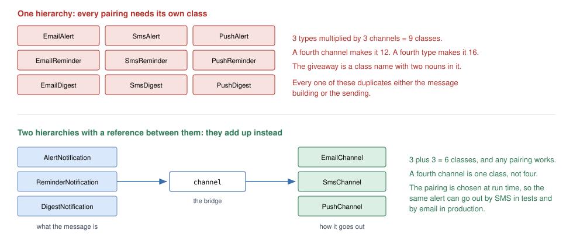
*Figure — Top: one hierarchy needs 3 × 3 = 9 classes such as EmailAlert and SmsDigest. Bottom: two hierarchies joined by one `channel` reference need 3 + 3 = 6 (course diagram)*

In one hierarchy concrete classes **multiply**: 3 × 3 = 9; one more channel → 12; one more type too → 16. With a bridge they **add**: 3 + 3 = 6, 4 + 4 = 8. (Counts are concrete classes; the `Notification` base and `Channel` interface exist in both.)

The **smell** (code smell: a surface symptom of a deeper design problem) is **a class name made of two nouns** — `EmailAlert`, `SmsDigest`, `PushReminder`. Each repeats the "build the message" or "send it" code, so changing SMS delivery edits three otherwise unrelated classes.

Splitting also makes the pairing a **run-time choice**: the same alert with an SMS channel in a test, email in production (the live system). The code is small; the hard part is deciding **which dimension is the abstraction and which the implementation** (see "Getting the split wrong").

### How it works

1. **Find the two dimensions** varying independently (what the message *is* vs how it *goes out*).
2. **Make the lower-level one an interface** — the Implementor (`Channel.deliver(title, body)`), small and general.
3. **Make the higher-level one an abstract class** — the Abstraction — that **holds a reference** to the Implementor. That field is the bridge.
4. **Refined abstractions** build their content and **delegate** the physical work across the bridge, never checking which implementor they have.
5. **Pair at run time**: `new AlertNotification(new SmsChannel(...), ...)`.

### Structure

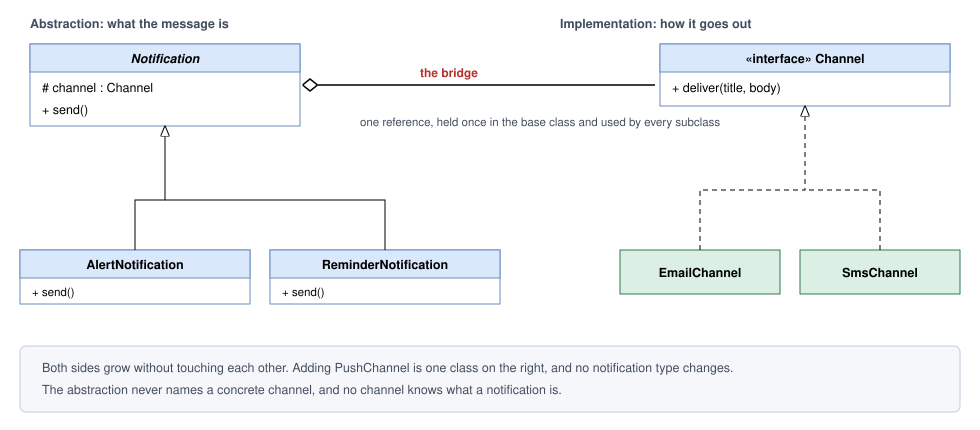
*Figure — Bridge class diagram: `Notification` (abstraction) holds a `Channel` (implementor); alert/reminder notifications refine the abstraction; email/SMS channels implement the channel (course diagram)*

The bridge is the one `channel` field, declared in the base class and used by every subclass. Channel classes know nothing about notifications.

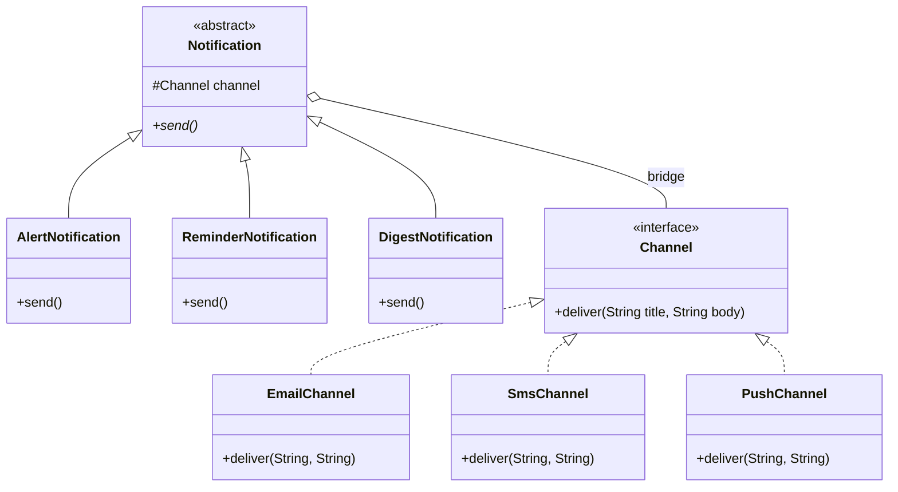

### Java example

Full code: `code/lld/ch09/bridge/` (one file per type, plus `Main`).

```java
// Channel.java — IMPLEMENTOR: the low-level "how it goes out" side; two plain strings, nothing channel-specific.
interface Channel { void deliver(String title, String body); }

// SmsChannel.java — CONCRETE IMPLEMENTOR (EmailChannel, PushChannel likewise); knows nothing of alerts or digests.
final class SmsChannel implements Channel {
    private static final int LIMIT = 40;           // tiny limit so the demo shows truncation
    private final String phone;
    SmsChannel(String phone) { this.phone = phone; }
    @Override public void deliver(String title, String body) {
        String text = title + ": " + body;
        if (text.length() > LIMIT) text = text.substring(0, LIMIT - 3) + "...";
        System.out.println("  [sms to " + phone + "] " + text);
    }
}

// Notification.java — ABSTRACTION: the protected 'channel' field IS the bridge.
abstract class Notification {
    protected final Channel channel;
    protected Notification(Channel channel) { this.channel = channel; }
    /** Builds the message, then hands it across the bridge. Never branches on channel type. */
    abstract void send();
}

// AlertNotification.java — REFINED ABSTRACTION (ReminderNotification, DigestNotification likewise).
final class AlertNotification extends Notification {
    private final String system, problem;
    AlertNotification(Channel channel, String system, String problem) {
        super(channel); this.system = system; this.problem = problem;
    }
    @Override void send() { channel.deliver("ALERT " + system, problem + " - act now"); }
}
// Digest: channel.deliver("Daily digest (" + items.size() + ")", String.join("; ", items));

// Main.java — any type x any channel, paired at run time.
List<Notification> outbox = List.of(
        new AlertNotification(email, "payments", "error rate 12%"),
        new AlertNotification(sms, "payments", "error rate 12%"),
        new ReminderNotification(push, "Stand-up", "09:30"),
        new DigestNotification(email, List.of("3 orders", "1 refund", "0 incidents")),
        new DigestNotification(sms, List.of("3 orders", "1 refund", "0 incidents")));
outbox.forEach(Notification::send);
```

**Output:**

```text
== Any type x any channel, paired at run time ==
  [email to ops@shop.com] Subject: ALERT payments | error rate 12% - act now
  [sms to +1-555-0100] ALERT payments: error rate 12% - act now
  [push to pixel-7] (Reminder) Stand-up at 09:30
  [email to ops@shop.com] Subject: Daily digest (3) | 3 orders; 1 refund; 0 incidents
  [sms to +1-555-0100] Daily digest (3): 3 orders; 1 refund;...
== Class count ==
  one hierarchy (type x channel): 9 classes
  bridge (type + channel):        6 classes
  with 4 types and 4 channels:    16 vs 8
```

**What each part does**

- Channels know *only* delivery (SMS truncation lives inside SMS, not in any notification); `deliver` takes plain strings so every channel can support it.
- Notifications build title and body and call `channel.deliver(...)` — no `instanceof` (Java's concrete-type check), no `switch` on channel type.
- `SlackChannel` = one new class; `PromoNotification` = one new class. Nothing else changes.

### Bridge vs Strategy

Written down they are **indistinguishable** — an object holds an interface reference and delegates. Interviewers and reviewers ask, so be ready: the difference is the **reason the reference is there**.

| | **Bridge** | **Strategy** |
|---|---|---|
| What varies | A whole **dimension** of the design | **One algorithm** or policy |
| When chosen | Usually once, at construction, then it stays | Often swapped repeatedly, even per call |
| Why it exists | To stop two hierarchies multiplying | To make one behaviour replaceable |
| When decided | Up front, as a structural decision | Later, when a second algorithm appears |
| Example | `Notification` → `Channel` | `list.sort(comparator)` |

**Practical test:** picture one more implementation. *A new kind of thing the system supports* (another delivery channel) → Bridge. *One more way to perform a single step* (another compression algorithm) → Strategy. If you truly can't decide, either name is understood since the code is identical; what matters is not building either while an axis has one member.

### Getting the split wrong

Quick to write, costly to re-cut once both sides have several classes:

- **Low-level details leaking up.** `if (channel instanceof SmsChannel)` inside `AlertNotification` means the bridge has failed — move that SMS rule into `SmsChannel`.
- **An implementor interface shaped around one implementation.** Add `setEmailReplyTo(...)` to `Channel` and every non-email channel must implement a method it can only throw from. Keep it minimal and generic — why `deliver` takes two plain strings, not a rich message type.

### Trade-offs

| Pros | Cons |
|---|---|
| **Class counts add rather than multiply** — 3 types and 3 channels need 6 classes, not 9. | **Two hierarchies** to understand instead of one. |
| **Each side extends independently** (Open/Closed) — a new channel touches no notification class. | **More indirection** — one call spans two files. |
| **Pairing picked at run time** — real channel in production, fake in tests, per-environment config. | **Hard to undo** — moving the split line later is a large refactor (restructuring without changing behaviour). |
| **Platform code kept apart** — only one class knows SMTP (the email-sending protocol) (Single Responsibility). | **Pointless with one member** — a single implementor is an interface plus ceremony. |

### When not to use it

- **An axis has one member** — introduce it when the second channel actually shows up.
- **The axes are not truly independent.** If some combinations are forbidden (digests never by SMS), Bridge happily builds them and you add run-time checks that separate subclasses would have made impossible.
- **You can't say in one sentence which side is the abstraction** — the design isn't ready; a wrong split costs more than a few extra classes.
- **The second axis is a behaviour, not a kind of thing** — use Strategy.

### Common mistakes

- Building the bridge "just in case" with a single implementor.
- Letting the abstraction branch on the concrete implementor type.
- Making the implementor interface mirror one specific implementation.
- Confusing Bridge with Adapter: Adapter is **retrofitted** to make existing things fit; Bridge is **designed in** so the sides never fuse.

### Real-world examples

- **JDBC**: your code uses `java.sql.Connection` / `Statement`; each driver supplies the implementation, so the same query code runs on PostgreSQL or MySQL. (Often cited as both Bridge — two independent hierarchies — and Adapter — each driver adapts a native protocol. Both fair.)
- **SLF4J and similar logging APIs**: the API you call is one side, the backend writing log lines the other. (SLF4J calls itself a *facade*; the API/backend split underneath is Bridge-shaped.)
- **Window systems and device/graphics drivers**: GoF's motivating example — a `Window` abstraction whose `WindowImp` is written per platform (X Window System, IBM Presentation Manager); OS drawing APIs over per-card graphics drivers likewise.
- **`java.awt` peers** (the textbook Java example): each AWT component held a platform-specific peer doing the native drawing.
- **Notification / payment services**: a `NotificationService` interface with pluggable providers (SES, Twilio, FCM — Amazon's email service, an SMS provider, Google's push service) is this pattern, named or not.
- **Dependency-injection containers** (frameworks that create objects and hand each its dependencies) binding an interface to a different implementation per environment give configured, not coded, Bridge pairing.

### In modern languages

- **First-class functions**: a one-method implementor can be a function — `Notification(channel = send_email)`.
- **Python / JavaScript**: duck typing — any object with a `deliver` method will do; no declared interface.
- **Go**: a small interface declared by the *consumer*, implemented in other packages, is idiomatic (conventional-style) Go — Bridge without the name.
- **DI containers** (Spring, Guice, .NET): pairing wired by configuration per environment.

### Other patterns it is confused with

| Looks like | Actual difference |
|---|---|
| Strategy / Adapter | Same code shape — see [Bridge vs Strategy](#bridge-vs-strategy) and the Adapter timing point in Common mistakes. |
| Abstract Factory | Decides *which family of objects gets created*; Bridge describes *how an object hands off work once it exists*. They combine well — a factory often supplies the implementor a bridge receives. |
| Decorator | Shares the inner object's interface and adds behaviour; in a Bridge the two sides have unrelated interfaces and neither wraps the other. |

### In the interview

**30-second answer:** "Bridge separates an abstraction from its implementation so both can vary independently. If notifications vary by type and by channel, one hierarchy needs type × channel classes — 3 × 3 = 9, and 16 with a fourth of each. I split it: a `Notification` hierarchy holding a reference to a `Channel` interface. Now it is type + channel classes — 6, then 8 — and the pairing is chosen at run time. I wouldn't build it while there is only one channel."

**Follow-ups**

- *Q: How is it different from Strategy?* — A: Same code, different intent. Bridge splits a permanent dimension decided up front; Strategy makes one algorithm replaceable, often per call.
- *Q: What is the smell that says you need it?* — A: Two-noun class names (`SmsDigest`) with duplicated code.
- *Q: When would you not use it?* — A: With one channel today — add it when the second lands. Also when some combinations are invalid.
- *Q: Who decides which implementor a notification gets?* — A: Whoever builds it — often a factory or the DI container, configured per environment.

### Self-check

1. **Q:** With 5 notification types and 4 channels, how many classes without and with Bridge? **A:** 20 without, 9 with.
2. **Q:** Which field is "the bridge"? **A:** The `Channel channel` reference held by the `Notification` base class.
3. **Q:** An `AlertNotification` checks `channel instanceof SmsChannel`. What is wrong? **A:** Implementation detail has leaked upward; move that behaviour into `SmsChannel`.
4. **Q:** Is Bridge added before or after the classes exist? **A:** Before — it is an up-front structural decision (Adapter is the after-the-fact one).

### TL;DR

- **Two dimensions varying → two hierarchies + one reference.** Multiplication becomes addition.
- Abstraction (what) holds Implementor (how). Keep the implementor small and general.
- Same code as Strategy; different intent. Don't build it for one implementor.

---

## 9.3 Composite Pattern

### What it is

The **Composite** pattern gives an individual item and a whole nested group **one common interface**, so code never checks whether it has a **single object** or an **entire tree** — like asking anyone on an org chart "what is your team's total salary?": a manager asks each report and sums; an individual answers with their own.

| Term | Meaning | In our code |
|---|---|---|
| **Component** | The shared interface for leaves and containers | `FileSystemNode`, `MenuComponent` |
| **Leaf** | An object with no children; does the work itself | `FileNode`, `MenuItem` |
| **Composite** | A container that holds children (typed as Component) and delegates to them | `FolderNode`, `Menu` |
| **Client** | Code that works with Components only | `report(...)` |

GoF's intent: compose objects into tree structures representing **part-whole hierarchies**, and let clients treat individual objects and compositions **uniformly**.

### The problem it solves

Much data nests: folders hold files *and* folders; an invoice holds items *and* bundles of items; a UI (user interface) panel holds widgets (buttons, text boxes and other controls) *and* sub-panels. Without the pattern every operation (`size`, `print`, `search`, `copy`) opens with the same type test:

```java
if (node instanceof Folder f) { /* loop over children, recurse */ }
else if (node instanceof File f) { /* read the size */ }
```

Add a third node kind — a symbolic link (an entry pointing to another file or folder) — and you hunt every copy; miss one and it quietly gets the wrong answer.

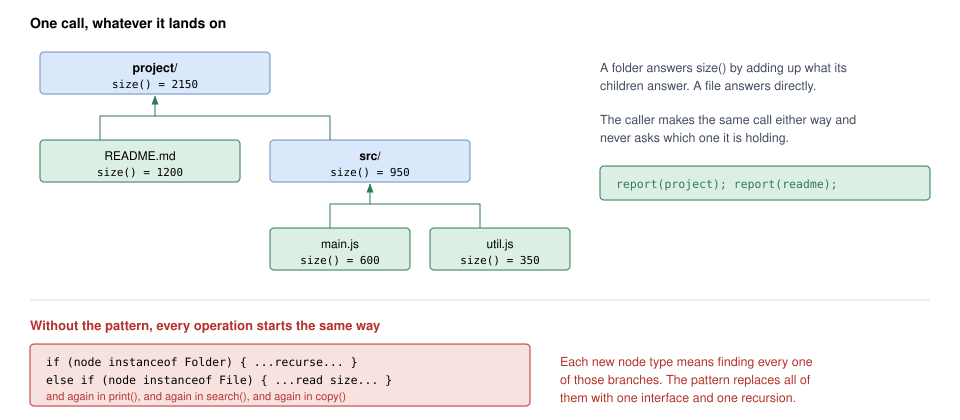
*Figure — `size()` on the project folder (2150) is the sum of README.md (1200) and src/ (950), which itself sums main.js and util.js. The caller makes the same call on a tree or a single file (course diagram)*

A file answers `size()` with its byte count; a folder asks each child and sums. Since a child may be either and both answer the same call, one piece of recursive code (code calling itself on smaller parts) handles any depth; the caller writes `report(project)` or `report(readme)` alike.

### How it works

1. **Define a Component interface** with operations meaningful for *both* leaves and containers (`name()`, `size()`, `print()`).
2. **Leaf** implements them directly.
3. **Composite** stores a `List<Component>` — the **interface type**, not the leaf type — and implements each operation by **asking each child and combining results**.
4. Because a child can be a composite, the recursion is written **once** and works at any depth.
5. **Clients** hold a `Component` and never type-check.

### Structure

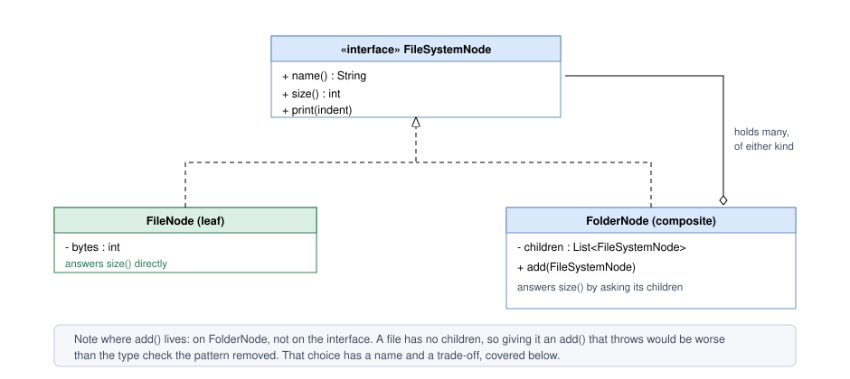
*Figure — Composite class diagram: `FileNode` (leaf) and `FolderNode` (composite) implement `FileSystemNode`; the folder holds a list of `FileSystemNode` and has `add()` (course diagram)*

Two details matter: the child list is typed as the **interface** (so folders hold folders), and `add()` is on `FolderNode`, not the shared interface — the deliberate "safe" design, covered after the code.

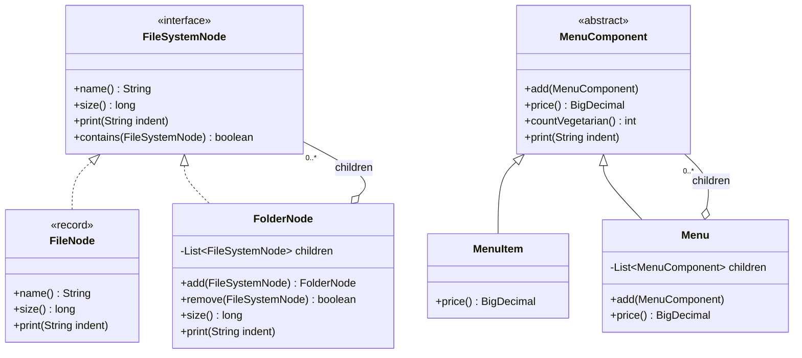

### Java example

Full code: `code/lld/ch09/composite/` (file-system tree, restaurant menu, `Main`).

```java
// FileSystemNode.java — COMPONENT (safe version): only operations valid for BOTH; no add/remove here.
interface FileSystemNode {
    String name();
    long size();
    void print(String indent);
    /** True if 'target' is this node or somewhere below it. Used for the cycle check. */
    default boolean contains(FileSystemNode target) { return this == target; }
}

// FileNode.java — LEAF: no children, answers directly.
record FileNode(String name, long size) implements FileSystemNode {
    @Override public void print(String indent) { System.out.println(indent + "- " + name + " (" + size + " B)"); }
}

// FolderNode.java — COMPOSITE: children typed as the INTERFACE, so folders can hold folders.
final class FolderNode implements FileSystemNode {
    private final List<FileSystemNode> children = new ArrayList<>();

    /** Returns this so trees can be built fluently. Rejects cycles at insert time. */
    FolderNode add(FileSystemNode child) {
        if (child.contains(this)) throw new IllegalArgumentException("cycle: " + child.name() + " already contains " + name);
        children.add(child);
        return this;
    }
    List<FileSystemNode> children() { return Collections.unmodifiableList(children); }

    @Override public long size() {                        // the recursion lives in ONE place
        long total = 0;
        for (FileSystemNode child : children) total += child.size();
        return total;
    }
    @Override public void print(String indent) {
        System.out.println(indent + "+ " + name + "/ (" + size() + " B)");
        for (FileSystemNode child : children) child.print(indent + "   ");
    }
    @Override public boolean contains(FileSystemNode target) {
        if (this == target) return true;
        for (FileSystemNode child : children) if (child.contains(target)) return true;
        return false;
    }
    ...
}
```

```java
// MenuComponent.java — COMPONENT (transparent version): child management on the shared type,
// so callers never cast - but a leaf must reject it at run time.
abstract class MenuComponent {
    void add(MenuComponent c) { throw new UnsupportedOperationException(name() + " is a leaf"); }
    abstract String name();
    abstract BigDecimal price();      // total under this node (money: BigDecimal, never double)
    abstract int countVegetarian();
    abstract void print(String indent);
}
// MenuItem: price = new BigDecimal("3.49") (from a String, so exactly 3.49).
// Menu: overrides add(); price() = children.stream().map(MenuComponent::price).reduce(BigDecimal.ZERO, BigDecimal::add)

// Main.java — client: one parameter type, no instanceof anywhere.
static void report(FileSystemNode node) { System.out.println("  " + node.name() + " -> " + node.size() + " bytes"); }
// report(project); report(readme); src.add(project) is rejected (project already contains src);
// new MenuItem("Tea", "1.00", true).add(...) throws.
```

**Output:**

```text
== Safe composite: file system ==
  + project/ (2150 B)
     - README.md (1200 B)
     + src/ (950 B)
        - main.js (600 B)
        - util.js (350 B)
  project -> 2150 bytes
  README.md -> 1200 bytes
  rejected: cycle: project already contains src
== Transparent composite: restaurant menu ==
  [All menus]
    [Breakfast]
      Pancakes (v) $3.49
      Bacon & eggs $4.99
      [Desserts]
        Apple pie (v) $2.59
    Coffee (v) $1.50
  total $12.57, vegetarian items: 3
  transparent cost: Tea is a leaf
```

**What each part does**

- `FileSystemNode` (Component) / `FileNode` (immutable record Leaf) / `FolderNode` (Composite) — `FolderNode.size()` is the four-line recursion and the **only** place that knows a tree nests; `add()` returns `this` for fluent building.
- `contains(...)` + the check in `add()` — **cycle protection** at insert time (putting `project` inside its own child `src` is rejected).
- `MenuComponent`/`Menu`/`MenuItem` — the *transparent* variant (*Head First*'s restaurant menu): `add` on the shared abstract class, a leaf throws. `report(...)` is the client, called with a tree and a single file.

### Transparent vs safe composite

Where do `add` and `remove` belong? GoF named both answers:

| | **Transparent** | **Safe** |
|---|---|---|
| Where `add/remove` live | On the shared Component | Only on the Composite |
| Uniformity | Full — every node looks the same; no casts (forcing a value to a more specific type) | Partial — builders must hold a `FolderNode` |
| Type safety | Weaker — `leaf.add(...)` compiles, then **throws at run time** | Strong — the compiler rejects `file.add(...)` |
| Our code | `MenuComponent` (`Tea is a leaf` in the output) | `FileSystemNode` / `FolderNode` |
| Choose when | Callers add children to arbitrary nodes without knowing their type (e.g. a UI editor where anything might be a container) | The tree is built in one place and read in many (most cases) |

Transparent trades a compile-time guarantee for a possible run-time exception. Safe keeps the read-side interface small, but building/editing code must hold a `FolderNode`, and code that walks then inserts needs a cast after all. Neither is wrong; in review check the choice was **made on purpose** — an unintended throwing `add` is the real defect. *Head First* notes the transparent composite knowingly bends Single Responsibility (the component both manages children and does work) to gain transparency.

### Two traps worth knowing

- **Cycles.** A folder placed inside its own descendant makes `size()` recurse forever (`StackOverflowError`, when nested calls exhaust the call stack — the memory tracking calls in progress). **Validate when inserting**, not during traversal (walking every node) — by then you are stuck. Our `add()` does this.
- **Repeated work.** `print()` calls `size()` at every level, recomputing subtotals — roughly quadratic (work grows with the square of depth) for a deep chain. For big trees **store each subtree's total** and invalidate upward on change (needs a parent pointer).

### Trade-offs

| Pros | Cons |
|---|---|
| **Callers never type-check** — same call on a leaf or a tree. | **The shared interface bloats** with operations that half-fit one kind. |
| **The recursion lives in one place**, reused by each new operation. | **Weaker type safety** (transparent) — adding a child to a leaf compiles. |
| **New node types don't touch callers** (Open/Closed) — e.g. a `SymlinkNode`. | **Deep trees mean deep call stacks**; a cycle shows as endless recursion, not a clear error. |
| **Nesting comes free** — a composite storing the interface stores composites. | **Totals recomputed** each call unless cached. |

### When not to use it

- **Nothing nests** — a flat list gains nothing.
- **Leaves and containers share little** — a forced interface fills with throwing methods, worse than the type test it replaced.
- **Deep tree on a hot path** (code run so often its speed matters) — each level costs a stack frame and likely CPU cache misses (fetching from slow main memory instead of the processor's fast cache); precomputed totals or a loop with its own work-list can be faster.
- **The tree is modified during traversal** — concurrent changes (by another thread at the same time) during recursion are dangerous; Composite offers no protection.

### Common mistakes

- Typing the child list as the **leaf** type (`List<FileNode>`) — folders cannot hold folders.
- Returning the internal mutable child list — callers bypass `add()` and its cycle check (we return `Collections.unmodifiableList(children)`).
- Putting `add()` on the interface by accident (transparent without meaning to).
- No cycle check.
- Using Composite when one recursive function with one type check would do — it pays off when **operations multiply**.

### Real-world examples

- **The HTML DOM** (Document Object Model — the browser's in-memory tree of page elements) — elements hold child nodes; `textContent` walks the subtree.
- **UI toolkits** — Swing/AWT's `java.awt.Container` *is a* `Component` and holds `Component`s, so panels nest without limit; React (a JavaScript UI library) component trees and Android's `ViewGroup` (a `View` holding `View`s) likewise.
- **File systems** — the example used here.
- **Abstract syntax trees** (the tree a compiler builds from source) — expression nodes hold sub-expressions; evaluating a node evaluates its subtree.
- **`java.io.File`** represents files and directories with one class — the transparent cost: `listFiles()` returns `null` on a regular file.
- **JUnit 3 test suites** (JUnit: the standard Java testing framework; a suite is a named group of tests) — `TestSuite` implements `Test` and holds `Test`s; running a suite runs everything beneath. (JUnit 5 keeps a tree of test descriptors.)
- **Spring's `CompositeCacheManager`** delegates to a list of `CacheManager`s while being one.
- **Invoices / bundles** — a "bundle" priced as the sum of items that may themselves be bundles.

### In modern languages

- **Python / JavaScript**: duck typing — leaf and container just share method names; a composite is often a class with a `children` list.
- **Sealed types + pattern matching** (Java 21, Kotlin, Scala, Rust) — a sealed type lists exactly which subtypes exist and a `switch` branches on the subtype: `sealed interface Node permits File, Folder` plus an exhaustive `switch`. The compiler reports any node type a `switch` forgets — a guarantee Composite lacks. Prefer it when node types are closed.
- **Functional languages**: a recursive algebraic data type ("one of these shapes", a shape may contain the type itself) is Composite with language support; a `fold` (combine all parts into one result) is the recursion written once.
- **Java streams** (pipeline API for collections): `flatMap` (each element → several, flattened) makes walking a composite read nicely.

### Other patterns it is confused with

| Looks like | Actual difference |
|---|---|
| Decorator | Both hold objects of their own interface; Decorator wraps **one** and adds behaviour, Composite holds **many** and combines results. |
| Iterator | Composite gives the tree a uniform interface; Iterator walks it without exposing its structure. Often used together. |
| Visitor | Composite makes the structure uniform; Visitor adds new operations without editing node classes — the usual next step when operations multiply. |
| A plain recursive function | If one function with one type check does the job, skip the pattern. Composite pays off when **many** operations would repeat that branch. |

### In the interview

**30-second answer:** "Composite lets a client treat a single object and a tree of objects the same way. Leaf and container share one interface; the container stores children *typed as that interface* — which is what allows arbitrary nesting — and implements each operation by delegating to its children and combining the results. Its value is what it deletes: the `instanceof` branch in every operation. I choose between the transparent and safe variants depending on whether callers need `add` on arbitrary nodes, I reject cycles on insert, and I cache subtree totals if the tree is large."

**Follow-ups**

- *Q: Transparent or safe?* — A: Safe if built in one place and read in many; transparent if callers add children to arbitrary nodes and casts would spread.
- *Q: What about cycles?* — A: Check on insert: reject `add(child)` if the child already contains the parent.
- *Q: Performance on a big tree?* — A: Cache subtree totals, invalidate upward on change; or walk iteratively to avoid deep recursion.
- *Q: Composite vs Decorator?* — A: Decorator holds **one** and adds behaviour; Composite holds **many** and combines results.
- *Q: How do you add a new operation without touching every node?* — A: Visitor over the composite structure.

### Self-check

1. **Q:** Why must the child list be `List<FileSystemNode>`, not `List<FileNode>`? **A:** So a folder can contain other folders — arbitrary nesting.
2. **Q:** In the transparent variant, what happens when you call `add` on a leaf? **A:** It compiles but throws at run time (`UnsupportedOperationException`).
3. **Q:** Where should a cycle be detected? **A:** At insertion time.
4. **Q:** Name a JDK class that is both a component and a container of components. **A:** `java.awt.Container`.

### TL;DR

- **Part-whole trees, one interface.** Leaf answers directly; composite asks children and combines.
- Child list holds the **interface**. Recursion lives in one place.
- **Safe** (add only on composite, compile-time safe) vs **transparent** (add everywhere, run-time throw). Guard against **cycles**; cache big totals.

---

## 9.4 Decorator Pattern

### What it is

The **Decorator** pattern extends what **a single object** does, **while the program runs**, by enclosing it in a wrapper that implements **the same interface**. The original class is never edited and you need no subclass per mix of extras — like an espresso wrapped in milk, mocha and whipped cream, each topping adding to price and description while the result is still "a drink".

| Term | Meaning | In our code |
|---|---|---|
| **Component** | The shared interface | `UserRepository`, `Beverage`, `InputStream` |
| **Concrete Component** | The real object that does the core work | `DatabaseUserRepository`, `Espresso` |
| **Decorator (base)** | Implements the Component, holds a Component, forwards everything | `RepositoryDecorator`, `java.io.FilterInputStream` |
| **Concrete Decorator** | Adds one behaviour around the forwarded call | `LoggingRepository`, `CachingRepository`, `Mocha`, `UpperCaseInputStream` |

GoF's intent: *attach additional responsibilities to an object dynamically — a flexible alternative to subclassing for extending functionality.* Also called **Wrapper** (Adapter's nickname too).

The key property: **a decorator IS-A Component and HAS-A Component.** So it can wrap the real object, another decorator, or a test double (any test stand-in — fake, stub or mock), and interface-only code cannot tell which.

### The problem it solves

A repository (an object that loads and saves data, hiding the database behind methods) needs logging, then caching, later retries and metrics (counters and timings the app records). Each caller wants its own mix, sometimes in its own order.

- **Subclassing can't keep up.** `LoggingCachingRetryingUserRepository` serves one mix; four optional concerns give 2⁴ = **16** mixes, doubling per new concern — a class explosion.
- **One class with on/off flags** lasts until someone wants "everything except the cache": `new Repo(true, false, true, true)`, unreadable.

Decorator gives **each concern its own class** with the component's interface: four concerns, **four classes**, each caller assembling its stack by wrapping at run time rather than inheriting at compile time — Open/Closed: new behaviour as new classes, existing ones untouched.

### How it works

1. Start from a **Component interface** (`UserRepository`).
2. Write the **concrete component** doing the real work (`DatabaseUserRepository`).
3. Write an **abstract base decorator** implementing the interface, holding an `inner` of the **interface type**, **forwarding every method** by default.
4. Each **concrete decorator** extends the base and overrides only what it changes, acting **before and/or after** calling `inner`.
5. **Compose by wrapping**: `new Logging(new Caching(new Database()))`; the caller holds the outermost.

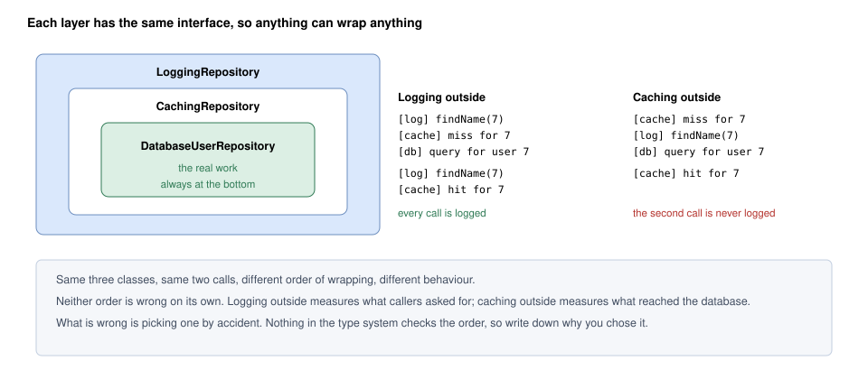
*Figure — The same three classes stacked in two orders. Logging outside caching logs every call; caching outside logging means the second call (a cache hit) is never logged (course diagram)*

### Structure

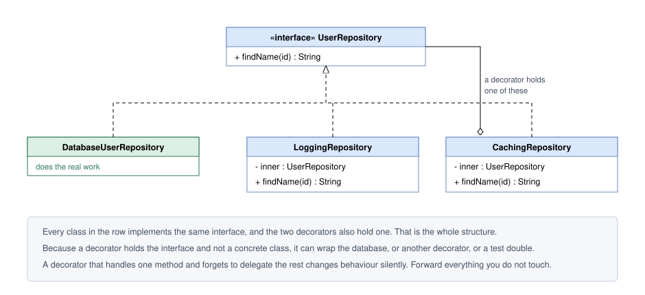
*Figure — Decorator class diagram: `DatabaseUserRepository`, `LoggingRepository` and `CachingRepository` all implement `UserRepository`; each decorator holds an `inner` UserRepository (course diagram)*

Every class implements `UserRepository`; `DatabaseUserRepository` sits at the bottom wrapping nothing. Because `inner` is typed as the interface, decorators wrap each other in any combination and order.

What bites in practice is **delegation**: a decorator must forward every method it is not deliberately changing. One overriding `findName` but silently swallowing `rename` changes behaviour invisibly. Java's usual guard is an abstract base decorator forwarding everything (`RepositoryDecorator`).

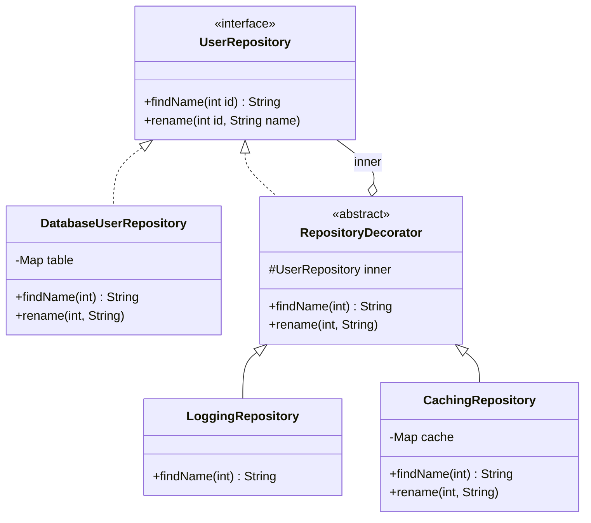

A decorated call, logging outside caching: `Logging.findName(7)` logs → `Caching.findName(7)` misses → `Database.findName(7)` returns "Ada" → caching stores it → "Ada" flows back to the caller (first block of the output below).

### Java example

Full code: `code/lld/ch09/decorator/` (repository stack, coffee `Beverage` records, `UpperCaseInputStream`, `Main`).

```java
// RepositoryDecorator.java — BASE DECORATOR: holds the INTERFACE and forwards everything,
// so subclasses override only what they change and no method is ever forgotten.
abstract class RepositoryDecorator implements UserRepository {
    protected final UserRepository inner;
    protected RepositoryDecorator(UserRepository inner) { this.inner = inner; }
    @Override public String findName(int id)          { return inner.findName(id); }
    @Override public void rename(int id, String name) { inner.rename(id, name); }
}

// LoggingRepository.java — CONCRETE DECORATOR 1
@Override public String findName(int id) {
    System.out.println("    [log]   findName(" + id + ")");
    return super.findName(id);
}

// CachingRepository.java — CONCRETE DECORATOR 2: must also invalidate on writes.
private final Map<Integer, String> cache = new HashMap<>();
@Override public String findName(int id) {
    if (cache.containsKey(id)) { System.out.println("    [cache] hit for " + id); return cache.get(id); }
    System.out.println("    [cache] miss for " + id);
    String name = super.findName(id);
    cache.put(id, name);
    return name;
}
@Override public void rename(int id, String name) { cache.remove(id); super.rename(id, name); }
```

```java
// Beverage decorators — prices in whole cents (int), no floating-point money.
interface Beverage { String description(); int costCents(); }
record Espresso() implements Beverage { public String description() { return "Espresso"; } public int costCents() { return 199; } }
/** Add-ons ARE a Beverage and HAVE a Beverage. (Milk +10, Whip +10 likewise; HouseBlend costs 89.) */
record Mocha(Beverage inner) implements Beverage {
    public String description() { return inner.description() + ", Mocha"; }
    public int costCents() { return inner.costCents() + 20; }
}

// UpperCaseInputStream.java — our own java.io decorator; FilterInputStream is the JDK's base decorator.
// Works byte-by-byte, so only correct for ASCII text.
final class UpperCaseInputStream extends FilterInputStream {
    UpperCaseInputStream(InputStream in) { super(in); }
    @Override public int read() throws IOException {
        int b = super.read();
        return b == -1 ? -1 : Character.toUpperCase((char) b);
    }
    // read(byte[], int, int) upper-cases each byte read likewise
}

// Main.java
lookUpTwice("Logging outside caching (logs every caller request):",
        new LoggingRepository(new CachingRepository(new DatabaseUserRepository())));
lookUpTwice("Caching outside logging (logs only what reaches the db):",
        new CachingRepository(new LoggingRepository(new DatabaseUserRepository())));
Beverage order = new Whip(new Mocha(new Mocha(new Espresso())));
InputStream in = new UpperCaseInputStream(new BufferedInputStream(new ByteArrayInputStream(...)));
```

**Output:**

```text
== Same layers, different order ==
  Logging outside caching (logs every caller request):
    [log]   findName(7)
    [cache] miss for 7
    [db]    query for user 7
    [log]   findName(7)
    [cache] hit for 7
  Caching outside logging (logs only what reaches the db):
    [cache] miss for 7
    [log]   findName(7)
    [db]    query for user 7
    [cache] hit for 7
== Write goes through every layer and invalidates the cache ==
    [log]   findName(8)
    [cache] miss for 8
    [db]    query for user 8
    [db]    update user 8
    [log]   findName(8)
    [cache] miss for 8
    [db]    query for user 8
  now: Linus T.
== Coffee: stack add-ons at run time ==
  Espresso, Mocha, Mocha, Whip = $2.49
  House Blend, Milk = $0.99
== java.io is built from decorators ==
  DECORATORS WRAP STREAMS
```

**What each part does**

- `RepositoryDecorator` — the **abstract base decorator** forwarding *every* method, so a decorator caring only about `findName` cannot drop `rename` — the standard Java defence against forgotten delegation.
- `LoggingRepository` — prints, then delegates.
- `CachingRepository` — answers from its map on a hit (value already cached; a *miss* means not), otherwise delegates and stores (more on caches in [System Design Fundamentals](../../../system-design-patterns/modules/00-system-design-fundamentals/README.md)). Its `rename` **invalidates** (throws away the now-stale copy) — the third output block shows the next read hitting the database.
- `Beverage` records — *Head First*'s coffee example, rewritten: `new Whip(new Mocha(new Mocha(new Espresso())))` = 1.99 + 0.20 + 0.20 + 0.10 = **$2.49**. Double mocha is wrapping twice — impossible with one subclass per combination.
- `UpperCaseInputStream extends FilterInputStream` — `FilterInputStream` holds an `InputStream` and forwards to it.

### Layer order changes behaviour

- **Logger outside, cache inside**: every request is logged, even cache-served ones → the log records *what callers requested*.
- **Cache outside, logger inside**: only misses are logged → the log records *what hit the database*.

Both are valid; they answer different questions. The mistake is choosing **without meaning to** and reading the log as answering the other. The same choice recurs wherever layers stack:

| Pair | Outside | Inside |
|---|---|---|
| Retry vs cache | Repeats the entire lookup | Repeats only the database call, and a retry that succeeds populates the cache. Rule of thumb: put retry **next to the thing that fails**. |
| Metrics vs cache | Times what the caller experiences | Times the database alone — the number an on-call engineer (whoever currently answers alerts) is paged on. Many teams record both. |
| Authorization (checking the caller is allowed) vs cache | **Correct** — every request is checked | **Security bug** — a cached answer is returned without the check ever running |

The type checker accepts every order. **Record why in a comment where the stack is built**, or the next person adding a layer will guess.

### Two related traps

- **Stateful decorators (keeping data between calls) that assume one wrap.** Apply a counting decorator twice and every call counts twice.
- **Lost identity.** The wrapper is a different object, so `==` (same object?), `equals` (equal value?) and `instanceof` surprise callers. Code digging through layers to "reach the real object" fights the pattern.

### Decorator vs inheritance

| | Subclassing | Decorator |
|---|---|---|
| When behaviour is chosen | Compile time | Run time |
| How many at once | One subclass | Any number of layers, any order |
| Classes for N optional features | Up to 2^N | N |
| Works on `final` classes / classes you don't own | No | Yes (only needs the interface) |
| Can reach private state | Protected members, yes | No — only the public interface |

### Java I/O streams: the decorator you already use

```java
new BufferedReader(new InputStreamReader(new FileInputStream("data.txt"), UTF_8))
```

- `FileInputStream` — concrete component (reads bytes from a file).
- `InputStreamReader` — strictly an **adapter** (bytes → characters), not a decorator.
- `BufferedReader` — a **decorator** on `Reader` (adds buffering — reading big chunks to serve many small reads — and `readLine()`).

On the byte side `FilterInputStream` is the abstract decorator; `BufferedInputStream`, `DataInputStream`, `PushbackInputStream`, `java.util.zip.GZIPInputStream` (via `InflaterInputStream`) and `java.security.DigestInputStream` are concrete decorators. *Head First* notes the downside: many small classes that overwhelm newcomers until they see the pattern.

### Trade-offs

| Pros | Cons |
|---|---|
| **Any mix without a class per mix** — 4 concerns need 4 classes, not 16. | **Deeper stack traces** — the real work is buried under every layer. |
| **Concerns tested in isolation** — logging without a database, caching without a logger (Single Responsibility). | **Identity surprises** — `equals`/`instanceof` on the wrapper don't match the wrapped object. |
| **Assembled at run time** — per caller, environment or feature flag (an on/off feature switch). | **Ordering matters for correctness**, and no compiler checks it. |
| **The wrapped class is never edited** (Open/Closed) — works on classes you don't own. | **Over-layering** — eight wrappers deep, nobody knows which changed a value. |

### When not to use it

- **Exactly one concern, forever** — put it in the class; a decorator for one behaviour is a class wrapped around an `if`.
- **The concern needs private state** — a decorator only sees the public interface.
- **The framework already offers it** — middleware and interceptors (code a framework runs around every request or call), Spring AOP aspects (aspect-oriented programming: code applied automatically around chosen methods) are decorators with tooling.
- **The stack would get deep** — each layer is another stack-trace frame and "which one changed this?" becomes a long debugging session.

### Common mistakes

- Holding the **concrete class** (`private DatabaseUserRepository inner`) — decorators cannot stack.
- **Forgetting to forward** some methods (use an abstract base decorator).
- A caching decorator that **doesn't invalidate on writes** (ours does in `rename`).
- Putting authorization **inside** a cache.
- Relying on `instanceof` of the outer object.

### Real-world examples

- **`java.io` streams** — above.
- **`java.util.Collections.unmodifiableList/synchronizedList/checkedList`** — same interface, one changed behaviour (read-only, synchronized, type-checked). Some call `unmodifiableList` a protection **proxy**; both labels are defensible.
- **`javax.servlet.http.HttpServletRequestWrapper`** (Jakarta: `jakarta.servlet...`) — a base decorator you subclass to change request methods in a filter (code running before and after each web request in a Java servlet application).
- **HTTP middleware** — Express, Django, ASP.NET and Go's `http.Handler` wrap a handler in layers (logging, auth, compression, rate limiting — capping requests per client per time window): this pattern with framework support.
- **Resilience4j (Java) and Polly (.NET)** — compose retry, circuit breaker (stops calling a failing service for a while), timeout and bulkhead (separate limited resources so one slow dependency cannot use them all) as stacked wrappers, e.g. `Decorators.ofSupplier(...).withCircuitBreaker(...).withRetry(...).withBulkhead(...).decorate()`; both document ordering carefully because it changes behaviour.
- **Python's `@functools.lru_cache`** (and `@retry` from libraries such as tenacity) — function decorators (LRU = least recently used: a full cache drops the longest-unused entry): the same idea on functions, hence Python's name.

### In modern languages

- **Java**: abstract forwarding base class (as here), or a dynamic proxy (a class generated at run time; see 9.7) generating the forwarding.
- **Python**: function decorators (`@lru_cache`) are this pattern with syntax; for objects, `__getattr__` forwarding (and `functools.wraps` for functions) avoids hand-writing every delegating method.
- **JavaScript / TypeScript**: a higher-order function (takes or returns functions) returning a wrapped function; a `Proxy` object can forward every method automatically.
- **Go**: a struct (Go's record-like type) embedding the interface value gets delegation free — why Go middleware reads so cleanly.
- **C#**: `DelegatingHandler` in `HttpClient` is a framework-provided decorator chain.

### In the interview

**30-second answer:** "Decorator adds responsibilities to an object at run time by wrapping it in another object with the same interface. Without it, four optional concerns mean sixteen subclasses; with it, each concern — logging, caching, retries — is one class and I compose the stack I need. The decorator holds the interface, not the concrete class, which is what lets layers stack. And order matters: retry goes closest to what fails, and authorization must sit outside a cache or a cache hit skips the check."

**Follow-ups**

- *Q: Decorator vs Proxy?* — A: Same structure; different intent. Decorator **adds behaviour** and normally forwards; the client hands it the object to wrap and often stacks several. Proxy **controls access** — may defer, cache or refuse — often creates or locates the real object itself, and is handed to a client that doesn't know it isn't the real thing. The boundary is genuinely fuzzy (a caching wrapper is fairly called either); saying so beats pretending it is sharp.
- *Q: Decorator vs Adapter?* — A: Decorator keeps the interface, changes behaviour; Adapter changes the interface, keeps behaviour.
- *Q: Decorator vs Chain of Responsibility?* — A: Both chain objects. In Decorator every layer normally does its work and passes the call to the core (a cache hit is the usual exception); in Chain of Responsibility typically one handler handles the request and the rest never see it.
- *Q: Decorator vs Composite?* — A: Decorator wraps exactly one child and adds behaviour; Composite holds many and aggregates.
- *Q: Give a JDK example.* — A: `new BufferedInputStream(new FileInputStream(f))`; `FilterInputStream` is the base decorator.

### Self-check

1. **Q:** How many classes for 5 optional features with decorators vs one subclass per combination? **A:** 5 vs up to 32.
2. **Q:** Why does `RepositoryDecorator` forward every method? **A:** So concrete decorators cannot silently drop methods they don't override.
3. **Q:** Why is "authorization inside cache" a bug? **A:** A cache hit returns data without ever running the authorization check.
4. **Q:** Is `InputStreamReader` a decorator? **A:** No — it changes the interface (bytes to chars), so it is an adapter. `BufferedReader` is the decorator.

### TL;DR

- **Wrap to add behaviour, keep the interface.** IS-A and HAS-A the same type.
- N features = N classes, stacked at run time, in any order — and **order matters**.
- Java I/O, `Collections.synchronizedList`, middleware, Resilience4j are all decorators. A decorator normally forwards every call; one that short-circuits (a cache hit) is drifting towards Proxy.

---

## 9.5 Facade Pattern

### What it is

The **Facade** pattern gives a complicated subsystem **one simple front door**, so most callers never touch the machinery. GoF's intent: *provide a unified interface to a set of interfaces in a subsystem; the facade defines a higher-level interface that makes the subsystem easier to use.* Like a hotel concierge: "book me dinner and a taxi" and they call restaurant, taxi and front desk in order — though you can still phone the restaurant yourself.

| Term | Meaning | In our code |
|---|---|---|
| **Facade** | Knows which subsystem classes to call, in what order, and how to clean up | `OrderFacade` |
| **Subsystem classes** | Do the real work; unaware of the facade | `InventoryService`, `PaymentService`, `ShippingService`, `EmailService` |
| **Client** | Uses the facade instead of the subsystem | `Main` / a checkout page |

### The problem it solves

One useful action needs several objects in the right order: **reserve stock → charge the card → create a shipment → send a confirmation**. Every place that places an order repeats those four calls — and must know what to do if the card is declined **after** stock was reserved.

That recovery step is where bugs live: copying the success path is easy, copying the undo correctly is not. A caller forgetting to release the reservation leaves units locked for an order never placed. The subsystem is not wrong — it is **flexible**, meaning many knobs — but nearly every caller wants the same standard sequence and writes it out again.

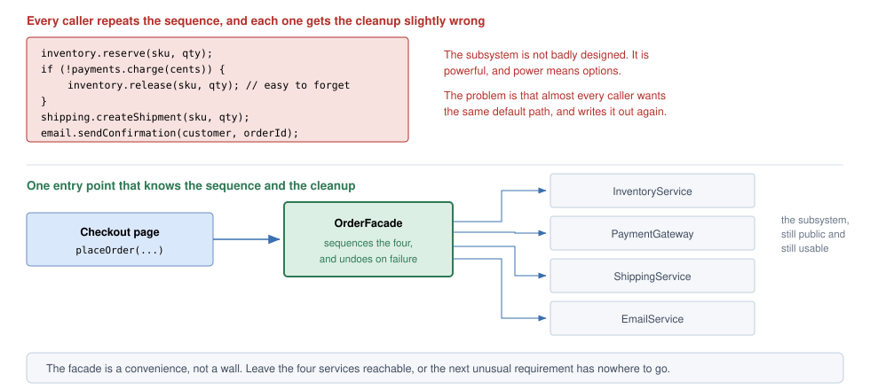
*Figure — Top: each caller repeats the reserve/charge/release/ship/email sequence and may forget the release. Bottom: the checkout page calls `OrderFacade.placeOrder(...)`, which sequences the four services and undoes on failure; the services stay public (course diagram)*

### How it works

1. **Identify the common path** many callers repeat.
2. **Create a facade class** holding the subsystem objects.
3. **Expose one intention-revealing method** (`placeOrder`) calling them in order.
4. **Own the failure handling** — if payment fails, release the reservation (a *compensating action*).
5. **Keep the subsystem public** for unusual callers.
6. **Add no business rules** — the facade *sequences*, it does not *decide*.

### Structure

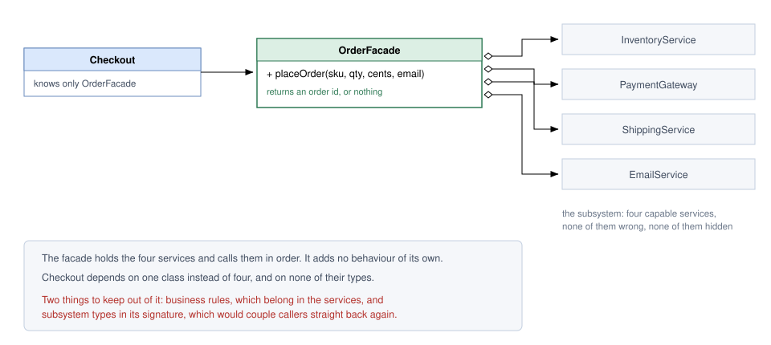
*Figure — Facade class diagram: `Checkout` depends only on `OrderFacade`, which holds the four services (shown in grey) and exposes `placeOrder`. The figure labels the payment service `PaymentGateway` and shows a shorter `placeOrder` signature; our code calls it `PaymentService` and also passes customer and address (course diagram)*

Dependencies run **one way**: no service knows the facade exists, so each stays usable alone. There is no interface — a facade is normally a concrete convenience class; add one only to substitute the entire subsystem, a different job.

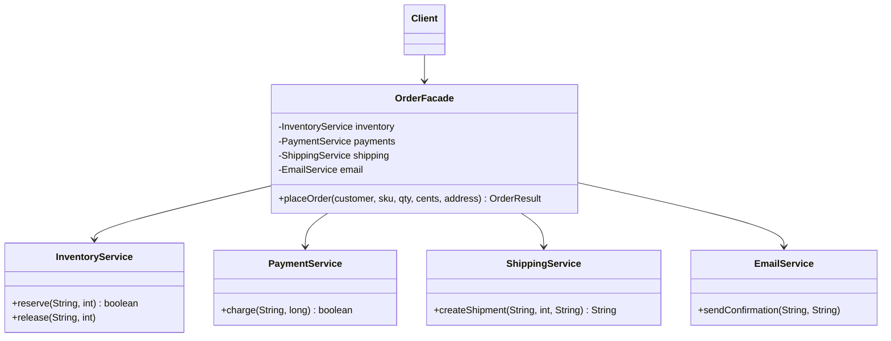

### Java example

Full code: `code/lld/ch09/facade/` — four independent, still-public subsystem services (`InventoryService` starts with 5 × `BOOK-42`; `PaymentService` declines anything over $100 to show the failure path), `OrderResult`, `OrderFacade`, `Main`.

```java
// OrderResult.java — callers get our own small result type.
record OrderResult(boolean success, String orderId, String message) { }

// OrderFacade.java — one method that knows the correct SEQUENCE and the CLEANUP.
// It sequences; it does not decide business rules (no pricing, no fraud logic here).
OrderResult placeOrder(String customer, String sku, int qty, long cents, String address) {
    String orderId = "ORD-" + orderSeq++;
    if (!inventory.reserve(sku, qty)) {
        return new OrderResult(false, orderId, "out of stock");
    }
    if (!payments.charge(customer, cents)) {
        inventory.release(sku, qty);            // compensating step callers used to forget
        return new OrderResult(false, orderId, "payment declined");
    }
    String shipmentId = shipping.createShipment(sku, qty, address);
    email.sendConfirmation(customer, orderId);
    return new OrderResult(true, orderId, "shipped as " + shipmentId);
}

// Main.java
orders.placeOrder("ada@x.com", "BOOK-42", 2, 5_000, "London");   // happy path
orders.placeOrder("bob@x.com", "BOOK-42", 1, 25_000, "Paris");   // declined -> released
orders.placeOrder("cy@x.com", "BOOK-42", 99, 1_000, "Rome");     // out of stock
inventory.reserve("BOOK-42", 1);   // subsystem still reachable, e.g. a warehouse tool
```

**Output:**

```text
== Happy path: one call instead of four ==
  [inventory] reserved 2 x BOOK-42 (left 3)
  [payment]   charge ada@x.com 5000c -> OK
  [shipping]  SHP-1: 2 x BOOK-42 to London
  [email]     confirmation for ORD-100 sent to ada@x.com
  -> OrderResult[success=true, orderId=ORD-100, message=shipped as SHP-1]
== Declined card: the facade undoes the reservation ==
  [inventory] reserved 1 x BOOK-42 (left 2)
  [payment]   charge bob@x.com 25000c -> DECLINED
  [inventory] released 1 x BOOK-42 (left 3)
  -> OrderResult[success=false, orderId=ORD-101, message=payment declined]
== Out of stock ==
  -> OrderResult[success=false, orderId=ORD-102, message=out of stock]
== The subsystem is still reachable for unusual needs ==
  [inventory] reserved 1 x BOOK-42 (left 2)
```

**What each part does**

- The four services are ordinary classes with their own responsibilities; none mention `OrderFacade`.
- `OrderFacade.placeOrder` is the whole pattern: the **sequence** plus the **compensating step** (`inventory.release`) on a declined payment — second output block: reserved, declined, released, with no caller code.
- `OrderResult` — callers need no subsystem types.
- The last line calls `inventory.reserve` directly: the facade is **a convenience, not a wall**.

### Facade vs Adapter vs Mediator

| | **Facade** | **Adapter** | **Proxy** | **Mediator** (Ch. 10–11) |
|---|---|---|---|---|
| Intent | Simplify a subsystem | Convert one interface to another | Control access to one object | Coordinate peers that would otherwise talk directly |
| Objects wrapped | **Several** | **One** | **One** | Several colleagues |
| Interface offered | New, smaller one | The client's (Target) | **Same** as the real object | Mediator's own |
| Who chose the interface | **You** — a simpler one over things you usually control | **Someone else** — you must fit it | Already fixed by the real object | You |
| Do the wrapped objects know about it? | **No** — one-way | No | No | **Yes** — colleagues talk *through* the mediator |
| Direction of communication | Client → facade → subsystem | Client → adapter → adaptee | Client → proxy → real subject | Colleague ↔ mediator ↔ colleague (both ways) |
| Example | `OrderFacade.placeOrder` | `StripeGateway.pay` | `LazyReport` | An air-traffic control tower; a chat room |

Quickest tell is **"objects wrapped"**: Adapter, Decorator and Proxy front exactly one object; a Facade fronts **several**. Another test: if the subsystem changed its API to exactly what callers want, an **Adapter** becomes pointless but a **Facade** stays useful — its value was *simplification*, not translation.

**Facade vs "service layer".** (A service layer is the classes exposing the app's use cases — like placing an order — to its UI or API.) Usually the same thing under two names: a service that only *sequences* is a facade; once it holds business rules it is a domain/application service with logic of its own.

### The failure mode to watch for

Facades **pull in features**: four calls on day one, then a discount rule ("orders are placed here, after all"), then a fraud check, and a year later a **god object** (one class that knows and does almost everything) everyone fears editing. One rule: **a facade orchestrates; it does not decide.** If it makes a business decision instead of calling the thing that does, that logic belongs elsewhere — and keeping it out now is far easier than moving it later.

*Head First* pairs Facade with the **Principle of Least Knowledge** (Law of Demeter): "talk only to your immediate friends" — clients talk to the facade, not a chain of subsystem objects, reducing coupling.

### Trade-offs

| Pros | Cons |
|---|---|
| **One call replaces a multi-step sequence**; the common path is no longer duplicated. | **One more class to maintain** as the subsystem evolves. |
| **The order and the undo logic live in one place** — exactly what callers got wrong. | **Feature magnet** — grows into a god object unless someone pushes back. |
| **One seam for swapping the subsystem later** — only the facade changes. | **Opinionated** — some caller will need an option it left out. |
| **Smaller public surface** for the module; lower coupling. | **Can mask problems** — a neat front over a still-failing subsystem; everything funnels through it, so it can become a single point of failure. |

### When not to use it

- **The subsystem is already simple** — wrapping two calls adds a file.
- **Callers need the full range** — if every caller bypasses it for some option, its shape is wrong: widen it on purpose or remove it.
- **You are covering a mess instead of fixing it** — same failures behind a neat front; sometimes repair the subsystem.
- **You want it to be the only entrance** — hiding the subsystem forces every unusual need into the facade, which is how god objects are born.

### Common mistakes

- Business rules (pricing, fraud) in the facade.
- Making the subsystem inaccessible.
- Returning subsystem types, so callers stay coupled to them.
- Forgetting the failure path — a happy-path-only (nothing-goes-wrong) facade misses its biggest value.
- Confusing it with Mediator (see table).

### Real-world examples

- **Application service layers** — almost every `OrderService` or `RegistrationService` is a facade over repositories, gateways and notifiers (as long as it only sequences).
- **`java.net.URL`** — `url.openStream()` hides protocol handlers, connection setup and content handlers. (Since Java 20 the `URL` constructors are deprecated — officially discouraged, due for removal; use `URI.create(s).toURL()`. The facade idea is unchanged.)
- **SLF4J `LoggerFactory.getLogger(...)`** — hides configuration, appenders (log destinations: files, console) and formatters. SLF4J literally calls itself a "Simple Logging Facade".
- **`javax.faces.context.FacesContext`**, **jQuery** (historically the clearest: one `$` in front of DOM, events, animation and XHR — the browser's API for HTTP requests from JavaScript — each still usable directly), and Python's **`requests`** covering common "just fetch this URL" cases over `urllib3`.
- **E-commerce checkout**: "Place order" on Amazon or Flipkart is one backend (server-side) call orchestrating inventory, payment, shipping and notifications — often called an orchestrator or backend-for-frontend (a server layer built for one particular UI).

### In modern languages

- **Python / JavaScript**: a module exporting one function, the rest private — a facade with no class.
- **Go**: a package's exported functions are the facade; lowercase identifiers stay internal.
- **Java**: a package with one public class (package-private subsystem), or a JPMS (Java Platform Module System) module exporting only the facade's package.
- **Any language**: if `placeOrder` needs no state of its own, one well-named function is the whole pattern.

### In the interview

**30-second answer:** "A Facade gives one simple entry point to a complex subsystem. For order placement, `OrderFacade.placeOrder` reserves stock, charges, ships and emails in the right order, and if payment fails it releases the reservation — so no caller has to remember that cleanup. It wraps several objects, unlike Adapter, Decorator and Proxy which wrap one. I keep the subsystem public, because a facade is a convenience, not a wall, and I keep business rules out of it — the main risk is that it grows into a god object."

**Follow-ups**

- *Q: How is it different from Adapter?* — A: Adapter converts one interface someone else chose; Facade simplifies many objects behind a new interface you chose.
- *Q: And from Mediator?* — A: Subsystem classes don't know the facade exists; Mediator colleagues know it and communicate through it, both ways.
- *Q: Risk?* — A: God object. A facade should sequence, not decide.
- *Q: Should the subsystem be hidden?* — A: Usually no; leave it reachable for unusual needs.
- *Q: Can a system have several facades?* — A: Yes — e.g. one per use case, or layered facades over sub-subsystems.

### Self-check

1. **Q:** What is the fastest structural way to tell a Facade from Adapter/Decorator/Proxy? **A:** It wraps several objects; the others wrap one.
2. **Q:** In our code, what does the facade do when payment is declined? **A:** Releases the stock reservation and returns a failed `OrderResult`.
3. **Q:** A teammate adds a 10% discount rule inside `placeOrder`. Good idea? **A:** No — business rules belong in a service the facade calls; the facade only sequences.
4. **Q:** Which OO principle is closely related to Facade? **A:** Principle of Least Knowledge (Law of Demeter).

### TL;DR

- **One door into a complex subsystem.** Names the common path and owns the cleanup.
- Wraps **several** objects; subsystem stays **public**; facade **sequences, never decides**.
- Different from Adapter (translation of one) and Mediator (two-way coordination of peers).

---

## 9.6 Flyweight Pattern

### What it is

The **Flyweight** pattern **shares** the part of each object's state that is the same across many objects, so huge numbers of them fit in memory. GoF's intent: *use sharing to support large numbers of fine-grained objects efficiently.* Like printing: every "e" uses the same type design (shared) at a different position (unique).

Two terms carry the whole pattern:

| Term | Meaning | In the map example |
|---|---|---|
| **Intrinsic state** | Part of the thing's own identity and **identical for every holder**. Lives inside the shared flyweight. | icon bitmap, colour, size |
| **Extrinsic state** | **Varies with the context** the object is used in; different for each holder. Stays outside and is **handed in** as method arguments. | latitude, longitude |

Remember: "intrinsic = inside the shared object", "extrinsic = supplied from outside" — GoF's words, used by interviewers.

| Role | In our code |
|---|---|
| **Flyweight** (shared, immutable, intrinsic only) | `MarkerStyle` |
| **Flyweight factory** (owns the pool, returns existing or creates once) | `MarkerStyleFactory` |
| **Context** (one per logical object: extrinsic state + reference to a flyweight) | `Marker` |
| **Client** (asks the factory, supplies extrinsic state) | `Main` |

GoF's participants are *Flyweight* (interface accepting extrinsic state), *ConcreteFlyweight* (shared implementation — `MarkerStyle` plays both since we need no interface), *UnsharedConcreteFlyweight* (same interface but **not** shared, e.g. a row object holding its own children), *FlyweightFactory* and *Client*. "Context" is later sources' (e.g. refactoring.guru) name for the object storing extrinsic state.

### The problem it solves

A map app shows **100,000 markers**, each with latitude and longitude — plus icon bitmap, colour and size. Positions differ, but thousands share an icon, by far the largest field. 100,000 copies of a 2 MB bitmap need ~195 GB: **the program simply runs out of memory.** Likewise a game's million trees sharing one mesh and texture (3D shape and the image painted on it), a text editor's per-character font data — anywhere many objects **differ slightly but share a large common part**.

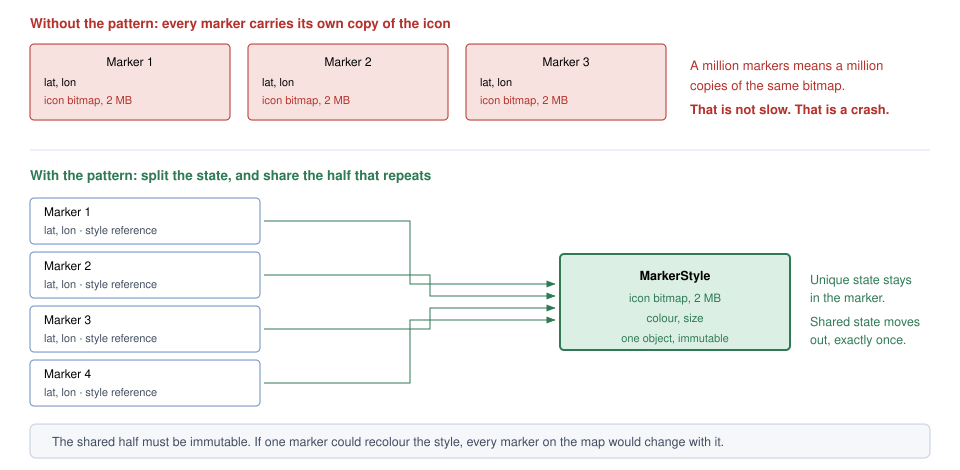
*Figure — Top: every marker carries its own 2 MB icon. Bottom: each marker keeps only lat/lon and a style reference; one immutable `MarkerStyle` holds the icon, colour and size (course diagram)*

### How it works

1. **Split the state**: intrinsic (shared, invariant) vs extrinsic (per holder).
2. **Move intrinsic state into an immutable flyweight** — all fields `final`, no setters.
3. **Pass extrinsic state as method arguments** (`draw(lat, lon)`), never stored in the flyweight.
4. **A factory owns the pool**, keyed by intrinsic values; `get(...)` returns the existing object or creates it once.
5. **Clients must go through the factory**, never the constructor (package-private/private constructors).
6. **Context objects** keep extrinsic state plus a **reference** (not a copy) to the flyweight.

> **Two rules — break either and the pattern silently stops working.**
> 1. **Flyweights never change.** Many holders point at one object, so a change for one is seen by all.
> 2. **Only the factory creates them.** Direct construction creates identical copies and the saving is gone.

### Structure

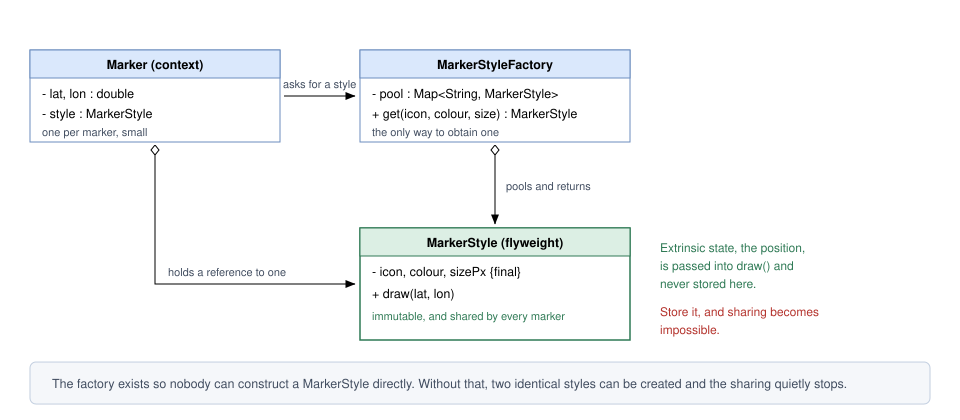
*Figure — Flyweight class diagram: `MarkerStyle` (final fields, `draw(lat, lon)`), `MarkerStyleFactory` with a pool and `get()`, and `Marker` holding position plus a style reference (course diagram)*

`draw` receives position as arguments; `Marker` holds a *reference* to a style; clients get styles only from the factory — enforced by a package-private (or private) constructor, or at least convention and review.

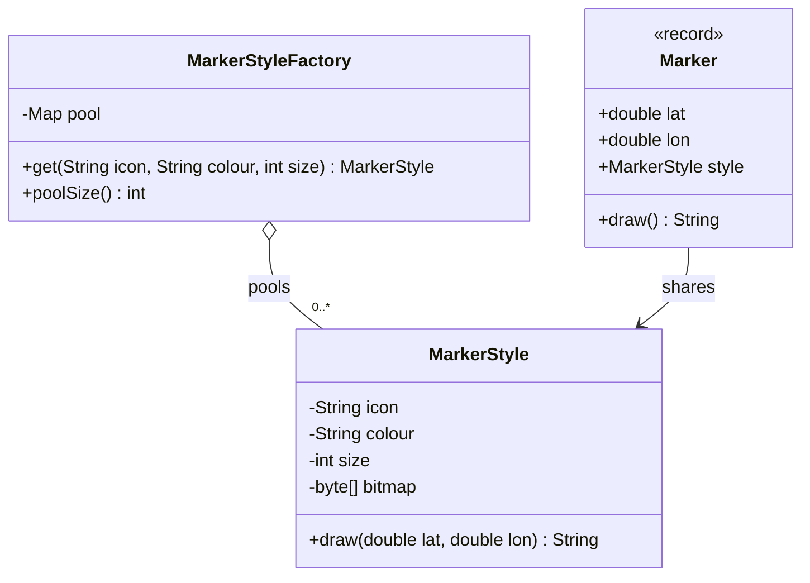

### Java example

Full code: `code/lld/ch09/flyweight/` (`MarkerStyle`, `MarkerStyleFactory`, `Marker`, `Main`).

```java
// MarkerStyle.java — FLYWEIGHT: INTRINSIC state only. Immutable: final fields, no setters, bitmap never leaves.
// Package-private constructor: outside code cannot bypass the factory (inside the package it is a convention).
final class MarkerStyle {
    static final int ICON_BYTES = 2 * 1024 * 1024;   // pretend every icon bitmap is 2 MB
    private final String icon, colour;
    private final int size;
    private final byte[] bitmap;                     // the heavy part we want exactly one copy of

    MarkerStyle(String icon, String colour, int size) {
        System.out.println("  loading icon '" + icon + "' (" + colour + ", " + size + "px)");
        this.icon = icon; this.colour = colour; this.size = size;
        this.bitmap = new byte[ICON_BYTES];
    }
    /** EXTRINSIC state (the position) is passed in, never stored. */
    String draw(double lat, double lon) {
        return String.format("%s %s marker at (%.4f, %.4f)", colour, icon, lat, lon);
    }
}

// MarkerStyleFactory.java — owns the pool; thread-safe via ConcurrentHashMap.computeIfAbsent.
final class MarkerStyleFactory {
    private record Key(String icon, String colour, int size) { }   // the combination of intrinsic values
    private final Map<Key, MarkerStyle> pool = new ConcurrentHashMap<>();
    MarkerStyle get(String icon, String colour, int size) {
        return pool.computeIfAbsent(new Key(icon, colour, size), k -> new MarkerStyle(k.icon(), k.colour(), k.size()));
    }
    int poolSize() { return pool.size(); }
}

// Marker.java — CONTEXT: one per marker; extrinsic state + a REFERENCE to a shared style.
record Marker(double lat, double lon, MarkerStyle style) {
    String draw() { return style.draw(lat, lon); }
}
// Main: 5 markers over 3 styles, then 100,000 random markers; then JDK flyweight checks (Integer, Boolean, String).
```

**Output:**

```text
== Five markers, three styles ==
  loading icon 'cafe' (brown, 24px)
  loading icon 'fuel' (green, 24px)
  loading icon 'hospital' (red, 32px)
  brown cafe marker at (51.5074, -0.1278)
  brown cafe marker at (48.8566, 2.3522)
  green fuel marker at (40.7128, -74.0060)
  red hospital marker at (35.6762, 139.6503)
  green fuel marker at (52.5200, 13.4050)
  same shared object? true
== Scale to 100,000 markers ==
  markers: 100000, styles in pool: 3
  icon memory without flyweight: ~200000 MB
  icon memory with flyweight:    ~6 MB
== Flyweights already in the JDK ==
  Integer 127 == 127 -> true  (cached -128..127)
  Integer 128 == 128 -> false (outside default cache)
  equals() is always right -> true
  Boolean.valueOf(true) == Boolean.TRUE -> true
  "hello" == "hel" + "lo" -> true (compile-time constant, pooled)
  "hello" == new String("hello") -> false
  "hello" == built.intern() -> true
```

**What each part does**

- `MarkerStyleFactory` — `ConcurrentHashMap.computeIfAbsent` makes "get or create once" **thread-safe and atomic** (correct when many threads — independent paths of execution — use it, done as one indivisible step), so two threads can't create duplicate styles.
- `Key` record — intrinsic values as a value object (defined only by its values); records give correct `equals`/`hashCode` (what a hash map uses to find a key) free.
- "loading icon" prints **3 times for 5 markers**, still 3 styles for 100,000 markers — ~6 MB of icons instead of ~200,000 MB (≈195 GB).

### Flyweights already in Java

- **`Integer.valueOf(int)`** (used by autoboxing — automatic wrapping of an `int` into an `Integer`) returns cached objects for **−128 to 127**, a range the Java Language Specification requires. Hence `Integer a = 127, b = 127; a == b` is `true` but with 128 is `false` on a default JVM (the upper bound can be raised with `-XX:AutoBoxCacheMax`, so never rely on it). **Always compare boxed numbers with `equals`.** `Short`, `Byte`, `Long` (same range) and `Character` (0–127) have similar caches; `Boolean.valueOf` returns the shared `Boolean.TRUE` / `Boolean.FALSE`.
- **The String pool**: literals and compile-time constant expressions (`"hel" + "lo"`) are interned (stored once in a shared pool and reused). `new String("hello")` always creates a new object; `intern()` returns the pooled one.
- **Enums**: exactly one instance per constant, shared everywhere.

### Flyweight is not a cache

Mixed up constantly — and the difference decides what you may do with the pool:

| | **Flyweight** | **Cache** |
|---|---|---|
| Purpose | Make the data *fit in memory* at all | Make repeated work *quicker* |
| Contents | One copy of immutable state that many holders point to | Stored results of costly computations or lookups |
| May entries be removed? | Not while any holder still points to one | Yes, at any moment |
| Effect of removing one | Holders lose their shared object, or duplicates get created | None, apart from a slower next request |

An LRU cache in front of a database is not a flyweight; a pool of shared marker styles is not a cache.

### Two mistakes that undo the pattern

- **A flyweight that can change.** One caller updates a colour and every marker changes — the classic failure, hard to debug because the effect appears far from the cause. Fix: `final` fields, no setters, no leaked internal arrays.
- **An ever-growing pool keyed by open-ended input.** User-chosen keys mean the pool never stops growing — a memory leak (memory never released) disguised as optimisation. Flyweight is safe when intrinsic values are **small and bounded** (3 styles, a few hundred glyphs). An open key space needs weak references (which the garbage collector may clear) and eviction — at which point it is a cache, so call it one.

### Measure first

Flyweight trades readability for memory, so using it without profiling (measuring where a program spends time or memory) is textbook premature optimisation. A thousand objects never need it; a million might. Answer **with numbers**: *how many of these objects exist at once*, and *how much of each is identical across all?* No numbers → too early; mostly-unique objects → nothing to share.

### Trade-offs

| Pros | Cons |
|---|---|
| **Memory can fall by orders of magnitude** — sometimes the difference between running and not. | **State is split across two places** — harder to follow and change than one class. |
| **Costly construction once per distinct value**, not per object. | **The pool keeps strong references** (ordinary references that stop the garbage collector freeing an object), so it can leak itself. |
| **Friendlier to CPU caches** — shared data stays hot (recently used, fast to reach). | **Thread safety is on you** — thread-safe pool, immutable flyweight. |
| **"Load once" logic gets one obvious home.** | **Tempting too early**, and callers pass extrinsic state on every call (some CPU cost). |

### When not to use it

- You **haven't measured**.
- The shared part **cannot be immutable**.
- The **counts are small**.
- The **unique state is most of the object**.
- The **key space is unbounded** (that's a cache).

### Common mistakes

- Storing extrinsic state inside the flyweight (then it can't be shared).
- Public constructor so callers bypass the factory.
- Non-thread-safe pool (`HashMap` + check-then-put from many threads → duplicates or worse).
- Comparing boxed `Integer`s or `String`s with `==` because "it worked in the test" with small values or literals.

### Other patterns it is confused with

| Looks like | Actual difference |
|---|---|
| Cache | See table above. |
| Singleton | Singleton = exactly one instance of a class. Flyweight = one instance **per distinct intrinsic value** (3, or 300). A pool that happens to hold one entry only *looks* like a Singleton. |
| Object pool | An object pool **lends out mutable** objects and takes them back (e.g. DB connections). Flyweights are **immutable**, shared, never returned. |
| Prototype | Prototype makes many objects by copying; Flyweight avoids making them at all — opposite answers to "many similar objects". |

### Real-world examples

- **`Integer.valueOf`, `Boolean.valueOf`, `String.intern()`, enums** — above. (Python also interns small integers and many short strings automatically.)
- **Text rendering / word processors** — one glyph object per font character, shared by every occurrence (the classic GoF example).
- **Game engines and map renderers** — meshes, textures and sprite atlases loaded once and referenced by every entity (a forest of identical trees, rendered with GPU *instancing* — the graphics card drawing one model many times in one pass).
- **Map apps** — thousands of pins share a handful of icon styles (this section's example).
- **`java.time.ZoneOffset`** caches offsets that are whole multiples of 15 minutes, so `ZoneOffset.ofHours(5)` returns a shared instance.

### In modern languages

- **Java**: `Integer.valueOf`, `String.intern` and enums are built-in flyweights; a `record` is an immutable flyweight in one line, and `Map` + `computeIfAbsent` is the whole factory.
- **Python**: small ints and short strings interned automatically; `functools.lru_cache` on a factory function gives a size-bounded pool.
- **JavaScript**: `Object.freeze` on the shared object plus a `Map` pool — freezing enforces immutability.
- **C++**: `std::shared_ptr<const Style>` expresses sharing and immutability in the type.
- **Any language with value types**: an immutable value object plus a memoising (remembers results already produced) factory is this pattern, usually unnamed.

### In the interview

**30-second answer:** "Flyweight saves memory when there are huge numbers of similar objects. I split state into intrinsic — shared and invariant, like an icon — and extrinsic — per object, like a position — which is passed in to methods. The intrinsic part lives in an immutable flyweight handed out by a factory that pools one instance per distinct value. `Integer.valueOf` and the String pool are JDK examples. I'd only do it after measuring."

**Follow-ups**

- *Q: Why must the flyweight be immutable?* — A: It is shared; mutating it changes every holder.
- *Q: How do you make the factory thread-safe?* — A: `ConcurrentHashMap.computeIfAbsent`, which runs the creation function at most once per key.
- *Q: Flyweight vs cache?* — A: A cache may evict anything and exists for speed; a flyweight exists because otherwise the program doesn't fit, and entries can't be dropped while referenced.
- *Q: Why is `Integer 128 == 128` false?* — A: Autoboxing uses `Integer.valueOf`, which only guarantees caching for −128..127; outside it you get distinct objects on a default JVM. Use `equals`.
- *Q: Flyweight vs Singleton?* — A: One instance per distinct value vs one instance total.

### Self-check

1. **Q:** In a chess game with a million saved positions, what is intrinsic and extrinsic for a piece? **A:** Intrinsic: type and colour (and image). Extrinsic: the square it is on.
2. **Q:** What goes wrong if `MarkerStyle` had `setColour`? **A:** Changing one marker's colour would change every marker sharing that style.
3. **Q:** Is `"a" + "b" == "ab"` true in Java? **A:** Yes — it is a compile-time constant expression, so it is interned. With a non-final variable in the expression, it would be a new object.
4. **Q:** When does a flyweight pool become a leak? **A:** When its key space is unbounded (e.g. keyed by user input) and it never evicts.

### TL;DR

- **Share what repeats, pass in what varies.** Intrinsic inside, extrinsic outside.
- **Immutable** flyweight + **factory-owned** pool (thread-safe).
- JDK: `Integer.valueOf` (−128..127), String pool, enums. **Measure first**; not a cache.

---

## 9.7 Proxy Pattern

### What it is

The **Proxy** pattern places a **stand-in with the identical interface** in front of a real object to control **who** may use it, **when** it is created, or **how much** each use costs. GoF's intent: *provide a surrogate or placeholder for another object to control access to it* (also called **Surrogate**). Like a credit card standing in for your bank account: accepted wherever cash is (same "interface"), but adding limits and fraud checks, moving money only when needed.

| Term | Meaning | In our code |
|---|---|---|
| **Subject** | The interface shared by the proxy and the real object | `Report`, `RateService`, `Device` |
| **Real Subject** | The object that does the real work | `RealReport`, `LiveRateService`, `RealDevice` |
| **Proxy** | Holds (or creates) the real subject, same interface, decides what happens before/instead of/around the call | `LazyReport`, `AuditedReport`, `CachingRateProxy`, `RemoteRateProxy`, the `SharedDevice` handle |

### The problem it solves

Sometimes callers should **not touch the real object directly — or not yet**:

- **Building it is costly and usually unnecessary** — loading a 100 MB report at start-up wastes work on runs that only show its title.
- **Only some callers are permitted**, and permission logic doesn't belong inside the object.
- **It runs on another machine**, and callers shouldn't write networking code.
- **Each call must be logged or counted**, but the class belongs to someone else.

With **the very same interface**, a proxy can be inserted **without editing any caller**. That is also its danger: a slow or remote call **looks just like a cheap local one**.

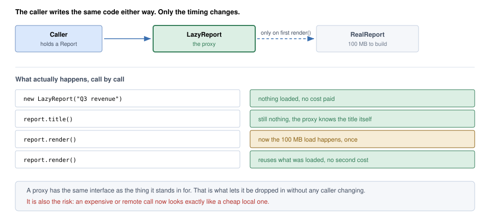
*Figure — The caller holds a `Report`. Creating the `LazyReport` and calling `title()` cost nothing; the 100 MB load happens once on the first `render()`, and later renders reuse it (course diagram)*

### How it works

1. **Define (or reuse) the Subject interface** callers already use.
2. **Write a proxy implementing it**, holding the real subject — or the information to create it later.
3. In each method, **do the proxy's job first** — create lazily, check permission, look in a cache, marshal (convert into a sendable message) over a network, count references — then **delegate** (or refuse).
4. **Give callers the proxy** in place of the real object (often via a factory or DI container, so they never see the difference).

### Kinds of proxy

| Kind | What it controls | Our code / real example |
|---|---|---|
| **Virtual proxy** | *When* the expensive object is created (lazy initialisation) | `LazyReport`; Hibernate (a Java ORM) lazy-loaded entities |
| **Protection proxy** | *Who* may call (access control) | `AuditedReport`; `Collections.unmodifiableList` |
| **Remote proxy** | *Where* the object lives — hides the network | `RemoteRateProxy` (stub) + `RateServer` (skeleton); RMI/gRPC (remote-call frameworks) stubs |
| **Caching proxy** | *Whether* the real call is needed — reuses results | `CachingRateProxy` (bounded LRU + TTL — time to live, how long an entry stays valid) |
| **Logging / monitoring proxy** | Records each call before/after forwarding | `LoggingHandler` (dynamic proxy) |
| **Smart reference** | Bookkeeping on access — reference counting, locking, loading on first use | `SharedDevice` handles close the device when the last one closes |

GoF names four kinds — remote, virtual, protection, smart reference — differing only in what the proxy does before delegating. Caching and logging proxies are widely used variants from later sources such as refactoring.guru (GoF would file logging/counting under smart reference).

### Structure

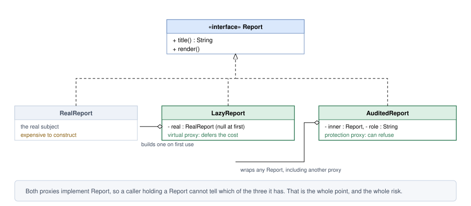
*Figure — Proxy class diagram: `RealReport`, `LazyReport` (virtual proxy) and `AuditedReport` (protection proxy) all implement `Report`; `LazyReport` creates the `RealReport` itself, `AuditedReport` wraps any `Report` (course diagram)*

`RealReport` does the expensive work in its constructor; `LazyReport` keeps only the name, answers `title()` itself and builds the `RealReport` on the first `render()`; `AuditedReport` checks a role first. Holding the **interface**, `AuditedReport` can guard the real report, the lazy proxy or another protection proxy (our demo wraps the lazy one). Stripped down, only one line of `LazyReport` is special — the null check that triggers construction; the rest forwards.

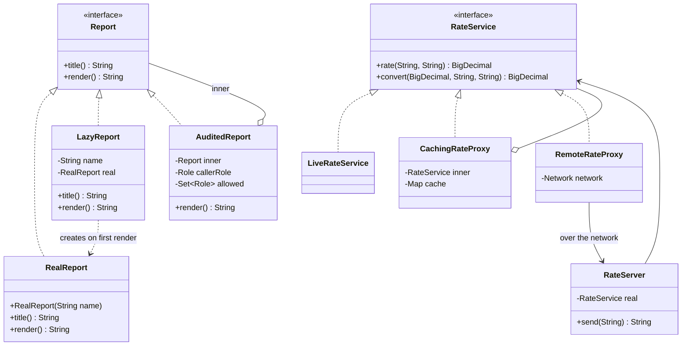

### Java example

Full code: `code/lld/ch09/proxy/` — `Report`/`RealReport`/`LazyReport`/`AuditedReport`/`Role`; `RateService`/`LiveRateService`/`CachingRateProxy`; `Network`/`RateServer`/`RemoteRateProxy`; `Device`/`RealDevice`/`SharedDevice`; `LoggingHandler`; `Main`.

```java
// LazyReport.java — VIRTUAL PROXY: answers title() itself, builds the RealReport on first render().
// Thread-safe lazy init with double-checked locking (field must be volatile).
final class LazyReport implements Report {
    private final String name;
    private volatile RealReport real;      // created by the proxy itself, not handed in
    LazyReport(String name) { this.name = name; }

    @Override public String title()  { return name; }   // no load needed
    @Override public String render() { return realReport().render(); }

    private RealReport realReport() {
        RealReport r = real;
        if (r == null) {
            synchronized (this) {
                r = real;
                if (r == null) real = r = new RealReport(name);   // prints "[real] loading 100 MB..."
            }
        }
        return r;
    }
}

// AuditedReport.java — PROTECTION PROXY: checks permission, may REFUSE the call.
@Override public String title() { return inner.title(); }  // titles are public
@Override public String render() {
    if (!allowed.contains(callerRole)) throw new SecurityException(callerRole + " may not render " + inner.title());
    return inner.render();
}
```

```java
// RateService.java — money and rates are BigDecimal, never double; amounts rounded to 2 dp (HALF_EVEN).
interface RateService {
    BigDecimal rate(String from, String to);
    BigDecimal convert(BigDecimal amount, String from, String to);
    static BigDecimal toMoney(BigDecimal value) { return value.setScale(2, RoundingMode.HALF_EVEN); }
}
// LiveRateService (real subject, counts lookups):
public BigDecimal convert(BigDecimal amount, String from, String to) {
    return RateService.toMoney(amount.multiply(rate(from, to)));   // self-call: goes to THIS object, not through any proxy
}

// CachingRateProxy.java — bounded (LRU) and time-limited, because an unbounded cache is a leak.
this.cache = new LinkedHashMap<>(16, 0.75f, true) {   // access order = LRU
    @Override protected boolean removeEldestEntry(Map.Entry<String, CachedRate> eldest) { return size() > maxEntries; }
};
@Override public synchronized BigDecimal rate(String from, String to) {
    String key = from + "->" + to;
    CachedRate e = cache.get(key);
    long now = System.currentTimeMillis();
    if (e != null && e.expiresAt() > now) return e.value();
    BigDecimal v = inner.rate(from, to);
    cache.put(key, new CachedRate(v, now + ttlMillis));
    return v;
}

// REMOTE PROXY over a simulated in-process Network { String send(String request); }
// RateServer (server "skeleton"): unmarshals "rate|FROM|TO", returns real.rate(...).toPlainString()
// RemoteRateProxy (client "stub"):
@Override public BigDecimal rate(String from, String to) {
    String request = "rate|" + from + "|" + to;
    System.out.println("    [stub] sending '" + request + "' over the wire");
    return new BigDecimal(network.send(request));
}
```

```java
// SharedDevice.java — SMART REFERENCE: each client gets its own handle (a proxy); the real device
// opens on the first handle and closes when the LAST closes. All of refs, real and each handle's
// 'closed' flag are read/written under the SharedDevice lock.
synchronized Device acquire() {
    if (refs++ == 0) real = new RealDevice();
    System.out.println("    [ref] handle acquired, count=" + refs);
    return new Handle();
}
// Handle.close():
synchronized (SharedDevice.this) {
    if (closed) return;          // closing a handle twice must not double-decrement
    closed = true;
    refs--;
    System.out.println("    [ref] handle released, count=" + refs);
    if (refs == 0) { real.close(); real = null; }
}

// LoggingHandler.java — DYNAMIC PROXY: one InvocationHandler that logs calls on ANY interface.
static <T> T wrap(T target, Class<T> iface) {
    return (T) Proxy.newProxyInstance(iface.getClassLoader(), new Class<?>[] {iface}, new LoggingHandler(target));
}
@Override public Object invoke(Object proxy, Method method, Object[] args) throws Throwable {
    String call = method.getName() + (args == null ? "()" : Arrays.toString(args));
    System.out.println("    [proxy] -> " + call);
    try {
        Object result = method.invoke(target, args);   // forward to the real object
        System.out.println("    [proxy] <- " + call + " returned " + result);
        return result;
    } catch (InvocationTargetException e) {
        throw e.getCause();          // rethrow the real exception, not the reflection wrapper
    }
}
// Main: CachingRateProxy(live, 2, 60_000) gets USD>EUR, USD>EUR, USD>INR, EUR>INR (evicts USD>EUR), USD>EUR.
```

**Output:**

```text
== Virtual proxy: pay only when needed ==
  created proxy; title = Q3 revenue
    [real] loading 100 MB of data for 'Q3 revenue'...
  render #1 -> Q3 revenue (1000000 rows)
  render #2 -> Q3 revenue (1000000 rows)
== Protection proxy wrapping the virtual proxy ==
    [real] loading 100 MB of data for 'Payroll'...
  finance -> Payroll (1000000 rows)
  viewer  -> refused: VIEWER may not render Payroll (nothing was loaded)
== Caching proxy (LRU, max 2 entries, 60 s TTL) ==
  5 calls, real lookups = 4
== Remote proxy (stub) ==
    [stub] sending 'rate|USD|INR' over the wire
  100 USD = 8300.00 INR
== Smart reference (reference counting) ==
    [device] opened (expensive)
    [ref] handle acquired, count=1
    [ref] handle acquired, count=2
  a -> ok:status, b -> ok:print
    [ref] handle released, count=1
    [ref] handle released, count=0
    [device] closed
== Dynamic proxy: one handler, any interface ==
    [proxy] -> title()
    [proxy] <- title() returned Q4 plan
    [proxy] -> render()
    [real] loading 100 MB of data for 'Q4 plan'...
    [proxy] <- render() returned Q4 plan (1000000 rows)
    [proxy] -> convert[100, USD, EUR]
    [proxy] <- convert[100, USD, EUR] returned 92.00
  ^ convert() called rate() on 'this', so the inner rate() call was NOT logged
  generated at run time: isProxyClass = true
```

**What each part does**

- `LazyReport` — **virtual proxy**: `title()` answered locally; "loading" appears **once**, at the first render.
- **Thread-safe lazy init.** Otherwise two threads calling `render()` together both build the object (harmless for a report, a real bug if construction opens a connection or charges a card). **Double-checked locking** (check without a lock, then lock and check again — Chapter 8) with a **`volatile`** field (makes a write immediately visible to all threads) so no thread sees a half-built object.
- `AuditedReport` — **protection proxy** wrapping a virtual proxy; the viewer is refused **before** anything loads (no second "loading 'Payroll'" line).
- `RateService` uses `BigDecimal` (Java's exact decimal type) — never `double` for money — rounding to 2 places with `HALF_EVEN` ("banker's rounding": an exact half goes to the even digit).
- `CachingRateProxy` — **bounded** (LRU via access-ordered `LinkedHashMap` + `removeEldestEntry`) and **time-limited** (TTL). 5 calls → 4 lookups: the second USD→EUR hits, the last misses because it was evicted.
- `SharedDevice` — **smart reference**; all bookkeeping under one lock and `close()` is idempotent (twice = once), so concurrent or double closes can't corrupt the count.

### Static vs dynamic proxies

| | **Static proxy** | **Dynamic proxy** |
|---|---|---|
| How it's made | You hand-write a class per interface (`LazyReport`, `CachingRateProxy`) | Generated at **run time** from an interface list + a handler |
| Code per interface | One proxy class each; every method written out | One `InvocationHandler` for **any** interface |
| Type safety | Full; compiler checks each method | Calls arrive as `Method` + `Object[]` — reflective, less checked |
| Good for | Logic specific to one type (lazy load, access rules for a domain object) | **Cross-cutting concerns** (needs shared by many classes) on many types: logging, timing, transactions, security |
| JDK API | — | `java.lang.reflect.Proxy.newProxyInstance(loader, interfaces, handler)` |
| Limitation | Boilerplate | JDK proxies work **only for interfaces**; class-based proxies need bytecode (compiled JVM instructions) libraries (CGLIB, ByteBuddy) |

How the JDK dynamic proxy works:

1. `Proxy.newProxyInstance(classLoader, new Class<?>[]{Report.class}, handler)` generates a class (named like `$Proxy0`) implementing `Report`.
2. **Every** call on it is routed to `handler.invoke(proxy, method, args)`.
3. The handler does its extra work and forwards with `method.invoke(target, args)`.
4. If the target throws, reflection wraps it in `InvocationTargetException` — **unwrap it** (`e.getCause()`) so callers see the real exception.

### The self-invocation trap (and Spring AOP)

In the output, `convert` went through the logging proxy, but internally called `rate(...)` on **`this`** — the real object — so that inner call **bypassed the proxy** and was not logged. This is exactly **Spring AOP**:

- Spring implements annotations (`@` tags it reads) such as `@Transactional` (run inside a database transaction — all changes succeed or fail together), `@Cacheable`, `@Async`, `@PreAuthorize` and custom `@Aspect` advice (the code AOP runs around a method) by wrapping your bean (an object the Spring container manages) in a **proxy**; callers get the proxy injected.
- Spring uses a **JDK dynamic proxy** when the target implements at least one interface, a **CGLIB** subclass proxy otherwise (or when `proxyTargetClass = true`; Spring Boot 2.0+ defaults to CGLIB class-based proxies).
- **Self-invocation is not intercepted**: if `placeOrder()` calls `this.saveAudit()` annotated `@Transactional(propagation = REQUIRES_NEW)`, the annotation is silently ignored — the call never leaves the object.
- With CGLIB, **`final` classes cannot be proxied and `final`/`private` methods cannot be advised**.
- Fixes, in order of preference: move the method into another bean; inject the bean's own proxy (e.g. a lazily injected self-reference); or (discouraged) `AopContext.currentProxy()`, which also needs `exposeProxy = true`. AspectJ weaving (inserting the code into compiled classes at compile or load time) avoids the problem — no proxies.

### Proxy vs Decorator

The hardest pair to tell apart: both implement an interface, hold another object of it and forward. GoF says implementations can be similar and the difference is **purpose**: a decorator *adds responsibilities*, a proxy *controls access*.

| | **Proxy** | **Decorator** |
|---|---|---|
| Purpose | **Controls access** to the object | **Adds behaviour** around the object |
| Does the call get through? | Not necessarily — may defer, cache or refuse | Normally yes — the added work runs around a forwarded call |
| Who creates / finds the real object? | **Often the proxy itself** (`LazyReport` builds `RealReport`; a remote proxy only knows an address) | **The caller**, who hands it in |
| Does the client know it has a wrapper? | Usually not — a factory/DI container hands it the proxy as if it were the real object | Usually yes — the client (or its configuration) builds the stack |
| How many layers? | Usually one | Often several, stacked recursively on purpose |

The **creation test** is most practical — check the constructor: `LazyReport(String name)` builds its own subject; `LoggingRepository(UserRepository inner)` is given one. A protection proxy like `AuditedReport` *is* handed its subject and is structurally identical to a decorator — only intent separates them. A caching wrapper genuinely sits on the line; the more useful review question is whether its cache is bounded and invalidated.

### Where proxies go wrong

- **Unsynchronised lazy creation** — two threads both construct the expensive object: sometimes harmless, sometimes a duplicate connection or double charge.
- **A caching proxy with no size limit or expiry** — it *is* a cache and needs a bound and invalidation story, or it leaks memory and serves stale data. (Ours has both.)
- **Concealing a real cost** — a local-looking remote proxy invites use inside loops. Network calls disguised as field access cause some of the nastiest distributed-system (many machines cooperating over a network) performance bugs; the cure is making the cost visible (batch APIs fetching many items per call, explicit `fetch...` names), not tuning the proxy.
- **ORM N+1 queries** (an ORM maps database rows to objects; N+1 = one query for the list plus one per item) — iterating 100 orders and touching `order.getCustomer().getName()` fires one query per lazy proxy.

### Trade-offs

| Pros | Cons |
|---|---|
| **Pay later** — costly construction only if something needs it. | **Extra indirection**; stack traces show the proxy, not the real class. |
| **No caller changes** — identical interface (Open/Closed). | **Latency (how long a call takes) and failures disguised** as an ordinary method call. |
| **A home for cross-cutting rules** on a class you cannot edit. | **Lazy creation raises a thread-safety question** easy to get wrong. |
| **Permission checks stay outside the object**, which keeps to its job. | **A cache with no eviction** leaks memory and returns stale data. |

### When not to use it

- **The real object is cheap** — laziness only adds a null check per call.
- **Callers need to see the cost** — sometimes the honest interface is a method named `fetchOverNetwork()`.
- **The framework already generates one** — ORMs, DI containers and service meshes (proxies placed next to every service to manage traffic between them) create proxies; stacking a hand-written one doubles the hidden behaviour.
- **You mean to add behaviour, not guard access** — a Decorator.

### Common mistakes

- Non-`volatile` field in double-checked locking.
- Forgetting to unwrap `InvocationTargetException` in a dynamic proxy.
- Expecting Spring annotations to work on self-calls, `private` methods or `final` methods.
- Unbounded caching proxies.
- Using a remote proxy in a tight loop.

### Real-world examples

- **ORM lazy loading** (Hibernate/JPA — Java's standard ORM API — also Entity Framework and Django) — `entityManager.getReference(...)` and lazy associations return proxies; the SQL runs the first time you touch a non-id field. The most used virtual proxy — and the source of N+1 and, in Hibernate, `LazyInitializationException` when the session (its open unit of work with the database) is already closed.
- **Spring AOP** — `@Transactional`, `@Cacheable`, `@Async`, method security: all proxies. `@Configuration` classes are CGLIB-enhanced subclasses so calling one `@Bean` method from another returns the container's singleton (unless `proxyBeanMethods = false`).
- **Remote stubs** — Java RMI stubs, gRPC and Thrift generated clients, SOAP clients: a network call behind an ordinary method.
- **`java.lang.reflect.Proxy`** — used by many frameworks; e.g. Spring Data repositories and MyBatis mappers are interfaces whose implementations are generated proxies.
- **`Collections.unmodifiableList`** — a protection proxy refusing mutation (also seen as a decorator).
- **Service meshes / sidecars** (Envoy in Istio) — intercept traffic for retries, mTLS (mutual TLS: both sides prove identity, traffic encrypted) and telemetry (metrics and traces sent for monitoring): the proxy idea at infrastructure level. **Reverse proxies / CDNs** (Nginx, Cloudflare) cache and protect origin servers (your servers holding the original content); a reverse proxy receives requests on your servers' behalf, a CDN (content delivery network) caches content close to users — see [System Design Fundamentals](../../../system-design-patterns/modules/00-system-design-fundamentals/README.md).
- **C++ `shared_ptr`** — a smart-reference proxy doing reference counting.

### In modern languages

- **Java**: `java.lang.reflect.Proxy`, plus bytecode generation (CGLIB, ByteBuddy) for classes.
- **JavaScript/TypeScript**: built-in `Proxy` intercepts property access and calls.
- **Python**: `__getattr__` forwards anything not defined locally, so a proxy writes only what it intercepts; `functools.cached_property` is a virtual proxy for one field.
- **C#**: `DispatchProxy`, and `Lazy<T>` — a virtual proxy for one value.
- **C++**: `std::shared_ptr` and other smart pointers count references behind `operator->`.

### Other patterns it is confused with

| Looks like | Actual difference |
|---|---|
| Decorator | Same structure — see [Proxy vs Decorator](#proxy-vs-decorator). |
| Adapter | An Adapter has a **different** interface on purpose — it exists to translate. A Proxy has the **same** interface — it exists to substitute. |
| Facade | A Facade offers a new, simpler interface over **several** objects. A Proxy offers the same interface over **one**. |
| A cache | A caching proxy is a cache with a proxy's shape. Calling it a proxy does not remove the need to design its size bound and eviction. |

### In the interview

**30-second answer:** "A Proxy is a stand-in with the same interface as the real object that controls access to it. I'd name the kind: a virtual proxy defers expensive creation, a protection proxy checks permissions, a remote proxy hides the network, a caching proxy reuses results, and a smart reference does bookkeeping like reference counting. Because the interface is identical, callers don't change — which is also the danger, since an expensive call looks cheap. Lazy creation needs thread safety, and ORM lazy-loading proxies are the classic source of N+1 queries. In Java I'd use `java.lang.reflect.Proxy` for cross-cutting concerns; that's how Spring AOP implements `@Transactional`."

**Follow-ups**

- *Q: Proxy vs Decorator?* — A: Proxy controls access and often creates the real object; Decorator adds behaviour to an object handed to it and normally forwards every call. Check the constructor.
- *Q: Make the virtual proxy thread-safe.* — A: Double-checked locking with a `volatile` field (as in `LazyReport`), or a `synchronized` getter if contention (threads waiting on each other for the lock) is low. (The static holder idiom only fits a *static* lazy field, not a per-instance proxy.)
- *Q: Why doesn't `@Transactional` work when I call the method from the same class?* — A: Spring's proxy only intercepts calls coming through the proxy; `this.method()` goes straight to the target.
- *Q: JDK proxy vs CGLIB?* — A: JDK proxies implement interfaces only; CGLIB subclasses, so it works without interfaces but can't handle `final` classes/methods.
- *Q: How does lazy loading cause N+1?* — A: Loading N parents then touching each one's lazy child proxy triggers N extra queries; fix with fetch joins / entity graphs / batch fetching (loading children together with parents).

### Self-check

1. **Q:** Which proxy kind is `LazyReport`? `AuditedReport`? **A:** Virtual; protection.
2. **Q:** Why is the field in `LazyReport` `volatile`? **A:** So double-checked locking is safe — other threads see a fully constructed object.
3. **Q:** In the dynamic proxy demo, why wasn't the inner `rate()` call logged? **A:** `convert()` called `rate()` on `this` (the real object), bypassing the proxy — the self-invocation trap.
4. **Q:** Can `java.lang.reflect.Proxy` proxy a class with no interface? **A:** No; it needs interfaces. Use CGLIB/ByteBuddy for classes.
5. **Q:** What two properties must a caching proxy have? **A:** A size bound (eviction) and an invalidation/expiry policy.

### TL;DR

- **Same interface, controlled access.** Virtual, protection, remote, caching, logging, smart reference.
- **Static** = hand-written per interface; **dynamic** = `java.lang.reflect.Proxy` + `InvocationHandler` for any interface.
- Spring AOP = proxies → beware self-invocation, `final`, `private`. Watch thread safety and hidden costs.

---

## 9.8 Putting it all together — comparison

### Summary of all seven structural patterns

| Pattern | Distinctive feature | Use it when | Example | Pros | Cons |
|---|---|---|---|---|---|
| **Adapter** | Bridges incompatible interfaces | You must use an existing class whose interface doesn't fit your code | Travel plug adapter; `StripeGateway` | Interoperability; reuse of existing code | Extra class and complexity |
| **Bridge** | Separates abstraction from implementation | Two dimensions vary independently; avoid permanent binding | UI shapes × platform renderers; notifications × channels | Both sides vary independently; scales by addition | More concepts up front; indirection |
| **Composite** | Part-whole tree with one interface | Treat single objects and groups uniformly | Drawing editor with shapes and groups; file system | Simpler client code; easy to add node types | Interface can become over-general |
| **Decorator** | Adds responsibilities dynamically | Extend an object's behaviour at run time, in combinations | Adding scrolling/border to a text view; Java I/O | More flexible than subclassing; no feature-bloated classes | Many small objects; hard to debug; order matters |
| **Facade** | Simple interface to a complex subsystem | Most callers need one common path through many classes | Home-theatre "watch movie" button; `OrderFacade` | Simplifies use; fewer dependencies | Can become a god object or single point of failure |
| **Flyweight** | Shares common state among many objects | Huge numbers of similar objects with little variation | Characters in a word processor; map markers | Big memory savings | Complexity; managing shared immutable state |
| **Proxy** | Placeholder that controls access | Lazy loading, access control, remote, caching, logging, smart reference | Internet proxy server; Hibernate lazy entity | Controls access; defers costly work | Indirection; hidden latency |

### Adapter vs Decorator vs Proxy vs Facade vs Bridge

| | **Adapter** | **Decorator** | **Proxy** | **Facade** | **Bridge** |
|---|---|---|---|---|---|
| **Intent** | Convert an interface to the one the client expects | Add behaviour without changing the interface | Control access to an object | Simplify a complex subsystem | Let abstraction and implementation vary independently |
| **Interface seen by client** | **Different** from the wrapped object's (it's yours) | **Same** as wrapped | **Same** as real subject | **New, simpler** interface | Abstraction's own interface |
| **Behaviour** | Unchanged (translated) | **Extended** | Unchanged but **controlled** (may defer/cache/refuse) | Unchanged (fewer calls) | Delegated to implementor |
| **Objects wrapped** | One | One (stackable) | One | **Several** | One implementor (by reference) |
| **Who creates the wrapped object** | Usually passed in | Passed in by client | **Often the proxy itself** | Passed in / owned | Passed in at construction |
| **Structure** | Implements Target, holds Adaptee | IS-A and HAS-A Component | IS-A Subject, HAS-A Real Subject | HAS-A many subsystem objects | Abstraction HAS-A Implementor; two hierarchies |
| **When introduced** | **After the fact**, to make existing things fit | Any time a concern is added | Any time access needs controlling | When callers repeat a multi-step sequence | **Up front**, before the class explosion |
| **Typical trigger** | "The vendor API doesn't match ours" | "Sometimes we need logging, sometimes caching, sometimes both" | "It's expensive / remote / restricted" | "Every caller copies these 5 steps" | "Class names with two nouns" |
| **JDK / framework example** | `Arrays.asList`, `InputStreamReader` | `BufferedInputStream`, `Collections.synchronizedList` | `java.lang.reflect.Proxy`, Spring `@Transactional`, Hibernate lazy load | SLF4J `LoggerFactory`, service layers | JDBC `Connection` + drivers, AWT peers |

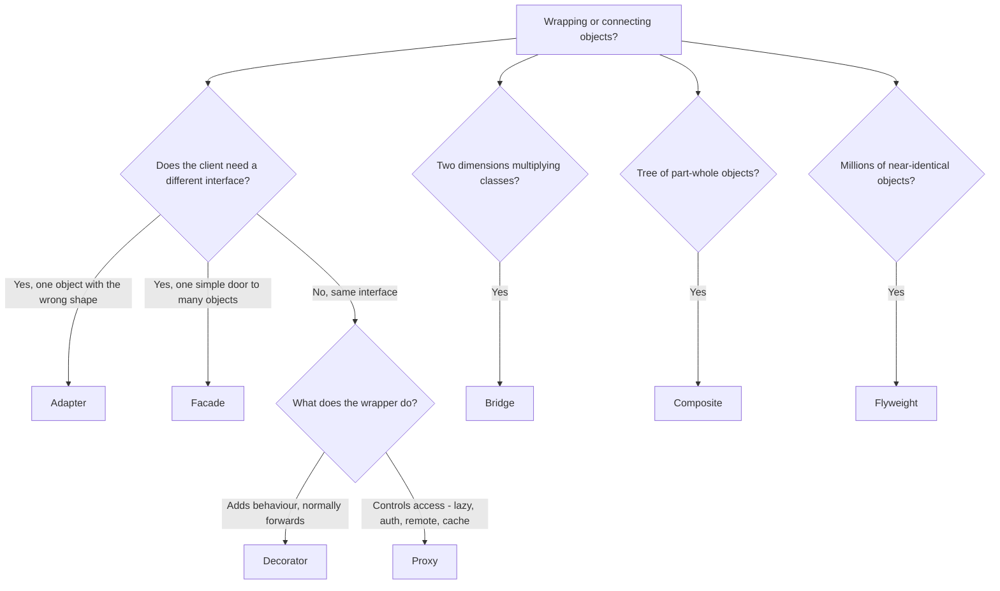

### Memory hooks

- **Adapter** — *"make it fit"* (changes the interface).
- **Decorator** — *"add to it"* (same interface, more behaviour, stackable).
- **Proxy** — *"guard it"* (same interface, controlled access).
- **Facade** — *"simplify it"* (one door, many rooms).
- **Bridge** — *"split it"* (two hierarchies, add instead of multiply).
- **Composite** — *"nest it"* (one interface for leaf and tree).
- **Flyweight** — *"share it"* (intrinsic shared, extrinsic passed in).

### Chapter self-check

1. **Q:** Which of these patterns wrap exactly one object? **A:** Adapter, Decorator, Proxy (Bridge also holds one implementor, but by design rather than as a wrapper). Facade wraps several; Composite holds many children.
2. **Q:** Which two have identical code shape but differ in intent and timing? **A:** Adapter and Bridge (after-the-fact vs up-front); also Bridge and Strategy; also Decorator and Proxy.
3. **Q:** A wrapper returns cached results with the same interface. Decorator or Proxy? **A:** Either is defensible; the important question is whether the cache is bounded and invalidated.
4. **Q:** You have `WindowsButton`, `MacButton`, `WindowsCheckbox`, `MacCheckbox`… and a Linux port is coming. Which pattern? **A:** Bridge (widget abstraction × platform implementor) — often combined with Abstract Factory to pick the implementor.
5. **Q:** Which pattern explains why `Integer.valueOf(100) == Integer.valueOf(100)` is true? **A:** Flyweight (Integer cache).

### Chapter TL;DR

- Structural patterns **compose objects into bigger structures** while keeping them flexible.
- **Adapter / Decorator / Proxy / Facade** share a shape; tell them apart by **what changes as the call passes through** and **how many objects are wrapped**.
- **Bridge** prevents class explosion across two dimensions; **Composite** makes trees uniform; **Flyweight** shares immutable state to save memory.
- In interviews: name the pattern, state the **constraint** that justifies it, name its **trap** (vendor leaks, wrong split, cycles, decorator order, god facade, mutable flyweight, self-invocation), and give a **real JDK/Spring example**.
