# Chapter 9 — Structural Design Patterns

> **Where this fits.** Chapter 8 was about *creating* objects. This chapter is about *putting objects together*: how to connect, wrap, nest and share them so that larger structures stay flexible. Chapters 10–11 then cover how objects *talk to each other* (behavioral patterns).

**What you will learn**

| # | Pattern | One-line intent | Everyday analogy |
|---|---|---|---|
| 9.1 | Adapter | Translate a class's interface into the one your code already uses | A travel plug adapter |
| 9.2 | Bridge | Separate two independently varying dimensions into two hierarchies joined by a reference | A TV remote (control) and the TV (device) are sold separately |
| 9.3 | Composite | Treat one object and a tree of objects the same way | A folder can hold files and other folders |
| 9.4 | Decorator | Add behaviour to one object at run time by wrapping it | Toppings on a coffee |
| 9.5 | Facade | One simple entry point in front of a complicated subsystem | A hotel concierge |
| 9.6 | Flyweight | Share the repeating part of many objects to save memory | One font glyph "e" reused for every "e" on a page |
| 9.7 | Proxy | A stand-in with the same interface that controls access | A receptionist who decides whether you may see the manager |
| 9.8 | Comparison | Adapter vs Decorator vs Proxy vs Facade vs Bridge | — |

**How to run every example in this chapter**

```bash
cd chapters/09-patterns-structural/code
javac --release 21 -d /tmp/lld_09 $(find . -name '*.java')
java -cp /tmp/lld_09 lld.ch09.adapter.Main     # or bridge, composite, decorator, facade, flyweight, proxy
```

All seven `Main` classes compile with Java 21 (standard library only) and run. The output printed under each example is the real output of that program.

> **Code-style note.** Every top-level type has its own file, as in a real codebase, and the types are package-private because each example lives in one package. Where a section shows several short files in a row, read them top to bottom: interface first, then implementations, then `Main`. The whole folder compiles with `javac --release 21 -Xlint:all` with **zero warnings**.

---

## 9.0 What structural patterns are

### What it is

A **design pattern** is a named, reusable solution to a design problem that keeps coming back. The "Gang of Four" (GoF) book — *Design Patterns: Elements of Reusable Object-Oriented Software* (Gamma, Helm, Johnson, Vlissides, 1994) — sorted its 23 patterns into three families:

| Family | Question it answers | Examples |
|---|---|---|
| Creational (Ch. 8) | How do I create objects? | Singleton, Factory Method, Builder |
| **Structural (this chapter)** | **How do I combine classes and objects into bigger structures?** | **Adapter, Bridge, Composite, Decorator, Facade, Flyweight, Proxy** |
| Behavioral (Ch. 10–11) | How do objects share work and talk? | Strategy, Observer, Command |

**Structural patterns** help you combine small objects and classes into larger, more complex structures while keeping those structures flexible and efficient. Used well, they:

- **simplify complex structures** (a Facade hides many steps; a Composite hides nesting),
- **promote reuse** (an Adapter lets you reuse a class whose interface does not fit),
- **improve flexibility by decoupling** classes from each other (Bridge, Decorator, Proxy),
- **improve maintainability**, because the relationships between entities are clear and each change stays local.

There are many structural patterns, but the seven the GoF named — and that interviewers ask about — are **Adapter, Bridge, Composite, Decorator, Facade, Flyweight and Proxy**.

### Three words you need first

- **Composition** ("has-a"): an object holds a reference to another object and uses it. Almost every structural pattern is built on composition.
- **Delegation**: forwarding a call to the object you hold. `wrapper.pay()` calls `inner.charge()`.
- **Interface** (in the design sense): the set of methods a caller can use on an object. In Java this is often, but not always, an `interface` type.

> **Key insight.** Four of these patterns (Adapter, Decorator, Proxy, Facade) have the *same physical shape*: one object holds another and forwards calls to it. What tells them apart is **intent** — what changes as the call passes through. Keep this in mind; section 9.8 puts them side by side.

---

## 9.1 Adapter Pattern

### What it is

The **Adapter** pattern lets your code use a class whose methods have the "wrong" shape — one you are not able to change — by placing a small translator class between the two. GoF's intent: *convert the interface of a class into another interface clients expect; Adapter lets classes work together that couldn't otherwise because of incompatible interfaces.*

*Analogy:* your laptop charger has a US plug; the hotel wall in India has a different socket. You do not rewire the wall or cut the plug — you put a small travel adapter in between.

GoF also calls it **Wrapper**. Vocabulary:

| Term | Meaning |
|---|---|
| **Target** | The interface your code wants to use (`PaymentGateway`). |
| **Adaptee** | The existing class with the "wrong" interface (`StripeClient`). You usually do not own it. |
| **Adapter** | The class that implements the Target and translates calls to the Adaptee (`StripeGateway`). |
| **Client** | Code that uses the Target (`checkout`). |

### The problem it solves

The shape your code calls and the shape the other component offers do not match. Typical cases:

- your checkout wants to call `pay(Money)`, but the payment SDK only offers `charge(amountInCents, currencyCode)`;
- an old service answers in XML, yet every consumer after it works with JSON;
- the analytics library asks for `track(String, Map)`, while your code naturally produces an `Event` object.

The key constraint: **the other side is not yours to change.** It may be a third-party library, a service owned by another team, or code with dozens of existing callers. Bending *your* code to its shape means touching every call site — and repeating the whole exercise the day that vendor is swapped out.

A concrete version: the checkout has to support Stripe now and perhaps PayPal in a few months. Stripe expects the amount as a whole number of **cents** plus a **lowercase** currency code; PayPal expects a **decimal string** such as "42.50" plus an **uppercase** code. Your own code would rather reason about a `Money` value than either of those.


*Figure — Two adapters (StripeGateway, PayPalGateway) translate our `pay(Money)` into each vendor's own call; nothing on the application side knows which vendor exists (course diagram)*

In the figure above, everything to the left of the dashed boundary talks only in `Money` and `Receipt`. Swapping vendors means writing one new class, not touching call sites.

### How it works

1. **Define the Target interface in your own vocabulary** (`PaymentGateway.pay(Money) -> Receipt`). It mentions no vendor.
2. **Write one adapter class per adaptee.** It `implements` the Target and **holds** the vendor object.
3. **Translate inputs**: your types into the vendor's types (`Money` → cents + lowercase code).
4. **Call the adaptee.**
5. **Translate outputs and errors back**: vendor result → `Receipt`; vendor exception → *your* exception.
6. **Client code depends only on the Target**, so it never learns which vendor answered.

> **The rule that makes it work:** the adapter's public methods mention **only your types** — parameters, return values *and* exceptions. The moment `pay` hands back a `StripeCharge`, or lets a `StripeCardException` propagate, callers depend on Stripe again and the adapter has decoupled nothing.

### Structure


*Figure — Adapter class diagram: `Checkout` holds a `PaymentGateway`; `StripeGateway` and `PayPalGateway` implement it and each wrap a vendor client, shown in grey because we do not own them (course diagram)*

Reading the class diagram above: `PaymentGateway` is the Target, owned by your application; `StripeGateway` and `PayPalGateway` are the Adapters; `StripeClient` and `PayPalClient` are the Adaptees (third-party code); `Checkout` stands for any Client. Every mismatch — method names, parameter types, casing rules — is soaked up inside the two adapter classes, and nothing above them sees it.

Our Java design (including the class and two-way adapters):

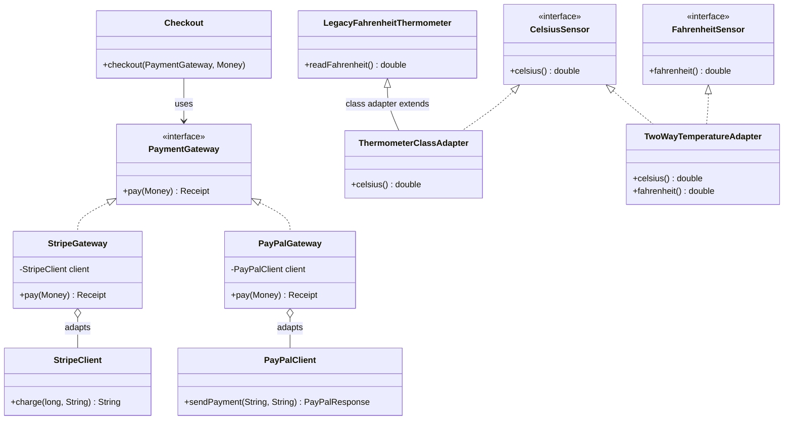

### Java example

```java
// File: code/lld/ch09/adapter/Money.java
package lld.ch09.adapter;

import java.util.Locale;

/** Our own vocabulary. No vendor type ever appears here. */
record Money(long cents, String currency) {
    Money {
        if (cents < 0) throw new IllegalArgumentException("negative amount");
        currency = currency.toUpperCase(Locale.ROOT);
    }

    /** 4250 cents -> "42.50" */
    String asDecimal() {
        return String.format(Locale.ROOT, "%d.%02d", cents / 100, cents % 100);
    }
}
```

```java
// File: code/lld/ch09/adapter/Receipt.java
package lld.ch09.adapter;

record Receipt(String id, String status) { }
```

```java
// File: code/lld/ch09/adapter/PaymentFailedException.java
package lld.ch09.adapter;

import java.io.Serial;

/** Our exception type: callers never see a vendor exception. */
class PaymentFailedException extends RuntimeException {
    @Serial private static final long serialVersionUID = 1L;

    PaymentFailedException(String message, Throwable cause) { super(message, cause); }
}
```

```java
// File: code/lld/ch09/adapter/PaymentGateway.java
package lld.ch09.adapter;

/** TARGET interface: the shape our application wants to talk to. */
interface PaymentGateway {
    Receipt pay(Money amount);
}
```

```java
// File: code/lld/ch09/adapter/StripeClient.java
package lld.ch09.adapter;

/*
 * ADAPTEES: pretend these come from third-party jars we cannot edit.
 * Note the different method names, argument types and conventions.
 */

/** Stripe-like SDK: integer cents + lowercase currency, throws its own exception. */
final class StripeClient {
    private int next = 1001;

    String charge(long amountInCents, String currencyCode) {
        System.out.printf("  [stripe] charge(%d, \"%s\")%n", amountInCents, currencyCode);
        if (amountInCents > 100_000) throw new StripeCardException("card_declined");
        return "ch_" + next++;
    }
}
```

```java
// File: code/lld/ch09/adapter/StripeCardException.java
package lld.ch09.adapter;

import java.io.Serial;

final class StripeCardException extends RuntimeException {
    @Serial private static final long serialVersionUID = 1L;

    StripeCardException(String code) { super(code); }
}
```

```java
// File: code/lld/ch09/adapter/PayPalClient.java
package lld.ch09.adapter;

/** PayPal-like SDK: decimal string + uppercase currency, returns a response object. */
final class PayPalClient {
    record PayPalResponse(String paymentId, String state) { }

    PayPalResponse sendPayment(String total, String currency) {
        System.out.printf("  [paypal] sendPayment(\"%s\", \"%s\")%n", total, currency);
        return new PayPalResponse("PAY-" + total.replace(".", ""), "approved");
    }
}
```

```java
// File: code/lld/ch09/adapter/StripeGateway.java
package lld.ch09.adapter;

import java.util.Locale;

/** OBJECT ADAPTER: implements our interface, HOLDS the vendor object (composition). */
final class StripeGateway implements PaymentGateway {
    private final StripeClient client;

    StripeGateway(StripeClient client) { this.client = client; }

    @Override
    public Receipt pay(Money amount) {
        try {
            String chargeId = client.charge(amount.cents(), amount.currency().toLowerCase(Locale.ROOT));
            return new Receipt(chargeId, "SUCCEEDED");
        } catch (StripeCardException e) {               // translate the vendor's error too
            throw new PaymentFailedException("Stripe declined: " + e.getMessage(), e);
        }
    }
}
```

```java
// File: code/lld/ch09/adapter/PayPalGateway.java
package lld.ch09.adapter;

final class PayPalGateway implements PaymentGateway {
    private final PayPalClient client;

    PayPalGateway(PayPalClient client) { this.client = client; }

    @Override
    public Receipt pay(Money amount) {
        PayPalClient.PayPalResponse r = client.sendPayment(amount.asDecimal(), amount.currency());
        String status = "approved".equals(r.state()) ? "SUCCEEDED" : "FAILED";
        return new Receipt(r.paymentId(), status);
    }
}
```

```java
// File: code/lld/ch09/adapter/CelsiusSensor.java
package lld.ch09.adapter;

/** Target used by our new weather dashboard. */
interface CelsiusSensor {
    double celsius();
}
```

```java
// File: code/lld/ch09/adapter/FahrenheitSensor.java
package lld.ch09.adapter;

/** Interface used by an old US reporting module. */
interface FahrenheitSensor {
    double fahrenheit();
}
```

```java
// File: code/lld/ch09/adapter/LegacyFahrenheitThermometer.java
package lld.ch09.adapter;

/** A legacy class we cannot change. It is NOT final, so a class adapter can extend it. */
class LegacyFahrenheitThermometer {
    private final double reading;

    LegacyFahrenheitThermometer(double reading) { this.reading = reading; }

    public double readFahrenheit() { return reading; }
}
```

```java
// File: code/lld/ch09/adapter/ThermometerClassAdapter.java
package lld.ch09.adapter;

/**
 * CLASS ADAPTER: inherits from the adaptee and implements the target.
 * Works in Java only because the target is an interface (no multiple class inheritance).
 */
final class ThermometerClassAdapter extends LegacyFahrenheitThermometer implements CelsiusSensor {
    ThermometerClassAdapter(double fahrenheit) { super(fahrenheit); }

    @Override
    public double celsius() { return (readFahrenheit() - 32) * 5.0 / 9.0; }
    // Downside: readFahrenheit() is still public on this object -> the adaptee's API leaks.
}
```

```java
// File: code/lld/ch09/adapter/TwoWayTemperatureAdapter.java
package lld.ch09.adapter;

/**
 * TWO-WAY ADAPTER: implements BOTH interfaces, so the same object can be handed to
 * new code (wants Celsius) and old code (wants Fahrenheit).
 */
final class TwoWayTemperatureAdapter implements CelsiusSensor, FahrenheitSensor {
    private final double celsius;

    private TwoWayTemperatureAdapter(double celsius) { this.celsius = celsius; }

    static TwoWayTemperatureAdapter from(CelsiusSensor s) {
        return new TwoWayTemperatureAdapter(s.celsius());
    }

    static TwoWayTemperatureAdapter from(FahrenheitSensor s) {
        return new TwoWayTemperatureAdapter((s.fahrenheit() - 32) * 5.0 / 9.0);
    }

    @Override public double celsius()    { return celsius; }
    @Override public double fahrenheit() { return celsius * 9.0 / 5.0 + 32; }
}
```

```java
// File: code/lld/ch09/adapter/Main.java
package lld.ch09.adapter;

import java.io.BufferedReader;
import java.io.ByteArrayInputStream;
import java.io.IOException;
import java.io.InputStreamReader;
import java.nio.charset.StandardCharsets;
import java.util.Arrays;
import java.util.List;

public class Main {

    /** Client code: talks only to OUR interface and never names a vendor. */
    static void checkout(PaymentGateway gateway, Money amount) {
        try {
            Receipt r = gateway.pay(amount);
            System.out.println("  receipt " + r.id() + " " + r.status());
        } catch (PaymentFailedException e) {
            System.out.println("  payment failed -> " + e.getMessage());
        }
    }

    public static void main(String[] args) throws IOException {
        System.out.println("== Object adapters (payment) ==");
        Money amount = new Money(4250, "usd");
        checkout(new StripeGateway(new StripeClient()), amount);
        checkout(new PayPalGateway(new PayPalClient()), amount);
        checkout(new StripeGateway(new StripeClient()), new Money(250_000, "USD"));

        System.out.println("== Class adapter ==");
        CelsiusSensor s = new ThermometerClassAdapter(98.6);
        System.out.printf("  98.6F -> %.1fC%n", s.celsius());

        System.out.println("== Two-way adapter ==");
        FahrenheitSensor oldSensor = () -> 212.0;
        TwoWayTemperatureAdapter both = TwoWayTemperatureAdapter.from(oldSensor);
        CelsiusSensor forNewCode = both;
        FahrenheitSensor forOldCode = both;
        System.out.printf("  new code sees %.1fC, old code sees %.1fF%n",
                forNewCode.celsius(), forOldCode.fahrenheit());

        System.out.println("== JDK adapters ==");
        String[] array = {"a", "b", "c"};
        List<String> view = Arrays.asList(array);   // adapts array -> List, no copy
        array[0] = "z";
        System.out.println("  Arrays.asList sees array change: " + view);
        try {
            view.add("d");
        } catch (UnsupportedOperationException e) {
            System.out.println("  cannot resize an array-backed list: UnsupportedOperationException");
        }
        var bytes = new ByteArrayInputStream("héllo".getBytes(StandardCharsets.UTF_8));
        // InputStreamReader adapts a byte stream (InputStream) to a char stream (Reader)
        try (var reader = new BufferedReader(new InputStreamReader(bytes, StandardCharsets.UTF_8))) {
            System.out.println("  InputStreamReader decoded: " + reader.readLine());
        }
    }
}
```

**Output:**

```text
== Object adapters (payment) ==
  [stripe] charge(4250, "usd")
  receipt ch_1001 SUCCEEDED
  [paypal] sendPayment("42.50", "USD")
  receipt PAY-4250 SUCCEEDED
  [stripe] charge(250000, "usd")
  payment failed -> Stripe declined: card_declined
== Class adapter ==
  98.6F -> 37.0C
== Two-way adapter ==
  new code sees 100.0C, old code sees 212.0F
== JDK adapters ==
  Arrays.asList sees array change: [z, b, c]
  cannot resize an array-backed list: UnsupportedOperationException
  InputStreamReader decoded: héllo
```

**What each part does**

- `Money`, `Receipt`, `PaymentGateway`, `PaymentFailedException` — **our** vocabulary. The compact constructor of the `Money` record normalises the currency to upper case once, so every adapter can rely on it.
- `StripeClient`, `PayPalClient` — the **adaptees**. Different method names, argument types, casing and error styles. We treat them as untouchable.
- `StripeGateway` — an **object adapter**. It converts `Money` into `(cents, "usd")`, converts the returned charge id into a `Receipt`, and converts `StripeCardException` into `PaymentFailedException`. The third call in the output shows that translation: the client sees *our* error type.
- `PayPalGateway` — the same idea with a different translation (`Money.asDecimal()` → "42.50"; `"approved"` → `"SUCCEEDED"`).
- `checkout(...)` — the **client**. One function, two completely different vendors, and no `if (stripe)` branch anywhere.
- The JDK section shows two adapters you already use: `Arrays.asList` and `InputStreamReader`.

### Object adapter vs class adapter

GoF describes two ways to build an adapter:

| | **Object adapter** (composition) | **Class adapter** (inheritance) |
|---|---|---|
| How | Adapter *holds* an adaptee instance and implements the Target | Adapter *extends* the adaptee class and implements the Target |
| In our code | `StripeGateway`, `PayPalGateway` | `ThermometerClassAdapter extends LegacyFahrenheitThermometer implements CelsiusSensor` |
| Works when adaptee is `final`? | Yes | **No** — you cannot extend a final class (our `StripeClient` is `final`) |
| Can adapt a whole family (adaptee + subclasses)? | Yes — pass any subclass instance in | No — bound to one concrete class at compile time |
| Can override adaptee behaviour? | Harder — you would have to subclass the adaptee and adapt that subclass | Yes (it is a subclass) |
| Leaks the adaptee's API? | No — only the Target methods are visible | **Yes** — every public adaptee method (e.g. `readFahrenheit()`) is also on the adapter |
| Java constraint | none | Java has no multiple class inheritance, so the **Target must be an interface** |

**Rule of thumb:** prefer the **object adapter**. It follows "favour composition over inheritance", works with final classes, can wrap several objects, and does not inherit methods you did not want. Use a class adapter only when you must override some adaptee behaviour and the adaptee is designed for extension.

### Two-way adapter

A **two-way adapter** implements *both* interfaces, so the same object can be given to clients of either side. GoF mentions it for the case where two different clients need to view one object in two different ways.

In the code, `TwoWayTemperatureAdapter implements CelsiusSensor, FahrenheitSensor`. It can be built from either kind of sensor. New dashboard code sees `100.0C`; old US reporting code sees `212.0F` — the same object. This is handy during a **migration**: old and new modules can share one object while you gradually move callers across.

### Adapter vs Facade vs Decorator vs Proxy (quick view)

| Pattern | What happens to the interface | What happens to the behaviour |
|---|---|---|
| **Adapter** | **Translated** — the client sees your interface, the wrapped object keeps its own | Same work, just re-expressed |
| **Decorator** | Kept identical on both sides | **Extended** — extra work runs around the call |
| **Proxy** | Kept identical | Same work, but **gated** — it may be postponed, served from a cache or rejected |
| **Facade** | **Replaced** — a single simpler interface stands in for many | Same work, fewer calls for the client |

In one line each: translating shapes → **Adapter**; adding work, same shape → **Decorator**; guarding access, same shape and same work → **Proxy**; one simple door in front of several objects → **Facade**.

A useful test: *adapters exist because someone else picked the interface.* Imagine the vendor rewrote its API tomorrow to match yours exactly — if your class would then have no reason to exist, it was an Adapter. The other three exist because you decided to add something. Bridge can be drawn with the same boxes, but its timing is reversed: a Bridge is planned *before* the classes exist so two hierarchies never fuse; an Adapter is bolted on *after* to reconcile two things that already exist.

### Trade-offs

| Pros | Cons |
|---|---|
| **The foreign format is contained** — only one class knows the vendor's conventions. | **An extra class and an extra call** — stack traces gain a frame whose only job is conversion. |
| **Changing vendor is local** — supporting PayPal beside Stripe means adding a class, not editing callers (Open/Closed Principle). | **Conversions can drop information**, and callers cannot see that anything was lost. |
| **Easy to test** — faking your own one-method interface is far simpler than faking a vendor SDK. | **Two data models must stay aligned** — each vendor API change forces a mapping change. |
| **Your code keeps its own language** (`Money`, `Receipt` rather than cents and charge ids); conversion has a single home (Single Responsibility). | **Logic tends to creep in** — retries and pricing rules drift into the adapter unless reviews stop them. |

### When not to use it

- **Both sides are yours.** Change one interface so they match. An adapter between two pieces of code you own is overhead you pay forever for a mismatch you could simply remove.
- **The two models really disagree.** When mapping one to the other drops data or forces guesses, the "adapter" grows into a mini-application with bugs of its own; redraw the boundary instead.
- **You want extra behaviour, not a translation.** That job belongs to a Decorator.
- **The conversion happens in exactly one place.** A few inline lines read better than a new class.

### Common mistakes

- **Leaking vendor types** (`StripeCharge` return type, `StripeCardException` escaping). Then nothing is decoupled.
- **Putting business logic in the adapter** (discount rules, retries). Adapters translate; they do not decide.
- **Choosing a class adapter by default** — it exposes the adaptee's whole API and breaks on `final` classes.
- **One giant adapter for many vendors** with `if (vendor == STRIPE)` inside — that is the branch the pattern was meant to remove. One adapter per adaptee.
- **Silently dropping information** (e.g. vendor's "pending" state mapped to "SUCCEEDED"). Map every case deliberately.

### Real-world examples

- **`java.util.Arrays.asList(T...)`** adapts an array to the `List` interface *without copying* — writes go through to the array (as the output shows) and the list cannot grow, so `add` throws `UnsupportedOperationException`.
- **`java.io.InputStreamReader` / `OutputStreamWriter`** adapt byte streams to character streams using a charset.
- **`java.util.Collections.enumeration(Collection)`** adapts a modern `Collection` to the legacy `Enumeration` interface. (*Head First Design Patterns* builds the reverse, an Enumeration-to-Iterator adapter.)
- **SLF4J providers/bindings** — one logging API, with an adapter module for each backend (Logback, Log4j, `java.util.logging`).
- **JDBC (and ODBC) drivers** adapt each database's own wire protocol to the standard `java.sql` interfaces, which is why the same application code runs on several databases.
- **Spring MVC `HandlerAdapter`** lets the `DispatcherServlet` invoke very different kinds of handlers (annotated controllers, `HttpRequestHandler`, etc.) through one interface.
- **Almost every "client" wrapper around a vendor SDK** in a real codebase — if it exists so the rest of the code does not import the SDK, it is an adapter.

### In modern languages

- **First-class functions**: if the Target has a single method, a **lambda** is a complete adapter — `PaymentGateway g = m -> new Receipt(stripe.charge(m.cents(), "usd"), "SUCCEEDED");` (our `FahrenheitSensor oldSensor = () -> 212.0;` is the same trick).
- **Python**: duck typing means any object with the expected method names fits, so a small wrapper class — or even a `types.SimpleNamespace` — is enough.
- **TypeScript**: structural typing accepts anything of the right shape, so adapters are frequently plain object literals.
- **Go**: interfaces are satisfied implicitly, so the adapter is often just a small named type with one method.

### In the interview

**30-second answer:** "An Adapter converts one interface into another that the client expects. I use it at boundaries I do not control — a vendor SDK, a legacy service. The adapter implements *my* interface, holds the vendor object, and translates inputs, outputs and exceptions, so no vendor type leaks into my code. Swapping vendors becomes one new class. I prefer the object adapter over the class adapter because it uses composition and works with final classes."

**Follow-ups**

- *Q: Adapter vs Decorator?* — A: Adapter changes the interface and keeps the behaviour. Decorator keeps the interface and changes (adds to) the behaviour.
- *Q: Adapter vs Facade?* — A: An Adapter converts **one** interface to **one** other, usually because you only own one side. A Facade simplifies a **whole subsystem** of several objects into one entry point, usually over code you own.
- *Q: Why not just change the other side?* — A: Say this up front, unprompted: it is a vendor library, another team's API, or code with many callers. That constraint is what justifies the pattern — without it you are pattern-matching out of habit.
- *Q: What ruins an adapter?* — A: A vendor type or vendor exception in the adapter's public signature.
- *Q: How does it help testing?* — A: The checkout depends on a small interface I own, so in tests I pass a fake `PaymentGateway`; I never have to fake the vendor SDK.
- *Q: What is a two-way adapter?* — A: One class implementing both interfaces so it can serve clients of either side, useful during migrations.

### Self-check

1. **Q:** Name the four roles in the Adapter pattern. **A:** Target, Adaptee, Adapter, Client.
2. **Q:** Why is `StripeClient` impossible to class-adapt in our code? **A:** It is `final`; a class adapter must extend the adaptee.
3. **Q:** What does `Arrays.asList(arr).add(x)` do, and why? **A:** Throws `UnsupportedOperationException`, because the list is a fixed-size view (adapter) over the array.
4. **Q:** You own both classes and their interfaces differ slightly. Adapter? **A:** No — change the interface; an adapter would be permanent overhead.
5. **Q:** Where should the vendor's exception be handled? **A:** Inside the adapter, translated into your own exception type.

### TL;DR

- **Adapter = translator** between the interface you have and the interface you need.
- Implements **your** interface, **holds** the vendor object, translates **in, out and errors**.
- Prefer **object adapter** (composition) over **class adapter** (inheritance). Two-way adapters implement both sides.
- Use at boundaries you **don't control**; skip it when you own both sides.

---

## 9.2 Bridge Pattern

### What it is

The **Bridge** pattern splits one class that varies in *two independent ways* into **two separate hierarchies** connected by a reference (the "bridge"), so each side can grow on its own.

*Analogy:* a universal TV remote. Remotes come in kinds (basic, advanced with mute); TVs come in brands (Sony, Samsung). You do not buy a "BasicSonyRemote" — any remote works any TV through a common protocol.

GoF's intent: *decouple an abstraction from its implementation so that the two can vary independently.* GoF also lists **Handle/Body** as another name for it. Its names for the parts — the vocabulary interviewers expect:

| Term | Meaning | In our code |
|---|---|---|
| **Abstraction** | The high-level side the client uses; holds a reference to an Implementor | `Notification` |
| **Refined Abstraction** | Subclasses of the abstraction | `AlertNotification`, `ReminderNotification`, `DigestNotification` |
| **Implementor** | The interface of the low-level side that does the physical work | `Channel` |
| **Concrete Implementor** | Real implementations of that low-level work | `EmailChannel`, `SmsChannel`, `PushChannel` |

> **Naming trap.** In Bridge, "implementation" is *not* the everyday Java meaning ("a class that implements an interface"). It names the **low-level half of the split** — the side that does the platform-specific, physical work (sending bytes, drawing pixels). The GoF terms are awkward, but they are the ones you will be asked about.

### The problem it solves — the class explosion

You have three kinds of notification (alert, reminder, digest) and three delivery channels (email, SMS, push). If both live in **one** inheritance hierarchy you need a class for every combination:


*Figure — Top: one hierarchy needs 3 × 3 = 9 classes such as EmailAlert and SmsDigest. Bottom: two hierarchies joined by one `channel` reference need 3 + 3 = 6 (course diagram)*

The figure shows the arithmetic. In a single hierarchy the concrete classes **multiply**: 3 × 3 = 9; one more channel gives 12; one more type on top gives 16. With a bridge they **add**: 3 + 3 = 6, and 4 + 4 = 8. (Counts are concrete classes; the `Notification` base and the `Channel` interface are the same in both designs.)

The **smell** that points to a missing Bridge is **a class name made of two nouns** — `EmailAlert`, `SmsDigest`, `PushReminder`. Each such class repeats either the "build the message" code or the "send it" code, so changing how SMS delivery works means editing three classes that otherwise have nothing in common.

Splitting the two dimensions has one more pay-off: the pairing becomes a **run-time choice**. The same alert object can be built with an SMS channel in a test and an email channel in production. The code is small; the genuinely hard part is deciding **which dimension is the abstraction and which is the implementation** (see "Getting the split wrong" below).

### How it works

1. **Find the two dimensions** that vary independently (what the message *is* vs how it *goes out*).
2. **Make the lower-level dimension an interface** — the Implementor (`Channel.deliver(title, body)`). Keep it small and general.
3. **Make the higher-level dimension an abstract class** — the Abstraction — that **holds a reference** to the Implementor. That field is the bridge.
4. **Refined abstractions** build their own content and **delegate** the physical work across the bridge. They never check which implementor they have.
5. **Pair them at run time**: `new AlertNotification(new SmsChannel(...), ...)`. The same alert can go by SMS in a test and by email in production.

### Structure


*Figure — Bridge class diagram: `Notification` (abstraction) holds a `Channel` (implementor); alert/reminder notifications refine the abstraction; email/SMS channels implement the channel (course diagram)*

In the class diagram above, the bridge is that one `channel` field: declared once in the base class, used by every subclass. The channel classes know nothing about notifications — neither what an alert is nor that alerts exist.

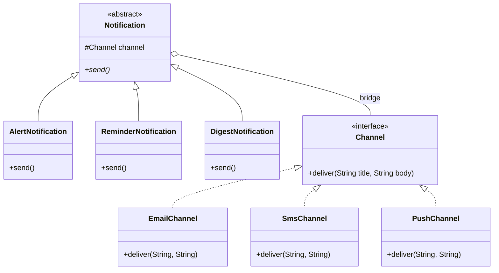

### Java example

```java
// File: code/lld/ch09/bridge/Channel.java
package lld.ch09.bridge;

/**
 * IMPLEMENTOR: the low-level "how it goes out" side.
 * Kept small and general: two plain strings, nothing channel-specific.
 */
interface Channel {
    void deliver(String title, String body);
}
```

```java
// File: code/lld/ch09/bridge/EmailChannel.java
package lld.ch09.bridge;

/** CONCRETE IMPLEMENTORS: none of them knows what an alert or a digest is. */
final class EmailChannel implements Channel {
    private final String address;

    EmailChannel(String address) { this.address = address; }

    @Override
    public void deliver(String title, String body) {
        System.out.println("  [email to " + address + "] Subject: " + title + " | " + body);
    }
}
```

```java
// File: code/lld/ch09/bridge/SmsChannel.java
package lld.ch09.bridge;

final class SmsChannel implements Channel {
    private static final int LIMIT = 40;           // tiny limit so the demo shows truncation
    private final String phone;

    SmsChannel(String phone) { this.phone = phone; }

    @Override
    public void deliver(String title, String body) {
        String text = title + ": " + body;
        if (text.length() > LIMIT) text = text.substring(0, LIMIT - 3) + "...";
        System.out.println("  [sms to " + phone + "] " + text);
    }
}
```

```java
// File: code/lld/ch09/bridge/PushChannel.java
package lld.ch09.bridge;

final class PushChannel implements Channel {
    private final String deviceId;

    PushChannel(String deviceId) { this.deviceId = deviceId; }

    @Override
    public void deliver(String title, String body) {
        System.out.println("  [push to " + deviceId + "] (" + title + ") " + body);
    }
}
```

```java
// File: code/lld/ch09/bridge/Notification.java
package lld.ch09.bridge;

/**
 * ABSTRACTION: the high-level "what the message is" side.
 * The protected 'channel' field IS the bridge.
 */
abstract class Notification {
    protected final Channel channel;

    protected Notification(Channel channel) { this.channel = channel; }

    /** Builds the message, then hands it across the bridge. Never branches on channel type. */
    abstract void send();
}
```

```java
// File: code/lld/ch09/bridge/AlertNotification.java
package lld.ch09.bridge;

/** REFINED ABSTRACTIONS */
final class AlertNotification extends Notification {
    private final String system;
    private final String problem;

    AlertNotification(Channel channel, String system, String problem) {
        super(channel);
        this.system = system;
        this.problem = problem;
    }

    @Override
    void send() { channel.deliver("ALERT " + system, problem + " - act now"); }
}
```

```java
// File: code/lld/ch09/bridge/ReminderNotification.java
package lld.ch09.bridge;

final class ReminderNotification extends Notification {
    private final String what;
    private final String when;

    ReminderNotification(Channel channel, String what, String when) {
        super(channel);
        this.what = what;
        this.when = when;
    }

    @Override
    void send() { channel.deliver("Reminder", what + " at " + when); }
}
```

```java
// File: code/lld/ch09/bridge/DigestNotification.java
package lld.ch09.bridge;

import java.util.List;

final class DigestNotification extends Notification {
    private final List<String> items;

    DigestNotification(Channel channel, List<String> items) {
        super(channel);
        this.items = List.copyOf(items);
    }

    @Override
    void send() { channel.deliver("Daily digest (" + items.size() + ")", String.join("; ", items)); }
}
```

```java
// File: code/lld/ch09/bridge/Main.java
package lld.ch09.bridge;

import java.util.List;

public class Main {
    public static void main(String[] args) {
        Channel email = new EmailChannel("ops@shop.com");
        Channel sms = new SmsChannel("+1-555-0100");
        Channel push = new PushChannel("pixel-7");

        System.out.println("== Any type x any channel, paired at run time ==");
        List<Notification> outbox = List.of(
                new AlertNotification(email, "payments", "error rate 12%"),
                new AlertNotification(sms, "payments", "error rate 12%"),
                new ReminderNotification(push, "Stand-up", "09:30"),
                new DigestNotification(email, List.of("3 orders", "1 refund", "0 incidents")),
                new DigestNotification(sms, List.of("3 orders", "1 refund", "0 incidents")));
        outbox.forEach(Notification::send);

        System.out.println("== Class count ==");
        int types = 3, channels = 3;
        System.out.println("  one hierarchy (type x channel): " + types * channels + " classes");
        System.out.println("  bridge (type + channel):        " + (types + channels) + " classes");
        System.out.println("  with 4 types and 4 channels:    " + 4 * 4 + " vs " + (4 + 4));
    }
}
```

**Output:**

```text
== Any type x any channel, paired at run time ==
  [email to ops@shop.com] Subject: ALERT payments | error rate 12% - act now
  [sms to +1-555-0100] ALERT payments: error rate 12% - act now
  [push to pixel-7] (Reminder) Stand-up at 09:30
  [email to ops@shop.com] Subject: Daily digest (3) | 3 orders; 1 refund; 0 incidents
  [sms to +1-555-0100] Daily digest (3): 3 orders; 1 refund;...
== Class count ==
  one hierarchy (type x channel): 9 classes
  bridge (type + channel):        6 classes
  with 4 types and 4 channels:    16 vs 8
```

**What each part does**

- `Channel` — the Implementor. Just `deliver(title, body)` with two plain strings, so every channel can support it.
- `EmailChannel`, `SmsChannel`, `PushChannel` — each knows *only* how to deliver. `SmsChannel` truncates long text; that rule lives inside SMS, not in any notification.
- `Notification` — the Abstraction, holding `protected final Channel channel` (the bridge).
- `AlertNotification` etc. — each builds a title and body and calls `channel.deliver(...)`. No `instanceof`, no `switch` on channel type.
- Adding `SlackChannel` = one new class; adding `PromoNotification` = one new class. Nothing else changes.

### Bridge vs Strategy

Written down, the two are **indistinguishable** — an object keeps a reference to an interface and delegates through it. Interviewers and code reviewers both ask about this, so have an answer ready: the difference is the **reason the reference is there**, not how it looks.

| | **Bridge** | **Strategy** |
|---|---|---|
| What varies | A whole **dimension** of the design | **One algorithm** or policy |
| When chosen | Usually once, at construction, then it stays | Often swapped repeatedly, even per call |
| Why it exists | To stop two hierarchies multiplying | To make one behaviour replaceable |
| When decided | Up front, as a structural decision | Later, when a second algorithm appears |
| Example | `Notification` → `Channel` | `list.sort(comparator)` |

**Practical test:** picture adding one more implementation. If it is *a new kind of thing the system supports* (another delivery channel), you have a Bridge. If it is *one more way to perform a single step* (another compression algorithm), you have a Strategy. When you truly can't decide, relax — the code is identical and either name will be understood. What does matter is not building either one while an axis has only a single member.

### Getting the split wrong

Bridge is quick to write but costly to re-cut once both sides have several classes. Two ways it goes wrong:

- **Low-level details leaking up.** An `if (channel instanceof SmsChannel)` inside `AlertNotification` means the bridge is no longer doing its job — that SMS-specific rule should move into `SmsChannel`.
- **An implementor interface shaped around one implementation.** Add `setEmailReplyTo(...)` to `Channel` and every non-email channel must now implement a method it can only throw from. Keep the low-level interface minimal and generic; that is why `deliver` accepts two plain strings instead of a rich message type.

### Trade-offs

| Pros | Cons |
|---|---|
| **Class counts add rather than multiply** — 3 types and 3 channels need 6 classes, not 9. | **Two hierarchies** to understand instead of one. |
| **Each side extends independently** (Open/Closed) — a new channel touches no notification class. | **More indirection** — following one call means reading two files. |
| **Pairing picked at run time** — real channel in production, fake in tests, per-environment config. | **Hard to undo** — once both sides have implementations, moving the split line is a large refactor. |
| **Platform code kept apart** — only one class knows about SMTP (Single Responsibility). | **Pointless with one member** — a bridge with a single implementor is just an interface plus ceremony. |

### When not to use it

- **An axis has only one member.** With a single channel the bridge abstracts nothing; introduce it when the second channel actually shows up, not in advance.
- **The axes are not truly independent.** If some combinations are forbidden (e.g. digests must never be sent by SMS), Bridge happily lets you build them, and you end up adding run-time checks that separate subclasses would have made impossible.
- **You can't state in one sentence which side is the abstraction.** Then the design isn't ready — picking the wrong split is more expensive than living with a few extra classes.
- **The second axis is really a behaviour, not a kind of thing.** Use Strategy.

### Common mistakes

- Building the bridge "just in case" with a single implementor.
- Letting the abstraction branch on the concrete implementor type.
- Making the implementor interface mirror one specific implementation.
- Confusing Bridge with Adapter: Adapter is **retrofitted** to make existing things fit; Bridge is **designed in** so the two sides never get fused into one hierarchy.

### Real-world examples

- **JDBC**: your code uses `java.sql.Connection` / `Statement`; each database driver supplies the implementation. Application code and drivers evolve separately, which is why the same query code can run on PostgreSQL or MySQL. (JDBC is often cited as both Bridge — two independent hierarchies — and Adapter — each driver adapts a native protocol. Both views are fair.)
- **SLF4J and similar logging APIs**: the logging API you call is one side and the backend that actually writes log lines is the other. (SLF4J calls itself a *facade*; the API/backend split underneath is Bridge-shaped.)
- **Window systems and device/graphics drivers**: GoF's own motivating example is a `Window` abstraction whose `WindowImp` implementation is written once per platform (X Window System, IBM Presentation Manager). OS drawing APIs over per-card graphics drivers follow the same idea.
- **`java.awt` peers** (the textbook Java example): each AWT component held a platform-specific peer object that did the actual native drawing.
- **Notification / payment services in most apps**: a `NotificationService` interface with pluggable providers (SES, Twilio, FCM) is this pattern, whether or not anyone called it Bridge.
- **Dependency-injection containers** that bind an interface to a different implementation per environment give you Bridge-style pairing that is configured rather than coded.

### In modern languages

- **First-class functions**: if the implementor has one method, it can simply be a function — `Notification(channel = send_email)` is the same design without a `Channel` class.
- **Python / JavaScript**: duck typing means the implementor side needs no declared interface — any object with a `deliver` method will do.
- **Go**: a small interface declared by the *consumer*, with implementations in other packages, is ordinary idiomatic Go — Bridge without the name.
- **DI containers** (Spring, Guice, .NET): the pairing is wired by configuration per environment.

### Other patterns it is confused with

| Looks like | Actual difference |
|---|---|
| Strategy | Same code shape; Bridge separates a permanent structural dimension, Strategy makes one algorithm swappable. |
| Adapter | The class diagrams can look alike, but the timing is reversed: an Adapter is retrofitted to reconcile two things that already exist; a Bridge is planned before the classes are written. |
| Abstract Factory | Abstract Factory decides *which family of objects gets created*; Bridge describes *how an object hands off work once it exists*. They work well together — a factory commonly supplies the implementor a bridge receives. |
| Decorator | A Decorator shares the interface of the object inside it and adds behaviour; in a Bridge the two sides have unrelated interfaces and neither one wraps the other. |

### In the interview

**30-second answer:** "Bridge separates an abstraction from its implementation so both can vary independently. If notifications vary by type and by channel, one hierarchy needs type × channel classes — 3 × 3 = 9, and 16 with a fourth of each. I split it: a `Notification` hierarchy holding a reference to a `Channel` interface. Now it is type + channel classes — 6, then 8 — and the pairing is chosen at run time. I wouldn't build it while there is only one channel."

**Follow-ups**

- *Q: How is it different from Strategy?* — A: The code is the same; the intent differs. Bridge splits a permanent dimension decided up front; Strategy makes one algorithm replaceable, often per call.
- *Q: What is the smell that says you need it?* — A: Class names with two nouns (`SmsDigest`) and duplicated code across them.
- *Q: When would you not use it?* — A: With only one channel today — I would add the bridge when the second one lands. Also when some combinations are invalid.
- *Q: Who decides which implementor a notification gets?* — A: Whoever builds it — often a factory or the DI container, configured per environment.

### Self-check

1. **Q:** With 5 notification types and 4 channels, how many classes without and with Bridge? **A:** 20 without, 9 with.
2. **Q:** Which field is "the bridge"? **A:** The `Channel channel` reference held by the `Notification` base class.
3. **Q:** An `AlertNotification` checks `channel instanceof SmsChannel`. What is wrong? **A:** Implementation detail has leaked upward; move that behaviour into `SmsChannel`.
4. **Q:** Is Bridge added before or after the classes exist? **A:** Before — it is an up-front structural decision (Adapter is the after-the-fact one).

### TL;DR

- **Two dimensions varying → two hierarchies + one reference.** Multiplication becomes addition.
- Abstraction (what) holds Implementor (how). Keep the implementor small and general.
- Same code as Strategy; different intent. Don't build it for one implementor.

---

## 9.3 Composite Pattern

### What it is

The **Composite** pattern gives an individual item and a whole nested group of items **one common interface**, so code that uses them never needs to check whether it has a **single object** or an **entire tree**.

*Analogy:* a company org chart. You can ask any manager "what is your team's total salary?" — a manager answers by asking each report and adding up; an individual contributor just answers with their own salary. The question is the same for both.

| Term | Meaning | In our code |
|---|---|---|
| **Component** | The shared interface for leaves and containers | `FileSystemNode`, `MenuComponent` |
| **Leaf** | An object with no children; does the work itself | `FileNode`, `MenuItem` |
| **Composite** | A container that holds children (typed as Component) and delegates to them | `FolderNode`, `Menu` |
| **Client** | Code that works with Components only | `report(...)` |

GoF's intent in plain words: compose objects into tree structures that represent **part-whole hierarchies**, and let clients treat individual objects and compositions **uniformly**.

### The problem it solves

Plenty of data is nested: folders contain files *and* folders; an invoice contains line items *and* bundles that have their own items; a UI panel contains widgets *and* sub-panels. Ask for a total size, a total price or a rendering of the whole thing, and — without the pattern — each operation (`size`, `print`, `search`, `copy`) opens with the same type test:

```java
if (node instanceof Folder f) { /* loop over children, recurse */ }
else if (node instanceof File f) { /* read the size */ }
```

That test gets pasted into every operation. Introduce a third kind of node — say a symbolic link — and you have to hunt down each copy; overlook one and the new node type quietly gets the wrong answer.


*Figure — `size()` on the project folder (2150) is the sum of README.md (1200) and src/ (950), which itself sums main.js and util.js. The caller makes the same call on a tree or a single file (course diagram)*

The figure shows the fix: a file answers `size()` with its own byte count, and a folder answers by asking each child and summing. Because a child may be a file or another folder and both respond to the same call, a single piece of recursive code handles any depth. The caller writes `report(project)` or `report(readme)` and never asks which one it holds.

### How it works

1. **Define a Component interface** with operations that make sense for *both* leaves and containers (`name()`, `size()`, `print()`).
2. **Leaf** implements them directly (a file returns its own byte count).
3. **Composite** stores a `List<Component>` — the **interface type**, not the leaf type — and implements each operation by **asking each child and combining the results**.
4. Because a child can itself be a composite, the recursion is written **once** and works to any depth.
5. **Clients** hold a `Component` and never type-check.

### Structure


*Figure — Composite class diagram: `FileNode` (leaf) and `FolderNode` (composite) implement `FileSystemNode`; the folder holds a list of `FileSystemNode` and has `add()` (course diagram)*

Two details in the class diagram above matter: the folder's child list is typed as the **interface** — that is what lets folders hold folders — and `add()` is declared on `FolderNode` rather than on the shared interface. The second is a deliberate trade-off (the "safe" design), covered right after the code.

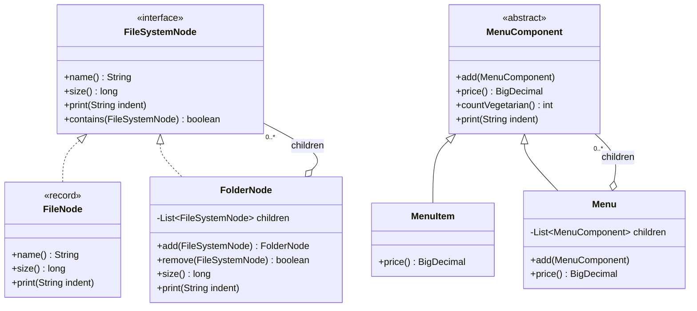

### Java example

```java
// File: code/lld/ch09/composite/FileSystemNode.java
package lld.ch09.composite;

/**
 * COMPONENT (safe version): only operations that make sense for BOTH leaf and composite.
 * add/remove are NOT here - they live on FolderNode only.
 */
interface FileSystemNode {
    String name();
    long size();
    void print(String indent);

    /** True if 'target' is this node or somewhere below it. Used for the cycle check. */
    default boolean contains(FileSystemNode target) { return this == target; }
}
```

```java
// File: code/lld/ch09/composite/FileNode.java
package lld.ch09.composite;

/** LEAF: no children, answers directly. */
record FileNode(String name, long size) implements FileSystemNode {
    @Override
    public void print(String indent) {
        System.out.println(indent + "- " + name + " (" + size + " B)");
    }
}
```

```java
// File: code/lld/ch09/composite/FolderNode.java
package lld.ch09.composite;

import java.util.ArrayList;
import java.util.Collections;
import java.util.List;

/** COMPOSITE: holds children typed as the INTERFACE, so folders can hold folders. */
final class FolderNode implements FileSystemNode {
    private final String name;
    private final List<FileSystemNode> children = new ArrayList<>();

    FolderNode(String name) { this.name = name; }

    /** Returns this so trees can be built fluently. Rejects cycles at insert time. */
    FolderNode add(FileSystemNode child) {
        if (child.contains(this)) {
            throw new IllegalArgumentException("cycle: " + child.name() + " already contains " + name);
        }
        children.add(child);
        return this;
    }

    boolean remove(FileSystemNode child) { return children.remove(child); }

    List<FileSystemNode> children() { return Collections.unmodifiableList(children); }

    @Override public String name() { return name; }

    /** The recursion lives in ONE place. */
    @Override
    public long size() {
        long total = 0;
        for (FileSystemNode child : children) total += child.size();
        return total;
    }

    @Override
    public void print(String indent) {
        System.out.println(indent + "+ " + name + "/ (" + size() + " B)");
        for (FileSystemNode child : children) child.print(indent + "   ");
    }

    @Override
    public boolean contains(FileSystemNode target) {
        if (this == target) return true;
        for (FileSystemNode child : children) {
            if (child.contains(target)) return true;
        }
        return false;
    }
}
```

```java
// File: code/lld/ch09/composite/MenuComponent.java
package lld.ch09.composite;

import java.math.BigDecimal;

/**
 * COMPONENT (transparent version): child management is on the shared type,
 * so callers never cast - but a leaf must reject it at run time.
 */
abstract class MenuComponent {
    void add(MenuComponent c) { throw new UnsupportedOperationException(name() + " is a leaf"); }

    abstract String name();
    abstract BigDecimal price();             // total price of everything under this node (money: BigDecimal, never double)
    abstract int countVegetarian();
    abstract void print(String indent);
}
```

```java
// File: code/lld/ch09/composite/MenuItem.java
package lld.ch09.composite;

import java.math.BigDecimal;

final class MenuItem extends MenuComponent {
    private final String name;
    private final BigDecimal price;
    private final boolean vegetarian;

    MenuItem(String name, String price, boolean vegetarian) {
        this.name = name;
        this.price = new BigDecimal(price);     // from a String, so "3.49" is exactly 3.49
        this.vegetarian = vegetarian;
    }

    @Override String name() { return name; }
    @Override BigDecimal price() { return price; }
    @Override int countVegetarian() { return vegetarian ? 1 : 0; }
    @Override void print(String indent) {
        System.out.println(indent + name + (vegetarian ? " (v)" : "") + " $" + price);
    }
}
```

```java
// File: code/lld/ch09/composite/Menu.java
package lld.ch09.composite;

import java.math.BigDecimal;
import java.util.ArrayList;
import java.util.List;

final class Menu extends MenuComponent {
    private final String name;
    private final List<MenuComponent> children = new ArrayList<>();

    Menu(String name) { this.name = name; }

    @Override void add(MenuComponent c) { children.add(c); }
    @Override String name() { return name; }
    @Override BigDecimal price() {
        return children.stream().map(MenuComponent::price).reduce(BigDecimal.ZERO, BigDecimal::add);
    }
    @Override int countVegetarian() { return children.stream().mapToInt(MenuComponent::countVegetarian).sum(); }
    @Override void print(String indent) {
        System.out.println(indent + "[" + name + "]");
        children.forEach(c -> c.print(indent + "  "));
    }
}
```

```java
// File: code/lld/ch09/composite/Main.java
package lld.ch09.composite;

public class Main {

    /** Client: one parameter type, no instanceof anywhere. */
    static void report(FileSystemNode node) {
        System.out.println("  " + node.name() + " -> " + node.size() + " bytes");
    }

    public static void main(String[] args) {
        System.out.println("== Safe composite: file system ==");
        FileNode readme = new FileNode("README.md", 1200);
        FolderNode src = new FolderNode("src")
                .add(new FileNode("main.js", 600))
                .add(new FileNode("util.js", 350));
        FolderNode project = new FolderNode("project").add(readme).add(src);

        project.print("  ");
        report(project);   // a whole tree
        report(readme);    // a single file - same call

        try {
            src.add(project);   // project already contains src -> would loop forever
        } catch (IllegalArgumentException e) {
            System.out.println("  rejected: " + e.getMessage());
        }

        System.out.println("== Transparent composite: restaurant menu ==");
        MenuComponent all = new Menu("All menus");
        MenuComponent breakfast = new Menu("Breakfast");
        MenuComponent desserts = new Menu("Desserts");
        breakfast.add(new MenuItem("Pancakes", "3.49", true));
        breakfast.add(new MenuItem("Bacon & eggs", "4.99", false));
        desserts.add(new MenuItem("Apple pie", "2.59", true));
        breakfast.add(desserts);          // a menu inside a menu
        all.add(breakfast);
        all.add(new MenuItem("Coffee", "1.50", true));

        all.print("  ");
        System.out.println("  total $" + all.price() + ", vegetarian items: " + all.countVegetarian());
        try {
            new MenuItem("Tea", "1.00", true).add(new MenuItem("Milk", "0.20", true));
        } catch (UnsupportedOperationException e) {
            System.out.println("  transparent cost: " + e.getMessage());
        }
    }
}
```

**Output:**

```text
== Safe composite: file system ==
  + project/ (2150 B)
     - README.md (1200 B)
     + src/ (950 B)
        - main.js (600 B)
        - util.js (350 B)
  project -> 2150 bytes
  README.md -> 1200 bytes
  rejected: cycle: project already contains src
== Transparent composite: restaurant menu ==
  [All menus]
    [Breakfast]
      Pancakes (v) $3.49
      Bacon & eggs $4.99
      [Desserts]
        Apple pie (v) $2.59
    Coffee (v) $1.50
  total $12.57, vegetarian items: 3
  transparent cost: Tea is a leaf
```

**What each part does**

- `FileSystemNode` — the Component. Only operations valid for both files and folders.
- `FileNode` (a `record`) — the Leaf: immutable, answers `size()` directly.
- `FolderNode` — the Composite. `size()` is the four-line recursion and the **only** place in the program that knows a tree can nest. `add()` returns `this` so trees build fluently.
- `contains(...)` + the check in `add()` — **cycle protection** at insert time. Trying to put `project` inside its own child `src` is rejected (see output).
- `MenuComponent`/`Menu`/`MenuItem` — the *transparent* variant (the restaurant-menu example popularised by *Head First Design Patterns*): `add` is on the shared abstract class and a leaf throws.
- `report(...)` — the client, called with a whole tree and with a single file.

### Transparent vs safe composite

Where do `add` and `remove` belong? GoF named both answers:

| | **Transparent** | **Safe** |
|---|---|---|
| Where `add/remove` live | On the shared Component | Only on the Composite |
| Uniformity | Full — every node looks the same; no casts | Partial — builders must hold a `FolderNode` |
| Type safety | Weaker — `leaf.add(...)` compiles, then **throws at run time** | Strong — the compiler rejects `file.add(...)` |
| Our code | `MenuComponent` (`Tea is a leaf` in the output) | `FileSystemNode` / `FolderNode` |
| Choose when | Callers add children to arbitrary nodes without knowing their type (e.g. a UI editor where anything might be a container) | The tree is built in one place and read in many (most cases) |

The transparent version swaps a compile-time guarantee for a possible run-time exception. The safe version keeps the read-side interface small, but any code that builds or edits the tree must hold a `FolderNode` — and code that walks a tree and then wants to insert needs a cast or type check after all. Neither is wrong; in review, check that the choice was **made on purpose**. A throwing `add` that nobody intended is the real defect.

*Head First Design Patterns* makes an interesting point here: the transparent composite knowingly bends the Single Responsibility Principle (the component both manages children and does work) to gain transparency. That is a conscious design trade-off, not an accident.

### Two traps worth knowing

- **Cycles.** If a folder is ever placed inside one of its own descendants, `size()` recurses forever (in Java: `StackOverflowError`). **Validate when inserting**, not during traversal — once you are traversing, you are already stuck. Our `add()` does exactly this.
- **Repeated work.** Our `print()` calls `size()` on every level, so the same subtotals are recomputed again and again — about quadratic for a deep chain. For big real trees, **store each subtree's total** and invalidate upward when a child changes (which needs a parent pointer).

### Trade-offs

| Pros | Cons |
|---|---|
| **Callers never type-check** — the same call works on a leaf or a whole tree. | **The shared interface tends to bloat** with operations that only half-fit one of the two kinds. |
| **The recursion lives in one place**, reused by each new operation. | **Weaker type safety** (transparent variant) — the compiler allows adding a child to a leaf. |
| **Adding a node type doesn't touch callers** (Open/Closed) — e.g. a `SymlinkNode`. | **Deep trees mean deep call stacks**, and a cycle shows up as endless recursion instead of a clear error. |
| **Nesting comes for free** — a composite that stores the interface can store other composites. | **Totals get recomputed** on every call unless you cache them. |

### When not to use it

- **Nothing nests.** A flat list gains nothing from a shared leaf/container interface.
- **Leaves and containers share little.** A forced common interface fills up with methods that throw, which is worse than the type test it replaced.
- **Deep tree on a hot path.** Each level costs a stack frame and likely cache misses; precomputed totals, or a loop that manages its own work-list instead of recursing, can be faster.
- **The tree is modified while being traversed.** Concurrent changes during recursion are dangerous, and Composite offers no protection.

### Common mistakes

- Typing the child list as the **leaf** type (`List<FileNode>`) — then folders cannot hold folders.
- Returning the internal mutable child list — callers can bypass `add()` and its cycle check. We return `Collections.unmodifiableList(children)`.
- Adding `add()` to the interface by accident (transparent without meaning to).
- No cycle check.
- Using Composite when a single recursive function with one type check would do — the pattern pays off when **operations multiply**.

### Real-world examples

- **The HTML DOM** — an element holds child nodes, each possibly an element with children; `textContent` walks the whole subtree.
- **UI toolkits** — in Swing/AWT, `java.awt.Container` *is a* `Component` and holds `Component`s, which is why panels nest without limit. React component trees and Android's `ViewGroup` (a `View` that holds `View`s) follow the same idea.
- **File systems** — the example used here.
- **Abstract syntax trees** in compilers — an expression node holds sub-expressions; evaluating any node evaluates its subtree.
- **`java.io.File`** represents both files and directories with one class — a fair illustration of the transparent cost: `listFiles()` returns `null` when called on a regular file.
- **JUnit 3 test suites** — `TestSuite` implements `Test` and holds `Test`s (cases or other suites); running a suite runs everything beneath it. (JUnit 5 keeps the idea as a tree of test descriptors.)
- **Spring's `CompositeCacheManager`** delegates to a list of `CacheManager`s while itself being a `CacheManager`.
- **Invoices / bundles** — an e-commerce "bundle" priced as the sum of its items, which may themselves be bundles.

### In modern languages

- **Python / JavaScript**: duck typing — leaf and container just need the same method names; a composite is often a class with a `children` list.
- **Sealed types + pattern matching** (Java 21, Kotlin, Scala, Rust): a `sealed interface Node permits File, Folder` plus an exhaustive `switch` is a real alternative. The compiler then reports any node type a `switch` forgets — a guarantee Composite does not give. Prefer it when the set of node types is closed.
- **Functional languages**: a recursive algebraic data type is Composite with language support; a `fold` over it is the recursion written once.
- **Java streams**: `flatMap` makes walking a composite read nicely once the structure exists.

### Other patterns it is confused with

| Looks like | Actual difference |
|---|---|
| Decorator | Both hold objects of their own interface. A Decorator wraps exactly **one** and adds behaviour; a Composite holds **many** and combines their results. |
| Iterator | Composite gives the tree a uniform interface; Iterator gives a way to walk it without exposing its structure. Often used together. |
| Visitor | Composite makes the structure uniform; Visitor adds new operations over it without editing node classes — the usual next step when operations keep multiplying. |
| A plain recursive function | If one function with one type check does the job, you don't need the pattern. Composite pays off when **many** operations would each repeat that branch. |

### In the interview

**30-second answer:** "Composite lets a client treat a single object and a tree of objects the same way. Leaf and container share one interface; the container stores children *typed as that interface* — which is what allows arbitrary nesting — and implements each operation by delegating to its children and combining the results. Its value is what it deletes: the `instanceof` branch in every operation. I choose between the transparent and safe variants depending on whether callers need `add` on arbitrary nodes, I reject cycles on insert, and I cache subtree totals if the tree is large."

**Follow-ups**

- *Q: Transparent or safe?* — A: Safe if the tree is built in one place and read in many; transparent if callers add children to arbitrary nodes and casts would spread everywhere.
- *Q: What about cycles?* — A: Check on insert: reject `add(child)` if the child already contains the parent.
- *Q: Performance on a big tree?* — A: Cache subtree totals, invalidate upward on change; or use an iterative walk to avoid deep recursion.
- *Q: Composite vs Decorator?* — A: Both hold objects of their own interface. Decorator holds **one** and adds behaviour; Composite holds **many** and combines their results.
- *Q: How do you add a new operation without touching every node?* — A: Use Visitor over the composite structure.

### Self-check

1. **Q:** Why must the child list be `List<FileSystemNode>`, not `List<FileNode>`? **A:** So a folder can contain other folders — arbitrary nesting.
2. **Q:** In the transparent variant, what happens when you call `add` on a leaf? **A:** It compiles but throws at run time (`UnsupportedOperationException`).
3. **Q:** Where should a cycle be detected? **A:** At insertion time.
4. **Q:** Name a JDK class that is both a component and a container of components. **A:** `java.awt.Container`.

### TL;DR

- **Part-whole trees, one interface.** Leaf answers directly; composite asks children and combines.
- Child list holds the **interface**. Recursion lives in one place.
- **Safe** (add only on composite, compile-time safe) vs **transparent** (add everywhere, run-time throw). Guard against **cycles**; cache big totals.

---

## 9.4 Decorator Pattern

### What it is

The **Decorator** pattern extends what **a single object** does, **while the program runs**, by enclosing it in a wrapper that implements **the same interface**. The original class is never edited, and you don't need a separate subclass for each mix of extras.

*Analogy:* ordering coffee. Start with an espresso, add milk, add mocha, add whipped cream. Each topping wraps the drink and adds to its price and description; the result is still "a drink".

| Term | Meaning | In our code |
|---|---|---|
| **Component** | The shared interface | `UserRepository`, `Beverage`, `InputStream` |
| **Concrete Component** | The real object that does the core work | `DatabaseUserRepository`, `Espresso` |
| **Decorator (base)** | Implements the Component, holds a Component, forwards everything | `RepositoryDecorator`, `java.io.FilterInputStream` |
| **Concrete Decorator** | Adds one behaviour around the forwarded call | `LoggingRepository`, `CachingRepository`, `Mocha`, `UpperCaseInputStream` |

GoF's intent: *attach additional responsibilities to an object dynamically — a flexible alternative to subclassing for extending functionality.* GoF also calls it **Wrapper** (the same nickname as Adapter).

The key property: **a decorator IS-A Component and HAS-A Component.** Since it has the very type it wraps, a decorator can sit around the real object, around another decorator, or around a test double, and code that only sees the interface cannot tell which.

### The problem it solves

First a repository needs logging, then caching, later retries and metrics. Each caller wants its own mix of these, and sometimes in its own order.

- **Subclassing can't keep up.** A `LoggingCachingRetryingUserRepository` serves one mix only. Four optional concerns give 2⁴ = **16** possible mixes, and the class count doubles with every new concern — a class explosion.
- **One class with on/off flags** holds up until a caller wants "everything except the cache". One boolean turns into four, and you end with `new Repo(true, false, true, true)`, which nobody can read.

Decorator gives **each concern its own class** with the component's interface. Four concerns cost **four classes**, and each caller assembles exactly the stack it needs — by wrapping at run time rather than inheriting at compile time. That is the Open/Closed Principle at work: new behaviour arrives as new classes, and existing classes stay untouched.

### How it works

1. Start from a **Component interface** (`UserRepository`).
2. Write the **concrete component** that does the real work (`DatabaseUserRepository`).
3. Write an **abstract base decorator** that implements the interface, holds an `inner` of the **interface type**, and **forwards every method** by default.
4. Each **concrete decorator** extends the base and overrides only the methods it changes, doing something **before and/or after** calling `inner`.
5. **Compose by wrapping**: `new Logging(new Caching(new Database()))`. The outermost object is what the caller holds.


*Figure — The same three classes stacked in two orders. Logging outside caching logs every call; caching outside logging means the second call (a cache hit) is never logged (course diagram)*

### Structure


*Figure — Decorator class diagram: `DatabaseUserRepository`, `LoggingRepository` and `CachingRepository` all implement `UserRepository`; each decorator holds an `inner` UserRepository (course diagram)*

In the diagram above, every class implements `UserRepository` — the one property everything else depends on. `DatabaseUserRepository` always sits at the bottom and wraps nothing. Because each decorator's `inner` field is typed as the interface, decorators can wrap each other in any combination and any order.

The implementation detail that bites in practice is **delegation**: a decorator must forward every method it is not deliberately changing. One that overrides `findName` but silently swallows `rename` changes behaviour in a way that is very hard to spot. In Java the usual guard is an abstract base decorator that forwards everything by default (our `RepositoryDecorator`).

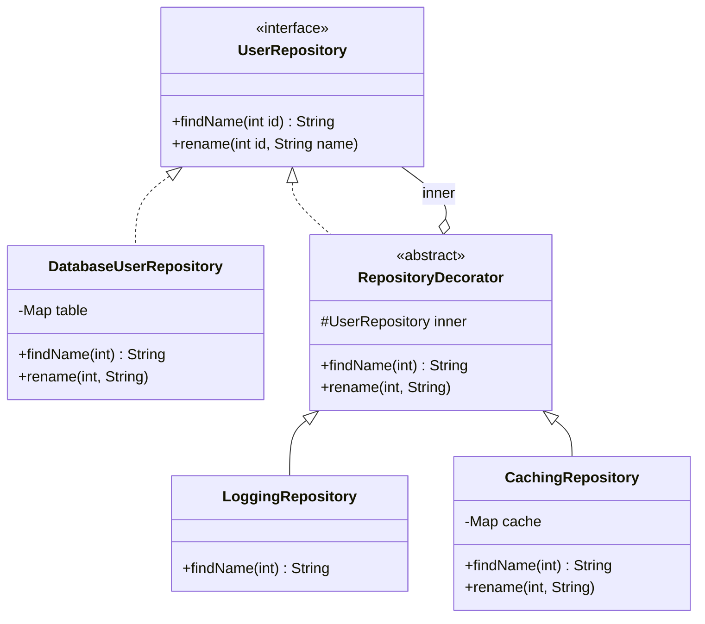

A decorated call, logging outside caching:

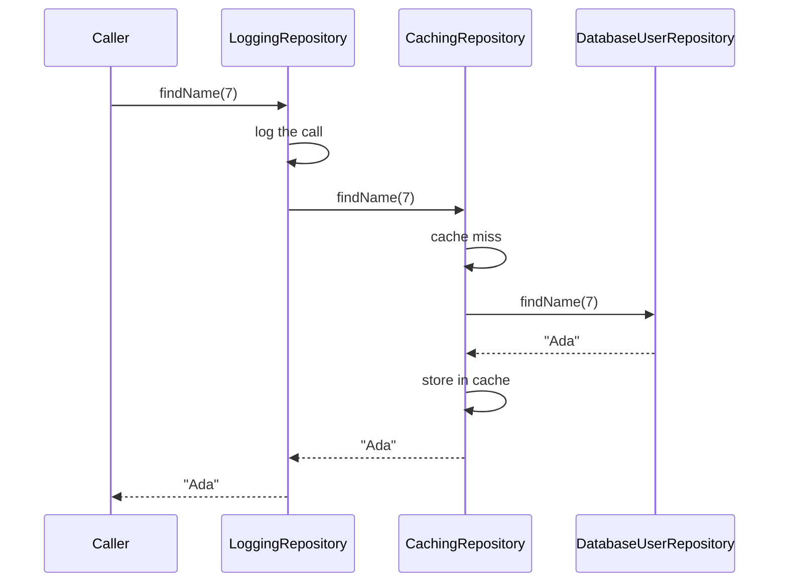

### Java example

```java
// File: code/lld/ch09/decorator/UserRepository.java
package lld.ch09.decorator;

/** COMPONENT interface: every box in the stack implements it. */
interface UserRepository {
    String findName(int id);
    void rename(int id, String name);
}
```

```java
// File: code/lld/ch09/decorator/DatabaseUserRepository.java
package lld.ch09.decorator;

import java.util.HashMap;
import java.util.Map;

/** CONCRETE COMPONENT: the real work, always at the bottom of the stack. */
final class DatabaseUserRepository implements UserRepository {
    private final Map<Integer, String> table = new HashMap<>(Map.of(7, "Ada", 8, "Linus"));

    @Override
    public String findName(int id) {
        System.out.println("    [db]    query for user " + id);
        return table.get(id);
    }

    @Override
    public void rename(int id, String name) {
        System.out.println("    [db]    update user " + id);
        table.put(id, name);
    }
}
```

```java
// File: code/lld/ch09/decorator/RepositoryDecorator.java
package lld.ch09.decorator;

/**
 * BASE DECORATOR: holds the INTERFACE (not a concrete class) and forwards everything.
 * Subclasses override only what they change, so no method is ever forgotten.
 */
abstract class RepositoryDecorator implements UserRepository {
    protected final UserRepository inner;

    protected RepositoryDecorator(UserRepository inner) { this.inner = inner; }

    @Override public String findName(int id)          { return inner.findName(id); }
    @Override public void rename(int id, String name) { inner.rename(id, name); }
}
```

```java
// File: code/lld/ch09/decorator/LoggingRepository.java
package lld.ch09.decorator;

/** CONCRETE DECORATOR 1 */
final class LoggingRepository extends RepositoryDecorator {
    LoggingRepository(UserRepository inner) { super(inner); }

    @Override
    public String findName(int id) {
        System.out.println("    [log]   findName(" + id + ")");
        return super.findName(id);
    }
}
```

```java
// File: code/lld/ch09/decorator/CachingRepository.java
package lld.ch09.decorator;

import java.util.HashMap;
import java.util.Map;

/** CONCRETE DECORATOR 2 - note it must also invalidate on writes. */
final class CachingRepository extends RepositoryDecorator {
    private final Map<Integer, String> cache = new HashMap<>();

    CachingRepository(UserRepository inner) { super(inner); }

    @Override
    public String findName(int id) {
        if (cache.containsKey(id)) {
            System.out.println("    [cache] hit for " + id);
            return cache.get(id);
        }
        System.out.println("    [cache] miss for " + id);
        String name = super.findName(id);
        cache.put(id, name);
        return name;
    }

    @Override
    public void rename(int id, String name) {
        cache.remove(id);
        super.rename(id, name);
    }
}
```

```java
// File: code/lld/ch09/decorator/Beverage.java
package lld.ch09.decorator;

/** A second, classic decorator example: a coffee order priced by stacking add-ons.
 *  Prices are whole cents (int), so no floating-point money anywhere. */
interface Beverage {
    String description();
    int costCents();
}
```

```java
// File: code/lld/ch09/decorator/Espresso.java
package lld.ch09.decorator;

record Espresso() implements Beverage {
    public String description() { return "Espresso"; }
    public int costCents() { return 199; }
}
```

```java
// File: code/lld/ch09/decorator/HouseBlend.java
package lld.ch09.decorator;

record HouseBlend() implements Beverage {
    public String description() { return "House Blend"; }
    public int costCents() { return 89; }
}
```

```java
// File: code/lld/ch09/decorator/Milk.java
package lld.ch09.decorator;

/** Add-ons are decorators: they ARE a Beverage and HAVE a Beverage. */
record Milk(Beverage inner) implements Beverage {
    public String description() { return inner.description() + ", Milk"; }
    public int costCents() { return inner.costCents() + 10; }
}
```

```java
// File: code/lld/ch09/decorator/Mocha.java
package lld.ch09.decorator;

record Mocha(Beverage inner) implements Beverage {
    public String description() { return inner.description() + ", Mocha"; }
    public int costCents() { return inner.costCents() + 20; }
}
```

```java
// File: code/lld/ch09/decorator/Whip.java
package lld.ch09.decorator;

record Whip(Beverage inner) implements Beverage {
    public String description() { return inner.description() + ", Whip"; }
    public int costCents() { return inner.costCents() + 10; }
}
```

```java
// File: code/lld/ch09/decorator/UpperCaseInputStream.java
package lld.ch09.decorator;

import java.io.FilterInputStream;
import java.io.IOException;
import java.io.InputStream;

/**
 * Our own java.io decorator. FilterInputStream is the JDK's "base decorator":
 * it holds an InputStream and forwards every call to it.
 * Works byte-by-byte, so it is only correct for ASCII text.
 */
final class UpperCaseInputStream extends FilterInputStream {
    UpperCaseInputStream(InputStream in) { super(in); }

    @Override
    public int read() throws IOException {
        int b = super.read();
        return b == -1 ? -1 : Character.toUpperCase((char) b);
    }

    @Override
    public int read(byte[] buf, int off, int len) throws IOException {
        int n = super.read(buf, off, len);
        for (int i = off; i < off + Math.max(n, 0); i++) {
            buf[i] = (byte) Character.toUpperCase((char) buf[i]);
        }
        return n;
    }
}
```

```java
// File: code/lld/ch09/decorator/Main.java
package lld.ch09.decorator;

import java.io.BufferedInputStream;
import java.io.ByteArrayInputStream;
import java.io.IOException;
import java.io.InputStream;
import java.math.BigDecimal;
import java.nio.charset.StandardCharsets;

public class Main {

    static void lookUpTwice(String label, UserRepository repo) {
        System.out.println("  " + label);
        repo.findName(7);
        repo.findName(7);
    }

    public static void main(String[] args) throws IOException {
        System.out.println("== Same layers, different order ==");
        lookUpTwice("Logging outside caching (logs every caller request):",
                new LoggingRepository(new CachingRepository(new DatabaseUserRepository())));
        lookUpTwice("Caching outside logging (logs only what reaches the db):",
                new CachingRepository(new LoggingRepository(new DatabaseUserRepository())));

        System.out.println("== Write goes through every layer and invalidates the cache ==");
        UserRepository repo = new LoggingRepository(new CachingRepository(new DatabaseUserRepository()));
        repo.findName(8);
        repo.rename(8, "Linus T.");
        System.out.println("  now: " + repo.findName(8));

        System.out.println("== Coffee: stack add-ons at run time ==");
        Beverage order = new Whip(new Mocha(new Mocha(new Espresso())));
        System.out.println("  " + order.description() + " = $" + BigDecimal.valueOf(order.costCents(), 2));
        Beverage latte = new Milk(new HouseBlend());
        System.out.println("  " + latte.description() + " = $" + BigDecimal.valueOf(latte.costCents(), 2));

        System.out.println("== java.io is built from decorators ==");
        InputStream in = new UpperCaseInputStream(
                new BufferedInputStream(
                        new ByteArrayInputStream("decorators wrap streams".getBytes(StandardCharsets.US_ASCII))));
        try (in) {
            System.out.println("  " + new String(in.readAllBytes(), StandardCharsets.US_ASCII));
        }
    }
}
```

**Output:**

```text
== Same layers, different order ==
  Logging outside caching (logs every caller request):
    [log]   findName(7)
    [cache] miss for 7
    [db]    query for user 7
    [log]   findName(7)
    [cache] hit for 7
  Caching outside logging (logs only what reaches the db):
    [cache] miss for 7
    [log]   findName(7)
    [db]    query for user 7
    [cache] hit for 7
== Write goes through every layer and invalidates the cache ==
    [log]   findName(8)
    [cache] miss for 8
    [db]    query for user 8
    [db]    update user 8
    [log]   findName(8)
    [cache] miss for 8
    [db]    query for user 8
  now: Linus T.
== Coffee: stack add-ons at run time ==
  Espresso, Mocha, Mocha, Whip = $2.49
  House Blend, Milk = $0.99
== java.io is built from decorators ==
  DECORATORS WRAP STREAMS
```

**What each part does**

- `RepositoryDecorator` — the **abstract base decorator**. It forwards *every* method, so a concrete decorator that only cares about `findName` cannot accidentally drop `rename`. This is the standard Java defence against forgotten delegation.
- `LoggingRepository` — prints, then delegates.
- `CachingRepository` — answers from its map on a hit, otherwise delegates and stores. It also overrides `rename` to **invalidate** — the third block of output shows the next read going to the database again.
- `Beverage` records — the classic coffee example (from *Head First Design Patterns*, rewritten): `new Whip(new Mocha(new Mocha(new Espresso())))` costs 1.99 + 0.20 + 0.20 + 0.10 = **$2.49**. Double mocha is just wrapping twice — impossible with one subclass per combination.
- `UpperCaseInputStream extends FilterInputStream` — our own `java.io` decorator. `FilterInputStream` is the JDK's base decorator: it holds an `InputStream` and forwards to it.

### Layer order changes behaviour

Compare the two stacks in the output — they behave differently:

- **Logger on the outside, cache inside**: every request is logged, even those the cache serves → the log records *what callers requested*.
- **Cache on the outside, logger inside**: only cache misses are logged → the log records *what hit the database*, and the repeat request is absent.

Both are valid; they answer different questions. The mistake is picking one **without meaning to** and then reading the log as if it answered the other question. The same choice comes up wherever layers are stacked:

| Pair | Outside | Inside |
|---|---|---|
| Retry vs cache | Repeats the entire lookup | Repeats only the database call, and a retry that succeeds populates the cache. Rule of thumb: put retry **next to the thing that fails**. |
| Metrics vs cache | Times what the caller experiences | Times the database alone — the number an on-call engineer is paged on. Many teams record both. |
| Authorization vs cache | **Correct** — every request is checked | **Security bug** — a cached answer is returned without the check ever running |

The type checker accepts every ordering. **Record the reason for the order in a comment where the stack is built**, or the next person adding a layer will guess.

### Two related traps

- **Stateful decorators that assume one wrap.** Apply a counting decorator twice to the same object and every call is counted twice.
- **Lost identity.** The wrapper is a different object from what it wraps, so `==`, `equals` and `instanceof` give answers callers don't expect. Code that digs through layers to "reach the real object" is working against the pattern.

### Decorator vs inheritance

| | Subclassing | Decorator |
|---|---|---|
| When behaviour is chosen | Compile time | Run time |
| How many at once | One subclass | Any number of layers, any order |
| Classes for N optional features | Up to 2^N | N |
| Works on `final` classes / classes you don't own | No | Yes (only needs the interface) |
| Can reach private state | Protected members, yes | No — only the public interface |

### Java I/O streams: the decorator you already use

`java.io` is built almost entirely from decorators:

```java
new BufferedReader(new InputStreamReader(new FileInputStream("data.txt"), UTF_8))
```

- `FileInputStream` — concrete component (reads bytes from a file).
- `InputStreamReader` — strictly an **adapter** (bytes → characters), not a decorator.
- `BufferedReader` — a **decorator** on `Reader` (adds buffering and `readLine()`).

On the byte side, `FilterInputStream` is the abstract decorator, and `BufferedInputStream`, `DataInputStream`, `PushbackInputStream`, `java.util.zip.GZIPInputStream` (via `InflaterInputStream`) and `java.security.DigestInputStream` are concrete decorators. *Head First Design Patterns* notes the downside: the design produces many small classes, which can overwhelm newcomers until they see the pattern.

### Trade-offs

| Pros | Cons |
|---|---|
| **Any mix without a class per mix** — 4 concerns need 4 classes, not 16. | **Deeper stack traces** — the real work is buried under every layer. |
| **Concerns tested in isolation** — logging without a database, caching without a logger (Single Responsibility). | **Identity surprises** — `equals`/`instanceof` on the wrapper don't match the wrapped object. |
| **Assembled at run time** — different per caller, environment or feature flag. | **Ordering matters for correctness**, and no compiler checks it. |
| **The wrapped class is never edited** (Open/Closed) — works even on classes you don't own. | **Over-layering** — eight wrappers deep, nobody knows which one changed a value. |

### When not to use it

- **Exactly one concern, forever.** Just put it in the class; a decorator for one behaviour is a whole class wrapped around a single `if`.
- **The concern needs private state.** A decorator can only use the public interface, so it is the wrong tool.
- **The framework already offers it** — middleware, interceptors, Spring AOP aspects are decorators with tooling. Don't hand-write ten wrappers beside them.
- **The stack would get deep.** Every extra layer is another frame in each stack trace, and with many layers "which one changed this value?" becomes a long debugging session.

### Common mistakes

- Holding the **concrete class** instead of the interface (`private DatabaseUserRepository inner`) — then decorators cannot stack.
- **Forgetting to forward** some methods (use an abstract base decorator).
- A caching decorator that **doesn't invalidate on writes** (ours does in `rename`).
- Putting authorization **inside** a cache.
- Relying on `instanceof` of the outer object.

### Real-world examples

- **`java.io` streams** — see above.
- **`java.util.Collections.unmodifiableList/synchronizedList/checkedList`** — each returns a wrapper with the same interface and one changed behaviour (read-only, synchronized, type-checked). Some authors call `unmodifiableList` a protection **proxy**; both labels are defensible.
- **`javax.servlet.http.HttpServletRequestWrapper`** (Jakarta: `jakarta.servlet...`) — a base decorator you subclass to change selected request methods in a filter.
- **HTTP middleware** — Express, Django, ASP.NET and Go's `http.Handler` wrap a handler in layers (logging, auth, compression, rate limiting). Middleware is this pattern with framework support.
- **Resilience4j (Java) and Polly (.NET)** — compose retry, circuit breaker, timeout and bulkhead as stacked wrappers, e.g. `Decorators.ofSupplier(...).withCircuitBreaker(...).withRetry(...).withBulkhead(...).decorate()`; both document the ordering carefully because it changes behaviour.
- **Python's `@functools.lru_cache`** (and `@retry` from libraries such as tenacity) — function decorators: the same idea applied to functions, and the reason Python uses the name.

### In modern languages

- **Java**: abstract forwarding base class (as here), or a dynamic proxy that generates the forwarding.
- **Python**: function decorators (`@lru_cache` and friends) are this pattern with syntax; for objects, `__getattr__` forwarding (and `functools.wraps` for functions) avoids hand-writing every delegating method.
- **JavaScript / TypeScript**: a higher-order function that returns a wrapped function; a `Proxy` object can forward every method automatically.
- **Go**: a struct that embeds the interface value gets delegation for free — why Go middleware reads so cleanly.
- **C#**: `DelegatingHandler` in `HttpClient` is a framework-provided decorator chain.

### In the interview

**30-second answer:** "Decorator adds responsibilities to an object at run time by wrapping it in another object with the same interface. Without it, four optional concerns mean sixteen subclasses; with it, each concern — logging, caching, retries — is one class and I compose the stack I need. The decorator holds the interface, not the concrete class, which is what lets layers stack. And order matters: retry goes closest to what fails, and authorization must sit outside a cache or a cache hit skips the check."

**Follow-ups**

- *Q: Decorator vs Proxy?* — A: Same structure; different intent. Decorator **adds behaviour** and normally forwards the call; the client hands it the object to wrap and often stacks several. Proxy **controls access** — it may defer, cache or refuse — often creates or locates the real object itself, and is usually handed to a client that doesn't know it isn't the real thing. The boundary is genuinely fuzzy (a caching wrapper is fairly called either), and saying so is a better answer than pretending it is sharp.
- *Q: Decorator vs Adapter?* — A: Decorator keeps the interface and changes behaviour; Adapter changes the interface and keeps behaviour.
- *Q: Decorator vs Chain of Responsibility?* — A: Both are chains of objects. In Decorator every layer normally does its extra work and passes the call on to the core (a caching layer answering a hit is the usual exception). In Chain of Responsibility, typically one handler handles the request and the rest never see it.
- *Q: Decorator vs Composite?* — A: Decorator wraps exactly one child and adds behaviour; Composite holds many children and aggregates.
- *Q: Give a JDK example.* — A: `new BufferedInputStream(new FileInputStream(f))`; `FilterInputStream` is the base decorator.

### Self-check

1. **Q:** How many classes for 5 optional features with decorators vs one subclass per combination? **A:** 5 vs up to 32.
2. **Q:** Why does `RepositoryDecorator` forward every method? **A:** So concrete decorators cannot silently drop methods they don't override.
3. **Q:** Why is "authorization inside cache" a bug? **A:** A cache hit returns data without ever running the authorization check.
4. **Q:** Is `InputStreamReader` a decorator? **A:** No — it changes the interface (bytes to chars), so it is an adapter. `BufferedReader` is the decorator.

### TL;DR

- **Wrap to add behaviour, keep the interface.** IS-A and HAS-A the same type.
- N features = N classes, stacked at run time, in any order — and **order matters**.
- Java I/O, `Collections.synchronizedList`, middleware, Resilience4j are all decorators. A decorator normally forwards every call; one that short-circuits (a cache hit) is drifting towards Proxy.

---

## 9.5 Facade Pattern

### What it is

The **Facade** pattern gives a complicated subsystem **one simple front door**, so that most callers never deal with the machinery behind it. GoF's intent: *provide a unified interface to a set of interfaces in a subsystem; the facade defines a higher-level interface that makes the subsystem easier to use.*

*Analogy:* a hotel concierge. You say "book me dinner and a taxi"; the concierge calls the restaurant, the taxi company and the front desk in the right order. You can still phone the restaurant yourself if you want something unusual.

| Term | Meaning | In our code |
|---|---|---|
| **Facade** | Knows which subsystem classes to call, in what order, and how to clean up | `OrderFacade` |
| **Subsystem classes** | Do the real work; unaware of the facade | `InventoryService`, `PaymentService`, `ShippingService`, `EmailService` |
| **Client** | Uses the facade instead of the subsystem | `Main` / a checkout page |

### The problem it solves

One useful action needs several objects, called in the right order. To place an order you must **reserve stock → charge the card → create a shipment → send a confirmation**. Every place in the code that places an order repeats those four calls — and each copy must also know what to do if the card is declined **after** the stock has been reserved.

That recovery step is where bugs live. Copying the success path is easy; copying the undo correctly is not. A caller that forgets to release the reservation leaves units locked for an order that was never placed.

Nothing is wrong with the subsystem itself — it is **flexible**, and flexibility means many knobs. The trouble is that nearly every caller wants the same standard sequence and writes it out yet again.


*Figure — Top: each caller repeats the reserve/charge/release/ship/email sequence and may forget the release. Bottom: the checkout page calls `OrderFacade.placeOrder(...)`, which sequences the four services and undoes on failure; the services stay public (course diagram)*

### How it works

1. **Identify the common path** that many callers repeat.
2. **Create a facade class** that holds the subsystem objects.
3. **Expose one intention-revealing method** (`placeOrder`) that calls them in the correct order.
4. **Own the failure handling** — if payment fails, the facade releases the reservation (a *compensating action*).
5. **Keep the subsystem public**, so unusual callers can still reach past the facade.
6. **Add no business rules** — the facade *sequences*, it does not *decide*.

### Structure


*Figure — Facade class diagram: `Checkout` depends only on `OrderFacade`, which holds the four services (shown in grey) and exposes `placeOrder`. The figure labels the payment service `PaymentGateway` and shows a shorter `placeOrder` signature; our code calls it `PaymentService` and also passes customer and address (course diagram)*

In the class diagram above, dependencies run in **one direction** only: none of the services knows the facade exists, so they remain usable on their own. Note also that there is no interface: a facade is normally a concrete convenience class, not an abstraction. Introduce an interface only if you plan to substitute the entire subsystem — which is a different job.

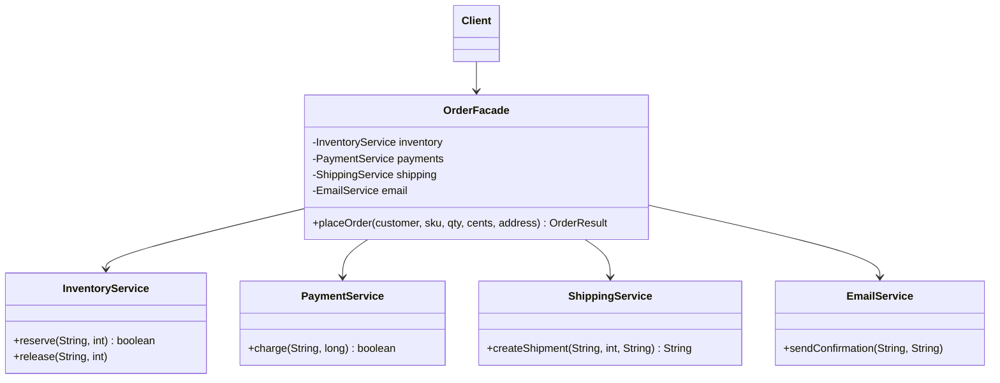

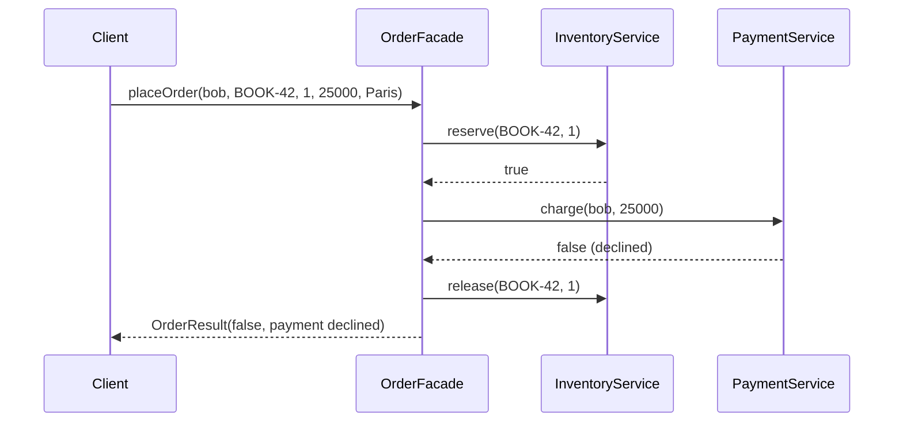

### Java example

```java
// File: code/lld/ch09/facade/InventoryService.java
package lld.ch09.facade;

import java.util.HashMap;
import java.util.Map;

/*
 * SUBSYSTEM: four independent, still-public services.
 * None of them knows the facade exists.
 */

final class InventoryService {
    private final Map<String, Integer> stock = new HashMap<>(Map.of("BOOK-42", 5));

    boolean reserve(String sku, int qty) {
        int have = stock.getOrDefault(sku, 0);
        if (have < qty) return false;
        stock.put(sku, have - qty);
        System.out.println("  [inventory] reserved " + qty + " x " + sku + " (left " + (have - qty) + ")");
        return true;
    }

    void release(String sku, int qty) {
        stock.merge(sku, qty, Integer::sum);
        System.out.println("  [inventory] released " + qty + " x " + sku + " (left " + stock.get(sku) + ")");
    }
}
```

```java
// File: code/lld/ch09/facade/PaymentService.java
package lld.ch09.facade;

final class PaymentService {
    /** Declines anything over $100 so the demo can show the failure path. */
    boolean charge(String customer, long cents) {
        boolean ok = cents <= 10_000;
        System.out.println("  [payment]   charge " + customer + " " + cents + "c -> " + (ok ? "OK" : "DECLINED"));
        return ok;
    }
}
```

```java
// File: code/lld/ch09/facade/ShippingService.java
package lld.ch09.facade;

final class ShippingService {
    private int next = 1;

    String createShipment(String sku, int qty, String address) {
        String id = "SHP-" + next++;
        System.out.println("  [shipping]  " + id + ": " + qty + " x " + sku + " to " + address);
        return id;
    }
}
```

```java
// File: code/lld/ch09/facade/EmailService.java
package lld.ch09.facade;

final class EmailService {
    void sendConfirmation(String customer, String orderId) {
        System.out.println("  [email]     confirmation for " + orderId + " sent to " + customer);
    }
}
```

```java
// File: code/lld/ch09/facade/OrderResult.java
package lld.ch09.facade;

/** What callers get back: our own small result type. */
record OrderResult(boolean success, String orderId, String message) { }
```

```java
// File: code/lld/ch09/facade/OrderFacade.java
package lld.ch09.facade;

/**
 * FACADE: one method that knows the correct SEQUENCE and the CLEANUP.
 * It sequences; it does not decide business rules (no pricing, no fraud logic here).
 */
final class OrderFacade {
    private final InventoryService inventory;
    private final PaymentService payments;
    private final ShippingService shipping;
    private final EmailService email;
    private int orderSeq = 100;

    OrderFacade(InventoryService inventory, PaymentService payments,
                ShippingService shipping, EmailService email) {
        this.inventory = inventory;
        this.payments = payments;
        this.shipping = shipping;
        this.email = email;
    }

    OrderResult placeOrder(String customer, String sku, int qty, long cents, String address) {
        String orderId = "ORD-" + orderSeq++;
        if (!inventory.reserve(sku, qty)) {
            return new OrderResult(false, orderId, "out of stock");
        }
        if (!payments.charge(customer, cents)) {
            inventory.release(sku, qty);            // compensating step callers used to forget
            return new OrderResult(false, orderId, "payment declined");
        }
        String shipmentId = shipping.createShipment(sku, qty, address);
        email.sendConfirmation(customer, orderId);
        return new OrderResult(true, orderId, "shipped as " + shipmentId);
    }
}
```

```java
// File: code/lld/ch09/facade/Main.java
package lld.ch09.facade;

public class Main {
    public static void main(String[] args) {
        InventoryService inventory = new InventoryService();
        OrderFacade orders = new OrderFacade(inventory, new PaymentService(),
                new ShippingService(), new EmailService());

        System.out.println("== Happy path: one call instead of four ==");
        System.out.println("  -> " + orders.placeOrder("ada@x.com", "BOOK-42", 2, 5_000, "London"));

        System.out.println("== Declined card: the facade undoes the reservation ==");
        System.out.println("  -> " + orders.placeOrder("bob@x.com", "BOOK-42", 1, 25_000, "Paris"));

        System.out.println("== Out of stock ==");
        System.out.println("  -> " + orders.placeOrder("cy@x.com", "BOOK-42", 99, 1_000, "Rome"));

        System.out.println("== The subsystem is still reachable for unusual needs ==");
        inventory.reserve("BOOK-42", 1);   // e.g. a warehouse tool holding stock manually
    }
}
```

**Output:**

```text
== Happy path: one call instead of four ==
  [inventory] reserved 2 x BOOK-42 (left 3)
  [payment]   charge ada@x.com 5000c -> OK
  [shipping]  SHP-1: 2 x BOOK-42 to London
  [email]     confirmation for ORD-100 sent to ada@x.com
  -> OrderResult[success=true, orderId=ORD-100, message=shipped as SHP-1]
== Declined card: the facade undoes the reservation ==
  [inventory] reserved 1 x BOOK-42 (left 2)
  [payment]   charge bob@x.com 25000c -> DECLINED
  [inventory] released 1 x BOOK-42 (left 3)
  -> OrderResult[success=false, orderId=ORD-101, message=payment declined]
== Out of stock ==
  -> OrderResult[success=false, orderId=ORD-102, message=out of stock]
== The subsystem is still reachable for unusual needs ==
  [inventory] reserved 1 x BOOK-42 (left 2)
```

**What each part does**

- The four services are ordinary classes with their own responsibilities; none mention `OrderFacade`.
- `OrderFacade.placeOrder` is the whole pattern: the correct **sequence** plus the **compensating step** (`inventory.release`) on a declined payment. Look at the second block of output — reserved, declined, released — without the caller writing any of it.
- `OrderResult` — a small result type so callers don't need subsystem types.
- The last line of `main` calls `inventory.reserve` directly: the facade is **a convenience, not a wall**.

### Facade vs Adapter vs Mediator

| | **Facade** | **Adapter** | **Proxy** | **Mediator** (Ch. 10–11) |
|---|---|---|---|---|
| Intent | Simplify a subsystem | Convert one interface to another | Control access to one object | Coordinate peers that would otherwise talk directly |
| Objects wrapped | **Several** | **One** | **One** | Several colleagues |
| Interface offered | New, smaller one | The client's (Target) | **Same** as the real object | Mediator's own |
| Who chose the interface | **You** — a simpler one over things you usually control | **Someone else** — you must fit it | Already fixed by the real object | You |
| Do the wrapped objects know about it? | **No** — one-way | No | No | **Yes** — colleagues talk *through* the mediator |
| Direction of communication | Client → facade → subsystem | Client → adapter → adaptee | Client → proxy → real subject | Colleague ↔ mediator ↔ colleague (both ways) |
| Example | `OrderFacade.placeOrder` | `StripeGateway.pay` | `LazyReport` | An air-traffic control tower; a chat room |

The quickest way to spot a facade is the **"objects wrapped"** row: Adapter, Decorator and Proxy each stand in front of exactly one object; a Facade stands in front of **several**.

Another test: suppose the subsystem changed its API tomorrow to exactly what callers want. An **Adapter** would then be pointless; a **Facade** would still be useful, because its value was the *simplification*, not a translation.

**Facade vs "service layer".** Most of the time these are the same thing under two names. A service class that only *sequences* calls is a facade; once it holds business rules it has become something else (a domain/application service with logic of its own).

### The failure mode to watch for

Facades **pull in features**. Day one it is four calls in order; then a discount rule lands in it ("orders are placed here, after all"), then a fraud check, and a year later it is the **god object** everyone is afraid to edit. Keep one rule: **a facade orchestrates; it does not decide.** If it is making a business decision instead of calling the thing that makes it, that logic belongs elsewhere — and moving it out later is far harder than keeping it out now.

This connects to the **Principle of Least Knowledge** (Law of Demeter) that *Head First Design Patterns* pairs with Facade: "talk only to your immediate friends". Clients talk to the facade, not to a chain of subsystem objects, which reduces coupling.

### Trade-offs

| Pros | Cons |
|---|---|
| **One call replaces a multi-step sequence**, so the common path is no longer duplicated. | **One more class to maintain** as the subsystem evolves. |
| **The order and the undo logic live in one place** — exactly the part callers got wrong. | **Feature magnet** — grows into a god object unless someone pushes back. |
| **One seam for swapping the subsystem later** — only the facade changes. | **Opinionated** — some caller will need an option the facade left out. |
| **Smaller public surface** for the module; lower coupling. | **Can mask problems** — a neat front over a subsystem that still fails; everything funnels through it, so it can become a single point of failure. |

### When not to use it

- **The subsystem is already simple** — wrapping two calls just adds a file to maintain.
- **Callers need the full range** — if every caller bypasses the facade for some option, its shape is wrong: widen it on purpose or remove it.
- **You are covering a mess instead of fixing it** — you get a neat front and the same failures behind it; sometimes the honest move is to repair the subsystem.
- **You want it to be the only entrance** — hiding the subsystem forces every unusual need into the facade, which is how god objects are born.

### Common mistakes

- Putting business rules (pricing, fraud) in the facade.
- Making the subsystem inaccessible.
- Returning subsystem types from the facade so callers are still coupled to them.
- Forgetting the failure path — a facade that only does the happy path misses its biggest value.
- Confusing it with Mediator (see table).

### Real-world examples

- **Application service layers** — almost every `OrderService` or `RegistrationService` is a facade over repositories, gateways and notifiers (as long as it only sequences).
- **`java.net.URL`** — `url.openStream()` hides protocol handlers, connection setup and content handlers behind one call. (Since Java 20 the `URL` constructors are deprecated; create one with `URI.create(s).toURL()`. The facade idea is unchanged.)
- **SLF4J `LoggerFactory.getLogger(...)`** — hides configuration, appenders and formatters behind one call. (SLF4J literally calls itself a "Simple Logging Facade".)
- **`javax.faces.context.FacesContext`**, **jQuery** (historically the clearest example: one `$` function in front of DOM, events, animation and XHR, each still usable directly), and Python's **`requests`**, which covers the common "just fetch this URL" cases on top of `urllib3`.
- **E-commerce checkout**: when you press "Place order" on Amazon or Flipkart, one backend call orchestrates inventory, payment, shipping and notifications — a facade (often called an orchestrator or backend-for-frontend).

### In modern languages

- **Python / JavaScript**: a module exporting one function and keeping the rest private is a facade with no class at all.
- **Go**: a package's exported functions are the facade; lowercase identifiers stay internal.
- **Java**: a package with one public class (package-private subsystem), or a JPMS module that exports only the facade's package.
- **Any language**: a single well-named function is often the whole pattern — if `placeOrder` needs no state of its own, it does not have to be a class.

### In the interview

**30-second answer:** "A Facade gives one simple entry point to a complex subsystem. For order placement, `OrderFacade.placeOrder` reserves stock, charges, ships and emails in the right order, and if payment fails it releases the reservation — so no caller has to remember that cleanup. It wraps several objects, unlike Adapter, Decorator and Proxy which wrap one. I keep the subsystem public, because a facade is a convenience, not a wall, and I keep business rules out of it — the main risk is that it grows into a god object."

**Follow-ups**

- *Q: How is it different from Adapter?* — A: Adapter converts one interface because someone else chose it; Facade simplifies many objects behind a new interface you chose.
- *Q: And from Mediator?* — A: Subsystem classes don't know the facade exists; colleagues in a Mediator know it and communicate through it, in both directions.
- *Q: Risk?* — A: God object. A facade should sequence, not decide.
- *Q: Should the subsystem be hidden?* — A: Usually no; leave it reachable for unusual needs.
- *Q: Can a system have several facades?* — A: Yes — e.g. one per use case, or layered facades over sub-subsystems.

### Self-check

1. **Q:** What is the fastest structural way to tell a Facade from Adapter/Decorator/Proxy? **A:** It wraps several objects; the others wrap one.
2. **Q:** In our code, what does the facade do when payment is declined? **A:** Releases the stock reservation and returns a failed `OrderResult`.
3. **Q:** A teammate adds a 10% discount rule inside `placeOrder`. Good idea? **A:** No — business rules belong in a service the facade calls; the facade only sequences.
4. **Q:** Which OO principle is closely related to Facade? **A:** Principle of Least Knowledge (Law of Demeter).

### TL;DR

- **One door into a complex subsystem.** Names the common path and owns the cleanup.
- Wraps **several** objects; subsystem stays **public**; facade **sequences, never decides**.
- Different from Adapter (translation of one) and Mediator (two-way coordination of peers).

---

## 9.6 Flyweight Pattern

### What it is

The **Flyweight** pattern **shares** the portion of each object's state that is the same across many objects, so that huge numbers of them fit in memory. GoF's intent: *use sharing to support large numbers of fine-grained objects efficiently.*

*Analogy:* a printed book. Every letter "e" on every page uses the same metal type design (shared), placed at a different position (unique). You don't carve a new "e" for every occurrence.

Two terms carry the whole pattern:

| Term | Meaning | In the map example |
|---|---|---|
| **Intrinsic state** | Part of the thing's own identity and **identical for every holder**. Lives inside the shared flyweight. | icon bitmap, colour, size |
| **Extrinsic state** | **Varies with the context** the object is used in; different for each holder. Stays outside and is **handed in** as method arguments. | latitude, longitude |

The words are GoF's and interviewers use them, even though on their own they explain little — remember "intrinsic = inside the shared object", "extrinsic = supplied from outside".

| Role | In our code |
|---|---|
| **Flyweight** (shared, immutable, intrinsic only) | `MarkerStyle` |
| **Flyweight factory** (owns the pool, returns existing or creates once) | `MarkerStyleFactory` |
| **Context** (one per logical object: extrinsic state + reference to a flyweight) | `Marker` |
| **Client** (asks the factory, supplies extrinsic state) | `Main` |

GoF's own participant list is *Flyweight* (the interface that accepts extrinsic state), *ConcreteFlyweight* (the shared implementation — our `MarkerStyle` plays both roles since we need no interface), *UnsharedConcreteFlyweight* (objects of the same interface that are **not** shared, e.g. a row object holding its own children), *FlyweightFactory* and *Client*. "Context" is the name later sources (such as refactoring.guru) give to the object that stores the extrinsic state.

### The problem it solves

Picture a map app showing **100,000 markers**. Every marker stores its latitude and longitude — plus an icon bitmap, a colour and a size. Positions are all different, but the icon is the same for thousands of markers, and the icon is by far the largest field. Keeping 100,000 copies of a 2 MB bitmap is not "a bit slow": it needs ~195 GB, so **the program simply runs out of memory.**

The same situation shows up in a game with a million trees that all use one mesh and texture, in a text editor that would otherwise store font data for every character, and anywhere many objects **differ slightly but share a large common part**.


*Figure — Top: every marker carries its own 2 MB icon. Bottom: each marker keeps only lat/lon and a style reference; one immutable `MarkerStyle` holds the icon, colour and size (course diagram)*

### How it works

1. **Split the state**: intrinsic (shared, invariant) vs extrinsic (per holder).
2. **Move intrinsic state into an immutable flyweight class** — all fields `final`, no setters.
3. **Pass extrinsic state as method arguments** (`draw(lat, lon)`) instead of storing it in the flyweight.
4. **Create a factory that owns the pool**, keyed by the intrinsic values. `get(...)` returns the existing object or creates it the first time.
5. **Clients must go through the factory**, never the constructor (enforce with package-private/private constructors).
6. **Context objects** keep only extrinsic state plus a **reference** (not a copy) to the flyweight.

> **Two rules — break either and the pattern silently stops working.**
> 1. **Flyweights never change.** Many holders point at the same object, so a modification made for one is seen by every other.
> 2. **Only the factory creates them.** If callers can use the constructor directly, identical copies appear and the memory saving is gone.

### Structure


*Figure — Flyweight class diagram: `MarkerStyle` (final fields, `draw(lat, lon)`), `MarkerStyleFactory` with a pool and `get()`, and `Marker` holding position plus a style reference (course diagram)*

In the diagram above, `draw` receives the position as arguments rather than keeping it in a field, `Marker` holds a *reference* to a style rather than its own copy, and clients obtain styles from the factory, never from the constructor. That last rule has to be enforced — by a package-private (or private) constructor, or at least by convention and code review.

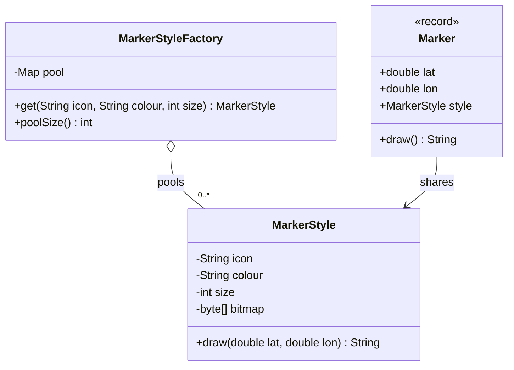

### Java example

```java
// File: code/lld/ch09/flyweight/MarkerStyle.java
package lld.ch09.flyweight;

/**
 * FLYWEIGHT: holds only INTRINSIC state (same for every marker using this style).
 * Immutable: all fields final, no setters, and the bitmap array never leaves the object.
 * The constructor is package-private, so code outside this package cannot bypass the
 * factory. (Inside the package it is a convention: only MarkerStyleFactory calls it.)
 */
final class MarkerStyle {
    static final int ICON_BYTES = 2 * 1024 * 1024;   // pretend every icon bitmap is 2 MB

    private final String icon;
    private final String colour;
    private final int size;
    private final byte[] bitmap;   // the heavy part we want exactly one copy of

    MarkerStyle(String icon, String colour, int size) {
        System.out.println("  loading icon '" + icon + "' (" + colour + ", " + size + "px)");
        this.icon = icon;
        this.colour = colour;
        this.size = size;
        this.bitmap = new byte[ICON_BYTES];
    }

    /** EXTRINSIC state (the position) is passed in, never stored. */
    String draw(double lat, double lon) {
        return String.format("%s %s marker at (%.4f, %.4f)", colour, icon, lat, lon);
    }

    int bitmapBytes() { return bitmap.length; }
}
```

```java
// File: code/lld/ch09/flyweight/MarkerStyleFactory.java
package lld.ch09.flyweight;

import java.util.Map;
import java.util.concurrent.ConcurrentHashMap;

/** FLYWEIGHT FACTORY: owns the pool. Thread-safe via ConcurrentHashMap.computeIfAbsent. */
final class MarkerStyleFactory {
    /** The pool key is the combination of intrinsic values. */
    private record Key(String icon, String colour, int size) { }

    private final Map<Key, MarkerStyle> pool = new ConcurrentHashMap<>();

    MarkerStyle get(String icon, String colour, int size) {
        return pool.computeIfAbsent(new Key(icon, colour, size),
                k -> new MarkerStyle(k.icon(), k.colour(), k.size()));
    }

    int poolSize() { return pool.size(); }
}
```

```java
// File: code/lld/ch09/flyweight/Marker.java
package lld.ch09.flyweight;

/** CONTEXT: one per marker. Holds extrinsic state + a REFERENCE to a shared style. */
record Marker(double lat, double lon, MarkerStyle style) {
    String draw() { return style.draw(lat, lon); }
}
```

```java
// File: code/lld/ch09/flyweight/Main.java
package lld.ch09.flyweight;

import java.util.ArrayList;
import java.util.List;
import java.util.Random;

public class Main {
    public static void main(String[] args) {
        MarkerStyleFactory styles = new MarkerStyleFactory();

        System.out.println("== Five markers, three styles ==");
        List<Marker> few = List.of(
                new Marker(51.5074, -0.1278, styles.get("cafe", "brown", 24)),
                new Marker(48.8566, 2.3522, styles.get("cafe", "brown", 24)),
                new Marker(40.7128, -74.0060, styles.get("fuel", "green", 24)),
                new Marker(35.6762, 139.6503, styles.get("hospital", "red", 32)),
                new Marker(52.5200, 13.4050, styles.get("fuel", "green", 24)));
        few.forEach(m -> System.out.println("  " + m.draw()));
        System.out.println("  same shared object? " + (few.get(0).style() == few.get(1).style()));

        System.out.println("== Scale to 100,000 markers ==");
        String[] icons = {"cafe", "fuel", "hospital"};
        String[] colours = {"brown", "green", "red"};
        int[] sizes = {24, 24, 32};
        Random rnd = new Random(42);
        List<Marker> many = new ArrayList<>();
        for (int i = 0; i < 100_000; i++) {
            int t = rnd.nextInt(3);
            many.add(new Marker(rnd.nextDouble() * 180 - 90, rnd.nextDouble() * 360 - 180,
                    styles.get(icons[t], colours[t], sizes[t])));
        }
        long withoutMb = (long) many.size() * MarkerStyle.ICON_BYTES / (1024 * 1024);
        long withMb = (long) styles.poolSize() * MarkerStyle.ICON_BYTES / (1024 * 1024);
        System.out.println("  markers: " + many.size() + ", styles in pool: " + styles.poolSize());
        System.out.println("  icon memory without flyweight: ~" + withoutMb + " MB");
        System.out.println("  icon memory with flyweight:    ~" + withMb + " MB");

        System.out.println("== Flyweights already in the JDK ==");
        Integer a = 127, b = 127;          // autoboxing calls Integer.valueOf
        Integer c = 128, d = 128;
        System.out.println("  Integer 127 == 127 -> " + (a == b) + "  (cached -128..127)");
        System.out.println("  Integer 128 == 128 -> " + (c == d) + " (outside default cache)");
        System.out.println("  equals() is always right -> " + c.equals(d));
        System.out.println("  Boolean.valueOf(true) == Boolean.TRUE -> " + (Boolean.valueOf(true) == Boolean.TRUE));

        String lit = "hello";
        String built = new String("hello");
        System.out.println("  \"hello\" == \"hel\" + \"lo\" -> " + (lit == "hel" + "lo") + " (compile-time constant, pooled)");
        System.out.println("  \"hello\" == new String(\"hello\") -> " + (lit == built));
        System.out.println("  \"hello\" == built.intern() -> " + (lit == built.intern()));
    }
}
```

**Output:**

```text
== Five markers, three styles ==
  loading icon 'cafe' (brown, 24px)
  loading icon 'fuel' (green, 24px)
  loading icon 'hospital' (red, 32px)
  brown cafe marker at (51.5074, -0.1278)
  brown cafe marker at (48.8566, 2.3522)
  green fuel marker at (40.7128, -74.0060)
  red hospital marker at (35.6762, 139.6503)
  green fuel marker at (52.5200, 13.4050)
  same shared object? true
== Scale to 100,000 markers ==
  markers: 100000, styles in pool: 3
  icon memory without flyweight: ~200000 MB
  icon memory with flyweight:    ~6 MB
== Flyweights already in the JDK ==
  Integer 127 == 127 -> true  (cached -128..127)
  Integer 128 == 128 -> false (outside default cache)
  equals() is always right -> true
  Boolean.valueOf(true) == Boolean.TRUE -> true
  "hello" == "hel" + "lo" -> true (compile-time constant, pooled)
  "hello" == new String("hello") -> false
  "hello" == built.intern() -> true
```

**What each part does**

- `MarkerStyle` — the flyweight. Final fields, no setters, package-private constructor, and `draw(lat, lon)` receives extrinsic state.
- `MarkerStyleFactory` — the pool. `ConcurrentHashMap.computeIfAbsent` makes "get or create once" **thread-safe and atomic**, so two threads can't create two copies of the same style.
- `Key` record — the intrinsic values as a value object; records give correct `equals`/`hashCode` for free.
- `Marker` record — the context: two doubles plus one reference.
- Output: "loading icon" is printed **3 times for 5 markers**, and still only 3 styles for 100,000 markers — about 6 MB of icon data instead of ~200,000 MB (≈195 GB).
- JDK section: `Integer.valueOf` caching and the `String` pool (below).

### Flyweights already in Java

- **`Integer.valueOf(int)`** (used by autoboxing) returns cached objects for **−128 to 127** — the Java Language Specification requires that range to be cached. That is why `Integer a = 127, b = 127; a == b` is `true` but the same with 128 is `false` on a default JVM (the upper bound can be raised with `-XX:AutoBoxCacheMax`, so never rely on it). **Always compare boxed numbers with `equals`.** `Short`, `Byte`, `Long` (same range) and `Character` (0–127) have similar caches; `Boolean.valueOf` returns the two shared constants `Boolean.TRUE` / `Boolean.FALSE`.
- **The String pool**: string literals and compile-time constant expressions (`"hel" + "lo"`) are interned, so equal literals share one object. `new String("hello")` always creates a new object; `intern()` returns the pooled one.
- **Enums**: exactly one instance per constant, shared everywhere.

### Flyweight is not a cache

The two are mixed up all the time — even in code reviews — and the difference decides what you may do with the pool:

| | **Flyweight** | **Cache** |
|---|---|---|
| Purpose | Make the data *fit in memory* at all | Make repeated work *quicker* |
| Contents | One copy of immutable state that many holders point to | Stored results of costly computations or lookups |
| May entries be removed? | Not while any holder still points to one | Yes, at any moment |
| Effect of removing one | Holders lose their shared object, or duplicates get created | None, apart from a slower next request |

So an LRU cache in front of a database is not a flyweight, and a pool of shared marker styles is not a cache.

### Two mistakes that undo the pattern

- **A flyweight that can change.** One caller updates a colour and every marker on the map changes with it — the classic failure, and hard to debug because the effect shows up far from the cause. Fix: `final` fields, no setters, no leaking of internal arrays.
- **An ever-growing pool keyed by open-ended input.** If users decide the keys, the pool never stops growing — a memory leak disguised as an optimisation. Flyweight is safe when the set of intrinsic values is **small and bounded** (3 styles, a few hundred glyphs). An open key space needs weak references and eviction, and at that point you have built a cache — so call it a cache.

### Measure first

Flyweight trades readability for memory, so using it without profiling is textbook premature optimisation. A thousand objects never need it; a million might. Answer two questions **with numbers** first: *how many of these objects will exist at once*, and *how much of each one is identical across all of them?* If you can't put numbers on both, it is too early; if most of each object is unique, there is nothing worth sharing.

### Trade-offs

| Pros | Cons |
|---|---|
| **Memory use can fall by orders of magnitude** — sometimes the difference between running and not running. | **State is split across two places**, which is harder to follow and change than one class. |
| **Costly construction happens once per distinct value**, not once per object. | **The pool keeps strong references**, so it can leak memory itself. |
| **Friendlier to CPU caches** — the shared data stays hot instead of being scattered. | **Thread safety is on you** — the pool must be thread-safe and the flyweight immutable. |
| **"Load once" logic gets one obvious home** instead of being spread across callers. | **Tempting to apply too early**, and callers must pass extrinsic state on every call (some CPU cost). |

### When not to use it

- You **haven't measured**.
- The shared part **cannot be immutable**.
- The **counts are small**.
- The **unique state is most of the object**.
- The **key space is unbounded** (that's a cache).

### Common mistakes

- Storing extrinsic state inside the flyweight (then it can't be shared).
- Public constructor so callers bypass the factory.
- Non-thread-safe pool (`HashMap` + check-then-put from many threads → duplicates or worse).
- Comparing boxed `Integer`s or `String`s with `==` because "it worked in the test" with small values or literals.

### Other patterns it is confused with

| Looks like | Actual difference |
|---|---|
| Cache | See table above. |
| Singleton | Singleton = exactly one instance of a class. Flyweight = one instance **per distinct intrinsic value** (3, or 300). A flyweight pool that happens to hold one entry only *looks* like a Singleton. |
| Object pool | An object pool **lends out mutable** objects and takes them back (e.g. DB connections). Flyweights are **immutable**, shared, never returned. |
| Prototype | Prototype makes many objects by copying; Flyweight avoids making them at all — opposite answers to the same "many similar objects" observation. |

### Real-world examples

- **`Integer.valueOf`, `Boolean.valueOf`, `String.intern()`, enums** — see above. (Python also interns small integers and many short strings automatically.)
- **Text rendering / word processors** — one glyph object per character in a font, shared by every occurrence on the page (the classic GoF example).
- **Game engines and map renderers** — meshes, textures and sprite atlases are loaded once and referenced by every entity (e.g. a forest of identical tree models, rendered with GPU *instancing*).
- **Map apps** — thousands of pins typically share a handful of icon styles (the example in this section).
- **`java.time.ZoneOffset`** caches offsets that are whole multiples of 15 minutes, so `ZoneOffset.ofHours(5)` returns a shared instance.

### In modern languages

- **Java**: `Integer.valueOf`, `String.intern` and enums are built-in flyweights; a `record` is an immutable flyweight in one line, and a `Map` plus `computeIfAbsent` is the whole factory (as in our code).
- **Python**: small ints and many short strings are interned automatically; `functools.lru_cache` on a factory function gives a pool with a size bound built in.
- **JavaScript**: `Object.freeze` on the shared object plus a `Map` for the pool — freezing makes immutability enforced rather than a convention.
- **C++**: `std::shared_ptr<const Style>` expresses both the sharing and the immutability in the type.
- **Any language with value types**: an immutable value object plus a memoising factory is this pattern, usually unnamed.

### In the interview

**30-second answer:** "Flyweight saves memory when there are huge numbers of similar objects. I split state into intrinsic — shared and invariant, like an icon — and extrinsic — per object, like a position — which is passed in to methods. The intrinsic part lives in an immutable flyweight handed out by a factory that pools one instance per distinct value. `Integer.valueOf` and the String pool are JDK examples. I'd only do it after measuring."

**Follow-ups**

- *Q: Why must the flyweight be immutable?* — A: It is shared; mutating it changes every holder.
- *Q: How do you make the factory thread-safe?* — A: `ConcurrentHashMap.computeIfAbsent`, which runs the creation function at most once per key.
- *Q: Flyweight vs cache?* — A: A cache may evict anything and exists for speed; a flyweight exists because otherwise the program doesn't fit, and entries can't be dropped while referenced.
- *Q: Why is `Integer 128 == 128` false?* — A: Autoboxing uses `Integer.valueOf`, which only guarantees caching for −128..127; outside that range you get distinct objects on a default JVM. Use `equals`.
- *Q: Flyweight vs Singleton?* — A: One instance per distinct value vs one instance total.

### Self-check

1. **Q:** In a chess game with a million saved positions, what is intrinsic and extrinsic for a piece? **A:** Intrinsic: type and colour (and image). Extrinsic: the square it is on.
2. **Q:** What goes wrong if `MarkerStyle` had `setColour`? **A:** Changing one marker's colour would change every marker sharing that style.
3. **Q:** Is `"a" + "b" == "ab"` true in Java? **A:** Yes — it is a compile-time constant expression, so it is interned. With a non-final variable in the expression, it would be a new object.
4. **Q:** When does a flyweight pool become a leak? **A:** When its key space is unbounded (e.g. keyed by user input) and it never evicts.

### TL;DR

- **Share what repeats, pass in what varies.** Intrinsic inside, extrinsic outside.
- **Immutable** flyweight + **factory-owned** pool (thread-safe).
- JDK: `Integer.valueOf` (−128..127), String pool, enums. **Measure first**; not a cache.

---

## 9.7 Proxy Pattern

### What it is

The **Proxy** pattern places a **stand-in with the identical interface** in front of a real object in order to control **who** may use it, **when** it gets created, or **how much** each use costs. GoF's intent: *provide a surrogate or placeholder for another object to control access to it.* (GoF also lists the name **Surrogate**.)

*Analogy:* a credit card is a proxy for your bank account. Shops accept it wherever cash is accepted (same "interface"), but it adds control — limits, fraud checks — and the money only moves when needed.

| Term | Meaning | In our code |
|---|---|---|
| **Subject** | The interface shared by the proxy and the real object | `Report`, `RateService`, `Device` |
| **Real Subject** | The object that does the real work | `RealReport`, `LiveRateService`, `RealDevice` |
| **Proxy** | Holds (or creates) the real subject, same interface, decides what happens before/instead of/around the call | `LazyReport`, `AuditedReport`, `CachingRateProxy`, `RemoteRateProxy`, the `SharedDevice` handle |

### The problem it solves

There are times when callers should **not touch the real object directly — or not yet**:

- **Building it is costly and usually unnecessary.** Loading a 100 MB report during start-up is wasted work on the many runs that never display it — most screens only show its title.
- **Only some callers are permitted** to use it, and the permission logic has no business living inside the object.
- **It runs on a different machine**, and callers should not have to write networking code.
- **Each call must be logged or counted**, but the class belongs to someone else.

Since the proxy offers **the very same interface**, callers can't tell it apart from the real thing, so you can insert one **without editing any caller**. That is also its danger: a slow or remote call now **looks just like a cheap local one**.


*Figure — The caller holds a `Report`. Creating the `LazyReport` and calling `title()` cost nothing; the 100 MB load happens once on the first `render()`, and later renders reuse it (course diagram)*

### How it works

1. **Define (or reuse) the Subject interface** that callers already use.
2. **Write a proxy class implementing that interface** and holding a reference to the real subject — or the information needed to create it later.
3. In each method, **do the proxy's job first** — create lazily, check permission, look in a cache, marshal over a network, count references — then **delegate** (or refuse).
4. **Give callers the proxy** in place of the real object (often via a factory or DI container so they never see the difference).

### Kinds of proxy

| Kind | What it controls | Our code / real example |
|---|---|---|
| **Virtual proxy** | *When* the expensive object is created (lazy initialisation) | `LazyReport`; Hibernate lazy-loaded entities |
| **Protection proxy** | *Who* may call (access control) | `AuditedReport`; `Collections.unmodifiableList` |
| **Remote proxy** | *Where* the object lives — hides the network | `RemoteRateProxy` (stub) + `RateServer` (skeleton); RMI/gRPC stubs |
| **Caching proxy** | *Whether* the real call is needed — reuses results | `CachingRateProxy` (bounded LRU + TTL) |
| **Logging / monitoring proxy** | Records each call before/after forwarding | `LoggingHandler` (dynamic proxy) |
| **Smart reference** | Bookkeeping on access — reference counting, locking, loading on first use | `SharedDevice` handles close the device when the last one closes |

GoF names four kinds — remote, virtual, protection and smart reference; they differ only in what the proxy does before delegating. Caching and logging proxies are widely used variants described by later sources such as refactoring.guru (GoF would file logging/counting under smart reference).

### Structure


*Figure — Proxy class diagram: `RealReport`, `LazyReport` (virtual proxy) and `AuditedReport` (protection proxy) all implement `Report`; `LazyReport` creates the `RealReport` itself, `AuditedReport` wraps any `Report` (course diagram)*

In the class diagram above, `RealReport` does the expensive work in its constructor; `LazyReport` keeps only the name, answers `title()` itself and constructs the `RealReport` the first time `render()` is called; `AuditedReport` checks a role before letting a call through. Because `AuditedReport` holds the **interface**, it can guard the real report, the lazy proxy or another protection proxy — our demo wraps the lazy one. Strip `LazyReport` down and only one line is special — the null check that triggers construction; the rest simply forwards calls.

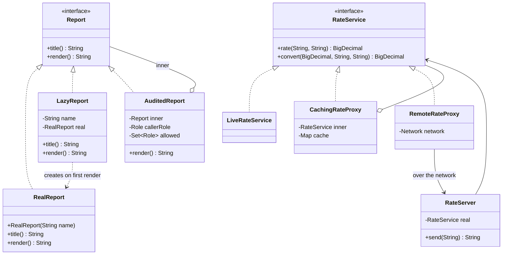

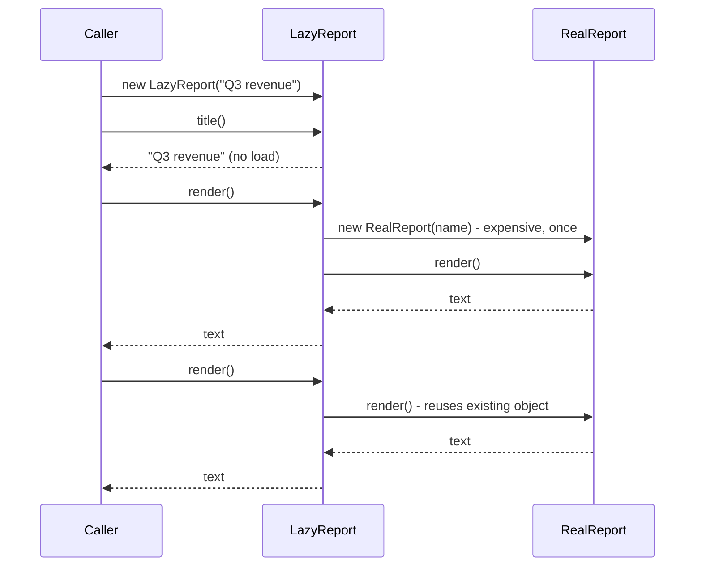

### Java example

```java
// File: code/lld/ch09/proxy/Report.java
package lld.ch09.proxy;

/** SUBJECT interface: callers only ever hold this type. */
interface Report {
    String title();
    String render();
}
```

```java
// File: code/lld/ch09/proxy/RealReport.java
package lld.ch09.proxy;

/** REAL SUBJECT: expensive constructor. */
final class RealReport implements Report {
    private final String name;
    private final int rows;

    RealReport(String name) {
        System.out.println("    [real] loading 100 MB of data for '" + name + "'...");
        this.name = name;
        this.rows = 1_000_000;
    }

    @Override public String title()  { return name; }
    @Override public String render() { return name + " (" + rows + " rows)"; }
}
```

```java
// File: code/lld/ch09/proxy/LazyReport.java
package lld.ch09.proxy;

/**
 * VIRTUAL PROXY: answers title() itself, builds the RealReport on first render().
 * Thread-safe lazy init with double-checked locking (field must be volatile).
 */
final class LazyReport implements Report {
    private final String name;
    private volatile RealReport real;      // created by the proxy itself, not handed in

    LazyReport(String name) { this.name = name; }

    @Override public String title() { return name; }   // no load needed

    @Override
    public String render() { return realReport().render(); }

    private RealReport realReport() {
        RealReport r = real;
        if (r == null) {
            synchronized (this) {
                r = real;
                if (r == null) real = r = new RealReport(name);
            }
        }
        return r;
    }
}
```

```java
// File: code/lld/ch09/proxy/Role.java
package lld.ch09.proxy;

enum Role { VIEWER, FINANCE, ADMIN }
```

```java
// File: code/lld/ch09/proxy/AuditedReport.java
package lld.ch09.proxy;

import java.util.Set;

/** PROTECTION PROXY: checks permission, may REFUSE the call. */
final class AuditedReport implements Report {
    private final Report inner;
    private final Role callerRole;
    private final Set<Role> allowed;

    AuditedReport(Report inner, Role callerRole, Set<Role> allowed) {
        this.inner = inner;
        this.callerRole = callerRole;
        this.allowed = Set.copyOf(allowed);
    }

    @Override public String title() { return inner.title(); }  // titles are public

    @Override
    public String render() {
        if (!allowed.contains(callerRole)) {
            throw new SecurityException(callerRole + " may not render " + inner.title());
        }
        return inner.render();
    }
}
```

```java
// File: code/lld/ch09/proxy/RateService.java
package lld.ch09.proxy;

import java.math.BigDecimal;
import java.math.RoundingMode;

/** Subject for the caching, remote and dynamic-proxy demos. Money and rates are BigDecimal, never double. */
interface RateService {
    BigDecimal rate(String from, String to);
    BigDecimal convert(BigDecimal amount, String from, String to);

    /** Shared rounding rule: amounts are returned to 2 decimal places. */
    static BigDecimal toMoney(BigDecimal value) { return value.setScale(2, RoundingMode.HALF_EVEN); }
}
```

```java
// File: code/lld/ch09/proxy/LiveRateService.java
package lld.ch09.proxy;

import java.math.BigDecimal;
import java.math.MathContext;
import java.util.Map;

/** Real subject: pretend each call is a slow lookup. */
class LiveRateService implements RateService {
    private static final Map<String, BigDecimal> PER_USD = Map.of(
            "USD", new BigDecimal("1"), "EUR", new BigDecimal("0.92"), "INR", new BigDecimal("83"));
    int lookups = 0;

    @Override
    public BigDecimal rate(String from, String to) {
        lookups++;
        return PER_USD.get(to).divide(PER_USD.get(from), MathContext.DECIMAL64);
    }

    @Override
    public BigDecimal convert(BigDecimal amount, String from, String to) {
        return RateService.toMoney(amount.multiply(rate(from, to)));   // self-call: goes to THIS object, not through any proxy
    }
}
```

```java
// File: code/lld/ch09/proxy/CachingRateProxy.java
package lld.ch09.proxy;

import java.math.BigDecimal;
import java.util.LinkedHashMap;
import java.util.Map;

/** CACHING PROXY: bounded (LRU) and time-limited, because an unbounded cache is a leak. */
final class CachingRateProxy implements RateService {
    private record CachedRate(BigDecimal value, long expiresAt) { }

    private final RateService inner;
    private final long ttlMillis;
    private final Map<String, CachedRate> cache;

    CachingRateProxy(RateService inner, int maxEntries, long ttlMillis) {
        this.inner = inner;
        this.ttlMillis = ttlMillis;
        this.cache = new LinkedHashMap<>(16, 0.75f, true) {   // access order = LRU
            @Override
            protected boolean removeEldestEntry(Map.Entry<String, CachedRate> eldest) {
                return size() > maxEntries;
            }
        };
    }

    @Override
    public synchronized BigDecimal rate(String from, String to) {
        String key = from + "->" + to;
        CachedRate e = cache.get(key);
        long now = System.currentTimeMillis();
        if (e != null && e.expiresAt() > now) return e.value();
        BigDecimal v = inner.rate(from, to);
        cache.put(key, new CachedRate(v, now + ttlMillis));
        return v;
    }

    @Override
    public BigDecimal convert(BigDecimal amount, String from, String to) {
        return RateService.toMoney(amount.multiply(rate(from, to)));
    }
}
```

```java
// File: code/lld/ch09/proxy/Network.java
package lld.ch09.proxy;

/*
 * REMOTE PROXY: looks like a local RateService, but marshals each call into a
 * message and sends it across a "network". Here the network is simulated in-process.
 */
interface Network {
    String send(String request);
}
```

```java
// File: code/lld/ch09/proxy/RateServer.java
package lld.ch09.proxy;

import java.math.BigDecimal;

/** Server side "skeleton": unmarshals the request and calls the real object. */
final class RateServer implements Network {
    private final RateService real;

    RateServer(RateService real) { this.real = real; }

    @Override
    public String send(String request) {                  // format: "rate|FROM|TO"
        String[] p = request.split("\\|");
        return real.rate(p[1], p[2]).toPlainString();       // BigDecimal -> exact text on the wire
    }
}
```

```java
// File: code/lld/ch09/proxy/RemoteRateProxy.java
package lld.ch09.proxy;

import java.math.BigDecimal;

/** Client side "stub" = the remote proxy. */
final class RemoteRateProxy implements RateService {
    private final Network network;

    RemoteRateProxy(Network network) { this.network = network; }

    @Override
    public BigDecimal rate(String from, String to) {
        String request = "rate|" + from + "|" + to;
        System.out.println("    [stub] sending '" + request + "' over the wire");
        return new BigDecimal(network.send(request));
    }

    @Override
    public BigDecimal convert(BigDecimal amount, String from, String to) {
        return RateService.toMoney(amount.multiply(rate(from, to)));
    }
}
```

```java
// File: code/lld/ch09/proxy/Device.java
package lld.ch09.proxy;

/** A heavyweight resource, e.g. a connection to a device. */
interface Device extends AutoCloseable {
    String query(String command);
    @Override void close();
}
```

```java
// File: code/lld/ch09/proxy/RealDevice.java
package lld.ch09.proxy;

final class RealDevice implements Device {
    RealDevice() { System.out.println("    [device] opened (expensive)"); }
    @Override public String query(String command) { return "ok:" + command; }
    @Override public void close() { System.out.println("    [device] closed"); }
}
```

```java
// File: code/lld/ch09/proxy/SharedDevice.java
package lld.ch09.proxy;

/**
 * SMART REFERENCE PROXY: reference counting. Each client gets its own handle (a proxy).
 * The real device opens on the first handle and closes when the LAST handle closes.
 * Thread-safe: every read or write of 'refs', 'real' and a handle's 'closed' flag
 * happens while holding the SharedDevice's lock, so the count can never go wrong.
 */
final class SharedDevice {
    private int refs;              // guarded by 'this'
    private RealDevice real;       // guarded by 'this'

    synchronized Device acquire() {
        if (refs++ == 0) real = new RealDevice();
        System.out.println("    [ref] handle acquired, count=" + refs);
        return new Handle();
    }

    private final class Handle implements Device {
        private boolean closed;    // guarded by SharedDevice.this

        @Override
        public String query(String command) {
            synchronized (SharedDevice.this) {
                if (closed) throw new IllegalStateException("handle already closed");
                return real.query(command);
            }
        }

        @Override
        public void close() {
            synchronized (SharedDevice.this) {
                if (closed) return;          // closing a handle twice must not double-decrement
                closed = true;
                refs--;
                System.out.println("    [ref] handle released, count=" + refs);
                if (refs == 0) {
                    real.close();
                    real = null;
                }
            }
        }
    }
}
```

```java
// File: code/lld/ch09/proxy/LoggingHandler.java
package lld.ch09.proxy;

import java.lang.reflect.InvocationHandler;
import java.lang.reflect.InvocationTargetException;
import java.lang.reflect.Method;
import java.lang.reflect.Proxy;
import java.util.Arrays;

/**
 * DYNAMIC PROXY: one InvocationHandler that logs calls on ANY interface.
 * java.lang.reflect.Proxy generates the implementing class at run time.
 */
final class LoggingHandler implements InvocationHandler {
    private final Object target;

    private LoggingHandler(Object target) { this.target = target; }

    @SuppressWarnings("unchecked")
    static <T> T wrap(T target, Class<T> iface) {
        return (T) Proxy.newProxyInstance(
                iface.getClassLoader(), new Class<?>[] {iface}, new LoggingHandler(target));
    }

    @Override
    public Object invoke(Object proxy, Method method, Object[] args) throws Throwable {
        String call = method.getName() + (args == null ? "()" : Arrays.toString(args));
        System.out.println("    [proxy] -> " + call);
        try {
            Object result = method.invoke(target, args);   // forward to the real object
            System.out.println("    [proxy] <- " + call + " returned " + result);
            return result;
        } catch (InvocationTargetException e) {
            throw e.getCause();          // rethrow the real exception, not the reflection wrapper
        }
    }
}
```

```java
// File: code/lld/ch09/proxy/Main.java
package lld.ch09.proxy;

import java.lang.reflect.Proxy;
import java.math.BigDecimal;
import java.util.Set;

public class Main {
    public static void main(String[] args) {
        System.out.println("== Virtual proxy: pay only when needed ==");
        Report report = new LazyReport("Q3 revenue");
        System.out.println("  created proxy; title = " + report.title());
        System.out.println("  render #1 -> " + report.render());
        System.out.println("  render #2 -> " + report.render());

        System.out.println("== Protection proxy wrapping the virtual proxy ==");
        Set<Role> allowed = Set.of(Role.FINANCE, Role.ADMIN);
        Report forFinance = new AuditedReport(new LazyReport("Payroll"), Role.FINANCE, allowed);
        Report forViewer = new AuditedReport(new LazyReport("Payroll"), Role.VIEWER, allowed);
        System.out.println("  finance -> " + forFinance.render());
        try {
            forViewer.render();
        } catch (SecurityException e) {
            System.out.println("  viewer  -> refused: " + e.getMessage() + " (nothing was loaded)");
        }

        System.out.println("== Caching proxy (LRU, max 2 entries, 60 s TTL) ==");
        LiveRateService live = new LiveRateService();
        RateService cached = new CachingRateProxy(live, 2, 60_000);
        cached.rate("USD", "EUR");
        cached.rate("USD", "EUR");
        cached.rate("USD", "INR");
        cached.rate("EUR", "INR");   // evicts USD->EUR (least recently used)
        cached.rate("USD", "EUR");
        System.out.println("  5 calls, real lookups = " + live.lookups);

        System.out.println("== Remote proxy (stub) ==");
        RateService remote = new RemoteRateProxy(new RateServer(new LiveRateService()));
        System.out.println("  100 USD = " + remote.convert(new BigDecimal("100"), "USD", "INR") + " INR");

        System.out.println("== Smart reference (reference counting) ==");
        SharedDevice printer = new SharedDevice();
        try (Device a = printer.acquire(); Device b = printer.acquire()) {
            System.out.println("  a -> " + a.query("status") + ", b -> " + b.query("print"));
        }

        System.out.println("== Dynamic proxy: one handler, any interface ==");
        Report loggedReport = LoggingHandler.wrap(new LazyReport("Q4 plan"), Report.class);
        loggedReport.title();
        loggedReport.render();
        RateService loggedRates = LoggingHandler.wrap(new LiveRateService(), RateService.class);
        loggedRates.convert(new BigDecimal("100"), "USD", "EUR");
        System.out.println("  ^ convert() called rate() on 'this', so the inner rate() call was NOT logged");
        System.out.println("  generated at run time: isProxyClass = "
                + Proxy.isProxyClass(loggedRates.getClass()));
    }
}
```

**Output:**

```text
== Virtual proxy: pay only when needed ==
  created proxy; title = Q3 revenue
    [real] loading 100 MB of data for 'Q3 revenue'...
  render #1 -> Q3 revenue (1000000 rows)
  render #2 -> Q3 revenue (1000000 rows)
== Protection proxy wrapping the virtual proxy ==
    [real] loading 100 MB of data for 'Payroll'...
  finance -> Payroll (1000000 rows)
  viewer  -> refused: VIEWER may not render Payroll (nothing was loaded)
== Caching proxy (LRU, max 2 entries, 60 s TTL) ==
  5 calls, real lookups = 4
== Remote proxy (stub) ==
    [stub] sending 'rate|USD|INR' over the wire
  100 USD = 8300.00 INR
== Smart reference (reference counting) ==
    [device] opened (expensive)
    [ref] handle acquired, count=1
    [ref] handle acquired, count=2
  a -> ok:status, b -> ok:print
    [ref] handle released, count=1
    [ref] handle released, count=0
    [device] closed
== Dynamic proxy: one handler, any interface ==
    [proxy] -> title()
    [proxy] <- title() returned Q4 plan
    [proxy] -> render()
    [real] loading 100 MB of data for 'Q4 plan'...
    [proxy] <- render() returned Q4 plan (1000000 rows)
    [proxy] -> convert[100, USD, EUR]
    [proxy] <- convert[100, USD, EUR] returned 92.00
  ^ convert() called rate() on 'this', so the inner rate() call was NOT logged
  generated at run time: isProxyClass = true
```

**What each part does**

- `LazyReport` — **virtual proxy**. `title()` is answered locally; `render()` creates the `RealReport` on first use. The "loading" line appears **once**, only at the first render.
- **Thread-safe lazy init.** Without care, two threads calling `render()` at the same time both build the expensive object (harmless for a report, but a real bug if construction opens a connection or charges a card). We use **double-checked locking**; the field **must be `volatile`** so a second thread never sees a half-constructed object.
- `AuditedReport` — **protection proxy**, wrapping a virtual proxy. The viewer is refused **before** anything is loaded — notice no second "loading 'Payroll'" line for the viewer.
- `RateService` works in `BigDecimal` — rates and money are never `double` — and `convert` rounds to 2 decimal places (`HALF_EVEN`).
- `CachingRateProxy` — **caching proxy**, **bounded** (LRU via `LinkedHashMap` in access order with `removeEldestEntry`) and **time-limited** (TTL). 5 calls → 4 real lookups: the second USD→EUR is a hit, the last one is a miss because it was evicted.
- `RemoteRateProxy` + `RateServer` — **remote proxy** (client "stub") and server "skeleton". The caller just calls `convert`; the stub turns it into a message and sends it over a (simulated) network.
- `SharedDevice` — **smart reference**. Each `acquire()` returns a lightweight handle proxy; the real device opens with the first handle and closes when the last handle closes. All bookkeeping (`refs`, `real`, each handle's `closed` flag) happens under the `SharedDevice` lock, and `close()` is idempotent, so concurrent or double closes can't corrupt the count.
- `LoggingHandler` — a **dynamic proxy** (next section).

### Static vs dynamic proxies

| | **Static proxy** | **Dynamic proxy** |
|---|---|---|
| How it's made | You hand-write a class per interface (`LazyReport`, `CachingRateProxy`) | Generated at **run time** from an interface list + a handler |
| Code per interface | One proxy class each; every method written out | One `InvocationHandler` for **any** interface |
| Type safety | Full; compiler checks each method | Calls arrive as `Method` + `Object[]` — reflective, less checked |
| Good for | Logic specific to one type (lazy load, access rules for a domain object) | **Cross-cutting concerns** on many types: logging, timing, transactions, security |
| JDK API | — | `java.lang.reflect.Proxy.newProxyInstance(loader, interfaces, handler)` |
| Limitation | Boilerplate | JDK proxies work **only for interfaces**; class-based proxies need bytecode libraries (CGLIB, ByteBuddy) |

How the JDK dynamic proxy works:

1. `Proxy.newProxyInstance(classLoader, new Class<?>[]{Report.class}, handler)` generates a class (named like `$Proxy0`) that implements `Report`.
2. **Every** method call on that object is routed to `handler.invoke(proxy, method, args)`.
3. The handler does its extra work and calls `method.invoke(target, args)` to forward.
4. If the target throws, reflection wraps it in `InvocationTargetException` — **unwrap it** (`e.getCause()`) so callers see the real exception.

### The self-invocation trap (and Spring AOP)

Look at the last lines of the proxy output: we called `convert` through the logging proxy, and `convert` internally called `rate(...)` on **`this`** — the real object — so that inner call **bypassed the proxy** and was never logged.

This is exactly how **Spring AOP** behaves:

- Spring implements `@Transactional`, `@Cacheable`, `@Async`, `@PreAuthorize` and custom `@Aspect` advice by wrapping your bean in a **proxy**. Callers get the proxy injected, not your object.
- Spring uses a **JDK dynamic proxy** when the target implements at least one interface, and a **CGLIB** subclass proxy otherwise (or when `proxyTargetClass = true`; Spring Boot 2.0+ defaults to CGLIB class-based proxies).
- **Self-invocation is not intercepted**: if `placeOrder()` calls `this.saveAudit()` which is `@Transactional(propagation = REQUIRES_NEW)`, the annotation is silently ignored because the call never leaves the object.
- With CGLIB proxies, **`final` classes cannot be proxied and `final`/`private` methods cannot be advised**.
- Fixes, in order of preference: move the method into another bean; inject the bean's own proxy (e.g. a lazily injected self-reference); or (discouraged) `AopContext.currentProxy()`, which also requires `exposeProxy = true`. AspectJ weaving (compile- or load-time) avoids the problem because it doesn't use proxies.

### Proxy vs Decorator

This is the hardest pair in the catalogue to tell apart: both implement an interface, hold another object of that interface and forward calls to it. GoF itself says the implementations can be similar and that the difference is **purpose**: a decorator *adds responsibilities*, a proxy *controls access*.

| | **Proxy** | **Decorator** |
|---|---|---|
| Purpose | **Controls access** to the object | **Adds behaviour** around the object |
| Does the call get through? | Not necessarily — may defer, cache or refuse | Normally yes — the added work runs around a forwarded call |
| Who creates / finds the real object? | **Often the proxy itself** (`LazyReport` builds `RealReport`; a remote proxy only knows an address) | **The caller**, who hands it in |
| Does the client know it has a wrapper? | Usually not — a factory/DI container hands it the proxy as if it were the real object | Usually yes — the client (or its configuration) builds the stack |
| How many layers? | Usually one | Often several, stacked recursively on purpose |

The **creation test** is the most practical, because you can check it in the constructor: `LazyReport(String name)` builds its own subject; `LoggingRepository(UserRepository inner)` is given an existing one. A protection proxy such as `AuditedReport` *is* handed its subject, and is structurally identical to a decorator — there, only intent separates them. A caching wrapper genuinely sits on the line — both names are defensible — so the more useful question in review is whether its cache is bounded and invalidated.

### Where proxies go wrong

- **Unsynchronised lazy creation** — two threads call `render()` together and both construct the expensive object: sometimes harmless, sometimes a duplicate connection or a double charge.
- **A caching proxy with no size limit or expiry** — a caching proxy *is* a cache, and every cache needs a bound and an invalidation story; without them it leaks memory and serves stale data. (Ours has both.)
- **Concealing a real cost** — a remote proxy that looks local tempts callers to use it inside loops. Network calls disguised as field access cause some of the nastiest distributed-system performance bugs; the cure is usually to make the cost visible again (batch APIs, explicit `fetch...` names), not to tune the proxy.
- **ORM N+1 queries** — iterating 100 orders and touching `order.getCustomer().getName()` fires one query per lazy proxy.

### Trade-offs

| Pros | Cons |
|---|---|
| **Pay later** — costly construction happens only if something needs it. | **Extra indirection**; stack traces show the proxy, not the real class. |
| **No caller changes** — the interface is identical (Open/Closed). | **Latency and failures are disguised** as an ordinary method call. |
| **Somewhere to put cross-cutting rules** for a class you cannot edit. | **Lazy creation brings a thread-safety question** that is easy to get wrong. |
| **Permission checks stay outside the object**, which keeps to its own job. | **A cache with no eviction** leaks memory and returns stale data. |

### When not to use it

- **The real object is cheap** — making something small lazy only adds a null check to every call.
- **Callers need to see the cost** — sometimes the honest interface is a method literally named `fetchOverNetwork()`.
- **The framework already generates one** — ORMs, DI containers and service meshes create proxies; stacking a hand-written one on top of those just doubles the hidden behaviour.
- **You mean to add behaviour, not guard access** — that is a Decorator.

### Common mistakes

- Non-`volatile` field in double-checked locking.
- Forgetting to unwrap `InvocationTargetException` in a dynamic proxy.
- Expecting Spring annotations to work on self-calls, `private` methods or `final` methods.
- Unbounded caching proxies.
- Using a remote proxy in a tight loop.

### Real-world examples

- **ORM lazy loading** (Hibernate/JPA, also Entity Framework and Django) — `entityManager.getReference(...)` and lazy associations return proxy objects; the SQL runs the first time you touch a non-id field. The most widely used virtual proxy — and the source of the N+1 problem and, in Hibernate, `LazyInitializationException` when the session is already closed.
- **Spring AOP** — `@Transactional`, `@Cacheable`, `@Async`, method security: all proxies. Spring's `@Configuration` classes are also CGLIB-enhanced subclasses so that calling one `@Bean` method from another returns the container's singleton (unless `proxyBeanMethods = false`).
- **Remote stubs** — Java RMI stubs, gRPC and Thrift generated clients, SOAP clients: a network call behind an ordinary method.
- **`java.lang.reflect.Proxy`** — JDK support for dynamic proxies (used by many frameworks, e.g. Spring Data repositories and MyBatis mappers are interfaces whose implementations are generated proxies).
- **`Collections.unmodifiableList`** — a protection proxy that refuses mutation (also seen as a decorator).
- **Service meshes / sidecars** (Envoy in Istio) — intercept traffic for retries, mTLS and telemetry: the proxy idea at infrastructure level. **Reverse proxies / CDNs** (Nginx, Cloudflare) cache and protect origin servers.
- **C++ `shared_ptr`** — a smart-reference proxy doing reference counting.

### In modern languages

- **Java**: `java.lang.reflect.Proxy`, plus bytecode generation (CGLIB, ByteBuddy) for classes.
- **JavaScript/TypeScript**: built-in `Proxy` intercepts property access and calls.
- **Python**: `__getattr__` forwards anything not defined locally, so a proxy only writes the methods it intercepts; `functools.cached_property` is a virtual proxy for one field.
- **C#**: `DispatchProxy`, and `Lazy<T>` — a virtual proxy for one value.
- **C++**: `std::shared_ptr` and other smart pointers are smart-reference proxies that count references behind `operator->`.

### Other patterns it is confused with

| Looks like | Actual difference |
|---|---|
| Decorator | Same structure; see the table above. Decorator adds behaviour to an object it is handed; Proxy controls access and often creates or locates the real object itself. |
| Adapter | An Adapter has a **different** interface on purpose — it exists to translate. A Proxy has the **same** interface — it exists to substitute. |
| Facade | A Facade offers a new, simpler interface over **several** objects. A Proxy offers the same interface over **one**. |
| A cache | A caching proxy is a cache with a proxy's shape. Calling it a proxy does not remove the need to design its size bound and eviction. |

### In the interview

**30-second answer:** "A Proxy is a stand-in with the same interface as the real object that controls access to it. I'd name the kind: a virtual proxy defers expensive creation, a protection proxy checks permissions, a remote proxy hides the network, a caching proxy reuses results, and a smart reference does bookkeeping like reference counting. Because the interface is identical, callers don't change — which is also the danger, since an expensive call looks cheap. Lazy creation needs thread safety, and ORM lazy-loading proxies are the classic source of N+1 queries. In Java I'd use `java.lang.reflect.Proxy` for cross-cutting concerns; that's how Spring AOP implements `@Transactional`."

**Follow-ups**

- *Q: Proxy vs Decorator?* — A: Proxy controls access and often creates the real object; Decorator adds behaviour to an object handed to it and normally forwards every call. Check the constructor.
- *Q: Make the virtual proxy thread-safe.* — A: Double-checked locking with a `volatile` field (as in `LazyReport`), or simply make the getter `synchronized` if contention is low. (The static holder-class idiom only works for a *static* lazy field, so it does not fit a per-instance proxy.)
- *Q: Why doesn't `@Transactional` work when I call the method from the same class?* — A: Spring's proxy only intercepts calls that come through the proxy; `this.method()` goes straight to the target.
- *Q: JDK proxy vs CGLIB?* — A: JDK proxies implement interfaces only; CGLIB creates a subclass, so it works without interfaces but can't handle `final` classes/methods.
- *Q: How does lazy loading cause N+1?* — A: Loading N parents and then touching each parent's lazy child proxy triggers N extra queries; fix with fetch joins / entity graphs / batch fetching.

### Self-check

1. **Q:** Which proxy kind is `LazyReport`? `AuditedReport`? **A:** Virtual; protection.
2. **Q:** Why is the field in `LazyReport` `volatile`? **A:** So double-checked locking is safe — other threads see a fully constructed object.
3. **Q:** In the dynamic proxy demo, why wasn't the inner `rate()` call logged? **A:** `convert()` called `rate()` on `this` (the real object), bypassing the proxy — the self-invocation trap.
4. **Q:** Can `java.lang.reflect.Proxy` proxy a class with no interface? **A:** No; it needs interfaces. Use CGLIB/ByteBuddy for classes.
5. **Q:** What two properties must a caching proxy have? **A:** A size bound (eviction) and an invalidation/expiry policy.

### TL;DR

- **Same interface, controlled access.** Virtual, protection, remote, caching, logging, smart reference.
- **Static** = hand-written per interface; **dynamic** = `java.lang.reflect.Proxy` + `InvocationHandler` for any interface.
- Spring AOP = proxies → beware self-invocation, `final`, `private`. Watch thread safety and hidden costs.

---

## 9.8 Putting it all together — comparison

### Summary of all seven structural patterns

| Pattern | Distinctive feature | Use it when | Example | Pros | Cons |
|---|---|---|---|---|---|
| **Adapter** | Bridges incompatible interfaces | You must use an existing class whose interface doesn't fit your code | Travel plug adapter; `StripeGateway` | Interoperability; reuse of existing code | Extra class and complexity |
| **Bridge** | Separates abstraction from implementation | Two dimensions vary independently; avoid permanent binding | UI shapes × platform renderers; notifications × channels | Both sides vary independently; scales by addition | More concepts up front; indirection |
| **Composite** | Part-whole tree with one interface | Treat single objects and groups uniformly | Drawing editor with shapes and groups; file system | Simpler client code; easy to add node types | Interface can become over-general |
| **Decorator** | Adds responsibilities dynamically | Extend an object's behaviour at run time, in combinations | Adding scrolling/border to a text view; Java I/O | More flexible than subclassing; no feature-bloated classes | Many small objects; hard to debug; order matters |
| **Facade** | Simple interface to a complex subsystem | Most callers need one common path through many classes | Home-theatre "watch movie" button; `OrderFacade` | Simplifies use; fewer dependencies | Can become a god object or single point of failure |
| **Flyweight** | Shares common state among many objects | Huge numbers of similar objects with little variation | Characters in a word processor; map markers | Big memory savings | Complexity; managing shared immutable state |
| **Proxy** | Placeholder that controls access | Lazy loading, access control, remote, caching, logging, smart reference | Internet proxy server; Hibernate lazy entity | Controls access; defers costly work | Indirection; hidden latency |

### Adapter vs Decorator vs Proxy vs Facade vs Bridge

| | **Adapter** | **Decorator** | **Proxy** | **Facade** | **Bridge** |
|---|---|---|---|---|---|
| **Intent** | Convert an interface to the one the client expects | Add behaviour without changing the interface | Control access to an object | Simplify a complex subsystem | Let abstraction and implementation vary independently |
| **Interface seen by client** | **Different** from the wrapped object's (it's yours) | **Same** as wrapped | **Same** as real subject | **New, simpler** interface | Abstraction's own interface |
| **Behaviour** | Unchanged (translated) | **Extended** | Unchanged but **controlled** (may defer/cache/refuse) | Unchanged (fewer calls) | Delegated to implementor |
| **Objects wrapped** | One | One (stackable) | One | **Several** | One implementor (by reference) |
| **Who creates the wrapped object** | Usually passed in | Passed in by client | **Often the proxy itself** | Passed in / owned | Passed in at construction |
| **Structure** | Implements Target, holds Adaptee | IS-A and HAS-A Component | IS-A Subject, HAS-A Real Subject | HAS-A many subsystem objects | Abstraction HAS-A Implementor; two hierarchies |
| **When introduced** | **After the fact**, to make existing things fit | Any time a concern is added | Any time access needs controlling | When callers repeat a multi-step sequence | **Up front**, before the class explosion |
| **Typical trigger** | "The vendor API doesn't match ours" | "Sometimes we need logging, sometimes caching, sometimes both" | "It's expensive / remote / restricted" | "Every caller copies these 5 steps" | "Class names with two nouns" |
| **JDK / framework example** | `Arrays.asList`, `InputStreamReader` | `BufferedInputStream`, `Collections.synchronizedList` | `java.lang.reflect.Proxy`, Spring `@Transactional`, Hibernate lazy load | SLF4J `LoggerFactory`, service layers | JDBC `Connection` + drivers, AWT peers |

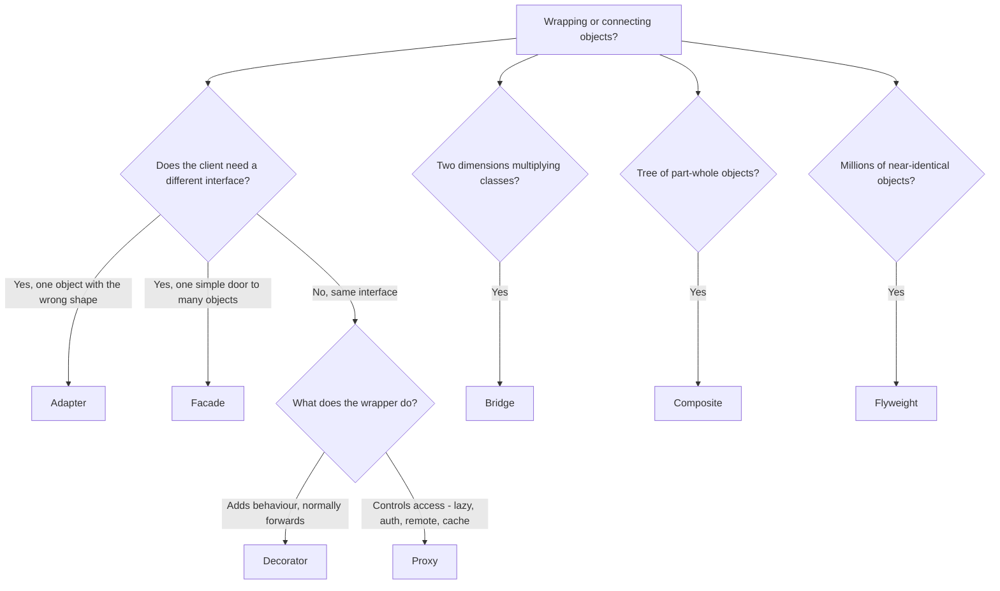

### Memory hooks

- **Adapter** — *"make it fit"* (changes the interface).
- **Decorator** — *"add to it"* (same interface, more behaviour, stackable).
- **Proxy** — *"guard it"* (same interface, controlled access).
- **Facade** — *"simplify it"* (one door, many rooms).
- **Bridge** — *"split it"* (two hierarchies, add instead of multiply).
- **Composite** — *"nest it"* (one interface for leaf and tree).
- **Flyweight** — *"share it"* (intrinsic shared, extrinsic passed in).

### Chapter self-check

1. **Q:** Which of these patterns wrap exactly one object? **A:** Adapter, Decorator, Proxy (Bridge also holds one implementor, but by design rather than as a wrapper). Facade wraps several; Composite holds many children.
2. **Q:** Which two have identical code shape but differ in intent and timing? **A:** Adapter and Bridge (after-the-fact vs up-front); also Bridge and Strategy; also Decorator and Proxy.
3. **Q:** A wrapper returns cached results with the same interface. Decorator or Proxy? **A:** Either is defensible; the important question is whether the cache is bounded and invalidated.
4. **Q:** You have `WindowsButton`, `MacButton`, `WindowsCheckbox`, `MacCheckbox`… and a Linux port is coming. Which pattern? **A:** Bridge (widget abstraction × platform implementor) — often combined with Abstract Factory to pick the implementor.
5. **Q:** Which pattern explains why `Integer.valueOf(100) == Integer.valueOf(100)` is true? **A:** Flyweight (Integer cache).

### Chapter TL;DR

- Structural patterns **compose objects into bigger structures** while keeping them flexible.
- **Adapter / Decorator / Proxy / Facade** share a shape; tell them apart by **what changes as the call passes through** and **how many objects are wrapped**.
- **Bridge** prevents class explosion across two dimensions; **Composite** makes trees uniform; **Flyweight** shares immutable state to save memory.
- In interviews: name the pattern, state the **constraint** that justifies it, name its **trap** (vendor leaks, wrong split, cycles, decorator order, god facade, mutable flyweight, self-invocation), and give a **real JDK/Spring example**.
