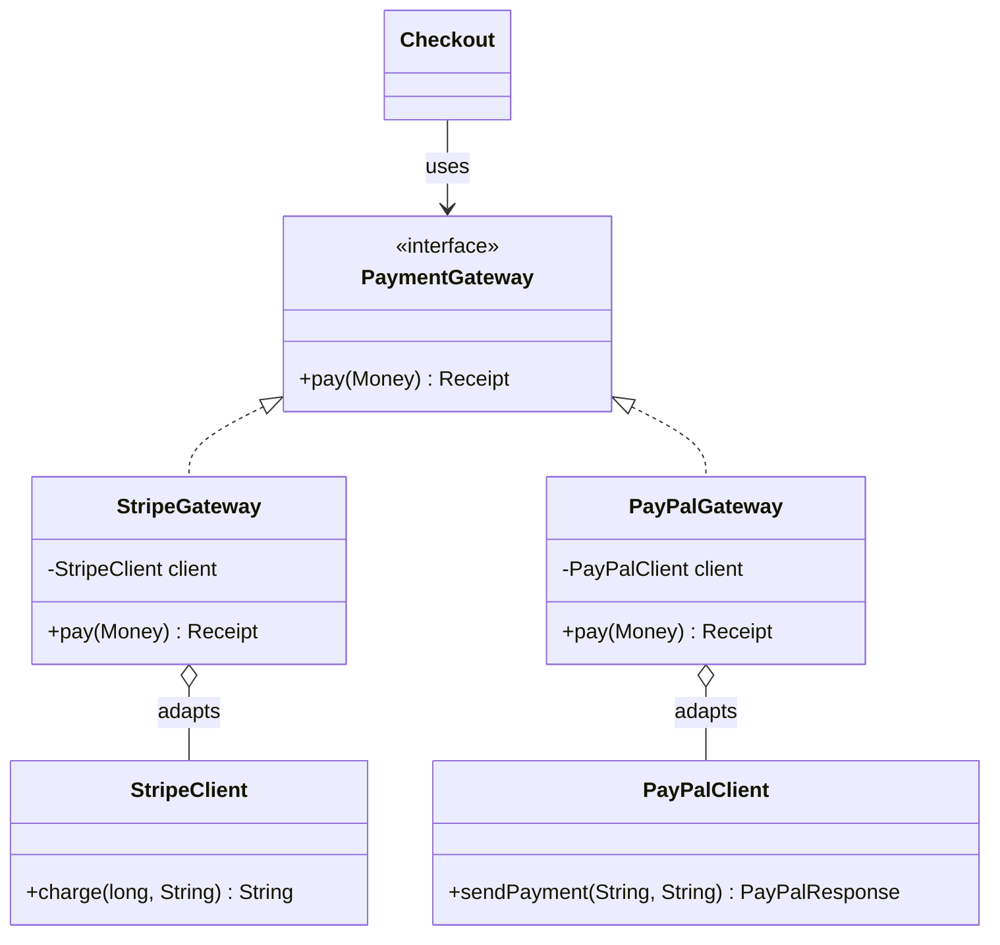
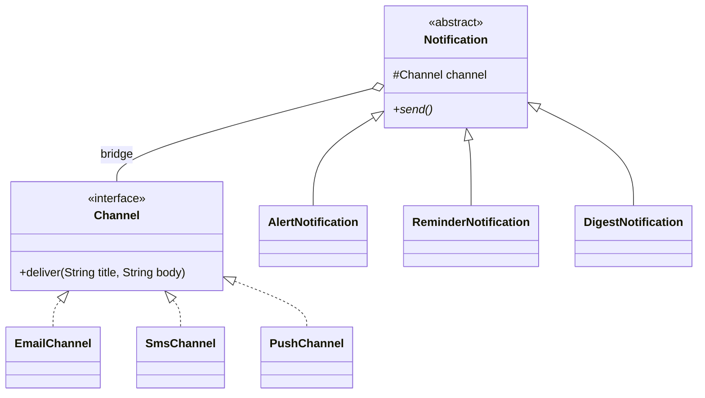
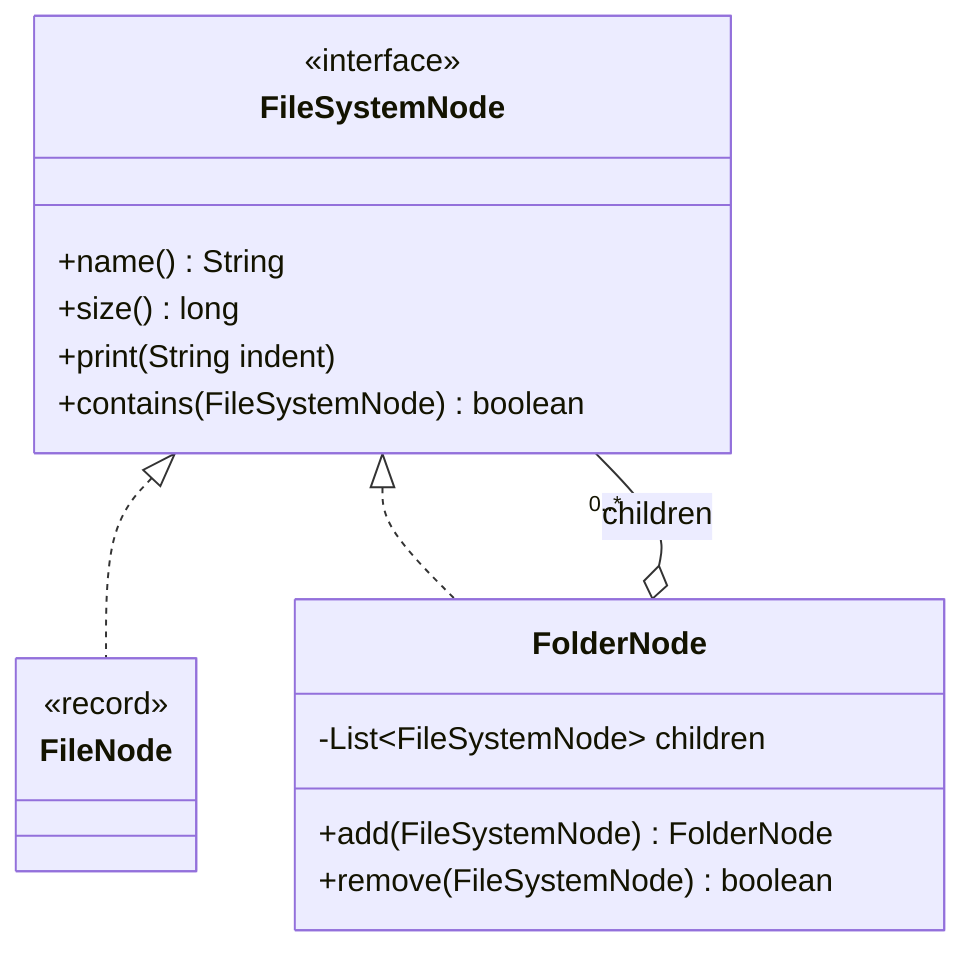
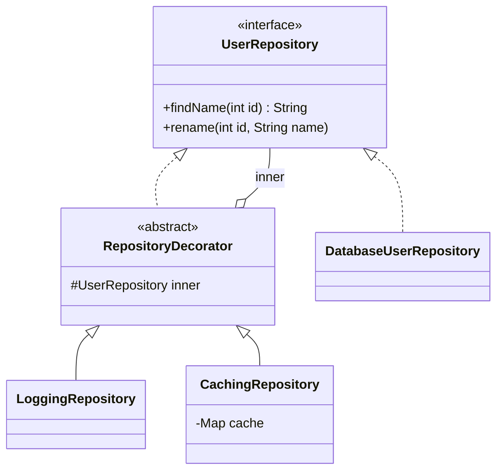
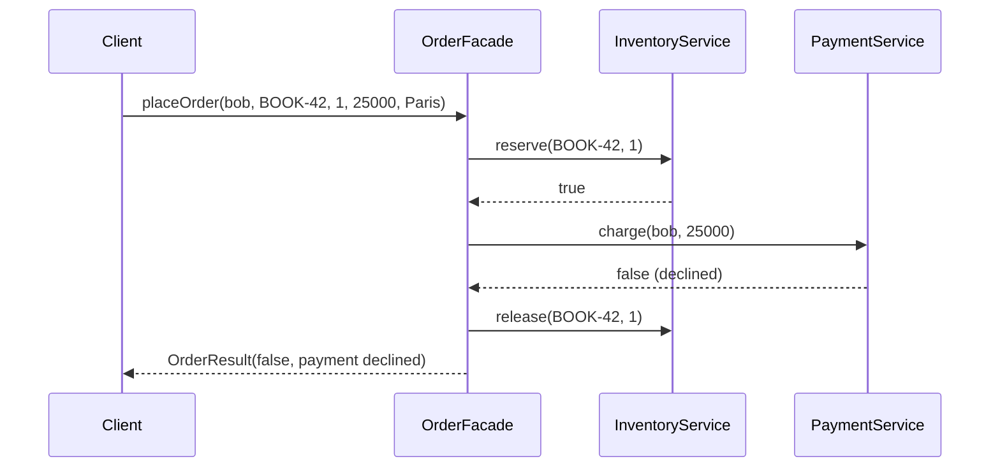
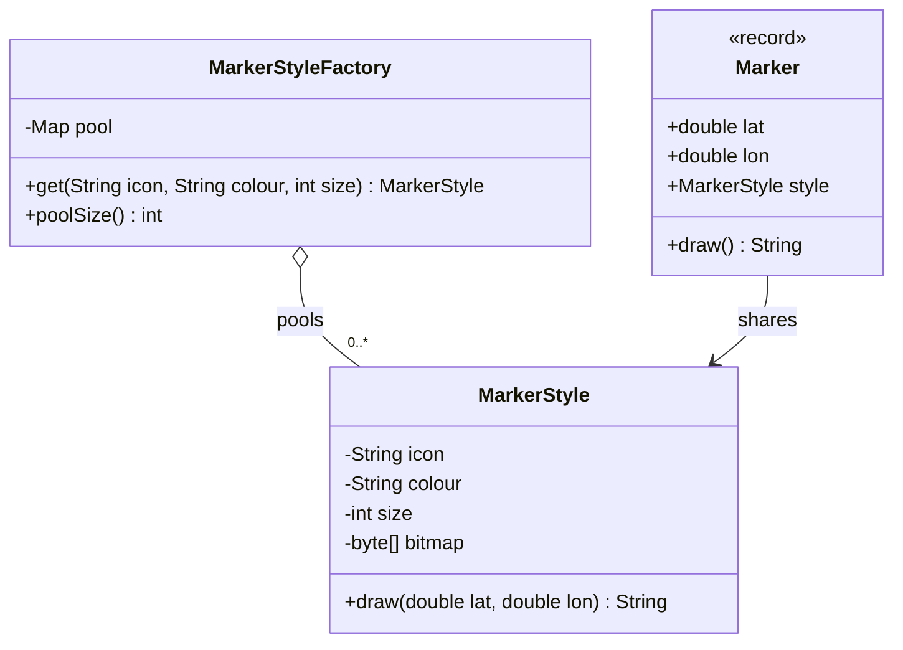
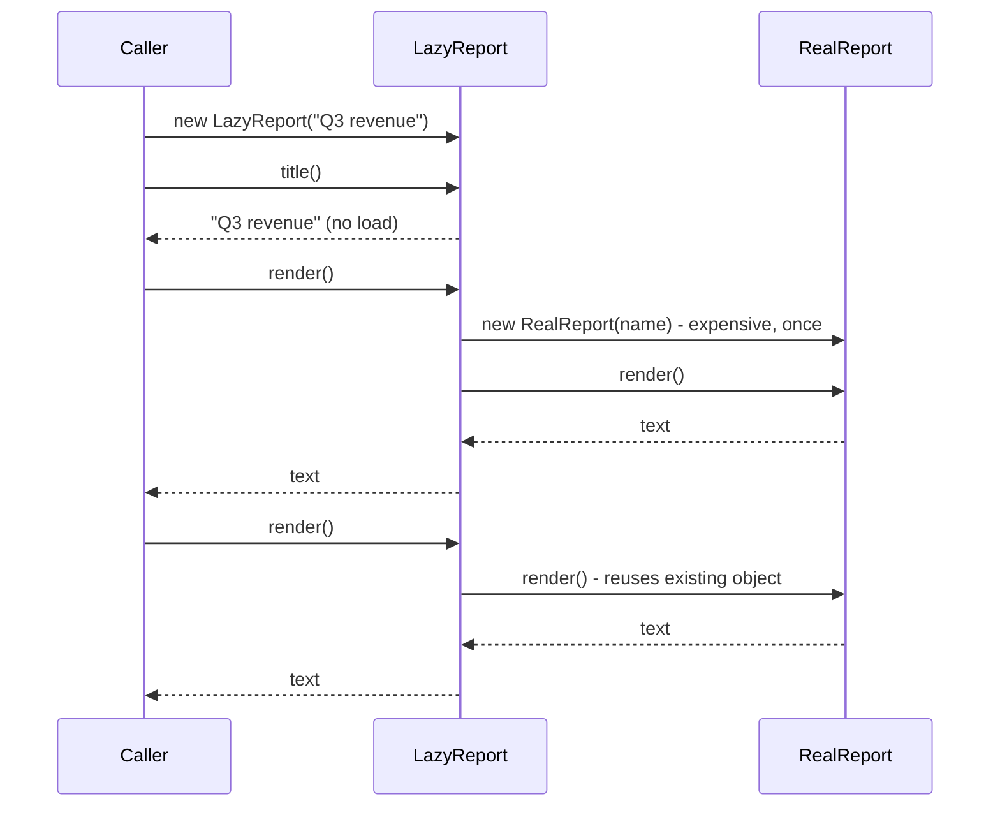
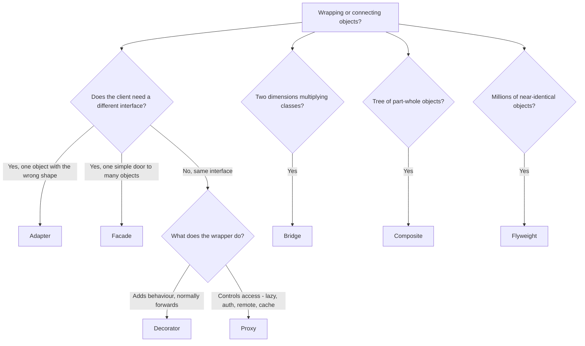

# Chapter 9 — Structural Design Patterns (Study Edition)

> **Study Edition.** A shorter version of Chapter 9: every pattern and sub-topic is kept, the padding is removed. The full chapter (README.md) has every source file and full outputs.
>
> **Where this fits.** Chapter 8 was about *creating* objects; this chapter is about *putting objects together* — connecting, wrapping, nesting and sharing them. Chapters 10–11 cover how objects *talk* (behavioral patterns).

| # | Pattern | One-line intent | Analogy |
|---|---|---|---|
| 9.1 | Adapter | Translate a class's interface into the one your code uses | Travel plug adapter |
| 9.2 | Bridge | Split two independently varying dimensions into two hierarchies joined by a reference | TV remote and TV sold separately |
| 9.3 | Composite | Treat one object and a tree of objects the same way | Folders hold files and folders |
| 9.4 | Decorator | Add behaviour to one object at run time by wrapping it | Coffee toppings |
| 9.5 | Facade | One simple entry point to a complicated subsystem | Hotel concierge |
| 9.6 | Flyweight | Share the repeating part of many objects to save memory | One glyph "e" reused on every page |
| 9.7 | Proxy | Same-interface stand-in that controls access | Receptionist guarding the manager |
| 9.8 | Comparison | Adapter vs Decorator vs Proxy vs Facade vs Bridge | — |

**Run:** `cd chapters/09-patterns-structural/code && javac --release 21 -d /tmp/lld_09 $(find . -name '*.java') && java -cp /tmp/lld_09 lld.ch09.adapter.Main` (or `bridge`, `composite`, `decorator`, `facade`, `flyweight`, `proxy`). All seven compile with zero warnings under `-Xlint:all`; each top-level type has its own file and is package-private.

---

## 9.0 What structural patterns are

### What it is

The GoF's 23 patterns fall into three families: **Creational** (Ch. 8 — how to create objects), **Structural** (this chapter — how to combine classes and objects into bigger structures) and **Behavioral** (Ch. 10–11 — how objects share work and talk). Structural patterns **simplify complex structures** (Facade, Composite), **promote reuse** (Adapter), **improve flexibility by decoupling** (Bridge, Decorator, Proxy) and **improve maintainability** (clear relationships, local changes). The seven GoF structural patterns: **Adapter, Bridge, Composite, Decorator, Facade, Flyweight, Proxy**.

### Three words you need first

- **Composition** ("has-a") — an object holds and uses another; almost every structural pattern is built on it.
- **Delegation** — forwarding a call to the held object (`wrapper.pay()` calls `inner.charge()`).
- **Interface** (design sense) — the methods a caller can use on an object.

> **Key insight.** Adapter, Decorator, Proxy and Facade have the *same physical shape* — one object holds another and forwards calls. What separates them is **intent**: what changes as the call passes through (9.8).

---

## 9.1 Adapter Pattern

### What it is

**Adapter** lets your code use a class whose methods have the "wrong" shape — one you can't change — through a small translator. GoF intent: *convert the interface of a class into another interface clients expect.* Also called **Wrapper**. Analogy: a travel plug adapter.

| Role | Meaning | Ours |
|---|---|---|
| **Target** | Interface your code wants | `PaymentGateway` |
| **Adaptee** | Existing class with the wrong interface (usually not yours) | `StripeClient` |
| **Adapter** | Implements Target, translates to Adaptee | `StripeGateway` |
| **Client** | Uses the Target | `checkout` |

### The problem it solves

Checkout wants `pay(Money)`; the SDK offers `charge(amountInCents, currencyCode)` (or XML vs JSON, `track(String, Map)` vs your `Event`). **The other side isn't yours to change** — a vendor, another team, many existing callers. Stripe wants integer **cents** + **lowercase** currency; PayPal wants a **decimal string** "42.50" + **uppercase**; your code wants to think in `Money`.

### How it works

1. **Target interface in your vocabulary** (`PaymentGateway.pay(Money) -> Receipt`), no vendor names.
2. **One adapter per adaptee**, implementing the Target and **holding** the vendor object.
3. **Translate inputs**, 4. **call the adaptee**, 5. **translate outputs and errors back** (vendor exception → your exception).
6. **Clients depend only on the Target.**

> **The rule:** the adapter's public methods mention **only your types** — parameters, returns *and* exceptions. Let a `StripeCardException` escape and callers depend on Stripe again.

### Structure


*Figure — Adapter class diagram: `Checkout` holds a `PaymentGateway`; `StripeGateway` and `PayPalGateway` implement it and each wrap a vendor client, shown in grey because we do not own them (course diagram)*



### Java example

```java
/** TARGET interface: the shape our application wants to talk to. */
interface PaymentGateway {
    Receipt pay(Money amount);
}

/** OBJECT ADAPTER: implements our interface, HOLDS the vendor object (composition). */
final class StripeGateway implements PaymentGateway {
    private final StripeClient client;

    StripeGateway(StripeClient client) { this.client = client; }

    @Override
    public Receipt pay(Money amount) {
        try {
            String chargeId = client.charge(amount.cents(), amount.currency().toLowerCase(Locale.ROOT));
            return new Receipt(chargeId, "SUCCEEDED");
        } catch (StripeCardException e) {               // translate the vendor's error too
            throw new PaymentFailedException("Stripe declined: " + e.getMessage(), e);
        }
    }
}
```

`Money` (a record that upper-cases the currency once), `Receipt` and `PaymentFailedException` are *our* vocabulary. `PayPalGateway` does a different translation (`Money.asDecimal()` → "42.50"; `"approved"` → `"SUCCEEDED"`). `checkout(gateway, amount)` has no `if (stripe)` branch. The output shows `charge(4250, "usd")`, `sendPayment("42.50", "USD")`, and a declined Stripe charge reaching the client as `payment failed -> Stripe declined: card_declined` — *our* error type.

Full runnable code: code/lld/ch09/adapter/ (see the Full Edition).

### Object adapter vs class adapter

| | **Object adapter** (composition) | **Class adapter** (inheritance) |
|---|---|---|
| How | *Holds* an adaptee, implements Target | *Extends* the adaptee, implements Target |
| Ours | `StripeGateway`, `PayPalGateway` | `ThermometerClassAdapter extends LegacyFahrenheitThermometer implements CelsiusSensor` |
| Adaptee `final`? | Works | **Fails** (our `StripeClient` is final) |
| Adapts adaptee + subclasses? | Yes | No — bound at compile time |
| Override adaptee behaviour? | Harder | Yes |
| Leaks adaptee API? | No | **Yes** (`readFahrenheit()` stays public) |
| Java constraint | none | Target must be an **interface** (no multiple class inheritance) |

**Prefer the object adapter** (composition, works with `final`, no unwanted methods).

### Two-way adapter

Implements **both** interfaces so clients of either side can use one object — `TwoWayTemperatureAdapter implements CelsiusSensor, FahrenheitSensor`: new code sees `100.0C`, old code `212.0F`. Handy during **migrations**.

### Adapter vs Facade vs Decorator vs Proxy (quick view)

| Pattern | Interface | Behaviour |
|---|---|---|
| **Adapter** | **Translated** | Same work, re-expressed |
| **Decorator** | Same | **Extended** |
| **Proxy** | Same | Same work, **gated** (defer, cache, refuse) |
| **Facade** | **Replaced** by one simpler one over many | Same work, fewer calls |

Test: *adapters exist because someone else picked the interface* — if the vendor matched yours tomorrow, the adapter would be pointless. **Bridge** looks the same but is planned *before* the classes exist; an Adapter is bolted on *after*.

### Trade-offs

| Pros | Cons |
|---|---|
| **Foreign format contained** in one class | Extra class and call frame |
| **Vendor change is local** (Open/Closed) | **Conversions can drop information** silently |
| **Easy to test** — fake your one-method interface | Two data models must stay aligned |
| **Your code keeps its language** (SRP) | Logic (retries, pricing) creeps in |

### When not to use it

Both sides are yours (change one); the models truly disagree (redraw the boundary); you want extra behaviour (Decorator); the conversion happens in exactly one place.

### Common mistakes

Leaking vendor types/exceptions; business logic in the adapter; class adapter by default; one adapter for many vendors with `if (vendor == STRIPE)`; silently mapping "pending" to "SUCCEEDED".

### Real-world examples

`Arrays.asList` (array → `List`, no copy; writes go through, `add` throws); `InputStreamReader`/`OutputStreamWriter` (bytes ↔ chars); `Collections.enumeration`; SLF4J bindings; JDBC drivers; Spring MVC `HandlerAdapter`; every in-house "client" wrapping a vendor SDK.

### In modern languages

A one-method Target makes a **lambda** the whole adapter (`FahrenheitSensor oldSensor = () -> 212.0;`); duck/structural typing (Python, TS, Go) makes adapters tiny.

### In the interview

**30-second answer:** "An Adapter converts one interface into another the client expects. I use it at boundaries I don't control — a vendor SDK, a legacy service. It implements *my* interface, holds the vendor object and translates inputs, outputs and exceptions, so no vendor type leaks in. Swapping vendors is one new class. I prefer the object adapter: composition, works with final classes."

- *Q: Adapter vs Decorator?* — A: Adapter changes the interface, keeps behaviour; Decorator keeps the interface, adds behaviour.
- *Q: Why not change the other side?* — A: Say it up front: it's a vendor library / another team / many callers. That constraint justifies the pattern.

### Self-check

1. **Q:** The four roles? **A:** Target, Adaptee, Adapter, Client.
2. **Q:** Why can't `StripeClient` be class-adapted? **A:** It's `final`.
3. **Q:** `Arrays.asList(arr).add(x)`? **A:** `UnsupportedOperationException` — a fixed-size view over the array.

### TL;DR

Translator between the interface you have and the one you need; implements **yours**, holds the vendor's, translates **in, out and errors**. Prefer object adapters. Only at boundaries you don't control.

---

## 9.2 Bridge Pattern

### What it is

**Bridge** splits a class that varies in *two independent ways* into **two hierarchies** joined by a reference (the "bridge"). GoF intent: *decouple an abstraction from its implementation so the two can vary independently* (a.k.a. **Handle/Body**). Analogy: any remote works any TV via a common protocol.

| Term | Meaning | Ours |
|---|---|---|
| **Abstraction** | High-level side, holds an Implementor | `Notification` |
| **Refined Abstraction** | Its subclasses | `AlertNotification`, `ReminderNotification`, `DigestNotification` |
| **Implementor** | Interface of the low-level physical work | `Channel` |
| **Concrete Implementor** | Real low-level work | `EmailChannel`, `SmsChannel`, `PushChannel` |

> **Naming trap.** "Implementation" here isn't "a class implementing an interface" — it's the **low-level half** of the split (sending bytes, drawing pixels).

### The problem it solves — the class explosion

Three notification types × three channels in one hierarchy = **9** classes (`EmailAlert`, `SmsDigest`…); add one of each → 16. With a bridge they **add**: 3 + 3 = 6, then 8. **Smell:** class names made of two nouns, each duplicating build or send code. Bonus: the pairing becomes a **run-time** choice (SMS in tests, email in production). The hard part is choosing which side is the abstraction.


*Figure — Top: one hierarchy needs 3 × 3 = 9 classes such as EmailAlert and SmsDigest. Bottom: two hierarchies joined by one `channel` reference need 3 + 3 = 6 (course diagram)*

### How it works

1. Find the two independent dimensions (what the message *is* vs how it *goes out*).
2. The lower-level one becomes a small, general **Implementor interface** (`Channel.deliver(title, body)`).
3. The higher-level one becomes an **abstract class holding a reference** to it — that field is the bridge.
4. Refined abstractions build content and **delegate** across the bridge, never checking the implementor type.
5. Pair at run time: `new AlertNotification(new SmsChannel(...), ...)`.

### Structure



### Java example

```java
interface Channel {
    void deliver(String title, String body);
}

abstract class Notification {
    protected final Channel channel;

    protected Notification(Channel channel) { this.channel = channel; }

    /** Builds the message, then hands it across the bridge. Never branches on channel type. */
    abstract void send();
}

/** REFINED ABSTRACTIONS */
final class AlertNotification extends Notification {
    private final String system;
    private final String problem;

    AlertNotification(Channel channel, String system, String problem) {
        super(channel);
        this.system = system;
        this.problem = problem;
    }

    @Override
    void send() { channel.deliver("ALERT " + system, problem + " - act now"); }
}
```

`SmsChannel` truncates long text — an SMS rule living inside SMS only. Adding `SlackChannel` or `PromoNotification` = one class each.

Full runnable code: code/lld/ch09/bridge/ (see the Full Edition).

### Bridge vs Strategy

Code is **identical** (hold an interface, delegate); the *reason* differs.

| | **Bridge** | **Strategy** |
|---|---|---|
| What varies | A whole **dimension** | **One algorithm** |
| When chosen | Once, at construction | Often swapped, even per call |
| Why | Stop two hierarchies multiplying | Make one behaviour replaceable |
| Decided | Up front, structurally | Later, when a 2nd algorithm appears |
| Example | `Notification` → `Channel` | `list.sort(comparator)` |

Test: a new implementation that is *a new kind of thing the system supports* → Bridge; *one more way to do one step* → Strategy.

### Getting the split wrong

- **Low-level details leaking up** — `if (channel instanceof SmsChannel)` in `AlertNotification`; move it into `SmsChannel`.
- **An implementor shaped around one implementation** — `setEmailReplyTo(...)` on `Channel` forces others to throw. Keep it minimal (two plain strings).

### Trade-offs

| Pros | Cons |
|---|---|
| **Classes add, not multiply** | Two hierarchies to understand |
| **Each side extends independently** (Open/Closed) | More indirection |
| **Pairing chosen at run time** | **Hard to undo** once both sides grow |
| Platform code isolated (SRP) | Pointless with one implementor |

### When not to use it

An axis has one member (add it when the second lands); axes aren't independent (forbidden combos become run-time checks); you can't say in one sentence which side is the abstraction; the second axis is a behaviour (Strategy).

### Common mistakes

Bridge "just in case"; abstraction branching on implementor type; implementor mirroring one implementation; confusing it with Adapter (retrofitted vs designed in).

### Real-world examples

JDBC (`Connection`/`Statement` + drivers — also called Adapter); SLF4J API vs backend; GoF's `Window`/`WindowImp` per platform and graphics drivers; `java.awt` peers; `NotificationService` with SES/Twilio/FCM providers; DI binding per environment.

### In modern languages

A one-method implementor can be a plain function; DI containers wire the pairing per environment.

### Other patterns it is confused with

| Looks like | Difference |
|---|---|
| Strategy | Same shape; permanent dimension vs swappable algorithm |
| Adapter | Retrofitted after vs planned before |
| Abstract Factory | Decides *which family is created*; often supplies the implementor a bridge receives |
| Decorator | Shares the wrapped interface and adds behaviour; Bridge sides have unrelated interfaces |

### In the interview

**30-second answer:** "Bridge separates an abstraction from its implementation so both vary independently. Notifications by type and by channel in one hierarchy need 3 × 3 = 9 classes, 16 with a fourth of each. I split it: a `Notification` hierarchy holding a `Channel` interface — 6, then 8 — and the pairing is chosen at run time. I wouldn't build it with only one channel."

- *Q: vs Strategy?* — A: Same code; Bridge splits a permanent dimension up front, Strategy makes one algorithm replaceable.
- *Q: Who picks the implementor?* — A: Whoever builds it — often a factory or DI container, per environment.

### Self-check

1. **Q:** 5 types × 4 channels, without/with Bridge? **A:** 20 vs 9.
2. **Q:** Which field is the bridge? **A:** `Notification`'s `Channel channel`.
3. **Q:** Bridge added before or after classes exist? **A:** Before (Adapter is after).

### TL;DR

Two varying dimensions → two hierarchies + one reference; multiplication becomes addition. Keep the implementor small. Same code as Strategy, different intent.

---

## 9.3 Composite Pattern

### What it is

**Composite** gives a single item and a nested group **one common interface**, so clients never check whether they hold a **leaf** or a **tree**. GoF intent: compose objects into **part-whole hierarchies** and treat individual objects and compositions **uniformly**. Analogy: ask any manager or individual contributor "your team's total salary?" — same question for both.

| Term | Meaning | Ours |
|---|---|---|
| **Component** | Shared interface | `FileSystemNode`, `MenuComponent` |
| **Leaf** | No children; answers itself | `FileNode`, `MenuItem` |
| **Composite** | Holds children *typed as Component*, delegates | `FolderNode`, `Menu` |
| **Client** | Uses Components only | `report(...)` |

### The problem it solves

Nested data (folders, invoice bundles, UI panels) makes every operation start with `if (node instanceof Folder) ... else if (node instanceof File) ...`. That test is copied into `size`, `print`, `search`…; a new node type (symlink) must find every copy.


*Figure — Composite class diagram: `FileNode` (leaf) and `FolderNode` (composite) implement `FileSystemNode`; the folder holds a list of `FileSystemNode` and has `add()` (course diagram)*

### How it works

1. A **Component** interface with operations valid for both (`name()`, `size()`, `print()`).
2. **Leaf** implements them directly.
3. **Composite** stores `List<Component>` — the **interface type** — and implements each operation by **asking children and combining**.
4. The recursion is written **once** and works to any depth.
5. **Clients** never type-check.

### Structure



### Java example

```java
interface FileSystemNode {
    String name();
    long size();
    void print(String indent);

    /** True if 'target' is this node or somewhere below it. Used for the cycle check. */
    default boolean contains(FileSystemNode target) { return this == target; }
}

/** LEAF: no children, answers directly. */
record FileNode(String name, long size) implements FileSystemNode {
    // ... print(indent) ...
}

/** COMPOSITE: holds children typed as the INTERFACE, so folders can hold folders. */
final class FolderNode implements FileSystemNode {
    private final String name;
    private final List<FileSystemNode> children = new ArrayList<>();
    // ... constructor ...
    /** Returns this so trees can be built fluently. Rejects cycles at insert time. */
    FolderNode add(FileSystemNode child) {
        if (child.contains(this)) {
            throw new IllegalArgumentException("cycle: " + child.name() + " already contains " + name);
        }
        children.add(child);
        return this;
    }
    // ... remove, children() returns Collections.unmodifiableList, name(), print, contains ...
    /** The recursion lives in ONE place. */
    @Override
    public long size() {
        long total = 0;
        for (FileSystemNode child : children) total += child.size();
        return total;
    }
}
```

`MenuComponent`/`Menu`/`MenuItem` is the *transparent* variant (*Head First*'s restaurant menu, prices in `BigDecimal`). Output: `report(project)` → 2150 bytes and `report(readme)` → 1200 with the same call; `src.add(project)` is rejected as a cycle; `Tea.add(...)` throws "Tea is a leaf".

Full runnable code: code/lld/ch09/composite/ (see the Full Edition).

### Transparent vs safe composite

| | **Transparent** | **Safe** |
|---|---|---|
| `add/remove` live | On the shared Component | Only on the Composite |
| Uniformity | Full, no casts | Builders must hold a `FolderNode` |
| Type safety | `leaf.add(...)` compiles, **throws at run time** | Compiler rejects `file.add(...)` |
| Ours | `MenuComponent` ("Tea is a leaf") | `FileSystemNode` / `FolderNode` |
| Choose when | Callers add children to arbitrary nodes (UI editor) | Tree built in one place, read in many (most cases) |

Neither is wrong — check the choice was **deliberate**. *Head First* notes transparency knowingly bends SRP.

### Two traps worth knowing

- **Cycles** — a folder inside its own descendant makes `size()` recurse forever (`StackOverflowError`). **Validate on insert.**
- **Repeated work** — `print()` calling `size()` at every level is ~quadratic; for big trees **cache subtree totals** and invalidate upward (needs parent pointers).

### Trade-offs

| Pros | Cons |
|---|---|
| **No type checks** in callers | Shared interface **bloats** |
| **Recursion in one place** | Weaker type safety (transparent) |
| **New node types don't touch callers** (Open/Closed) | Deep trees → deep stacks; cycles → endless recursion |
| **Nesting for free** | Totals recomputed unless cached |

### When not to use it

Nothing nests; leaves and containers share little (methods that throw are worse than the type test); deep trees on a hot path; trees modified during traversal.

### Common mistakes

Child list typed as the leaf (`List<FileNode>`); returning the mutable child list (bypasses `add()`'s cycle check); `add()` on the interface by accident; no cycle check; using it where one recursive function with one type check would do.

### Real-world examples

HTML DOM; `java.awt.Container`, Android `ViewGroup`; file systems; compiler ASTs; `java.io.File` (`listFiles()` returns `null` on a file — the transparent cost); JUnit 3 `TestSuite`; Spring `CompositeCacheManager`.

### In modern languages

**Sealed types + exhaustive `switch`** (Java 21, Kotlin, Rust) are a real alternative — the compiler catches a forgotten node type; prefer them when the set of node types is closed. Functional languages: recursive ADTs + `fold`.

### Other patterns it is confused with

| Looks like | Difference |
|---|---|
| Decorator | Wraps **one** and adds behaviour; Composite holds **many** and combines |
| Iterator | Walks the tree without exposing it; often used together |
| Visitor | Adds new operations over the structure without editing nodes |
| Plain recursive function | Enough when only one operation needs the type check |

### In the interview

**30-second answer:** "Composite lets a client treat a single object and a tree the same way. Leaf and container share one interface; the container stores children *typed as that interface* — which allows nesting — and delegates and combines. Its value is deleting the `instanceof` in every operation. I choose transparent or safe depending on whether callers need `add` on arbitrary nodes, reject cycles on insert, and cache totals for big trees."

- *Q: Transparent or safe?* — A: Safe if the tree is built in one place; transparent if callers add to arbitrary nodes.
- *Q: New operation without touching every node?* — A: Visitor.

### Self-check

1. **Q:** Why `List<FileSystemNode>`, not `List<FileNode>`? **A:** So folders can contain folders.
2. **Q:** Transparent `add` on a leaf? **A:** Compiles, throws `UnsupportedOperationException`.
3. **Q:** Where to detect cycles? **A:** On insert.

### TL;DR

Part-whole trees, one interface; leaf answers, composite asks children and combines. Child list holds the **interface**. Safe vs transparent; guard **cycles**; cache big totals.

---

## 9.4 Decorator Pattern

### What it is

**Decorator** extends **one object** at run time by wrapping it in an object with **the same interface**; the original class is never edited. GoF intent: *attach additional responsibilities to an object dynamically — a flexible alternative to subclassing.* Also nicknamed **Wrapper**. Analogy: espresso + milk + mocha + whip — still a drink.

| Term | Ours |
|---|---|
| **Component** | `UserRepository`, `Beverage`, `InputStream` |
| **Concrete Component** | `DatabaseUserRepository`, `Espresso` |
| **Decorator (base)** — holds a Component, forwards everything | `RepositoryDecorator`, `FilterInputStream` |
| **Concrete Decorator** — adds one behaviour | `LoggingRepository`, `CachingRepository`, `Mocha`, `UpperCaseInputStream` |

Key property: **a decorator IS-A and HAS-A Component**, so it can wrap the real object, another decorator or a test double.

### The problem it solves

Logging, caching, retries, metrics — each caller wants its own mix. **Subclassing**: 4 optional concerns → 2⁴ = **16** classes, doubling per concern. **Flags**: `new Repo(true, false, true, true)`. Decorator: **one class per concern** (4), stacked at run time — Open/Closed.

### How it works

1. **Component interface**. 2. **Concrete component** doing the real work. 3. **Abstract base decorator** holding an `inner` of the **interface type**, **forwarding every method**. 4. **Concrete decorators** override only what they change, working before/after `inner`. 5. **Compose**: `new Logging(new Caching(new Database()))`.


*Figure — The same three classes stacked in two orders. Logging outside caching logs every call; caching outside logging means the second call (a cache hit) is never logged (course diagram)*

### Structure

The bug that bites is **forgotten delegation** — a decorator that overrides `findName` but swallows `rename`. The abstract base decorator forwarding everything is the Java guard.



### Java example

```java
abstract class RepositoryDecorator implements UserRepository {
    protected final UserRepository inner;

    protected RepositoryDecorator(UserRepository inner) { this.inner = inner; }

    @Override public String findName(int id)          { return inner.findName(id); }
    @Override public void rename(int id, String name) { inner.rename(id, name); }
}

/** CONCRETE DECORATOR 2 - note it must also invalidate on writes. */
final class CachingRepository extends RepositoryDecorator {
    private final Map<Integer, String> cache = new HashMap<>();

    CachingRepository(UserRepository inner) { super(inner); }

    @Override
    public String findName(int id) {
        if (cache.containsKey(id)) {
            System.out.println("    [cache] hit for " + id);
            return cache.get(id);
        }
        System.out.println("    [cache] miss for " + id);
        String name = super.findName(id);
        cache.put(id, name);
        return name;
    }

    @Override
    public void rename(int id, String name) {
        cache.remove(id);
        super.rename(id, name);
    }
}

/** Add-ons are decorators: they ARE a Beverage and HAVE a Beverage. */
record Milk(Beverage inner) implements Beverage {
    public String description() { return inner.description() + ", Milk"; }
    public int costCents() { return inner.costCents() + 10; }
}
```

`LoggingRepository` prints then delegates. `new Whip(new Mocha(new Mocha(new Espresso())))` = 1.99 + 0.20 + 0.20 + 0.10 = **$2.49** (double mocha = wrap twice; prices in int cents). `UpperCaseInputStream extends FilterInputStream` is our own `java.io` decorator (ASCII only).

Full runnable code: code/lld/ch09/decorator/ (see the Full Edition).

### Layer order changes behaviour

- **Logger outside, cache inside** — every request logged → the log shows *what callers asked*.
- **Cache outside, logger inside** — only misses logged → the log shows *what hit the database*.

| Pair | Outside | Inside |
|---|---|---|
| Retry vs cache | Repeats the whole lookup | Repeats only the DB call; success fills the cache. Put retry **next to what fails** |
| Metrics vs cache | Caller-perceived time | DB-only time (what on-call is paged on); often record both |
| Authorization vs cache | **Correct** | **Security bug** — a cache hit skips the check |

The compiler accepts every order — **comment the reason where the stack is built.**

### Two related traps

- **Stateful decorators applied twice** (a counter counts every call twice).
- **Lost identity** — `==`, `equals`, `instanceof` on the wrapper differ from the wrapped object.

### Decorator vs inheritance

| | Subclassing | Decorator |
|---|---|---|
| Chosen | Compile time | Run time |
| How many | One subclass | Any number, any order |
| Classes for N features | Up to 2^N | N |
| `final` / not-owned classes | No | Yes (needs only the interface) |
| Private state | Protected members | No — public interface only |

### Java I/O streams: the decorator you already use

`new BufferedReader(new InputStreamReader(new FileInputStream("data.txt"), UTF_8))` — `FileInputStream` is the concrete component, `InputStreamReader` is strictly an **adapter** (bytes → chars), `BufferedReader` a **decorator**. `FilterInputStream` is the byte-side base decorator; `BufferedInputStream`, `DataInputStream`, `PushbackInputStream`, `GZIPInputStream`, `DigestInputStream` are concrete decorators. Downside (*Head First*): many small classes.

### Trade-offs

| Pros | Cons |
|---|---|
| **Any mix without a class per mix** (4, not 16) | Deeper stack traces |
| **Concerns tested in isolation** (SRP) | **Identity surprises** |
| **Assembled at run time** | **Order matters**, unchecked |
| **Wrapped class never edited** (Open/Closed) | Over-layering |

### When not to use it

Exactly one permanent concern; the concern needs private state; the framework already offers it (middleware, interceptors, Spring AOP); the stack would get deep.

### Common mistakes

Holding the concrete class instead of the interface (can't stack); forgetting to forward methods; a cache that doesn't invalidate on writes; authorization inside a cache; relying on `instanceof` of the outer object.

### Real-world examples

`java.io`; `Collections.unmodifiableList/synchronizedList/checkedList`; `HttpServletRequestWrapper`; HTTP middleware; Resilience4j/Polly retry/circuit-breaker stacks (order documented); Python `@lru_cache`.

### In modern languages

Python function decorators, JS higher-order functions, Go struct embedding, C# `DelegatingHandler`.

### In the interview

**30-second answer:** "Decorator adds responsibilities at run time by wrapping an object in another with the same interface. Four optional concerns would be sixteen subclasses; with decorators each concern is one class and I compose the stack. The decorator holds the interface, which lets layers stack. Order matters: retry closest to what fails, authorization outside any cache."

- *Q: Decorator vs Proxy?* — A: Same structure; Decorator **adds behaviour** to an object it's handed (often stacked), Proxy **controls access** and often creates the real object itself. The boundary is fuzzy — a caching wrapper can be either.
- *Q: vs Chain of Responsibility?* — A: In Decorator every layer normally works and forwards; in CoR typically one handler handles the request.

### Self-check

1. **Q:** 5 optional features: decorators vs subclasses? **A:** 5 vs up to 32.
2. **Q:** Why is "authorization inside cache" a bug? **A:** A cache hit returns data without the check.
3. **Q:** Is `InputStreamReader` a decorator? **A:** No — an adapter; `BufferedReader` is the decorator.

### TL;DR

Wrap to add behaviour, keep the interface (IS-A + HAS-A). N features = N classes, any order — **order matters**. Java I/O, `synchronizedList`, middleware, Resilience4j. A decorator that short-circuits drifts toward Proxy.

---

## 9.5 Facade Pattern

### What it is

**Facade** gives a complicated subsystem **one simple front door**. GoF intent: *provide a unified interface to a set of interfaces in a subsystem; a higher-level interface that makes it easier to use.* Analogy: a hotel concierge — you can still call the restaurant yourself.

| Term | Ours |
|---|---|
| **Facade** — knows which classes to call, in what order, and the cleanup | `OrderFacade` |
| **Subsystem classes** — do the work, unaware of the facade | `InventoryService`, `PaymentService`, `ShippingService`, `EmailService` |
| **Client** | `Main` / checkout page |

### The problem it solves

Placing an order = **reserve stock → charge card → create shipment → send confirmation**, repeated by every caller — and each must also undo the reservation if the card is declined. The **undo** is where bugs live: forget it and units stay locked. The subsystem is fine (flexible = many knobs); callers just keep rewriting the standard path.


*Figure — Top: each caller repeats the reserve/charge/release/ship/email sequence and may forget the release. Bottom: the checkout page calls `OrderFacade.placeOrder(...)`, which sequences the four services and undoes on failure; the services stay public (course diagram)*

### How it works

1. Identify the **common path**. 2. A **facade class** holding the subsystem objects. 3. One **intention-revealing method** (`placeOrder`) calling them in order. 4. **Own the failure handling** (a *compensating action*: release on decline). 5. **Keep the subsystem public**. 6. **No business rules** — it *sequences*, not *decides*.

### Structure

Dependencies run **one way** — no service knows the facade. Usually a concrete class, no interface (unless you'll swap the whole subsystem).



### Java example

```java
final class OrderFacade {
    private final InventoryService inventory;
    private final PaymentService payments;
    private final ShippingService shipping;
    private final EmailService email;
    private int orderSeq = 100;
    // ... constructor takes the four services ...
    OrderResult placeOrder(String customer, String sku, int qty, long cents, String address) {
        String orderId = "ORD-" + orderSeq++;
        if (!inventory.reserve(sku, qty)) {
            return new OrderResult(false, orderId, "out of stock");
        }
        if (!payments.charge(customer, cents)) {
            inventory.release(sku, qty);            // compensating step callers used to forget
            return new OrderResult(false, orderId, "payment declined");
        }
        String shipmentId = shipping.createShipment(sku, qty, address);
        email.sendConfirmation(customer, orderId);
        return new OrderResult(true, orderId, "shipped as " + shipmentId);
    }
}
```

`OrderResult` is our own small result type (no subsystem types leak). `Main` still calls `inventory.reserve(...)` directly — **a convenience, not a wall**.

Full runnable code: code/lld/ch09/facade/ (see the Full Edition).

### Facade vs Adapter vs Mediator

| | **Facade** | **Adapter** | **Proxy** | **Mediator** (Ch. 10–11) |
|---|---|---|---|---|
| Intent | Simplify a subsystem | Convert an interface | Control access | Coordinate peers |
| Objects wrapped | **Several** | One | One | Several colleagues |
| Interface | New, smaller | Client's Target | **Same** as real | Mediator's own |
| Who chose it | **You** | **Someone else** | Fixed by real object | You |
| Wrapped objects know it? | **No** | No | No | **Yes** — talk through it |
| Direction | Client → facade → subsystem | Client → adapter → adaptee | Client → proxy → subject | Colleague ↔ mediator ↔ colleague |
| Example | `OrderFacade.placeOrder` | `StripeGateway.pay` | `LazyReport` | Air-traffic control; chat room |

Fastest test: Adapter/Decorator/Proxy stand in front of **one** object; a Facade in front of **several**. If the subsystem's API became perfect tomorrow, a Facade would still simplify; an Adapter would be pointless. **Facade vs service layer:** same thing while it only sequences; with business rules it has become a domain/application service.

### The failure mode to watch for

Facades **pull in features** — a discount rule, then a fraud check, then a **god object**. Rule: **a facade orchestrates; it does not decide.** Related principle (*Head First*): **Least Knowledge / Law of Demeter** — clients talk to the facade, not chains of subsystem objects.

### Trade-offs

| Pros | Cons |
|---|---|
| **One call replaces a sequence** | One more class to maintain |
| **Order and undo in one place** | **Feature magnet** → god object |
| One seam for swapping the subsystem | Opinionated — some caller needs an omitted option |
| Smaller public surface, lower coupling | Can mask problems; single point of failure |

### When not to use it

The subsystem is already simple; callers need the full range (every caller bypasses it); covering a mess instead of fixing it; wanting it to be the *only* entrance.

### Common mistakes

Business rules in the facade; making the subsystem inaccessible; returning subsystem types; forgetting the failure path; confusing it with Mediator.

### Real-world examples

Application service layers (`OrderService`); `java.net.URL.openStream()` (constructors deprecated since Java 20 — use `URI.create(s).toURL()`); SLF4J "Simple Logging Facade"; `FacesContext`; jQuery's `$`; Python `requests` over `urllib3`; e-commerce "Place order" orchestrators / backend-for-frontend.

### In modern languages

Often just a module or package exporting one function (or a JPMS module exporting only the facade package).

### In the interview

**30-second answer:** "A Facade gives one simple entry point to a complex subsystem. `OrderFacade.placeOrder` reserves, charges, ships and emails in order, and releases the reservation if payment fails, so no caller has to remember the cleanup. It wraps several objects, unlike Adapter, Decorator and Proxy. I keep the subsystem public and business rules out — the risk is a god object."

- *Q: vs Mediator?* — A: Subsystem classes don't know the facade; colleagues know the mediator and talk through it both ways.
- *Q: Several facades?* — A: Yes — one per use case, or layered.

### Self-check

1. **Q:** Fastest structural tell vs Adapter/Decorator/Proxy? **A:** It wraps several objects.
2. **Q:** What happens on a declined payment? **A:** It releases the reservation and returns a failed `OrderResult`.
3. **Q:** Add a 10% discount inside `placeOrder`? **A:** No — the facade sequences, a service decides.

### TL;DR

One door into a complex subsystem; names the common path and owns the cleanup. Wraps **several**; subsystem stays **public**; **sequences, never decides**.

---

## 9.6 Flyweight Pattern

### What it is

**Flyweight** **shares** the part of each object's state that is the same across many objects so huge numbers fit in memory. GoF intent: *use sharing to support large numbers of fine-grained objects efficiently.* Analogy: one type design for every "e", placed at different positions.

| Term | Meaning | Map example |
|---|---|---|
| **Intrinsic state** | Identical for every holder; lives **inside** the shared flyweight | icon bitmap, colour, size |
| **Extrinsic state** | Varies per context; stays **outside**, **passed in** as arguments | latitude, longitude |

| Role | Ours |
|---|---|
| **Flyweight** (shared, immutable, intrinsic only) | `MarkerStyle` |
| **Flyweight factory** (owns the pool) | `MarkerStyleFactory` |
| **Context** (extrinsic state + reference) | `Marker` |
| **Client** | `Main` |

GoF's own list: *Flyweight* (interface accepting extrinsic state), *ConcreteFlyweight* (`MarkerStyle` plays both), *UnsharedConcreteFlyweight* (same interface, not shared), *FlyweightFactory*, *Client*; "Context" is a later name (refactoring.guru).

### The problem it solves

**100,000 map markers**, each with its own position plus a 2 MB icon bitmap → ~195 GB: the program **runs out of memory**. Same for a million game trees sharing one mesh, or font data per character.


*Figure — Top: every marker carries its own 2 MB icon. Bottom: each marker keeps only lat/lon and a style reference; one immutable `MarkerStyle` holds the icon, colour and size (course diagram)*

### How it works

1. **Split** intrinsic vs extrinsic. 2. Intrinsic → an **immutable** flyweight (`final`, no setters). 3. Extrinsic → **method arguments** (`draw(lat, lon)`). 4. A **factory owns the pool**, keyed by intrinsic values, returning existing or creating once. 5. Clients **only use the factory** (non-public constructor). 6. Contexts hold a **reference**, not a copy.

> **Two rules — break either and the pattern silently fails:** (1) **flyweights never change**; (2) **only the factory creates them**.

### Structure



### Java example

```java
final class MarkerStyle {
    static final int ICON_BYTES = 2 * 1024 * 1024;   // pretend every icon bitmap is 2 MB

    private final String icon;
    private final String colour;
    private final int size;
    private final byte[] bitmap;   // the heavy part we want exactly one copy of
    // ... package-private constructor loads the bitmap ...
    /** EXTRINSIC state (the position) is passed in, never stored. */
    String draw(double lat, double lon) {
        return String.format("%s %s marker at (%.4f, %.4f)", colour, icon, lat, lon);
    }
    // ... bitmapBytes() ...
}

/** FLYWEIGHT FACTORY: owns the pool. Thread-safe via ConcurrentHashMap.computeIfAbsent. */
final class MarkerStyleFactory {
    /** The pool key is the combination of intrinsic values. */
    private record Key(String icon, String colour, int size) { }

    private final Map<Key, MarkerStyle> pool = new ConcurrentHashMap<>();

    MarkerStyle get(String icon, String colour, int size) {
        return pool.computeIfAbsent(new Key(icon, colour, size),
                k -> new MarkerStyle(k.icon(), k.colour(), k.size()));
    }
    // ... poolSize() ...
}

/** CONTEXT: one per marker. Holds extrinsic state + a REFERENCE to a shared style. */
record Marker(double lat, double lon, MarkerStyle style) {
    String draw() { return style.draw(lat, lon); }
}
```

`computeIfAbsent` makes get-or-create **atomic and thread-safe**; the `Key` record gives correct `equals`/`hashCode`.

```text
  markers: 100000, styles in pool: 3
  icon memory without flyweight: ~200000 MB
  icon memory with flyweight:    ~6 MB
  Integer 127 == 127 -> true  (cached -128..127)
  Integer 128 == 128 -> false (outside default cache)
```

Full runnable code: code/lld/ch09/flyweight/ (see the Full Edition).

### Flyweights already in Java

- **`Integer.valueOf`** (autoboxing) caches **−128..127** (JLS-required); 128 may differ (`-XX:AutoBoxCacheMax` can raise the bound). **Compare boxed numbers with `equals`.** `Short`, `Byte`, `Long` (same range), `Character` (0–127), `Boolean.TRUE/FALSE` likewise.
- **String pool** — literals and compile-time constants (`"hel" + "lo"`) are interned; `new String("hello")` is new; `intern()` returns the pooled one.
- **Enums** — one instance per constant.

### Flyweight is not a cache

| | **Flyweight** | **Cache** |
|---|---|---|
| Purpose | Make data *fit in memory* | Make repeated work *faster* |
| Contents | One copy of immutable state shared by many | Stored results of costly work |
| Remove entries? | Not while referenced | Any time |
| Effect of removal | Lost sharing / duplicates | Only a slower next call |

### Two mistakes that undo the pattern

- **A mutable flyweight** — one caller changes a colour and every marker changes.
- **An ever-growing pool keyed by open-ended input** — a leak disguised as an optimisation. Safe only for a **small, bounded** set of intrinsic values; otherwise you've built a cache (weak refs, eviction) — call it one.

### Measure first

It trades readability for memory — without profiling it's premature optimisation. Answer with numbers: *how many objects at once?* and *how much of each is identical?*

### Trade-offs

| Pros | Cons |
|---|---|
| **Memory can fall by orders of magnitude** | State split across two places |
| Costly construction once per distinct value | The pool holds strong references (can leak) |
| CPU-cache friendly | **Thread safety is on you** |
| "Load once" logic in one home | Tempting too early; extrinsic state passed on every call |

### When not to use it

You haven't measured; the shared part can't be immutable; counts are small; unique state dominates; the key space is unbounded (that's a cache).

### Common mistakes

Extrinsic state inside the flyweight; a public constructor; a non-thread-safe pool (`HashMap` check-then-put); comparing boxed `Integer`s or `String`s with `==`.

### Other patterns it is confused with

| Looks like | Difference |
|---|---|
| Cache | See table above |
| Singleton | One instance total vs one **per distinct intrinsic value** |
| Object pool | Lends **mutable** objects and takes them back; flyweights are immutable, shared, never returned |
| Prototype | Makes many objects by copying; Flyweight avoids making them |

### Real-world examples

`Integer.valueOf`, `Boolean.valueOf`, `String.intern()`, enums (Python interns small ints/strings too); glyphs in word processors (GoF's example); game meshes/textures with GPU instancing; map pins; `ZoneOffset.ofHours(5)` (cached 15-minute multiples).

### In modern languages

Any immutable value object + memoising factory (Java record + `computeIfAbsent`, JS `Object.freeze` + `Map`, C++ `shared_ptr<const Style>`).

### In the interview

**30-second answer:** "Flyweight saves memory with huge numbers of similar objects. I split state into intrinsic — shared and invariant, like an icon — and extrinsic — per object, like a position, passed into methods. The intrinsic part is an immutable flyweight from a factory that pools one instance per distinct value. `Integer.valueOf` and the String pool are JDK examples. I'd only do it after measuring."

- *Q: Why is `Integer 128 == 128` false?* — A: `valueOf` only guarantees caching for −128..127; use `equals`.
- *Q: Thread-safe factory?* — A: `ConcurrentHashMap.computeIfAbsent` — creation runs at most once per key.

### Self-check

1. **Q:** Chess piece: intrinsic vs extrinsic? **A:** Type, colour, image vs its square.
2. **Q:** What if `MarkerStyle` had `setColour`? **A:** Changing one marker changes every marker sharing it.
3. **Q:** When does a pool leak? **A:** When keys are unbounded (e.g. user input) and nothing evicts.

### TL;DR

Share what repeats, pass in what varies. **Immutable** flyweight + **factory-owned**, thread-safe pool. `Integer.valueOf` (−128..127), String pool, enums. **Measure first**; not a cache.

---

## 9.7 Proxy Pattern

### What it is

**Proxy** puts a **stand-in with the identical interface** in front of a real object to control **who** may use it, **when** it's created, or **how much** each use costs. GoF intent: *provide a surrogate or placeholder for another object to control access to it* (a.k.a. **Surrogate**). Analogy: a credit card standing in for your bank account.

| Term | Ours |
|---|---|
| **Subject** | `Report`, `RateService`, `Device` |
| **Real Subject** | `RealReport`, `LiveRateService`, `RealDevice` |
| **Proxy** | `LazyReport`, `AuditedReport`, `CachingRateProxy`, `RemoteRateProxy`, `SharedDevice` handles |

### The problem it solves

Callers shouldn't touch the real object directly (or yet): it's **costly and usually unneeded** (a 100 MB report when most screens show only its title); **only some callers are permitted**; it's **on another machine**; **each call must be logged/counted** but the class isn't yours. Same interface → insert it **without editing callers** — which is also the danger: a slow call **looks cheap**.


*Figure — Proxy class diagram: `RealReport`, `LazyReport` (virtual proxy) and `AuditedReport` (protection proxy) all implement `Report`; `LazyReport` creates the `RealReport` itself, `AuditedReport` wraps any `Report` (course diagram)*

### How it works

1. Define/reuse the **Subject** interface. 2. A proxy implementing it, holding the real subject **or what's needed to create it**. 3. In each method do the proxy's job (create lazily, check permission, check cache, marshal, count), then **delegate or refuse**. 4. Give callers the proxy (often via a factory or DI).

### Kinds of proxy

| Kind | Controls | Ours / real |
|---|---|---|
| **Virtual** | *When* it's created (lazy) | `LazyReport`; Hibernate lazy entities |
| **Protection** | *Who* may call | `AuditedReport`; `Collections.unmodifiableList` |
| **Remote** | *Where* it lives | `RemoteRateProxy` (stub) + `RateServer` (skeleton); RMI/gRPC |
| **Caching** | *Whether* the call is needed | `CachingRateProxy` (LRU + TTL) |
| **Logging / monitoring** | Records calls | `LoggingHandler` (dynamic proxy) |
| **Smart reference** | Bookkeeping: ref counting, locking, load on first use | `SharedDevice` closes on last handle |

GoF names four (remote, virtual, protection, smart reference); caching and logging are later variants (GoF would file logging under smart reference).

### Structure



### Java example

```java
final class LazyReport implements Report {
    private final String name;
    private volatile RealReport real;      // created by the proxy itself, not handed in

    LazyReport(String name) { this.name = name; }

    @Override public String title() { return name; }   // no load needed

    @Override
    public String render() { return realReport().render(); }

    private RealReport realReport() {
        RealReport r = real;
        if (r == null) {
            synchronized (this) {
                r = real;
                if (r == null) real = r = new RealReport(name);
            }
        }
        return r;
    }
}

/** PROTECTION PROXY: checks permission, may REFUSE the call. */
final class AuditedReport implements Report {
    private final Report inner;
    private final Role callerRole;
    private final Set<Role> allowed;
    // ... constructor copies allowed with Set.copyOf ...
    @Override public String title() { return inner.title(); }  // titles are public

    @Override
    public String render() {
        if (!allowed.contains(callerRole)) {
            throw new SecurityException(callerRole + " may not render " + inner.title());
        }
        return inner.render();
    }
}
```

- **Thread-safe lazy init** — double-checked locking; the field **must be `volatile`**, or two threads may build twice (a real bug if construction opens a connection or charges a card).
- `AuditedReport` wraps a `LazyReport`: the viewer is refused **before anything loads**.
- `CachingRateProxy` is **bounded** (LRU via access-ordered `LinkedHashMap` + `removeEldestEntry`) and **time-limited** (TTL): 5 calls → 4 lookups. Rates are `BigDecimal`.
- `RemoteRateProxy` marshals `"rate|USD|INR"` over a simulated network to `RateServer`.
- `SharedDevice` hands out handles; the device opens on the first and closes on the last, all under one lock, `close()` idempotent.

Full runnable code: code/lld/ch09/proxy/ (see the Full Edition).

### Static vs dynamic proxies

| | **Static** | **Dynamic** |
|---|---|---|
| Made by | Hand-written per interface | Generated at **run time** |
| Code | One class each, every method | One `InvocationHandler` for **any** interface |
| Type safety | Full | Reflective (`Method` + `Object[]`) |
| Good for | Type-specific logic (lazy load, domain access rules) | **Cross-cutting**: logging, timing, transactions, security |
| API | — | `Proxy.newProxyInstance(loader, interfaces, handler)` |
| Limit | Boilerplate | JDK proxies are **interface-only**; classes need CGLIB/ByteBuddy |

JDK mechanics: `newProxyInstance` generates `$Proxy0` implementing the interfaces → every call goes to `handler.invoke(proxy, method, args)` → the handler works and calls `method.invoke(target, args)` → **unwrap `InvocationTargetException`** (`e.getCause()`) so callers see the real exception.

### The self-invocation trap (and Spring AOP)

In the demo, `convert` called `rate(...)` on **`this`**, bypassing the logging proxy. **Spring AOP** works the same way: `@Transactional`, `@Cacheable`, `@Async`, `@PreAuthorize` and `@Aspect` advice wrap your bean in a proxy — a **JDK dynamic proxy** if it implements an interface, else **CGLIB** (Spring Boot 2.0+ defaults to CGLIB). **Self-calls aren't intercepted** (`this.saveAudit()` with `REQUIRES_NEW` is silently ignored); with CGLIB, `final` classes can't be proxied and `final`/`private` methods can't be advised. Fixes: move the method to another bean; inject the bean's own proxy (lazy self-reference); or (discouraged) `AopContext.currentProxy()` with `exposeProxy = true`. AspectJ weaving avoids proxies altogether.

### Proxy vs Decorator

GoF: similar implementations, different **purpose** — Decorator *adds responsibilities*, Proxy *controls access*.

| | **Proxy** | **Decorator** |
|---|---|---|
| Purpose | **Controls access** | **Adds behaviour** |
| Call gets through? | Not necessarily — defer, cache, refuse | Normally yes |
| Who creates the real object? | **Often the proxy** | **The caller** hands it in |
| Client knows? | Usually not (factory/DI supplies it) | Usually yes (builds the stack) |
| Layers | Usually one | Often several |

**Creation test:** `LazyReport(String name)` builds its subject; `LoggingRepository(UserRepository inner)` is given one. `AuditedReport` *is* handed its subject — only intent separates it from a decorator. A caching wrapper is honestly both; ask instead whether its cache is bounded and invalidated.

### Where proxies go wrong

Unsynchronised lazy creation (duplicates); a caching proxy with no bound or expiry (leak + stale data); **concealed cost** — a remote proxy used in a loop (fix by making cost visible: batch APIs, `fetch...` names); **ORM N+1** — touching `order.getCustomer().getName()` for 100 orders fires 100 queries.

### Trade-offs

| Pros | Cons |
|---|---|
| **Pay later** for costly construction | Extra indirection in stack traces |
| **No caller changes** (Open/Closed) | **Latency and failures disguised** as local calls |
| Home for cross-cutting rules on classes you can't edit | Lazy creation raises thread-safety questions |
| Permission checks kept out of the object | Unbounded caches leak and go stale |

### When not to use it

The real object is cheap; callers need to see the cost (`fetchOverNetwork()`); the framework already generates proxies (ORM, DI, service mesh); you want to add behaviour (Decorator).

### Common mistakes

Non-`volatile` DCL field; not unwrapping `InvocationTargetException`; expecting Spring annotations on self-calls, `private` or `final` methods; unbounded caching proxies; remote proxies in tight loops.

### Real-world examples

**ORM lazy loading** (Hibernate `getReference`, lazy associations — the source of N+1 and `LazyInitializationException`); **Spring AOP** (and CGLIB-enhanced `@Configuration` classes unless `proxyBeanMethods = false`); RMI/gRPC/Thrift/SOAP stubs; `java.lang.reflect.Proxy` (Spring Data repositories, MyBatis mappers); `Collections.unmodifiableList`; Envoy/Istio sidecars, Nginx/Cloudflare reverse proxies; C++ `shared_ptr`.

### In modern languages

JS built-in `Proxy`; Python `__getattr__`; C# `DispatchProxy` and `Lazy<T>`; C++ smart pointers.

### Other patterns it is confused with

| Looks like | Difference |
|---|---|
| Decorator | Adds behaviour to a handed-in object; Proxy controls access, often creates the subject |
| Adapter | **Different** interface on purpose; Proxy has the **same** one |
| Facade | New simpler interface over **several**; Proxy the same interface over **one** |
| A cache | A caching proxy *is* a cache — still needs bounds and eviction |

### In the interview

**30-second answer:** "A Proxy is a same-interface stand-in that controls access. I name the kind: virtual defers creation, protection checks permissions, remote hides the network, caching reuses results, smart reference does bookkeeping like ref counting. Callers don't change — which is also the danger, since an expensive call looks cheap. Lazy creation needs thread safety, and ORM lazy proxies cause N+1. In Java I'd use `java.lang.reflect.Proxy` for cross-cutting concerns — that's how Spring AOP does `@Transactional`."

- *Q: Why doesn't `@Transactional` work on a same-class call?* — A: `this.method()` never goes through the proxy.
- *Q: JDK proxy vs CGLIB?* — A: JDK needs interfaces; CGLIB subclasses, so no `final` classes/methods.
- *Q: N+1 fix?* — A: Fetch joins, entity graphs or batch fetching.

### Self-check

1. **Q:** Kinds of `LazyReport` and `AuditedReport`? **A:** Virtual; protection.
2. **Q:** Why wasn't the inner `rate()` logged? **A:** Self-invocation — `convert()` called `rate()` on `this`.
3. **Q:** Two must-haves for a caching proxy? **A:** A size bound and an expiry/invalidation policy.

### TL;DR

Same interface, controlled access: virtual, protection, remote, caching, logging, smart reference. Static = hand-written; dynamic = `Proxy` + `InvocationHandler`. Spring AOP = proxies → beware self-invocation, `final`, `private`; watch thread safety and hidden costs.

---

## 9.8 Putting it all together — comparison

### Summary of all seven structural patterns

| Pattern | Distinctive feature | Use it when | Example |
|---|---|---|---|
| **Adapter** | Bridges incompatible interfaces | An existing class doesn't fit | Plug adapter; `StripeGateway` |
| **Bridge** | Separates abstraction from implementation | Two dimensions vary independently | Shapes × renderers; notifications × channels |
| **Composite** | Part-whole tree, one interface | Treat single and group uniformly | Drawing groups; file system |
| **Decorator** | Adds responsibilities dynamically | Run-time combinations of behaviour | Scroll/border on a view; Java I/O |
| **Facade** | Simple interface to a subsystem | Callers repeat one common path | "Watch movie" button; `OrderFacade` |
| **Flyweight** | Shares common state | Huge numbers of similar objects | Word-processor glyphs; map markers |
| **Proxy** | Placeholder controlling access | Lazy, auth, remote, cache, logging, ref counting | Proxy server; Hibernate lazy entity |

### Adapter vs Decorator vs Proxy vs Facade vs Bridge

| | **Adapter** | **Decorator** | **Proxy** | **Facade** | **Bridge** |
|---|---|---|---|---|---|
| **Intent** | Convert an interface | Add behaviour, same interface | Control access | Simplify a subsystem | Vary abstraction and implementation independently |
| **Client sees** | **Different** (yours) | **Same** | **Same** | **New, simpler** | Abstraction's own |
| **Behaviour** | Unchanged (translated) | **Extended** | **Controlled** | Unchanged, fewer calls | Delegated to implementor |
| **Wraps** | One | One (stackable) | One | **Several** | One implementor |
| **Creates wrapped?** | Passed in | Passed in by client | **Often itself** | Passed in / owned | Passed in |
| **Introduced** | **After the fact** | When a concern is added | When access needs control | When callers repeat a sequence | **Up front** |
| **Trigger** | "Vendor API doesn't match" | "Sometimes logging, sometimes caching" | "Expensive / remote / restricted" | "Every caller copies 5 steps" | "Two-noun class names" |
| **Example** | `Arrays.asList`, `InputStreamReader` | `BufferedInputStream`, `synchronizedList` | `reflect.Proxy`, `@Transactional`, Hibernate | SLF4J, service layers | JDBC + drivers, AWT peers |



### Memory hooks

**Adapter** — make it fit · **Decorator** — add to it · **Proxy** — guard it · **Facade** — simplify it · **Bridge** — split it · **Composite** — nest it · **Flyweight** — share it.

### Chapter self-check

1. **Q:** Which wrap exactly one object? **A:** Adapter, Decorator, Proxy (Bridge holds one implementor by design). Facade wraps several; Composite holds many.
2. **Q:** Same code shape, different intent/timing? **A:** Adapter vs Bridge (after vs up front); Bridge vs Strategy; Decorator vs Proxy.
3. **Q:** `WindowsButton`, `MacButton`, `WindowsCheckbox`… and Linux coming? **A:** Bridge (widget × platform), often with Abstract Factory choosing the implementor.
4. **Q:** Why is `Integer.valueOf(100) == Integer.valueOf(100)` true? **A:** Flyweight (Integer cache).

### Chapter TL;DR

- Structural patterns **compose objects into bigger structures** while staying flexible.
- **Adapter / Decorator / Proxy / Facade** share a shape — tell them apart by **what changes as the call passes** and **how many objects are wrapped**.
- **Bridge** stops two-dimension class explosion; **Composite** makes trees uniform; **Flyweight** shares immutable state.
- In interviews: name the pattern, the **constraint** justifying it, its **trap** (vendor leaks, wrong split, cycles, decorator order, god facade, mutable flyweight, self-invocation) and a **real JDK/Spring example**.
