# Chapter 10 — Behavioral Design Patterns (Part 1)

> **What you will learn.** What behavioral patterns are, and six in depth: **Chain of Responsibility, Command, Iterator, Mediator, Memento** and **Interpreter** — each with a plain definition, the problem it fixes, the class diagram, runnable Java 21 code, real products and JDK (Java Development Kit — compiler, tools and standard library) classes that use it, and interview Q&A. Chapter 11 covers the other five GoF behavioral patterns (Observer, State, Strategy, Template Method, Visitor) plus important non-GoF patterns.

**How to run the code in this chapter** (listings below show the essential lines; full files are in `code/`)

```bash
cd chapters/10-patterns-behavioral-1/code
javac --release 21 -d /tmp/lld_10 $(find . -name '*.java')
java -cp /tmp/lld_10 lld.ch10.chain.Main        # also: command, iterator, mediator, memento, interpreter
```

---

## 10.0 Behavioral patterns: the big picture

### What it is

Creational patterns (Chapter 8) are about **how objects are made**; structural (Chapter 9) about **how they are put together**. **Behavioral patterns** are about **how objects share work and talk**: who is responsible for what, and who calls whom — in a restaurant kitchen, not "which stations exist?" but "when an order arrives, who hears first, who passes it on, who orders the dishes, who can cancel?"

They help you:

- let objects work together flexibly and efficiently;
- cut tight coupling (classes depending heavily on each other's internals), so each is easier to change and test;
- turn tangled many-object communication into something easy to follow;
- change behaviour **while the program runs** (at run time), not only at compile time.

### The eleven GoF behavioral patterns

The "Gang of Four" (GoF) book, *Design Patterns* (Gamma, Helm, Johnson, Vlissides, 1994), lists eleven; this chapter covers six, Chapter 11 the rest.

| Pattern | One-line intent | Chapter |
|---|---|---|
| Chain of Responsibility | Hand a request down a row of handler objects; each may deal with it, stop it, or forward it. | 10 |
| Command | Wrap a request in an object, which can then be stored, queued, logged or reversed. | 10 |
| Interpreter | Represent the grammar of a small language as classes, and evaluate sentences in it. | 10 |
| Iterator | Walk through a collection one element at a time without seeing how it is stored. | 10 |
| Mediator | Route communication between many objects through one coordinator. | 10 |
| Memento | Let an object save a snapshot of its own state and later return to it, while keeping that state private. | 10 |
| Observer | When one object changes, notify all the objects that depend on it. | 11 |
| State | Let an object change its behaviour when its internal state changes. | 11 |
| Strategy | Choose one of several interchangeable algorithms at run time. | 11 |
| Template Method | Fix the skeleton of an algorithm in a base class; let subclasses fill in some steps. | 11 |
| Visitor | Add a new operation to a set of classes without changing those classes. | 11 |

**Class scope vs object scope.** *Class* behavioral patterns share behaviour by **inheritance** — only **Template Method** and **Interpreter**. All others are *object* behavioral patterns using **composition** (objects holding references to others), so they can be rewired at run time.

**One idea runs through all of them:** take behaviour hidden inside a big method (a chain of `if`s, a hard-coded call, a loop) and turn it into an **object** you can name, pass around, swap, store and test on its own.

---

## 10.1 Chain of Responsibility

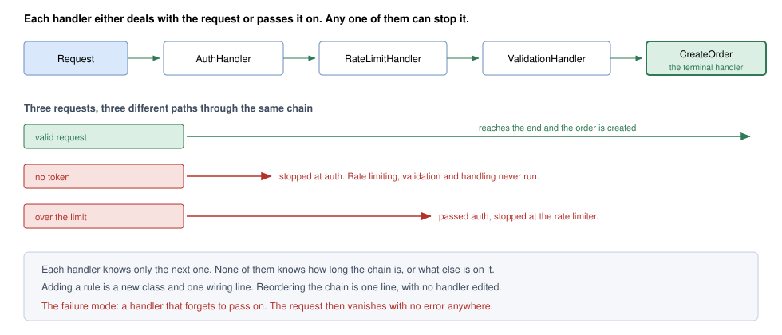
*Figure — Three requests go into the same chain of handlers and each stops at a different place (course diagram)*

### What it is

**Chain of Responsibility (CoR)** sends a request through a row of **handler** objects. Each handler deals with it, rejects it (nobody later sees it), or forwards it to its successor. The sender talks only to the first handler and never learns which one finished the job — like a support line: level 1, then level 2, then an engineer, though you dialled one number.

GoF intent: *avoid tying the sender of a request to one particular receiver by giving several objects a chance to handle it; link those objects and forward the request until one handles it.* Participants: **Handler** (declares the handling method, optionally holds the successor link), **ConcreteHandler** (handles what it is responsible for, otherwise forwards), **Client** (starts the request at a handler).

In the figure, one chain (auth → rate limit → validation → create order) gets three requests: a valid one reaches the end, one with no token stops at auth, one over the limit stops at the rate limiter. Each handler knows only the next.

### The problem it solves

Before an order is created a request must pass authentication (who is calling), rate limiting (too often?) and validation (is the body — the data sent — well-formed?). In one method:

- The method grows with every rule.
- The **order of checks is hidden in the body**, yet it matters: auth-then-rate-limit is a different system from rate-limit-then-auth.
- Some routes (URL paths such as `/orders`) need only two checks — soon boolean flags, then a forgotten second copy.

CoR makes **each check a small object** linked into a line. No handler knows the line's length or contents, so **the line is configuration, not logic**: a new rule is one class plus one wiring line; reordering touches only the wiring; each route gets its own line, assembled at start-up.

### How it works

1. A **Handler** type with `handle(request)` and a reference to the **next** handler.
2. One **concrete handler** per check: check, then **stop** (return a result) or **pass on** (`next.handle(request)`).
3. A **terminal handler** at the end does the real work (or reports "nobody handled this").
4. **Wire** once, at start-up: `auth.setNext(rateLimit).setNext(validate).setNext(createOrder)`.
5. The client calls only the **first** handler.

### Structure (UML)

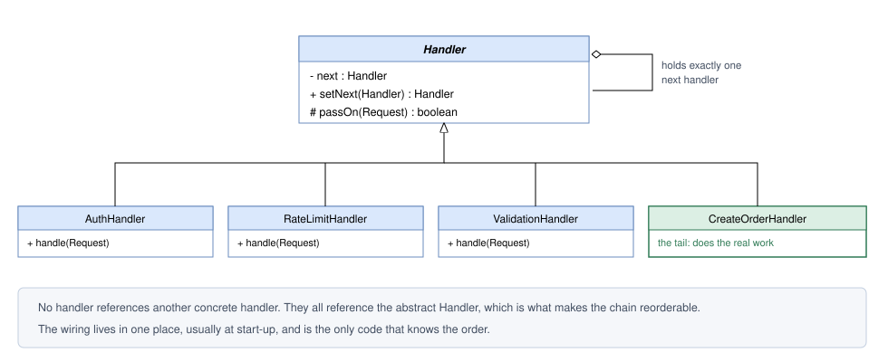
*Figure — Class diagram: an abstract Handler holds `next`; concrete handlers extend it; CreateOrderHandler is the tail (course diagram)*

In the class diagram (UML — Unified Modeling Language, the standard notation for classes and links), note what is **missing**: no handler refers to a *concrete* handler. Every link is typed as abstract `Handler`, so stages shuffle freely. `setNext` returns its argument, so wiring is one fluent expression (calls chained with dots, each returning the object for the next).

> **Our code vs the course pseudocode.** The course's `passOn` returns `true` ("success") when there is no next handler. Ours **throws**, because silently reporting success when the chain ran out is exactly this pattern's typical invisible failure. Either is legal; make it deliberate.

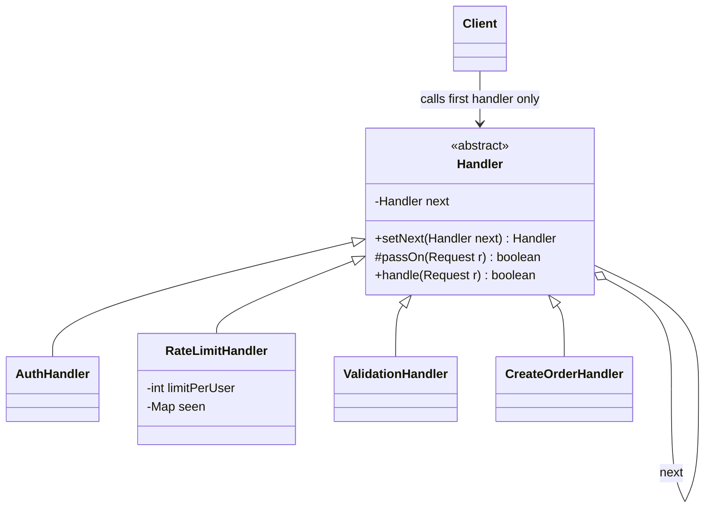

### Java example

`code/lld/ch10/chain/` shows **four flavours**:

1. **Classic linked handlers** (`Handler`, `AuthHandler`, `RateLimitHandler`, `ValidationHandler`, `CreateOrderHandler`). Each returns an *explicit* outcome: `false` = rejected, `passOn(...)` = continue. `passOn` **throws** with no next handler, so a chain without a terminal fails loudly.
2. **Approval chain** (`Approver`, `Expense`). Pure CoR: the *first* approver with a high-enough limit approves; nobody after sees it. Only **one** class — the chain is data (role + limit). Amounts are `BigDecimal` (Java's exact decimal type) compared with `compareTo` — never `double` for money.
3. **Servlet-style filters** (`Filter`, `FilterChain`, `Endpoint`, `HttpRequest`) — how `jakarta.servlet.Filter` (Java's standard web-request API) works: "next" is passed **in as an argument** (`chain.doFilter(...)`). A filter can act before *and after* the rest (the timing filter), or stop the chain by not calling it (the auth filter).
4. **Logging levels** (`LogHandler`, `ConsoleLog`, `FileLog`, `PagerLog`, `Level`). A common *variant*: each handler acts if severe enough and **always** passes on, so several may act. Strictly, when nothing can stop the flow it is closer to a *pipeline* (a fixed series of steps every item passes through) — textbooks still show logging this way.

```java
// Handler.java — classic base: each handler knows only "the next one".
public abstract class Handler {
    private Handler next;
    /** Links the next handler and returns it, so wiring reads as one chained expression. */
    public Handler setNext(Handler next) { this.next = next; return next; }

    /** Forwards the request. Falling off the end means the chain has no terminal handler: a wiring bug. */
    protected boolean passOn(Request request) {
        if (next == null) throw new IllegalStateException(
                getClass().getSimpleName() + " tried to pass on, but the chain has no terminal handler");
        return next.handle(request);
    }
    /** @return true if the request was fully handled, false if some handler rejected it. */
    public abstract boolean handle(Request request);
}

// AuthHandler.java — stage 1 (RateLimitHandler keys a per-user count; ValidationHandler rejects empty payloads;
// CreateOrderHandler is terminal and never passes on).
@Override public boolean handle(Request r) {
    if (r.token() == null || r.token().isBlank()) {
        System.out.println("  [auth] rejected: missing token");
        return false;                      // explicit outcome: the chain stops here
    }
    System.out.println("  [auth] ok for " + r.user());
    return passOn(r);                      // explicit outcome: continue
}

// Approver.java — first capable handler wins; the chain is data.
String approve(Expense e) {
    if (e.amountUsd().compareTo(limitUsd) <= 0) {   // compareTo, not equals: 300 and 300.00 are the same amount
        return role + " approved " + e.id() + " ($" + e.amountUsd() + ")";
    }
    if (next == null) {   // explicit terminal outcome instead of a silent "nothing happened"
        return "REJECTED " + e.id() + " ($" + e.amountUsd() + "): above every approver's limit";
    }
    System.out.println("    " + role + " (limit $" + limitUsd + ") escalates " + e.id());
    return next.approve(e);
}
```

```java
// Filter.java — same shape as jakarta.servlet.Filter: "next" is an explicit argument, so forgetting it is visible.
@FunctionalInterface
interface Filter { void doFilter(HttpRequest request, StringBuilder response, FilterChain chain); }

// FilterChain.java — one per request, because it holds a position.
void doFilter(HttpRequest request, StringBuilder response) {
    if (position < filters.size()) filters.get(position++).doFilter(request, response, this);
    else endpoint.service(request, response);   // the terminal handler
}

// LogHandler.java — VARIANT: act if severe enough, then ALWAYS pass on.
final void log(Level level, String message) {
    if (level.compareTo(threshold) >= 0) write(level, message);
    if (next != null) next.log(level, message);
}
// ConsoleLog threshold DEBUG, FileLog INFO, PagerLog ERROR.

// Main.java (wiring)
// Order is a design decision: auth BEFORE rate limiting so the limiter can key on the user,
// and so anonymous traffic cannot burn a real user's quota.
Handler pipeline = new AuthHandler();
pipeline.setNext(new RateLimitHandler(2)).setNext(new ValidationHandler()).setNext(new CreateOrderHandler());
Approver chain = new Approver("TeamLead", new BigDecimal("1000"));
chain.then(new Approver("Manager", new BigDecimal("10000"))).then(new Approver("Director", new BigDecimal("50000")));
Filter auth = (req, res, next) -> {
    if (!req.headers().containsKey("Authorization")) { res.append("401 Unauthorized"); return; }  // chain stops
    next.doFilter(req, res);
};
```

**Output:**

```text
=== 1. API request pipeline (classic linked handlers) ===
request from alice:
  [auth] ok for alice
  [ratelimit] ok (1/2)
  [validate] ok
  [order] created order for alice: 2 x widget
  => handled = true
request from bob:
  [auth] rejected: missing token
  => handled = false
request from alice:
  [auth] ok for alice
  [ratelimit] ok (2/2)
  [validate] rejected: empty payload
  => handled = false
request from alice:
  [auth] ok for alice
  [ratelimit] rejected: alice made 3 requests, limit 2
  => handled = false

=== 2. Expense approval chain (first capable handler wins) ===
  TeamLead approved EXP-1 ($300)
    TeamLead (limit $1000) escalates EXP-2
  Manager approved EXP-2 ($7500)
    TeamLead (limit $1000) escalates EXP-3
    Manager (limit $10000) escalates EXP-3
  REJECTED EXP-3 ($120000): above every approver's limit

=== 3. Servlet-style filters (next is an explicit argument) ===
  [timing] start /orders
  [timing] end   /orders -> 200 OK orders list
  [timing] start /orders
  [timing] end   /orders -> 401 Unauthorized

=== 4. Logging levels (variant: every handler may act) ===
  log DEBUG:
    console <- DEBUG cache miss for key=42
  log ERROR:
    console <- ERROR payment service down
    app.log <- ERROR payment service down
    PAGER   <- ERROR payment service down
```

Walk through the output:

- Request 1 travels the full chain; request 2 stops at auth (limiter, validator and order code never run); request 3 passes auth and the limiter (2 of 2) and stops at validation; request 4 is alice's third, stopped by the limiter.
- `EXP-2` is escalated once, approved by the Manager. `EXP-3` exceeds every limit, so the chain returns an explicit "REJECTED" rather than vanishing.
- The timing filter prints before and after the rest. For the unauthenticated request the auth filter wrote `401` (HTTP's "not authenticated" status) and did not call `next`, so the endpoint never ran.
- `DEBUG` reaches only the console; `ERROR` reaches all three.

### Trade-offs

| Pros | Cons |
|---|---|
| A new stage costs one class and one wiring line; no working class is edited (Open/Closed). | To see a request's route you read the wiring plus several files. |
| Every stage can be unit-tested (in isolation) against a stub (minimal stand-in) successor. | When a request is refused you may step through several handlers to learn which one. |
| Each route or environment can get its own chain, assembled at start-up. | No compiler or framework verifies the chain is complete or correctly ordered. |
| The sender does not know which object will handle its request. | A handler that neither handles nor forwards makes the request vanish without error. |
| | Each stage adds a call; rarely matters, but can on very hot paths (code run extremely often) with long chains. |

**Stage order is a design decision no tool verifies.** Auth before rate limiting lets the limiter count per *user*, and rejects bad credentials before they use up a real user's quota (allowed number of requests). Rate limiting first can only key on something like the IP address (the calling machine's network address) — but shields a possibly expensive auth step from floods (huge request bursts). Both are reasonable; they behave differently. **Comment the reason beside the wiring** (see `Main`) — it is recorded nowhere else.

### When not to use it

- **Every request always runs every stage in a fixed order** — four calls in one method are clearer.
- **Handlers need each other's results** — not independent stages but a *pipeline* where each step reshapes a value; call steps in sequence passing an accumulating context object.
- **No terminal handler exists** — reaching the end with nothing done makes failures silent; add one first.
- **The chain is long and on a very hot path.**

### Common mistakes

1. **The swallowing bug.** A handler checks and then just `return`s instead of calling `passOn` — no exception, no log; orders "sometimes don't appear". Fixes: an explicit outcome on every path (handled / rejected with reason / passed on); prefer `next` as an explicit parameter (servlet filters, Express, Go `http.Handler`) so forgetting it is visible; unit-test each handler against a stub successor recording whether it got the request.
2. **No terminal handler.** Reaching the end should be an error or a clear "not handled" — never a shrug.
3. **Wrong order, undocumented.** See trade-offs.
4. **Handlers that know about each other** (`new RateLimitHandler()` inside `AuthHandler`) — the chain is fixed in code again.
5. **Sharing a stateful chain object between requests.** `FilterChain` keeps a position, so it must be **one per request** (`Main` creates a new one each time).

### Real-world examples

- **Servlet filters**: `jakarta.servlet.Filter.doFilter(request, response, chain)` — calling `chain.doFilter(...)` *is* "pass on". **Spring Security** (Spring's authentication/authorisation library) is a chain of such filters (`SecurityFilterChain`).
- **Spring MVC `HandlerInterceptor`**: `preHandle` returns `false` to stop the request.
- **HTTP middleware** (code a web framework runs around every request) in Express (`next()`), Django, Ruby's Rack, ASP.NET Core, Go (`func(http.Handler) http.Handler`, the usual Go web-service structure). **OkHttp** interceptors call `chain.proceed(request)`; **Netty**'s `ChannelPipeline` passes events handler to handler.
- **With first-class functions** (functions stored and passed like values) the chain is usually a list of `(request, next) => ...` functions; JavaScript frameworks often fold it (combine a list into one value step by step) with `Array.reduce`, and Python decorators (`@` wrappers) stacked on a view function (the function handling a web request) form a chain as syntax. Passing `next` explicitly removes the "forgot to pass on" bug by design.
- **`java.util.logging`**: a `LogRecord` goes to the logger's handlers and then, by default, its parent logger's handlers; `setUseParentHandlers(false)` stops that — why a parent logger's level or handler affects its children.
- **Exception handling**: each stack frame (a method call in progress) catches the exception or lets it travel up — the language's own chain.
- **DOM event bubbling** (DOM — Document Object Model, the browser's tree of page elements): a click climbs from the element through its parents; any listener can `stopPropagation()`.
- **Approval workflows** (expenses, leave, loans) by amount or role, and **customer-support escalation** tiers.

### In the interview

**30-second answer:** "Chain of Responsibility splits a series of checks into separate handler objects, each linked only to its successor. The request moves down the line until some handler completes it or refuses it. Because only the wiring knows the order, adding, removing or reordering a rule is cheap. Servlet filters and HTTP middleware are the everyday examples. The classic bug is a handler that forgets to pass on and swallows the request, so I give every path an explicit outcome and put a terminal handler at the end."

**Follow-ups:**

- *How is it different from Decorator?* Both link objects sharing one interface. With **Decorator** all wrappers run and the call always reaches the inner object — the point is to *add* behaviour. With **CoR** a handler may **end** the request and later handlers never see it.
- *How is it different from Observer?* Observer tells **every** subscriber and none can block the rest; CoR ends at the **first** handler that accepts.
- *How is it different from a pipeline?* A pipeline pushes a value through **all** steps and produces a transformed result; a chain *routes* a request to whichever handler takes it. If no stage can stop the flow, it is a pipeline.
- *Combine it with Command?* Yes — the request moving through the handlers is often a Command (e.g. a job checked by validation and authorisation handlers before a worker runs it).
- *What if no handler can handle the request?* An explicit terminal handler (e.g. `NoHandlerFound`) that returns an error or logs.
- *How do you test it?* Each handler with a fake next recording whether and with what it was called; one integration test (several parts together) for the wiring order.
- *Rate limiting before or after auth?* Explain the trade-off above and document the reason next to the wiring.

### Self-check

1. **Q:** What does each handler hold a reference to? **A:** Only the next handler (through the abstract `Handler` type).
2. **Q:** Name the most common CoR bug. **A:** A handler that neither handles nor passes on — the request silently disappears.
3. **Q:** Why do modern frameworks pass `next` as a parameter? **A:** A missing `next(...)` call is then easy to spot in the handler's body, and the handler can work both before and after the rest of the chain.
4. **Q:** Is a logging chain where every handler always passes on a "pure" CoR? **A:** Not strictly; since no handler can stop the flow it behaves like a pipeline. It is a common variant.
5. **Q:** When should you *not* use CoR? **A:** When every stage always runs in a fixed order, when stages depend on each other's results, or when there is no terminal handler.

### TL;DR

A request walks a line of handlers; each handles, rejects, or passes on. The chain is data, so it is easy to change — but **order matters**, **always have a terminal handler**, and **never swallow a request**.

---

## 10.2 Command

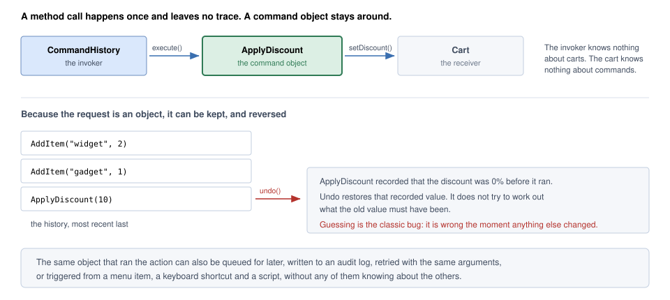
*Figure — The invoker (CommandHistory) runs command objects against the receiver (Cart) and keeps them so they can be undone (course diagram). The figure assumes the discount was 0% before; our code deliberately starts at 5% to prove undo restores the recorded value.*

### What it is

**Command** packages a request ("add 2 widgets to the cart") as an **object** holding everything needed to perform it later. Once the request is a value you can **keep it in a list, put it on a queue (first-in, first-out waiting line), write it to an audit log (a permanent record of who did what), run it again, hand it to a worker thread (a background thread — independent path of execution — that runs jobs)** — and, if it knows its inverse, **reverse it**.

GoF intent: *wrap a request in an object, so clients can be given different requests, requests can be queued or logged, and operations can be undone.* Like a restaurant order slip: the waiter (invoker) writes the slip (command) and queues it; the cook (receiver) acts later; the slip can be queued, prioritised or cancelled.

### The problem it solves

`cart.setDiscount(10)` runs immediately and is forgotten on return. Not enough once you need:

- **Undo** — "reverse my last two changes".
- **A queue** — run later on a worker thread, not the request thread (the one serving the user).
- **A log of intent** — which operations were *requested*, not just the final state.
- **Retry** — rerun a failed action with the same arguments.
- **One action, many triggers** — menu item, hot-key (keyboard shortcut) and script all fire the same "apply discount".

Command gives the request a body that outlives the call.

### How it works

Interviewers usually want **three roles** — **invoker**, **command**, **receiver** — plus the **client** creating commands. GoF lists five participants: **Command** (interface), **ConcreteCommand** (binds a receiver to an action), **Client**, **Invoker**, **Receiver**:

| Role | Job | In our code |
|---|---|---|
| **Command** | Interface with `execute()` (and optionally `undo()`). | `Command`, `UndoableCommand` |
| **Concrete command** | Stores its receiver and arguments; can perform (and reverse) exactly one operation. | `AddItemCommand`, `ApplyDiscountCommand`, `MacroCommand` |
| **Receiver** | The object whose state is really modified. Has no idea commands exist. | `Cart` |
| **Invoker** | Triggers commands and keeps a record of them. Has no idea carts exist. | `CommandHistory`, `ExecutorService` |
| **Client** | Builds a concrete command and gives it its receiver. | `Main` |

1. The client creates a concrete command with the **receiver** and **arguments**, and hands it to the **invoker**.
2. The invoker calls `execute()`; if undoable, pushes it on an **undo stack** (last-in, first-out: add and remove only at the top).
3. **Undo** = pop, `undo()`, push on a **redo stack**.
4. **Redo** = pop from redo, `execute()`, push back on undo. **A fresh command empties the redo stack** — the branch you might have re-applied is replaced.

### Structure (UML)

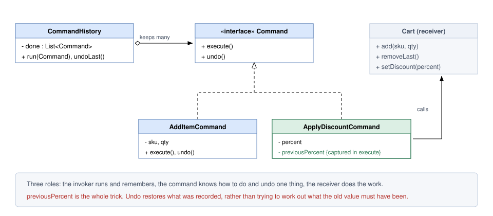
*Figure — Class diagram: Command interface with execute/undo, two concrete commands, Cart as receiver, CommandHistory as invoker (course diagram; its `undoLast`/`removeLast` are named `undo`/`remove` in our code)*

Each command keeps its own `Cart` reference — when it finally runs, its creator may be long gone, so the target travels inside the command with the arguments. `ApplyDiscountCommand.previousPercent` is the single field that makes its undo correct. `CommandHistory` never mentions `Cart`, so one history serves the whole application.

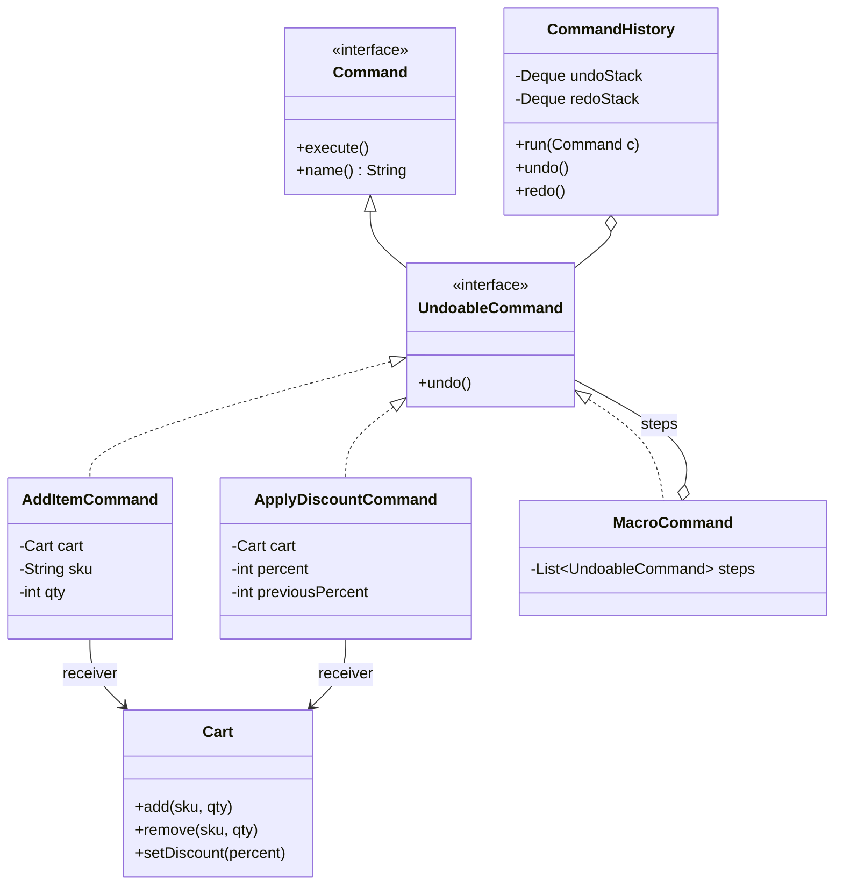

### Java example

Full code: `code/lld/ch10/command/`. Key points:

- `Command` has **one abstract method**, so any lambda (short unnamed function) or `Runnable`-like block (Java's built-in "code to run" interface) is a command. Only *honestly* reversible commands implement `UndoableCommand`; `CommandHistory` keeps irreversible ones out of the undo stack.
- `ApplyDiscountCommand` **captures the old value in `execute()`** and restores exactly that. The cart starts at 5% to show "undo = set to 0" would be wrong.
- `MacroCommand` is a command of commands (a **Composite** of commands): steps run in order and undo in **reverse**.
- Section 4 of `Main` is the JDK's version: `Runnable` is the command interface and an `ExecutorService` (Java's thread-pool service) the invoker running commands on a worker thread.

```java
@FunctionalInterface
public interface Command {                       // a request turned into an object; a lambda is a Command
    void execute();
    default String name() { return getClass().getSimpleName(); }
}
public interface UndoableCommand extends Command { void undo(); }   // only honestly reversible commands

// AddItemCommand: carries its receiver and all the arguments it needs to run later.
@Override public void execute() { cart.add(sku, qty); }
@Override public void undo()    { cart.remove(sku, qty); }   // removes exactly that line

// ApplyDiscountCommand: captures the previous value during execute so undo RESTORES, never guesses.
@Override public void execute() {
    previousPercent = cart.discountPercent();   // capture BEFORE changing
    cart.setDiscount(percent);
}
@Override public void undo() { cart.setDiscount(previousPercent); }

// MacroCommand: runs in order; undoes in REVERSE order.
@Override public void execute() { steps.forEach(Command::execute); }
@Override public void undo() { for (int i = steps.size() - 1; i >= 0; i--) steps.get(i).undo(); }
```

```java
// CommandHistory.java — the INVOKER: runs commands and remembers them. Knows nothing about carts.
public void run(Command command) {
    command.execute();
    if (command instanceof UndoableCommand u) {
        undoStack.push(u);
        redoStack.clear();     // a new action destroys the "future" you could have redone
        System.out.println("  ran  " + command.name());
    } else {
        System.out.println("  ran  " + command.name() + " (irreversible: kept out of history)");
    }
}
public void undo() {
    if (undoStack.isEmpty()) { System.out.println("  nothing to undo"); return; }
    UndoableCommand c = undoStack.pop();
    c.undo();
    redoStack.push(c);
    System.out.println("  undo " + c.name());
}
// redo(): pop redoStack, execute(), push on undoStack, print "  redo ..." (or "  nothing to redo")

// Main.java, section 4: commands on a queue
ExecutorService worker = Executors.newSingleThreadExecutor();   // one thread => FIFO order
jobs.forEach(worker::submit);
```

**Output:**

```text
=== 1. Undo / redo ===
  ran  AddItem(widget, 2)
  ran  AddItem(gadget, 1)
  ran  ApplyDiscount(10%)
  Cart[widget x2, gadget x1] discount=10%
  undo ApplyDiscount(10%)
  undo AddItem(gadget, 1)
  Cart[widget x2] discount=5%   <- discount restored to the recorded 5%, not 0%
  redo AddItem(gadget, 1)
  Cart[widget x2, gadget x1] discount=5%
  ran  AddItem(cable, 3)
  nothing to redo

=== 2. Macro command ===
  ran  Macro:starter-kit
  Cart[widget x2, gadget x1, cable x3, keyboard x1, mouse x1] discount=15%
  undo Macro:starter-kit
  Cart[widget x2, gadget x1, cable x3] discount=5%

=== 3. Irreversible command (no undo offered) ===
  [email] receipt sent for Cart[widget x2, gadget x1, cable x3] discount=5%
  ran  SendReceipt (irreversible: kept out of history)

=== 4. Commands on a queue: Runnable + ExecutorService (the invoker) ===
  queued 3 jobs
  [worker] resize image 1
  [worker] resize image 2
  [worker] send newsletter
  all jobs done
```

### Undo must restore, not recompute

Writing a discount undo as "reset to 0" or "work out what it probably was" is a **guess**: if the cart began at 5%, or another command touched the discount meanwhile, the user gets a value that never existed. Rule: **`execute` must record whatever `undo` will need** — usually just the fields it overwrites, not a copy of the whole object.

**Undo history is strictly last-in, first-out.** `AddItem, AddItem, ApplyDiscount` is undone as `ApplyDiscount`, then the second `AddItem`, then the first; any other order can produce never-existing states — hence a stack, never a randomly indexed list.

**When undo is a lie.** Some effects escape your system: a sent email, a charged card, a call to a partner's API (the interface a service exposes to other programs). An `undo()` there promises the impossible — worse than no undo. Honest options: keep them out of the history (our `SendReceipt`), or **compensation** — a *new* action reaching a similar end state, like a **refund** for a charge. A refund is not an undo: both events stay in the record.

### Trade-offs

| Pros | Cons |
|---|---|
| The request outlives the call, so undo/redo, queues, audit logs, retries and scheduling become possible. | One class per action; class count tracks action count. |
| The invoker knows nothing of what it runs, so one history serves all commands. | Each command must record enough to run later and reverse itself; subtle mistakes are easy. |
| One action object can back a menu entry, hot-key, script and API endpoint. | Extra hop when reading: to learn what a button does, find the command it builds. |
| Commands can be grouped into macro commands. | One faulty `undo` corrupts the whole history. |

### When not to use it

- **The call is simple and immediate** — a `SaveCommand` nobody undoes, queues or logs is code without benefit.
- **Undo is not really possible** — use compensation and call it that.
- **You only need deferral** — a lambda (`Runnable`) already is a one-method command; promote it to a class when you need `undo`, a readable log name, or serialization (turning it into bytes/text to store or send).
- **Commands must outlive the process** — then serialization drags in format versioning; a durable queue (survives restarts — see [System Design Fundamentals](../../../system-design-patterns/modules/00-system-design-fundamentals/README.md)) or an event log (Kafka — a durable, distributed message log — or a jobs table) handles it better.

### Common mistakes

1. **Recomputing in `undo`** instead of restoring captured state.
2. **Forgetting to clear the redo stack** when a new command runs.
3. **Business logic in the invoker** (`if (cmd instanceof AddItem) ...`). The invoker only runs and remembers.
4. **Capturing a mutable object by reference** (mutable = changeable after creation) and reading it later when it has changed. Capture values.
5. **Unbounded history** — cap the depth, as editors do.

### Real-world examples

- **Undo in editors**: word processors, IDEs (code editors such as IntelliJ), Photoshop. JDK: `javax.swing.undo.UndoManager` with `UndoableEdit` objects having `undo()`/`redo()`.
- **`Runnable` / `Callable`** are the JDK's command interfaces; `ExecutorService`, `ScheduledExecutorService` and `Thread` are invokers.
- **GUI actions** (graphical user interface): Swing's (Java's desktop UI toolkit) `javax.swing.Action` backs a menu item, toolbar button and shortcut at once; .NET WPF's `ICommand` likewise.
- **Event sourcing** (Chapter 11; storing every change as an event and rebuilding state by replay): recording *requested changes* rather than resulting state — the command idea for a whole system.
- **Job queues**: a Sidekiq/Celery (Ruby/Python background-job libraries) job, a Spring `@Async` task, a Kafka/RabbitMQ (message brokers) message asking a worker to "send invoice #42" — a serialized command.
- **Database migrations** (versioned schema-change scripts) with `up`/`down` (e.g. Liquibase changesets with rollback) mirror `execute`/`undo`.
- **Redux** (a JavaScript state-management library) actions are commands: the store dispatches them (invoker), reducers apply them (receiver); Redux DevTools' time travel replays them.
- **In other languages**: Python — a callable object (defines `__call__`) with an `undo` method, `functools.partial` to bind arguments; C# — UI frameworks ship `ICommand`, and a `record` gives an immutable command in one line.
- **Transactional outbox / task tables** (the job is written to a table in the same all-or-nothing transaction as the data change, so it cannot be lost) in food-delivery or e-commerce back ends store "commands" (send SMS, notify restaurant) run reliably by workers.

### In the interview

**30-second answer:** "Command wraps a request, together with its receiver and arguments, in an object — so the request can be kept, queued, logged, retried or reversed. Three roles matter: the invoker triggers and records commands without knowing what they touch, each command can perform and reverse a single operation, and the receiver holds the state that actually changes. For undo, `execute` must capture the old value and `undo` restores it; history is a stack, and a new command clears redo. Irreversible actions like charging a card get compensation, not undo. In Java, `Runnable` plus an `ExecutorService` is the everyday form."

**Follow-ups:**

- *Command vs Strategy?* Both put behaviour in an object. **Strategy** answers *how* a job is done and is picked/replaced by the caller. **Command** captures *which* job, arguments included, held on to so it can run later or be reversed.
- *Command vs a plain lambda?* A one-method closure (a function remembering variables from where it was created) already is a command; write a class only for `undo`, a readable log name, or serialization.
- *Command vs Memento for undo?* Command stores the **action** plus a little state; undo runs the inverse. Memento stores the **whole state**; undo restores a snapshot. Command is cheaper per step; Memento is always correct. Real systems combine them (occasional snapshots, replay commands in between).
- *How do you implement redo?* A second stack; undo moves a command to it; redo re-executes and moves it back; a new command clears it.
- *How do you make a command queue thread-safe (correct with many threads)?* A `BlockingQueue` (whose `take()` waits for an item) or an `ExecutorService`; commands immutable apart from captured undo state.
- *How would you persist commands?* Serialize (JSON — a common text format — with a type field and version), store in a durable queue or table, and make them **idempotent** (running twice = once — see [System Design Fundamentals](../../../system-design-patterns/modules/00-system-design-fundamentals/README.md)) so retries are safe.

### Self-check

1. **Q:** What must a command carry? **A:** Its receiver and all arguments needed to run later (and any state needed for undo).
2. **Q:** Why does `ApplyDiscountCommand` store `previousPercent`? **A:** So undo restores the real previous value instead of guessing.
3. **Q:** What happens to the redo stack when a new command runs? **A:** It is cleared.
4. **Q:** How do you "undo" a card charge? **A:** You don't; you issue a compensating action (a refund) and keep both in the record.
5. **Q:** Which JDK interface is a command? **A:** `Runnable` (and `Callable`).

### TL;DR

Make the request an object: **invoker** runs it, **command** knows do/undo, **receiver** changes. Undo **restores captured state**, history is a **stack**, and irreversible actions get **compensation**. A lambda is a command when you only need deferral.

---

## 10.3 Iterator

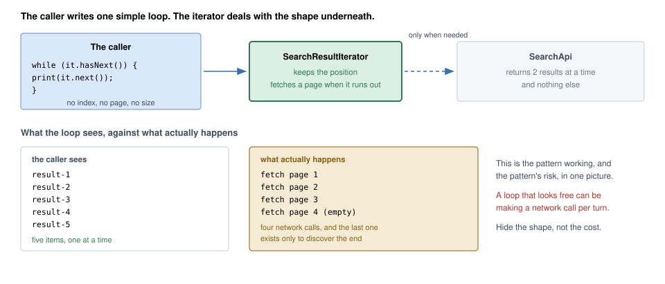
*Figure — The caller writes one simple loop; the iterator fetches pages from the API only when needed (course diagram)*

### What it is

**Iterator** visits a collection's elements **one at a time, in order, without knowing how they are stored** — array, linked list (elements chained by references), tree, or a remote API returning two results per page. Like a TV remote's "next channel": no idea how channels are stored, just press *next*.

GoF intent: *give sequential access to the elements of an aggregate (GoF's word for a collection) without exposing its internal representation.* Participants: **Iterator** (interface for accessing and traversing), **ConcreteIterator** (implements it, tracks the current position), **Aggregate** (interface for creating an iterator), **ConcreteAggregate** (returns the right ConcreteIterator).

### The problem it solves

- Loops using `get(i)` assume an array; move the data to a linked list, tree or paginated (one page at a time) service and every loop is rewritten.
- Many sources **cannot be indexed**: a tree has several visiting orders (depth-first — one branch fully down before the next; breadth-first — level by level); a graph (nodes joined by edges, possibly looping) must remember visited nodes; a search API hands out pages. Each caller writing its own traversal re-implements paging — some wrongly.

Iterator moves the walking logic **into a separate object** answering *any elements left?* (`hasNext`) and *give me the next* (`next`).

**Key detail: the current position lives inside the iterator, never in the collection** — so two traversals run together without interfering, and each `iterator()` call must build a **new** iterator rather than rewind a shared cursor (marker of the current position).

### How it works

1. The **aggregate** has `iterator()` creating a new iterator; in Java it implements `Iterable<T>`.
2. The **iterator** implements `Iterator<T>`: `hasNext()`, `next()` (optionally `remove()`).
3. The iterator keeps its own **cursor** (index, stack of tree nodes, current page...).
4. The client loops `while (it.hasNext()) use(it.next());` — or `for (T x : collection)`, which the compiler turns into exactly that.

### Structure (UML)

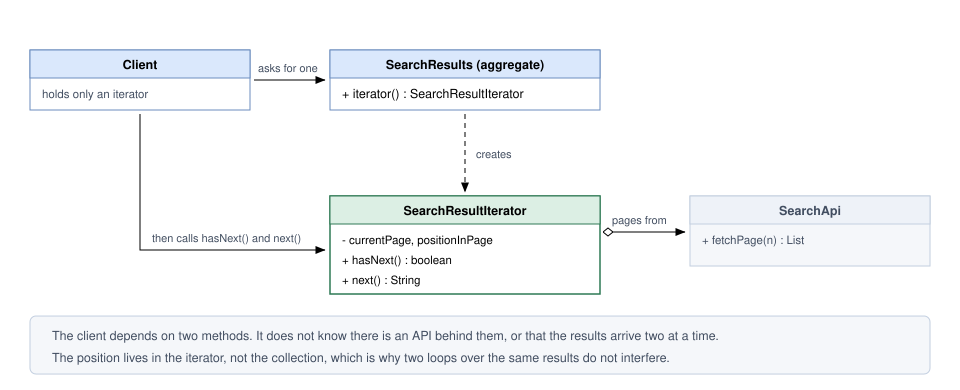
*Figure — Class diagram: SearchResults (aggregate) hands out a SearchResultIterator, which calls SearchApi page by page; the client only calls hasNext/next (course diagram)*

`hasNext` does real work: when the buffered page runs out it fetches another. *Lazy* iterators (producing elements only on demand) commonly behave this way — never assume `hasNext` is cheap or free of side effects (effects beyond returning a value, such as a network call).

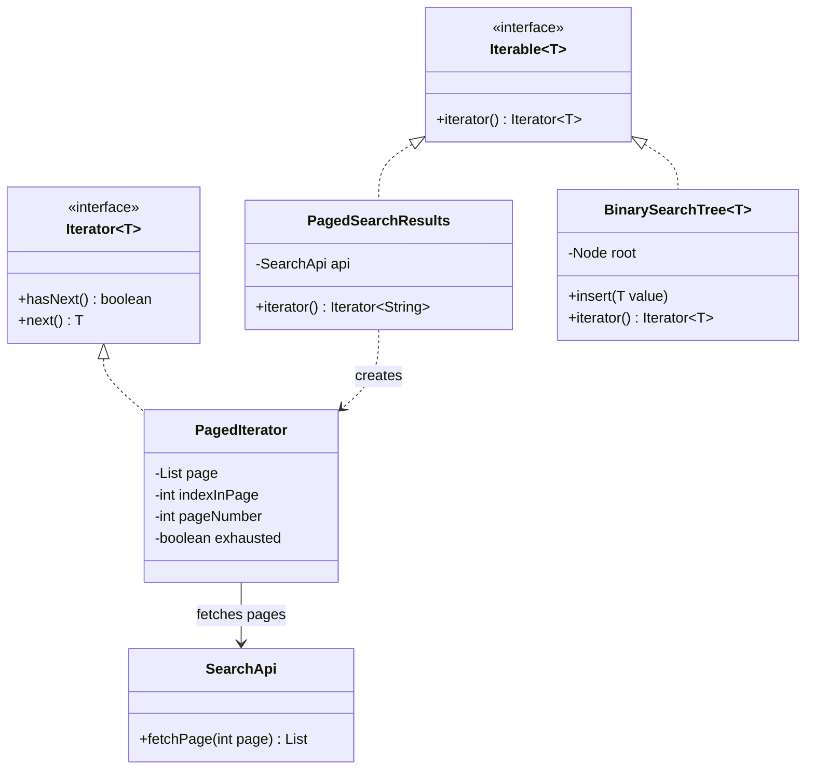

### Java example

`code/lld/ch10/iterator/` shows:

1. **A paged remote source behind a plain for-each.** `PagedSearchResults implements Iterable<String>`; its inner `PagedIterator` fetches a page only when the current one is used up and follows the `Iterator` contract (the documented rules every implementation must obey: `next()` throws `NoSuchElementException` when empty).
2. **A tree iterator.** `BinarySearchTree` hides an in-order walk (left subtree, node, right subtree — sorted order) behind `hasNext/next` with an explicit stack; two iterators over one tree run independently.
3. **External vs internal iteration.** *External*: the **client** drives (`hasNext/next`) and can `break` early. *Internal*: the **collection** drives and calls your code per element (`forEach(lambda)`, streams — Java's pipeline API for collections).
4. **Fail-fast vs fail-safe.** Structurally changing an `ArrayList` (add/remove) during a for-each *usually* makes the next `next()` throw `ConcurrentModificationException` — only **best-effort**: removing the second-to-last element makes `hasNext()` just return `false`, no exception, last element silently skipped. Safe: `Iterator.remove()` (or `removeIf`). `CopyOnWriteArrayList` iterates a **snapshot**, never throws, but the loop misses new elements. ("Fail-safe" is informal; the Javadoc — Java's official API docs — says *snapshot* and *weakly consistent*.)
5. **`Spliterator`** (Java 8): an iterator that can **split** itself (`trySplit`) so parallel streams process parts on different threads; reports **characteristics** such as `SIZED` and `ORDERED`.

```java
// PagedSearchResults.java — the AGGREGATE: its only job is to hand out a FRESH iterator each time.
// (SearchApi.fetchPage(page) returns 2 results per 1-based page, an empty list past the end, and counts calls.)
final class PagedSearchResults implements Iterable<String> {
    @Override public Iterator<String> iterator() { return new PagedIterator(); }

    /** The ITERATOR. The position lives here, not in the collection. */
    private final class PagedIterator implements Iterator<String> {
        private List<String> page = List.of();
        private int indexInPage = 0, pageNumber = 0;
        private boolean exhausted = false;

        @Override public boolean hasNext() {                // NOT a passive question: may hit the network
            if (indexInPage < page.size()) return true;
            if (exhausted) return false;
            page = api.fetchPage(++pageNumber);
            indexInPage = 0;
            if (page.isEmpty()) { exhausted = true; return false; }
            return true;
        }
        @Override public String next() {
            if (!hasNext()) throw new NoSuchElementException();   // the Iterator contract
            return page.get(indexInPage++);
        }
    }
}

// BinarySearchTree.iterator() — the stack holds the path still to visit: this IS the iterator's position.
private final Deque<Node<T>> stack = new ArrayDeque<>();
{ pushLeft(root); }
private void pushLeft(Node<T> n) { for (; n != null; n = n.left) stack.push(n); }
@Override public boolean hasNext() { return !stack.isEmpty(); }
@Override public T next() {
    if (stack.isEmpty()) throw new NoSuchElementException();
    Node<T> n = stack.pop();
    pushLeft(n.right);
    return n.value;
}
```

```java
// Main.java, section 4 (fail-fast vs fail-safe) and 5 (Spliterator)
for (String t : tags) if (t.equals("tmp")) tags.remove(t);       // structural change behind the iterator's back
for (String t : quiet) { visited.add(t); if (t.equals("tmp")) quiet.remove(t); }  // removes the SECOND-TO-LAST element
for (Iterator<String> i = tags.iterator(); i.hasNext(); ) if (i.next().equals("tmp")) i.remove();  // the safe way
for (String s : cow) cow.add(s + "!");                            // CopyOnWriteArrayList iterates a snapshot
Spliterator<Integer> right = nums.spliterator();
Spliterator<Integer> left = right.trySplit();                     // hands off (roughly) the first half
```

**Output:**

```text
=== 1. Paged remote results behind a plain for-each ===
    [api] fetching page 1
  loop sees result-1
  loop sees result-2
    [api] fetching page 2
  loop sees result-3
  loop sees result-4
    [api] fetching page 3
  loop sees result-5
    [api] fetching page 4
  5 items, 4 network calls (the last one only discovers the end)

=== 2. Two independent iterators over one tree ===
  a: 20, 30, 40
  b: 20   <- b starts from the beginning: position lives in the iterator
  in-order: 20 30 40 50 60 70 80

=== 3. External vs internal iteration ===
  external: found bob, stopping early
  internal: ann
  internal: bob
  internal: cy

=== 4. Fail-fast vs fail-safe ===
  fail-fast: ConcurrentModificationException
  best-effort only: no exception, visited [java, tmp], 'lld' silently skipped
  after Iterator.remove: [java, lld]
  fail-safe CopyOnWriteArrayList: [x, y, x!, y!]

=== 5. Spliterator: an iterator that can split for parallel work ===
  SIZED=true ORDERED=true
  left half:  1 2 3 4
  right half: 5 6 7 8
  parallel stream sum = 36
```

### Hide the shape, not the cost

Five results, **four** network calls: the last returns empty just to learn the data ended, since this API gives neither a total nor a "next page" token — real behaviour, not a demo bug. **A tidy loop conceals each step's cost.** The **N+1 query problem** in ORMs (object-relational mappers: rows → objects) has the same shape (one query for the list, one more *per element*). Keep the cost visible:

- **Name the type honestly** (`PagedResults`, `LazySearchResults`, not `List`).
- **Offer a batch API** with bigger pages for callers wanting everything.
- **Return the total or a next-page cursor** when the source knows it, avoiding the extra call.
- **Log or count fetches**, so a growing request count gets noticed.

### Java's iterator family (quick reference)

| Type | What it adds |
|---|---|
| `Iterable<T>` | `iterator()`; lets a type be used in the enhanced for-loop. Also `forEach` (internal iteration) and `spliterator()`. |
| `Iterator<T>` | `hasNext()`, `next()`, optional `remove()`, `forEachRemaining()`. |
| `ListIterator<T>` | Bidirectional: `hasPrevious()`, `previous()`, indexes, `set()`, `add()`. |
| `Spliterator<T>` | `tryAdvance`, `forEachRemaining`, `trySplit` for parallelism, `characteristics()` like `ORDERED`, `SIZED`, `DISTINCT`, `IMMUTABLE`. |
| `Enumeration<E>` | The old (Java 1.0) version: `hasMoreElements()`, `nextElement()`. Prefer `Iterator`. |

**Fail-fast, weakly consistent, snapshot.** `ArrayList`, `HashMap` and friends have **fail-fast** iterators: they detect a structural change behind their back and throw `ConcurrentModificationException` — on a **best-effort** basis per the Javadoc, so never rely on it (demo section 4 shows an unnoticed removal). Despite the name, it is usually **one thread** changing a collection inside its own loop, not concurrency (several threads at once). `ConcurrentHashMap` iterators are **weakly consistent** (never throw, may or may not show concurrent changes). `CopyOnWriteArrayList` iterators use a **snapshot** (their `remove()` throws `UnsupportedOperationException`).

### Trade-offs

| Pros | Cons |
|---|---|
| Client code no longer cares whether data lives in an array, a tree or behind an API. | One more object per traversal (noticeable only in extremely hot loops). |
| One structure can offer several named, reusable visiting orders. | Changing the collection mid-loop is a bug unless via the iterator's `remove` or a concurrent collection. |
| Elements can be produced lazily, so huge or endless sequences work. | A lazy iterator owning a file or DB cursor leaks it on early `break` unless closed. |
| Paging, buffering and prefetching (loading data before it is asked for) hide behind an ordinary loop. | Per-step cost becomes invisible — the root of N+1 problems. |

### When not to use it

- **The data is already an in-memory list** — hand out the list (or its iterator); a custom iterator over an array adds nothing.
- **Callers jump around** ("I need element 4,000") — iterators only step forward; offer indexed access.
- **Everything is in memory and always consumed in full** — a plain loop is simpler and faster.
- **A step has side effects the caller must decide on** — silently loading a page is fine; silently charging a customer is not.

### Common mistakes

1. **Modifying the collection while iterating** (other than `Iterator.remove`) — collect changes and apply after the loop, or `removeIf`.
2. **Leaking a resource** from a lazy iterator on early `break` — use try-with-resources (`try (...)` closes automatically; `Files.lines`, `DirectoryStream` and JDBC — Java's database API — `ResultSet` are closeable).
3. **Reusing a one-shot iterator** or stream: it is exhausted. A Java `Stream` throws `IllegalStateException`; a Python generator (a function producing values one at a time with `yield`) silently yields nothing, so the bug shows as missing data — why `iterator()` must return a *new* object.
4. **`next()` without `hasNext()`**, or a `next()` returning `null` at the end instead of throwing `NoSuchElementException`.
5. **Storing the cursor in the collection** — two loops interfere.
6. **Assuming every language fails loudly.** Java usually throws `ConcurrentModificationException`; Python may skip elements and finish with a wrong result. Record intended changes and apply them after the loop.

### Real-world examples

- **Every for-each loop** in Java, Python, C#, JavaScript (`for...of`).
- **JDBC `ResultSet`** walks rows not all loaded at once; **`Scanner`** implements `Iterator<String>`; **`Files.newDirectoryStream`** returns an `Iterable` over directory entries.
- **Paginated SDKs** (a provider's client libraries): AWS (Amazon Web Services) SDK for Java v2 "paginators" and Stripe's auto-pagination give an iterable fetching pages behind the scenes — exactly section 1.
- **Java `Stream`s** are built on `Spliterator`s (how parallel streams split work); C#'s LINQ (built-in collection query syntax) is likewise lazy over iteration — both work on endless sequences.
- **Generators**: Python's `yield`, JavaScript's `function*`, C#'s `yield return` write an iterator as a *function*; the language remembers the position — same pattern, less code.
- **Kafka consumer `poll()` loops**, and **infinite feeds** (Instagram/Twitter timelines) loading the next page as you scroll.

### In the interview

**30-second answer:** "Iterator pulls traversal out into a separate object with `hasNext` and `next`, so a caller can walk data without caring whether the data is an array, a tree or a paginated API. Each iterator keeps its own position, so two loops over the same data are independent. Rather than a home-made interface I'd implement the language's protocol — `Iterable<T>` in Java — so the native for-each works. My example would be the lazy paged case, not an array, and I'd flag the risk: when every step can hit the network, the loop hides its cost — that is how N+1 problems start."

**Follow-ups:**

- *Internal vs external iterator?* External: the client steps (`hasNext/next`) and can stop, pause or interleave two iterators. Internal: the collection loops and calls your function (`forEach`, streams) — simpler, easier to parallelise, harder to stop early or walk two collections in lock-step (one element from each at a time).
- *What is fail-fast?* The iterator checks a modification counter and throws `ConcurrentModificationException` if the collection was structurally changed outside it. Best-effort only.
- *How do you remove while iterating?* `Iterator.remove()` or `Collection.removeIf(predicate)` (a true/false function).
- *What is a Spliterator?* A splittable iterator used by streams; `trySplit` hands off part of the elements to another thread; characteristics tell the framework what it can optimise.
- *Iterator vs Visitor?* Iterator decides **how you move**; Visitor **what you do** at each element. Often used together.
- *Iterator vs Composite?* Composite makes leaves and branches look alike; an iterator supplies a way to visit them. Often used together.
- *Iterator vs generator?* A generator (Python `yield`, JS `function*`) is the same pattern with a function that `yield`s instead of a class.
- *Iterator vs stream?* Streams sit on iteration and add `map`, `filter`, etc.; use them to transform data, not merely visit it.
- *How is Iterator expressed in other languages?* Python: `__iter__`/`__next__` or a generator. JavaScript/TypeScript: `[Symbol.iterator]` or `function*`, enabling `for...of` and spread. C#: `IEnumerable<T>` with `yield return`. C++: `begin()`/`end()` for range-based for and the standard algorithms. Go: traditionally `Next() bool` plus a value accessor (`sql.Rows`, `bufio.Scanner`), and since Go 1.23 range-over-function iterators.

### Self-check

1. **Q:** Where does the cursor live? **A:** In the iterator object.
2. **Q:** What does the enhanced for-loop need from a class? **A:** That it implements `Iterable<T>`.
3. **Q:** Why did five results take four API calls? **A:** Without a total or cursor, the iterator can only discover the end by asking for one more page.
4. **Q:** Does `CopyOnWriteArrayList`'s iterator throw on concurrent modification? **A:** No; it iterates over a snapshot taken when the iterator was created.
5. **Q:** What should `next()` do when there are no more elements? **A:** Throw `NoSuchElementException`.

### TL;DR

A separate object walks the collection with `hasNext/next`; the **position lives in the iterator**. Implement `Iterable` in Java. Know **fail-fast** vs snapshot iterators, **internal vs external** iteration, and don't let a lazy loop **hide its cost**.

---

## 10.4 Mediator

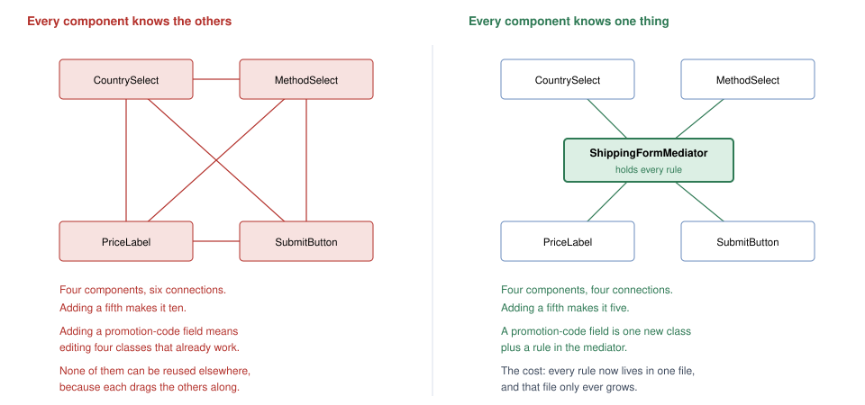
*Figure — Left: four form components all know each other (six links). Right: each knows only the mediator (four links) (course diagram)*

### What it is

**Mediator** makes a group of objects talk through **one coordinator** instead of referencing each other. Each object only reports "this just happened"; the mediator works out how the rest respond — like **air traffic control**: planes talk only to the tower, which holds the spacing and ordering rules.

GoF intent: *define an object that encapsulates how a set of objects interact, so they stop referring to each other explicitly and their interaction can be varied independently.* Participants: **Mediator** (interface for talking to colleagues), **ConcreteMediator** (knows the colleagues, implements the coordination), **Colleague** classes (each knows its mediator and talks to it instead of other colleagues). Some literature calls the mediator a *controller*.

### The problem it solves

A checkout form has four widgets: **country** picker, **delivery-method** picker, **price** label, **submit** button. Picking a country refreshes delivery methods; the new method changes the price; the price situation decides whether submit is clickable; some destinations offer no delivery at all.

If widgets talk directly:

- each holds references to three others — four widgets need **six** links, five need **ten** (n(n−1)/2, roughly quadratic);
- a new "promo code" field changes four tested classes;
- no widget is reusable: if `CountrySelect` calls `methodSelect.reload()`, it cannot go anywhere without `MethodSelect`.

With a mediator each widget has **one** reference: four widgets, four links; a fifth makes five. `CountrySelect` no longer knows a price label exists (or how many widgets do), so another screen can reuse it with its own mediator and rules.

**The honest trade:** dependencies are not removed — **they are relocated** into the mediator, a class that tends to keep growing.

### How it works

1. A **Mediator** interface, e.g. `notify(sender, event)`.
2. Each **component** (colleague) holds a reference to the mediator — nothing else.
3. When something happens, a component calls `mediator.notify(this, event)`.
4. The **concrete mediator** holds all components and rules: "when the country changes, reload methods, then show the price, then enable or disable submit".
5. The mediator calls back **down** into specific components — traffic is **two-way** through one object.

### Structure (UML)

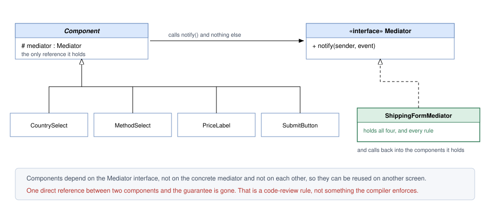
*Figure — Class diagram: components extend Component (which holds a Mediator); ShippingFormMediator implements Mediator and holds all four components (course diagram)*

Widgets report **upward** via `notify`; the mediator instructs the widgets it owns **downward**. Two-way traffic through one hub separates a mediator from an observer.

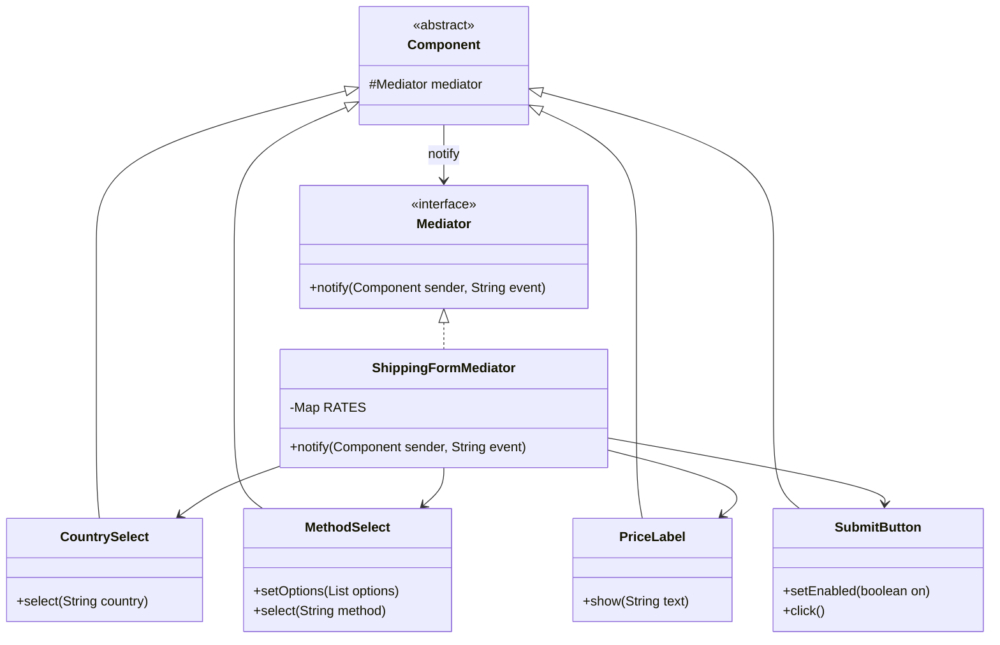

### Java example

`code/lld/ch10/mediator/` has three mediators:

1. **Shipping form** (`ShippingFormMediator` + four components). Only `notify` knows a country choice affects the price. Components are identified by reference (`sender == country`), not strings. Rates are `BigDecimal` — money is never `double`.
2. **Chat room** (`ChatRoom`, `ChatUser`). Users never reference each other; the room routes broadcasts and private messages and applies **moderation** (filtering or blocking unwanted messages) — rules in the mediator, not the users.
3. **Air traffic control** (`ControlTower`, `Flight`). Flights only request landing and report "vacated"; the tower owns the runway and the holding queue.

```java
public interface Mediator { void notify(Component sender, String event); }  // components depend on this only
public abstract class Component {                // base for every widget: its ONLY reference is the mediator
    protected Mediator mediator;
    void setMediator(Mediator mediator) { this.mediator = mediator; }
}
// CountrySelect.select(country): print, then mediator.notify(this, country);   // report up; never call a sibling
// MethodSelect.setOptions(options) defaults to the first; SubmitButton.click() notifies only if enabled.

// ShippingFormMediator.java — the ONLY place that knows how a country change affects methods, price and submit.
private static final Map<String, Map<String, BigDecimal>> RATES = Map.of(
    "Germany", ordered("standard", "5.00", "express", "15.00"),   // ordered(): LinkedHashMap keeps standard first
    "USA", ordered("standard", "8.00", "express", "20.00"),
    "Antarctica", Map.of());

@Override public void notify(Component sender, String event) {
    if (sender == country) {
        Map<String, BigDecimal> available = RATES.getOrDefault(event, Map.of());
        methods.setOptions(new ArrayList<>(available.keySet()));
        if (available.isEmpty()) {
            price.show("shipping not available");
            submit.setEnabled(false);
        } else {
            showPrice();                           // ORDER matters: reload methods first, then price
            submit.setEnabled(true);
        }
    } else if (sender == methods) {
        showPrice();
    } else if (sender == submit) {
        System.out.println("  [mediator] order placed: " + country.selected() + " / " + methods.selected());
    }
}
```

```java
// ChatRoom.java — room rules (moderation, routing) live here, not in the users.
void send(ChatUser from, String to, String text) {
    if (bannedWords.stream().anyMatch(text.toLowerCase()::contains)) {
        from.receive("room", "message blocked by moderation");
        return;
    }
    if (to == null) members.values().stream().filter(u -> u != from).forEach(u -> u.receive(from.name(), text));
    else if (members.containsKey(to)) members.get(to).receive(from.name() + " (private)", text);
    else from.receive("room", to + " is not in the room");
}

// ControlTower.java — aircraft talk to the tower, never to each other.
void requestLanding(Flight f) {
    if (onRunway == null) clear(f);
    else { holding.add(f); System.out.println("  [tower] " + f.callsign() + ": hold, runway busy with " + onRunway.callsign()); }
}
void runwayVacated(Flight f) {
    System.out.println("  [tower] " + f.callsign() + " vacated the runway");
    onRunway = null;
    Flight next = holding.poll();
    if (next != null) clear(next);
}
```

**Output:**

```text
=== 1. Shipping form: widgets coordinated by a mediator ===
  [submit] disabled
  [country] user picked Germany
  [methods] reloaded: [standard, express], default standard
  [price] standard shipping 5.00
  [submit] enabled
  [methods] user picked express
  [price] express shipping 15.00
  [mediator] order placed: Germany / express
  [country] user picked Antarctica
  [methods] reloaded: []
  [price] shipping not available
  [submit] disabled
  [submit] click ignored: button is disabled

=== 2. Chat room ===
  asha sees <room> asha joined
  asha sees <room> ben joined
  ben sees <room> ben joined
  asha sees <room> chen joined
  ben sees <room> chen joined
  chen sees <room> chen joined
  ben sees <asha> standup in 5
  chen sees <asha> standup in 5
  chen sees <ben (private)> coffee first?
  chen sees <room> message blocked by moderation

=== 3. Air traffic control ===
  [tower] AI101: cleared to land
  [tower] BA22: hold, runway busy with AI101
  [tower] LH7: hold, runway busy with AI101
  [tower] AI101 vacated the runway
  [tower] BA22: cleared to land
  [tower] BA22 vacated the runway
  [tower] LH7: cleared to land
```

One user action ("picked Germany") updated three components — and **no component called another**.

### Mediator or Observer?

Both decouple objects; the difference is **what happens to the news**.

| | Mediator | Observer |
|---|---|---|
| What travels | An event **and** the decision on what should follow | Only the event |
| Where reaction logic sits | In one place: the mediator | Spread across the observers, each deciding alone |
| Do the parties know each other? | No — not even how many peers exist | No; the subject only knows it has a list of subscribers |
| Flow | Both ways: colleagues report in, the mediator calls out to them | One way: the subject publishes, observers respond |
| Order of reactions | Written explicitly in the mediator — a reason to choose it | Not part of the contract; observers should not depend on each other's order |

**Practical test: does something need coordinating?** "Country changed; anyone interested, update yourself" is Observer — lighter. "Country changed: refresh methods, *then* price the new default, *then* decide submit" is sequenced coordination — Mediator. **With Observer the listeners decide; with Mediator the hub decides and gives orders.** (A mediator is often *implemented* with observer-style notifications from components.)

### Trade-offs

| Pros | Cons |
|---|---|
| Every widget depends on exactly one thing, so links grow linearly, not quadratically. | Every new rule lands in the mediator, so it keeps growing. |
| All interaction rules sit in one readable, unit-testable class. | Everyone changing the screen edits that file, so merge conflicts (clashing edits) pile up. |
| Widgets are reusable — they no longer drag neighbours along. | To learn why a widget changed you read the mediator, not the widget. |
| A new widget costs one class plus one rule. | It can quietly become a **god object** (a class that knows and does too much). |

**Keeping the mediator from becoming a god object:**

- **Split by area** — one mediator per screen section or workflow, not per application. Two 80-line mediators beat one 160-line one.
- **Keep it to coordination.** Tax and pricing belong in their own classes; the mediator decides *what to call*, not *how to compute* (a Facade respects the same boundary).
- **Reject shortcuts in review.** One widget-to-widget reference breaks the guarantee, and the compiler won't catch it.
- **Dispatch by table, not `if`-chain.** With first-class functions keep a map from event (or sender) to handler — e.g. a Python `dict` of `{event: method}` — so each rule is easy to find.

### When not to use it

- **Only two objects interact** — let them call each other.
- **Interactions are few and stable** — swapping many small links for one big central class pays off only once the tangle is large.
- **Nothing needs coordinating** — components react independently; use Observer.
- **The mediator is already a 400-line god object** — split it into smaller mediators before adding rules.

### Common mistakes

1. **Components calling each other "just this once".**
2. **Computation inside the mediator** (tax, pricing), turning it into a god object.
3. **Confusing it with Facade.** A Facade sits *in front of* a subsystem whose classes are unaware of it; calls flow one way. A Mediator sits *among* peers that know it and report to it; calls flow both ways.
4. **String-typed events everywhere** (`"country"`, `"method"`) breaking silently on a typo. Use the sender reference, an enum, or typed events.

### Real-world examples

- **UI controllers / view-models** coordinating widgets (MVC — Model–View–Controller — controllers, MVVM — Model–View–ViewModel — view-models, Android `ViewModel` wiring). GoF's own example is a dialog box coordinating its widgets.
- **Chat servers** (Slack, WhatsApp): clients send to the server, which routes to rooms and people and moderates.
- **Air traffic control** — the classic analogy.
- **Workflow / saga orchestrators** (a saga is a multi-step process across services, each step with its own undo; e.g. Temporal, Camunda, AWS Step Functions): a checkout orchestrator invokes payment, stock reservation and shipping in sequence and holds the recovery plan for each failure. Ride-hailing dispatch (matching riders and drivers through a central service) has the same shape.
- **Redux store** at app scale (components dispatch actions instead of calling each other; reducers hold the rules); **MediatR** in .NET popularised the name server-side, dispatching each request to its handler.
- **Message brokers / event buses** (servers delivering messages to the right consumers): services hand messages to the broker instead of calling each other; routing configuration is the mediator logic — and can become a god object too.
- **`java.util.Timer` and `Executor`/`ExecutorService`** are often listed (including by the course) as JDK mediators, standing between submitted tasks and the threads running them. A *loose* fit — they don't coordinate peer colleagues like the GoF dialog — so in an interview lead with UI controllers or orchestrators.

### In the interview

**30-second answer:** "Mediator swaps peer-to-peer references for a single hub. Widgets just report events to it; the hub owns the rules and instructs particular widgets. Four widgets go from six links to four, and a fifth gives five instead of ten. The dependencies aren't gone — they're concentrated in one class that I can read and test. The risk is a god object, so I split mediators per screen area or workflow and push computation into its own classes."

**Follow-ups:**

- *Mediator vs Observer?* Observer: each listener decides. Mediator: the hub decides and instructs. When the sequence of reactions matters, pick Mediator.
- *Mediator vs Facade?* Facade simplifies a subsystem for outside callers (one-way, subsystem unaware); Mediator coordinates peers that know it (two-way).
- *How does it relate to Command?* A mediator often creates and dispatches commands.
- *How do you test a mediator?* Fake components; assert which calls it made per event.
- *In microservices (a system split into small, separately deployed services)?* Orchestration (a central saga orchestrator) is mediator-style; choreography (services react to each other's events) is observer-style.

### Self-check

1. **Q:** How many links do 5 fully connected components need, and how many with a mediator? **A:** 10 vs 5.
2. **Q:** Does a mediator remove coupling? **A:** No, it moves it into one class.
3. **Q:** What is the main failure mode? **A:** The mediator grows into a god object.
4. **Q:** Which way does traffic flow in a Mediator vs an Observer? **A:** Mediator two-way; Observer one-way.
5. **Q:** What should *not* go into a mediator? **A:** Business calculations — only coordination.

### TL;DR

Peers talk through **one coordinator** that holds the interaction rules. Links become linear and components reusable, but the coupling **moves** into the mediator — keep it small and split it before it becomes a god object.

---

## 10.5 Memento

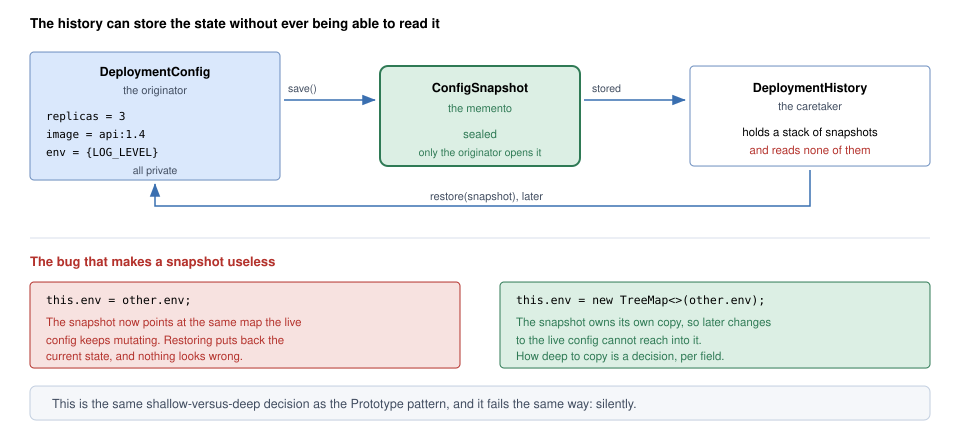
*Figure — The originator (DeploymentConfig) saves a sealed snapshot; the caretaker (DeploymentHistory) stores it without being able to read it; below, the shared-map bug that makes a snapshot useless (course diagram)*

### What it is

**Memento** lets an object record its internal state in a **snapshot** and later **return** to it — while nobody else can **see** inside the snapshot. Like a **save game**: the menu lists saves by name and date and loads one, never understanding the file's contents.

GoF intent: *without breaking encapsulation, capture and externalize an object's internal state so the object can be put back into that state later.* Participants: **Memento** (stores the state; narrow interface to the caretaker, wide one to the originator), **Originator** (creates a memento of its state and uses one to restore itself), **Caretaker** (keeps mementos safe but never operates on or examines their contents).

### The problem it solves

You need a **rollback** (return to the previous working version): record the deployment config before a risky change, and restore it if the rollout (releasing a change to running servers) misbehaves. Having something *outside* read and store every field breaks two things:

1. **Encapsulation.** The history class must understand replicas (copies of the service running side by side), image names (which packaged build runs) and environment variables (named settings passed to a program). Every new config field changes the history class, and private details are exposed.
2. **Atomicity** (all-or-nothing). A field-by-field restore can stop half-way: three fields written, an exception before the fourth, and the config holds a never-real combination.

With Memento the object **takes its own snapshot** and hands out a sealed token **only it can open**. Restore is **one call into the originator**, which controls it and can make it all-or-nothing (our `restore` validates the token first, then assigns every field; nothing in between can fail).

### How it works

| Role | Job | In our code |
|---|---|---|
| **Originator** | Owns the state; produces snapshots (`save`) and returns to them (`restore`). No other class can look inside a snapshot. | `DeploymentConfig` |
| **Memento** | Carries the state; opaque to everyone else. | `DeploymentConfig.Snapshot` (narrow) / private `State` record (wide) |
| **Caretaker** | Decides **when** to save and restore; never looks **inside**. | `DeploymentHistory` |

1. Caretaker: `snapshot = config.save(label)`, stored (usually on a stack).
2. Later, caretaker calls `config.restore(snapshot)`; the originator copies the state back in one step.

**How opacity is enforced in Java.** GoF describes a **narrow interface** (caretaker's view) and a **wide interface** (originator's). We use types: public interface `Snapshot` exposes only `label()`; the data is a **private nested record** `State` only `DeploymentConfig` sees. `restore` checks `instanceof State`, so a forged `Snapshot` (output section 4) is refused. (Strictly, reflection — inspecting/calling private members at run time — or a debugger can still peek; Java access control protects against honest code, not a hostile JVM.) Other options: package-private accessors in Java; the originator as a C++ `friend`; a private nested class in C#; Python and JavaScript have no true enforcement — a leading-underscore convention plus review — though a JavaScript closure *can* hide contents in a way a class field cannot.

### Structure (UML)

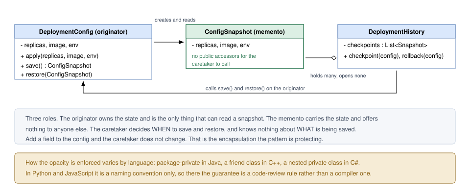
*Figure — Class diagram: DeploymentConfig creates and restores ConfigSnapshot; DeploymentHistory holds a list of snapshots (course diagram)*

`DeploymentHistory` never refers to a configuration field — the quick check for a real Memento: if the caretaker names the fields, you only relocated them.

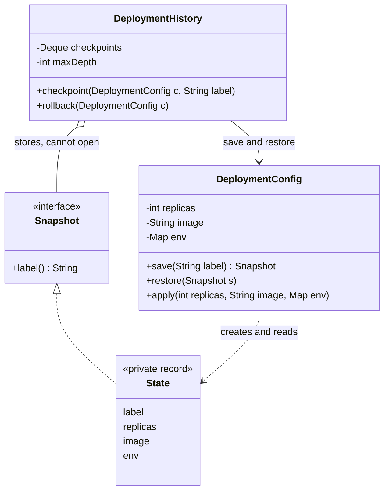

### Java example

Full code: `code/lld/ch10/memento/`. Notice:

- The `State` record's (immutable data class) compact constructor (no parameter list, runs on every creation) does `env = Map.copyOf(env)`, so the snapshot **owns its copy**. Section 1 changes the live map *after* saving (`FEATURE_X`) and rollback still restores the original.
- `DeploymentHistory` is **bounded** (`maxDepth`), dropping the oldest checkpoint when full.
- Section 3 shows the **shallow-copy bug** in isolation.

```java
// DeploymentConfig.java — the ORIGINATOR: owns the state and is the only class that can read a snapshot.
public final class DeploymentConfig {
    /** The NARROW interface the caretaker sees: a label, nothing else. */
    public interface Snapshot { String label(); }

    /** The WIDE interface: private, so only DeploymentConfig can open it. Immutable record. */
    private record State(String label, int replicas, String image, Map<String, String> env) implements Snapshot {
        State { env = Map.copyOf(env); }   // DEEP enough: the snapshot owns its own copy, not the live map
    }

    private int replicas;
    private String image;
    private final Map<String, String> env = new TreeMap<>();

    public Snapshot save(String label) { return new State(label, replicas, image, env); }

    /** One call restores everything: all-or-nothing. */
    public void restore(Snapshot snapshot) {
        if (!(snapshot instanceof State s)) throw new IllegalArgumentException("not a snapshot produced by DeploymentConfig");
        apply(s.replicas(), s.image(), s.env());
    }
    // apply(replicas, image, env) assigns all fields; setEnv(key, value) mutates the live map.
}

// DeploymentHistory.java — the CARETAKER: decides WHEN, never WHAT is inside. Bounded to avoid leaks.
public void checkpoint(DeploymentConfig config, String label) {
    if (checkpoints.size() == maxDepth) {
        DeploymentConfig.Snapshot dropped = checkpoints.removeLast();   // oldest
        System.out.println("  [history] full, dropped oldest checkpoint '" + dropped.label() + "'");
    }
    checkpoints.push(config.save(label));
    System.out.println("  [history] checkpoint '" + label + "' taken");
}
public void rollback(DeploymentConfig config) {
    if (checkpoints.isEmpty()) { System.out.println("  [history] nothing to roll back to"); return; }
    DeploymentConfig.Snapshot s = checkpoints.pop();
    config.restore(s);
    System.out.println("  [history] rolled back to '" + s.label() + "'");
}

// Main.java, sections 3-4
Map<String, String> badSnapshot = liveEnv;                  // shares the live map
Map<String, String> goodSnapshot = new HashMap<>(liveEnv);  // owns a copy
config.restore(() -> "forged");                             // a Snapshot not made by the originator
```

**Output:**

```text
=== 1. Checkpoint, bad rollout, rollback ===
  live: replicas=3 image=api:1.4 env={LOG_LEVEL=info}
  [history] checkpoint 'before 2.0' taken
  live: replicas=10 image=api:2.0 env={FEATURE_X=on, LOG_LEVEL=debug}
  [history] rolled back to 'before 2.0'
  live: replicas=3 image=api:1.4 env={LOG_LEVEL=info}   <- snapshot was a real copy

=== 2. Bounded history ===
  [history] checkpoint 'v1' taken
  [history] checkpoint 'v2' taken
  [history] full, dropped oldest checkpoint 'v1'
  [history] checkpoint 'v3' taken
  [history] rolled back to 'v3'
  [history] rolled back to 'v2'
  [history] nothing to roll back to

=== 3. The shallow-copy bug, shown in isolation ===
  bad snapshot  = {LOG_LEVEL=debug}  <- changed with the live object
  good snapshot = {LOG_LEVEL=info}

=== 4. The caretaker cannot open a snapshot ===
  caretaker can read only: label=peek
  forged snapshot refused: not a snapshot produced by DeploymentConfig
```

### The bug that makes a snapshot useless

A memento holding a **pointer to the very map (or list) the originator keeps mutating** is no snapshot: the "saved" copy drifts with the live object and a restore re-applies today's state. Nothing throws — until someone notices the rollback did nothing. Always copy mutable parts (`Map.copyOf`, `new TreeMap<>(...)`, deep copies — duplicating the objects inside — of nested objects). Same shallow-vs-deep decision as Prototype (Chapter 8).

**Two more things to bound:** history depth — cap it and evict the oldest, since an endless list is a memory leak (memory that grows and is never released) — and **state that cannot be captured** (live sockets — open network connections — open files, data owned by another system). A snapshot claiming to cover those fails, usually long after the mistake.

### Memento or Command undo?

| | Memento | Command undo |
|---|---|---|
| Saved per step | A full copy of the state at that moment | The operation plus the little bit of state its reversal needs |
| How undo happens | Re-install an earlier copy | Execute the opposite operation |
| Memory cost per step | Proportional to the state size | Proportional to one operation |
| Correctness risk | Low — the copy was a genuine state | Every reverse operation must be written correctly |
| Prefer it when | Reversal is tricky or the state is small | Reversal is simple or the state is big |

A drawing app snapshotting the whole canvas per brush stroke runs out of memory — use Command ("stroke added, here are its points"). A wizard (multi-step form) whose step 3 changes six interacting fields is the opposite — one snapshot beats six correct inverses. **Real systems combine them:** occasional snapshots, commands logged in between; to go back, restore the nearest snapshot and replay forward. Databases and event-sourced systems (Chapter 11) do exactly this.

### Trade-offs

| Pros | Cons |
|---|---|
| Rollback is possible while internals stay private. | Memory rises with every stored snapshot, quickly for large state. |
| New originator fields need no caretaker change. | Mutable parts must be deep-copied, or snapshots share live data. |
| The originator controls the restore — all-or-nothing, returning a state that really existed. | Some languages can hide the snapshot only by convention. |
| Checkpoints, wizards, save games, transactions: one mechanism. | Some state (sockets, external systems) cannot be captured at all. |

### When not to use it

- **Large state that changes often** — Command undo or periodic snapshots + replay.
- **State you cannot capture** (sockets, file handles, remote systems).
- **The object is immutable** — an old instance already *is* a perfect snapshot; keep a reference (why functional code rarely names this pattern).
- **Each operation has an easy exact inverse** — per-step Command undo costs less memory.

### Common mistakes

1. Storing references to mutable internals (the shallow-copy bug).
2. Letting the caretaker read or edit the snapshot's fields (encapsulation lost).
3. Restoring field by field from outside (not atomic).
4. Unbounded history.
5. Snapshotting things that cannot really be restored (connections, locks).

### Real-world examples

- **Database transactions** (changes that succeed or fail together): `BEGIN` ... `ROLLBACK`. The DB keeps undo logs; your code never sees them.
- **Version control**: a Git commit snapshots the tree; `git checkout` restores it, and the history (caretaker) needn't understand file contents.
- **Kubernetes Deployments** (Kubernetes runs and manages containers across machines) keep old ReplicaSets (the group of identical running copies per version) as revision history (bounded by `revisionHistoryLimit`, default 10); `kubectl rollout undo` restores a previous pod template — a bounded caretaker like ours.
- **VM / container snapshots** (VM = a whole computer simulated in software; a container is a lighter isolated, packaged process) and infrastructure state files enabling `rollback`.
- **Game saves and checkpoints**; **form wizards** with "back"; **editor undo** for small documents.
- In Java, `Serializable` or a JSON mapper is often *how* a memento is stored when it must outlive the process; a `record` gives an immutable memento in one line.
- **Other languages**: Python — `copy.deepcopy(self.__dict__)` is a quick memento, `dataclasses.replace` for immutable objects; JavaScript — `structuredClone(state)` deep-copies plain data.

### In the interview

**30-second answer:** "With Memento an object packs its state into a token that only the object itself can unpack. The originator produces and consumes snapshots, the memento holds the data, and the caretaker chooses when to save or roll back without ever inspecting the contents. Restoring is a single call the originator controls, so it can be all-or-nothing, and a new field in the object never touches the history code. I'd make sure the snapshot deep-copies mutable parts, bound the history, and compare it with Command undo: Memento stores state, Command stores actions; real systems combine periodic snapshots with a command log."

**Follow-ups:**

- *How do you enforce that the caretaker can't read the memento in Java?* A narrow public interface (e.g. only a label) implemented by a private nested record; or package-private accessors.
- *Memento vs Prototype?* Both copy state. A prototype clone becomes a live object you keep using; a memento does nothing alone — it exists to be handed back to the originator.
- *Memento vs a backup?* A backup targets disaster recovery (recovering systems after a major failure) and lives outside the process (disk, another region — a separate data-centre location); a memento is usually an in-memory checkpoint for undo. Same idea, very different lifetime and cost.
- *Undo for a large document?* Command undo per edit plus periodic snapshots, so undoing far back doesn't replay thousands of commands.
- *How does it relate to serialization?* Serialization is one *storage format* for a memento; the pattern is about *access* — only the originator may look inside.

### Self-check

1. **Q:** Name the three roles. **A:** Originator, memento, caretaker.
2. **Q:** Who may read the memento's contents? **A:** Only the originator.
3. **Q:** Why copy the `env` map in the snapshot? **A:** Otherwise the snapshot shares the live map and changes with it.
4. **Q:** When is Command undo better than Memento? **A:** When state is large and each action has an easy inverse.
5. **Q:** What does Kubernetes' `revisionHistoryLimit` correspond to? **A:** A bounded caretaker history.

### TL;DR

The object **snapshots itself**; the caretaker **stores but cannot read**; restore is **one call the originator controls**. **Deep-copy** mutable parts, **bound** the history, and choose Memento (store state) vs Command (store actions) by which is smaller.

---

## 10.6 Interpreter

*(Not covered by a lesson in the course beyond its one-line entry in the behavioral-patterns table; this section is from the GoF book and standard practice.)*

### What it is

**Interpreter** represents the **grammar** of a small language as classes — **one class per grammar rule** — and evaluates a sentence by building a **tree** of those objects and asking the root to `interpret` itself. Like a calculator reading `2 + 3 * 4`: it knows `*` binds tighter, builds `2 + (3 * 4)` and works from the inside out.

- **Grammar** — the rules for valid sentences, e.g. "an expression is terms joined by `+` or `-`".
- **DSL (domain-specific language)** — a small language for one job: search filters, pricing rules, feature-flag conditions, cron schedules (a compact text format for repeating times, like "every weekday at 9").
- **AST (abstract syntax tree)** — the tree form of a sentence: operators as inner nodes, numbers/variables as leaves.
- **Terminal expression** — a leaf rule (a number, a variable).
- **Nonterminal expression** — a rule made of other expressions (addition, multiplication).
- **Context** — outside information evaluation needs, e.g. current variable values.

### The problem it solves

Some problems recur as *sentences*: "price * qty − discount", "age > 18 AND country = IN", "every weekday at 9:00". Hard-coding each in Java means a redeploy (rebuilding and releasing the application) per new rule. Letting business users write rules in a tiny language and interpreting them turns rules into **data**. Interpreter is the simplest OO way to evaluate such a language when the grammar is **small**.

### How it works

1. **Write the grammar** (here in EBNF, a standard notation):
   ```text
   expr   := term   (('+' | '-') term)*
   term   := factor (('*' | '/') factor)*
   factor := NUMBER | NAME | '(' expr ')' | '-' factor
   ```
2. **One class per rule**: `Constant` and `Variable` (terminals), `Negate` and `Binary` (nonterminals), all implementing `Expression.interpret(context)`.
3. **Build the AST.** GoF deliberately leaves **parsing** (reading text and building a structure such as the AST) out of the pattern; any parser works. Ours is *recursive-descent*: one method per grammar rule, calling the others.
4. **Interpret**: the root calls `interpret` on its children and combines results (*recursive* evaluation).
5. **Reuse the tree**: parse once, interpret many times with different contexts.

### Structure (UML)

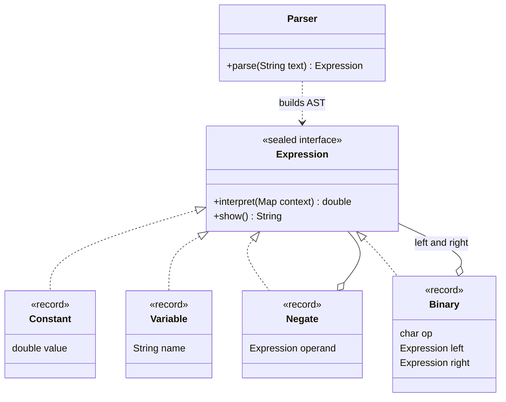

The AST for `price * qty - discount`:

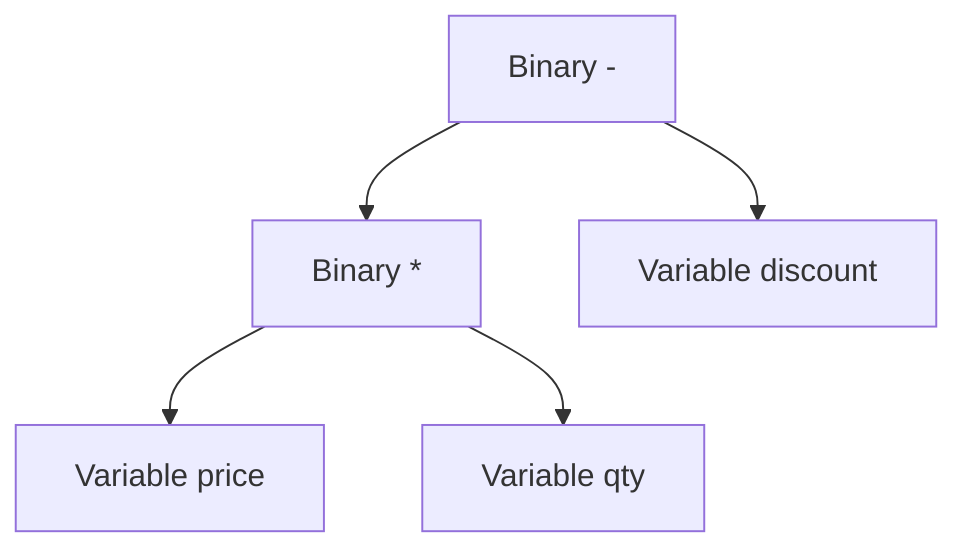

The structure is a **Composite** (Chapter 9): leaves and inner nodes share one interface. Interpreter is essentially "Composite + an `interpret` operation".

### Java example

`code/lld/ch10/interpreter/`: `Expression` is a **sealed interface** (only the four listed records may implement it), each record one grammar rule; `Parser` is recursive-descent with `expr`, `term`, `factor` mirroring the grammar. Errors (unknown variable, division by zero, bad syntax) get clear messages.

> **Why `double` here?** This is a general arithmetic calculator teaching the pattern; names like `price` are sample data. A real pricing or promotion DSL must use `BigDecimal` (with an explicit `RoundingMode` for division), as the domain code elsewhere in this chapter does — `double` cannot represent values like 0.10 exactly.

```java
// Expression.java — AbstractExpression: one class per grammar rule; each knows how to interpret itself.
public sealed interface Expression
        permits Expression.Constant, Expression.Variable, Expression.Negate, Expression.Binary {
    double interpret(Map<String, Double> context);   // evaluate against variable name -> value
    String show();                                   // print the tree as fully-parenthesised text

    /** TerminalExpression: a literal number. */
    record Constant(double value) implements Expression {
        public double interpret(Map<String, Double> ctx) { return value; }
        ...
    }
    /** TerminalExpression: a variable looked up in the context. */
    record Variable(String name) implements Expression {
        public double interpret(Map<String, Double> ctx) {
            Double v = ctx.get(name);
            if (v == null) throw new IllegalArgumentException("unknown variable '" + name + "'");
            return v;
        }
        ...
    }
    /** NonterminalExpression: unary minus. */
    record Negate(Expression operand) implements Expression {
        public double interpret(Map<String, Double> ctx) { return -operand.interpret(ctx); }
        ...
    }
    /** NonterminalExpression: + - * / . Interprets its children, then combines. */
    record Binary(char op, Expression left, Expression right) implements Expression {
        public double interpret(Map<String, Double> ctx) {
            double l = left.interpret(ctx), r = right.interpret(ctx);
            return switch (op) {
                case '+' -> l + r;
                case '-' -> l - r;
                case '*' -> l * r;
                case '/' -> {
                    if (r == 0) throw new ArithmeticException("division by zero in " + show());
                    yield l / r;
                }
                default -> throw new IllegalStateException("unknown operator " + op);
            };
        }
        public String show() { return "(" + left.show() + " " + op + " " + right.show() + ")"; }
    }
}

// Parser.java — recursive descent: one method per grammar rule. Parsing is NOT part of GoF Interpreter.
private Expression expr() {
    Expression left = term();
    while (peek('+') || peek('-')) {
        char op = src.charAt(pos++);
        left = new Expression.Binary(op, left, term());   // left-associative
    }
    return left;
}
// term() is the same over '*' and '/' with factor(); factor() handles '-' factor, '(' expr ')', numbers and names,
// and errors report "... at position N in \"text\"".

// Main.java
Expression ast = Parser.parse(text);          // build the tree once...
double value = ast.interpret(context);        // ...interpret it (could be many times)
```

**Output:**

```text
context: {a=7.0, b=3.0, discount=50.0, price=250.0, qty=3.0}
  price * qty - discount   AST ((price * qty) - discount)       = 700.0
  2 + 3 * 4                AST (2 + (3 * 4))                    = 14.0
  (2 + 3) * 4              AST ((2 + 3) * 4)                    = 20.0
  (a + b) * (a - b)        AST ((a + b) * (a - b))              = 40.0
  -a + 10 / 4              AST ((-a) + (10 / 4))                = -4.5
  price / (qty - 3)        ERROR: division by zero in (price / (qty - 3))
  price * tax              ERROR: unknown variable 'tax'
  2 + * 3                  ERROR: unexpected '*' at position 4 in "2 + * 3"

Same tree, different contexts (parse once, evaluate many):
  qty=1 -> 200.0
  qty=2 -> 450.0
  qty=4 -> 950.0
```

Operator precedence (which operator binds first: `2 + 3 * 4` = 14, `(2 + 3) * 4` = 20) comes from the **grammar**: `term` handles `*` and `/` below `expr`, so they bind tighter.

### Trade-offs

| Pros | Cons |
|---|---|
| Easy to change and extend the grammar: a new rule is a new class. | One class per rule: large grammars become a jungle of classes. |
| Each rule's evaluation is small and testable. | Tree-walking is slow compared with compiling to bytecode (compiled JVM instructions). |
| Rules become data (stored in a DB, edited by users). | Adding a new *operation* (pretty-print, type-check, optimise) means touching every class — that is where **Visitor** (Chapter 11) comes in. |
| Parse once, evaluate many times. | You still need a parser, which the pattern does not give you. |

### When not to use it

- **The grammar is large or complex** (a real programming language, SQL) — use a parser generator (writes a parser from a grammar file) such as **ANTLR** and a compiler/visitor design.
- **Performance matters** with millions of evaluations — compile to bytecode or use an existing engine.
- **An existing language fits** — regular expressions (text-matching patterns), SpEL (Spring's expression language), JSONPath (queries into JSON), CEL (Google's Common Expression Language), or a scripting engine (an embedded interpreter for a full language such as JavaScript).
- **Security matters.** Never let users run a *general-purpose* script engine on your server; a small restricted DSL is safer precisely because it can do only what its grammar allows.

### Common mistakes

1. **Mixing parsing and evaluation** in one pass, re-parsing on every evaluation.
2. **Ignoring precedence and associativity** (associativity groups equal-precedence operators: `8 - 3 - 2` must be `(8 - 3) - 2`; our `expr` loop builds left-associative trees).
3. **Poor error messages** — always report the position.
4. **Adding many operations to every node** instead of Visitor or pattern matching (a `switch` branching on an object's type and unpacking its fields).
5. **Growing a "tiny" DSL** into an accidental programming language.

### Real-world examples

- **`java.util.regex.Pattern`**: compiling a regex builds an internal tree of nodes that a `Matcher` walks — a classic interpreter.
- **Spring Expression Language (SpEL)**: `SpelExpressionParser` parses `#user.age > 18` into an AST of `SpelNode`s; `getValue()` evaluates it against a context. Jakarta Expression Language (EL) is similar.
- **SQL engines** evaluate `WHERE` clauses as expression trees; **spreadsheet formulas** (`=SUM(A1:A3)*2`) are a DSL.
- **Rule and pricing engines**: e-commerce promotions ("10% off if cart > 999 and category = electronics"), feature-flag targeting rules, and Google's **CEL** in Kubernetes validation rules and IAM (identity and access management — who may do what) conditions.
- **Cron expressions** (`0 9 * * MON-FRI`), e.g. Quartz's (a Java job scheduler) `CronExpression`.

### In the interview

**30-second answer:** "Interpreter models a small language's grammar as classes, one per rule — terminals like numbers and variables, nonterminals like addition. A sentence is parsed into an AST made of those objects and evaluated by calling `interpret` on the root with a context. It's really Composite plus an evaluate operation. It's great for small DSLs like pricing rules or filters; for big grammars I'd use a parser generator like ANTLR, and when I need many operations over the tree I'd switch to Visitor or sealed types with pattern matching."

**Follow-ups:**

- *Is parsing part of the pattern?* No. GoF assumes the tree exists; parsing is separate (hand-written recursive descent, or ANTLR).
- *Interpreter vs Visitor?* Interpreter puts evaluation **inside** node classes; Visitor takes operations **out** into separate classes. A real interpreter usually starts as the first and becomes the second when a second pass (type-check, optimise, pretty-print) arrives.
- *Interpreter vs Composite?* Composite is the structure; Interpreter uses it to evaluate a language.
- *How would you make it faster?* Cache parsed trees; constant-fold (pre-compute variable-free parts); or compile to bytecode/lambdas once.
- *How do you design a rule engine for promotions?* A small grammar (comparisons, AND/OR/NOT, cart fields), rules stored as text, parsed once into cached trees, evaluated per cart.

### Self-check

1. **Q:** What is the difference between terminal and nonterminal expressions? **A:** Terminals are leaves (numbers, variables); nonterminals combine other expressions (operators).
2. **Q:** What is the "context"? **A:** External information needed for evaluation, such as variable values.
3. **Q:** Why does `2 + 3 * 4` give 14? **A:** The grammar puts `*` in `term`, below `expr`, so it binds tighter.
4. **Q:** Name a JDK class that is an interpreter. **A:** `java.util.regex.Pattern`.
5. **Q:** When should you not use it? **A:** Large grammars, performance-critical evaluation, or when an existing language fits.

### TL;DR

One class per grammar rule; parse a sentence into an **AST**; evaluate by calling `interpret` recursively with a **context**. Perfect for **tiny DSLs**; for big grammars use a parser generator and Visitor.

---

## 10.7 Chapter recap: the six patterns side by side

| Pattern | The object you create | The question it answers | Classic JDK / real example | Often confused with |
|---|---|---|---|---|
| Chain of Responsibility | A handler per check | *Who* should handle this request? | Servlet filters, logging handlers | Decorator (all layers run) |
| Command | An object per request | How do I store, queue or undo *this request*? | `Runnable`, `UndoManager` | Strategy (how vs what) |
| Iterator | A cursor object | How do I walk this without knowing its shape? | `Iterator`, `Spliterator`, `ResultSet` | Visitor (what to do at each node) |
| Mediator | One coordinator | How do many objects cooperate without knowing each other? | UI controllers, chat servers, saga orchestrators | Observer (broadcast only), Facade |
| Memento | A sealed snapshot | How do I go back to an earlier state safely? | DB rollback, Git, `kubectl rollout undo` | Command undo, Prototype |
| Interpreter | A node per grammar rule | How do I evaluate sentences of a small language? | `Pattern`, SpEL | Composite, Visitor |

**Interview combo facts to remember:**

- The request flowing through a **Chain of Responsibility** is frequently a **Command** object.
- A **Mediator** often creates and dispatches **Commands**.
- **Memento + Command** together give scalable undo (snapshots + replay).
- **Iterator + Composite** walk trees; **Interpreter = Composite + evaluate**; when operations multiply, move to **Visitor** (Chapter 11).

### Self-check (whole chapter)

1. **Q:** Which two GoF behavioral patterns are class-scoped (inheritance-based)? **A:** Template Method and Interpreter.
2. **Q:** A request must pass auth, then a rate limit, then validation, and any step can reject it. Which pattern? **A:** Chain of Responsibility.
3. **Q:** You need undo/redo for a text editor. Which patterns? **A:** Command (per edit), optionally Memento for periodic snapshots.
4. **Q:** Five form widgets depend on each other's values. Which pattern? **A:** Mediator.
5. **Q:** Your team needs business users to write discount rules. Which pattern? **A:** Interpreter (a small DSL), possibly with Specification (Chapter 11).

### TL;DR

Behavioral patterns turn **hidden control flow** into **named objects**: handlers (CoR), requests (Command), cursors (Iterator), coordinators (Mediator), snapshots (Memento) and grammar nodes (Interpreter). Each one buys flexibility with indirection — use it when the flexibility is a real requirement, not "just in case".
