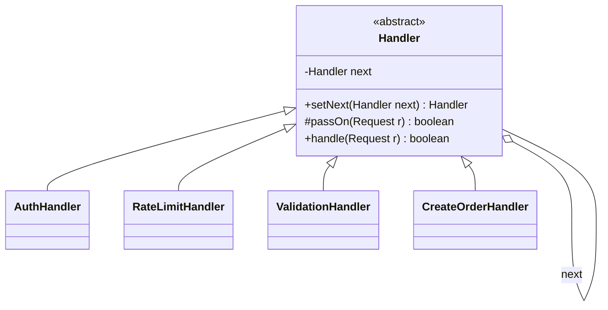
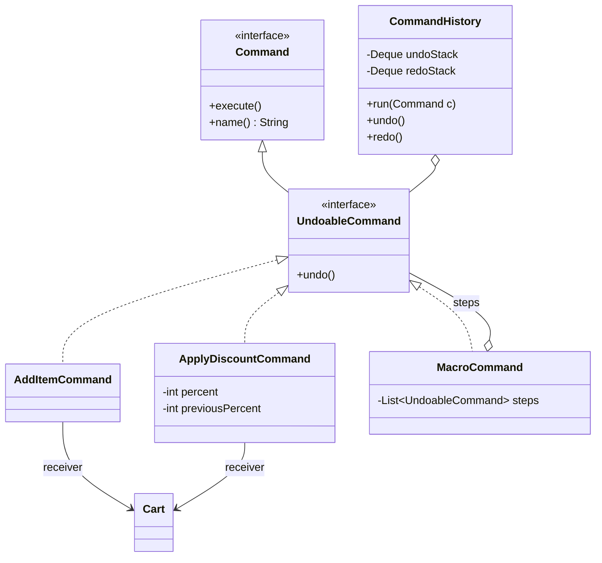
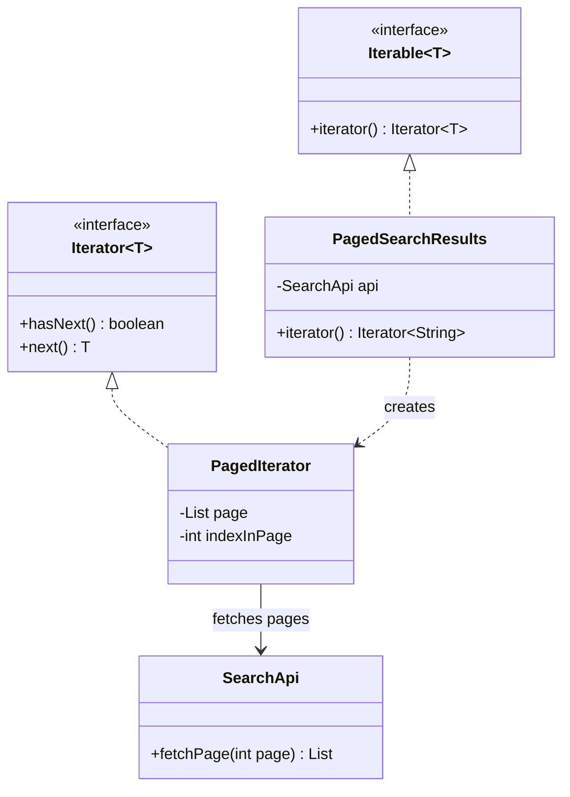
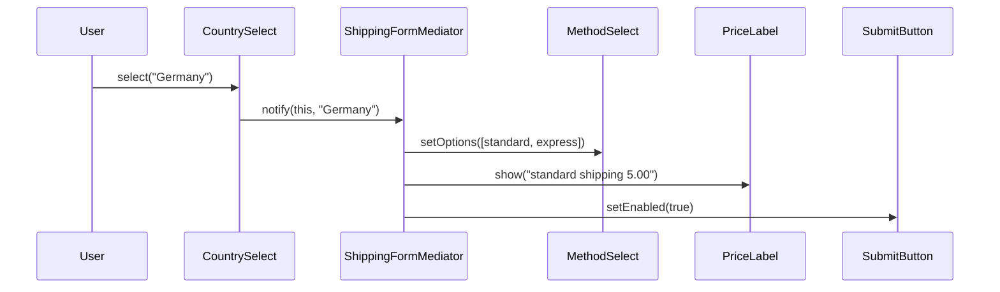
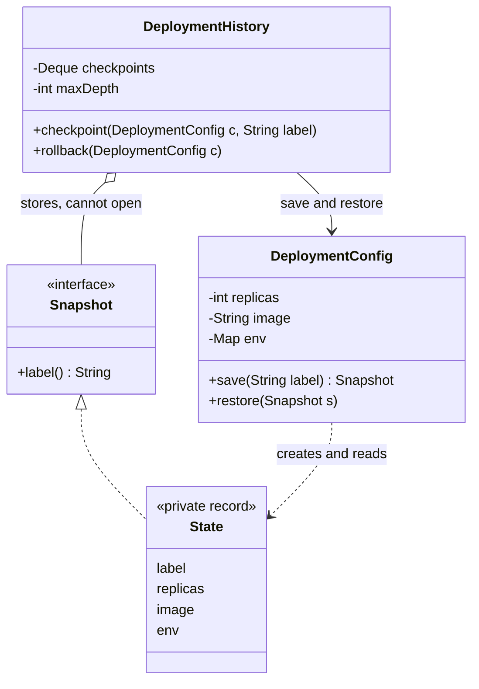
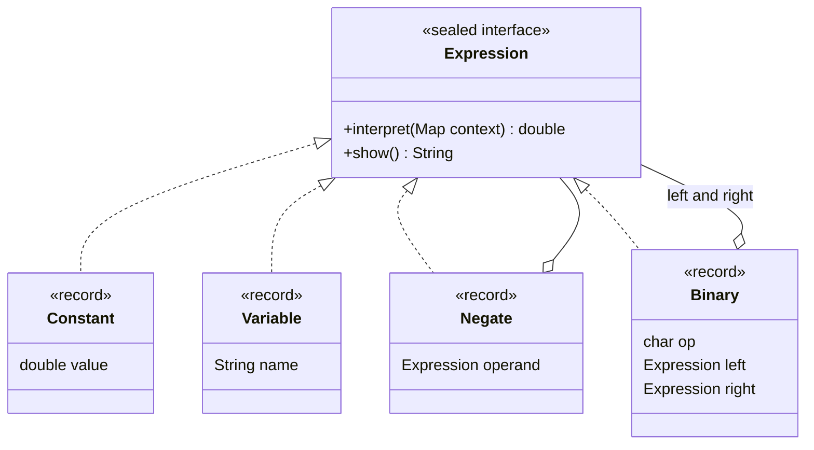

# Chapter 10 — Behavioral Design Patterns (Part 1) · Study Edition

> **Study edition.** Every topic of the full chapter, with the padding removed. For complete code listings, full outputs and extra follow-ups, see the Full Edition (`README.md`).
>
> **What you will learn.** What behavioral patterns are, and six of them: **Chain of Responsibility, Command, Iterator, Mediator, Memento** and **Interpreter** — definition, problem, class diagram, core Java 21 code, real uses and interview answers. Chapter 11 covers Observer, State, Strategy, Template Method, Visitor and some non-GoF patterns.

**How to run the code**

```bash
cd chapters/10-patterns-behavioral-1/code
javac --release 21 -d /tmp/lld_10 $(find . -name '*.java')
java -cp /tmp/lld_10 lld.ch10.chain.Main        # also: command, iterator, mediator, memento, interpreter
```

---

## 10.0 Behavioral patterns: the big picture

### What it is

Creational patterns (Ch 8) are about **how objects are made**; structural (Ch 9) about **how they are put together**. **Behavioral patterns** are about **how objects share work and talk** — who is responsible for what, and who calls whom (in a kitchen: who hears about an order first, who passes it on, who can cancel it).

They cut coupling, untangle many-to-many communication and let behaviour change **at run time**.

### The eleven GoF behavioral patterns

The GoF book (*Design Patterns*, Gamma, Helm, Johnson, Vlissides, 1994) lists eleven:

| Pattern | One-line intent | Ch |
|---|---|---|
| Chain of Responsibility | Pass a request down handlers; each handles, stops or forwards it. | 10 |
| Command | Wrap a request in an object to store, queue, log or reverse it. | 10 |
| Interpreter | A small language's grammar as classes; evaluate sentences. | 10 |
| Iterator | Walk a collection without seeing how it is stored. | 10 |
| Mediator | Route communication through one coordinator. | 10 |
| Memento | Snapshot state and restore it, keeping it private. | 10 |
| Observer | Notify all dependants when one object changes. | 11 |
| State | Change behaviour when internal state changes. | 11 |
| Strategy | Pick an interchangeable algorithm at run time. | 11 |
| Template Method | Base class fixes the skeleton; subclasses fill steps. | 11 |
| Visitor | Add an operation without changing the classes. | 11 |

**Class vs object scope.** *Class* behavioral patterns use **inheritance**: only **Template Method** and **Interpreter**. All others are *object* patterns using **composition**, so they can be rewired at run time.

**The common idea:** take behaviour hidden in a big method (an `if`-chain, a hard-coded call, a loop) and turn it into an **object** you can name, pass, swap, store and test.

---

## 10.1 Chain of Responsibility

### What it is

**Chain of Responsibility (CoR)** sends a request through a row of **handlers**. Each handler either handles it, rejects it, or forwards it to its successor. The sender talks only to the first handler and never learns which one handled it.

GoF intent: *avoid coupling sender to receiver by giving several objects a chance to handle the request; chain them and forward until one does.* Participants: **Handler**, **ConcreteHandler**, **Client**. Analogy: support escalation — level 1, level 2, engineer; you dialled one number.

### The problem it solves

Before creating an order a request must pass authentication, rate limiting and validation. In one method: the method grows with each rule; the **order of checks is hidden** yet matters; routes needing only some checks lead to flags or copies. CoR makes **each check a small object** linked into a line, so **the line is configuration, not logic**: a new rule = one class + one wiring line; reordering touches only wiring; each route can have its own chain.

### How it works

A **Handler** type has `handle(request)` and a **next** reference; each **concrete handler** checks, then **stops** or **passes on**; a **terminal handler** does the real work; the chain is **wired once** at start-up (`auth.setNext(rateLimit).setNext(validate).setNext(createOrder)`) and the client calls only the **first** handler.

### Structure (UML)


*Figure — Abstract Handler holds `next`; concrete handlers extend it; CreateOrderHandler is the tail (course diagram)*

> **Our code vs the course.** The course's `passOn` returns `true` when there is no next handler; ours **throws**, because silent "success" when the chain runs out is exactly the invisible failure this pattern is prone to.



### Java example

`lld.ch10.chain` shows four flavours: (1) **classic linked handlers** with explicit outcomes (`false` = rejected, `passOn` = continue; `passOn` throws if there's no terminal handler); (2) an **approval chain** (`Approver`, `BigDecimal` limits) where the first capable approver wins and the chain is just data; (3) **servlet-style filters** where `next` is an **argument** (`chain.doFilter(...)`), so a filter can act before *and after* the rest, or stop by not calling it — a `FilterChain` holds a position, so one per request; (4) **logging levels**, where every handler acts if severe enough and always passes on — a pipeline-like variant.

```java
// File: code/lld/ch10/chain/Handler.java
public abstract class Handler {
    private Handler next;

    public Handler setNext(Handler next) {
        this.next = next;
        return next;
    }

    /** Forwards the request. Falling off the end means the chain has no terminal handler: a wiring bug. */
    protected boolean passOn(Request request) {
        if (next == null) {
            throw new IllegalStateException(
                getClass().getSimpleName() + " tried to pass on, but the chain has no terminal handler");
        }
        return next.handle(request);
    }

    public abstract boolean handle(Request request);
}

// File: code/lld/ch10/chain/AuthHandler.java
final class AuthHandler extends Handler {
    @Override
    public boolean handle(Request r) {
        if (r.token() == null || r.token().isBlank()) {
            System.out.println("  [auth] rejected: missing token");
            return false;                      // explicit outcome: the chain stops here
        }
        System.out.println("  [auth] ok for " + r.user());
        return passOn(r);                      // explicit outcome: continue
    }
}

// File: code/lld/ch10/chain/Main.java (wiring)
        // Order is a design decision: auth BEFORE rate limiting so the limiter can key on the user,
        // and so anonymous traffic cannot burn a real user's quota.
        Handler pipeline = new AuthHandler();
        pipeline.setNext(new RateLimitHandler(2))
                .setNext(new ValidationHandler())
                .setNext(new CreateOrderHandler());
        // ...
```

In the output, a tokenless request stops at auth (later stages never run); an expense above every limit gets an explicit `REJECTED`; a `DEBUG` log reaches only the console while an `ERROR` reaches all three handlers.

Full runnable code: code/lld/ch10/chain/ (see the Full Edition).

### Trade-offs

| Pros | Cons |
|---|---|
| New stage = one class + one wiring line (Open/Closed). | A request's route is spread over the wiring and several files. |
| Each stage testable against a stub successor; per-route chains. | Nothing verifies the chain is complete or correctly ordered. |
| Sender doesn't know who handles. | A handler that neither handles nor forwards makes the request vanish. |

**Order is a design decision no tool verifies:** auth first lets the limiter count per *user*; rate-limit first keys on IP but shields expensive auth from floods. **Comment the reason beside the wiring.**

### When not to use it

- Every request always goes through every stage in fixed order — four calls in one method are clearer.
- Handlers need each other's results — that's a *pipeline*; pass a context object step by step.
- No terminal handler exists (add one first).
- Long chain on a very hot path.

### Common mistakes

1. **The swallowing bug:** a handler returns without `passOn` — the request silently vanishes. Give every path an explicit outcome; test with a stub successor.
2. **No terminal handler**; 3. **wrong, undocumented order**; 4. **handlers that construct each other**; 5. **sharing a stateful `FilterChain`** across requests.

### Real-world examples

Servlet filters and Spring Security's `SecurityFilterChain`; Spring `HandlerInterceptor.preHandle` (return `false` to stop); HTTP middleware (Express `next()`, Django, ASP.NET Core, Go handler wrappers), OkHttp interceptors, Netty `ChannelPipeline`; `java.util.logging` parent handlers; exception propagation; DOM event bubbling (`stopPropagation()`); approval and support-escalation workflows.

### In the interview

**30-second answer:** "Chain of Responsibility splits a series of checks into separate handler objects, each linked only to its successor. The request moves down the line until some handler completes or refuses it. Only the wiring knows the order, so adding or reordering rules is cheap. Servlet filters and HTTP middleware are the everyday examples. The classic bug is a handler that forgets to pass on, so I give every path an explicit outcome and put a terminal handler at the end."

- *vs Decorator?* Decorator wrappers all run and always delegate inward to *add* behaviour; a CoR handler may **end** the request.
- *vs pipeline?* A pipeline runs **all** steps; if no stage can stop the flow, it's a pipeline, not CoR.

### Self-check

1. **Q:** What does each handler reference? **A:** Only the next handler, via the abstract type.
2. **Q:** Most common CoR bug? **A:** A handler that neither handles nor passes on — the request disappears.
3. **Q:** Why do frameworks pass `next` as a parameter? **A:** A missing `next(...)` is visible in the handler body, and the handler can work before and after the rest.

### TL;DR

A request walks a line of handlers; each handles, rejects, or passes on. The chain is data — but **order matters**, **always have a terminal handler**, and **never swallow a request**.

---

## 10.2 Command

### What it is

**Command** packages a request ("add 2 widgets to the cart") as an **object** holding everything needed to perform it later. Then you can **store it, queue it, log it, retry it, run it on a worker thread** — and, if it knows its inverse, **undo** it.

GoF intent: *encapsulate a request as an object, so clients can be parameterised with requests, requests can be queued or logged, and operations can be undone.* Analogy: a waiter (invoker) writes an order slip (command) for the cook (receiver) to act on later.

### The problem it solves

`cart.setDiscount(10)` runs and is forgotten. That fails once you need **undo**, **a queue**, **a log of intent**, **retry**, or **one action with many triggers** (menu, hot-key, script). Command gives the request a body that outlives the call.

### How it works

Name the **three roles** — invoker, command, receiver — plus the client. GoF participants: Command, ConcreteCommand, Client, Invoker, Receiver.

| Role | Job | In our code |
|---|---|---|
| **Command** | Interface with `execute()` (optionally `undo()`). | `Command`, `UndoableCommand` |
| **Concrete command** | Stores receiver + arguments; performs (and reverses) one operation. | `AddItemCommand`, `ApplyDiscountCommand`, `MacroCommand` |
| **Receiver** | Object whose state really changes; unaware of commands. | `Cart` |
| **Invoker** | Triggers commands and records them; unaware of carts. | `CommandHistory`, `ExecutorService` |
| **Client** | Builds a command and gives it its receiver. | `Main` |

Invoker: `execute()` then push on an **undo stack**; **undo** pops, calls `undo()`, pushes on a **redo stack**; **redo** reverses that; **a fresh command clears redo**.

### Structure (UML)


*Figure — Command interface with execute/undo, two concrete commands, Cart as receiver, CommandHistory as invoker (course diagram; its `undoLast`/`removeLast` are `undo`/`remove` in our code)*

`previousPercent` is the one field that makes undo correct; `CommandHistory` never mentions `Cart`, so one history serves the whole app.



### Java example

- `Command` has **one abstract method**, so a lambda is a command; only honestly reversible commands implement `UndoableCommand`, and `CommandHistory` keeps irreversible ones out of the undo stack.
- `ApplyDiscountCommand` **captures the old value in `execute()`**; the cart starts at 5% to show "undo = set to 0" would be wrong.
- `MacroCommand` is a **Composite** of commands: executes in order, undoes in **reverse**.
- `Runnable` + `ExecutorService` is the JDK's version (command + invoker on a worker thread).

```java
// File: code/lld/ch10/command/Command.java
@FunctionalInterface
public interface Command {
    void execute();

    default String name() { return getClass().getSimpleName(); }
}

// File: code/lld/ch10/command/UndoableCommand.java
public interface UndoableCommand extends Command {
    void undo();
}

// File: code/lld/ch10/command/ApplyDiscountCommand.java
final class ApplyDiscountCommand implements UndoableCommand {
    private final Cart cart;
    private final int percent;
    private int previousPercent;          // filled in by execute()
    // ... constructor

    @Override
    public void execute() {
        previousPercent = cart.discountPercent();   // capture BEFORE changing
        cart.setDiscount(percent);
    }

    @Override public void undo()   { cart.setDiscount(previousPercent); }
    @Override public String name() { return "ApplyDiscount(" + percent + "%)"; }
}

// File: code/lld/ch10/command/CommandHistory.java
public final class CommandHistory {
    private final Deque<UndoableCommand> undoStack = new ArrayDeque<>();
    private final Deque<UndoableCommand> redoStack = new ArrayDeque<>();

    public void run(Command command) {
        command.execute();
        if (command instanceof UndoableCommand u) {
            undoStack.push(u);
            redoStack.clear();     // a new action destroys the "future" you could have redone
            System.out.println("  ran  " + command.name());
        } else {
            System.out.println("  ran  " + command.name() + " (irreversible: kept out of history)");
        }
    }

    public void undo() {
        if (undoStack.isEmpty()) { System.out.println("  nothing to undo"); return; }
        UndoableCommand c = undoStack.pop();
        c.undo();
        redoStack.push(c);
        System.out.println("  undo " + c.name());
    }
    // ... redo() mirrors undo(): pop from redo, execute(), push on undo
}
```

**Output (excerpt):** after undoing the discount the cart shows `discount=5%   <- discount restored to the recorded 5%, not 0%`; running a new command then makes `redo` print `nothing to redo`; `SendReceipt` runs but is `kept out of history`.

Full runnable code: code/lld/ch10/command/ (see the Full Edition).

### Undo must restore, not recompute

"Reset to 0" is a **guess**. Rule: **`execute` records what `undo` needs** (the fields it overwrites). History is **LIFO** — a stack. **When undo is a lie** (email sent, card charged): keep it out of history, or use **compensation** (a **refund** — both events stay on record).

### Trade-offs

| Pros | Cons |
|---|---|
| Request outlives the call: undo/redo, queues, audit, retry. | One class per action; an extra hop when reading code. |
| Generic invoker — one history for all commands; macros compose. | Each command must capture enough to run later and reverse. |
| One action backs menu, hot-key, script and API. | One faulty `undo` corrupts the whole history. |

### When not to use it

Simple immediate calls nobody undoes, queues or logs; undo that isn't really possible (use compensation); plain deferral (a lambda/`Runnable` already is a command); commands that must outlive the process (use a durable queue or event log).

### Common mistakes

1. Recomputing in `undo` instead of restoring. 2. Not clearing redo on a new command. 3. Business logic in the invoker. 4. Capturing a mutable object instead of values. 5. Unbounded history.

### Real-world examples

Editor undo and `javax.swing.undo.UndoManager`; **`Runnable`/`Callable`** with `ExecutorService`/`Thread` as invokers; Swing `Action`, .NET `ICommand`; Redux actions; job queues (Celery, Sidekiq, Kafka messages), outbox tables; DB migrations with `up`/`down`; event sourcing (Ch 11).

### In the interview

**30-second answer:** "Command wraps a request, with its receiver and arguments, in an object — so it can be kept, queued, logged, retried or reversed. The invoker triggers and records commands without knowing what they touch; each command performs and reverses one operation; the receiver holds the state. For undo, `execute` captures the old value and `undo` restores it; history is a stack and a new command clears redo. Irreversible actions get compensation. In Java, `Runnable` plus an `ExecutorService` is the everyday form."

- *vs Strategy?* Strategy = *how* a job is done, swapped by the caller. Command = *which* job, with arguments, kept to run later or reverse.
- *vs Memento for undo?* Command stores the **action** + a little state (cheap); Memento stores the **whole state** (always correct). Real systems combine them.

### Self-check

1. **Q:** What must a command carry? **A:** Its receiver, all arguments, and any state needed for undo.
2. **Q:** Why store `previousPercent`? **A:** So undo restores the real previous value instead of guessing.
3. **Q:** What happens to redo when a new command runs? **A:** It is cleared.

### TL;DR

Request as object: **invoker** runs it, **command** knows do/undo, **receiver** changes. Undo **restores captured state**, history is a **stack**, irreversible actions get **compensation**. A lambda is a command when you only need deferral.

---

## 10.3 Iterator

### What it is

**Iterator** lets you visit a collection's elements **one at a time without knowing how they are stored** — array, list, tree, or a paginated remote API.

GoF intent: *provide sequential access to an aggregate's elements without exposing its representation.* Participants: **Iterator**, **ConcreteIterator** (tracks position), **Aggregate** (creates iterators), **ConcreteAggregate**. Analogy: a TV remote's "next channel".

### The problem it solves

- `get(i)` loops assume an array; move the data into a tree or remote service and every loop breaks.
- Many sources **can't be indexed**: trees (several visit orders), graphs (must track visited), paged APIs. Each caller re-implementing traversal re-implements paging, some wrongly.

Iterator moves walking into a separate object answering `hasNext` and `next`. **The position lives in the iterator, never in the collection** — so two traversals can run at once, and `iterator()` must return a **new** iterator each time.

### How it works

The **aggregate** implements `Iterable<T>` (`iterator()`); the **iterator** implements `Iterator<T>` (`hasNext()`, `next()`, optional `remove()`) and keeps its own **cursor**; the client loops `while (it.hasNext()) use(it.next());` — which is what `for (T x : collection)` compiles to.

### Structure (UML)


*Figure — SearchResults hands out a SearchResultIterator, which calls SearchApi page by page (course diagram)*

Here `hasNext` may fetch a page — never assume it is cheap or side-effect-free.



### Java example

`lld.ch10.iterator` shows: (1) a **paged remote source behind a for-each**; (2) a **tree iterator** (explicit stack; two iterators independent); (3) **external** (client drives, can `break`) vs **internal** iteration (`forEach`, streams); (4) **fail-fast vs fail-safe** — removing from an `ArrayList` mid-loop *usually* throws `ConcurrentModificationException`, but removing the second-to-last element silently skips the last; use `Iterator.remove()`/`removeIf`; (5) **`Spliterator`** with `trySplit` for parallel streams.

```java
// File: code/lld/ch10/iterator/PagedSearchResults.java
final class PagedSearchResults implements Iterable<String> {
    private final SearchApi api;

    PagedSearchResults(SearchApi api) { this.api = api; }

    @Override
    public Iterator<String> iterator() { return new PagedIterator(); }

    private final class PagedIterator implements Iterator<String> {
        private List<String> page = List.of();
        private int indexInPage = 0;
        private int pageNumber = 0;
        private boolean exhausted = false;

        @Override
        public boolean hasNext() {                // NOT a passive question: may hit the network
            if (indexInPage < page.size()) return true;
            if (exhausted) return false;
            page = api.fetchPage(++pageNumber);
            indexInPage = 0;
            if (page.isEmpty()) {
                exhausted = true;
                return false;
            }
            return true;
        }

        @Override
        public String next() {
            if (!hasNext()) throw new NoSuchElementException();   // the Iterator contract
            return page.get(indexInPage++);
        }
    }
}
```

The tree iterator (`BinarySearchTree`) keeps a `Deque` of nodes still to visit — that stack *is* its position.

**Output (excerpt):**

```text
  5 items, 4 network calls (the last one only discovers the end)
  b: 20   <- b starts from the beginning: position lives in the iterator
  best-effort only: no exception, visited [java, tmp], 'lld' silently skipped
```

Full runnable code: code/lld/ch10/iterator/ (see the Full Edition).

### Hide the shape, not the cost

Five results took **four** calls (no total or next-page token, so the last call only discovers the end). **A tidy loop conceals per-step cost** — the shape of the ORM **N+1 problem**. Name the type honestly, offer a batch API, return a total/cursor, count fetches.

### Java's iterator family (quick reference)

| Type | What it adds |
|---|---|
| `Iterable<T>` | `iterator()`; enables for-each; also `forEach`, `spliterator()`. |
| `Iterator<T>` | `hasNext()`, `next()`, optional `remove()`, `forEachRemaining()`. |
| `ListIterator<T>` | Bidirectional: `hasPrevious()`, `previous()`, indexes, `set()`, `add()`. |
| `Spliterator<T>` | `tryAdvance`, `trySplit`, `characteristics()` (`ORDERED`, `SIZED`, `DISTINCT`, `IMMUTABLE`). |
| `Enumeration<E>` | Java 1.0 version: `hasMoreElements()`, `nextElement()`. Prefer `Iterator`. |

**Fail-fast** (`ArrayList`, `HashMap`): throw `ConcurrentModificationException` — best-effort, usually caused by **one thread** modifying its own loop. **Weakly consistent** (`ConcurrentHashMap`): never throw. **Snapshot** (`CopyOnWriteArrayList`): never throw; `remove()` unsupported.

### Trade-offs

| Pros | Cons |
|---|---|
| Client doesn't care if data is an array, tree or API; several visit orders. | Mid-loop modification is a bug unless via `Iterator.remove`. |
| Lazy: huge or infinite sequences work. | A lazy iterator holding a file/DB cursor leaks on early `break`. |
| Paging hidden behind a plain loop. | Per-step cost invisible → N+1 problems. |

### When not to use it

Data already an in-memory list (hand it out); callers need random access; a step has side effects the caller must decide on (loading a page is fine, charging a customer is not).

### Common mistakes

1. Modifying the collection mid-loop (use `Iterator.remove`/`removeIf`; Python may silently skip elements). 2. Leaking resources on early `break` (try-with-resources). 3. Reusing a one-shot iterator/stream. 4. `next()` returning `null` instead of throwing `NoSuchElementException`. 5. Storing the cursor in the collection.

### Real-world examples

Every for-each loop; JDBC `ResultSet`, `Scanner`; AWS SDK v2 paginators and Stripe auto-pagination; `Stream`s on `Spliterator`s; **generators** (Python `yield`, JS `function*`) — the pattern as a function; infinite-scroll feeds.

### In the interview

**30-second answer:** "Iterator pulls traversal into a separate object with `hasNext` and `next`, so callers walk data without caring if it's an array, tree or paginated API. Each iterator keeps its own position, so two loops are independent. I'd implement `Iterable<T>` so for-each works. My example would be the lazy paged case, and I'd flag the risk: when every step can hit the network, the loop hides its cost — that's how N+1 problems start."

- *Internal vs external?* External: client steps and can stop or interleave. Internal: collection loops and calls your function — simpler, parallelisable, harder to stop early.
- *vs Visitor / generator / stream?* Iterator = **how you move**; Visitor = **what you do** at each element; a generator is Iterator as a function; streams add `map`/`filter` on top.

### Self-check

1. **Q:** Where does the cursor live? **A:** In the iterator object.
2. **Q:** What does for-each need from a class? **A:** It implements `Iterable<T>`.
3. **Q:** Why 4 calls for 5 results? **A:** With no total or cursor, the end is found only by requesting one more page.

### TL;DR

A separate object walks the collection with `hasNext/next`; **position lives in the iterator**. Implement `Iterable`. Know **fail-fast vs snapshot**, **internal vs external**, and don't let a lazy loop **hide its cost**.

---

## 10.4 Mediator


*Figure — Left: four components all know each other (six links). Right: each knows only the mediator (four links) (course diagram)*

### What it is

**Mediator** makes a group of objects talk through **one coordinator** instead of referencing each other. Each object reports "this happened"; the mediator decides how others respond.

GoF intent: *define an object that encapsulates how a set of objects interact, so they don't refer to each other explicitly and their interaction can vary independently.* Participants: **Mediator**, **ConcreteMediator** (knows colleagues, implements coordination), **Colleague** (knows only its mediator). Sometimes called a *controller*. Analogy: **air traffic control** — planes talk only to the tower.

### The problem it solves

A checkout form: **country**, **delivery method**, **price** label, **submit** button — country refreshes methods, method changes price, price decides submit. Wired directly, four widgets need **six** links, five need **ten** (n(n−1)/2); a new field edits four tested classes; no widget is reusable alone. With a mediator: **one link per widget**, and widgets are reusable.

**The honest trade:** dependencies aren't removed — **they are relocated** into the mediator, which tends to grow.

### How it works

Each **component** holds only the **Mediator** and calls `mediator.notify(this, event)`; the **concrete mediator** holds all components and the rules ("country changed → reload methods, then price, then submit") and calls **down** into them — traffic is **two-way** through one hub.

### Structure (UML)



### Java example

`lld.ch10.mediator` has three mediators: the **shipping form** (senders identified by reference, rates in `BigDecimal`); a **chat room** (`ChatRoom` routes broadcasts and private messages and applies moderation); **air traffic control** (`ControlTower` owns the runway and holding queue).

```java
// File: code/lld/ch10/mediator/Mediator.java
public interface Mediator {
    void notify(Component sender, String event);
}

// File: code/lld/ch10/mediator/CountrySelect.java
    void select(String country) {
        selected = country;
        System.out.println("  [country] user picked " + country);
        mediator.notify(this, country);          // report up; never call a sibling
    }

// File: code/lld/ch10/mediator/ShippingFormMediator.java
    @Override
    public void notify(Component sender, String event) {
        if (sender == country) {
            Map<String, BigDecimal> available = RATES.getOrDefault(event, Map.of());
            methods.setOptions(new ArrayList<>(available.keySet()));
            if (available.isEmpty()) {
                price.show("shipping not available");
                submit.setEnabled(false);
            } else {
                showPrice();                           // ORDER matters: reload methods first, then price
                submit.setEnabled(true);
            }
        } else if (sender == methods) {
            showPrice();
        } else if (sender == submit) {
            System.out.println("  [mediator] order placed: " + country.selected() + " / " + methods.selected());
        }
    }
```

In the output, picking "Germany" reloads methods, shows `standard shipping 5.00` and enables submit — three components updated and **no component called another**.

Full runnable code: code/lld/ch10/mediator/ (see the Full Edition).

### Mediator or Observer?

| | Mediator | Observer |
|---|---|---|
| What travels | An event **and** the decision on what follows | Only the event |
| Reaction logic | In one place: the mediator | Spread across observers |
| Parties know each other? | No | No; subject knows only a subscriber list |
| Flow | Two-way | One-way |
| Order of reactions | Explicit in the mediator | Not part of the contract |

Test: does something need **coordinating in sequence** ("refresh methods, *then* price, *then* submit")? Then Mediator; otherwise the lighter Observer. **With Observer the listeners decide; with Mediator the hub decides.**

### Trade-offs

| Pros | Cons |
|---|---|
| Links grow linearly, not quadratically. | Every new rule (and merge conflict) lands in the mediator. |
| All interaction rules in one testable class. | To learn why a widget changed, read the mediator. |
| Widgets reusable; new widget = one class + one rule. | Can become a **god object**. |

**Keep it small:** one mediator per screen area/workflow; coordination only (pricing in its own classes); no widget-to-widget shortcuts; dispatch via an event→handler map.

### When not to use it

Only two objects interact; interactions are few and stable; nothing needs coordinating (use Observer); the mediator is already a god object (split it first).

### Common mistakes

1. Components calling each other "just this once".
2. Computation inside the mediator.
3. Confusing with **Facade**: Facade sits *in front of* a subsystem that doesn't know it (one-way); Mediator sits *among* peers that know it (two-way).
4. Stringly-typed events — use sender reference, an enum or typed events.

### Real-world examples

UI controllers/view-models (GoF's dialog box); chat servers; **saga orchestrators** (Temporal, AWS Step Functions), ride-hailing dispatch; Redux store, .NET MediatR; message brokers. `java.util.Timer`/`Executor` are often cited as JDK mediators — a *loose* fit.

### In the interview

**30-second answer:** "Mediator swaps peer-to-peer references for a single hub. Widgets report events; the hub owns the rules and instructs particular widgets. Four widgets go from six links to four; a fifth gives five instead of ten. The dependencies aren't gone — they're concentrated in one class I can read and test. The risk is a god object, so I split mediators per screen area or workflow and push computation into its own classes."

- *vs Facade?* Facade: one-way, subsystem unaware. Mediator: two-way among peers.
- *Microservices?* Orchestration is mediator-style; choreography is observer-style.

### Self-check

1. **Q:** Links for 5 fully connected components vs with a mediator? **A:** 10 vs 5.
2. **Q:** Does a mediator remove coupling? **A:** No, it moves it into one class.
3. **Q:** Main failure mode? **A:** God-object mediator.

### TL;DR

Peers talk through **one coordinator** holding the interaction rules. Links become linear and components reusable, but coupling **moves** into the mediator — keep it small and split it early.

---

## 10.5 Memento


*Figure — The originator (DeploymentConfig) saves a sealed snapshot; the caretaker (DeploymentHistory) stores it without reading it; below, the shared-map bug (course diagram)*

### What it is

**Memento** lets an object record its internal state in a **snapshot** and later **return** to it — without anyone else **seeing** inside.

GoF intent: *without violating encapsulation, capture and externalize an object's internal state so it can be restored later.* Participants: **Memento** (narrow interface to caretaker, wide to originator), **Originator** (creates and uses mementos), **Caretaker** (keeps mementos, never examines them). Analogy: a **save game** — the menu lists saves but never reads their contents.

### The problem it solves

Rolling back a deployment config after a risky change. If an outside class copies every field, **encapsulation** breaks (it must know every field and change with each new one) and **atomicity** breaks (a field-by-field restore can stop half-way). With Memento the object **snapshots itself** into a sealed token **only it can open**, and restore is **one call** it controls.

### How it works

| Role | Job | In our code |
|---|---|---|
| **Originator** | Owns state; `save` and `restore`. | `DeploymentConfig` |
| **Memento** | Carries state; opaque to others. | `Snapshot` (narrow) / private `State` record (wide) |
| **Caretaker** | Decides **when** to save/restore; never looks **inside**. | `DeploymentHistory` |

**Enforcing opacity in Java (GoF narrow vs wide interface):** public `Snapshot` exposes only `label()`; the data is a **private nested record** `State`; `restore` checks `instanceof State`, so a forged snapshot is refused. (Reflection can still peek.) C++ uses `friend`; Python/JS rely on convention.

### Structure (UML)



### Java example

`State`'s compact constructor does `env = Map.copyOf(env)`, so the snapshot **owns its copy** (changing the live map after saving doesn't affect it). `DeploymentHistory` is **bounded** (`maxDepth`) and drops the oldest.

```java
// File: code/lld/ch10/memento/DeploymentConfig.java
public final class DeploymentConfig {

    public interface Snapshot {
        String label();
    }

    private record State(String label, int replicas, String image, Map<String, String> env)
            implements Snapshot {
        State {
            env = Map.copyOf(env);   // DEEP enough: the snapshot owns its own copy, not the live map
        }
    }

    private int replicas;
    private String image;
    private final Map<String, String> env = new TreeMap<>();
    // ... constructor, apply(...), setEnv(...)

    public Snapshot save(String label) {
        return new State(label, replicas, image, env);
    }

    public void restore(Snapshot snapshot) {
        if (!(snapshot instanceof State s)) {
            throw new IllegalArgumentException("not a snapshot produced by DeploymentConfig");
        }
        apply(s.replicas(), s.image(), s.env());
    }
}
```

**Output (excerpt):**

```text
  live: replicas=3 image=api:1.4 env={LOG_LEVEL=info}   <- snapshot was a real copy
  bad snapshot  = {LOG_LEVEL=debug}  <- changed with the live object
```

Full runnable code: code/lld/ch10/memento/ (see the Full Edition).

### The bug that makes a snapshot useless

If the memento keeps a **reference to the live mutable map**, the snapshot drifts with the object and restore silently does nothing. Copy mutable parts (`Map.copyOf`, deep copies — the Prototype decision, Ch 8). Also **bound history depth** and don't snapshot **uncapturable state** (sockets, files, other systems).

### Memento or Command undo?

| | Memento | Command undo |
|---|---|---|
| Saved per step | Full copy of state | The operation + minimal state for reversal |
| Undo by | Re-installing a copy | Running the inverse |
| Memory per step | ∝ state size | ∝ one operation |
| Correctness risk | Low | Each inverse must be right |
| Prefer when | Reversal is tricky or state small | Reversal simple or state big |

Drawing app (huge canvas) → Command; wizard step changing six interacting fields → Memento. **Real systems combine them:** occasional snapshots + a command log; restore nearest snapshot, replay forward (databases, event sourcing).

### Trade-offs

| Pros | Cons |
|---|---|
| Rollback with internals private; new fields need no caretaker change. | Memory grows with each snapshot. |
| Originator controls restore: all-or-nothing, to a real state. | Mutable parts must be deep-copied. |
| One mechanism for checkpoints, wizards, saves. | Some state can't be captured; some languages hide only by convention. |

### When not to use it

Large, frequently changing state (use Command or snapshots + replay); uncapturable state; **immutable objects** (an old instance already is a snapshot); operations with easy exact inverses.

### Common mistakes

1. Referencing mutable internals (shallow copy). 2. Caretaker reading/editing fields. 3. Restoring field by field from outside. 4. Unbounded history. 5. Snapshotting connections or locks.

### Real-world examples

DB `ROLLBACK` (undo logs); Git commits + `checkout`; **Kubernetes** keeps old ReplicaSets (`revisionHistoryLimit`, default 10) for `kubectl rollout undo`; VM snapshots; game saves, wizard "back". Python `copy.deepcopy`, JS `structuredClone` make quick mementos.

### In the interview

**30-second answer:** "With Memento an object packs its state into a token only it can unpack. The originator makes and consumes snapshots, the memento holds the data, and the caretaker chooses when to save or roll back without inspecting contents. Restore is one call the originator controls, so it's all-or-nothing, and new fields never touch the history code. I'd deep-copy mutable parts, bound the history, and compare with Command undo: Memento stores state, Command stores actions; real systems combine snapshots with a command log."

- *Undo for a large document?* Command per edit + periodic snapshots.

### Self-check

1. **Q:** Three roles? **A:** Originator, memento, caretaker.
2. **Q:** Who may read a memento? **A:** Only the originator.
3. **Q:** Why copy `env`? **A:** Otherwise the snapshot shares and changes with the live map.

### TL;DR

The object **snapshots itself**; the caretaker **stores but can't read**; restore is **one originator-controlled call**. **Deep-copy**, **bound** history, and pick Memento (state) vs Command (actions) by which is smaller.

---

## 10.6 Interpreter

*(Covered in the course only by its one-line table entry; this section is from GoF and standard practice.)*

### What it is

**Interpreter** represents a small language's **grammar** as classes — **one class per rule** — and evaluates a sentence by building a **tree** of these objects and calling `interpret` on the root. Analogy: a calculator reading `2 + 3 * 4` as `2 + (3 * 4)`.

Key terms: **grammar** (rules of valid sentences); **DSL** (small domain-specific language); **AST** (abstract syntax tree); **terminal** (leaf: number, variable) vs **nonterminal** expression (built from others); **context** (e.g. variable values).

### The problem it solves

Rules like "age > 18 AND country = IN" keep appearing; hard-coding each means a redeploy. A tiny interpreted language turns rules into **data** — Interpreter is the simplest OO way to evaluate a **small** grammar.

### How it works

1. **Write the grammar** (EBNF):
   ```text
   expr   := term   (('+' | '-') term)*
   term   := factor (('*' | '/') factor)*
   factor := NUMBER | NAME | '(' expr ')' | '-' factor
   ```
2. **One class per rule**: `Constant`, `Variable` (terminals), `Negate`, `Binary` (nonterminals), all implementing `Expression.interpret(context)`.
3. **Build the AST** — GoF leaves **parsing** out; we use a small *recursive-descent* parser (one method per rule).
4. **Interpret** recursively from the root.
5. **Parse once, interpret many times** with different contexts.

### Structure (UML)



The structure is a **Composite** (Ch 9): Interpreter ≈ "Composite + `interpret`". The AST for `price * qty - discount` is `Binary -` with children `Binary *` (price, qty) and `Variable discount`.

### Java example

`Expression` is a **sealed interface** permitting four records (one per rule); `Parser`'s `expr`, `term`, `factor` mirror the grammar. Errors (unknown variable, division by zero, bad syntax) report clearly.

> **Why `double`?** This is a teaching calculator; a real pricing DSL must use `BigDecimal` with an explicit `RoundingMode`.

```java
// File: code/lld/ch10/interpreter/Expression.java
public sealed interface Expression
        permits Expression.Constant, Expression.Variable, Expression.Negate, Expression.Binary {

    double interpret(Map<String, Double> context);
    // ... show()

    record Binary(char op, Expression left, Expression right) implements Expression {
        public double interpret(Map<String, Double> ctx) {
            double l = left.interpret(ctx), r = right.interpret(ctx);
            return switch (op) {
                case '+' -> l + r;
                case '-' -> l - r;
                case '*' -> l * r;
                case '/' -> {
                    if (r == 0) throw new ArithmeticException("division by zero in " + show());
                    yield l / r;
                }
                default -> throw new IllegalStateException("unknown operator " + op);
            };
        }
        // ... show()
    }
    // ... Constant, Variable (looks up the context; unknown name -> error), Negate
}

// File: code/lld/ch10/interpreter/Parser.java
    private Expression expr() {
        Expression left = term();
        while (peek('+') || peek('-')) {
            char op = src.charAt(pos++);
            left = new Expression.Binary(op, left, term());   // left-associative
        }
        return left;
    }
    // ... term() is the same loop over '*' '/' calling factor()
    // ... factor(): '-' factor | '(' expr ')' | NUMBER | NAME
```

**Output (excerpt):**

```text
  price * qty - discount   AST ((price * qty) - discount)       = 700.0
  2 + 3 * 4                AST (2 + (3 * 4))                    = 14.0
  (2 + 3) * 4              AST ((2 + 3) * 4)                    = 20.0
  price * tax              ERROR: unknown variable 'tax'
  2 + * 3                  ERROR: unexpected '*' at position 4 in "2 + * 3"
```

Precedence comes from the **grammar**: `term` handles `*`/`/` below `expr`, so they bind tighter.

Full runnable code: code/lld/ch10/interpreter/ (see the Full Edition).

### Trade-offs

| Pros | Cons |
|---|---|
| New rule = new class; each rule small and testable. | Large grammars → class jungle; tree-walking is slow. |
| Rules become data; parse once, evaluate many. | New *operations* touch every class → **Visitor** (Ch 11); you still need a parser. |

### When not to use it

Large grammars (use **ANTLR** + visitor design); performance-critical evaluation (compile it); an existing language fits (regex, SpEL, JSONPath, CEL); **security** — never let users run a general-purpose script engine; a restricted DSL is safer.

### Common mistakes

1. Mixing parsing and evaluation (re-parse each time). 2. Ignoring precedence/associativity (`8 - 3 - 2` = `(8 - 3) - 2`). 3. Error messages without position. 4. Piling many operations on nodes instead of Visitor/pattern matching. 5. Growing a "tiny" DSL into an accidental programming language.

### Real-world examples

`java.util.regex.Pattern`; **SpEL** (`SpelNode` AST, `getValue()`); SQL `WHERE` trees, spreadsheet formulas; promotion and feature-flag rule engines, Google **CEL**; cron expressions.

### In the interview

**30-second answer:** "Interpreter models a small language's grammar as classes, one per rule — terminals like numbers and variables, nonterminals like addition. A sentence is parsed into an AST and evaluated by calling `interpret` on the root with a context. It's Composite plus an evaluate operation. Great for small DSLs; for big grammars I'd use ANTLR, and for many operations over the tree I'd switch to Visitor or sealed types with pattern matching."

- *vs Visitor?* Interpreter puts evaluation **in** the nodes; Visitor moves operations **out**.

### Self-check

1. **Q:** Terminal vs nonterminal? **A:** Leaves (numbers, variables) vs combinations (operators).
2. **Q:** What is the context? **A:** External info for evaluation, e.g. variable values.
3. **Q:** Why is `2 + 3 * 4` = 14? **A:** `*` lives in `term`, below `expr`, so it binds tighter.

### TL;DR

One class per grammar rule; parse to an **AST**; evaluate recursively with a **context**. Perfect for **tiny DSLs**; big grammars need a parser generator and Visitor.

---

## 10.7 Chapter recap: the six patterns side by side

| Pattern | Object you create | Question it answers | JDK / real example | Often confused with |
|---|---|---|---|---|
| Chain of Responsibility | A handler per check | *Who* handles this request? | Servlet filters, logging handlers | Decorator |
| Command | An object per request | How do I store, queue or undo it? | `Runnable`, `UndoManager` | Strategy |
| Iterator | A cursor object | How do I walk this without knowing its shape? | `Iterator`, `Spliterator`, `ResultSet` | Visitor |
| Mediator | One coordinator | How do many objects cooperate without knowing each other? | UI controllers, chat servers, saga orchestrators | Observer, Facade |
| Memento | A sealed snapshot | How do I safely go back? | DB rollback, Git, `kubectl rollout undo` | Command undo, Prototype |
| Interpreter | A node per grammar rule | How do I evaluate a small language? | `Pattern`, SpEL | Composite, Visitor |

**Combo facts:** the request in a **CoR** is often a **Command**; a **Mediator** often dispatches **Commands**; **Memento + Command** give scalable undo; **Iterator + Composite** walk trees; **Interpreter = Composite + evaluate**, and when operations multiply move to **Visitor**.

### Self-check (whole chapter)

1. **Q:** Which two GoF behavioral patterns are class-scoped? **A:** Template Method and Interpreter.
2. **Q:** Auth → rate limit → validation, any step may reject? **A:** Chain of Responsibility.
3. **Q:** Undo/redo for a text editor? **A:** Command per edit, optionally Memento snapshots.
4. **Q:** Five form widgets depend on each other? **A:** Mediator.
5. **Q:** Business users write discount rules? **A:** Interpreter (small DSL), possibly with Specification (Ch 11).

### TL;DR

Behavioral patterns turn **hidden control flow** into **named objects**: handlers, requests, cursors, coordinators, snapshots, grammar nodes. Each buys flexibility with indirection — use it when the flexibility is a real requirement.
