# Chapter 11 — Behavioral Design Patterns (Part 2) & Beyond GoF

> **What you will learn.** The remaining five **GoF** ("Gang of Four" — the four authors of the 1994 book *Design Patterns*, which catalogued 23 classic patterns) behavioral patterns — **Observer, State, Strategy, Template Method, Visitor** — including the three that share one class diagram (Strategy, State, Bridge) and how to tell them apart. Then six widely used patterns that are *not* in the GoF book but come up constantly in interviews and real code: **Null Object, Dependency Injection, Repository, Specification, MVC** (the Head First "compound pattern") and **Event Sourcing (lite)**. The chapter ends with a "which behavioral pattern do I need?" decision table.

**How to run the code in this chapter**

```bash
cd chapters/11-patterns-behavioral-2/code
javac --release 21 -Xlint:all -d /tmp/lld_11 $(find . -name '*.java')   # compiles with 0 warnings
java -cp /tmp/lld_11 lld.ch11.observer.Main
# also: state, strategy, templatemethod, visitor, nullobject, di, repository, specification, mvc, eventsourcing
```

Chapter 10 introduced behavioral patterns: patterns about **how objects share work and talk to each other**. Keep one idea in mind for this chapter: most of these patterns take a conditional (`if`/`switch`) or a hard-coded call and turn it into an **object** that can be swapped, subscribed, or visited.

---

## 11.1 Observer

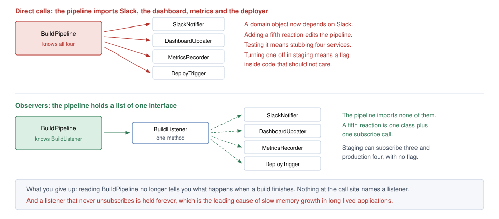
*Figure — Top: the build pipeline calls Slack, dashboard, metrics and deployer directly. Bottom: it holds one list of BuildListener and imports none of them (course diagram)*

### What it is

**Observer** lets one object (the **subject**, also called *publisher* or *observable*) notify many dependent objects (the **observers**, *subscribers* or *listeners*) when something happens — **without knowing who they are or what they do**.

Everyday analogy: a YouTube channel. You subscribe; when a new video is published, every subscriber is notified. The channel does not know or care what each subscriber does with the notification, and you can unsubscribe at any time.

**GoF intent (paraphrased):** set up a one-to-many dependency, so that when one object's state changes, every object that depends on it is told and can update itself automatically.

**GoF participants** (and who plays them in our code):

| Participant | Role | In `lld.ch11.observer` |
|---|---|---|
| **Subject** | Knows its observers (any number) and offers attach/detach operations | `BuildPipeline` (`addListener` + the returned unsubscribe handle) |
| **Observer** | The update interface that subjects call | `BuildListener` |
| **ConcreteSubject** | Holds the state observers care about; notifies them when it changes | `BuildPipeline` (GoF split Subject into an abstract class and a concrete one; in modern Java one class usually plays both) |
| **ConcreteObserver** | Implements the update interface; may keep its own state in step with the subject | `SlackNotifier`, `DashboardUpdater`, `MetricsRecorder`, `DeployTrigger` |

### The problem it solves

Suppose four reactions must follow every finished build: a Slack message, a dashboard refresh, a metrics record and a deployment. The naive version calls all four itself:

```java
void finish(int buildNumber, String result) {
    slack.post(buildNumber, result);
    dashboard.update(result);
    metrics.record(buildNumber);
    deployer.start();
}
```

This costs more than it looks: the build pipeline now **depends on a chat service**; a fifth reaction means editing the pipeline; a **unit test** (an automated test that checks one class on its own) must fake four services; and disabling deployment in **staging** (the pre-production copy of the system used for final checks) needs an environment flag inside a class that ought to know nothing about environments.

Observer replaces the four references with **one list of one interface**. Anything that cares subscribes. **The source only announces; every listener chooses its own reaction.** No one orchestrates them, and listeners are unaware of one another.

### How it works

1. Define an **observer interface** with one method, e.g. `onBuildFinished(buildNumber, result)`.
2. The **subject** keeps a list of observers and offers subscribe and unsubscribe operations (classically `addListener` / `removeListener`; our `addListener` instead returns a handle that unsubscribes).
3. When its state changes, the subject **first finishes changing its state**, then loops over the list and calls each observer.
4. Observers can be added and removed at run time (e.g. staging subscribes three listeners, production four).

**Push vs pull** — two ways to deliver the data:

| | Push model | Pull model |
|---|---|---|
| What the observer receives | All the data about the change (e.g. a `Reading` record) | Just "I changed" plus a reference to the subject |
| How the observer gets data | It is in the call | It calls getters on the subject for what it needs |
| Pros | Simple; observers don't depend on the subject's getters | Each observer takes only what it needs; the interface doesn't change when new data is added |
| Cons | Sends data some observers don't need; adding data changes the interface | Observers depend on the subject; they must work out *what* changed |

`java.util.Observer.update(Observable o, Object arg)` supported both: `o` for pull, `arg` for push. *Head First Design Patterns* shows the same trade-off with its weather-station example.

### Structure (UML)

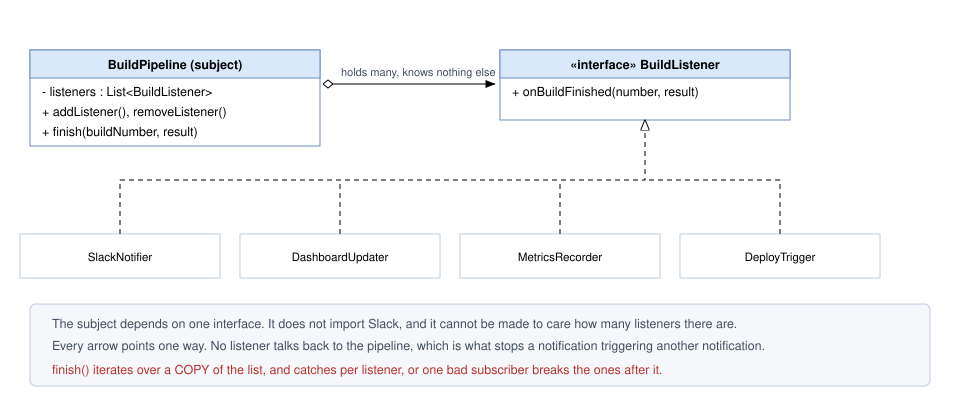
*Figure — Class diagram: BuildPipeline holds a list of BuildListener; SlackNotifier, DashboardUpdater, MetricsRecorder and DeployTrigger implement it (course diagram)*

In the diagram above (a **UML** class diagram — UML, the Unified Modeling Language, is the standard box-and-arrow notation for classes and how they relate) all dependencies run in a single direction. Listeners never call the pipeline back, so one notification cannot set off another.

Our Java design:

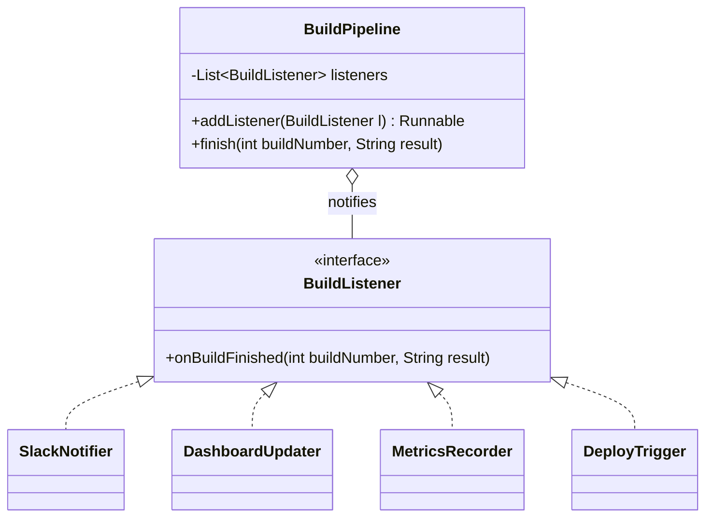

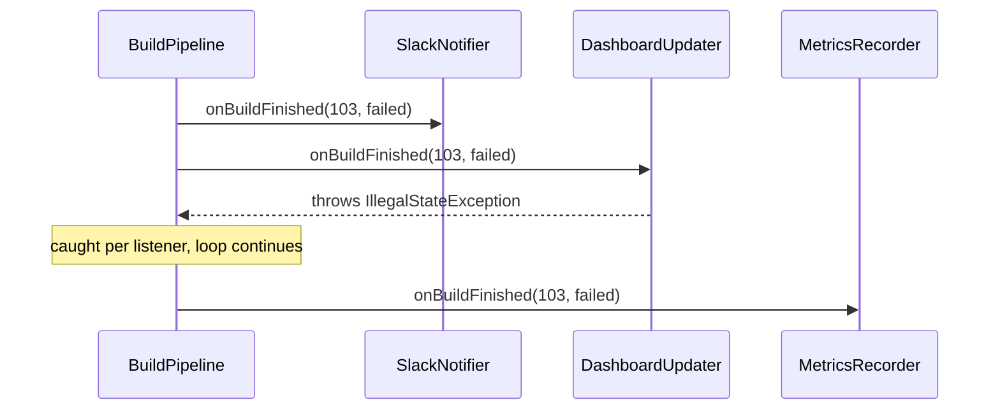

### Java example

`lld.ch11.observer` shows four things:

1. **Build pipeline.** Listeners live in a `CopyOnWriteArrayList` (a JDK list that copies its internal array on every write, so readers never see it change under them), whose iterator works on a **snapshot** — so a listener that unsubscribes during notification cannot break the loop, and the list is **thread-safe** (safe to use from several *threads* — independent paths of execution running at the same time — at once). `finish` **catches exceptions per listener**, so a broken dashboard does not stop metrics. `addListener` returns a `Runnable` (Java's built-in interface for "a piece of code to run later", with one method `run()`) that unsubscribes: whoever subscribes owns the matching unsubscribe.
2. **Push vs pull** (`WeatherStation`): one display receives the whole `Reading`; the other receives the station and pulls only the temperature.
3. **A tiny event bus** (`EventBus`): subscribers register for an event *type* (a class); publishers just publish objects. The returned `Subscription` is the unsubscribe handle. `Main` closes it in a `finally` block, so the refunds handler is removed even if publishing throws. (`Subscription` is also `AutoCloseable` — an interface whose `close()` method is called automatically when a *try-with-resources* block ends — so `try (var s = bus.subscribe(...)) { ... }` works too. But if the body never uses `s`, `javac -Xlint` warns that the resource is never referenced. Java 22+ lets you write `try (var _ = ...)` to say "unused on purpose". On Java 21, `try`/`finally` is the warning-free form.) The bus's handler list is a `CopyOnWriteArrayList`, so subscribing and publishing from different threads is safe. Delivery is still **synchronous on the publisher's thread** (the publisher waits while each handler runs, one after another) and nothing is stored, so it is not a **queue** (a waiting line that stores items and hands them out later, in order).
4. **`java.beans.PropertyChangeSupport`** (the price is whole cents in an `int` — exact, never `double`), which the `Observable` **Javadoc** (the official API documentation generated from comments in Java source code) itself points to (the `java.beans` package) as the richer event model. Note it does **not** fire when the old and new values are both non-null and equal. (Since Java 9, `java.beans` lives in the `java.desktop` module; on the class path (the list of folders and JAR files where Java looks for classes) this needs nothing extra, but a modular app (one that declares its dependencies in a `module-info.java` file) must `requires java.desktop`.)

```java
// File: code/lld/ch11/observer/BuildListener.java
package lld.ch11.observer;

/** The OBSERVER interface: one method. A lambda can implement it. */
@FunctionalInterface
public interface BuildListener {
    void onBuildFinished(int buildNumber, String result);
}
```

```java
// File: code/lld/ch11/observer/BuildPipeline.java
package lld.ch11.observer;

import java.util.List;
import java.util.concurrent.CopyOnWriteArrayList;

/** The SUBJECT: holds a list of one interface and imports none of the concrete reactions. */
public final class BuildPipeline {
    // CopyOnWriteArrayList iterates over a snapshot: a listener that unsubscribes
    // itself mid-notification cannot break the loop, and it is safe across threads.
    private final List<BuildListener> listeners = new CopyOnWriteArrayList<>();

    /** Returns a handle: whoever subscribes owns the matching unsubscribe (prevents leaks). */
    public Runnable addListener(BuildListener listener) {
        listeners.add(listener);
        return () -> listeners.remove(listener);
    }

    public void finish(int buildNumber, String result) {
        System.out.println("Build " + buildNumber + " finished: " + result);
        for (BuildListener l : listeners) {
            try {
                l.onBuildFinished(buildNumber, result);
            } catch (RuntimeException e) {          // one bad listener must not starve the rest
                System.out.println("  [pipeline] a listener failed: " + e.getMessage());
            }
        }
    }
}
```

```java
// File: code/lld/ch11/observer/SlackNotifier.java
package lld.ch11.observer;

final class SlackNotifier implements BuildListener {
    @Override
    public void onBuildFinished(int n, String result) {
        System.out.println("  [slack] #builds: build " + n + " " + result);
    }
}
```

```java
// File: code/lld/ch11/observer/DashboardUpdater.java
package lld.ch11.observer;

final class DashboardUpdater implements BuildListener {
    boolean offline = false;

    @Override
    public void onBuildFinished(int n, String result) {
        if (offline) throw new IllegalStateException("dashboard is offline");
        System.out.println("  [dashboard] status tile -> " + result);
    }
}
```

```java
// File: code/lld/ch11/observer/MetricsRecorder.java
package lld.ch11.observer;

final class MetricsRecorder implements BuildListener {
    private int recorded = 0;

    @Override
    public void onBuildFinished(int n, String result) {
        recorded++;
        System.out.println("  [metrics] recorded build " + n + " (total " + recorded + ")");
    }
}
```

```java
// File: code/lld/ch11/observer/DeployTrigger.java
package lld.ch11.observer;

final class DeployTrigger implements BuildListener {
    @Override
    public void onBuildFinished(int n, String result) {
        if (result.equals("success")) System.out.println("  [deploy] deploying build " + n);
    }
}
```

```java
// File: code/lld/ch11/observer/WeatherStation.java
package lld.ch11.observer;

import java.util.ArrayList;
import java.util.List;
import java.util.function.Consumer;

/** A subject that supports both notification styles, to compare PUSH and PULL. */
public final class WeatherStation {
    /** PUSH: the subject sends the data with the notification. */
    public record Reading(double tempC, double humidity, double pressureHpa) {}

    private final List<Consumer<Reading>> pushObservers = new ArrayList<>();
    private final List<Consumer<WeatherStation>> pullObservers = new ArrayList<>();
    private Reading current = new Reading(0, 0, 0);

    public void subscribePush(Consumer<Reading> o) { pushObservers.add(o); }
    public void subscribePull(Consumer<WeatherStation> o) { pullObservers.add(o); }

    // PULL: observers get only "I changed" plus a reference, then ask for what they need.
    public double temperature() { return current.tempC(); }
    public double humidity() { return current.humidity(); }

    public void measure(Reading r) {
        current = r;                                             // change state FIRST...
        pushObservers.forEach(o -> o.accept(r));                 // ...then notify
        pullObservers.forEach(o -> o.accept(this));
    }
}
```

```java
// File: code/lld/ch11/observer/EventBus.java
package lld.ch11.observer;

import java.util.List;
import java.util.concurrent.CopyOnWriteArrayList;
import java.util.function.Consumer;

/**
 * A tiny in-process event bus: publishers and subscribers share only event TYPES,
 * never references to each other. Synchronous, not durable (unlike Kafka).
 */
public final class EventBus {
    private record Handler<E>(Class<E> type, Consumer<? super E> action) {
        void deliver(Object event) {
            if (type.isInstance(event)) action.accept(type.cast(event));
        }
    }

    /** AutoCloseable so try-with-resources can unsubscribe for you. */
    public interface Subscription extends AutoCloseable {
        @Override void close();
    }

    private final List<Handler<?>> handlers = new CopyOnWriteArrayList<>();

    public <E> Subscription subscribe(Class<E> type, Consumer<? super E> action) {
        Handler<E> h = new Handler<>(type, action);
        handlers.add(h);
        return () -> handlers.remove(h);
    }

    public void publish(Object event) {
        handlers.forEach(h -> h.deliver(event));
    }
}
```

```java
// File: code/lld/ch11/observer/PricedItem.java
package lld.ch11.observer;

import java.beans.PropertyChangeListener;
import java.beans.PropertyChangeSupport;

/** The JDK's recommended replacement for java.util.Observable: java.beans.PropertyChangeSupport. */
public final class PricedItem {
    private final PropertyChangeSupport support = new PropertyChangeSupport(this);
    private final String name;
    private int priceCents;

    public PricedItem(String name, int priceCents) {
        this.name = name;
        this.priceCents = priceCents;
    }

    public void addPropertyChangeListener(PropertyChangeListener l) { support.addPropertyChangeListener(l); }
    public void removePropertyChangeListener(PropertyChangeListener l) { support.removePropertyChangeListener(l); }

    public void setPriceCents(int newPrice) {
        int old = this.priceCents;
        this.priceCents = newPrice;
        support.firePropertyChange("priceCents", old, newPrice);   // no event if old == new
    }

    public String name() { return name; }
}
```

```java
// File: code/lld/ch11/observer/Main.java
package lld.ch11.observer;

import java.math.BigDecimal;

public class Main {
    record OrderPlaced(String orderId, BigDecimal amount) {}
    record OrderCancelled(String orderId) {}

    public static void main(String[] args) {
        System.out.println("=== 1. Build pipeline: subscribe, unsubscribe, failing listener ===");
        BuildPipeline pipeline = new BuildPipeline();
        DashboardUpdater dashboard = new DashboardUpdater();
        pipeline.addListener(new SlackNotifier());
        pipeline.addListener(dashboard);
        pipeline.addListener(new MetricsRecorder());
        Runnable unsubscribeDeploy = pipeline.addListener(new DeployTrigger());

        pipeline.finish(101, "success");        // every listener runs
        unsubscribeDeploy.run();                // e.g. staging has no auto-deploy
        pipeline.finish(102, "success");        // three react
        dashboard.offline = true;
        pipeline.finish(103, "failed");         // dashboard throws, the others still run

        System.out.println("\n=== 2. Push vs pull ===");
        WeatherStation station = new WeatherStation();
        station.subscribePush(r -> System.out.println("  [push display] got everything: " + r));
        station.subscribePull(s -> System.out.println("  [pull display] asked only for temp: " + s.temperature() + " C"));
        station.measure(new WeatherStation.Reading(31.5, 0.62, 1008));

        System.out.println("\n=== 3. Event bus (typed topics, scoped unsubscribe) ===");
        EventBus bus = new EventBus();
        bus.subscribe(OrderPlaced.class, e -> System.out.println("  [email] confirmation for " + e.orderId()));
        bus.subscribe(Object.class, e -> System.out.println("  [audit] " + e));
        EventBus.Subscription refunds = bus.subscribe(OrderCancelled.class,
                e -> System.out.println("  [refunds] start refund for " + e.orderId()));
        try {
            bus.publish(new OrderPlaced("A-1", new BigDecimal("499.00")));
            bus.publish(new OrderCancelled("A-1"));
        } finally {
            refunds.close();                                   // refunds handler removed here, even on error
        }
        bus.publish(new OrderCancelled("A-2"));                // only audit sees this one

        System.out.println("\n=== 4. JDK: PropertyChangeSupport (replacement for deprecated Observable) ===");
        PricedItem phone = new PricedItem("phone", 49_900);
        phone.addPropertyChangeListener(evt -> System.out.println(
            "  [price watcher] " + phone.name() + " " + evt.getPropertyName() + ": "
            + evt.getOldValue() + " -> " + evt.getNewValue()));
        phone.setPriceCents(44_900);
        phone.setPriceCents(44_900);    // same value: no event fired
        phone.setPriceCents(39_900);
    }
}
```

**Output:**

```text
=== 1. Build pipeline: subscribe, unsubscribe, failing listener ===
Build 101 finished: success
  [slack] #builds: build 101 success
  [dashboard] status tile -> success
  [metrics] recorded build 101 (total 1)
  [deploy] deploying build 101
Build 102 finished: success
  [slack] #builds: build 102 success
  [dashboard] status tile -> success
  [metrics] recorded build 102 (total 2)
Build 103 finished: failed
  [slack] #builds: build 103 failed
  [pipeline] a listener failed: dashboard is offline
  [metrics] recorded build 103 (total 3)

=== 2. Push vs pull ===
  [push display] got everything: Reading[tempC=31.5, humidity=0.62, pressureHpa=1008.0]
  [pull display] asked only for temp: 31.5 C

=== 3. Event bus (typed topics, scoped unsubscribe) ===
  [email] confirmation for A-1
  [audit] OrderPlaced[orderId=A-1, amount=499.00]
  [audit] OrderCancelled[orderId=A-1]
  [refunds] start refund for A-1
  [audit] OrderCancelled[orderId=A-2]

=== 4. JDK: PropertyChangeSupport (replacement for deprecated Observable) ===
  [price watcher] phone priceCents: 49900 -> 44900
  [price watcher] phone priceCents: 44900 -> 39900
```

### Why `java.util.Observer` / `Observable` were deprecated

Since **Java 9**, `java.util.Observer` and `java.util.Observable` are **deprecated** (officially marked "don't use in new code; may be removed one day") but not removed. The official reasons (Javadoc): the event model is **quite limited**, the **order of notifications is unspecified**, and **state changes are not one-for-one with notifications**. Other well-known problems:

- `Observable` is a **class**, not an interface — your subject must *extend* it, using up Java's **single inheritance** (a Java class can extend only one parent class).
- `setChanged()` is **protected**, so you cannot use `Observable` by composition (holding one as a field) without subclassing.
- The `update(Observable, Object)` signature is untyped (`Object arg`), so observers must cast.
- Its thread safety is only partial: its methods are `synchronized` (only one thread at a time may run them, because each call first takes the object's **lock** — a token only one thread can hold), but `notifyObservers` calls observers outside the lock on a snapshot, so (as a comment in the **JDK** — Java Development Kit: the compiler, runtime and standard library — source admits) a newly added observer may miss a notification and a just-removed one may still get it.

What to use instead (the Javadoc names the first, third and fourth): `java.beans.PropertyChangeSupport`/`PropertyChangeListener` for bean properties; your own typed listener interface (as in `BuildPipeline`); `java.util.concurrent` data structures (queues) for reliable, ordered hand-off between threads; the **`java.util.concurrent.Flow`** API (Java 9) for **reactive streams** (asynchronous streams of data items flowing from a producer to consumers) with **back-pressure** (the consumer tells the producer to slow down when it cannot keep up).

### Trade-offs

| Pros | Cons |
|---|---|
| The source no longer depends on its reactions (a build pipeline no longer imports Slack). | Harder to trace: the call site gives no hint of which code will execute. |
| Reactions are added/removed at run time; environments differ without flags. | **Memory leaks** (memory that is never freed) if an observer is never removed (the subject holds them forever). |
| Each reaction is testable alone. | Stack traces start inside a loop over a list; debugging is harder. |
| A new reaction = one class + one subscribe call (Open/Closed: open to extension, closed to modification). | **No ordering or delivery guarantee**; a crash loses the reactions not yet called. |
| | With synchronous observers, the subject takes as long as all its listeners combined. |

### Observer vs Mediator, Chain of Responsibility, callbacks

| Looks like | The actual difference |
|---|---|
| **Mediator** | Observer carries only "this changed"; each observer decides for itself, one way, and no order between reactions can be expressed. A mediator receives the change **and decides what happens next**, calling specific components back (two-way), and explicit ordering is its reason to exist. |
| **Publish-subscribe with a broker** (a server that stores and forwards messages) | Same idea, but the broker contributes persistence, redelivery, ordering guarantees and a network hop — none of which in-process observers offer. |
| **Chain of Responsibility** | Observer informs **all** listeners, and no listener can prevent the rest from running. A chain ends as soon as one handler accepts the request. |
| **A callback** | One callback is one observer. It becomes the Observer pattern when the number of listeners varies and they subscribe and unsubscribe at run time. |

**Observer outside Java.** With **first-class functions** (functions that can be stored in variables and passed around like any other value) a listener is just a **lambda** (a short anonymous function, written `x -> ...` in Java) — keep the handle, or you cannot unsubscribe. JavaScript has `EventTarget`/`EventEmitter`, and `AbortController` can unsubscribe by signal. Python often uses a plain list of callables, and `weakref.WeakSet` avoids the leak. C# has `event`, `IObservable<T>`, and `IDisposable` subscriptions. In every language, **weak references** (references that do not keep their target alive, so the garbage collector may still free it) fix the leak, at the cost of a listener disappearing when nothing else holds it.

### When not to use it

- **One listener, forever.** Call it directly.
- **You need ordering or guaranteed delivery.** Use a queue or message broker (Kafka, RabbitMQ, SQS — popular broker products): same idea plus persistence, retries and a network — and very different failure modes.
- **Reactions are slow.** Either notify **asynchronously** (hand the work to another thread and return at once — e.g. via an *executor*, a pool of worker threads, or a queue) or don't use in-process observers.
- **The whole flow must be auditable/traceable.** Explicit calls are kinder to readers.

### Common mistakes (the four classic ways observers go wrong, plus one)

1. **No unsubscribe → memory leak.** The subject keeps a **strong reference** (an ordinary reference, which keeps the object alive in memory) to the listener and everything it points to. In long-running apps this is a top cause of slow memory growth. Every `add` needs an owner for the matching `remove`. (Weak references are one fix, at the cost of listeners vanishing when nothing else holds them.)
2. **A throwing listener kills the loop.** Without a per-listener try/catch, listener 3 fails and 4 and 5 never run.
3. **Changing the list during notification** → `ConcurrentModificationException` (the error Java throws when a collection is changed while it is being looped over) (or silently skipped listeners in some languages). Iterate over a copy, or use `CopyOnWriteArrayList`.
4. **Listeners calling back into the subject** → cycles or endless recursion. Finish updating state before notifying, and never let a notification synchronously cause another one.
5. **Notifying before the state is updated**, so pull-style observers read stale data.
6. **Relying on notification order.** Listeners are called in the order they happened to subscribe, which is a side effect of start-up code rather than a decision anyone made. If "update the dashboard, then decide whether to deploy" matters, that is coordination, and it belongs in a Mediator.

### Real-world examples

- **Every UI event handler**: Swing `ActionListener`, Android `OnClickListener`, DOM `addEventListener`.
- **JDK**: `PropertyChangeListener`, `java.util.concurrent.Flow` (`Publisher`/`Subscriber`), servlet listeners such as `HttpSessionListener`.
- **Spring** (the most widely used Java application framework): `ApplicationEventPublisher` + `@EventListener` (in-process events, optionally `@Async` or `@TransactionalEventListener`).
- **Guava `EventBus`**, **RxJava / Project Reactor / RxJS**, Kotlin `Flow`, and signals in front-end frameworks — observers with composable operators (map, filter, debounce — wait until events pause, then pass on only the latest) layered on top.
- **Model–view separation**: a view registers with its model, which then updates freely with no idea that any screen is attached (see MVC in §11.7.5).
- **Distributed publish–subscribe**: Kafka topics, Google Pub/Sub, AWS SNS. When an order is placed on an e-commerce site, the order service publishes one event and email, inventory, analytics and recommendation services each consume it independently — Observer at system scale, with durability added.
- **Database triggers and change data capture** (CDC: streaming every row change out of a database's internal log; Debezium is a popular tool) — observers at the storage layer.

### In the interview

**30-second answer:** "Observer swaps a handful of hard-coded calls for a list of objects that share one listener interface. The subject just says "this happened" and every observer picks its own response, so each reaction can be plugged in, unplugged and unit-tested on its own, and the subject no longer depends on any of them. In production I iterate over a copy of the listener list, catch exceptions per listener, and make sure every subscribe has a matching unsubscribe to avoid leaks. When I need durability, retries or ordering I use a message broker instead."

**Follow-ups:**

- *Push or pull?* Push sends the data (simple, but the interface grows with the data); pull sends a reference and observers ask for what they need (flexible, but couples observers to the subject's getters).
- *Why was `java.util.Observable` deprecated?* Limited event model, unspecified notification order, notifications not one-for-one with changes; plus it's a class (uses up inheritance) with protected `setChanged`. Use `PropertyChangeSupport`, custom listeners, or `Flow`.
- *Observer vs Pub/Sub?* In Observer the subject holds its observers directly. In publish–subscribe a **broker/event bus** sits in between, so publishers and subscribers don't know each other at all; brokers add durability, retries and ordering.
- *Observer vs Mediator?* With Observer, the news is broadcast and every listener makes its own call; with Mediator, one central object makes the decision and tells particular components what to do. When the sequence of reactions matters, pick a mediator.
- *How do you make it thread-safe?* `CopyOnWriteArrayList` for listeners (reads far outnumber writes), no locks held while calling listeners, and dispatch to an executor if listeners are slow.
- *How do you avoid leaks?* Return a subscription handle, tie it to a lifecycle (try-with-resources, `onDestroy`, `@PreDestroy`), or use weak references.

### Self-check

1. **Q:** What does the subject know about its observers? **A:** Only that they implement the observer interface.
2. **Q:** Why iterate over a copy of the listener list? **A:** So a listener that (un)subscribes during notification can't break the loop.
3. **Q:** What is the classic Observer memory leak? **A:** Listeners that are never removed stay strongly referenced by the subject.
4. **Q:** What should replace `java.util.Observable`? **A:** `PropertyChangeSupport`, a custom typed listener interface, or the `Flow` API.
5. **Q:** When is a message broker better than in-process observers? **A:** When you need durability, retries, ordering, or slow/remote consumers.

### TL;DR

One subject, a list of listeners, one-way notification. **Iterate over a copy, catch per listener, always unsubscribe.** Push vs pull is a trade-off; `Observable` is deprecated; use a broker when you need guarantees.

---

## 11.2 State

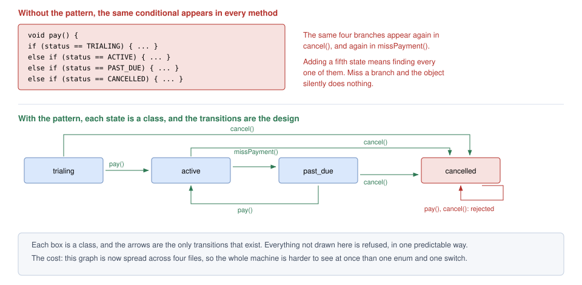
*Figure — Top: the same four-branch status check repeated in every method. Bottom: each state is a class and the transitions form a graph (course diagram)*

### What it is

**State** (GoF intent, paraphrased): when an object's internal condition changes, **its behaviour changes with it**, so from the outside it looks as if the object had switched to a different class. Rather than every method testing a status field, the object hands each action to a **state object**, and replaces that object whenever the condition changes.

**GoF participants** (and who plays them in our code):

| Participant | Role | In `lld.ch11.state` |
|---|---|---|
| **Context** | The object clients use; holds the current state object and forwards requests to it | `Subscription`, `VendingMachine` |
| **State** | Interface declaring one method per request the context forwards | `SubscriptionState`, `VendingState` |
| **ConcreteState** | One class per state, implementing the behaviour for that state | `Trialing`, `Active`, `PastDue`, `Cancelled`; `Idle`, `HasMoney`, `SoldOut` |

GoF leaves open *who* performs the transitions: the context (with a fixed table) or the states themselves. Letting the states choose their successor, as here, is more flexible but makes the states know about each other.

Everyday analogy: a phone's ringer switch. Pressing "call received" does something different in *ring*, *vibrate* and *silent* mode — the phone is the same, its mode decides the behaviour.

### The problem it solves

Take a subscription whose life runs **trialing → active → past due → cancelled**. Written naively, each public method opens with an identical four-way branch:

```java
public void pay() {
    if (status == TRIALING)       { /* charge the card, switch to ACTIVE */ }
    else if (status == ACTIVE)    { /* renew */ }
    else if (status == PAST_DUE)  { /* settle arrears, back to ACTIVE */ }
    else if (status == CANCELLED) { /* reject */ }
}
```

`cancel()` and `missPayment()` repeat those four branches. A fifth state forces you to hunt down every copy. Everything that defines one state is spread over all the methods. Worst of all, a **forgotten branch** quietly does nothing, and the bug surfaces weeks later as a vague "subscriptions randomly stop working".

With the State pattern, **each state is a class**. The conditional vanishes (each context method shrinks to a single line), and everything about one state is gathered in one file — exactly what a reviewer or auditor wants to read.

### How it works

1. Define a **State interface** with one method per action (`pay`, `missPayment`, `cancel`). Each state has to respond to each action, even when the response is "not allowed".
2. Write one **concrete state** class per state.
3. The **context** (`Subscription`) holds the current state and delegates each action: `state.pay(this)`.
4. A state rules on whether the action is **legal** and which state comes **after** it, and advances the machine by calling `context.setState(new Active())`.
5. Terminal states refuse everything, loudly, in one place.

**The objects choose their own successors** — the machine advances itself. That is the key difference from Strategy.

### Structure (UML)

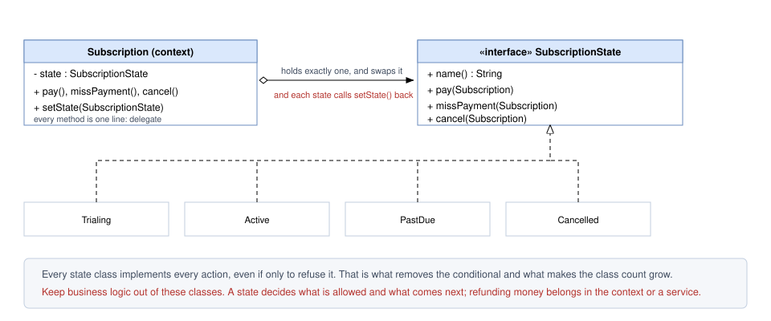
*Figure — Class diagram: Subscription (context) holds a SubscriptionState; Trialing, Active, PastDue and Cancelled implement it and call setState on the context (course diagram)*

In the diagram above the states reach **back** into the context to replace themselves, and the state classes know each other (Trialing creates an Active).

Our Java design (class-per-state version):

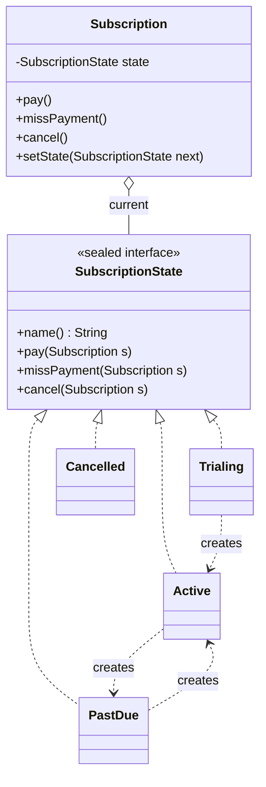

The state machine itself:

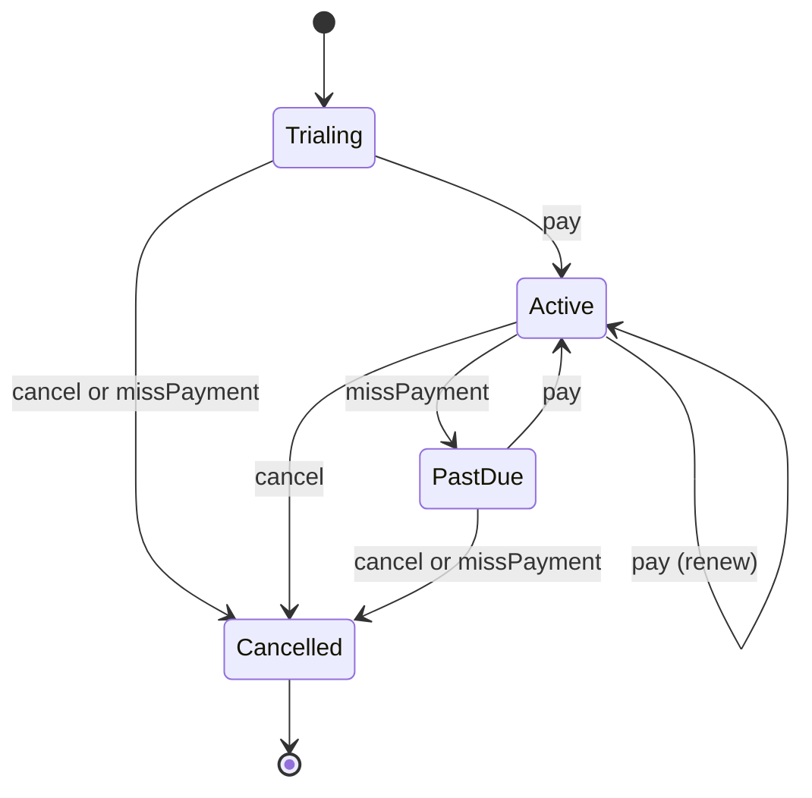

Vending machine and traffic light:

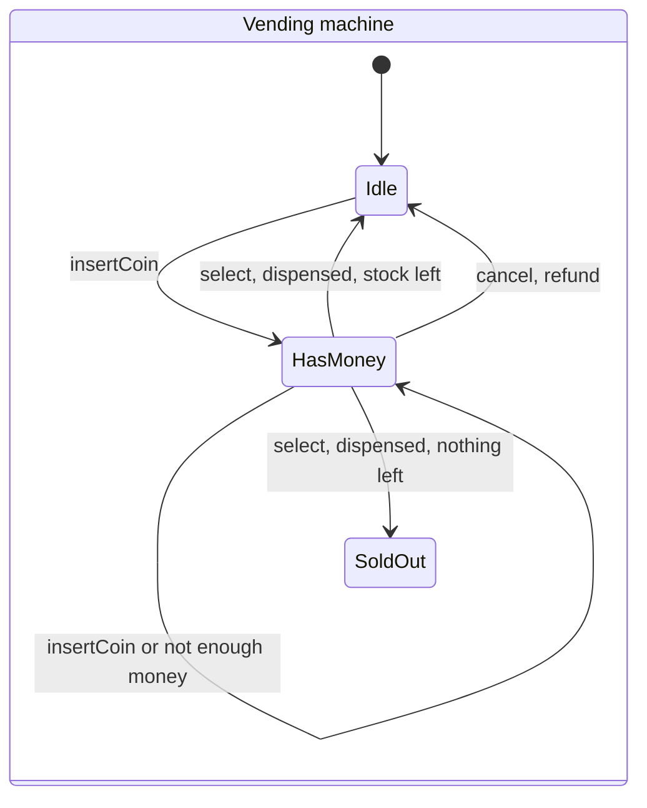

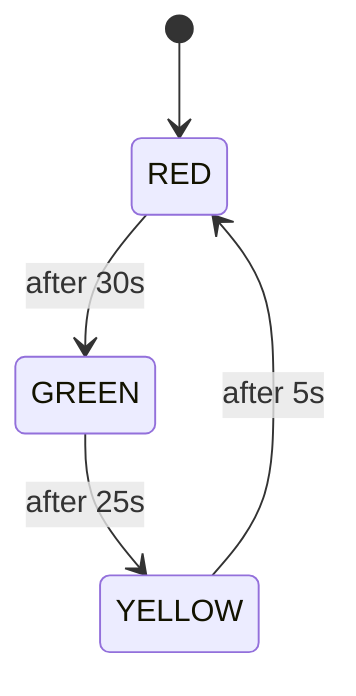

### Java example

`lld.ch11.state` shows three styles:

1. **Class per state** (`Subscription` + four `record` states). `SubscriptionState` is a **sealed** interface (one that lists exactly which types may implement it): the compiler knows the complete set of states. The states have no fields, so **records** (Java's compact data classes whose fields are fixed at creation) with no components are a neat, **immutable** (cannot change after creation) choice.
2. **Enum-based state machine** (`TrafficLight`). Each enum constant overrides `next()`; shared behaviour is a **default method** (an interface method with a body, inherited by implementers unless they override it). The **whole machine is readable in one file** — the idiomatic Java answer for simple machines.
3. **Vending machine** (`VendingMachine` + `Idle`, `HasMoney`, `SoldOut`). The state interface uses **default methods that refuse**, so each state overrides only the actions it allows (`SoldOut` overrides nothing). Business actions (dispensing, returning change) live in the **context**; states only rule on whether an action is legal and which state follows. Money is kept as whole **cents in an `int`**, which is exact (unlike `double`); a real machine would use a `Money`/`BigDecimal` type (`BigDecimal` is Java's exact decimal-number class), as the Strategy and Visitor examples do.

```java
// File: code/lld/ch11/state/SubscriptionState.java
package lld.ch11.state;

/**
 * STATE interface. Each state implements all actions, including ones it only turns down.
 * Sealed: the compiler knows the full set of states.
 */
public sealed interface SubscriptionState permits Trialing, Active, PastDue, Cancelled {
    String name();
    void pay(Subscription s);
    void missPayment(Subscription s);
    void cancel(Subscription s);
}
```

```java
// File: code/lld/ch11/state/Trialing.java
package lld.ch11.state;

public record Trialing() implements SubscriptionState {
    public String name() { return "trialing"; }
    public void pay(Subscription s) {
        System.out.println("  [trialing] first payment taken");
        s.setState(new Active());                     // the state chooses its successor
    }
    public void missPayment(Subscription s) {
        System.out.println("  [trialing] trial ended unpaid");
        s.setState(new Cancelled());
    }
    public void cancel(Subscription s) { s.setState(new Cancelled()); }
}
```

```java
// File: code/lld/ch11/state/Active.java
package lld.ch11.state;

public record Active() implements SubscriptionState {
    public String name() { return "active"; }
    public void pay(Subscription s) { System.out.println("  [active] renewed for another period"); }
    public void missPayment(Subscription s) {
        System.out.println("  [active] payment failed, grace period started");
        s.setState(new PastDue());
    }
    public void cancel(Subscription s) { s.setState(new Cancelled()); }
}
```

```java
// File: code/lld/ch11/state/PastDue.java
package lld.ch11.state;

public record PastDue() implements SubscriptionState {
    public String name() { return "past_due"; }
    public void pay(Subscription s) {
        System.out.println("  [past_due] arrears paid");
        s.setState(new Active());
    }
    public void missPayment(Subscription s) {
        System.out.println("  [past_due] grace period over");
        s.setState(new Cancelled());
    }
    public void cancel(Subscription s) { s.setState(new Cancelled()); }
}
```

```java
// File: code/lld/ch11/state/Cancelled.java
package lld.ch11.state;

/** Terminal state: refuses everything, loudly, in one place. */
public record Cancelled() implements SubscriptionState {
    public String name() { return "cancelled"; }
    public void pay(Subscription s) { System.out.println("  [cancelled] refused: no payments after cancellation"); }
    public void missPayment(Subscription s) { System.out.println("  [cancelled] ignored: nothing is billed"); }
    public void cancel(Subscription s) { System.out.println("  [cancelled] rejected: already cancelled"); }
}
```

```java
// File: code/lld/ch11/state/Subscription.java
package lld.ch11.state;

/** The CONTEXT: every public action is one line of delegation. No status switch anywhere. */
public final class Subscription {
    private SubscriptionState state = new Trialing();

    void setState(SubscriptionState next) {
        System.out.println("    " + state.name() + " -> " + next.name());
        state = next;
    }

    public String status() { return state.name(); }

    public void pay()         { state.pay(this); }
    public void missPayment() { state.missPayment(this); }
    public void cancel()      { state.cancel(this); }
}
```

```java
// File: code/lld/ch11/state/TrafficLight.java
package lld.ch11.state;

/**
 * State pattern the idiomatic-Java way: an enum whose constants override behaviour.
 * The whole machine is readable in one file.
 */
public enum TrafficLight {
    RED(30) {
        TrafficLight next() { return GREEN; }
        boolean pedestriansMayCross() { return true; }
    },
    GREEN(25) {
        TrafficLight next() { return YELLOW; }
    },
    YELLOW(5) {
        TrafficLight next() { return RED; }
    };

    private final int seconds;

    TrafficLight(int seconds) { this.seconds = seconds; }

    int seconds() { return seconds; }
    abstract TrafficLight next();
    boolean pedestriansMayCross() { return false; }    // default for most states
}
```

```java
// File: code/lld/ch11/state/VendingState.java
package lld.ch11.state;

/** Vending machine states. Default methods = "refuse", so each state overrides only what it allows. */
interface VendingState {
    String name();

    default void insertCoin(VendingMachine m, int cents) {
        System.out.println("  [" + name() + "] coin rejected, returned " + cents);
    }

    default void select(VendingMachine m, String code) {
        System.out.println("  [" + name() + "] selection ignored");
    }

    default void cancel(VendingMachine m) {
        System.out.println("  [" + name() + "] nothing to cancel");
    }
}
```

```java
// File: code/lld/ch11/state/Idle.java
package lld.ch11.state;

final class Idle implements VendingState {
    public String name() { return "idle"; }

    @Override
    public void insertCoin(VendingMachine m, int cents) {
        m.addBalance(cents);
        m.setState(new HasMoney());
    }
}
```

```java
// File: code/lld/ch11/state/HasMoney.java
package lld.ch11.state;

final class HasMoney implements VendingState {
    public String name() { return "has_money"; }

    @Override
    public void insertCoin(VendingMachine m, int cents) { m.addBalance(cents); }

    @Override
    public void select(VendingMachine m, String code) {
        if (!m.inStock(code)) { System.out.println("  [has_money] " + code + " is empty, choose another"); return; }
        int price = m.priceOf(code);
        if (m.balance() < price) {
            System.out.println("  [has_money] " + code + " costs " + price + ", balance " + m.balance());
            return;
        }
        m.dispense(code);                                 // business action lives in the context
        m.returnChange();
        m.setState(m.anythingInStock() ? new Idle() : new SoldOut());
    }

    @Override
    public void cancel(VendingMachine m) {
        m.returnChange();
        m.setState(new Idle());
    }
}
```

```java
// File: code/lld/ch11/state/SoldOut.java
package lld.ch11.state;

final class SoldOut implements VendingState {
    public String name() { return "sold_out"; }        // every action uses the refusing defaults
}
```

```java
// File: code/lld/ch11/state/VendingMachine.java
package lld.ch11.state;

import java.util.LinkedHashMap;
import java.util.Map;

/** CONTEXT: owns inventory and money; states rule on legality and pick the next state. */
final class VendingMachine {
    private record Slot(String product, int priceCents, int count) {}

    private final Map<String, Slot> slots = new LinkedHashMap<>();
    private VendingState state = new Idle();
    private int balance = 0;

    void load(String code, String product, int price, int count) { slots.put(code, new Slot(product, price, count)); }

    // actions: delegate to the current state
    void insertCoin(int cents) { System.out.println("insert " + cents); state.insertCoin(this, cents); }
    void select(String code)   { System.out.println("select " + code); state.select(this, code); }
    void cancel()              { System.out.println("cancel"); state.cancel(this); }

    // helpers the states call
    void setState(VendingState next) {
        System.out.println("    " + state.name() + " -> " + next.name());
        state = next;
    }
    void addBalance(int cents) { balance += cents; System.out.println("  balance " + balance); }
    int balance() { return balance; }
    boolean inStock(String code) { return slots.containsKey(code) && slots.get(code).count() > 0; }
    boolean anythingInStock() { return slots.values().stream().anyMatch(s -> s.count() > 0); }
    int priceOf(String code) { return slots.get(code).priceCents(); }

    void dispense(String code) {
        Slot s = slots.get(code);
        slots.put(code, new Slot(s.product(), s.priceCents(), s.count() - 1));
        balance -= s.priceCents();
        System.out.println("  >> dispensed " + s.product());
    }

    void returnChange() {
        if (balance > 0) System.out.println("  >> change returned " + balance);
        balance = 0;
    }
}
```

```java
// File: code/lld/ch11/state/Main.java
package lld.ch11.state;

public class Main {
    public static void main(String[] args) {
        System.out.println("=== 1. Subscription lifecycle (class per state) ===");
        Subscription sub = new Subscription();
        sub.pay();           // trialing -> active
        sub.missPayment();   // active -> past_due
        sub.pay();           // past_due -> active
        sub.cancel();        // active -> cancelled
        sub.pay();           // rejected, stays cancelled
        System.out.println("  final status: " + sub.status());

        System.out.println("\n=== 2. Traffic light (enum-based state machine) ===");
        TrafficLight light = TrafficLight.RED;
        for (int i = 0; i < 4; i++) {
            System.out.printf("  %-6s for %2ds, pedestrians may cross: %s%n",
                light, light.seconds(), light.pedestriansMayCross());
            light = light.next();
        }

        System.out.println("\n=== 3. Vending machine ===");
        VendingMachine vm = new VendingMachine();
        vm.load("A1", "cola", 150, 1);
        vm.load("B2", "chips", 100, 0);
        vm.select("A1");        // idle: ignored
        vm.insertCoin(100);     // idle -> has_money
        vm.select("A1");        // not enough
        vm.select("B2");        // empty slot
        vm.insertCoin(100);
        vm.select("A1");        // dispense, change 50, -> sold_out (nothing left)
        vm.insertCoin(25);      // sold_out: rejected
    }
}
```

**Output:**

```text
=== 1. Subscription lifecycle (class per state) ===
  [trialing] first payment taken
    trialing -> active
  [active] payment failed, grace period started
    active -> past_due
  [past_due] arrears paid
    past_due -> active
    active -> cancelled
  [cancelled] refused: no payments after cancellation
  final status: cancelled

=== 2. Traffic light (enum-based state machine) ===
  RED    for 30s, pedestrians may cross: true
  GREEN  for 25s, pedestrians may cross: false
  YELLOW for  5s, pedestrians may cross: false
  RED    for 30s, pedestrians may cross: true

=== 3. Vending machine ===
select A1
  [idle] selection ignored
insert 100
  balance 100
    idle -> has_money
select A1
  [has_money] A1 costs 150, balance 100
select B2
  [has_money] B2 is empty, choose another
insert 100
  balance 200
select A1
  >> dispensed cola
  >> change returned 50
    has_money -> sold_out
insert 25
  [sold_out] coin rejected, returned 25
```

The final subscription line shows the payoff: an **illegal action** is refused the same way every time, by code in a single file.

### State vs Strategy (and Bridge) — same diagram, different reasons

These patterns draw **the same class diagram** (an object keeps a reference to an interface and forwards work to it). It is one of the most common interview questions, and the diagram cannot answer it:

| | State | Strategy | Bridge |
|---|---|---|---|
| Who chooses the object | The **states**, which replace themselves via the context | The **caller**, from outside | Chosen once at construction, usually by configuration |
| How often it changes | Repeatedly — that is the point | Set once, sometimes per call | Effectively never after wiring |
| Do the alternatives reference one another? | **Yes** (`Trialing` builds an `Active`) | **No** — never | No |
| What varies | The object's current *condition*, and therefore its allowed actions | *How* one job gets done | A whole dimension of the design |
| Why it exists | To model a lifecycle | To make one algorithm replaceable | To stop two class hierarchies multiplying |

**The reliable test: do the alternatives name each other?** If yes, it is a State machine. If no, it is Strategy (or Bridge — then ask how often the choice changes).

Two more things State gets confused with:

| Looks like | The actual difference |
|---|---|
| **An enum plus one `switch`** | Frequently the better answer, and easy to defend in an interview. Class-per-state starts to win only once the same status switch is repeated in three or more methods. |
| **A state-machine library** (Spring Statemachine, XState) | The same idea expressed as data (states, events, guards, actions) rather than classes. Once a machine grows past roughly a dozen states, the declarative form is easier to read and to draw. |

### Trade-offs

| Pros | Cons |
|---|---|
| Everything about one state sits in a single file. | One class per state; small classes multiply. |
| The repeated conditional disappears; no branch can be missed. | The transitions live in several files, so no single place shows the whole machine. |
| Illegal actions are rejected consistently. | Each state class must implement all actions, even if only to say no. |
| A new state = a new class; the compiler lists what it must implement. | Persisting needs a name↔class mapping — keep it in exactly one place. |

### When not to use it

- **Only two states and a handful of methods** — a boolean flag with an `if` reads better.
- **Behaviour doesn't change, only data does** — store the differing value in a field; a class per state adds nothing.
- **A big, formal machine** (more than about a dozen states with guards) — use a **transition table** (`Map<(state, event), handler>`) or a state-machine library (e.g. **Spring Statemachine**), where the diagram can be the source of truth.
- **Rule of thumb from the course:** the pattern pays off once **three or more methods repeat the same status switch**. Below that, an enum with a switch is a perfectly defensible answer.
- **A signal you have outgrown it:** you keep sketching the machine on paper just to follow your own code. At that point make the sketch (a transition table or state chart) the real source of truth, instead of classes that only approximate it.

### Common mistakes

1. **Successors hard-coded everywhere.** Fine at 4 states, painful at 12. Past that, let the context or a transition table own the transitions.
2. **Business logic inside state classes.** A state's job is to rule on *legality* and pick the *successor*; charging cards and sending emails belong in the context or a service it calls. Otherwise the state classes become a dumping ground.
3. **Forgetting to make illegal actions explicit** (silently doing nothing).
4. **Storing state objects in the DB** — store a name/enum and map it back to a state in exactly one place.
5. **Sharing stateful state objects** between contexts. Stateless states (like ours) can be shared safely; stateful ones cannot.

### State in other languages

- **Java:** an `enum` whose constants override behaviour (like `TrafficLight`) keeps the whole graph in one file. A `sealed` interface plus exhaustive pattern-matching `switch` gives compiler-checked coverage of every state.
- **Kotlin / Scala:** `sealed` hierarchies with exhaustive `when` / `match`.
- **Rust:** enums with data, matched exhaustively. With the **typestate** pattern each state is a separate *type*, so calling an action that is illegal in that state is a compile error.
- **Python:** a dict mapping `(state, action)` to a handler is a compact transition table that shows every transition in one place.
- **TypeScript:** a **discriminated union** (a set of object types that each carry a fixed tag field saying which kind they are) plus a `switch` over its tag field, which the compiler can check for missing cases.

### Real-world examples

- **Order lifecycles** in food-delivery and e-commerce apps: placed → accepted → preparing → out for delivery → delivered (or cancelled); which actions are legal depends on the status (you can cancel while "placed" but usually not once "out for delivery").
- **Payment and subscription lifecycles** (Stripe subscription statuses such as `trialing`, `active`, `past_due`, `canceled`).
- **TCP connections** (TCP is the protocol under most internet traffic, giving ordered, reliable delivery; see [System Design Fundamentals](../../../system-design-patterns/modules/00-system-design-fundamentals/README.md)) — GoF's own example: `LISTEN`, `ESTABLISHED`, `CLOSED`, each responding differently to the same call.
- **Workflow/approval engines** (draft → in review → approved/rejected), **document editors' modes**, **game characters** (idle, running, jumping).
- **Lexers/parsers** (programs that split text into tokens, then build a structure from them), **vending machines, ATMs, elevators, traffic lights** — favourite **machine-coding** questions (an interview round where you write working code for a small system in an hour or two) (see the case-study chapters).
- **Libraries**: Spring Statemachine; in the JDK, `Thread.State` is an *enum of states* (the data), not the pattern itself.

### In the interview

**30-second answer:** "State swaps a status field, and the switch statements repeated around it, for one class per state. The context forwards each action to whichever state object it currently holds, and that object decides whether the action is legal and which state follows. Each state's rules sit together in one file, and an illegal action is refused the same way every time. It draws exactly like Strategy, but states name one another and move the machine forward on their own, while strategies are picked from outside and never reference each other. In Java, for small machines, I'd use an enum with per-constant behaviour or a sealed interface."

**Follow-ups:**

- *State vs Strategy?* Use the naming test and the "who chooses" test (table above).
- *Where should transitions live?* In the states for small machines; in the context or a transition table when the machine grows, so the whole graph is visible in one place.
- *How do you persist it?* Store the state's name (enum) in the DB (database); rebuild the state object through one factory/mapping.
- *How do you handle concurrency?* Two requests (e.g. "cancel" and "deliver") can **race** (run at the same moment and interfere, so the result depends on timing): guard transitions with a lock or, in a DB, an **optimistic** (no lock held; the write simply fails if someone changed the row first) `UPDATE ... WHERE status = 'PLACED'` and check the affected row count.
- *Design a vending machine.* States Idle, HasMoney, SoldOut (maybe Dispensing, Maintenance); context owns inventory and balance; states allow or refuse actions (as in our code).

### Self-check

1. **Q:** Who changes the current state in the State pattern? **A:** The state objects (via the context's `setState`).
2. **Q:** What is the "naming test"? **A:** If the alternatives reference each other, it's State; if never, it's Strategy/Bridge.
3. **Q:** When is an `enum` better than class-per-state? **A:** When the machine is small; the whole machine is visible in one file.
4. **Q:** What belongs in the context, not the state? **A:** Business actions and data (dispensing, charging, inventory).
5. **Q:** What does a sealed state interface give you? **A:** The compiler knows every state, so `switch`es over states can be checked for exhaustiveness.

### TL;DR

**A class for each state; the context forwards every action; each state picks what follows it.** Same diagram as Strategy, but states **know each other**. Use enums for small machines, tables/libraries for big ones.

---

## 11.3 Strategy

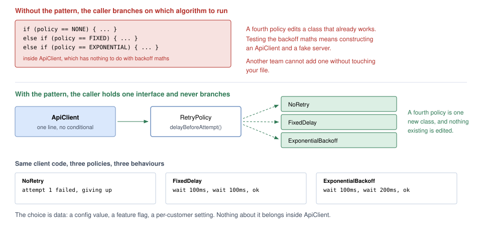
*Figure — Top: ApiClient branches on which retry policy to use. Bottom: ApiClient holds one RetryPolicy interface and never branches (course diagram)*

### What it is

**Strategy** (GoF intent, paraphrased): group related algorithms into a **family**, wrap each one in its own class behind a **common interface**, and make them interchangeable, so the algorithm can change without touching the code that calls it; the choice can be made at run time. The object using it (the **context**) does not branch on which algorithm it has.

**GoF participants** (and who plays them in our code):

| Participant | Role | In `lld.ch11.strategy` |
|---|---|---|
| **Strategy** | Interface shared by all the algorithms; the context calls only this | `RetryPolicy` (also `Comparator` in part 2) |
| **ConcreteStrategy** | One implementation per algorithm | `FixedDelay`, `ExponentialBackoff`, the `RetryPolicy.none()` lambda (the course diagram names it `NoRetry`) |
| **Context** | Is configured with a strategy object and delegates to it; may pass it the data it needs | `ApiClient` |

Everyday analogy: getting to the airport. Car, train or taxi — same goal, different algorithm. You pick based on time, money and weather; the trip itself ("get to the airport") doesn't change.

### The problem it solves

Retrying a failed request can mean: no retry, a fixed delay, or **exponential backoff** (doubling the wait after each failure — e.g. 100 ms, 200 ms, 400 ms). Written directly, the branch sits inside `ApiClient`:

```java
if (policy == NONE)             { /* give up */ }
else if (policy == FIXED)       { /* wait 100ms, try again */ }
else if (policy == EXPONENTIAL) { /* double the wait after each failure */ }
```

`ApiClient` now contains backoff arithmetic that has nothing to do with calling an API. A fourth policy means editing a working class; you cannot test the backoff maths without building a client and faking a server; and a different team has to edit your class just to contribute a policy.

Strategy gives every algorithm a class of its own. `ApiClient` asks its `RetryPolicy` "how long before the next attempt?" and **never checks what kind of policy it holds**. The choice is made **outside** the client — from configuration, a **feature toggle** (a setting that switches behaviour on or off without redeploying), or a customer-specific setting.

### How it works

1. Define a **strategy interface** — small, ideally one question (`delayBeforeAttempt(attempt)`).
2. Write one **concrete strategy** per algorithm; each holds only its own parameters.
3. The **context** receives a strategy (constructor, setter or method parameter) and calls it.
4. A **factory, configuration or DI container** (a library that creates objects and hands them their dependencies — see §11.7.2) decides which strategy to use — not every call site.

### Structure (UML)

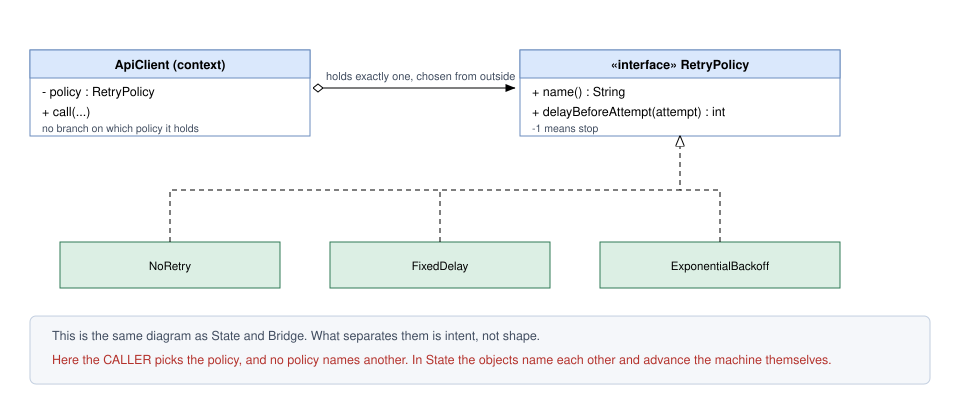
*Figure — Class diagram: ApiClient holds a RetryPolicy; NoRetry, FixedDelay and ExponentialBackoff implement it (course diagram)*

In the diagram above, **no strategy references another** — `ExponentialBackoff` has never heard of `FixedDelay`. That absence is how you tell Strategy from State.

Our Java design:

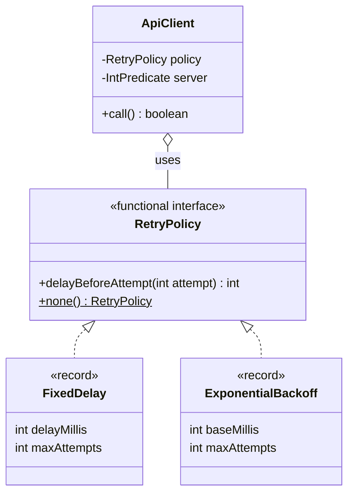

### Java example

`lld.ch11.strategy`:

1. **Retry policies.** `RetryPolicy` has one abstract method, so `RetryPolicy.none()` is just a **lambda**. Strategies with configuration (`FixedDelay`, `ExponentialBackoff`) are **records**. `ApiClient.call()` is identical for all runs; only the injected policy differs. (Delays are printed, not slept, to keep the demo fast.)
2. **`Comparator`** — the JDK's everyday strategy. `List.sort(comparator)` keeps the sorting algorithm fixed and lets you plug in the comparison. `Comparator.comparing(...).reversed().thenComparing(...)` composes strategies.
3. **Strategy registry.** A `Map<String, LongUnaryOperator>` of lambdas picked by a configuration key — short and readable when each strategy is one line.

```java
// File: code/lld/ch11/strategy/RetryPolicy.java
package lld.ch11.strategy;

/**
 * STRATEGY interface: one small question. Returns the delay in ms before the given
 * attempt (attempt >= 2), or STOP. One abstract method, so a lambda can be a policy.
 */
@FunctionalInterface
public interface RetryPolicy {
    int STOP = -1;

    int delayBeforeAttempt(int attempt);

    static RetryPolicy none() { return attempt -> STOP; }
}
```

```java
// File: code/lld/ch11/strategy/FixedDelay.java
package lld.ch11.strategy;

/** Strategies with configuration earn a real type (a record here). */
public record FixedDelay(int delayMillis, int maxAttempts) implements RetryPolicy {
    public int delayBeforeAttempt(int attempt) {
        return attempt > maxAttempts ? STOP : delayMillis;
    }
}
```

```java
// File: code/lld/ch11/strategy/ExponentialBackoff.java
package lld.ch11.strategy;

/** 100, 200, 400, ... ms. Knows nothing about FixedDelay: strategies never name each other. */
public record ExponentialBackoff(int baseMillis, int maxAttempts) implements RetryPolicy {
    public int delayBeforeAttempt(int attempt) {
        return attempt > maxAttempts ? STOP : baseMillis << (attempt - 2);
    }
}
```

```java
// File: code/lld/ch11/strategy/ApiClient.java
package lld.ch11.strategy;

import java.util.function.IntPredicate;

/** CONTEXT: holds a policy and never asks WHICH policy it has. */
public final class ApiClient {
    private final RetryPolicy policy;
    private final IntPredicate server;     // fake server: attempt number -> success?

    public ApiClient(RetryPolicy policy, IntPredicate server) {
        this.policy = policy;
        this.server = server;
    }

    public boolean call() {
        for (int attempt = 1; ; attempt++) {
            if (server.test(attempt)) {
                System.out.println("  attempt " + attempt + ": ok");
                return true;
            }
            int delay = policy.delayBeforeAttempt(attempt + 1);
            if (delay == RetryPolicy.STOP) {
                System.out.println("  attempt " + attempt + ": failed, giving up");
                return false;
            }
            System.out.println("  attempt " + attempt + ": failed, waiting " + delay + "ms");  // simulated, no sleep
        }
    }
}
```

```java
// File: code/lld/ch11/strategy/Main.java
package lld.ch11.strategy;

import java.math.BigDecimal;
import java.math.RoundingMode;
import java.util.ArrayList;
import java.util.Comparator;
import java.util.List;
import java.util.Map;
import java.util.function.IntPredicate;
import java.util.function.UnaryOperator;

public class Main {
    record Product(String name, long priceCents, double rating) {}

    public static void main(String[] args) {
        System.out.println("=== 1. Retry policies: same ApiClient code, three strategies ===");
        IntPredicate succeedsOnThirdTry = attempt -> attempt >= 3;
        List<Map.Entry<String, RetryPolicy>> policies = List.of(
            Map.entry("none (a lambda)", RetryPolicy.none()),
            Map.entry("FixedDelay(100, 4)", new FixedDelay(100, 4)),
            Map.entry("ExponentialBackoff(100, 4)", new ExponentialBackoff(100, 4)));
        for (Map.Entry<String, RetryPolicy> e : policies) {
            System.out.println(e.getKey() + ":");
            new ApiClient(e.getValue(), succeedsOnThirdTry).call();
        }
        System.out.println("ExponentialBackoff(100, 4) against a server that is always down:");
        new ApiClient(new ExponentialBackoff(100, 4), attempt -> false).call();

        System.out.println("\n=== 2. Comparator: the JDK's everyday strategy ===");
        List<Product> products = new ArrayList<>(List.of(
            new Product("mouse", 1_999, 4.5), new Product("keyboard", 4_999, 4.7),
            new Product("cable", 499, 4.5), new Product("monitor", 19_999, 4.2)));
        Comparator<Product> byPrice = Comparator.comparingLong(Product::priceCents);
        Comparator<Product> byRatingThenName =
            Comparator.comparingDouble(Product::rating).reversed().thenComparing(Product::name);
        products.sort(byPrice);
        System.out.println("  by price:          " + products.stream().map(Product::name).toList());
        products.sort(byRatingThenName);
        System.out.println("  by rating, name:   " + products.stream().map(Product::name).toList());

        System.out.println("\n=== 3. Strategy registry: lambdas chosen by configuration ===");
        Map<String, UnaryOperator<BigDecimal>> pricing = Map.of(
            "regular", p -> p,
            "member", p -> p.multiply(new BigDecimal("0.90")).setScale(2, RoundingMode.HALF_EVEN),  // 10% off
            "flash-sale", p -> p.subtract(new BigDecimal("20.00")).max(BigDecimal.ZERO));          // flat 20.00 off
        BigDecimal keyboardPrice = new BigDecimal("49.99");
        for (String tier : List.of("regular", "member", "flash-sale")) {   // e.g. read from config
            UnaryOperator<BigDecimal> strategy = pricing.get(tier);
            System.out.printf("  %-10s keyboard costs %s%n", tier, strategy.apply(keyboardPrice));
        }
    }
}
```

Extending it is cheap: a policy that adds random **jitter** to the delay, or one that honours a server's `Retry-After` header (an **HTTP** response header in which the server says how long to wait; HTTP is the request/response protocol of the web), is one more class (or lambda) plus one line where the policy is chosen. `ApiClient` does not change.

**Output:**

```text
=== 1. Retry policies: same ApiClient code, three strategies ===
none (a lambda):
  attempt 1: failed, giving up
FixedDelay(100, 4):
  attempt 1: failed, waiting 100ms
  attempt 2: failed, waiting 100ms
  attempt 3: ok
ExponentialBackoff(100, 4):
  attempt 1: failed, waiting 100ms
  attempt 2: failed, waiting 200ms
  attempt 3: ok
ExponentialBackoff(100, 4) against a server that is always down:
  attempt 1: failed, waiting 100ms
  attempt 2: failed, waiting 200ms
  attempt 3: failed, waiting 400ms
  attempt 4: failed, giving up

=== 2. Comparator: the JDK's everyday strategy ===
  by price:          [cable, mouse, keyboard, monitor]
  by rating, name:   [keyboard, cable, mouse, monitor]

=== 3. Strategy registry: lambdas chosen by configuration ===
  regular    keyboard costs 49.99
  member     keyboard costs 44.99
  flash-sale keyboard costs 29.99
```

### Lambdas as strategies

Of all the patterns, Strategy is the one a plain function replaces most often, and recognising that is part of understanding it. Since Java 8, any interface with a **single abstract method** (a *functional interface*) can be implemented by a lambda or method reference. So many strategies need **no class at all**: `Comparator<T>`, `Function`, `Predicate`, `Supplier`, or your own `RetryPolicy`. Keep a named class (or record) when the strategy has **configuration or state** (`FixedDelay(100, 4)`), needs a **name for logging**, or must be **discovered/registered** (e.g. Spring beans — objects the Spring container creates and manages — or `ServiceLoader`, the JDK's built-in plug-in discovery mechanism).

Other languages: Python passes a function (or `functools.partial` to bind its parameters), and a dict from name to function is a one-line registry. JavaScript/TypeScript pass a function argument, or an object whose properties are functions. Kotlin/Scala take a function-typed constructor parameter, often with a default. Go uses a one-method interface (satisfied implicitly) or a `func` field.

The registry in part 3 of the demo uses `BigDecimal` for prices. Money in domain code should never be `double`, because binary floating point cannot represent most cent values exactly.

### Trade-offs

| Pros | Cons |
|---|---|
| New variants without editing working code — even by other teams (Open/Closed). | One class per variant (unless lambdas), one more file to open. |
| Each algorithm is testable alone. | Someone must choose — ideally a factory or container, not every caller. |
| Behaviour is configurable at run time (flag, setting, header). | The interface must fit every variant, including future ones. |
| The context keeps to its real responsibility (no backoff maths in an API client). | Tempting to overuse: three strategies of one line each means three classes for three lines. |

### When not to use it

- **Just two branches, with no third in sight** — an `if` reads better. Introduce the pattern when a third variant actually shows up.
- **One-line branches** — a `Map` from key to lambda is shorter than a class for each.
- **Variants need different inputs** (one needs the customer, another the warehouse) — the shared interface is forced; rethink the split.
- **The choice is fixed for the life of the program** — decide it when wiring the program (or use Bridge) instead.

### Common mistakes

1. **Making every call site choose** — the branch moved instead of disappearing. Let a factory/config/DI container choose.
2. **A bloated interface** with parameters half the implementations ignore — a sign the variants do different jobs and should not share one abstraction.
3. **Strategies that know about each other** — then you have State.
4. **Stateful strategies shared between threads** — keep strategies immutable (records help).

### Real-world examples

- **`Comparator`** with `Collections.sort` / `List.sort` / `TreeMap` — the textbook example.
- **`ThreadPoolExecutor`'s** (the JDK's configurable thread pool) **`RejectedExecutionHandler`**: `AbortPolicy`, `CallerRunsPolicy`, `DiscardPolicy`, `DiscardOldestPolicy` — pick what happens when the pool is full.
- **Spring Security `PasswordEncoder`** (`BCryptPasswordEncoder`, `Argon2PasswordEncoder`, ...) chosen by configuration, so upgrading the **hash** (a one-way scrambling of the password, so the stored value can't be turned back into it) does not touch login code.
- **Resilience4j** (a Java fault-tolerance library) retry `IntervalFunction` (fixed, exponential, randomized backoff) and **Polly** in .NET — exactly this lesson's retry policies.
- **AWT/Swing `LayoutManager`** (`FlowLayout`, `BorderLayout`, `GridLayout`) — a container delegates layout to a strategy.
- **Payment method at checkout** (card, UPI [India's instant bank-to-bank payment system], wallet, cash on delivery), **pricing/discount rules by customer tier**, **route planning modes** (drive, walk, transit) in map apps, **compression/serialization formats** (serialization = turning objects into bytes or text for storage or sending) chosen by a content-type header.

### In the interview

**30-second answer:** "Strategy gives every variant of one job its own class behind a common interface, and something outside — usually a factory or configuration — picks the variant at run time. The context stops branching: my API client asks its retry policy how long to wait and never asks which policy it is. Each algorithm is testable alone and new ones don't touch working code. In Java a lambda is often enough, like a `Comparator`; I keep a class when the strategy has configuration. It shares its diagram with State, but strategies never reference each other."

**Follow-ups:**

- *Strategy vs State?* Strategies are picked from outside and don't know each other; states pick their successors.
- *Strategy vs Template Method?* Template Method swaps **one step** of an algorithm whose order is fixed, through **inheritance** (fixed once the object is created, by the subclass you instantiate). Strategy swaps **the complete algorithm** through **composition** (holding another object in a field and delegating to it) (chosen at run time, can vary several axes at once). Prefer Strategy when both fit.
- *Strategy vs Bridge?* Same diagram again. Bridge splits off a dimension of the design that is fixed when the program is assembled; Strategy is a decision that is meant to change, even from one call to the next. If a reviewer cannot tell which you meant, little is lost — the code is identical. What matters more is not using any of the three for two branches that will never become three.
- *Strategy vs Command?* Strategy is *how* to do something; Command is *what* to do, with its arguments, kept to run later or undo.
- *How is the strategy selected?* Config + factory (`Map<String, Strategy>`), DI container (Spring can inject a `Map<String, PaymentStrategy>` of all beans), or per-request (header, customer tier).
- *Relation to Open/Closed and DIP?* The context depends on an abstraction (DIP) and new strategies extend behaviour without modifying it (OCP).

### Self-check

1. **Q:** Who chooses the strategy? **A:** Someone outside the context — ideally a factory/config/DI container.
2. **Q:** Why can `RetryPolicy.none()` be a lambda? **A:** `RetryPolicy` is a functional interface (one abstract method).
3. **Q:** Name two JDK strategies. **A:** `Comparator`; `RejectedExecutionHandler` (also `LayoutManager`).
4. **Q:** When is a map of lambdas better than classes? **A:** When each strategy is one line and needs no configuration.
5. **Q:** How do you tell Strategy from State in code? **A:** Strategies never reference each other.

### TL;DR

**Interchangeable algorithms behind one interface, chosen from outside.** The context stops branching. Use lambdas for one-liners, records/classes when configured. Don't confuse with State (states know each other) or Template Method (inheritance, one step).

---

## 11.4 Template Method

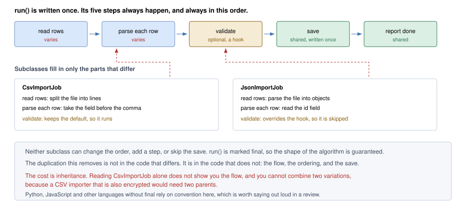
*Figure — run() always performs five steps in the same order; subclasses fill in only reading and parsing, and one optional hook (course diagram)*

### What it is

**Template Method** (GoF intent, paraphrased): put the **outline of an algorithm** into one base-class operation (the *template method*) and leave certain steps for **subclasses** to fill in; subclasses may redefine those steps but cannot alter the overall sequence.

**GoF participants** (and who plays them in our code):

| Participant | Role | In `lld.ch11.templatemethod` |
|---|---|---|
| **AbstractClass** | Declares the primitive steps (abstract or with a default) and implements the template method that calls them in order | `ImportJob`, `CaffeineBeverage` |
| **ConcreteClass** | Implements the primitive steps that differ for its variant | `CsvImportJob`, `JsonImportJob`, `Tea`, `Coffee` |

Everyday analogy: a recipe card with blanks. "Boil water → brew ___ → pour into cup → add ___ (if wanted)." Tea and coffee fill the blanks differently; the order never changes.

### The problem it solves

A data import job always: reads rows, parses each one, validates, saves, reports "done". Only reading and parsing differ between CSV and JSON. Written as separate classes, the **shared flow** (order, validation, saving, reporting) is copied into each. When saving must also write an audit record, three files change — and the missed one is the bug.

Template Method writes the flow once, in a method subclasses **cannot override** (`final`). The varying steps become methods the subclasses must supply.

### How it works

1. Write the **template method** in an abstract class and mark it **`final`** so the order is guaranteed.
2. Inside it, call the steps in order. Steps come in three kinds:
   - **Required (abstract) steps** — every subclass must implement them; the compiler enforces it.
   - **Hooks** — steps with a **default** (often empty or `true`) that a subclass *may* override, e.g. `shouldValidate()`.
   - **Shared steps** — `private`, written once, not changeable.
3. Each subclass implements only what differs.

**The Hollywood Principle — "Don't call us, we'll call you."** (*Head First Design Patterns*.) The base class (high-level component) decides **when** the subclass's methods run; the subclass never calls the base class's flow itself. That **inversion of control** is the backbone of most **frameworks** (libraries that own the program's flow and call your code at set points): **the framework runs the sequence, and your class supplies only your own pieces.**

### Structure (UML)

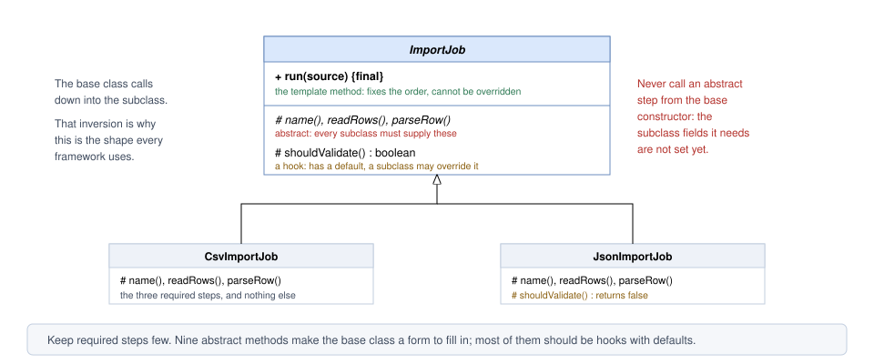
*Figure — Class diagram: ImportJob with final run(), abstract steps name/readRows/parseRow, hook shouldValidate and private save; CsvImportJob and JsonImportJob override only what differs (course diagram)*

In the diagram above, the subclasses are tiny — but `CsvImportJob` on its own does not reveal the sequence it will follow at run time; only the parent shows that. That is the trade-off.

Our Java design:

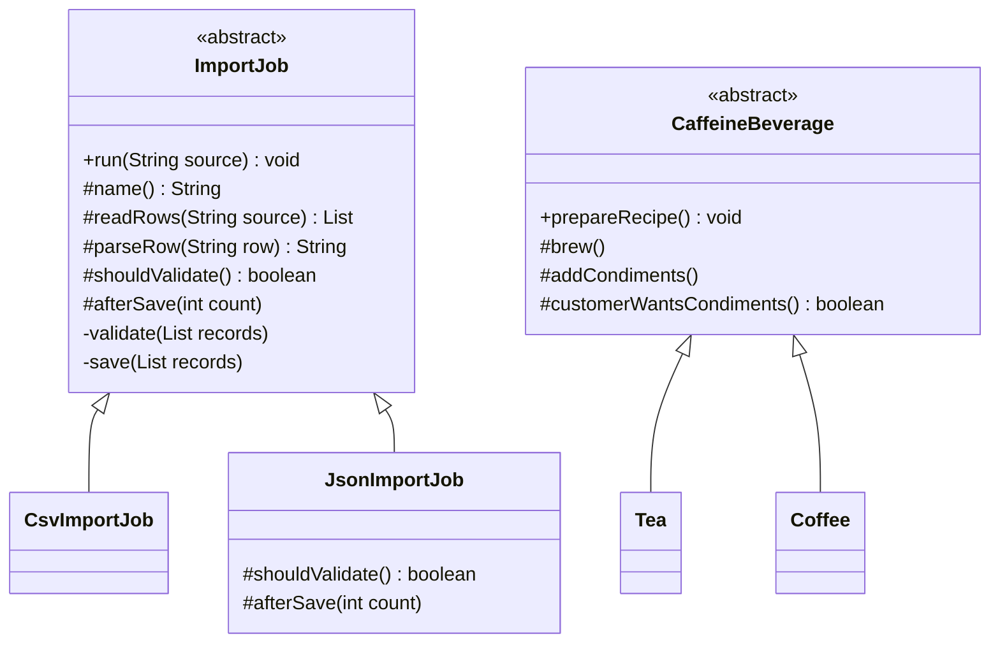

`run()` and `prepareRecipe()` are `final` in the code (Mermaid has no marker for `final`).

### Java example

`lld.ch11.templatemethod`:

1. **Import jobs.** `ImportJob.run` is `final`. `name`, `readRows`, `parseRow` are **abstract** (required). `shouldValidate` and `afterSave` are **hooks** (defaults `true` and "do nothing"). `validate` and `save` are **private** shared steps. `JsonImportJob` overrides both hooks.
2. **Beverages** (the *Head First* example). `customerWantsCondiments()` is a hook: `Coffee(black = true)` turns off the optional step.

```java
// File: code/lld/ch11/templatemethod/ImportJob.java
package lld.ch11.templatemethod;

import java.util.ArrayList;
import java.util.List;

/** ABSTRACT CLASS holding the TEMPLATE METHOD. */
public abstract class ImportJob {

    /** Template method. Marked final: subclasses cannot change the order, drop a step or insert one. */
    public final void run(String source) {
        System.out.println("Running the " + name() + " import:");
        List<String> rows = readRows(source);                 // required step
        List<String> records = new ArrayList<>();
        for (String row : rows) records.add(parseRow(row));   // required step
        System.out.println("  parsed " + records.size() + " records: " + records);
        if (shouldValidate()) {                               // hook
            validate(records);
        } else {
            System.out.println("  skipping validation, source is validated upstream");
        }
        save(records);                                        // shared, fixed
        afterSave(records.size());                            // hook with an empty default
        System.out.println("  done");
    }

    // Required steps: the compiler forces every subclass to supply them.
    protected abstract String name();
    protected abstract List<String> readRows(String source);
    protected abstract String parseRow(String row);

    // Hooks: sensible defaults, overriding is optional.
    protected boolean shouldValidate() { return true; }
    protected void afterSave(int count) { }

    // Shared steps: written once, private, cannot be changed by subclasses.
    private void validate(List<String> records) {
        long blank = records.stream().filter(String::isBlank).count();
        System.out.println("  validated " + records.size() + " records, " + blank + " blank");
    }

    private void save(List<String> records) {
        System.out.println("  saved " + records.size() + " records (+ audit entry)");
    }
}
```

```java
// File: code/lld/ch11/templatemethod/CsvImportJob.java
package lld.ch11.templatemethod;

import java.util.Arrays;
import java.util.List;

/** Supplies only what differs for CSV. */
public final class CsvImportJob extends ImportJob {
    @Override protected String name() { return "CSV"; }

    @Override
    protected List<String> readRows(String source) {
        return Arrays.stream(source.split("\n")).skip(1).toList();   // skip the header line
    }

    @Override
    protected String parseRow(String row) { return row.split(",")[0].trim(); }
}
```

```java
// File: code/lld/ch11/templatemethod/JsonImportJob.java
package lld.ch11.templatemethod;

import java.util.List;
import java.util.regex.Matcher;
import java.util.regex.Pattern;

/** Supplies what differs for JSON, and overrides two hooks. (Toy parsing: no JSON library.) */
public final class JsonImportJob extends ImportJob {
    private static final Pattern OBJECT = Pattern.compile("\\{[^}]*}");
    private static final Pattern ID = Pattern.compile("\"id\"\\s*:\\s*\"([^\"]*)\"");

    @Override protected String name() { return "JSON"; }

    @Override
    protected List<String> readRows(String source) {
        return OBJECT.matcher(source).results().map(m -> m.group()).toList();
    }

    @Override
    protected String parseRow(String row) {
        Matcher m = ID.matcher(row);
        return m.find() ? m.group(1) : "";
    }

    @Override protected boolean shouldValidate() { return false; }

    @Override
    protected void afterSave(int count) { System.out.println("  [hook] notified upstream: " + count + " ids consumed"); }
}
```

```java
// File: code/lld/ch11/templatemethod/CaffeineBeverage.java
package lld.ch11.templatemethod;

/** The classic beverage example: same recipe skeleton, two steps and one hook vary. */
public abstract class CaffeineBeverage {
    public final void prepareRecipe() {          // template method
        boilWater();
        brew();
        pourInCup();
        if (customerWantsCondiments()) addCondiments();
    }

    protected abstract void brew();
    protected abstract void addCondiments();

    /** Hook: "Don't call us, we'll call you" - the base class decides WHEN this runs. */
    protected boolean customerWantsCondiments() { return true; }

    private void boilWater() { System.out.println("  boiling water"); }
    private void pourInCup() { System.out.println("  pouring into cup"); }
}
```

```java
// File: code/lld/ch11/templatemethod/Tea.java
package lld.ch11.templatemethod;

public final class Tea extends CaffeineBeverage {
    @Override protected void brew() { System.out.println("  steeping the tea"); }
    @Override protected void addCondiments() { System.out.println("  adding lemon"); }
}
```

```java
// File: code/lld/ch11/templatemethod/Coffee.java
package lld.ch11.templatemethod;

public final class Coffee extends CaffeineBeverage {
    private final boolean black;

    public Coffee(boolean black) { this.black = black; }

    @Override protected void brew() { System.out.println("  dripping coffee through filter"); }
    @Override protected void addCondiments() { System.out.println("  adding sugar and milk"); }
    @Override protected boolean customerWantsCondiments() { return !black; }
}
```

```java
// File: code/lld/ch11/templatemethod/Main.java
package lld.ch11.templatemethod;

public class Main {
    public static void main(String[] args) {
        System.out.println("=== 1. Import jobs ===");
        new CsvImportJob().run("id,name\nu1, Asha\nu2, Ben\nu3, Chen");
        new JsonImportJob().run("[{\"id\":\"p9\",\"qty\":1},{\"id\":\"p7\",\"qty\":4}]");

        System.out.println("\n=== 2. Beverages (hook controls an optional step) ===");
        System.out.println("tea:");
        new Tea().prepareRecipe();
        System.out.println("black coffee:");
        new Coffee(true).prepareRecipe();
    }
}
```

**Output:**

```text
=== 1. Import jobs ===
Running the CSV import:
  parsed 3 records: [u1, u2, u3]
  validated 3 records, 0 blank
  saved 3 records (+ audit entry)
  done
Running the JSON import:
  parsed 2 records: [p9, p7]
  skipping validation, source is validated upstream
  saved 2 records (+ audit entry)
  [hook] notified upstream: 2 ids consumed
  done

=== 2. Beverages (hook controls an optional step) ===
tea:
  boiling water
  steeping the tea
  pouring into cup
  adding lemon
black coffee:
  boiling water
  dripping coffee through filter
  pouring into cup
```

### Template Method vs Strategy

| | Template Method | Strategy |
|---|---|---|
| What varies | **One step**; the surrounding algorithm is fixed | **The entire** algorithm |
| Mechanism | **Inheritance** — subclass supplies the step | **Composition** — caller passes an object in |
| When chosen | When the object is created (by which subclass you instantiate); fixed after that | Run time, can change per call |
| How many axes can vary | One (a class has one parent) | Several (hold several strategies) |
| What one file shows | Just the varying pieces | The complete algorithm |

Strategy is usually the more flexible choice. Template Method pays off when **most of the flow is common**, only small pieces differ, and you want the compiler to **enforce the sequence**. They combine well: the base class fixes the sequence, but each step is a **strategy object** (or lambda) handed in rather than inherited — so the order is still enforced, yet you are not limited to one parent. Spring's `JdbcTemplate` (a helper around **JDBC**, Java's standard API for talking to SQL databases) works like this: it owns the fixed flow (get connection, create statement, execute, handle exceptions, close resources) and takes your varying part as a **callback** (a function or object you hand over so the other code can call you back — here `RowMapper`, `PreparedStatementSetter`) rather than a subclass.

### Trade-offs

| Pros | Cons |
|---|---|
| The shared flow is written once (DRY: Don't Repeat Yourself). | No single file tells the whole story: the parent holds the order, the child holds the pieces. |
| The order is guaranteed (`final`). | One parent only: two independent variations can't combine. |
| New variants are small. | Parent and children are bound tightly; altering one step's signature forces every subclass to change. |
| Abstract steps make the compiler report anything a subclass has not supplied. | Base classes tend to swell until they demand many abstract methods and nobody wants to extend them. |

### When not to use it

- **The flow is two lines** — nothing to protect.
- **Variants must combine** (an encrypted CSV import would need both an "encrypted" and a "CSV" parent) — use composition.
- **Behaviour must change after creation** — use Strategy.
- **Subclasses override every step** — the flow was never really shared.

### Common mistakes

1. **Too many required steps.** A subclass should only have to write two or three methods; give the rest a default and make them hooks.
2. **Calling an overridable step from the base constructor.** The base constructor runs **before** the subclass's fields are initialised, so in Java the step sees `null`/`0`/`false`. (In C++ it is different but still wrong: during the base constructor a virtual call is dispatched to the base version, never the subclass override.) Call steps from the template method, never the constructor.
3. **Leaving out `final` on the template method** — then a subclass can reorder or skip steps; nothing is enforced any more and the pattern becomes a mere agreement. (C++: make it non-virtual. Python and JavaScript cannot enforce it at all, so it must be documented and checked in review.)
4. **Making steps `public`** — callers could run step 3 without steps 1 and 2. Keep them `protected` (or move reusable steps into a separate object).
5. **Violating Liskov** (the Liskov Substitution Principle: a subclass must work anywhere its parent is expected) in overrides (a hook that throws, or a step that changes the contract).

### Template Method in other languages

- **Java:** `final` template method, `protected abstract` required steps, `protected` hooks with a body. An interface `default` method can also act as a template method, but an interface has no instance state and a default method cannot be `final`, so any implementer may override it.
- **Python:** `abc.ABC` with `@abstractmethod`. There is no `final` enforced at run time, so a comment (or `typing.final` for type checkers) is the only guard; a leading underscore marks internal steps.
- **TypeScript:** `abstract` classes give the compile-time check; plain JavaScript uses base methods that throw.
- **C++:** a non-virtual public template method calling `protected virtual` steps — the **non-virtual interface (NVI)** idiom.
- **Go and Rust** have no inheritance: a function taking an interface/trait with the varying steps — i.e. the Strategy shape.

### Real-world examples

- **`java.io.InputStream`**: `read(byte[], int, int)` is implemented in terms of the abstract `read()`; subclasses supply the single-byte read (and override the bulk method for speed).
- **`java.util.AbstractList`**: implement `get(int)` and `size()`, and you inherit `iterator()`, `indexOf`, `contains`, `equals`, `hashCode`...
- **`HttpServlet.service()`** (Jakarta/Java Servlet) dispatches to `doGet`/`doPost`/`doPut`... by HTTP method; you override the ones you support, and the ones you do not override reject the request (405 Method Not Allowed on HTTP/1.1).
- **`AbstractQueuedSynchronizer`** (AQS — the JDK's internal building block for locks; behind `ReentrantLock`, `Semaphore`, `CountDownLatch`): `acquire()` is the template; subclasses implement `tryAcquire`/`tryRelease`.
- **Test frameworks**: JUnit (`@BeforeEach`/`@AfterEach`) and pytest (fixtures, `setup_method`/`teardown_method`) own the set-up → test → tear-down flow; your hooks never call each other. **Mobile lifecycles**: Android `Activity` (`onCreate`, `onStart`, `onResume`...) and iOS `UIViewController` (`viewDidLoad`, `viewWillAppear`...). **Maven/Gradle** (Java build tools) build lifecycles (fixed phases, you plug in goals/tasks).
- **Sorting with a comparison**: `Arrays.sort` owns the algorithm and needs just one step from you, the comparison. Old designs had the elements supply it (`Comparable.compareTo`); modern APIs pass it in as a `Comparator` — the Strategy form of the same idea.
- **Spring `JdbcTemplate`, `RestTemplate`, `TransactionTemplate`** — "template + callback" variants of the same idea.

### In the interview

**30-second answer:** "Template Method puts an algorithm's outline in a single final method of a base class, and subclasses supply only the steps that differ. Steps a subclass must write are abstract; steps it may change are hooks with a default body; steps nobody should change are private. It's the Hollywood principle — the base class calls the subclass, not the other way round — which is how frameworks like servlets, JUnit and Android lifecycles work. It varies one step via inheritance; if I need run-time choice or several axes I prefer Strategy, or pass the steps in as callbacks like JdbcTemplate does."

**Follow-ups:**

- *What is a hook?* A step with a default implementation that subclasses may override (e.g. `shouldValidate()`), giving optional control points.
- *What is the Hollywood Principle?* "Don't call us, we'll call you": high-level components call low-level ones at the right time; low-level components plug in but don't call up. It prevents "dependency rot" (dependencies tangled in every direction, so nothing can change safely).
- *Why `final`?* It is the guarantee: without it a subclass could reorder or drop steps, and the pattern would be only a gentleman's agreement.
- *Template Method vs Factory Method?* A factory method is often one step of a template method — the step whose job is to create an object (GoF notes that template methods frequently call factory methods). The course frames it more strongly — a factory method is a special template-method step whose subclass-supplied job is creation, while most template steps create nothing. Take that as "a factory method usually lives inside a template method", not as a strict rule: a factory method can also be called directly by clients.
- *Template Method vs Decorator?* A decorator wraps an existing object at run time, and several can be layered; a template-method subclass is decided when the object is built and cannot be layered.
- *Template Method vs Builder?* Both impose an order, but a Builder director invokes the steps on a **different** object (the builder it holds), while a template method invokes them on **its own** instance via inheritance.
- *Constructor trap?* Never call overridable methods from a constructor; the subclass isn't initialised yet.

### Self-check

1. **Q:** Which method is `final`? **A:** The template method (`run`, `prepareRecipe`).
2. **Q:** Difference between an abstract step and a hook? **A:** Abstract steps must be implemented; hooks have defaults and are optional.
3. **Q:** Name two JDK template methods. **A:** `InputStream.read(byte[],int,int)`, `AbstractList`'s methods built on `get`/`size`, AQS `acquire`.
4. **Q:** Why is `JdbcTemplate` more flexible than a classic template method? **A:** It takes the varying step as a callback object (composition), not a subclass.
5. **Q:** What goes wrong if the base constructor calls an abstract step? **A:** The subclass fields aren't initialised yet.

### TL;DR

**Fixed order in a `final` base method; subclasses fill steps; hooks are optional steps.** Hollywood principle. Inheritance-based and compile-time — prefer Strategy/callbacks when you need flexibility.

---

## 11.5 Visitor

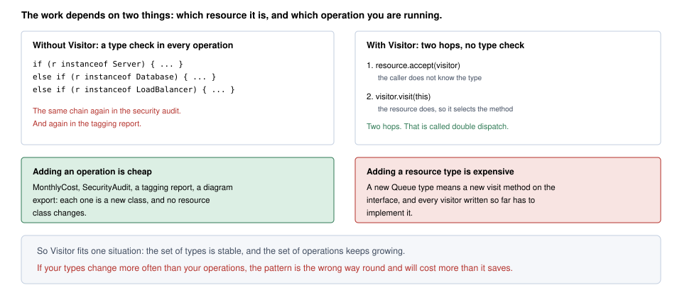
*Figure — Without Visitor, every operation repeats an instanceof chain; with Visitor, two calls (accept, then visit) select the right code with no type check (course diagram)*

### What it is

**Visitor** lets you **introduce new operations** over a group of classes **while leaving those classes untouched**. Every operation lives in its own **visitor** class, which has a separate method for each kind of element; each element keeps one tiny method, `accept(visitor)`, whose body is `visitor.visit(this)`.

**GoF intent (paraphrased):** represent an operation to be performed on the elements of an object structure as a separate object, so you can define a new operation without changing the classes of the elements it works on.

**GoF participants** (and who plays them in our code):

| Participant | Role | In `lld.ch11.visitor` |
|---|---|---|
| **Visitor** | Declares one `visit` operation per ConcreteElement class | `PlanVisitor` |
| **ConcreteVisitor** | Implements every `visit`; one class per operation, often accumulating a result | `MonthlyCost`, `SecurityAudit` |
| **Element** | Declares `accept(visitor)` | `Resource` |
| **ConcreteElement** | Implements `accept` as `visitor.visit(this)` | `Server`, `Database`, `LoadBalancer`, `ResourceGroup` |
| **ObjectStructure** | Holds the elements and lets a visitor reach each of them (a list or a Composite) | the `ResourceGroup` tree built in `Main` |

Everyday analogy: a tax inspector visiting different businesses. The businesses don't each contain tax rules; the inspector brings them and applies the right rule for "restaurant", "shop" or "factory". Next year, a fire-safety inspector visits the same businesses with different rules — the businesses don't change.

### The problem it solves

Picture an infrastructure plan made of just three resource kinds — server, database, load balancer. That **list of kinds is stable**. The **operations never stop arriving**: a monthly bill, a security review, a tag report, a diagram export, and so on.

- Put each operation **inside** the resource classes → `Server` holds pricing, security, tagging and drawing code; unrelated teams edit the same file.
- Put it **outside** with type checks → an `instanceof` chain in every operation. Add a resource kind, and you must find every chain; the compiler won't tell you which one you missed.

Visitor gives each operation its own class, and uses **double dispatch** to pick the right method without any type check.

### How it works — double dispatch

Java chooses **which override** (a subclass's replacement of an inherited method) of a method runs based on the **run-time type of the receiver** — the object before the dot (single dispatch) — but chooses **which overload** (one of several same-named methods with different parameter types: `visit(Server)` vs `visit(Database)`) at **compile time**, from the **static type** (the type the compiler sees in the declaration) of the argument. If you hold a `Resource r`, `visitor.visit(r)` cannot compile to the right overload — the compiler only knows "Resource".

Visitor makes **two calls**:

1. `resource.accept(visitor)` — dispatch #1 on the **resource's** run-time type: `Server.accept` runs.
2. Inside `Server.accept`, `visitor.visit(this)` — here `this` has static type `Server`, so the compiler picks `visit(Server)`; dispatch #2 then happens on the **visitor's** run-time type (`MonthlyCost` or `SecurityAudit`).

The method that finally runs depends on **two** types — element and visitor. That is **double dispatch**.

### Structure (UML)

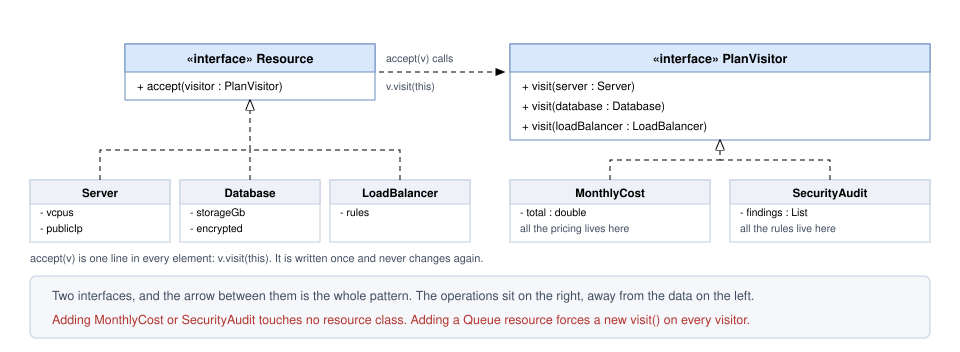
*Figure — Class diagram: Resource with accept; Server, Database, LoadBalancer implement it; PlanVisitor has one visit per resource type; MonthlyCost and SecurityAudit implement it (course diagram; it shows `total : double`, our Java code uses `BigDecimal` for money)*

In the diagram above the two sets of arrows point in opposite directions: each element depends on the visitor interface (its `accept` has a visitor parameter), while each visitor depends on every element type (it has a `visit` for each). That second arrow is why **adding an element type is expensive**.

Our Java design (with a Composite group element):

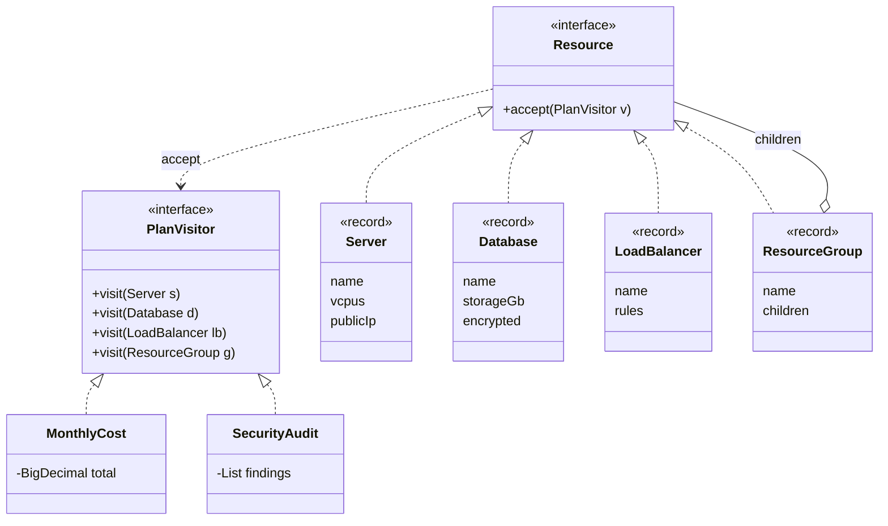

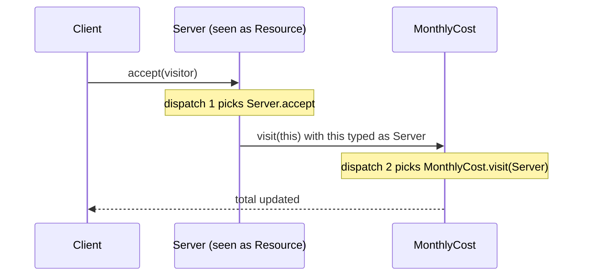

### Java example

`lld.ch11.visitor` has **both** styles over the same domain:

1. **Classic Visitor.** Elements are **records** (so visitors read data through accessors, not public fields). `ResourceGroup` is a **Composite** (the pattern in which a group and a single item share one interface, so a tree can be handled uniformly): its `accept` visits itself and then its children. (A tree is optional: Visitor only requires a stable set of element types, and it works just as well over a flat list. Composite is simply the most common route into Visitor.) Prices are `BigDecimal`, never `double`. `MonthlyCost` and `SecurityAudit` each keep all their rules in one file; neither touches a resource class. A new visitor instance is used per run because they accumulate results.
2. **Java 21 alternative — sealed interface + pattern matching** (`ModernPlan`). `Infra` is `sealed ... permits Vm, Sql, Lb`. `monthlyCost` is a `switch` with **no `default`** — the compiler checks it is **exhaustive** (covers every possible case), so adding a new permitted record breaks every switch that forgot it (the same safety net Visitor gave you). `audit` uses **record patterns** (deconstruction, `case Sql(String n, int gb, boolean enc)`) and **guards** (`when !enc`). A guarded case never counts toward exhaustiveness (the compiler cannot know the guard is sometimes true), which is why `audit` also needs the three unguarded `case Vm vm` / `Sql db` / `Lb lb` lines.

```java
// File: code/lld/ch11/visitor/Resource.java
package lld.ch11.visitor;

/** ELEMENT interface: the only thing every resource must provide is accept. */
public interface Resource {
    void accept(PlanVisitor visitor);
}
```

```java
// File: code/lld/ch11/visitor/PlanVisitor.java
package lld.ch11.visitor;

/** VISITOR interface: one visit per element type. This list is what makes new types expensive. */
public interface PlanVisitor {
    void visit(Server server);
    void visit(Database database);
    void visit(LoadBalancer loadBalancer);
    void visit(ResourceGroup group);
}
```

```java
// File: code/lld/ch11/visitor/Server.java
package lld.ch11.visitor;

/** Records expose data through accessors, so visitors need no public fields. */
public record Server(String name, int vcpus, boolean publicIp) implements Resource {
    public void accept(PlanVisitor v) { v.visit(this); }   // 2nd dispatch: overload picked by static type Server
}
```

```java
// File: code/lld/ch11/visitor/Database.java
package lld.ch11.visitor;

public record Database(String name, int storageGb, boolean encrypted) implements Resource {
    public void accept(PlanVisitor v) { v.visit(this); }
}
```

```java
// File: code/lld/ch11/visitor/LoadBalancer.java
package lld.ch11.visitor;

public record LoadBalancer(String name, int rules) implements Resource {
    public void accept(PlanVisitor v) { v.visit(this); }
}
```

```java
// File: code/lld/ch11/visitor/ResourceGroup.java
package lld.ch11.visitor;

import java.util.List;

/** COMPOSITE element: visits itself, then passes the visitor to every child. */
public record ResourceGroup(String name, List<Resource> children) implements Resource {
    public void accept(PlanVisitor v) {
        v.visit(this);
        for (Resource child : children) child.accept(v);
    }
}
```

```java
// File: code/lld/ch11/visitor/MonthlyCost.java
package lld.ch11.visitor;

import java.math.BigDecimal;

/**
 * Operation 1: ALL pricing rules in one file. New instance per run (it accumulates).
 * Money is BigDecimal: exact decimal arithmetic, no binary rounding surprises.
 */
public final class MonthlyCost implements PlanVisitor {
    static final BigDecimal PER_VCPU = new BigDecimal("24.00");
    static final BigDecimal DB_BASE = new BigDecimal("40.00");
    static final BigDecimal PER_GB = new BigDecimal("0.25");
    static final BigDecimal LB_BASE = new BigDecimal("18.00");
    static final BigDecimal PER_RULE = new BigDecimal("1.50");

    private BigDecimal total = BigDecimal.ZERO;

    public BigDecimal total() { return total; }

    public void visit(Server s)        { total = total.add(PER_VCPU.multiply(BigDecimal.valueOf(s.vcpus()))); }
    public void visit(Database d)      { total = total.add(DB_BASE.add(PER_GB.multiply(BigDecimal.valueOf(d.storageGb())))); }
    public void visit(LoadBalancer lb) { total = total.add(LB_BASE.add(PER_RULE.multiply(BigDecimal.valueOf(lb.rules())))); }
    public void visit(ResourceGroup g) { /* groups are free */ }
}
```

```java
// File: code/lld/ch11/visitor/SecurityAudit.java
package lld.ch11.visitor;

import java.util.ArrayList;
import java.util.List;

/** Operation 2: added later without touching a single resource class. */
public final class SecurityAudit implements PlanVisitor {
    private final List<String> findings = new ArrayList<>();

    public List<String> findings() { return findings; }

    public void visit(Server s) {
        if (s.publicIp()) findings.add(s.name() + ": server has a public IP");
    }
    public void visit(Database d) {
        if (!d.encrypted()) findings.add(d.name() + ": storage not encrypted");
    }
    public void visit(LoadBalancer lb) {
        if (lb.rules() == 0) findings.add(lb.name() + ": load balancer has no rules");
    }
    public void visit(ResourceGroup g) {
        if (g.children().isEmpty()) findings.add(g.name() + ": empty group");
    }
}
```

```java
// File: code/lld/ch11/visitor/ModernPlan.java
package lld.ch11.visitor;

import java.math.BigDecimal;
import java.util.Optional;

/**
 * The Java 21 alternative: a SEALED hierarchy + pattern-matching switch.
 * No accept(), no visitor interface. The compiler still checks exhaustiveness:
 * add a new record to 'permits' and every switch without it stops compiling.
 */
public final class ModernPlan {
    private ModernPlan() {}

    public sealed interface Infra permits Vm, Sql, Lb {}
    public record Vm(String name, int vcpus, boolean publicIp) implements Infra {}
    public record Sql(String name, int storageGb, boolean encrypted) implements Infra {}
    public record Lb(String name, int rules) implements Infra {}

    /** Operation 1 as a plain function. No 'default' branch, on purpose. Same prices as MonthlyCost. */
    public static BigDecimal monthlyCost(Infra r) {
        return switch (r) {
            case Vm vm -> MonthlyCost.PER_VCPU.multiply(BigDecimal.valueOf(vm.vcpus()));
            case Sql db -> MonthlyCost.DB_BASE.add(MonthlyCost.PER_GB.multiply(BigDecimal.valueOf(db.storageGb())));
            case Lb lb -> MonthlyCost.LB_BASE.add(MonthlyCost.PER_RULE.multiply(BigDecimal.valueOf(lb.rules())));
        };
    }

    /** Operation 2 with record deconstruction patterns and guards. */
    public static Optional<String> audit(Infra r) {
        return switch (r) {
            case Vm(String n, int cpus, boolean pub) when pub -> Optional.of(n + ": server has a public IP");
            case Sql(String n, int gb, boolean enc) when !enc -> Optional.of(n + ": storage not encrypted");
            case Lb(String n, int rules) when rules == 0 -> Optional.of(n + ": load balancer has no rules");
            case Vm vm -> Optional.empty();     // no finding
            case Sql db -> Optional.empty();
            case Lb lb -> Optional.empty();
        };
    }
}
```

```java
// File: code/lld/ch11/visitor/Main.java
package lld.ch11.visitor;

import java.math.BigDecimal;
import java.util.List;
import java.util.Optional;

public class Main {
    public static void main(String[] args) {
        System.out.println("=== 1. Classic Visitor (double dispatch) over a composite plan ===");
        Resource plan = new ResourceGroup("prod", List.of(
            new Server("web-1", 4, true),
            new Server("worker-1", 2, false),
            new Database("orders-db", 200, false),
            new LoadBalancer("edge-lb", 4),
            new ResourceGroup("staging", List.of())));

        MonthlyCost cost = new MonthlyCost();
        plan.accept(cost);
        System.out.println("  monthly cost: " + cost.total());

        SecurityAudit audit = new SecurityAudit();
        plan.accept(audit);
        audit.findings().forEach(f -> System.out.println("  finding: " + f));

        System.out.println("\n=== 2. Java 21: sealed interface + pattern matching switch ===");
        List<ModernPlan.Infra> infra = List.of(
            new ModernPlan.Vm("web-1", 4, true), new ModernPlan.Vm("worker-1", 2, false),
            new ModernPlan.Sql("orders-db", 200, false), new ModernPlan.Lb("edge-lb", 4));
        BigDecimal total = infra.stream().map(ModernPlan::monthlyCost).reduce(BigDecimal.ZERO, BigDecimal::add);
        System.out.println("  monthly cost: " + total);
        infra.stream().map(ModernPlan::audit).flatMap(Optional::stream)
             .forEach(f -> System.out.println("  finding: " + f));
    }
}
```

**Output:**

```text
=== 1. Classic Visitor (double dispatch) over a composite plan ===
  monthly cost: 258.00
  finding: web-1: server has a public IP
  finding: orders-db: storage not encrypted
  finding: staging: empty group

=== 2. Java 21: sealed interface + pattern matching switch ===
  monthly cost: 258.00
  finding: web-1: server has a public IP
  finding: orders-db: storage not encrypted
```

Both styles give the same answer (cost 96.00 + 48.00 + 90.00 + 24.00 = 258.00; the empty `staging` group is free). The modern one needs no `accept`, no visitor interface, and each operation is just a function.

### The one question that decides it: the expression problem

| | Add a new **operation** | Add a new **type** |
|---|---|---|
| Methods on the classes (plain OO) | Edit every class | One new class |
| Visitor (or sealed + switch) | One new visitor/function | Edit the visitor interface **and every visitor** (compiler finds them) |

So ask: **which changes more often here — the types or the operations?** Settled types + growing operations → Visitor (or sealed types with pattern matching). Growing types → put the operations on the classes. No ordinary OO design makes both cheap; this trade-off is called the **expression problem**.

**Open/Closed trade-off:** Visitor makes the element hierarchy **closed for modification but open for new operations** — at the price of being **closed to new element types** (each one forces edits to all visitors).

**Sealed interfaces + pattern matching (Java 17/21) as the modern alternative:** sealed classes arrived in Java 17 (JEP 409 — a JEP, JDK Enhancement Proposal, is the numbered design document for a Java feature); pattern matching for `switch` and record patterns were finalised in Java 21 (JEPs 441 and 440). Together they give the exhaustiveness check that was Visitor's main advantage, with far less code. The exact rules:

- A `switch` **expression** must always be exhaustive. A `switch` **statement** must be exhaustive too as soon as it uses patterns or `case null` (old-style statements over constants need not be).
- Over a `sealed` type, covering every permitted subtype with an **unguarded** pattern makes the switch exhaustive with no `default`. Guarded cases (`when ...`) do not count.
- Over a type that is **not** sealed, the compiler cannot know all subtypes, so you need a `default` (or a total pattern such as `case Infra i`) — and then the check is gone.
- If a new subtype appears at run time without recompiling the switch (separate compilation), the compiler-generated fallback throws `MatchException`.
- **Dominance:** cases are tried top to bottom, and a case that can never match because an earlier one already covers it is a compile error. That is why the guarded `case Vm(...) when pub` must come **before** the unguarded `case Vm vm`, never after.
- **`null`:** a pattern `switch` without a `case null` throws `NullPointerException` when the selector is `null`; `default` alone does not match `null`.

Write a classic Visitor when the element hierarchy **is not and cannot be sealed** — typically because the element classes **belong to another team or library** and you cannot edit them — but already exposes `accept` (typical of libraries such as ASM — a library for reading and rewriting Java **bytecode**, the compiled instructions the JVM (Java Virtual Machine) runs — or javac's tree API, which ship their own visitor interfaces), when you need a **walk with per-node callbacks** over a big tree, or when each operation should be a separately testable, injectable class.

**Visitor outside Java.** Kotlin: a sealed class with an exhaustive `when`. Python: `match` with class patterns, or `functools.singledispatch` (dispatch on the argument type with no `accept`). C++: `std::variant` + `std::visit` — the pattern as a library feature. Rust and Swift: enums with associated values plus `match`/`switch`, where a missing case is a build error. Languages without overloading (Python, JavaScript) name the methods `visitServer`, `visitDatabase`, ... instead of overloading `visit`.

### Trade-offs

| Pros | Cons |
|---|---|
| Adding an operation = writing one class; elements stay as they are. | Adding an element type forces a change in every existing visitor. |
| Related logic stays together (all pricing in one file). | Double dispatch is indirect; `accept` tells you nothing about what runs. |
| The compiler reports any element type a visitor has not handled. | Elements often must expose their data (weaker encapsulation). |
| Elements stay small: data + one-line `accept`. | Ceremony for small sets of types. |

### When not to use it

- **New types arrive often** — every one edits every visitor.
- **A tiny model** (say three element types and a single operation) — a type check or a plain method is simpler.
- **The operation concerns one type only** — it's a method.
- **Your language checks switch exhaustiveness** (Java 21 sealed types, Kotlin `when`, Rust `match`) — use that.

### Common mistakes

1. Reaching for Visitor with two element types.
2. Making element fields **public** for visitors (use accessors/records).
3. **Reusing a stateful visitor** (like `MonthlyCost`) across runs without resetting — create a new one per run.
4. Adding a `default` branch to a sealed-type switch — it **turns off** the exhaustiveness check you wanted.
5. Forgetting that the composite's `accept` must forward to children (or deciding where traversal lives: element, visitor, or an Iterator).
6. **Writing a visitor where a sealed-type `switch` would do.** If your language checks exhaustiveness (Java 21, Kotlin, Rust, Swift), that gives the same safety with a fraction of the code.

### Real-world examples

- **Compilers and linters** (tools that flag suspicious code): an **AST** (abstract syntax tree — the tree a compiler builds from source code) has a fixed set of node kinds and endless passes (type check, optimise, format, lint rules). The JDK's `com.sun.source.tree.TreeVisitor` (javac tree API) and `javax.lang.model.element.ElementVisitor` (annotation processing) are visitors; ANTLR (a parser generator) generates visitor classes for your grammar.
- **Bytecode libraries**: ASM's `ClassVisitor` / `MethodVisitor`.
- **`java.nio.file.FileVisitor`** with `Files.walkFileTree` — named after the pattern and often cited, but strictly it is a **tree-walk callback** interface (`preVisitDirectory`, `visitFile`, `visitFileFailed`, `postVisitDirectory`): there is no `accept` and no double dispatch over element classes. The *spirit* (operation kept outside the file-system objects) is Visitor's; the mechanism is closer to a Template Method walk calling your hooks.
- **Document models**: a **DOM** (Document Object Model — the tree of elements that makes up a web page or XML document) has a fixed set of node kinds and ever more operations — serialise to HTML/PDF, pull out the plain text, collect all links; **infrastructure tools** computing cost, policy and diagrams over resource plans (this lesson's example); **query planners** (the database component that decides how to run a SQL query: cost estimation, rewriting, EXPLAIN).

### In the interview

**30-second answer:** "Visitor pulls an operation out of the element classes and into a separate class that has a method for each element type. Each element has a one-line `accept` that calls `visitor.visit(this)`, which gives double dispatch: the method chosen depends on both the element type and the visitor type, so no `instanceof` chains. It makes adding operations cheap and adding types expensive — the expression problem — so it fits stable type sets like ASTs. In Java 21 I'd usually use a sealed interface with an exhaustive pattern-matching switch instead, which gives the same compiler check with much less code."

**Follow-ups:**

- *Explain double dispatch.* Java picks overloads at compile time from static types; `accept` runs on the element's run-time type, and inside it `this` has the concrete static type, so the right `visit` overload is chosen; then the visitor's run-time type picks the implementation.
- *Why not just overload `visit` and call `visitor.visit(resource)`?* With a `Resource` static type, the compiler can't choose `visit(Server)`; it needs `visit(Resource)`, which doesn't exist.
- *Visitor vs Iterator?* Iterator decides the route through the structure; Visitor decides the work done at each stop. Real code often combines them.
- *Visitor vs Strategy?* A strategy is a single algorithm that ignores element types; a visitor is a set of methods, one for each element type, and exists precisely to dispatch on type.
- *Visitor vs Composite?* Composite lets a client treat a whole tree and a single node alike; Visitor adds new operations over a stable set of types, whether or not they form a tree. The two frequently appear together.
- *Visitor vs Interpreter?* Interpreter keeps evaluation **in** each node class; Visitor moves it **out**. Many interpreters begin in the first style and switch to the second once another pass (type checking, pretty-printing) is needed.
- *How do you add a new element type?* Add it to the interface's `visit` list (or the `permits` clause) and fix every visitor/switch the compiler flags.

### Self-check

1. **Q:** What is the body of every `accept` method? **A:** `visitor.visit(this)`.
2. **Q:** What change is cheap with Visitor, and what is expensive? **A:** New operations are cheap; new element types are expensive.
3. **Q:** What Java 21 features replace most visitors? **A:** Sealed interfaces + pattern-matching `switch` (with record patterns), checked for exhaustiveness.
4. **Q:** Why no `default` in `monthlyCost`'s switch? **A:** A `default` would hide missing cases; without it the compiler forces every permitted type to be handled.
5. **Q:** Where does the traversal live for a composite? **A:** Here, in the composite's `accept` (it visits itself, then its children).

### TL;DR

**Operations become visitor classes; elements just `accept`; double dispatch picks the method.** Cheap new operations, expensive new types (expression problem). In Java 21, prefer **sealed interfaces + exhaustive pattern matching**.

---

## 11.6 GoF behavioral patterns: quick-reference summary

A single table with the key features, when to apply each pattern, an example, and pros and cons (compiled from the course summary plus this book's material).

| Pattern | Distinctive feature | Apply when | Example | Pros | Cons |
|---|---|---|---|---|---|
| Chain of Responsibility | Passes a request along a chain of handlers | Several objects may handle a request and the handler isn't known in advance | Help systems, HTTP middleware (code run before/after each web request) | Decouples sender and receiver | A request may go unhandled; long chains can be inefficient and slow to debug |
| Command | Wraps a request as an object | Actions must be queued, logged, retried or undone | GUI actions, job queues | Decouples invoker from receiver; undo/redo | Many small command classes |
| Interpreter | One class per grammar rule | Evaluating sentences of a small language | Regex, rule DSLs (small domain-specific languages) | Easy to extend the grammar | Unmanageable for large grammars |
| Iterator | Sequential access without exposing representation | You need a standard way to traverse any collection | Browsing a playlist | Simple client code; hides the structure | Hidden costs; state handling in lazy iterators |
| Mediator | Centralises communication between peers | Many objects interact in tangled ways | Chat application, air traffic control | Fewer dependencies; reusable components | The mediator can become a god object (one class that knows and does too much) |
| Memento | Captures and externalises state without breaking encapsulation | Undo, checkpoints, rollback | Editor undo, save games | Preserves encapsulation; atomic restore | Memory-heavy for big/frequent snapshots |
| Observer | Notifies dependents of state changes | A change in one object must reach others | Live stock/data feeds | Subject and observers are loosely coupled | Leaks, unexpected performance costs, no ordering |
| State | Behaviour changes with internal state | An object's behaviour depends on a state that changes at run time | Game modes, order lifecycles | Localises state-specific behaviour | More classes; graph spread across files |
| Strategy | Algorithm chosen at run time | Several ways to do one task, chosen dynamically | Compression algorithms, retry policies | Swap algorithms; isolate each | More classes; someone must choose |
| Template Method | Algorithm skeleton in a base class, steps in subclasses | The structure is fixed but some steps vary | Frameworks' lifecycles | Code reuse; enforced order | Inheritance rigidity; harder to follow |
| Visitor | Separates operations from the objects they work on | Many operations over a stable set of types | Processing document elements, compiler passes | Easy to add operations; related code together | Adding element types is hard; bloated visitor interface |

---

## 11.7 Beyond GoF: patterns every LLD interview expects

The GoF book (1994) is not the whole story. The patterns below come from later sources — *Patterns of Enterprise Application Architecture* (Fowler, 2002), *Domain-Driven Design* (Evans, 2003 — DDD, an approach that shapes code around the business domain and its vocabulary), *Head First Design Patterns*, and decades of framework practice. You will use them in almost every case study in this book.

### 11.7.1 Null Object

#### What it is

A **Null Object** is a real object that implements an interface with **neutral, do-nothing behaviour**, used instead of `null` to mean "no object here". Callers can call it safely without `if (x != null)` checks.

Analogy: a "guest" badge at an office. Guests can walk through the lobby like anyone else; the badge simply opens no special doors.

#### The problem it solves

Returning `null` for "not found" forces **every caller** to remember a null check. One forgotten check → `NullPointerException` (NPE — the error Java throws when you call a method on `null`) in production. The checks also clutter the business logic.

#### How it works

1. Define an interface (`Customer`).
2. Implement the real class (`RegisteredCustomer`) and a **null class** (`GuestCustomer`) whose methods return neutral values (0% discount) or do nothing (`notify` is empty).
3. Where you would return `null`, return the null object instead. Stateless null objects can be a **singleton** (a class with exactly one shared instance — here an `enum` constant).
4. If some caller really must know, offer an `isGuest()`/`isNull()` query — sparingly.

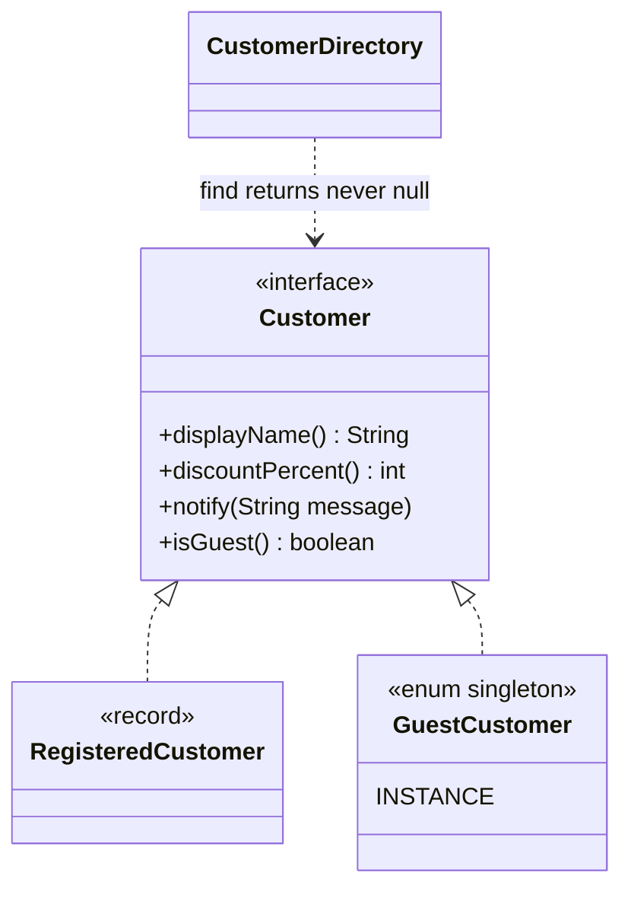

#### Java example

```java
// File: code/lld/ch11/nullobject/Customer.java
package lld.ch11.nullobject;

/** The abstraction both the real object and the Null Object implement. */
public interface Customer {
    String displayName();
    int discountPercent();
    void notify(String message);
    default boolean isGuest() { return false; }
}
```

```java
// File: code/lld/ch11/nullobject/RegisteredCustomer.java
package lld.ch11.nullobject;

public record RegisteredCustomer(String name, int discountPercent, String email) implements Customer {
    public String displayName() { return name; }
    public void notify(String message) { System.out.println("    email to " + email + ": " + message); }
}
```

```java
// File: code/lld/ch11/nullobject/GuestCustomer.java
package lld.ch11.nullobject;

/**
 * NULL OBJECT: a real, do-nothing implementation with neutral values.
 * Stateless, so one shared instance is enough (an enum singleton).
 */
public enum GuestCustomer implements Customer {
    INSTANCE;

    public String displayName() { return "guest"; }
    public int discountPercent() { return 0; }            // neutral value
    public void notify(String message) { }                // does nothing, on purpose
    @Override public boolean isGuest() { return true; }   // for the rare caller that must know
}
```

```java
// File: code/lld/ch11/nullobject/CustomerDirectory.java
package lld.ch11.nullobject;

import java.util.Map;
import java.util.Optional;

public final class CustomerDirectory {
    private final Map<String, Customer> byId = Map.of(
        "c1", new RegisteredCustomer("Asha", 10, "asha@example.com"));

    /** Style 1: never return null; return the Null Object instead. */
    public Customer find(String id) { return byId.getOrDefault(id, GuestCustomer.INSTANCE); }

    /** Style 2: make absence explicit in the type; the caller chooses the fallback. */
    public Optional<Customer> lookup(String id) { return Optional.ofNullable(byId.get(id)); }
}
```

```java
// File: code/lld/ch11/nullobject/Main.java
package lld.ch11.nullobject;

import java.math.BigDecimal;
import java.math.RoundingMode;

public class Main {
    private static final BigDecimal HUNDRED = BigDecimal.valueOf(100);

    static void checkout(Customer c, BigDecimal price) {
        // No "if (customer != null)" anywhere: the Null Object answers every call safely.
        BigDecimal payable = price.multiply(BigDecimal.valueOf(100 - c.discountPercent()))
                                  .divide(HUNDRED, 2, RoundingMode.HALF_EVEN);
        System.out.printf("  %-6s pays %s%n", c.displayName(), payable);
        c.notify("thanks for your order");
    }

    public static void main(String[] args) {
        CustomerDirectory dir = new CustomerDirectory();
        System.out.println("=== Null Object ===");
        checkout(dir.find("c1"), new BigDecimal("100.00"));
        checkout(dir.find("unknown-id"), new BigDecimal("100.00"));

        System.out.println("=== Optional (absence visible in the signature) ===");
        Customer c = dir.lookup("unknown-id").orElse(GuestCustomer.INSTANCE);
        System.out.println("  lookup(unknown-id) present? " + dir.lookup("unknown-id").isPresent() + " -> using " + c.displayName());
    }
}
```

**Output:**

```text
=== Null Object ===
  Asha   pays 90.00
    email to asha@example.com: thanks for your order
  guest  pays 100.00
=== Optional (absence visible in the signature) ===
  lookup(unknown-id) present? false -> using guest
```

`checkout` has no null checks, and the guest's `notify` silently does nothing. (Prices are `BigDecimal` with an explicit rounding mode, never `double`.)

#### Trade-offs, when not to use it, mistakes

| Pros | Cons |
|---|---|
| Removes repetitive null checks; fewer NPEs. | Can **hide real errors** — a missing object that *should* exist fails silently. |
| Polymorphism instead of conditionals. | One more class per interface. |
| Easy to test; a natural default. | Callers may not realise they got a "nothing" object. |

- **Don't use it** when absence is an **error** (throw an exception) or when the caller must decide what absence means (return `Optional<T>` — a JDK container that either holds a value or is empty).
- **Null Object vs `Optional`:** Null Object hides absence behind neutral behaviour; `Optional` makes absence **visible in the type** and lets each caller choose (`orElse`, `orElseThrow`). Use `Optional` for return values of lookups; use Null Object for **collaborators** that are legitimately optional (a logger, a listener, a discount policy).
- **Common mistakes:** a null object with **side effects** or non-neutral values; a mutable null-object singleton; overusing `isNull()` checks (which brings the conditionals back).

#### Real-world examples

`Collections.emptyList()` / `emptyMap()` (empty, not null); `InputStream.nullInputStream()`, `OutputStream.nullOutputStream()`, `Reader.nullReader()`, `Writer.nullWriter()` (Java 11); SLF4J's (a common Java logging API) `NOPLogger`; a "no-op" (does nothing) `MeterRegistry`/tracer in **observability** libraries (metrics, logs and traces that show what a running system is doing).

#### In the interview

**30-second answer:** "Null Object replaces `null` with an implementation that does nothing or returns neutral values, so callers never need null checks — like returning an empty list instead of null. I use it for optional collaborators like loggers or discount policies, and `Optional` for lookups where the caller should decide. I avoid it when absence is actually an error, because it would hide the bug."

*Follow-up — is it a GoF pattern?* No; it was described by Bobby Woolf (in *Pattern Languages of Program Design 3*) and appears in Fowler's *Refactoring* as "Introduce Special Case" (earlier "Introduce Null Object").

**Self-check.** Q: What does `Collections.emptyList()` have to do with this? A: It's a null object for lists — safe to iterate, never null. Q: When should you throw instead? A: When the object must exist and its absence is a bug.

**TL;DR:** Return a harmless "nothing" object instead of `null`; use `Optional` when the caller must choose; throw when absence is a bug.

---

### 11.7.2 Dependency Injection (DI)

#### What it is

**Dependency Injection** means a class **receives** the objects it depends on (its *dependencies*) from outside, instead of **creating** them itself with `new` or looking them up. It is the most common way to implement **Inversion of Control (IoC)** — the framework or a "composition root" builds and wires objects, not the objects themselves. The name was settled by Martin Fowler in his 2004 article on IoC containers.

Analogy: a restaurant kitchen doesn't grow its own vegetables; suppliers deliver them. Change the supplier, and the chef's recipes don't change.

#### The problem it solves

```java
class OrderService {
    private final EmailSender sender = new EmailSender();   // hard-wired
}
```

This class can never send SMS, can't be unit-tested without really sending email, and hides its dependencies. DI fixes all three: depend on an **interface** (`MessageSender`), receive it through the **constructor**, and let someone else decide which implementation.

#### How it works

1. The class declares dependencies as **constructor parameters** typed by **interfaces** (Dependency Inversion Principle, Chapter 4).
2. A **composition root** (usually `main`, or a DI container at start-up) creates the concrete objects and passes them in.
3. Tests pass **fakes** (simple stand-in implementations used only in tests) instead.

Three injection styles:

| Style | How | Use for |
|---|---|---|
| **Constructor injection** | Dependencies are constructor parameters, stored in `final` fields | Required dependencies — the default choice |
| **Setter injection** | `setX(...)` after construction | Optional dependencies or ones that can change |
| **Field injection** | Framework writes directly into fields (`@Autowired` annotation on a field) | Avoid: hides dependencies and makes testing harder |

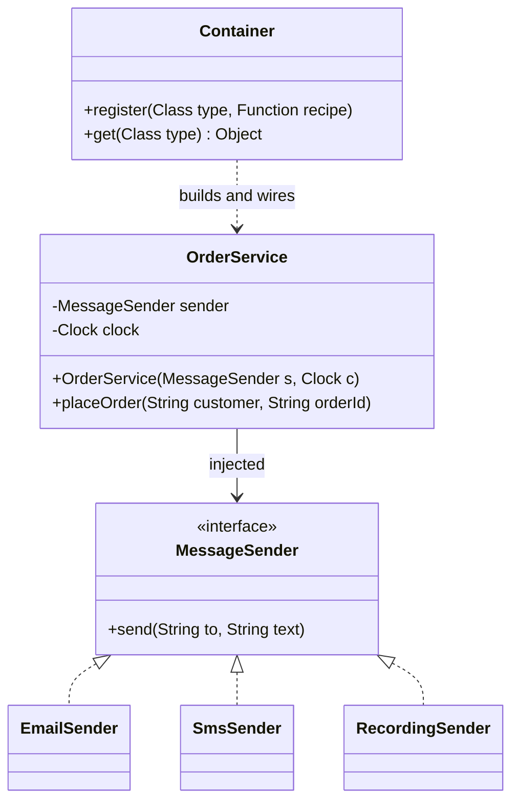

#### Java example

`OrderService` receives both a `MessageSender` and a `java.time.Clock` — injecting the clock makes time **testable** (`Clock.fixed`). `Container` is a toy IoC container: you register a *recipe* per type; `get` builds objects on demand (recipes can ask the container for their own dependencies) and caches them as singletons.

```java
// File: code/lld/ch11/di/MessageSender.java
package lld.ch11.di;

/** The abstraction the service depends on (Dependency Inversion). */
public interface MessageSender {
    void send(String to, String text);
}
```

```java
// File: code/lld/ch11/di/EmailSender.java
package lld.ch11.di;

public final class EmailSender implements MessageSender {
    public void send(String to, String text) { System.out.println("  [smtp] to " + to + ": " + text); }
}
```

```java
// File: code/lld/ch11/di/SmsSender.java
package lld.ch11.di;

public final class SmsSender implements MessageSender {
    public void send(String to, String text) { System.out.println("  [sms] to " + to + ": " + text); }
}
```

```java
// File: code/lld/ch11/di/RecordingSender.java
package lld.ch11.di;

import java.util.ArrayList;
import java.util.List;

/** Test double: records instead of sending. Only possible because the dependency is injected. */
public final class RecordingSender implements MessageSender {
    public final List<String> sent = new ArrayList<>();
    public void send(String to, String text) { sent.add(to + "|" + text); }
}
```

```java
// File: code/lld/ch11/di/OrderService.java
package lld.ch11.di;

import java.time.Clock;
import java.time.LocalTime;

/**
 * CONSTRUCTOR INJECTION: the service declares what it needs and never calls 'new'
 * on its collaborators. Even the clock is injected, so time is testable.
 */
public final class OrderService {
    private final MessageSender sender;
    private final Clock clock;

    public OrderService(MessageSender sender, Clock clock) {
        this.sender = sender;
        this.clock = clock;
    }

    public void placeOrder(String customer, String orderId) {
        LocalTime now = LocalTime.now(clock);
        sender.send(customer, "order " + orderId + " placed at " + now);
    }
}
```

```java
// File: code/lld/ch11/di/Container.java
package lld.ch11.di;

import java.util.HashMap;
import java.util.Map;
import java.util.function.Function;

/**
 * A toy IoC container: register how to build each type once; ask for the type later.
 * Real containers (Spring, Guice, Dagger) add scanning, scopes, proxies and lifecycles.
 */
public final class Container {
    private final Map<Class<?>, Function<Container, ?>> recipes = new HashMap<>();
    private final Map<Class<?>, Object> singletons = new HashMap<>();

    public <T> void register(Class<T> type, Function<Container, ? extends T> recipe) {
        recipes.put(type, recipe);
    }

    public <T> T get(Class<T> type) {
        Object existing = singletons.get(type);
        if (existing != null) return type.cast(existing);
        Function<Container, ?> recipe = recipes.get(type);
        if (recipe == null) throw new IllegalStateException("no binding for " + type.getSimpleName());
        T created = type.cast(recipe.apply(this));   // the recipe may ask the container for its own deps
        singletons.put(type, created);
        return created;
    }
}
```

```java
// File: code/lld/ch11/di/Main.java
package lld.ch11.di;

import java.time.Clock;
import java.time.Instant;
import java.time.ZoneOffset;

public class Main {
    public static void main(String[] args) {
        Clock fixed = Clock.fixed(Instant.parse("2026-01-15T09:30:00Z"), ZoneOffset.UTC);

        System.out.println("=== 1. Manual DI: the composition root wires everything ===");
        new OrderService(new EmailSender(), fixed).placeOrder("asha@example.com", "A-1");
        new OrderService(new SmsSender(), fixed).placeOrder("+91-90000-00000", "A-2");

        System.out.println("\n=== 2. In a unit test: inject a fake ===");
        RecordingSender fake = new RecordingSender();
        new OrderService(fake, fixed).placeOrder("ben", "T-9");
        System.out.println("  fake recorded: " + fake.sent);

        System.out.println("\n=== 3. A toy IoC container ===");
        Container c = new Container();
        c.register(Clock.class, k -> fixed);
        c.register(MessageSender.class, k -> new EmailSender());
        c.register(OrderService.class, k -> new OrderService(k.get(MessageSender.class), k.get(Clock.class)));
        c.get(OrderService.class).placeOrder("chen@example.com", "A-3");
        System.out.println("  same instance each time: " + (c.get(OrderService.class) == c.get(OrderService.class)));
    }
}
```

**Output:**

```text
=== 1. Manual DI: the composition root wires everything ===
  [smtp] to asha@example.com: order A-1 placed at 09:30
  [sms] to +91-90000-00000: order A-2 placed at 09:30

=== 2. In a unit test: inject a fake ===
  fake recorded: [ben|order T-9 placed at 09:30]

=== 3. A toy IoC container ===
  [smtp] to chen@example.com: order A-3 placed at 09:30
  same instance each time: true
```

#### Trade-offs, when not to use it, mistakes

| Pros | Cons |
|---|---|
| Swap implementations without editing the class (OCP, DIP). | More indirection: "where does this come from?" |
| Easy unit tests with fakes. | Containers add "magic" (reflection — code inspecting classes at run time; proxies — generated wrapper objects) and start-up cost. |
| Dependencies are explicit in the constructor. | Misconfiguration may only show at start-up (or run time). |

- **Don't** inject value objects or simple data (`new Money(...)` is fine), or add interfaces with only one implementation "just for DI" when no test or variation needs them.
- **Common mistakes:** the **Service Locator** anti-pattern (classes call `container.get(...)` themselves — dependencies hidden again); field injection; **constructor with 8+ dependencies** (a sign the class does too much — split it); **circular dependencies** (A needs B while B needs A).

#### Real-world examples

**Spring** (`@Component` + constructor injection, `ApplicationContext` as the container), **Google Guice**, **Dagger/Hilt** (compile-time DI on Android), **Jakarta CDI**, **Micronaut/Quarkus** (compile-time DI for fast start-up). Spring can even inject a `Map<String, PaymentStrategy>` of all strategy beans — DI + Strategy together.

#### In the interview

**30-second answer:** "Dependency injection means a class receives its collaborators through its constructor, typed by interfaces, instead of creating them. It's how we apply Dependency Inversion and Inversion of Control: a composition root or a container like Spring wires the graph. The benefits are swappable implementations and easy testing with fakes — I even inject the Clock. I prefer constructor injection, avoid field injection and service locators, and treat a huge constructor as a **design smell** (a surface sign that something deeper is wrong)."

*Follow-ups:* **DI vs IoC?** IoC is the general idea (the framework calls you / controls object creation); DI is one way to achieve it. **DI vs Service Locator?** With a locator the class asks for dependencies (hidden); with DI they're handed in (visible). **DI vs Factory?** A factory creates objects on request; DI supplies ready-made dependencies — containers use factories internally.

**Self-check.** Q: Why inject `Clock`? A: To make time-dependent code deterministic in tests. Q: Which injection style is preferred? A: Constructor injection.

**TL;DR:** Don't `new` your collaborators — **receive them** (constructor, interfaces). Wire at the composition root or with a container.

---

### 11.7.3 Repository

#### What it is

A **Repository** is a **collection-like interface for loading and saving domain objects**, written in the language of the domain (`findByEmail`, `findActive`), that **hides how and where data is stored** (SQL — relational databases queried with the SQL language; NoSQL — non-relational stores such as key-value or document databases; files; memory). Described by Fowler (*PoEAA*) and central to Evans's *Domain-Driven Design*.

Analogy: a library's front desk. You ask for "books by this author"; you don't need to know which shelf, basement or branch they come from.

#### The problem it solves

When SQL, connection handling and mapping code are scattered through business classes, the business rules become hard to read, impossible to unit-test without a database, and tied to one storage technology.

#### How it works

1. Define the interface in the **domain layer** (the code that holds business rules) (`UserRepository`: `save`, `findById`, `findByEmail`, ...). Return `Optional` for "maybe not found".
2. Implement it in the **infrastructure layer** (code that talks to databases, networks and files): `InMemoryUserRepository` for tests, a JDBC/JPA one (JPA, the Java Persistence API, maps objects to tables) for production.
3. Services depend on the **interface** (injected — see DI).

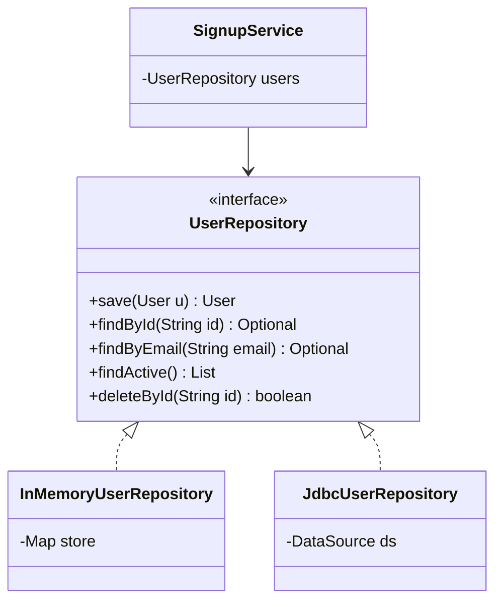

(`JdbcUserRepository` is shown to illustrate a production implementation; the demo code includes the in-memory one.)

#### Java example

```java
// File: code/lld/ch11/repository/User.java
package lld.ch11.repository;

/** A domain object. It knows nothing about storage. */
public record User(String id, String email, boolean active) {}
```

```java
// File: code/lld/ch11/repository/UserRepository.java
package lld.ch11.repository;

import java.util.List;
import java.util.Optional;

/**
 * REPOSITORY: a collection-like interface for aggregates, in DOMAIN language.
 * The domain depends on this; the storage details live in implementations.
 */
public interface UserRepository {
    User save(User user);
    Optional<User> findById(String id);
    Optional<User> findByEmail(String email);
    List<User> findActive();
    boolean deleteById(String id);
}
```

```java
// File: code/lld/ch11/repository/InMemoryUserRepository.java
package lld.ch11.repository;

import java.util.Comparator;
import java.util.List;
import java.util.Map;
import java.util.Optional;
import java.util.concurrent.ConcurrentHashMap;

/** One implementation: in memory (tests, prototypes). A JDBC/JPA one would implement the same interface. */
public final class InMemoryUserRepository implements UserRepository {
    private final Map<String, User> store = new ConcurrentHashMap<>();

    public User save(User user) { store.put(user.id(), user); return user; }
    public Optional<User> findById(String id) { return Optional.ofNullable(store.get(id)); }

    public Optional<User> findByEmail(String email) {
        return store.values().stream().filter(u -> u.email().equalsIgnoreCase(email)).findFirst();
    }

    public List<User> findActive() {
        return store.values().stream().filter(User::active)
                    .sorted(Comparator.comparing(User::id)).toList();
    }

    public boolean deleteById(String id) { return store.remove(id) != null; }
}
```

```java
// File: code/lld/ch11/repository/SignupService.java
package lld.ch11.repository;

/** Business logic talks to the repository interface only: no SQL, no maps, no files. */
public final class SignupService {
    private final UserRepository users;

    public SignupService(UserRepository users) { this.users = users; }

    public String signUp(String id, String email) {
        if (users.findByEmail(email).isPresent()) return "rejected: " + email + " already registered";
        users.save(new User(id, email, true));
        return "created " + id;
    }

    public void deactivate(String id) {
        users.findById(id).ifPresent(u -> users.save(new User(u.id(), u.email(), false)));
    }
}
```

```java
// File: code/lld/ch11/repository/Main.java
package lld.ch11.repository;

public class Main {
    public static void main(String[] args) {
        UserRepository repo = new InMemoryUserRepository();   // swap for a JDBC version in production
        SignupService service = new SignupService(repo);
        System.out.println("  " + service.signUp("u1", "asha@example.com"));
        System.out.println("  " + service.signUp("u2", "ben@example.com"));
        System.out.println("  " + service.signUp("u3", "ASHA@example.com"));
        service.deactivate("u2");
        System.out.println("  active users: " + repo.findActive());
        System.out.println("  findById(u9): " + repo.findById("u9"));
        System.out.println("  deleteById(u2): " + repo.deleteById("u2"));
    }
}
```

**Output:**

```text
  created u1
  created u2
  rejected: ASHA@example.com already registered
  active users: [User[id=u1, email=asha@example.com, active=true]]
  findById(u9): Optional.empty
  deleteById(u2): true
```

#### Trade-offs, when not to use it, mistakes

| Pros | Cons |
|---|---|
| Business logic is storage-agnostic and testable in memory. | Another layer; trivial CRUD (create, read, update, delete) apps may not need it. |
| One place for queries per aggregate. | Can leak storage concerns (lazy loading — fetching data only when first touched; transactions — changes that succeed or fail together) anyway. |
| Swap storage (SQL → NoSQL) behind the interface. | "Generic repository for everything" becomes a thin, useless wrapper. |

- **Don't** create a repository per table; create one per **aggregate root** (DDD: the entry point object of a cluster, e.g. `Order` with its `OrderLine`s).
- **Repository vs DAO:** a DAO (Data Access Object) is table/record-oriented and closer to the database; a repository is domain-oriented and behaves like a collection of aggregates. In small apps they often look the same.
- **Common mistakes:** returning `null` instead of `Optional`; exposing SQL types (`ResultSet`) in the interface; putting business rules in the repository; dozens of `findByXAndYOrZ` methods — use **Specification** (next).
- **Thread-safety note:** `InMemoryUserRepository` uses a `ConcurrentHashMap` (the JDK's thread-safe hash map), so each single call is safe, but `SignupService.signUp` is **check-then-act** (a race where the answer to the check can be stale by the time you act on it) (`findByEmail`, then `save`): two concurrent sign-ups with the same email can both pass the check. A real system enforces uniqueness with a database **unique constraint** (a rule that makes the database reject a duplicate value in a column) (or an atomic `putIfAbsent` keyed by email in memory).

#### Real-world examples

**Spring Data** `CrudRepository` / `JpaRepository` (derived query methods like `findByEmail` are generated from method names), Micronaut Data, Hibernate/JPA behind them; Android Room DAOs wrapped in repositories (Android architecture guidance).

#### In the interview

**30-second answer:** "A repository is a collection-like interface for aggregates in domain language — save, findById, findByEmail — that hides storage. Services depend on the interface, so business logic is testable with an in-memory implementation and storage can change. In machine-coding rounds I always put an in-memory repository behind an interface, so the design is ready for a database later."

**Self-check.** Q: What does a repository return when nothing is found? A: `Optional.empty()` (or an empty list). Q: One repository per table? A: No, per aggregate root.

**TL;DR:** A **domain-language collection interface** over storage; services use the interface; start in-memory, swap later.

---

### 11.7.4 Specification

#### What it is

A **Specification** is a **business rule packaged as an object** with one question — `isSatisfiedBy(candidate)` — that can be **combined** with `and`, `or` and `not`. Introduced by Eric Evans and Martin Fowler.

Analogy: the filter panel on a shopping site. "Electronics" ✓, "under ₹5,000" ✓, "in stock" ✓ — each is a separate rule, and the site combines the ones you tick.

#### The problem it solves

Rules like "bargain electronics = category electronics AND price < 50.00 AND in stock" end up duplicated in queries, validations and UI filters, or as an explosion of repository methods (`findByCategoryAndPriceLessThanAndStockGreaterThan...`). Specification gives each rule a **name**, makes it **reusable** in several places (selection, validation, building to order), and **composable**.

#### How it works

1. `Specification<T>` with `isSatisfiedBy(T)`; default methods `and`, `or`, `not` return new composite specifications (this is the **Composite** pattern + **Interpreter**-like evaluation).
2. Write small named factories (`inStock()`, `cheaperThan(...)`).
3. Combine them where needed; pass them to a repository or a stream filter.

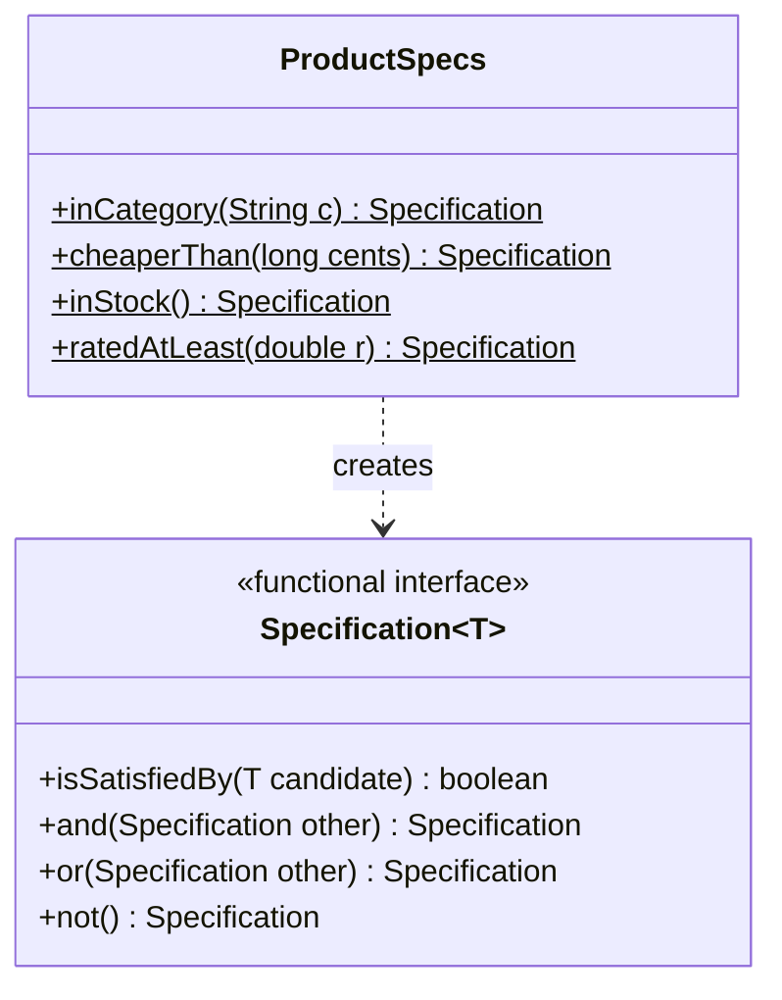

#### Java example

```java
// File: code/lld/ch11/specification/Specification.java
package lld.ch11.specification;

/**
 * SPECIFICATION: a business rule as a small, named, combinable object.
 * isSatisfiedBy answers "does this candidate meet the rule?"
 */
@FunctionalInterface
public interface Specification<T> {
    boolean isSatisfiedBy(T candidate);

    default Specification<T> and(Specification<T> other) { return c -> isSatisfiedBy(c) && other.isSatisfiedBy(c); }
    default Specification<T> or(Specification<T> other)  { return c -> isSatisfiedBy(c) || other.isSatisfiedBy(c); }
    default Specification<T> not()                       { return c -> !isSatisfiedBy(c); }
}
```

```java
// File: code/lld/ch11/specification/Product.java
package lld.ch11.specification;

public record Product(String name, String category, long priceCents, int stock, double rating) {}
```

```java
// File: code/lld/ch11/specification/ProductSpecs.java
package lld.ch11.specification;

/** Named rules, in the language of the business. Each is tiny and testable alone. */
public final class ProductSpecs {
    private ProductSpecs() {}

    public static Specification<Product> inCategory(String c) { return p -> p.category().equals(c); }
    public static Specification<Product> cheaperThan(long cents) { return p -> p.priceCents() < cents; }
    public static Specification<Product> inStock() { return p -> p.stock() > 0; }
    public static Specification<Product> ratedAtLeast(double r) { return p -> p.rating() >= r; }
}
```

```java
// File: code/lld/ch11/specification/Main.java
package lld.ch11.specification;

import static lld.ch11.specification.ProductSpecs.*;

import java.util.List;

public class Main {
    static List<String> select(List<Product> catalog, Specification<Product> spec) {
        return catalog.stream().filter(spec::isSatisfiedBy).map(Product::name).toList();
    }

    public static void main(String[] args) {
        List<Product> catalog = List.of(
            new Product("usb-cable", "electronics", 499, 120, 4.1),
            new Product("headphones", "electronics", 7_999, 0, 4.6),
            new Product("keyboard", "electronics", 4_999, 8, 4.7),
            new Product("novel", "books", 1_299, 30, 4.8),
            new Product("cookbook", "books", 2_499, 0, 3.9));

        // The same rule objects are reused for querying AND for validation.
        Specification<Product> bargainElectronics = inCategory("electronics").and(cheaperThan(5_000)).and(inStock());
        Specification<Product> recommendable = ratedAtLeast(4.5).and(inStock());
        Specification<Product> needsRestock = inStock().not();

        System.out.println("  bargain electronics: " + select(catalog, bargainElectronics));
        System.out.println("  recommendable:       " + select(catalog, recommendable));
        System.out.println("  needs restock:       " + select(catalog, needsRestock));
        System.out.println("  books or top-rated:  " + select(catalog, inCategory("books").or(ratedAtLeast(4.7))));
        System.out.println("  is 'novel' recommendable? " + recommendable.isSatisfiedBy(catalog.get(3)));
    }
}
```

**Output:**

```text
  bargain electronics: [usb-cable, keyboard]
  recommendable:       [keyboard, novel]
  needs restock:       [headphones, cookbook]
  books or top-rated:  [keyboard, novel, cookbook]
  is 'novel' recommendable? true
```

#### Trade-offs, when not to use it, mistakes

| Pros | Cons |
|---|---|
| Rules are named, reusable and testable one by one. | In-memory specs don't translate to SQL automatically — you need a query-building version (e.g. JPA Criteria) for large data. |
| Combining rules replaces a method explosion. | Overkill for one or two fixed filters. |
| The same rule serves querying and validation. | Deeply nested combinations can be hard to debug. |

- Java's own `Predicate<T>` (the JDK interface for a yes/no test on a value, with `and`, `or`, `negate`) is already a specification; a named `Specification` type adds domain meaning and a place for SQL translation.
- **Common mistake:** filtering millions of rows in memory — push specifications down to the database.

#### Real-world examples

**Spring Data JPA `Specification<T>`** (`where(...).and(...)`, `JpaSpecificationExecutor.findAll(spec)`), e-commerce search filters, eligibility rules (loan, coupon, delivery-slot eligibility), access-control policies.

#### In the interview

**30-second answer:** "A specification is a named business rule object with `isSatisfiedBy`, combinable with and/or/not. It removes duplicated conditions and the explosion of repository finder methods, and the same rule can filter a query and validate an object. In Java, `Predicate` is the building block; Spring Data JPA has a `Specification` that translates to SQL."

**Self-check.** Q: What three combinators does a specification usually have? A: `and`, `or`, `not`. Q: Which pattern does combining specifications resemble? A: Composite (and Interpreter for evaluation).

**TL;DR:** **Rules as small combinable objects**; reuse them for querying and validation.

---

### 11.7.5 MVC — Model–View–Controller (the Head First "compound pattern")

#### What it is

**MVC** splits an interactive application into three roles:

- **Model** — the data and business rules. Knows nothing about screens.
- **View** — displays the model and receives user input.
- **Controller** — interprets user input and tells the model what to change.

It was created by Trygve Reenskaug for Smalltalk at Xerox PARC in the late 1970s. *Head First Design Patterns* calls MVC a **compound pattern** — several patterns working together:

| Pattern inside MVC | Where |
|---|---|
| **Observer** | The model notifies views (and sometimes controllers) when its state changes; views re-render. |
| **Strategy** | The view delegates "what should this input do?" to a controller object; swap the controller to change behaviour (e.g. read-only mode). |
| **Composite** | The view is a tree of nested components (panels containing labels, lists, buttons) rendered uniformly. |

Analogy: a restaurant. The kitchen and pantry are the **model**; the dining-room menu and plates are the **view**; the waiter who takes your order and passes it to the kitchen is the **controller**.

#### The problem it solves

When UI code, input handling and business rules are mixed, you cannot change the screen without risking the rules, cannot show the same data in two ways, and cannot test the rules without a UI.

#### How it works

1. The user acts on the **view** (`userTyped("add ...")`).
2. The view hands the input to its **controller** (strategy).
3. The controller calls the **model** (`model.add(title)`); it does **not** redraw anything.
4. The model changes and **notifies its listeners** (observer).
5. The view re-renders its **composite** widget tree from the model.

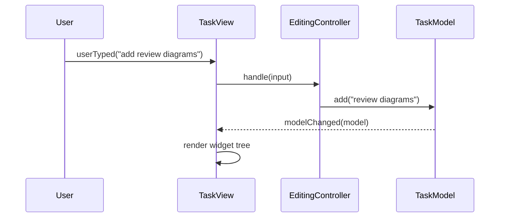

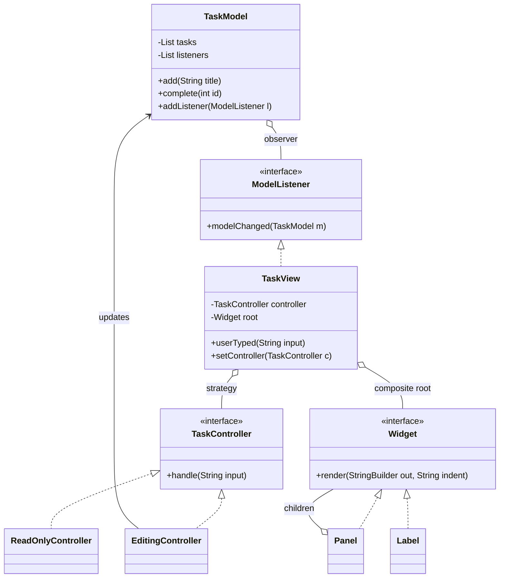

#### Java example

A console to-do app. `TaskModel` knows only `ModelListener`s. `TaskView` implements `ModelListener`, renders a **composite** of `Widget.Panel`/`Widget.Label`, and forwards input to a swappable `TaskController`. Switching to `ReadOnlyController` changes behaviour without touching the view or model.

```java
// File: code/lld/ch11/mvc/Task.java
package lld.ch11.mvc;

public record Task(int id, String title, boolean done) {}
```

```java
// File: code/lld/ch11/mvc/TaskModel.java
package lld.ch11.mvc;

import java.util.ArrayList;
import java.util.List;

/** MODEL: state + business rules. Knows NOTHING about views or controllers, only listeners. */
public final class TaskModel {
    private final List<Task> tasks = new ArrayList<>();
    private final List<ModelListener> listeners = new ArrayList<>();
    private int nextId = 1;

    public void addListener(ModelListener l) { listeners.add(l); }

    public List<Task> tasks() { return List.copyOf(tasks); }

    public void add(String title) {
        if (title.isBlank()) throw new IllegalArgumentException("title must not be blank");
        tasks.add(new Task(nextId++, title, false));
        fireChanged();
    }

    public void complete(int id) {
        for (int i = 0; i < tasks.size(); i++) {
            Task t = tasks.get(i);
            if (t.id() == id) {
                tasks.set(i, new Task(t.id(), t.title(), true));
                fireChanged();
                return;
            }
        }
        throw new IllegalArgumentException("no task " + id);
    }

    private void fireChanged() { listeners.forEach(l -> l.modelChanged(this)); }
}
```

```java
// File: code/lld/ch11/mvc/ModelListener.java
package lld.ch11.mvc;

/** OBSERVER interface between model and views. */
public interface ModelListener {
    void modelChanged(TaskModel model);
}
```

```java
// File: code/lld/ch11/mvc/Widget.java
package lld.ch11.mvc;

import java.util.List;
import java.util.function.Supplier;

/** COMPOSITE: the view is a tree of widgets rendered the same way. */
public interface Widget {
    void render(StringBuilder out, String indent);

    record Label(Supplier<String> text) implements Widget {
        public void render(StringBuilder out, String indent) { out.append(indent).append(text.get()).append('\n'); }
    }

    record Panel(String title, List<Widget> children) implements Widget {
        public void render(StringBuilder out, String indent) {
            out.append(indent).append("+ ").append(title).append('\n');
            children.forEach(c -> c.render(out, indent + "  "));
        }
    }
}
```

```java
// File: code/lld/ch11/mvc/TaskController.java
package lld.ch11.mvc;

/** CONTROLLER as a STRATEGY: the view delegates "what does this input mean?" to it. */
public interface TaskController {
    void handle(String input);
}
```

```java
// File: code/lld/ch11/mvc/EditingController.java
package lld.ch11.mvc;

/** Interprets user input and updates the MODEL. It does not redraw anything itself. */
public final class EditingController implements TaskController {
    private final TaskModel model;
    private final TaskView view;

    public EditingController(TaskModel model, TaskView view) {
        this.model = model;
        this.view = view;
    }

    public void handle(String input) {
        try {
            if (input.startsWith("add ")) model.add(input.substring(4));
            else if (input.startsWith("done ")) model.complete(Integer.parseInt(input.substring(5).trim()));
            else view.showMessage("unknown command: " + input);
        } catch (IllegalArgumentException e) {        // NumberFormatException is a subclass
            view.showMessage("error: " + e.getMessage());
        }
    }
}
```

```java
// File: code/lld/ch11/mvc/ReadOnlyController.java
package lld.ch11.mvc;

/** Alternative strategy: same view, different behaviour (e.g. a viewer role). */
public final class ReadOnlyController implements TaskController {
    private final TaskView view;

    public ReadOnlyController(TaskView view) { this.view = view; }

    public void handle(String input) { view.showMessage("read-only mode, ignored: " + input); }
}
```

```java
// File: code/lld/ch11/mvc/TaskView.java
package lld.ch11.mvc;

import java.util.List;
import java.util.stream.Collectors;

/** VIEW: observes the model, renders it (composite), forwards user input to its controller (strategy). */
public final class TaskView implements ModelListener {
    private TaskController controller;
    private final Widget root;
    private TaskModel lastSeen;

    public TaskView() {
        root = new Widget.Panel("My Tasks", List.of(
            new Widget.Label(() -> lastSeen == null ? "(empty)" : lastSeen.tasks().stream()
                .map(t -> (t.done() ? "[x] " : "[ ] ") + t.id() + ". " + t.title())
                .collect(Collectors.joining("\n    "))),
            new Widget.Panel("Summary", List.of(
                new Widget.Label(() -> lastSeen == null ? "0 open" :
                    lastSeen.tasks().stream().filter(t -> !t.done()).count() + " open")))));
    }

    public void setController(TaskController controller) { this.controller = controller; }

    /** A user action arrives at the view... and is handed straight to the controller. */
    public void userTyped(String input) {
        System.out.println("> " + input);
        controller.handle(input);
    }

    public void showMessage(String msg) { System.out.println("  (" + msg + ")"); }

    @Override
    public void modelChanged(TaskModel model) {     // Observer callback: re-render from the model
        lastSeen = model;
        StringBuilder out = new StringBuilder();
        root.render(out, "  ");
        System.out.print(out);
    }
}
```

```java
// File: code/lld/ch11/mvc/Main.java
package lld.ch11.mvc;

public class Main {
    public static void main(String[] args) {
        TaskModel model = new TaskModel();
        TaskView view = new TaskView();
        model.addListener(view);                                   // Observer: model -> view
        view.setController(new EditingController(model, view));  // Strategy: view -> controller

        view.userTyped("add write chapter 11");
        view.userTyped("add review diagrams");
        view.userTyped("done 1");
        view.userTyped("done 42");

        System.out.println("-- switching the view to a read-only controller --");
        view.setController(new ReadOnlyController(view));
        view.userTyped("add sneaky task");
    }
}
```

**Output:**

```text
> add write chapter 11
  + My Tasks
    [ ] 1. write chapter 11
    + Summary
      1 open
> add review diagrams
  + My Tasks
    [ ] 1. write chapter 11
    [ ] 2. review diagrams
    + Summary
      2 open
> done 1
  + My Tasks
    [x] 1. write chapter 11
    [ ] 2. review diagrams
    + Summary
      1 open
> done 42
  (error: no task 42)
-- switching the view to a read-only controller --
> add sneaky task
  (read-only mode, ignored: add sneaky task)
```

#### Trade-offs, variants and mistakes

| Pros | Cons |
|---|---|
| Separation of concerns; business rules testable without UI. | More classes and indirection for tiny apps. |
| Several views on one model (list, chart, widget). | Update flows via observers can be hard to trace. |
| Swap controllers/views independently. | Controllers tend to get "fat" if business logic leaks into them. |

- **Web MVC is different.** In **Spring MVC** (a "Model 2" design), a **front controller** (`DispatcherServlet` — a *servlet* is a Java class that handles HTTP requests inside a web server) routes each HTTP request to a `@Controller` method, which fills a model and returns a view name; the view renders once per request. The view does **not** observe the model — there is no long-lived observer link over HTTP.
- **Relatives:** **MVP** (Model–View–Presenter: a passive view, the presenter updates it) and **MVVM** (Model–View–ViewModel: the view binds to observable properties of a view-model — Android Jetpack `ViewModel` + `LiveData`/`StateFlow`, WPF). MVVM's view-model also plays a **mediator** role.
- **Common mistakes:** business logic in controllers ("fat controller"); views changing the model directly; models that import UI classes.

#### Real-world examples

Spring MVC, Ruby on Rails, Django (which calls it MTV), ASP.NET MVC, Swing (each component has a model, e.g. `JTable` + `TableModel` with `TableModelListener`), iOS UIKit (`UIViewController`), Android (MVVM).

#### In the interview

**30-second answer:** "MVC separates the model — data and rules — from the view that shows it and the controller that interprets input. Head First calls it a compound pattern: the model is an Observer subject for the views, the controller is a Strategy the view delegates to, and the view is a Composite of widgets. On the web, like Spring MVC, it becomes request-driven with a front controller, and the view doesn't observe the model."

**Self-check.** Q: Which three patterns make up MVC? A: Observer, Strategy, Composite. Q: Does the controller redraw the view? A: No — it updates the model, and the model's notification makes the view redraw.

**TL;DR:** **Model** (state + rules, observable) → **View** (composite, observes) → **Controller** (strategy that interprets input).

---

### 11.7.6 Event Sourcing (lite)

#### What it is

**Event Sourcing** stores **every change as an immutable event** ("ItemAdded", "ItemRemoved", "CheckedOut") in an **append-only log** (a log you can only add to at the end, never edit), and derives the current state by **replaying** those events — instead of storing only the latest state and overwriting it. It is included here because it **borrows ideas from Command, Memento and Observer at system level** (events look like recorded commands, snapshots are mementos, projections observe the log), and it shows up in design interviews about carts, wallets, orders and audit trails.

Analogy: a bank passbook. The balance is not the source of truth; the list of transactions is. The balance can always be recomputed from it.

#### The problem it solves

With "update in place", history is lost: you can't answer "what did the cart look like before checkout?", audit who changed what, or rebuild a **read model** (a copy of the data shaped for fast queries) after a bug. With events, the full history is kept, and you can **time-travel**, **audit**, and **build new views** later by replaying.

#### How it works

1. **Command side:** load the aggregate by replaying its events; **validate** the command against current state; if valid, **emit an event** (a fact, past tense).
2. **Append** the event to the store — never update or delete events.
3. **Apply**: a **pure function** (its output depends only on its inputs, and it changes nothing else) updates state from an event (no validation, no side effects — events are facts).
4. **Read side:** replay (all or the first *n* events) to get state at any point; publish events to **observers** that build read models (this split is **CQRS** — Command Query Responsibility Segregation).
5. For long streams, save periodic **snapshots** (Memento!) and replay only newer events.

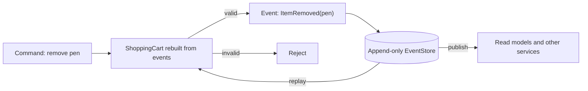

#### Java example

A **sealed** `CartEvent` hierarchy; `ShoppingCart.apply` is an exhaustive pattern-matching `switch` over it (a `switch` *statement* with patterns must be exhaustive in Java 21, so a new event type that `apply` forgets is a compile error); `EventStore` is an append-only in-memory log whose methods are `synchronized`, so appends and reads from several threads are safe. Prices are `BigDecimal`.

```java
// File: code/lld/ch11/eventsourcing/CartEvent.java
package lld.ch11.eventsourcing;

import java.math.BigDecimal;

/** Facts that HAPPENED (past tense). Immutable; never updated or deleted. */
public sealed interface CartEvent permits CartEvent.ItemAdded, CartEvent.ItemRemoved, CartEvent.CheckedOut {
    record ItemAdded(String sku, int qty, BigDecimal unitPrice) implements CartEvent {}
    record ItemRemoved(String sku) implements CartEvent {}
    record CheckedOut() implements CartEvent {}
}
```

```java
// File: code/lld/ch11/eventsourcing/EventStore.java
package lld.ch11.eventsourcing;

import java.util.ArrayList;
import java.util.List;
import java.util.Map;
import java.util.concurrent.ConcurrentHashMap;

/** Append-only log per stream (cart id). The log IS the source of truth. */
public final class EventStore {
    private final Map<String, List<CartEvent>> streams = new ConcurrentHashMap<>();

    public synchronized void append(String streamId, CartEvent e) {
        streams.computeIfAbsent(streamId, k -> new ArrayList<>()).add(e);
    }

    public synchronized List<CartEvent> read(String streamId) {
        return List.copyOf(streams.getOrDefault(streamId, List.of()));
    }
}
```

```java
// File: code/lld/ch11/eventsourcing/ShoppingCart.java
package lld.ch11.eventsourcing;

import java.math.BigDecimal;
import java.util.LinkedHashMap;
import java.util.List;
import java.util.Map;

/** Aggregate whose current state is DERIVED by replaying events. */
public final class ShoppingCart {
    private final Map<String, BigDecimal> lineTotals = new LinkedHashMap<>();
    private boolean checkedOut;

    /** Rebuild state from history (optionally only the first n events: "time travel"). */
    public static ShoppingCart replay(List<CartEvent> history, int n) {
        ShoppingCart cart = new ShoppingCart();
        history.stream().limit(n).forEach(cart::apply);
        return cart;
    }

    /** Pure state transition: no validation, no side effects. Events are facts. */
    private void apply(CartEvent e) {
        switch (e) {
            case CartEvent.ItemAdded a -> lineTotals.merge(a.sku(), a.unitPrice().multiply(BigDecimal.valueOf(a.qty())), BigDecimal::add);
            case CartEvent.ItemRemoved r -> lineTotals.remove(r.sku());
            case CartEvent.CheckedOut c -> checkedOut = true;
        }
    }

    /** Command side: validate against current state, THEN emit an event. */
    public CartEvent decideRemove(String sku) {
        if (checkedOut) throw new IllegalStateException("cart already checked out");
        if (!lineTotals.containsKey(sku)) throw new IllegalArgumentException(sku + " not in cart");
        return new CartEvent.ItemRemoved(sku);
    }

    @Override
    public String toString() {
        BigDecimal total = lineTotals.values().stream().reduce(new BigDecimal("0.00"), BigDecimal::add);
        return lineTotals.keySet() + " total=" + total + (checkedOut ? " CHECKED-OUT" : "");
    }
}
```

```java
// File: code/lld/ch11/eventsourcing/Main.java
package lld.ch11.eventsourcing;

import java.math.BigDecimal;
import java.util.List;

public class Main {
    public static void main(String[] args) {
        EventStore store = new EventStore();
        String cartId = "cart-7";
        store.append(cartId, new CartEvent.ItemAdded("book", 2, new BigDecimal("12.99")));
        store.append(cartId, new CartEvent.ItemAdded("pen", 5, new BigDecimal("0.99")));

        ShoppingCart current = ShoppingCart.replay(store.read(cartId), Integer.MAX_VALUE);
        store.append(cartId, current.decideRemove("pen"));      // validated, then recorded
        store.append(cartId, new CartEvent.CheckedOut());

        List<CartEvent> history = store.read(cartId);
        System.out.println("event log:");
        history.forEach(e -> System.out.println("  " + e));

        System.out.println("state after each event (replay = time travel):");
        for (int n = 0; n <= history.size(); n++) {
            System.out.println("  after " + n + ": " + ShoppingCart.replay(history, n));
        }

        try {
            ShoppingCart.replay(history, history.size()).decideRemove("book");
        } catch (IllegalStateException e) {
            System.out.println("command rejected: " + e.getMessage());
        }
    }
}
```

**Output:**

```text
event log:
  ItemAdded[sku=book, qty=2, unitPrice=12.99]
  ItemAdded[sku=pen, qty=5, unitPrice=0.99]
  ItemRemoved[sku=pen]
  CheckedOut[]
state after each event (replay = time travel):
  after 0: [] total=0.00
  after 1: [book] total=25.98
  after 2: [book, pen] total=30.93
  after 3: [book] total=25.98
  after 4: [book] total=25.98 CHECKED-OUT
command rejected: cart already checked out
```

#### Trade-offs, when not to use it, mistakes

| Pros | Cons |
|---|---|
| Complete audit trail and time travel. | More complex than CRUD; a learning curve for the team. |
| Rebuild or add read models at any time. | **Event schema evolution** (versioning old events) is hard. |
| Natural fit with event-driven architectures. | Reads need projections (read models built from events); eventual consistency (the read side catches up after a short delay) between write and read sides. |

- **Don't use it** for simple CRUD without audit or history needs.
- **Common mistakes:** putting validation in `apply` (replay of old facts may then fail); events named as commands (`RemoveItem` instead of `ItemRemoved`); mutable events; storing derived data inside events; no snapshots for very long streams; **appending without an expected-version check** — two commands decided on the same old state can both append. Real event stores take an `expectedVersion` on append and reject the second writer (optimistic concurrency). The toy `EventStore` here omits it.

#### Real-world examples

Bank ledgers and payment systems (balances derived from ledger entries); Git (the version-control system — its history of commits); **Axon Framework** and **EventStoreDB**; Kafka used as an event log with long or unlimited **retention** (how long stored messages are kept) (not *compacted* topics — compaction keeps only the latest record per key, which throws away the history event sourcing needs); shopping carts and order histories where "what happened when" matters.

#### In the interview

**30-second answer:** "Event sourcing stores every change as an immutable, past-tense event in an append-only log and derives state by replaying. Commands are validated against the replayed state and then produce events; `apply` just folds events into state. You get audit and time travel, and can build new read models by replaying; the costs are complexity, schema evolution and eventual consistency. Snapshots keep replay fast — that's Memento plus a command log."

**Self-check.** Q: Where does validation happen? A: On the command side, before emitting the event — never in `apply`. Q: How do you keep replay fast? A: Periodic snapshots.

**TL;DR:** **Store facts, not state**; rebuild by replay; validate commands, never events; snapshot long streams.

---

## 11.8 Choose the right behavioral pattern

Start from the **symptom** in the code or requirement, not from the pattern name.

| If you see / need... | Use | Not to be confused with |
|---|---|---|
| A request must pass several independent checks; any may reject it; different routes need different checks | **Chain of Responsibility** | Decorator (every layer always runs) |
| Undo/redo, queue, schedule, retry, or log *requested actions* | **Command** | Strategy (how, not what) |
| Evaluate user-written rules/expressions in a small language | **Interpreter** (+ Specification) | Visitor (for many operations over the AST) |
| Walk a collection/tree/paged API without exposing structure | **Iterator** (`Iterable`) | Visitor (what to do at each node) |
| Many objects depend on each other's changes and the *order* of reactions matters | **Mediator** | Observer (no coordination) |
| Roll back to an earlier state without exposing internals | **Memento** | Command undo (store actions instead) |
| One change must notify an open-ended set of independent listeners | **Observer** (or a message broker for durability) | Mediator |
| Three or more methods repeat one `switch` over a status; which actions are legal depends on that status | **State** | Strategy (chosen from outside) |
| Several interchangeable algorithms for one job, chosen by config/user/run time | **Strategy** (often a lambda) | State, Template Method |
| Several classes share a long fixed flow and differ in a few steps | **Template Method** (or template + callbacks) | Strategy |
| Many new operations over a stable set of types | **Visitor**, or **sealed types + pattern matching** in Java 21 | Iterator, Strategy |
| `null` checks everywhere for an optional collaborator | **Null Object** (or `Optional` for lookups) | — |
| Classes create their own collaborators; hard to test | **Dependency Injection** | Service Locator (anti-pattern) |
| Business logic mixed with storage code | **Repository** | DAO (table-oriented) |
| The same business rule duplicated in queries and validation; finder-method explosion | **Specification** | — |
| UI, input handling and business rules tangled together | **MVC / MVVM** | — |
| Need full history, audit, time travel of changes | **Event Sourcing** (+ snapshots) | Plain audit log |

**Three questions that settle the famous look-alikes:**

1. **Do the alternatives reference each other?** Yes → **State**. No → **Strategy** (or Bridge if chosen once at wiring).
2. **Can one participant stop the flow?** Yes → **Chain of Responsibility**. Every participant always runs → **Decorator** / pipeline. Everyone is told, nobody stops anyone → **Observer**.
3. **Does a central object decide what happens next?** Yes → **Mediator**. Each listener decides for itself → **Observer**.

### In the interview (chapter-level)

**"Which patterns have you used in production?"** Pick concrete ones and name the *trade-off*: "Strategy for payment methods, chosen by a map injected by Spring; Observer via Spring events for sending emails after an order, moved to Kafka when we needed retries; State for the order lifecycle, with the DB update guarded by `WHERE status = ?` to avoid races."

**"When would you avoid patterns?"** When only two branches exist and a third is not expected; when a lambda or an enum does the job; when the indirection costs more readability than it buys flexibility. Patterns are a vocabulary for trade-offs, not a checklist.

### Self-check (whole chapter)

1. **Q:** An order moves placed → accepted → preparing → delivered and "cancel" is only legal in early stages. Pattern? **A:** State (enum or class per state).
2. **Q:** Checkout must support card, UPI, wallet, and new methods next quarter. Pattern? **A:** Strategy, selected by a factory/DI map.
3. **Q:** After an order is placed, send email, update analytics and notify the restaurant; more reactions will come. Pattern? **A:** Observer in-process, or pub/sub via a broker for reliability.
4. **Q:** A compiler needs type-checking, optimisation and pretty-printing passes over a fixed AST. Pattern? **A:** Visitor, or sealed interfaces + pattern matching in Java 21.
5. **Q:** Three report generators share "load → filter → format → export" but differ in format. Pattern? **A:** Template Method (or a fixed pipeline taking a formatting strategy).
6. **Q:** What three GoF patterns make up MVC? **A:** Observer, Strategy, Composite.

### TL;DR

- **Observer** broadcasts; **Mediator** coordinates; **CoR** lets someone stop the flow.
- **State** vs **Strategy**: same diagram — states know each other and advance themselves; strategies are chosen from outside.
- **Template Method** = inheritance, one step varies; **Strategy** = composition, whole algorithm varies.
- **Visitor** = cheap new operations, expensive new types; Java 21 **sealed + switch** usually replaces it.
- Beyond GoF: **Null Object**, **DI**, **Repository**, **Specification**, **MVC**, **Event Sourcing** — the everyday glue of real systems and machine-coding answers.
