# Chapter 11 — Behavioral Design Patterns (Part 2) & Beyond GoF

> **What you will learn.** The remaining five **GoF** ("Gang of Four" — the four authors of the 1994 *Design Patterns*, which catalogued 23 classic patterns) behavioral patterns — **Observer, State, Strategy, Template Method, Visitor** — including the three that share one class diagram (Strategy, State, Bridge) and how to tell them apart. Then six widely used non-GoF patterns that come up constantly in interviews and real code: **Null Object, Dependency Injection, Repository, Specification, MVC** (the Head First "compound pattern") and **Event Sourcing (lite)**. Then a "which behavioral pattern do I need?" table, and finally the **architectural patterns** that shape whole systems (layered, client-server, modular monolith vs microservices, event-driven, pipe-and-filter, hexagonal/clean) and how they differ from design patterns.

**How to run the code in this chapter** (listings show the essential lines; full files are in `code/`)

```bash
cd chapters/11-patterns-behavioral-2/code
javac --release 21 -Xlint:all -d /tmp/lld_11 $(find . -name '*.java')   # compiles with 0 warnings
java -cp /tmp/lld_11 lld.ch11.observer.Main
# also: state, strategy, templatemethod, visitor, nullobject, di, repository, specification, mvc, eventsourcing, architecture
```

Chapter 10 introduced behavioral patterns — **how objects share work and talk**. The idea to keep in mind here: most of these patterns turn a conditional (`if`/`switch`) or hard-coded call into an **object** that can be swapped, subscribed, or visited.

---

## 11.1 Observer


*Figure — Top: the build pipeline calls Slack, dashboard, metrics and deployer directly. Bottom: it holds one list of BuildListener and imports none of them (course diagram)*

### What it is

**Observer** lets one object (the **subject**, also *publisher* or *observable*) notify many dependents (the **observers**, *subscribers* or *listeners*) when something happens — **without knowing who they are or what they do**. Like a YouTube channel: subscribers are notified of a new video, the channel doesn't care what they do with it, and anyone can unsubscribe.

**GoF intent (paraphrased):** a one-to-many dependency, so that when one object's state changes, every dependent is told and can update itself automatically.

**GoF participants:**

| Participant | Role | In `lld.ch11.observer` |
|---|---|---|
| **Subject** | Knows its observers (any number) and offers attach/detach operations | `BuildPipeline` (`addListener` + the returned unsubscribe handle) |
| **Observer** | The update interface that subjects call | `BuildListener` |
| **ConcreteSubject** | Holds the state observers care about; notifies them when it changes | `BuildPipeline` (GoF split Subject into an abstract class and a concrete one; in modern Java one class usually plays both) |
| **ConcreteObserver** | Implements the update interface; may keep its own state in step with the subject | `SlackNotifier`, `DashboardUpdater`, `MetricsRecorder`, `DeployTrigger` |

### The problem it solves

Four reactions must follow every finished build: Slack message, dashboard refresh, metrics record, deployment. Naively:

```java
void finish(int buildNumber, String result) {
    slack.post(buildNumber, result);
    dashboard.update(result);
    metrics.record(buildNumber);
    deployer.start();
}
```

The pipeline now **depends on a chat service**; a fifth reaction edits the pipeline; a **unit test** (an automated test of one class on its own) must fake four services; and disabling deploys in **staging** (the pre-production copy used for final checks) needs an environment flag in a class that should know nothing of environments.

Observer replaces four references with **one list of one interface**. **The source only announces; every listener chooses its own reaction** — nobody orchestrates, and listeners don't know each other.

### How it works

1. An **observer interface** with one method, e.g. `onBuildFinished(buildNumber, result)`.
2. The **subject** keeps a list and offers subscribe/unsubscribe (classically `addListener` / `removeListener`; our `addListener` returns an unsubscribe handle).
3. On a change the subject **first finishes changing its state**, then calls each observer.
4. Observers are added and removed at run time (e.g. staging subscribes three listeners, production four).

**Push vs pull** — two ways to deliver the data:

| | Push model | Pull model |
|---|---|---|
| What the observer receives | All the data about the change (e.g. a `Reading` record) | Just "I changed" plus a reference to the subject |
| How the observer gets data | It is in the call | It calls getters on the subject for what it needs |
| Pros | Simple; observers don't depend on the subject's getters | Each observer takes only what it needs; the interface doesn't change when new data is added |
| Cons | Sends data some observers don't need; adding data changes the interface | Observers depend on the subject; they must work out *what* changed |

`java.util.Observer.update(Observable o, Object arg)` supported both (`o` for pull, `arg` for push); *Head First*'s weather station shows the same trade-off.

### Structure (UML)


*Figure — Class diagram: BuildPipeline holds a list of BuildListener; SlackNotifier, DashboardUpdater, MetricsRecorder and DeployTrigger implement it (course diagram)*

In this **UML** class diagram (Unified Modeling Language — the standard box-and-arrow notation for classes and relations) all dependencies run one way: listeners never call the pipeline back, so one notification cannot trigger another.

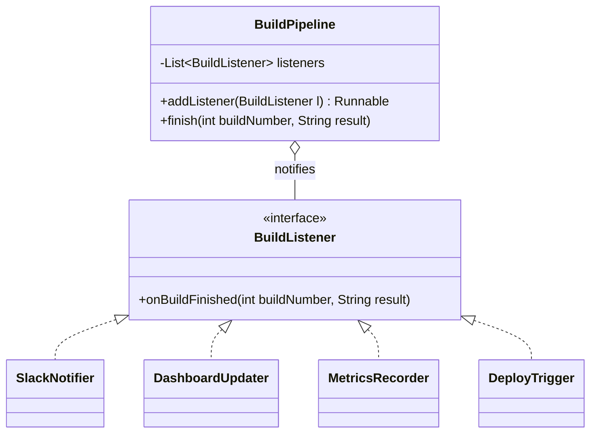

### Java example

`code/lld/ch11/observer/` shows four things:

1. **Build pipeline.** Listeners live in a `CopyOnWriteArrayList` (a JDK list copying its internal array on every write, so readers never see it change), whose iterator uses a **snapshot** — a listener unsubscribing mid-notification can't break the loop, and the list is **thread-safe** (safe across *threads* — independent paths of execution running at once). `finish` **catches exceptions per listener**, so a broken dashboard doesn't stop metrics. `addListener` returns a `Runnable` (Java's "code to run later" interface, one method `run()`) that unsubscribes: whoever subscribes owns the unsubscribe.
2. **Push vs pull** (`WeatherStation`): one display receives the whole `Reading`; the other gets the station and pulls only the temperature.
3. **A tiny event bus** (`EventBus`): subscribers register for an event *type* (a class); publishers just publish objects. The returned `Subscription` is the unsubscribe handle, closed in a `finally` so the refunds handler is removed even if publishing throws. (`Subscription` is also `AutoCloseable` — `close()` runs automatically when a *try-with-resources* block ends — so `try (var s = bus.subscribe(...))` works, but if the body never uses `s`, `javac -Xlint` warns the resource is unreferenced; Java 22+ allows `try (var _ = ...)`; on Java 21 `try`/`finally` is the warning-free form.) The handler list is a `CopyOnWriteArrayList`, so subscribing and publishing from different threads is safe. Delivery is still **synchronous on the publisher's thread** (it waits while each handler runs in turn) and nothing is stored, so it is not a **queue** (a waiting line storing items and handing them out later, in order).
4. **`java.beans.PropertyChangeSupport`** (price in whole cents as an `int` — exact, never `double`), which the `Observable` **Javadoc** (official API docs generated from source comments) itself points to (the `java.beans` package) as the richer event model. It does **not** fire when old and new values are both non-null and equal. (Since Java 9 `java.beans` is in the `java.desktop` module; on the class path — the folders and JARs Java searches for classes — nothing extra is needed, but a modular app, one declaring dependencies in `module-info.java`, must `requires java.desktop`.)

```java
// BuildListener.java — the OBSERVER interface: one method, so a lambda can implement it.
@FunctionalInterface
public interface BuildListener { void onBuildFinished(int buildNumber, String result); }

// BuildPipeline.java — the SUBJECT: a list of one interface; imports none of the concrete reactions.
public final class BuildPipeline {
    // CopyOnWriteArrayList iterates over a snapshot: a listener that unsubscribes
    // itself mid-notification cannot break the loop, and it is safe across threads.
    private final List<BuildListener> listeners = new CopyOnWriteArrayList<>();

    /** Returns a handle: whoever subscribes owns the matching unsubscribe (prevents leaks). */
    public Runnable addListener(BuildListener listener) {
        listeners.add(listener);
        return () -> listeners.remove(listener);
    }

    public void finish(int buildNumber, String result) {
        System.out.println("Build " + buildNumber + " finished: " + result);
        for (BuildListener l : listeners) {
            try {
                l.onBuildFinished(buildNumber, result);
            } catch (RuntimeException e) {          // one bad listener must not starve the rest
                System.out.println("  [pipeline] a listener failed: " + e.getMessage());
            }
        }
    }
}
// SlackNotifier, MetricsRecorder print; DashboardUpdater throws when offline; DeployTrigger deploys only on "success".

// WeatherStation.measure — change state FIRST, then notify both styles.
public void measure(Reading r) {
    current = r;
    pushObservers.forEach(o -> o.accept(r));      // PUSH: the data travels with the call
    pullObservers.forEach(o -> o.accept(this));   // PULL: "I changed" + a reference; observers call temperature()
}
```

```java
// EventBus.java — publishers and subscribers share only event TYPES. Synchronous, not durable (unlike Kafka).
private record Handler<E>(Class<E> type, Consumer<? super E> action) {
    void deliver(Object event) { if (type.isInstance(event)) action.accept(type.cast(event)); }
}
public interface Subscription extends AutoCloseable { @Override void close(); }
private final List<Handler<?>> handlers = new CopyOnWriteArrayList<>();

public <E> Subscription subscribe(Class<E> type, Consumer<? super E> action) {
    Handler<E> h = new Handler<>(type, action);
    handlers.add(h);
    return () -> handlers.remove(h);
}
public void publish(Object event) { handlers.forEach(h -> h.deliver(event)); }

// PricedItem.java — the JDK's recommended replacement for java.util.Observable.
public void setPriceCents(int newPrice) {
    int old = this.priceCents;
    this.priceCents = newPrice;
    support.firePropertyChange("priceCents", old, newPrice);   // no event if old == new
}

// Main.java (excerpt)
Runnable unsubscribeDeploy = pipeline.addListener(new DeployTrigger());
pipeline.finish(101, "success");        // every listener runs
unsubscribeDeploy.run();                // e.g. staging has no auto-deploy
EventBus.Subscription refunds = bus.subscribe(OrderCancelled.class, e -> ...);
try { bus.publish(new OrderPlaced("A-1", new BigDecimal("499.00"))); bus.publish(new OrderCancelled("A-1")); }
finally { refunds.close(); }            // refunds handler removed here, even on error
```

**Output:**

```text
=== 1. Build pipeline: subscribe, unsubscribe, failing listener ===
Build 101 finished: success
  [slack] #builds: build 101 success
  [dashboard] status tile -> success
  [metrics] recorded build 101 (total 1)
  [deploy] deploying build 101
Build 102 finished: success
  [slack] #builds: build 102 success
  [dashboard] status tile -> success
  [metrics] recorded build 102 (total 2)
Build 103 finished: failed
  [slack] #builds: build 103 failed
  [pipeline] a listener failed: dashboard is offline
  [metrics] recorded build 103 (total 3)

=== 2. Push vs pull ===
  [push display] got everything: Reading[tempC=31.5, humidity=0.62, pressureHpa=1008.0]
  [pull display] asked only for temp: 31.5 C

=== 3. Event bus (typed topics, scoped unsubscribe) ===
  [email] confirmation for A-1
  [audit] OrderPlaced[orderId=A-1, amount=499.00]
  [audit] OrderCancelled[orderId=A-1]
  [refunds] start refund for A-1
  [audit] OrderCancelled[orderId=A-2]

=== 4. JDK: PropertyChangeSupport (replacement for deprecated Observable) ===
  [price watcher] phone priceCents: 49900 -> 44900
  [price watcher] phone priceCents: 44900 -> 39900
```

### Why `java.util.Observer` / `Observable` were deprecated

Since **Java 9**, `java.util.Observer` and `java.util.Observable` are **deprecated** (officially "don't use in new code; may be removed") but not removed. The Javadoc's reasons: the event model is **quite limited**, the **order of notifications is unspecified**, and **state changes are not one-for-one with notifications**. Also:

- `Observable` is a **class**, not an interface — your subject must *extend* it, using up Java's **single inheritance** (one parent class only).
- `setChanged()` is **protected**, so you can't use `Observable` by composition (as a field) without subclassing.
- `update(Observable, Object)` is untyped (`Object arg`), so observers must cast.
- Thread safety is partial: methods are `synchronized` (one thread at a time, each call first taking the object's **lock** — a token only one thread can hold), but `notifyObservers` calls observers outside the lock on a snapshot, so (as a comment in the **JDK** — Java Development Kit: compiler, runtime, standard library — source admits) a newly added observer may miss a notification and a just-removed one may still get it.

Instead (the Javadoc names the first, third and fourth): `java.beans.PropertyChangeSupport`/`PropertyChangeListener` for bean properties; your own typed listener interface (as `BuildPipeline`); `java.util.concurrent` queues for reliable, ordered hand-off between threads; the **`java.util.concurrent.Flow`** API (Java 9) for **reactive streams** (asynchronous streams of items from a producer to consumers) with **back-pressure** (the consumer tells the producer to slow down when it can't keep up).

### Trade-offs

| Pros | Cons |
|---|---|
| The source no longer depends on its reactions (the pipeline no longer imports Slack). | Harder to trace: the call site gives no hint which code will run. |
| Reactions added/removed at run time; environments differ without flags. | **Memory leaks** (memory never freed) if an observer is never removed (the subject holds it forever). |
| Each reaction is testable alone. | Stack traces start inside a loop over a list; debugging is harder. |
| A new reaction = one class + one subscribe call (Open/Closed). | **No ordering or delivery guarantee**; a crash loses reactions not yet called. |
| | With synchronous observers, the subject takes as long as all listeners combined. |

### Observer vs Mediator, Chain of Responsibility, callbacks

| Looks like | The actual difference |
|---|---|
| **Mediator** | Observer broadcasts one way and each observer decides; a mediator **decides what happens next**, calls components back (two-way) and owns the ordering — full table in [§10.4](../10-patterns-behavioral-1/README.md#mediator-or-observer). |
| **Publish-subscribe with a broker** (a server that stores and forwards messages) | Same idea, but the broker contributes persistence, redelivery, ordering guarantees and a network hop — none of which in-process observers offer. |
| **Chain of Responsibility** | Observer informs **all** listeners, and no listener can prevent the rest from running. A chain ends as soon as one handler accepts the request. |
| **A callback** | One callback is one observer. It becomes the Observer pattern when the number of listeners varies and they subscribe and unsubscribe at run time. |

**Observer outside Java.** With **first-class functions** (functions stored and passed like values) a listener is a **lambda** (a short anonymous function, `x -> ...` in Java) — keep the handle or you can't unsubscribe. JavaScript has `EventTarget`/`EventEmitter`, and `AbortController` unsubscribes by signal. Python often uses a list of callables; `weakref.WeakSet` avoids the leak. C# has `event`, `IObservable<T>` and `IDisposable` subscriptions. Everywhere, **weak references** (which don't keep their target alive, so the garbage collector may free it) fix the leak, at the cost of a listener vanishing when nothing else holds it.

### When not to use it

- **One listener, forever** — call it directly.
- **You need ordering or guaranteed delivery** — a queue or message broker (Kafka, RabbitMQ, SQS): same idea plus persistence, retries and a network — very different failure modes.
- **Reactions are slow** — notify **asynchronously** (hand work to another thread and return at once, e.g. via an *executor* — a pool of worker threads — or a queue) or don't use in-process observers.
- **The whole flow must be auditable/traceable** — explicit calls are kinder to readers.

### Common mistakes (the four classic ways observers go wrong, plus one)

1. **No unsubscribe → memory leak.** The subject's **strong reference** (an ordinary reference keeping the object alive) holds the listener and everything it points to — a top cause of slow memory growth in long-running apps. Every `add` needs an owner for its `remove` (or weak references, with listeners possibly vanishing).
2. **A throwing listener kills the loop** — without per-listener try/catch, listener 3 fails and 4 and 5 never run.
3. **Changing the list during notification** → `ConcurrentModificationException` (thrown when a collection changes while being looped over), or silently skipped listeners in some languages. Iterate a copy, or use `CopyOnWriteArrayList`.
4. **Listeners calling back into the subject** → cycles or endless recursion. Finish updating state before notifying; never let a notification synchronously cause another.
5. **Notifying before the state is updated**, so pull-style observers read stale data.
6. **Relying on notification order** — it is the order of subscription, a side effect of start-up code nobody decided. If "update the dashboard, then decide whether to deploy" matters, that is coordination — a Mediator.

### Real-world examples

- **Every UI event handler**: Swing `ActionListener`, Android `OnClickListener`, DOM `addEventListener`.
- **JDK**: `PropertyChangeListener`, `java.util.concurrent.Flow` (`Publisher`/`Subscriber`), servlet listeners such as `HttpSessionListener`.
- **Spring** (the most widely used Java application framework): `ApplicationEventPublisher` + `@EventListener` (in-process events, optionally `@Async` or `@TransactionalEventListener`).
- **Guava `EventBus`**, **RxJava / Project Reactor / RxJS**, Kotlin `Flow`, front-end signals — observers plus composable operators (map, filter, debounce — wait until events pause, then pass on only the latest).
- **Model–view separation**: a view registers with its model, which updates freely without knowing any screen is attached (MVC in §11.7.5).
- **Distributed publish–subscribe**: Kafka topics, Google Pub/Sub, AWS SNS. An order service publishes one "order placed" event and email, inventory, analytics and recommendation services each consume it — Observer at system scale, plus durability.
- **Database triggers and change data capture** (CDC: streaming every row change from a database's internal log; Debezium is popular) — observers at the storage layer.

### In the interview

**30-second answer:** "Observer swaps a handful of hard-coded calls for a list of objects that share one listener interface. The subject just says "this happened" and every observer picks its own response, so each reaction can be plugged in, unplugged and unit-tested on its own, and the subject no longer depends on any of them. In production I iterate over a copy of the listener list, catch exceptions per listener, and make sure every subscribe has a matching unsubscribe to avoid leaks. When I need durability, retries or ordering I use a message broker instead."

**Follow-ups:**

- *Push or pull? Why was `Observable` deprecated? Observer vs Mediator?* See the push/pull table, the deprecation section and the comparison table above (Mediator in depth: [§10.4](../10-patterns-behavioral-1/README.md#mediator-or-observer)) — when the sequence of reactions matters, pick a mediator.
- *Observer vs Pub/Sub?* In Observer the subject holds its observers directly; in publish–subscribe a **broker/event bus** sits between, so publishers and subscribers don't know each other; brokers add durability, retries and ordering.
- *How do you make it thread-safe?* `CopyOnWriteArrayList` for listeners (reads far outnumber writes), no locks held while calling listeners, an executor for slow listeners.
- *How do you avoid leaks?* Return a subscription handle tied to a lifecycle (try-with-resources, `onDestroy`, `@PreDestroy`), or use weak references.

### Self-check

1. **Q:** What does the subject know about its observers? **A:** Only that they implement the observer interface.
2. **Q:** Why iterate over a copy of the listener list? **A:** So a listener that (un)subscribes during notification can't break the loop.
3. **Q:** What is the classic Observer memory leak? **A:** Listeners that are never removed stay strongly referenced by the subject.
4. **Q:** What should replace `java.util.Observable`? **A:** `PropertyChangeSupport`, a custom typed listener interface, or the `Flow` API.
5. **Q:** When is a message broker better than in-process observers? **A:** When you need durability, retries, ordering, or slow/remote consumers.

### TL;DR

One subject, a list of listeners, one-way notification. **Iterate over a copy, catch per listener, always unsubscribe.** Push vs pull is a trade-off; `Observable` is deprecated; use a broker when you need guarantees.

---

## 11.2 State


*Figure — Top: the same four-branch status check repeated in every method. Bottom: each state is a class and the transitions form a graph (course diagram)*

### What it is

**State** (GoF intent, paraphrased): when an object's internal condition changes, **its behaviour changes with it**, so from outside it looks as if the object switched class. Instead of every method testing a status field, the object hands each action to a **state object**, and replaces that object when the condition changes — like a phone's ringer switch: "call received" does different things in *ring*, *vibrate* and *silent*.

| Participant | Role | In `lld.ch11.state` |
|---|---|---|
| **Context** | The object clients use; holds the current state object and forwards requests to it | `Subscription`, `VendingMachine` |
| **State** | Interface declaring one method per request the context forwards | `SubscriptionState`, `VendingState` |
| **ConcreteState** | One class per state, implementing the behaviour for that state | `Trialing`, `Active`, `PastDue`, `Cancelled`; `Idle`, `HasMoney`, `SoldOut` |

GoF leaves open *who* performs transitions: the context (fixed table) or the states. Letting states choose their successor, as here, is more flexible but makes them know each other.

### The problem it solves

A subscription runs **trialing → active → past due → cancelled**. Naively each public method opens with the same four-way branch:

```java
public void pay() {
    if (status == TRIALING)       { /* charge the card, switch to ACTIVE */ }
    else if (status == ACTIVE)    { /* renew */ }
    else if (status == PAST_DUE)  { /* settle arrears, back to ACTIVE */ }
    else if (status == CANCELLED) { /* reject */ }
}
```

`cancel()` and `missPayment()` repeat it; a fifth state means hunting every copy; one state's definition is spread across all methods; and a **forgotten branch** silently does nothing, surfacing weeks later as "subscriptions randomly stop working".

With State, **each state is a class**: the conditional vanishes (each context method is one line) and everything about a state sits in one file — what a reviewer or auditor wants.

### How it works

1. A **State interface** with one method per action (`pay`, `missPayment`, `cancel`); every state answers every action, even with "not allowed".
2. One **concrete state** class per state.
3. The **context** (`Subscription`) holds the current state and delegates: `state.pay(this)`.
4. A state rules whether the action is **legal** and which state comes **next**, advancing via `context.setState(new Active())`.
5. Terminal states refuse everything, loudly, in one place.

**The objects choose their own successors** — the machine advances itself. That is the key difference from Strategy.

### Structure (UML)


*Figure — Class diagram: Subscription (context) holds a SubscriptionState; Trialing, Active, PastDue and Cancelled implement it and call setState on the context (course diagram)*

States reach **back** into the context to replace themselves, and know each other (Trialing creates an Active).

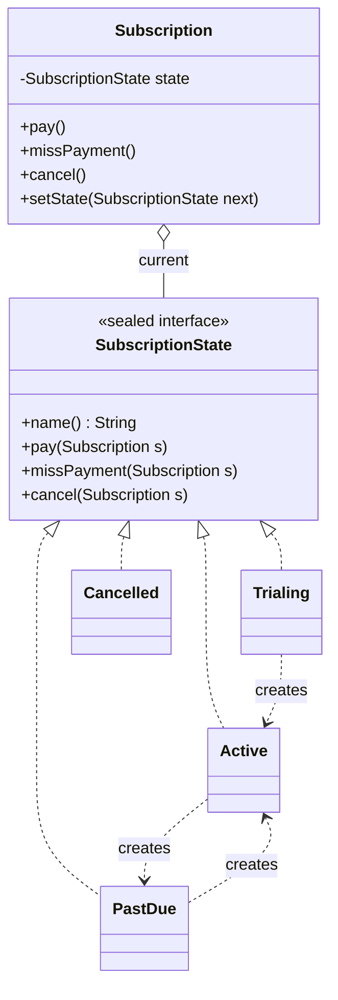

The state machine itself:

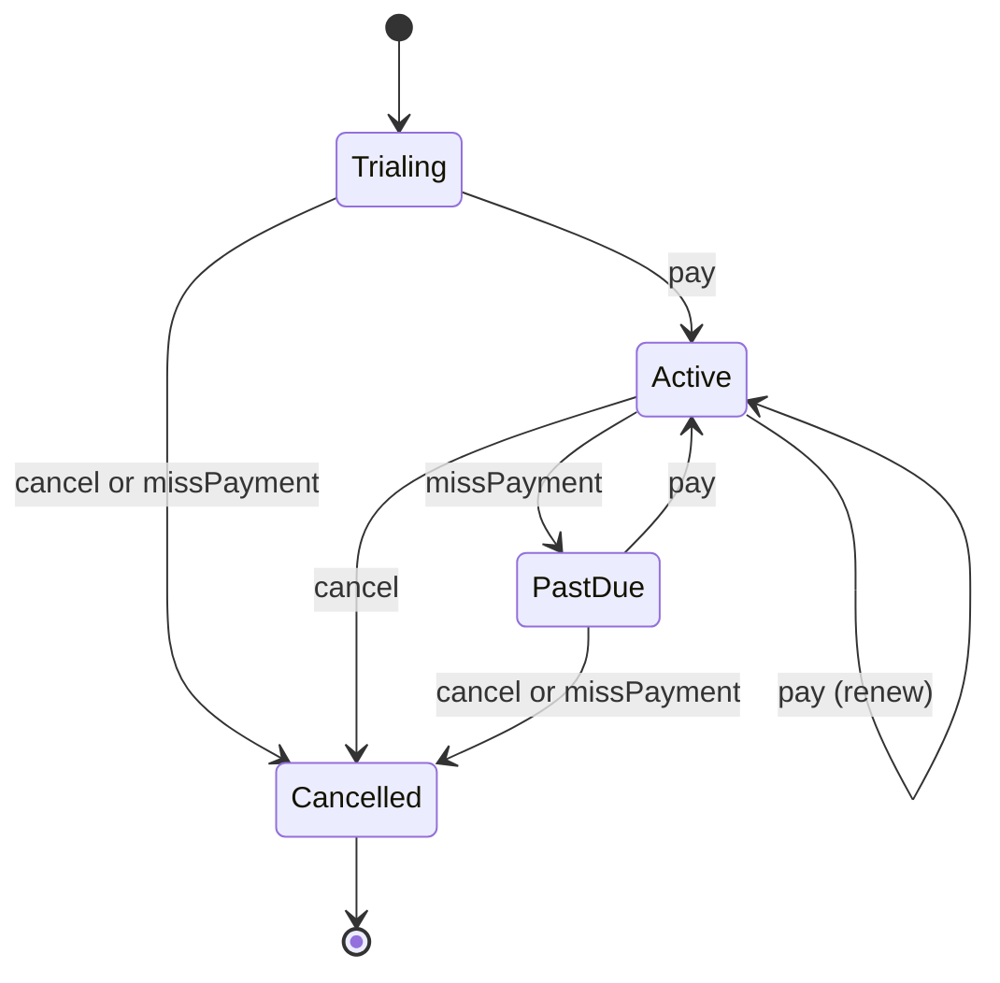

The vending machine (the traffic light, RED 30 s → GREEN 25 s → YELLOW 5 s → RED, is readable directly from its enum below):

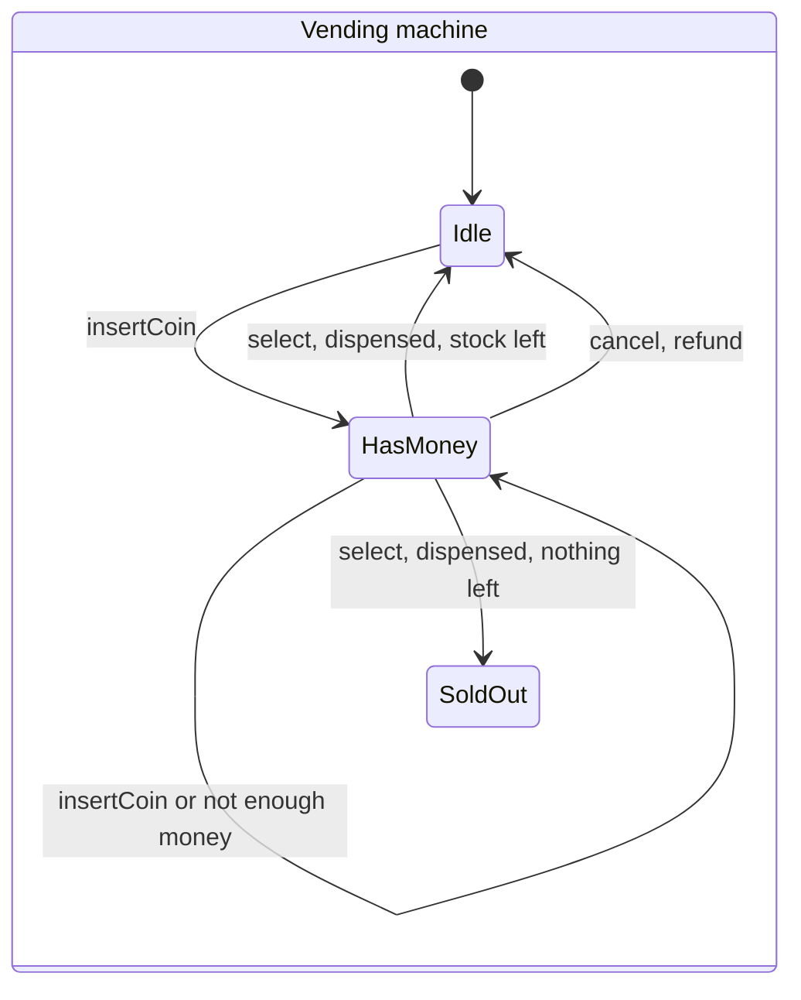

### Java example

`code/lld/ch11/state/` shows three styles:

1. **Class per state** (`Subscription` + four `record` states). `SubscriptionState` is **sealed** (lists exactly which types may implement it), so the compiler knows every state. The states have no fields, so component-less **records** (compact data classes with fields fixed at creation) are a neat, **immutable** (unchangeable after creation) choice.
2. **Enum-based state machine** (`TrafficLight`). Each constant overrides `next()`; shared behaviour is a **default method** (an interface method with a body, inherited unless overridden). The **whole machine is readable in one file** — idiomatic Java for simple machines.
3. **Vending machine** (`VendingMachine` + `Idle`, `HasMoney`, `SoldOut`). The state interface's **default methods refuse**, so each state overrides only what it allows (`SoldOut` overrides nothing). Business actions (dispensing, returning change) live in the **context**; states only rule on legality and the next state. Money is whole **cents in an `int`** (exact, unlike `double`); a real machine would use a `Money`/`BigDecimal` (Java's exact decimal class) type, as the Strategy and Visitor examples do.

```java
// SubscriptionState.java — each state implements all actions, including ones it only turns down.
public sealed interface SubscriptionState permits Trialing, Active, PastDue, Cancelled {
    String name();
    void pay(Subscription s);
    void missPayment(Subscription s);
    void cancel(Subscription s);
}

public record Trialing() implements SubscriptionState {
    public String name() { return "trialing"; }
    public void pay(Subscription s) {
        System.out.println("  [trialing] first payment taken");
        s.setState(new Active());                     // the state chooses its successor
    }
    public void missPayment(Subscription s) {
        System.out.println("  [trialing] trial ended unpaid");
        s.setState(new Cancelled());
    }
    public void cancel(Subscription s) { s.setState(new Cancelled()); }
}
// Active: pay renews; missPayment -> PastDue. PastDue: pay -> Active; missPayment -> Cancelled.

/** Terminal state: refuses everything, loudly, in one place. */
public record Cancelled() implements SubscriptionState {
    public String name() { return "cancelled"; }
    public void pay(Subscription s) { System.out.println("  [cancelled] refused: no payments after cancellation"); }
    public void missPayment(Subscription s) { System.out.println("  [cancelled] ignored: nothing is billed"); }
    public void cancel(Subscription s) { System.out.println("  [cancelled] rejected: already cancelled"); }
}

/** The CONTEXT: every public action is one line of delegation. No status switch anywhere. */
public final class Subscription {
    private SubscriptionState state = new Trialing();
    void setState(SubscriptionState next) {
        System.out.println("    " + state.name() + " -> " + next.name());
        state = next;
    }
    public void pay()         { state.pay(this); }
    public void missPayment() { state.missPayment(this); }
    public void cancel()      { state.cancel(this); }
}
```

```java
// TrafficLight.java — State the idiomatic-Java way: an enum whose constants override behaviour.
public enum TrafficLight {
    RED(30)    { TrafficLight next() { return GREEN; }  boolean pedestriansMayCross() { return true; } },
    GREEN(25)  { TrafficLight next() { return YELLOW; } },
    YELLOW(5)  { TrafficLight next() { return RED; } };
    ...
    abstract TrafficLight next();
    boolean pedestriansMayCross() { return false; }    // default for most states
}

// VendingState.java — default methods = "refuse", so each state overrides only what it allows.
interface VendingState {
    String name();
    default void insertCoin(VendingMachine m, int cents) { System.out.println("  [" + name() + "] coin rejected, returned " + cents); }
    default void select(VendingMachine m, String code)   { System.out.println("  [" + name() + "] selection ignored"); }
    default void cancel(VendingMachine m)                { System.out.println("  [" + name() + "] nothing to cancel"); }
}
// Idle.insertCoin: m.addBalance(cents); m.setState(new HasMoney());   SoldOut overrides nothing.

// HasMoney.select — rules on legality; the business action lives in the context.
if (!m.inStock(code)) { System.out.println("  [has_money] " + code + " is empty, choose another"); return; }
int price = m.priceOf(code);
if (m.balance() < price) { System.out.println("  [has_money] " + code + " costs " + price + ", balance " + m.balance()); return; }
m.dispense(code);
m.returnChange();
m.setState(m.anythingInStock() ? new Idle() : new SoldOut());
// VendingMachine (CONTEXT) owns slots and balance; insertCoin/select/cancel delegate to the current state.
```

**Output:**

```text
=== 1. Subscription lifecycle (class per state) ===
  [trialing] first payment taken
    trialing -> active
  [active] payment failed, grace period started
    active -> past_due
  [past_due] arrears paid
    past_due -> active
    active -> cancelled
  [cancelled] refused: no payments after cancellation
  final status: cancelled

=== 2. Traffic light (enum-based state machine) ===
  RED    for 30s, pedestrians may cross: true
  GREEN  for 25s, pedestrians may cross: false
  YELLOW for  5s, pedestrians may cross: false
  RED    for 30s, pedestrians may cross: true

=== 3. Vending machine ===
select A1
  [idle] selection ignored
insert 100
  balance 100
    idle -> has_money
select A1
  [has_money] A1 costs 150, balance 100
select B2
  [has_money] B2 is empty, choose another
insert 100
  balance 200
select A1
  >> dispensed cola
  >> change returned 50
    has_money -> sold_out
insert 25
  [sold_out] coin rejected, returned 25
```

The final subscription line shows the payoff: an **illegal action** is refused the same way every time, by code in one file.

### State vs Strategy (and Bridge) — same diagram, different reasons

These patterns draw **the same class diagram** (an object holds an interface reference and forwards to it) — one of the most common interview questions, and the diagram cannot answer it:

| | State | Strategy | Bridge |
|---|---|---|---|
| Who chooses the object | The **states**, which replace themselves via the context | The **caller**, from outside | Chosen once at construction, usually by configuration |
| How often it changes | Repeatedly — that is the point | Set once, sometimes per call | Effectively never after wiring |
| Do the alternatives reference one another? | **Yes** (`Trialing` builds an `Active`) | **No** — never | No |
| What varies | The object's current *condition*, and therefore its allowed actions | *How* one job gets done | A whole dimension of the design |
| Why it exists | To model a lifecycle | To make one algorithm replaceable | To stop two class hierarchies multiplying |

**The reliable test: do the alternatives name each other?** Yes → State machine. No → Strategy (or Bridge — then ask how often the choice changes).

| Looks like | The actual difference |
|---|---|
| **An enum plus one `switch`** | Frequently the better answer, and easy to defend in an interview. Class-per-state starts to win only once the same status switch is repeated in three or more methods. |
| **A state-machine library** (Spring Statemachine, XState) | The same idea expressed as data (states, events, guards, actions) rather than classes. Once a machine grows past roughly a dozen states, the declarative form is easier to read and to draw. |

### Trade-offs

| Pros | Cons |
|---|---|
| Everything about one state sits in a single file. | One class per state; small classes multiply. |
| The repeated conditional disappears; no branch can be missed. | Transitions live in several files; no single place shows the whole machine. |
| Illegal actions are rejected consistently. | Each state must implement all actions, even just to say no. |
| A new state = a new class; the compiler lists what it must implement. | Persisting needs a name↔class mapping — keep it in exactly one place. |

### When not to use it

- **Two states and a handful of methods** — a boolean with an `if` reads better.
- **Only data changes, not behaviour** — store the differing value in a field.
- **A big, formal machine** (over about a dozen states with guards) — a **transition table** (`Map<(state, event), handler>`) or a library (e.g. **Spring Statemachine**), where the diagram can be the source of truth.
- **Rule of thumb from the course:** it pays off once **three or more methods repeat the same status switch**; below that, an enum with a switch is defensible.
- **Signal you've outgrown it:** you keep sketching the machine on paper to follow your own code — make the sketch (transition table or state chart) the real source of truth.

### Common mistakes

1. **Successors hard-coded everywhere** — fine at 4 states, painful at 12; then let the context or a transition table own transitions.
2. **Business logic inside state classes.** A state rules on *legality* and picks the *successor*; charging cards and sending emails belong in the context or a service it calls.
3. **Not making illegal actions explicit** (silently doing nothing).
4. **Storing state objects in the DB** — store a name/enum and map it back in exactly one place.
5. **Sharing stateful state objects** between contexts — stateless states (like ours) can be shared; stateful ones cannot.

### State in other languages

- **Java:** an `enum` with per-constant behaviour (`TrafficLight`) keeps the graph in one file; a `sealed` interface plus exhaustive pattern-matching `switch` gives compiler-checked coverage.
- **Kotlin / Scala:** `sealed` hierarchies with exhaustive `when` / `match`.
- **Rust:** enums with data, matched exhaustively; the **typestate** pattern makes each state a separate *type*, so an action illegal in that state is a compile error.
- **Python:** a dict mapping `(state, action)` to a handler — a compact transition table showing every transition.
- **TypeScript:** a **discriminated union** (object types each carrying a fixed tag field) plus a `switch` on the tag, checked for missing cases.

### Real-world examples

- **Order lifecycles** in food delivery and e-commerce: placed → accepted → preparing → out for delivery → delivered (or cancelled); you can cancel while "placed" but usually not once "out for delivery".
- **Payment and subscription lifecycles** (Stripe statuses such as `trialing`, `active`, `past_due`, `canceled`).
- **TCP connections** (the protocol under most internet traffic, giving ordered, reliable delivery; see [System Design Fundamentals](../../../system-design-patterns/modules/00-system-design-fundamentals/README.md)) — GoF's own example: `LISTEN`, `ESTABLISHED`, `CLOSED` respond differently to the same call.
- **Workflow/approval engines** (draft → in review → approved/rejected), **editor modes**, **game characters** (idle, running, jumping).
- **Lexers/parsers** (split text into tokens, then build a structure), **vending machines, ATMs, elevators, traffic lights** — favourite **machine-coding** questions (an interview round writing working code for a small system in an hour or two; see the case-study chapters).
- **Libraries**: Spring Statemachine; the JDK's `Thread.State` is an *enum of states* (data), not the pattern.

### In the interview

**30-second answer:** "State swaps a status field, and the switch statements repeated around it, for one class per state. The context forwards each action to whichever state object it currently holds, and that object decides whether the action is legal and which state follows. Each state's rules sit together in one file, and an illegal action is refused the same way every time. It draws exactly like Strategy, but states name one another and move the machine forward on their own, while strategies are picked from outside and never reference each other. In Java, for small machines, I'd use an enum with per-constant behaviour or a sealed interface."

**Follow-ups:**

- *State vs Strategy?* The naming test and the "who chooses" test (table above).
- *Where should transitions live?* In the states for small machines; in the context or a transition table as it grows, so the graph is visible in one place.
- *How do you persist it?* Store the state's name (enum) in the DB; rebuild the object through one factory/mapping.
- *How do you handle concurrency?* Two requests ("cancel" and "deliver") can **race** (run together and interfere, the result depending on timing): guard transitions with a lock or, in a DB, an **optimistic** (no lock held; the write fails if someone changed the row first) `UPDATE ... WHERE status = 'PLACED'` and check the affected row count.
- *Design a vending machine.* States Idle, HasMoney, SoldOut (maybe Dispensing, Maintenance); the context owns inventory and balance; states allow or refuse actions (as in our code).

### Self-check

1. **Q:** Who changes the current state in the State pattern? **A:** The state objects (via the context's `setState`).
2. **Q:** What is the "naming test"? **A:** If the alternatives reference each other, it's State; if never, it's Strategy/Bridge.
3. **Q:** When is an `enum` better than class-per-state? **A:** When the machine is small; the whole machine is visible in one file.
4. **Q:** What belongs in the context, not the state? **A:** Business actions and data (dispensing, charging, inventory).
5. **Q:** What does a sealed state interface give you? **A:** The compiler knows every state, so `switch`es over states can be checked for exhaustiveness.

### TL;DR

**A class for each state; the context forwards every action; each state picks what follows it.** Same diagram as Strategy, but states **know each other**. Use enums for small machines, tables/libraries for big ones.

---

## 11.3 Strategy


*Figure — Top: ApiClient branches on which retry policy to use. Bottom: ApiClient holds one RetryPolicy interface and never branches (course diagram)*

### What it is

**Strategy** (GoF intent, paraphrased): group related algorithms into a **family**, each in its own class behind a **common interface**, interchangeable so the algorithm can change — even at run time — without touching the calling code. The object using it (the **context**) does not branch on which algorithm it has. Like getting to the airport by car, train or taxi: same goal, different algorithm, chosen by time, money and weather.

| Participant | Role | In `lld.ch11.strategy` |
|---|---|---|
| **Strategy** | Interface shared by all the algorithms; the context calls only this | `RetryPolicy` (also `Comparator` in part 2) |
| **ConcreteStrategy** | One implementation per algorithm | `FixedDelay`, `ExponentialBackoff`, the `RetryPolicy.none()` lambda (the course diagram names it `NoRetry`) |
| **Context** | Is configured with a strategy object and delegates to it; may pass it the data it needs | `ApiClient` |

### The problem it solves

Retrying a failed request can mean no retry, a fixed delay, or **exponential backoff** (doubling the wait after each failure — 100 ms, 200 ms, 400 ms). Written directly, the branch sits inside `ApiClient`:

```java
if (policy == NONE)             { /* give up */ }
else if (policy == FIXED)       { /* wait 100ms, try again */ }
else if (policy == EXPONENTIAL) { /* double the wait after each failure */ }
```

`ApiClient` now holds backoff arithmetic unrelated to calling an API; a fourth policy edits a working class; backoff maths can't be tested without a client and a fake server; another team must edit your class to contribute a policy.

Strategy gives each algorithm its own class. `ApiClient` asks its `RetryPolicy` "how long before the next attempt?" and **never checks what kind it holds**. The choice is made **outside** — configuration, a **feature toggle** (switches behaviour without redeploying), or a customer setting.

### How it works

1. A **strategy interface** — small, ideally one question (`delayBeforeAttempt(attempt)`).
2. One **concrete strategy** per algorithm, holding only its own parameters.
3. The **context** receives a strategy (constructor, setter or method parameter) and calls it.
4. A **factory, configuration or DI container** (a library that creates objects and hands them their dependencies — §11.7.2) decides which — not every call site.

### Structure (UML)


*Figure — Class diagram: ApiClient holds a RetryPolicy; NoRetry, FixedDelay and ExponentialBackoff implement it (course diagram)*

**No strategy references another** — `ExponentialBackoff` has never heard of `FixedDelay`. That absence tells Strategy from State.

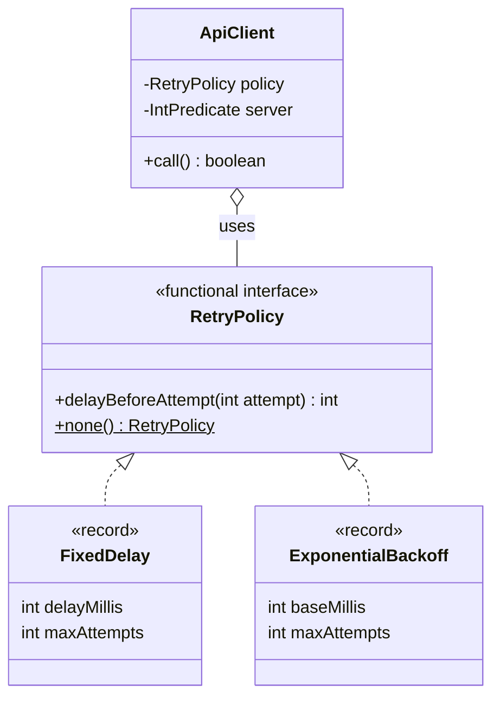

### Java example

`code/lld/ch11/strategy/`:

1. **Retry policies.** `RetryPolicy` has one abstract method, so `RetryPolicy.none()` is a **lambda**; configured strategies (`FixedDelay`, `ExponentialBackoff`) are **records**. `ApiClient.call()` is identical for all runs; only the injected policy differs. (Delays are printed, not slept.)
2. **`Comparator`** — the JDK's everyday strategy: `List.sort(comparator)` fixes the sorting algorithm and plugs in the comparison; `Comparator.comparing(...).reversed().thenComparing(...)` composes strategies.
3. **Strategy registry.** A `Map` from configuration key to a lambda (`UnaryOperator<BigDecimal>` pricing rules) — short and readable when each strategy is one line.

```java
/** STRATEGY: one small question — delay in ms before the given attempt (>= 2), or STOP. */
@FunctionalInterface
public interface RetryPolicy {
    int STOP = -1;
    int delayBeforeAttempt(int attempt);
    static RetryPolicy none() { return attempt -> STOP; }
}
/** Strategies with configuration earn a real type (a record here). */
public record FixedDelay(int delayMillis, int maxAttempts) implements RetryPolicy {
    public int delayBeforeAttempt(int attempt) { return attempt > maxAttempts ? STOP : delayMillis; }
}
/** 100, 200, 400, ... ms. Knows nothing about FixedDelay: strategies never name each other. */
public record ExponentialBackoff(int baseMillis, int maxAttempts) implements RetryPolicy {
    public int delayBeforeAttempt(int attempt) { return attempt > maxAttempts ? STOP : baseMillis << (attempt - 2); }
}

/** CONTEXT: holds a policy and never asks WHICH policy it has. server: fake (attempt number -> success?). */
public boolean call() {
    for (int attempt = 1; ; attempt++) {
        if (server.test(attempt)) { System.out.println("  attempt " + attempt + ": ok"); return true; }
        int delay = policy.delayBeforeAttempt(attempt + 1);
        if (delay == RetryPolicy.STOP) { System.out.println("  attempt " + attempt + ": failed, giving up"); return false; }
        System.out.println("  attempt " + attempt + ": failed, waiting " + delay + "ms");  // simulated, no sleep
    }
}

// Main.java, parts 2 and 3
Comparator<Product> byRatingThenName = Comparator.comparingDouble(Product::rating).reversed().thenComparing(Product::name);
Map<String, UnaryOperator<BigDecimal>> pricing = Map.of(
    "regular", p -> p,
    "member", p -> p.multiply(new BigDecimal("0.90")).setScale(2, RoundingMode.HALF_EVEN),  // 10% off
    "flash-sale", p -> p.subtract(new BigDecimal("20.00")).max(BigDecimal.ZERO));          // flat 20.00 off
```

Extending is cheap: a policy adding random **jitter**, or one honouring a server's `Retry-After` header (an **HTTP** — the web's request/response protocol — response header saying how long to wait), is one more class (or lambda) plus one line where the policy is chosen; `ApiClient` doesn't change.

**Output:**

```text
=== 1. Retry policies: same ApiClient code, three strategies ===
none (a lambda):
  attempt 1: failed, giving up
FixedDelay(100, 4):
  attempt 1: failed, waiting 100ms
  attempt 2: failed, waiting 100ms
  attempt 3: ok
ExponentialBackoff(100, 4):
  attempt 1: failed, waiting 100ms
  attempt 2: failed, waiting 200ms
  attempt 3: ok
ExponentialBackoff(100, 4) against a server that is always down:
  attempt 1: failed, waiting 100ms
  attempt 2: failed, waiting 200ms
  attempt 3: failed, waiting 400ms
  attempt 4: failed, giving up

=== 2. Comparator: the JDK's everyday strategy ===
  by price:          [cable, mouse, keyboard, monitor]
  by rating, name:   [keyboard, cable, mouse, monitor]

=== 3. Strategy registry: lambdas chosen by configuration ===
  regular    keyboard costs 49.99
  member     keyboard costs 44.99
  flash-sale keyboard costs 29.99
```

### Lambdas as strategies

Strategy is the pattern a plain function replaces most often. Since Java 8 any interface with a **single abstract method** (a *functional interface*) can be a lambda or method reference, so many strategies need **no class**: `Comparator<T>`, `Function`, `Predicate`, `Supplier`, or your `RetryPolicy`. Keep a named class (or record) when the strategy has **configuration or state** (`FixedDelay(100, 4)`), needs a **name for logging**, or must be **discovered/registered** (Spring beans — container-managed objects — or `ServiceLoader`, the JDK's plug-in discovery mechanism).

Other languages: Python passes a function (or `functools.partial` to bind parameters); a dict from name to function is a one-line registry. JavaScript/TypeScript pass a function argument or an object of functions. Kotlin/Scala take a function-typed constructor parameter, often with a default. Go uses a one-method interface (satisfied implicitly) or a `func` field.

The registry uses `BigDecimal` for prices: money in domain code is never `double`, since binary floating point can't represent most cent values exactly.

### Trade-offs

| Pros | Cons |
|---|---|
| New variants without editing working code — even by other teams (Open/Closed). | One class per variant (unless lambdas), one more file to open. |
| Each algorithm is testable alone. | Someone must choose — ideally a factory or container, not every caller. |
| Behaviour configurable at run time (flag, setting, header). | The interface must fit every variant, including future ones. |
| The context keeps to its real job (no backoff maths in an API client). | Tempting to overuse: three one-line strategies = three classes for three lines. |

### When not to use it

- **Two branches, no third in sight** — an `if` reads better; introduce the pattern when a third appears.
- **One-line branches** — a `Map` from key to lambda is shorter than a class each.
- **Variants need different inputs** (one the customer, another the warehouse) — the shared interface is forced; rethink the split.
- **The choice is fixed for the program's life** — decide it when wiring (or use Bridge).

### Common mistakes

1. **Every call site choosing** — the branch moved instead of disappearing; let a factory/config/DI container choose.
2. **A bloated interface** with parameters half the implementations ignore — the variants do different jobs.
3. **Strategies that know about each other** — then it is State.
4. **Stateful strategies shared between threads** — keep them immutable (records help).

### Real-world examples

- **`Comparator`** with `Collections.sort` / `List.sort` / `TreeMap` — the textbook example.
- **`ThreadPoolExecutor`'s** (the JDK's configurable thread pool) **`RejectedExecutionHandler`**: `AbortPolicy`, `CallerRunsPolicy`, `DiscardPolicy`, `DiscardOldestPolicy` — what happens when the pool is full.
- **Spring Security `PasswordEncoder`** (`BCryptPasswordEncoder`, `Argon2PasswordEncoder`, ...) chosen by configuration, so upgrading the **hash** (one-way scrambling of the password, irreversible) doesn't touch login code.
- **Resilience4j** (a Java fault-tolerance library) retry `IntervalFunction` (fixed, exponential, randomized backoff) and **Polly** in .NET — exactly these retry policies.
- **AWT/Swing `LayoutManager`** (`FlowLayout`, `BorderLayout`, `GridLayout`) — a container delegates layout to a strategy.
- **Payment method at checkout** (card, UPI [India's instant bank-to-bank payment system], wallet, cash on delivery), **pricing/discount rules by customer tier**, **route modes** (drive, walk, transit) in map apps, **compression/serialization formats** (turning objects into bytes or text) chosen by a content-type header.

### In the interview

**30-second answer:** "Strategy gives every variant of one job its own class behind a common interface, and something outside — usually a factory or configuration — picks the variant at run time. The context stops branching: my API client asks its retry policy how long to wait and never asks which policy it is. Each algorithm is testable alone and new ones don't touch working code. In Java a lambda is often enough, like a `Comparator`; I keep a class when the strategy has configuration. It shares its diagram with State, but strategies never reference each other."

**Follow-ups:**

- *Strategy vs State / Bridge?* Strategies are picked from outside and don't know each other; states pick their successors; Bridge is a design dimension fixed at assembly (see the State-vs-Strategy-vs-Bridge table in §11.2 and [§9.2](../09-patterns-structural/README.md#bridge-vs-strategy)). Don't use any of the three for two branches that will never become three.
- *Strategy vs Template Method?* Template Method swaps **one step** by **inheritance**; Strategy swaps **the whole algorithm** by **composition**, chosen at run time (table in §11.4). Prefer Strategy when both fit.
- *Strategy vs Command?* Strategy is *how* to do something; Command is *what* to do, with arguments, kept to run later or undo.
- *How is the strategy selected?* Config + factory (`Map<String, Strategy>`), DI container (Spring can inject a `Map<String, PaymentStrategy>` of all beans), or per request (header, customer tier).
- *Relation to Open/Closed and DIP?* The context depends on an abstraction (DIP); new strategies extend behaviour without modifying it (OCP).

### Self-check

1. **Q:** Who chooses the strategy? **A:** Someone outside the context — ideally a factory/config/DI container.
2. **Q:** Why can `RetryPolicy.none()` be a lambda? **A:** `RetryPolicy` is a functional interface (one abstract method).
3. **Q:** Name two JDK strategies. **A:** `Comparator`; `RejectedExecutionHandler` (also `LayoutManager`).
4. **Q:** When is a map of lambdas better than classes? **A:** When each strategy is one line and needs no configuration.
5. **Q:** How do you tell Strategy from State in code? **A:** Strategies never reference each other.

### TL;DR

**Interchangeable algorithms behind one interface, chosen from outside.** The context stops branching. Use lambdas for one-liners, records/classes when configured. Don't confuse with State (states know each other) or Template Method (inheritance, one step).

---

## 11.4 Template Method


*Figure — run() always performs five steps in the same order; subclasses fill in only reading and parsing, and one optional hook (course diagram)*

### What it is

**Template Method** (GoF intent, paraphrased): put the **outline of an algorithm** into one base-class operation (the *template method*) and leave certain steps for **subclasses**; they may redefine those steps but not the overall sequence. Like a recipe card with blanks — "boil water → brew ___ → pour → add ___ (if wanted)" — tea and coffee fill the blanks differently; the order never changes.

| Participant | Role | In `lld.ch11.templatemethod` |
|---|---|---|
| **AbstractClass** | Declares the primitive steps (abstract or with a default) and implements the template method that calls them in order | `ImportJob`, `CaffeineBeverage` |
| **ConcreteClass** | Implements the primitive steps that differ for its variant | `CsvImportJob`, `JsonImportJob`, `Tea`, `Coffee` |

### The problem it solves

An import job always reads rows, parses each, validates, saves, reports "done"; only reading and parsing differ between CSV and JSON. As separate classes the **shared flow** (order, validation, saving, reporting) is copied into each; when saving must also write an audit record, three files change — and the missed one is the bug. Template Method writes the flow once in a method subclasses **cannot override** (`final`); varying steps become methods subclasses must supply.

### How it works

1. Write the **template method** in an abstract class, **`final`** so the order is guaranteed.
2. It calls the steps in order. Three kinds:
   - **Required (abstract) steps** — every subclass must implement; the compiler enforces it.
   - **Hooks** — steps with a **default** (often empty or `true`) a subclass *may* override, e.g. `shouldValidate()`.
   - **Shared steps** — `private`, written once, not changeable.
3. Each subclass implements only what differs.

**The Hollywood Principle — "Don't call us, we'll call you."** (*Head First*.) The base class (high-level component) decides **when** subclass methods run; the subclass never drives the flow. That **inversion of control** is the backbone of most **frameworks** (libraries that own the program's flow and call your code at set points): **the framework runs the sequence; your class supplies only your pieces.**

### Structure (UML)


*Figure — Class diagram: ImportJob with final run(), abstract steps name/readRows/parseRow, hook shouldValidate and private save; CsvImportJob and JsonImportJob override only what differs (course diagram)*

Subclasses are tiny — but `CsvImportJob` alone doesn't reveal the sequence it follows; only the parent shows it. That is the trade-off.

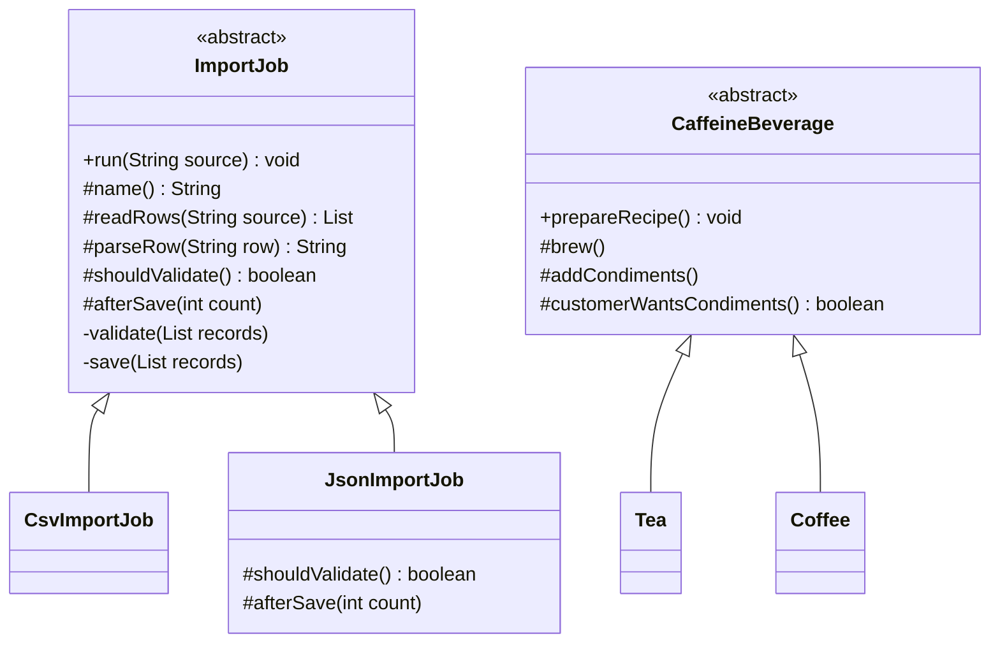

`run()` and `prepareRecipe()` are `final` in the code (Mermaid has no marker for `final`).

### Java example

`code/lld/ch11/templatemethod/`:

1. **Import jobs.** `ImportJob.run` is `final`; `name`, `readRows`, `parseRow` are **abstract** (required); `shouldValidate` and `afterSave` are **hooks** (defaults `true` and "do nothing"); `validate` and `save` are **private** shared steps. `JsonImportJob` overrides both hooks.
2. **Beverages** (*Head First*). `customerWantsCondiments()` is a hook: `Coffee(black = true)` turns off the optional step.

```java
/** ABSTRACT CLASS holding the TEMPLATE METHOD. */
public abstract class ImportJob {
    /** Template method. Marked final: subclasses cannot change the order, drop a step or insert one. */
    public final void run(String source) {
        System.out.println("Running the " + name() + " import:");
        List<String> rows = readRows(source);                 // required step
        List<String> records = new ArrayList<>();
        for (String row : rows) records.add(parseRow(row));   // required step
        System.out.println("  parsed " + records.size() + " records: " + records);
        if (shouldValidate()) {                               // hook
            validate(records);
        } else {
            System.out.println("  skipping validation, source is validated upstream");
        }
        save(records);                                        // shared, fixed
        afterSave(records.size());                            // hook with an empty default
        System.out.println("  done");
    }
    // Required steps: the compiler forces every subclass to supply them.
    protected abstract String name();
    protected abstract List<String> readRows(String source);
    protected abstract String parseRow(String row);
    // Hooks: sensible defaults, overriding is optional.
    protected boolean shouldValidate() { return true; }
    protected void afterSave(int count) { }
    // Shared steps: private validate(...) and save(...) — written once, cannot be changed by subclasses.
}

/** Supplies only what differs for CSV. */
public final class CsvImportJob extends ImportJob {
    @Override protected String name() { return "CSV"; }
    @Override protected List<String> readRows(String source) { return Arrays.stream(source.split("\n")).skip(1).toList(); } // skip header
    @Override protected String parseRow(String row) { return row.split(",")[0].trim(); }
}
// JsonImportJob (toy regex parsing, no JSON library) also overrides the hooks:
//   shouldValidate() -> false;  afterSave(count) prints "[hook] notified upstream: N ids consumed"

public abstract class CaffeineBeverage {
    public final void prepareRecipe() {          // template method
        boilWater();
        brew();
        pourInCup();
        if (customerWantsCondiments()) addCondiments();
    }
    protected abstract void brew();
    protected abstract void addCondiments();
    /** Hook: "Don't call us, we'll call you" - the base class decides WHEN this runs. */
    protected boolean customerWantsCondiments() { return true; }
    ...
}
// Coffee(boolean black) overrides customerWantsCondiments() to return !black.
```

**Output:**

```text
=== 1. Import jobs ===
Running the CSV import:
  parsed 3 records: [u1, u2, u3]
  validated 3 records, 0 blank
  saved 3 records (+ audit entry)
  done
Running the JSON import:
  parsed 2 records: [p9, p7]
  skipping validation, source is validated upstream
  saved 2 records (+ audit entry)
  [hook] notified upstream: 2 ids consumed
  done

=== 2. Beverages (hook controls an optional step) ===
tea:
  boiling water
  steeping the tea
  pouring into cup
  adding lemon
black coffee:
  boiling water
  dripping coffee through filter
  pouring into cup
```

### Template Method vs Strategy

| | Template Method | Strategy |
|---|---|---|
| What varies | **One step**; the surrounding algorithm is fixed | **The entire** algorithm |
| Mechanism | **Inheritance** — subclass supplies the step | **Composition** — caller passes an object in |
| When chosen | When the object is created (by which subclass you instantiate); fixed after that | Run time, can change per call |
| How many axes can vary | One (a class has one parent) | Several (hold several strategies) |
| What one file shows | Just the varying pieces | The complete algorithm |

Strategy is usually more flexible. Template Method pays off when **most of the flow is common**, small pieces differ, and you want the compiler to **enforce the sequence**. They combine well: the base fixes the sequence but each step is a **strategy object** (or lambda) passed in rather than inherited — order enforced, no single-parent limit. Spring's `JdbcTemplate` (a helper around **JDBC**, Java's standard SQL-database API) owns the fixed flow (get connection, create statement, execute, handle exceptions, close resources) and takes your part as a **callback** (a function/object you hand over to be called back — `RowMapper`, `PreparedStatementSetter`), not a subclass.

### Trade-offs

| Pros | Cons |
|---|---|
| The shared flow is written once (DRY: Don't Repeat Yourself). | No single file tells the whole story: parent holds the order, child the pieces. |
| The order is guaranteed (`final`). | One parent only: two independent variations can't combine. |
| New variants are small. | Tight parent–child binding; changing one step's signature changes every subclass. |
| Abstract steps make the compiler report anything a subclass hasn't supplied. | Base classes swell until they demand many abstract methods and nobody wants to extend them. |

### When not to use it

- **The flow is two lines** — nothing to protect.
- **Variants must combine** (an encrypted CSV import needs both an "encrypted" and a "CSV" parent) — composition.
- **Behaviour must change after creation** — Strategy.
- **Subclasses override every step** — the flow was never shared.

### Common mistakes

1. **Too many required steps** — a subclass should write two or three methods; make the rest hooks with defaults.
2. **Calling an overridable step from the base constructor.** It runs **before** subclass fields are initialised, so in Java the step sees `null`/`0`/`false`. (In C++ it is different but still wrong: during the base constructor a virtual call dispatches to the base version, never the override.) Call steps from the template method only.
3. **Omitting `final` on the template method** — a subclass can reorder or skip steps; the pattern becomes a mere agreement. (C++: make it non-virtual. Python and JavaScript can't enforce it — document and review.)
4. **Making steps `public`** — callers could run step 3 without 1 and 2. Keep them `protected` (or move reusable steps into a separate object).
5. **Violating Liskov** (Liskov Substitution Principle: a subclass must work wherever its parent is expected) in overrides — a hook that throws, a step that changes the contract.

### Template Method in other languages

- **Java:** `final` template method, `protected abstract` required steps, `protected` hooks with a body. An interface `default` method can act as a template method, but an interface has no instance state and a default method can't be `final`, so any implementer may override it.
- **Python:** `abc.ABC` with `@abstractmethod`; no run-time `final`, so a comment (or `typing.final` for type checkers) is the only guard; a leading underscore marks internal steps.
- **TypeScript:** `abstract` classes give the compile-time check; plain JavaScript uses base methods that throw.
- **C++:** a non-virtual public template method calling `protected virtual` steps — the **non-virtual interface (NVI)** idiom.
- **Go and Rust** have no inheritance: a function taking an interface/trait with the varying steps — the Strategy shape.

### Real-world examples

- **`java.io.InputStream`**: `read(byte[], int, int)` is built on abstract `read()`; subclasses supply the single-byte read (and override the bulk method for speed).
- **`java.util.AbstractList`**: implement `get(int)` and `size()` and inherit `iterator()`, `indexOf`, `contains`, `equals`, `hashCode`...
- **`HttpServlet.service()`** (Jakarta/Java Servlet) dispatches to `doGet`/`doPost`/`doPut`... by HTTP method; methods you don't override reject the request (405 Method Not Allowed on HTTP/1.1).
- **`AbstractQueuedSynchronizer`** (AQS — the JDK's building block behind `ReentrantLock`, `Semaphore`, `CountDownLatch`): `acquire()` is the template; subclasses implement `tryAcquire`/`tryRelease`.
- **Test frameworks**: JUnit (`@BeforeEach`/`@AfterEach`) and pytest (fixtures, `setup_method`/`teardown_method`) own set-up → test → tear-down; your hooks never call each other. **Mobile lifecycles**: Android `Activity` (`onCreate`, `onStart`, `onResume`...), iOS `UIViewController` (`viewDidLoad`, `viewWillAppear`...). **Maven/Gradle** (Java build tools): fixed phases, you plug in goals/tasks.
- **Sorting with a comparison**: `Arrays.sort` owns the algorithm and needs only the comparison. Old designs had elements supply it (`Comparable.compareTo`); modern APIs pass a `Comparator` — the Strategy form of the same idea.
- **Spring `JdbcTemplate`, `RestTemplate`, `TransactionTemplate`** — "template + callback" variants.

### In the interview

**30-second answer:** "Template Method puts an algorithm's outline in a single final method of a base class, and subclasses supply only the steps that differ. Steps a subclass must write are abstract; steps it may change are hooks with a default body; steps nobody should change are private. It's the Hollywood principle — the base class calls the subclass, not the other way round — which is how frameworks like servlets, JUnit and Android lifecycles work. It varies one step via inheritance; if I need run-time choice or several axes I prefer Strategy, or pass the steps in as callbacks like JdbcTemplate does."

**Follow-ups:**

- *What is a hook?* A step with a default implementation that subclasses may override (e.g. `shouldValidate()`) — optional control points.
- *What is the Hollywood Principle?* "Don't call us, we'll call you": high-level components call low-level ones at the right time; low-level components plug in but don't call up. It prevents "dependency rot" (dependencies tangled in every direction, so nothing can change safely).
- *Why `final`?* It is the guarantee: without it a subclass could reorder or drop steps — only a gentleman's agreement.
- *Template Method vs Factory Method?* A factory method is often one step of a template method — the step that creates an object (GoF notes template methods frequently call factory methods). The course frames it more strongly — a factory method is a special template step whose subclass-supplied job is creation; take that as "usually lives inside a template method", not a strict rule: clients can call a factory method directly.
- *Template Method vs Decorator?* A decorator wraps an existing object at run time and can be layered; a template-method subclass is fixed when the object is built and can't be layered.
- *Template Method vs Builder?* Both impose an order, but a Builder director invokes steps on a **different** object (the builder it holds); a template method invokes them on **its own** instance via inheritance.
- *Constructor trap?* Never call overridable methods from a constructor; the subclass isn't initialised yet.

### Self-check

1. **Q:** Which method is `final`? **A:** The template method (`run`, `prepareRecipe`).
2. **Q:** Difference between an abstract step and a hook? **A:** Abstract steps must be implemented; hooks have defaults and are optional.
3. **Q:** Name two JDK template methods. **A:** `InputStream.read(byte[],int,int)`, `AbstractList`'s methods built on `get`/`size`, AQS `acquire`.
4. **Q:** Why is `JdbcTemplate` more flexible than a classic template method? **A:** It takes the varying step as a callback object (composition), not a subclass.
5. **Q:** What goes wrong if the base constructor calls an abstract step? **A:** The subclass fields aren't initialised yet.

### TL;DR

**Fixed order in a `final` base method; subclasses fill steps; hooks are optional steps.** Hollywood principle. Inheritance-based and compile-time — prefer Strategy/callbacks when you need flexibility.

---

## 11.5 Visitor


*Figure — Without Visitor, every operation repeats an instanceof chain; with Visitor, two calls (accept, then visit) select the right code with no type check (course diagram)*

### What it is

**Visitor** lets you **add new operations** over a group of classes **without touching them**. Each operation is a **visitor** class with one method per element kind; each element keeps one tiny `accept(visitor)` whose body is `visitor.visit(this)`. Like a tax inspector who brings the rules for "restaurant", "shop" or "factory" — next year a fire-safety inspector visits with different rules, and the businesses don't change.

**GoF intent (paraphrased):** represent an operation on the elements of an object structure as a separate object, so you can define a new operation without changing the element classes.

| Participant | Role | In `lld.ch11.visitor` |
|---|---|---|
| **Visitor** | Declares one `visit` operation per ConcreteElement class | `PlanVisitor` |
| **ConcreteVisitor** | Implements every `visit`; one class per operation, often accumulating a result | `MonthlyCost`, `SecurityAudit` |
| **Element** | Declares `accept(visitor)` | `Resource` |
| **ConcreteElement** | Implements `accept` as `visitor.visit(this)` | `Server`, `Database`, `LoadBalancer`, `ResourceGroup` |
| **ObjectStructure** | Holds the elements and lets a visitor reach each of them (a list or a Composite) | the `ResourceGroup` tree built in `Main` |

### The problem it solves

An infrastructure plan has three resource kinds — server, database, load balancer — a **stable list**. **Operations never stop arriving**: monthly bill, security review, tag report, diagram export...

- Operations **inside** the classes → `Server` holds pricing, security, tagging and drawing code; unrelated teams edit one file.
- Operations **outside** with type checks → an `instanceof` chain in each; a new resource kind means finding every chain, and the compiler won't say which you missed.

Visitor gives each operation its own class and uses **double dispatch** to pick the right method with no type check.

### How it works — double dispatch

Java chooses **which override** (a subclass's replacement of an inherited method) runs from the **run-time type of the receiver** — the object before the dot (single dispatch) — but **which overload** (same-named methods with different parameter types: `visit(Server)` vs `visit(Database)`) at **compile time**, from the argument's **static type** (the declared type the compiler sees). Holding a `Resource r`, `visitor.visit(r)` can't compile to the right overload — the compiler only knows "Resource".

Visitor makes **two calls**:

1. `resource.accept(visitor)` — dispatch #1 on the **resource's** run-time type: `Server.accept` runs.
2. Inside it, `visitor.visit(this)` — `this` has static type `Server`, so the compiler picks `visit(Server)`; dispatch #2 happens on the **visitor's** run-time type (`MonthlyCost` or `SecurityAudit`).

The method that runs depends on **two** types — element and visitor: **double dispatch**.

### Structure (UML)


*Figure — Class diagram: Resource with accept; Server, Database, LoadBalancer implement it; PlanVisitor has one visit per resource type; MonthlyCost and SecurityAudit implement it (course diagram; it shows `total : double`, our Java code uses `BigDecimal` for money)*

The arrows point opposite ways: each element depends on the visitor interface (`accept` takes a visitor), while each visitor depends on every element type (a `visit` for each) — why **adding an element type is expensive**.

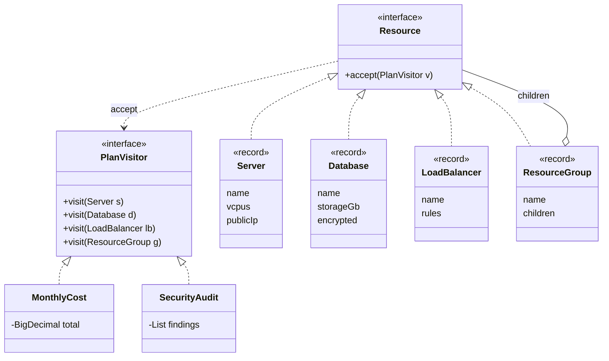

### Java example

`code/lld/ch11/visitor/` has **both** styles over one domain:

1. **Classic Visitor.** Elements are **records** (visitors read data via accessors, not public fields). `ResourceGroup` is a **Composite** (group and single item share one interface, so a tree is handled uniformly): its `accept` visits itself then its children. (A tree is optional — Visitor needs only a stable set of element types and works over a flat list; Composite is just the most common route in.) Prices are `BigDecimal`, never `double`. `MonthlyCost` and `SecurityAudit` each keep all rules in one file and touch no resource class; a new visitor instance per run because they accumulate.
2. **Java 21 alternative — sealed interface + pattern matching** (`ModernPlan`). `Infra` is `sealed ... permits Vm, Sql, Lb`. `monthlyCost` is a `switch` with **no `default`** — the compiler checks it is **exhaustive** (covers every case), so a new permitted record breaks every switch that forgot it (Visitor's safety net). `audit` uses **record patterns** (deconstruction, `case Sql(String n, int gb, boolean enc)`) and **guards** (`when !enc`). A guarded case never counts toward exhaustiveness (the compiler can't know the guard is sometimes true), so `audit` also needs the unguarded `case Vm vm` / `Sql db` / `Lb lb` lines.

```java
/** ELEMENT: the only thing every resource must provide is accept. */
public interface Resource { void accept(PlanVisitor visitor); }

/** VISITOR: one visit per element type. This list is what makes new types expensive. */
public interface PlanVisitor {
    void visit(Server server);
    void visit(Database database);
    void visit(LoadBalancer loadBalancer);
    void visit(ResourceGroup group);
}

public record Server(String name, int vcpus, boolean publicIp) implements Resource {
    public void accept(PlanVisitor v) { v.visit(this); }   // 2nd dispatch: overload picked by static type Server
}
// Database(name, storageGb, encrypted), LoadBalancer(name, rules): the same one-line accept.

/** COMPOSITE element: visits itself, then passes the visitor to every child. */
public record ResourceGroup(String name, List<Resource> children) implements Resource {
    public void accept(PlanVisitor v) {
        v.visit(this);
        for (Resource child : children) child.accept(v);
    }
}

/** Operation 1: ALL pricing rules in one file. New instance per run (it accumulates). */
public final class MonthlyCost implements PlanVisitor {
    static final BigDecimal PER_VCPU = new BigDecimal("24.00"), DB_BASE = new BigDecimal("40.00"),
            PER_GB = new BigDecimal("0.25"), LB_BASE = new BigDecimal("18.00"), PER_RULE = new BigDecimal("1.50");
    private BigDecimal total = BigDecimal.ZERO;
    public void visit(Server s)        { total = total.add(PER_VCPU.multiply(BigDecimal.valueOf(s.vcpus()))); }
    public void visit(Database d)      { total = total.add(DB_BASE.add(PER_GB.multiply(BigDecimal.valueOf(d.storageGb())))); }
    public void visit(LoadBalancer lb) { total = total.add(LB_BASE.add(PER_RULE.multiply(BigDecimal.valueOf(lb.rules())))); }
    public void visit(ResourceGroup g) { /* groups are free */ }
    ...
}
// Operation 2, SecurityAudit, added later without touching a resource class: findings for a public IP,
// an unencrypted database, a load balancer with no rules, an empty group.
```

```java
/** Java 21: a SEALED hierarchy + pattern-matching switch. No accept(), no visitor interface. */
public sealed interface Infra permits Vm, Sql, Lb {}
public record Vm(String name, int vcpus, boolean publicIp) implements Infra {}
public record Sql(String name, int storageGb, boolean encrypted) implements Infra {}
public record Lb(String name, int rules) implements Infra {}

/** Operation 1 as a plain function. No 'default' branch, on purpose. Same prices as MonthlyCost. */
public static BigDecimal monthlyCost(Infra r) {
    return switch (r) {
        case Vm vm -> MonthlyCost.PER_VCPU.multiply(BigDecimal.valueOf(vm.vcpus()));
        case Sql db -> MonthlyCost.DB_BASE.add(MonthlyCost.PER_GB.multiply(BigDecimal.valueOf(db.storageGb())));
        case Lb lb -> MonthlyCost.LB_BASE.add(MonthlyCost.PER_RULE.multiply(BigDecimal.valueOf(lb.rules())));
    };
}
/** Operation 2 with record deconstruction patterns and guards. */
public static Optional<String> audit(Infra r) {
    return switch (r) {
        case Vm(String n, int cpus, boolean pub) when pub -> Optional.of(n + ": server has a public IP");
        case Sql(String n, int gb, boolean enc) when !enc -> Optional.of(n + ": storage not encrypted");
        case Lb(String n, int rules) when rules == 0 -> Optional.of(n + ": load balancer has no rules");
        case Vm vm -> Optional.empty();     // no finding
        case Sql db -> Optional.empty();
        case Lb lb -> Optional.empty();
    };
}
// Main: plan = ResourceGroup("prod", [Server web-1 4 vCPU public, Server worker-1 2, Database orders-db 200 GB
// unencrypted, LoadBalancer edge-lb 4 rules, empty ResourceGroup staging]); plan.accept(new MonthlyCost()) ...
```

**Output:**

```text
=== 1. Classic Visitor (double dispatch) over a composite plan ===
  monthly cost: 258.00
  finding: web-1: server has a public IP
  finding: orders-db: storage not encrypted
  finding: staging: empty group

=== 2. Java 21: sealed interface + pattern matching switch ===
  monthly cost: 258.00
  finding: web-1: server has a public IP
  finding: orders-db: storage not encrypted
```

Both styles agree (96.00 + 48.00 + 90.00 + 24.00 = 258.00; the empty `staging` group is free). The modern one needs no `accept` or visitor interface; each operation is a function.

### The one question that decides it: the expression problem

| | Add a new **operation** | Add a new **type** |
|---|---|---|
| Methods on the classes (plain OO) | Edit every class | One new class |
| Visitor (or sealed + switch) | One new visitor/function | Edit the visitor interface **and every visitor** (compiler finds them) |

Ask: **which changes more often — types or operations?** Settled types + growing operations → Visitor (or sealed types with pattern matching). Growing types → operations on the classes. No ordinary OO design makes both cheap: the **expression problem**.

**Open/Closed trade-off:** Visitor makes the element hierarchy **closed for modification but open for new operations** — at the price of being **closed to new element types** (each forces edits to all visitors).

**Sealed interfaces + pattern matching (Java 17/21) as the modern alternative:** sealed classes arrived in Java 17 (JEP 409 — a JEP, JDK Enhancement Proposal, is the numbered design document for a Java feature); pattern matching for `switch` and record patterns were finalised in Java 21 (JEPs 441 and 440). Together they give Visitor's main advantage, the exhaustiveness check, with far less code. The exact rules:

- A `switch` **expression** must always be exhaustive. A `switch` **statement** must be too once it uses patterns or `case null` (old-style statements over constants need not be).
- Over a `sealed` type, covering every permitted subtype with an **unguarded** pattern makes the switch exhaustive with no `default`. Guarded cases (`when ...`) don't count.
- Over a type that is **not** sealed, the compiler can't know all subtypes, so you need a `default` (or a total pattern such as `case Infra i`) — and the check is gone.
- If a new subtype appears at run time without recompiling the switch (separate compilation), the compiler-generated fallback throws `MatchException`.
- **Dominance:** cases are tried top to bottom, and a case that can never match because an earlier one covers it is a compile error — why the guarded `case Vm(...) when pub` must come **before** the unguarded `case Vm vm`.
- **`null`:** a pattern `switch` without `case null` throws `NullPointerException` on a `null` selector; `default` alone does not match `null`.

Write a classic Visitor when the element hierarchy **is not and cannot be sealed** — typically classes **owned by another team or library** that already expose `accept` (libraries such as ASM — reads and rewrites Java **bytecode**, the compiled instructions the JVM (Java Virtual Machine) runs — or javac's tree API ship their own visitor interfaces) — when you need a **walk with per-node callbacks** over a big tree, or when each operation should be a separately testable, injectable class.

**Visitor outside Java.** Kotlin: sealed class + exhaustive `when`. Python: `match` with class patterns, or `functools.singledispatch` (dispatch on argument type, no `accept`). C++: `std::variant` + `std::visit` — the pattern as a library feature. Rust and Swift: enums with associated values plus `match`/`switch`; a missing case is a build error. Languages without overloading (Python, JavaScript) name methods `visitServer`, `visitDatabase`, ... instead of overloading `visit`.

### Trade-offs

| Pros | Cons |
|---|---|
| Adding an operation = writing one class; elements stay as they are. | Adding an element type changes every existing visitor. |
| Related logic stays together (all pricing in one file). | Double dispatch is indirect; `accept` tells you nothing about what runs. |
| The compiler reports any element type a visitor hasn't handled. | Elements often must expose their data (weaker encapsulation). |
| Elements stay small: data + one-line `accept`. | Ceremony for small sets of types. |

### When not to use it

- **New types arrive often** — each edits every visitor.
- **A tiny model** (three element types, one operation) — a type check or plain method is simpler.
- **The operation concerns one type only** — it's a method.
- **Your language checks switch exhaustiveness** (Java 21 sealed types, Kotlin `when`, Rust `match`) — use that.

### Common mistakes

1. Visitor with two element types.
2. **Public** element fields for visitors (use accessors/records).
3. **Reusing a stateful visitor** (`MonthlyCost`) across runs without resetting — create one per run.
4. A `default` branch in a sealed-type switch — it **turns off** the exhaustiveness check you wanted.
5. Forgetting the composite's `accept` must forward to children (or not deciding where traversal lives: element, visitor, or an Iterator).
6. **A visitor where a sealed-type `switch` would do** — with checked exhaustiveness (Java 21, Kotlin, Rust, Swift) you get the same safety for a fraction of the code.

### Real-world examples

- **Compilers and linters** (tools flagging suspicious code): an **AST** (abstract syntax tree — the tree a compiler builds from source) has fixed node kinds and endless passes (type check, optimise, format, lint rules). The JDK's `com.sun.source.tree.TreeVisitor` (javac tree API) and `javax.lang.model.element.ElementVisitor` (annotation processing) are visitors; ANTLR (a parser generator) generates visitor classes for your grammar.
- **Bytecode libraries**: ASM's `ClassVisitor` / `MethodVisitor`.
- **`java.nio.file.FileVisitor`** with `Files.walkFileTree` — named after the pattern and often cited, but strictly a **tree-walk callback** interface (`preVisitDirectory`, `visitFile`, `visitFileFailed`, `postVisitDirectory`): no `accept`, no double dispatch over element classes. The *spirit* (operation kept outside the file-system objects) is Visitor's; the mechanism is closer to a Template Method walk calling your hooks.
- **Document models**: a **DOM** (Document Object Model — the element tree of a web page or XML document) has fixed node kinds and ever more operations — serialise to HTML/PDF, extract plain text, collect links; **infrastructure tools** computing cost, policy and diagrams over resource plans (this example); **query planners** (the database component deciding how to run a SQL query: cost estimation, rewriting, EXPLAIN).

### In the interview

**30-second answer:** "Visitor pulls an operation out of the element classes and into a separate class that has a method for each element type. Each element has a one-line `accept` that calls `visitor.visit(this)`, which gives double dispatch: the method chosen depends on both the element type and the visitor type, so no `instanceof` chains. It makes adding operations cheap and adding types expensive — the expression problem — so it fits stable type sets like ASTs. In Java 21 I'd usually use a sealed interface with an exhaustive pattern-matching switch instead, which gives the same compiler check with much less code."

**Follow-ups:**

- *Explain double dispatch.* Java picks overloads at compile time from static types; `accept` runs on the element's run-time type, inside it `this` has the concrete static type so the right `visit` overload is chosen; then the visitor's run-time type picks the implementation.
- *Why not just call `visitor.visit(resource)`?* With static type `Resource` the compiler can't choose `visit(Server)`; it needs `visit(Resource)`, which doesn't exist.
- *Visitor vs Iterator / Strategy / Composite / Interpreter?* Iterator decides the route, Visitor the work at each stop; a strategy is one algorithm ignoring element types, a visitor dispatches on type; Composite treats tree and node alike, Visitor adds operations over a stable type set (tree or not); Interpreter keeps evaluation **in** each node, Visitor moves it **out** (interpreters switch once a second pass arrives). Often combined.
- *How do you add a new element type?* Add it to the `visit` list (or `permits` clause) and fix every visitor/switch the compiler flags.

### Self-check

1. **Q:** What is the body of every `accept` method? **A:** `visitor.visit(this)`.
2. **Q:** What change is cheap with Visitor, and what is expensive? **A:** New operations are cheap; new element types are expensive.
3. **Q:** What Java 21 features replace most visitors? **A:** Sealed interfaces + pattern-matching `switch` (with record patterns), checked for exhaustiveness.
4. **Q:** Why no `default` in `monthlyCost`'s switch? **A:** A `default` would hide missing cases; without it the compiler forces every permitted type to be handled.
5. **Q:** Where does the traversal live for a composite? **A:** Here, in the composite's `accept` (it visits itself, then its children).

### TL;DR

**Operations become visitor classes; elements just `accept`; double dispatch picks the method.** Cheap new operations, expensive new types (expression problem). In Java 21, prefer **sealed interfaces + exhaustive pattern matching**.

---

## 11.6 GoF behavioral patterns: quick-reference summary

Key features, when to apply each, an example, pros and cons (from the course summary plus this book).

| Pattern | Distinctive feature | Apply when | Example | Pros | Cons |
|---|---|---|---|---|---|
| Chain of Responsibility | Passes a request along a chain of handlers | Several objects may handle a request and the handler isn't known in advance | Help systems, HTTP middleware (code run before/after each web request) | Decouples sender and receiver | A request may go unhandled; long chains can be inefficient and slow to debug |
| Command | Wraps a request as an object | Actions must be queued, logged, retried or undone | GUI actions, job queues | Decouples invoker from receiver; undo/redo | Many small command classes |
| Interpreter | One class per grammar rule | Evaluating sentences of a small language | Regex, rule DSLs (small domain-specific languages) | Easy to extend the grammar | Unmanageable for large grammars |
| Iterator | Sequential access without exposing representation | You need a standard way to traverse any collection | Browsing a playlist | Simple client code; hides the structure | Hidden costs; state handling in lazy iterators |
| Mediator | Centralises communication between peers | Many objects interact in tangled ways | Chat application, air traffic control | Fewer dependencies; reusable components | The mediator can become a god object (one class that knows and does too much) |
| Memento | Captures and externalises state without breaking encapsulation | Undo, checkpoints, rollback | Editor undo, save games | Preserves encapsulation; atomic restore | Memory-heavy for big/frequent snapshots |
| Observer | Notifies dependents of state changes | A change in one object must reach others | Live stock/data feeds | Subject and observers are loosely coupled | Leaks, unexpected performance costs, no ordering |
| State | Behaviour changes with internal state | An object's behaviour depends on a state that changes at run time | Game modes, order lifecycles | Localises state-specific behaviour | More classes; graph spread across files |
| Strategy | Algorithm chosen at run time | Several ways to do one task, chosen dynamically | Compression algorithms, retry policies | Swap algorithms; isolate each | More classes; someone must choose |
| Template Method | Algorithm skeleton in a base class, steps in subclasses | The structure is fixed but some steps vary | Frameworks' lifecycles | Code reuse; enforced order | Inheritance rigidity; harder to follow |
| Visitor | Separates operations from the objects they work on | Many operations over a stable set of types | Processing document elements, compiler passes | Easy to add operations; related code together | Adding element types is hard; bloated visitor interface |

---

## 11.7 Beyond GoF: patterns every LLD interview expects

The GoF book (1994) is not the whole story. These come from later sources — *Patterns of Enterprise Application Architecture* (Fowler, 2002), *Domain-Driven Design* (Evans, 2003 — DDD, shaping code around the business domain and its vocabulary), *Head First Design Patterns*, and decades of framework practice — and appear in almost every case study in this book.

### 11.7.1 Null Object

#### What it is

A **Null Object** is a real object implementing an interface with **neutral, do-nothing behaviour**, used instead of `null` to mean "no object here", so callers need no `if (x != null)` checks — like a "guest" badge that walks the lobby like anyone else but opens no special doors.

#### The problem it solves

Returning `null` for "not found" forces **every caller** to remember a null check; one forgotten check → `NullPointerException` (NPE — thrown when calling a method on `null`) in production, and the checks clutter business logic.

#### How it works

1. An interface (`Customer`).
2. The real class (`RegisteredCustomer`) and a **null class** (`GuestCustomer`) returning neutral values (0% discount) or doing nothing (empty `notify`).
3. Return the null object where you'd return `null`. Stateless null objects can be a **singleton** (one shared instance — here an `enum` constant).
4. If a caller truly must know, offer `isGuest()`/`isNull()` — sparingly.

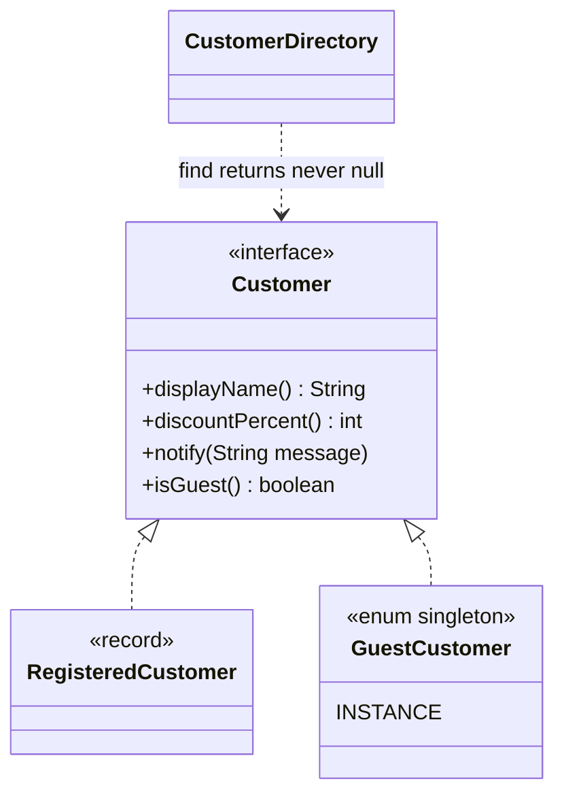

#### Java example

Full code: `code/lld/ch11/nullobject/`.

```java
public interface Customer {
    String displayName();
    int discountPercent();
    void notify(String message);
    default boolean isGuest() { return false; }
}
// RegisteredCustomer(name, discountPercent, email) is a record; notify prints an email.

/** NULL OBJECT: a real, do-nothing implementation with neutral values. Stateless -> enum singleton. */
public enum GuestCustomer implements Customer {
    INSTANCE;
    public String displayName() { return "guest"; }
    public int discountPercent() { return 0; }            // neutral value
    public void notify(String message) { }                // does nothing, on purpose
    @Override public boolean isGuest() { return true; }   // for the rare caller that must know
}

// CustomerDirectory
/** Style 1: never return null; return the Null Object instead. */
public Customer find(String id) { return byId.getOrDefault(id, GuestCustomer.INSTANCE); }
/** Style 2: make absence explicit in the type; the caller chooses the fallback. */
public Optional<Customer> lookup(String id) { return Optional.ofNullable(byId.get(id)); }

// Main.checkout — no "if (customer != null)" anywhere: the Null Object answers every call safely.
BigDecimal payable = price.multiply(BigDecimal.valueOf(100 - c.discountPercent()))
                          .divide(HUNDRED, 2, RoundingMode.HALF_EVEN);
System.out.printf("  %-6s pays %s%n", c.displayName(), payable);
c.notify("thanks for your order");
```

**Output:**

```text
=== Null Object ===
  Asha   pays 90.00
    email to asha@example.com: thanks for your order
  guest  pays 100.00
=== Optional (absence visible in the signature) ===
  lookup(unknown-id) present? false -> using guest
```

`checkout` has no null checks, and the guest's `notify` silently does nothing. (Prices are `BigDecimal` with an explicit rounding mode, never `double`.)

#### Trade-offs, when not to use it, mistakes

| Pros | Cons |
|---|---|
| Removes repetitive null checks; fewer NPEs. | Can **hide real errors** — a missing object that *should* exist fails silently. |
| Polymorphism instead of conditionals. | One more class per interface. |
| Easy to test; a natural default. | Callers may not realise they got a "nothing" object. |

- **Don't use it** when absence is an **error** (throw) or the caller must decide what absence means (return `Optional<T>` — a JDK container holding a value or empty).
- **Null Object vs `Optional`:** Null Object hides absence behind neutral behaviour; `Optional` makes absence **visible in the type** and lets each caller choose (`orElse`, `orElseThrow`). `Optional` for lookup return values; Null Object for legitimately optional **collaborators** (a logger, listener, discount policy).
- **Common mistakes:** a null object with **side effects** or non-neutral values; a mutable null-object singleton; overusing `isNull()` checks (the conditionals come back).

#### Real-world examples

`Collections.emptyList()` / `emptyMap()` (empty, not null); `InputStream.nullInputStream()`, `OutputStream.nullOutputStream()`, `Reader.nullReader()`, `Writer.nullWriter()` (Java 11); SLF4J's (a common Java logging API) `NOPLogger`; a "no-op" (does-nothing) `MeterRegistry`/tracer in **observability** libraries (metrics, logs and traces showing what a running system does).

#### In the interview

**30-second answer:** "Null Object replaces `null` with an implementation that does nothing or returns neutral values, so callers never need null checks — like returning an empty list instead of null. I use it for optional collaborators like loggers or discount policies, and `Optional` for lookups where the caller should decide. I avoid it when absence is actually an error, because it would hide the bug."

*Follow-up — is it a GoF pattern?* No; Bobby Woolf described it (*Pattern Languages of Program Design 3*), and Fowler's *Refactoring* has it as "Introduce Special Case" (earlier "Introduce Null Object").

**Self-check.** Q: What does `Collections.emptyList()` have to do with this? A: It's a null object for lists — safe to iterate, never null. Q: When should you throw instead? A: When the object must exist and its absence is a bug.

**TL;DR:** Return a harmless "nothing" object instead of `null`; use `Optional` when the caller must choose; throw when absence is a bug.

---

### 11.7.2 Dependency Injection (DI)

#### What it is

**Dependency Injection**: a class **receives** its dependencies from outside instead of **creating** them with `new` or looking them up — the most common way to implement **Inversion of Control (IoC)**, where the framework or a "composition root" builds and wires objects, not the objects themselves. Martin Fowler settled the name in his 2004 article on IoC containers. Like a kitchen supplied with vegetables rather than growing them: change supplier, recipes unchanged.

#### The problem it solves

```java
class OrderService {
    private final EmailSender sender = new EmailSender();   // hard-wired
}
```

It can never send SMS, can't be unit-tested without really sending email, and hides its dependencies. DI fixes all three: depend on an **interface** (`MessageSender`), receive it through the **constructor**, let someone else choose the implementation.

#### How it works

1. Declare dependencies as **constructor parameters** typed by **interfaces** (Dependency Inversion Principle, Chapter 4).
2. A **composition root** (usually `main`, or a DI container at start-up) creates concrete objects and passes them in.
3. Tests pass **fakes** (simple stand-ins used only in tests).

| Style | How | Use for |
|---|---|---|
| **Constructor injection** | Dependencies are constructor parameters, stored in `final` fields | Required dependencies — the default choice |
| **Setter injection** | `setX(...)` after construction | Optional dependencies or ones that can change |
| **Field injection** | Framework writes directly into fields (`@Autowired` annotation on a field) | Avoid: hides dependencies and makes testing harder |

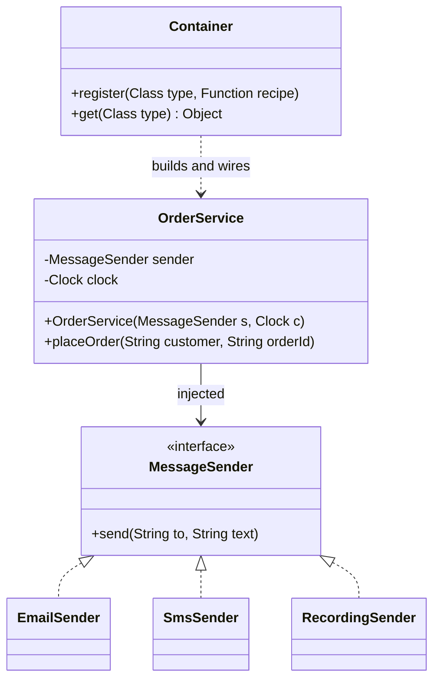

#### Java example

Full code: `code/lld/ch11/di/`. `OrderService` receives a `MessageSender` and a `java.time.Clock` — injecting the clock makes time **testable** (`Clock.fixed`). `Container` is a toy IoC container: register a *recipe* per type; `get` builds on demand (recipes may ask the container for their own dependencies) and caches singletons.

```java
/** CONSTRUCTOR INJECTION: declares what it needs, never calls 'new' on collaborators; even the clock is injected. */
public final class OrderService {
    private final MessageSender sender;
    private final Clock clock;
    public OrderService(MessageSender sender, Clock clock) { this.sender = sender; this.clock = clock; }
    public void placeOrder(String customer, String orderId) {
        LocalTime now = LocalTime.now(clock);
        sender.send(customer, "order " + orderId + " placed at " + now);
    }
}
// EmailSender and SmsSender print; RecordingSender (test double) adds "to|text" to a list —
// only possible because the dependency is injected.

/** A toy IoC container. Real ones (Spring, Guice, Dagger) add scanning, scopes, proxies and lifecycles. */
public <T> T get(Class<T> type) {
    Object existing = singletons.get(type);
    if (existing != null) return type.cast(existing);
    Function<Container, ?> recipe = recipes.get(type);
    if (recipe == null) throw new IllegalStateException("no binding for " + type.getSimpleName());
    T created = type.cast(recipe.apply(this));   // the recipe may ask the container for its own deps
    singletons.put(type, created);
    return created;
}

// Main.java
Clock fixed = Clock.fixed(Instant.parse("2026-01-15T09:30:00Z"), ZoneOffset.UTC);
new OrderService(new EmailSender(), fixed).placeOrder("asha@example.com", "A-1");   // manual DI at the composition root
c.register(OrderService.class, k -> new OrderService(k.get(MessageSender.class), k.get(Clock.class)));
```

**Output:**

```text
=== 1. Manual DI: the composition root wires everything ===
  [smtp] to asha@example.com: order A-1 placed at 09:30
  [sms] to +91-90000-00000: order A-2 placed at 09:30

=== 2. In a unit test: inject a fake ===
  fake recorded: [ben|order T-9 placed at 09:30]

=== 3. A toy IoC container ===
  [smtp] to chen@example.com: order A-3 placed at 09:30
  same instance each time: true
```

#### Trade-offs, when not to use it, mistakes

| Pros | Cons |
|---|---|
| Swap implementations without editing the class (OCP, DIP). | More indirection: "where does this come from?" |
| Easy unit tests with fakes. | Containers add "magic" (reflection — code inspecting classes at run time; proxies — generated wrapper objects) and start-up cost. |
| Dependencies are explicit in the constructor. | Misconfiguration may only show at start-up (or run time). |

- **Don't** inject value objects or simple data (`new Money(...)` is fine), or add single-implementation interfaces "just for DI" when no test or variation needs them.
- **Common mistakes:** the **Service Locator** anti-pattern (classes call `container.get(...)` themselves — dependencies hidden again); field injection; **a constructor with 8+ dependencies** (the class does too much — split it); **circular dependencies** (A needs B while B needs A).

#### Real-world examples

**Spring** (`@Component` + constructor injection, `ApplicationContext` as container), **Google Guice**, **Dagger/Hilt** (compile-time DI on Android), **Jakarta CDI**, **Micronaut/Quarkus** (compile-time DI for fast start-up). Spring can inject a `Map<String, PaymentStrategy>` of all strategy beans — DI + Strategy together.

#### In the interview

**30-second answer:** "Dependency injection means a class receives its collaborators through its constructor, typed by interfaces, instead of creating them. It's how we apply Dependency Inversion and Inversion of Control: a composition root or a container like Spring wires the graph. The benefits are swappable implementations and easy testing with fakes — I even inject the Clock. I prefer constructor injection, avoid field injection and service locators, and treat a huge constructor as a **design smell** (a surface sign that something deeper is wrong)."

*Follow-ups:* **DI vs IoC?** IoC is the general idea (the framework calls you / controls object creation); DI is one way to achieve it. **DI vs Service Locator?** A locator: the class asks (hidden); DI: dependencies are handed in (visible). **DI vs Factory?** A factory creates objects on request; DI supplies ready-made dependencies — containers use factories internally.

**Self-check.** Q: Why inject `Clock`? A: To make time-dependent code deterministic in tests. Q: Which injection style is preferred? A: Constructor injection.

**TL;DR:** Don't `new` your collaborators — **receive them** (constructor, interfaces). Wire at the composition root or with a container.

---

### 11.7.3 Repository

#### What it is

A **Repository** is a **collection-like interface for loading and saving domain objects**, in domain language (`findByEmail`, `findActive`), that **hides how and where data is stored** (SQL — relational databases; NoSQL — non-relational key-value or document stores; files; memory). Described by Fowler (*PoEAA*) and central to Evans's *DDD*. Like a library front desk: ask for "books by this author", never mind which shelf or branch.

#### The problem it solves

SQL, connection handling and mapping code scattered through business classes make the rules hard to read, untestable without a database, and tied to one storage technology.

#### How it works

1. Define the interface in the **domain layer** (code holding business rules): `UserRepository` with `save`, `findById`, `findByEmail`, ... returning `Optional` for "maybe not found".
2. Implement it in the **infrastructure layer** (code talking to databases, networks, files): `InMemoryUserRepository` for tests, a JDBC/JPA one (JPA, the Java Persistence API, maps objects to tables) for production.
3. Services depend on the **interface** (injected — see DI).

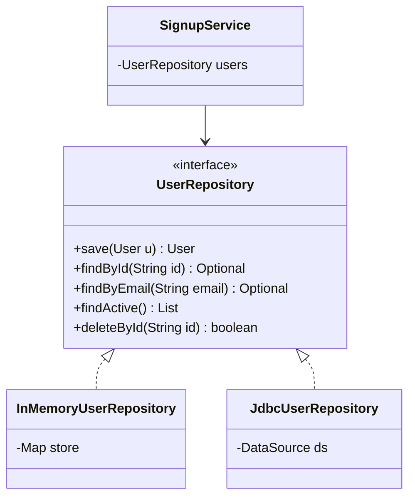

(`JdbcUserRepository` illustrates a production implementation; the demo includes the in-memory one.)

#### Java example

Full code: `code/lld/ch11/repository/`.

```java
public record User(String id, String email, boolean active) {}   // domain object, knows nothing about storage

/** REPOSITORY: a collection-like interface for aggregates, in DOMAIN language. */
public interface UserRepository {
    User save(User user);
    Optional<User> findById(String id);
    Optional<User> findByEmail(String email);
    List<User> findActive();
    boolean deleteById(String id);
}

/** In memory (tests, prototypes). A JDBC/JPA one would implement the same interface. */
public final class InMemoryUserRepository implements UserRepository {
    private final Map<String, User> store = new ConcurrentHashMap<>();
    public User save(User user) { store.put(user.id(), user); return user; }
    public Optional<User> findById(String id) { return Optional.ofNullable(store.get(id)); }
    public Optional<User> findByEmail(String email) {
        return store.values().stream().filter(u -> u.email().equalsIgnoreCase(email)).findFirst();
    }
    public List<User> findActive() { return store.values().stream().filter(User::active).sorted(Comparator.comparing(User::id)).toList(); }
    public boolean deleteById(String id) { return store.remove(id) != null; }
}

/** Business logic talks to the repository interface only: no SQL, no maps, no files. */
public String signUp(String id, String email) {
    if (users.findByEmail(email).isPresent()) return "rejected: " + email + " already registered";
    users.save(new User(id, email, true));
    return "created " + id;
}
public void deactivate(String id) { users.findById(id).ifPresent(u -> users.save(new User(u.id(), u.email(), false))); }
// Main: repo = new InMemoryUserRepository() (swap for a JDBC version in production); sign up u1, u2, u3 (ASHA@...).
```

**Output:**

```text
  created u1
  created u2
  rejected: ASHA@example.com already registered
  active users: [User[id=u1, email=asha@example.com, active=true]]
  findById(u9): Optional.empty
  deleteById(u2): true
```

#### Trade-offs, when not to use it, mistakes

| Pros | Cons |
|---|---|
| Business logic is storage-agnostic and testable in memory. | Another layer; trivial CRUD (create, read, update, delete) apps may not need it. |
| One place for queries per aggregate. | Can leak storage concerns (lazy loading — fetching data only when first touched; transactions — changes that succeed or fail together) anyway. |
| Swap storage (SQL → NoSQL) behind the interface. | "Generic repository for everything" becomes a thin, useless wrapper. |

- **Don't** create one per table; one per **aggregate root** (DDD: the entry-point object of a cluster, e.g. `Order` with its `OrderLine`s).
- **Repository vs DAO:** a DAO (Data Access Object) is table/record-oriented, close to the database; a repository is domain-oriented, behaving like a collection of aggregates. In small apps they often look the same.
- **Common mistakes:** returning `null` instead of `Optional`; exposing SQL types (`ResultSet`); business rules in the repository; dozens of `findByXAndYOrZ` methods — use **Specification** (next).
- **Thread-safety note:** `ConcurrentHashMap` (the JDK's thread-safe hash map) makes each single call safe, but `SignupService.signUp` is **check-then-act** (the check's answer can be stale by the time you act) — `findByEmail`, then `save` — so two concurrent sign-ups with one email can both pass. A real system enforces uniqueness with a database **unique constraint** (rejects a duplicate column value), or an atomic `putIfAbsent` keyed by email in memory.

#### Real-world examples

**Spring Data** `CrudRepository` / `JpaRepository` (derived query methods like `findByEmail` generated from method names), Micronaut Data, Hibernate/JPA behind them; Android Room DAOs wrapped in repositories (Android architecture guidance).

#### In the interview

**30-second answer:** "A repository is a collection-like interface for aggregates in domain language — save, findById, findByEmail — that hides storage. Services depend on the interface, so business logic is testable with an in-memory implementation and storage can change. In machine-coding rounds I always put an in-memory repository behind an interface, so the design is ready for a database later."

**Self-check.** Q: What does a repository return when nothing is found? A: `Optional.empty()` (or an empty list). Q: One repository per table? A: No, per aggregate root.

**TL;DR:** A **domain-language collection interface** over storage; services use the interface; start in-memory, swap later.

---

### 11.7.4 Specification

#### What it is

A **Specification** is a **business rule packaged as an object** with one question — `isSatisfiedBy(candidate)` — **combinable** with `and`, `or`, `not`. Introduced by Eric Evans and Martin Fowler. Like a shopping site's filter panel: "Electronics" ✓, "under ₹5,000" ✓, "in stock" ✓ — separate rules combined as ticked.

#### The problem it solves

"Bargain electronics = category electronics AND price < 50.00 AND in stock" gets duplicated across queries, validations and UI filters, or becomes a method explosion (`findByCategoryAndPriceLessThanAndStockGreaterThan...`). Specification gives each rule a **name**, makes it **reusable** (selection, validation, building to order) and **composable**.

#### How it works

1. `Specification<T>` with `isSatisfiedBy(T)`; default `and`, `or`, `not` return new composite specifications (the **Composite** pattern + **Interpreter**-like evaluation).
2. Small named factories (`inStock()`, `cheaperThan(...)`).
3. Combine where needed; pass to a repository or a stream filter.

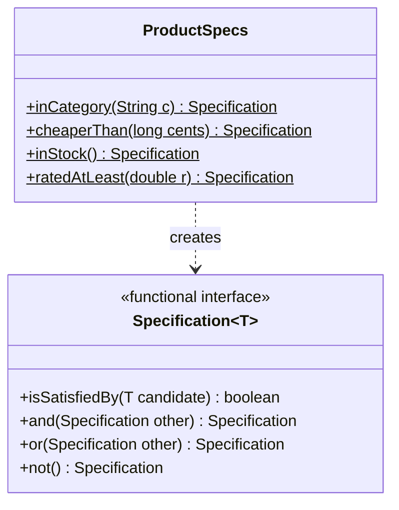

#### Java example

Full code: `code/lld/ch11/specification/`.

```java
/** SPECIFICATION: a business rule as a small, named, combinable object. */
@FunctionalInterface
public interface Specification<T> {
    boolean isSatisfiedBy(T candidate);
    default Specification<T> and(Specification<T> other) { return c -> isSatisfiedBy(c) && other.isSatisfiedBy(c); }
    default Specification<T> or(Specification<T> other)  { return c -> isSatisfiedBy(c) || other.isSatisfiedBy(c); }
    default Specification<T> not()                       { return c -> !isSatisfiedBy(c); }
}

public record Product(String name, String category, long priceCents, int stock, double rating) {}

/** Named rules, in the language of the business. Each is tiny and testable alone. */
public static Specification<Product> inCategory(String c) { return p -> p.category().equals(c); }
public static Specification<Product> cheaperThan(long cents) { return p -> p.priceCents() < cents; }
public static Specification<Product> inStock() { return p -> p.stock() > 0; }
public static Specification<Product> ratedAtLeast(double r) { return p -> p.rating() >= r; }

// Main.java — the same rule objects are reused for querying AND for validation.
Specification<Product> bargainElectronics = inCategory("electronics").and(cheaperThan(5_000)).and(inStock());
Specification<Product> recommendable = ratedAtLeast(4.5).and(inStock());
Specification<Product> needsRestock = inStock().not();
// select(catalog, spec) = catalog.stream().filter(spec::isSatisfiedBy).map(Product::name).toList()
```

**Output:**

```text
  bargain electronics: [usb-cable, keyboard]
  recommendable:       [keyboard, novel]
  needs restock:       [headphones, cookbook]
  books or top-rated:  [keyboard, novel, cookbook]
  is 'novel' recommendable? true
```

#### Trade-offs, when not to use it, mistakes

| Pros | Cons |
|---|---|
| Rules are named, reusable and testable one by one. | In-memory specs don't translate to SQL automatically — you need a query-building version (e.g. JPA Criteria) for large data. |
| Combining rules replaces a method explosion. | Overkill for one or two fixed filters. |
| The same rule serves querying and validation. | Deeply nested combinations can be hard to debug. |

- Java's `Predicate<T>` (the JDK's yes/no test on a value, with `and`, `or`, `negate`) already is a specification; a named `Specification` type adds domain meaning and a place for SQL translation.
- **Common mistake:** filtering millions of rows in memory — push specifications down to the database.

#### Real-world examples

**Spring Data JPA `Specification<T>`** (`where(...).and(...)`, `JpaSpecificationExecutor.findAll(spec)`), e-commerce search filters, eligibility rules (loan, coupon, delivery-slot), access-control policies.

#### In the interview

**30-second answer:** "A specification is a named business rule object with `isSatisfiedBy`, combinable with and/or/not. It removes duplicated conditions and the explosion of repository finder methods, and the same rule can filter a query and validate an object. In Java, `Predicate` is the building block; Spring Data JPA has a `Specification` that translates to SQL."

**Self-check.** Q: What three combinators does a specification usually have? A: `and`, `or`, `not`. Q: Which pattern does combining specifications resemble? A: Composite (and Interpreter for evaluation).

**TL;DR:** **Rules as small combinable objects**; reuse them for querying and validation.

---

### 11.7.5 MVC — Model–View–Controller (the Head First "compound pattern")

#### What it is

**MVC** splits an interactive application into three roles:

- **Model** — data and business rules; knows nothing about screens.
- **View** — displays the model and receives user input.
- **Controller** — interprets input and tells the model what to change.

Created by Trygve Reenskaug for Smalltalk at Xerox PARC in the late 1970s. *Head First* calls MVC a **compound pattern** — several patterns working together:

| Pattern inside MVC | Where |
|---|---|
| **Observer** | The model notifies views (and sometimes controllers) when its state changes; views re-render. |
| **Strategy** | The view delegates "what should this input do?" to a controller object; swap the controller to change behaviour (e.g. read-only mode). |
| **Composite** | The view is a tree of nested components (panels containing labels, lists, buttons) rendered uniformly. |

Analogy: a restaurant — kitchen and pantry are the **model**, menu and plates the **view**, the waiter passing your order to the kitchen the **controller**.

#### The problem it solves

With UI code, input handling and business rules mixed, you can't change the screen without risking the rules, can't show the same data two ways, and can't test the rules without a UI.

#### How it works

1. The user acts on the **view** (`userTyped("add ...")`).
2. The view hands the input to its **controller** (strategy).
3. The controller calls the **model** (`model.add(title)`); it does **not** redraw anything.
4. The model changes and **notifies its listeners** (observer).
5. The view re-renders its **composite** widget tree from the model.

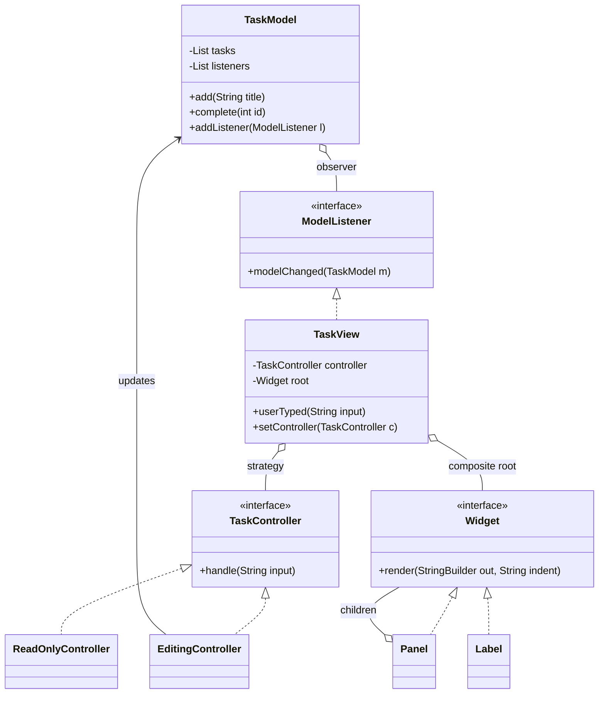

#### Java example

A console to-do app (full code: `code/lld/ch11/mvc/`). `TaskModel` knows only `ModelListener`s. `TaskView` implements `ModelListener`, renders a **composite** of `Widget.Panel`/`Widget.Label`, and forwards input to a swappable `TaskController`; switching to `ReadOnlyController` changes behaviour without touching view or model.

```java
/** MODEL: state + business rules. Knows NOTHING about views or controllers, only listeners. */
public final class TaskModel {
    public void add(String title) {
        if (title.isBlank()) throw new IllegalArgumentException("title must not be blank");
        tasks.add(new Task(nextId++, title, false));
        fireChanged();
    }
    // complete(id) replaces the task with a done copy and fires, or throws "no task <id>"
    private void fireChanged() { listeners.forEach(l -> l.modelChanged(this)); }
}

/** COMPOSITE: the view is a tree of widgets rendered the same way. */
public interface Widget {
    void render(StringBuilder out, String indent);
    record Label(Supplier<String> text) implements Widget { ... }
    record Panel(String title, List<Widget> children) implements Widget {
        public void render(StringBuilder out, String indent) {
            out.append(indent).append("+ ").append(title).append('\n');
            children.forEach(c -> c.render(out, indent + "  "));
        }
    }
}

/** CONTROLLER as a STRATEGY: interprets input and updates the MODEL; it does not redraw anything. */
public void handle(String input) {
    try {
        if (input.startsWith("add ")) model.add(input.substring(4));
        else if (input.startsWith("done ")) model.complete(Integer.parseInt(input.substring(5).trim()));
        else view.showMessage("unknown command: " + input);
    } catch (IllegalArgumentException e) {        // NumberFormatException is a subclass
        view.showMessage("error: " + e.getMessage());
    }
}
// ReadOnlyController.handle: view.showMessage("read-only mode, ignored: " + input)

/** VIEW: observes the model, renders it (composite), forwards user input to its controller (strategy). */
public void userTyped(String input) { System.out.println("> " + input); controller.handle(input); }
@Override public void modelChanged(TaskModel model) {     // Observer callback: re-render from the model
    lastSeen = model;
    StringBuilder out = new StringBuilder();
    root.render(out, "  ");
    System.out.print(out);
}

// Main.java
model.addListener(view);                                   // Observer: model -> view
view.setController(new EditingController(model, view));  // Strategy: view -> controller
```

**Output:**

```text
> add write chapter 11
  + My Tasks
    [ ] 1. write chapter 11
    + Summary
      1 open
> add review diagrams
  + My Tasks
    [ ] 1. write chapter 11
    [ ] 2. review diagrams
    + Summary
      2 open
> done 1
  + My Tasks
    [x] 1. write chapter 11
    [ ] 2. review diagrams
    + Summary
      1 open
> done 42
  (error: no task 42)
-- switching the view to a read-only controller --
> add sneaky task
  (read-only mode, ignored: add sneaky task)
```

#### Trade-offs, variants and mistakes

| Pros | Cons |
|---|---|
| Separation of concerns; business rules testable without UI. | More classes and indirection for tiny apps. |
| Several views on one model (list, chart, widget). | Update flows via observers can be hard to trace. |
| Swap controllers/views independently. | Controllers tend to get "fat" if business logic leaks into them. |

- **Web MVC is different.** In **Spring MVC** (a "Model 2" design) a **front controller** (`DispatcherServlet` — a *servlet* is a Java class handling HTTP requests inside a web server) routes each request to a `@Controller` method, which fills a model and returns a view name; the view renders once per request and does **not** observe the model — no long-lived observer link over HTTP.
- **Relatives:** **MVP** (Model–View–Presenter: a passive view the presenter updates) and **MVVM** (Model–View–ViewModel: the view binds to observable properties of a view-model — Android Jetpack `ViewModel` + `LiveData`/`StateFlow`, WPF). MVVM's view-model also plays a **mediator** role.
- **Common mistakes:** business logic in controllers ("fat controller"); views changing the model directly; models importing UI classes.

#### Real-world examples

Spring MVC, Ruby on Rails, Django (calls it MTV), ASP.NET MVC, Swing (each component has a model, e.g. `JTable` + `TableModel` with `TableModelListener`), iOS UIKit (`UIViewController`), Android (MVVM).

#### In the interview

**30-second answer:** "MVC separates the model — data and rules — from the view that shows it and the controller that interprets input. Head First calls it a compound pattern: the model is an Observer subject for the views, the controller is a Strategy the view delegates to, and the view is a Composite of widgets. On the web, like Spring MVC, it becomes request-driven with a front controller, and the view doesn't observe the model."

**Self-check.** Q: Which three patterns make up MVC? A: Observer, Strategy, Composite. Q: Does the controller redraw the view? A: No — it updates the model, and the model's notification makes the view redraw.

**TL;DR:** **Model** (state + rules, observable) → **View** (composite, observes) → **Controller** (strategy that interprets input).

---

### 11.7.6 Event Sourcing (lite)

#### What it is

**Event Sourcing** stores **every change as an immutable event** ("ItemAdded", "ItemRemoved", "CheckedOut") in an **append-only log** (you can only add at the end, never edit) and derives current state by **replaying** them — instead of storing only the latest state and overwriting it. It is here because it **borrows Command, Memento and Observer ideas at system level** (events look like recorded commands, snapshots are mementos, projections observe the log), and appears in design interviews about carts, wallets, orders and audit trails. Like a bank passbook: the transaction list is the truth; the balance can always be recomputed.

#### The problem it solves

With "update in place" history is lost: you can't answer "what did the cart look like before checkout?", audit who changed what, or rebuild a **read model** (a copy of data shaped for fast queries) after a bug. With events you keep full history and can **time-travel**, **audit**, and **build new views** by replaying.

#### How it works

1. **Command side:** load the aggregate by replaying its events; **validate** the command against current state; if valid, **emit an event** (a fact, past tense).
2. **Append** it to the store — never update or delete events.
3. **Apply**: a **pure function** (output depends only on inputs; changes nothing else) updates state from an event — no validation, no side effects; events are facts.
4. **Read side:** replay (all or the first *n* events) for state at any point; publish events to **observers** building read models (this split is **CQRS** — Command Query Responsibility Segregation).
5. For long streams, periodic **snapshots** (Memento!) and replay only newer events.

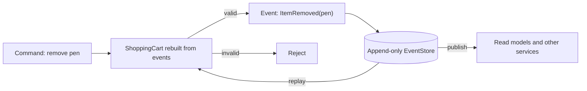

#### Java example

Full code: `code/lld/ch11/eventsourcing/`. A **sealed** `CartEvent` hierarchy; `ShoppingCart.apply` is an exhaustive pattern-matching `switch` (a `switch` *statement* with patterns must be exhaustive in Java 21, so a new event type `apply` forgets is a compile error); `EventStore` is an append-only in-memory log with `synchronized` methods, safe across threads. Prices are `BigDecimal`.

```java
/** Facts that HAPPENED (past tense). Immutable; never updated or deleted. */
public sealed interface CartEvent permits CartEvent.ItemAdded, CartEvent.ItemRemoved, CartEvent.CheckedOut {
    record ItemAdded(String sku, int qty, BigDecimal unitPrice) implements CartEvent {}
    record ItemRemoved(String sku) implements CartEvent {}
    record CheckedOut() implements CartEvent {}
}

/** Append-only log per stream (cart id). The log IS the source of truth. */
public synchronized void append(String streamId, CartEvent e) { streams.computeIfAbsent(streamId, k -> new ArrayList<>()).add(e); }
public synchronized List<CartEvent> read(String streamId) { return List.copyOf(streams.getOrDefault(streamId, List.of())); }

/** ShoppingCart: aggregate whose current state is DERIVED by replaying events. */
public static ShoppingCart replay(List<CartEvent> history, int n) {    // first n events: "time travel"
    ShoppingCart cart = new ShoppingCart();
    history.stream().limit(n).forEach(cart::apply);
    return cart;
}
/** Pure state transition: no validation, no side effects. Events are facts. */
private void apply(CartEvent e) {
    switch (e) {
        case CartEvent.ItemAdded a -> lineTotals.merge(a.sku(), a.unitPrice().multiply(BigDecimal.valueOf(a.qty())), BigDecimal::add);
        case CartEvent.ItemRemoved r -> lineTotals.remove(r.sku());
        case CartEvent.CheckedOut c -> checkedOut = true;
    }
}
/** Command side: validate against current state, THEN emit an event. */
public CartEvent decideRemove(String sku) {
    if (checkedOut) throw new IllegalStateException("cart already checked out");
    if (!lineTotals.containsKey(sku)) throw new IllegalArgumentException(sku + " not in cart");
    return new CartEvent.ItemRemoved(sku);
}

// Main.java
store.append(cartId, new CartEvent.ItemAdded("book", 2, new BigDecimal("12.99")));
store.append(cartId, new CartEvent.ItemAdded("pen", 5, new BigDecimal("0.99")));
ShoppingCart current = ShoppingCart.replay(store.read(cartId), Integer.MAX_VALUE);
store.append(cartId, current.decideRemove("pen"));      // validated, then recorded
store.append(cartId, new CartEvent.CheckedOut());
```

**Output:**

```text
event log:
  ItemAdded[sku=book, qty=2, unitPrice=12.99]
  ItemAdded[sku=pen, qty=5, unitPrice=0.99]
  ItemRemoved[sku=pen]
  CheckedOut[]
state after each event (replay = time travel):
  after 0: [] total=0.00
  after 1: [book] total=25.98
  after 2: [book, pen] total=30.93
  after 3: [book] total=25.98
  after 4: [book] total=25.98 CHECKED-OUT
command rejected: cart already checked out
```

#### Trade-offs, when not to use it, mistakes

| Pros | Cons |
|---|---|
| Complete audit trail and time travel. | More complex than CRUD; a learning curve for the team. |
| Rebuild or add read models at any time. | **Event schema evolution** (versioning old events) is hard. |
| Natural fit with event-driven architectures. | Reads need projections (read models built from events); eventual consistency (the read side catches up after a short delay) between write and read sides. |

- **Don't use it** for simple CRUD without audit or history needs.
- **Common mistakes:** validation in `apply` (replaying old facts may then fail); events named as commands (`RemoveItem` instead of `ItemRemoved`); mutable events; derived data stored inside events; no snapshots for very long streams; **appending without an expected-version check** — two commands decided on the same old state can both append. Real event stores take an `expectedVersion` on append and reject the second writer (optimistic concurrency); the toy `EventStore` omits it.

#### Real-world examples

Bank ledgers and payment systems (balances derived from ledger entries); Git (its history of commits); **Axon Framework** and **EventStoreDB**; Kafka as an event log with long or unlimited **retention** (how long messages are kept) — not *compacted* topics, which keep only the latest record per key and so discard the history event sourcing needs; shopping carts and order histories where "what happened when" matters.

#### In the interview

**30-second answer:** "Event sourcing stores every change as an immutable, past-tense event in an append-only log and derives state by replaying. Commands are validated against the replayed state and then produce events; `apply` just folds events into state. You get audit and time travel, and can build new read models by replaying; the costs are complexity, schema evolution and eventual consistency. Snapshots keep replay fast — that's Memento plus a command log."

**Self-check.** Q: Where does validation happen? A: On the command side, before emitting the event — never in `apply`. Q: How do you keep replay fast? A: Periodic snapshots.

**TL;DR:** **Store facts, not state**; rebuild by replay; validate commands, never events; snapshot long streams.

---

## 11.8 Choose the right behavioral pattern

Start from the **symptom** in the code or requirement, not the pattern name.

| If you see / need... | Use | Not to be confused with |
|---|---|---|
| A request must pass several independent checks; any may reject it; different routes need different checks | **Chain of Responsibility** | Decorator (every layer always runs) |
| Undo/redo, queue, schedule, retry, or log *requested actions* | **Command** | Strategy (how, not what) |
| Evaluate user-written rules/expressions in a small language | **Interpreter** (+ Specification) | Visitor (for many operations over the AST) |
| Walk a collection/tree/paged API without exposing structure | **Iterator** (`Iterable`) | Visitor (what to do at each node) |
| Many objects depend on each other's changes and the *order* of reactions matters | **Mediator** | Observer (no coordination) |
| Roll back to an earlier state without exposing internals | **Memento** | Command undo (store actions instead) |
| One change must notify an open-ended set of independent listeners | **Observer** (or a message broker for durability) | Mediator |
| Three or more methods repeat one `switch` over a status; which actions are legal depends on that status | **State** | Strategy (chosen from outside) |
| Several interchangeable algorithms for one job, chosen by config/user/run time | **Strategy** (often a lambda) | State, Template Method |
| Several classes share a long fixed flow and differ in a few steps | **Template Method** (or template + callbacks) | Strategy |
| Many new operations over a stable set of types | **Visitor**, or **sealed types + pattern matching** in Java 21 | Iterator, Strategy |
| `null` checks everywhere for an optional collaborator | **Null Object** (or `Optional` for lookups) | — |
| Classes create their own collaborators; hard to test | **Dependency Injection** | Service Locator (anti-pattern) |
| Business logic mixed with storage code | **Repository** | DAO (table-oriented) |
| The same business rule duplicated in queries and validation; finder-method explosion | **Specification** | — |
| UI, input handling and business rules tangled together | **MVC / MVVM** | — |
| Need full history, audit, time travel of changes | **Event Sourcing** (+ snapshots) | Plain audit log |

**Three questions that settle the famous look-alikes:**

1. **Do the alternatives reference each other?** Yes → **State**. No → **Strategy** (or Bridge if chosen once at wiring).
2. **Can one participant stop the flow?** Yes → **Chain of Responsibility**. Every participant always runs → **Decorator** / pipeline. Everyone is told, nobody stops anyone → **Observer**.
3. **Does a central object decide what happens next?** Yes → **Mediator**. Each listener decides for itself → **Observer**.

### In the interview (chapter-level)

**"Which patterns have you used in production?"** Pick concrete ones and name the *trade-off*: "Strategy for payment methods, chosen by a map injected by Spring; Observer via Spring events for sending emails after an order, moved to Kafka when we needed retries; State for the order lifecycle, with the DB update guarded by `WHERE status = ?` to avoid races."

**"When would you avoid patterns?"** When only two branches exist and no third is expected; when a lambda or an enum does the job; when the indirection costs more readability than it buys flexibility. Patterns are a vocabulary for trade-offs, not a checklist.

### Self-check (whole chapter)

1. **Q:** An order moves placed → accepted → preparing → delivered and "cancel" is only legal in early stages. Pattern? **A:** State (enum or class per state).
2. **Q:** Checkout must support card, UPI, wallet, and new methods next quarter. Pattern? **A:** Strategy, selected by a factory/DI map.
3. **Q:** After an order is placed, send email, update analytics and notify the restaurant; more reactions will come. Pattern? **A:** Observer in-process, or pub/sub via a broker for reliability.
4. **Q:** A compiler needs type-checking, optimisation and pretty-printing passes over a fixed AST. Pattern? **A:** Visitor, or sealed interfaces + pattern matching in Java 21.
5. **Q:** Three report generators share "load → filter → format → export" but differ in format. Pattern? **A:** Template Method (or a fixed pipeline taking a formatting strategy).
6. **Q:** What three GoF patterns make up MVC? **A:** Observer, Strategy, Composite.

### TL;DR

- **Observer** broadcasts; **Mediator** coordinates; **CoR** lets someone stop the flow.
- **State** vs **Strategy**: same diagram — states know each other and advance themselves; strategies are chosen from outside.
- **Template Method** = inheritance, one step varies; **Strategy** = composition, whole algorithm varies.
- **Visitor** = cheap new operations, expensive new types; Java 21 **sealed + switch** usually replaces it.
- Beyond GoF: **Null Object**, **DI**, **Repository**, **Specification**, **MVC**, **Event Sourcing** — the everyday glue of real systems and machine-coding answers.

---
## 11.9 Architectural patterns, and how they differ from design patterns

A **design pattern** (everything above) arranges a handful of classes to solve one recurring problem inside a program. An **architectural pattern** (also called an **architectural style**) fixes the shape of the whole system: which large parts it has, which part may call or depend on which, and how they communicate (method call, network request or message). Design patterns sit *inside* the parts that an architectural pattern defines. For example, a hexagonal service (§11.9.7) uses Repository (§11.7.3) and Dependency Injection (§11.7.2) inside it.

| | Design pattern | Architectural pattern |
|---|---|---|
| Scope | A few classes | A whole application or system |
| Unit | Class, interface, object | Layer, module, component, service, process |
| Main concern | Responsibility and collaboration between objects | Dependency direction, deployment, communication, data ownership |
| Cost of changing it later | A refactoring of a few files | A re-architecture, often months of work |
| Examples | Strategy, Observer, Repository | Layered, microservices, event-driven, hexagonal |

**Why an LLD interview cares.** Your answer still says where the classes live ("controller, service, repository" or "domain core with ports"), and follow-ups such as "would you split this into microservices?" are architectural.

### 11.9.1 The styles at a glance

| Style | Core idea | Main cost | How it shows up in an LLD answer |
|---|---|---|---|
| **Layered (n-tier)** | Horizontal layers; each depends only on layers below | Domain shaped by storage; features cut through every layer | `Controller -> Service -> Repository` packages |
| **Client-server** | Clients request; a central server owns data and rules | Server is a bottleneck until scaled out | The API boundary: what the server re-validates |
| **Modular monolith** | One deployable split into modules with enforced boundaries | One release train, one shared failure fate | Packages per business capability, interfaces between them |
| **Microservices** | Independently deployable services, each owning its data | Network failures, distributed data, operations | Say where you *would* split and why |
| **Event-driven** | Components react to published events instead of calling each other | Hard to trace; duplicates, ordering, eventual consistency | Observer in-process, a broker between services |
| **Pipe-and-filter** | Data flows through independent transforming steps | Shared state between steps is awkward | `Filter<I, O>` plus composition |
| **Hexagonal / clean** | Domain core in the middle; I/O behind ports and adapters | More interfaces and mapping code | No framework imports in the domain; repository and gateway ports |
| **MVC / MVP / MVVM** | Separate UI state, display and input | Extra classes for small screens | §11.7.5; only the UI edge of a system |

The sections below add one diagram per style and say when to use it. §11.9.9 is one runnable program that combines hexagonal, pipe-and-filter and broker-style event-driven.

### 11.9.2 Layered (n-tier)

**What it is.** Code is split into horizontal **layers**; each layer serves the one above and depends only on layers below it. The usual four are: **presentation** (HTTP controllers, UI), **application** or service (use cases, transactions), **domain** (business rules) and **persistence** or data access (repositories, SQL). A **tier** is a *physical* separation (a separate process or machine), whereas a layer is a *logical* one. "Three-tier" usually means browser, application server and database. **Strict layering** allows calls only to the layer directly below. **Relaxed layering** allows skipping layers, for example a controller reading a repository directly. Relaxed layering is convenient but erodes the structure. The diagram shows the common relaxed form, where the service calls both the domain and the repository.

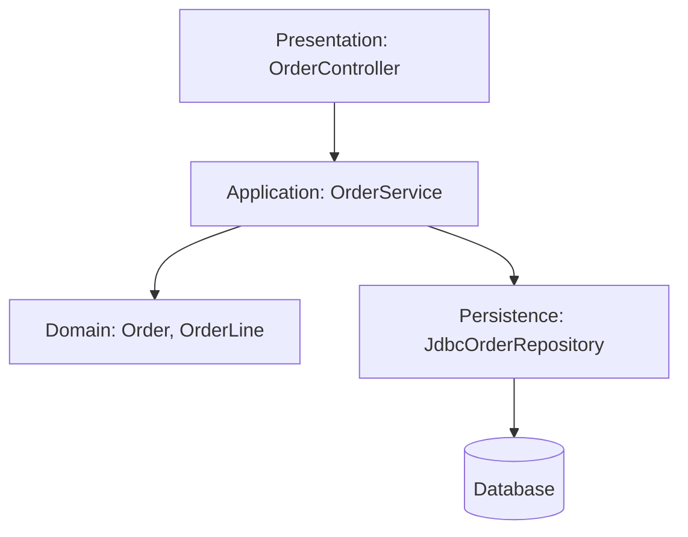

**Use it when** the app is mostly forms over data, the team is new to the domain, or a framework (Spring, Rails, Django) already imposes it.

**Trade-offs.** It is understood by everyone and gives separation of concerns for free. However, the dependency arrow points *down to the database*, so the domain ends up shaped by tables. One feature ("add a discount") touches every layer. And when services only forward calls ("sinkhole" layers), the layers add indirection without value. Hexagonal architecture (§11.9.7) keeps the layers but turns the bottom arrow around.

**In an LLD interview.** This is the default machine-coding layout: `controller` (or `Main`), `service` (use cases), `repository` (interfaces with in-memory implementations), `model` (rules where they belong, never in the controller).

### 11.9.3 Client-server (and peer-to-peer)

**What it is.** A **server** owns a resource (data, computation) and waits for requests. **Clients** start requests and present results. The two communicate through a protocol (HTTP, gRPC, a database wire protocol). The server is the single source of truth and the place where rules are enforced. Never trust validation done only on the client. The contrasting style is **peer-to-peer (P2P)**: every node is both client and server, as in BitTorrent or a blockchain. P2P removes the central bottleneck, but it makes consistency, discovery and trust much harder.

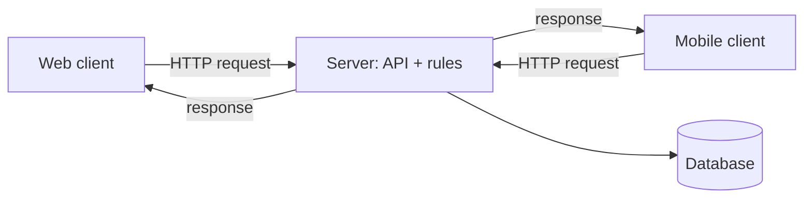

**Use it when** many users share data that needs one authority (almost every business app). P2P is used for file sharing, sync without a central host, and decentralised ledgers.

**Trade-offs.** Central control makes rules, security and backups simple. The server can be scaled out (several instances behind a load balancer), but it is a bottleneck and a failure point until you do so. **Stateless** servers (no per-client memory between requests; session data lives in a token or a shared store) are much easier to scale than stateful ones.

**In an LLD interview.** Client-server mostly appears as the API boundary of the system you design. Examples: "the client sends `bookSeat(showId, seatId)` and the server re-checks availability under a lock", or "the elevator panel is a client of the controller". State which side owns the truth and which side validates.

### 11.9.4 Monolith, modular monolith and microservices

**What they are.** A **monolith** is one deployable unit (one JAR, one process) containing all features. A **modular monolith** is still one deployable, but it is divided into **modules** by business capability (orders, payments, catalogue). Each module exposes a small public interface and hides everything else. Its boundaries are enforced by packages, Java modules (JPMS, the Java Platform Module System) or build rules. **Microservices** split the system into independently deployable services. Each runs in its own process, owns its own database (no other service reads its tables) and talks to the others over the network. The usual split follows a **bounded context**, a domain-driven-design term for a part of the business where words have one consistent meaning.

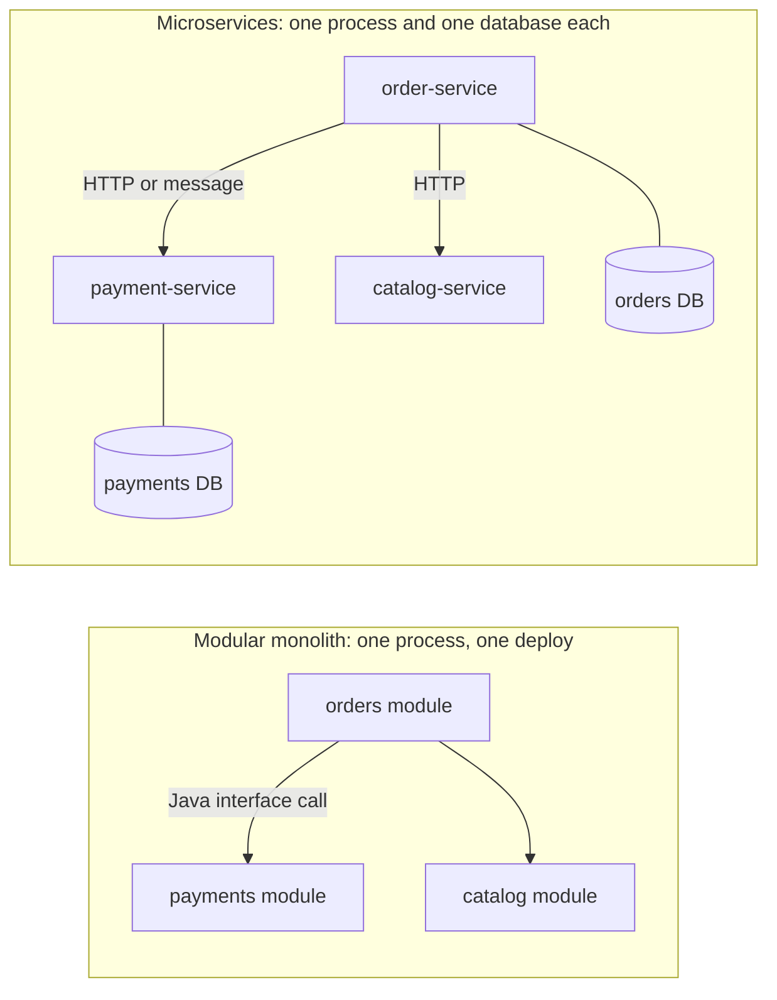

**Use a modular monolith** by default. It gives most of the structural benefit at none of the network cost. **Move a module out into a service** only when you have a concrete reason: a separate team that needs to release independently, very different scaling (a search module needing 50 instances while the rest needs 2), a different technology, or fault isolation.

**Trade-offs of microservices.**
- **Gains:** independent deploys and scaling, smaller codebases per team, and a crash in one service does not take down the others.
- **Costs:** every call can be slow or fail, so you need timeouts, retries and **idempotency** (repeating a request has no extra effect). There are no cross-service database transactions, so a multi-step business action needs a **saga** (a series of local transactions, each with a compensating undo step). You also take on **eventual consistency** (other services see a change after a delay), distributed tracing, and many more deployments to run. A **distributed monolith** is the worst case: services that must be deployed together because they share a database or call each other synchronously in long chains.

**In an LLD interview.** You design one service or a modular monolith. When asked "how would this scale to microservices?", point to your module interfaces (`PaymentGateway`, `NotificationSender`) and say that each could become a network client with the same interface, adding timeouts, retries and idempotency keys. That is the payoff of designing to interfaces.

### 11.9.5 Event-driven architecture: broker vs mediator topology

**What it is.** Components communicate by producing and consuming **events** (immutable facts such as `OrderPaid`) instead of calling each other directly. A producer does not know who consumes its events, so new reactions can be added without touching it. This is Observer (§11.1) lifted to system level. Between processes, a **message broker** (Kafka, RabbitMQ, a cloud queue) stores and delivers the events. Chapter 20 §20.6 designs such a pub-sub system. Event-driven systems come in two **topologies** (shapes of how events flow):

- **Broker topology.** There is no central coordinator. Each consumer subscribes to the events it cares about, does its work and may publish new events, so the flow emerges as a chain. Highly decoupled and scalable, but no single place knows the whole flow, and error handling is spread out. Also called **choreography**.
- **Mediator topology.** A central **mediator** (an orchestrator or workflow engine) receives the initial event and sends ordered commands to each step ("reserve stock", then "charge card", then "ship"). It decides what happens next and handles failures and compensation. The flow is easier to see and control, but the mediator couples to every step and can become a bottleneck. Also called **orchestration**. This is Mediator (§10.4) at system level.

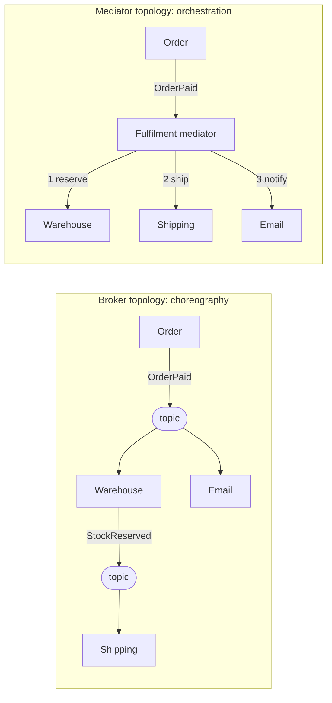

**Use it when** one action has many independent reactions (notifications, analytics, search indexing), when systems must be integrated loosely, or when work should continue after the user gets a response. Choose the **broker** topology for independent reactions, and the **mediator** for a multi-step business process with ordering and compensation, such as order fulfilment or loan approval.

**Trade-offs.**
- **Gains:** loose coupling, easy extension, consumers that scale and fail independently, and a natural audit trail when combined with Event Sourcing (§11.7.6).
- **Costs:** the call flow is invisible in the code. Most brokers deliver **at least once**, so consumers must be idempotent. Ordering is guaranteed only per partition or key. Consumers see changes late (eventual consistency). And you need **dead-letter queues** (where messages that keep failing are parked for inspection).

**In an LLD interview.** In-process, it is an `EventBus` or Observer with typed events. Between services, it is a broker with topics. The §11.9.9 demo is a broker-topology bus behind an `EventPublisher` port. Name the delivery guarantee and the idempotency strategy, for example "consumers keep processed event IDs".

### 11.9.6 Pipe-and-filter

**What it is.** Processing is split into **filters**: independent steps that each take an input, transform, enrich, validate or drop it, and emit an output. Filters are connected by **pipes** that carry each filter's output to the next filter. A filter knows nothing about its neighbours, only the data format on its input and output, so filters can be reordered, reused and tested alone. Pipes can be plain function composition (synchronous), or bounded queues between threads (each filter on its own thread, with **backpressure**, meaning a full queue slows down the producer). Unix shell pipelines (`grep | sort | uniq`), Java Streams, compiler phases and servlet filter chains are all this style.

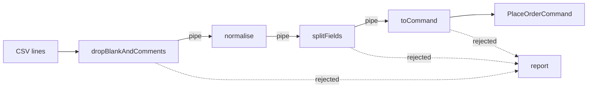

**Use it when** the work is a sequence of transformations on a stream of items: parsing and import, ETL (extract, transform, load), log processing, image or audio processing, request middleware.

**Trade-offs.** Each filter is simple, testable and replaceable, and with queues the stages run in parallel. The costs: steps that need shared context (for example "reject duplicates across lines") need a stateful filter or a side store; interactive request-reply flows fit poorly; and each step adds conversion or queue overhead.

**Versus Chain of Responsibility (§10.1).** In a CoR, each handler may *stop* the request, and usually one handler handles it. In a pipeline, *every* filter normally runs and *transforms* the data, and a rejection is just one possible output. Versus Decorator (§9.4): a decorator wraps one object with the *same* interface, whereas filters may change the data type at each step (`String -> List<String> -> PlaceOrderCommand`).

**In an LLD interview.** It appears in log processors, file-import jobs, request validation, rate-limiter middleware and the logging-framework case in Chapter 20 §20.5. Model it as `interface Filter<I, O>` with a composition method, as in §11.9.9.

### 11.9.7 Hexagonal architecture (ports and adapters) and clean architecture

**What it is.** **Hexagonal architecture** (Alistair Cockburn, 2005) puts the **application core** (domain model plus use cases) in the middle and pushes all I/O to the edge. The core talks to the outside only through **ports**, which are interfaces *owned by the core*. **Adapters** implement or call those ports for one specific technology. There are two kinds of each:

- **Driving (primary, inbound) side.** Something outside *drives* the app: an HTTP controller, a CLI, a CSV importer, a test. The core declares a **driving port** (a use-case interface such as `OrderingUseCase`), and the driving adapter calls it.
- **Driven (secondary, outbound) side.** The app needs something outside: a database, a payment provider, a message broker. The core declares a **driven port** (such as `OrderRepository` or `PaymentGateway`), and a driven adapter implements it.

All source-code dependencies point *inward*. Adapters depend on ports, and the core imports no adapter, framework or I/O class. This is the Dependency Inversion Principle (Chapter 4 §4.10) applied to a whole application. A **composition root** (one place, usually `main` or the DI container's configuration) wires concrete adapters to the core.

**Clean architecture** (Robert C. Martin, 2012) and **onion architecture** (Jeffrey Palermo, 2008) are the same idea drawn as concentric circles: entities, then use cases, then interface adapters, then frameworks and drivers. They share one **dependency rule**: source code may depend only on circles further in. Treat hexagonal, onion and clean as one style with different vocabulary.

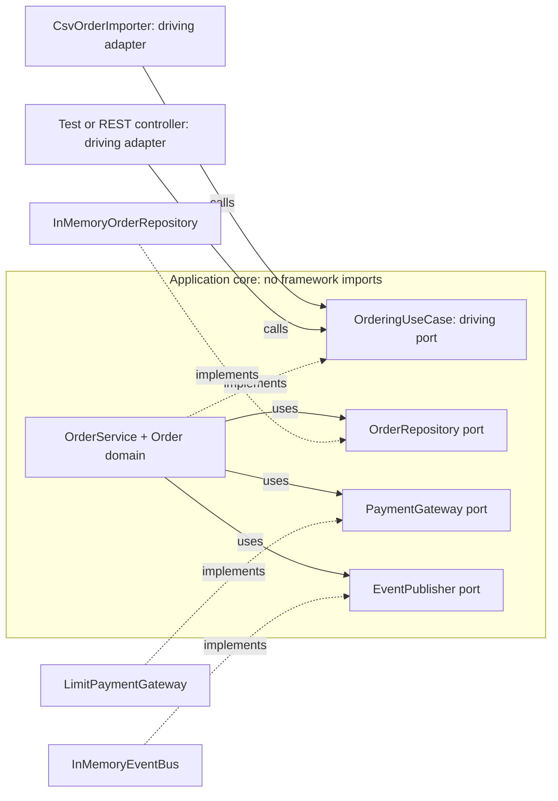

**Use it when** the business rules are valuable and long-lived, when you want fast tests without databases or networks, or when infrastructure is likely to change (swap the database, add a second payment provider, add a gRPC entry point next to REST).

**Trade-offs.**
- **Gains:** the core is testable with in-memory adapters, technology decisions can be postponed or reversed, and every new entry point is just another adapter.
- **Costs:** more interfaces and **mapping code** (converting between adapter types such as JSON or table rows and core types). A trivial CRUD app gains little. Ports designed around one vendor's API ("leaky ports") bring the coupling back.

**Hexagonal vs layered.** Both separate concerns. In layered architecture the domain depends *down* on persistence. In hexagonal, persistence depends *in* on the domain's port, and "top" and "bottom" become simply "driving side" and "driven side".

**In an LLD interview.** This is what a strong machine-coding answer usually *is*, even when unnamed: domain classes with no I/O, `XxxRepository` and `XxxGateway` interfaces, in-memory implementations, and a `Main` that wires them together. Say the name and the dependency rule out loud. It shows that you know why the interfaces exist.

### 11.9.8 Where MVC, MVP and MVVM fit

MVC, MVP and MVVM ([§11.7.5](#1175-mvc--modelviewcontroller-the-head-first-compound-pattern)) are **presentation patterns**: they organise the *UI edge*, not the whole system. In a layered system MVC is the presentation layer (Spring MVC's "model" is often just data for a template; the rules live below). In hexagonal terms a controller, presenter or view-model is a **driving adapter** that turns user gestures into calls on a driving port. So "MVC vs hexagonal" is not a choice: MVC at the edge, hexagonal for the core.

### 11.9.9 Java example: a hexagonal order service fed by a pipe-and-filter importer

One small program shows three styles working together:

- **Hexagonal.** `domain` holds `Order` and its rules. `port` holds the interfaces the core owns: one driving port (`OrderingUseCase`) and four driven ports. `app.OrderService` implements the use case using only ports and domain. `adapter` holds the technology-specific code. `Main` is the composition root. The diagram in §11.9.7 uses these exact names.
- **Pipe-and-filter.** The driving adapter `CsvOrderImporter` parses CSV lines through four `Filter`s composed with `then()`. Syntax errors are dropped by the filters. Business errors (unknown product, declined payment) are decided by the core.
- **Event-driven (broker topology).** The core publishes `OrderPaid` or `PaymentFailed` through the `EventPublisher` port. `InMemoryEventBus` delivers each event to whoever subscribed, so the warehouse, email and audit handlers are unknown to `OrderService`.

The dependency rule can be checked mechanically. No file in `domain`, `port` or `app` imports anything from `adapter` or `pipeline`: `grep -r "architecture.adapter\|architecture.pipeline" domain port app` prints nothing.

Full code: `code/lld/ch11/architecture/` (packages `domain`, `port`, `app`, `adapter`, `pipeline`, plus `Main`). The essential lines:

```java
// domain — pure Java: no imports from ports, adapters, frameworks or I/O.
/** Value object: one priced line of an order. Immutable, compared by value. */
public record OrderLine(String sku, int qty, BigDecimal unitPrice) {
    public OrderLine {
        if (qty <= 0) throw new IllegalArgumentException("quantity must be positive for " + sku);
        if (unitPrice.signum() < 0) throw new IllegalArgumentException("negative price for " + sku);
    }
    public BigDecimal lineTotal() { return unitPrice.multiply(BigDecimal.valueOf(qty)); }
}
public enum OrderStatus { PENDING_PAYMENT, PAID, PAYMENT_FAILED }

public final class Order {   // DOMAIN entity
    /** Factory that enforces the invariant "an order has at least one line". */
    public static Order place(String id, String customerId, List<OrderLine> lines) {
        if (lines.isEmpty()) throw new IllegalArgumentException("an order needs at least one line");
        return new Order(id, customerId, List.copyOf(lines));
    }
    public BigDecimal total() { return lines.stream().map(OrderLine::lineTotal).reduce(BigDecimal.ZERO, BigDecimal::add); }
    public void markPaid() { requirePending(); status = OrderStatus.PAID; }
    public void markPaymentFailed() { requirePending(); status = OrderStatus.PAYMENT_FAILED; }
    ...
}
/** Domain events: facts the core announces. Past tense, immutable. */
public sealed interface OrderEvent permits OrderEvent.OrderPaid, OrderEvent.PaymentFailed {
    String orderId();
    record OrderPaid(String orderId, String customerId, BigDecimal total) implements OrderEvent {}
    record PaymentFailed(String orderId, String customerId, BigDecimal total) implements OrderEvent {}
}
```

```java
// port — interfaces OWNED BY THE CORE.
/** DRIVING (inbound) port: what the outside world may ask the application to do. */
public interface OrderingUseCase {
    OrderReceipt place(PlaceOrderCommand command);
    Optional<OrderReceipt> find(String orderId);
}
/** Input to the driving port. Plain data: no HTTP, CSV or JSON types leak in. */
public record PlaceOrderCommand(String customerId, List<Item> items) {
    public record Item(String sku, int qty) {}
    public PlaceOrderCommand { items = List.copyOf(items); }
}
/** Output: a read-only view, so callers never hold the mutable Order. */
public record OrderReceipt(String orderId, OrderStatus status, BigDecimal total) {}

// DRIVEN (outbound) ports: the core needs these; it does not care how they are implemented.
public interface OrderRepository { void save(Order order); Optional<Order> findById(String id); }
public interface ProductCatalog { Optional<BigDecimal> priceOf(String sku); }      // prices never come from the caller
@FunctionalInterface
public interface PaymentGateway { boolean charge(String customerId, BigDecimal amount); }  // one method: a test can pass a lambda
public interface EventPublisher { void publish(OrderEvent event); }                // the core does not know who listens
```

```java
// app/OrderService.java — APPLICATION core: implements the driving port, uses only driven ports and the domain.
@Override
public OrderReceipt place(PlaceOrderCommand cmd) {
    List<OrderLine> lines = cmd.items().stream()
        .map(i -> new OrderLine(i.sku(), i.qty(), catalog.priceOf(i.sku())
            .orElseThrow(() -> new IllegalArgumentException("unknown product " + i.sku()))))
        .toList();
    Order order = Order.place("o-" + nextId.getAndIncrement(), cmd.customerId(), lines);

    boolean paid = payments.charge(order.customerId(), order.total());
    if (paid) order.markPaid(); else order.markPaymentFailed();
    orders.save(order);
    events.publish(paid
        ? new OrderEvent.OrderPaid(order.id(), order.customerId(), order.total())
        : new OrderEvent.PaymentFailed(order.id(), order.customerId(), order.total()));
    return receiptOf(order);
}
```

```java
// adapter — DRIVEN adapters: InMemoryOrderRepository (ConcurrentHashMap), InMemoryCatalog (fixed price list),
// LimitPaymentGateway (approves charges up to a limit, printing "[payment] charge ... -> approved/declined"), and:
/** A toy BROKER (event-driven, broker topology): publishers and subscribers know only the bus and event types.
 *  Synchronous and in memory; Kafka or RabbitMQ would add durability and async delivery. */
public final class InMemoryEventBus implements EventPublisher {
    private record Subscription<T>(Class<T> type, Consumer<? super T> handler) {
        void offer(Object event) { if (type.isInstance(event)) handler.accept(type.cast(event)); }
    }
    private final List<Subscription<?>> subscriptions = new CopyOnWriteArrayList<>();
    public <T extends OrderEvent> void subscribe(Class<T> type, Consumer<? super T> handler) { subscriptions.add(new Subscription<>(type, handler)); }
    @Override public void publish(OrderEvent event) { subscriptions.forEach(s -> s.offer(event)); }
}
```

```java
// pipeline — what a filter emits: a value for the next filter, or a rejection that ends the run.
public sealed interface Result<T> permits Result.Ok, Result.Rejected {
    record Ok<T>(T value) implements Result<T> {}
    record Rejected<T>(String reason) implements Result<T> {}
}
/** PIPE-AND-FILTER: a filter turns one input into one output (or rejects it). then() is the PIPE.
 *  Filters never call each other directly, so they can be reordered, reused and tested alone. */
@FunctionalInterface
public interface Filter<I, O> {
    Result<O> process(I input);
    static <I, O> Filter<I, O> of(Filter<I, O> filter) { return filter; }
    default <R> Filter<I, R> then(Filter<O, R> next) {
        return input -> switch (process(input)) {
            case Result.Ok<O> ok -> next.process(ok.value());
            case Result.Rejected<O> rejected -> new Result.Rejected<>(rejected.reason());
        };
    }
}

// adapter/CsvOrderImporter.java — DRIVING adapter: CSV lines ("customer, sku:qty, sku:qty") -> calls on the driving port.
// Syntax checks live here; business rules (known products, payment) live in the core.
private static final Filter<String, PlaceOrderCommand> PIPELINE =
    Filter.of(CsvOrderImporter::dropBlankAndComments)   // rejects "blank line" / "comment"
          .then(CsvOrderImporter::normalise)            // strip, lower-case, remove whitespace
          .then(CsvOrderImporter::splitFields)          // rejects "expected a customer and at least one item in '...'"
          .then(CsvOrderImporter::toCommand);           // rejects "bad item '...', expected sku:qty" (qty must match [1-9][0-9]{0,3})
// importLines: Rejected -> "line n dropped by filter: <reason>"; Ok -> ordering.place(cmd), printing the receipt
// or "line n rejected by core: <message>" on IllegalArgumentException.
```

```java
// Main.java — COMPOSITION ROOT: the only class that knows every adapter. It wires them to the core.
var catalog = new InMemoryCatalog(Map.of(
    "book", new BigDecimal("12.99"), "pen", new BigDecimal("0.99"), "lamp", new BigDecimal("89.00")));
var bus = new InMemoryEventBus();
bus.subscribe(OrderEvent.OrderPaid.class, e -> System.out.println("    [warehouse] reserve stock for " + e.orderId()));
bus.subscribe(OrderEvent.OrderPaid.class, e -> System.out.println("    [email] to " + e.customerId() + ": order " + e.orderId() + " confirmed"));
bus.subscribe(OrderEvent.class, e -> System.out.println("    [audit] " + e));

OrderingUseCase ordering = new OrderService(
    new InMemoryOrderRepository(), catalog, new LimitPaymentGateway(new BigDecimal("100.00")), bus);

new CsvOrderImporter(ordering).importLines(List.of(
    "# customer, sku:qty, ...", "  C-1, Book:2,  pen:3", "", "c-2, lamp:2", "c-3, pen:zero", "c-4, kettle:1", "c-5"));
// part 2: ordering.find("o-1"), ordering.find("o-9")
// part 3: swap a driven adapter — same core, a lambda that declines every payment:
OrderingUseCase declining = new OrderService(new InMemoryOrderRepository(), catalog, (customer, amount) -> false, bus);
```

**Output:**

```text
== 1. Driving adapter: CSV -> pipe-and-filter -> port -> core -> events ==
  line 1 dropped by filter: comment
  line 2 -> PlaceOrderCommand[customerId=c-1, items=[Item[sku=book, qty=2], Item[sku=pen, qty=3]]]
    [payment] charge c-1 28.95 -> approved
    [warehouse] reserve stock for o-1
    [email] to c-1: order o-1 confirmed
    [audit] OrderPaid[orderId=o-1, customerId=c-1, total=28.95]
  line 2 receipt: OrderReceipt[orderId=o-1, status=PAID, total=28.95]
  line 3 dropped by filter: blank line
  line 4 -> PlaceOrderCommand[customerId=c-2, items=[Item[sku=lamp, qty=2]]]
    [payment] charge c-2 178.00 -> declined
    [audit] PaymentFailed[orderId=o-2, customerId=c-2, total=178.00]
  line 4 receipt: OrderReceipt[orderId=o-2, status=PAYMENT_FAILED, total=178.00]
  line 5 dropped by filter: bad item 'pen:zero', expected sku:qty
  line 6 -> PlaceOrderCommand[customerId=c-4, items=[Item[sku=kettle, qty=1]]]
  line 6 rejected by core: unknown product kettle
  line 7 dropped by filter: expected a customer and at least one item in 'c-5'
== 2. Another driving adapter (a test) calls the same port ==
  find(o-1) = Optional[OrderReceipt[orderId=o-1, status=PAID, total=28.95]]
  find(o-9) = Optional.empty
== 3. Swap a driven adapter: same core, a lambda that declines every payment ==
    [audit] PaymentFailed[orderId=o-1, customerId=c-9, total=0.99]
  OrderReceipt[orderId=o-1, status=PAYMENT_FAILED, total=0.99]
```

**What to notice.**

- **Validation is split by responsibility.** `pen:zero` never reaches the core, because a pipe-and-filter step rejects bad syntax. `kettle` is syntactically fine but is rejected by the core, because only the catalogue knows which products exist. Prices come from the `ProductCatalog` port, never from the caller.
- **The core is unchanged when adapters change.** Part 3 replaces the payment adapter with a one-line lambda. That is how a unit test runs the core without a payment provider.
- **The bus is the broker topology.** `OrderService` publishes one event, and three independent handlers react. Adding an SMS handler is one `subscribe` call in `Main`.
- **Concurrency and production gaps.** The repository (`ConcurrentHashMap`), the bus (`CopyOnWriteArrayList`) and the ID counter (`AtomicLong`) are thread-safe one call at a time. `place` itself is not atomic, however: it charges, then saves, then publishes. A crash after the charge but before the save loses the order. Production code would save the order as `PENDING_PAYMENT` first, call the gateway with an **idempotency key** (the order ID) so that a retry cannot charge twice, and publish events through an **outbox** (events written in the same database transaction as the order and relayed to the broker afterwards). The bus is also synchronous: a slow handler slows down `place`. A real broker delivers asynchronously and at least once.

### In the interview (architectural patterns)

**"What architecture would you use?"** A strong 30-second answer: "A modular monolith with a hexagonal core: the domain and use cases have no framework imports, and repositories, payment and notifications sit behind ports with in-memory adapters, so the design is testable now and each adapter can later become a network client. Inside, side effects such as email and analytics hang off domain events on an event bus, broker style. If one capability needs to scale or ship independently, its module boundary is already the future service boundary."

**Common follow-ups** (answers in the sections above): layered or hexagonal (§11.9.7), why not microservices from day one (§11.9.4), choreography or orchestration (§11.9.5), pipeline or chain of responsibility (§11.9.6).

**Mistakes to avoid:** naming an architecture without saying the trade-off; drawing microservices for a 90-minute machine-coding problem; letting framework annotations or SQL types into domain classes; ports shaped like one vendor's API; events named as commands (`SendEmail` instead of `OrderPaid`).

### Self-check (architectural patterns)

1. **Q:** What is the difference between a layer and a tier? **A:** A layer is a logical code separation. A tier is a physical one (a separate process or machine).
2. **Q:** In hexagonal architecture, who owns `OrderRepository`, and who implements it? **A:** The core owns the port. A driven adapter (in-memory, JDBC) implements it.
3. **Q:** A loan application must pass a credit check, then a fraud check, then manual approval, and a rejection must undo earlier steps. Broker or mediator topology? **A:** Mediator (orchestration), because there is ordering plus compensation.
4. **Q:** Why should most new systems start as a modular monolith? **A:** You get enforced boundaries without network failures, distributed transactions or operations overhead. Services can be extracted later along the module boundaries.
5. **Q:** How do MVC and hexagonal relate? **A:** MVC organises the UI edge. Its controller is a driving adapter of the hexagonal core, so the two are complementary.
6. **Q:** In §11.9.9, why is `pen:zero` rejected by a filter but `kettle` by the core? **A:** The first is a syntax error, an adapter concern. The second is a business rule (a known product), a core concern.

### TL;DR

- **Design patterns** arrange classes. **Architectural patterns** arrange the whole system: its parts, dependency directions and communication.
- **Layered:** controller, then service, then repository; simple, but the domain depends on storage. **Client-server:** the server owns the truth and the validation.
- **Modular monolith first**, microservices only for team, scaling or isolation reasons. Microservices cost network failures, sagas and eventual consistency.
- **Event-driven:** a **broker** (choreography) for independent reactions, a **mediator** (orchestration) for ordered processes. Consumers must be idempotent.
- **Pipe-and-filter:** independent transforming steps joined by pipes, where every step runs. In a chain of responsibility, any handler may stop the request.
- **Hexagonal / clean / onion:** a core with ports, technology in adapters, and dependencies pointing inward (DIP at system scale). MVC/MVP/MVVM (§11.7.5) are driving adapters at the UI edge.
