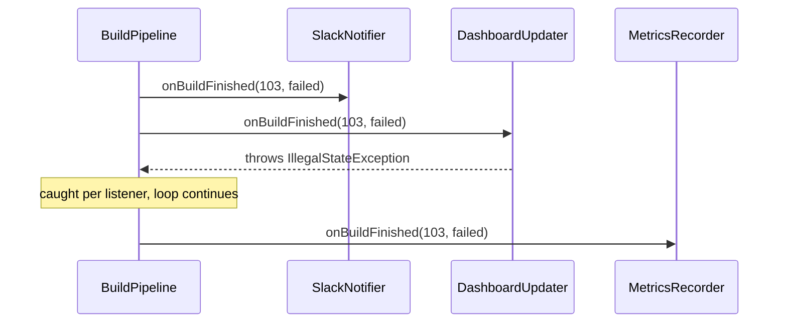
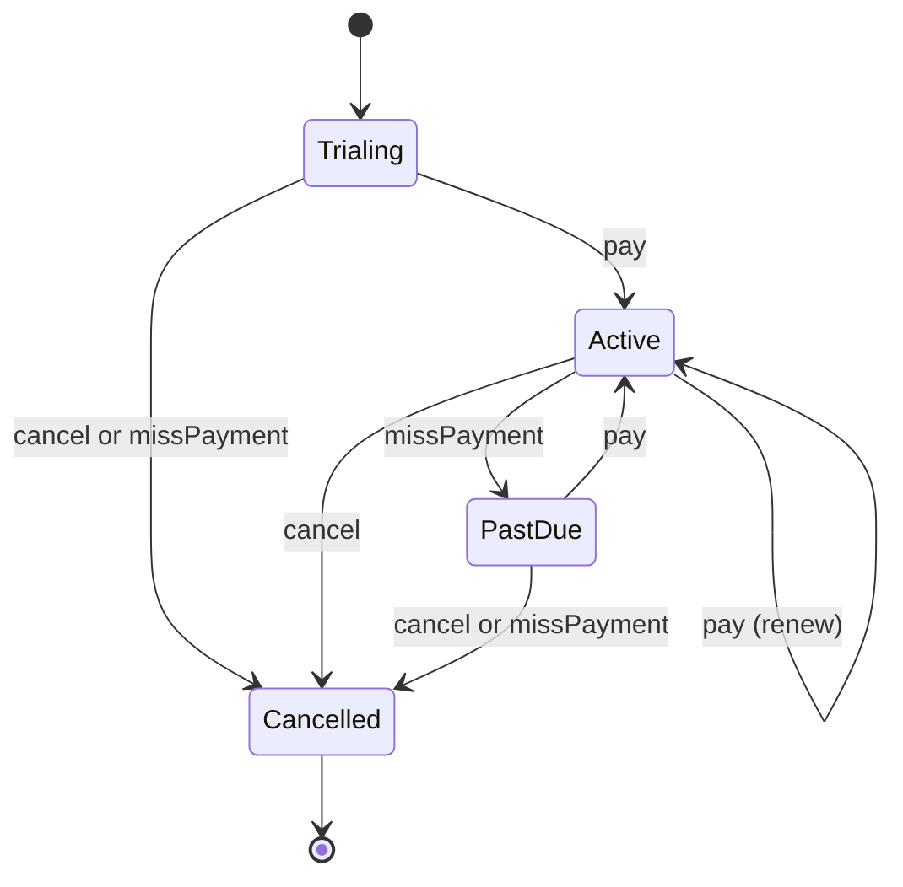
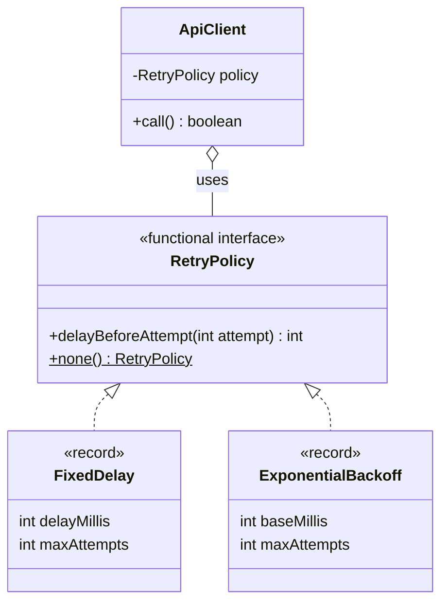
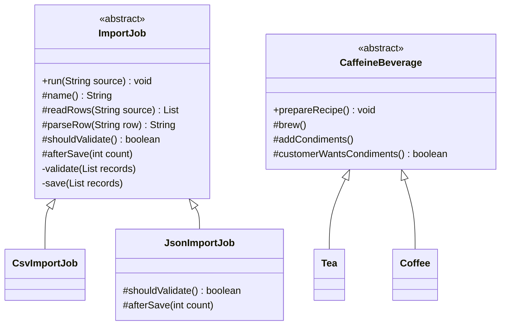
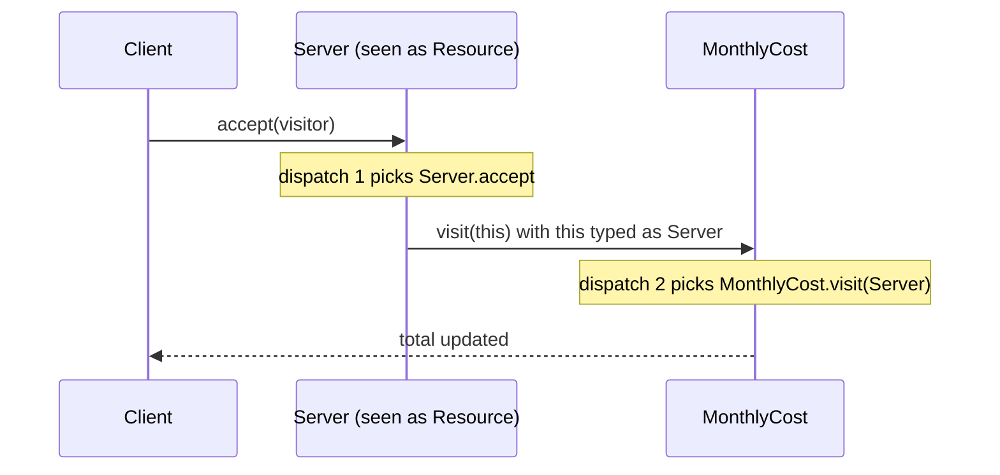
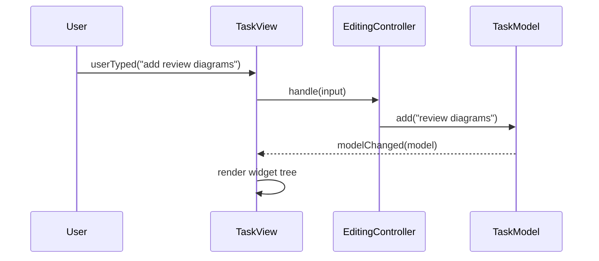
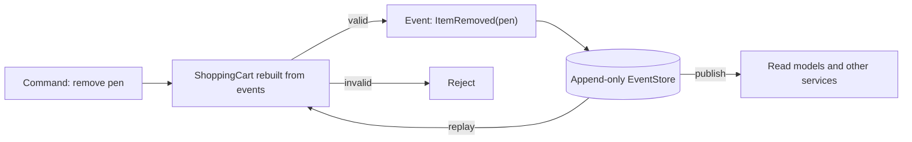
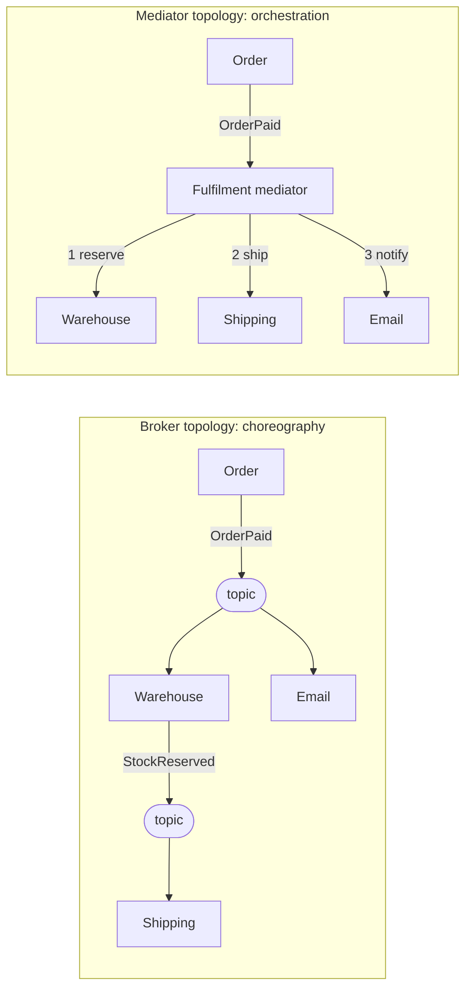
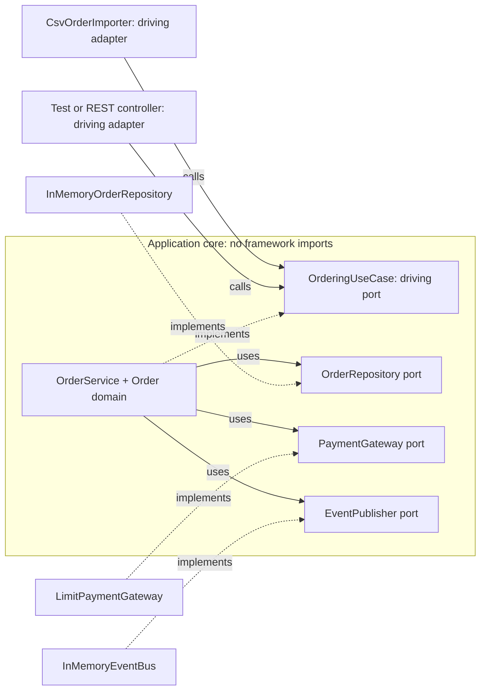

# Chapter 11 — Behavioral Design Patterns (Part 2) & Beyond GoF · Study Edition

> **Study edition.** Every topic of the full chapter, with the padding removed. For complete code listings, full outputs and extra follow-ups, see the Full Edition (`README.md`).
>
> **What you will learn.** The remaining five GoF behavioral patterns — **Observer, State, Strategy, Template Method, Visitor** — and how to tell apart the three that share one diagram (Strategy, State, Bridge). Then six non-GoF patterns interviews expect: **Null Object, Dependency Injection, Repository, Specification, MVC** and **Event Sourcing (lite)**, a "which pattern do I need?" table, and finally the **architectural patterns** (layered, client-server, modular monolith vs microservices, event-driven, pipe-and-filter, hexagonal/clean).

**How to run the code**

```bash
cd chapters/11-patterns-behavioral-2/code
javac --release 21 -Xlint:all -d /tmp/lld_11 $(find . -name '*.java')   # compiles with 0 warnings
java -cp /tmp/lld_11 lld.ch11.observer.Main
# also: state, strategy, templatemethod, visitor, nullobject, di, repository, specification, mvc, eventsourcing, architecture
```

The idea running through this chapter: most of these patterns turn a conditional (`if`/`switch`) or a hard-coded call into an **object** that can be swapped, subscribed, or visited.

---

## 11.1 Observer

### What it is

**Observer** lets one object (the **subject** / publisher) notify many dependants (the **observers** / subscribers / listeners) when something happens — **without knowing who they are or what they do**. Analogy: subscribers to a YouTube channel get notified of each new video; the channel doesn't care what they do with it.

**GoF intent:** a one-to-many dependency so that when one object changes, all its dependants are notified and update automatically.

| Participant | Role | In `lld.ch11.observer` |
|---|---|---|
| **Subject** | Knows its observers; attach/detach | `BuildPipeline` (`addListener` returns an unsubscribe handle) |
| **Observer** | The update interface | `BuildListener` |
| **ConcreteSubject** | Holds the state; notifies on change | `BuildPipeline` (one class plays both in modern Java) |
| **ConcreteObserver** | Implements the update | `SlackNotifier`, `DashboardUpdater`, `MetricsRecorder`, `DeployTrigger` |

### The problem it solves

A build pipeline calling Slack, dashboard, metrics and deployer directly depends on a chat service, must be edited for each new reaction, needs four fakes to test, and needs flags to disable deploy in staging. Observer replaces four references with **one list of one interface**. **The source only announces; every listener chooses its own reaction.**

### How it works

An **observer interface** with one method; the **subject** keeps a list with subscribe/unsubscribe; on change it **finishes updating its state first**, then calls each observer; observers come and go at run time.

**Push vs pull:**

| | Push | Pull |
|---|---|---|
| Observer receives | All the data (e.g. a `Reading`) | "I changed" + a subject reference |
| Pros | Simple; no dependence on subject getters | Takes only what it needs; interface stable as data grows |
| Cons | Sends unneeded data; interface grows with data | Couples observers to the subject; must work out *what* changed |

### Structure (UML)


*Figure — BuildPipeline holds a list of BuildListener; four concrete listeners implement it (course diagram)*

Dependencies run one way: listeners never call the pipeline back.



### Java example

`lld.ch11.observer` shows the **build pipeline** (a `CopyOnWriteArrayList` iterates a snapshot, so unsubscribing mid-loop is safe; exceptions caught per listener; `addListener` returns an unsubscribe handle), **push vs pull** (`WeatherStation`), a tiny typed **`EventBus`** (synchronous, stores nothing — not a queue), and JDK **`PropertyChangeSupport`**, which doesn't fire when old and new values are equal.

```java
// File: code/lld/ch11/observer/BuildListener.java
@FunctionalInterface
public interface BuildListener {
    void onBuildFinished(int buildNumber, String result);
}

// File: code/lld/ch11/observer/BuildPipeline.java
public final class BuildPipeline {
    // CopyOnWriteArrayList iterates over a snapshot: a listener that unsubscribes
    // itself mid-notification cannot break the loop, and it is safe across threads.
    private final List<BuildListener> listeners = new CopyOnWriteArrayList<>();

    /** Returns a handle: whoever subscribes owns the matching unsubscribe (prevents leaks). */
    public Runnable addListener(BuildListener listener) {
        listeners.add(listener);
        return () -> listeners.remove(listener);
    }

    public void finish(int buildNumber, String result) {
        System.out.println("Build " + buildNumber + " finished: " + result);
        for (BuildListener l : listeners) {
            try {
                l.onBuildFinished(buildNumber, result);
            } catch (RuntimeException e) {          // one bad listener must not starve the rest
                System.out.println("  [pipeline] a listener failed: " + e.getMessage());
            }
        }
    }
}
```

In the output, build 103's dashboard listener throws (`a listener failed: dashboard is offline`) and metrics still records it.

Full runnable code: code/lld/ch11/observer/ (see the Full Edition).

### Why `java.util.Observer` / `Observable` were deprecated

Deprecated since **Java 9**: limited event model, **unspecified order**, notifications not one-for-one with changes; plus `Observable` is a **class** (uses up inheritance), `setChanged()` is protected, `update` is untyped, thread safety is partial. Use instead: `java.beans.PropertyChangeSupport`, your own typed listener interface, `java.util.concurrent` queues, or **`java.util.concurrent.Flow`** (reactive streams with back-pressure).

### Trade-offs

| Pros | Cons |
|---|---|
| Source doesn't depend on reactions; add/remove at run time. | Hard to trace; **memory leaks** if never unsubscribed. |
| Each reaction testable (Open/Closed). | **No ordering/delivery guarantee**; as slow as all listeners combined. |

### Observer vs Mediator, Chain of Responsibility, callbacks

| Looks like | The actual difference |
|---|---|
| **Mediator** | Observer broadcasts one way and each listener decides; a mediator decides what happens next, calls components back (two-way) and owns ordering. |
| **Pub-sub with a broker** | Same idea plus persistence, redelivery, ordering and a network hop. |
| **Chain of Responsibility** | Observer informs **all**; a chain stops at the first handler that accepts. |
| **A callback** | One callback is one observer; it becomes the pattern when listeners vary at run time. |

Outside Java (JS `EventEmitter`, Python callables, C# `event`), **weak references** (e.g. `weakref.WeakSet`) fix leaks at the cost of listeners vanishing when unreferenced.

### When not to use it

One listener forever (call it); you need ordering or guaranteed delivery (use Kafka/RabbitMQ/SQS); slow reactions (notify asynchronously); the flow must be easily traceable.

### Common mistakes (the four classic ways observers go wrong, plus one)

1. **No unsubscribe → memory leak** — every `add` needs an owner for its `remove`.
2. **A throwing listener kills the loop** — catch per listener.
3. **Changing the list during notification** → `ConcurrentModificationException`; iterate a copy.
4. **Listeners calling back into the subject** → cycles/recursion.
5. **Notifying before state is updated** → pull observers read stale data.
6. **Relying on notification order** — if order matters, that's a Mediator.

### Real-world examples

UI listeners (Swing, DOM `addEventListener`); JDK `PropertyChangeListener`, `Flow`; Spring `@EventListener`; Guava `EventBus`, RxJava/Reactor; MVC model→view; Kafka/SNS pub-sub at system scale; CDC (Debezium).

### In the interview

**30-second answer:** "Observer swaps hard-coded calls for a list of objects sharing one listener interface. The subject says 'this happened' and each observer picks its own response, so reactions plug in and out and are tested alone, and the subject depends on none of them. In production I iterate over a copy of the list, catch exceptions per listener, and pair every subscribe with an unsubscribe. When I need durability, retries or ordering I use a message broker."

- *Observer vs Pub/Sub?* In Observer the subject holds observers directly; in pub/sub a broker sits between, adding durability and retries.

### Self-check

1. **Q:** What does the subject know about observers? **A:** Only that they implement the interface.
2. **Q:** Classic Observer leak? **A:** Never-removed listeners stay strongly referenced.
3. **Q:** What replaces `Observable`? **A:** `PropertyChangeSupport`, a typed listener interface, or `Flow`.

### TL;DR

One subject, a list of listeners, one-way notification. **Iterate a copy, catch per listener, always unsubscribe.** `Observable` is deprecated; use a broker when you need guarantees.

---

## 11.2 State


*Figure — Top: the same four-branch status check in every method. Bottom: each state is a class; transitions form a graph (course diagram)*

### What it is

**State** (GoF): when an object's internal condition changes, **its behaviour changes**, as if it changed class. Instead of every method testing a status field, the object forwards each action to a **state object** and swaps it when the condition changes. Analogy: a phone's ring/vibrate/silent mode.

| Participant | Role | In `lld.ch11.state` |
|---|---|---|
| **Context** | Holds current state; forwards requests | `Subscription`, `VendingMachine` |
| **State** | One method per forwarded request | `SubscriptionState`, `VendingState` |
| **ConcreteState** | Behaviour for one state | `Trialing`, `Active`, `PastDue`, `Cancelled`; `Idle`, `HasMoney`, `SoldOut` |

GoF leaves open who performs transitions; letting states choose successors (as here) is flexible but makes states know each other.

### The problem it solves

A subscription goes **trialing → active → past due → cancelled**; naively every method repeats the same four-way `if (status == ...)` chain — a fifth state means hunting every copy, and a **forgotten branch** silently does nothing. With State, **each state is a class**, context methods shrink to one line, and one state's rules live in one file.

### How it works

A **State interface** has one method per action (every state answers every action, even "no"); the **context** delegates (`state.pay(this)`); each state rules on **legality** and the **successor** (`context.setState(new Active())`); terminal states refuse everything in one place.

**States choose their own successors** — the key difference from Strategy.

### Structure (UML)


*Figure — Subscription (context) holds a SubscriptionState; the four states call setState on the context (course diagram)*



(The vending machine runs Idle → HasMoney → Idle or SoldOut; the traffic light RED → GREEN → YELLOW → RED.)

### Java example

Three styles: (1) **class per state** — sealed interface, field-less `record` states; (2) **enum machine** (`TrafficLight`) — the idiomatic Java answer for small machines; (3) **vending machine** — **default methods that refuse**, so each state overrides only what it allows (`SoldOut` overrides nothing), and business actions live in the **context**.

```java
// File: code/lld/ch11/state/SubscriptionState.java
public sealed interface SubscriptionState permits Trialing, Active, PastDue, Cancelled {
    String name();
    void pay(Subscription s);
    void missPayment(Subscription s);
    void cancel(Subscription s);
}

// File: code/lld/ch11/state/Trialing.java
public record Trialing() implements SubscriptionState {
    public String name() { return "trialing"; }
    public void pay(Subscription s) {
        System.out.println("  [trialing] first payment taken");
        s.setState(new Active());                     // the state chooses its successor
    }
    public void missPayment(Subscription s) {
        System.out.println("  [trialing] trial ended unpaid");
        s.setState(new Cancelled());
    }
    public void cancel(Subscription s) { s.setState(new Cancelled()); }
}

// File: code/lld/ch11/state/Subscription.java
public final class Subscription {
    private SubscriptionState state = new Trialing();

    void setState(SubscriptionState next) {
        System.out.println("    " + state.name() + " -> " + next.name());
        state = next;
    }
    // ... status()

    public void pay()         { state.pay(this); }
    public void missPayment() { state.missPayment(this); }
    public void cancel()      { state.cancel(this); }
}

// File: code/lld/ch11/state/TrafficLight.java — each constant overrides next()
    RED(30) {
        TrafficLight next() { return GREEN; }
        boolean pedestriansMayCross() { return true; }
    },
    // ... GREEN -> YELLOW, YELLOW -> RED
```

In the output, paying after cancellation prints `[cancelled] refused: no payments after cancellation` — an **illegal action** refused the same way every time, by code in one file.

Full runnable code: code/lld/ch11/state/ (see the Full Edition).

### State vs Strategy (and Bridge) — same diagram, different reasons

| | State | Strategy | Bridge |
|---|---|---|---|
| Who chooses the object | The **states** themselves | The **caller** | Once at construction/config |
| How often it changes | Repeatedly | Once, sometimes per call | Effectively never |
| Alternatives reference each other? | **Yes** | **No** | No |
| What varies | Current *condition* and allowed actions | *How* one job is done | A whole design dimension |
| Why it exists | Model a lifecycle | Make an algorithm replaceable | Stop two hierarchies multiplying |

**Naming test: do the alternatives name each other?** Yes → State. No → Strategy (or Bridge, if the choice never changes).

Also: **an enum plus one `switch`** is often the better answer below three repeated switches; **state-machine libraries** (Spring Statemachine, XState) express it as data past about a dozen states.

### Trade-offs

| Pros | Cons |
|---|---|
| One state's rules in one file; no branch missed. | More classes; transitions spread over files. |
| Illegal actions rejected consistently. | Persisting needs one name↔class mapping. |

### When not to use it

Two states and few methods (a boolean); only data differs (a field); a big formal machine (a transition table `Map<(state,event),handler>` or Spring Statemachine). Rule of thumb: pays off once **three or more methods repeat the same status switch**. If you keep sketching the machine on paper to follow your code, make that sketch (a table) the source of truth.

### Common mistakes

1. Successors hard-coded everywhere at 12+ states (move to a table).
2. Business logic in state classes (states rule on legality and successor only).
3. Illegal actions that silently do nothing.
4. Storing state objects in the DB — store a name/enum.
5. Sharing *stateful* state objects between contexts.

### State in other languages

Java: enum or `sealed` + exhaustive `switch`. Kotlin/Scala: sealed + exhaustive `when`/`match`. Rust: enums and **typestate** (illegal calls don't compile). Python: a `(state, action)` → handler dict. TypeScript: discriminated unions.

### Real-world examples

Order lifecycles; Stripe subscription statuses; **TCP connections** (GoF's example); approval workflows; vending machines, ATMs, elevators. (`Thread.State` is an enum of states, not the pattern.)

### In the interview

**30-second answer:** "State swaps a status field and its repeated switches for one class per state. The context forwards each action to its current state object, which decides if it's legal and which state follows. Each state's rules sit in one file and illegal actions are refused consistently. It draws like Strategy, but states name each other and advance the machine themselves, while strategies are picked from outside. For small Java machines I'd use an enum or a sealed interface."

- *Persist it?* Store the state name/enum; rebuild via one mapping.
- *Concurrency?* Racing "cancel" and "deliver": lock, or optimistic `UPDATE ... WHERE status = 'PLACED'` and check the row count.

### Self-check

1. **Q:** Who changes the current state? **A:** The state objects, via the context's `setState`.
2. **Q:** The naming test? **A:** Alternatives reference each other → State; never → Strategy/Bridge.
3. **Q:** What belongs in the context, not the state? **A:** Business actions and data (dispensing, inventory).

### TL;DR

**A class per state; the context forwards; each state picks its successor.** Same diagram as Strategy, but states **know each other**. Enums for small machines, tables/libraries for big ones.

---

## 11.3 Strategy

### What it is

**Strategy** (GoF): define a **family** of algorithms, put each in its own class behind a **common interface**, and make them interchangeable, so the algorithm varies independently of the code using it — often chosen at run time. The **context** never branches on which algorithm it holds. Analogy: getting to the airport by car, train or taxi — same goal, different algorithm.

| Participant | Role | In `lld.ch11.strategy` |
|---|---|---|
| **Strategy** | Interface all algorithms share | `RetryPolicy` (also `Comparator`) |
| **ConcreteStrategy** | One per algorithm | `FixedDelay`, `ExponentialBackoff`, the `RetryPolicy.none()` lambda (course: `NoRetry`) |
| **Context** | Configured with a strategy; delegates | `ApiClient` |

### The problem it solves

Retry = none, fixed delay, or exponential backoff. An `if (policy == ...)` chain puts backoff maths in the API client, needs edits per policy, and can't be tested alone. With Strategy, `ApiClient` asks "how long before the next attempt?" and **never checks which policy it holds**; the choice is made **outside** (config, feature toggle, customer setting).

### How it works

A small **strategy interface** (one question: `delayBeforeAttempt(attempt)`); one **concrete strategy** per algorithm; the **context** receives one and calls it; a **factory, config or DI container** chooses — not every call site.

### Structure (UML)


*Figure — ApiClient holds a RetryPolicy; NoRetry, FixedDelay and ExponentialBackoff implement it (course diagram)*

**No strategy references another** — that absence tells Strategy from State.



### Java example

Retry policies (`none()` is a lambda; configured ones are **records**), **`Comparator`** composition (`comparing(...).reversed().thenComparing(...)`), and a **registry** `Map` of lambdas chosen by config key.

```java
// File: code/lld/ch11/strategy/RetryPolicy.java
@FunctionalInterface
public interface RetryPolicy {
    int STOP = -1;

    int delayBeforeAttempt(int attempt);

    static RetryPolicy none() { return attempt -> STOP; }
}

// File: code/lld/ch11/strategy/ExponentialBackoff.java
public record ExponentialBackoff(int baseMillis, int maxAttempts) implements RetryPolicy {
    public int delayBeforeAttempt(int attempt) {
        return attempt > maxAttempts ? STOP : baseMillis << (attempt - 2);
    }
}

// File: code/lld/ch11/strategy/ApiClient.java
    public boolean call() {
        for (int attempt = 1; ; attempt++) {
            if (server.test(attempt)) {
                System.out.println("  attempt " + attempt + ": ok");
                return true;
            }
            int delay = policy.delayBeforeAttempt(attempt + 1);
            if (delay == RetryPolicy.STOP) {
                System.out.println("  attempt " + attempt + ": failed, giving up");
                return false;
            }
            System.out.println("  attempt " + attempt + ": failed, waiting " + delay + "ms");  // simulated, no sleep
        }
    }
```

Against a server that is always down, `ExponentialBackoff(100, 4)` waits 100, 200, 400 ms and then gives up. Adding jitter or `Retry-After` support is one more class or lambda; `ApiClient` doesn't change.

Full runnable code: code/lld/ch11/strategy/ (see the Full Edition).

### Lambdas as strategies

Strategy is the pattern a plain function replaces most often. Any **functional interface** (one abstract method) — `Comparator`, `Function`, `Predicate`, your `RetryPolicy` — can take a lambda. Keep a named class/record when the strategy has **configuration or state**, needs a **name for logging**, or must be **discovered/registered** (Spring beans, `ServiceLoader`). Other languages: pass a function (Python dict of functions as a registry; Go one-method interface or `func` field). Money in strategies stays `BigDecimal`, never `double`.

### Trade-offs

| Pros | Cons |
|---|---|
| New variants without editing working code; each testable alone. | One class per variant; someone must choose. |
| Configurable at run time; context keeps to its job. | Interface must fit all variants; overused for one-liners. |

### When not to use it

Two branches with no third in sight (an `if`); one-line branches (a map of lambdas); variants needing different inputs (forced interface — rethink); a choice fixed for the program's life (decide at wiring, or Bridge).

### Common mistakes

1. Every call site choosing — the branch moved instead of disappearing.
2. Bloated interface with parameters half the implementations ignore.
3. Strategies that know each other — that's State.
4. Stateful strategies shared between threads — keep them immutable.

### Real-world examples

`Comparator`; `RejectedExecutionHandler` (`AbortPolicy`, `CallerRunsPolicy`, ...); Spring `PasswordEncoder`; Resilience4j/Polly retry intervals; AWT `LayoutManager`; payment methods, tier pricing, map route modes.

### In the interview

**30-second answer:** "Strategy gives every variant of one job its own class behind a common interface, and something outside — usually a factory or config — picks it at run time. The context stops branching: my API client asks its retry policy how long to wait and never which policy it is. Each algorithm is testable alone and new ones don't touch working code. In Java a lambda is often enough, like a `Comparator`; I keep a class when it has configuration. It shares its diagram with State, but strategies never reference each other."

- *vs Template Method?* Template Method swaps **one step** via **inheritance** (fixed at creation); Strategy swaps **the whole algorithm** via **composition** (run time, several axes). Prefer Strategy when both fit.
- *Selection?* Config + factory `Map<String, Strategy>`, DI (Spring can inject a `Map` of beans), or per request.

### Self-check

1. **Q:** Who chooses the strategy? **A:** Something outside the context — factory/config/DI.
2. **Q:** Why can `RetryPolicy.none()` be a lambda? **A:** `RetryPolicy` is a functional interface.
3. **Q:** Two JDK strategies? **A:** `Comparator`, `RejectedExecutionHandler` (also `LayoutManager`).

### TL;DR

**Interchangeable algorithms behind one interface, chosen from outside.** The context stops branching. Lambdas for one-liners, records when configured. Not State (states know each other), not Template Method (inheritance, one step).

---

## 11.4 Template Method


*Figure — ImportJob with final run(), abstract steps, hook shouldValidate and private save; CsvImportJob and JsonImportJob override only what differs (course diagram)*

### What it is

**Template Method** (GoF): put an **algorithm's outline** in one base-class method (the *template method*) and let **subclasses** fill in certain steps without changing the sequence.

| Participant | Role | In `lld.ch11.templatemethod` |
|---|---|---|
| **AbstractClass** | Declares the steps; implements the template method calling them in order | `ImportJob`, `CaffeineBeverage` |
| **ConcreteClass** | Implements the steps that differ | `CsvImportJob`, `JsonImportJob`, `Tea`, `Coffee` |

Analogy: a recipe card with blanks — "boil water → brew ___ → pour → add ___ (if wanted)".

### The problem it solves

An import job always reads, parses, validates, saves, reports; only reading and parsing differ for CSV vs JSON. Copying the flow per class means a change (say, an audit record) touches every copy. Template Method writes the flow once in a **`final`** method; varying steps are methods subclasses supply.

### How it works

1. Write the **template method** in an abstract class, **`final`** so the order is guaranteed.
2. It calls three kinds of steps: **required (abstract)** — compiler-enforced; **hooks** — a default (often empty or `true`) subclasses *may* override, e.g. `shouldValidate()`; **shared** — `private`, unchangeable.
3. Each subclass implements only what differs.

**Hollywood Principle — "Don't call us, we'll call you"** (*Head First*): the base class decides **when** subclass methods run. This inversion of control is the backbone of frameworks — the framework runs the sequence, you supply pieces.

### Structure (UML)

A subclass alone doesn't reveal the sequence it follows — only the parent does. That is the trade-off.



`run()` and `prepareRecipe()` are `final` in code (Mermaid has no marker for it).

### Java example

**Import jobs** (`JsonImportJob` overrides both hooks) and *Head First*'s **beverages**, where `Coffee(black = true)` switches off condiments via a hook.

```java
// File: code/lld/ch11/templatemethod/ImportJob.java
public abstract class ImportJob {

    /** Template method. Marked final: subclasses cannot change the order, drop a step or insert one. */
    public final void run(String source) {
        System.out.println("Running the " + name() + " import:");
        List<String> rows = readRows(source);                 // required step
        List<String> records = new ArrayList<>();
        for (String row : rows) records.add(parseRow(row));   // required step
        System.out.println("  parsed " + records.size() + " records: " + records);
        if (shouldValidate()) {                               // hook
            validate(records);
        } else {
            System.out.println("  skipping validation, source is validated upstream");
        }
        save(records);                                        // shared, fixed
        afterSave(records.size());                            // hook with an empty default
        System.out.println("  done");
    }

    // Required steps: the compiler forces every subclass to supply them.
    protected abstract String name();
    protected abstract List<String> readRows(String source);
    protected abstract String parseRow(String row);

    // Hooks: sensible defaults, overriding is optional.
    protected boolean shouldValidate() { return true; }
    protected void afterSave(int count) { }
    // ... private validate(...) and save(...): shared steps written once
}

// File: code/lld/ch11/templatemethod/JsonImportJob.java — overrides both hooks
    @Override protected boolean shouldValidate() { return false; }
```

The JSON run prints `skipping validation, source is validated upstream` and then its `afterSave` hook — the flow is identical, only steps differ.

Full runnable code: code/lld/ch11/templatemethod/ (see the Full Edition).

### Template Method vs Strategy

| | Template Method | Strategy |
|---|---|---|
| What varies | **One step**; algorithm fixed | **The entire** algorithm |
| Mechanism | **Inheritance** | **Composition** |
| When chosen | At creation (which subclass); fixed | Run time, per call |
| Axes that can vary | One (one parent) | Several |
| One file shows | Only the varying pieces | The complete algorithm |

Template Method pays off when **most of the flow is common** and the compiler should **enforce the sequence**. Combined form: fixed sequence, steps passed as **callbacks** — Spring's `JdbcTemplate` owns connect/execute/close and takes a `RowMapper`.

### Trade-offs

| Pros | Cons |
|---|---|
| Shared flow written once; order guaranteed (`final`). | No single file tells the whole story; one parent only. |
| New variants small; compiler reports missing steps. | Tight coupling; base classes swell with abstract methods. |

### When not to use it

The flow is two lines; variants must combine (encrypted *and* CSV); behaviour must change after creation (Strategy); subclasses override every step.

### Common mistakes

1. **Too many required steps** — make most of them hooks.
2. **Calling an overridable step from the base constructor** — subclass fields are still `null`/`0` (in C++ the base version runs). Call steps from the template method only.
3. **Omitting `final`** — subclasses can reorder or skip; the pattern becomes a mere agreement.
4. **Public steps** — callers could run step 3 alone; keep them `protected`.
5. **Violating Liskov** in overrides.

### Template Method in other languages

Java: `final` template, `protected abstract` steps (an interface `default` method can't be `final`). Python: `abc.ABC` + `@abstractmethod`, no enforced `final`. TypeScript: `abstract` classes. C++: the **non-virtual interface (NVI)** idiom. Go/Rust: no inheritance — pass an interface/trait of steps, i.e. the Strategy shape.

### Real-world examples

`InputStream.read(byte[],int,int)`; `AbstractList` (implement `get`/`size`); `HttpServlet.service()` → `doGet`/`doPost` (else 405); AQS `acquire` → `tryAcquire`; JUnit and Android `Activity` lifecycles; Maven phases; Spring `JdbcTemplate`/`TransactionTemplate`.

### In the interview

**30-second answer:** "Template Method puts an algorithm's outline in one final base-class method; subclasses supply only the steps that differ. Required steps are abstract, optional ones are hooks with a default body, fixed ones are private. It's the Hollywood principle — the base class calls the subclass — which is how servlets, JUnit and Android lifecycles work. It varies one step via inheritance; for run-time choice or several axes I prefer Strategy, or callbacks like JdbcTemplate."

- *vs Factory Method?* A factory method is often one step of a template method — the step whose job is creation (GoF notes the link; not a strict rule).

### Self-check

1. **Q:** Which method is `final`? **A:** The template method (`run`, `prepareRecipe`).
2. **Q:** Abstract step vs hook? **A:** Abstract must be implemented; hooks have defaults.
3. **Q:** Why is `JdbcTemplate` more flexible? **A:** It takes the varying step as a callback (composition), not a subclass.

### TL;DR

**Fixed order in a `final` base method; subclasses fill steps; hooks are optional steps.** Hollywood principle. Inheritance-based — prefer Strategy/callbacks for flexibility.

---

## 11.5 Visitor


*Figure — Without Visitor every operation repeats an instanceof chain; with Visitor two calls (accept, then visit) pick the right code (course diagram)*

### What it is

**Visitor** lets you **add new operations** over a set of classes **without changing them**. Each operation is a **visitor** class with one method per element kind; each element keeps a one-line `accept(visitor)` whose body is `visitor.visit(this)`.

**GoF intent:** represent an operation on the elements of an object structure as a separate object, so new operations don't change the element classes.

| Participant | Role | In `lld.ch11.visitor` |
|---|---|---|
| **Visitor** | One `visit` per ConcreteElement | `PlanVisitor` |
| **ConcreteVisitor** | One class per operation, often accumulating | `MonthlyCost`, `SecurityAudit` |
| **Element** | Declares `accept(visitor)` | `Resource` |
| **ConcreteElement** | `accept` = `visitor.visit(this)` | `Server`, `Database`, `LoadBalancer`, `ResourceGroup` |
| **ObjectStructure** | Lets a visitor reach every element | the `ResourceGroup` tree in `Main` |

Analogy: a tax inspector brings tax rules to different businesses; next year a fire inspector brings different rules — the businesses don't change.

### The problem it solves

An infrastructure plan has a **stable** set of kinds (server, database, load balancer) but **operations keep arriving** (billing, security review, export). Inside the classes, unrelated teams edit `Server`; outside with `instanceof` chains, a new kind means finding every chain unaided. Visitor gives each operation a class and uses **double dispatch** instead of type checks.

### How it works — double dispatch

Java picks the **override** by the receiver's run-time type, but the **overload** (`visit(Server)` vs `visit(Database)`) at **compile time** from the argument's static type — so `visitor.visit(resource)` with a `Resource` can't compile to the right overload. Visitor makes **two calls**:

1. `resource.accept(visitor)` — dispatch on the **element's** run-time type (`Server.accept` runs).
2. Inside it, `visitor.visit(this)` — `this` is statically `Server`, so `visit(Server)` is chosen; dispatch then happens on the **visitor's** run-time type.

The code that runs depends on **both** types: **double dispatch**.

### Structure (UML)


*Figure — Resource with accept; PlanVisitor has one visit per resource type; MonthlyCost and SecurityAudit implement it (course diagram; it shows `total : double`, our code uses `BigDecimal`)*

Each visitor depends on **every** element type — that's why **adding an element type is expensive**.



### Java example

(1) **Classic Visitor** — record elements; `ResourceGroup` is a **Composite** visiting itself then its children; a new visitor per run (they accumulate). (2) **Java 21** `ModernPlan` — a sealed `Infra`, `switch` with **no `default`** (compiler-checked exhaustive), **record patterns** and **guards**; guarded cases don't count toward exhaustiveness, hence the unguarded fallbacks.

```java
// File: code/lld/ch11/visitor/PlanVisitor.java
public interface PlanVisitor {
    void visit(Server server);
    void visit(Database database);
    void visit(LoadBalancer loadBalancer);
    void visit(ResourceGroup group);
}

// File: code/lld/ch11/visitor/Server.java
public record Server(String name, int vcpus, boolean publicIp) implements Resource {
    public void accept(PlanVisitor v) { v.visit(this); }   // 2nd dispatch: overload picked by static type Server
}

// File: code/lld/ch11/visitor/ResourceGroup.java
public record ResourceGroup(String name, List<Resource> children) implements Resource {
    public void accept(PlanVisitor v) {
        v.visit(this);
        for (Resource child : children) child.accept(v);
    }
}

// File: code/lld/ch11/visitor/ModernPlan.java
    public sealed interface Infra permits Vm, Sql, Lb {}
    // ... records Vm, Sql, Lb; monthlyCost(...) is the same switch without guards

    public static Optional<String> audit(Infra r) {
        return switch (r) {
            case Vm(String n, int cpus, boolean pub) when pub -> Optional.of(n + ": server has a public IP");
            case Sql(String n, int gb, boolean enc) when !enc -> Optional.of(n + ": storage not encrypted");
            case Lb(String n, int rules) when rules == 0 -> Optional.of(n + ": load balancer has no rules");
            case Vm vm -> Optional.empty();     // no finding
            case Sql db -> Optional.empty();
            case Lb lb -> Optional.empty();
        };
    }
```

Both styles print `monthly cost: 258.00` and the same findings; the modern one needs no `accept` and no visitor interface.

Full runnable code: code/lld/ch11/visitor/ (see the Full Edition).

### The one question that decides it: the expression problem

| | Add a new **operation** | Add a new **type** |
|---|---|---|
| Methods on the classes (plain OO) | Edit every class | One new class |
| Visitor (or sealed + switch) | One new visitor/function | Edit the visitor interface **and every visitor** |

Ask: **which changes more often — types or operations?** Stable types + growing operations → Visitor/sealed types. Growing types → methods on classes. No plain OO design makes both cheap (the **expression problem**). Visitor is **open for new operations, closed to new element types**.

**Sealed interfaces + pattern matching** (Java 17 sealed; Java 21 pattern `switch` and record patterns) give Visitor's exhaustiveness check with far less code. Rules: pattern switches must be exhaustive; **unguarded** cases over every permitted subtype need no `default`; a non-sealed type needs a `default` (check lost); an unrecompiled new subtype → `MatchException`; **dominance** — guarded `case Vm(...) when pub` must precede `case Vm vm`; no `case null` → `NullPointerException` on `null`.

Use a classic Visitor when the hierarchy **can't be sealed** (library classes exposing `accept`, e.g. ASM, javac trees), for per-node callbacks over big trees, or for injectable per-operation classes. Elsewhere: Kotlin `when`, Python `singledispatch`, C++ `std::visit`, Rust `match`.

### Trade-offs

| Pros | Cons |
|---|---|
| New operation = one class; related logic together. | New element type changes every visitor; indirect dispatch. |
| Compiler reports unhandled types; elements stay small. | Elements must expose data; ceremony for small sets. |

### When not to use it

New types arrive often; a tiny model (three types, one operation); an operation for one type only (a method); your language checks switch exhaustiveness (use that).

### Common mistakes

1. Visitor for two element types. 2. Public element fields (use accessors/records). 3. Reusing a stateful visitor without reset. 4. A `default` in a sealed-type switch — **turns off** the exhaustiveness check. 5. A composite `accept` that forgets its children (decide where traversal lives). 6. A visitor where a sealed `switch` would do.

### Real-world examples

Compilers/linters (javac `TreeVisitor`, ANTLR visitors); ASM `ClassVisitor`; `FileVisitor` + `Files.walkFileTree` (really a tree-walk callback — no double dispatch); DOM serialisers; query planners.

### In the interview

**30-second answer:** "Visitor pulls an operation out of the element classes into a class with one method per element type. Each element has a one-line `accept` calling `visitor.visit(this)`, which gives double dispatch: the method chosen depends on both element and visitor types, so no `instanceof` chains. Adding operations is cheap and adding types expensive — the expression problem — so it fits stable type sets like ASTs. In Java 21 I'd usually use a sealed interface with an exhaustive pattern-matching switch instead."

- *Why not just call `visitor.visit(resource)`?* With static type `Resource` the compiler can't choose `visit(Server)`.
- *vs Iterator / Interpreter?* Iterator decides the route, Visitor the work at each stop; Interpreter keeps evaluation **in** nodes, Visitor moves it **out**.

### Self-check

1. **Q:** Body of every `accept`? **A:** `visitor.visit(this)`.
2. **Q:** What's cheap and what's expensive? **A:** New operations cheap; new element types expensive.
3. **Q:** Why no `default` in `monthlyCost`? **A:** It would hide missing cases; without it the compiler forces every permitted type.

### TL;DR

**Operations become visitor classes; elements just `accept`; double dispatch picks the method.** Cheap operations, expensive types. In Java 21 prefer **sealed interfaces + exhaustive pattern matching**.

---

## 11.6 GoF behavioral patterns: quick-reference summary

| Pattern | Apply when | Example | Pros | Cons |
| --- | --- | --- | --- | --- |
| Chain of Responsibility | Handler not known in advance | HTTP middleware | Decouples sender/receiver | May go unhandled; hard to debug |
| Command | Queue, log, retry, undo | GUI actions, job queues | Undo/redo; decoupled invoker | Many small classes |
| Interpreter | Small language to evaluate | Regex, rule DSLs | Easy to extend grammar | Unmanageable for big grammars |
| Iterator | Standard traversal | Playlist browsing | Simple client code | Hidden costs |
| Mediator | Tangled peer interactions | Chat, air traffic control | Fewer dependencies | God-object risk |
| Memento | Undo, checkpoints | Editor undo, save games | Atomic restore | Memory-heavy |
| Observer | One change must reach others | Live data feeds | Loose coupling | Leaks, no ordering |
| State | Lifecycle-dependent behaviour | Order lifecycles | Localised state behaviour | More classes; graph spread out |
| Strategy | Several ways to do one task | Retry policies | Swappable, isolated | Someone must choose |
| Template Method | Fixed structure, varying steps | Framework lifecycles | Reuse; enforced order | Inheritance rigidity |
| Visitor | Many operations, stable types | Compiler passes | Easy new operations | Hard new element types |

---

## 11.7 Beyond GoF: patterns every LLD interview expects

From Fowler's *PoEAA* (2002), Evans's *DDD* (2003) and *Head First*; used in almost every case study.

### 11.7.1 Null Object

#### What it is

A real object implementing the interface with **neutral, do-nothing behaviour**, used instead of `null`, so callers need no `if (x != null)`. Analogy: a guest badge that opens no special doors.

#### The problem it solves

Returning `null` for "not found" forces every caller to remember a check; one forgotten check is a production NPE, and the checks clutter logic.

#### How it works

An interface (`Customer`), a real class (`RegisteredCustomer`) and a **null class** (`GuestCustomer`) returning neutral values (0% discount) or doing nothing; return it wherever you'd return `null`. Stateless null objects can be an `enum` **singleton**. Offer `isGuest()` sparingly.

#### Java example

```java
// File: code/lld/ch11/nullobject/GuestCustomer.java
public enum GuestCustomer implements Customer {
    INSTANCE;

    public String displayName() { return "guest"; }
    public int discountPercent() { return 0; }            // neutral value
    public void notify(String message) { }                // does nothing, on purpose
    @Override public boolean isGuest() { return true; }   // for the rare caller that must know
}

// File: code/lld/ch11/nullobject/CustomerDirectory.java
    /** Style 1: never return null; return the Null Object instead. */
    public Customer find(String id) { return byId.getOrDefault(id, GuestCustomer.INSTANCE); }

    /** Style 2: make absence explicit in the type; the caller chooses the fallback. */
    public Optional<Customer> lookup(String id) { return Optional.ofNullable(byId.get(id)); }
```

Full runnable code: code/lld/ch11/nullobject/ (see the Full Edition).

#### Trade-offs, when not to use it, mistakes

Pros: no null checks, polymorphism over conditionals. Cons: can **hide real errors**. **Don't use it** when absence is an **error** (throw) or the caller must decide (return `Optional`). **Null Object vs `Optional`:** `Optional` makes absence visible in the type — use it for lookups; use Null Object for legitimately optional **collaborators** (logger, listener, discount policy). Mistakes: side effects or non-neutral values, a mutable singleton, overusing `isNull()`.

#### Real-world examples

`Collections.emptyList()`; `OutputStream.nullOutputStream()` (Java 11); SLF4J `NOPLogger`.

#### In the interview

**30-second answer:** "Null Object replaces `null` with an implementation that does nothing or returns neutral values, so callers never need null checks — like returning an empty list. I use it for optional collaborators like loggers, and `Optional` for lookups where the caller decides. I avoid it when absence is an error, because it would hide the bug." Not GoF — Bobby Woolf (*PLoPD 3*); Fowler's "Introduce Special Case".

**TL;DR:** Harmless "nothing" object instead of `null`; `Optional` when the caller chooses; throw when absence is a bug.

---

### 11.7.2 Dependency Injection (DI)

#### What it is

A class **receives** its dependencies from outside instead of **creating** them with `new`. It is the usual way to implement **Inversion of Control** — a composition root or container wires objects. (Name settled by Fowler, 2004.) Analogy: a kitchen gets deliveries from suppliers; change supplier, the recipes don't change.

#### The problem it solves

`private final EmailSender sender = new EmailSender();` can never send SMS, can't be unit-tested without sending email, and hides its dependencies. Fix: depend on an **interface** (`MessageSender`), receive it via the **constructor**.

#### How it works

Dependencies are **constructor parameters typed by interfaces** (DIP, Ch 4); a **composition root** (`main` or a container) builds and passes them; tests pass **fakes**.

| Style | How | Use for |
|---|---|---|
| **Constructor** | Constructor params → `final` fields | Required dependencies — the default |
| **Setter** | `setX(...)` later | Optional/changeable dependencies |
| **Field** | Framework writes fields (`@Autowired`) | Avoid: hidden, harder to test |

#### Java example

`OrderService` receives a `MessageSender` **and a `Clock`** (`Clock.fixed` makes time testable). `Container` is a toy IoC container: register a recipe per type; `get` builds on demand and caches singletons.

```java
// File: code/lld/ch11/di/OrderService.java
public final class OrderService {
    private final MessageSender sender;
    private final Clock clock;

    public OrderService(MessageSender sender, Clock clock) {
        this.sender = sender;
        this.clock = clock;
    }

    public void placeOrder(String customer, String orderId) {
        LocalTime now = LocalTime.now(clock);
        sender.send(customer, "order " + orderId + " placed at " + now);
    }
}
```

A test injects `RecordingSender` instead. Full runnable code: code/lld/ch11/di/ (see the Full Edition).

#### Trade-offs, when not to use it, mistakes

Pros: swappable implementations, easy fakes, explicit dependencies. Cons: indirection, container "magic", misconfiguration found late. Don't inject value objects or add single-implementation interfaces "just for DI". Mistakes: **Service Locator** (classes call `container.get` — dependencies hidden again), field injection, **8+ constructor dependencies** (split the class), circular dependencies.

#### Real-world examples

Spring, Guice, Dagger/Hilt, Jakarta CDI, Micronaut/Quarkus. Spring can inject a `Map<String, PaymentStrategy>` — DI + Strategy.

#### In the interview

**30-second answer:** "DI means a class receives its collaborators through its constructor, typed by interfaces, instead of creating them — Dependency Inversion plus Inversion of Control: a composition root or a container like Spring wires the graph. It gives swappable implementations and easy testing with fakes — I even inject the Clock. I prefer constructor injection, avoid field injection and service locators, and treat a huge constructor as a smell." *DI vs IoC?* IoC is the general idea; DI is one way to do it. *DI vs Factory?* A factory creates on request; DI hands in ready-made dependencies.

**TL;DR:** Don't `new` collaborators — **receive them**; wire at the composition root.

---

### 11.7.3 Repository

#### What it is

A **collection-like interface for loading and saving domain objects**, in domain language (`findByEmail`, `findActive`), that **hides storage** (Fowler *PoEAA*, Evans *DDD*). Analogy: a library front desk — you ask for books by author, not shelf numbers.

#### The problem it solves

SQL, connections and mapping scattered in business classes make rules unreadable, untestable without a DB, and tied to one storage technology.

#### How it works

The interface lives in the **domain layer** (return `Optional` for "maybe"); implementations in **infrastructure** (`InMemoryUserRepository` for tests, JDBC/JPA for production); services depend on the interface via DI.

#### Java example

```java
// File: code/lld/ch11/repository/UserRepository.java
public interface UserRepository {
    User save(User user);
    Optional<User> findById(String id);
    Optional<User> findByEmail(String email);
    List<User> findActive();
    boolean deleteById(String id);
}

// File: code/lld/ch11/repository/SignupService.java
    public String signUp(String id, String email) {
        if (users.findByEmail(email).isPresent()) return "rejected: " + email + " already registered";
        users.save(new User(id, email, true));
        return "created " + id;
    }
```

Full runnable code: code/lld/ch11/repository/ (see the Full Edition).

#### Trade-offs, when not to use it, mistakes

Pros: storage-agnostic, in-memory testable logic; swappable storage. Cons: an extra layer for trivial CRUD; storage concerns can leak. One repository per **aggregate root**, not per table. **Repository vs DAO:** DAO is table-oriented; repository is domain-oriented. Mistakes: returning `null`, exposing `ResultSet`, business rules in the repository, `findByXAndYOrZ` explosions (use Specification). **Concurrency:** `signUp` is **check-then-act** — two concurrent sign-ups can both pass; enforce with a DB **unique constraint** (or `putIfAbsent` by email).

#### Real-world examples

Spring Data `JpaRepository` (queries derived from method names), Micronaut Data, Android Room.

#### In the interview

**30-second answer:** "A repository is a collection-like interface for aggregates in domain language — save, findById, findByEmail — that hides storage. Services depend on the interface, so logic is testable with an in-memory implementation and storage can change. In machine-coding rounds I always put an in-memory repository behind an interface."

**TL;DR:** A **domain-language collection interface** over storage; start in-memory, swap later.

---

### 11.7.4 Specification

#### What it is

A **business rule as an object** with `isSatisfiedBy(candidate)`, **combinable** with `and`, `or`, `not` (Evans & Fowler). Analogy: a shopping site's filter panel.

#### The problem it solves

Rules like "bargain electronics = electronics AND price < 50.00 AND in stock" get duplicated across queries, validation and UI, or explode into `findByCategoryAndPriceLessThan...` methods. Specification names each rule, makes it reusable and composable.

#### How it works

`Specification<T>` with default `and`/`or`/`not` returning new specs (Composite + Interpreter-like evaluation); small named factories (`inStock()`); combine and pass to a repository or stream filter.

#### Java example

```java
// File: code/lld/ch11/specification/Specification.java
@FunctionalInterface
public interface Specification<T> {
    boolean isSatisfiedBy(T candidate);

    default Specification<T> and(Specification<T> other) { return c -> isSatisfiedBy(c) && other.isSatisfiedBy(c); }
    default Specification<T> or(Specification<T> other)  { return c -> isSatisfiedBy(c) || other.isSatisfiedBy(c); }
    default Specification<T> not()                       { return c -> !isSatisfiedBy(c); }
}
```

`inCategory("electronics").and(cheaperThan(5_000)).and(inStock())` selects `[usb-cable, keyboard]`. Full runnable code: code/lld/ch11/specification/ (see the Full Edition).

#### Trade-offs, when not to use it, mistakes

Pros: named, reusable, testable rules for both querying and validation. Cons: in-memory specs don't become SQL automatically (need e.g. JPA Criteria); overkill for one or two filters. Java's `Predicate<T>` already is one; a named type adds domain meaning. Mistake: filtering millions of rows in memory — push down to the DB.

#### Real-world examples

Spring Data JPA `Specification<T>`, search filters, eligibility rules, access policies.

#### In the interview

**30-second answer:** "A specification is a named business rule object with `isSatisfiedBy`, combinable with and/or/not. It removes duplicated conditions and finder-method explosions, and the same rule can filter a query and validate an object. `Predicate` is the building block; Spring Data JPA's `Specification` translates to SQL."

**TL;DR:** **Rules as small combinable objects**, reused for querying and validation.

---

### 11.7.5 MVC — Model–View–Controller (the Head First "compound pattern")

#### What it is

**Model** (data + rules, no UI knowledge), **View** (displays, receives input), **Controller** (interprets input, updates the model). Reenskaug, Smalltalk, Xerox PARC, late 1970s. *Head First* calls it a **compound pattern**:

| Pattern inside MVC | Where |
|---|---|
| **Observer** | Model notifies views on change; views re-render. |
| **Strategy** | View delegates input handling to a swappable controller (e.g. read-only mode). |
| **Composite** | View is a tree of nested widgets. |

Analogy: kitchen = model, menu and plates = view, waiter = controller.

#### The problem it solves

Mixed UI, input and rules: can't change the screen safely, show data two ways, or test rules without a UI.

#### How it works

User acts on the **view** → view hands input to its **controller** → controller calls the **model** (never redraws) → model **notifies listeners** → view re-renders its **composite** tree.



#### Java example

A console to-do app: `TaskModel` knows only `ModelListener`s; `TaskView` implements `ModelListener`, renders `Widget.Panel`/`Widget.Label`, and forwards input to a swappable `TaskController`; switching to `ReadOnlyController` changes behaviour without touching view or model.

```java
// File: code/lld/ch11/mvc/TaskModel.java
    public void add(String title) {
        if (title.isBlank()) throw new IllegalArgumentException("title must not be blank");
        tasks.add(new Task(nextId++, title, false));
        fireChanged();
    }
    // ...
    private void fireChanged() { listeners.forEach(l -> l.modelChanged(this)); }
```

Full runnable code: code/lld/ch11/mvc/ (see the Full Edition).

#### Trade-offs, variants and mistakes

Pros: rules testable without UI, several views per model. Cons: more classes; observer flows hard to trace; "fat" controllers. **Web MVC differs:** Spring MVC ("Model 2") has a **front controller** (`DispatcherServlet`) routing requests to `@Controller` methods; the view renders once per request and does **not** observe the model. Relatives: **MVP** (passive view) and **MVVM** (view binds to an observable view-model — Android `ViewModel` + `LiveData`/`StateFlow`, WPF; the view-model also acts as a mediator). Mistakes: fat controllers, views changing the model directly, models importing UI classes.

#### Real-world examples

Spring MVC, Rails, Django (MTV), Swing (`JTable` + `TableModel`), iOS UIKit, Android MVVM.

#### In the interview

**30-second answer:** "MVC separates the model — data and rules — from the view that shows it and the controller that interprets input. Head First calls it a compound pattern: the model is an Observer subject for views, the controller is a Strategy the view delegates to, and the view is a Composite of widgets. On the web, like Spring MVC, it's request-driven with a front controller, and the view doesn't observe the model."

**TL;DR:** **Model** (observable state + rules) → **View** (composite, observes) → **Controller** (strategy interpreting input).

---

### 11.7.6 Event Sourcing (lite)

#### What it is

Store **every change as an immutable event** (`ItemAdded`, `ItemRemoved`, `CheckedOut`) in an **append-only log** and derive current state by **replaying** — instead of overwriting the latest state. It borrows Command (events ≈ recorded commands), Memento (snapshots) and Observer (projections) at system level. Analogy: a bank passbook — the transactions are the truth, the balance is derived.

#### The problem it solves

Update-in-place loses history: no "what did the cart look like before checkout?", no audit, no rebuilding a read model after a bug. Events give **time travel**, **audit**, and **new views** by replay.

#### How it works

1. **Command side:** replay the aggregate, **validate** the command, **emit a past-tense event**.
2. **Append** it — never update or delete events.
3. **Apply:** a pure state update, no validation (events are facts).
4. **Read side:** replay all or the first *n* events; publish events to observers building read models (**CQRS**).
5. Long streams: periodic **snapshots** (Memento) + replay of newer events.



#### Java example

A **sealed** `CartEvent` hierarchy; `apply` is an exhaustive pattern-matching `switch` (a forgotten event type is a compile error); `EventStore` is an append-only, `synchronized` in-memory log; prices `BigDecimal`.

```java
// File: code/lld/ch11/eventsourcing/ShoppingCart.java
    public static ShoppingCart replay(List<CartEvent> history, int n) {
        ShoppingCart cart = new ShoppingCart();
        history.stream().limit(n).forEach(cart::apply);
        return cart;
    }

    /** Pure state transition: no validation, no side effects. Events are facts. */
    private void apply(CartEvent e) {
        switch (e) {
            case CartEvent.ItemAdded a -> lineTotals.merge(a.sku(), a.unitPrice().multiply(BigDecimal.valueOf(a.qty())), BigDecimal::add);
            case CartEvent.ItemRemoved r -> lineTotals.remove(r.sku());
            case CartEvent.CheckedOut c -> checkedOut = true;
        }
    }

    /** Command side: validate against current state, THEN emit an event. */
    public CartEvent decideRemove(String sku) {
        if (checkedOut) throw new IllegalStateException("cart already checked out");
        if (!lineTotals.containsKey(sku)) throw new IllegalArgumentException(sku + " not in cart");
        return new CartEvent.ItemRemoved(sku);
    }
```

Replaying the first *n* events shows the cart after each one ("time travel"); removing from a checked-out cart prints `command rejected: cart already checked out`.

Full runnable code: code/lld/ch11/eventsourcing/ (see the Full Edition).

#### Trade-offs, when not to use it, mistakes

Pros: audit, time travel, new read models anytime. Cons: complexity, **event schema evolution**, eventual consistency. Not for plain CRUD. Mistakes: validation in `apply`; command-named events (`RemoveItem` vs `ItemRemoved`); mutable events; derived data in events; no snapshots; **no expected-version check on append** — real stores reject a second writer decided on stale state (optimistic concurrency); our toy store omits it.

#### Real-world examples

Bank ledgers; Git; Axon, EventStoreDB; Kafka with long retention (not *compacted* topics, which discard history).

#### In the interview

**30-second answer:** "Event sourcing stores every change as an immutable, past-tense event in an append-only log and derives state by replaying. Commands are validated against replayed state and then produce events; `apply` just folds events into state. You get audit, time travel and new read models by replay; the costs are complexity, schema evolution and eventual consistency. Snapshots keep replay fast — Memento plus a command log."

**TL;DR:** **Store facts, not state**; replay to rebuild; validate commands, never events; snapshot long streams.

---

## 11.8 Choose the right behavioral pattern

Start from the **symptom**, not the pattern name.

| If you see / need... | Use | Not to be confused with |
|---|---|---|
| Independent checks, any may reject; per-route checks | **Chain of Responsibility** | Decorator |
| Undo/redo, queue, retry, log requested actions | **Command** | Strategy |
| Evaluate user-written rules in a small language | **Interpreter** (+ Specification) | Visitor |
| Walk a collection/tree/paged API | **Iterator** | Visitor |
| Interdependent objects where the *order* of reactions matters | **Mediator** | Observer |
| Roll back without exposing internals | **Memento** | Command undo |
| Notify an open-ended set of independent listeners | **Observer** (or a broker) | Mediator |
| 3+ methods repeat a status `switch`; legality depends on status | **State** | Strategy |
| Interchangeable algorithms chosen by config/run time | **Strategy** (often a lambda) | State, Template Method |
| Long shared flow, a few differing steps | **Template Method** (or + callbacks) | Strategy |
| Many new operations over stable types | **Visitor** / sealed types + pattern matching | Iterator, Strategy |
| `null` checks for an optional collaborator | **Null Object** (`Optional` for lookups) | — |
| Classes create their own collaborators | **Dependency Injection** | Service Locator |
| Business logic mixed with storage | **Repository** | DAO |
| Same rule duplicated; finder-method explosion | **Specification** | — |
| UI, input and rules tangled | **MVC / MVVM** | — |
| Full history, audit, time travel | **Event Sourcing** (+ snapshots) | Plain audit log |

**Three questions for the look-alikes:** (1) **Do the alternatives reference each other?** Yes → State; no → Strategy (or Bridge). (2) **Can one participant stop the flow?** Yes → CoR; all always run → Decorator/pipeline; everyone told, nobody stops → Observer. (3) **Does a central object decide what's next?** Yes → Mediator; each listener decides → Observer.

### In the interview (chapter-level)

**"Which patterns have you used?"** Name concrete ones with their trade-off (e.g. Strategy for payment methods via a Spring-injected map; Observer via Spring events, moved to Kafka for retries; State for orders with `WHERE status = ?` guarding races). **"When would you avoid patterns?"** Two branches with no third coming, or when a lambda/enum does the job.

### Self-check (whole chapter)

1. **Q:** Order placed → accepted → preparing → delivered; cancel only early. **A:** State.
2. **Q:** Card, UPI, wallet, more next quarter. **A:** Strategy via a factory/DI map.
3. **Q:** After an order: email, analytics, notify restaurant, more to come. **A:** Observer (or broker pub/sub).
4. **Q:** Type-check, optimise, pretty-print a fixed AST. **A:** Visitor, or sealed + pattern matching.
5. **Q:** Three patterns inside MVC? **A:** Observer, Strategy, Composite.

### TL;DR

- **Observer** broadcasts; **Mediator** coordinates; **CoR** lets someone stop the flow.
- **State** vs **Strategy**: states know each other; strategies are chosen from outside.
- **Template Method** = inheritance, one step varies; **Strategy** = composition, whole algorithm.
- **Visitor** = cheap operations, expensive types; Java 21 **sealed + switch** usually replaces it.
- Beyond GoF: **Null Object, DI, Repository, Specification, MVC, Event Sourcing** — the glue of real systems.

---

## 11.9 Architectural patterns, and how they differ from design patterns

A **design pattern** arranges a few classes inside a program. An **architectural pattern** (architectural style) fixes the shape of the whole system: its large parts (layers, modules, services), which part may depend on which, and how they communicate. Design patterns live *inside* those parts; a hexagonal service, for example, uses Repository and DI inside. Changing a design pattern means refactoring a few files; changing an architecture can take months. In LLD the first minute of an answer still names where classes live, and follow-ups ("microservices?", "how does notification learn an order was placed?") are architectural.

### 11.9.1 The styles at a glance

| Style | Core idea | Use it when | Main cost | In an LLD answer |
|---|---|---|---|---|
| **Layered (n-tier)** | Layers; each calls only the one below | CRUD and business apps | Domain shaped by storage; features cut through all layers | `Controller -> Service -> Repository` |
| **Client-server** | Clients request; the server owns the data and rules | Shared data, one authority | Server bottleneck until scaled out | The API boundary; the server re-validates |
| **Modular monolith** | One deployable, modules with enforced boundaries | Default for new systems | One release train, shared failure | Packages per capability with interfaces |
| **Microservices** | Independent deployables, each owning its database | Many teams; different scaling or release needs | Network failures, sagas, eventual consistency, ops | Say where you *would* split |
| **Event-driven** | React to published events instead of calling | One action, many independent reactions | Hard to trace; duplicates, ordering | Observer in-process, a broker between services |
| **Pipe-and-filter** | Data flows through independent transforming steps | Parsing, ETL, middleware | Shared state across steps is awkward | `Filter<I, O>` plus composition |
| **Hexagonal / clean** | Core in the middle; I/O behind ports and adapters | Valuable rules, fast tests | More interfaces and mapping | No framework imports in domain; repo and gateway ports |
| **MVC / MVP / MVVM** | Separate UI state, display, input | Interactive UIs | Classes for small screens | §11.7.5; the UI edge only |

### 11.9.2 Layered (n-tier)

Presentation → application (use cases) → domain → persistence. A **layer** is a logical separation; a **tier** is a physical one (a separate process or machine). **Strict** layering calls only the layer directly below; **relaxed** layering may skip layers. Pros: familiar, frameworks impose it. Cons: the dependency points *down to the database*; "sinkhole" layers that only forward calls. **Interview:** the default machine-coding layout. Keep rules out of controllers.

### 11.9.3 Client-server (and peer-to-peer)

The server owns the resource and the rules; clients start requests over a protocol (HTTP, gRPC). Never trust client-only validation. **Stateless** servers (session data in a token or a shared store) scale out behind a load balancer. **Peer-to-peer:** every node is both client and server (BitTorrent, blockchains). No central bottleneck, but consistency, discovery and trust are harder. **Interview:** state which side owns the truth, e.g. "the server re-checks seat availability under a lock".

### 11.9.4 Monolith, modular monolith and microservices

- **Monolith:** one deployable unit.
- **Modular monolith:** one deployable, split by business capability into modules that expose small interfaces (enforced with packages, JPMS or build rules).
- **Microservices:** independently deployable processes, each owning its own database, usually one per **bounded context** (a part of the business with one consistent vocabulary).

Start modular; extract a service only for a concrete reason (team independence, scaling, technology, fault isolation). Microservice costs: timeouts and retries, **idempotency** (a repeated request has no extra effect), **sagas** (local transactions with compensating steps instead of cross-service transactions), eventual consistency, ops. The worst outcome is a **distributed monolith**: services that must be deployed together. **Interview:** "each port, like `PaymentGateway`, can become a network client with the same interface."

### 11.9.5 Event-driven: broker vs mediator topology

Producers publish immutable events and don't know their consumers (Observer at system level; Ch 20 §20.6 builds a pub-sub system).

- **Broker topology (choreography):** consumers subscribe and may emit further events. Decoupled and scalable, but no one place sees the whole flow.
- **Mediator topology (orchestration):** a central mediator sends ordered commands and handles compensation. Visible and controllable, but coupled to every step (Mediator, §10.4, at system level).

Use a broker for independent reactions; a mediator for ordered multi-step processes. Costs: at-least-once delivery (so consumers must be idempotent), ordering only per key, eventual consistency, dead-letter queues for messages that keep failing.



### 11.9.6 Pipe-and-filter

Independent **filters** transform, enrich, validate or drop items. **Pipes** connect them: function composition, or bounded queues between threads (with **backpressure**: a full queue slows the producer). Examples: Unix pipes, Java Streams, compiler phases, servlet filters. Use it for parsing, ETL, logs and media. Versus **Chain of Responsibility**: in a CoR any handler may stop the request; in a pipeline every filter runs and transforms. Versus **Decorator**: filters may change the data type at each step.

### 11.9.7 Hexagonal (ports and adapters) and clean architecture

The **core** (domain plus use cases) owns **ports** (interfaces). A **driving port** is a use case called by driving adapters (REST, CLI, importer, test). A **driven port** is a need (repository, payment, publisher) implemented by driven adapters. All dependencies point **inward** (DIP, Ch 4 §4.10, at system scale), and a **composition root** wires adapters to the core. **Clean** (Martin) and **onion** (Palermo) architectures are the same dependency rule drawn as circles. Versus layered: persistence now depends *in* on the domain's port. Costs: more interfaces and mapping; little gain for trivial CRUD.



### 11.9.8 Where MVC, MVP and MVVM fit

These are **presentation patterns** (§11.7.5). They organise only the UI edge. A controller, presenter or view-model is a **driving adapter** of the core, so MVC and hexagonal complement each other.

### 11.9.9 Java example

Packages `domain`, `port`, `app`, `adapter`, `pipeline` under `lld.ch11.architecture`. `CsvOrderImporter` (driving adapter) parses lines through four filters composed with `then()`. `OrderService` implements `OrderingUseCase` using only ports. `InMemoryEventBus` is a broker-style `EventPublisher`.

```java
// File: code/lld/ch11/architecture/pipeline/Filter.java
    default <R> Filter<I, R> then(Filter<O, R> next) {
        return input -> switch (process(input)) {
            case Result.Ok<O> ok -> next.process(ok.value());
            case Result.Rejected<O> rejected -> new Result.Rejected<>(rejected.reason());
        };
    }
```

```java
// File: code/lld/ch11/architecture/app/OrderService.java  (place)
        Order order = Order.place("o-" + nextId.getAndIncrement(), cmd.customerId(), lines);
        boolean paid = payments.charge(order.customerId(), order.total());
        if (paid) order.markPaid(); else order.markPaymentFailed();
        orders.save(order);
        events.publish(paid
            ? new OrderEvent.OrderPaid(order.id(), order.customerId(), order.total())
            : new OrderEvent.PaymentFailed(order.id(), order.customerId(), order.total()));
```

What the run shows:
- `pen:zero` is dropped by a filter (syntax, an adapter concern).
- `kettle` is rejected by the core (unknown product, a business rule).
- A paid order fans out to warehouse, email and audit handlers.
- Swapping the payment adapter for `(customer, amount) -> false` needs no change to the core.

Production gaps: `place` is not atomic (save `PENDING_PAYMENT` first, use an idempotency key, publish through an **outbox**); the bus is synchronous.

Full runnable code: code/lld/ch11/architecture/ (see the Full Edition).

### In the interview (architectural patterns)

**30-second answer:** "A modular monolith with a hexagonal core: no framework imports in the domain; repositories, payment and notifications behind ports with in-memory adapters; side effects driven by domain events on a bus. Module boundaries are the future service boundaries." Choreography for independent reactions, orchestration for ordered processes with compensation. Don't draw microservices for a 90-minute machine-coding problem.

### Self-check (architectural patterns)

1. **Q:** Layer vs tier? **A:** Logical vs physical separation.
2. **Q:** Who owns `OrderRepository` in hexagonal? **A:** The core; an adapter implements it.
3. **Q:** Credit check → fraud check → approval, with undo on rejection? **A:** Mediator topology (orchestration).
4. **Q:** MVC vs hexagonal? **A:** Complementary: the MVC controller is a driving adapter.

### TL;DR

- Design patterns arrange classes; architectural patterns arrange systems.
- Layered: simple, but the domain depends on storage. Hexagonal flips that with ports and adapters.
- Modular monolith first. Event-driven: broker (choreography) or mediator (orchestration).
- Pipe-and-filter: every step runs and transforms.
