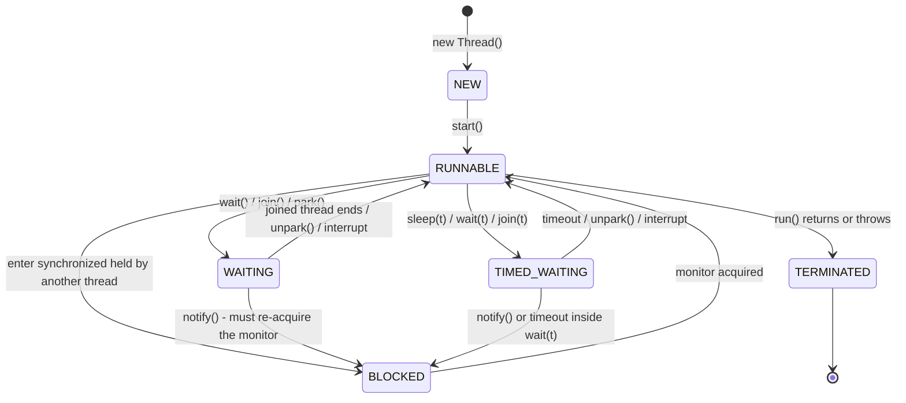
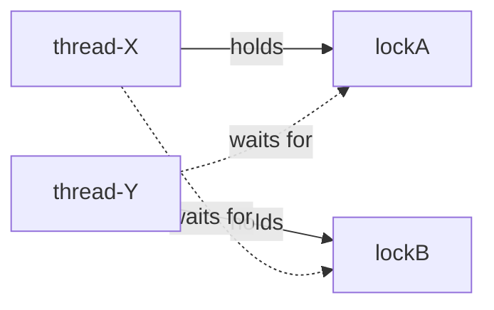
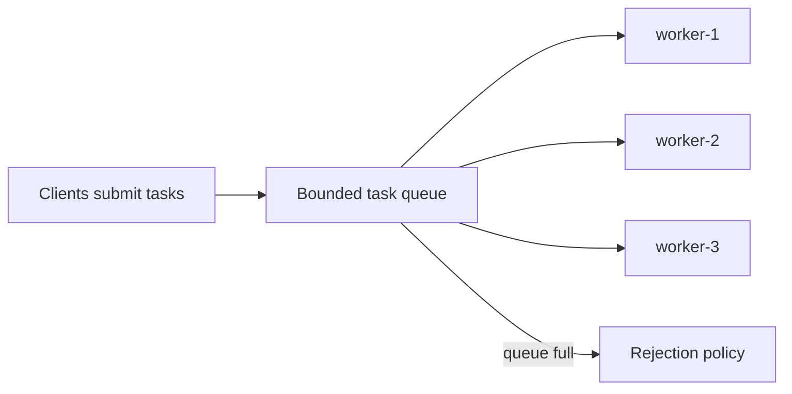
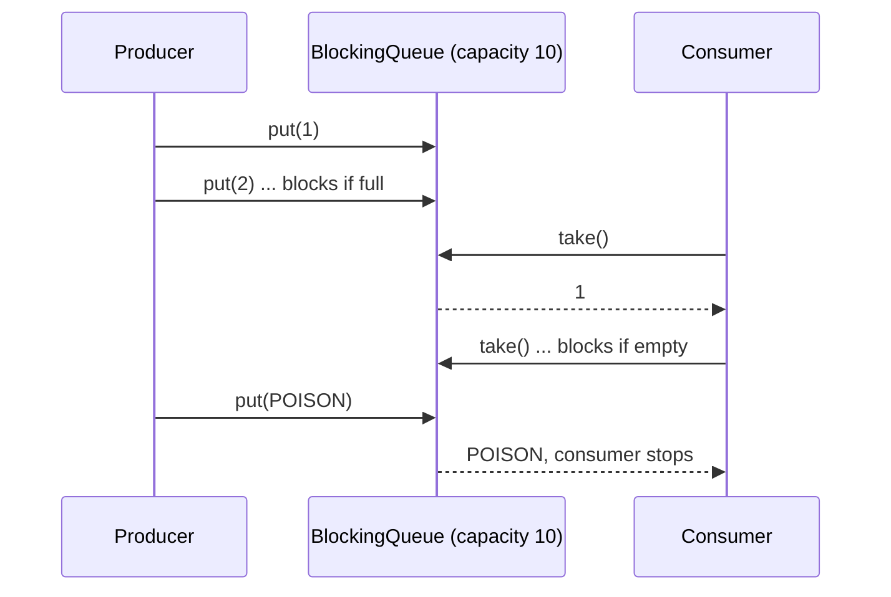
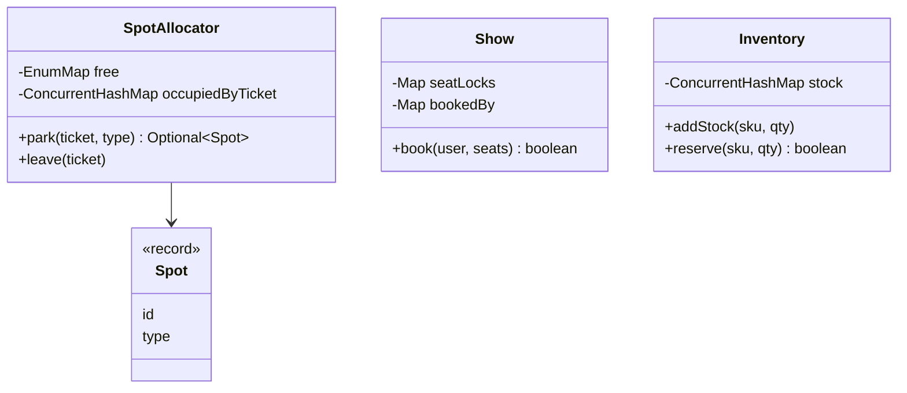

# Chapter 12 — Concurrency & Multithreading for LLD (Java)

> **Why this chapter exists.** In a low-level design (LLD) interview you will often hear: *"Now two users click **Book** on the same seat at the same moment. What happens?"* If your design has no answer, it is incomplete. This chapter teaches you, from zero, the ideas and Java tools you need to answer that question well. Chapter 13 then applies them to the classic concurrency interview problems, and chapters 14–21 use them inside full case studies.

**How to read this chapter.** Every concept follows the same path: *What it is → The problem it solves → How it works → Java example → Trade-offs → When not to use it → Common mistakes → Real-world examples → In the interview → Self-check → TL;DR.* All code is Java 21, standard library only, and lives in `code/lld/ch12/<topic>/Main.java`. Every `Main` compiles and runs; the real output is shown under each listing.

Run any example from `chapters/12-concurrency-concepts/code`:

```text
javac --release 21 -d /tmp/lld_12 $(find . -name '*.java')
java -cp /tmp/lld_12 lld.ch12.threads.Main
```

**Map of the chapter**

| Part | Sections | Code package |
|---|---|---|
| A. Foundations | 12.1 Concurrency vs parallelism · 12.2 Processes vs threads · 12.3 Thread lifecycle · 12.4 Creating threads | `threads` |
| B. What goes wrong | 12.5 Race conditions & critical sections · 12.6 Java Memory Model (visibility, happens-before, `volatile`) | `race` |
| C. Locks | 12.7 Mutex / `synchronized` · 12.8 `ReentrantLock` · 12.9 Try-lock & timed locking · 12.10 Read-write locks & `StampedLock` · 12.11 Coarse vs fine-grained locking | `locks` |
| D. Coordination | 12.12 Semaphores · 12.13 Condition variables · 12.14 `CountDownLatch` & `CyclicBarrier` | `coordination` |
| E. Lock-free | 12.15 Compare-and-swap & atomics · 12.16 Concurrent collections | `atomics`, `collections` |
| F. Liveness failures | 12.17 Deadlock · 12.18 Livelock · 12.19 Starvation | `deadlock` |
| G. Patterns | 12.20 Signaling · 12.21 Thread pool · 12.22 Producer-consumer · 12.23 Reader-writer · 12.24 Immutability & thread confinement | `patterns` |
| H. Interviews | 12.25 Concurrency in LLD interviews (parking spots, seat booking, inventory) | `lldcases` |
| | 12.26 Choosing the right tool · 12.27 Chapter self-check · 12.28 Chapter TL;DR | |

**Words you will see everywhere (defined once here):**

| Term | Meaning in one line |
|---|---|
| **Thread** | One independent sequence of instructions running inside a program. |
| **Shared state** | Data (fields, objects) that more than one thread can read or write. |
| **Thread-safe** | A class that behaves correctly no matter how threads interleave, with no extra locking by callers. |
| **Atomic** | Happens as one indivisible step: other threads see either "before" or "after", never "halfway". |
| **Lock / mutex** | A token only one thread can hold at a time. Code that needs the token waits for it. |
| **Critical section** | A piece of code that touches shared state and must not run in two threads at once. |
| **Contention** | Many threads wanting the same lock at the same time, so they queue up. |
| **Blocking** | A thread stops and waits (for a lock, I/O, a signal) instead of using the CPU. |
| **Liveness** | "Something good eventually happens" — the program keeps making progress (no deadlock, livelock, starvation). |
| **Safety** | "Nothing bad ever happens" — no corrupted data, no double booking. |

---

# Part A — Foundations

## 12.1 Concurrency vs parallelism

### What it is
- **Concurrency** is about *dealing with* many things at once: the program is structured as several tasks whose lifetimes overlap. They may take turns on one **CPU core** (one independent processing unit inside the processor; a modern CPU has several).
- **Parallelism** is about *doing* many things at once: tasks literally execute at the same instant on different CPU cores.

**Analogy.** One chef cooking three dishes, switching between them while each simmers, is *concurrent*. Three chefs each cooking one dish at the same time is *parallel*. A restaurant with three chefs who also switch between dishes is both.

### The problem it solves
Programs wait a lot — for disks, networks, databases, users. Concurrency lets the program do useful work while one task waits (better *responsiveness* and *throughput* — how much work gets finished per second; see [System Design Fundamentals](../../../system-design-patterns/modules/00-system-design-fundamentals/README.md)). Parallelism lets CPU-heavy work (sorting, image processing) finish sooner by using all cores (better *speed-up*).

### How it works
1. The operating system (OS) *scheduler* (the part of the OS that decides which thread runs next) gives each runnable thread a short time slice on a core.
2. When the slice ends, or the thread blocks (for **I/O** — input/output such as disk or network reads — a lock, `sleep`), the scheduler performs a **context switch**: it saves that thread's **registers** (the CPU's few, fastest storage slots) and loads another's.
3. On one core, switching fast creates the *illusion* of simultaneity → concurrency.
4. On many cores, several threads really run at the same instant → parallelism.

| | Concurrency | Parallelism |
|---|---|---|
| Core idea | Structure: many tasks in progress | Execution: many tasks running at the same instant |
| Needs multiple cores? | No | Yes |
| Main benefit | Responsiveness, overlapping waiting (I/O-bound work: mostly waiting on disk/network) | Speed on CPU-bound work (mostly computing) |
| Java tools | Threads, executors, virtual threads, `CompletableFuture` | Fork/Join, parallel streams, `Arrays.parallelSort` |
| Typical example | A web server handling 10,000 connections | Sorting 100 million numbers |

### Java example
Section 12.4's `Main` shows both: 10,000 tasks that each *sleep* 50 ms finish in well under a second on virtual threads (concurrency hides waiting). Chapter 13's multi-threaded merge sort uses **Fork/Join** (the JDK framework that splits a task into subtasks and runs them on all cores) to split CPU work over cores (parallelism).

### Trade-offs
Concurrency adds complexity (races, deadlocks) and some overhead (context switches). Parallelism has a limit: **Amdahl's law** says that if a fraction *s* of the work is inherently sequential, the speed-up with *N* cores can never exceed 1 / (s + (1 − s)/N). With 10% sequential work, even infinite cores give at most 10× speed-up.

### When not to use it
Small, fast, CPU-light tasks: splitting them over threads costs more than it saves. A single-threaded design is also a valid choice when it removes all locking (Redis — an in-memory key-value database — executes commands on one main thread for this reason; Node.js, a server-side JavaScript runtime, runs JavaScript on one **event-loop** thread: a single loop that handles ready events one at a time and never blocks).

### Common mistakes
- Saying "concurrent" when you mean "parallel" (and vice versa) in an interview.
- Expecting more threads to always mean more speed. Past the core count, CPU-bound work gets *slower* from switching.

### Real-world examples
- **Concurrency:** Tomcat and Jetty (Java web servers) serve many HTTP requests with a **pool** of threads (a fixed set of reusable worker threads); Netty (a Java networking library) and Node.js serve thousands of connections with a few event-loop threads.
- **Parallelism:** `Arrays.parallelSort`, parallel streams, and Spark/Hadoop (distributed data-processing frameworks) jobs splitting data across cores and machines.

### In the interview
**30-second answer:** "Concurrency is about structure — several tasks in progress, possibly interleaved on one core. Parallelism is about execution — tasks running at the same instant on several cores. Concurrency helps I/O-bound work; parallelism helps CPU-bound work."

**Follow-ups:**
- *Can you have concurrency without parallelism?* Yes — a single-core machine running several threads by time-slicing.
- *Can you have parallelism without concurrency?* Yes, in a narrow sense: SIMD (one instruction on many data items) runs in parallel inside a single task.
- *How many threads for a CPU-bound pool?* About the number of cores (`Runtime.getRuntime().availableProcessors()`). For I/O-bound work, more — roughly cores × (1 + wait time / compute time).

### Self-check
- **Q:** A chat server with 50,000 idle connections — concurrency or parallelism problem? **A:** Concurrency: most connections are waiting, not computing.
- **Q:** What limits the speed-up of parallel code? **A:** The sequential part (Amdahl's law), plus coordination overhead.

### TL;DR
Concurrency = dealing with many things (structure). Parallelism = doing many things at once (execution). I/O-bound → concurrency; CPU-bound → parallelism.

---

## 12.2 Processes vs threads

### What it is
- A **process** is a running program with its *own* memory space (**heap** — the memory area where objects live — code, open files). Two processes cannot see each other's memory.
- A **thread** is a unit of execution *inside* a process. All threads of a process share the process's heap memory, but each thread has its own **stack** (local variables, call frames) and **program counter** (the address of the next instruction to run).

**Analogy.** A process is a house; threads are people living in it. People in the same house share the kitchen (heap) — fast to share, but they can bump into each other. People in different houses (processes) must phone each other (inter-process communication) — slower, but no bumping.

### The problem it solves
Threads let one program do several things at once while sharing data cheaply. Processes give strong isolation: one crashing does not corrupt the others.

### How it works
1. The OS creates a process with a private **virtual address space** (the process's own view of memory, which the OS maps onto real RAM).
2. The process starts with one thread (`main` in Java).
3. The program can create more threads; they share heap objects, and each gets its own stack.
4. Communication: threads just read/write shared objects (with synchronization); processes use **pipes** (one-way byte channels between processes), **sockets** (network-style connection endpoints), shared-memory segments or message queues.

| | Process | Thread |
|---|---|---|
| Memory | Private address space | Shares the process's heap; own stack |
| Creation cost | High (new address space) | Lower (platform thread ≈ an OS thread with ~1 MB stack reserved by default on 64-bit JVMs — Java Virtual Machines, the programs that run Java bytecode); virtual threads are much cheaper still |
| Communication | IPC: sockets, pipes, files | Shared objects — fast, but needs synchronization |
| Failure isolation | Strong: one crash does not kill others | Weak: an unhandled error can bring down the whole process (e.g. `OutOfMemoryError`) |
| Context switch | Heavier (address-space switch) | Lighter |
| Java | `ProcessBuilder`, `Runtime.exec` | `Thread`, executors |

### Java example
```java
// A new PROCESS (separate memory):
Process p = new ProcessBuilder("ls", "-l").inheritIO().start();
p.waitFor();

// A new THREAD (shares this JVM's heap):
Thread t = new Thread(() -> System.out.println("same heap, different stack"));
t.start();
t.join();
```

### Trade-offs
Threads: fast sharing, but every shared mutable field is a potential bug. Processes: safe isolation, but communication is slower and needs **serialization** (turning objects into bytes so they can be sent).

### When not to use it
Do not reach for threads when isolation matters more than speed (running untrusted plugins, running a crash-prone **native library** — machine code, e.g. written in C, called from Java); use separate processes or **containers** (lightweight isolated environments such as Docker).

### Common mistakes
- Thinking local variables are shared between threads. They are not: each thread has its own stack. Only objects reachable from shared references are shared.
- Creating one platform thread per request without limit — each has a large stack and an OS thread behind it. Use a pool, or virtual threads.

### Real-world examples
- **Google Chrome** runs tabs in separate *processes* so one crashing page does not take down the browser.
- **PostgreSQL** (a popular SQL database) uses one process per connection; **MySQL** uses one thread per connection.
- A **JVM** is one process; your application's threads, **garbage-collector** threads (the GC frees memory that nothing uses any more) and **JIT-compiler** threads (Just-In-Time compiler: turns frequently run bytecode into fast machine code while the program runs) all live inside it.

### In the interview
**30-second answer:** "A process is an isolated program with its own memory; a thread is a path of execution inside a process that shares its heap but has its own stack. Threads are cheaper and share data easily but need synchronization; processes are isolated and safer but communicate through IPC."

**Follow-ups:**
- *What does a thread own privately?* Its stack (locals, call frames), program counter, and `ThreadLocal` values (variables that hold a separate copy per thread).
- *Why are threads cheaper to switch?* They share the address space, so the CPU's memory mappings stay the same.

### Self-check
- **Q:** Two threads each declare `int x = 0;` inside a method and increment it. Race? **A:** No — locals live on each thread's own stack.
- **Q:** Two threads increment the same object's field. Race? **A:** Yes, unless synchronized.

### TL;DR
Process = isolated house with private memory. Thread = a worker inside it sharing the heap, owning only its stack. Share cheaply, synchronize carefully.

---

## 12.3 Thread lifecycle & states

### What it is
A Java thread moves through well-defined states. `Thread.getState()` returns one of the six values of the enum `java.lang.Thread.State`:

| State | Meaning |
|---|---|
| `NEW` | Created with `new Thread(...)` but `start()` not called yet. |
| `RUNNABLE` | Started and either running on a CPU or ready to run (waiting only for the scheduler). Java does not distinguish "running" from "ready". A thread blocked in most I/O calls also shows as `RUNNABLE`. |
| `BLOCKED` | Waiting to *enter* a `synchronized` block/method whose monitor (the object's built-in lock, §12.7) another thread holds. |
| `WAITING` | Waiting with no time limit for another thread to act: `Object.wait()`, `Thread.join()`, `LockSupport.park()` (the low-level JDK call that suspends a thread; `ReentrantLock`, `Condition`, `CountDownLatch` use it). |
| `TIMED_WAITING` | Same, but with a timeout: `Thread.sleep(ms)`, `wait(ms)`, `join(ms)`, `parkNanos`, `tryLock(timeout)`. |
| `TERMINATED` | `run()` has returned or thrown. A thread cannot be restarted. |

**Analogy.** A customer at a bank: `NEW` = has a ticket but hasn't entered; `RUNNABLE` = at the counter or next in line; `BLOCKED` = the only pen is being used, waiting to grab it; `WAITING` = told "wait until we call you"; `TIMED_WAITING` = "come back in 10 minutes"; `TERMINATED` = left the bank.

### The problem it solves
Knowing the states lets you read **thread dumps** (a snapshot of every thread's state and call stack, taken with `jstack` or `jcmd <pid> Thread.print`, where pid is the process ID) and diagnose hangs: many threads `BLOCKED` on the same monitor → lock contention or **deadlock** (threads waiting on each other forever, §12.17); many `WAITING` on a queue → idle pool.

### How it works



1. `new Thread(task)` → `NEW`.
2. `start()` → `RUNNABLE` (calling `start()` twice throws `IllegalThreadStateException`).
3. Trying to enter a busy `synchronized` block → `BLOCKED` until the monitor is free.
4. Calling `wait()`, `join()` or parking → `WAITING`; the timed versions → `TIMED_WAITING`.
5. A thread that wakes from `wait()` must first re-acquire the monitor, so it may pass through `BLOCKED` before returning to `RUNNABLE`.
6. When `run()` ends → `TERMINATED`.

**Interruption.** `t.interrupt()` sets a flag on `t`. If `t` is in `sleep`, `wait`, `join` (or other interruptible blocking calls), it wakes up with `InterruptedException` and the flag is cleared. Interruption is *cooperative*: the thread decides how to react. `Thread.stop()` is unsafe and no longer works on modern JDKs — never rely on it.

### Java example
See `threadStates()` in the next section's `Main.java`: it drives one thread into each state and prints `getState()` (output lines under "Thread.State tour").

### Trade-offs
Not applicable (it's a model, not a choice) — but note the `RUNNABLE` state hides whether the thread is *actually* on a CPU or stuck in native I/O.

### When not to use it
Never use `getState()` for program logic (e.g. "if thread is WAITING then…"); states change between the check and your action. Use it only for monitoring and debugging.

### Common mistakes
- Calling `run()` instead of `start()`: the code runs on the *current* thread; no new thread is created.
- Swallowing `InterruptedException` silently. Either rethrow it or restore the flag with `Thread.currentThread().interrupt()`.
- Thinking `BLOCKED` and `WAITING` are the same. `BLOCKED` = waiting for a *monitor*; `WAITING` = waiting for a *signal*.

### Real-world examples
Production incident triage: a `jstack` dump showing 200 Tomcat worker threads `BLOCKED` on one `synchronized` logger or connection-pool method is a classic sign of a coarse lock bottleneck.

### In the interview
**30-second answer:** "Java threads have six states: NEW, RUNNABLE, BLOCKED, WAITING, TIMED_WAITING, TERMINATED. BLOCKED means waiting for a monitor lock; WAITING/TIMED_WAITING mean waiting for another thread's action, optionally with a timeout."

**Follow-ups:**
- *Is there a RUNNING state?* Not in Java's enum — running and ready are both `RUNNABLE`.
- *What state is a thread in during `ReentrantLock.lock()` when the lock is taken?* `WAITING` (it parks via `LockSupport`), not `BLOCKED` — `BLOCKED` is only for intrinsic monitors.
- *Can you restart a terminated thread?* No; create a new one (or submit the task to a pool).

### Self-check
- **Q:** State of a thread inside `Thread.sleep(1000)`? **A:** `TIMED_WAITING`.
- **Q:** State of a thread inside `latch.await()`? **A:** `WAITING`.

### TL;DR
NEW → RUNNABLE ↔ (BLOCKED | WAITING | TIMED_WAITING) → TERMINATED. BLOCKED = waiting for a monitor; WAITING = waiting for a signal. Use `start()`, never `run()`, and respect interrupts.

---

## 12.4 Creating threads: `Thread`, `Runnable`, `Callable`, `ExecutorService`, virtual threads

### What it is
Five ways to run code concurrently in Java:

| Way | What you write | Returns a value? | Use when |
|---|---|---|---|
| Extend `Thread` | `class T extends Thread { run() }` | No | Almost never — mixes the task with the worker |
| `Runnable` | `() -> { ... }` passed to `new Thread(r)` or a pool | No | A fire-and-forget task |
| `Callable<V>` | `() -> value` (may throw checked exceptions — ones the compiler forces you to catch or declare) | Yes, via `Future<V>` | You need a result or an exception back |
| `ExecutorService` | `pool.submit(task)` | `Future<V>` | Default choice: reuse threads, limit concurrency |
| Virtual threads (Java 21) | `Thread.ofVirtual().start(r)` / `Executors.newVirtualThreadPerTaskExecutor()` | via `Future` | Very many *blocking* (I/O-bound) tasks |

**Analogy.** A `Runnable` is a job description. A `Thread` is a worker. An `ExecutorService` is a staffing agency that keeps a team of workers and hands them job descriptions. A `Future` is the receipt you use to collect the finished job. Virtual threads are like freelancers who cost almost nothing to hire, so you hire one per job.

### The problem it solves
Creating an OS thread per task is expensive and unbounded. Executors separate **what** to run (task) from **how** it runs (pooling, queueing, scheduling). Virtual threads remove the cost problem for blocking code, so you can go back to a simple "one thread per request" style.

### How it works
1. Write the task as a `Runnable` (no result) or `Callable<V>` (result/exception).
2. Submit it to an `ExecutorService` (e.g. `Executors.newFixedThreadPool(n)`); you get a `Future<V>`.
3. `future.get()` blocks until the result is ready (or rethrows the task's exception wrapped in `ExecutionException`).
4. When done, `shutdown()` the pool (stop accepting tasks) and `awaitTermination(...)`; or, since Java 19, use **try-with-resources** (a `try (...)` block that closes its resource automatically at the end) — `ExecutorService.close()` waits for tasks to finish.
5. **Virtual threads** (final in Java 21, JEP 444 — a JEP, JDK Enhancement Proposal, is the numbered design document for a Java feature) are lightweight threads managed by the JVM. Many virtual threads run on a small pool of OS "carrier" threads (a `ForkJoinPool` sized to the number of cores by default). When a virtual thread blocks on I/O, `sleep`, or a `java.util.concurrent` lock, the JVM *unmounts* it and the carrier runs another virtual thread. The exception is **pinning**: a virtual thread that cannot unmount keeps its carrier busy while it blocks. On Java 21–23 this happens when it blocks inside a `synchronized` block/method (including `Object.wait()`) or inside a native method; JDK 24 (JEP 491) removed the `synchronized` case, leaving mainly native/foreign-function calls (and blocking inside a class initializer) as pinning causes.

### Java example

```java
// File: code/lld/ch12/threads/Main.java
package lld.ch12.threads;

import java.util.ArrayList;
import java.util.List;
import java.util.concurrent.Callable;
import java.util.concurrent.CountDownLatch;
import java.util.concurrent.ExecutorService;
import java.util.concurrent.Executors;
import java.util.concurrent.Future;
import java.util.concurrent.TimeUnit;
import java.util.stream.IntStream;

/** Five ways to run code on another thread, plus a tour of every Thread.State. */
public class Main {

    // Way 1: subclass Thread (works, but couples "the task" with "the worker").
    static class GreeterThread extends Thread {
        GreeterThread() { super("greeter-thread"); }
        @Override public void run() {
            System.out.println("1) extends Thread   -> hello from " + getName());
        }
    }

    public static void main(String[] args) throws Exception {
        creatingThreads();
        virtualThreads();
        threadStates();
    }

    static void creatingThreads() throws Exception {
        System.out.println("=== Creating threads ===");
        Thread t1 = new GreeterThread();
        t1.start();          // start() creates a new call stack; run() would run on *this* thread
        t1.join();           // wait for it to finish so output order is predictable

        // Way 2: Runnable = a task with no result. Preferred over subclassing Thread.
        Runnable task = () -> System.out.println("2) Runnable         -> hello from " + Thread.currentThread().getName());
        Thread t2 = new Thread(task, "runnable-thread");
        t2.start();
        t2.join();

        // Way 3 + 4: Callable (returns a value / throws) submitted to an ExecutorService (a thread pool).
        ExecutorService pool = Executors.newFixedThreadPool(2);
        try {
            Callable<Integer> sumTask = () -> IntStream.rangeClosed(1, 100).sum();
            Future<Integer> future = pool.submit(sumTask);   // returns immediately
            System.out.println("3) Callable+Future  -> sum 1..100 = " + future.get()); // get() blocks until done

            List<Callable<String>> jobs = List.of(() -> "A", () -> "B", () -> "C");
            List<String> results = new ArrayList<>();
            for (Future<String> f : pool.invokeAll(jobs)) results.add(f.get());   // invokeAll keeps input order
            System.out.println("4) ExecutorService  -> invokeAll results " + results);
        } finally {
            pool.shutdown();                                   // stop accepting work
            pool.awaitTermination(5, TimeUnit.SECONDS);       // wait for running tasks
        }
    }

    static void virtualThreads() throws Exception {
        System.out.println("=== Virtual threads (Java 21) ===");
        Thread vt = Thread.ofVirtual().name("virtual-1").start(
                () -> System.out.println("5) virtual thread   -> isVirtual=" + Thread.currentThread().isVirtual()));
        vt.join();

        // 10,000 blocking tasks: cheap with virtual threads (each sleep parks the virtual thread,
        // freeing its carrier OS thread for other work).
        long start = System.nanoTime();
        int completed;
        try (ExecutorService vexec = Executors.newVirtualThreadPerTaskExecutor()) {
            List<Future<Integer>> fs = new ArrayList<>();
            for (int i = 0; i < 10_000; i++) {
                fs.add(vexec.submit(() -> { Thread.sleep(50); return 1; }));
            }
            int sum = 0;
            for (Future<Integer> f : fs) sum += f.get();
            completed = sum;
        } // close() waits for all tasks
        long ms = (System.nanoTime() - start) / 1_000_000;
        System.out.println("10,000 tasks that each sleep 50 ms completed: " + completed
                + " (well under 10,000 x 50 ms = 500 s: " + (ms < 60_000) + ")");
    }

    static void threadStates() throws Exception {
        System.out.println("=== Thread.State tour ===");
        Object monitor = new Object();

        Thread sleeper = new Thread(() -> {
            try { Thread.sleep(10_000); } catch (InterruptedException e) { /* woken early: fine */ }
        }, "sleeper");
        System.out.println("after new Thread()            : " + sleeper.getState());      // NEW
        sleeper.start();
        awaitState(sleeper, Thread.State.TIMED_WAITING);
        System.out.println("inside Thread.sleep(10s)      : " + sleeper.getState());      // TIMED_WAITING
        sleeper.interrupt();
        sleeper.join();
        System.out.println("after run() returns           : " + sleeper.getState());      // TERMINATED

        CountDownLatch gate = new CountDownLatch(1);
        Thread waiter = new Thread(() -> {
            try { gate.await(); } catch (InterruptedException ignored) { }
        }, "waiter");
        waiter.start();
        awaitState(waiter, Thread.State.WAITING);
        System.out.println("inside latch.await()          : " + waiter.getState());       // WAITING
        gate.countDown();
        waiter.join();

        Thread blocked;
        synchronized (monitor) {             // main holds the monitor...
            blocked = new Thread(() -> { synchronized (monitor) { /* got it */ } }, "blocked");
            blocked.start();
            awaitState(blocked, Thread.State.BLOCKED);
            System.out.println("waiting to enter synchronized : " + blocked.getState()); // BLOCKED
        }                                    // ...released here, so 'blocked' can proceed
        blocked.join();

        java.util.concurrent.atomic.AtomicBoolean stop = new java.util.concurrent.atomic.AtomicBoolean();
        Thread spinner = new Thread(() -> { while (!stop.get()) Thread.onSpinWait(); }, "spinner");
        spinner.start();
        System.out.println("busy running on a CPU         : " + spinner.getState());      // RUNNABLE
        stop.set(true);
        spinner.join();
    }

    /** Poll until the thread reaches the wanted state (max ~5 s). */
    static void awaitState(Thread t, Thread.State wanted) throws InterruptedException {
        long deadline = System.nanoTime() + TimeUnit.SECONDS.toNanos(5);
        while (t.getState() != wanted && System.nanoTime() < deadline) Thread.sleep(1);
    }
}
```

**Explaining each part:**
- `GreeterThread` subclasses `Thread` — shown only for completeness. Prefer passing a `Runnable`.
- `t1.start()` creates the new call stack; `t1.join()` waits for it to finish, which also guarantees that everything `t1` wrote is visible to `main` afterwards (a *happens-before* edge, section 12.6).
- `pool.submit(sumTask)` returns a `Future` immediately; `future.get()` blocks.
- `invokeAll` runs a list of `Callable`s and returns futures **in the same order** as the input list.
- `shutdown()` + `awaitTermination()` is the classic clean shutdown. `newVirtualThreadPerTaskExecutor()` in try-with-resources uses `close()`, which waits for all tasks.
- 10,000 sleeping tasks finish quickly: each `sleep` parks its virtual thread instead of holding an OS thread.
- `threadStates()` drives threads into each state (NEW, TIMED_WAITING, TERMINATED, WAITING, BLOCKED, RUNNABLE). `awaitState` polls, because a state change is not instant after `start()`.

Output:

```text
=== Creating threads ===
1) extends Thread   -> hello from greeter-thread
2) Runnable         -> hello from runnable-thread
3) Callable+Future  -> sum 1..100 = 5050
4) ExecutorService  -> invokeAll results [A, B, C]
=== Virtual threads (Java 21) ===
5) virtual thread   -> isVirtual=true
10,000 tasks that each sleep 50 ms completed: 10000 (well under 10,000 x 50 ms = 500 s: true)
=== Thread.State tour ===
after new Thread()            : NEW
inside Thread.sleep(10s)      : TIMED_WAITING
after run() returns           : TERMINATED
inside latch.await()          : WAITING
waiting to enter synchronized : BLOCKED
busy running on a CPU         : RUNNABLE
```

### Trade-offs

| | Platform thread pool | Virtual threads |
|---|---|---|
| Cost per thread | High (OS thread + large stack) | Very low (heap-allocated stack that grows as needed) |
| How many | Hundreds to a few thousand | Millions |
| Best for | CPU-bound work (size ≈ cores) | Blocking I/O-bound work |
| Limits concurrency? | Yes, by pool size | No — add a `Semaphore` if a downstream resource needs a limit |
| Pooling | Yes | No — never pool virtual threads; create one per task |

### When not to use it
- Do not use virtual threads for CPU-heavy computation — they give no extra cores; use a fixed pool or Fork/Join.
- On Java 21–23, a virtual thread that blocks *inside a `synchronized` block* stays **pinned** to its carrier thread, reducing scalability; prefer `ReentrantLock` around blocking calls on those versions. (JDK 24's JEP 491 removed most of this pinning.)
- Do not use `Executors.newCachedThreadPool()` for unbounded incoming traffic — it can create unlimited platform threads.

### Common mistakes
- Forgetting `shutdown()`: non-daemon pool threads keep the JVM alive after `main` ends (a **daemon** thread is a background thread that does not keep the JVM running; ordinary threads do).
- Ignoring the `Future` of a submitted `Runnable`: exceptions thrown inside are captured in the `Future` and silently lost if you never call `get()`.
- Using `Executors.newFixedThreadPool` for untrusted load: its queue is **unbounded** (`LinkedBlockingQueue`), so a burst can exhaust memory. Build a `ThreadPoolExecutor` with a bounded queue (section 12.21).

### Real-world examples
- `Executors` factory methods are the textbook **Factory** pattern in the JDK.
- **Spring** (the most widely used Java application framework): its `@Async` runs methods on a `TaskExecutor` (commonly a `ThreadPoolTaskExecutor`).
- Spring Boot 3.2+ can run request handling on virtual threads with `spring.threads.virtual.enabled=true`; Tomcat and Jetty can be configured to use virtual threads too.

### In the interview
**30-second answer:** "I never manage raw threads in business code. I describe work as `Runnable`/`Callable` and submit it to an `ExecutorService` sized for the workload: about cores for CPU-bound work, bounded queue with a rejection policy for incoming traffic. For many blocking I/O tasks on Java 21, I use virtual threads — one per task — and protect scarce resources with a semaphore." (A **semaphore** is a counter of permits that caps how many threads may proceed at once — §12.12.)

**Follow-ups:**
- *`Runnable` vs `Callable`?* `Callable` returns a value and may throw checked exceptions; `Runnable` does neither.
- *`submit` vs `execute`?* `execute(Runnable)` returns nothing and uncaught exceptions go to the thread's handler; `submit` returns a `Future` that captures the exception.
- *What does `CompletableFuture` add?* Non-blocking composition: `thenApply`, `thenCombine`, `allOf`, error handling with `exceptionally`, without calling `get()` at each step.

### Self-check
- **Q:** What happens if you call `thread.run()`? **A:** The code runs synchronously on the current thread.
- **Q:** Why not pool virtual threads? **A:** They are cheap to create; pooling adds nothing and hides the one-thread-per-task model. Limit concurrency with a semaphore instead.

### TL;DR
Tasks = `Runnable`/`Callable`. Run them with an `ExecutorService`, get results via `Future`. Java 21 virtual threads make one-thread-per-blocking-task cheap. Always shut pools down.

---

# Part B — What goes wrong

## 12.5 Race conditions & critical sections

### What it is
- A **race condition** is a bug where the result depends on the unlucky timing (interleaving) of threads.
- A **critical section** is the code that touches shared mutable state and must therefore run in only one thread at a time.
- A **data race** (the precise Java Memory Model term) is when two threads access the same variable, at least one writes, and there is no happens-before ordering between them (section 12.6).

**Analogy.** Two people share a bank account with ₹100. Both check the balance at the same moment, both see ₹100, both withdraw ₹80. The bank gave out ₹160 from ₹100. The "check the balance, then withdraw" steps were the critical section.

### The problem it solves
Understanding races tells you *which* code needs protection and *why* it goes wrong. The two classic shapes:

| Shape | Example | Why it breaks |
|---|---|---|
| **Read-modify-write** | `count++` | It is really `tmp = count; tmp = tmp + 1; count = tmp`. Two threads read the same old value; one update is lost. |
| **Check-then-act** | `if (!map.containsKey(k)) map.put(k, v);` or `if (seat.isFree()) seat.book(me);` | The condition can become false between the check and the act. |

### How it works
1. Find all **shared mutable state** (fields reachable by more than one thread and changed after construction).
2. Find every **invariant** (a rule about the data that must always hold true) involving it (e.g. "a seat has at most one owner", "balance ≥ 0").
3. Mark the code that reads and then updates that state as a **critical section**.
4. Make each critical section **atomic** — with a lock (`synchronized`, `ReentrantLock`), with a single atomic operation (`AtomicInteger.incrementAndGet`, `ConcurrentHashMap.putIfAbsent`), or by removing the sharing (immutability — objects that never change; confinement — data only one thread touches; see §12.24).

### Java example

```java
// File: code/lld/ch12/race/Main.java
package lld.ch12.race;

import java.util.ArrayList;
import java.util.List;
import java.util.concurrent.atomic.AtomicInteger;

/** Race conditions, three fixes, and the visibility problem solved with volatile. */
public class Main {

    interface Counter { void increment(); int get(); }

    /** BROKEN: count++ is read-modify-write (3 steps), so concurrent increments get lost. */
    static class UnsafeCounter implements Counter {
        private int count;
        public void increment() { count++; }
        public int get() { return count; }
    }

    /** Fix 1: a mutex (the object's intrinsic lock) makes the critical section atomic. */
    static class SynchronizedCounter implements Counter {
        private int count;
        public synchronized void increment() { count++; }
        public synchronized int get() { return count; }   // reads need the lock too (visibility)
    }

    /** Fix 2: a lock-free atomic built on compare-and-swap. */
    static class AtomicCounter implements Counter {
        private final AtomicInteger count = new AtomicInteger();
        public void increment() { count.incrementAndGet(); }
        public int get() { return count.get(); }
    }

    static final int THREADS = 4, PER_THREAD = 250_000;

    static int hammer(Counter c) throws InterruptedException {
        List<Thread> ts = new ArrayList<>();
        for (int i = 0; i < THREADS; i++) {
            Thread t = new Thread(() -> { for (int j = 0; j < PER_THREAD; j++) c.increment(); });
            ts.add(t);
            t.start();
        }
        for (Thread t : ts) t.join();   // join() also creates a happens-before edge: we see their writes
        return c.get();
    }

    // ---------- Visibility ----------
    static class Worker implements Runnable {
        private volatile boolean running = true;   // without volatile the loop may never see 'false'
        private long iterations;
        public void run() { while (running) iterations++; }
        void stop() { running = false; }
    }

    public static void main(String[] args) throws Exception {
        int expected = THREADS * PER_THREAD;
        System.out.println("expected                : " + expected);
        int unsafe = hammer(new UnsafeCounter());
        System.out.println("unsafe counter          : " + (unsafe == expected ? "correct this run (luck!)" : "LOST " + (expected - unsafe) + " updates"));
        System.out.println("synchronized counter    : " + hammer(new SynchronizedCounter()));
        System.out.println("atomic counter          : " + hammer(new AtomicCounter()));

        // Check-then-act race, shown safely: two threads both "see" an empty seat.
        // Here we fix it with a single atomic operation instead of check + act.
        AtomicInteger seatOwner = new AtomicInteger(0);          // 0 = free
        Thread a = new Thread(() -> seatOwner.compareAndSet(0, 1));
        Thread b = new Thread(() -> seatOwner.compareAndSet(0, 2));
        a.start(); b.start(); a.join(); b.join();
        System.out.println("seat has exactly one owner: " + (seatOwner.get() == 1 || seatOwner.get() == 2));

        Worker w = new Worker();
        Thread t = new Thread(w);
        t.start();
        Thread.sleep(50);
        w.stop();                       // volatile write ...
        t.join(2_000);                  // ... is guaranteed to become visible to the worker
        System.out.println("volatile flag stopped worker: " + !t.isAlive());
    }
}
```

**Explaining each part:**
- `UnsafeCounter.increment()` does `count++` with no protection → updates get lost.
- `SynchronizedCounter` wraps the critical section in the object's intrinsic lock. Note that `get()` is synchronized too — that is for *visibility* (next section).
- `AtomicCounter` uses `incrementAndGet()`, a single hardware-backed atomic step (compare-and-swap, section 12.15).
- The seat example fixes a check-then-act race with one atomic call: `compareAndSet(0, id)` only succeeds if the seat is still free.
- `Worker` uses a `volatile` flag so the stop request is guaranteed to be seen (section 12.6).

Output (the number of lost updates changes every run — that unpredictability *is* the race):

```text
expected                : 1000000
unsafe counter          : LOST 680044 updates
synchronized counter    : 1000000
atomic counter          : 1000000
seat has exactly one owner: true
volatile flag stopped worker: true
```

### Trade-offs

| Fix | Pros | Cons |
|---|---|---|
| Lock (`synchronized`/`ReentrantLock`) | Protects any multi-step, multi-variable invariant | Threads wait; risk of deadlock if nested |
| Atomic variable / atomic collection method | Fast, no blocking, no deadlock | Only covers one variable or one map entry |
| Immutability / confinement | No synchronization at all | Must redesign so state isn't shared or changed |

### When not to use it
Don't lock data that is never shared (method locals, objects confined to one thread) or never changed after safe construction (immutable objects).

### Common mistakes
- Protecting writes but not reads ("reads are harmless") — a reader can see stale or half-updated state.
- Using two *separate* thread-safe calls and assuming the combination is atomic: `if (!map.containsKey(k)) map.put(k,v)` on a `ConcurrentHashMap` is still a race. Use `putIfAbsent`/`computeIfAbsent`.
- Locking on different objects in different methods — each lock protects nothing against the other.
- Believing a race is fixed because tests pass. Races show up rarely and under load.

### Real-world examples
- Double-booking in ticketing systems, overselling limited-stock items in **flash sales** (short, heavily promoted sales of limited stock), duplicate payment processing when a user double-clicks "Pay" — all check-then-act races, solved with atomic operations, locks, or database constraints (unique indexes that reject duplicate values, `SELECT ... FOR UPDATE` — a SQL read that locks the rows it returns — and optimistic version columns: a version number checked on every update, so a write based on stale data fails).

### In the interview
**30-second answer:** "A race condition is when correctness depends on thread timing. The two common shapes are read-modify-write, like `count++`, and check-then-act, like 'if seat is free then book it'. I find the shared mutable state and its invariants, and make each critical section atomic — with a lock, an atomic operation like `putIfAbsent` or `compareAndSet`, or by removing sharing."

**Follow-ups:**
- *Is `volatile int count; count++` safe?* No. `volatile` gives visibility, not atomicity; the three steps can still interleave.
- *Is `ConcurrentHashMap` enough to make my class thread-safe?* Only if every invariant lives in single map operations. Multi-key invariants still need a lock or careful design.

### Self-check
- **Q:** Why does `count++` lose updates? **A:** It is read, add, write — two threads can read the same value before either writes.
- **Q:** Name the race in `if (cache.get(k) == null) cache.put(k, load(k));`. **A:** Check-then-act; two threads may both load and put. Use `computeIfAbsent`.

### TL;DR
Race = result depends on timing. Watch for read-modify-write and check-then-act. Make every critical section atomic, including reads.

---

## 12.6 Java Memory Model basics: visibility, happens-before, `volatile`

### What it is
The **Java Memory Model (JMM)** (Java Language Specification, chapter 17) defines *when a write by one thread is guaranteed to be seen by a read in another thread*. Without the right synchronization, a thread may see a stale value — or never see the update at all.

- **Visibility**: will thread B *see* what thread A wrote?
- **Reordering**: compilers, the JIT, and CPUs may reorder instructions for speed as long as a *single* thread can't tell the difference. Other threads can.
- **Happens-before (HB)**: a guarantee that if action X *happens-before* action Y, then X's effects are visible to Y and X appears ordered before Y.
- **`volatile`**: a field modifier that makes reads/writes of that field visible to all threads and orders them (no caching in registers, no harmful reordering around it).

**Analogy.** Each thread works from its own notepad (**CPU caches** — small, fast memories next to each core — and registers) and only sometimes copies to the shared whiteboard (main memory). Happens-before rules are the moments when the notepad is guaranteed to be synced with the whiteboard.

### The problem it solves
The `Worker` loop `while (running) iterations++;` with a *non-volatile* `running` may never stop: the JIT is allowed to read `running` once and turn the loop into `while (true)`. Visibility bugs like this are invisible in code review unless you know the JMM.

### How it works
The key **happens-before rules** (you can quote these in an interview):

| Rule | Meaning |
|---|---|
| Program order | Within one thread, each action HB the next one. |
| Monitor lock | An **unlock** of a monitor HB every later **lock** of the *same* monitor. |
| Volatile | A **write** to a volatile field HB every later **read** of that field. |
| Thread start | `t.start()` HB every action in thread `t`. |
| Thread join | Every action in `t` HB another thread's successful return from `t.join()`. |
| Transitivity | If A HB B and B HB C, then A HB C. |
| Final fields | Strictly a separate guarantee (JLS §17.5), not a happens-before edge: once a constructor finishes without leaking `this`, any thread that obtains a reference to the object sees the correct values of its `final` fields (and of objects reachable through them, as of the end of the constructor) — even if the reference was shared without synchronization. |
| `java.util.concurrent` | E.g. putting into a `BlockingQueue` HB taking it out; `countDown()` HB a return from `await()`; `Future` completion HB `get()` returning. |

Steps to apply them:
1. For each shared variable, ask: "Is every write-then-read pair connected by a happens-before edge?"
2. If they are protected by the same lock → yes (monitor rule).
3. If the variable is a single independent flag or reference → `volatile` is enough.
4. If it is a compound update (`x++`, check-then-act) → `volatile` is **not** enough; use a lock or atomic.

**Safe publication.** An object is *safely published* when the reference to it is made visible through an HB edge: stored in a `volatile` field (or an `AtomicReference`), stored in a `final` field of a properly constructed object, created by a static initializer, put into a concurrent collection, or written under a lock that the reader also takes. Otherwise a reader might see the reference but not the fully constructed object.

**Double-checked locking** (lazy Singleton — a class with exactly one shared instance, created only on first use) is only correct if the instance field is `volatile`:

```java
class Config {
    private static volatile Config instance;          // volatile is essential
    static Config get() {
        Config c = instance;
        if (c == null) {
            synchronized (Config.class) {
                c = instance;
                if (c == null) instance = c = new Config();
            }
        }
        return c;
    }
}
```
(Simpler and just as lazy: the *holder idiom* — `private static class Holder { static final Config I = new Config(); }` — class initialization is thread-safe by the JLS.)

### Java example
`Worker` in the race example above: `private volatile boolean running`. The write `running = false` in `main` HB the worker's next read of `running`, so the loop exits. The output line `volatile flag stopped worker: true` confirms it.

### Trade-offs

| Tool | Visibility | Atomic compound ops | Blocking | Cost |
|---|---|---|---|---|
| `volatile` | Yes | No | No | Low |
| `synchronized` / `Lock` | Yes (for code under the same lock) | Yes | Yes | Medium |
| `Atomic*` | Yes | Yes, for one variable | No | Low–medium |
| `final` (immutable) | Yes, after construction | N/A — never changes | No | Free |

### When not to use it
Don't use `volatile` for anything that combines several steps or several variables — use a lock or an atomic class.

### Common mistakes
- "It works on my laptop" — x86 CPUs (Intel/AMD) reorder less than ARM ones (e.g. Apple Silicon, AWS Graviton). Code without proper HB edges may fail only on other hardware or after **JIT warm-up** (once the JIT has compiled and optimised the hot code).
- Leaking `this` from a constructor (registering a listener, starting a thread in the constructor) — other threads may see a half-built object, and final-field guarantees are lost.
- Thinking `synchronized` on the writer alone is enough. The reader must use the *same* lock.

### Real-world examples
- `volatile boolean running` shutdown flags in server loops and schedulers.
- `ConcurrentHashMap`, `AtomicInteger`, `CopyOnWriteArrayList` internally use volatile reads/writes and CAS (compare-and-swap, §12.15) to give HB guarantees without locks for readers.
- The JDK's `String` is immutable with `final` fields, so strings can be shared across threads freely.

### In the interview
**30-second answer:** "The Java Memory Model says a thread is only guaranteed to see another thread's write if there's a happens-before edge — unlock-then-lock of the same monitor, a volatile write-then-read, thread start/join, or a concurrent-collection handoff. `volatile` gives visibility and ordering for a single variable but not atomicity; for compound actions I use locks or atomics."

**Follow-ups:**
- *Why must the double-checked-locking field be volatile?* Without it, the write of the reference can be reordered before the constructor's writes, so another thread might see a non-null but half-initialized object.
- *Does `volatile` make `long`/`double` writes atomic?* Yes — non-volatile 64-bit `long`/`double` writes may be split into two 32-bit halves by the JLS (rare on modern 64-bit JVMs, but allowed); volatile ones cannot.

### Self-check
- **Q:** Thread A sets a non-volatile `ready = true` after preparing data; thread B spins on `ready`. Two possible bugs? **A:** B may never see `ready` become true, or may see `ready` true but stale data (reordering).
- **Q:** Which JDK classes give HB for you? **A:** Locks, `Atomic*`, concurrent collections, `BlockingQueue`, `CountDownLatch`, `Future`, `ExecutorService.submit`.

### TL;DR
Writes are only guaranteed visible across threads through happens-before edges. `volatile` = visibility + ordering for one variable, not atomicity. Locks = visibility + atomicity. Publish objects safely.

---

# Part C — Locks

## 12.7 Mutex (mutual exclusion) and `synchronized`

### What it is
A **mutex** (mutual-exclusion lock) is a lock that at most one thread can hold. In Java every object has a built-in mutex called its **intrinsic lock** or **monitor**. The `synchronized` keyword acquires it:

```java
public synchronized void deposit(int amt) { balance += amt; }   // locks 'this'
public static synchronized void log() { ... }                    // locks the Class object
void transfer() { synchronized (lock) { ... } }                  // locks 'lock'
```

**Analogy.** A single-occupancy restroom with one key on a hook. Take the key to enter; others wait; hang it back when you leave.

### The problem it solves
Makes a critical section **atomic** (no interleaving) and **visible** (the next thread to take the lock sees everything done before the unlock).

### How it works
1. Thread reaches `synchronized (obj)`. If nobody holds `obj`'s monitor, it takes it and continues.
2. If another thread holds it, this thread goes to `BLOCKED` until the monitor is free.
3. On leaving the block — normally *or by exception* — the monitor is released automatically.
4. Intrinsic locks are **reentrant**: the holder can enter other `synchronized` code on the same object again without blocking itself.

### Java example
`SynchronizedCounter` in section 12.5, and `Mailbox` / `FooBarMonitor` style classes later. A tip: lock on a **private final** object, not on `this`, when you don't want outside code to be able to take your lock:

```java
private final Object lock = new Object();
void add(Item i) { synchronized (lock) { items.add(i); } }
```

### Trade-offs
| Pros | Cons |
|---|---|
| Simplest syntax; auto-release even on exceptions | No timeout, no `tryLock`, not interruptible while waiting |
| JVM-optimised (uncontended locking is cheap) | One wait-set (the threads parked in `wait()`) per object (only one "condition") |
| Reentrant | No fairness option (fair = longest-waiting thread goes first); on Java 21–23 pins virtual threads when blocking inside |

### When not to use it
When you need a timeout, interruptible waiting, fairness, several condition queues, or read/write separation — use `ReentrantLock`/`ReentrantReadWriteLock`.

### Common mistakes
- Synchronizing on a *changing* reference (`synchronized (list)` after `list = new ArrayList<>()`) — different threads lock different objects.
- Synchronizing on **boxed values** (objects such as `Integer` that wrap a primitive) or string literals (`synchronized ("LOCK")`, `synchronized (Integer.valueOf(1))`) — these may be shared JVM-wide, causing mysterious contention or deadlocks.
- Doing slow I/O while holding the lock.

### Real-world examples
`Vector`, `Hashtable`, `StringBuffer` and `Collections.synchronizedList(...)` wrap every method in `synchronized` — thread-safe per call but slow under contention, which is why `ArrayList`/`HashMap`/`StringBuilder` plus concurrent collections replaced them.

### In the interview
**30-second answer:** "A mutex lets one thread at a time into a critical section. In Java, `synchronized` uses the object's monitor: it's reentrant, released automatically, and gives visibility. I lock on a private final object and keep the section short."

**Follow-ups:**
- *What does a static synchronized method lock?* The `Class` object, e.g. `Counter.class` — a different lock from instance methods.
- *Is `synchronized` slow?* Uncontended, it's cheap. Under heavy contention, any lock is slow — reduce sharing or use finer locks.

### Self-check
- **Q:** Two synchronized instance methods on *different* objects — do they block each other? **A:** No, different monitors.
- **Q:** Does an exception inside `synchronized` release the lock? **A:** Yes.

### TL;DR
Mutex = one holder at a time. `synchronized` is Java's built-in, reentrant, auto-releasing mutex. Lock a private final object; keep the section short.

---

## 12.8 `ReentrantLock` and reentrancy

### What it is
`java.util.concurrent.locks.ReentrantLock` is an explicit mutex with the same basic meaning as `synchronized` plus extra features. **Reentrant** means the thread holding the lock can acquire it again (a hold count goes up) and must release it the same number of times.

**Analogy.** A room key that remembers who has it: if you already hold it, walking into an inner door of the same room doesn't make you wait for yourself.

### The problem it solves
- Without reentrancy, a locked method calling another locked method of the same object would **deadlock with itself**.
- Compared with `synchronized`, `ReentrantLock` adds: `tryLock()` / `tryLock(timeout)`, `lockInterruptibly()`, optional **fairness** (`new ReentrantLock(true)`), multiple `Condition`s per lock, and queries like `isLocked()`, `getHoldCount()`.

### How it works
1. `lock.lock()` — acquire (hold count 0 → 1), or wait if another thread holds it.
2. Same thread calls `lock.lock()` again → hold count 2; no waiting.
3. Each `unlock()` decrements; at 0 the lock is released and a waiting thread may proceed.
4. **Always** release in `finally`:

```java
lock.lock();
try {
    // critical section
} finally {
    lock.unlock();
}
```

### Java example

```java
// File: code/lld/ch12/locks/Main.java
package lld.ch12.locks;

import java.util.HashMap;
import java.util.Map;
import java.util.concurrent.BrokenBarrierException;
import java.util.concurrent.CountDownLatch;
import java.util.concurrent.CyclicBarrier;
import java.util.concurrent.TimeUnit;
import java.util.concurrent.TimeoutException;
import java.util.concurrent.locks.Lock;
import java.util.concurrent.locks.ReadWriteLock;
import java.util.concurrent.locks.ReentrantLock;
import java.util.concurrent.locks.ReentrantReadWriteLock;
import java.util.concurrent.locks.StampedLock;

/** synchronized vs ReentrantLock, reentrancy, tryLock, ReadWriteLock, StampedLock. */
public class Main {

    // ---------- Reentrancy ----------
    static class Account {
        private final ReentrantLock lock = new ReentrantLock();
        private int balance = 100;

        void withdraw(int amount) {
            lock.lock();
            try {
                if (canWithdraw(amount)) balance -= amount;   // calls another locked method
            } finally {
                lock.unlock();                                // ALWAYS unlock in finally
            }
        }
        boolean canWithdraw(int amount) {
            lock.lock();                                      // same thread re-acquires: no self-deadlock
            try {
                System.out.println("hold count inside nested call = " + lock.getHoldCount());
                return balance >= amount;
            } finally {
                lock.unlock();
            }
        }
        int balance() { lock.lock(); try { return balance; } finally { lock.unlock(); } }
    }

    // ---------- Read-write lock: many readers OR one writer ----------
    static class ConfigStore {
        private final Map<String, String> map = new HashMap<>();
        private final ReadWriteLock rw = new ReentrantReadWriteLock();
        private final Lock r = rw.readLock(), w = rw.writeLock();

        String get(String k) { r.lock(); try { return map.get(k); } finally { r.unlock(); } }
        void put(String k, String v) { w.lock(); try { map.put(k, v); } finally { w.unlock(); } }

        /** Used by the demo: prove several readers are inside the read lock at once. */
        <T> T readWhile(java.util.concurrent.Callable<T> action) throws Exception {
            r.lock(); try { return action.call(); } finally { r.unlock(); }
        }
    }

    // ---------- StampedLock optimistic read ----------
    static class Point {
        private final StampedLock sl = new StampedLock();
        private double x, y;

        void move(double dx, double dy) {
            long stamp = sl.writeLock();
            try { x += dx; y += dy; } finally { sl.unlockWrite(stamp); }
        }
        double distanceFromOrigin() {
            long stamp = sl.tryOptimisticRead();   // no locking at all, just a version number
            double cx = x, cy = y;                 // copy fields to locals
            if (!sl.validate(stamp)) {             // a writer slipped in: fall back to a real read lock
                stamp = sl.readLock();
                try { cx = x; cy = y; } finally { sl.unlockRead(stamp); }
            }
            return Math.hypot(cx, cy);
        }
    }

    public static void main(String[] args) throws Exception {
        System.out.println("=== Reentrancy ===");
        Account acc = new Account();
        acc.withdraw(30);
        System.out.println("balance = " + acc.balance());

        System.out.println("=== tryLock with timeout ===");
        ReentrantLock printer = new ReentrantLock();
        CountDownLatch mainHolds = new CountDownLatch(1);
        printer.lock();                           // main grabs the printer and keeps it
        try {
            Thread impatient = new Thread(() -> {
                try {
                    mainHolds.await();
                    if (printer.tryLock(100, TimeUnit.MILLISECONDS)) {
                        try { System.out.println("worker: got the printer"); } finally { printer.unlock(); }
                    } else {
                        System.out.println("worker: printer busy for 100 ms, doing something else instead");
                    }
                } catch (InterruptedException e) { Thread.currentThread().interrupt(); }
            });
            impatient.start();
            mainHolds.countDown();
            impatient.join();
        } finally {
            printer.unlock();
        }
        System.out.println("tryLock() now (free)  = " + printer.tryLock());
        printer.unlock();

        System.out.println("=== ReadWriteLock: readers share ===");
        ConfigStore store = new ConfigStore();
        store.put("mode", "fast");
        int readers = 3;
        CyclicBarrier allReadersInside = new CyclicBarrier(readers);
        Thread[] rs = new Thread[readers];
        boolean[] ok = new boolean[readers];
        for (int i = 0; i < readers; i++) {
            final int id = i;
            rs[i] = new Thread(() -> {
                try {
                    ok[id] = store.readWhile(() -> {
                        // If the read lock were exclusive, the barrier would time out.
                        allReadersInside.await(2, TimeUnit.SECONDS);
                        return "fast".equals(store.get("mode"));   // read lock is reentrant too
                    });
                } catch (TimeoutException | BrokenBarrierException e) {
                    ok[id] = false;
                } catch (Exception e) { throw new RuntimeException(e); }
            });
            rs[i].start();
        }
        for (Thread t : rs) t.join();
        System.out.println(readers + " readers held the read lock at the same time: " + (ok[0] && ok[1] && ok[2]));

        System.out.println("=== StampedLock optimistic read ===");
        Point p = new Point();
        p.move(3, 4);
        System.out.println("distance = " + p.distanceFromOrigin());
    }
}
```

**Explaining each part:**
- `Account.withdraw` locks, then calls `canWithdraw`, which locks again: `getHoldCount()` prints 2 — reentrancy in action.
- "tryLock with timeout": `main` holds `printer`; the worker waits at most 100 ms, then does something else (section 12.9).
- `ConfigStore` uses a `ReentrantReadWriteLock`. Three readers all wait at a `CyclicBarrier` *while holding the read lock*; if the read lock were exclusive, the barrier would time out. It prints `true` (section 12.10).
- `Point` uses `StampedLock.tryOptimisticRead()`: read without locking, then `validate(stamp)`; fall back to a real read lock if a writer interfered (section 12.10).

Output:

```text
=== Reentrancy ===
hold count inside nested call = 2
balance = 70
=== tryLock with timeout ===
worker: printer busy for 100 ms, doing something else instead
tryLock() now (free)  = true
=== ReadWriteLock: readers share ===
3 readers held the read lock at the same time: true
=== StampedLock optimistic read ===
distance = 5.0
```

### Trade-offs

| Feature | `synchronized` | `ReentrantLock` |
|---|---|---|
| Release | Automatic | Manual (`finally`) — easy to forget |
| Try / timeout | No | `tryLock()`, `tryLock(t, unit)` |
| Interruptible wait | No | `lockInterruptibly()` |
| Fairness | No | Optional (`true` = longest waiter first; lower throughput) |
| Conditions | One wait set | Many `Condition` objects |
| Reentrant | Yes | Yes |

### When not to use it
If you need none of the extra features, `synchronized` is shorter and can't be left locked by mistake.

### Common mistakes
- `lock()` *inside* the `try` — if `lock()` threw, `finally` would `unlock()` a lock you don't hold (`IllegalMonitorStateException`). Call `lock()` just before `try`.
- Forgetting `unlock()` on an early `return` or exception path — the lock stays held forever.
- Turning on fairness "to be safe" — fair locks are noticeably slower; use them only when starvation is a real problem.

### Real-world examples
`ArrayBlockingQueue`, `LinkedBlockingQueue` and `ThreadPoolExecutor` use `ReentrantLock` internally (`CopyOnWriteArrayList` did up to Java 8; since Java 9 it uses `synchronized` on an internal lock object). `ReentrantLock`, `ReentrantReadWriteLock`, `Semaphore` and `CountDownLatch` are all built on `AbstractQueuedSynchronizer` (AQS — the JDK's shared framework for building locks and synchronizers); `CyclicBarrier` is built on a `ReentrantLock` + `Condition`.

### In the interview
**30-second answer:** "`ReentrantLock` is an explicit mutex with the same semantics as `synchronized` plus try-lock with timeout, interruptible acquisition, optional fairness, and multiple conditions. Reentrant means the owner can re-acquire it; the hold count must drop to zero to release. I always unlock in `finally`."

**Follow-ups:**
- *Why would a non-reentrant lock deadlock?* A method holding it that calls another method needing the same lock would wait for itself forever.
- *Is `StampedLock` reentrant?* No — e.g. a thread that holds its write lock and calls `writeLock()` or `readLock()` again blocks forever on itself. It also has no owner and no `Condition`s.

### Self-check
- **Q:** A thread calls `lock()` 3 times and `unlock()` 2 times. Is the lock free? **A:** No; hold count is 1.
- **Q:** What does `new ReentrantLock(true)` change? **A:** Waiting threads get the lock in roughly FIFO (first in, first out) order (fair), at a throughput cost.

### TL;DR
`ReentrantLock` = `synchronized` + tryLock/timeout/interruptible/fairness/conditions. Owner can re-enter. `lock(); try { … } finally { unlock(); }` always.

---

## 12.9 Try-lock & timed locking

### What it is
- `tryLock()` — take the lock **only if it is free right now**; return `true`/`false` immediately.
- `tryLock(timeout, unit)` — wait up to the timeout; return `false` if still unavailable. Interruptible.

**Analogy.** Knocking on a meeting room: if it's busy you don't stand there forever — you wait five minutes, then book another room.

### The problem it solves
Plain `lock()` waits forever. That causes hung requests and makes deadlocks permanent. Try-lock lets a thread **give up and do something else** — fail fast, retry later, return "busy" to a user — and it breaks the *hold and wait* condition of deadlock (section 12.17).

### How it works
1. Call `tryLock(timeout)`.
2. If it returns `true`: `try { work } finally { unlock(); }`.
3. If it returns `false`: take the fallback path (return an error, retry with **back-off** — waiting a short while before trying again — or release other locks you hold).
4. When acquiring several locks: if any `tryLock` fails, **release everything you already hold**, back off for a random short time, and retry.

### Java example
In `locks/Main.java` above: the worker calls `printer.tryLock(100, TimeUnit.MILLISECONDS)` while `main` holds it, gets `false`, and prints the fallback message. In `deadlock/Main.java` (section 12.17), `transferTryLock` uses try-lock plus random back-off to avoid deadlock.

### Trade-offs
| Pros | Cons |
|---|---|
| No infinite waits; can report "busy" | Caller must handle failure paths |
| Breaks deadlock (hold-and-wait) | Retry loops without random back-off can **livelock** |
| Timeouts give predictable **latency** (time one operation takes) | Choosing the timeout is a judgement call |

### When not to use it
When failing is not acceptable and waiting is fine (e.g. a background **batch job** — one that processes data in bulk, with no user waiting — updating a counter) — plain `lock()` is simpler.

### Common mistakes
- Calling `unlock()` when `tryLock` returned `false` → `IllegalMonitorStateException`.
- Retrying immediately in a tight loop — burns CPU and can livelock with another thread doing the same.
- Expecting untimed `tryLock()` to respect fairness — it *barges* (takes a free lock even if others are queued); `tryLock(0, unit)` respects fairness.

### Real-world examples
- **Distributed locks** (locks shared by many servers, kept in an external store: Redis `SET key value NX PX 30000` — set only if absent, expire after 30,000 ms — Redisson's (a Java Redis client) `tryLock(wait, lease, unit)`, ZooKeeper (a coordination service for clusters) recipes) follow the same idea: try for a bounded time, give up, or let the lock expire.
- Seat-hold features on ticketing sites: if the seat is locked by someone else's checkout, you're told immediately rather than made to wait.

### In the interview
**30-second answer:** "`tryLock` with a timeout lets a thread give up instead of waiting forever. I use it when latency matters or when I need several locks: if I can't get all of them, I release what I hold, back off randomly and retry — which prevents deadlock."

**Follow-ups:**
- *Why random back-off?* Two threads retrying on the same schedule can keep colliding forever (livelock); randomness breaks the symmetry.

### Self-check
- **Q:** What does `tryLock(0, SECONDS)` do? **A:** Tries once without waiting but, unlike `tryLock()`, respects a fair lock's queue.

### TL;DR
Try-lock = acquire only if available (optionally within a timeout). Handle `false`, release everything on failure, back off randomly.

---

## 12.10 Read-write locks: `ReadWriteLock` and `StampedLock`

### What it is
A **read-write lock** is a pair of locks: a shared **read lock** (many readers at once) and an exclusive **write lock** (one writer, no readers). Java provides `ReentrantReadWriteLock` and, since Java 8, `StampedLock` (adds cheap *optimistic reads*).

**Analogy.** A museum exhibit: any number of visitors can look at it together, but when a curator needs to rearrange it, the room is cleared and only the curator is inside.

### The problem it solves
With a plain mutex, readers block each other even though reading doesn't change anything. For **read-heavy** data (configuration, **caches** — fast copies of data kept for quick reads — price catalogues) a read-write lock lets reads proceed in parallel.

### How it works
1. Reader: `readLock().lock()` — succeeds if no writer holds the write lock. Many readers can hold it at once.
2. Writer: `writeLock().lock()` — waits until there are **no readers and no writer**, then holds exclusively.
3. `ReentrantReadWriteLock` rules: a writer may **downgrade** (acquire the read lock while holding the write lock, then release the write lock). A reader may **not upgrade** (asking for the write lock while holding the read lock deadlocks — it waits for all readers, including itself).
4. `StampedLock` optimistic read: `long s = tryOptimisticRead()` (no locking) → read fields into locals → `validate(s)`. If a writer acquired the lock in between, `validate` returns `false` and you retry with a real `readLock()`.

### Java example
`ConfigStore` and `Point` in `locks/Main.java` above. The output line `3 readers held the read lock at the same time: true` proves readers share the lock.

### Trade-offs

| | `synchronized`/`ReentrantLock` | `ReentrantReadWriteLock` | `StampedLock` |
|---|---|---|---|
| Parallel readers | No | Yes | Yes (and optimistic reads take no lock at all) |
| Reentrant | Yes | Yes | **No** |
| Conditions | Yes | Write lock only | No |
| Overhead | Lowest | Higher bookkeeping | Low for optimistic reads; more complex code |
| Best when | Short sections or write-heavy | Reads ≫ writes and reads are not trivially short | Very read-heavy, tiny critical sections (e.g. coordinates) |

### When not to use it
- Write-heavy or very short critical sections — the extra bookkeeping of a RW lock can make it *slower* than a plain mutex.
- When a copy-on-write snapshot is simpler: keep an immutable map in a `volatile` field and replace it on write (readers never lock; see 12.23).

### Common mistakes
- Trying to upgrade read → write in `ReentrantReadWriteLock` (self-deadlock).
- Modifying state while holding only the *read* lock.
- Using data read under an optimistic stamp before calling `validate`, or reading fields directly instead of copying them to locals first.
- Writer starvation in non-fair mode under a constant stream of readers (construct it with `new ReentrantReadWriteLock(true)` if it matters; `StampedLock` gives no fairness guarantee either).

### Real-world examples
- In-memory caches and configuration holders; routing tables that are read on every request and updated rarely.
- `ConcurrentHashMap` goes further: reads take no lock at all.

### In the interview
**30-second answer:** "A read-write lock lets many readers in together but gives writers exclusive access. It helps when reads vastly outnumber writes. `ReentrantReadWriteLock` allows downgrade but not upgrade; `StampedLock` adds optimistic reads that take no lock and are validated afterwards, but it's not reentrant."

**Follow-ups:**
- *How would you design a thread-safe config service?* Either a RW lock around a `HashMap`, or an immutable `Map` in a `volatile` field replaced atomically on reload (readers never block).

### Self-check
- **Q:** Two readers and one writer arrive; which can run together? **A:** The two readers; the writer runs alone.
- **Q:** Why copy fields to locals in an optimistic read? **A:** So that after `validate` succeeds you use a consistent snapshot, not fields that might change after the check.

### TL;DR
Many readers OR one writer. Use for read-heavy shared data. No upgrade in `ReentrantReadWriteLock`; `StampedLock` = optimistic, non-reentrant.

---

## 12.11 Coarse-grained vs fine-grained locking

### What it is
- **Coarse-grained locking**: one lock protects a large amount of state (e.g. the whole parking lot).
- **Fine-grained locking**: many locks, each protecting a small piece (e.g. one lock per floor, per spot, or per **hash bucket** — one slot of the internal array a hash map spreads its entries over).

**Analogy.** One key for an entire office building (coarse) vs a key per room (fine). One key is simple but everyone queues at the front door; room keys let people work in parallel but you must manage many keys.

### The problem it solves
Choosing the right granularity balances **simplicity and safety** against **throughput under contention**.

### How it works
1. Start coarse: one lock around the whole object. Measure.
2. If contention is the bottleneck, split state into **independent** parts whose invariants don't cross — each gets its own lock (**lock splitting**).
3. For a big collection, use **lock striping**: N locks; item *i* uses lock `hash(i) % N` (Java 7's `ConcurrentHashMap` had 16 segments by default; chapter 13 builds a striped map).
4. When an operation needs several fine locks (e.g. booking seats A1 and A2), always acquire them in a **global order** to avoid deadlock.
5. Keep critical sections short: do slow work (I/O, computation) *outside* the lock.

| | Coarse-grained | Fine-grained |
|---|---|---|
| Simplicity | High | Lower — more locks, ordering rules |
| Concurrency | Low: one thread at a time | High: threads on different parts run together |
| Deadlock risk | Low (one lock) | Higher (many locks) — needs lock ordering |
| Overhead | One lock | Memory and bookkeeping for many locks |
| Cross-part invariants | Easy | Hard — may need to take several locks |

### Java example
- Coarse: `SynchronizedCounter` (12.5).
- Fine: `Show` in `lldcases/Main.java` (12.25) has **one lock per seat**, taken in sorted order; `StripedHashMap` in chapter 13 has one lock per stripe.

### Trade-offs
See table above. Rule of thumb: *correct first, then fine-grained only where **profiling** (measuring where a program really spends its time) shows contention*.

### When not to use it
Don't split locks when an invariant spans the parts (e.g. "total seats booked ≤ capacity" across all rows) unless you also handle the cross-part check.

### Common mistakes
- Premature fine-graining → complexity and deadlocks without real benefit.
- Locking fine-grained parts in inconsistent order.
- "Fine-grained" locks that still funnel through a shared counter everyone updates (the counter becomes the **bottleneck** — the one slow point that limits the whole system — use `LongAdder`, a counter that spreads updates over several cells, §12.15).

### Real-world examples
- `ConcurrentHashMap` (Java 8+) locks only the head node of one bin for writes — extremely fine-grained.
- Databases use row-level locks (fine) vs table-level locks (coarse).
- Python's GIL (Global Interpreter Lock) is a famous coarse lock: simple, but one thread runs Python **bytecode** (the compiled instructions the interpreter executes) at a time.

### In the interview
**30-second answer:** "I start with one lock for correctness, then refine where contention matters: per-floor or per-spot locks for a parking lot, per-show or per-seat locks for booking, striping for maps. Finer locks raise throughput but need a consistent lock order to avoid deadlock."

**Follow-ups:**
- *Per-show or per-seat locking for BookMyShow (an Indian movie-ticketing site)?* Per-show is simple and usually enough (contention is per show). Per-seat allows more parallelism but multi-seat bookings must lock seats in sorted order.

### Self-check
- **Q:** What is lock striping? **A:** Using a fixed array of N locks and mapping each item to one by hash, to get fine-grained locking with bounded lock count.

### TL;DR
Coarse = simple, low throughput. Fine = parallel, complex, deadlock-prone. Start coarse, refine with measurements, and order your locks.

---

# Part D — Coordination

## 12.12 Semaphores

### What it is
A **semaphore** holds a number of **permits**. `acquire()` takes one (waiting if none are left); `release()` gives one back. `java.util.concurrent.Semaphore` implements it. A semaphore with 1 permit behaves like a mutex, *except* it has no owner — any thread may release it.

**Analogy.** A car park with 3 spaces and a display showing free spaces. Cars enter only if the number is above zero; leaving increases it.

### The problem it solves
- **Limiting concurrency**: at most N threads use a resource (DB connections, **API** calls — calls to another service's programming interface — GPU slots).
- **Signaling** between threads: a semaphore with 0 permits acts as "wait until someone signals" (used heavily in chapter 13).

### How it works
1. `new Semaphore(n)` — n permits. The default is **non-fair**: a thread calling `acquire()` may *barge* ahead of threads already waiting. `new Semaphore(n, true)` is **fair**: permits go to waiting threads in first-in-first-out order (at some throughput cost). Even on a fair semaphore, the untimed `tryAcquire()` barges; `tryAcquire(0, TimeUnit.SECONDS)` respects fairness.
2. `acquire()` — if permits > 0, decrement and continue; else wait.
3. `release()` — increment and wake a waiter.
4. Also: `tryAcquire()`, `tryAcquire(timeout, unit)`, `acquire(k)` for several permits.
5. Always `release()` in `finally` after a successful `acquire()`.

### Java example

```java
// File: code/lld/ch12/coordination/Main.java
package lld.ch12.coordination;

import java.util.ArrayList;
import java.util.List;
import java.util.concurrent.CountDownLatch;
import java.util.concurrent.CyclicBarrier;
import java.util.concurrent.ExecutorService;
import java.util.concurrent.Executors;
import java.util.concurrent.Semaphore;
import java.util.concurrent.TimeUnit;
import java.util.concurrent.atomic.AtomicInteger;
import java.util.concurrent.locks.Condition;
import java.util.concurrent.locks.ReentrantLock;

/** Semaphore, wait/notify, Condition, CountDownLatch, CyclicBarrier. */
public class Main {

    // ---------- Condition variable with the built-in monitor (wait / notifyAll) ----------
    /** A one-slot mailbox: put waits while full, take waits while empty. */
    static class Mailbox<T> {
        private T item;                                   // guarded by 'this'
        public synchronized void put(T x) throws InterruptedException {
            while (item != null) wait();                  // ALWAYS wait in a loop (spurious wakeups)
            item = x;
            notifyAll();                                  // wake the taker(s)
        }
        public synchronized T take() throws InterruptedException {
            while (item == null) wait();
            T x = item;
            item = null;
            notifyAll();                                  // wake the putter(s)
            return x;
        }
    }

    // ---------- Condition variable with ReentrantLock + Condition ----------
    /** Two threads take turns: PING, PONG, PING, PONG ... */
    static class TurnTable {
        private final ReentrantLock lock = new ReentrantLock();
        private final Condition turnChanged = lock.newCondition();
        private boolean pingsTurn = true;

        void play(boolean iAmPing, String word, int rounds, List<String> out) throws InterruptedException {
            for (int i = 0; i < rounds; i++) {
                lock.lock();
                try {
                    while (pingsTurn != iAmPing) turnChanged.await();   // releases lock while waiting
                    out.add(word);
                    pingsTurn = !pingsTurn;
                    turnChanged.signalAll();
                } finally {
                    lock.unlock();
                }
            }
        }
    }

    public static void main(String[] args) throws Exception {
        semaphoreDemo();
        waitNotifyDemo();
        conditionDemo();
        latchDemo();
        barrierDemo();
    }

    static void semaphoreDemo() throws InterruptedException {
        System.out.println("=== Semaphore: at most 3 concurrent DB connections ===");
        Semaphore connections = new Semaphore(3);
        AtomicInteger inUse = new AtomicInteger(), maxSeen = new AtomicInteger();
        ExecutorService pool = Executors.newFixedThreadPool(10);
        for (int i = 0; i < 10; i++) {
            pool.submit(() -> {
                try {
                    connections.acquire();                         // blocks when 0 permits left
                    try {
                        int now = inUse.incrementAndGet();
                        maxSeen.accumulateAndGet(now, Math::max);
                        Thread.sleep(30);                          // "run a query"
                        inUse.decrementAndGet();
                    } finally {
                        connections.release();                     // give the permit back
                    }
                } catch (InterruptedException e) { Thread.currentThread().interrupt(); }
            });
        }
        pool.shutdown();
        pool.awaitTermination(5, TimeUnit.SECONDS);
        System.out.println("10 queries done, never more than 3 at once: " + (maxSeen.get() <= 3));
    }

    static void waitNotifyDemo() throws InterruptedException {
        System.out.println("=== wait/notifyAll: one-slot mailbox ===");
        Mailbox<String> box = new Mailbox<>();
        List<String> received = new ArrayList<>();
        Thread consumer = new Thread(() -> {
            try { for (int i = 0; i < 3; i++) received.add(box.take()); }
            catch (InterruptedException e) { Thread.currentThread().interrupt(); }
        });
        consumer.start();
        for (String m : List.of("m1", "m2", "m3")) box.put(m);
        consumer.join();
        System.out.println("received in order: " + received);
    }

    static void conditionDemo() throws InterruptedException {
        System.out.println("=== Lock + Condition: strict turn-taking ===");
        TurnTable table = new TurnTable();
        List<String> out = java.util.Collections.synchronizedList(new ArrayList<>());
        Thread ping = new Thread(() -> { try { table.play(true, "PING", 3, out); } catch (InterruptedException ignored) { } });
        Thread pong = new Thread(() -> { try { table.play(false, "PONG", 3, out); } catch (InterruptedException ignored) { } });
        pong.start(); ping.start();              // start order does not matter
        ping.join(); pong.join();
        System.out.println(String.join(" ", out));
    }

    static void latchDemo() throws InterruptedException {
        System.out.println("=== CountDownLatch: wait for 3 services to start ===");
        CountDownLatch ready = new CountDownLatch(3);
        for (String svc : List.of("db", "cache", "search")) {
            new Thread(() -> { /* ...warm up... */ ready.countDown(); }, svc).start();
        }
        boolean allUp = ready.await(2, TimeUnit.SECONDS);   // one-shot: cannot be reset
        System.out.println("all services ready: " + allUp + " (count now " + ready.getCount() + ")");
    }

    static void barrierDemo() throws Exception {
        System.out.println("=== CyclicBarrier: 3 workers, 2 phases ===");
        AtomicInteger phase = new AtomicInteger();
        // The barrier action runs once per trip, by the last thread to arrive.
        CyclicBarrier barrier = new CyclicBarrier(3,
                () -> System.out.println("phase " + phase.incrementAndGet() + " complete: all 3 workers arrived"));
        List<Thread> ws = new ArrayList<>();
        for (int i = 0; i < 3; i++) {
            Thread t = new Thread(() -> {
                try {
                    for (int p = 0; p < 2; p++) {
                        Thread.sleep((long) (Math.random() * 20)); // uneven work
                        barrier.await();                          // reusable: works for every phase
                    }
                } catch (Exception e) { throw new RuntimeException(e); }
            });
            ws.add(t);
            t.start();
        }
        for (Thread t : ws) t.join();
    }
}
```

**Explaining each part:**
- `semaphoreDemo`: 10 tasks, 3 permits; `maxSeen` records the peak number of concurrent users and never exceeds 3.
- `Mailbox` is a condition variable built on `wait/notifyAll` (section 12.13).
- `TurnTable` is a condition variable built on `ReentrantLock` + `Condition` (section 12.13).
- `latchDemo`/`barrierDemo`: section 12.14.

Output:

```text
=== Semaphore: at most 3 concurrent DB connections ===
10 queries done, never more than 3 at once: true
=== wait/notifyAll: one-slot mailbox ===
received in order: [m1, m2, m3]
=== Lock + Condition: strict turn-taking ===
PING PONG PING PONG PING PONG
=== CountDownLatch: wait for 3 services to start ===
all services ready: true (count now 0)
=== CyclicBarrier: 3 workers, 2 phases ===
phase 1 complete: all 3 workers arrived
phase 2 complete: all 3 workers arrived
```

### Trade-offs
| Pros | Cons |
|---|---|
| Simple way to cap concurrency | No owner: a bug can release more than acquired (permits grow) |
| Works as a signal (0 permits) | Doesn't protect data by itself — only counts |

### When not to use it
Don't use a semaphore as a mutex around shared data when a lock would do — locks have ownership checks and reentrancy.

### Common mistakes
- Releasing in a path where `acquire` never succeeded (e.g. `acquire` interrupted) → permit leak upward.
- Forgetting to release on exceptions → permits slowly disappear, system stalls.

### Real-world examples
- **Bulkhead pattern** (isolating resources per dependency, like watertight compartments in a ship, so one failure can't sink everything): Resilience4j's `SemaphoreBulkhead` (and Hystrix's — Netflix's older fault-tolerance library — semaphore isolation) cap concurrent calls to a dependency.
- **Connection pools** (sets of open database connections reused across requests) bound the number of connections handed out (HikariCP, a popular JDBC pool, enforces its maximum pool size).
- With virtual threads, a `Semaphore` is the recommended way to limit calls to a slow **downstream** service (one that your code calls).

### In the interview
**30-second answer:** "A semaphore is a permit counter: acquire takes a permit or waits, release returns one. I use it to cap concurrent access to a limited resource — a bulkhead — or with zero initial permits as a signal from one thread to another. Unlike a lock it has no owner."

**Follow-ups:**
- *Binary semaphore vs mutex?* Both allow one holder, but a mutex has an owner (only the holder may unlock, and it's usually reentrant); a binary semaphore can be released by any thread and isn't reentrant.

### Self-check
- **Q:** `new Semaphore(0)`: what does `acquire()` do? **A:** Waits until some thread calls `release()` — a signal.

### TL;DR
Semaphore = N permits. Cap concurrency or signal. No ownership, so release carefully in `finally`.

---

## 12.13 Condition variables: `wait/notify` and `Condition`

### What it is
A **condition variable** lets a thread *sleep until some condition about shared state becomes true*, releasing the lock while it sleeps, and lets another thread *wake it* after changing that state.

- Built-in: `Object.wait()`, `notify()`, `notifyAll()` — used inside `synchronized` on the same object.
- Explicit: `Condition c = lock.newCondition(); c.await(); c.signal(); c.signalAll();` — used while holding that `ReentrantLock`.

**Analogy.** A restaurant pager: you (the thread) hand back your table (release the lock) and wait. When the table is ready, staff buzz the pager (notify). You then come back and check that the table really is free (re-check the condition), because someone might have taken it.

### The problem it solves
Waiting for a state change without **busy-waiting** (spinning in a loop wasting CPU) and without missing the moment it happens.

### How it works
The canonical pattern — memorize it:

```java
synchronized (lock) {                 // or: lock.lock(); try {
    while (!conditionHolds()) {       // ALWAYS a while loop, never if
        lock.wait();                  //   cond.await();  releases the lock while waiting
    }
    doAction();                       // condition is true AND we hold the lock
    lock.notifyAll();                 //   cond.signal()/signalAll() if we changed state others wait for
}                                     // } finally { lock.unlock(); }
```

1. Acquire the lock.
2. While the condition is false, call `wait()` / `await()` — this **atomically releases the lock** and sleeps.
3. When woken, the thread **re-acquires the lock** before returning, then re-checks the condition (loop).
4. After changing state, call `notifyAll()` / `signal()` so waiters re-check.

Why the `while` loop? (a) **Spurious wakeups** — the JLS and the `Condition` docs allow a thread to wake without being notified. (b) Another thread may have grabbed the state between the notify and your re-acquisition. (c) With `notifyAll`, several threads wake but only one can succeed.

`notify` vs `notifyAll`: `notify()` wakes one arbitrary waiter. If different kinds of threads (producers and consumers) wait on the same monitor, `notify()` can wake the wrong kind and everyone sleeps forever. Use `notifyAll()` with a single monitor, or use separate `Condition`s (`notFull`, `notEmpty`) and targeted `signal()`.

### Java example
`Mailbox` (monitor version) and `TurnTable` (Lock + Condition) in `coordination/Main.java` above. Output: `received in order: [m1, m2, m3]` and `PING PONG PING PONG PING PONG`.

### Trade-offs

| | `wait/notify` | `Lock` + `Condition` |
|---|---|---|
| Conditions per lock | One wait set | Many (e.g. `notFull`, `notEmpty`) |
| Targeted wake-up | No — use `notifyAll` | Yes — `signal()` on the right condition |
| Timed wait | `wait(ms)` | `await(t, unit)`, `awaitNanos` (returns time left) |
| Verbosity | Less | More (manual unlock) |

### When not to use it
Most of the time you don't need raw condition variables: `BlockingQueue`, `Semaphore`, `CountDownLatch`, `CompletableFuture` already solve the common waiting problems. Write your own only for custom coordination (interview problems, custom synchronizers).

### Common mistakes
- `if` instead of `while` around `wait()`.
- Calling `wait()`/`notify()` without holding that object's monitor → `IllegalMonitorStateException`.
- Changing state *without* notifying → waiters sleep forever (a "lost wakeup").
- Calling `wait()` on one object while synchronized on another.

### Real-world examples
`ArrayBlockingQueue` uses one `ReentrantLock` with two `Condition`s, `notEmpty` and `notFull` — exactly the pattern built by hand in chapter 13.

### In the interview
**30-second answer:** "A condition variable lets a thread release a lock and sleep until another thread changes the state and signals it. I always wait in a while loop that re-checks the condition, because of spurious wakeups and competing threads. With one monitor I use notifyAll; with ReentrantLock I use separate Conditions and targeted signal."

**Follow-ups:**
- *Why must `wait()` be called while holding the lock?* So the check-then-sleep is atomic; otherwise a notify could happen between your check and your wait and be lost.

### Self-check
- **Q:** What does `wait()` do with the monitor? **A:** Releases it while sleeping and re-acquires it before returning.

### TL;DR
Condition variable = "release lock, sleep until signalled, re-acquire, re-check". Always `while`, prefer `notifyAll` or separate `Condition`s.

---

## 12.14 `CountDownLatch` and `CyclicBarrier`

### What it is
- **`CountDownLatch(n)`**: a one-time gate. Threads call `await()` and wait until `countDown()` has been called *n* times. It cannot be reset.
- **`CyclicBarrier(n, action)`**: a reusable meeting point. Each of *n* threads calls `await()`; when the *n*th arrives, the optional barrier action runs once, all are released, and the barrier resets for the next round.

**Analogy.** Latch = a race starter who waits for all 3 judges to say "ready" and then fires the pistol once. Barrier = hikers who agree to wait for each other at every checkpoint before continuing.

### The problem it solves
Coordinating *phases*: "start only after all services are up" (latch), "all workers finish step 1 before anyone starts step 2" (barrier), and "release all test threads at the same instant" (latch with count 1 — used throughout this book to maximise contention in tests).

### How it works

| | `CountDownLatch` | `CyclicBarrier` |
|---|---|---|
| Who waits | Any thread(s) calling `await()` | The *n* participating threads themselves |
| Who counts | Anyone calling `countDown()` (need not wait) | Arrival at `await()` |
| Reusable | No | Yes (auto-reset after each trip) |
| Extra | Count reaching 0 is permanent: later `await()` calls return at once. One thread may call `countDown()` several times | Barrier action runs once per trip; if one party is interrupted/times out, the barrier **breaks** and others get `BrokenBarrierException` (`reset()` repairs it) |
| Happens-before | Actions before `countDown()` HB actions after the matching `await()` returns | Actions before `await()` HB the barrier action, which HB actions after the other parties return from `await()` |

`Phaser` (Java 7) generalises both: parties can register/deregister dynamically across many phases.

### Java example
`latchDemo` and `barrierDemo` in `coordination/Main.java` above. Output shows `all services ready: true (count now 0)` and `phase 1 complete…`, `phase 2 complete…`.

### Trade-offs
Latch: dead simple, one-shot. Barrier: reusable but fragile — one failing party breaks it for all.

### When not to use it
For "wait for these N tasks and collect results", `ExecutorService.invokeAll` or `CompletableFuture.allOf(...)` is usually clearer.

### Common mistakes
- Waiting on a latch forever because a worker threw before `countDown()` — put `countDown()` in `finally`, and use `await(timeout)`.
- Using a barrier with fewer threads than parties → everyone waits forever.

### Real-world examples
- Test harnesses start N threads and release them together with a `CountDownLatch(1)` to maximise races (JCStress — OpenJDK's harness for testing concurrency correctness — uses stronger tools, but the idea is the same).
- Application start-up: wait for caches, DB pools, and message consumers to be ready before accepting traffic.

### In the interview
**30-second answer:** "`CountDownLatch` is a one-shot gate that opens after N countDowns; `CyclicBarrier` is a reusable rendezvous where N threads wait for each other each phase, optionally running an action when all arrive."

**Follow-ups:**
- *Can a latch be reset?* No — create a new one or use `CyclicBarrier`/`Phaser`.

### Self-check
- **Q:** Which one would you use so 3 worker threads sync at the end of every simulation step? **A:** `CyclicBarrier(3)`.

### TL;DR
Latch = one-shot "wait for N events". Barrier = reusable "wait for N threads". Put `countDown` in `finally`; use timeouts.

---

# Part E — Lock-free

## 12.15 Compare-and-swap (CAS) & atomics

### What it is
**Compare-and-swap** is a single CPU instruction (e.g. `LOCK CMPXCHG` on x86; LL/SC — load-linked/store-conditional — or CAS instructions on ARM): "if the value at this address is still `expected`, replace it with `new` and report success; otherwise change nothing and report failure." Java exposes it through `java.util.concurrent.atomic` classes: `AtomicInteger`, `AtomicLong`, `AtomicBoolean`, `AtomicReference`, `AtomicIntegerArray`, `LongAdder`, and through `VarHandle`.

**Analogy.** Editing a shared wiki page: you save only if the page version is still the one you started from. If someone saved first, your save is rejected; you reload and try again.

### The problem it solves
Atomic updates **without locks** (**lock-free**: no thread ever blocks another, and some thread always makes progress): no blocking, no deadlock, and usually faster under low-to-moderate contention. It is how lock-free data structures and the JDK's own concurrency utilities are built.

### How it works
The **CAS retry loop**:
1. Read the current value.
2. Compute the new value from it.
3. `compareAndSet(current, new)`. If it succeeds, done.
4. If it fails, another thread changed the value — go back to step 1.

Helpers do the loop for you: `incrementAndGet`, `addAndGet`, `updateAndGet(fn)`, `accumulateAndGet(x, fn)` (the function may run more than once, so it must be side-effect-free).

**`LongAdder`** spreads updates over several internal cells when contended and sums them on `sum()` — much faster than `AtomicLong` for hot counters (metrics), but `sum()` is not an atomic snapshot.

**ABA problem.** A value goes A → B → A. A thread that read A earlier sees A again and its CAS succeeds, although the state changed in between. This matters for pointer-based structures (e.g. reusing nodes in a lock-free stack). Fix: attach a version — `AtomicStampedReference` (value + int stamp) or `AtomicMarkableReference`. (In Java, garbage collection prevents the classic node-reuse ABA for freshly allocated nodes, which is why the Treiber stack below is safe.)

### Java example

```java
// File: code/lld/ch12/atomics/Main.java
package lld.ch12.atomics;

import java.util.ArrayList;
import java.util.List;
import java.util.concurrent.atomic.AtomicInteger;
import java.util.concurrent.atomic.AtomicReference;
import java.util.concurrent.atomic.AtomicStampedReference;
import java.util.concurrent.atomic.LongAdder;

/** Compare-and-swap (CAS), a lock-free stack, LongAdder, and the ABA problem. */
public class Main {

    /** Increment written by hand as a CAS retry loop (this is what incrementAndGet does inside). */
    static int casIncrement(AtomicInteger a) {
        while (true) {
            int current = a.get();                    // 1. read
            int next = current + 1;                   // 2. compute
            if (a.compareAndSet(current, next)) {     // 3. write only if nobody changed it meanwhile
                return next;
            }                                         // 4. someone won the race: retry
        }
    }

    /** Treiber stack: a classic lock-free data structure built on one AtomicReference. */
    static class LockFreeStack<T> {
        private record Node<T>(T value, Node<T> next) { }
        private final AtomicReference<Node<T>> head = new AtomicReference<>();

        void push(T v) {
            Node<T> oldHead, newHead;
            do {
                oldHead = head.get();
                newHead = new Node<>(v, oldHead);
            } while (!head.compareAndSet(oldHead, newHead));
        }
        T pop() {
            Node<T> oldHead;
            do {
                oldHead = head.get();
                if (oldHead == null) return null;
            } while (!head.compareAndSet(oldHead, oldHead.next()));
            return oldHead.value();
        }
    }

    static void runThreads(int n, Runnable r) throws InterruptedException {
        List<Thread> ts = new ArrayList<>();
        for (int i = 0; i < n; i++) { Thread t = new Thread(r); ts.add(t); t.start(); }
        for (Thread t : ts) t.join();
    }

    public static void main(String[] args) throws Exception {
        AtomicInteger counter = new AtomicInteger();
        runThreads(4, () -> { for (int i = 0; i < 100_000; i++) casIncrement(counter); });
        System.out.println("hand-written CAS loop counter = " + counter.get());

        AtomicInteger highWater = new AtomicInteger();
        runThreads(4, () -> {
            for (int i = 0; i < 1_000; i++) highWater.accumulateAndGet(i, Math::max);  // atomic "max"
        });
        System.out.println("atomic max                    = " + highWater.get());

        LockFreeStack<Integer> stack = new LockFreeStack<>();
        runThreads(4, () -> { for (int i = 0; i < 10_000; i++) stack.push(i); });
        int popped = 0;
        while (stack.pop() != null) popped++;
        System.out.println("lock-free stack popped        = " + popped);

        LongAdder hits = new LongAdder();              // striped counter: fast under heavy contention
        runThreads(8, () -> { for (int i = 0; i < 100_000; i++) hits.increment(); });
        System.out.println("LongAdder sum                 = " + hits.sum());

        // ABA: value goes A -> B -> A; a plain CAS cannot tell anything happened.
        AtomicReference<String> ref = new AtomicReference<>("A");
        String seen = ref.get();
        ref.set("B"); ref.set("A");                     // another thread's changes
        System.out.println("plain CAS after A->B->A succeeds   : " + ref.compareAndSet(seen, "C"));

        AtomicStampedReference<String> sref = new AtomicStampedReference<>("A", 0);
        int[] stampHolder = new int[1];
        String seen2 = sref.get(stampHolder);
        int seenStamp = stampHolder[0];
        sref.set("B", seenStamp + 1); sref.set("A", seenStamp + 2);
        System.out.println("stamped CAS after A->B->A succeeds : " + sref.compareAndSet(seen2, "C", seenStamp, seenStamp + 1));
    }
}
```

**Explaining each part:**
- `casIncrement` is the textbook retry loop — this is what `incrementAndGet` does conceptually.
- `accumulateAndGet(i, Math::max)` atomically tracks a maximum.
- `LockFreeStack` (the *Treiber stack*): push/pop swing the `head` reference with CAS; a failed CAS means another thread pushed/popped first — retry.
- `LongAdder` counts 800,000 increments from 8 threads with little contention.
- The ABA lines show a plain CAS succeeding after A→B→A, while the stamped CAS fails because the stamp moved from 0 to 2.

Output:

```text
hand-written CAS loop counter = 400000
atomic max                    = 999
lock-free stack popped        = 40000
LongAdder sum                 = 800000
plain CAS after A->B->A succeeds   : true
stamped CAS after A->B->A succeeds : false
```

### Trade-offs

| | Locks | CAS / atomics |
|---|---|---|
| Blocking | Yes | No (threads retry) |
| Deadlock | Possible | Impossible (no locks) |
| Scope | Any number of variables | One variable/reference per CAS |
| Under heavy contention | Threads sleep (saves CPU) | Many failed retries (wastes CPU) — use `LongAdder` or striping |
| Difficulty | Moderate | Hard for anything beyond counters/flags/one reference |

### When not to use it
Invariants spanning several variables (move money between two accounts) — a single CAS can't cover them; use a lock, or put all fields into one immutable object and CAS the reference (as the lock-free token bucket in chapter 13 does).

### Common mistakes
- Separate `get()` then `set()` on an atomic → still a race. Use `compareAndSet`/`updateAndGet`.
- Side effects inside `updateAndGet` lambdas (they may run several times).
- Using `AtomicLong` for a very hot metrics counter where `LongAdder` would scale better.

### Real-world examples
- `ConcurrentHashMap` inserts into empty bins with CAS; `ConcurrentLinkedQueue` is a lock-free (Michael–Scott) queue; `AbstractQueuedSynchronizer` (behind `ReentrantLock`) uses CAS on its state.
- Optimistic locking in databases and ORMs (Object-Relational Mappers — libraries that map objects to database tables; JPA `@Version`, `UPDATE ... WHERE version = ?`) is CAS at the database level.
- LMAX Disruptor (a high-performance inter-thread messaging library) uses CAS-based sequences for its lock-free **ring buffer** (a fixed-size array used as a circular queue).

### In the interview
**30-second answer:** "CAS atomically updates a value only if it still equals what I read; otherwise I retry. Java's atomic classes wrap it, so counters, flags and single references can be updated without locks and without deadlock. It covers one variable at a time, can suffer ABA — fixed with a stamped reference — and under heavy contention I prefer `LongAdder`."

**Follow-ups:**
- *Is lock-free always faster?* No. Under heavy contention retries waste CPU; a lock that parks threads can be better.
- *How would you do a lock-free update of two fields?* Put them in an immutable object and CAS an `AtomicReference` to it.

### Self-check
- **Q:** What does a failed `compareAndSet` mean? **A:** Another thread changed the value after you read it; re-read and retry.
- **Q:** What fixes ABA? **A:** A version stamp: `AtomicStampedReference`.

### TL;DR
CAS = "update only if unchanged", retried in a loop. Atomics give lock-free, deadlock-free updates to one variable. Watch ABA; use `LongAdder` for hot counters.

---

## 12.16 Concurrent collections

### What it is
Thread-safe collections in `java.util.concurrent` designed for high concurrency (unlike the old fully-`synchronized` `Vector`/`Hashtable`):

| Need | Use | Key behaviour |
|---|---|---|
| Map | `ConcurrentHashMap` | Lock-free reads; writes lock only one bin; atomic `putIfAbsent`, `computeIfAbsent`, `compute`, `merge`; **no null keys/values**; *weakly consistent* iterators (see below) |
| Sorted map/set | `ConcurrentSkipListMap` / `Set` | Lock-free, sorted, O(log n) (cost grows very slowly with size) |
| List read ≫ write | `CopyOnWriteArrayList` / `Set` | Each write copies the whole array; iteration uses a snapshot (never throws CME, `ConcurrentModificationException`) |
| Queue (non-blocking) | `ConcurrentLinkedQueue` / `Deque` | Lock-free; `poll()` returns null when empty |
| Queue (blocking) | `ArrayBlockingQueue` (bounded), `LinkedBlockingQueue` (optionally bounded), `PriorityBlockingQueue`, `DelayQueue`, `SynchronousQueue` (no capacity: hand-off), `LinkedTransferQueue` | `put` waits when full, `take` waits when empty; `offer`/`poll` with timeouts |

**Two `ConcurrentHashMap` guarantees worth quoting exactly:**
- **`computeIfAbsent` / `compute` / `merge` are atomic.** The Javadoc says the whole call is performed atomically, and for `computeIfAbsent` the mapping function is invoked **exactly once if the key is absent, otherwise not at all** — so two racing threads can never both create a value for the same key. Some updates by other threads (at least those hitting the same bin) block while the function runs, so keep it short and never touch the same map inside it. (The default `ConcurrentMap.computeIfAbsent` used by some other maps, e.g. `ConcurrentSkipListMap`, may call the function more than once and discard results — only the final put is atomic.)
- **Iterators are weakly consistent.** They never throw `ConcurrentModificationException`, may proceed while other threads modify the map, return each element at most once, and reflect the map's state at some point at or after the iterator was created — they *may or may not* show later updates. `size()`/`isEmpty()` are likewise only estimates while updates are in flight.

**Analogy.** A supermarket with many tills (ConcurrentHashMap's bins) instead of one till for the whole store (`Hashtable`).

### The problem it solves
Wrapping a `HashMap` in one lock **serialises** every access (forces accesses to happen one at a time). Concurrent collections let many threads read and write different parts at the same time and offer **atomic compound operations** so you don't need external locks for common patterns.

### How it works
1. Pick the collection by access pattern (table above).
2. Replace check-then-act sequences with a single atomic method:
   - `if (!m.containsKey(k)) m.put(k, v)` → `m.putIfAbsent(k, v)`
   - `m.put(k, m.get(k) + 1)` → `m.merge(k, 1, Integer::sum)`
   - lazy creation → `m.computeIfAbsent(k, key -> new ...)`
3. For hand-offs between threads, use a `BlockingQueue` (producer-consumer, 12.22).
4. Remember *compound operations across several calls are still not atomic*.

### Java example

```java
// File: code/lld/ch12/collections/Main.java
package lld.ch12.collections;

import java.util.ArrayList;
import java.util.List;
import java.util.Map;
import java.util.TreeMap;
import java.util.concurrent.ArrayBlockingQueue;
import java.util.concurrent.BlockingQueue;
import java.util.concurrent.ConcurrentHashMap;
import java.util.concurrent.CopyOnWriteArrayList;
import java.util.concurrent.TimeUnit;

/** ConcurrentHashMap atomic compound ops, CopyOnWriteArrayList snapshots, BlockingQueue. */
public class Main {

    public static void main(String[] args) throws Exception {
        // ---------- ConcurrentHashMap ----------
        ConcurrentHashMap<String, Integer> wordCount = new ConcurrentHashMap<>();
        String[] words = {"apple", "banana", "apple", "cherry", "banana", "apple"};
        List<Thread> ts = new ArrayList<>();
        for (int t = 0; t < 4; t++) {
            Thread th = new Thread(() -> {
                for (int rep = 0; rep < 1_000; rep++)
                    for (String w : words) wordCount.merge(w, 1, Integer::sum);   // atomic per key
            });
            ts.add(th); th.start();
        }
        for (Thread th : ts) th.join();
        System.out.println("word counts (4 threads x 1000 reps): " + new TreeMap<>(wordCount));

        // computeIfAbsent: create-once per key, even under races (e.g. one lock/queue per user).
        ConcurrentHashMap<String, List<String>> ordersByUser = new ConcurrentHashMap<>();
        ordersByUser.computeIfAbsent("alice", k -> new CopyOnWriteArrayList<>()).add("order-1");
        ordersByUser.computeIfAbsent("alice", k -> new CopyOnWriteArrayList<>()).add("order-2");
        System.out.println("alice's orders: " + ordersByUser.get("alice"));

        // WRONG pattern (check-then-act across two calls) vs RIGHT (one atomic call):
        //   if (!map.containsKey(k)) map.put(k, v);   // two threads can both put
        //   map.putIfAbsent(k, v);                    // atomic
        Map<String, String> seats = new ConcurrentHashMap<>();
        System.out.println("first putIfAbsent returns : " + seats.putIfAbsent("A1", "bob"));
        System.out.println("second putIfAbsent returns: " + seats.putIfAbsent("A1", "eve") + "  (seat already bob's)");

        // ---------- CopyOnWriteArrayList ----------
        CopyOnWriteArrayList<String> listeners = new CopyOnWriteArrayList<>(List.of("L1", "L2"));
        int seen = 0;
        for (String l : listeners) {          // iterates over a snapshot
            listeners.add(l + "-new");        // no ConcurrentModificationException
            seen++;
        }
        System.out.println("iterated " + seen + " items; list now " + listeners);

        // ---------- BlockingQueue ----------
        BlockingQueue<Integer> q = new ArrayBlockingQueue<>(2);   // bounded = back-pressure
        System.out.println("offer 1: " + q.offer(1) + ", offer 2: " + q.offer(2) + ", offer 3: " + q.offer(3) + " (full)");
        System.out.println("take -> " + q.take() + ", poll -> " + q.poll() + ", poll(50ms) on empty -> "
                + q.poll(50, TimeUnit.MILLISECONDS));
    }
}
```

**Explaining each part:**
- `merge(w, 1, Integer::sum)` is an atomic per-key increment; totals are exact.
- `computeIfAbsent` creates each per-user list once, even under races.
- `putIfAbsent` returns `null` for the winner and the existing value for losers — perfect for "claim this seat".
- Iterating a `CopyOnWriteArrayList` while adding to it sees the old snapshot (2 items) and throws no exception.
- `ArrayBlockingQueue(2)`: `offer` returns `false` when full; `poll(50ms)` returns `null` when empty.

Output:

```text
word counts (4 threads x 1000 reps): {apple=12000, banana=8000, cherry=4000}
alice's orders: [order-1, order-2]
first putIfAbsent returns : null
second putIfAbsent returns: bob  (seat already bob's)
iterated 2 items; list now [L1, L2, L1-new, L2-new]
offer 1: true, offer 2: true, offer 3: false (full)
take -> 1, poll -> 2, poll(50ms) on empty -> null
```

### Trade-offs

| Collection | Great for | Bad for |
|---|---|---|
| `ConcurrentHashMap` | General shared maps, caches, counters | Multi-key atomic operations; `size()` is only an estimate under concurrent updates |
| `CopyOnWriteArrayList` | Listener lists, rarely-changed config | Frequent writes (O(n) copy each) |
| `Collections.synchronizedMap` | Legacy code, low contention | High contention; iteration still needs manual `synchronized(map)` |
| `ArrayBlockingQueue` | Bounded hand-off with back-pressure | Very high throughput (single lock for put/take) |
| `LinkedBlockingQueue` | Higher throughput (separate put/take locks) | Default constructor is **unbounded** (capacity `Integer.MAX_VALUE`) |

### When not to use it
If an object is confined to one thread, a plain `HashMap`/`ArrayList` is faster. If you need a transaction across several keys, a single lock (or a database) is clearer.

### Common mistakes
- Doing slow work or calling back into the same map inside `computeIfAbsent`/`compute` — the function runs while the bin is locked; recursive updates can throw `IllegalStateException` or deadlock.
- Putting `null` in a `ConcurrentHashMap` → `NullPointerException`.
- Unbounded queues that silently grow until `OutOfMemoryError`.

### Real-world examples
- Caffeine's (a Java caching library) cache is built on `ConcurrentHashMap`; Guava's (Google's core Java library) `LocalCache` uses its own segmented design derived from Java 7's `ConcurrentHashMap`.
- Guava's `EventBus` keeps each event type's subscribers in a `CopyOnWriteArraySet`; listener lists in general are the textbook copy-on-write use case.
- Log4j2's async **appenders** (the components that write log events to a file or other destination) and many logging frameworks hand events from app threads to a writer thread through queues.

### In the interview
**30-second answer:** "I use `ConcurrentHashMap` for shared maps and its atomic methods — `putIfAbsent`, `computeIfAbsent`, `merge` — instead of check-then-act. `CopyOnWriteArrayList` for read-mostly lists like listeners. `BlockingQueue`, preferably bounded, to hand work between threads."

**Follow-ups:**
- *How does Java 8+ `ConcurrentHashMap` achieve concurrency?* Reads are lock-free (volatile reads). Writes CAS into empty bins, otherwise `synchronized` on the bin's first node; long bins become **red-black trees** (self-balancing sorted binary trees); resizing is done cooperatively by several threads. (Java 7 used 16 lock-striped segments by default.)
- *Why no nulls?* `get(k) == null` must unambiguously mean "absent"; with concurrency you can't follow up with `containsKey` atomically.

### Self-check
- **Q:** Atomic way to count words in a shared map? **A:** `map.merge(word, 1, Integer::sum)`.
- **Q:** Why doesn't iterating a `CopyOnWriteArrayList` throw CME? **A:** It iterates an immutable snapshot of the array.

### TL;DR
`ConcurrentHashMap` + atomic methods for maps, COW lists for read-mostly lists, bounded `BlockingQueue` for hand-offs. Single calls are atomic; sequences of calls are not.

---

# Part F — Liveness failures

## 12.17 Deadlock

### What it is
A **deadlock** is when two or more threads each wait forever for a resource another one holds. Nobody can proceed.

**Analogy.** Two cars meet on a one-lane bridge from opposite ends. Each waits for the other to back up. Neither does.

### The problem it solves
(Understanding deadlock lets you *design it out*.) A deadlock requires all four **Coffman conditions** (Coffman et al., 1971) at once:

| # | Condition | Meaning | How to break it |
|---|---|---|---|
| 1 | **Mutual exclusion** | A resource can be held by only one thread | Use lock-free/immutable data, or shareable resources (read locks) |
| 2 | **Hold and wait** | A thread holds one resource while waiting for another | Acquire all resources at once, or use `tryLock` and release everything on failure |
| 3 | **No preemption** | Resources can't be taken away; only the holder releases | Timeouts (`tryLock(timeout)`), lock **leases** (locks that expire automatically after a set time) |
| 4 | **Circular wait** | A cycle: T1 waits for T2's lock, T2 waits for T1's | **Global lock ordering** (always lock lower id first) |

Break **any one** condition and deadlock is impossible.



### How it works
1. **Prevention by lock ordering (most common):** define a total order over locks (account id, seat id, `System.identityHashCode` with a tie-breaker lock) and always acquire in that order.
2. **Prevention by try-lock:** `tryLock(timeout)` each lock; if one fails, release all held locks, wait a random short time, retry.
3. **Avoid nested locks** where possible: call alien code (listeners, callbacks) *outside* your lock.
4. **Detection:** thread dumps (`jstack`/`jcmd`) print "Found one Java-level deadlock"; programmatically, `ThreadMXBean.findDeadlockedThreads()` (`ThreadMXBean` is the JDK's management interface for inspecting threads).
5. **Avoidance** (Banker's algorithm — grant a request only if the system can still finish every thread) exists in OS theory but is rarely used in application code.

### Java example

```java
// File: code/lld/ch12/deadlock/Main.java
package lld.ch12.deadlock;

import java.lang.management.ManagementFactory;
import java.lang.management.ThreadInfo;
import java.lang.management.ThreadMXBean;
import java.util.Arrays;
import java.util.concurrent.CyclicBarrier;
import java.util.concurrent.ThreadLocalRandom;
import java.util.concurrent.TimeUnit;
import java.util.concurrent.locks.ReentrantLock;

/** Create a real deadlock, detect it, then fix it two ways: lock ordering and tryLock + back-off. */
public class Main {

    static class Account {
        final int id;
        final ReentrantLock lock = new ReentrantLock();
        int balance;
        Account(int id, int balance) { this.id = id; this.balance = balance; }
    }

    // ---------- Fix 1: global lock ordering (always lock the smaller id first) ----------
    static void transferOrdered(Account from, Account to, int amount) {
        Account first = from.id < to.id ? from : to;
        Account second = from.id < to.id ? to : from;
        first.lock.lock();
        try {
            second.lock.lock();
            try {
                if (from.balance >= amount) { from.balance -= amount; to.balance += amount; }
            } finally { second.lock.unlock(); }
        } finally { first.lock.unlock(); }
    }

    // ---------- Fix 2: tryLock with timeout + random back-off (breaks "hold and wait") ----------
    static void transferTryLock(Account from, Account to, int amount) throws InterruptedException {
        while (true) {
            if (from.lock.tryLock(1, TimeUnit.MILLISECONDS)) {
                try {
                    if (to.lock.tryLock(1, TimeUnit.MILLISECONDS)) {
                        try {
                            if (from.balance >= amount) { from.balance -= amount; to.balance += amount; }
                            return;
                        } finally { to.lock.unlock(); }
                    }
                } finally { from.lock.unlock(); }         // give up what we hold
            }
            // Random back-off: without it, both threads could retry in lock-step forever (LIVELOCK).
            Thread.sleep(0, ThreadLocalRandom.current().nextInt(1, 100_000));
        }
    }

    public static void main(String[] args) throws Exception {
        demonstrateDeadlock();

        Account a = new Account(1, 1_000), b = new Account(2, 1_000);
        Thread t1 = new Thread(() -> { for (int i = 0; i < 50_000; i++) transferOrdered(a, b, 1); });
        Thread t2 = new Thread(() -> { for (int i = 0; i < 50_000; i++) transferOrdered(b, a, 1); });
        t1.start(); t2.start(); t1.join(); t2.join();
        System.out.println("lock ordering: finished, total money = " + (a.balance + b.balance));

        Account c = new Account(3, 1_000), d = new Account(4, 1_000);
        Thread t3 = new Thread(() -> { try { for (int i = 0; i < 5_000; i++) transferTryLock(c, d, 1); } catch (InterruptedException ignored) { } });
        Thread t4 = new Thread(() -> { try { for (int i = 0; i < 5_000; i++) transferTryLock(d, c, 1); } catch (InterruptedException ignored) { } });
        t3.start(); t4.start(); t3.join(); t4.join();
        System.out.println("tryLock + back-off: finished, total money = " + (c.balance + d.balance));
    }

    /** Two threads lock in opposite order. A barrier forces the bad interleaving every time. */
    static void demonstrateDeadlock() throws Exception {
        Object lockA = new Object(), lockB = new Object();
        CyclicBarrier bothHoldOne = new CyclicBarrier(2);
        Thread x = new Thread(() -> {
            synchronized (lockA) { await(bothHoldOne); synchronized (lockB) { System.out.println("never printed"); } }
        }, "thread-X");
        Thread y = new Thread(() -> {
            synchronized (lockB) { await(bothHoldOne); synchronized (lockA) { System.out.println("never printed"); } }
        }, "thread-Y");
        x.setDaemon(true); y.setDaemon(true);   // daemon threads do not keep the JVM alive
        x.start(); y.start();

        ThreadMXBean mx = ManagementFactory.getThreadMXBean();
        long[] ids = null;
        for (int i = 0; i < 200 && ids == null; i++) { Thread.sleep(10); ids = mx.findDeadlockedThreads(); }
        String[] names = ids == null ? new String[0]
                : Arrays.stream(mx.getThreadInfo(ids)).map(ThreadInfo::getThreadName).sorted().toArray(String[]::new);
        System.out.println("deadlock detected between: " + Arrays.toString(names)
                + "  (states " + x.getState() + ", " + y.getState() + ")");
    }

    static void await(CyclicBarrier b) {
        try { b.await(); } catch (Exception e) { throw new RuntimeException(e); }
    }
}
```

**Explaining each part:**
- `demonstrateDeadlock` forces the deadly interleaving: each thread takes one lock, then both meet at a barrier, then each asks for the other's lock. `ThreadMXBean` finds the cycle; both threads show `BLOCKED`. They are daemon threads, so the JVM can still exit.
- `transferOrdered` always locks the account with the smaller id first → circular wait is impossible. 100,000 opposite-direction transfers finish and money is conserved.
- `transferTryLock` uses `tryLock(1 ms)` and releases on failure, with a random back-off (to avoid livelock, next section).

Output:

```text
deadlock detected between: [thread-X, thread-Y]  (states BLOCKED, BLOCKED)
lock ordering: finished, total money = 2000
tryLock + back-off: finished, total money = 2000
```

### Trade-offs

| Strategy | Pros | Cons |
|---|---|---|
| Lock ordering | Simple, zero runtime cost | Needs a stable global order; hard across modules |
| Try-lock + back-off | Works without an order; bounded waits | Retry logic; possible livelock without randomness |
| Single coarse lock | No deadlock among your locks | Lower throughput |
| Lock-free / immutable | No locks at all | Harder to design |

### When not to use it
N/A — you always want to prevent deadlock. But don't add complicated detection/recovery in application code when simple lock ordering would prevent it.

### Common mistakes
- Calling a listener or another object's synchronized method while holding your own lock (hidden nested locking).
- Ordering by `hashCode()` without handling equal hashes.
- Also *resource* deadlocks: a pool of 10 threads where each task submits a sub-task to the **same** pool and waits for it — when all 10 wait, nothing runs (thread-starvation deadlock).

### Real-world examples
- Databases (MySQL InnoDB, PostgreSQL) detect deadlocks between **transactions** (groups of database operations that succeed or fail as one unit) and abort one as a victim — the "detect and recover" strategy.
- Bank transfer systems lock accounts in id order — the lock-ordering strategy.

### In the interview
**30-second answer:** "Deadlock needs four conditions: mutual exclusion, hold-and-wait, no preemption, and circular wait. I break circular wait with a global lock order — e.g. lock seats or accounts in ascending id — or break hold-and-wait with tryLock with timeout and release-and-retry. I avoid calling external code while holding a lock, and I'd detect it in production with thread dumps."

**Follow-ups:**
- *Two accounts with the same id order?* Same account → just one lock (transfer to self is a no-op or rejected).
- *How would you find a deadlock in production?* `jstack <pid>` or `jcmd <pid> Thread.print` shows it; monitoring can call `ThreadMXBean.findDeadlockedThreads()`.

### Self-check
- **Q:** Which Coffman condition does lock ordering break? **A:** Circular wait.
- **Q:** Which does `tryLock` + release break? **A:** Hold and wait (and effectively no-preemption, by giving up).

### TL;DR
Deadlock = cycle of waiting. Needs all 4 Coffman conditions. Break one: lock ordering (circular wait) or tryLock + release (hold and wait). Don't call alien code under a lock.

---

## 12.18 Livelock

### What it is
A **livelock** is when threads are not blocked — they keep running and reacting to each other — but make **no progress**.

**Analogy.** Two people in a corridor both step aside to let the other pass, in the same direction, again and again.

### The problem it solves
(Recognising it.) Livelocks often appear *as a side effect of deadlock avoidance*: two threads that both `tryLock`, fail, release, and retry at the same rhythm can collide forever.

### How it works (and how to fix it)
1. Thread 1 takes lock A, tries B, fails, releases A.
2. Thread 2 takes lock B, tries A, fails, releases B.
3. Both retry immediately → same collision, forever.
4. **Fixes:** random back-off (different waits break the symmetry), exponential back-off, a consistent lock order (then no retries are needed), or a priority/tie-breaker (e.g. the older transaction wins).

### Java example
`transferTryLock` in `deadlock/Main.java` sleeps a **random** number of nanoseconds (`ThreadLocalRandom`) after a failed attempt. Remove that line and the two threads could, in principle, keep failing in lock-step.

### Trade-offs
Random back-off makes progress very likely but adds latency; exponential back-off adapts to contention.

### When not to use it
Don't design retry loops that react only to each other with no randomness or tie-breaker.

### Common mistakes
- Fixed retry delays (`sleep(10)` for everyone).
- Retrying forever without a limit or alert.

### Real-world examples
- **Ethernet (CSMA/CD)** (the classic wired-network rule: listen before sending, detect collisions) uses *binary exponential back-off* (doubling the maximum random wait after each collision) after collisions for exactly this reason.
- Retry policies in AWS SDKs (Amazon Web Services' client libraries) and Resilience4j (a Java fault-tolerance library) use exponential back-off **with jitter** (a small random amount added to each wait) to stop synchronized **retry storms** (crowds of clients all retrying at the same moment).

### In the interview
**30-second answer:** "Livelock is when threads keep reacting to each other without progress — like two people side-stepping in a corridor. It often comes from symmetric retry logic; I fix it with randomized or exponential back-off, or remove retries by using a lock order."

### Self-check
- **Q:** Deadlock vs livelock — thread states? **A:** Deadlocked threads are blocked/waiting; livelocked threads are running (`RUNNABLE`) but achieving nothing.

### TL;DR
Livelock = busy but no progress. Break symmetry with jittered back-off or a tie-breaker.

---

## 12.19 Starvation (and fairness)

### What it is
**Starvation** is when a thread waits indefinitely because others keep getting the resource first, even though the system as a whole makes progress.

**Analogy.** At a busy bar, a quiet customer never gets served because louder customers keep catching the bartender's eye.

### The problem it solves
(Recognising it.) Causes: unfair (barging) locks under heavy contention, a writer waiting behind a constant stream of readers in a read-write lock, low thread priority, or a long-running task hogging a single-thread executor.

### How it works (fixes)
1. Use **fair** locks/semaphores where it matters: `new ReentrantLock(true)`, `new Semaphore(n, true)`, `new ReentrantReadWriteLock(true)`. Fair = longest waiter goes next.
2. Keep critical sections short so the lock is free more often.
3. Separate pools for slow and fast work (bulkheads) so slow tasks can't starve fast ones.
4. Don't rely on `Thread.setPriority` — its effect is OS-dependent.

### Java example
`Waiter` in chapter 13's Dining Philosophers uses `new Semaphore(n - 1, true)` so no philosopher waits forever for a seat.

### Trade-offs
Fairness prevents starvation but reduces throughput (more context switches, no barging).

### When not to use it
Don't make every lock fair "just in case"; use fairness when you've seen or can argue starvation risk.

### Common mistakes
Confusing starvation with deadlock: in starvation *someone* progresses; in deadlock *nobody* does.

### Real-world examples
OS schedulers use *aging* (raising the priority of long-waiting processes); Linux's schedulers (CFS, and its successor EEVDF since **kernel** — the core of the operating system — 6.6) aim to give every runnable task a fair share of CPU time.

### In the interview
**30-second answer:** "Starvation is when a thread never gets a resource because others always win — e.g. writers behind endless readers. Fair locks, short critical sections and separate pools fix it, at some throughput cost."

### Self-check
- **Q:** One fix for writer starvation in `ReentrantReadWriteLock`? **A:** Construct it in fair mode (`new ReentrantReadWriteLock(true)`).

### TL;DR
Starvation = some thread never gets a turn. Fairness, short sections, separate pools.

---

# Part G — Concurrency patterns

The next five patterns share one runnable file.

```java
// File: code/lld/ch12/patterns/Main.java
package lld.ch12.patterns;

import java.util.ArrayList;
import java.util.List;
import java.util.concurrent.ArrayBlockingQueue;
import java.util.concurrent.BlockingQueue;
import java.util.concurrent.CompletableFuture;
import java.util.concurrent.LinkedBlockingQueue;
import java.util.concurrent.RejectedExecutionException;
import java.util.concurrent.Semaphore;
import java.util.concurrent.ThreadPoolExecutor;
import java.util.concurrent.TimeUnit;
import java.util.concurrent.atomic.AtomicInteger;
import java.util.concurrent.atomic.AtomicLong;

/** Signaling, thread pool, producer-consumer, immutability, thread confinement. */
public class Main {

    // ---------- 1. Signaling ----------
    static void signaling() throws InterruptedException {
        System.out.println("=== Signaling: B must run after A ===");
        Semaphore aDone = new Semaphore(0);                  // 0 permits = "not signalled yet"
        List<String> log = java.util.Collections.synchronizedList(new ArrayList<>());
        Thread b = new Thread(() -> {
            try { aDone.acquire(); log.add("B: send email (after payment)"); }
            catch (InterruptedException e) { Thread.currentThread().interrupt(); }
        });
        Thread a = new Thread(() -> { log.add("A: charge payment"); aDone.release(); });
        b.start(); a.start();                                // B starts first but must wait
        a.join(); b.join();
        log.forEach(System.out::println);
    }

    // ---------- 2. Thread pool (hand-made, to see the moving parts) ----------
    static class SimpleThreadPool {
        private static final Runnable POISON = () -> { };
        private final BlockingQueue<Runnable> tasks = new LinkedBlockingQueue<>();
        private final List<Thread> workers = new ArrayList<>();
        private boolean shutdown;                        // guarded by 'this'

        SimpleThreadPool(int size) {
            for (int i = 0; i < size; i++) {
                Thread w = new Thread(() -> {
                    try {
                        while (true) {
                            Runnable r = tasks.take();          // idle workers block here
                            if (r == POISON) return;
                            try { r.run(); } catch (RuntimeException e) { System.err.println("task failed: " + e); }
                        }
                    } catch (InterruptedException e) { Thread.currentThread().interrupt(); }
                }, "pool-worker-" + i);
                workers.add(w);
                w.start();
            }
        }
        // submit and the pill-adding part of shutdown share one lock, so "check the flag, then
        // enqueue" is atomic: no task can slip into the queue AFTER the poison pills and be lost.
        synchronized void submit(Runnable r) {
            if (shutdown) throw new RejectedExecutionException("pool is shut down");
            tasks.add(r);                                // unbounded queue: add() never blocks
        }
        void shutdownAndWait() throws InterruptedException {
            synchronized (this) {
                if (shutdown) return;
                shutdown = true;
                for (int i = 0; i < workers.size(); i++) tasks.add(POISON);   // one pill per worker
            }
            for (Thread w : workers) w.join();           // wait OUTSIDE the lock
        }
    }

    static void threadPool() throws InterruptedException {
        System.out.println("=== Thread pool ===");
        SimpleThreadPool pool = new SimpleThreadPool(3);
        AtomicInteger done = new AtomicInteger();
        for (int i = 0; i < 20; i++) pool.submit(done::incrementAndGet);
        pool.shutdownAndWait();
        System.out.println("hand-made pool ran " + done.get() + " tasks on 3 threads");

        // Production version: bounded queue + explicit rejection policy.
        ThreadPoolExecutor exec = new ThreadPoolExecutor(
                2, 4,                                   // core and max threads
                30, TimeUnit.SECONDS,                   // idle time before extra threads die
                new ArrayBlockingQueue<>(100),          // bounded: never an OOM from a huge backlog
                new ThreadPoolExecutor.CallerRunsPolicy()); // when full, the submitter runs it (back-pressure)
        CompletableFuture<Integer> price = CompletableFuture.supplyAsync(() -> 100, exec);
        CompletableFuture<Integer> tax = CompletableFuture.supplyAsync(() -> 18, exec);
        System.out.println("ThreadPoolExecutor + CompletableFuture: total = " + price.thenCombine(tax, Integer::sum).join());
        exec.shutdown();
        exec.awaitTermination(5, TimeUnit.SECONDS);
    }

    // ---------- 3. Producer-consumer ----------
    static void producerConsumer() throws InterruptedException {
        System.out.println("=== Producer-consumer ===");
        BlockingQueue<Integer> queue = new ArrayBlockingQueue<>(10);   // producers block when full
        final int POISON = -1, CONSUMERS = 2;
        AtomicLong total = new AtomicLong();
        List<Thread> consumers = new ArrayList<>();
        for (int c = 0; c < CONSUMERS; c++) {
            Thread t = new Thread(() -> {
                try {
                    for (int x = queue.take(); x != POISON; x = queue.take()) total.addAndGet(x);
                } catch (InterruptedException e) { Thread.currentThread().interrupt(); }
            });
            consumers.add(t); t.start();
        }
        Thread producer = new Thread(() -> {
            try {
                for (int i = 1; i <= 1_000; i++) queue.put(i);
                for (int c = 0; c < CONSUMERS; c++) queue.put(POISON);   // tell each consumer to stop
            } catch (InterruptedException e) { Thread.currentThread().interrupt(); }
        });
        producer.start();
        producer.join();
        for (Thread t : consumers) t.join();
        System.out.println("consumed sum of 1..1000 = " + total.get() + " (expected 500500)");
    }

    // ---------- 4. Immutability ----------
    /** Immutable value object: final fields, no setters, defensive copy. Safe to share freely. */
    record Order(String id, List<String> items) {
        Order { items = List.copyOf(items); }                  // caller's list can't change ours
        Order withItem(String item) {                           // "modify" = return a new object
            List<String> copy = new ArrayList<>(items); copy.add(item);
            return new Order(id, copy);
        }
    }

    // ---------- 5. Thread confinement ----------
    private static final ThreadLocal<StringBuilder> BUFFER = ThreadLocal.withInitial(StringBuilder::new);

    static String render(String name) {
        StringBuilder sb = BUFFER.get();       // each thread has its own builder: no sharing, no locks
        sb.setLength(0);
        return sb.append("Hello, ").append(name).toString();
    }

    public static void main(String[] args) throws Exception {
        signaling();
        threadPool();
        producerConsumer();

        System.out.println("=== Immutability ===");
        List<String> mutable = new ArrayList<>(List.of("pen"));
        Order o1 = new Order("o1", mutable);
        mutable.add("hacked");
        Order o2 = o1.withItem("book");
        System.out.println("o1 = " + o1.items() + ", o2 = " + o2.items());

        System.out.println("=== Thread confinement (ThreadLocal) ===");
        Thread t1 = new Thread(() -> System.out.println(render("T1")));
        t1.start(); t1.join();
        Thread t2 = new Thread(() -> System.out.println(render("T2")));
        t2.start(); t2.join();
    }
}
```

Output:

```text
=== Signaling: B must run after A ===
A: charge payment
B: send email (after payment)
=== Thread pool ===
hand-made pool ran 20 tasks on 3 threads
ThreadPoolExecutor + CompletableFuture: total = 118
=== Producer-consumer ===
consumed sum of 1..1000 = 500500 (expected 500500)
=== Immutability ===
o1 = [pen], o2 = [pen, book]
=== Thread confinement (ThreadLocal) ===
Hello, T1
Hello, T2
```

## 12.20 Signaling pattern

### What it is
One thread **notifies** another that an event happened, so the second can proceed. "B must run after A."

**Analogy.** A relay race baton: the next runner can't start until the baton is handed over.

### The problem it solves
Enforcing ordering between threads without busy-waiting (spinning on a flag).

### How it works
1. Create a signal object in the "not yet" state: `new Semaphore(0)`, `new CountDownLatch(1)`, a `CompletableFuture`, or a flag + condition variable.
2. The waiting thread calls `acquire()` / `await()` / `join()`.
3. The signalling thread calls `release()` / `countDown()` / `complete(value)`.
4. The waiter wakes and continues. The signal also provides happens-before, so the waiter sees everything A did.

| Tool | Reusable | Carries a value | Good for |
|---|---|---|---|
| `Semaphore(0)` | Yes (each release = one signal) | No | Ping-pong between threads (FooBar, chapter 13) |
| `CountDownLatch(1)` | No | No | One-time "ready/go" |
| `CompletableFuture` | No | Yes | "Here is the result" |
| Condition variable | Yes | Via shared state | Complex conditions |

### Java example
`signaling()` above: B starts first but waits on `aDone.acquire()`; A logs and calls `release()`. Output shows A's line before B's every time.

### Trade-offs
Semaphores are compact but easy to mis-count; latches can't be reset; futures are clean but single-use.

### When not to use it
If the "signal" is really "here's a work item", use a `BlockingQueue` (producer-consumer).

### Common mistakes
- Signalling before the waiter starts waiting with a tool that *forgets* signals (plain `notify()` without a state flag = lost wakeup). Semaphores and latches remember.

### Real-world examples
`CompletableFuture` chains in Spring WebFlux (Spring's non-blocking web framework)/Netty **callbacks** (functions handed to a library so it can call you back later); start-up gates; "order paid → send confirmation" flows inside one service.

### In the interview
"Signaling means one thread waits for an event raised by another. I use a zero-permit semaphore for repeated hand-offs, a latch for one-time events, or a `CompletableFuture` when a result travels with the signal."

### Self-check
**Q:** Why is a bare `notify()` risky for signaling? **A:** If it happens before the other thread waits, the signal is lost; always pair it with a state variable checked in a loop.

### TL;DR
Signal = "you may go now". Semaphore(0), latch, or future. Make sure signals can't be lost.

---

## 12.21 Thread pool pattern

### What it is
A fixed set of **worker threads** takes tasks from a shared **queue** and runs them, reusing threads instead of creating one per task.

**Analogy.** A taxi rank: a few taxis serve a queue of passengers; taxis are reused, and if the queue gets too long, the rank manager turns people away.

### The problem it solves
Creating/destroying threads per task is expensive and unbounded concurrency can overwhelm CPU, memory and downstream systems. A pool bounds concurrency and **amortises** thread creation (spreads its one-time cost over many tasks).

### How it works



1. Workers loop: `task = queue.take(); task.run();`.
2. `submit` puts the task in the queue.
3. `ThreadPoolExecutor` rules: while fewer than **core** threads run, a new thread is created per task; then tasks go into the **queue**; if the queue is full, extra threads are created up to **max**; if still full, the **rejection policy** runs (`AbortPolicy` throws — default; `CallerRunsPolicy` runs it on the submitting thread, slowing producers; `DiscardPolicy`; `DiscardOldestPolicy`).
4. Shutdown: stop accepting, let workers drain the queue, then exit (the hand-made pool uses one "**poison pill**" — a special marker task meaning "stop now" — per worker). The "is it shut down? then enqueue" check in `submit` is a check-then-act, so `submit` and the pill-adding step of shutdown hold the same lock — otherwise a task could be enqueued *behind* the pills and silently never run.

**Sizing:** CPU-bound ≈ number of cores; I/O-bound ≈ cores × (1 + wait/compute) — or virtual threads.

### Java example
`SimpleThreadPool` above (hand-made, to see the mechanics) and a production `ThreadPoolExecutor` with a bounded `ArrayBlockingQueue(100)` and `CallerRunsPolicy`, combined with `CompletableFuture.thenCombine`.

### Trade-offs

| Choice | Effect |
|---|---|
| Bounded queue | Protects memory; needs a rejection policy |
| Unbounded queue (`newFixedThreadPool`) | Never rejects, may run out of memory, and max-pool-size is never used |
| `CallerRunsPolicy` | Natural back-pressure: submitter slows down |
| Many pools (bulkheads) | Isolation between workloads; more threads overall |

### When not to use it
For huge numbers of blocking tasks on Java 21, virtual-thread-per-task is simpler. For fork/join-style recursive CPU work, use `ForkJoinPool` (**work stealing**: an idle thread takes queued tasks from a busy thread's queue).

### Common mistakes
- Tasks that wait for other tasks in the same bounded pool (thread-starvation deadlock).
- Swallowed exceptions in `submit`ted tasks.
- Forgetting `shutdown()`.
- Using `ThreadLocal`s in pooled threads without clearing them (values leak between tasks).

### Real-world examples
Tomcat's connector thread pool (`maxThreads`, default 200), Spring's `ThreadPoolTaskExecutor`, database connection pools (same idea for connections), `ForkJoinPool.commonPool()` behind parallel streams and `CompletableFuture.supplyAsync` without an executor.

### In the interview
"A thread pool reuses a bounded set of workers fed by a queue. I size it by workload type, use a bounded queue with an explicit rejection policy for back-pressure, and give slow dependencies their own pool as a bulkhead."

### Self-check
**Q:** In `ThreadPoolExecutor`, when are threads beyond `corePoolSize` created? **A:** Only when the queue is full (and fewer than max threads exist).

### TL;DR
Workers + queue + rejection policy. Bound everything. Size by CPU vs I/O.

---

## 12.22 Producer-consumer pattern

### What it is
**Producers** create work items and put them into a shared **buffer**; **consumers** take items out and process them. The buffer decouples their speeds.

**Analogy.** A restaurant kitchen's order rail: waiters (producers) clip tickets on the rail, cooks (consumers) take them off. If the rail is full, waiters wait; if empty, cooks wait.

### The problem it solves
Producers and consumers run at different rates. A bounded buffer smooths bursts and applies **back-pressure** (producers slow down when consumers fall behind), without either side knowing about the other.

### How it works



1. Share a bounded `BlockingQueue`.
2. Producers `put` (waits when full); consumers `take` (waits when empty).
3. Shutdown: each consumer must learn when to stop — a **poison pill** per consumer, or interrupting consumers, or a "done" flag plus `poll(timeout)`.

### Java example
`producerConsumer()` above: 1 producer, 2 consumers, queue capacity 10, two poison pills. Sum is exactly 500500. Chapter 13 builds the blocking queue itself two ways.

### Trade-offs
| Pros | Cons |
|---|---|
| Decouples rates, enables back-pressure | Adds latency (queueing) |
| Easy to scale consumers | Ordering across multiple consumers isn't preserved |
| Clear separation of concerns | Need a shutdown protocol |

### When not to use it
When the caller needs the result immediately and synchronously, a direct call is simpler.

### Common mistakes
- Unbounded buffer → no back-pressure → memory blow-up.
- One poison pill for N consumers → N−1 consumers hang forever.
- Busy-polling with `poll()` in a loop instead of blocking `take()`.

### Real-world examples
Apache **Kafka** (a distributed, durable message log) is producer-consumer across machines (topics are the buffer; **consumer groups** — sets of consumers that split a topic's messages between them — scale consumers). Inside the Kafka Java producer, application threads append records to an in-memory accumulator and a background sender thread ships batches. Logging frameworks' async appenders, and `ThreadPoolExecutor` itself (submitters produce, workers consume).

### In the interview
"Producer-consumer decouples producers from consumers with a bounded blocking queue: put waits when full, take waits when empty, giving natural back-pressure. I stop consumers with one poison pill each, and scale consumers independently."

### Self-check
**Q:** Why bounded? **A:** So a slow consumer pushes back on producers instead of letting the queue grow until memory runs out.

### TL;DR
Bounded `BlockingQueue` between producers and consumers. Back-pressure for free. One poison pill per consumer.

---

## 12.23 Reader-writer pattern

### What it is
A design where **many readers may access shared data at the same time, but a writer needs exclusive access**.

**Analogy.** A shared noticeboard: many people read it at once; when someone replaces a notice, readers step back for a moment.

### The problem it solves
Read-mostly data (config, catalogues, routing tables) shouldn't be serialised through one mutex.

### How it works
Two classic implementations:
1. **Read-write lock** (12.10): `readLock` for readers, `writeLock` for writers. Choose fair mode if writers could starve.
2. **Copy-on-write snapshot**: keep an immutable object in a `volatile` field. Readers just read the field (no lock). A writer builds a *new* immutable copy and swaps the reference (use a lock or `AtomicReference.updateAndGet` if several writers may race).

```java
private volatile Map<String, String> config = Map.of();       // immutable snapshot
String get(String k) { return config.get(k); }                  // readers: no lock
synchronized void put(String k, String v) {                      // writers: serialized
    Map<String, String> copy = new HashMap<>(config);
    copy.put(k, v);
    config = Map.copyOf(copy);                                   // publish new snapshot
}
```

| | RW lock | Copy-on-write snapshot |
|---|---|---|
| Reader cost | Acquire shared lock | One volatile read |
| Writer cost | Exclusive lock, in-place update | Copy whole structure |
| Readers see | Latest data | A consistent snapshot (maybe slightly old) |
| Best for | Frequent-ish writes, big data | Rare writes, small-to-medium data |

### Java example
`ConfigStore` (RW lock) in `locks/Main.java`; the snapshot code just above; `CopyOnWriteArrayList` in `collections/Main.java`.

### Trade-offs
See table. Also: RW lock readers must not upgrade to write.

### When not to use it
Write-heavy data — plain mutex or `ConcurrentHashMap` is better.

### Common mistakes
Mutating the shared snapshot in place (breaks all readers' assumptions); upgrading read → write locks.

### Real-world examples
Feature-flag and configuration clients that reload periodically and swap an immutable snapshot; Linux kernel RCU (read-copy-update) is the same idea at OS level.

### In the interview
"For read-heavy data I use either a read-write lock or, if writes are rare, an immutable snapshot in a volatile field that writers replace — readers never block."

### Self-check
**Q:** What guarantees readers see a fully built new snapshot? **A:** The `volatile` write of the reference happens-before later volatile reads, and the snapshot is immutable.

### TL;DR
Many readers, one writer. RW lock, or immutable snapshot + volatile swap.

---

## 12.24 Immutability & thread confinement

### What it is
Two ways to be thread-safe **without any synchronization**:
- **Immutability**: an object whose state can't change after construction (all fields `final`, no setters, no leaking mutable internals). Examples: `String`, `Integer`, `LocalDate`, `BigDecimal`, records with immutable components, `List.of(...)`.
- **Thread confinement**: data that only one thread ever touches. Local variables (stack confinement), `ThreadLocal<T>` (one copy per thread), or a design where one thread owns a structure (event loop, **actor** — an object with private state that processes messages from its mailbox one at a time).

**Analogy.** Immutability: a printed book — everyone can read it at once, nobody can change it. Confinement: a personal notebook — you write freely because nobody else reads it.

### The problem it solves
Races need *shared* *mutable* state. Remove "mutable" (immutability) or remove "shared" (confinement) and races are impossible.

### How it works
**Immutable class checklist:**
1. Make the class `final` (or a `record`) so subclasses can't add mutability.
2. Make all fields `private final`.
3. No setters; "modifiers" return new objects (`withItem(...)`).
4. **Defensive-copy** (copy, so the caller's later changes can't reach you) mutable inputs in the constructor (`List.copyOf`) and don't expose mutable internals.
5. Don't let `this` escape during construction.

**Confinement options:**
1. Keep data in local variables.
2. `ThreadLocal.withInitial(...)` for per-thread helpers (formatters, buffers). Call `remove()` when used in pooled threads.
3. Single-writer design: one thread owns the state; others send it messages through a queue.

### Java example
`Order` record above: the compact constructor does `List.copyOf(items)`, so the caller's later `mutable.add("hacked")` doesn't affect `o1`; `withItem` returns a new `Order`. `BUFFER` is a `ThreadLocal<StringBuilder>` — each thread gets its own builder.

### Trade-offs
| | Immutability | Confinement |
|---|---|---|
| Cost | New object per change (GC pressure — more garbage for the collector to clean) | Per-thread copies; ThreadLocal leaks if not cleaned |
| Sharing | Share freely | Not shareable by definition |
| Reasoning | Easiest possible | Easy, if confinement is really enforced |

### When not to use it
Very large objects changed at high frequency (copying costs too much) — use a concurrent structure instead.

### Common mistakes
- `final List<String> items` is not immutable if the list itself is mutable and exposed.
- `ThreadLocal` in thread pools without `remove()` — values leak into the next task; with many virtual threads, heavy `ThreadLocal`s waste memory (*scoped values* are the alternative: a **preview** — an experimental feature you must opt into — in Java 21, final in Java 25 via JEP 506).
- Sharing `SimpleDateFormat` (mutable, not thread-safe) instead of using immutable `DateTimeFormatter`.

### Real-world examples
- `java.time` types and `DateTimeFormatter` are immutable and thread-safe; `SimpleDateFormat` is not.
- **Netty** and **Vert.x** confine each connection to one event-loop thread, so handler code needs no locks.
- Redis executes commands on a single main thread (confinement at system level).
- Spring's `@Transactional` (marks a method to run inside a database transaction) stores the current transaction in `ThreadLocal`s (via `TransactionSynchronizationManager`).

### In the interview
"The easiest thread-safety is none needed: make value objects immutable — final fields, defensive copies, 'with' methods — and confine mutable state to one thread with locals, ThreadLocal, or a single owner thread fed by a queue."

### Self-check
**Q:** Is a class with `private final Date created` immutable? **A:** Not unless it copies the `Date` in and out — `Date` is mutable. Prefer `Instant`.

### TL;DR
No shared mutable state → no races. Immutable objects share freely; confined objects aren't shared.

---

# Part H — Concurrency in LLD interviews

## 12.25 How concurrency shows up in LLD interviews (parking, seat booking, inventory)

### What it is
Most LLD case studies have a **contended resource**: a parking spot, a movie seat, a hotel room, a limited stock item, an elevator request, a wallet balance. The interviewer checks whether your design prevents double allocation and still performs.

### The problem it solves
Showing you can turn a single-threaded class diagram into a **thread-safe design** with the smallest correct synchronization.

### How it works — a 6-step recipe
1. **Name the shared mutable state** (free spots, seat → owner map, stock counts).
2. **State the invariant** ("a spot has at most one car", "stock ≥ 0", "a seat has at most one booking").
3. **Find the critical operation** (usually a check-then-act: *find free → assign*).
4. **Pick the smallest tool that makes it atomic:**
   - one item claimed → atomic op: `queue.poll()`, `map.putIfAbsent`, `AtomicBoolean.compareAndSet`, `AtomicInteger` CAS loop;
   - several items all-or-nothing → per-item locks acquired **in sorted order** (or one per-show/per-floor lock);
   - across processes/servers → database constraints/transactions, optimistic versioning, or a distributed lock.
5. **Choose granularity:** per floor/show/SKU (stock-keeping unit — one distinct product) locks rather than one global lock.
6. **Handle time:** temporary holds with expiry (seat held 10 minutes during payment), timeouts, and **idempotent** retries (safe to repeat, because doing the operation twice has the same effect as doing it once; see [System Design Fundamentals](../../../system-design-patterns/modules/00-system-design-fundamentals/README.md)).



### Java example

```java
// File: code/lld/ch12/lldcases/Main.java
package lld.ch12.lldcases;

import java.util.ArrayList;
import java.util.EnumMap;
import java.util.List;
import java.util.Map;
import java.util.Optional;
import java.util.Set;
import java.util.TreeSet;
import java.util.concurrent.ConcurrentHashMap;
import java.util.concurrent.ConcurrentLinkedQueue;
import java.util.concurrent.CountDownLatch;
import java.util.concurrent.ExecutorService;
import java.util.concurrent.Executors;
import java.util.concurrent.atomic.AtomicInteger;
import java.util.concurrent.locks.ReentrantLock;

/** Thread-safe building blocks for three interview favourites. */
public class Main {

    // =====================================================================
    // 1. Parking lot: many gates allocate spots at the same time.
    // =====================================================================
    enum SpotType { COMPACT, LARGE }
    record Spot(String id, SpotType type) { }

    static class SpotAllocator {
        // One lock-free queue of FREE spots per type. poll() is atomic: two gates can never get the same spot.
        private final Map<SpotType, ConcurrentLinkedQueue<Spot>> free = new EnumMap<>(SpotType.class);
        private final ConcurrentHashMap<String, Spot> occupiedByTicket = new ConcurrentHashMap<>();

        SpotAllocator(List<Spot> spots) {
            for (SpotType t : SpotType.values()) free.put(t, new ConcurrentLinkedQueue<>());
            spots.forEach(s -> free.get(s.type()).add(s));   // EnumMap itself is never modified after this
        }
        Optional<Spot> park(String ticket, SpotType type) {
            Spot s = free.get(type).poll();
            if (s != null) occupiedByTicket.put(ticket, s);
            return Optional.ofNullable(s);
        }
        void leave(String ticket) {
            Spot s = occupiedByTicket.remove(ticket);        // remove is atomic: double-exit is harmless
            if (s != null) free.get(s.type()).offer(s);
        }
        // ConcurrentLinkedQueue.size() walks the queue (O(n)) and is only an estimate while other
        // threads change it; fine for a report once all gates are idle, not for allocation logic.
        int freeCount(SpotType t) { return free.get(t).size(); }
    }

    // =====================================================================
    // 2. Seat booking: all-or-nothing booking of several seats.
    // =====================================================================
    static class Show {
        private final Map<String, ReentrantLock> seatLocks = new ConcurrentHashMap<>();
        private final Map<String, String> bookedBy = new ConcurrentHashMap<>();

        Show(Set<String> seatIds) { seatIds.forEach(id -> seatLocks.put(id, new ReentrantLock())); }

        /** Locks seats in sorted order (prevents deadlock), checks all, then books all. */
        boolean book(String user, Set<String> seats) {
            List<ReentrantLock> held = new ArrayList<>();
            try {
                for (String id : new TreeSet<>(seats)) {         // global order: A1 < A2 < A3
                    ReentrantLock l = seatLocks.get(id);
                    if (l == null) return false;                  // unknown seat
                    l.lock();
                    held.add(l);
                }
                for (String id : seats) if (bookedBy.containsKey(id)) return false;   // someone got one first
                for (String id : seats) bookedBy.put(id, user);
                return true;
            } finally {
                for (int i = held.size() - 1; i >= 0; i--) held.get(i).unlock();
            }
        }
        String owner(String seat) { return bookedBy.get(seat); }
    }

    // =====================================================================
    // 3. Inventory: never sell more than we have (no overselling).
    // =====================================================================
    static class Inventory {
        private final ConcurrentHashMap<String, AtomicInteger> stock = new ConcurrentHashMap<>();

        void addStock(String sku, int qty) {
            stock.computeIfAbsent(sku, k -> new AtomicInteger()).addAndGet(qty);
        }
        /** CAS loop: decrement only if enough stock remains. */
        boolean reserve(String sku, int qty) {
            AtomicInteger s = stock.get(sku);
            if (s == null) return false;
            while (true) {
                int cur = s.get();
                if (cur < qty) return false;
                if (s.compareAndSet(cur, cur - qty)) return true;
            }
        }
        int available(String sku) { AtomicInteger s = stock.get(sku); return s == null ? 0 : s.get(); }
    }

    // ---------------------------------------------------------------------
    /** Run 'n' tasks that all start at the same instant (maximises contention). */
    static void raceAll(int n, java.util.function.IntConsumer task) throws InterruptedException {
        CountDownLatch go = new CountDownLatch(1);
        try (ExecutorService ex = Executors.newFixedThreadPool(16)) {
            for (int i = 0; i < n; i++) {
                final int id = i;
                ex.submit(() -> { go.await(); task.accept(id); return null; });
            }
            go.countDown();
        } // try-with-resources close() waits for all tasks (Java 19+)
    }

    public static void main(String[] args) throws Exception {
        List<Spot> spots = new ArrayList<>();
        for (int i = 1; i <= 10; i++) spots.add(new Spot("C" + i, SpotType.COMPACT));
        SpotAllocator lot = new SpotAllocator(spots);
        AtomicInteger parked = new AtomicInteger();
        Set<String> handedOut = ConcurrentHashMap.newKeySet();
        raceAll(100, car -> lot.park("T" + car, SpotType.COMPACT).ifPresent(s -> { parked.incrementAndGet(); handedOut.add(s.id()); }));
        System.out.println("parking: 100 cars raced for 10 spots -> parked " + parked.get()
                + ", distinct spots " + handedOut.size() + ", free left " + lot.freeCount(SpotType.COMPACT));

        Show show = new Show(Set.of("A1", "A2", "A3", "A4"));
        AtomicInteger wins = new AtomicInteger();
        raceAll(50, u -> { if (show.book("user" + u, Set.of("A2"))) wins.incrementAndGet(); });
        System.out.println("booking: 50 users wanted seat A2 -> successful bookings " + wins.get());
        AtomicInteger groupWins = new AtomicInteger();
        raceAll(2, u -> { if (show.book(u == 0 ? "alice" : "bob", u == 0 ? Set.of("A3", "A4") : Set.of("A4", "A3"))) groupWins.incrementAndGet(); });
        System.out.println("booking: alice {A3,A4} vs bob {A4,A3} (opposite order) -> winners " + groupWins.get()
                + ", A3 and A4 same owner: " + show.owner("A3").equals(show.owner("A4")));

        Inventory inv = new Inventory();
        inv.addStock("iphone", 50);
        AtomicInteger sold = new AtomicInteger();
        raceAll(200, o -> { if (inv.reserve("iphone", 1)) sold.incrementAndGet(); });
        System.out.println("inventory: 200 buyers, 50 in stock -> sold " + sold.get() + ", left " + inv.available("iphone"));
    }
}
```

**Explaining each part:**
- **Parking**: free spots per type live in a `ConcurrentLinkedQueue`. `poll()` atomically removes one spot, so two gates can never receive the same spot — no explicit lock. `leave` uses `ConcurrentHashMap.remove(ticket)`, so a duplicated exit event can't return a spot twice.
- **Seat booking**: one `ReentrantLock` per seat. `book` locks the requested seats **in sorted order** (breaking circular wait), checks that *all* are free, then books them all — all-or-nothing. Alice asks for `{A3, A4}` and Bob for `{A4, A3}` at the same moment: exactly one wins, no deadlock, and both seats get the same owner.
- **Inventory**: an `AtomicInteger` per SKU and a CAS loop that decrements only if enough stock remains — 200 buyers, 50 items → exactly 50 sold, never negative.
- `raceAll` releases all tasks through a `CountDownLatch` at once to maximise contention.

Output:

```text
parking: 100 cars raced for 10 spots -> parked 10, distinct spots 10, free left 0
booking: 50 users wanted seat A2 -> successful bookings 1
booking: alice {A3,A4} vs bob {A4,A3} (opposite order) -> winners 1, A3 and A4 same owner: true
inventory: 200 buyers, 50 in stock -> sold 50, left 0
```

### Trade-offs

| Resource | In-memory approach | Across many servers |
|---|---|---|
| Parking spot | Lock-free queue per type/floor, or per-floor lock | DB row update `WHERE status='FREE'` + check affected rows |
| Seat | Per-show or per-seat locks in sorted order; hold with TTL (time-to-live, an expiry) | Unique constraint on (show, seat); short-lived holds in Redis (`SET NX PX`) |
| Inventory | `AtomicInteger` CAS / `compute` | `UPDATE stock SET qty = qty - 1 WHERE sku = ? AND qty >= 1`; reservations with expiry |

### When not to use it
Don't bolt `synchronized` onto every method of every class — interviewers read that as "doesn't know where the contention is". Protect the few operations that touch contended state.

### Common mistakes
- A global `synchronized` on `ParkingLot.park()` — correct but serialises every gate.
- Checking availability with one call and booking with another (check-then-act).
- Locking seats in the order the user clicked them (deadlock between two multi-seat bookings).
- Forgetting that in-memory locks don't work across multiple app servers.

### Real-world examples
- **BookMyShow / Ticketmaster-style** checkout: selected seats are *held* for a few minutes while you pay; if payment doesn't complete, the hold expires and the seats return to the pool — a lock with a lease.
- **Flash sales** (e.g. limited-stock phone launches) decrement stock atomically, often in Redis (`DECR` / Lua scripts, which Redis runs atomically) or with conditional SQL updates, to avoid overselling.
- **Uber-style dispatch**: offering one driver to one rider at a time is the same "claim a resource atomically" problem.

### In the interview
**30-second answer:** "The critical section is 'find a free X and assign it'. Inside one JVM I make that a single atomic step — a lock-free queue poll for spots, per-seat locks taken in sorted order for multi-seat booking, a CAS decrement for stock. Across servers I'd push it into the database with a conditional update or unique constraint, and add holds with expiry for seats during payment."

**Follow-ups (with answers):**
- *Two users book the same seat at the same millisecond?* Only one `putIfAbsent`/locked check-and-book succeeds; the other gets "seat unavailable".
- *How do you release a seat if payment fails or the user leaves?* Store a hold with an expiry time; a scheduler or lazy check frees expired holds (see the TTL cache in chapter 13).
- *Why not one global lock?* Correct but no parallelism: bookings for different shows would wait for each other.
- *What if the service runs on 10 machines?* JVM locks don't cross processes: use DB transactions/constraints, optimistic locking with a version column, or a distributed lock with a lease.

### Self-check
- **Q:** Which Coffman condition does sorting seat ids break? **A:** Circular wait.
- **Q:** Why is `queue.poll()` safe for allocating spots? **A:** It's a single atomic remove; each spot can be removed by only one thread.

### TL;DR
Find the contended resource and its invariant, make "check + claim" one atomic step with the smallest tool, keep locks fine-grained and ordered, and move to DB/distributed mechanisms when there's more than one server.

---

## 12.26 Choosing the right tool (cheat sheet)

| I need to… | Use |
|---|---|
| Increment a shared counter | `AtomicInteger`/`AtomicLong`; `LongAdder` if very hot |
| Stop a loop from another thread | `volatile boolean` flag or `interrupt()` |
| Make a multi-step update atomic | `synchronized` or `ReentrantLock` |
| Give up if the lock is busy | `tryLock(timeout)` |
| Many readers, few writers | `ReentrantReadWriteLock`, `StampedLock`, or immutable snapshot in `volatile` |
| Limit concurrent access to N | `Semaphore(N)` |
| Wait for a condition on shared state | `Lock` + `Condition` (or `wait/notifyAll`) in a `while` loop |
| Wait for N events once | `CountDownLatch` |
| N threads meet each phase | `CyclicBarrier` / `Phaser` |
| Hand work between threads | Bounded `BlockingQueue` |
| Shared map | `ConcurrentHashMap` with `putIfAbsent`/`compute`/`merge` |
| Read-mostly list | `CopyOnWriteArrayList` |
| Run tasks | `ExecutorService` (bounded); virtual threads for blocking I/O |
| Split CPU work | `ForkJoinPool` / parallel streams |
| Combine async results | `CompletableFuture` |
| Avoid synchronization entirely | Immutability, thread confinement |

## 12.27 Chapter self-check

1. **Q:** Concurrency vs parallelism in one line each? **A:** Concurrency = many tasks in progress (structure); parallelism = many tasks executing at the same instant (hardware).
2. **Q:** Name the six `Thread.State` values. **A:** NEW, RUNNABLE, BLOCKED, WAITING, TIMED_WAITING, TERMINATED.
3. **Q:** Why is `volatile` not enough for `count++`? **A:** It gives visibility, not atomicity of read-modify-write.
4. **Q:** Three happens-before rules? **A:** Unlock → later lock of the same monitor; volatile write → later read; `start()` → thread's actions; thread's actions → `join()` return.
5. **Q:** Why always `while` around `wait()`? **A:** Spurious wakeups and competing threads; the condition must be re-checked.
6. **Q:** Four Coffman conditions? **A:** Mutual exclusion, hold and wait, no preemption, circular wait.
7. **Q:** Deadlock vs livelock vs starvation? **A:** Nobody progresses and all wait / everybody runs but nobody progresses / some progress while one never does.
8. **Q:** `CountDownLatch` vs `CyclicBarrier`? **A:** One-shot count of events vs reusable meeting of N threads.
9. **Q:** What is ABA and its fix? **A:** Value changes A→B→A so CAS can't notice; add a version (`AtomicStampedReference`).
10. **Q:** How to allocate a parking spot to exactly one of many gates without a lock? **A:** Keep free spots in a concurrent queue and `poll()` — an atomic remove.

## 12.28 Chapter TL;DR
- Races come from **shared mutable state**; fix by making critical sections atomic, or by removing sharing/mutability.
- Visibility needs **happens-before** edges: locks, `volatile`, start/join, concurrent utilities.
- Toolbox: `synchronized` → `ReentrantLock` (try/timed/fair/conditions) → RW locks → semaphores → latches/barriers → atomics/CAS → concurrent collections.
- Liveness: prevent deadlock with **lock ordering** or **tryLock + back-off**; add jitter against livelock; fairness against starvation.
- Patterns: signaling, thread pool, producer-consumer, reader-writer, immutability/confinement.
- In LLD interviews: identify the contended resource, keep "check + claim" atomic, lock fine-grained and in order, and say what changes when there are many servers.
