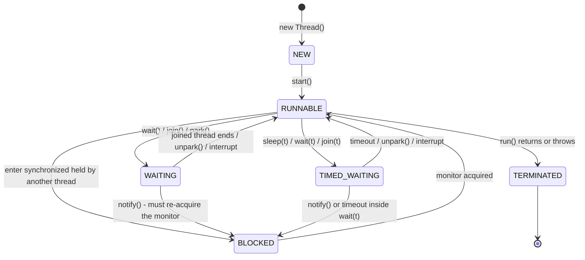
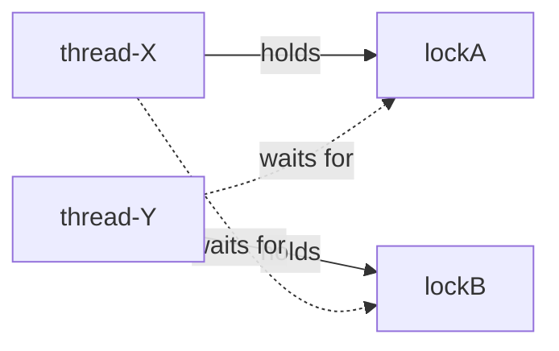
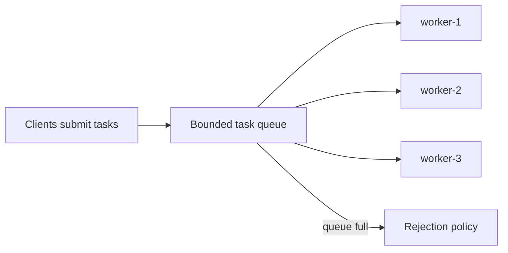
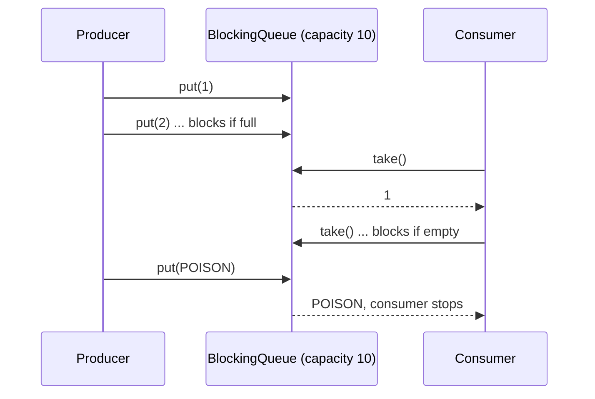
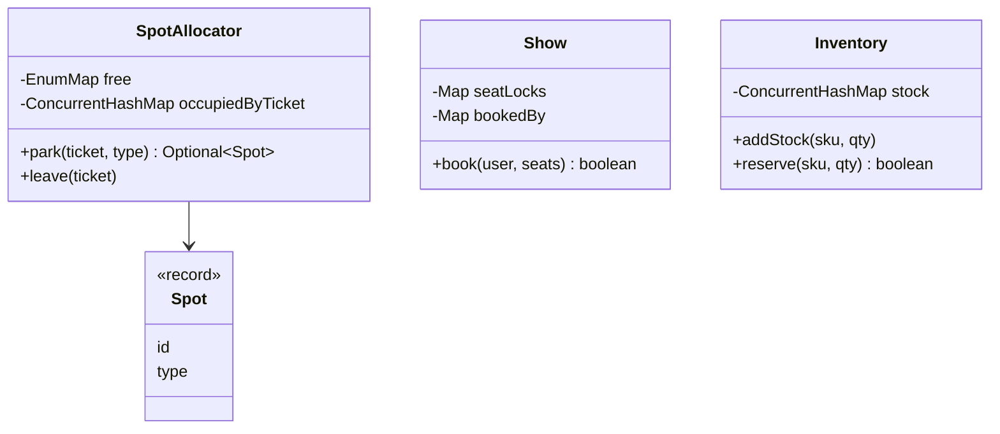

# Chapter 12 — Concurrency & Multithreading for LLD (Java)

> **Why this chapter exists.** In a low-level design (LLD) interview you will often hear: *"Now two users click **Book** on the same seat at the same moment. What happens?"* A design with no answer is incomplete. This chapter teaches, from zero, the ideas and Java tools to answer it well. Chapter 13 applies them to the classic concurrency interview problems; chapters 14–21 use them inside full case studies.

**How to read this chapter.** Each concept follows: *What it is → The problem it solves → How it works → Java example → Trade-offs (incl. when not to use it) → Common mistakes → Real-world examples → In the interview → TL;DR.* All code is Java 21, standard library only, in `code/lld/ch12/<topic>/Main.java`; listings below keep the essential lines, and every `Main` compiles and runs with the output shown. From `chapters/12-concurrency-concepts/code`:

```text
javac --release 21 -d /tmp/lld_12 $(find . -name '*.java')
java -cp /tmp/lld_12 lld.ch12.threads.Main
```

**Map of the chapter**

| Part | Sections | Code package |
|---|---|---|
| A. Foundations | 12.1 Concurrency vs parallelism · 12.2 Processes vs threads · 12.3 Thread lifecycle · 12.4 Creating threads | `threads` |
| B. What goes wrong | 12.5 Race conditions & critical sections · 12.6 Java Memory Model (visibility, happens-before, `volatile`) | `race` |
| C. Locks | 12.7 Mutex / `synchronized` · 12.8 `ReentrantLock` · 12.9 Try-lock & timed locking · 12.10 Read-write locks & `StampedLock` · 12.11 Coarse vs fine-grained locking | `locks` |
| D. Coordination | 12.12 Semaphores · 12.13 Condition variables · 12.14 `CountDownLatch` & `CyclicBarrier` | `coordination` |
| E. Lock-free | 12.15 Compare-and-swap & atomics · 12.16 Concurrent collections | `atomics`, `collections` |
| F. Liveness failures | 12.17 Deadlock · 12.18 Livelock · 12.19 Starvation | `deadlock` |
| G. Patterns | 12.20 Signaling · 12.21 Thread pool · 12.22 Producer-consumer · 12.23 Reader-writer · 12.24 Immutability & thread confinement | `patterns` |
| H. Interviews | 12.25 Concurrency in LLD interviews (parking spots, seat booking, inventory) | `lldcases` |
| | 12.26 Choosing the right tool · 12.27 Chapter self-check · 12.28 Chapter TL;DR | |

**Words you will see everywhere (defined once here):**

| Term | Meaning in one line |
|---|---|
| **Thread** | One independent sequence of instructions running inside a program. |
| **Shared state** | Data (fields, objects) that more than one thread can read or write. |
| **Thread-safe** | A class that behaves correctly no matter how threads interleave, with no extra locking by callers. |
| **Atomic** | Happens as one indivisible step: other threads see either "before" or "after", never "halfway". |
| **Lock / mutex** | A token only one thread can hold at a time. Code that needs the token waits for it. |
| **Critical section** | A piece of code that touches shared state and must not run in two threads at once. |
| **Contention** | Many threads wanting the same lock at the same time, so they queue up. |
| **Blocking** | A thread stops and waits (for a lock, I/O, a signal) instead of using the CPU. |
| **Liveness** | "Something good eventually happens" — the program keeps making progress (no deadlock, livelock, starvation). |
| **Safety** | "Nothing bad ever happens" — no corrupted data, no double booking. |

---

# Part A — Foundations

## 12.1 Concurrency vs parallelism

### What it is
- **Concurrency** is about *dealing with* many things at once: several tasks whose lifetimes overlap, possibly taking turns on one **CPU core** (one independent processing unit inside the processor; a modern CPU has several).
- **Parallelism** is about *doing* many things at once: tasks literally execute at the same instant on different cores.

One chef switching between three simmering dishes is concurrent; three chefs each cooking one dish is parallel.

### The problem it solves
Programs wait a lot — for disks, networks, databases, users. Concurrency does useful work while one task waits (better *responsiveness* and *throughput* — work finished per second; see [System Design Fundamentals](../../../system-design-patterns/modules/00-system-design-fundamentals/README.md)). Parallelism makes CPU-heavy work (sorting, image processing) finish sooner by using all cores (*speed-up*).

### How it works
1. The OS *scheduler* (the part of the operating system that decides which thread runs next) gives each runnable thread a short time slice on a core.
2. When the slice ends, or the thread blocks (for **I/O** — disk or network reads — a lock, `sleep`), the scheduler performs a **context switch**: it saves that thread's **registers** (the CPU's few, fastest storage slots) and loads another's.
3. On one core, fast switching creates the *illusion* of simultaneity → concurrency. On many cores, threads really run at the same instant → parallelism.

| | Concurrency | Parallelism |
|---|---|---|
| Core idea | Structure: many tasks in progress | Execution: many tasks running at the same instant |
| Needs multiple cores? | No | Yes |
| Main benefit | Overlapping waiting (I/O-bound work: mostly waiting on disk/network) | Speed on CPU-bound work (mostly computing) |
| Java tools | Threads, executors, virtual threads, `CompletableFuture` | Fork/Join, parallel streams, `Arrays.parallelSort` |
| Typical example | A web server handling 10,000 connections | Sorting 100 million numbers |

### Java example
§12.4's `Main`: 10,000 tasks that each *sleep* 50 ms finish in well under a second on virtual threads (concurrency hides waiting). Chapter 13's merge sort uses **Fork/Join** (the JDK framework that splits a task into subtasks run on all cores) for parallelism.

### Trade-offs
- Concurrency adds complexity (races, deadlocks) and overhead (context switches). Parallelism is capped by **Amdahl's law**: if a fraction *s* of the work is inherently sequential, speed-up with *N* cores can never exceed 1 / (s + (1 − s)/N). With 10% sequential work, even infinite cores give at most 10×.
- **Avoid** for small, fast, CPU-light tasks (splitting costs more than it saves). Single-threaded is a valid choice when it removes all locking: Redis (an in-memory key-value database) executes commands on one main thread; Node.js (a server-side JavaScript runtime) runs JavaScript on one **event-loop** thread — a single loop that handles ready events one at a time and never blocks.

### Common mistakes
- Saying "concurrent" when you mean "parallel" (and vice versa).
- Expecting more threads to always mean more speed. Past the core count, CPU-bound work gets *slower* from switching.

### Real-world examples
- **Concurrency:** Tomcat and Jetty (Java web servers) serve requests with a **pool** of threads (a fixed set of reusable workers); Netty (a Java networking library) and Node.js serve thousands of connections with a few event-loop threads.
- **Parallelism:** `Arrays.parallelSort`, parallel streams, Spark/Hadoop (distributed data-processing frameworks) splitting data across cores and machines.

### In the interview
**30-second answer:** "Concurrency is about structure — several tasks in progress, possibly interleaved on one core. Parallelism is about execution — tasks running at the same instant on several cores. Concurrency helps I/O-bound work; parallelism helps CPU-bound work."

**Follow-ups:**
- *Concurrency without parallelism?* Yes — a single core time-slicing several threads. *Parallelism without concurrency?* In a narrow sense: SIMD (one instruction on many data items) runs in parallel inside one task.
- *How many threads for a pool?* CPU-bound: about the core count (`Runtime.getRuntime().availableProcessors()`). I/O-bound: roughly cores × (1 + wait time / compute time).
- *A chat server with 50,000 idle connections?* A concurrency problem — most connections wait, not compute.
- *What limits parallel speed-up?* The sequential part (Amdahl) plus coordination overhead.

### TL;DR
Concurrency = dealing with many things (structure). Parallelism = doing many things at once (execution). I/O-bound → concurrency; CPU-bound → parallelism.

---

## 12.2 Processes vs threads

### What it is
- A **process** is a running program with its *own* memory space (**heap** — where objects live — code, open files). Processes cannot see each other's memory.
- A **thread** is a unit of execution *inside* a process. Threads share the process's heap, but each has its own **stack** (local variables, call frames) and **program counter** (address of the next instruction).

### The problem it solves
Threads let one program do several things at once while sharing data cheaply. Processes give strong isolation: one crashing does not corrupt the others.

### How it works
1. The OS creates a process with a private **virtual address space** (its own view of memory, mapped by the OS onto real RAM); it starts with one thread (`main` in Java).
2. More threads share heap objects; each gets its own stack.
3. Threads communicate through shared objects (with synchronization); processes through **pipes** (one-way byte channels), **sockets** (network-style connection endpoints), shared-memory segments or message queues (IPC).

| | Process | Thread |
|---|---|---|
| Memory | Private address space | Shares the process's heap; own stack |
| Creation cost | High (new address space) | Lower (platform thread ≈ an OS thread with ~1 MB stack reserved by default on 64-bit JVMs — Java Virtual Machines, which run Java bytecode); virtual threads are much cheaper still |
| Communication | IPC: sockets, pipes, files | Shared objects — fast, but needs synchronization |
| Failure isolation | Strong | Weak: an unhandled error can bring down the whole process (e.g. `OutOfMemoryError`) |
| Context switch | Heavier (address-space switch) | Lighter |
| Java | `ProcessBuilder`, `Runtime.exec` | `Thread`, executors |

### Java example
```java
Process p = new ProcessBuilder("ls", "-l").inheritIO().start();   // new PROCESS (separate memory)
p.waitFor();
Thread t = new Thread(() -> System.out.println("same heap, different stack"));   // new THREAD
t.start();
t.join();
```

### Trade-offs
Threads share fast, but every shared mutable field is a potential bug. Processes isolate safely, but communication is slower and needs **serialization** (turning objects into bytes). Prefer processes or **containers** (lightweight isolated environments such as Docker) when isolation matters more than speed — untrusted plugins, a crash-prone **native library** (machine code, e.g. C, called from Java).

### Common mistakes
- Thinking local variables are shared. Each thread has its own stack; only objects reachable from shared references are shared.
- One platform thread per request without limit — each has a large stack and an OS thread behind it. Use a pool, or virtual threads.

### Real-world examples
- **Google Chrome** runs tabs in separate *processes* so one crashing page does not take down the browser.
- **PostgreSQL** uses one process per connection; **MySQL** one thread per connection.
- A **JVM** is one process; application threads, **garbage-collector** threads (the GC frees unused memory) and **JIT-compiler** threads (Just-In-Time: compiles hot bytecode to machine code at run time) all live inside it.

### In the interview
**30-second answer:** "A process is an isolated program with its own memory; a thread is a path of execution inside a process that shares its heap but has its own stack. Threads are cheaper and share data easily but need synchronization; processes are isolated and communicate through IPC."

**Follow-ups:**
- *What does a thread own privately?* Its stack, program counter, and `ThreadLocal` values (variables holding a separate copy per thread).
- *Why are threads cheaper to switch?* They share the address space, so the CPU's memory mappings stay the same.
- *Two threads each declare `int x = 0;` in a method and increment it — race?* No, locals live on each stack. *Same object's field?* Yes, unless synchronized.

### TL;DR
Process = isolated, private memory. Thread = worker inside it sharing the heap, owning only its stack. Share cheaply, synchronize carefully.

---

## 12.3 Thread lifecycle & states

### What it is
`Thread.getState()` returns one of the six values of `java.lang.Thread.State`:

| State | Meaning |
|---|---|
| `NEW` | Created with `new Thread(...)`, `start()` not called yet. |
| `RUNNABLE` | Running on a CPU or ready to run. Java does not distinguish "running" from "ready"; a thread blocked in most I/O calls also shows as `RUNNABLE`. |
| `BLOCKED` | Waiting to *enter* a `synchronized` block/method whose monitor (the object's built-in lock, §12.7) another thread holds. |
| `WAITING` | Waiting with no time limit for another thread: `Object.wait()`, `Thread.join()`, `LockSupport.park()` (the low-level call that suspends a thread; `ReentrantLock`, `Condition`, `CountDownLatch` use it). |
| `TIMED_WAITING` | Same with a timeout: `Thread.sleep(ms)`, `wait(ms)`, `join(ms)`, `parkNanos`, `tryLock(timeout)`. |
| `TERMINATED` | `run()` has returned or thrown. A thread cannot be restarted. |

### The problem it solves
Knowing the states lets you read **thread dumps** (a snapshot of every thread's state and stack, via `jstack` or `jcmd <pid> Thread.print`) and diagnose hangs: many threads `BLOCKED` on one monitor → lock contention or **deadlock** (threads waiting on each other forever, §12.17); many `WAITING` on a queue → idle pool.

### How it works



- `start()` moves `NEW` → `RUNNABLE`; calling it twice throws `IllegalThreadStateException`.
- A thread woken from `wait()` must re-acquire the monitor, so it may pass through `BLOCKED` before `RUNNABLE`.
- **Interruption.** `t.interrupt()` sets a flag. If `t` is in `sleep`, `wait`, `join` (or other interruptible blocking calls) it wakes with `InterruptedException` and the flag is cleared. Interruption is *cooperative*: the thread decides how to react. `Thread.stop()` is unsafe and no longer works on modern JDKs.

### Java example
`threadStates()` in §12.4's `Main.java` drives one thread into each state and prints `getState()` (the "Thread.State tour" output lines).

### Trade-offs
It's a model, not a choice — but `RUNNABLE` hides whether the thread is *actually* on a CPU or stuck in native I/O. Never use `getState()` for program logic ("if WAITING then…"): the state changes between check and action. Use it for monitoring and debugging only.

### Common mistakes
- Calling `run()` instead of `start()`: the code runs on the *current* thread.
- Swallowing `InterruptedException` silently. Rethrow it or restore the flag with `Thread.currentThread().interrupt()`.
- Treating `BLOCKED` and `WAITING` as the same: `BLOCKED` = waiting for a *monitor*; `WAITING` = waiting for a *signal*.

### Real-world examples
A `jstack` dump showing 200 Tomcat worker threads `BLOCKED` on one `synchronized` logger or connection-pool method is the classic sign of a coarse lock bottleneck.

### In the interview
**30-second answer:** "Six states: NEW, RUNNABLE, BLOCKED, WAITING, TIMED_WAITING, TERMINATED. BLOCKED means waiting for a monitor lock; WAITING/TIMED_WAITING mean waiting for another thread's action, optionally with a timeout."

**Follow-ups:**
- *Is there a RUNNING state?* No — running and ready are both `RUNNABLE`.
- *State during `ReentrantLock.lock()` when the lock is taken?* `WAITING` (it parks via `LockSupport`) — `BLOCKED` is only for intrinsic monitors. Inside `latch.await()`: `WAITING`; inside `Thread.sleep(1000)`: `TIMED_WAITING`.
- *Restart a terminated thread?* No; create a new one (or submit the task to a pool).

### TL;DR
NEW → RUNNABLE ↔ (BLOCKED | WAITING | TIMED_WAITING) → TERMINATED. BLOCKED = waiting for a monitor; WAITING = waiting for a signal. Use `start()`, never `run()`, and respect interrupts.

---

## 12.4 Creating threads: `Thread`, `Runnable`, `Callable`, `ExecutorService`, virtual threads

### What it is

| Way | What you write | Returns a value? | Use when |
|---|---|---|---|
| Extend `Thread` | `class T extends Thread { run() }` | No | Almost never — mixes the task with the worker |
| `Runnable` | `() -> { ... }` passed to `new Thread(r)` or a pool | No | A fire-and-forget task |
| `Callable<V>` | `() -> value` (may throw checked exceptions — ones the compiler forces you to catch or declare) | Yes, via `Future<V>` | You need a result or an exception back |
| `ExecutorService` | `pool.submit(task)` | `Future<V>` | Default choice: reuse threads, limit concurrency |
| Virtual threads (Java 21) | `Thread.ofVirtual().start(r)` / `Executors.newVirtualThreadPerTaskExecutor()` | via `Future` | Very many *blocking* (I/O-bound) tasks |

A `Runnable` is the job description, a `Thread` the worker, an `ExecutorService` the staffing agency, a `Future` the receipt you collect the result with.

### The problem it solves
An OS thread per task is expensive and unbounded. Executors separate **what** to run (task) from **how** it runs (pooling, queueing, scheduling). Virtual threads remove the cost problem for blocking code, allowing a simple "one thread per request" style again.

### How it works
1. Write the task as `Runnable` (no result) or `Callable<V>`; submit it to an `ExecutorService` (e.g. `Executors.newFixedThreadPool(n)`) and get a `Future<V>`.
2. `future.get()` blocks until the result is ready (or rethrows the task's exception wrapped in `ExecutionException`).
3. When done, `shutdown()` (stop accepting tasks) and `awaitTermination(...)`; or, since Java 19, use **try-with-resources** (a `try (...)` block that closes its resource automatically) — `ExecutorService.close()` waits for tasks to finish.
4. **Virtual threads** (final in Java 21, JEP 444 — a JEP, JDK Enhancement Proposal, is the numbered design document for a Java feature) are lightweight JVM-managed threads. Many run on a small pool of OS "carrier" threads (a `ForkJoinPool` sized to the core count by default). When a virtual thread blocks on I/O, `sleep`, or a `java.util.concurrent` lock, the JVM *unmounts* it and the carrier runs another. The exception is **pinning**: a virtual thread that cannot unmount keeps its carrier busy while blocked. On Java 21–23 this happens when blocking inside `synchronized` (including `Object.wait()`) or a native method; JDK 24 (JEP 491) removed the `synchronized` case, leaving mainly native/foreign-function calls (and blocking inside a class initializer).

### Java example
Essential lines of `code/lld/ch12/threads/Main.java` (full file: also the `GreeterThread extends Thread` and `Runnable` demos, and the `awaitState` polling helper):

```java
ExecutorService pool = Executors.newFixedThreadPool(2);
try {
    Future<Integer> future = pool.submit(() -> IntStream.rangeClosed(1, 100).sum()); // returns at once
    System.out.println("3) Callable+Future  -> sum 1..100 = " + future.get());       // get() blocks
    List<Callable<String>> jobs = List.of(() -> "A", () -> "B", () -> "C");
    for (Future<String> f : pool.invokeAll(jobs)) results.add(f.get());               // input order kept
} finally {
    pool.shutdown();                                  // stop accepting work
    pool.awaitTermination(5, TimeUnit.SECONDS);       // wait for running tasks
}

// 10,000 blocking tasks: each sleep parks its virtual thread, freeing the carrier OS thread.
try (ExecutorService vexec = Executors.newVirtualThreadPerTaskExecutor()) {
    for (int i = 0; i < 10_000; i++) fs.add(vexec.submit(() -> { Thread.sleep(50); return 1; }));
    for (Future<Integer> f : fs) sum += f.get();
}                                                     // close() waits for all tasks

// threadStates(): drive threads into each state and print getState()
synchronized (monitor) {                              // main holds the monitor...
    blocked = new Thread(() -> { synchronized (monitor) { } }, "blocked");
    blocked.start();
    awaitState(blocked, Thread.State.BLOCKED);        // polls: state changes are not instant
    System.out.println("waiting to enter synchronized : " + blocked.getState());
}
```

`t.start()` creates a new call stack; `t.join()` waits and also makes everything `t` wrote visible to the joiner (a *happens-before* edge, §12.6). Output (full program):

```text
=== Creating threads ===
1) extends Thread   -> hello from greeter-thread
2) Runnable         -> hello from runnable-thread
3) Callable+Future  -> sum 1..100 = 5050
4) ExecutorService  -> invokeAll results [A, B, C]
=== Virtual threads (Java 21) ===
5) virtual thread   -> isVirtual=true
10,000 tasks that each sleep 50 ms completed: 10000 (well under 10,000 x 50 ms = 500 s: true)
=== Thread.State tour ===
after new Thread()            : NEW
inside Thread.sleep(10s)      : TIMED_WAITING
after run() returns           : TERMINATED
inside latch.await()          : WAITING
waiting to enter synchronized : BLOCKED
busy running on a CPU         : RUNNABLE
```

### Trade-offs

| | Platform thread pool | Virtual threads |
|---|---|---|
| Cost per thread | High (OS thread + large stack) | Very low (heap-allocated stack that grows as needed) |
| How many | Hundreds to a few thousand | Millions |
| Best for | CPU-bound work (size ≈ cores) | Blocking I/O-bound work |
| Limits concurrency? | Yes, by pool size | No — add a `Semaphore` if a downstream resource needs a limit |
| Pooling | Yes | No — never pool virtual threads; create one per task |

**Avoid:** virtual threads for CPU-heavy computation (no extra cores — use a fixed pool or Fork/Join); on Java 21–23, blocking inside `synchronized` on a virtual thread (pinned — prefer `ReentrantLock` around blocking calls there); `Executors.newCachedThreadPool()` for unbounded incoming traffic (unlimited platform threads).

### Common mistakes
- Forgetting `shutdown()`: non-daemon pool threads keep the JVM alive after `main` ends (a **daemon** thread is a background thread that does not keep the JVM running).
- Ignoring the `Future` of a submitted task: its exception is captured there and lost if you never call `get()`.
- `Executors.newFixedThreadPool` for untrusted load: its queue is **unbounded** (`LinkedBlockingQueue`), so a burst can exhaust memory. Build a `ThreadPoolExecutor` with a bounded queue (§12.21).

### Real-world examples
- `Executors` factory methods are the textbook **Factory** pattern in the JDK.
- **Spring** (the most widely used Java application framework): `@Async` runs methods on a `TaskExecutor` (commonly `ThreadPoolTaskExecutor`); Spring Boot 3.2+ runs request handling on virtual threads with `spring.threads.virtual.enabled=true`; Tomcat and Jetty can use virtual threads too.

### In the interview
**30-second answer:** "I never manage raw threads in business code. I describe work as `Runnable`/`Callable` and submit it to an `ExecutorService` sized for the workload: about cores for CPU-bound work, a bounded queue with a rejection policy for incoming traffic. For many blocking I/O tasks on Java 21, I use virtual threads — one per task — and protect scarce resources with a semaphore" (a counter of permits capping how many threads proceed at once, §12.12).

**Follow-ups:**
- *`Runnable` vs `Callable`?* `Callable` returns a value and may throw checked exceptions.
- *`submit` vs `execute`?* `execute(Runnable)` returns nothing and uncaught exceptions go to the thread's handler; `submit` returns a `Future` that captures the exception.
- *What does `CompletableFuture` add?* Non-blocking composition — `thenApply`, `thenCombine`, `allOf`, `exceptionally` — without `get()` at each step.
- *`thread.run()`?* Runs synchronously on the current thread. *Why not pool virtual threads?* They are cheap; pooling adds nothing and hides one-thread-per-task. Limit concurrency with a semaphore.

### TL;DR
Tasks = `Runnable`/`Callable`. Run them with an `ExecutorService`, get results via `Future`. Java 21 virtual threads make one-thread-per-blocking-task cheap. Always shut pools down.

---

# Part B — What goes wrong

## 12.5 Race conditions & critical sections

### What it is
- A **race condition** is a bug where the result depends on the unlucky timing (interleaving) of threads.
- A **critical section** is code that touches shared mutable state and must therefore run in only one thread at a time.
- A **data race** (the precise Java Memory Model term) is two threads accessing the same variable, at least one writing, with no happens-before ordering between them (§12.6).

Example: two people share an account with ₹100; both check the balance at once, both see ₹100, both withdraw ₹80 — the bank paid ₹160 from ₹100. "Check, then withdraw" was the critical section.

### The problem it solves
Knowing *which* code needs protection and *why*. The two classic shapes:

| Shape | Example | Why it breaks |
|---|---|---|
| **Read-modify-write** | `count++` | It is really `tmp = count; tmp = tmp + 1; count = tmp`. Two threads read the same old value; one update is lost. |
| **Check-then-act** | `if (!map.containsKey(k)) map.put(k, v);` or `if (seat.isFree()) seat.book(me);` | The condition can become false between the check and the act. |

### How it works
1. Find all **shared mutable state** (fields reachable by more than one thread and changed after construction).
2. Find every **invariant** (a rule that must always hold) involving it — "a seat has at most one owner", "balance ≥ 0".
3. Mark the code that reads and then updates that state as a **critical section**.
4. Make each critical section **atomic**: a lock (`synchronized`, `ReentrantLock`), a single atomic operation (`AtomicInteger.incrementAndGet`, `ConcurrentHashMap.putIfAbsent`), or remove the sharing (immutability — objects that never change; confinement — data only one thread touches; §12.24).

### Java example
Essential lines of `code/lld/ch12/race/Main.java` (4 threads × 250,000 increments each, joined before reading):

```java
static class UnsafeCounter implements Counter {        // BROKEN: count++ is 3 steps
    private int count;
    public void increment() { count++; }
}
static class SynchronizedCounter implements Counter {  // Fix 1: mutex (intrinsic lock)
    private int count;
    public synchronized void increment() { count++; }
    public synchronized int get() { return count; }    // reads need the lock too (visibility)
}
static class AtomicCounter implements Counter {        // Fix 2: lock-free CAS (§12.15)
    private final AtomicInteger count = new AtomicInteger();
    public void increment() { count.incrementAndGet(); }
}

// Check-then-act fixed with ONE atomic call: only succeeds if the seat is still free (0)
AtomicInteger seatOwner = new AtomicInteger(0);
Thread a = new Thread(() -> seatOwner.compareAndSet(0, 1));
Thread b = new Thread(() -> seatOwner.compareAndSet(0, 2));

static class Worker implements Runnable {               // visibility (§12.6)
    private volatile boolean running = true;           // without volatile the loop may never see 'false'
    public void run() { while (running) iterations++; }
    void stop() { running = false; }
}
```

Output (lost updates change every run — that unpredictability *is* the race):

```text
expected                : 1000000
unsafe counter          : LOST 680044 updates
synchronized counter    : 1000000
atomic counter          : 1000000
seat has exactly one owner: true
volatile flag stopped worker: true
```

### Trade-offs

| Fix | Pros | Cons |
|---|---|---|
| Lock (`synchronized`/`ReentrantLock`) | Protects any multi-step, multi-variable invariant | Threads wait; risk of deadlock if nested |
| Atomic variable / atomic collection method | Fast, no blocking, no deadlock | Only covers one variable or one map entry |
| Immutability / confinement | No synchronization at all | Must redesign so state isn't shared or changed |

Don't lock data that is never shared (locals, thread-confined objects) or never changed after safe construction.

### Common mistakes
- Protecting writes but not reads — a reader can see stale or half-updated state.
- Two *separate* thread-safe calls assumed atomic together: `if (!map.containsKey(k)) map.put(k,v)` on a `ConcurrentHashMap` is still a race. Use `putIfAbsent`/`computeIfAbsent`.
- Locking on different objects in different methods — each lock protects nothing against the other.
- Believing a race is fixed because tests pass. Races show up rarely and under load.

### Real-world examples
Double-booking in ticketing, overselling in **flash sales** (short, heavily promoted sales of limited stock), duplicate payments on a double-clicked "Pay" — all check-then-act races, solved with atomic operations, locks, or database constraints: unique indexes, `SELECT ... FOR UPDATE` (a SQL read that locks the rows it returns), optimistic version columns (a version checked on every update, so a write based on stale data fails).

### In the interview
**30-second answer:** "A race condition is when correctness depends on thread timing. The two common shapes are read-modify-write, like `count++`, and check-then-act, like 'if seat is free then book it'. I find the shared mutable state and its invariants, and make each critical section atomic — with a lock, an atomic operation like `putIfAbsent` or `compareAndSet`, or by removing sharing."

**Follow-ups:**
- *Is `volatile int count; count++` safe?* No — `volatile` gives visibility, not atomicity.
- *Is `ConcurrentHashMap` enough to make my class thread-safe?* Only if every invariant lives in single map operations; multi-key invariants still need a lock or careful design.
- *The race in `if (cache.get(k) == null) cache.put(k, load(k));`?* Check-then-act; both threads may load and put. Use `computeIfAbsent`.

### TL;DR
Race = result depends on timing. Watch for read-modify-write and check-then-act. Make every critical section atomic, including reads.

---

## 12.6 Java Memory Model basics: visibility, happens-before, `volatile`

### What it is
The **Java Memory Model (JMM)** (Java Language Specification, chapter 17) defines *when a write by one thread is guaranteed to be seen by a read in another*. Without the right synchronization a thread may see a stale value — or never see the update.

- **Visibility**: will thread B *see* what thread A wrote? Each thread may work from **CPU caches** (small, fast memories next to each core) and registers rather than main memory.
- **Reordering**: compilers, the JIT and CPUs may reorder instructions as long as a *single* thread can't tell. Other threads can.
- **Happens-before (HB)**: if action X *happens-before* Y, X's effects are visible to Y and X appears ordered before Y.
- **`volatile`**: a field modifier making reads/writes of that field visible to all threads and ordered (no caching in registers, no harmful reordering around it).

### The problem it solves
`while (running) iterations++;` with a *non-volatile* `running` may never stop: the JIT may read `running` once and turn the loop into `while (true)`. Such bugs are invisible in code review unless you know the JMM.

### How it works
The key **happens-before rules** (quotable in an interview):

| Rule | Meaning |
|---|---|
| Program order | Within one thread, each action HB the next one. |
| Monitor lock | An **unlock** of a monitor HB every later **lock** of the *same* monitor. |
| Volatile | A **write** to a volatile field HB every later **read** of that field. |
| Thread start | `t.start()` HB every action in thread `t`. |
| Thread join | Every action in `t` HB another thread's successful return from `t.join()`. |
| Transitivity | If A HB B and B HB C, then A HB C. |
| Final fields | Strictly a separate guarantee (JLS §17.5), not an HB edge: once a constructor finishes without leaking `this`, any thread that obtains a reference sees the correct values of its `final` fields (and of objects reachable through them, as of the end of the constructor) — even if the reference was shared without synchronization. |
| `java.util.concurrent` | E.g. putting into a `BlockingQueue` HB taking it out; `countDown()` HB a return from `await()`; `Future` completion HB `get()` returning. |

Apply them: for each shared variable, is every write-then-read pair connected by an HB edge? Same lock → yes. A single independent flag or reference → `volatile` is enough. A compound update (`x++`, check-then-act) → `volatile` is **not** enough; use a lock or atomic.

**Safe publication.** An object is *safely published* when its reference becomes visible through an HB edge: a `volatile` field (or `AtomicReference`), a `final` field of a properly constructed object, a static initializer, a concurrent collection, or a write under a lock the reader also takes. Otherwise a reader might see the reference but not the fully constructed object.

**Double-checked locking** (lazy Singleton — a class with exactly one shared instance, created on first use) is only correct if the field is `volatile`:

```java
class Config {
    private static volatile Config instance;          // volatile is essential
    static Config get() {
        Config c = instance;
        if (c == null) {
            synchronized (Config.class) {
                c = instance;
                if (c == null) instance = c = new Config();
            }
        }
        return c;
    }
}
```
Simpler and just as lazy: the *holder idiom* — `private static class Holder { static final Config I = new Config(); }` — class initialization is thread-safe by the JLS.

### Java example
`Worker` in §12.5: `private volatile boolean running`. The write `running = false` in `main` HB the worker's next read, so the loop exits — output `volatile flag stopped worker: true`.

### Trade-offs

| Tool | Visibility | Atomic compound ops | Blocking | Cost |
|---|---|---|---|---|
| `volatile` | Yes | No | No | Low |
| `synchronized` / `Lock` | Yes (for code under the same lock) | Yes | Yes | Medium |
| `Atomic*` | Yes | Yes, for one variable | No | Low–medium |
| `final` (immutable) | Yes, after construction | N/A — never changes | No | Free |

Don't use `volatile` for anything combining several steps or variables.

### Common mistakes
- "It works on my laptop" — x86 CPUs (Intel/AMD) reorder less than ARM ones (Apple Silicon, AWS Graviton). Code without HB edges may fail only on other hardware or after **JIT warm-up** (once hot code is compiled and optimised).
- Leaking `this` from a constructor (registering a listener, starting a thread) — others may see a half-built object, and final-field guarantees are lost.
- Synchronizing the writer only. The reader must use the *same* lock.

### Real-world examples
- `volatile boolean running` shutdown flags in server loops and schedulers.
- `ConcurrentHashMap`, `AtomicInteger`, `CopyOnWriteArrayList` use volatile reads/writes and CAS (§12.15) internally to give HB guarantees without reader locks.
- `String` is immutable with `final` fields, so strings are shared freely.

### In the interview
**30-second answer:** "The Java Memory Model says a thread is only guaranteed to see another thread's write if there's a happens-before edge — unlock-then-lock of the same monitor, a volatile write-then-read, thread start/join, or a concurrent-collection handoff. `volatile` gives visibility and ordering for a single variable but not atomicity; for compound actions I use locks or atomics."

**Follow-ups:**
- *Why must the double-checked-locking field be volatile?* Otherwise the reference write can be reordered before the constructor's writes, so another thread sees a non-null, half-initialized object.
- *Does `volatile` make `long`/`double` writes atomic?* Yes — the JLS lets non-volatile 64-bit writes split into two 32-bit halves (rare on 64-bit JVMs, but allowed); volatile ones cannot.
- *A sets non-volatile `ready = true` after preparing data; B spins on `ready`. Two bugs?* B may never see `true`, or may see `true` but stale data (reordering).
- *Which JDK classes give HB for you?* Locks, `Atomic*`, concurrent collections, `BlockingQueue`, `CountDownLatch`, `Future`, `ExecutorService.submit`.

### TL;DR
Writes are only guaranteed visible across threads through happens-before edges. `volatile` = visibility + ordering for one variable, not atomicity. Locks = visibility + atomicity. Publish objects safely.

---

# Part C — Locks

## 12.7 Mutex (mutual exclusion) and `synchronized`

### What it is
A **mutex** (mutual-exclusion lock) can be held by at most one thread. Every Java object has a built-in mutex, its **intrinsic lock** or **monitor**, acquired by `synchronized`:

```java
public synchronized void deposit(int amt) { balance += amt; }   // locks 'this'
public static synchronized void log() { ... }                    // locks the Class object
void transfer() { synchronized (lock) { ... } }                  // locks 'lock'
```

### The problem it solves
Makes a critical section **atomic** (no interleaving) and **visible** (the next thread to take the lock sees everything done before the unlock).

### How it works
1. At `synchronized (obj)`, a thread takes `obj`'s monitor if free; otherwise it goes `BLOCKED` until free.
2. Leaving the block — normally *or by exception* — releases the monitor automatically.
3. Intrinsic locks are **reentrant**: the holder can re-enter `synchronized` code on the same object without blocking itself.

### Java example
`SynchronizedCounter` (§12.5). Lock on a **private final** object, not `this`, so outside code can't take your lock:

```java
private final Object lock = new Object();
void add(Item i) { synchronized (lock) { items.add(i); } }
```

### Trade-offs
| Pros | Cons |
|---|---|
| Simplest syntax; auto-release even on exceptions | No timeout, no `tryLock`, not interruptible while waiting |
| JVM-optimised (uncontended locking is cheap) | One wait-set (threads parked in `wait()`) per object — only one "condition" |
| Reentrant | No fairness option (fair = longest-waiting thread first); on Java 21–23 pins virtual threads when blocking inside |

Need a timeout, interruptible waiting, fairness, several condition queues, or read/write separation → `ReentrantLock`/`ReentrantReadWriteLock`.

### Common mistakes
- Synchronizing on a *changing* reference (`synchronized (list)` after `list = new ArrayList<>()`) — threads lock different objects.
- Synchronizing on **boxed values** (objects like `Integer` wrapping a primitive) or string literals (`synchronized ("LOCK")`, `synchronized (Integer.valueOf(1))`) — possibly shared JVM-wide, causing mysterious contention or deadlocks.
- Slow I/O while holding the lock.

### Real-world examples
`Vector`, `Hashtable`, `StringBuffer` and `Collections.synchronizedList(...)` wrap every method in `synchronized` — thread-safe per call but slow under contention, hence replaced by `ArrayList`/`HashMap`/`StringBuilder` plus concurrent collections.

### In the interview
**30-second answer:** "A mutex lets one thread at a time into a critical section. In Java, `synchronized` uses the object's monitor: it's reentrant, released automatically, and gives visibility. I lock on a private final object and keep the section short."

**Follow-ups:**
- *What does a static synchronized method lock?* The `Class` object (e.g. `Counter.class`) — a different lock from instance methods. Synchronized methods on *different* objects don't block each other.
- *Is `synchronized` slow?* Uncontended, it's cheap. Under heavy contention any lock is slow — reduce sharing or use finer locks.
- *Does an exception inside release the lock?* Yes.

### TL;DR
Mutex = one holder at a time. `synchronized` is Java's built-in, reentrant, auto-releasing mutex. Lock a private final object; keep the section short.

---

## 12.8 `ReentrantLock` and reentrancy

### What it is
`java.util.concurrent.locks.ReentrantLock` is an explicit mutex with `synchronized`'s meaning plus extras. **Reentrant** means the holder can acquire it again (a hold count goes up) and must release it as many times.

### The problem it solves
- Without reentrancy, a locked method calling another locked method of the same object would **deadlock with itself**.
- Beyond `synchronized`: `tryLock()` / `tryLock(timeout)`, `lockInterruptibly()`, optional **fairness** (`new ReentrantLock(true)`), multiple `Condition`s per lock, and queries like `isLocked()`, `getHoldCount()`.

### How it works
`lock()` acquires (hold count 0 → 1) or waits; the same thread calling `lock()` again → 2, no waiting; each `unlock()` decrements, and at 0 a waiter may proceed. **Always** release in `finally`:

```java
lock.lock();
try {
    // critical section
} finally {
    lock.unlock();
}
```

### Java example
Essential lines of `code/lld/ch12/locks/Main.java` (also used by §12.9–12.10):

```java
static class Account {                                   // reentrancy
    private final ReentrantLock lock = new ReentrantLock();
    void withdraw(int amount) {
        lock.lock();
        try { if (canWithdraw(amount)) balance -= amount; }   // calls another locked method
        finally { lock.unlock(); }
    }
    boolean canWithdraw(int amount) {
        lock.lock();                                     // same thread re-acquires: no self-deadlock
        try { System.out.println("hold count inside nested call = " + lock.getHoldCount());
              return balance >= amount; }
        finally { lock.unlock(); }
    }
}

// tryLock with timeout (§12.9): main holds 'printer'; the worker gives up after 100 ms
if (printer.tryLock(100, TimeUnit.MILLISECONDS)) {
    try { System.out.println("worker: got the printer"); } finally { printer.unlock(); }
} else System.out.println("worker: printer busy for 100 ms, doing something else instead");

static class ConfigStore {                               // read-write lock (§12.10)
    private final ReadWriteLock rw = new ReentrantReadWriteLock();
    private final Lock r = rw.readLock(), w = rw.writeLock();
    String get(String k) { r.lock(); try { return map.get(k); } finally { r.unlock(); } }
    void put(String k, String v) { w.lock(); try { map.put(k, v); } finally { w.unlock(); } }
}
// demo: 3 readers wait at a CyclicBarrier(3) WHILE holding the read lock -
// if the read lock were exclusive, the barrier would time out.

static class Point {                                     // StampedLock optimistic read (§12.10)
    private final StampedLock sl = new StampedLock();
    double distanceFromOrigin() {
        long stamp = sl.tryOptimisticRead();             // no locking, just a version number
        double cx = x, cy = y;                           // copy fields to locals
        if (!sl.validate(stamp)) {                       // a writer slipped in: real read lock
            stamp = sl.readLock();
            try { cx = x; cy = y; } finally { sl.unlockRead(stamp); }
        }
        return Math.hypot(cx, cy);
    }
}
```

Output (full program):

```text
=== Reentrancy ===
hold count inside nested call = 2
balance = 70
=== tryLock with timeout ===
worker: printer busy for 100 ms, doing something else instead
tryLock() now (free)  = true
=== ReadWriteLock: readers share ===
3 readers held the read lock at the same time: true
=== StampedLock optimistic read ===
distance = 5.0
```

### Trade-offs

| Feature | `synchronized` | `ReentrantLock` |
|---|---|---|
| Release | Automatic | Manual (`finally`) — easy to forget |
| Try / timeout | No | `tryLock()`, `tryLock(t, unit)` |
| Interruptible wait | No | `lockInterruptibly()` |
| Fairness | No | Optional (`true` = longest waiter first; lower throughput) |
| Conditions | One wait set | Many `Condition` objects |
| Reentrant | Yes | Yes |

If you need none of the extras, `synchronized` is shorter and can't be left locked by mistake.

### Common mistakes
- `lock()` *inside* the `try` — if `lock()` threw, `finally` would `unlock()` a lock you don't hold (`IllegalMonitorStateException`). Call `lock()` just before `try`.
- Missing `unlock()` on an early `return` or exception path — the lock stays held forever.
- Fairness "to be safe" — fair locks are noticeably slower; use only when starvation is real.

### Real-world examples
`ArrayBlockingQueue`, `LinkedBlockingQueue` and `ThreadPoolExecutor` use `ReentrantLock` internally (`CopyOnWriteArrayList` did up to Java 8; since Java 9 it uses `synchronized` on an internal lock object). `ReentrantLock`, `ReentrantReadWriteLock`, `Semaphore` and `CountDownLatch` are built on `AbstractQueuedSynchronizer` (AQS — the JDK's framework for building locks and synchronizers); `CyclicBarrier` on a `ReentrantLock` + `Condition`.

### In the interview
**30-second answer:** "`ReentrantLock` is an explicit mutex with the same semantics as `synchronized` plus try-lock with timeout, interruptible acquisition, optional fairness, and multiple conditions. Reentrant means the owner can re-acquire it; the hold count must drop to zero to release. I always unlock in `finally`."

**Follow-ups:**
- *Why would a non-reentrant lock deadlock?* A holder calling another method needing the same lock waits for itself forever.
- *Is `StampedLock` reentrant?* No — a thread holding its write lock that calls `writeLock()` or `readLock()` again blocks forever. It also has no owner and no `Condition`s.
- *`lock()` 3 times, `unlock()` 2 times — free?* No; hold count is 1. *`new ReentrantLock(true)`?* Waiters get the lock in roughly FIFO (first in, first out) order, at a throughput cost.

### TL;DR
`ReentrantLock` = `synchronized` + tryLock/timeout/interruptible/fairness/conditions. Owner can re-enter. `lock(); try { … } finally { unlock(); }` always.

---

## 12.9 Try-lock & timed locking

### What it is
- `tryLock()` — take the lock **only if free right now**; returns `true`/`false` immediately.
- `tryLock(timeout, unit)` — wait up to the timeout, then return `false`. Interruptible.

### The problem it solves
Plain `lock()` waits forever: hung requests, permanent deadlocks. Try-lock lets a thread **give up and do something else** — fail fast, retry later, return "busy" — and breaks the *hold and wait* condition of deadlock (§12.17).

### How it works
1. `tryLock(timeout)`. If `true`: `try { work } finally { unlock(); }`.
2. If `false`: fallback — return an error, retry with **back-off** (waiting a short while before trying again), or release other locks you hold.
3. With several locks: if any `tryLock` fails, **release everything you hold**, back off for a random short time, retry.

### Java example
`locks/Main.java` (§12.8): the worker's `printer.tryLock(100, TimeUnit.MILLISECONDS)` returns `false` while `main` holds it, so it prints the fallback. `transferTryLock` in `deadlock/Main.java` (§12.17) uses try-lock plus random back-off to avoid deadlock.

### Trade-offs
| Pros | Cons |
|---|---|
| No infinite waits; can report "busy" | Caller must handle failure paths |
| Breaks deadlock (hold-and-wait) | Retry loops without random back-off can **livelock** |
| Timeouts give predictable **latency** (time one operation takes) | Choosing the timeout is a judgement call |

When failing isn't acceptable and waiting is fine (a background **batch job** — bulk processing with no user waiting) plain `lock()` is simpler.

### Common mistakes
- Calling `unlock()` after `tryLock` returned `false` → `IllegalMonitorStateException`.
- Retrying immediately in a tight loop — burns CPU and can livelock with another thread doing the same.
- Expecting untimed `tryLock()` to respect fairness — it *barges* (takes a free lock even if others are queued); `tryLock(0, unit)` respects fairness.

### Real-world examples
- **Distributed locks** (shared by many servers, kept in an external store) follow the same idea — try for a bounded time, give up, or let the lock expire: Redis `SET key value NX PX 30000` (set only if absent, expire after 30,000 ms), Redisson's (a Java Redis client) `tryLock(wait, lease, unit)`, ZooKeeper (a cluster coordination service) recipes.
- Ticketing seat holds: if someone else's checkout has the seat, you're told immediately.

### In the interview
**30-second answer:** "`tryLock` with a timeout lets a thread give up instead of waiting forever. I use it when latency matters or when I need several locks: if I can't get all of them, I release what I hold, back off randomly and retry — which prevents deadlock."

**Follow-ups:**
- *Why random back-off?* Threads retrying on the same schedule can collide forever (livelock); randomness breaks the symmetry.
- *`tryLock(0, SECONDS)`?* Tries once without waiting but, unlike `tryLock()`, respects a fair lock's queue.

### TL;DR
Try-lock = acquire only if available (optionally within a timeout). Handle `false`, release everything on failure, back off randomly.

---

## 12.10 Read-write locks: `ReadWriteLock` and `StampedLock`

### What it is
A **read-write lock** is a pair: a shared **read lock** (many readers at once) and an exclusive **write lock** (one writer, no readers). Java has `ReentrantReadWriteLock` and, since Java 8, `StampedLock` (adds cheap *optimistic reads*).

### The problem it solves
With a plain mutex, readers block each other though reading changes nothing. For **read-heavy** data (configuration, **caches** — fast copies of data kept for quick reads — price catalogues) reads can proceed in parallel.

### How it works
1. Reader: `readLock().lock()` succeeds if no writer holds the write lock; many readers may hold it.
2. Writer: `writeLock().lock()` waits until there are **no readers and no writer**.
3. `ReentrantReadWriteLock`: a writer may **downgrade** (take the read lock while holding the write lock, then release the write lock); a reader may **not upgrade** (asking for the write lock while holding the read lock deadlocks — it waits for all readers, including itself).
4. `StampedLock` optimistic read: `long s = tryOptimisticRead()` (no locking) → copy fields to locals → `validate(s)`; if a writer intervened, `validate` returns `false` and you retry with a real `readLock()`.

### Java example
`ConfigStore` and `Point` in `locks/Main.java` (§12.8); `3 readers held the read lock at the same time: true` proves readers share.

### Trade-offs

| | `synchronized`/`ReentrantLock` | `ReentrantReadWriteLock` | `StampedLock` |
|---|---|---|---|
| Parallel readers | No | Yes | Yes (optimistic reads take no lock at all) |
| Reentrant | Yes | Yes | **No** |
| Conditions | Yes | Write lock only | No |
| Overhead | Lowest | Higher bookkeeping | Low for optimistic reads; more complex code |
| Best when | Short sections or write-heavy | Reads ≫ writes and reads are not trivially short | Very read-heavy, tiny critical sections (e.g. coordinates) |

**Avoid** for write-heavy or very short sections (the bookkeeping can make it *slower* than a mutex), or when a copy-on-write snapshot is simpler — an immutable map in a `volatile` field replaced on write (§12.23).

### Common mistakes
- Upgrading read → write in `ReentrantReadWriteLock` (self-deadlock).
- Modifying state while holding only the *read* lock.
- Using optimistic-read data before `validate`, or reading fields directly instead of copying to locals first.
- Writer starvation in non-fair mode under a constant stream of readers (use `new ReentrantReadWriteLock(true)` if it matters; `StampedLock` gives no fairness guarantee either).

### Real-world examples
In-memory caches, configuration holders, routing tables read on every request and updated rarely. `ConcurrentHashMap` goes further: reads take no lock.

### In the interview
**30-second answer:** "A read-write lock lets many readers in together but gives writers exclusive access. It helps when reads vastly outnumber writes. `ReentrantReadWriteLock` allows downgrade but not upgrade; `StampedLock` adds optimistic reads that take no lock and are validated afterwards, but it's not reentrant."

**Follow-ups:**
- *Thread-safe config service?* A RW lock around a `HashMap`, or an immutable `Map` in a `volatile` field replaced atomically on reload (readers never block).
- *Two readers and a writer arrive?* The readers run together; the writer runs alone.
- *Why copy to locals in an optimistic read?* So after `validate` succeeds you use a consistent snapshot, not fields that may change after the check.

### TL;DR
Many readers OR one writer. Use for read-heavy shared data. No upgrade in `ReentrantReadWriteLock`; `StampedLock` = optimistic, non-reentrant.

---

## 12.11 Coarse-grained vs fine-grained locking

### What it is
- **Coarse-grained locking**: one lock protects a lot of state (the whole parking lot).
- **Fine-grained locking**: many locks, each protecting a small piece (per floor, per spot, or per **hash bucket** — one slot of the internal array a hash map spreads entries over).

### The problem it solves
The right granularity balances **simplicity and safety** against **throughput under contention**.

### How it works
1. Start coarse: one lock around the whole object. Measure.
2. If contention is the bottleneck, split state into **independent** parts whose invariants don't cross, each with its own lock (**lock splitting**).
3. For a big collection, use **lock striping**: N locks; item *i* uses lock `hash(i) % N` (Java 7's `ConcurrentHashMap` had 16 segments by default; chapter 13 builds a striped map).
4. When an operation needs several fine locks (booking seats A1 and A2), acquire them in a **global order** to avoid deadlock.
5. Keep critical sections short: slow work (I/O, computation) *outside* the lock.

| | Coarse-grained | Fine-grained |
|---|---|---|
| Simplicity | High | Lower — more locks, ordering rules |
| Concurrency | Low: one thread at a time | High: threads on different parts run together |
| Deadlock risk | Low (one lock) | Higher (many locks) — needs lock ordering |
| Overhead | One lock | Memory and bookkeeping for many locks |
| Cross-part invariants | Easy | Hard — may need to take several locks |

### Java example
Coarse: `SynchronizedCounter` (§12.5). Fine: `Show` in `lldcases/Main.java` (§12.25) has **one lock per seat**, taken in sorted order; chapter 13's `StripedHashMap` has one lock per stripe.

### Trade-offs
See the table. Rule of thumb: *correct first, then fine-grained only where **profiling** (measuring where time is really spent) shows contention*. Don't split when an invariant spans the parts ("total seats booked ≤ capacity" across all rows) unless you also handle the cross-part check.

### Common mistakes
- Premature fine-graining → complexity and deadlocks without real benefit.
- Locking fine-grained parts in inconsistent order.
- Fine locks that still funnel through one shared counter, which becomes the **bottleneck** (the one slow point limiting the system) — use `LongAdder`, a counter spreading updates over several cells (§12.15).

### Real-world examples
- `ConcurrentHashMap` (Java 8+) locks only the head node of one bin for writes.
- Databases: row-level locks (fine) vs table-level locks (coarse).
- Python's GIL (Global Interpreter Lock) is a famous coarse lock: simple, but one thread runs Python **bytecode** (the interpreter's compiled instructions) at a time.

### In the interview
**30-second answer:** "I start with one lock for correctness, then refine where contention matters: per-floor or per-spot locks for a parking lot, per-show or per-seat locks for booking, striping for maps. Finer locks raise throughput but need a consistent lock order to avoid deadlock."

**Follow-ups:**
- *Per-show or per-seat locking for BookMyShow (an Indian movie-ticketing site)?* Per-show is simple and usually enough (contention is per show). Per-seat allows more parallelism, but multi-seat bookings must lock seats in sorted order.
- *Lock striping?* A fixed array of N locks, each item mapped to one by hash — fine-grained locking with a bounded lock count.

### TL;DR
Coarse = simple, low throughput. Fine = parallel, complex, deadlock-prone. Start coarse, refine with measurements, and order your locks.

---

# Part D — Coordination

## 12.12 Semaphores

### What it is
A **semaphore** holds a number of **permits**. `acquire()` takes one (waiting if none are left); `release()` gives one back. `java.util.concurrent.Semaphore` implements it. With 1 permit it behaves like a mutex, *except* it has no owner — any thread may release it.

### The problem it solves
- **Limiting concurrency**: at most N threads use a resource (DB connections, **API** calls — calls to another service's programming interface — GPU slots).
- **Signaling** between threads: 0 permits means "wait until someone signals" (used heavily in chapter 13).

### How it works
1. `new Semaphore(n)` — n permits, **non-fair** by default: a thread calling `acquire()` may *barge* ahead of waiting threads. `new Semaphore(n, true)` is **fair**: permits go to waiters in FIFO order (at some throughput cost). Even on a fair semaphore the untimed `tryAcquire()` barges; `tryAcquire(0, TimeUnit.SECONDS)` respects fairness.
2. `acquire()` — if permits > 0, decrement and continue; else wait. `release()` — increment and wake a waiter. Also `tryAcquire()`, `tryAcquire(timeout, unit)`, `acquire(k)`.
3. Always `release()` in `finally` after a *successful* `acquire()`.

### Java example
Essential lines of `code/lld/ch12/coordination/Main.java` (it also holds the §12.13–12.14 demos):

```java
Semaphore connections = new Semaphore(3);                 // at most 3 concurrent "DB connections"
for (int i = 0; i < 10; i++) pool.submit(() -> {          // 10 tasks on a 10-thread pool
    connections.acquire();                                // blocks when 0 permits left
    try {
        maxSeen.accumulateAndGet(inUse.incrementAndGet(), Math::max);   // peak concurrent users
        Thread.sleep(30);                                 // "run a query"
        inUse.decrementAndGet();
    } finally { connections.release(); }                  // give the permit back
});
```

Output (full program; later lines belong to §12.13–12.14):

```text
=== Semaphore: at most 3 concurrent DB connections ===
10 queries done, never more than 3 at once: true
=== wait/notifyAll: one-slot mailbox ===
received in order: [m1, m2, m3]
=== Lock + Condition: strict turn-taking ===
PING PONG PING PONG PING PONG
=== CountDownLatch: wait for 3 services to start ===
all services ready: true (count now 0)
=== CyclicBarrier: 3 workers, 2 phases ===
phase 1 complete: all 3 workers arrived
phase 2 complete: all 3 workers arrived
```

### Trade-offs
| Pros | Cons |
|---|---|
| Simple way to cap concurrency | No owner: a bug can release more than acquired (permits grow) |
| Works as a signal (0 permits) | Doesn't protect data by itself — only counts |

Don't use a semaphore as a mutex around shared data when a lock would do — locks have ownership checks and reentrancy.

### Common mistakes
- Releasing on a path where `acquire` never succeeded (e.g. `acquire` interrupted) → permits leak upward.
- Not releasing on exceptions → permits slowly disappear, the system stalls.

### Real-world examples
- **Bulkhead pattern** (isolating resources per dependency, like a ship's watertight compartments, so one failure can't sink everything): Resilience4j's `SemaphoreBulkhead` (and Hystrix's — Netflix's older fault-tolerance library — semaphore isolation) cap concurrent calls to a dependency.
- **Connection pools** (open database connections reused across requests) bound how many are handed out (HikariCP, a popular JDBC pool, enforces its maximum pool size).
- With virtual threads, a `Semaphore` is the recommended way to limit calls to a slow **downstream** service (one your code calls).

### In the interview
**30-second answer:** "A semaphore is a permit counter: acquire takes a permit or waits, release returns one. I use it to cap concurrent access to a limited resource — a bulkhead — or with zero initial permits as a signal from one thread to another. Unlike a lock it has no owner."

**Follow-ups:**
- *Binary semaphore vs mutex?* Both allow one holder, but a mutex has an owner (only the holder may unlock; usually reentrant); a binary semaphore can be released by any thread and isn't reentrant.
- *`new Semaphore(0)`: what does `acquire()` do?* Waits until some thread calls `release()` — a signal.

### TL;DR
Semaphore = N permits. Cap concurrency or signal. No ownership, so release carefully in `finally`.

---

## 12.13 Condition variables: `wait/notify` and `Condition`

### What it is
A **condition variable** lets a thread *sleep until some condition about shared state becomes true*, releasing the lock while it sleeps, and lets another thread *wake it* after changing that state.

- Built-in: `Object.wait()`, `notify()`, `notifyAll()` — inside `synchronized` on the same object.
- Explicit: `Condition c = lock.newCondition(); c.await(); c.signal(); c.signalAll();` — while holding that `ReentrantLock`.

### The problem it solves
Waiting for a state change without **busy-waiting** (spinning in a loop wasting CPU) and without missing the moment it happens.

### How it works
The canonical pattern — memorize it:

```java
synchronized (lock) {                 // or: lock.lock(); try {
    while (!conditionHolds()) {       // ALWAYS a while loop, never if
        lock.wait();                  //   cond.await();  releases the lock while waiting
    }
    doAction();                       // condition is true AND we hold the lock
    lock.notifyAll();                 //   cond.signal()/signalAll() if we changed state others wait for
}                                     // } finally { lock.unlock(); }
```

`wait()`/`await()` **atomically releases the lock** and sleeps; on waking the thread **re-acquires the lock** before returning, then re-checks the condition.

Why the `while` loop? (a) **Spurious wakeups** — the JLS and the `Condition` docs allow a thread to wake without being notified. (b) Another thread may grab the state between the notify and your re-acquisition. (c) With `notifyAll`, several threads wake but only one can succeed.

`notify` vs `notifyAll`: `notify()` wakes one arbitrary waiter. If different kinds of threads (producers and consumers) wait on one monitor, `notify()` can wake the wrong kind and everyone sleeps forever. Use `notifyAll()` with a single monitor, or separate `Condition`s (`notFull`, `notEmpty`) and targeted `signal()`.

### Java example
From `coordination/Main.java` — output `received in order: [m1, m2, m3]` and `PING PONG PING PONG PING PONG` (§12.12):

```java
static class Mailbox<T> {                               // one slot: wait/notifyAll
    private T item;                                     // guarded by 'this'
    public synchronized void put(T x) throws InterruptedException {
        while (item != null) wait();                    // ALWAYS wait in a loop
        item = x;
        notifyAll();                                    // wake the taker(s)
    }
    public synchronized T take() throws InterruptedException {
        while (item == null) wait();
        T x = item; item = null;
        notifyAll();                                    // wake the putter(s)
        return x;
    }
}
// TurnTable (ReentrantLock + Condition): two threads alternate PING / PONG
lock.lock();
try {
    while (pingsTurn != iAmPing) turnChanged.await();   // releases lock while waiting
    out.add(word);
    pingsTurn = !pingsTurn;
    turnChanged.signalAll();
} finally { lock.unlock(); }
```

### Trade-offs

| | `wait/notify` | `Lock` + `Condition` |
|---|---|---|
| Conditions per lock | One wait set | Many (e.g. `notFull`, `notEmpty`) |
| Targeted wake-up | No — use `notifyAll` | Yes — `signal()` on the right condition |
| Timed wait | `wait(ms)` | `await(t, unit)`, `awaitNanos` (returns time left) |
| Verbosity | Less | More (manual unlock) |

Usually you don't need raw condition variables: `BlockingQueue`, `Semaphore`, `CountDownLatch`, `CompletableFuture` solve the common waiting problems. Write your own only for custom coordination (interview problems, custom synchronizers).

### Common mistakes
- `if` instead of `while` around `wait()`.
- `wait()`/`notify()` without holding that object's monitor → `IllegalMonitorStateException`; or calling `wait()` on one object while synchronized on another.
- Changing state *without* notifying → waiters sleep forever (a "lost wakeup").

### Real-world examples
`ArrayBlockingQueue` uses one `ReentrantLock` with two `Condition`s, `notEmpty` and `notFull` — the pattern built by hand in chapter 13.

### In the interview
**30-second answer:** "A condition variable lets a thread release a lock and sleep until another thread changes the state and signals it. I always wait in a while loop that re-checks the condition, because of spurious wakeups and competing threads. With one monitor I use notifyAll; with ReentrantLock I use separate Conditions and targeted signal."

**Follow-ups:**
- *Why call `wait()` while holding the lock?* So check-then-sleep is atomic; otherwise a notify could land between your check and your wait and be lost.
- *What does `wait()` do with the monitor?* Releases it while sleeping and re-acquires it before returning.

### TL;DR
Condition variable = "release lock, sleep until signalled, re-acquire, re-check". Always `while`, prefer `notifyAll` or separate `Condition`s.

---

## 12.14 `CountDownLatch` and `CyclicBarrier`

### What it is
- **`CountDownLatch(n)`**: a one-time gate. Threads call `await()` until `countDown()` has been called *n* times. Cannot be reset.
- **`CyclicBarrier(n, action)`**: a reusable meeting point. Each of *n* threads calls `await()`; when the *n*th arrives, the optional barrier action runs once, all are released, and the barrier resets.

### The problem it solves
Coordinating *phases*: "start only after all services are up" (latch), "all workers finish step 1 before anyone starts step 2" (barrier), "release all test threads at the same instant" (latch with count 1 — used throughout this book to maximise contention).

### How it works

| | `CountDownLatch` | `CyclicBarrier` |
|---|---|---|
| Who waits | Any thread(s) calling `await()` | The *n* participating threads themselves |
| Who counts | Anyone calling `countDown()` (need not wait) | Arrival at `await()` |
| Reusable | No | Yes (auto-reset after each trip) |
| Extra | Count reaching 0 is permanent: later `await()` calls return at once. One thread may call `countDown()` several times | Barrier action runs once per trip (by the last thread to arrive); if one party is interrupted/times out, the barrier **breaks** and others get `BrokenBarrierException` (`reset()` repairs it) |
| Happens-before | Actions before `countDown()` HB actions after the matching `await()` returns | Actions before `await()` HB the barrier action, which HB actions after the other parties return from `await()` |

`Phaser` (Java 7) generalises both: parties register/deregister dynamically across many phases.

### Java example
From `coordination/Main.java` — output `all services ready: true (count now 0)`, `phase 1 complete…`, `phase 2 complete…` (§12.12):

```java
CountDownLatch ready = new CountDownLatch(3);
for (String svc : List.of("db", "cache", "search"))
    new Thread(() -> { /* ...warm up... */ ready.countDown(); }, svc).start();
boolean allUp = ready.await(2, TimeUnit.SECONDS);       // one-shot: cannot be reset

CyclicBarrier barrier = new CyclicBarrier(3,             // action runs once per trip
        () -> System.out.println("phase " + phase.incrementAndGet() + " complete: all 3 workers arrived"));
// each of 3 workers, twice: sleep a random time, then barrier.await()  (reusable every phase)
```

### Trade-offs
Latch: dead simple, one-shot. Barrier: reusable but fragile — one failing party breaks it for all. For "wait for these N tasks and collect results", `ExecutorService.invokeAll` or `CompletableFuture.allOf(...)` is usually clearer.

### Common mistakes
- Waiting forever because a worker threw before `countDown()` — put `countDown()` in `finally`; use `await(timeout)`.
- A barrier with fewer threads than parties → everyone waits forever.

### Real-world examples
- Test harnesses release N threads together with a `CountDownLatch(1)` to maximise races (JCStress — OpenJDK's harness for testing concurrency correctness — uses stronger tools, same idea).
- Application start-up: wait for caches, DB pools and message consumers before accepting traffic.

### In the interview
**30-second answer:** "`CountDownLatch` is a one-shot gate that opens after N countDowns; `CyclicBarrier` is a reusable rendezvous where N threads wait for each other each phase, optionally running an action when all arrive."

**Follow-ups:**
- *Can a latch be reset?* No — create a new one or use `CyclicBarrier`/`Phaser`.
- *3 workers syncing at the end of every simulation step?* `CyclicBarrier(3)`.

### TL;DR
Latch = one-shot "wait for N events". Barrier = reusable "wait for N threads". Put `countDown` in `finally`; use timeouts.

---

# Part E — Lock-free

## 12.15 Compare-and-swap (CAS) & atomics

### What it is
**Compare-and-swap** is a single CPU instruction (`LOCK CMPXCHG` on x86; LL/SC — load-linked/store-conditional — or CAS instructions on ARM): "if the value at this address is still `expected`, replace it with `new` and report success; otherwise change nothing and report failure." Java exposes it through `java.util.concurrent.atomic` — `AtomicInteger`, `AtomicLong`, `AtomicBoolean`, `AtomicReference`, `AtomicIntegerArray`, `LongAdder` — and through `VarHandle`.

### The problem it solves
Atomic updates **without locks** (**lock-free**: no thread ever blocks another, and some thread always makes progress): no blocking, no deadlock, usually faster under low-to-moderate contention. Lock-free data structures and the JDK's own concurrency utilities are built on it.

### How it works
The **CAS retry loop**: read the current value → compute the new value → `compareAndSet(current, new)`; if it fails, another thread changed the value — start again. Helpers run the loop for you: `incrementAndGet`, `addAndGet`, `updateAndGet(fn)`, `accumulateAndGet(x, fn)` (the function may run more than once, so it must be side-effect-free).

**`LongAdder`** spreads updates over several internal cells when contended and sums them on `sum()` — much faster than `AtomicLong` for hot counters (metrics), but `sum()` is not an atomic snapshot.

**ABA problem.** A value goes A → B → A; a thread that read A earlier sees A again and its CAS succeeds, though the state changed. It matters for pointer-based structures (reusing nodes in a lock-free stack). Fix: attach a version — `AtomicStampedReference` (value + int stamp) or `AtomicMarkableReference`. (In Java, garbage collection prevents the classic node-reuse ABA for freshly allocated nodes, which is why the Treiber stack below is safe.)

### Java example
Essential lines of `code/lld/ch12/atomics/Main.java`:

```java
static int casIncrement(AtomicInteger a) {               // what incrementAndGet does inside
    while (true) {
        int current = a.get();                           // 1. read
        int next = current + 1;                          // 2. compute
        if (a.compareAndSet(current, next)) return next; // 3. write only if unchanged
    }                                                    // 4. someone won the race: retry
}

static class LockFreeStack<T> {                           // Treiber stack: one AtomicReference
    private record Node<T>(T value, Node<T> next) { }
    private final AtomicReference<Node<T>> head = new AtomicReference<>();
    void push(T v) {
        Node<T> oldHead, newHead;
        do { oldHead = head.get(); newHead = new Node<>(v, oldHead); }
        while (!head.compareAndSet(oldHead, newHead));
    }
    T pop() {
        Node<T> oldHead;
        do { oldHead = head.get(); if (oldHead == null) return null; }
        while (!head.compareAndSet(oldHead, oldHead.next()));
        return oldHead.value();
    }
}

highWater.accumulateAndGet(i, Math::max);                 // atomic "max"
LongAdder hits = new LongAdder();                         // 8 threads x 100,000 increments

AtomicReference<String> ref = new AtomicReference<>("A"); // ABA
String seen = ref.get(); ref.set("B"); ref.set("A");
ref.compareAndSet(seen, "C");                             // true: plain CAS can't tell
AtomicStampedReference<String> sref = new AtomicStampedReference<>("A", 0);
// read value + stamp 0, then set("B", 1), set("A", 2):
sref.compareAndSet(seen2, "C", seenStamp, seenStamp + 1); // false: the stamp moved
```

Output (full program; 4 threads in each of the first three demos):

```text
hand-written CAS loop counter = 400000
atomic max                    = 999
lock-free stack popped        = 40000
LongAdder sum                 = 800000
plain CAS after A->B->A succeeds   : true
stamped CAS after A->B->A succeeds : false
```

### Trade-offs

| | Locks | CAS / atomics |
|---|---|---|
| Blocking | Yes | No (threads retry) |
| Deadlock | Possible | Impossible (no locks) |
| Scope | Any number of variables | One variable/reference per CAS |
| Under heavy contention | Threads sleep (saves CPU) | Many failed retries (wastes CPU) — use `LongAdder` or striping |
| Difficulty | Moderate | Hard for anything beyond counters/flags/one reference |

Invariants spanning several variables (moving money between two accounts) can't use a single CAS — use a lock, or put all fields into one immutable object and CAS the reference (as chapter 13's lock-free token bucket does).

### Common mistakes
- Separate `get()` then `set()` on an atomic → still a race. Use `compareAndSet`/`updateAndGet`.
- Side effects inside `updateAndGet` lambdas (they may run several times).
- `AtomicLong` for a very hot metrics counter where `LongAdder` scales better.

### Real-world examples
- `ConcurrentHashMap` inserts into empty bins with CAS; `ConcurrentLinkedQueue` is a lock-free (Michael–Scott) queue; AQS (behind `ReentrantLock`) CASes its state.
- Optimistic locking in databases and ORMs (Object-Relational Mappers — libraries mapping objects to tables; JPA `@Version`, `UPDATE ... WHERE version = ?`) is CAS at the database level.
- LMAX Disruptor (a high-performance inter-thread messaging library) uses CAS-based sequences for its lock-free **ring buffer** (a fixed-size array used as a circular queue).

### In the interview
**30-second answer:** "CAS atomically updates a value only if it still equals what I read; otherwise I retry. Java's atomic classes wrap it, so counters, flags and single references can be updated without locks and without deadlock. It covers one variable at a time, can suffer ABA — fixed with a stamped reference — and under heavy contention I prefer `LongAdder`."

**Follow-ups:**
- *Is lock-free always faster?* No. Under heavy contention retries waste CPU; a lock that parks threads can be better.
- *Lock-free update of two fields?* Put them in an immutable object and CAS an `AtomicReference` to it.
- *A failed `compareAndSet` means?* Another thread changed the value after you read it; re-read and retry.

### TL;DR
CAS = "update only if unchanged", retried in a loop. Atomics give lock-free, deadlock-free updates to one variable. Watch ABA; use `LongAdder` for hot counters.

---

## 12.16 Concurrent collections

### What it is
Thread-safe collections in `java.util.concurrent` built for high concurrency (unlike the old fully-`synchronized` `Vector`/`Hashtable`):

| Need | Use | Key behaviour |
|---|---|---|
| Map | `ConcurrentHashMap` | Lock-free reads; writes lock only one bin; atomic `putIfAbsent`, `computeIfAbsent`, `compute`, `merge`; **no null keys/values**; *weakly consistent* iterators (below) |
| Sorted map/set | `ConcurrentSkipListMap` / `Set` | Lock-free, sorted, O(log n) (cost grows very slowly with size) |
| List read ≫ write | `CopyOnWriteArrayList` / `Set` | Each write copies the whole array; iteration uses a snapshot (never throws CME, `ConcurrentModificationException`) |
| Queue (non-blocking) | `ConcurrentLinkedQueue` / `Deque` | Lock-free; `poll()` returns null when empty |
| Queue (blocking) | `ArrayBlockingQueue` (bounded), `LinkedBlockingQueue` (optionally bounded), `PriorityBlockingQueue`, `DelayQueue`, `SynchronousQueue` (no capacity: hand-off), `LinkedTransferQueue` | `put` waits when full, `take` waits when empty; `offer`/`poll` with timeouts |

**Two `ConcurrentHashMap` guarantees worth quoting exactly:**
- **`computeIfAbsent` / `compute` / `merge` are atomic.** The whole call is performed atomically, and for `computeIfAbsent` the mapping function is invoked **exactly once if the key is absent, otherwise not at all** — two racing threads never both create a value for one key. Some updates by other threads (at least those hitting the same bin) block while the function runs, so keep it short and never touch the same map inside it. (The default `ConcurrentMap.computeIfAbsent` used by some other maps, e.g. `ConcurrentSkipListMap`, may call the function more than once and discard results — only the final put is atomic.)
- **Iterators are weakly consistent.** They never throw `ConcurrentModificationException`, may proceed during modification, return each element at most once, and reflect the map's state at some point at or after creation — later updates *may or may not* show. `size()`/`isEmpty()` are likewise only estimates while updates are in flight.

### The problem it solves
Wrapping a `HashMap` in one lock **serialises** every access (one at a time). Concurrent collections let threads work on different parts simultaneously and offer **atomic compound operations** so common patterns need no external lock.

### How it works
1. Pick the collection by access pattern (table above).
2. Replace check-then-act sequences with one atomic method:
   - `if (!m.containsKey(k)) m.put(k, v)` → `m.putIfAbsent(k, v)`
   - `m.put(k, m.get(k) + 1)` → `m.merge(k, 1, Integer::sum)`
   - lazy creation → `m.computeIfAbsent(k, key -> new ...)`
3. Hand-offs between threads → a `BlockingQueue` (producer-consumer, §12.22).
4. *Compound operations across several calls are still not atomic.*

### Java example
Essential lines of `code/lld/ch12/collections/Main.java`:

```java
for (String w : words) wordCount.merge(w, 1, Integer::sum);       // 4 threads x 1000 reps: exact totals
ordersByUser.computeIfAbsent("alice", k -> new CopyOnWriteArrayList<>()).add("order-1");  // create once
seats.putIfAbsent("A1", "bob");      // null = you won; the existing value = someone else has it

CopyOnWriteArrayList<String> listeners = new CopyOnWriteArrayList<>(List.of("L1", "L2"));
for (String l : listeners) listeners.add(l + "-new");             // iterates a snapshot: no CME

BlockingQueue<Integer> q = new ArrayBlockingQueue<>(2);           // bounded = back-pressure
q.offer(3);                          // false when full;  q.poll(50, MILLISECONDS) -> null when empty
```

Output (full program):

```text
word counts (4 threads x 1000 reps): {apple=12000, banana=8000, cherry=4000}
alice's orders: [order-1, order-2]
first putIfAbsent returns : null
second putIfAbsent returns: bob  (seat already bob's)
iterated 2 items; list now [L1, L2, L1-new, L2-new]
offer 1: true, offer 2: true, offer 3: false (full)
take -> 1, poll -> 2, poll(50ms) on empty -> null
```

### Trade-offs

| Collection | Great for | Bad for |
|---|---|---|
| `ConcurrentHashMap` | General shared maps, caches, counters | Multi-key atomic operations; `size()` is only an estimate under concurrent updates |
| `CopyOnWriteArrayList` | Listener lists, rarely-changed config | Frequent writes (O(n) copy each) |
| `Collections.synchronizedMap` | Legacy code, low contention | High contention; iteration still needs manual `synchronized(map)` |
| `ArrayBlockingQueue` | Bounded hand-off with back-pressure | Very high throughput (single lock for put/take) |
| `LinkedBlockingQueue` | Higher throughput (separate put/take locks) | Default constructor is **unbounded** (capacity `Integer.MAX_VALUE`) |

Thread-confined objects are faster as plain `HashMap`/`ArrayList`; a transaction across several keys is clearer with one lock (or a database).

### Common mistakes
- Slow work or calling back into the same map inside `computeIfAbsent`/`compute` — the function runs with the bin locked; recursive updates can throw `IllegalStateException` or deadlock.
- `null` in a `ConcurrentHashMap` → `NullPointerException`.
- Unbounded queues that silently grow until `OutOfMemoryError`.

### Real-world examples
- Caffeine's (a Java caching library) cache is built on `ConcurrentHashMap`; Guava's (Google's core Java library) `LocalCache` uses a segmented design derived from Java 7's `ConcurrentHashMap`.
- Guava's `EventBus` keeps each event type's subscribers in a `CopyOnWriteArraySet` — listener lists are the textbook copy-on-write case.
- Log4j2's async **appenders** (components writing log events to a destination) and other logging frameworks hand events to a writer thread through queues.

### In the interview
**30-second answer:** "I use `ConcurrentHashMap` for shared maps and its atomic methods — `putIfAbsent`, `computeIfAbsent`, `merge` — instead of check-then-act. `CopyOnWriteArrayList` for read-mostly lists like listeners. `BlockingQueue`, preferably bounded, to hand work between threads."

**Follow-ups:**
- *How does Java 8+ `ConcurrentHashMap` achieve concurrency?* Lock-free (volatile) reads. Writes CAS into empty bins, otherwise `synchronized` on the bin's first node; long bins become **red-black trees** (self-balancing sorted binary trees); resizing is cooperative across threads. (Java 7 used 16 lock-striped segments by default.)
- *Why no nulls?* `get(k) == null` must unambiguously mean "absent"; you can't follow up with `containsKey` atomically.
- *Atomic word count?* `map.merge(word, 1, Integer::sum)`. *Why no CME on a COW list?* It iterates an immutable snapshot.

### TL;DR
`ConcurrentHashMap` + atomic methods for maps, COW lists for read-mostly lists, bounded `BlockingQueue` for hand-offs. Single calls are atomic; sequences of calls are not.

---

# Part F — Liveness failures

## 12.17 Deadlock

### What it is
A **deadlock** is when two or more threads each wait forever for a resource another one holds. Nobody can proceed.

### The problem it solves
Understanding deadlock lets you *design it out*. It requires all four **Coffman conditions** (Coffman et al., 1971) at once — break **any one** and deadlock is impossible:

| # | Condition | Meaning | How to break it |
|---|---|---|---|
| 1 | **Mutual exclusion** | A resource can be held by only one thread | Lock-free/immutable data, or shareable resources (read locks) |
| 2 | **Hold and wait** | A thread holds one resource while waiting for another | Acquire all at once, or `tryLock` and release everything on failure |
| 3 | **No preemption** | Resources can't be taken away; only the holder releases | Timeouts (`tryLock(timeout)`), lock **leases** (locks that expire automatically) |
| 4 | **Circular wait** | A cycle: T1 waits for T2's lock, T2 waits for T1's | **Global lock ordering** (always lock lower id first) |



### How it works
1. **Prevention by lock ordering (most common):** a total order over locks (account id, seat id, `System.identityHashCode` with a tie-breaker lock); always acquire in that order.
2. **Prevention by try-lock:** `tryLock(timeout)` each lock; on failure release all held locks, wait a random short time, retry.
3. **Avoid nested locks:** call alien code (listeners, callbacks) *outside* your lock.
4. **Detection:** thread dumps (`jstack`/`jcmd`) print "Found one Java-level deadlock"; programmatically, `ThreadMXBean.findDeadlockedThreads()` (the JDK's management interface for inspecting threads).
5. **Avoidance** (Banker's algorithm — grant a request only if every thread can still finish) exists in OS theory but is rarely used in application code.

### Java example
Essential lines of `code/lld/ch12/deadlock/Main.java`:

```java
// Real deadlock: opposite lock order; a CyclicBarrier(2) forces the bad interleaving every time.
Thread x = new Thread(() -> { synchronized (lockA) { await(bothHoldOne); synchronized (lockB) { } } }, "thread-X");
Thread y = new Thread(() -> { synchronized (lockB) { await(bothHoldOne); synchronized (lockA) { } } }, "thread-Y");
x.setDaemon(true); y.setDaemon(true);                      // daemon: the JVM can still exit
long[] ids = ManagementFactory.getThreadMXBean().findDeadlockedThreads();   // polled until non-null

// Fix 1: global lock ordering (smaller id first) - circular wait impossible
static void transferOrdered(Account from, Account to, int amount) {
    Account first = from.id < to.id ? from : to, second = from.id < to.id ? to : from;
    first.lock.lock();
    try {
        second.lock.lock();
        try { if (from.balance >= amount) { from.balance -= amount; to.balance += amount; } }
        finally { second.lock.unlock(); }
    } finally { first.lock.unlock(); }
}

// Fix 2: tryLock + random back-off - breaks "hold and wait"
while (true) {
    if (from.lock.tryLock(1, TimeUnit.MILLISECONDS)) {
        try {
            if (to.lock.tryLock(1, TimeUnit.MILLISECONDS)) {
                try { /* move money */ return; } finally { to.lock.unlock(); }
            }
        } finally { from.lock.unlock(); }               // give up what we hold
    }
    // Without random back-off both threads could retry in lock-step forever (LIVELOCK).
    Thread.sleep(0, ThreadLocalRandom.current().nextInt(1, 100_000));
}
```

Output (full program; 2 × 50,000 opposite-direction ordered transfers, 2 × 5,000 try-lock transfers — money is conserved):

```text
deadlock detected between: [thread-X, thread-Y]  (states BLOCKED, BLOCKED)
lock ordering: finished, total money = 2000
tryLock + back-off: finished, total money = 2000
```

### Trade-offs

| Strategy | Pros | Cons |
|---|---|---|
| Lock ordering | Simple, zero runtime cost | Needs a stable global order; hard across modules |
| Try-lock + back-off | Works without an order; bounded waits | Retry logic; possible livelock without randomness |
| Single coarse lock | No deadlock among your locks | Lower throughput |
| Lock-free / immutable | No locks at all | Harder to design |

You always want to prevent deadlock — but don't add complicated detection/recovery in application code when simple lock ordering would prevent it.

### Common mistakes
- Calling a listener or another object's synchronized method while holding your own lock (hidden nested locking).
- Ordering by `hashCode()` without handling equal hashes.
- *Resource* deadlocks: a pool of 10 threads where each task submits a sub-task to the **same** pool and waits for it — when all 10 wait, nothing runs (thread-starvation deadlock).

### Real-world examples
- Databases (MySQL InnoDB, PostgreSQL) detect deadlocks between **transactions** (groups of operations that succeed or fail as one unit) and abort one as a victim — "detect and recover".
- Bank transfer systems lock accounts in id order — lock ordering.

### In the interview
**30-second answer:** "Deadlock needs four conditions: mutual exclusion, hold-and-wait, no preemption, and circular wait. I break circular wait with a global lock order — e.g. lock seats or accounts in ascending id — or break hold-and-wait with tryLock with timeout and release-and-retry. I avoid calling external code while holding a lock, and I'd detect it in production with thread dumps."

**Follow-ups:**
- *Two accounts with the same id?* Same account → one lock (transfer to self is a no-op or rejected).
- *Find a deadlock in production?* `jstack <pid>` or `jcmd <pid> Thread.print`; monitoring can call `ThreadMXBean.findDeadlockedThreads()`.
- *Which condition does lock ordering break?* Circular wait. *`tryLock` + release?* Hold and wait (and effectively no-preemption, by giving up).

### TL;DR
Deadlock = cycle of waiting. Needs all 4 Coffman conditions. Break one: lock ordering (circular wait) or tryLock + release (hold and wait). Don't call alien code under a lock.

---

## 12.18 Livelock

### What it is
A **livelock** is when threads are not blocked — they keep running and reacting to each other — but make **no progress** (two people in a corridor both stepping aside the same way, again and again).

### The problem it solves
Recognising it. Livelocks often appear *as a side effect of deadlock avoidance*: threads that both `tryLock`, fail, release and retry at the same rhythm can collide forever.

### How it works (and how to fix it)
Thread 1 takes A, tries B, fails, releases A; thread 2 takes B, tries A, fails, releases B; both retry immediately → same collision forever. **Fixes:** random back-off (different waits break the symmetry), exponential back-off, a consistent lock order (no retries needed), or a priority/tie-breaker (e.g. the older transaction wins).

### Java example
`transferTryLock` in `deadlock/Main.java` sleeps a **random** number of nanoseconds (`ThreadLocalRandom`) after a failed attempt; without it the threads could, in principle, fail in lock-step forever.

### Trade-offs
Random back-off makes progress very likely but adds latency; exponential back-off adapts to contention. Never design retry loops that react only to each other with no randomness or tie-breaker.

### Common mistakes
- Fixed retry delays (`sleep(10)` for everyone).
- Retrying forever without a limit or alert.

### Real-world examples
- **Ethernet (CSMA/CD)** (classic wired-network rule: listen before sending, detect collisions) uses *binary exponential back-off* (doubling the maximum random wait after each collision) for exactly this reason.
- AWS SDK (Amazon Web Services client libraries) and Resilience4j retry policies use exponential back-off **with jitter** (a small random amount added to each wait) to stop **retry storms** (crowds of clients retrying at the same moment).

### In the interview
**30-second answer:** "Livelock is when threads keep reacting to each other without progress — like two people side-stepping in a corridor. It often comes from symmetric retry logic; I fix it with randomized or exponential back-off, or remove retries by using a lock order."

**Follow-up:** *Thread states, deadlock vs livelock?* Deadlocked threads are blocked/waiting; livelocked threads are `RUNNABLE` but achieve nothing.

### TL;DR
Livelock = busy but no progress. Break symmetry with jittered back-off or a tie-breaker.

---

## 12.19 Starvation (and fairness)

### What it is
**Starvation** is when a thread waits indefinitely because others keep getting the resource first, even though the system as a whole progresses.

### The problem it solves
Recognising it. Causes: unfair (barging) locks under heavy contention, a writer behind a constant stream of readers in a read-write lock, low thread priority, a long task hogging a single-thread executor.

### How it works (fixes)
1. **Fair** locks/semaphores where it matters: `new ReentrantLock(true)`, `new Semaphore(n, true)`, `new ReentrantReadWriteLock(true)` (fair = longest waiter next).
2. Short critical sections, so the lock is free more often.
3. Separate pools for slow and fast work (bulkheads).
4. Don't rely on `Thread.setPriority` — its effect is OS-dependent.

### Java example
Chapter 13's Dining Philosophers `Waiter` uses `new Semaphore(n - 1, true)` so no philosopher waits forever for a seat.

### Trade-offs
Fairness prevents starvation but reduces throughput (more context switches, no barging). Don't make every lock fair "just in case" — only where starvation is seen or arguable.

### Common mistakes
Confusing starvation with deadlock: in starvation *someone* progresses; in deadlock *nobody* does.

### Real-world examples
OS schedulers use *aging* (raising the priority of long-waiting processes); Linux's schedulers (CFS, and its successor EEVDF since **kernel** — the core of the OS — 6.6) aim to give every runnable task a fair share of CPU.

### In the interview
**30-second answer:** "Starvation is when a thread never gets a resource because others always win — e.g. writers behind endless readers. Fair locks, short critical sections and separate pools fix it, at some throughput cost." (Writer starvation in `ReentrantReadWriteLock`: construct it fair.)

### TL;DR
Starvation = some thread never gets a turn. Fairness, short sections, separate pools.

---

# Part G — Concurrency patterns

The next five patterns share one runnable file, `code/lld/ch12/patterns/Main.java`; each section quotes its essential lines. Output of the full program:

```text
=== Signaling: B must run after A ===
A: charge payment
B: send email (after payment)
=== Thread pool ===
hand-made pool ran 20 tasks on 3 threads
ThreadPoolExecutor + CompletableFuture: total = 118
=== Producer-consumer ===
consumed sum of 1..1000 = 500500 (expected 500500)
=== Immutability ===
o1 = [pen], o2 = [pen, book]
=== Thread confinement (ThreadLocal) ===
Hello, T1
Hello, T2
```

## 12.20 Signaling pattern

### What it is
One thread **notifies** another that an event happened so the second can proceed: "B must run after A" (a relay baton hand-over).

### The problem it solves
Enforcing ordering between threads without busy-waiting (spinning on a flag).

### How it works
1. Create a signal object in the "not yet" state: `new Semaphore(0)`, `new CountDownLatch(1)`, a `CompletableFuture`, or a flag + condition variable.
2. The waiter calls `acquire()` / `await()` / `join()`; the signaller calls `release()` / `countDown()` / `complete(value)`.
3. The waiter wakes; the signal also provides happens-before, so it sees everything A did.

| Tool | Reusable | Carries a value | Good for |
|---|---|---|---|
| `Semaphore(0)` | Yes (each release = one signal) | No | Ping-pong between threads (FooBar, chapter 13) |
| `CountDownLatch(1)` | No | No | One-time "ready/go" |
| `CompletableFuture` | No | Yes | "Here is the result" |
| Condition variable | Yes | Via shared state | Complex conditions |

### Java example
B starts first but must wait; A's line always prints first:

```java
Semaphore aDone = new Semaphore(0);                      // 0 permits = "not signalled yet"
Thread b = new Thread(() -> { aDone.acquire(); log.add("B: send email (after payment)"); });
Thread a = new Thread(() -> { log.add("A: charge payment"); aDone.release(); });
b.start(); a.start();
```

### Trade-offs
Semaphores are compact but easy to mis-count; latches can't be reset; futures are clean but single-use. If the "signal" is really "here's a work item", use a `BlockingQueue` (producer-consumer).

### Common mistakes
Signalling before the waiter waits, with a tool that *forgets* signals (plain `notify()` without a state flag = lost wakeup). Semaphores and latches remember.

### Real-world examples
`CompletableFuture` chains in Spring WebFlux (Spring's non-blocking web framework)/Netty **callbacks** (functions handed to a library so it can call you back later); start-up gates; "order paid → send confirmation" flows inside one service.

### In the interview
"Signaling means one thread waits for an event raised by another. I use a zero-permit semaphore for repeated hand-offs, a latch for one-time events, or a `CompletableFuture` when a result travels with the signal." *Why is a bare `notify()` risky?* If it fires before the other thread waits, the signal is lost; pair it with a state variable checked in a loop.

### TL;DR
Signal = "you may go now". Semaphore(0), latch, or future. Make sure signals can't be lost.

---

## 12.21 Thread pool pattern

### What it is
A fixed set of **worker threads** takes tasks from a shared **queue** and runs them, reusing threads instead of creating one per task.

### The problem it solves
Creating/destroying threads per task is expensive, and unbounded concurrency can overwhelm CPU, memory and downstream systems. A pool bounds concurrency and **amortises** thread creation (spreads its one-time cost over many tasks).

### How it works



1. Workers loop: `task = queue.take(); task.run();`; `submit` enqueues.
2. `ThreadPoolExecutor` rules: while fewer than **core** threads run, a new thread per task; then tasks go into the **queue**; if the queue is full, extra threads up to **max**; if still full, the **rejection policy** runs (`AbortPolicy` throws — default; `CallerRunsPolicy` runs it on the submitting thread, slowing producers; `DiscardPolicy`; `DiscardOldestPolicy`).
3. Shutdown: stop accepting, let workers drain the queue, exit (the hand-made pool uses one "**poison pill**" — a marker task meaning "stop now" — per worker). "Is it shut down? then enqueue" in `submit` is a check-then-act, so `submit` and the pill-adding step hold the same lock — otherwise a task could land *behind* the pills and never run.

**Sizing:** CPU-bound ≈ number of cores; I/O-bound ≈ cores × (1 + wait/compute) — or virtual threads.

### Java example

```java
static class SimpleThreadPool {                           // hand-made, to see the moving parts
    private static final Runnable POISON = () -> { };
    private final BlockingQueue<Runnable> tasks = new LinkedBlockingQueue<>();
    private boolean shutdown;                             // guarded by 'this'
    // each worker: while (true) { Runnable r = tasks.take(); if (r == POISON) return; r.run(); }
    synchronized void submit(Runnable r) {
        if (shutdown) throw new RejectedExecutionException("pool is shut down");
        tasks.add(r);
    }
    void shutdownAndWait() throws InterruptedException {
        synchronized (this) {
            if (shutdown) return;
            shutdown = true;
            for (int i = 0; i < workers.size(); i++) tasks.add(POISON);   // one pill per worker
        }
        for (Thread w : workers) w.join();                // wait OUTSIDE the lock
    }
}

ThreadPoolExecutor exec = new ThreadPoolExecutor(         // production version
        2, 4, 30, TimeUnit.SECONDS,                       // core, max, idle time of extra threads
        new ArrayBlockingQueue<>(100),                    // bounded: no OOM from a huge backlog
        new ThreadPoolExecutor.CallerRunsPolicy());       // when full, submitter runs it (back-pressure)
CompletableFuture<Integer> price = CompletableFuture.supplyAsync(() -> 100, exec);
CompletableFuture<Integer> tax = CompletableFuture.supplyAsync(() -> 18, exec);
price.thenCombine(tax, Integer::sum).join();              // 118
```

### Trade-offs

| Choice | Effect |
|---|---|
| Bounded queue | Protects memory; needs a rejection policy |
| Unbounded queue (`newFixedThreadPool`) | Never rejects, may run out of memory, and max-pool-size is never used |
| `CallerRunsPolicy` | Natural back-pressure: submitter slows down |
| Many pools (bulkheads) | Isolation between workloads; more threads overall |

For huge numbers of blocking tasks on Java 21, virtual-thread-per-task is simpler. For recursive CPU work, use `ForkJoinPool` (**work stealing**: an idle thread takes queued tasks from a busy thread's queue).

### Common mistakes
- Tasks waiting for other tasks in the same bounded pool (thread-starvation deadlock).
- Swallowed exceptions in `submit`ted tasks; forgetting `shutdown()`.
- `ThreadLocal`s in pooled threads not cleared (values leak between tasks).

### Real-world examples
Tomcat's connector thread pool (`maxThreads`, default 200), Spring's `ThreadPoolTaskExecutor`, database connection pools (same idea for connections), `ForkJoinPool.commonPool()` behind parallel streams and `CompletableFuture.supplyAsync` without an executor.

### In the interview
"A thread pool reuses a bounded set of workers fed by a queue. I size it by workload type, use a bounded queue with an explicit rejection policy for back-pressure, and give slow dependencies their own pool as a bulkhead." *When are threads beyond `corePoolSize` created?* Only when the queue is full (and fewer than max exist).

### TL;DR
Workers + queue + rejection policy. Bound everything. Size by CPU vs I/O.

---

## 12.22 Producer-consumer pattern

### What it is
**Producers** put work items into a shared **buffer**; **consumers** take them out and process them. The buffer decouples their speeds.

### The problem it solves
Producers and consumers run at different rates. A bounded buffer smooths bursts and applies **back-pressure** (producers slow down when consumers fall behind), with neither side knowing about the other.

### How it works



Share a bounded `BlockingQueue`; producers `put` (waits when full), consumers `take` (waits when empty). Shutdown: each consumer must learn when to stop — a **poison pill** per consumer, interrupting consumers, or a "done" flag plus `poll(timeout)`.

### Java example
1 producer, 2 consumers, capacity 10, two poison pills — the sum is exactly 500500. Chapter 13 builds the blocking queue itself two ways.

```java
BlockingQueue<Integer> queue = new ArrayBlockingQueue<>(10);       // producers block when full
// each consumer:
for (int x = queue.take(); x != POISON; x = queue.take()) total.addAndGet(x);
// producer:
for (int i = 1; i <= 1_000; i++) queue.put(i);
for (int c = 0; c < CONSUMERS; c++) queue.put(POISON);             // one pill per consumer
```

### Trade-offs
| Pros | Cons |
|---|---|
| Decouples rates, enables back-pressure | Adds latency (queueing) |
| Easy to scale consumers | Ordering across multiple consumers isn't preserved |
| Clear separation of concerns | Need a shutdown protocol |

When the caller needs the result immediately and synchronously, a direct call is simpler.

### Common mistakes
- Unbounded buffer → no back-pressure → memory blow-up.
- One poison pill for N consumers → N−1 consumers hang forever.
- Busy-polling with `poll()` in a loop instead of blocking `take()`.

### Real-world examples
Apache **Kafka** (a distributed, durable message log) is producer-consumer across machines: topics are the buffer, **consumer groups** (consumers splitting a topic's messages between them) scale consumers. Inside the Kafka Java producer, application threads append to an in-memory accumulator and a background sender thread ships batches. Also logging async appenders, and `ThreadPoolExecutor` itself (submitters produce, workers consume).

### In the interview
"Producer-consumer decouples producers from consumers with a bounded blocking queue: put waits when full, take waits when empty, giving natural back-pressure. I stop consumers with one poison pill each, and scale consumers independently." *Why bounded?* So a slow consumer pushes back instead of the queue growing until memory runs out.

### TL;DR
Bounded `BlockingQueue` between producers and consumers. Back-pressure for free. One poison pill per consumer.

---

## 12.23 Reader-writer pattern

### What it is
**Many readers may access shared data at the same time, but a writer needs exclusive access.**

### The problem it solves
Read-mostly data (config, catalogues, routing tables) shouldn't be serialised through one mutex.

### How it works
1. **Read-write lock** (§12.10): `readLock` for readers, `writeLock` for writers; fair mode if writers could starve.
2. **Copy-on-write snapshot**: an immutable object in a `volatile` field. Readers just read the field (no lock); a writer builds a *new* immutable copy and swaps the reference (under a lock or `AtomicReference.updateAndGet` if several writers may race).

```java
private volatile Map<String, String> config = Map.of();       // immutable snapshot
String get(String k) { return config.get(k); }                  // readers: no lock
synchronized void put(String k, String v) {                      // writers: serialized
    Map<String, String> copy = new HashMap<>(config);
    copy.put(k, v);
    config = Map.copyOf(copy);                                   // publish new snapshot
}
```

| | RW lock | Copy-on-write snapshot |
|---|---|---|
| Reader cost | Acquire shared lock | One volatile read |
| Writer cost | Exclusive lock, in-place update | Copy whole structure |
| Readers see | Latest data | A consistent snapshot (maybe slightly old) |
| Best for | Frequent-ish writes, big data | Rare writes, small-to-medium data |

### Java example
`ConfigStore` (RW lock) in `locks/Main.java`; the snapshot above; `CopyOnWriteArrayList` in `collections/Main.java`.

### Trade-offs
See the table; RW-lock readers must not upgrade to write. For write-heavy data a plain mutex or `ConcurrentHashMap` is better.

### Common mistakes
Mutating the shared snapshot in place (breaks every reader's assumptions); upgrading read → write locks.

### Real-world examples
Feature-flag and configuration clients that reload periodically and swap an immutable snapshot; Linux kernel RCU (read-copy-update) is the same idea at OS level.

### In the interview
"For read-heavy data I use either a read-write lock or, if writes are rare, an immutable snapshot in a volatile field that writers replace — readers never block." *What guarantees readers see a fully built snapshot?* The `volatile` write of the reference HB later volatile reads, and the snapshot is immutable.

### TL;DR
Many readers, one writer. RW lock, or immutable snapshot + volatile swap.

---

## 12.24 Immutability & thread confinement

### What it is
Two ways to be thread-safe **without any synchronization**:
- **Immutability**: state can't change after construction (all fields `final`, no setters, no leaking mutable internals). `String`, `Integer`, `LocalDate`, `BigDecimal`, records with immutable components, `List.of(...)`.
- **Thread confinement**: data only one thread ever touches — local variables (stack confinement), `ThreadLocal<T>` (one copy per thread), or one thread owning a structure (event loop, **actor** — an object with private state processing messages from its mailbox one at a time).

### The problem it solves
Races need *shared* *mutable* state. Remove "mutable" (immutability) or "shared" (confinement) and races are impossible.

### How it works
**Immutable class checklist:**
1. Make the class `final` (or a `record`) so subclasses can't add mutability.
2. All fields `private final`.
3. No setters; "modifiers" return new objects (`withItem(...)`).
4. **Defensive-copy** mutable inputs in the constructor (`List.copyOf`, so the caller's later changes can't reach you) and don't expose mutable internals.
5. Don't let `this` escape during construction.

**Confinement options:** keep data in locals; `ThreadLocal.withInitial(...)` for per-thread helpers (formatters, buffers) — call `remove()` in pooled threads; single-writer design (one thread owns the state, others message it through a queue).

### Java example

```java
record Order(String id, List<String> items) {
    Order { items = List.copyOf(items); }                 // caller's later add("hacked") can't change o1
    Order withItem(String item) {                         // "modify" = return a new object
        List<String> copy = new ArrayList<>(items); copy.add(item);
        return new Order(id, copy);
    }
}
private static final ThreadLocal<StringBuilder> BUFFER = ThreadLocal.withInitial(StringBuilder::new);
static String render(String name) {
    StringBuilder sb = BUFFER.get();                      // each thread has its own builder
    sb.setLength(0);
    return sb.append("Hello, ").append(name).toString();
}
```

### Trade-offs
| | Immutability | Confinement |
|---|---|---|
| Cost | New object per change (GC pressure — more garbage to collect) | Per-thread copies; ThreadLocal leaks if not cleaned |
| Sharing | Share freely | Not shareable by definition |
| Reasoning | Easiest possible | Easy, if confinement is really enforced |

Very large objects changed at high frequency cost too much to copy — use a concurrent structure.

### Common mistakes
- `final List<String> items` is not immutable if the list is mutable and exposed.
- `ThreadLocal` in pools without `remove()` — values leak into the next task; with many virtual threads heavy `ThreadLocal`s waste memory (*scoped values* are the alternative: a **preview** — an experimental opt-in feature — in Java 21, final in Java 25 via JEP 506).
- Sharing `SimpleDateFormat` (mutable, not thread-safe) instead of immutable `DateTimeFormatter`.

### Real-world examples
- `java.time` types and `DateTimeFormatter` are immutable and thread-safe.
- **Netty** and **Vert.x** confine each connection to one event-loop thread, so handlers need no locks; Redis's single main thread is confinement at system level.
- Spring's `@Transactional` (runs a method inside a database transaction) keeps the current transaction in `ThreadLocal`s (via `TransactionSynchronizationManager`).

### In the interview
"The easiest thread-safety is none needed: make value objects immutable — final fields, defensive copies, 'with' methods — and confine mutable state to one thread with locals, ThreadLocal, or a single owner thread fed by a queue." *Is a class with `private final Date created` immutable?* Not unless it copies the `Date` in and out — `Date` is mutable. Prefer `Instant`.

### TL;DR
No shared mutable state → no races. Immutable objects share freely; confined objects aren't shared.

---

# Part H — Concurrency in LLD interviews

## 12.25 How concurrency shows up in LLD interviews (parking, seat booking, inventory)

### What it is
Most LLD case studies have a **contended resource** — a parking spot, a movie seat, a hotel room, a limited stock item, an elevator request, a wallet balance. The interviewer checks that your design prevents double allocation and still performs.

### The problem it solves
Turning a single-threaded class diagram into a **thread-safe design** with the smallest correct synchronization.

### How it works — a 6-step recipe
1. **Name the shared mutable state** (free spots, seat → owner map, stock counts).
2. **State the invariant** ("a spot has at most one car", "stock ≥ 0", "a seat has at most one booking").
3. **Find the critical operation** (usually check-then-act: *find free → assign*).
4. **Pick the smallest tool that makes it atomic:**
   - one item claimed → atomic op: `queue.poll()`, `map.putIfAbsent`, `AtomicBoolean.compareAndSet`, `AtomicInteger` CAS loop;
   - several items all-or-nothing → per-item locks acquired **in sorted order** (or one per-show/per-floor lock);
   - across processes/servers → database constraints/transactions, optimistic versioning, or a distributed lock.
5. **Choose granularity:** per floor/show/SKU (stock-keeping unit — one distinct product) locks, not one global lock.
6. **Handle time:** temporary holds with expiry (seat held 10 minutes during payment), timeouts, and **idempotent** retries (repeating has the same effect as doing it once; see [System Design Fundamentals](../../../system-design-patterns/modules/00-system-design-fundamentals/README.md)).



### Java example
Essential lines of `code/lld/ch12/lldcases/Main.java`:

```java
static class SpotAllocator {                               // 1. Parking: many gates at once
    // One lock-free queue of FREE spots per type. poll() is atomic: two gates never get the same spot.
    private final Map<SpotType, ConcurrentLinkedQueue<Spot>> free = new EnumMap<>(SpotType.class);
    private final ConcurrentHashMap<String, Spot> occupiedByTicket = new ConcurrentHashMap<>();
    Optional<Spot> park(String ticket, SpotType type) {
        Spot s = free.get(type).poll();
        if (s != null) occupiedByTicket.put(ticket, s);
        return Optional.ofNullable(s);
    }
    void leave(String ticket) {
        Spot s = occupiedByTicket.remove(ticket);          // atomic: a double exit is harmless
        if (s != null) free.get(s.type()).offer(s);
    }
    // ConcurrentLinkedQueue.size() is O(n) and only an estimate under change: reports, not logic.
}

static class Show {                                        // 2. Seats: all-or-nothing, one lock per seat
    boolean book(String user, Set<String> seats) {
        List<ReentrantLock> held = new ArrayList<>();
        try {
            for (String id : new TreeSet<>(seats)) {       // global order A1 < A2 < A3: no deadlock
                ReentrantLock l = seatLocks.get(id);
                if (l == null) return false;               // unknown seat
                l.lock(); held.add(l);
            }
            for (String id : seats) if (bookedBy.containsKey(id)) return false;   // someone got one first
            for (String id : seats) bookedBy.put(id, user);
            return true;
        } finally {
            for (int i = held.size() - 1; i >= 0; i--) held.get(i).unlock();
        }
    }
}

static class Inventory {                                   // 3. Stock: never oversell
    boolean reserve(String sku, int qty) {                 // CAS loop: decrement only if enough
        AtomicInteger s = stock.get(sku);
        if (s == null) return false;
        while (true) {
            int cur = s.get();
            if (cur < qty) return false;
            if (s.compareAndSet(cur, cur - qty)) return true;
        }
    }
}
// raceAll(n, task): n tasks on a pool released together by a CountDownLatch(1) to maximise contention
```

Alice books `{A3, A4}` and Bob `{A4, A3}` at the same moment: exactly one wins, no deadlock, both seats get the same owner. Output (full program):

```text
parking: 100 cars raced for 10 spots -> parked 10, distinct spots 10, free left 0
booking: 50 users wanted seat A2 -> successful bookings 1
booking: alice {A3,A4} vs bob {A4,A3} (opposite order) -> winners 1, A3 and A4 same owner: true
inventory: 200 buyers, 50 in stock -> sold 50, left 0
```

### Trade-offs

| Resource | In-memory approach | Across many servers |
|---|---|---|
| Parking spot | Lock-free queue per type/floor, or per-floor lock | DB row update `WHERE status='FREE'` + check affected rows |
| Seat | Per-show or per-seat locks in sorted order; hold with TTL (time-to-live, an expiry) | Unique constraint on (show, seat); short-lived holds in Redis (`SET NX PX`) |
| Inventory | `AtomicInteger` CAS / `compute` | `UPDATE stock SET qty = qty - 1 WHERE sku = ? AND qty >= 1`; reservations with expiry |

Don't bolt `synchronized` onto every method of every class — interviewers read that as "doesn't know where the contention is". Protect the few operations that touch contended state.

### Common mistakes
- A global `synchronized` on `ParkingLot.park()` — correct but serialises every gate.
- Checking availability with one call and booking with another (check-then-act).
- Locking seats in the order the user clicked them (deadlock between two multi-seat bookings).
- Forgetting that in-memory locks don't work across multiple app servers.

### Real-world examples
- **BookMyShow / Ticketmaster-style** checkout: seats are *held* for a few minutes while you pay; if payment doesn't complete, the hold expires and the seats return — a lock with a lease.
- **Flash sales** (limited-stock phone launches) decrement stock atomically, often in Redis (`DECR` / Lua scripts, which Redis runs atomically) or with conditional SQL updates.
- **Uber-style dispatch**: offering one driver to one rider at a time is the same "claim a resource atomically" problem.

### In the interview
**30-second answer:** "The critical section is 'find a free X and assign it'. Inside one JVM I make that a single atomic step — a lock-free queue poll for spots, per-seat locks taken in sorted order for multi-seat booking, a CAS decrement for stock. Across servers I'd push it into the database with a conditional update or unique constraint, and add holds with expiry for seats during payment."

**Follow-ups (with answers):**
- *Two users book the same seat at the same millisecond?* Only one `putIfAbsent`/locked check-and-book succeeds; the other gets "seat unavailable".
- *Release a seat if payment fails or the user leaves?* Store a hold with an expiry; a scheduler or lazy check frees expired holds (chapter 13's TTL cache).
- *Why not one global lock?* Correct but no parallelism: bookings for different shows would wait for each other.
- *Service on 10 machines?* JVM locks don't cross processes: DB transactions/constraints, optimistic locking with a version column, or a distributed lock with a lease.
- *Which Coffman condition does sorting seat ids break?* Circular wait. *Why is `queue.poll()` safe for spots?* A single atomic remove; each spot can be removed by only one thread.

### TL;DR
Find the contended resource and its invariant, make "check + claim" one atomic step with the smallest tool, keep locks fine-grained and ordered, and move to DB/distributed mechanisms when there's more than one server.

---

## 12.26 Choosing the right tool (cheat sheet)

| I need to… | Use |
|---|---|
| Increment a shared counter | `AtomicInteger`/`AtomicLong`; `LongAdder` if very hot |
| Stop a loop from another thread | `volatile boolean` flag or `interrupt()` |
| Make a multi-step update atomic | `synchronized` or `ReentrantLock` |
| Give up if the lock is busy | `tryLock(timeout)` |
| Many readers, few writers | `ReentrantReadWriteLock`, `StampedLock`, or immutable snapshot in `volatile` |
| Limit concurrent access to N | `Semaphore(N)` |
| Wait for a condition on shared state | `Lock` + `Condition` (or `wait/notifyAll`) in a `while` loop |
| Wait for N events once | `CountDownLatch` |
| N threads meet each phase | `CyclicBarrier` / `Phaser` |
| Hand work between threads | Bounded `BlockingQueue` |
| Shared map | `ConcurrentHashMap` with `putIfAbsent`/`compute`/`merge` |
| Read-mostly list | `CopyOnWriteArrayList` |
| Run tasks | `ExecutorService` (bounded); virtual threads for blocking I/O |
| Split CPU work | `ForkJoinPool` / parallel streams |
| Combine async results | `CompletableFuture` |
| Avoid synchronization entirely | Immutability, thread confinement |

## 12.27 Chapter self-check

1. **Q:** Concurrency vs parallelism in one line each? **A:** Concurrency = many tasks in progress (structure); parallelism = many tasks executing at the same instant (hardware).
2. **Q:** Name the six `Thread.State` values. **A:** NEW, RUNNABLE, BLOCKED, WAITING, TIMED_WAITING, TERMINATED.
3. **Q:** Why is `volatile` not enough for `count++`? **A:** It gives visibility, not atomicity of read-modify-write.
4. **Q:** Three happens-before rules? **A:** Unlock → later lock of the same monitor; volatile write → later read; `start()` → thread's actions; thread's actions → `join()` return.
5. **Q:** Why always `while` around `wait()`? **A:** Spurious wakeups and competing threads; the condition must be re-checked.
6. **Q:** Four Coffman conditions? **A:** Mutual exclusion, hold and wait, no preemption, circular wait.
7. **Q:** Deadlock vs livelock vs starvation? **A:** Nobody progresses and all wait / everybody runs but nobody progresses / some progress while one never does.
8. **Q:** `CountDownLatch` vs `CyclicBarrier`? **A:** One-shot count of events vs reusable meeting of N threads.
9. **Q:** What is ABA and its fix? **A:** Value changes A→B→A so CAS can't notice; add a version (`AtomicStampedReference`).
10. **Q:** How to allocate a parking spot to exactly one of many gates without a lock? **A:** Keep free spots in a concurrent queue and `poll()` — an atomic remove.

## 12.28 Chapter TL;DR
- Races come from **shared mutable state**; fix by making critical sections atomic, or by removing sharing/mutability.
- Visibility needs **happens-before** edges: locks, `volatile`, start/join, concurrent utilities.
- Toolbox: `synchronized` → `ReentrantLock` (try/timed/fair/conditions) → RW locks → semaphores → latches/barriers → atomics/CAS → concurrent collections.
- Liveness: prevent deadlock with **lock ordering** or **tryLock + back-off**; add jitter against livelock; fairness against starvation.
- Patterns: signaling, thread pool, producer-consumer, reader-writer, immutability/confinement.
- In LLD interviews: identify the contended resource, keep "check + claim" atomic, lock fine-grained and in order, and say what changes when there are many servers.
