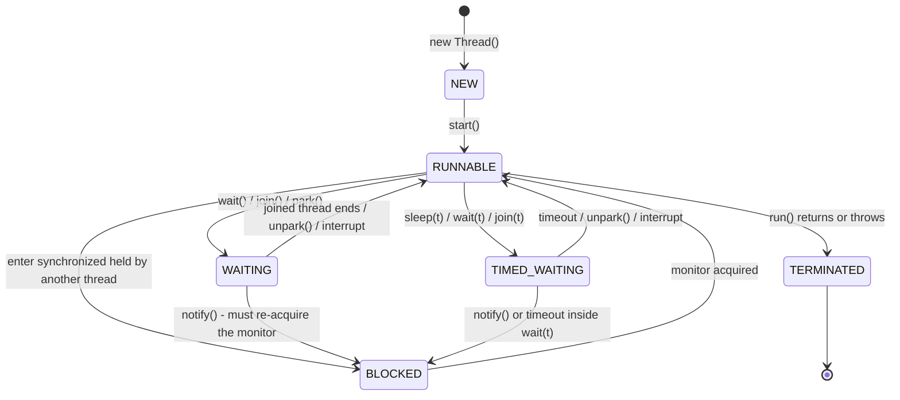
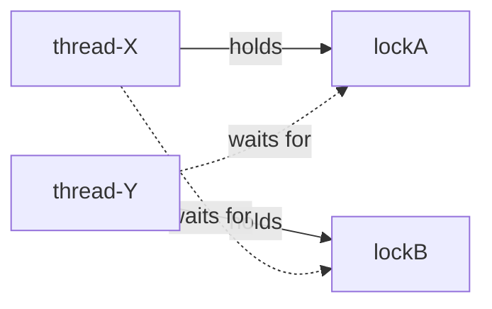
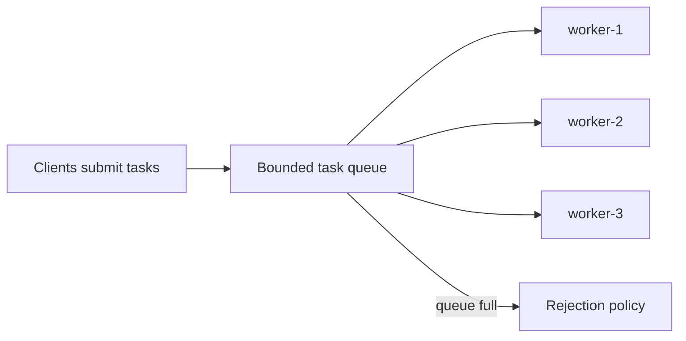
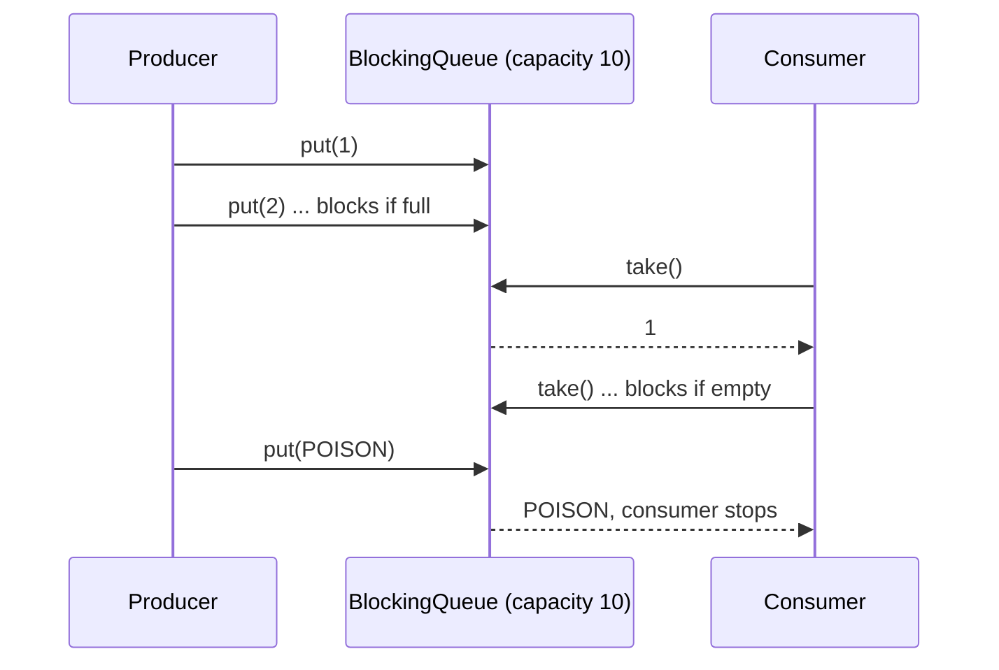
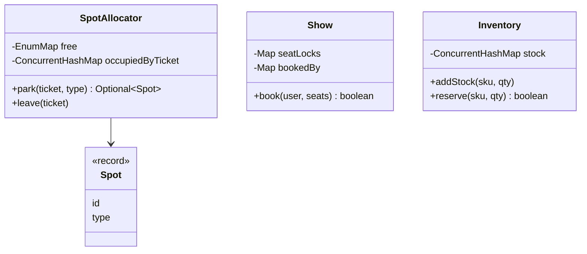

# Chapter 12 — Concurrency & Multithreading for LLD (Java) · Study Edition

> **Study edition.** Every topic of the full chapter, with the padding removed. For complete code listings, full outputs and extra follow-ups, see the Full Edition (`README.md`).
>
> **Why this chapter exists.** In an LLD interview you will hear: *"Two users click **Book** on the same seat at the same moment. What happens?"* A design with no answer is incomplete. This chapter teaches the ideas and Java 21 tools to answer it; Chapter 13 applies them to classic problems, and chapters 14–21 use them in case studies.

Every concept follows: *What it is → The problem it solves → How it works → Java example → Trade-offs → When not to use it → Common mistakes → Real-world examples → In the interview → Self-check → TL;DR.* Code lives in `code/lld/ch12/<topic>/Main.java`.

```text
javac --release 21 -d /tmp/lld_12 $(find . -name '*.java')
java -cp /tmp/lld_12 lld.ch12.threads.Main
```

| Part | Sections | Code package |
|---|---|---|
| A. Foundations | 12.1–12.4 | `threads` |
| B. What goes wrong | 12.5 Races · 12.6 Java Memory Model | `race` |
| C. Locks | 12.7–12.11 | `locks` |
| D. Coordination | 12.12 Semaphores · 12.13 Conditions · 12.14 Latch & barrier | `coordination` |
| E. Lock-free | 12.15 CAS & atomics · 12.16 Concurrent collections | `atomics`, `collections` |
| F. Liveness failures | 12.17 Deadlock · 12.18 Livelock · 12.19 Starvation | `deadlock` |
| G. Patterns | 12.20–12.24 | `patterns` |
| H. Interviews | 12.25 Parking, seat booking, inventory | `lldcases` |

| Term | Meaning in one line |
|---|---|
| **Thread** | One independent sequence of instructions inside a program. |
| **Shared state** | Data more than one thread can read or write. |
| **Thread-safe** | Correct under any interleaving, with no extra locking by callers. |
| **Atomic** | One indivisible step: others see "before" or "after", never "halfway". |
| **Lock / mutex** | A token only one thread can hold at a time. |
| **Critical section** | Code touching shared state that must not run in two threads at once. |
| **Contention** | Many threads wanting the same lock at once. |
| **Blocking** | A thread waits (lock, I/O, signal) instead of using the CPU. |
| **Liveness** | "Something good eventually happens" — no deadlock, livelock, starvation. |
| **Safety** | "Nothing bad ever happens" — no corrupted data, no double booking. |

---

# Part A — Foundations

## 12.1 Concurrency vs parallelism

### What it is
**Concurrency** = *dealing with* many things at once (tasks with overlapping lifetimes, maybe taking turns on one core). **Parallelism** = *doing* many things at the same instant on different cores.

### The problem it solves
Programs wait a lot (disk, network, DB, users): concurrency does useful work meanwhile (responsiveness, throughput). Parallelism finishes CPU-heavy work sooner using all cores (speed-up).

### How it works
The OS scheduler gives each runnable thread a time slice; when it ends or the thread blocks, a **context switch** saves one thread's registers and loads another's. On one core that is the *illusion* of simultaneity; on many cores threads really run at once.

| | Concurrency | Parallelism |
|---|---|---|
| Core idea | Structure: many tasks in progress | Execution: many at the same instant |
| Needs multiple cores? | No | Yes |
| Main benefit | Overlapping waiting (I/O-bound) | Speed on CPU-bound work |
| Java tools | Threads, executors, virtual threads, `CompletableFuture` | Fork/Join, parallel streams, `Arrays.parallelSort` |
| Example | Web server with 10,000 connections | Sorting 100 million numbers |

### Java example
12.4's `Main` runs 10,000 sleeping tasks on virtual threads in well under a second (concurrency); Chapter 13's merge sort uses Fork/Join (parallelism).

### Trade-offs
Concurrency adds complexity and context-switch overhead. **Amdahl's law:** with sequential fraction *s*, speed-up on *N* cores ≤ 1 / (s + (1 − s)/N) — 10% sequential caps it at 10×.

### When not to use it
Small, fast CPU-light tasks (splitting costs more than it saves). Single-threaded designs are valid when they remove all locking (Redis's main thread, Node.js's event loop).

### Common mistakes
Mixing up the two words; expecting more threads to always be faster (past the core count, CPU-bound work slows down).

### Real-world examples
Concurrency: Tomcat/Jetty thread pools, Netty/Node.js event loops. Parallelism: `Arrays.parallelSort`, parallel streams, Spark/Hadoop.

### In the interview
**30-second answer:** "Concurrency is about structure — several tasks in progress, possibly interleaved on one core. Parallelism is about execution — tasks running at the same instant on several cores. Concurrency helps I/O-bound work; parallelism helps CPU-bound work."

### Self-check
- **Q:** 50,000 idle chat connections — concurrency or parallelism? **A:** Concurrency: they mostly wait.

### TL;DR
Concurrency = structure; parallelism = simultaneous execution. I/O-bound → concurrency; CPU-bound → parallelism.

---

## 12.2 Processes vs threads

### What it is
A **process** is a running program with its **own memory**. A **thread** runs *inside* a process, **sharing the heap** but owning its **stack** and program counter.

### The problem it solves
Threads share data cheaply within one program; processes give strong isolation (one crash doesn't corrupt others).

### How it works
The OS gives a process a private address space and one thread (`main`); more threads share heap objects with separate stacks. Threads communicate through shared objects (with synchronization); processes via pipes, sockets, shared memory, message queues.

| | Process | Thread |
|---|---|---|
| Memory | Private address space | Shared heap; own stack |
| Creation cost | High | Lower (platform thread ≈ OS thread, ~1 MB stack reserved); virtual threads much cheaper |
| Communication | IPC | Shared objects — fast, needs sync |
| Failure isolation | Strong | Weak (e.g. `OutOfMemoryError` kills all) |
| Context switch | Heavier | Lighter |
| Java | `ProcessBuilder` | `Thread`, executors |

### Java example
```java
// A new PROCESS (separate memory):
Process p = new ProcessBuilder("ls", "-l").inheritIO().start();
p.waitFor();

// A new THREAD (shares this JVM's heap):
Thread t = new Thread(() -> System.out.println("same heap, different stack"));
t.start();
t.join();
```

### Trade-offs
Threads: fast sharing, but every shared mutable field is a potential bug. Processes: safe isolation, slower serialized communication.

### When not to use it
When isolation matters more than speed (untrusted plugins, crash-prone native code) — use processes or containers.

### Common mistakes
Thinking locals are shared (each thread has its own stack); one unbounded platform thread per request (use a pool or virtual threads).

### Real-world examples
Chrome tabs as processes; PostgreSQL process-per-connection vs MySQL thread-per-connection.

### In the interview
**30-second answer:** "A process is an isolated program with its own memory; a thread is a path of execution inside a process that shares its heap but has its own stack. Threads are cheaper and share data easily but need synchronization; processes are isolated and safer but communicate through IPC."

### Self-check
- **Q:** Two threads increment their own local `int x`. Race? **A:** No — locals live on each stack.

### TL;DR
Process = isolated house; thread = worker sharing the heap, owning only its stack. Share cheaply, synchronize carefully.

---

## 12.3 Thread lifecycle & states

### What it is
`Thread.getState()` returns one of six `Thread.State` values:

| State | Meaning |
|---|---|
| `NEW` | Created, `start()` not called. |
| `RUNNABLE` | Running or ready (Java doesn't separate them; most blocking I/O also shows here). |
| `BLOCKED` | Waiting to *enter* a `synchronized` block held by another thread. |
| `WAITING` | Waiting indefinitely for another thread: `wait()`, `join()`, `LockSupport.park()` (used by `ReentrantLock`, `Condition`, `CountDownLatch`). |
| `TIMED_WAITING` | Same with a timeout: `sleep`, `wait(ms)`, `join(ms)`, `parkNanos`, `tryLock(timeout)`. |
| `TERMINATED` | `run()` returned or threw; cannot be restarted. |

### The problem it solves
Reading thread dumps (`jstack`, `jcmd <pid> Thread.print`): many `BLOCKED` on one monitor → contention or deadlock; many `WAITING` on a queue → idle pool.

### How it works



Calling `start()` twice throws `IllegalThreadStateException`. A thread woken from `wait()` must re-acquire the monitor, so it may pass through `BLOCKED`. **Interruption** is cooperative: `t.interrupt()` sets a flag; `sleep`/`wait`/`join` throw `InterruptedException` and clear it. `Thread.stop()` is unsafe and no longer works.

### Java example
`threadStates()` in 12.4's `Main` drives one thread into each state and prints it.

### Trade-offs
A model, not a choice — but `RUNNABLE` hides whether a thread is really on a CPU or stuck in native I/O.

### When not to use it
Never use `getState()` for program logic (it changes between check and act); monitoring only.

### Common mistakes
Calling `run()` instead of `start()` (runs on the current thread); swallowing `InterruptedException` (rethrow or `Thread.currentThread().interrupt()`); confusing `BLOCKED` (monitor) with `WAITING` (signal).

### Real-world examples
A `jstack` showing 200 Tomcat workers `BLOCKED` on one `synchronized` logger or pool method = coarse-lock bottleneck.

### In the interview
**30-second answer:** "Java threads have six states: NEW, RUNNABLE, BLOCKED, WAITING, TIMED_WAITING, TERMINATED. BLOCKED means waiting for a monitor lock; WAITING/TIMED_WAITING mean waiting for another thread's action, optionally with a timeout."

### Self-check
- **Q:** Inside `Thread.sleep(1000)`? **A:** `TIMED_WAITING`.

### TL;DR
NEW → RUNNABLE ↔ (BLOCKED | WAITING | TIMED_WAITING) → TERMINATED. BLOCKED = monitor; WAITING = signal. `start()`, never `run()`; respect interrupts.

---

## 12.4 Creating threads: `Thread`, `Runnable`, `Callable`, `ExecutorService`, virtual threads

### What it is

| Way | What you write | Result? | Use when |
|---|---|---|---|
| Extend `Thread` | `class T extends Thread { run() }` | No | Almost never — mixes task and worker |
| `Runnable` | `() -> { ... }` | No | Fire-and-forget task |
| `Callable<V>` | `() -> value` (may throw checked) | Yes, via `Future<V>` | Need a result or exception back |
| `ExecutorService` | `pool.submit(task)` | `Future<V>` | Default: reuse threads, limit concurrency |
| Virtual threads (Java 21) | `Thread.ofVirtual().start(r)` / `newVirtualThreadPerTaskExecutor()` | via `Future` | Very many *blocking* tasks |

### The problem it solves
An OS thread per task is expensive and unbounded. Executors separate **what** runs from **how** (pooling, queueing). Virtual threads make "one thread per request" cheap again for blocking code.

### How it works
Write a `Runnable`/`Callable`, `submit` it, get a `Future`; `get()` blocks (task exceptions come wrapped in `ExecutionException`); `shutdown()` + `awaitTermination`, or try-with-resources (`close()` waits, Java 19+). **Virtual threads** (JEP 444) run on a small `ForkJoinPool` of carrier threads; blocking I/O, `sleep` or a `java.util.concurrent` lock **unmounts** them. **Pinning** keeps the carrier busy: on Java 21–23 when blocking inside `synchronized` (including `wait()`) or a native method; JDK 24 (JEP 491) removed the `synchronized` case.

### Java example

```java
// File: code/lld/ch12/threads/Main.java
            Future<Integer> future = pool.submit(sumTask);   // returns immediately
            System.out.println("3) Callable+Future  -> sum 1..100 = " + future.get()); // get() blocks until done
        // ...
        try (ExecutorService vexec = Executors.newVirtualThreadPerTaskExecutor()) {
            List<Future<Integer>> fs = new ArrayList<>();
            for (int i = 0; i < 10_000; i++) {
                fs.add(vexec.submit(() -> { Thread.sleep(50); return 1; }));
            }
            // ... sum the futures
        } // close() waits for all tasks
```

The 10,000 sleeping tasks finish far under 500 s; the file also tours every `Thread.State`. `t.join()` creates a happens-before edge (12.6). Full runnable code: code/lld/ch12/threads/ (see the Full Edition).

### Trade-offs

| | Platform thread pool | Virtual threads |
|---|---|---|
| Cost per thread | High (OS thread + big stack) | Very low (growable heap stack) |
| How many | Hundreds–few thousand | Millions |
| Best for | CPU-bound (size ≈ cores) | Blocking I/O |
| Limits concurrency? | Yes, pool size | No — add a `Semaphore` |
| Pooling | Yes | Never pool them |

### When not to use it
Virtual threads for CPU-heavy work (no extra cores); blocking in `synchronized` on Java 21–23 (pinning — prefer `ReentrantLock`); `newCachedThreadPool()` for unbounded traffic.

### Common mistakes
Forgetting `shutdown()` (JVM stays alive); ignoring a `Future` (exceptions silently lost); `newFixedThreadPool` for untrusted load — its queue is **unbounded** (use a bounded `ThreadPoolExecutor`, 12.21).

### Real-world examples
`Executors` factory methods (Factory pattern); Spring `@Async` on a `ThreadPoolTaskExecutor`; Spring Boot 3.2+ `spring.threads.virtual.enabled=true`.

### In the interview
**30-second answer:** "I never manage raw threads in business code. I describe work as `Runnable`/`Callable` and submit it to an `ExecutorService` sized for the workload: about cores for CPU-bound work, bounded queue with a rejection policy for incoming traffic. For many blocking I/O tasks on Java 21, I use virtual threads — one per task — and protect scarce resources with a semaphore."

### Self-check
- **Q:** What does `thread.run()` do? **A:** Runs synchronously on the current thread.

### TL;DR
Tasks = `Runnable`/`Callable`; run with an `ExecutorService`; results via `Future`. Virtual threads make one-thread-per-blocking-task cheap. Always shut pools down.

---

# Part B — What goes wrong

## 12.5 Race conditions & critical sections

### What it is
A **race condition**: the result depends on unlucky thread timing. A **critical section**: code touching shared mutable state that must run in one thread at a time. A **data race** (JMM term): two threads access one variable, at least one writes, with no happens-before order.

### The problem it solves
Tells you *which* code needs protection and *why*:

| Shape | Example | Why it breaks |
|---|---|---|
| **Read-modify-write** | `count++` | Really read, add, write — two threads read the same old value; one update is lost. |
| **Check-then-act** | `if (seat.isFree()) seat.book(me);` | The condition can change between check and act. |

### How it works
1. Find all **shared mutable state**. 2. List its **invariants** ("a seat has at most one owner"). 3. Mark read-then-update code as **critical sections**. 4. Make each **atomic** — a lock, one atomic operation (`incrementAndGet`, `putIfAbsent`), or no sharing (immutability, confinement).

### Java example

```java
// File: code/lld/ch12/race/Main.java
    /** BROKEN: count++ is read-modify-write (3 steps), so concurrent increments get lost. */
    static class UnsafeCounter implements Counter {
        private int count;
        public void increment() { count++; }
        public int get() { return count; }
    }

    // ... Fix 1: SynchronizedCounter — synchronized increment() AND get() (reads need the lock for visibility)

    /** Fix 2: a lock-free atomic built on compare-and-swap. */
    static class AtomicCounter implements Counter {
        private final AtomicInteger count = new AtomicInteger();
        public void increment() { count.incrementAndGet(); }
        public int get() { return count.get(); }
    }
    // ... check-then-act fixed with one atomic step: seatOwner.compareAndSet(0, id)
```

Output: of 1,000,000 increments the unsafe counter lost e.g. `680044` (varies every run — that unpredictability *is* the race); both fixes give exactly 1000000.

Full runnable code: code/lld/ch12/race/ (see the Full Edition).

### Trade-offs

| Fix | Pros | Cons |
|---|---|---|
| Lock | Protects any multi-step, multi-variable invariant | Waiting; deadlock risk if nested |
| Atomic variable / map method | Fast, non-blocking | One variable or one map entry only |
| Immutability / confinement | No synchronization | Needs redesign |

### When not to use it
Don't lock data that is never shared (locals, confined objects) or never changed after safe construction.

### Common mistakes
Protecting writes but not reads; combining two thread-safe calls and assuming atomicity (`containsKey` then `put` on a `ConcurrentHashMap` — use `putIfAbsent`/`computeIfAbsent`); locking on different objects.

### Real-world examples
Double-booked tickets, oversold flash-sale stock, double payments on a double-click — check-then-act races, fixed with atomics, locks or DB constraints (unique index, `SELECT ... FOR UPDATE`, version columns).

### In the interview
**30-second answer:** "A race condition is when correctness depends on thread timing. The two common shapes are read-modify-write, like `count++`, and check-then-act, like 'if seat is free then book it'. I find the shared mutable state and its invariants, and make each critical section atomic — with a lock, an atomic operation like `putIfAbsent` or `compareAndSet`, or by removing sharing."

### Self-check
- **Q:** Why does `count++` lose updates? **A:** Two threads read the same value before either writes.

### TL;DR
Race = result depends on timing. Watch read-modify-write and check-then-act. Make every critical section atomic, including reads.

---

## 12.6 Java Memory Model basics: visibility, happens-before, `volatile`

### What it is
The **JMM** (JLS ch. 17) defines when one thread's write is guaranteed visible to another's read. **Visibility**: will B see A's write? **Reordering**: compilers, JIT and CPUs reorder when a single thread can't tell. **Happens-before (HB)**: if X HB Y, X's effects are visible to and ordered before Y. **`volatile`**: reads/writes of that field are visible to all threads and ordered.

### The problem it solves
`while (running) iterations++;` with a non-volatile `running` may never stop — the JIT may read it once and loop forever.

### How it works

| Rule | Meaning |
|---|---|
| Program order | Within a thread, each action HB the next. |
| Monitor lock | Unlock HB every later lock of the *same* monitor. |
| Volatile | A volatile write HB every later read of that field. |
| Thread start | `t.start()` HB everything in `t`. |
| Thread join | Everything in `t` HB a return from `t.join()`. |
| Transitivity | A HB B and B HB C ⇒ A HB C. |
| Final fields | Separate guarantee (JLS §17.5): after a constructor that doesn't leak `this`, every thread sees correct `final` field values, even without sync. |
| `java.util.concurrent` | Queue put HB take; `countDown()` HB `await()` return; `Future` completion HB `get()`. |

Apply: is every write-then-read pair linked by HB? Same lock → yes. Single independent flag/reference → `volatile`. Compound update → lock or atomic.

**Safe publication:** share a reference via a `volatile`/`AtomicReference` field, a `final` field, a static initializer, a concurrent collection, or a lock the reader also takes. **Double-checked locking** needs `volatile`:

```java
class Config {
    private static volatile Config instance;          // volatile is essential
    static Config get() {
        Config c = instance;
        if (c == null) {
            synchronized (Config.class) {
                c = instance;
                if (c == null) instance = c = new Config();
            }
        }
        return c;
    }
}
```

(Simpler: the **holder idiom** — `private static class Holder { static final Config I = new Config(); }`.)

### Java example
`Worker` in 12.5 uses `private volatile boolean running`; the output `volatile flag stopped worker: true` confirms the write became visible.

### Trade-offs

| Tool | Visibility | Atomic compound ops | Blocking | Cost |
|---|---|---|---|---|
| `volatile` | Yes | No | No | Low |
| `synchronized` / `Lock` | Yes (same lock) | Yes | Yes | Medium |
| `Atomic*` | Yes | One variable | No | Low–medium |
| `final` | Yes, after construction | N/A | No | Free |

### When not to use it
`volatile` for anything combining several steps or variables.

### Common mistakes
"Works on my laptop" — x86 reorders less than ARM (Apple Silicon, Graviton); leaking `this` from a constructor; synchronizing only the writer.

### Real-world examples
`volatile` shutdown flags; `ConcurrentHashMap`, `AtomicInteger`, `CopyOnWriteArrayList` use volatile + CAS internally; immutable `String`.

### In the interview
**30-second answer:** "The Java Memory Model says a thread is only guaranteed to see another thread's write if there's a happens-before edge — unlock-then-lock of the same monitor, a volatile write-then-read, thread start/join, or a concurrent-collection handoff. `volatile` gives visibility and ordering for a single variable but not atomicity; for compound actions I use locks or atomics."

### Self-check
- **Q:** Non-volatile `ready = true` after preparing data; B spins on it. Two bugs? **A:** B may never see it, or see it with stale data.

### TL;DR
Cross-thread visibility only via happens-before. `volatile` = visibility + ordering, not atomicity. Locks = both. Publish objects safely.

---

# Part C — Locks

## 12.7 Mutex (mutual exclusion) and `synchronized`

### What it is
A **mutex** is a lock at most one thread can hold. Every Java object has a built-in one — its **intrinsic lock** or **monitor** — taken by `synchronized` (instance method → `this`; static method → the `Class` object; block → the given object).

### The problem it solves
Makes a critical section **atomic** and **visible** (the next lock holder sees everything done before the unlock).

### How it works
Free monitor → take it; held → `BLOCKED` until free; released automatically on exit, **even by exception**; **reentrant** (the holder can re-enter).

### Java example
`SynchronizedCounter` (12.5). Prefer a **private final** lock object so outside code can't take your lock:

```java
private final Object lock = new Object();
void add(Item i) { synchronized (lock) { items.add(i); } }
```

### Trade-offs
| Pros | Cons |
|---|---|
| Simplest; auto-release; reentrant; cheap when uncontended | No timeout, `tryLock` or interruptible wait; one wait-set per object; no fairness; pins virtual threads on Java 21–23 |

### When not to use it
When you need a timeout, interruptibility, fairness, several conditions, or read/write separation — use `ReentrantLock`/`ReentrantReadWriteLock`.

### Common mistakes
Synchronizing on a *changing* reference; on string literals or boxed values (shared JVM-wide); doing slow I/O while holding the lock.

### Real-world examples
`Vector`, `Hashtable`, `StringBuffer`, `Collections.synchronizedList` — safe per call but slow under contention, hence replaced by unsynchronized classes plus concurrent collections.

### In the interview
**30-second answer:** "A mutex lets one thread at a time into a critical section. In Java, `synchronized` uses the object's monitor: it's reentrant, released automatically, and gives visibility. I lock on a private final object and keep the section short."

### Self-check
- **Q:** Synchronized methods on *different* objects block each other? **A:** No — different monitors.

### TL;DR
One holder at a time; `synchronized` is reentrant and auto-releasing. Private final lock object; short sections.

---

## 12.8 `ReentrantLock` and reentrancy

### What it is
`ReentrantLock` is an explicit mutex with `synchronized`'s meaning plus extras. **Reentrant**: the holder can acquire it again (hold count rises) and must release it as many times.

### The problem it solves
Without reentrancy, a locked method calling another locked method on the same object would **deadlock with itself**. Extras over `synchronized`: `tryLock()`/`tryLock(timeout)`, `lockInterruptibly()`, optional **fairness**, multiple `Condition`s, `isLocked()`/`getHoldCount()`.

### How it works
`lock()` takes it (count 0 → 1) or waits; the same thread locking again → count 2; each `unlock()` decrements, releasing at 0. **Always** `lock(); try { ... } finally { unlock(); }`.

### Java example

```java
// File: code/lld/ch12/locks/Main.java
        void withdraw(int amount) {
            lock.lock();
            try {
                if (canWithdraw(amount)) balance -= amount;   // calls another locked method
            } finally {
                lock.unlock();                                // ALWAYS unlock in finally
            }
        }
        boolean canWithdraw(int amount) {
            lock.lock();                                      // same thread re-acquires: no self-deadlock
            try {
                System.out.println("hold count inside nested call = " + lock.getHoldCount());
                return balance >= amount;
            } finally {
                lock.unlock();
            }
        }
```

Output: `hold count inside nested call = 2`, `balance = 70`. The same file also demos `tryLock` (12.9), `ReadWriteLock` and `StampedLock` (12.10). Full runnable code: code/lld/ch12/locks/ (see the Full Edition).

### Trade-offs

| Feature | `synchronized` | `ReentrantLock` |
|---|---|---|
| Release | Automatic | Manual (`finally`) |
| Try / timeout | No | `tryLock()`, `tryLock(t, unit)` |
| Interruptible wait | No | `lockInterruptibly()` |
| Fairness | No | Optional (slower) |
| Conditions | One wait set | Many |
| Reentrant | Yes | Yes |

### When not to use it
If you need none of the extras, `synchronized` is shorter and can't be left locked.

### Common mistakes
`lock()` *inside* `try` (a failed lock would `unlock()` → `IllegalMonitorStateException`); missing `unlock()` on an early return; fairness "to be safe" (much slower).

### Real-world examples
`ArrayBlockingQueue`, `LinkedBlockingQueue`, `ThreadPoolExecutor` use it; `ReentrantLock`, `ReentrantReadWriteLock`, `Semaphore`, `CountDownLatch` are built on **AQS**; `CyclicBarrier` on `ReentrantLock` + `Condition`.

### In the interview
**30-second answer:** "`ReentrantLock` is an explicit mutex with the same semantics as `synchronized` plus try-lock with timeout, interruptible acquisition, optional fairness, and multiple conditions. Reentrant means the owner can re-acquire it; the hold count must drop to zero to release. I always unlock in `finally`."

### Self-check
- **Q:** `lock()` ×3, `unlock()` ×2 — free? **A:** No; hold count 1.

### TL;DR
`synchronized` + tryLock/timeout/interruptible/fairness/conditions. `lock(); try { … } finally { unlock(); }` always.

---

## 12.9 Try-lock & timed locking

### What it is
`tryLock()` takes the lock only if free *now*; `tryLock(timeout, unit)` waits up to the timeout (interruptibly), returning `false` on failure.

### The problem it solves
Plain `lock()` waits forever (hung requests, permanent deadlocks). Try-lock lets a thread **give up** — fail fast, retry, return "busy" — and breaks deadlock's *hold-and-wait* condition (12.17).

### How it works
`true` → `try { work } finally { unlock(); }`; `false` → fallback. With several locks: if any fails, **release all held**, back off **randomly**, retry.

### Java example
In `locks/Main.java`, `printer.tryLock(100, TimeUnit.MILLISECONDS)` fails while `main` holds it and prints `worker: printer busy for 100 ms, doing something else instead`. `transferTryLock` in 12.17 uses try-lock + random back-off.

### Trade-offs
| Pros | Cons |
|---|---|
| No infinite waits; breaks deadlock; predictable latency | Caller handles failure; retries without random back-off can **livelock**; timeout choice is a judgement call |

### When not to use it
When failing is unacceptable and waiting is fine (background batch job) — plain `lock()`.

### Common mistakes
`unlock()` after a `false` → `IllegalMonitorStateException`; tight retry loops; expecting untimed `tryLock()` to be fair — it *barges*; `tryLock(0, unit)` respects fairness.

### Real-world examples
Distributed locks (Redis `SET key value NX PX 30000`, Redisson `tryLock(wait, lease, unit)`, ZooKeeper); ticket seat holds that fail fast.

### In the interview
**30-second answer:** "`tryLock` with a timeout lets a thread give up instead of waiting forever. I use it when latency matters or when I need several locks: if I can't get all of them, I release what I hold, back off randomly and retry — which prevents deadlock."

### Self-check
- **Q:** `tryLock(0, SECONDS)`? **A:** Tries once without waiting, but respects a fair queue.

### TL;DR
Acquire only if available (within a timeout). Handle `false`, release everything on failure, back off randomly.

---

## 12.10 Read-write locks: `ReadWriteLock` and `StampedLock`

### What it is
A shared **read lock** (many readers) plus an exclusive **write lock** (one writer, no readers): `ReentrantReadWriteLock`, and since Java 8 `StampedLock` with cheap *optimistic reads*.

### The problem it solves
A mutex makes readers block each other; for **read-heavy** data (config, caches, catalogues) reads can run in parallel.

### How it works
Readers share `readLock()` when no writer holds it; a writer waits for **no readers and no writer**. `ReentrantReadWriteLock` allows **downgrade** (write → read) but **not upgrade** (read → write deadlocks on itself). `StampedLock`: `tryOptimisticRead()` → copy fields to locals → `validate(stamp)`; on failure retry with `readLock()`.

### Java example

`ConfigStore` and `Point` (optimistic read) in `locks/Main.java`; three readers inside the read lock at once print `3 readers held the read lock at the same time: true`.

### Trade-offs

| | Mutex | `ReentrantReadWriteLock` | `StampedLock` |
|---|---|---|---|
| Parallel readers | No | Yes | Yes (optimistic reads take no lock) |
| Reentrant | Yes | Yes | **No** |
| Conditions | Yes | Write lock only | No |
| Overhead | Lowest | Higher bookkeeping | Low for optimistic reads |
| Best when | Short or write-heavy | Reads ≫ writes, non-trivial reads | Very read-heavy, tiny sections |

### When not to use it
Write-heavy or tiny sections (bookkeeping makes it slower); when a **copy-on-write snapshot** is simpler (immutable map in a `volatile` field, replaced on write — 12.23).

### Common mistakes
Upgrading read → write; writing under the read lock; using optimistic data before `validate` or without copying to locals.

### Real-world examples
Caches, config holders, routing tables; `ConcurrentHashMap` goes further — lock-free reads.

### In the interview
**30-second answer:** "A read-write lock lets many readers in together but gives writers exclusive access. It helps when reads vastly outnumber writes. `ReentrantReadWriteLock` allows downgrade but not upgrade; `StampedLock` adds optimistic reads that take no lock and are validated afterwards, but it's not reentrant."

### Self-check
- **Q:** Two readers and a writer arrive — who runs together? **A:** The two readers; the writer alone.

### TL;DR
Many readers OR one writer, for read-heavy data. No upgrade; `StampedLock` = optimistic, non-reentrant.

---

## 12.11 Coarse-grained vs fine-grained locking

### What it is
**Coarse**: one lock for a lot of state (the whole parking lot). **Fine**: many locks each guarding a small piece (per floor, spot, hash bucket).

### The problem it solves
Balances **simplicity and safety** against **throughput under contention**.

### How it works
Start coarse and measure; if contended, split **independent** state (**lock splitting**); for big collections use **lock striping** (lock `hash(i) % N`; Java 7 `ConcurrentHashMap` had 16 segments); take multiple fine locks in a **global order**; do slow work outside locks.

| | Coarse | Fine |
|---|---|---|
| Simplicity | High | Lower |
| Concurrency | Low | High |
| Deadlock risk | Low | Higher — needs ordering |
| Overhead | One lock | Many locks |
| Cross-part invariants | Easy | Hard |

### Java example
Coarse: `SynchronizedCounter` (12.5). Fine: `Show` in 12.25 (one lock per seat, sorted order); `StripedHashMap` in Chapter 13.

### Trade-offs
Correct first; go fine-grained only where profiling shows contention.

### When not to use it
Don't split when an invariant spans the parts ("total booked ≤ capacity") unless you handle the cross-part check.

### Common mistakes
Premature fine-graining; inconsistent lock order; fine locks that still funnel through one shared counter (use `LongAdder`).

### Real-world examples
Java 8 `ConcurrentHashMap` locks one bin head; DB row vs table locks.

### In the interview
**30-second answer:** "I start with one lock for correctness, then refine where contention matters: per-floor or per-spot locks for a parking lot, per-show or per-seat locks for booking, striping for maps. Finer locks raise throughput but need a consistent lock order to avoid deadlock."

### Self-check
- **Q:** Lock striping? **A:** N locks; each item maps to one by hash — fine-grained with a bounded lock count.

### TL;DR
Coarse = simple, low throughput; fine = parallel, complex, deadlock-prone. Start coarse, measure, order locks.

---

# Part D — Coordination

## 12.12 Semaphores

### What it is
A **semaphore** holds **permits**: `acquire()` takes one (waiting if none), `release()` returns one. One permit ≈ a mutex, but with **no owner** — any thread may release.

### The problem it solves
**Limiting concurrency** (≤ N DB connections, API calls) and **signaling** (0 permits = "wait until someone signals", used heavily in Chapter 13).

### How it works
`new Semaphore(n)` is **non-fair** (callers may barge); `new Semaphore(n, true)` is FIFO (untimed `tryAcquire()` still barges; `tryAcquire(0, SECONDS)` doesn't). Also `tryAcquire(timeout)`, `acquire(k)`. Always `release()` in `finally` after a successful `acquire()`.

### Java example

```java
// File: code/lld/ch12/coordination/Main.java
        Semaphore connections = new Semaphore(3);
        // ... 10 tasks on a pool of 10 threads, each doing:
                try {
                    connections.acquire();                         // blocks when 0 permits left
                    try {
                        int now = inUse.incrementAndGet();
                        maxSeen.accumulateAndGet(now, Math::max);
                        Thread.sleep(30);                          // "run a query"
                        inUse.decrementAndGet();
                    } finally {
                        connections.release();                     // give the permit back
                    }
                } catch (InterruptedException e) { Thread.currentThread().interrupt(); }
```

Output: `10 queries done, never more than 3 at once: true`. The same file demos wait/notify, `Condition`, latch and barrier (12.13–12.14). Full runnable code: code/lld/ch12/coordination/ (see the Full Edition).

### Trade-offs
| Pros | Cons |
|---|---|
| Simple concurrency cap; doubles as a signal | No owner — buggy extra releases grow permits; protects no data by itself |

### When not to use it
As a mutex around shared data when a lock would do (locks have ownership and reentrancy).

### Common mistakes
Releasing when `acquire` never succeeded (e.g. interrupted) → permit leak upward; not releasing on exceptions → permits vanish, system stalls.

### Real-world examples
**Bulkheads** (Resilience4j `SemaphoreBulkhead`, Hystrix semaphore isolation); HikariCP's max pool size.

### In the interview
**30-second answer:** "A semaphore is a permit counter: acquire takes a permit or waits, release returns one. I use it to cap concurrent access to a limited resource — a bulkhead — or with zero initial permits as a signal from one thread to another. Unlike a lock it has no owner."

### Self-check
- **Q:** `new Semaphore(0).acquire()`? **A:** Waits until another thread calls `release()` — a signal.

### TL;DR
N permits: cap concurrency or signal. No ownership — release carefully in `finally`.

---

## 12.13 Condition variables: `wait/notify` and `Condition`

### What it is
A **condition variable** lets a thread *sleep until a condition on shared state is true*, releasing the lock meanwhile, and lets another thread *wake it* after changing that state. Built-in: `wait()`/`notify()`/`notifyAll()` inside `synchronized`; explicit: `lock.newCondition()` with `await()`/`signal()`/`signalAll()`.

### The problem it solves
Waiting for a state change without **busy-waiting** and without missing the moment.

### How it works
The canonical pattern — memorize it:

```java
synchronized (lock) {                 // or: lock.lock(); try {
    while (!conditionHolds()) {       // ALWAYS a while loop, never if
        lock.wait();                  //   cond.await();  releases the lock while waiting
    }
    doAction();                       // condition is true AND we hold the lock
    lock.notifyAll();                 //   cond.signal()/signalAll() if we changed state others wait for
}                                     // } finally { lock.unlock(); }
```

`wait()` **atomically releases the lock** and sleeps; it **re-acquires** it before returning. Why `while`? **Spurious wakeups** are allowed; another thread may grab the state first; with `notifyAll` only one waiter can win. `notify()` wakes one arbitrary waiter — with producers *and* consumers on one monitor it can wake the wrong kind and everyone sleeps. Use `notifyAll()`, or separate `Condition`s (`notFull`, `notEmpty`) with targeted `signal()`.

### Java example
`Mailbox` (monitor, `while (item != null) wait();`) and `TurnTable` (Lock + `Condition`) in `coordination/Main.java`. Output: `received in order: [m1, m2, m3]` and `PING PONG PING PONG PING PONG`.

### Trade-offs

| | `wait/notify` | `Lock` + `Condition` |
|---|---|---|
| Conditions per lock | One wait set | Many |
| Targeted wake-up | No — use `notifyAll` | Yes |
| Timed wait | `wait(ms)` | `await(t, unit)`, `awaitNanos` |
| Verbosity | Less | More |

### When not to use it
Usually `BlockingQueue`, `Semaphore`, `CountDownLatch` or `CompletableFuture` already solve it; hand-roll only for custom coordination.

### Common mistakes
`if` instead of `while`; `wait`/`notify` without holding that monitor → `IllegalMonitorStateException`; changing state without notifying (**lost wakeup**); waiting on one object while synchronized on another.

### Real-world examples
`ArrayBlockingQueue`: one `ReentrantLock`, two `Condition`s (`notEmpty`, `notFull`) — built by hand in Chapter 13.

### In the interview
**30-second answer:** "A condition variable lets a thread release a lock and sleep until another thread changes the state and signals it. I always wait in a while loop that re-checks the condition, because of spurious wakeups and competing threads. With one monitor I use notifyAll; with ReentrantLock I use separate Conditions and targeted signal."

### Self-check
- **Q:** What does `wait()` do with the monitor? **A:** Releases it while sleeping; re-acquires before returning.

### TL;DR
Release lock, sleep until signalled, re-acquire, re-check. Always `while`; `notifyAll` or separate `Condition`s.

---

## 12.14 `CountDownLatch` and `CyclicBarrier`

### What it is
**`CountDownLatch(n)`**: a one-time gate — `await()` returns after *n* `countDown()` calls; can't be reset. **`CyclicBarrier(n, action)`**: a reusable meeting point — when the *n*th thread calls `await()`, the action runs once, all are released, and it resets.

### The problem it solves
Coordinating phases: start after all services are up (latch); finish step 1 before step 2 (barrier); release all test threads at once (latch of 1 — used throughout this book to maximise contention).

### How it works

| | `CountDownLatch` | `CyclicBarrier` |
|---|---|---|
| Who waits | Anyone calling `await()` | The *n* parties themselves |
| Who counts | Anyone calling `countDown()` | Arrival at `await()` |
| Reusable | No | Yes |
| Extra | Reaching 0 is permanent | Action once per trip; a failed party **breaks** it (`BrokenBarrierException`; `reset()` repairs) |
| Happens-before | Before `countDown()` HB after `await()` | Before `await()` HB the action HB after release |

`Phaser` (Java 7) generalises both with dynamic parties across many phases.

### Java example
`latchDemo`/`barrierDemo` in `coordination/Main.java` print `all services ready: true (count now 0)` and `phase 1 complete…`, `phase 2 complete…`.

### Trade-offs
Latch: simple, one-shot. Barrier: reusable but fragile — one failure breaks it for all.

### When not to use it
To wait for N tasks and collect results, `invokeAll` or `CompletableFuture.allOf` is clearer.

### Common mistakes
A worker throws before `countDown()` → waiting forever (put it in `finally`; use `await(timeout)`); fewer threads than barrier parties.

### Real-world examples
Test harnesses releasing N threads together; start-up waiting for caches, DB pools and consumers.

### In the interview
**30-second answer:** "`CountDownLatch` is a one-shot gate that opens after N countDowns; `CyclicBarrier` is a reusable rendezvous where N threads wait for each other each phase, optionally running an action when all arrive."

### Self-check
- **Q:** 3 workers syncing at the end of every simulation step? **A:** `CyclicBarrier(3)`.

### TL;DR
Latch = one-shot "wait for N events"; barrier = reusable "wait for N threads". `countDown` in `finally`; use timeouts.

---

# Part E — Lock-free

## 12.15 Compare-and-swap (CAS) & atomics

### What it is
**CAS** is one CPU instruction (`LOCK CMPXCHG` on x86; LL/SC on ARM): "if the value is still `expected`, set it to `new` and succeed; else fail." Java exposes it via `AtomicInteger`, `AtomicLong`, `AtomicBoolean`, `AtomicReference`, `AtomicIntegerArray`, `LongAdder` and `VarHandle`.

### The problem it solves
Atomic updates **without locks**: no blocking, no deadlock, usually faster under low–moderate contention; the basis of the JDK's concurrency utilities.

### How it works
**Retry loop:** read → compute → `compareAndSet(current, next)` → on failure retry. Helpers: `incrementAndGet`, `updateAndGet(fn)`, `accumulateAndGet(x, fn)` (the function may run several times — keep it side-effect-free). **`LongAdder`** spreads contended updates over cells and sums them (fast hot counters; `sum()` isn't an atomic snapshot). **ABA problem:** A → B → A makes a stale CAS succeed; fix with a version — `AtomicStampedReference` / `AtomicMarkableReference` (GC prevents classic node-reuse ABA for fresh nodes in Java).

### Java example

```java
// File: code/lld/ch12/atomics/Main.java
    static int casIncrement(AtomicInteger a) {
        while (true) {
            int current = a.get();                    // 1. read
            int next = current + 1;                   // 2. compute
            if (a.compareAndSet(current, next)) {     // 3. write only if nobody changed it meanwhile
                return next;
            }                                         // 4. someone won the race: retry
        }
    }
```

The file also has a lock-free **Treiber stack** (push/pop swing one `AtomicReference` head with CAS), `LongAdder`, and an ABA demo.

Output: counter `400000`, stack popped `40000`; after A→B→A a plain CAS **succeeds** (`true`) while the stamped CAS **fails** (`false`).

Full runnable code: code/lld/ch12/atomics/ (see the Full Edition).

### Trade-offs

| | Locks | CAS / atomics |
|---|---|---|
| Blocking | Yes | No (retry) |
| Deadlock | Possible | Impossible |
| Scope | Any number of variables | One variable per CAS |
| Heavy contention | Threads sleep | Wasted retries — use `LongAdder`/striping |
| Difficulty | Moderate | Hard beyond counters/flags/one reference |

### When not to use it
Multi-variable invariants (moving money between two accounts) — use a lock, or put all fields in one immutable object and CAS its reference (Chapter 13's token bucket).

### Common mistakes
`get()` then `set()` (still a race); side effects in `updateAndGet` lambdas; `AtomicLong` for very hot metrics (use `LongAdder`).

### Real-world examples
`ConcurrentHashMap` CAS into empty bins; `ConcurrentLinkedQueue` (Michael–Scott); AQS state; JPA `@Version` / `UPDATE ... WHERE version = ?` (CAS in the DB); LMAX Disruptor.

### In the interview
**30-second answer:** "CAS atomically updates a value only if it still equals what I read; otherwise I retry. Java's atomic classes wrap it, so counters, flags and single references can be updated without locks and without deadlock. It covers one variable at a time, can suffer ABA — fixed with a stamped reference — and under heavy contention I prefer `LongAdder`."

### Self-check
- **Q:** A failed `compareAndSet` means? **A:** Someone changed the value since you read it; re-read and retry.

### TL;DR
CAS = update only if unchanged, retried. Lock-free, deadlock-free, one variable. Watch ABA; `LongAdder` for hot counters.

---

## 12.16 Concurrent collections

### What it is

| Need | Use | Key behaviour |
|---|---|---|
| Map | `ConcurrentHashMap` | Lock-free reads; writes lock one bin; atomic `putIfAbsent`, `computeIfAbsent`, `compute`, `merge`; **no nulls**; weakly consistent iterators |
| Sorted map/set | `ConcurrentSkipListMap` / `Set` | Lock-free, sorted, O(log n) |
| List read ≫ write | `CopyOnWriteArrayList` / `Set` | Writes copy the array; iteration uses a snapshot |
| Non-blocking queue | `ConcurrentLinkedQueue` / `Deque` | Lock-free; `poll()` returns null when empty |
| Blocking queue | `ArrayBlockingQueue`, `LinkedBlockingQueue`, `PriorityBlockingQueue`, `DelayQueue`, `SynchronousQueue`, `LinkedTransferQueue` | `put` waits when full, `take` when empty |

Two `ConcurrentHashMap` guarantees to quote: **`computeIfAbsent`/`compute`/`merge` are atomic** — the mapping function runs **exactly once if absent, else not at all** (other updates to that bin block meanwhile, so keep it short and don't touch the same map; `ConcurrentSkipListMap`'s default may call it more than once). **Iterators are weakly consistent** — never throw CME, may or may not show later updates; `size()` is an estimate.

### The problem it solves
One lock around a `HashMap` serialises everything; concurrent collections allow parallel access plus **atomic compound operations**.

### How it works
Pick by access pattern; replace check-then-act with one call: `putIfAbsent`, `merge(k, 1, Integer::sum)`, `computeIfAbsent(k, ...)`; hand off work with a `BlockingQueue` (12.22). Sequences of calls are still not atomic.

### Java example

`collections/Main.java` counts words with `merge(w, 1, Integer::sum)` from 4 threads, creates per-user lists with `computeIfAbsent`, and claims a seat with `putIfAbsent`:

```text
word counts (4 threads x 1000 reps): {apple=12000, banana=8000, cherry=4000}
first putIfAbsent returns : null
second putIfAbsent returns: bob  (seat already bob's)
```

Full runnable code: code/lld/ch12/collections/ (see the Full Edition).

### Trade-offs

| Collection | Great for | Bad for |
|---|---|---|
| `ConcurrentHashMap` | Shared maps, caches, counters | Multi-key atomicity; `size()` estimate |
| `CopyOnWriteArrayList` | Listeners, rarely changed config | Frequent writes (O(n) copy) |
| `Collections.synchronizedMap` | Legacy, low contention | High contention; manual iteration locking |
| `ArrayBlockingQueue` | Bounded hand-off, back-pressure | Very high throughput (one lock) |
| `LinkedBlockingQueue` | Higher throughput (two locks) | Default is **unbounded** |

### When not to use it
Thread-confined objects (plain collections are faster); multi-key transactions (one lock or a DB).

### Common mistakes
Slow work or same-map calls inside `computeIfAbsent` (bin locked; can throw `IllegalStateException` or deadlock); `null` in a `ConcurrentHashMap` → NPE.

### Real-world examples
Caffeine on `ConcurrentHashMap`; Guava `EventBus` subscribers in a `CopyOnWriteArraySet`.

### In the interview
**30-second answer:** "I use `ConcurrentHashMap` for shared maps and its atomic methods — `putIfAbsent`, `computeIfAbsent`, `merge` — instead of check-then-act. `CopyOnWriteArrayList` for read-mostly lists like listeners. `BlockingQueue`, preferably bounded, to hand work between threads."

### Self-check
- **Q:** Atomic word count? **A:** `map.merge(word, 1, Integer::sum)`.

### TL;DR
CHM + atomic methods; COW for read-mostly lists; bounded `BlockingQueue` for hand-offs. Single calls atomic, sequences not.

---

# Part F — Liveness failures

## 12.17 Deadlock

### What it is
Two or more threads each wait forever for a resource another holds.

### The problem it solves
Understanding it lets you *design it out*. All four **Coffman conditions** (1971) are required:

| # | Condition | Meaning | How to break it |
|---|---|---|---|
| 1 | **Mutual exclusion** | One holder per resource | Lock-free/immutable data, shareable read locks |
| 2 | **Hold and wait** | Holding one while waiting for another | Acquire all at once, or `tryLock` and release on failure |
| 3 | **No preemption** | Only the holder releases | Timeouts, expiring leases |
| 4 | **Circular wait** | T1 waits for T2, T2 for T1 | **Global lock ordering** |

Break **any one** and deadlock is impossible.



### How it works
1. **Lock ordering** (most common): a total order (account id, seat id, `identityHashCode` + tie-breaker lock).
2. **Try-lock**: `tryLock(timeout)`; on failure release all, random back-off, retry.
3. **Avoid nested locks**: call alien code (listeners) outside your lock.
4. **Detection**: `jstack`/`jcmd` print "Found one Java-level deadlock"; `ThreadMXBean.findDeadlockedThreads()`.
5. **Avoidance** (Banker's algorithm) — OS theory, rarely used in apps.

### Java example

```java
// File: code/lld/ch12/deadlock/Main.java
    static void transferOrdered(Account from, Account to, int amount) {
        Account first = from.id < to.id ? from : to;
        Account second = from.id < to.id ? to : from;
        first.lock.lock();
        try {
            second.lock.lock();
            try {
                if (from.balance >= amount) { from.balance -= amount; to.balance += amount; }
            } finally { second.lock.unlock(); }
        } finally { first.lock.unlock(); }
    }
```

`transferTryLock` instead `tryLock`s both with 1 ms timeouts, releases on failure, and sleeps a random back-off.

`demonstrateDeadlock` forces opposite-order locking with a barrier and detects it:

```text
deadlock detected between: [thread-X, thread-Y]  (states BLOCKED, BLOCKED)
lock ordering: finished, total money = 2000
tryLock + back-off: finished, total money = 2000
```

Full runnable code: code/lld/ch12/deadlock/ (see the Full Edition).

### Trade-offs

| Strategy | Pros | Cons |
|---|---|---|
| Lock ordering | Simple, zero cost | Needs a stable global order |
| Try-lock + back-off | No order needed; bounded waits | Retry logic; livelock without randomness |
| Single coarse lock | No deadlock among your locks | Lower throughput |
| Lock-free / immutable | No locks | Harder design |

### When not to use it
N/A — always prevent deadlock; prefer simple lock ordering to detection/recovery in app code.

### Common mistakes
Calling listeners or another object's synchronized method under your lock; ordering by `hashCode()` without tie handling; **thread-starvation deadlock** — pool tasks that submit sub-tasks to the *same* pool and wait.

### Real-world examples
InnoDB/PostgreSQL detect deadlocks and abort a victim; bank transfers lock accounts in id order.

### In the interview
**30-second answer:** "Deadlock needs four conditions: mutual exclusion, hold-and-wait, no preemption, and circular wait. I break circular wait with a global lock order — e.g. lock seats or accounts in ascending id — or break hold-and-wait with tryLock with timeout and release-and-retry. I avoid calling external code while holding a lock, and I'd detect it in production with thread dumps."

### Self-check
- **Q:** What does lock ordering break? **A:** Circular wait.

### TL;DR
Deadlock = cycle of waiting; needs all 4 Coffman conditions. Lock ordering or tryLock + release. No alien code under a lock.

---

## 12.18 Livelock

### What it is
Threads keep running and reacting to each other but make **no progress**.

### The problem it solves
Recognising it — it often comes *from* deadlock avoidance: two threads `tryLock`, fail, release and retry at the same rhythm.

### How it works (and how to fix it)
T1 takes A, fails on B, releases; T2 takes B, fails on A, releases; both retry → forever. **Fixes:** random or exponential back-off, a consistent lock order (no retries needed), or a tie-breaker (older transaction wins).

### Java example
`transferTryLock` sleeps a **random** number of nanoseconds after failure; remove it and the threads could fail in lock-step.

### Trade-offs
Random back-off makes progress very likely but adds latency; exponential back-off adapts to contention.

### When not to use it
Never design retry loops with no randomness or tie-breaker.

### Common mistakes
Fixed retry delays for everyone; retrying forever with no limit or alert.

### Real-world examples
Ethernet CSMA/CD binary exponential back-off; AWS SDK and Resilience4j retries with **jitter**.

### In the interview
**30-second answer:** "Livelock is when threads keep reacting to each other without progress — like two people side-stepping in a corridor. It often comes from symmetric retry logic; I fix it with randomized or exponential back-off, or remove retries by using a lock order."

### Self-check
- **Q:** Thread states in deadlock vs livelock? **A:** Deadlocked threads are blocked/waiting; livelocked ones are `RUNNABLE` but achieve nothing.

### TL;DR
Busy but no progress. Break symmetry with jittered back-off or a tie-breaker.

---

## 12.19 Starvation (and fairness)

### What it is
A thread waits indefinitely because others keep winning, though the system progresses.

### The problem it solves
Recognising the causes: barging locks under contention, writers behind endless readers, low priorities, a long task hogging a single-thread executor.

### How it works (fixes)
**Fair** locks/semaphores where it matters (`new ReentrantLock(true)`, `new Semaphore(n, true)`, `new ReentrantReadWriteLock(true)`); short critical sections; separate pools for slow and fast work (bulkheads); don't rely on `Thread.setPriority` (OS-dependent).

### Java example
Chapter 13's Dining Philosophers `Waiter` uses `new Semaphore(n - 1, true)`.

### Trade-offs
Fairness prevents starvation but reduces throughput.

### When not to use it
Don't make every lock fair "just in case".

### Common mistakes
Confusing it with deadlock: in starvation *someone* progresses; in deadlock nobody does.

### Real-world examples
OS schedulers' *aging*; Linux CFS and EEVDF (kernel 6.6+) fair CPU shares.

### In the interview
**30-second answer:** "Starvation is when a thread never gets a resource because others always win — e.g. writers behind endless readers. Fair locks, short critical sections and separate pools fix it, at some throughput cost."

### Self-check
- **Q:** Fix for writer starvation in `ReentrantReadWriteLock`? **A:** Fair mode (`new ReentrantReadWriteLock(true)`).

### TL;DR
Some thread never gets a turn. Fairness, short sections, separate pools.

---

# Part G — Concurrency patterns

The next five patterns share one runnable file, `patterns/Main.java`. Full runnable code: code/lld/ch12/patterns/ (see the Full Edition).

## 12.20 Signaling pattern

### What it is
One thread **notifies** another that an event happened: "B must run after A".

### The problem it solves
Ordering between threads without busy-waiting on a flag.

### How it works
Create a signal in the "not yet" state; the waiter blocks on it; the signaller releases it; the waiter continues and (via happens-before) sees everything A did.

| Tool | Reusable | Carries a value | Good for |
|---|---|---|---|
| `Semaphore(0)` | Yes | No | Ping-pong (FooBar, Ch 13) |
| `CountDownLatch(1)` | No | No | One-time "go" |
| `CompletableFuture` | No | Yes | "Here is the result" |
| Condition variable | Yes | Via shared state | Complex conditions |

### Java example

`signaling()`: B starts first but blocks on `aDone.acquire()` (a `Semaphore(0)`); A logs `charge payment` and calls `release()`, so A's line always prints first.

### Trade-offs
Semaphores are compact but easy to mis-count; latches can't reset; futures are clean but single-use.

### When not to use it
If the signal is really "here's a work item", use a `BlockingQueue`.

### Common mistakes
A tool that *forgets* signals (bare `notify()` before the waiter waits = lost wakeup); semaphores and latches remember.

### Real-world examples
`CompletableFuture` chains in WebFlux/Netty callbacks; start-up gates; "order paid → send confirmation".

### In the interview
"Signaling means one thread waits for an event raised by another. I use a zero-permit semaphore for repeated hand-offs, a latch for one-time events, or a `CompletableFuture` when a result travels with the signal."

### Self-check
**Q:** Why is bare `notify()` risky? **A:** If it happens before the wait, it's lost; pair it with a state variable checked in a loop.

### TL;DR
"You may go now": Semaphore(0), latch, or future — make signals unlosable.

---

## 12.21 Thread pool pattern

### What it is
A fixed set of **worker threads** takes tasks from a shared **queue**, reusing threads.

### The problem it solves
Per-task thread creation is expensive, and unbounded concurrency overwhelms CPU, memory and downstreams.

### How it works



Workers loop `queue.take(); task.run()`. **`ThreadPoolExecutor` rules:** below **core** threads → new thread per task; then the **queue**; queue full → extra threads up to **max**; still full → **rejection policy** (`AbortPolicy` default throws, `CallerRunsPolicy` runs on the submitter, `DiscardPolicy`, `DiscardOldestPolicy`). Shutdown drains the queue (one **poison pill** per worker in the hand-made pool); `submit`'s "shut down? else enqueue" is check-then-act, so it shares a lock with pill-adding or a task could land behind the pills and never run. **Sizing:** CPU-bound ≈ cores; I/O-bound ≈ cores × (1 + wait/compute), or virtual threads.

### Java example

```java
// File: code/lld/ch12/patterns/Main.java
        ThreadPoolExecutor exec = new ThreadPoolExecutor(
                2, 4,                                   // core and max threads
                30, TimeUnit.SECONDS,                   // idle time before extra threads die
                new ArrayBlockingQueue<>(100),          // bounded: never an OOM from a huge backlog
                new ThreadPoolExecutor.CallerRunsPolicy()); // when full, the submitter runs it (back-pressure)
```

(`SimpleThreadPool` in the same file is a hand-made pool showing the mechanics.)

### Trade-offs

| Choice | Effect |
|---|---|
| Bounded queue | Protects memory; needs a rejection policy |
| Unbounded (`newFixedThreadPool`) | Never rejects, may OOM; max size never used |
| `CallerRunsPolicy` | Natural back-pressure |
| Many pools (bulkheads) | Isolation; more threads overall |

### When not to use it
Huge numbers of blocking tasks on Java 21 (virtual-thread-per-task); recursive CPU work (`ForkJoinPool`, work stealing).

### Common mistakes
Tasks waiting on tasks in the same bounded pool (thread-starvation deadlock); swallowed exceptions; no `shutdown()`.

### Real-world examples
Tomcat `maxThreads` (default 200), Spring `ThreadPoolTaskExecutor`, DB connection pools, `ForkJoinPool.commonPool()`.

### In the interview
"A thread pool reuses a bounded set of workers fed by a queue. I size it by workload type, use a bounded queue with an explicit rejection policy for back-pressure, and give slow dependencies their own pool as a bulkhead."

### Self-check
**Q:** When are threads beyond `corePoolSize` created? **A:** Only when the queue is full (and below max).

### TL;DR
Workers + queue + rejection policy. Bound everything; size by CPU vs I/O.

---

## 12.22 Producer-consumer pattern

### What it is
**Producers** put items in a shared **buffer**; **consumers** take them out; the buffer decouples their speeds.

### The problem it solves
Different rates: a bounded buffer smooths bursts and applies **back-pressure**, with neither side knowing the other.

### How it works



Share a bounded `BlockingQueue`; `put` waits when full, `take` when empty. Shutdown: a **poison pill per consumer**, interruption, or a done flag + `poll(timeout)`.

### Java example

`producerConsumer()`: 1 producer, 2 consumers, `ArrayBlockingQueue<>(10)`, one `POISON` per consumer; the sum is exactly `500500`. Chapter 13 builds the queue itself two ways.

### Trade-offs
| Pros | Cons |
|---|---|
| Decouples rates; back-pressure; easy to scale consumers | Queueing latency; no ordering across consumers; needs a shutdown protocol |

### When not to use it
When the caller needs the result immediately — call directly.

### Common mistakes
Unbounded buffer (memory blow-up); one poison pill for N consumers (N−1 hang); busy-polling `poll()` instead of `take()`.

### Real-world examples
**Kafka** across machines (topics = buffer; consumer groups scale), and inside its Java producer (accumulator + sender thread).

### In the interview
"Producer-consumer decouples producers from consumers with a bounded blocking queue: put waits when full, take waits when empty, giving natural back-pressure. I stop consumers with one poison pill each, and scale consumers independently."

### Self-check
**Q:** Why bounded? **A:** So a slow consumer pushes back instead of the queue growing until memory runs out.

### TL;DR
Bounded `BlockingQueue` between them; back-pressure for free; one poison pill per consumer.

---

## 12.23 Reader-writer pattern

### What it is
Many readers may access shared data together; a writer needs exclusive access.

### The problem it solves
Read-mostly data (config, catalogues, routing tables) shouldn't be serialised through one mutex.

### How it works
(1) **Read-write lock** (12.10), fair if writers could starve. (2) **Copy-on-write snapshot**: an immutable object in a `volatile` field; readers just read it; a writer builds a new copy and swaps the reference.

```java
private volatile Map<String, String> config = Map.of();       // immutable snapshot
String get(String k) { return config.get(k); }                  // readers: no lock
synchronized void put(String k, String v) {                      // writers: serialized
    Map<String, String> copy = new HashMap<>(config);
    copy.put(k, v);
    config = Map.copyOf(copy);                                   // publish new snapshot
}
```

| | RW lock | Copy-on-write snapshot |
|---|---|---|
| Reader cost | Shared lock | One volatile read |
| Writer cost | Exclusive lock, in-place | Copy whole structure |
| Readers see | Latest data | Consistent, maybe slightly old snapshot |
| Best for | Frequent-ish writes, big data | Rare writes, small–medium data |

### Java example
`ConfigStore` (RW lock) in `locks/Main.java`; the snapshot above; `CopyOnWriteArrayList` in `collections/Main.java`.

### Trade-offs
See the table; RW-lock readers must not upgrade.

### When not to use it
Write-heavy data — a mutex or `ConcurrentHashMap`.

### Common mistakes
Mutating the shared snapshot in place; read → write upgrades.

### Real-world examples
Feature-flag/config clients swapping immutable snapshots; Linux RCU (read-copy-update).

### In the interview
"For read-heavy data I use either a read-write lock or, if writes are rare, an immutable snapshot in a volatile field that writers replace — readers never block."

### Self-check
**Q:** What guarantees readers see a fully built snapshot? **A:** The volatile write HB later volatile reads, and the snapshot is immutable.

### TL;DR
Many readers, one writer: RW lock, or immutable snapshot + volatile swap.

---

## 12.24 Immutability & thread confinement

### What it is
Thread safety **without synchronization**. **Immutability**: state can't change after construction (`String`, `LocalDate`, `BigDecimal`, records of immutables, `List.of`). **Thread confinement**: only one thread touches the data (locals, `ThreadLocal`, a single owner thread such as an event loop or actor).

### The problem it solves
Races need *shared mutable* state — remove "mutable" or remove "shared".

### How it works
**Immutable checklist:** `final` class or `record`; `private final` fields; no setters (return new objects, `withItem`); defensive-copy mutable inputs (`List.copyOf`) and never expose internals; don't leak `this`. **Confinement:** locals; `ThreadLocal.withInitial(...)` (call `remove()` in pools); a single-writer thread fed by a queue.

### Java example

```java
// File: code/lld/ch12/patterns/Main.java
    record Order(String id, List<String> items) {
        Order { items = List.copyOf(items); }                  // caller's list can't change ours
        Order withItem(String item) {                           // "modify" = return a new object
            List<String> copy = new ArrayList<>(items); copy.add(item);
            return new Order(id, copy);
        }
    }

    // ---------- 5. Thread confinement ----------
    private static final ThreadLocal<StringBuilder> BUFFER = ThreadLocal.withInitial(StringBuilder::new);
```

The caller's later `mutable.add("hacked")` doesn't affect `o1` (output `o1 = [pen], o2 = [pen, book]`).

### Trade-offs
| | Immutability | Confinement |
|---|---|---|
| Cost | New object per change (GC) | Per-thread copies; `ThreadLocal` leaks if not cleaned |
| Sharing | Share freely | Not shareable |
| Reasoning | Easiest | Easy, if truly enforced |

### When not to use it
Very large objects changed very often — use a concurrent structure.

### Common mistakes
`final List` that is mutable and exposed; `ThreadLocal` in pools without `remove()` (and heavy `ThreadLocal`s with many virtual threads — **scoped values** are the alternative, preview in 21, final in Java 25 via JEP 506); sharing `SimpleDateFormat` instead of `DateTimeFormatter`.

### Real-world examples
`java.time` and `DateTimeFormatter`; Netty/Vert.x event-loop confinement; Redis's single main thread; Spring `@Transactional` state in `ThreadLocal`s.

### In the interview
"The easiest thread-safety is none needed: make value objects immutable — final fields, defensive copies, 'with' methods — and confine mutable state to one thread with locals, ThreadLocal, or a single owner thread fed by a queue."

### Self-check
**Q:** Is a class with `private final Date created` immutable? **A:** Not unless it copies the mutable `Date` in and out — prefer `Instant`.

### TL;DR
No shared mutable state → no races. Immutable objects share freely; confined ones aren't shared.

---

# Part H — Concurrency in LLD interviews

## 12.25 How concurrency shows up in LLD interviews (parking, seat booking, inventory)

### What it is
Most case studies have a **contended resource** — parking spot, seat, room, limited stock, wallet balance. The interviewer checks you prevent double allocation and still perform.

### The problem it solves
Turning a single-threaded class diagram into a **thread-safe design** with the smallest correct synchronization.

### How it works — a 6-step recipe
1. **Name the shared mutable state** (free spots, seat → owner, stock).
2. **State the invariant** ("a seat has at most one booking", "stock ≥ 0").
3. **Find the critical operation** (usually check-then-act: *find free → assign*).
4. **Pick the smallest atomic tool:** one item → `queue.poll()`, `putIfAbsent`, `compareAndSet`, CAS loop; several items all-or-nothing → per-item locks **in sorted order** (or a per-show/per-floor lock); across servers → DB constraints/transactions, optimistic versions, distributed locks.
5. **Choose granularity:** per floor/show/SKU, not global.
6. **Handle time:** holds with expiry (seat held 10 min during payment), timeouts, idempotent retries.



### Java example

```java
// File: code/lld/ch12/lldcases/Main.java
        /** Locks seats in sorted order (prevents deadlock), checks all, then books all. */
        boolean book(String user, Set<String> seats) {
            List<ReentrantLock> held = new ArrayList<>();
            try {
                for (String id : new TreeSet<>(seats)) {         // global order: A1 < A2 < A3
                    ReentrantLock l = seatLocks.get(id);
                    if (l == null) return false;                  // unknown seat
                    l.lock();
                    held.add(l);
                }
                for (String id : seats) if (bookedBy.containsKey(id)) return false;   // someone got one first
                for (String id : seats) bookedBy.put(id, user);
                return true;
            } finally {
                for (int i = held.size() - 1; i >= 0; i--) held.get(i).unlock();
            }
        }
```

**Parking** keeps free spots in a `ConcurrentLinkedQueue` per type — `poll()` is an atomic claim, and `leave` uses `ConcurrentHashMap.remove` so a double exit is harmless. **Inventory** uses an `AtomicInteger` per SKU with a CAS loop that decrements only if `cur >= qty`. `raceAll` releases all tasks via a `CountDownLatch`. Output:

```text
parking: 100 cars raced for 10 spots -> parked 10, distinct spots 10, free left 0
booking: 50 users wanted seat A2 -> successful bookings 1
booking: alice {A3,A4} vs bob {A4,A3} (opposite order) -> winners 1, A3 and A4 same owner: true
inventory: 200 buyers, 50 in stock -> sold 50, left 0
```

Full runnable code: code/lld/ch12/lldcases/ (see the Full Edition).

### Trade-offs

| Resource | In-memory | Across many servers |
|---|---|---|
| Parking spot | Lock-free queue per type/floor, or per-floor lock | `UPDATE ... WHERE status='FREE'` + check affected rows |
| Seat | Per-show/per-seat locks, sorted; hold with TTL | Unique constraint (show, seat); Redis holds (`SET NX PX`) |
| Inventory | `AtomicInteger` CAS / `compute` | `UPDATE stock SET qty = qty - 1 WHERE sku = ? AND qty >= 1`; expiring reservations |

### When not to use it
Don't bolt `synchronized` onto every method — protect only operations on contended state.

### Common mistakes
A global `synchronized park()` (serialises all gates); availability check and booking as separate calls; locking seats in click order (deadlock).

### Real-world examples
BookMyShow/Ticketmaster seat holds that expire (a lock with a lease); flash-sale stock decremented atomically (Redis `DECR`/Lua, conditional SQL).

### In the interview
**30-second answer:** "The critical section is 'find a free X and assign it'. Inside one JVM I make that a single atomic step — a lock-free queue poll for spots, per-seat locks taken in sorted order for multi-seat booking, a CAS decrement for stock. Across servers I'd push it into the database with a conditional update or unique constraint, and add holds with expiry for seats during payment."

### Self-check
- **Q:** Which Coffman condition does sorting seat ids break? **A:** Circular wait.

### TL;DR
Find the contended resource and invariant; make "check + claim" one atomic step with the smallest tool; lock fine-grained and in order; use DB/distributed mechanisms across servers.

---

## 12.26 Choosing the right tool (cheat sheet)

| I need to… | Use |
|---|---|
| Increment a shared counter | `AtomicInteger`/`AtomicLong`; `LongAdder` if very hot |
| Stop a loop from another thread | `volatile boolean` or `interrupt()` |
| Make a multi-step update atomic | `synchronized` or `ReentrantLock` |
| Give up if the lock is busy | `tryLock(timeout)` |
| Many readers, few writers | RW lock, `StampedLock`, or volatile immutable snapshot |
| Limit concurrent access to N | `Semaphore(N)` |
| Wait for a condition | `Lock` + `Condition` (or `wait/notifyAll`) in a `while` |
| Wait for N events once | `CountDownLatch` |
| N threads meet each phase | `CyclicBarrier` / `Phaser` |
| Hand work between threads | Bounded `BlockingQueue` |
| Shared map | `ConcurrentHashMap` + `putIfAbsent`/`compute`/`merge` |
| Read-mostly list | `CopyOnWriteArrayList` |
| Run tasks | Bounded `ExecutorService`; virtual threads for blocking I/O |
| Split CPU work | `ForkJoinPool` / parallel streams |
| Combine async results | `CompletableFuture` |
| Avoid synchronization | Immutability, thread confinement |

## 12.27 Chapter self-check

1. **Q:** Six `Thread.State` values? **A:** NEW, RUNNABLE, BLOCKED, WAITING, TIMED_WAITING, TERMINATED.
2. **Q:** Why isn't `volatile` enough for `count++`? **A:** Visibility, not atomicity.
3. **Q:** Why `while` around `wait()`? **A:** Spurious wakeups and competing threads.
4. **Q:** Four Coffman conditions? **A:** Mutual exclusion, hold and wait, no preemption, circular wait.
5. **Q:** Deadlock vs livelock vs starvation? **A:** All wait / all run but none progress / some progress, one never does.
6. **Q:** Lock-free spot allocation across gates? **A:** Free spots in a concurrent queue; `poll()` atomically.

## 12.28 Chapter TL;DR
- Races come from **shared mutable state**: make critical sections atomic, or remove sharing/mutability.
- Visibility needs **happens-before**: locks, `volatile`, start/join, concurrent utilities.
- Toolbox: `synchronized` → `ReentrantLock` → RW locks → semaphores → latches/barriers → atomics/CAS → concurrent collections.
- Liveness: **lock ordering** or **tryLock + back-off** against deadlock; jitter against livelock; fairness against starvation.
- Patterns: signaling, thread pool, producer-consumer, reader-writer, immutability/confinement.
- Interviews: find the contended resource, keep "check + claim" atomic, lock fine-grained and in order, explain the multi-server version.
