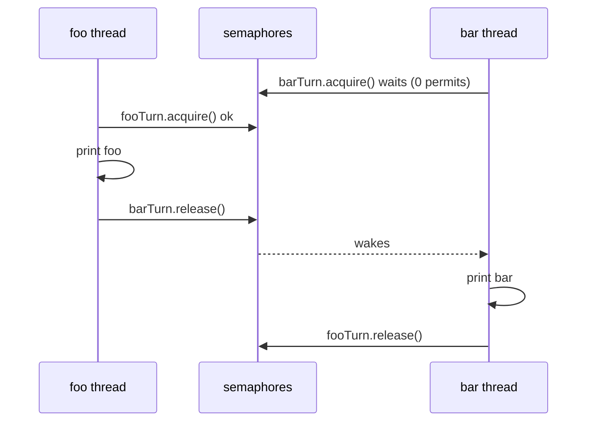
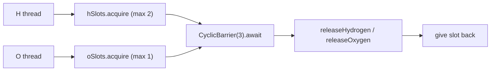
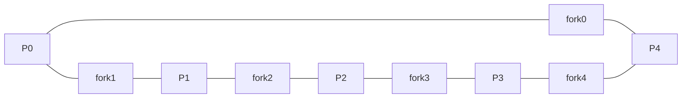
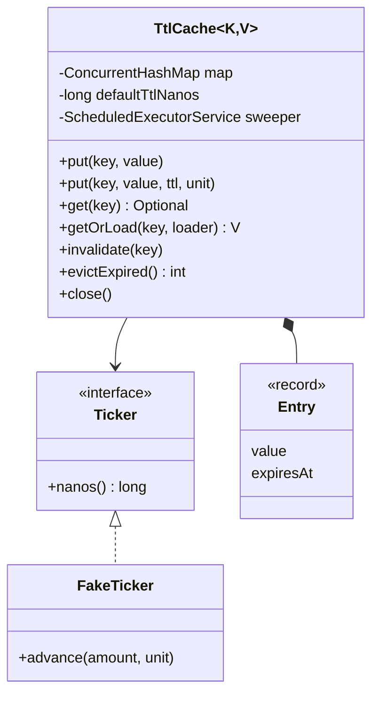
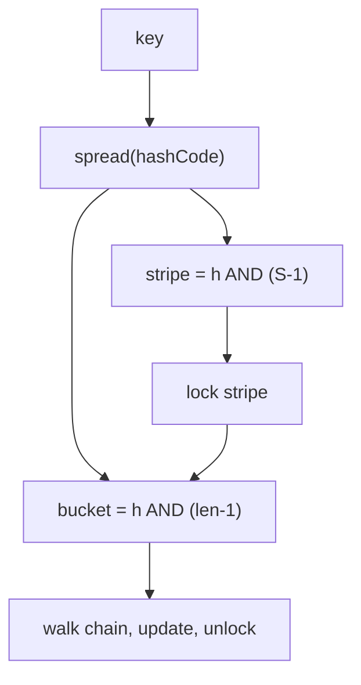
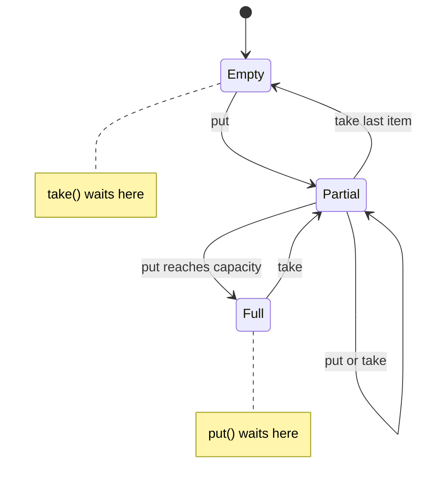
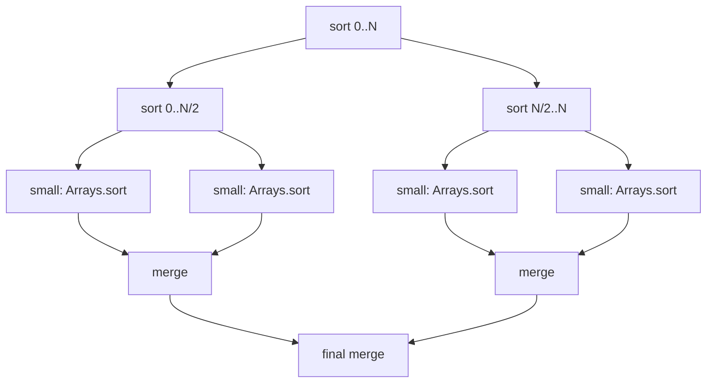
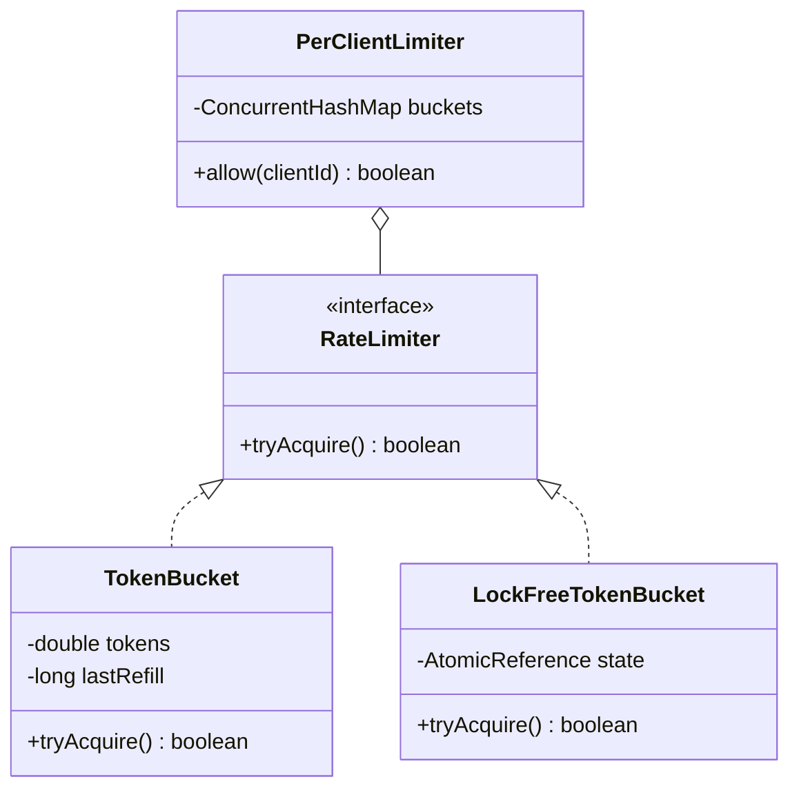

# Chapter 13 — Classic Concurrency Problems

> **Goal.** Chapter 12 gave you the toolbox. This chapter uses it on the concurrency problems interviewers actually ask — from LeetCode's (a popular coding-practice website) "Concurrency" section (FooBar, Zero-Even-Odd, FizzBuzz, H2O, Dining Philosophers) to "design a thread-safe X" **machine-coding** rounds (write working code for a small system in an hour or two): TTL cache, concurrent hash map, blocking queue, Bloom filter, parallel merge sort, **rate limiter** (a component capping how many requests a client may make per second).

**Layout of each problem:** *Problem → Approach → Java solution (+ real output) → Why it's correct → Pitfalls → Real-world examples → In the interview → TL;DR.*

All code is Java 21, standard library only, in `code/lld/ch13/<problem>/Main.java`. Listings below show the solution classes; package/imports, the `start(...)` thread helper and the `main` test harness are in the files. Run from `chapters/13-concurrency-problems/code`:

```text
javac --release 21 -d /tmp/lld_13 $(find . -name '*.java')
java -cp /tmp/lld_13 lld.ch13.foobar.Main
```

Where the order of events varies between runs, the demo *verifies* the result and prints `true/false`, so the output shown is what you get every time.

> **Key terms (built in [Chapter 12](../12-concurrency-concepts/README.md)):** **thread-safe** = correct however threads interleave; a **race** = result depends on timing. A **lock / monitor** is a token one thread holds at a time (`synchronized` uses every object's built-in *monitor*; `ReentrantLock` is the explicit version). A **semaphore** counts permits (`acquire()` takes one or waits, `release()` returns one). A **condition variable** (`wait/notifyAll`, or `Condition`) lets a thread sleep, releasing its lock, until another changes the state and wakes it. A **barrier** (`CyclicBarrier`) holds N threads until all arrive. **Atomic / CAS**: an atomic step happens all at once or not at all; compare-and-swap updates a value only if it still equals what you read — the basis of **lock-free** code (no locks; a loser retries). **Happens-before**: the Java Memory Model rule guaranteeing one thread's writes are visible to another (same lock, `volatile`, semaphore release → acquire). **Deadlock / livelock / starvation**: waiting on each other forever / retrying with no progress / one thread never gets its turn.

**Problem map — which tool solves what**

| # | Problem | Core idea | Main tools |
|---|---|---|---|
| 13.1 | Print FooBar Alternately | Pass a "baton" between 2 threads | `Semaphore` ×2 (or monitor + turn flag) |
| 13.2 | Print Zero Even Odd | A dispatcher thread decides who goes next | `Semaphore` ×3 |
| 13.3 | Fizz Buzz Multithreaded | 4 threads, one shared counter, each waits for "its" numbers | `synchronized` + `wait/notifyAll` |
| 13.4 | Building H2O | Group threads into sets of 2 H + 1 O | `Semaphore` (slots) + `CyclicBarrier` (group) |
| 13.5 | Dining Philosophers | Avoid deadlock over shared forks | Lock ordering, or a "waiter" semaphore |
| 13.6 | Thread-safe cache with TTL | Expiring entries, no stampede | `ConcurrentHashMap`, `compute`, scheduled sweeper |
| 13.7 | Concurrent HashMap (simplified) | Lock striping (N locks, each guarding a slice of the data) | `ReentrantLock[]`, all-stripe resize |
| 13.8 | Bounded Blocking Queue | Wait when full / empty | `wait/notifyAll` **and** `Lock` + 2 `Condition`s |
| 13.9 | Concurrent Bloom Filter | Lock-free bit set | `AtomicLongArray` + atomic OR |
| 13.10 | Multi-threaded Merge Sort | Divide and conquer on cores | `ForkJoinPool`, `RecursiveAction` |
| 13.11 | Rate limiter (token bucket) | Atomic refill-and-take | `synchronized`, or CAS on an immutable state |

**Reusable mental checklist for any concurrency problem**
1. What is the **shared state**? (a turn flag, a counter, a map, a buffer)
2. What **ordering or invariant** must hold? ("foo before bar", "never more than 2 H in a molecule", "never more than capacity items")
3. Who **waits**, for **what condition**, and who **signals** it?
4. Pick the primitive: turn-taking → semaphores; "wait until predicate" → condition variable; groups → barrier; mutual exclusion → lock; single-variable update → atomic.
5. Check **liveness** (every thread eventually makes progress): can anyone wait forever? Does every thread exit at the end?

---

## 13.1 Print FooBar Alternately (LeetCode 1115)

### Problem
One `FooBar` object is shared by two threads. Thread A calls `foo()`, printing `"foo"` *n* times; thread B calls `bar()`, printing `"bar"` *n* times. Output must be exactly `"foobar"` × *n*, whichever thread starts first.

### Approach
Pure **signaling** ([§12.20](../12-concurrency-concepts/README.md#1220-signaling-pattern)): a baton passes back and forth. `fooTurn = Semaphore(1)` (foo may go first), `barTurn = Semaphore(0)` (bar must wait). `foo`: acquire `fooTurn`, print, release `barTurn`; `bar`: the mirror image. Alternative: one monitor with a boolean `fooTurn`, `while (!fooTurn) wait();`, then flip it and `notifyAll()`.



### Java solution

```java
// code/lld/ch13/foobar/Main.java
static class FooBarSemaphore {                              // Solution 1: semaphores as a baton
    private final int n;
    private final Semaphore fooTurn = new Semaphore(1);     // foo may go first
    private final Semaphore barTurn = new Semaphore(0);     // bar must wait
    FooBarSemaphore(int n) { this.n = n; }

    void foo(Runnable printFoo) throws InterruptedException {
        for (int i = 0; i < n; i++) {
            fooTurn.acquire();       // wait for my turn
            printFoo.run();
            barTurn.release();       // hand the baton to bar
        }
    }
    void bar(Runnable printBar) throws InterruptedException {
        for (int i = 0; i < n; i++) {
            barTurn.acquire();
            printBar.run();
            fooTurn.release();
        }
    }
}

static class FooBarMonitor {                                // Solution 2: monitor + turn flag
    private final int n;
    private boolean fooTurn = true;                         // guarded by 'this'
    FooBarMonitor(int n) { this.n = n; }

    void foo(Runnable printFoo) throws InterruptedException {
        for (int i = 0; i < n; i++) {
            synchronized (this) {
                while (!fooTurn) wait();
                printFoo.run();
                fooTurn = false;
                notifyAll();
            }
        }
    }
    // bar(): identical with `while (fooTurn) wait();` and `fooTurn = true;`
}
// main: n = 4, starts the bar thread FIRST on purpose, appends to a StringBuffer (synchronized)
```

Output:

```text
semaphores : foobarfoobarfoobarfoobar
monitor    : foobarfoobarfoobarfoobar
both correct: true
```

### Why it's correct
- **Invariant:** permits in `fooTurn` + `barTurn` always total exactly 1 (each thread releases the *other* semaphore only after acquiring its own). At most one thread prints, and turns strictly alternate.
- Starting `bar` first doesn't matter: it blocks on `barTurn` (0 permits) until `foo` has printed.
- **Visibility:** a `release()` happens-before the `acquire()` it enables, so each thread sees the other's appends.
- **Termination:** both loops run exactly *n* times, and each acquire has a matching release.

### Pitfalls
- One semaphore for both threads — a thread can re-acquire its own release and print twice.
- `if` instead of `while` in the monitor version, or `notify()` in more complex variants.
- **Busy-waiting** (a loop re-checking a flag) on a `volatile` flag (writes immediately visible to other threads) works but burns a CPU core.

### Real-world examples
Strict two-party hand-offs: ping-pong protocols, request/acknowledge stages, **double-buffering** (one buffer is filled while the other is read, then they swap) where a renderer and a producer alternate buffers.

### In the interview
**30-second answer:** "Two semaphores as a baton: foo's starts at 1, bar's at 0. Each thread acquires its own, prints, and releases the other's. The total permits are always one, so they alternate."

**Follow-ups:**
- *Three threads printing A, B, C in order?* Three semaphores in a ring: A(1), B(0), C(0); each releases the next.
- *Without semaphores?* A monitor with a turn variable and `wait/notifyAll`, or `Lock` + `Condition`.
- *What if `barTurn` starts with 1?* bar can print first → output may begin with "bar".

### TL;DR
Two semaphores, one permit total, passed back and forth.

---

## 13.2 Print Zero Even Odd (LeetCode 1116)

### Problem
Three threads share a `ZeroEvenOdd(n)` object. `zero()` may only print 0, `even()` only even numbers, `odd()` only odd numbers. Together they print `0 1 0 2 0 3 … 0 n` — e.g. *n* = 5 → `0102030405`.

### Approach
The zero thread is a **dispatcher**: after printing the 0 for position *i*, it releases `oddTurn` if *i* is odd, else `evenTurn`; that thread prints its number and hands control back via `zeroTurn`. Initial permits: `zeroTurn = 1`, `oddTurn = 0`, `evenTurn = 0`. Zero loops *n* times; odd over 1, 3, 5…; even over 2, 4, 6….

### Java solution

```java
// code/lld/ch13/zeroevenodd/Main.java
static class ZeroEvenOdd {
    private final int n;
    private final Semaphore zeroTurn = new Semaphore(1);
    private final Semaphore oddTurn = new Semaphore(0);
    private final Semaphore evenTurn = new Semaphore(0);
    ZeroEvenOdd(int n) { this.n = n; }

    void zero(IntConsumer print) throws InterruptedException {
        for (int i = 1; i <= n; i++) {
            zeroTurn.acquire();
            print.accept(0);
            if (i % 2 == 1) oddTurn.release(); else evenTurn.release();   // dispatcher decides
        }
    }
    void odd(IntConsumer print) throws InterruptedException {
        for (int i = 1; i <= n; i += 2) {
            oddTurn.acquire();
            print.accept(i);
            zeroTurn.release();
        }
    }
    void even(IntConsumer print) throws InterruptedException {
        for (int i = 2; i <= n; i += 2) {
            evenTurn.acquire();
            print.accept(i);
            zeroTurn.release();
        }
    }
}
// main: n in {1, 2, 5, 10}, threads started even, odd, zero
```

Output:

```text
n=1 -> 01
n=2 -> 0102
n=5 -> 0102030405
n=10 -> 010203040506070809010
```

### Why it's correct
- Exactly one semaphore holds a permit at any moment → exactly one thread may print.
- The zero thread's index *i* decides the parity of the next number, so the right thread wakes.
- Each loop count matches the permits that thread receives: zero *n*, odd ⌈n/2⌉, even ⌊n/2⌋. Nobody waits forever and everyone exits (for *n* = 1, even's loop runs zero times).

### Pitfalls
- Odd/even threads computing "the next number" from a shared counter without synchronization.
- Loop bounds that don't match the permits (even looping `n/2 + 1` times) → a thread waits forever; the program hangs.

### Real-world examples
Dispatcher/worker designs where one coordinator routes each step to a specialised worker (an interpreter routing **opcodes** — numeric codes of individual instructions — a scheduler assigning alternating tasks).

### In the interview
**30-second answer:** "Three semaphores. Zero starts with one permit. After each 0 it releases odd or even depending on the index, and they release zero back. One permit total in the system, so the order is forced."

**Follow-ups:**
- *One lock + condition instead?* A shared `state` (ZERO/ODD/EVEN) and `current` number; each thread waits `while (state != mine)`, acts, updates state, `signalAll()`.
- *For n = 4, how many times does `odd()` acquire?* Twice (1 and 3).

### TL;DR
Zero is the dispatcher; one permit circulates among three semaphores.

---

## 13.3 Fizz Buzz Multithreaded (LeetCode 1195)

### Problem
Four threads share a `FizzBuzz(n)` object and together output 1..n: multiples of 15 → `fizzbuzz` (thread C), multiples of 3 only → `fizz` (A), multiples of 5 only → `buzz` (B), everything else → the number (D).

### Approach
One shared counter `current` guarded by the object's monitor; each thread runs the same loop with its own predicate — the **condition variable** pattern ([§12.13](../12-concurrency-concepts/README.md#1213-condition-variables-waitnotify-and-condition)):
1. `while (current <= n && !mine(current)) wait();`
2. If `current > n` → `notifyAll()` and exit.
3. Print, `current++`, `notifyAll()` (the next number may belong to anyone).

A helper `runWhile(predicate, action)` avoids writing the loop four times (DRY: Don't Repeat Yourself).

### Java solution

```java
// code/lld/ch13/fizzbuzz/Main.java
static class FizzBuzz {
    private final int n;
    private int current = 1;                              // guarded by 'this'
    FizzBuzz(int n) { this.n = n; }

    /** Wait until 'current' is mine (or we're done), act, advance, wake everyone. */
    private void runWhile(IntPredicate mine, IntConsumer action) throws InterruptedException {
        while (true) {
            synchronized (this) {
                while (current <= n && !mine.test(current)) wait();
                if (current > n) { notifyAll(); return; }     // done: wake others so they exit too
                action.accept(current);
                current++;
                notifyAll();                                  // the next number may belong to anyone
            }
        }
    }
    void fizz(Runnable p)     throws InterruptedException { runWhile(i -> i % 3 == 0 && i % 5 != 0, i -> p.run()); }
    void buzz(Runnable p)     throws InterruptedException { runWhile(i -> i % 5 == 0 && i % 3 != 0, i -> p.run()); }
    void fizzbuzz(Runnable p) throws InterruptedException { runWhile(i -> i % 15 == 0, i -> p.run()); }
    void number(IntConsumer p) throws InterruptedException { runWhile(i -> i % 3 != 0 && i % 5 != 0, p); }
}
// main: n = 15; output list touched only inside the monitor, read after join()
```

Output:

```text
1, 2, fizz, 4, buzz, fizz, 7, 8, fizz, buzz, 11, fizz, 13, 14, fizzbuzz
```

### Why it's correct
- The predicates **partition** 1..n (each number satisfies exactly one), so exactly one thread acts per value.
- `current` is read and written only inside `synchronized (this)` → no races, full visibility; the output list too, and `join()` makes it visible to `main`.
- `notifyAll()`, not `notify()`: four different predicates wait on one monitor; `notify()` could wake a thread whose predicate is false, which waits again while the right thread is never woken → hang.
- **Termination:** once `current` exceeds *n*, the last `notifyAll` wakes every waiter, each sees `current > n`, and all four exit.

### Pitfalls
- `notify()` instead of `notifyAll()` → lost wake-ups, random hangs.
- Missing the `current > n` exit check in the wait loop → threads wait forever after the last number.
- Overlapping predicates (fizz = `i % 3 == 0` without excluding 15) → two threads compete for 15.

### Real-world examples
"Workers wait until shared state matches their role" — pipeline stages each waiting for a job to reach their stage in a shared state machine.

### In the interview
**30-second answer:** "One monitor, one shared counter. Each thread waits in a while loop until the counter matches its predicate or passes n, prints, increments and notifies all. The predicates partition the numbers, so exactly one thread acts per number."

**Follow-ups:**
- *Semaphore version?* The number thread dispatches, releasing the fizz/buzz/fizzbuzz semaphore for the next value — more efficient (no **thundering herd**: many threads woken when only one can proceed) but more code.
- *Why `notifyAll`?* Threads wait for *different* conditions on one monitor; only waking all guarantees the right one wakes.

### TL;DR
Shared counter + per-thread predicate + `while`-wait + `notifyAll`.

---

## 13.4 Building H2O (LeetCode 1117)

### Problem
Hydrogen and oxygen threads arrive in any order and must pass a barrier in groups of three forming one water molecule: exactly **2 H + 1 O**. All threads of one molecule pass before any thread of the next.

### Approach
- **Slots** — `hSlots = Semaphore(2)`, `oSlots = Semaphore(1)`: at most 2 H and 1 O are "in" the current molecule.
- **Group** — `CyclicBarrier(3)`: the three atoms wait for each other, then all go.
- A thread returns its slot **after** it has been released (printed), so the next molecule forms only once this one is finished.



### Java solution

```java
// code/lld/ch13/h2o/Main.java
static class H2O {
    private final Semaphore hSlots = new Semaphore(2);         // at most 2 H in the current molecule
    private final Semaphore oSlots = new Semaphore(1);         // at most 1 O
    private final CyclicBarrier bond = new CyclicBarrier(3);   // wait until all 3 atoms are present

    void hydrogen(Runnable releaseHydrogen) throws InterruptedException {
        hSlots.acquire();
        try { bond.await(); } catch (BrokenBarrierException e) { throw new IllegalStateException(e); }
        releaseHydrogen.run();
        hSlots.release();                                      // free my slot only after I have "left"
    }
    void oxygen(Runnable releaseOxygen) throws InterruptedException {
        oSlots.acquire();
        try { bond.await(); } catch (BrokenBarrierException e) { throw new IllegalStateException(e); }
        releaseOxygen.run();
        oSlots.release();
    }
}
// main: 16 H + 8 O shuffled with Random(7); since HHO, HOH and OHH are all valid,
// it checks every consecutive group of 3 in the output instead of printing it.
```

Output:

```text
arrival order   : OHOOOHHHHOHHHHHOOHHHHHOH
molecules formed: 8, every group of 3 has 2 H + 1 O: true
```

### Why it's correct
- The slot semaphores let **at most 2 H and 1 O** reach the barrier per round; the barrier needs 3 parties, so each trip is exactly `H, H, O`.
- **No mixing:** a new molecule needs all three slots free, and each is freed only after its thread printed — so the next group can't trip the barrier (and print) until all three of the previous group have printed.
- The barrier resets automatically (it's *cyclic*) for the next molecule.

### Pitfalls
- Releasing the slot **before** printing → a new H may print before the previous O, mixing molecules.
- Semaphores without the barrier → the 2 H and 1 O aren't forced to leave "together".
- Thread counts not exactly 2:1 → the last threads wait forever (the problem guarantees they are).

### Real-world examples
Batching: gather exactly N items of certain types before dispatching (matchmaking 2 players + 1 server slot; assembling an order needing parts from different producers).

### In the interview
**30-second answer:** "Two semaphores cap the molecule at 2 H and 1 O; a CyclicBarrier of 3 makes the three wait for each other; each atom returns its slot only after it's released, so molecules never interleave."

**Follow-ups:**
- *Without a barrier?* A lock with counters of waiting H and O; when 2 H + 1 O are available, the thread completing the set signals exactly those. More code, same idea.
- *Why `hSlots` = 2, not 1?* A molecule needs two hydrogens inside the barrier at once.

### TL;DR
Slots (semaphores) decide *who* can join; the barrier decides *when* they leave; free slots only after leaving.

---

## 13.5 Dining Philosophers (LeetCode 1226)

### Problem
Five philosophers sit at a round table with one fork between each pair (5 forks). To eat, a philosopher needs **both** adjacent forks. If everyone picks up their left fork first, everyone may hold one fork and wait forever for the other — **deadlock** (all four **Coffman conditions** hold — mutual exclusion, hold-and-wait, no preemption, circular wait; [§12.17](../12-concurrency-concepts/README.md#1217-deadlock)).

### Approach
Break a Coffman condition:
1. **Resource ordering** (breaks circular wait): number forks 0–4; always pick up the **lower-numbered** fork first. Philosopher 4 (forks 4 and 0) picks fork 0 first, so the cycle is impossible.
2. **Waiter / limited seats** (also breaks circular wait): a semaphore lets at most **n − 1** philosophers try at once — 4 people, 5 forks, so at least one gets both. Make it **fair** to prevent starvation.
3. Others: `tryLock` both forks and put down on failure with random **back-off** (a random short wait before retrying); the Chandy–Misra algorithm for distributed settings.



### Java solution

```java
// code/lld/ch13/philosophers/Main.java
interface Table { void eat(int p, Runnable eatAction) throws InterruptedException; }

static class OrderedForks implements Table {               // Fix 1: lower-numbered fork first
    private final ReentrantLock[] forks;                   // one ReentrantLock per fork
    public void eat(int p, Runnable eatAction) {
        int left = p, right = (p + 1) % forks.length;
        ReentrantLock first = forks[Math.min(left, right)], second = forks[Math.max(left, right)];
        first.lock();
        try {
            second.lock();
            try { eatAction.run(); } finally { second.unlock(); }
        } finally { first.unlock(); }
    }
}

static class Waiter implements Table {                     // Fix 2: at most n-1 try at once
    private final ReentrantLock[] forks;
    private final Semaphore seats;                         // = new Semaphore(n - 1, true): fair, nobody starves for a seat
    public void eat(int p, Runnable eatAction) throws InterruptedException {
        seats.acquire();
        try {
            ReentrantLock left = forks[p], right = forks[(p + 1) % forks.length];
            left.lock();
            try {
                right.lock();
                try { eatAction.run(); } finally { right.unlock(); }
            } finally { left.unlock(); }
        } finally { seats.release(); }
    }
}
// dine(table, 5, 10_000): 5 threads "think" (Thread.onSpinWait) then eat; counts meals in an AtomicIntegerArray
```

Output:

```text
resource ordering, meals per philosopher: [10000, 10000, 10000, 10000, 10000]
waiter (4 seats),  meals per philosopher: [10000, 10000, 10000, 10000, 10000]
```

### Why it's correct
- **Ordering:** every philosopher acquires forks in increasing index order. A waiting cycle would need someone holding a higher fork while waiting for a lower one — impossible.
- **Waiter:** with at most 4 competing for 5 forks, by the **pigeonhole principle** (more items than boxes → some box gets two) at least one gets both forks, eats and releases — progress is always possible. The fair semaphore hands out seats in FIFO (first in, first out) order.
- Forks are released in `finally`, so an exception can't leave one held. 5 × 10,000 meals complete.

### Pitfalls
- "Everyone picks left then right" → deadlock.
- `tryLock` both forks and retry immediately without random back-off → livelock.
- Unfair strategies can starve a philosopher in theory. The fair semaphore makes *seat* access first-come-first-served; for strict no-starvation on the forks too, make the fork locks fair (`new ReentrantLock(true)`), at a throughput cost.

### Real-world examples
Any task needing **two or more locks** at once: bank transfers (two accounts), moving an item between inventories, DB transactions updating several rows — solved by ordering (account id), or by the DB's deadlock detection aborting one transaction.

### In the interview
**30-second answer:** "Naively everyone takes the left fork and waits for the right — circular wait, deadlock. I break circular wait by always taking the lower-numbered fork first, or by a waiter semaphore allowing only n−1 philosophers to try; fairness prevents starvation."

**Follow-ups:**
- *Which Coffman condition does each fix break?* Both break circular wait; the tryLock variant breaks hold-and-wait.
- *Maximum parallelism?* With 5 forks, at most 2 philosophers eat at once.
- *With ordering, who behaves "differently"?* The one between forks 4 and 0 — they pick fork 0 (right) first.

### TL;DR
Break circular wait: global fork order, or allow only n−1 diners.

---

## 13.6 Thread-safe cache with TTL

### Problem
Design an in-memory key-value **cache** (a fast store keeping copies of data for quick reads; see [System Design Fundamentals](../../../system-design-patterns/modules/00-system-design-fundamentals/README.md)) used by many threads, where each entry expires after a **time-to-live** (TTL). Requirements: `put(k, v)` (default or per-entry TTL); `get(k)` returns nothing for expired entries; `getOrLoad(k, loader)` loads on a miss without a **cache stampede** (many threads loading the same key at once); expired entries are eventually removed from memory; testable without sleeping.

### Approach
- Immutable `Entry(value, expiresAt)` records in a `ConcurrentHashMap`.
- **Lazy expiry**: `get` checks `expiresAt`; if expired, removes it with the **conditional** `remove(key, entry)`, so it never deletes a fresher value another thread just put.
- **Active expiry**: a **daemon** (background thread that doesn't keep the JVM running) `ScheduledExecutorService` (a JDK pool running tasks on a timer) periodically calls `evictExpired()`, so keys nobody reads again don't leak memory.
- **No stampede**: `getOrLoad` uses `map.compute(...)`, atomic per key — concurrent callers for one key wait and the loader runs once.
- **Testability**: time comes from an injected `Ticker` (`FakeTicker` in tests) — **Dependency Inversion** (depend on an interface, so the real clock can be swapped for a fake).



### Java solution

```java
// code/lld/ch13/ttlcache/Main.java
@FunctionalInterface interface Ticker { long nanos(); }      // FakeTicker: an AtomicLong + advance(amount, unit)

static final class TtlCache<K, V> implements AutoCloseable {
    private record Entry<V>(V value, long expiresAt) { }
    private final ConcurrentHashMap<K, Entry<V>> map = new ConcurrentHashMap<>();
    private final long defaultTtlNanos;
    private final Ticker ticker;
    private final ScheduledExecutorService sweeper;        // null = lazy expiry only

    TtlCache(long ttl, TimeUnit unit, Ticker ticker, long sweepEveryMillis) {
        this.defaultTtlNanos = unit.toNanos(ttl);
        this.ticker = ticker;
        if (sweepEveryMillis > 0) {
            sweeper = Executors.newSingleThreadScheduledExecutor(r -> {
                Thread t = new Thread(r, "ttl-sweeper");
                t.setDaemon(true);                           // never blocks JVM shutdown
                return t;
            });
            // 'this' escapes before the constructor ends - see "Why it's correct".
            sweeper.scheduleAtFixedRate(this::evictExpired, sweepEveryMillis, sweepEveryMillis, TimeUnit.MILLISECONDS);
        } else sweeper = null;
    }

    private boolean expired(Entry<V> e) { return ticker.nanos() - e.expiresAt() >= 0; }   // overflow-safe

    void put(K key, V value, long ttl, TimeUnit unit) {    // put(key, value) uses the default TTL
        Objects.requireNonNull(key); Objects.requireNonNull(value);
        map.put(key, new Entry<>(value, ticker.nanos() + unit.toNanos(ttl)));
    }

    Optional<V> get(K key) {
        Entry<V> e = map.get(key);
        if (e == null) return Optional.empty();
        if (expired(e)) {
            map.remove(key, e);   // conditional: never deletes a FRESH value another thread just put
            return Optional.empty();
        }
        return Optional.of(e.value());
    }

    /** Read-through: compute() locks the key's bin, so concurrent misses for one key load once.
     *  The loader must be fast and must not touch this cache. */
    V getOrLoad(K key, Function<? super K, ? extends V> loader) {
        return map.compute(key, (k, old) ->
                old != null && !expired(old) ? old : new Entry<>(loader.apply(k), ticker.nanos() + defaultTtlNanos)
        ).value();
    }

    void invalidate(K key) { map.remove(key); }

    int evictExpired() {                                   // active expiry; safe alongside readers/writers
        int removed = 0;
        for (Map.Entry<K, Entry<V>> me : map.entrySet())
            if (expired(me.getValue()) && map.remove(me.getKey(), me.getValue())) removed++;
        return removed;
    }
    int rawSize() { return map.size(); }                   // includes not-yet-swept expired entries
    @Override public void close() { if (sweeper != null) sweeper.shutdownNow(); }
}
// main: fake clock (100 ms default TTL, 30 ms OTP); 16 threads released by a latch call getOrLoad("user:7");
// then a real-clock cache (30 ms TTL, sweep every 10 ms) with 1,000 puts and a 200 ms sleep.
```

Output:

```text
t=50ms  session=alice, otp=<expired>
t=110ms session=<expired>
before sweep raw size=5, swept=5, after=0
16 concurrent misses -> loader ran 1 time(s), all got same value: true
real clock: size right after puts=1000
real clock: size after 200 ms (sweeper ran)=0
```

### Why it's correct
- All shared state is in one `ConcurrentHashMap` of immutable records: a reader sees the old or the new entry, never a half-written one.
- `remove(key, e)` removes only if the mapping is still *that exact entry*; a fresh replacement survives.
- `compute` runs the remapping function atomically per key, so 16 simultaneous misses cause one load.
- Expiry uses `now - expiresAt >= 0`, not `now >= expiresAt`, which stays correct even if `System.nanoTime()` values **overflow** (wrap around past the largest `long`) — the JDK recommends comparing nano times by subtraction.
- The sweeper is a daemon and is shut down in `close()`.
- The constructor hands `this::evictExpired` to the sweeper before returning (`this` escapes) — normally a bug ([§12.6](../12-concurrency-concepts/README.md#126-java-memory-model-basics-visibility-happens-before-volatile)). It's safe here only because the fields it uses (`map`, `ticker`) are already set and submitting to an executor is a happens-before edge; in production prefer a **static factory method** (a static method that builds and returns the object) that starts the sweeper after construction.

### Pitfalls
- `System.currentTimeMillis()` for TTL: wall-clock time can jump (NTP — Network Time Protocol — corrections). `System.nanoTime()` is **monotonic** (only moves forward) for durations.
- A slow loader inside `compute` blocks other keys sharing the hash bin, and a loader touching the same map can throw or deadlock. For slow loads store a `CompletableFuture<V>` (a placeholder an async task fills later) instead — `computeIfAbsent(k, key -> supplyAsync(...))` — so the bin lock is held only briefly.
- Only lazy expiry → memory leak for keys never read again. Only active expiry → `get` may return a stale value between sweeps. Use both.
- No size limit: a real cache needs a maximum size and an **eviction policy** (which entry to throw out when full: LRU = least recently used, LFU = least frequently used).

### Real-world examples
- **Caffeine** (the de-facto Java caching library): `expireAfterWrite`/`expireAfterAccess`, size-based eviction, and a stampede-free loading cache — the production version of this design. Guava's (Google's core Java library) `CacheBuilder` is its predecessor.
- **Redis** `EXPIRE`/`SET … EX`: lazy expiry on access plus periodic active sampling of keys with TTLs.
- Sessions, OTPs (one-time passwords), DNS caches (DNS maps names to IP addresses), and seat holds in booking systems (a hold is a TTL entry).

### In the interview
**30-second answer:** "A ConcurrentHashMap of immutable entries holding value and expiry time. Get checks expiry lazily and removes with a conditional remove; a daemon scheduled sweeper removes expired keys nobody reads. getOrLoad uses compute so concurrent misses load once. Time is injected for testing."

**Follow-ups (with answers):**
- *Max size with LRU?* An access-ordered `LinkedHashMap` under a lock, or a `ConcurrentHashMap` plus a concurrent **deque** (double-ended queue) of keys updated on access — or just Caffeine (Window-TinyLFU).
- *Refresh without blocking readers?* "Refresh-ahead": serve the old value while one thread reloads asynchronously as the entry nears expiry.
- *Distributed?* Redis/Memcached (shared in-memory cache servers) with TTLs, plus a small local cache in front for hot keys.
- *Why `remove(key, e)` not `remove(key)`?* To avoid deleting a value written between our read and our remove.

### TL;DR
CHM (`ConcurrentHashMap`) + immutable (value, expiry) entries; lazy + scheduled expiry; `compute` for **single-flight** loads (one load per key, shared by every waiting caller); injected clock.

---

## 13.7 Design a (simplified) Concurrent HashMap — lock striping

### Problem
A hash map many threads can use at once — `get`, `put`, `remove`, `compute`, automatic resizing — faster than one global lock around a `HashMap`.

### Approach
**Lock striping** ([§12.11](../12-concurrency-concepts/README.md#1211-coarse-grained-vs-fine-grained-locking)):
- Buckets: an array of linked lists (**separate chaining**: each bucket lists all entries whose hash lands there).
- Stripes: a fixed array of `S` locks (power of two). Hash *h* uses stripe `h & (S − 1)` and bucket `h & (tableLength − 1)`. The stripe depends only on the hash — **not** the table length — so a key's stripe never changes on resize.
- Each operation locks only its stripe; different stripes run in parallel.
- **Resize** (size > 0.75 × buckets): acquire **all** stripe locks in index order (global order → no deadlock), re-check, **rehash** (recompute every key's bucket) into a table twice as big, publish via a `volatile` field, release in reverse.
- Size tracked with an `AtomicInteger`.



### Java solution

```java
// code/lld/ch13/stripedmap/Main.java  (Java 7's ConcurrentHashMap used this idea with "segments")
static final class StripedHashMap<K, V> {
    private static final class Node<K, V> { final K key; final int hash; V value; Node<K, V> next; /* ctor */ }

    private volatile Node<K, V>[] table;        // replaced (never mutated in place) only while ALL locks are held
    private final ReentrantLock[] stripes;
    private final AtomicInteger size = new AtomicInteger();
    private static final float LOAD_FACTOR = 0.75f;
    // constructor: both sizes powers of two, and stripeCount <= initialBuckets
    //              (guarantees every bucket maps to exactly one stripe), else IllegalArgumentException

    private static int spread(Object key) {
        int h = key.hashCode();
        return (h ^ (h >>> 16)) & 0x7fffffff;    // mix high bits in, keep it non-negative
    }
    private ReentrantLock stripeFor(int hash) { return stripes[hash & (stripes.length - 1)]; }  // never changes on resize
    private static int indexFor(int hash, int len) { return hash & (len - 1); }

    V get(K key) {
        int h = spread(Objects.requireNonNull(key));
        ReentrantLock lock = stripeFor(h);
        lock.lock();
        try {
            Node<K, V>[] t = table;                       // stable while we hold a stripe lock
            for (Node<K, V> n = t[indexFor(h, t.length)]; n != null; n = n.next)
                if (n.hash == h && n.key.equals(key)) return n.value;
            return null;
        } finally { lock.unlock(); }
    }
    V put(K key, V value) { Objects.requireNonNull(value); return doCompute(key, (k, old) -> value).oldValue(); }
    V compute(K key, BiFunction<? super K, ? super V, ? extends V> remap) { return doCompute(key, remap).newValue(); }
    // remove(key): same locking as get(); unlinks the node and decrements size

    private record Result<V>(V oldValue, V newValue) { }
    private Result<V> doCompute(K key, BiFunction<? super K, ? super V, ? extends V> remap) {
        int h = spread(Objects.requireNonNull(key));
        ReentrantLock lock = stripeFor(h);
        boolean grew = false;
        V old, nv;
        lock.lock();
        try {
            Node<K, V>[] t = table;
            int i = indexFor(h, t.length);
            Node<K, V> prev = null, n = t[i];
            while (n != null && !(n.hash == h && n.key.equals(key))) { prev = n; n = n.next; }
            old = n == null ? null : n.value;
            nv = remap.apply(key, old);
            if (n != null && nv != null) n.value = nv;                         // update in place
            else if (n != null) {                                              // remap returned null: remove
                if (prev == null) t[i] = n.next; else prev.next = n.next;
                size.decrementAndGet();
            } else if (nv != null) {                                           // insert at bucket head
                t[i] = new Node<>(key, h, nv, t[i]);
                grew = size.incrementAndGet() > t.length * LOAD_FACTOR;
            }
        } finally { lock.unlock(); }
        if (grew) resize();                                                    // never resize holding one stripe
        return new Result<>(old, nv);
    }

    private void resize() {                       // stop-the-world: every stripe lock IN ORDER, rehash, publish
        for (ReentrantLock l : stripes) l.lock();
        try {
            Node<K, V>[] old = table;
            if (size.get() <= old.length * LOAD_FACTOR) return;               // another thread already resized
            Node<K, V>[] nt = (Node<K, V>[]) new Node[old.length * 2];
            for (Node<K, V> head : old)
                for (Node<K, V> n = head; n != null; ) {
                    Node<K, V> next = n.next;
                    int j = indexFor(n.hash, nt.length);
                    n.next = nt[j]; nt[j] = n;
                    n = next;
                }
            table = nt;
        } finally {
            for (int i = stripes.length - 1; i >= 0; i--) stripes[i].unlock();
        }
    }
}
// main: basic ops; 8 threads x 20,000 puts from 16 buckets; 8 threads x 10,000 compute() on 10 hot keys; concurrent removes
```

Output:

```text
put a=1, put a=2 returns old=1, get a=2, remove a=2, get a=null
8 threads x 20,000 puts -> size=160000, missing=0, table grew from 16 to 262144 buckets
atomic compute on 10 hot keys: each=8000, total=80000 (expected 80000)
after concurrent removes size=0
```

### Why it's correct
- **Every bucket belongs to exactly one stripe.** *S* and the table length are powers of two with *S* ≤ length, so the stripe index (`h & (S−1)`) is the low bits of the bucket index (`h & (len−1)`). All keys in a bucket share one stripe lock; two threads never modify one chain at once.
- **Resize safety:** resize holds *every* stripe lock, so nothing else is in progress; it re-checks the load (another thread may have resized) and publishes via a `volatile` write. A later operation acquires a stripe lock the resizer released → happens-before → it sees the new table and moved nodes.
- **No deadlock:** normal operations hold one lock; resize takes all locks in ascending order, only *after* the caller released its own stripe.
- **Atomic compute:** read-modify-write of one key happens entirely under its stripe lock (80,000 exact increments).

### Pitfalls
- Deriving the stripe from the *current table's bucket index* — after a resize a key could move to another lock while a thread holds the old one.
- Resizing while holding one stripe and then taking all → deadlock with another resizer. Release first.
- Reading `table` without a lock or `volatile` → a stale table after resize.
- Allowing `null` keys/values makes `get() == null` ambiguous (the JDK's `ConcurrentHashMap` forbids them too).

### How the real `ConcurrentHashMap` goes further

| Aspect | This design | JDK 8+ `ConcurrentHashMap` |
|---|---|---|
| Reads | Lock the stripe | Lock-free (volatile reads of nodes) |
| Write locking | One of S stripe locks | CAS into empty bins; `synchronized` on the bin's first node otherwise |
| Long chains | Linked list | Converted to a red-black tree beyond 8 nodes (when table ≥ 64) |
| Resize | Stop-the-world (all locks; everything else pauses) | Incremental: threads help transfer bins concurrently |
| Size | `AtomicInteger` | `LongAdder`-style counter cells |

### Real-world examples
Java 7's `ConcurrentHashMap` used **segments** (16 by default) — the same striping idea. Guava's `Striped<Lock>` offers striped locks for your own data; Caffeine uses striped buffers to record reads.

### In the interview
**30-second answer:** "An array of buckets plus a small array of locks; each key maps to a stripe by its hash bits, so different stripes work in parallel. Every bucket belongs to exactly one stripe. Resize takes all stripe locks in order, rehashes and publishes the new table through a volatile field."

**Follow-ups:**
- *Lock-free `get`?* Make `Node.value` and `next` volatile, publish nodes safely, and never mutate a chain so a reader could see it half-done (the JDK copies/reorders carefully during transfer).
- *How many stripes?* About the number of concurrently writing threads (JDK 7 default 16); more = less contention, more memory.
- *Why must the stripe count divide the table length?* So every bucket maps to exactly one stripe (stripe index = low bits of bucket index).

### TL;DR
N locks for M buckets, stripe by hash bits, resize under all locks in order, publish via volatile.

---

## 13.8 Thread-safe bounded Blocking Queue (two ways)

### Problem
A fixed-capacity FIFO queue for producer-consumer use: `put` blocks while full, `take` blocks while empty, plus `offer(item, timeout)` and `poll(timeout)` that give up after a timeout.

### Approach
Storage: a **circular array** (its end wraps around to the start; `head`, `tail`, `count`). Two synchronisation designs:

| | Way 1: monitor | Way 2: `ReentrantLock` + 2 `Condition`s |
|---|---|---|
| Lock | `synchronized` methods | `lock.lockInterruptibly()` |
| Wait | `while (full) wait();` | `while (full) notFull.await();` |
| Wake | `notifyAll()` — producers and consumers share one wait set | `notEmpty.signal()` after enqueue, `notFull.signal()` after dequeue |
| Timed wait | `TimeUnit.timedWait(this, nanos)` + deadline loop | `awaitNanos(nanos)` returns the time left |
| Efficiency | Wakes everyone (thundering herd) | Wakes exactly one thread of the right kind |



### Java solution

```java
// code/lld/ch13/blockingqueue/Main.java - both implement put/take/offer(timeout)/poll(timeout)/size
// Way 1: one monitor shared by producers AND consumers -> must use notifyAll()
static final class MonitorQueue<T> implements BoundedBlockingQueue<T> {
    private final Object[] items;
    private int head, tail, count;                          // all guarded by 'this'

    public synchronized void put(T item) throws InterruptedException {
        while (count == items.length) wait();
        enqueue(item);
        notifyAll();
    }
    public synchronized T take() throws InterruptedException {
        while (count == 0) wait();
        T x = dequeue();
        notifyAll();
        return x;
    }
    public synchronized T poll(long timeout, TimeUnit unit) throws InterruptedException {
        long deadline = System.nanoTime() + unit.toNanos(timeout);
        while (count == 0) {
            long left = deadline - System.nanoTime();
            if (left <= 0) return null;
            TimeUnit.NANOSECONDS.timedWait(this, left);      // wait(millis, nanos) under the hood
        }
        T x = dequeue();
        notifyAll();
        return x;
    }
    // offer(item, timeout): mirror image of poll - waits while full, returns false on timeout
    private void enqueue(T item) {
        if (item == null) throw new NullPointerException();  // null is our "timed out" signal
        items[tail] = item;
        tail = (tail + 1) % items.length;                    // circular buffer
        count++;
    }
    private T dequeue() {
        T x = (T) items[head];
        items[head] = null;                                  // let GC reclaim it
        head = (head + 1) % items.length;
        count--;
        return x;
    }
}

// Way 2: two condition queues -> a targeted signal() is enough (how ArrayBlockingQueue is built)
static final class ConditionQueue<T> implements BoundedBlockingQueue<T> {
    private final ReentrantLock lock = new ReentrantLock();
    private final Condition notFull = lock.newCondition();
    private final Condition notEmpty = lock.newCondition();

    public void put(T item) throws InterruptedException {
        if (item == null) throw new NullPointerException();
        lock.lockInterruptibly();
        try {
            while (count == items.length) notFull.await();
            enqueue(item);                                   // enqueue() ends with notEmpty.signal(): wake ONE consumer
        } finally { lock.unlock(); }
    }
    public boolean offer(T item, long timeout, TimeUnit unit) throws InterruptedException {
        if (item == null) throw new NullPointerException();
        long nanos = unit.toNanos(timeout);
        lock.lockInterruptibly();
        try {
            while (count == items.length) {
                if (nanos <= 0) return false;
                nanos = notFull.awaitNanos(nanos);           // returns the time still left
            }
            enqueue(item);
            return true;
        } finally { lock.unlock(); }
    }
    // take()/poll(timeout): mirror images waiting on notEmpty; dequeue() ends with notFull.signal()
}
// stressTest: capacity 2, 3 producers x 20,000 items, 3 consumers; then poll/offer with 30 ms timeouts
```

Output:

```text
wait/notifyAll  : consumed 60000 items, sum ok=true, left in queue=0
wait/notifyAll  : poll(30ms) on empty -> null
wait/notifyAll  : offer(30ms) on full -> false
Lock+Conditions : consumed 60000 items, sum ok=true, left in queue=0
Lock+Conditions : poll(30ms) on empty -> null
Lock+Conditions : offer(30ms) on full -> false
```

### Why it's correct
- All fields are accessed only under the single lock → no races, plus visibility.
- **Waiting in `while` loops** handles spurious wake-ups and "someone else took the item first".
- **Way 1** must use `notifyAll()`: with one wait set, `notify()` might wake a producer when a consumer was needed (or vice versa), and the right thread might never wake → a deadlock-like hang.
- **Way 2** can `signal()`: producers wait only on `notFull`, consumers only on `notEmpty`; each enqueue enables exactly one more consumer, each dequeue exactly one producer.
- Timed versions track the *remaining* time, so repeated spurious wakeups can't extend the total wait.
- Stress test at capacity 2 (maximum blocking): all 60,000 items consumed, sum correct, queue empty.

### Pitfalls
- `if` instead of `while`; `notify()` with one monitor shared by producers and consumers.
- Forgetting `items[head] = null` after dequeue → the array keeps references alive (a leak for large objects).
- Accepting `null` items when `null` means "timed out" in `poll`.
- `lock()` instead of `lockInterruptibly()` makes cancellation harder (the JDK's queues use `lockInterruptibly` in blocking methods).

### Real-world examples
`java.util.concurrent.ArrayBlockingQueue` is built exactly like Way 2 (one lock, `notEmpty`/`notFull`). `LinkedBlockingQueue` uses **two** locks (`putLock`, `takeLock`) so a producer and a consumer work at the same time. Thread pools, logging frameworks and Kafka's producer internals all rely on blocking hand-off.

### In the interview
**30-second answer:** "A circular array with head, tail and count guarded by one lock. put waits while count == capacity, take waits while count == 0, both in while loops. With synchronized I must use notifyAll because both sides share one wait set; with ReentrantLock I use two Conditions, notFull and notEmpty, and signal just the right side."

**Follow-ups:**
- *Higher throughput?* A two-lock linked queue (separate put/take locks, atomic count) like `LinkedBlockingQueue`, or a lock-free ring buffer (LMAX Disruptor, a high-performance Java messaging library) for single producer/consumer.
- *Unbounded?* Drop the "full" condition — but then there's no back-pressure.
- *Why is `signal()` safe in Way 2 but `notify()` unsafe in Way 1?* Separate condition queues guarantee the woken thread is of the right kind.

### TL;DR
Circular buffer + one lock + "wait while full/empty" in loops. Monitor → `notifyAll`; Lock → `notFull`/`notEmpty` + `signal`.

---

## 13.9 Concurrent Bloom Filter

### Problem
A thread-safe **Bloom filter** — a compact probabilistic set answering *"definitely not present"* or *"probably present"* — that many threads add to and query at once.

### Approach
**How a Bloom filter works:**
1. An array of *m* bits, all 0.
2. **Add**: compute *k* hash positions and set those bits to 1.
3. **Query**: the same *k* positions — if **any** bit is 0 the item was **definitely never added**; if all are 1 it was **probably** added (other items may have set them → a *false positive*).
4. No false negatives, no deletion (clearing a bit could erase other items; a *counting* Bloom filter with small counters supports deletes).

**Sizing** for *n* expected items and target false-positive rate *p*: bits *m* = ⌈ −n · ln p / (ln 2)² ⌉; hashes *k* = round((m / n) · ln 2). For *n* = 80,000, *p* = 1% → *m* ≈ 766,805 bits (≈ 93.6 KiB — kibibytes of 1,024 bytes; the demo prints 93 because it uses integer division) and *k* = 7 — about 9.6 bits per item, whatever the item size.

**Double hashing** (Kirsch–Mitzenmacher): compute *h1*, *h2* once and use positions *h1 + i·h2* for *i* = 0..k−1 — as good as *k* independent hashes in practice.

**Thread safety without locks:** bits live in an `AtomicLongArray` (64 bits per word); setting a bit is an **atomic OR**, `getAndAccumulate(word, mask, (a, b) -> a | b)` (a CAS loop inside), so two threads setting different bits of one word both succeed. Queries are plain volatile reads: bits only go 0 → 1, so a concurrent query can at worst miss an item whose `add` hasn't finished (it hadn't happened yet); after `add` returns, every later query sees its bits (happens-before of atomic operations).

### Java solution

```java
// code/lld/ch13/bloomfilter/Main.java
static final class ConcurrentBloomFilter {
    private final AtomicLongArray words;     // m bits packed into 64-bit words
    private final int numBits, numHashes;    // m, k

    ConcurrentBloomFilter(int expectedItems, double falsePositiveRate) {
        double ln2 = Math.log(2);
        long m = (long) Math.ceil(-expectedItems * Math.log(falsePositiveRate) / (ln2 * ln2));
        if (m > Integer.MAX_VALUE - 63) throw new IllegalArgumentException("too large");
        this.numBits = (int) m;
        this.numHashes = Math.max(1, (int) Math.round((double) m / expectedItems * ln2));
        this.words = new AtomicLongArray((numBits + 63) / 64);
    }

    /** Returns true if at least one bit changed (i.e. it was definitely new). */
    boolean add(String item) {
        long base = fnv1a64(item);
        long h1 = fmix64(base), h2 = fmix64(base ^ 0x9E3779B97F4A7C15L) | 1;   // h2 odd
        boolean changed = false;
        for (int i = 0; i < numHashes; i++) {
            int bit = (int) Math.floorMod(h1 + i * h2, (long) numBits);        // double hashing
            long mask = 1L << (bit & 63);
            long before = words.getAndAccumulate(bit >>> 6, mask, (cur, m) -> cur | m);  // atomic OR
            if ((before & mask) == 0) changed = true;
        }
        return changed;
    }

    boolean mightContain(String item) {                    // same h1/h2 as add()
        for (int i = 0; i < numHashes; i++) {
            int bit = (int) Math.floorMod(h1 + i * h2, (long) numBits);
            if ((words.get(bit >>> 6) & (1L << (bit & 63))) == 0) return false;   // definitely absent
        }
        return true;
    }
    // fnv1a64: 64-bit FNV-1a over the chars; fmix64: MurmurHash3's finalizer (a strong bit-mixer)
}
// main: 8 threads x 10,000 adds; check all for false negatives; probe 100,000 unseen keys
```

Output:

```text
sized for n=80000, p=1%: m=766805 bits (93 KiB), k=7 hashes
false negatives after 8-thread insert: 0
false-positive rate on 100,000 unseen keys: 1.01% (target 1%)
add("user-0-0") again changes bits? false
```

### Why it's correct
- **No lost updates:** a plain `words[i] |= mask` on a `long[]` is read-modify-write, so two threads could overwrite each other's bits → false negatives. The atomic OR retries on conflict.
- **Monotonic state:** bits never return to 0 — no ABA, no locks.
- **Deterministic result:** OR is commutative, so the final bit array is the same whatever the interleaving — the measured false-positive rate (≈1%, matching the formula's target) is identical every run.

### Pitfalls
- Non-atomic bit setting → false negatives (the one thing a Bloom filter must never produce).
- Poor hashes (`String.hashCode()` with `i * 31` offsets) → clustered bits and much higher false-positive rates. Mix bits (FNV-1a + MurmurHash3's finalizer — two fast, non-cryptographic hash functions).
- Adding far more than *n* items → the false-positive rate climbs fast; resize by creating a larger filter (or a "scalable" chain of filters).
- `Math.floorMod` on `long` to avoid negative indices.

### Real-world examples
- **Apache Cassandra, HBase, RocksDB, LevelDB**: a Bloom filter per **SSTable** (Sorted String Table — an immutable sorted data file on disk)/file to skip disk reads for absent keys.
- **Google Guava** `BloomFilter` (`put`/`mightContain` thread-safe since Guava 23 using atomic long arrays); **Redis** (RedisBloom module / Redis Stack) `BF.ADD`/`BF.EXISTS`.
- Is a username taken, or a URL already crawled, before hitting the database; Medium has described using Bloom filters to avoid recommending already-read articles.

### In the interview
**30-second answer:** "A bit array of size m with k hash positions per item from double hashing; add sets k bits, query checks them — any zero means definitely absent. For concurrency I store bits in an AtomicLongArray and set them with an atomic OR; since bits only go from 0 to 1, reads need no lock. m and k come from n and the target false-positive rate."

**Follow-ups:**
- *Deletions?* Counting Bloom filter (small counters, atomic increments/decrements) or a Cuckoo filter (an alternative that supports deletion).
- *Distributed?* Keep it in Redis (RedisBloom) or rebuild per node from a shared source.
- *Can it say "absent" for an added item?* No — no false negatives (assuming atomic, completed adds). *Bits per element for 1% FPR (false-positive rate)?* About 9.6.

### TL;DR
Bits + k hashes; "no" is certain, "yes" is probable. `AtomicLongArray` + atomic OR = lock-free and correct.

---

## 13.10 Multi-threaded Merge Sort (Fork/Join)

### Problem
Sort a large `int[]` using all CPU cores.

### Approach
Merge sort is **divide and conquer**: sort both halves *independently* (in parallel), then merge. Java's **Fork/Join framework** (`ForkJoinPool`, `RecursiveAction`/`RecursiveTask`) is built for this:
1. Range small (≤ 8,192 elements) → sort sequentially (`Arrays.sort`); splitting further costs more than it saves.
2. Otherwise split at `mid = (lo + hi) >>> 1` and `invokeAll(left, right)` — fork both halves, wait for both.
3. Merge using one **shared scratch buffer**; each task uses only its own `[lo, hi)` slice, so concurrent tasks share nothing.
4. **Work stealing:** each pool thread has its own task deque; idle threads steal from the other end of busy threads' deques, keeping all cores busy.



### Java solution

```java
// code/lld/ch13/mergesort/Main.java
static final class ParallelMergeSort extends RecursiveAction {
    static final int THRESHOLD = 1 << 13;   // below ~8K elements, splitting costs more than it saves
    private final int[] a, buf;             // buf = one shared scratch array; tasks use disjoint ranges
    private final int lo, hi;               // sorts a[lo, hi)

    @Override protected void compute() {
        if (hi - lo <= THRESHOLD) { Arrays.sort(a, lo, hi); return; }    // sequential base case
        int mid = (lo + hi) >>> 1;                                        // overflow-safe midpoint
        invokeAll(new ParallelMergeSort(a, buf, lo, mid),                 // fork both halves, wait for both
                  new ParallelMergeSort(a, buf, mid, hi));
        merge(mid);
    }
    private void merge(int mid) {
        if (a[mid - 1] <= a[mid]) return;                                 // already in order: skip
        System.arraycopy(a, lo, buf, lo, hi - lo);
        int i = lo, j = mid, k = lo;
        while (i < mid && j < hi) a[k++] = buf[i] <= buf[j] ? buf[i++] : buf[j++];   // <= keeps it stable
        while (i < mid) a[k++] = buf[i++];                                // right leftovers already in place
    }
}
static void parallelSort(int[] a) {
    ForkJoinPool.commonPool().invoke(new ParallelMergeSort(a, new int[a.length], 0, a.length));
}
// main: a small array, then 4,000,000 seeded random ints checked against Arrays.sort and Arrays.parallelSort
```

Output:

```text
small: [3, 3, 9, 10, 27, 38, 43, 82]
4000000 random ints: matches Arrays.sort = true
Arrays.parallelSort agrees        = true
```

### Why it's correct
- The two subtasks touch **disjoint** ranges of `a` and `buf` → no data race.
- `invokeAll` returns only when both subtasks completed; Fork/Join's `join` establishes happens-before, so the parent's merge sees the children's writes.
- Ties take from the left run (`<=`), so the merge is **stable** (equal elements keep their order; matters for objects, not ints). The early exit `a[mid-1] <= a[mid]` skips already-ordered halves.

### Pitfalls
- No threshold → millions of tiny tasks; overhead dominates.
- A new buffer per merge → heavy GC (garbage collection, the JVM's automatic freeing of unused memory); allocate once.
- `fork()` on both halves and `join()` in the wrong order; blocking I/O inside Fork/Join tasks (it's meant for CPU work).
- `(lo + hi) / 2` can overflow for huge arrays; `>>> 1` avoids it.
- Expecting speed-up on tiny arrays or one core (Amdahl's law: the sequential part — here the final merge — caps total speed-up).

### Real-world examples
- `Arrays.parallelSort` (Java 8+) splits, sorts pieces in parallel on the common Fork/Join pool and merges (the demo cross-checks against it); parallel streams (`list.parallelStream()`) run on `ForkJoinPool.commonPool()`.
- Big-data sorts (Hadoop MapReduce's — map over data in parallel, then combine — sort/shuffle, Spark's `sortBy`) apply divide-sort-merge across machines.

### In the interview
**30-second answer:** "A RecursiveAction splits the range in half until it's below a threshold, sorts small pieces sequentially, then merges using one preallocated buffer. invokeAll runs both halves in parallel on the ForkJoinPool, whose work stealing keeps cores busy. Subtasks touch disjoint ranges, so no locks are needed."

**Follow-ups:**
- *`RecursiveAction` vs `RecursiveTask`?* `RecursiveTask<V>` returns a value (parallel sum); `RecursiveAction` returns nothing (in-place sort).
- *Parallel merge too?* Split the merge by binary-searching the median of one run in the other — how fully parallel merge sorts scale further.
- *Why is a shared `buf` safe?* Concurrent tasks use non-overlapping index ranges.

### TL;DR
Split until small, sort sequentially, merge; Fork/Join + work stealing; disjoint ranges = no locks.

---

## 13.11 Rate limiter — token bucket (thread-safe)

### Problem
Limit how often clients may call an **API** (Application Programming Interface — here, a web service clients send requests to): allow short **bursts** up to *B* requests and a sustained rate of *R* per second, correctly under many concurrent requests, per client (user id / API key — a secret string identifying the caller / IP address).

### Approach
**Token bucket:**
1. A bucket holds up to *capacity* tokens (the allowed burst) and starts full.
2. Tokens drip in at *refillRate* per second, never exceeding capacity.
3. Each request takes one token; none → reject (HTTP 429 "Too Many Requests"; HTTP is the web's request/response protocol — see [System Design Fundamentals](../../../system-design-patterns/modules/00-system-design-fundamentals/README.md)).
4. Refill **lazily**: store `tokens` and `lastRefill`; on each request add `elapsed × rate`. No background thread.

**Thread safety:** "refill + check + take" must be **one atomic step**, or two threads can both see 1 token and both take it.
- Version 1: `synchronized tryAcquire()` — simple and correct.
- Version 2: **lock-free** — `(tokens, lastRefill)` in one immutable `State` record inside an `AtomicReference`, CAS the whole state (the "several fields → one immutable object → one CAS" trick from [§12.15](../12-concurrency-concepts/README.md#1215-compare-and-swap-cas--atomics)).
- Per client: `ConcurrentHashMap.computeIfAbsent(clientId, …)` creates exactly one bucket per client.
- Time comes from an injected `Ticker`, so the demo is deterministic.

| Algorithm | Bursts | Memory | Notes |
|---|---|---|---|
| **Token bucket** | Allows up to capacity | 2 numbers | Most common for APIs |
| Leaky bucket | Smooths to constant output rate | Queue | Good for shaping traffic (evening out bursts) |
| Fixed window counter | Allows 2× burst at window edges | 1 counter | Simplest |
| Sliding window log | Exact | One timestamp per request | Memory-heavy |
| Sliding window counter | Approximate, smooth | 2 counters | Good compromise |



### Java solution

```java
// code/lld/ch13/ratelimiter/Main.java  (Ticker/FakeTicker as in 13.6)
interface RateLimiter { boolean tryAcquire(); }

static final class TokenBucket implements RateLimiter {
    private final double capacity, tokensPerNano;          // tokensPerNano = refillPerSecond / 1e9
    private final Ticker ticker;
    private double tokens;          // guarded by 'this'; starts full (= capacity)
    private long lastRefill;        // guarded by 'this'

    public synchronized boolean tryAcquire() {
        long now = ticker.nanos();
        tokens = Math.min(capacity, tokens + (now - lastRefill) * tokensPerNano);   // refill + acquire: ONE atomic step
        lastRefill = now;
        if (tokens >= 1) { tokens -= 1; return true; }
        return false;
    }
}

static final class LockFreeTokenBucket implements RateLimiter {  // same algorithm, one immutable state + CAS
    private record State(double tokens, long lastRefill) { }
    private final AtomicReference<State> state;            // starts at new State(capacity, ticker.nanos())

    public boolean tryAcquire() {
        while (true) {
            State cur = state.get();
            long now = Math.max(ticker.nanos(), cur.lastRefill());   // never move time backwards
            double refilled = Math.min(capacity, cur.tokens() + (now - cur.lastRefill()) * tokensPerNano);
            boolean ok = refilled >= 1;
            State next = new State(ok ? refilled - 1 : refilled, now);
            if (state.compareAndSet(cur, next)) return ok;            // lost the race? recompute and retry
        }
    }
}

static final class PerClientLimiter {                      // one bucket per user id / API key / IP
    private final ConcurrentHashMap<String, RateLimiter> buckets = new ConcurrentHashMap<>();
    private final Supplier<RateLimiter> factory;
    boolean allow(String clientId) { return buckets.computeIfAbsent(clientId, k -> factory.get()).tryAcquire(); }
}
// main: capacity 5, refill 2/s, fake clock; then 100 latch-released threads after an idle hour; per-client demo
```

Output:

```text
[synchronized] capacity 5, refill 2/s
  t=0.0s  7 requests : YYYYYnn
  t=1.0s  3 requests : YYn
  t=1.25s 1 request  : n  (only 0.5 token so far)
  t=1.5s  1 request  : Y
  after 1 idle hour  : allowed 5 of 100 concurrent requests (burst capped at 5)
[lock-free] capacity 5, refill 2/s
  t=0.0s  7 requests : YYYYYnn
  t=1.0s  3 requests : YYn
  t=1.25s 1 request  : n  (only 0.5 token so far)
  t=1.5s  1 request  : Y
  after 1 idle hour  : allowed 5 of 100 concurrent requests (burst capped at 5)
per-client (3 burst): alice YYYn, bob YY  (alice's spam doesn't hurt bob)
```

### Why it's correct
- **Atomic decision:** `TokenBucket` refills, checks and decrements inside one `synchronized` method. `LockFreeTokenBucket` computes the new state from one snapshot and installs it with `compareAndSet`; if another thread changed it first, the CAS fails and it recomputes — each token is granted at most once.
- **Burst cap:** tokens are clamped to `capacity`, so after an idle hour only 5 of 100 simultaneous requests pass.
- **Rate:** at 2 tokens/s, after 1 s exactly 2 new tokens; at +0.25 s only 0.5 → rejected; at +0.5 s → 1 → allowed.
- **Per-client isolation:** `computeIfAbsent` is atomic, so two concurrent first requests can't create two buckets (doubling the limit).
- The lock-free version clamps `now` with `Math.max(..., lastRefill)` so a thread that read the clock slightly earlier can't move time backwards.

### Pitfalls
- Separate `refill()` and `take()` calls → race; two threads spend the same token.
- A background thread per bucket adding tokens → thousands of threads/timers; lazy refill needs none.
- `currentTimeMillis()` (wall clock can jump) instead of `nanoTime()`.
- An unbounded map of buckets → memory leak for one-off clients; evict idle buckets (e.g. with the TTL cache of 13.6).
- Multi-server: an in-memory limiter limits only per server. For a global limit, keep the bucket in **Redis** (an in-memory store shared by all servers), updated atomically with a Lua script (Redis runs it as one uninterruptible step), or use a sliding-window counter in Redis.

### Real-world examples
- **Stripe** has described using token buckets (backed by Redis) for its API rate limits.
- **Amazon API Gateway** (AWS's managed front door for APIs) **throttling** (deliberately rejecting or delaying excess requests) is configured with a *rate* and a *burst* — token-bucket parameters.
- **Guava `RateLimiter`**, **Bucket4j** (token bucket for Java, with Redis/JCache — the standard Java caching API — back-ends), **Resilience4j `RateLimiter`**; NGINX's (a web server and reverse proxy) `limit_req` uses a leaky-bucket approach.

### In the interview
**30-second answer:** "Token bucket: capacity for bursts, refill rate for the average. I refill lazily from elapsed nanoTime on each request, and make refill-check-take one atomic step — synchronized, or lock-free by CASing an immutable state record. A ConcurrentHashMap gives one bucket per client via computeIfAbsent; across servers I'd move the bucket into Redis with a Lua script."

**Follow-ups (with answers):**
- *When should the client retry?* Compute `(1 − tokens) / rate` seconds and return it in a `Retry-After` header (tells the client how many seconds to wait).
- *Limits per plan (free vs paid)?* The factory builds buckets with capacity/rate from the client's plan (Strategy pattern).
- *Block instead of rejecting?* Compute the wait and sleep/park until a token exists (Guava's `acquire()` does this).
- *Capacity 5, rate 2/s, empty at t=0 — how many pass at t=3s?* min(5, 3 × 2) = 5.
- *Why one immutable `State`?* `tokens` and `lastRefill` must change together; one CAS on one reference updates both atomically.

### TL;DR
Bucket of tokens: capacity = burst, rate = average. Lazy refill; refill+take atomic (lock or CAS on immutable state); one bucket per client; Redis for multi-server.

---

## 13.12 Chapter summary

| Problem | Key primitive | The one invariant to state in the interview |
|---|---|---|
| FooBar | 2 semaphores | Exactly one permit exists across both |
| Zero Even Odd | 3 semaphores | Zero dispatches; one permit circulates |
| FizzBuzz | monitor + `notifyAll` | Predicates partition 1..n |
| H2O | 2 semaphores + barrier | ≤2 H and ≤1 O per round; slot freed after release |
| Dining Philosophers | ordered locks / n−1 semaphore | No circular wait |
| TTL cache | CHM + `compute` + conditional remove | Never return or keep expired data; load once per key |
| Striped map | lock array | Each bucket belongs to exactly one stripe |
| Blocking queue | lock + 2 conditions | 0 ≤ count ≤ capacity; wait in loops |
| Bloom filter | atomic OR | Bits only go 0 → 1; no false negatives |
| Merge sort | Fork/Join | Subtasks touch disjoint ranges |
| Rate limiter | lock or CAS on immutable state | Refill + take is one atomic step |

## 13.13 Chapter self-check
1. **Q:** In FooBar, why doesn't it matter which thread starts first? **A:** The one without a permit blocks until the other releases it.
2. **Q:** In FizzBuzz, what bug appears with `notify()`? **A:** The wrong thread may be woken and go back to sleep; the right one never wakes → hang.
3. **Q:** In H2O, why release the slot after printing? **A:** So the next molecule cannot form (and print) until this one has fully left.
4. **Q:** Two ways to prevent Dining Philosophers deadlock? **A:** Always take the lower-numbered fork first; or allow at most n−1 philosophers to try at once.
5. **Q:** Why does the TTL cache use `remove(key, entry)`? **A:** To avoid deleting a fresh value written concurrently.
6. **Q:** Why must the striped map's stripe depend only on the hash? **A:** So a key's lock doesn't change when the table resizes.
7. **Q:** When is `signal()` safe instead of `signalAll()`? **A:** When each condition queue holds only threads waiting for the same thing and one state change enables exactly one waiter.
8. **Q:** What would a non-atomic OR do to a Bloom filter? **A:** Lose bits → false negatives.
9. **Q:** Why a threshold in parallel merge sort? **A:** Small tasks cost more to schedule than to sort.
10. **Q:** How do you make a token bucket global across 10 servers? **A:** Store it in Redis and update it atomically with a Lua script.

## 13.14 Chapter TL;DR
- **Ordering puzzles** (FooBar, ZeroEvenOdd, H2O): semaphores as batons, barriers for groups; keep "exactly one permit" style invariants.
- **Predicate waiting** (FizzBuzz, blocking queue): lock + `while (!condition) wait/await` + `notifyAll` or targeted `signal`.
- **Multi-lock problems** (philosophers): break circular wait with ordering or limiting.
- **Thread-safe data structures** (cache, map, queue, Bloom filter, rate limiter): immutable entries, atomic compound operations, striping, CAS on immutable state, and injected clocks for testable time.
- **Parallel algorithms** (merge sort): Fork/Join with thresholds and disjoint data.
