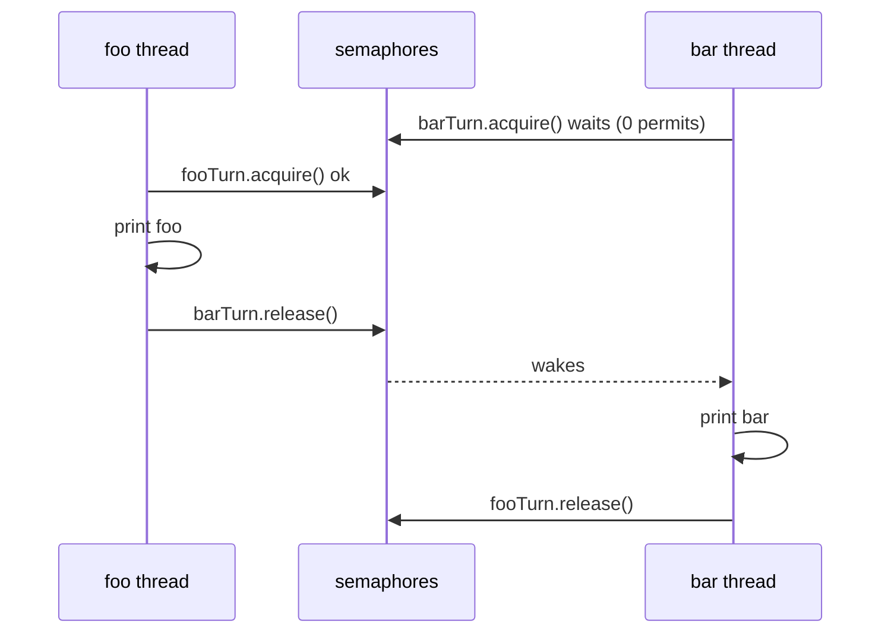
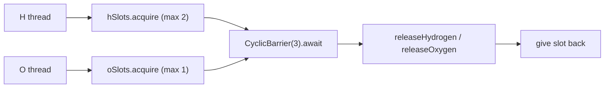
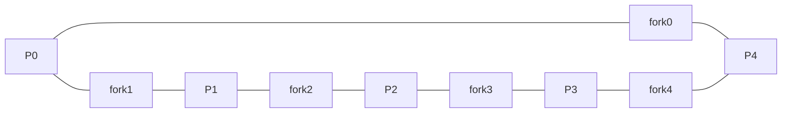
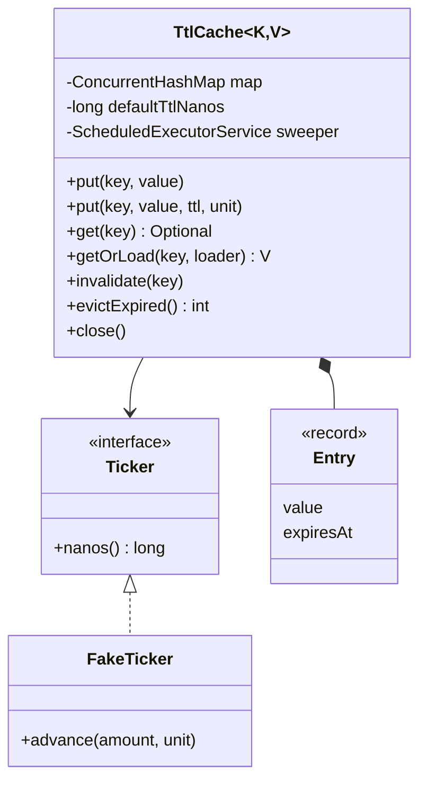
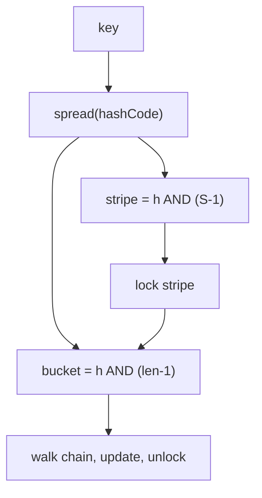
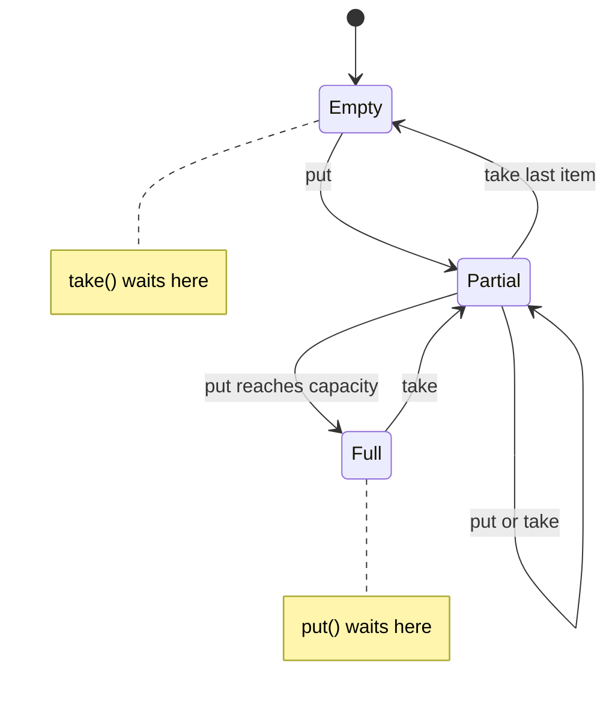
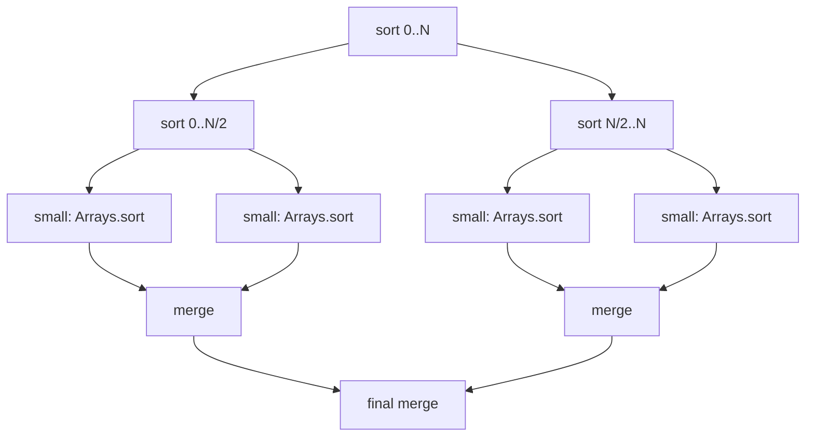
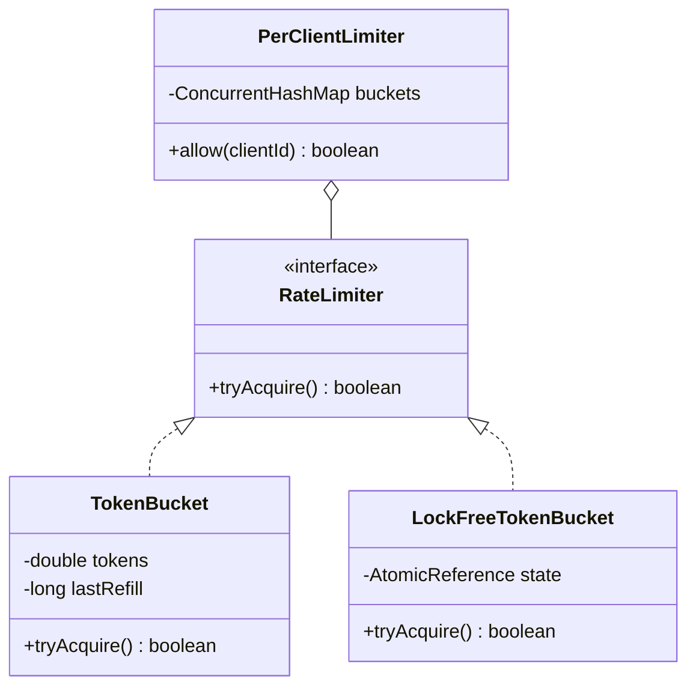

# Chapter 13 — Classic Concurrency Problems

> **Goal.** Chapter 12 gave you the toolbox. This chapter uses it on the concurrency problems that interviewers actually ask — from LeetCode's "Concurrency" section (FooBar, Zero-Even-Odd, FizzBuzz, H2O, Dining Philosophers) to "design a thread-safe X" machine-coding rounds (TTL cache, concurrent hash map, blocking queue, Bloom filter, parallel merge sort, rate limiter).

**How each problem is laid out:** *Problem → Approach → Java solution (+ real output) → Why it's correct → Pitfalls → Real-world examples → In the interview → Self-check → TL;DR.*

All code is Java 21, standard library only, in `code/lld/ch13/<problem>/Main.java`. Run from `chapters/13-concurrency-problems/code`:

```text
javac --release 21 -d /tmp/lld_13 $(find . -name '*.java')
java -cp /tmp/lld_13 lld.ch13.foobar.Main
```

Where the real order of events can vary between runs, the demo *verifies* the result and prints `true/false`, so the output shown here is what you get every time.

**Problem map — which tool solves what**

| # | Problem | Core idea | Main tools |
|---|---|---|---|
| 13.1 | Print FooBar Alternately | Pass a "baton" between 2 threads | `Semaphore` ×2 (or monitor + turn flag) |
| 13.2 | Print Zero Even Odd | A dispatcher thread decides who goes next | `Semaphore` ×3 |
| 13.3 | Fizz Buzz Multithreaded | 4 threads, one shared counter, each waits for "its" numbers | `synchronized` + `wait/notifyAll` |
| 13.4 | Building H2O | Group threads into sets of 2 H + 1 O | `Semaphore` (slots) + `CyclicBarrier` (group) |
| 13.5 | Dining Philosophers | Avoid deadlock over shared forks | Lock ordering, or a "waiter" semaphore |
| 13.6 | Thread-safe cache with TTL | Expiring entries, no stampede | `ConcurrentHashMap`, `compute`, scheduled sweeper |
| 13.7 | Concurrent HashMap (simplified) | Lock striping | `ReentrantLock[]`, all-stripe resize |
| 13.8 | Bounded Blocking Queue | Wait when full / empty | `wait/notifyAll` **and** `Lock` + 2 `Condition`s |
| 13.9 | Concurrent Bloom Filter | Lock-free bit set | `AtomicLongArray` + atomic OR |
| 13.10 | Multi-threaded Merge Sort | Divide and conquer on cores | `ForkJoinPool`, `RecursiveAction` |
| 13.11 | Rate limiter (token bucket) | Atomic refill-and-take | `synchronized`, or CAS on an immutable state |

**Reusable mental checklist for any concurrency problem**
1. What is the **shared state**? (a turn flag, a counter, a map, a buffer)
2. What **ordering or invariant** must hold? ("foo before bar", "never more than 2 H in a molecule", "never more than capacity items")
3. Who **waits**, for **what condition**, and who **signals** it?
4. Pick the primitive: turn-taking → semaphores; "wait until predicate" → condition variable; groups → barrier; mutual exclusion → lock; single-variable update → atomic.
5. Check **liveness**: can anyone wait forever? Does every thread exit at the end?

---

## 13.1 Print FooBar Alternately (LeetCode 1115)

### Problem
One `FooBar` object is shared by two threads. Thread A calls `foo()`, which prints `"foo"` *n* times; thread B calls `bar()`, which prints `"bar"` *n* times. Make the output exactly `"foobar"` repeated *n* times, whichever thread starts first.

### Approach
This is pure **signaling** (12.20): a baton passes back and forth.
- `fooTurn = Semaphore(1)` — foo may go first.
- `barTurn = Semaphore(0)` — bar must wait.
- `foo`: acquire `fooTurn`, print, release `barTurn`. `bar`: acquire `barTurn`, print, release `fooTurn`.

Alternative: one monitor with a boolean `fooTurn`, `while (!fooTurn) wait();` then flip it and `notifyAll()`.



### Java solution

```java
// File: code/lld/ch13/foobar/Main.java
package lld.ch13.foobar;

import java.util.concurrent.Semaphore;

/**
 * LeetCode 1115 - Print FooBar Alternately.
 * Thread A calls foo() n times, thread B calls bar() n times; output must be "foobar" repeated n times.
 */
public class Main {

    /** Solution 1: two semaphores used as a baton that is passed back and forth. */
    static class FooBarSemaphore {
        private final int n;
        private final Semaphore fooTurn = new Semaphore(1);   // foo may go first
        private final Semaphore barTurn = new Semaphore(0);   // bar must wait

        FooBarSemaphore(int n) { this.n = n; }

        void foo(Runnable printFoo) throws InterruptedException {
            for (int i = 0; i < n; i++) {
                fooTurn.acquire();       // wait for my turn
                printFoo.run();
                barTurn.release();       // hand the baton to bar
            }
        }
        void bar(Runnable printBar) throws InterruptedException {
            for (int i = 0; i < n; i++) {
                barTurn.acquire();
                printBar.run();
                fooTurn.release();
            }
        }
    }

    /** Solution 2: one monitor + a turn flag (wait/notifyAll). */
    static class FooBarMonitor {
        private final int n;
        private boolean fooTurn = true;                        // guarded by 'this'

        FooBarMonitor(int n) { this.n = n; }

        void foo(Runnable printFoo) throws InterruptedException {
            for (int i = 0; i < n; i++) {
                synchronized (this) {
                    while (!fooTurn) wait();
                    printFoo.run();
                    fooTurn = false;
                    notifyAll();
                }
            }
        }
        void bar(Runnable printBar) throws InterruptedException {
            for (int i = 0; i < n; i++) {
                synchronized (this) {
                    while (fooTurn) wait();
                    printBar.run();
                    fooTurn = true;
                    notifyAll();
                }
            }
        }
    }

    interface Body { void run() throws InterruptedException; }
    static Thread start(Body b) {
        Thread t = new Thread(() -> { try { b.run(); } catch (InterruptedException e) { Thread.currentThread().interrupt(); } });
        t.start();
        return t;
    }

    public static void main(String[] args) throws InterruptedException {
        StringBuffer out1 = new StringBuffer();                // StringBuffer is synchronized
        FooBarSemaphore s = new FooBarSemaphore(4);
        Thread b1 = start(() -> s.bar(() -> out1.append("bar")));   // start bar FIRST on purpose
        Thread a1 = start(() -> s.foo(() -> out1.append("foo")));
        a1.join(); b1.join();
        System.out.println("semaphores : " + out1);

        StringBuffer out2 = new StringBuffer();
        FooBarMonitor m = new FooBarMonitor(4);
        Thread b2 = start(() -> m.bar(() -> out2.append("bar")));
        Thread a2 = start(() -> m.foo(() -> out2.append("foo")));
        a2.join(); b2.join();
        System.out.println("monitor    : " + out2);
        System.out.println("both correct: " + (out1.toString().equals("foobar".repeat(4)) && out2.toString().equals("foobar".repeat(4))));
    }
}
```

Output:

```text
semaphores : foobarfoobarfoobarfoobar
monitor    : foobarfoobarfoobarfoobar
both correct: true
```

### Why it's correct
- **Invariant:** the permits in `fooTurn` + `barTurn` always total exactly 1 (each thread releases the *other* semaphore only after acquiring its own). So at most one thread can be printing, and the turns strictly alternate.
- Starting `bar` first doesn't matter: it blocks on `barTurn` (0 permits) until `foo` has printed.
- **Visibility:** a `release()` happens-before the `acquire()` it enables, so each thread sees the other's appends.
- **Termination:** both loops run exactly *n* times, and each acquire has a matching release.

### Pitfalls
- Using one semaphore for both threads — a thread can re-acquire its own release and print twice.
- The monitor version with `if` instead of `while`, or `notify()` in more complex variants.
- Busy-waiting on a `volatile` flag works but burns a CPU core.

### Real-world examples
Strict two-party hand-offs: ping-pong protocols, request/acknowledge stages, double-buffering where a renderer and a producer alternate buffers.

### In the interview
**30-second answer:** "Two semaphores as a baton: foo's starts at 1, bar's at 0. Each thread acquires its own, prints, and releases the other's. The total permits are always one, so they alternate."

**Follow-ups:**
- *Three threads printing A, B, C in order?* Three semaphores in a ring: A(1), B(0), C(0); each releases the next.
- *Without semaphores?* A monitor with a turn variable and `wait/notifyAll`, or `Lock` + `Condition`.

### Self-check
- **Q:** What happens if `barTurn` starts with 1? **A:** bar can print first → output may begin with "bar".

### TL;DR
Two semaphores, one permit total, passed back and forth.

---

## 13.2 Print Zero Even Odd (LeetCode 1116)

### Problem
Three threads share a `ZeroEvenOdd(n)` object. `zero()` may only print 0, `even()` only even numbers, `odd()` only odd numbers. Together they must print `0 1 0 2 0 3 … 0 n` — e.g. *n* = 5 → `0102030405`.

### Approach
The zero thread acts as a **dispatcher**: after printing a 0 for position *i*, it releases `oddTurn` if *i* is odd, else `evenTurn`. The odd/even thread prints its number and hands control back via `zeroTurn`.
- `zeroTurn = 1`, `oddTurn = 0`, `evenTurn = 0`.
- zero loops *n* times; odd loops over 1, 3, 5…; even over 2, 4, 6….

### Java solution

```java
// File: code/lld/ch13/zeroevenodd/Main.java
package lld.ch13.zeroevenodd;

import java.util.concurrent.Semaphore;
import java.util.function.IntConsumer;

/**
 * LeetCode 1116 - Print Zero Even Odd.
 * Three threads: zero() prints only 0s, even() only even numbers, odd() only odd numbers.
 * Together they must print 0 1 0 2 0 3 ... 0 n  (e.g. n=5 -> "0102030405").
 */
public class Main {

    static class ZeroEvenOdd {
        private final int n;
        private final Semaphore zeroTurn = new Semaphore(1);
        private final Semaphore oddTurn = new Semaphore(0);
        private final Semaphore evenTurn = new Semaphore(0);

        ZeroEvenOdd(int n) { this.n = n; }

        void zero(IntConsumer print) throws InterruptedException {
            for (int i = 1; i <= n; i++) {
                zeroTurn.acquire();
                print.accept(0);
                // The zero thread is the "dispatcher": it decides who prints next.
                if (i % 2 == 1) oddTurn.release(); else evenTurn.release();
            }
        }
        void odd(IntConsumer print) throws InterruptedException {
            for (int i = 1; i <= n; i += 2) {
                oddTurn.acquire();
                print.accept(i);
                zeroTurn.release();
            }
        }
        void even(IntConsumer print) throws InterruptedException {
            for (int i = 2; i <= n; i += 2) {
                evenTurn.acquire();
                print.accept(i);
                zeroTurn.release();
            }
        }
    }

    interface Body { void run() throws InterruptedException; }
    static Thread start(Body b) {
        Thread t = new Thread(() -> { try { b.run(); } catch (InterruptedException e) { Thread.currentThread().interrupt(); } });
        t.start();
        return t;
    }

    public static void main(String[] args) throws InterruptedException {
        for (int n : new int[] {1, 2, 5, 10}) {
            StringBuffer out = new StringBuffer();
            ZeroEvenOdd z = new ZeroEvenOdd(n);
            Thread e = start(() -> z.even(out::append));
            Thread o = start(() -> z.odd(out::append));
            Thread zt = start(() -> z.zero(out::append));
            zt.join(); o.join(); e.join();
            System.out.println("n=" + n + " -> " + out);
        }
    }
}
```

Output:

```text
n=1 -> 01
n=2 -> 0102
n=5 -> 0102030405
n=10 -> 010203040506070809010
```

### Why it's correct
- Exactly one semaphore holds a permit at any moment → exactly one thread may print.
- The zero thread's loop index *i* decides the parity of the next number, so the right thread is woken.
- Each thread's loop count matches the number of permits it will receive: zero gets *n*, odd gets ⌈n/2⌉, even gets ⌊n/2⌋. So nobody waits forever and everyone exits (e.g. *n* = 1: even's loop runs zero times).

### Pitfalls
- Letting odd/even threads compute "the next number" from a shared counter without synchronization.
- Loop bounds that don't match the permits (e.g. even looping `n/2 + 1` times) → a thread waits forever and the program hangs.

### Real-world examples
Dispatcher/worker designs where one coordinator routes each step to a specialised worker (e.g. an interpreter routing opcodes, a scheduler assigning alternating tasks).

### In the interview
**30-second answer:** "Three semaphores. Zero starts with one permit. After each 0 it releases odd or even depending on the index, and they release zero back. One permit total in the system, so the order is forced."

**Follow-up:** *Could you use one lock + condition?* Yes: a shared `state` (ZERO/ODD/EVEN) and `current` number, each thread waits `while (state != mine)`, acts, updates state, `signalAll()`.

### Self-check
- **Q:** For *n* = 4, how many times does `odd()` acquire? **A:** Twice (1 and 3).

### TL;DR
Zero is the dispatcher; one permit circulates among three semaphores.

---

## 13.3 Fizz Buzz Multithreaded (LeetCode 1195)

### Problem
Four threads share a `FizzBuzz(n)` object and must together output 1..n where: multiples of 15 → `fizzbuzz` (thread C), multiples of 3 only → `fizz` (thread A), multiples of 5 only → `buzz` (thread B), everything else → the number (thread D).

### Approach
Keep one shared counter `current` guarded by the object's monitor. Each thread runs the same loop with its own predicate:
1. `while (current <= n && !mine(current)) wait();`
2. If `current > n` → `notifyAll()` and exit.
3. Print, `current++`, `notifyAll()` (the next number may belong to anyone).

This is the **condition variable** pattern (12.13) with a different predicate per thread. The helper `runWhile(predicate, action)` avoids writing the loop four times (DRY).

### Java solution

```java
// File: code/lld/ch13/fizzbuzz/Main.java
package lld.ch13.fizzbuzz;

import java.util.ArrayList;
import java.util.List;
import java.util.function.IntConsumer;
import java.util.function.IntPredicate;

/**
 * LeetCode 1195 - Fizz Buzz Multithreaded.
 * Four threads share one counter 1..n: fizz() prints "fizz" (divisible by 3 only), buzz() "buzz"
 * (by 5 only), fizzbuzz() "fizzbuzz" (by 15), number() prints the number otherwise.
 */
public class Main {

    static class FizzBuzz {
        private final int n;
        private int current = 1;                              // guarded by 'this'

        FizzBuzz(int n) { this.n = n; }

        /** Shared loop: wait until 'current' is mine (or we're done), act, advance, wake everyone. */
        private void runWhile(IntPredicate mine, IntConsumer action) throws InterruptedException {
            while (true) {
                synchronized (this) {
                    while (current <= n && !mine.test(current)) wait();
                    if (current > n) { notifyAll(); return; }     // done: wake others so they can exit too
                    action.accept(current);
                    current++;
                    notifyAll();                                  // the next number may belong to anyone
                }
            }
        }

        void fizz(Runnable printFizz) throws InterruptedException {
            runWhile(i -> i % 3 == 0 && i % 5 != 0, i -> printFizz.run());
        }
        void buzz(Runnable printBuzz) throws InterruptedException {
            runWhile(i -> i % 5 == 0 && i % 3 != 0, i -> printBuzz.run());
        }
        void fizzbuzz(Runnable printFizzBuzz) throws InterruptedException {
            runWhile(i -> i % 15 == 0, i -> printFizzBuzz.run());
        }
        void number(IntConsumer printNumber) throws InterruptedException {
            runWhile(i -> i % 3 != 0 && i % 5 != 0, printNumber);
        }
    }

    interface Body { void run() throws InterruptedException; }
    static Thread start(Body b) {
        Thread t = new Thread(() -> { try { b.run(); } catch (InterruptedException e) { Thread.currentThread().interrupt(); } });
        t.start();
        return t;
    }

    public static void main(String[] args) throws InterruptedException {
        int n = 15;
        List<String> out = new ArrayList<>();          // only touched inside the FizzBuzz monitor
        FizzBuzz fb = new FizzBuzz(n);
        List<Thread> ts = List.of(
                start(() -> fb.fizz(() -> out.add("fizz"))),
                start(() -> fb.buzz(() -> out.add("buzz"))),
                start(() -> fb.fizzbuzz(() -> out.add("fizzbuzz"))),
                start(() -> fb.number(i -> out.add(String.valueOf(i)))));
        for (Thread t : ts) t.join();                  // join() makes the list's contents visible to main
        System.out.println(String.join(", ", out));
    }
}
```

Output:

```text
1, 2, fizz, 4, buzz, fizz, 7, 8, fizz, buzz, 11, fizz, 13, 14, fizzbuzz
```

### Why it's correct
- Every number satisfies **exactly one** predicate (they partition 1..n), so exactly one thread can act on each value.
- `current` is read and written only inside `synchronized (this)` → no races, full visibility.
- `notifyAll()` (not `notify()`): four different predicates wait on the same monitor; `notify()` could wake a thread whose predicate is false, which then waits again — and the right thread is never woken → hang.
- **Termination:** when `current` exceeds *n*, every waiting thread is woken (by the last `notifyAll`) and sees `current > n` in its loop condition, so all four exit.
- The output list is only modified inside the monitor, and `join()` makes it visible to `main`.

### Pitfalls
- `notify()` instead of `notifyAll()` → lost wake-ups, random hangs.
- Forgetting the `current > n` exit check inside the wait loop → threads wait forever after the last number.
- Overlapping predicates (e.g. fizz = `i % 3 == 0` without excluding 15) → two threads compete for 15.

### Real-world examples
"Workers wait until a shared state matches their role" — e.g. pipeline stages each waiting for a job to reach their stage in a shared state machine.

### In the interview
**30-second answer:** "One monitor, one shared counter. Each thread waits in a while loop until the counter matches its predicate or passes n, prints, increments and notifies all. The predicates partition the numbers, so exactly one thread acts per number."

**Follow-up:** *Semaphore version?* Possible: the number thread acts as dispatcher and releases the fizz/buzz/fizzbuzz semaphore for the next value — more efficient (no thundering herd) but more code.

### Self-check
- **Q:** Why `notifyAll`? **A:** Threads wait for *different* conditions on the same monitor; only waking all guarantees the right one wakes.

### TL;DR
Shared counter + per-thread predicate + `while`-wait + `notifyAll`.

---

## 13.4 Building H2O (LeetCode 1117)

### Problem
Hydrogen and oxygen threads arrive in any order. Each must pass a barrier in groups of three that form one water molecule: exactly **2 H + 1 O**. Threads from one molecule must all pass before any thread of the next molecule passes.

### Approach
Combine two tools:
- **Slots** — `hSlots = Semaphore(2)`, `oSlots = Semaphore(1)`: at most 2 H and 1 O can be "in" the current molecule.
- **Group** — `CyclicBarrier(3)`: the three atoms wait for each other, then all go.
- A thread returns its slot permit **after** it has been released (printed), so the next molecule can only form once this one is finished.



### Java solution

```java
// File: code/lld/ch13/h2o/Main.java
package lld.ch13.h2o;

import java.util.ArrayList;
import java.util.List;
import java.util.concurrent.BrokenBarrierException;
import java.util.concurrent.CyclicBarrier;
import java.util.concurrent.Semaphore;

/**
 * LeetCode 1117 - Building H2O.
 * Hydrogen and oxygen threads arrive in any order. They must leave in groups of three:
 * exactly 2 H + 1 O per group, and a group must fully leave before the next one starts.
 */
public class Main {

    static class H2O {
        private final Semaphore hSlots = new Semaphore(2);    // at most 2 H in the current molecule
        private final Semaphore oSlots = new Semaphore(1);    // at most 1 O in the current molecule
        private final CyclicBarrier bond = new CyclicBarrier(3);   // wait until all 3 atoms are present

        void hydrogen(Runnable releaseHydrogen) throws InterruptedException {
            hSlots.acquire();
            try {
                bond.await();
            } catch (BrokenBarrierException e) { throw new IllegalStateException(e); }
            releaseHydrogen.run();
            hSlots.release();                                 // free my slot only after I have "left"
        }
        void oxygen(Runnable releaseOxygen) throws InterruptedException {
            oSlots.acquire();
            try {
                bond.await();
            } catch (BrokenBarrierException e) { throw new IllegalStateException(e); }
            releaseOxygen.run();
            oSlots.release();
        }
    }

    public static void main(String[] args) throws InterruptedException {
        // 16 H + 8 O = 8 molecules, arriving in a scrambled (but reproducible) order.
        List<Character> atoms = new ArrayList<>();
        for (int i = 0; i < 8; i++) { atoms.add('H'); atoms.add('H'); atoms.add('O'); }
        java.util.Collections.shuffle(atoms, new java.util.Random(7));
        StringBuilder in = new StringBuilder();
        atoms.forEach(in::append);
        String input = in.toString();
        System.out.println("arrival order   : " + input);
        StringBuffer out = new StringBuffer();
        H2O h2o = new H2O();
        List<Thread> ts = new ArrayList<>();
        for (char c : input.toCharArray()) {
            Thread t = new Thread(() -> {
                try {
                    if (c == 'H') h2o.hydrogen(() -> out.append('H'));
                    else h2o.oxygen(() -> out.append('O'));
                } catch (InterruptedException e) { Thread.currentThread().interrupt(); }
            });
            ts.add(t);
            t.start();
        }
        for (Thread t : ts) t.join();

        // Output order varies run to run (HHO, HOH, OHH are all fine), so we verify it instead.
        String s = out.toString();
        boolean valid = s.length() == input.length();
        for (int i = 0; valid && i < s.length(); i += 3) {
            String g = s.substring(i, i + 3);
            valid = g.chars().filter(ch -> ch == 'H').count() == 2 && g.indexOf('O') >= 0;
        }
        System.out.println("molecules formed: " + s.length() / 3 + ", every group of 3 has 2 H + 1 O: " + valid);
    }
}
```

Output:

```text
arrival order   : OHOOOHHHHOHHHHHOOHHHHHOH
molecules formed: 8, every group of 3 has 2 H + 1 O: true
```

### Why it's correct
- **At most 2 H and 1 O** can reach the barrier in each round because of the slot semaphores; the barrier needs 3 parties, so each trip is exactly `H, H, O`.
- **No mixing between molecules:** a new molecule needs all three slots free again. Each slot is freed only after its thread printed. So the next group can't trip the barrier (and print) until all three of the previous group have printed.
- The barrier resets automatically (it's *cyclic*) for the next molecule.
- The demo checks every consecutive group of 3 in the output instead of printing it, because `HHO`, `HOH` and `OHH` are all valid orders.

### Pitfalls
- Releasing the slot **before** printing → a new H might print before the previous O, mixing molecules.
- Using only semaphores without the barrier → the 2 H and 1 O aren't forced to leave "together".
- If the thread counts aren't exactly 2:1, the last threads wait forever (the problem guarantees they are).

### Real-world examples
Batching: gather exactly N items of certain types before dispatching (e.g. matchmaking 2 players + 1 server slot, assembling an order that needs parts from different producers).

### In the interview
**30-second answer:** "Two semaphores cap the molecule at 2 H and 1 O; a CyclicBarrier of 3 makes the three wait for each other; each atom returns its slot only after it's released, so molecules never interleave."

**Follow-up:** *Without a barrier?* Use a lock with counters of waiting H and O; when 2 H + 1 O are available, the thread completing the set signals exactly those. More code, same idea.

### Self-check
- **Q:** Why is `hSlots` initialised to 2, not 1? **A:** A molecule needs two hydrogens simultaneously inside the barrier.

### TL;DR
Slots (semaphores) decide *who* can join; the barrier decides *when* they leave; free slots only after leaving.

---

## 13.5 Dining Philosophers (LeetCode 1226)

### Problem
Five philosophers sit at a round table with one fork between each pair (5 forks). To eat, a philosopher needs **both** adjacent forks. If everyone picks up their left fork first, everyone may hold one fork and wait forever for the right one — **deadlock** (all four Coffman conditions hold, 12.17).

### Approach
Break a Coffman condition:
1. **Resource ordering** (breaks circular wait): number the forks 0–4; always pick up the **lower-numbered** fork first. Philosopher 4 (forks 4 and 0) picks fork 0 first, so the cycle is impossible.
2. **Waiter / limited seats** (also breaks circular wait): a semaphore lets at most **n − 1** philosophers try at once — with 4 people and 5 forks, at least one can get both forks. Make the semaphore **fair** to prevent starvation.
3. (Other known solutions: `tryLock` both forks and put down on failure with random back-off; the Chandy–Misra algorithm for distributed settings.)



### Java solution

```java
// File: code/lld/ch13/philosophers/Main.java
package lld.ch13.philosophers;

import java.util.ArrayList;
import java.util.List;
import java.util.concurrent.Semaphore;
import java.util.concurrent.atomic.AtomicIntegerArray;
import java.util.concurrent.locks.ReentrantLock;

/**
 * Dining Philosophers (LeetCode 1226 variant): 5 philosophers, 5 forks, each needs both
 * neighbouring forks to eat. Naive "everyone picks up the left fork first" can deadlock.
 */
public class Main {

    interface Table { void eat(int p, Runnable eatAction) throws InterruptedException; }

    /** Fix 1 - resource ordering: always pick up the LOWER-numbered fork first (breaks circular wait). */
    static class OrderedForks implements Table {
        private final ReentrantLock[] forks;
        OrderedForks(int n) { forks = new ReentrantLock[n]; for (int i = 0; i < n; i++) forks[i] = new ReentrantLock(); }

        public void eat(int p, Runnable eatAction) {
            int left = p, right = (p + 1) % forks.length;
            ReentrantLock first = forks[Math.min(left, right)], second = forks[Math.max(left, right)];
            first.lock();
            try {
                second.lock();
                try { eatAction.run(); } finally { second.unlock(); }
            } finally { first.unlock(); }
        }
    }

    /** Fix 2 - a "waiter" lets at most n-1 philosophers try at once (breaks circular wait too). */
    static class Waiter implements Table {
        private final ReentrantLock[] forks;
        private final Semaphore seats;
        Waiter(int n) {
            forks = new ReentrantLock[n];
            for (int i = 0; i < n; i++) forks[i] = new ReentrantLock();
            seats = new Semaphore(n - 1, true);                 // fair: nobody starves waiting for a seat
        }
        public void eat(int p, Runnable eatAction) throws InterruptedException {
            seats.acquire();
            try {
                ReentrantLock left = forks[p], right = forks[(p + 1) % forks.length];
                left.lock();
                try {
                    right.lock();
                    try { eatAction.run(); } finally { right.unlock(); }
                } finally { left.unlock(); }
            } finally { seats.release(); }
        }
    }

    static String dine(Table table, int n, int meals) throws InterruptedException {
        AtomicIntegerArray eaten = new AtomicIntegerArray(n);
        List<Thread> ts = new ArrayList<>();
        for (int p = 0; p < n; p++) {
            final int id = p;
            Thread t = new Thread(() -> {
                try {
                    for (int m = 0; m < meals; m++) {
                        Thread.onSpinWait();                               // "think"
                        table.eat(id, () -> eaten.incrementAndGet(id));
                    }
                } catch (InterruptedException e) { Thread.currentThread().interrupt(); }
            });
            ts.add(t); t.start();
        }
        for (Thread t : ts) t.join();
        return eaten.toString();
    }

    public static void main(String[] args) throws InterruptedException {
        System.out.println("resource ordering, meals per philosopher: " + dine(new OrderedForks(5), 5, 10_000));
        System.out.println("waiter (4 seats),  meals per philosopher: " + dine(new Waiter(5), 5, 10_000));
    }
}
```

Output:

```text
resource ordering, meals per philosopher: [10000, 10000, 10000, 10000, 10000]
waiter (4 seats),  meals per philosopher: [10000, 10000, 10000, 10000, 10000]
```

### Why it's correct
- **Ordering:** every philosopher acquires forks in increasing index order. A cycle of waiting would need someone to hold a higher fork while waiting for a lower one — impossible. No circular wait → no deadlock.
- **Waiter:** with at most 4 philosophers competing for 5 forks, by the pigeonhole principle at least one of them can get both forks, eat, and release — so progress is always possible. The fair semaphore gives waiting philosophers seats in FIFO order.
- Forks are `ReentrantLock`s released in `finally`, so an exception can't leave a fork held.
- 5 × 10,000 meals complete with each philosopher eating exactly 10,000 times.

### Pitfalls
- "Everyone picks left then right" → deadlock.
- `tryLock` both forks and immediately retry without random back-off → livelock.
- Unfair strategies can starve one philosopher in theory (neighbours keep winning). The fair semaphore makes *seat* access first-come-first-served; for a strict no-starvation guarantee on the forks as well, make the fork locks fair too (`new ReentrantLock(true)`), at a throughput cost.

### Real-world examples
Any time a task needs **two or more locks** at once: bank transfers (two accounts), moving an item between two inventories, database transactions updating several rows — solved by ordering (account id), or by the DB's deadlock detection aborting one transaction.

### In the interview
**30-second answer:** "Naively everyone takes the left fork and waits for the right — circular wait, deadlock. I break circular wait by always taking the lower-numbered fork first, or by a waiter semaphore allowing only n−1 philosophers to try; fairness prevents starvation."

**Follow-ups:**
- *Which Coffman condition does each fix break?* Both break circular wait; the tryLock variant breaks hold-and-wait.
- *Maximum parallelism?* With 5 forks, at most 2 philosophers can eat at the same time.

### Self-check
- **Q:** With resource ordering, which philosopher behaves "differently"? **A:** The one between forks 4 and 0 — they pick fork 0 (right) first.

### TL;DR
Break circular wait: global fork order, or allow only n−1 diners.

---

## 13.6 Thread-safe cache with TTL

### Problem
Design an in-memory key-value cache used by many threads where each entry expires after a **time-to-live** (TTL). Requirements: `put(k, v)` (with default or per-entry TTL), `get(k)` returns nothing for expired entries, `getOrLoad(k, loader)` loads on a miss without a **cache stampede** (many threads loading the same key at once), expired entries are eventually removed from memory, and it's testable without sleeping.

### Approach
- Store `Entry(value, expiresAt)` records (immutable) in a `ConcurrentHashMap`.
- **Lazy expiry**: `get` checks `expiresAt`; if expired, removes it with the **conditional** `remove(key, entry)` so it never deletes a fresher value another thread just put.
- **Active expiry**: a daemon `ScheduledExecutorService` periodically calls `evictExpired()` so keys nobody reads again don't leak memory.
- **No stampede**: `getOrLoad` uses `map.compute(...)`, which runs the function atomically per key; concurrent callers for the same key wait and the loader runs once.
- **Testability**: time comes from an injected `Ticker` (a `FakeTicker` in tests) — a small application of Dependency Inversion.



### Java solution

```java
// File: code/lld/ch13/ttlcache/Main.java
package lld.ch13.ttlcache;

import java.util.ArrayList;
import java.util.List;
import java.util.Map;
import java.util.Objects;
import java.util.Optional;
import java.util.concurrent.ConcurrentHashMap;
import java.util.concurrent.CountDownLatch;
import java.util.concurrent.Executors;
import java.util.concurrent.ScheduledExecutorService;
import java.util.concurrent.TimeUnit;
import java.util.concurrent.atomic.AtomicInteger;
import java.util.concurrent.atomic.AtomicLong;
import java.util.function.Function;

/** Thread-safe key-value cache where every entry expires after a time-to-live (TTL). */
public class Main {

    /** Time source. Injected so tests can move time forward without sleeping. */
    @FunctionalInterface interface Ticker { long nanos(); }

    static final class FakeTicker implements Ticker {
        private final AtomicLong now = new AtomicLong();
        public long nanos() { return now.get(); }
        void advance(long amount, TimeUnit unit) { now.addAndGet(unit.toNanos(amount)); }
    }

    static final class TtlCache<K, V> implements AutoCloseable {
        private record Entry<V>(V value, long expiresAt) { }

        private final ConcurrentHashMap<K, Entry<V>> map = new ConcurrentHashMap<>();
        private final long defaultTtlNanos;
        private final Ticker ticker;
        private final ScheduledExecutorService sweeper;       // null = lazy expiry only

        TtlCache(long ttl, TimeUnit unit, Ticker ticker, long sweepEveryMillis) {
            this.defaultTtlNanos = unit.toNanos(ttl);
            this.ticker = ticker;
            if (sweepEveryMillis > 0) {
                sweeper = Executors.newSingleThreadScheduledExecutor(r -> {
                    Thread t = new Thread(r, "ttl-sweeper");
                    t.setDaemon(true);                           // never blocks JVM shutdown
                    return t;
                });
                // 'this' escapes to the sweeper thread before the constructor ends (a pattern 12.6 warns
                // about). It is safe HERE only because every field evictExpired() uses (map, ticker) is
                // already assigned and handing a task to an executor is a happens-before edge. In
                // production code prefer a static factory that starts the sweeper after construction.
                sweeper.scheduleAtFixedRate(this::evictExpired, sweepEveryMillis, sweepEveryMillis, TimeUnit.MILLISECONDS);
            } else {
                sweeper = null;
            }
        }

        private boolean expired(Entry<V> e) { return ticker.nanos() - e.expiresAt() >= 0; }   // overflow-safe compare

        void put(K key, V value) { put(key, value, defaultTtlNanos, TimeUnit.NANOSECONDS); }

        void put(K key, V value, long ttl, TimeUnit unit) {
            Objects.requireNonNull(key); Objects.requireNonNull(value);
            map.put(key, new Entry<>(value, ticker.nanos() + unit.toNanos(ttl)));
        }

        Optional<V> get(K key) {
            Entry<V> e = map.get(key);
            if (e == null) return Optional.empty();
            if (expired(e)) {
                map.remove(key, e);   // conditional remove: never deletes a FRESH value another thread just put
                return Optional.empty();
            }
            return Optional.of(e.value());
        }

        /**
         * Read-through: if missing/expired, load it. compute() locks the key's bin, so concurrent callers
         * for the SAME key wait and the loader runs once (no "cache stampede").
         * The loader must be fast and must not touch this cache.
         */
        V getOrLoad(K key, Function<? super K, ? extends V> loader) {
            return map.compute(key, (k, old) ->
                    old != null && !expired(old) ? old : new Entry<>(loader.apply(k), ticker.nanos() + defaultTtlNanos)
            ).value();
        }

        void invalidate(K key) { map.remove(key); }

        /** Active expiry: drop every expired entry. Safe to run concurrently with readers and writers. */
        int evictExpired() {
            int removed = 0;
            for (Map.Entry<K, Entry<V>> me : map.entrySet()) {
                if (expired(me.getValue()) && map.remove(me.getKey(), me.getValue())) removed++;
            }
            return removed;
        }

        int rawSize() { return map.size(); }   // includes not-yet-swept expired entries

        @Override public void close() { if (sweeper != null) sweeper.shutdownNow(); }
    }

    public static void main(String[] args) throws Exception {
        FakeTicker clock = new FakeTicker();
        try (TtlCache<String, String> cache = new TtlCache<>(100, TimeUnit.MILLISECONDS, clock, 0)) {
            cache.put("session:42", "alice");
            cache.put("otp:alice", "913377", 30, TimeUnit.MILLISECONDS);   // per-entry TTL
            clock.advance(50, TimeUnit.MILLISECONDS);
            System.out.println("t=50ms  session=" + cache.get("session:42").orElse("<expired>")
                    + ", otp=" + cache.get("otp:alice").orElse("<expired>"));
            clock.advance(60, TimeUnit.MILLISECONDS);
            System.out.println("t=110ms session=" + cache.get("session:42").orElse("<expired>"));

            for (int i = 0; i < 5; i++) cache.put("k" + i, "v" + i);
            clock.advance(200, TimeUnit.MILLISECONDS);
            System.out.println("before sweep raw size=" + cache.rawSize() + ", swept=" + cache.evictExpired()
                    + ", after=" + cache.rawSize());

            // Stampede test: 16 threads miss the same key at the same moment.
            AtomicInteger loads = new AtomicInteger();
            CountDownLatch go = new CountDownLatch(1);
            List<Thread> ts = new ArrayList<>();
            List<String> results = java.util.Collections.synchronizedList(new ArrayList<>());
            for (int i = 0; i < 16; i++) {
                Thread t = new Thread(() -> {
                    try { go.await(); } catch (InterruptedException e) { return; }
                    results.add(cache.getOrLoad("user:7", k -> { loads.incrementAndGet(); return "profile-of-" + k; }));
                });
                ts.add(t); t.start();
            }
            go.countDown();
            for (Thread t : ts) t.join();
            System.out.println("16 concurrent misses -> loader ran " + loads.get() + " time(s), all got same value: "
                    + results.stream().allMatch("profile-of-user:7"::equals));
        }

        // Background sweeper with the real clock.
        try (TtlCache<Integer, Integer> real = new TtlCache<>(30, TimeUnit.MILLISECONDS, System::nanoTime, 10)) {
            for (int i = 0; i < 1_000; i++) real.put(i, i * i);
            System.out.println("real clock: size right after puts=" + real.rawSize());
            Thread.sleep(200);
            System.out.println("real clock: size after 200 ms (sweeper ran)=" + real.rawSize());
        }
    }
}
```

Output:

```text
t=50ms  session=alice, otp=<expired>
t=110ms session=<expired>
before sweep raw size=5, swept=5, after=0
16 concurrent misses -> loader ran 1 time(s), all got same value: true
real clock: size right after puts=1000
real clock: size after 200 ms (sweeper ran)=0
```

### Why it's correct
- All shared state is inside one `ConcurrentHashMap`; entries are immutable records, so a reader sees either the old or the new entry, never a half-written one.
- `remove(key, e)` removes only if the mapping is still *that exact entry*. If another thread replaced it with a fresh one after our read, the fresh one survives.
- `compute` executes the remapping function atomically for that key, so 16 simultaneous misses cause one load (the output shows `loader ran 1 time(s)`).
- Expiry uses `now - expiresAt >= 0` rather than `now >= expiresAt`, which stays correct even if `System.nanoTime()` values overflow (the JDK recommends comparing nano times by subtraction).
- The sweeper is a **daemon** thread and is shut down in `close()`, so it never keeps the JVM alive.
- The constructor hands `this::evictExpired` to the sweeper before it returns (`this` escapes). That is normally a bug (12.6), and it is safe here only because the fields the sweeper uses are already set and submitting to an executor creates a happens-before edge; a static factory method that starts the sweeper after construction is the cleaner production choice.

### Pitfalls
- Using `System.currentTimeMillis()` for TTL: wall-clock time can jump (NTP adjustments). `System.nanoTime()` is monotonic for measuring durations.
- A slow loader inside `compute` blocks other keys that share the same hash bin, and a loader that touches the same map can throw or deadlock. For slow loads, store a `CompletableFuture<V>` in the map instead (`computeIfAbsent(k, key -> supplyAsync(...))`) so the bin lock is held only briefly.
- Only lazy expiry → memory leak for keys never read again. Only active expiry → a `get` could return a stale value between sweeps. Use both.
- No size limit: a real cache also needs a maximum size and an eviction policy (LRU/LFU).

### Real-world examples
- **Caffeine** (the de-facto Java cache) offers `expireAfterWrite`/`expireAfterAccess`, size-based eviction, and a loading cache that prevents stampedes — the production version of this design. Guava's `CacheBuilder` is its predecessor.
- **Redis** `EXPIRE`/`SET … EX` uses the same combination: lazy expiry on access plus periodic active sampling of keys with TTLs.
- Sessions, OTPs, DNS caches, and seat holds in booking systems (a hold is a TTL entry).

### In the interview
**30-second answer:** "A ConcurrentHashMap of immutable entries holding value and expiry time. Get checks expiry lazily and removes with a conditional remove; a daemon scheduled sweeper removes expired keys nobody reads. getOrLoad uses compute so concurrent misses load once. Time is injected for testing."

**Follow-ups (with answers):**
- *Add max size with LRU?* Combine with an access-ordered `LinkedHashMap` under a lock, or a `ConcurrentHashMap` plus a concurrent linked deque of keys updated on access — or just use Caffeine (Window-TinyLFU).
- *Refresh without blocking readers?* "Refresh-ahead": serve the old value while one thread reloads asynchronously when the entry is close to expiring.
- *Distributed?* Redis/Memcached with TTLs; keep a small local cache in front for hot keys.

### Self-check
- **Q:** Why `remove(key, e)` and not `remove(key)` on expiry? **A:** To avoid deleting a new value written between our read and our remove.

### TL;DR
CHM + immutable (value, expiry) entries; lazy + scheduled expiry; `compute` for single-flight loads; injected clock.

---

## 13.7 Design a (simplified) Concurrent HashMap — lock striping

### Problem
Implement a hash map that many threads can use at once with `get`, `put`, `remove`, `compute` and automatic resizing — faster than one global lock around a `HashMap`.

### Approach
**Lock striping** (12.11):
- Buckets: an array of linked lists (separate chaining).
- Stripes: a fixed array of `S` locks (power of two). Key with hash *h* uses stripe `h & (S − 1)` and bucket `h & (tableLength − 1)`.
- Because the stripe depends only on the hash — **not** on the table length — a key's stripe never changes after a resize.
- Every operation locks only its stripe; threads on different stripes run in parallel.
- **Resize** (when size > 0.75 × buckets): acquire **all** stripe locks in index order (a global order → no deadlock), re-check the condition, rehash into a table twice as big, publish via a `volatile` field, release in reverse.
- Size tracked with an `AtomicInteger`.



### Java solution

```java
// File: code/lld/ch13/stripedmap/Main.java
package lld.ch13.stripedmap;

import java.util.ArrayList;
import java.util.List;
import java.util.Objects;
import java.util.concurrent.atomic.AtomicInteger;
import java.util.concurrent.locks.ReentrantLock;
import java.util.function.BiFunction;

/**
 * A simplified concurrent hash map using LOCK STRIPING: the buckets are guarded by a small array
 * of locks, so threads touching different stripes never block each other.
 * (Java 7's ConcurrentHashMap used this idea with "segments".)
 */
public class Main {

    static final class StripedHashMap<K, V> {
        private static final class Node<K, V> {
            final K key; final int hash; V value; Node<K, V> next;
            Node(K key, int hash, V value, Node<K, V> next) { this.key = key; this.hash = hash; this.value = value; this.next = next; }
        }

        private volatile Node<K, V>[] table;                // replaced (never mutated in place) only while ALL locks are held
        private final ReentrantLock[] stripes;
        private final AtomicInteger size = new AtomicInteger();
        private static final float LOAD_FACTOR = 0.75f;

        @SuppressWarnings({"unchecked", "rawtypes"})
        StripedHashMap(int initialBuckets, int stripeCount) {
            if (Integer.bitCount(stripeCount) != 1 || Integer.bitCount(initialBuckets) != 1)
                throw new IllegalArgumentException("sizes must be powers of two");
            if (stripeCount > initialBuckets)                 // guarantees: every bucket maps to exactly one stripe
                throw new IllegalArgumentException("need stripes <= buckets");
            table = (Node<K, V>[]) new Node[initialBuckets];
            stripes = new ReentrantLock[stripeCount];
            for (int i = 0; i < stripeCount; i++) stripes[i] = new ReentrantLock();
        }

        private static int spread(Object key) {
            int h = key.hashCode();
            return (h ^ (h >>> 16)) & 0x7fffffff;             // mix high bits in, keep it non-negative
        }
        // A key's stripe depends only on its hash, NOT on the table size, so it never changes on resize.
        private ReentrantLock stripeFor(int hash) { return stripes[hash & (stripes.length - 1)]; }
        private static int indexFor(int hash, int len) { return hash & (len - 1); }

        V get(K key) {
            Objects.requireNonNull(key);
            int h = spread(key);
            ReentrantLock lock = stripeFor(h);
            lock.lock();
            try {
                Node<K, V>[] t = table;                           // stable while we hold a stripe lock
                for (Node<K, V> n = t[indexFor(h, t.length)]; n != null; n = n.next)
                    if (n.hash == h && n.key.equals(key)) return n.value;
                return null;
            } finally { lock.unlock(); }
        }

        /** Returns the previous value (or null). */
        V put(K key, V value) {
            Objects.requireNonNull(value);
            return doCompute(key, (k, old) -> value).oldValue();
        }

        V remove(K key) {
            Objects.requireNonNull(key);
            int h = spread(key);
            ReentrantLock lock = stripeFor(h);
            lock.lock();
            try {
                Node<K, V>[] t = table;
                int i = indexFor(h, t.length);
                for (Node<K, V> prev = null, n = t[i]; n != null; prev = n, n = n.next) {
                    if (n.hash == h && n.key.equals(key)) {
                        if (prev == null) t[i] = n.next; else prev.next = n.next;
                        size.decrementAndGet();
                        return n.value;
                    }
                }
                return null;
            } finally { lock.unlock(); }
        }

        /** Atomic read-modify-write for one key; returns the new value. Returning null from remap removes the key. */
        V compute(K key, BiFunction<? super K, ? super V, ? extends V> remap) {
            return doCompute(key, remap).newValue();
        }

        private record Result<V>(V oldValue, V newValue) { }

        private Result<V> doCompute(K key, BiFunction<? super K, ? super V, ? extends V> remap) {
            Objects.requireNonNull(key);
            int h = spread(key);
            ReentrantLock lock = stripeFor(h);
            boolean grew = false;
            V old, nv;
            lock.lock();
            try {
                Node<K, V>[] t = table;
                int i = indexFor(h, t.length);
                Node<K, V> prev = null, n = t[i];
                while (n != null && !(n.hash == h && n.key.equals(key))) { prev = n; n = n.next; }
                old = n == null ? null : n.value;
                nv = remap.apply(key, old);
                if (n != null && nv != null) {
                    n.value = nv;                                   // update in place
                } else if (n != null) {                             // remap said "remove"
                    if (prev == null) t[i] = n.next; else prev.next = n.next;
                    size.decrementAndGet();
                } else if (nv != null) {                            // insert at bucket head
                    t[i] = new Node<>(key, h, nv, t[i]);
                    grew = size.incrementAndGet() > t.length * LOAD_FACTOR;
                }
            } finally { lock.unlock(); }
            if (grew) resize();                                     // never resize while holding one stripe
            return new Result<>(old, nv);
        }

        /** Stop-the-world resize: take every stripe lock IN ORDER (no deadlock), rehash, publish. */
        @SuppressWarnings({"unchecked", "rawtypes"})
        private void resize() {
            for (ReentrantLock l : stripes) l.lock();
            try {
                Node<K, V>[] old = table;
                if (size.get() <= old.length * LOAD_FACTOR) return;  // another thread already resized
                Node<K, V>[] nt = (Node<K, V>[]) new Node[old.length * 2];
                for (Node<K, V> head : old) {
                    for (Node<K, V> n = head; n != null; ) {
                        Node<K, V> next = n.next;
                        int j = indexFor(n.hash, nt.length);
                        n.next = nt[j]; nt[j] = n;
                        n = next;
                    }
                }
                table = nt;
            } finally {
                for (int i = stripes.length - 1; i >= 0; i--) stripes[i].unlock();
            }
        }

        int size() { return size.get(); }
        int capacity() { return table.length; }
    }

    static void runThreads(int n, java.util.function.IntConsumer body) throws InterruptedException {
        List<Thread> ts = new ArrayList<>();
        for (int i = 0; i < n; i++) { final int id = i; Thread t = new Thread(() -> body.accept(id)); ts.add(t); t.start(); }
        for (Thread t : ts) t.join();
    }

    public static void main(String[] args) throws InterruptedException {
        StripedHashMap<String, Integer> map = new StripedHashMap<>(16, 16);
        map.put("a", 1);
        System.out.println("put a=1, put a=2 returns old=" + map.put("a", 2) + ", get a=" + map.get("a")
                + ", remove a=" + map.remove("a") + ", get a=" + map.get("a"));

        final int THREADS = 8, PER = 20_000;
        runThreads(THREADS, id -> { for (int i = 0; i < PER; i++) map.put("t" + id + "-" + i, i); });
        int missing = 0;
        for (int id = 0; id < THREADS; id++) for (int i = 0; i < PER; i++) if (!Integer.valueOf(i).equals(map.get("t" + id + "-" + i))) missing++;
        System.out.println("8 threads x 20,000 puts -> size=" + map.size() + ", missing=" + missing
                + ", table grew from 16 to " + map.capacity() + " buckets");

        StripedHashMap<String, Integer> counters = new StripedHashMap<>(16, 8);
        runThreads(THREADS, id -> {
            for (int i = 0; i < 10_000; i++) counters.compute("hot-" + (i % 10), (k, v) -> v == null ? 1 : v + 1);
        });
        int total = 0;
        for (int i = 0; i < 10; i++) total += counters.get("hot-" + i);
        System.out.println("atomic compute on 10 hot keys: each=" + counters.get("hot-0") + ", total=" + total + " (expected 80000)");

        runThreads(THREADS, id -> { for (int i = 0; i < PER; i++) map.remove("t" + id + "-" + i); });
        System.out.println("after concurrent removes size=" + map.size());
    }
}
```

Output:

```text
put a=1, put a=2 returns old=1, get a=2, remove a=2, get a=null
8 threads x 20,000 puts -> size=160000, missing=0, table grew from 16 to 262144 buckets
atomic compute on 10 hot keys: each=8000, total=80000 (expected 80000)
after concurrent removes size=0
```

### Why it's correct
- **Every bucket belongs to exactly one stripe.** Both the stripe count *S* and the table length are powers of two and *S* ≤ table length, so the stripe index (`h & (S−1)`) is just the low bits of the bucket index (`h & (len−1)`). All keys in one bucket therefore share one stripe lock, and two threads can never modify the same chain at the same time. Two operations on the same key obviously share it too.
- **Resize safety:** resize holds *every* stripe lock, so no other operation is in progress; it re-checks the load condition (another thread may have resized first) and publishes the new table with a `volatile` write. Any later operation acquires a stripe lock that the resizer released → happens-before → it sees the new table and moved nodes.
- **No deadlock:** normal operations hold one lock; resize acquires all locks in ascending order and is started only *after* the caller released its own stripe.
- **Atomic compute:** read-modify-write of one key happens entirely under its stripe lock (the demo's 80,000 increments on 10 hot keys are exact).

### Pitfalls
- Deriving the stripe from the *bucket index of the current table* — after a resize a key could move to a different lock while another thread holds the old one.
- Resizing while holding one stripe lock and then taking all locks → deadlock with another resizer. Release first, then resize.
- Reading `table` without a lock or `volatile` → a stale table after resize.
- Allowing `null` keys/values makes `get() == null` ambiguous (the JDK's `ConcurrentHashMap` forbids them too).

### How the real `ConcurrentHashMap` goes further

| Aspect | This design | JDK 8+ `ConcurrentHashMap` |
|---|---|---|
| Reads | Lock the stripe | Lock-free (volatile reads of nodes) |
| Write locking | One of S stripe locks | CAS into empty bins; `synchronized` on the bin's first node otherwise |
| Long chains | Linked list | Converted to a red-black tree beyond 8 nodes (when table ≥ 64) |
| Resize | Stop-the-world (all locks) | Incremental: threads help transfer bins concurrently |
| Size | `AtomicInteger` | `LongAdder`-style counter cells |

### Real-world examples
Java 7's `ConcurrentHashMap` used **segments** (16 by default) — the same striping idea. Guava's `Striped<Lock>` offers striped locks for your own data; Caffeine uses striped buffers to record reads.

### In the interview
**30-second answer:** "An array of buckets plus a small array of locks; each key maps to a stripe by its hash bits, so different stripes work in parallel. Every bucket belongs to exactly one stripe. Resize takes all stripe locks in order, rehashes and publishes the new table through a volatile field."

**Follow-ups:**
- *How to make `get` lock-free?* Make `Node.value` and `next` volatile, publish nodes safely, and never mutate a chain in a way a reader could see half-done (the JDK copies/reorders carefully during transfer).
- *How many stripes?* Around the number of threads expected to write concurrently (JDK 7 default 16); more stripes = less contention but more memory.

### Self-check
- **Q:** Why must stripe count divide the table length? **A:** So every bucket maps to exactly one stripe (stripe index = low bits of bucket index).

### TL;DR
N locks for M buckets, stripe by hash bits, resize under all locks in order, publish via volatile.

---

## 13.8 Thread-safe bounded Blocking Queue (two ways)

### Problem
Implement a fixed-capacity FIFO queue for producer-consumer use: `put` blocks while full, `take` blocks while empty, plus `offer(item, timeout)` and `poll(timeout)` that give up after a timeout.

### Approach
Storage: a **circular array** (`head`, `tail`, `count`). Two synchronisation designs:

| | Way 1: monitor | Way 2: `ReentrantLock` + 2 `Condition`s |
|---|---|---|
| Lock | `synchronized` methods | `lock.lockInterruptibly()` |
| Wait | `while (full) wait();` | `while (full) notFull.await();` |
| Wake | `notifyAll()` — producers and consumers share one wait set | `notEmpty.signal()` after enqueue, `notFull.signal()` after dequeue |
| Timed wait | `TimeUnit.timedWait(this, nanos)` + deadline loop | `awaitNanos(nanos)` returns the time left |
| Efficiency | Wakes everyone (thundering herd) | Wakes exactly one thread of the right kind |



### Java solution

```java
// File: code/lld/ch13/blockingqueue/Main.java
package lld.ch13.blockingqueue;

import java.util.ArrayList;
import java.util.List;
import java.util.concurrent.TimeUnit;
import java.util.concurrent.atomic.AtomicLong;
import java.util.concurrent.locks.Condition;
import java.util.concurrent.locks.ReentrantLock;

/** A bounded blocking queue built two ways: monitor (wait/notifyAll) and Lock + two Conditions. */
public class Main {

    interface BoundedBlockingQueue<T> {
        void put(T item) throws InterruptedException;          // blocks while full
        T take() throws InterruptedException;                  // blocks while empty
        boolean offer(T item, long timeout, TimeUnit unit) throws InterruptedException; // false on timeout
        T poll(long timeout, TimeUnit unit) throws InterruptedException;                // null on timeout
        int size();
    }

    // ------------------------------------------------------------------
    // Way 1: intrinsic lock. Producers AND consumers wait on the SAME monitor,
    // so we must use notifyAll() (notify() could wake the wrong kind of thread).
    // ------------------------------------------------------------------
    static final class MonitorQueue<T> implements BoundedBlockingQueue<T> {
        private final Object[] items;
        private int head, tail, count;                          // all guarded by 'this'

        MonitorQueue(int capacity) { items = new Object[capacity]; }

        public synchronized void put(T item) throws InterruptedException {
            while (count == items.length) wait();
            enqueue(item);
            notifyAll();
        }
        public synchronized T take() throws InterruptedException {
            while (count == 0) wait();
            T x = dequeue();
            notifyAll();
            return x;
        }
        public synchronized boolean offer(T item, long timeout, TimeUnit unit) throws InterruptedException {
            long deadline = System.nanoTime() + unit.toNanos(timeout);
            while (count == items.length) {
                long left = deadline - System.nanoTime();
                if (left <= 0) return false;
                TimeUnit.NANOSECONDS.timedWait(this, left);      // wait(millis, nanos) under the hood
            }
            enqueue(item);
            notifyAll();
            return true;
        }
        public synchronized T poll(long timeout, TimeUnit unit) throws InterruptedException {
            long deadline = System.nanoTime() + unit.toNanos(timeout);
            while (count == 0) {
                long left = deadline - System.nanoTime();
                if (left <= 0) return null;
                TimeUnit.NANOSECONDS.timedWait(this, left);
            }
            T x = dequeue();
            notifyAll();
            return x;
        }
        public synchronized int size() { return count; }

        private void enqueue(T item) {
            if (item == null) throw new NullPointerException();  // null is our "timed out" signal
            items[tail] = item;
            tail = (tail + 1) % items.length;                    // circular buffer
            count++;
        }
        @SuppressWarnings("unchecked")
        private T dequeue() {
            T x = (T) items[head];
            items[head] = null;                                  // let GC reclaim it
            head = (head + 1) % items.length;
            count--;
            return x;
        }
    }

    // ------------------------------------------------------------------
    // Way 2: ReentrantLock with TWO condition queues. Producers wait on notFull,
    // consumers on notEmpty, so a targeted signal() is enough.
    // (This is how java.util.concurrent.ArrayBlockingQueue is built.)
    // ------------------------------------------------------------------
    static final class ConditionQueue<T> implements BoundedBlockingQueue<T> {
        private final Object[] items;
        private int head, tail, count;
        private final ReentrantLock lock = new ReentrantLock();
        private final Condition notFull = lock.newCondition();
        private final Condition notEmpty = lock.newCondition();

        ConditionQueue(int capacity) { items = new Object[capacity]; }

        public void put(T item) throws InterruptedException {
            if (item == null) throw new NullPointerException();
            lock.lockInterruptibly();
            try {
                while (count == items.length) notFull.await();
                enqueue(item);
            } finally { lock.unlock(); }
        }
        public T take() throws InterruptedException {
            lock.lockInterruptibly();
            try {
                while (count == 0) notEmpty.await();
                return dequeue();
            } finally { lock.unlock(); }
        }
        public boolean offer(T item, long timeout, TimeUnit unit) throws InterruptedException {
            if (item == null) throw new NullPointerException();
            long nanos = unit.toNanos(timeout);
            lock.lockInterruptibly();
            try {
                while (count == items.length) {
                    if (nanos <= 0) return false;
                    nanos = notFull.awaitNanos(nanos);           // returns the time still left
                }
                enqueue(item);
                return true;
            } finally { lock.unlock(); }
        }
        public T poll(long timeout, TimeUnit unit) throws InterruptedException {
            long nanos = unit.toNanos(timeout);
            lock.lockInterruptibly();
            try {
                while (count == 0) {
                    if (nanos <= 0) return null;
                    nanos = notEmpty.awaitNanos(nanos);
                }
                return dequeue();
            } finally { lock.unlock(); }
        }
        public int size() { lock.lock(); try { return count; } finally { lock.unlock(); } }

        private void enqueue(T item) {
            items[tail] = item;
            tail = (tail + 1) % items.length;
            count++;
            notEmpty.signal();                                   // wake ONE waiting consumer
        }
        @SuppressWarnings("unchecked")
        private T dequeue() {
            T x = (T) items[head];
            items[head] = null;
            head = (head + 1) % items.length;
            count--;
            notFull.signal();                                    // wake ONE waiting producer
            return x;
        }
    }

    // ------------------------------------------------------------------
    static void stressTest(String name, BoundedBlockingQueue<Integer> q) throws InterruptedException {
        final int PRODUCERS = 3, CONSUMERS = 3, PER_PRODUCER = 20_000;
        AtomicLong consumedSum = new AtomicLong(), consumedCount = new AtomicLong();
        List<Thread> ts = new ArrayList<>();
        for (int p = 0; p < PRODUCERS; p++) {
            Thread t = new Thread(() -> {
                try { for (int i = 1; i <= PER_PRODUCER; i++) q.put(i); }
                catch (InterruptedException e) { Thread.currentThread().interrupt(); }
            });
            ts.add(t);
        }
        int perConsumer = PRODUCERS * PER_PRODUCER / CONSUMERS;
        for (int c = 0; c < CONSUMERS; c++) {
            Thread t = new Thread(() -> {
                try { for (int i = 0; i < perConsumer; i++) { consumedSum.addAndGet(q.take()); consumedCount.incrementAndGet(); } }
                catch (InterruptedException e) { Thread.currentThread().interrupt(); }
            });
            ts.add(t);
        }
        ts.forEach(Thread::start);
        for (Thread t : ts) t.join();
        long expected = (long) PRODUCERS * PER_PRODUCER * (PER_PRODUCER + 1) / 2;
        System.out.println(name + ": consumed " + consumedCount.get() + " items, sum ok=" + (consumedSum.get() == expected)
                + ", left in queue=" + q.size());

        System.out.println(name + ": poll(30ms) on empty -> " + q.poll(30, TimeUnit.MILLISECONDS));
        q.put(1); q.put(2);                                      // capacity is 2 in this demo
        System.out.println(name + ": offer(30ms) on full -> " + q.offer(3, 30, TimeUnit.MILLISECONDS));
    }

    public static void main(String[] args) throws InterruptedException {
        stressTest("wait/notifyAll  ", new MonitorQueue<>(2));
        stressTest("Lock+Conditions ", new ConditionQueue<>(2));
    }
}
```

Output:

```text
wait/notifyAll  : consumed 60000 items, sum ok=true, left in queue=0
wait/notifyAll  : poll(30ms) on empty -> null
wait/notifyAll  : offer(30ms) on full -> false
Lock+Conditions : consumed 60000 items, sum ok=true, left in queue=0
Lock+Conditions : poll(30ms) on empty -> null
Lock+Conditions : offer(30ms) on full -> false
```

### Why it's correct
- All fields are accessed only while holding the single lock → no races; the lock gives visibility.
- **Waiting in `while` loops** handles spurious wake-ups and "someone else took the item first".
- **Way 1** must use `notifyAll()`: with one wait set, `notify()` might wake a producer when a consumer was needed (or vice versa), and the right thread might never wake → deadlock-like hang.
- **Way 2** can use `signal()` because producers only wait on `notFull` and consumers only on `notEmpty`; every enqueue makes exactly one more consumer able to proceed, every dequeue exactly one producer.
- Timed versions track the *remaining* time so repeated spurious wakeups can't extend the total wait.
- Stress test: 3 producers × 20,000 items, 3 consumers, capacity 2 (maximum blocking) → all 60,000 items consumed, sum correct, queue empty.

### Pitfalls
- `if` instead of `while`.
- `notify()` with a single monitor shared by producers and consumers.
- Forgetting `items[head] = null` after dequeue → the array keeps references alive (memory leak for large objects).
- Accepting `null` items when `null` means "timed out" in `poll`.
- Using `lock()` instead of `lockInterruptibly()` makes cancellation harder (the JDK's queues use `lockInterruptibly` in blocking methods).

### Real-world examples
`java.util.concurrent.ArrayBlockingQueue` is built exactly like Way 2 (one lock, `notEmpty`/`notFull`). `LinkedBlockingQueue` uses **two** locks (`putLock`, `takeLock`) so a producer and a consumer can work at the same time. Thread pools, logging frameworks, and Kafka's producer internals all rely on blocking hand-off.

### In the interview
**30-second answer:** "A circular array with head, tail and count guarded by one lock. put waits while count == capacity, take waits while count == 0, both in while loops. With synchronized I must use notifyAll because both sides share one wait set; with ReentrantLock I use two Conditions, notFull and notEmpty, and signal just the right side."

**Follow-ups:**
- *Higher throughput?* Two-lock queue (linked list, separate put/take locks, atomic count) like `LinkedBlockingQueue`, or a lock-free ring buffer (LMAX Disruptor) for single producer/consumer.
- *Unbounded?* Remove the "full" condition — but then there's no back-pressure.

### Self-check
- **Q:** Why is `signal()` safe in Way 2 but `notify()` unsafe in Way 1? **A:** Separate condition queues guarantee the woken thread is of the right kind.

### TL;DR
Circular buffer + one lock + "wait while full/empty" in loops. Monitor → `notifyAll`; Lock → `notFull`/`notEmpty` + `signal`.

---

## 13.9 Concurrent Bloom Filter

### Problem
Design a thread-safe **Bloom filter** — a compact probabilistic set that answers *"definitely not present"* or *"probably present"* — that many threads can add to and query at the same time.

### Approach
**How a Bloom filter works (first-time explanation):**
1. Keep an array of *m* bits, all 0.
2. To **add** an item, compute *k* hash positions and set those *k* bits to 1.
3. To **query**, compute the same *k* positions: if **any** bit is 0 the item was **definitely never added**; if all are 1 it was **probably** added (the bits might have been set by other items → a *false positive*).
4. No false negatives, no deletion (clearing a bit could erase other items; a *counting* Bloom filter with small counters supports deletes).

**Sizing** for *n* expected items and target false-positive rate *p*:
- bits: *m* = ⌈ −n · ln p / (ln 2)² ⌉
- hashes: *k* = round((m / n) · ln 2)

For *n* = 80,000 and *p* = 1% → *m* ≈ 766,805 bits (≈ 93.6 KiB; the demo prints 93 because it uses integer division) and *k* = 7 — about 9.6 bits per item, whatever the item size.

**Double hashing** (Kirsch–Mitzenmacher): compute two hashes *h1*, *h2* once and use positions *h1 + i·h2* for *i* = 0..k−1 — as good as *k* independent hashes in practice.

**Thread safety without locks:**
- Bits live in an `AtomicLongArray` (64 bits per word).
- Adding a bit = **atomic OR** via `getAndAccumulate(word, mask, (a, b) -> a | b)` (a CAS loop inside). Two threads setting different bits in the same word both succeed.
- Queries are plain volatile reads of words. Bits only ever go 0 → 1, so a concurrent query can at worst miss an item whose `add` hasn't finished — which is fine, because that add hadn't happened yet. After `add` returns, every later query sees its bits (happens-before of atomic operations).

### Java solution

```java
// File: code/lld/ch13/bloomfilter/Main.java
package lld.ch13.bloomfilter;

import java.util.ArrayList;
import java.util.List;
import java.util.concurrent.atomic.AtomicLongArray;

/**
 * A thread-safe Bloom filter: a compact set that answers "definitely NOT present" or
 * "PROBABLY present". No false negatives; a tunable rate of false positives.
 * Lock-free: bits live in an AtomicLongArray and are set with an atomic OR.
 */
public class Main {

    static final class ConcurrentBloomFilter {
        private final AtomicLongArray words;     // m bits packed into 64-bit words
        private final int numBits;               // m
        private final int numHashes;             // k

        /** Size the filter for 'expectedItems' at the target false-positive probability. */
        ConcurrentBloomFilter(int expectedItems, double falsePositiveRate) {
            double ln2 = Math.log(2);
            long m = (long) Math.ceil(-expectedItems * Math.log(falsePositiveRate) / (ln2 * ln2));
            if (m > Integer.MAX_VALUE - 63) throw new IllegalArgumentException("too large");
            this.numBits = (int) m;
            this.numHashes = Math.max(1, (int) Math.round((double) m / expectedItems * ln2));
            this.words = new AtomicLongArray((numBits + 63) / 64);
        }

        /** Adds the item. Returns true if at least one bit changed (i.e. it was definitely new). */
        boolean add(String item) {
            long base = fnv1a64(item);
            long h1 = fmix64(base), h2 = fmix64(base ^ 0x9E3779B97F4A7C15L) | 1;   // h2 odd
            boolean changed = false;
            for (int i = 0; i < numHashes; i++) {
                int bit = (int) Math.floorMod(h1 + i * h2, (long) numBits);        // double hashing
                long mask = 1L << (bit & 63);
                long before = words.getAndAccumulate(bit >>> 6, mask, (cur, m) -> cur | m);  // atomic OR (CAS loop)
                if ((before & mask) == 0) changed = true;
            }
            return changed;
        }

        boolean mightContain(String item) {
            long base = fnv1a64(item);
            long h1 = fmix64(base), h2 = fmix64(base ^ 0x9E3779B97F4A7C15L) | 1;
            for (int i = 0; i < numHashes; i++) {
                int bit = (int) Math.floorMod(h1 + i * h2, (long) numBits);
                if ((words.get(bit >>> 6) & (1L << (bit & 63))) == 0) return false;   // definitely absent
            }
            return true;
        }

        int numBits() { return numBits; }
        int numHashes() { return numHashes; }

        // 64-bit FNV-1a over the string's chars, then a strong bit-mixer (MurmurHash3's finalizer).
        private static long fnv1a64(String s) {
            long h = 0xcbf29ce484222325L;
            for (int i = 0; i < s.length(); i++) { h ^= s.charAt(i); h *= 0x100000001b3L; }
            return h;
        }
        private static long fmix64(long k) {
            k ^= k >>> 33; k *= 0xff51afd7ed558ccdL;
            k ^= k >>> 33; k *= 0xc4ceb9fe1a85ec53L;
            k ^= k >>> 33;
            return k;
        }
    }

    public static void main(String[] args) throws InterruptedException {
        final int THREADS = 8, PER_THREAD = 10_000, N = THREADS * PER_THREAD;
        ConcurrentBloomFilter bf = new ConcurrentBloomFilter(N, 0.01);
        System.out.println("sized for n=" + N + ", p=1%: m=" + bf.numBits() + " bits (" + bf.numBits() / 8 / 1024
                + " KiB), k=" + bf.numHashes() + " hashes");

        List<Thread> ts = new ArrayList<>();
        for (int t = 0; t < THREADS; t++) {
            final int id = t;
            Thread th = new Thread(() -> { for (int i = 0; i < PER_THREAD; i++) bf.add("user-" + id + "-" + i); });
            ts.add(th); th.start();
        }
        for (Thread th : ts) th.join();

        int falseNegatives = 0;
        for (int t = 0; t < THREADS; t++) for (int i = 0; i < PER_THREAD; i++) if (!bf.mightContain("user-" + t + "-" + i)) falseNegatives++;
        System.out.println("false negatives after 8-thread insert: " + falseNegatives);

        int probes = 100_000, falsePositives = 0;
        for (int i = 0; i < probes; i++) if (bf.mightContain("stranger-" + i)) falsePositives++;
        System.out.printf("false-positive rate on %,d unseen keys: %.2f%% (target 1%%)%n", probes, 100.0 * falsePositives / probes);
        System.out.println("add(\"user-0-0\") again changes bits? " + bf.add("user-0-0"));
    }
}
```

Output:

```text
sized for n=80000, p=1%: m=766805 bits (93 KiB), k=7 hashes
false negatives after 8-thread insert: 0
false-positive rate on 100,000 unseen keys: 1.01% (target 1%)
add("user-0-0") again changes bits? false
```

### Why it's correct
- **No lost updates:** a plain `words[i] |= mask` on a `long[]` is read-modify-write and two threads could overwrite each other's bits → false negatives. The atomic OR retries on conflict, so every bit set survives.
- **Monotonic state:** bits never go back to 0, so there's no ABA issue and no need for locks.
- **Deterministic result:** OR is commutative, so the final bit array is the same whatever the thread interleaving — the demo's false-positive rate (≈1%) is identical every run.
- The measured false-positive rate matches the formula's target.

### Pitfalls
- Non-atomic bit setting → false negatives (the one thing a Bloom filter must never produce).
- Poor hash functions (e.g. using `String.hashCode()` directly with `i * 31` offsets) → clustered bits and much higher false-positive rates. Mix bits (here FNV-1a + MurmurHash3's finalizer).
- Adding far more than *n* items → false-positive rate climbs quickly; resize by creating a larger filter (or a "scalable" chain of filters).
- `Math.floorMod` on `long` to avoid negative indices.

### Real-world examples
- **Apache Cassandra, HBase, RocksDB, LevelDB**: Bloom filters per SSTable/file to skip disk reads for keys that aren't there.
- **Google Guava** `BloomFilter` (its `put`/`mightContain` are thread-safe since Guava 23 using atomic long arrays).
- **Redis** (RedisBloom module / Redis Stack) offers `BF.ADD`/`BF.EXISTS`.
- Checking whether a username is already taken, or a URL already crawled, before hitting the database; Medium has described using Bloom filters to avoid recommending already-read articles.

### In the interview
**30-second answer:** "A bit array of size m with k hash positions per item from double hashing; add sets k bits, query checks them — any zero means definitely absent. For concurrency I store bits in an AtomicLongArray and set them with an atomic OR; since bits only go from 0 to 1, reads need no lock. m and k come from n and the target false-positive rate."

**Follow-ups:**
- *Deletions?* Counting Bloom filter (small counters instead of bits, atomic increments/decrements) or a Cuckoo filter.
- *Distributed?* Keep it in Redis (RedisBloom) or rebuild per node from a shared source.

### Self-check
- **Q:** Can a Bloom filter say "absent" for an item that was added? **A:** No — no false negatives (assuming atomic, completed adds).
- **Q:** Bits per element for 1% FPR? **A:** About 9.6.

### TL;DR
Bits + k hashes; "no" is certain, "yes" is probable. `AtomicLongArray` + atomic OR = lock-free and correct.

---

## 13.10 Multi-threaded Merge Sort (Fork/Join)

### Problem
Sort a large `int[]` using all CPU cores.

### Approach
Merge sort is naturally **divide and conquer**: sort the left half and right half *independently* (in parallel), then merge. Java's **Fork/Join framework** (`ForkJoinPool`, `RecursiveAction`/`RecursiveTask`) is built for this:
1. If the range is small (≤ 8,192 elements) → sort it sequentially (`Arrays.sort`); splitting further costs more than it saves.
2. Otherwise split at `mid = (lo + hi) >>> 1` and `invokeAll(left, right)` — forks both halves and waits for both.
3. Merge the two sorted halves using a **shared scratch buffer**; each task only uses its own `[lo, hi)` slice, so there's no sharing between concurrent tasks.
4. **Work stealing:** each pool thread has its own deque of tasks; idle threads steal tasks from the other end of busy threads' deques, keeping all cores busy.



### Java solution

```java
// File: code/lld/ch13/mergesort/Main.java
package lld.ch13.mergesort;

import java.util.Arrays;
import java.util.Random;
import java.util.concurrent.ForkJoinPool;
import java.util.concurrent.RecursiveAction;

/** Multi-threaded merge sort with the Fork/Join framework (divide and conquer + work stealing). */
public class Main {

    static final class ParallelMergeSort extends RecursiveAction {
        private static final long serialVersionUID = 1L;
        static final int THRESHOLD = 1 << 13;   // below ~8K elements, splitting costs more than it saves
        private final int[] a, buf;             // buf = one shared scratch array; tasks use disjoint ranges
        private final int lo, hi;               // sorts a[lo, hi)

        ParallelMergeSort(int[] a, int[] buf, int lo, int hi) { this.a = a; this.buf = buf; this.lo = lo; this.hi = hi; }

        @Override protected void compute() {
            if (hi - lo <= THRESHOLD) {
                Arrays.sort(a, lo, hi);                           // sequential base case
                return;
            }
            int mid = (lo + hi) >>> 1;                            // overflow-safe midpoint
            invokeAll(new ParallelMergeSort(a, buf, lo, mid),     // fork both halves, wait for both
                      new ParallelMergeSort(a, buf, mid, hi));
            merge(mid);
        }

        private void merge(int mid) {
            if (a[mid - 1] <= a[mid]) return;                     // already in order: skip
            System.arraycopy(a, lo, buf, lo, hi - lo);
            int i = lo, j = mid, k = lo;
            while (i < mid && j < hi) a[k++] = buf[i] <= buf[j] ? buf[i++] : buf[j++];   // <= keeps it stable
            while (i < mid) a[k++] = buf[i++];
            // right-half leftovers are already in place
        }
    }

    static void parallelSort(int[] a) {
        ForkJoinPool.commonPool().invoke(new ParallelMergeSort(a, new int[a.length], 0, a.length));
    }

    public static void main(String[] args) {
        int[] small = {38, 27, 43, 3, 9, 82, 10, 3};
        parallelSort(small);
        System.out.println("small: " + Arrays.toString(small));

        int n = 4_000_000;
        int[] data = new Random(42).ints(n).toArray();
        int[] expected = data.clone();
        Arrays.sort(expected);

        int[] mine = data.clone();
        parallelSort(mine);
        System.out.println(n + " random ints: matches Arrays.sort = " + Arrays.equals(mine, expected));

        int[] jdk = data.clone();
        Arrays.parallelSort(jdk);                                  // the JDK's own parallel sort
        System.out.println("Arrays.parallelSort agrees        = " + Arrays.equals(jdk, expected));
    }
}
```

Output:

```text
small: [3, 3, 9, 10, 27, 38, 43, 82]
4000000 random ints: matches Arrays.sort = true
Arrays.parallelSort agrees        = true
```

### Why it's correct
- The two subtasks work on **disjoint** ranges of both `a` and `buf` → no data race between them.
- `invokeAll` returns only when both subtasks completed; Fork/Join's `join` establishes happens-before, so the parent's merge sees the children's writes.
- The merge takes from the left run on ties (`<=`), so it's **stable** (matters for objects, not for ints).
- The early exit `a[mid-1] <= a[mid]` skips merging already-ordered halves.
- The result is compared with `Arrays.sort` on 4 million random ints (seeded, so reproducible).

### Pitfalls
- No threshold → millions of tiny tasks; overhead dominates.
- Allocating a new buffer in every merge → heavy GC; allocate once.
- Calling `fork()` on both halves and `join()`ing in the wrong order, or doing blocking I/O inside Fork/Join tasks (it's meant for CPU work).
- `(lo + hi) / 2` can overflow for huge arrays; `>>> 1` avoids it.
- Expecting speed-up on tiny arrays or on a single core (Amdahl's law — the final merge is sequential).

### Real-world examples
- `Arrays.parallelSort` (Java 8+) splits the array, sorts the pieces in parallel on the common Fork/Join pool and merges them (the demo cross-checks against it).
- Parallel streams (`list.parallelStream()`) run on `ForkJoinPool.commonPool()`.
- Big-data sorts (Hadoop MapReduce's sort/shuffle, Spark's `sortBy`) apply the same divide-sort-merge idea across machines.

### In the interview
**30-second answer:** "A RecursiveAction splits the range in half until it's below a threshold, sorts small pieces sequentially, then merges using one preallocated buffer. invokeAll runs both halves in parallel on the ForkJoinPool, whose work stealing keeps cores busy. Subtasks touch disjoint ranges, so no locks are needed."

**Follow-ups:**
- *`RecursiveAction` vs `RecursiveTask`?* `RecursiveTask<V>` returns a value (e.g. parallel sum); `RecursiveAction` returns nothing (in-place sort).
- *Can the merge be parallel too?* Yes — split the merge by binary-searching the median of one run in the other (parallel merge), which is how fully parallel merge sorts scale further.

### Self-check
- **Q:** Why is a shared `buf` safe? **A:** Concurrent tasks use non-overlapping index ranges of it.

### TL;DR
Split until small, sort sequentially, merge; Fork/Join + work stealing; disjoint ranges = no locks.

---

## 13.11 Rate limiter — token bucket (thread-safe)

### Problem
Limit how often clients may call an API: allow short **bursts** up to *B* requests, and a sustained rate of *R* requests per second. Must be correct under many concurrent requests, per client (user id / API key / IP).

### Approach
**Token bucket (first-time explanation):**
1. A bucket holds up to *capacity* tokens (the allowed burst) and starts full.
2. Tokens drip in at *refillRate* per second, never exceeding capacity.
3. Each request takes one token. No token → reject (HTTP 429 "Too Many Requests").
4. Implement refill **lazily**: store `tokens` and `lastRefill`; on each request add `elapsed × rate` tokens. No background thread needed.

**Thread safety:** "refill + check + take" must be **one atomic step** — otherwise two threads can both see 1 token and both take it.
- Version 1: `synchronized tryAcquire()` — simple and correct.
- Version 2: **lock-free** — put `(tokens, lastRefill)` into one immutable `State` record inside an `AtomicReference` and CAS the whole state (the "several fields → one immutable object → one CAS" trick from 12.15).
- Per client: `ConcurrentHashMap.computeIfAbsent(clientId, …)` creates exactly one bucket per client.
- Time comes from an injected `Ticker` so the demo is deterministic.

| Algorithm | Bursts | Memory | Notes |
|---|---|---|---|
| **Token bucket** | Allows up to capacity | 2 numbers | Most common for APIs |
| Leaky bucket | Smooths to constant output rate | Queue | Good for shaping traffic |
| Fixed window counter | Allows 2× burst at window edges | 1 counter | Simplest |
| Sliding window log | Exact | One timestamp per request | Memory-heavy |
| Sliding window counter | Approximate, smooth | 2 counters | Good compromise |



### Java solution

```java
// File: code/lld/ch13/ratelimiter/Main.java
package lld.ch13.ratelimiter;

import java.util.ArrayList;
import java.util.List;
import java.util.concurrent.ConcurrentHashMap;
import java.util.concurrent.CountDownLatch;
import java.util.concurrent.TimeUnit;
import java.util.concurrent.atomic.AtomicInteger;
import java.util.concurrent.atomic.AtomicLong;
import java.util.concurrent.atomic.AtomicReference;
import java.util.function.Supplier;

/** Thread-safe token-bucket rate limiter: a lock-based version, a lock-free version, and per-user limits. */
public class Main {

    @FunctionalInterface interface Ticker { long nanos(); }

    static final class FakeTicker implements Ticker {
        private final AtomicLong now = new AtomicLong();
        public long nanos() { return now.get(); }
        void advance(long amount, TimeUnit unit) { now.addAndGet(unit.toNanos(amount)); }
    }

    interface RateLimiter { boolean tryAcquire(); }

    /**
     * Bucket holds up to 'capacity' tokens (the allowed burst). Tokens drip in at 'refillPerSecond'.
     * Each request takes one token; no token -> rejected. Refill is computed lazily from elapsed time.
     */
    static final class TokenBucket implements RateLimiter {
        private final double capacity, tokensPerNano;
        private final Ticker ticker;
        private double tokens;          // guarded by 'this'
        private long lastRefill;        // guarded by 'this'

        TokenBucket(int capacity, double refillPerSecond, Ticker ticker) {
            this.capacity = capacity;
            this.tokensPerNano = refillPerSecond / 1e9;
            this.ticker = ticker;
            this.tokens = capacity;     // start full
            this.lastRefill = ticker.nanos();
        }

        public synchronized boolean tryAcquire() {
            long now = ticker.nanos();
            tokens = Math.min(capacity, tokens + (now - lastRefill) * tokensPerNano);   // refill + acquire are ONE atomic step
            lastRefill = now;
            if (tokens >= 1) { tokens -= 1; return true; }
            return false;
        }
    }

    /** Same algorithm, lock-free: the whole state is one immutable record swapped with CAS. */
    static final class LockFreeTokenBucket implements RateLimiter {
        private record State(double tokens, long lastRefill) { }
        private final double capacity, tokensPerNano;
        private final Ticker ticker;
        private final AtomicReference<State> state;

        LockFreeTokenBucket(int capacity, double refillPerSecond, Ticker ticker) {
            this.capacity = capacity;
            this.tokensPerNano = refillPerSecond / 1e9;
            this.ticker = ticker;
            this.state = new AtomicReference<>(new State(capacity, ticker.nanos()));
        }

        public boolean tryAcquire() {
            while (true) {
                State cur = state.get();
                long now = Math.max(ticker.nanos(), cur.lastRefill());   // never move time backwards
                double refilled = Math.min(capacity, cur.tokens() + (now - cur.lastRefill()) * tokensPerNano);
                boolean ok = refilled >= 1;
                State next = new State(ok ? refilled - 1 : refilled, now);
                if (state.compareAndSet(cur, next)) return ok;            // lost the race? recompute and retry
            }
        }
    }

    /** One bucket per client key (user id, API key, IP). computeIfAbsent creates each bucket exactly once. */
    static final class PerClientLimiter {
        private final ConcurrentHashMap<String, RateLimiter> buckets = new ConcurrentHashMap<>();
        private final Supplier<RateLimiter> factory;
        PerClientLimiter(Supplier<RateLimiter> factory) { this.factory = factory; }
        boolean allow(String clientId) { return buckets.computeIfAbsent(clientId, k -> factory.get()).tryAcquire(); }
    }

    static String burst(RateLimiter rl, int requests) {
        StringBuilder sb = new StringBuilder();
        for (int i = 0; i < requests; i++) sb.append(rl.tryAcquire() ? 'Y' : 'n');
        return sb.toString();
    }

    static int concurrentBurst(RateLimiter rl, int threads) throws InterruptedException {
        AtomicInteger allowed = new AtomicInteger();
        CountDownLatch go = new CountDownLatch(1);
        List<Thread> ts = new ArrayList<>();
        for (int i = 0; i < threads; i++) {
            Thread t = new Thread(() -> {
                try { go.await(); } catch (InterruptedException e) { return; }
                if (rl.tryAcquire()) allowed.incrementAndGet();
            });
            ts.add(t); t.start();
        }
        go.countDown();
        for (Thread t : ts) t.join();
        return allowed.get();
    }

    public static void main(String[] args) throws InterruptedException {
        for (String kind : List.of("synchronized", "lock-free")) {
            FakeTicker clock = new FakeTicker();
            RateLimiter rl = kind.equals("synchronized") ? new TokenBucket(5, 2, clock) : new LockFreeTokenBucket(5, 2, clock);
            System.out.println("[" + kind + "] capacity 5, refill 2/s");
            System.out.println("  t=0.0s  7 requests : " + burst(rl, 7));
            clock.advance(1, TimeUnit.SECONDS);
            System.out.println("  t=1.0s  3 requests : " + burst(rl, 3));
            clock.advance(250, TimeUnit.MILLISECONDS);
            System.out.println("  t=1.25s 1 request  : " + burst(rl, 1) + "  (only 0.5 token so far)");
            clock.advance(250, TimeUnit.MILLISECONDS);
            System.out.println("  t=1.5s  1 request  : " + burst(rl, 1));
            clock.advance(1, TimeUnit.HOURS);
            System.out.println("  after 1 idle hour  : allowed " + concurrentBurst(rl, 100) + " of 100 concurrent requests (burst capped at 5)");
        }

        FakeTicker clock = new FakeTicker();
        PerClientLimiter api = new PerClientLimiter(() -> new TokenBucket(3, 1, clock));
        StringBuilder alice = new StringBuilder(), bob = new StringBuilder();
        for (int i = 0; i < 4; i++) { alice.append(api.allow("alice") ? 'Y' : 'n'); }
        for (int i = 0; i < 2; i++) { bob.append(api.allow("bob") ? 'Y' : 'n'); }
        System.out.println("per-client (3 burst): alice " + alice + ", bob " + bob + "  (alice's spam doesn't hurt bob)");
    }
}
```

Output:

```text
[synchronized] capacity 5, refill 2/s
  t=0.0s  7 requests : YYYYYnn
  t=1.0s  3 requests : YYn
  t=1.25s 1 request  : n  (only 0.5 token so far)
  t=1.5s  1 request  : Y
  after 1 idle hour  : allowed 5 of 100 concurrent requests (burst capped at 5)
[lock-free] capacity 5, refill 2/s
  t=0.0s  7 requests : YYYYYnn
  t=1.0s  3 requests : YYn
  t=1.25s 1 request  : n  (only 0.5 token so far)
  t=1.5s  1 request  : Y
  after 1 idle hour  : allowed 5 of 100 concurrent requests (burst capped at 5)
per-client (3 burst): alice YYYn, bob YY  (alice's spam doesn't hurt bob)
```

### Why it's correct
- **Atomic decision:** in `TokenBucket`, refill, check and decrement happen inside one `synchronized` method. In `LockFreeTokenBucket`, the new state is computed from one snapshot and installed with `compareAndSet`; if another thread changed the state first, the CAS fails and we recompute — so each token is granted at most once.
- **Burst cap:** tokens are clamped to `capacity`, so after an idle hour only 5 of 100 simultaneous requests pass (as the output shows for both versions).
- **Rate:** at 2 tokens/s, after 1 s exactly 2 new tokens exist; at +0.25 s only 0.5 token → rejected; at +0.5 s → 1 token → allowed.
- **Per-client isolation:** `computeIfAbsent` is atomic, so two concurrent first requests from the same client can't create two buckets (which would double their limit).
- The lock-free version clamps `now` with `Math.max(..., lastRefill)` so a thread that read the clock slightly earlier can't move time backwards.

### Pitfalls
- Separate `refill()` and `take()` calls → race; two threads spend the same token.
- A background thread per bucket to add tokens → thousands of threads/timers; lazy refill needs none.
- Using `currentTimeMillis()` (wall clock can jump) instead of `nanoTime()`.
- An unbounded map of buckets → memory leak for one-off clients; evict idle buckets (e.g. with the TTL cache from 13.6).
- In a multi-server deployment an in-memory limiter only limits per server. For a global limit, keep the bucket in **Redis** and update it atomically with a Lua script (or use a sliding-window counter in Redis).

### Real-world examples
- **Stripe** has described using token buckets (backed by Redis) for its API rate limits.
- **Amazon API Gateway** throttling is configured with a *rate* and a *burst* — token-bucket parameters.
- **Guava `RateLimiter`**, **Bucket4j** (token bucket for Java, with Redis/JCache back-ends), and **Resilience4j `RateLimiter`** are production Java libraries; NGINX's `limit_req` uses a leaky-bucket approach.

### In the interview
**30-second answer:** "Token bucket: capacity for bursts, refill rate for the average. I refill lazily from elapsed nanoTime on each request, and make refill-check-take one atomic step — synchronized, or lock-free by CASing an immutable state record. A ConcurrentHashMap gives one bucket per client via computeIfAbsent; across servers I'd move the bucket into Redis with a Lua script."

**Follow-ups (with answers):**
- *How do you tell the client when to retry?* Compute `(1 − tokens) / rate` seconds and return it in a `Retry-After` header.
- *Different limits per plan (free vs paid)?* The factory creates buckets with capacity/rate from the client's plan (Strategy pattern).
- *Blocking instead of rejecting?* Compute the wait time and sleep/park until a token will exist (Guava's `acquire()` does this).

### Self-check
- **Q:** Capacity 5, rate 2/s, bucket empty at t=0. How many requests pass at t=3s? **A:** min(5, 3 × 2) = 5.
- **Q:** Why one immutable `State` in the lock-free version? **A:** `tokens` and `lastRefill` must change together; one CAS on one reference updates both atomically.

### TL;DR
Bucket of tokens: capacity = burst, rate = average. Lazy refill; refill+take atomic (lock or CAS on immutable state); one bucket per client; Redis for multi-server.

---

## 13.12 Chapter summary

| Problem | Key primitive | The one invariant to state in the interview |
|---|---|---|
| FooBar | 2 semaphores | Exactly one permit exists across both |
| Zero Even Odd | 3 semaphores | Zero dispatches; one permit circulates |
| FizzBuzz | monitor + `notifyAll` | Predicates partition 1..n |
| H2O | 2 semaphores + barrier | ≤2 H and ≤1 O per round; slot freed after release |
| Dining Philosophers | ordered locks / n−1 semaphore | No circular wait |
| TTL cache | CHM + `compute` + conditional remove | Never return or keep expired data; load once per key |
| Striped map | lock array | Each bucket belongs to exactly one stripe |
| Blocking queue | lock + 2 conditions | 0 ≤ count ≤ capacity; wait in loops |
| Bloom filter | atomic OR | Bits only go 0 → 1; no false negatives |
| Merge sort | Fork/Join | Subtasks touch disjoint ranges |
| Rate limiter | lock or CAS on immutable state | Refill + take is one atomic step |

## 13.13 Chapter self-check
1. **Q:** In FooBar, why doesn't it matter which thread starts first? **A:** The one without a permit blocks until the other releases it.
2. **Q:** In FizzBuzz, what bug appears with `notify()`? **A:** The wrong thread may be woken and go back to sleep; the right one never wakes → hang.
3. **Q:** In H2O, why release the slot after printing? **A:** So the next molecule cannot form (and print) until this one has fully left.
4. **Q:** Two ways to prevent Dining Philosophers deadlock? **A:** Always take the lower-numbered fork first; or allow at most n−1 philosophers to try at once.
5. **Q:** Why does the TTL cache use `remove(key, entry)`? **A:** To avoid deleting a fresh value written concurrently.
6. **Q:** Why must the striped map's stripe depend only on the hash? **A:** So a key's lock doesn't change when the table resizes.
7. **Q:** When is `signal()` safe instead of `signalAll()`? **A:** When each condition queue holds only threads waiting for the same thing and one state change enables exactly one waiter.
8. **Q:** What would a non-atomic OR do to a Bloom filter? **A:** Lose bits → false negatives.
9. **Q:** Why a threshold in parallel merge sort? **A:** Small tasks cost more to schedule than to sort.
10. **Q:** How do you make a token bucket global across 10 servers? **A:** Store it in Redis and update it atomically with a Lua script.

## 13.14 Chapter TL;DR
- **Ordering puzzles** (FooBar, ZeroEvenOdd, H2O): semaphores as batons, barriers for groups; keep "exactly one permit" style invariants.
- **Predicate waiting** (FizzBuzz, blocking queue): lock + `while (!condition) wait/await` + `notifyAll` or targeted `signal`.
- **Multi-lock problems** (philosophers): break circular wait with ordering or limiting.
- **Thread-safe data structures** (cache, map, queue, Bloom filter, rate limiter): immutable entries, atomic compound operations, striping, CAS on immutable state, and injected clocks for testable time.
- **Parallel algorithms** (merge sort): Fork/Join with thresholds and disjoint data.
