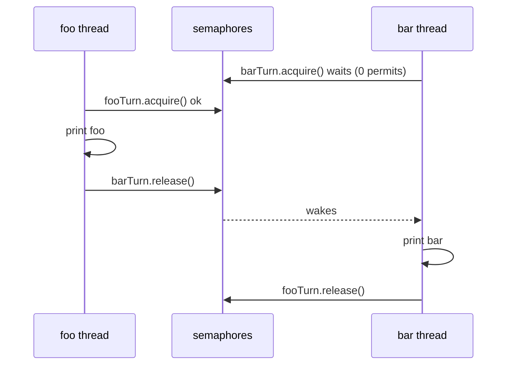
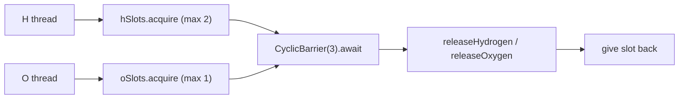
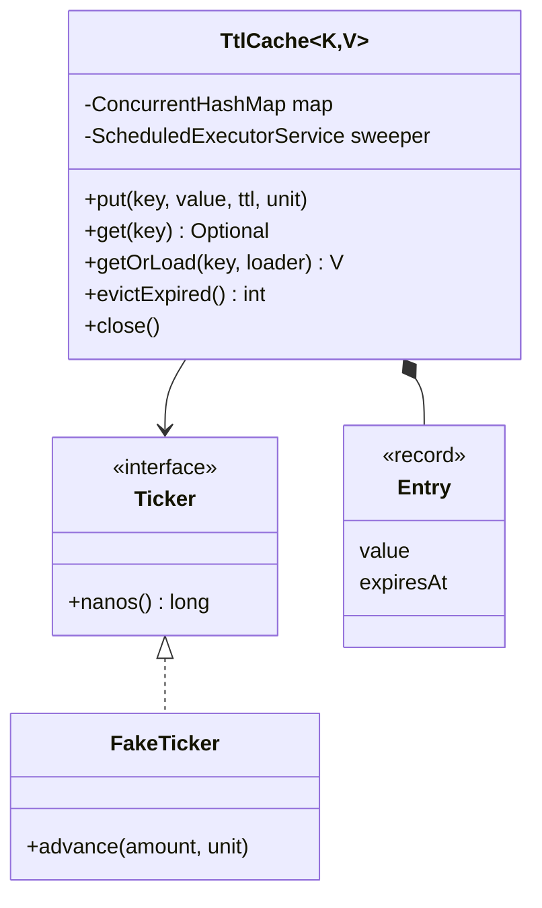
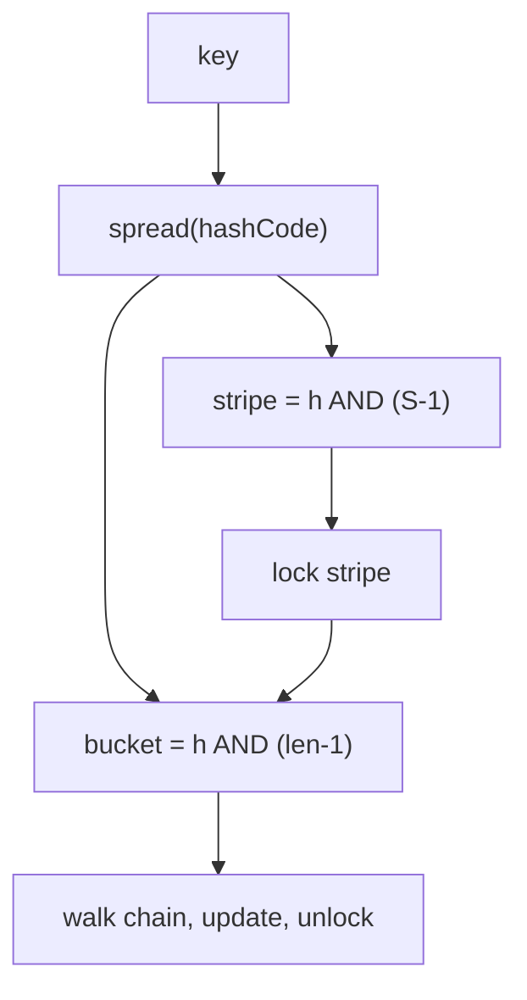
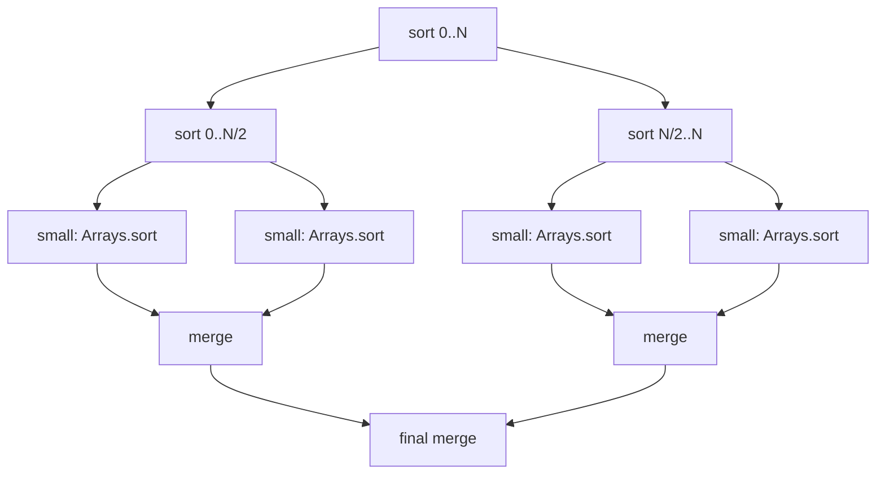

# Chapter 13 — Classic Concurrency Problems · Study Edition

> **Study edition.** All 11 problems with their core solution code, padding removed. Demo `main` methods, helpers and full outputs are in the Full Edition (`README.md`).
>
> **Goal.** Chapter 12 gave you the toolbox; this chapter uses it on the problems interviewers ask — LeetCode's concurrency set (FooBar, Zero-Even-Odd, FizzBuzz, H2O, Dining Philosophers) and "design a thread-safe X" rounds (TTL cache, concurrent hash map, blocking queue, Bloom filter, parallel merge sort, rate limiter).

Layout per problem: *Problem → Approach → Java solution → Why it's correct → Pitfalls → Real-world examples → In the interview → Self-check → TL;DR.* Code: Java 21 in `code/lld/ch13/<problem>/Main.java`. Where event order varies, demos *verify* the result and print `true/false`.

```text
javac --release 21 -d /tmp/lld_13 $(find . -name '*.java')
java -cp /tmp/lld_13 lld.ch13.foobar.Main
```

**Problem map — which tool solves what**

| # | Problem | Core idea | Main tools |
|---|---|---|---|
| 13.1 | Print FooBar Alternately | Pass a "baton" between 2 threads | `Semaphore` ×2 (or monitor + turn flag) |
| 13.2 | Print Zero Even Odd | A dispatcher thread decides who goes next | `Semaphore` ×3 |
| 13.3 | Fizz Buzz Multithreaded | 4 threads, one counter, each waits for "its" numbers | `synchronized` + `wait/notifyAll` |
| 13.4 | Building H2O | Group threads into 2 H + 1 O | `Semaphore` (slots) + `CyclicBarrier` |
| 13.5 | Dining Philosophers | Avoid deadlock over shared forks | Lock ordering, or a "waiter" semaphore |
| 13.6 | Thread-safe cache with TTL | Expiring entries, no stampede | `ConcurrentHashMap`, `compute`, scheduled sweeper |
| 13.7 | Concurrent HashMap (simplified) | Lock striping | `ReentrantLock[]`, all-stripe resize |
| 13.8 | Bounded Blocking Queue | Wait when full / empty | `wait/notifyAll` **and** `Lock` + 2 `Condition`s |
| 13.9 | Concurrent Bloom Filter | Lock-free bit set | `AtomicLongArray` + atomic OR |
| 13.10 | Multi-threaded Merge Sort | Divide and conquer on cores | `ForkJoinPool`, `RecursiveAction` |
| 13.11 | Rate limiter (token bucket) | Atomic refill-and-take | `synchronized`, or CAS on immutable state |

**Checklist for any concurrency problem:** (1) What is the **shared state**? (2) What **ordering or invariant** must hold? (3) Who **waits**, for **what**, and who **signals**? (4) Pick the primitive: turn-taking → semaphores; "wait until predicate" → condition variable; groups → barrier; mutual exclusion → lock; one variable → atomic. (5) Check **liveness**: can anyone wait forever, does every thread exit?

---

## 13.1 Print FooBar Alternately (LeetCode 1115)

### Problem
Thread A calls `foo()` (prints "foo" *n* times), thread B calls `bar()` (prints "bar" *n* times). Output must be "foobar" × *n*, whichever starts first.

### Approach
Pure **signaling** (12.20) — a baton: `fooTurn = Semaphore(1)`, `barTurn = Semaphore(0)`; each thread acquires its own, prints, releases the other's. Alternative: a monitor with a `fooTurn` flag, `while (!fooTurn) wait();`, flip, `notifyAll()`.



### Java solution

```java
// File: code/lld/ch13/foobar/Main.java
    /** Solution 1: two semaphores used as a baton that is passed back and forth. */
    static class FooBarSemaphore {
        private final int n;
        private final Semaphore fooTurn = new Semaphore(1);   // foo may go first
        private final Semaphore barTurn = new Semaphore(0);   // bar must wait

        FooBarSemaphore(int n) { this.n = n; }

        void foo(Runnable printFoo) throws InterruptedException {
            for (int i = 0; i < n; i++) {
                fooTurn.acquire();       // wait for my turn
                printFoo.run();
                barTurn.release();       // hand the baton to bar
            }
        }
        void bar(Runnable printBar) throws InterruptedException {
            for (int i = 0; i < n; i++) {
                barTurn.acquire();
                printBar.run();
                fooTurn.release();
            }
        }
    }
    // ... Solution 2 (FooBarMonitor): synchronized + while (!fooTurn) wait(); flip; notifyAll()
```

Output (bar thread started first on purpose): `semaphores : foobarfoobarfoobarfoobar`, `both correct: true`. Full runnable code: code/lld/ch13/foobar/ (see the Full Edition).

### Why it's correct
**Invariant:** the two semaphores hold exactly 1 permit in total, so turns strictly alternate; `release()` happens-before the `acquire()` it enables; matched loops terminate.

### Pitfalls
One shared semaphore (a thread re-takes its own release); `if` instead of `while`; busy-waiting on a `volatile` flag.

### Real-world examples
Ping-pong protocols, request/acknowledge stages, double-buffering.

### In the interview
**30-second answer:** "Two semaphores as a baton: foo's starts at 1, bar's at 0. Each thread acquires its own, prints, and releases the other's. The total permits are always one, so they alternate."

### Self-check
- **Q:** What if `barTurn` starts at 1? **A:** bar may print first.

### TL;DR
Two semaphores, one permit total, passed back and forth.

---

## 13.2 Print Zero Even Odd (LeetCode 1116)

### Problem
Three threads: `zero()` prints only 0, `even()` only evens, `odd()` only odds; together `0 1 0 2 … 0 n` (n = 5 → `0102030405`).

### Approach
The zero thread is a **dispatcher**: after the 0 for position *i* it releases `oddTurn` (odd *i*) or `evenTurn`; they print and release `zeroTurn`. Initial permits: zero 1, odd 0, even 0.

### Java solution

```java
// File: code/lld/ch13/zeroevenodd/Main.java
        private final Semaphore zeroTurn = new Semaphore(1);
        private final Semaphore oddTurn = new Semaphore(0);
        private final Semaphore evenTurn = new Semaphore(0);
        // ...
        void zero(IntConsumer print) throws InterruptedException {
            for (int i = 1; i <= n; i++) {
                zeroTurn.acquire();
                print.accept(0);
                // The zero thread is the "dispatcher": it decides who prints next.
                if (i % 2 == 1) oddTurn.release(); else evenTurn.release();
            }
        }
        void odd(IntConsumer print) throws InterruptedException {
            for (int i = 1; i <= n; i += 2) {
                oddTurn.acquire();
                print.accept(i);
                zeroTurn.release();
            }
        }
        // ... even() is the same loop from 2 with evenTurn
```

Output: `n=5 -> 0102030405`, `n=10 -> 010203040506070809010`. Full runnable code: code/lld/ch13/zeroevenodd/ (see the Full Edition).

### Why it's correct
One permit in the system → one printer at a time; loop counts match permits (zero *n*, odd ⌈n/2⌉, even ⌊n/2⌋), so everyone exits.

### Pitfalls
Unsynchronized shared counters; loop bounds that don't match permits (a thread hangs).

### Real-world examples
Dispatcher/worker designs (opcode routing, alternating schedulers).

### In the interview
**30-second answer:** "Three semaphores. Zero starts with one permit. After each 0 it releases odd or even depending on the index, and they release zero back. One permit total in the system, so the order is forced."

### Self-check
- **Q:** For n = 4, how many times does `odd()` acquire? **A:** Twice (1 and 3).

### TL;DR
Zero is the dispatcher; one permit circulates among three semaphores.

---

## 13.3 Fizz Buzz Multithreaded (LeetCode 1195)

### Problem
Four threads output 1..n: multiples of 15 → `fizzbuzz`, of 3 only → `fizz`, of 5 only → `buzz`, else the number — each kind printed by its own thread.

### Approach
One shared `current` guarded by the monitor; each thread loops with its own predicate: `while (current <= n && !mine(current)) wait();`, exit (with `notifyAll()`) if `current > n`, else print, `current++`, `notifyAll()`. The **condition-variable** pattern (12.13); `runWhile(predicate, action)` avoids writing the loop four times.

### Java solution

```java
// File: code/lld/ch13/fizzbuzz/Main.java
        private int current = 1;                              // guarded by 'this'
        // ...
        /** Shared loop: wait until 'current' is mine (or we're done), act, advance, wake everyone. */
        private void runWhile(IntPredicate mine, IntConsumer action) throws InterruptedException {
            while (true) {
                synchronized (this) {
                    while (current <= n && !mine.test(current)) wait();
                    if (current > n) { notifyAll(); return; }     // done: wake others so they can exit too
                    action.accept(current);
                    current++;
                    notifyAll();                                  // the next number may belong to anyone
                }
            }
        }

        void fizz(Runnable printFizz) throws InterruptedException {
            runWhile(i -> i % 3 == 0 && i % 5 != 0, i -> printFizz.run());
        }
        // ... buzz: i % 5 == 0 && i % 3 != 0; fizzbuzz: i % 15 == 0; number: neither
```

Output: `1, 2, fizz, 4, buzz, fizz, 7, 8, fizz, buzz, 11, fizz, 13, 14, fizzbuzz`. Full runnable code: code/lld/ch13/fizzbuzz/ (see the Full Edition).

### Why it's correct
Predicates **partition** 1..n; `current` is only touched under the monitor; `notifyAll()` is required because four predicates share one wait set; the final `notifyAll` lets everyone see `current > n` and exit.

### Pitfalls
`notify()` (lost wake-ups); no `current > n` exit check; overlapping predicates (two threads claim 15).

### Real-world examples
Pipeline stages waiting for a job to reach their stage.

### In the interview
**30-second answer:** "One monitor, one shared counter. Each thread waits in a while loop until the counter matches its predicate or passes n, prints, increments and notifies all. The predicates partition the numbers, so exactly one thread acts per number."

### Self-check
- **Q:** Why `notifyAll`? **A:** Threads wait for *different* conditions on one monitor; only waking all guarantees the right one wakes.

### TL;DR
Shared counter + per-thread predicate + `while`-wait + `notifyAll`.

---

## 13.4 Building H2O (LeetCode 1117)

### Problem
H and O threads arrive in any order and must leave in groups of exactly **2 H + 1 O**; one molecule's threads all pass before the next molecule's.

### Approach
**Slots** — `hSlots = Semaphore(2)`, `oSlots = Semaphore(1)` cap the current molecule. **Group** — `CyclicBarrier(3)` makes the three atoms wait for each other. A thread returns its slot **after** it has been released, so the next molecule forms only when this one is done.



### Java solution

```java
// File: code/lld/ch13/h2o/Main.java
    static class H2O {
        private final Semaphore hSlots = new Semaphore(2);    // at most 2 H in the current molecule
        private final Semaphore oSlots = new Semaphore(1);    // at most 1 O in the current molecule
        private final CyclicBarrier bond = new CyclicBarrier(3);   // wait until all 3 atoms are present

        void hydrogen(Runnable releaseHydrogen) throws InterruptedException {
            hSlots.acquire();
            try {
                bond.await();
            } catch (BrokenBarrierException e) { throw new IllegalStateException(e); }
            releaseHydrogen.run();
            hSlots.release();                                 // free my slot only after I have "left"
        }
        // ... oxygen() is identical with oSlots
    }
```

Output: `molecules formed: 8, every group of 3 has 2 H + 1 O: true` (orders `HHO`, `HOH`, `OHH` are all valid, so the demo verifies instead of printing). Full runnable code: code/lld/ch13/h2o/ (see the Full Edition).

### Why it's correct
Slots admit ≤2 H and ≤1 O per round and the barrier needs 3 → each trip is H, H, O; slots are freed only after printing, so groups never mix; the barrier resets itself.

### Pitfalls
Releasing the slot **before** printing; no barrier; H:O not exactly 2:1 (last threads hang).

### Real-world examples
Batching N items of given types (matchmaking, order assembly).

### In the interview
**30-second answer:** "Two semaphores cap the molecule at 2 H and 1 O; a CyclicBarrier of 3 makes the three wait for each other; each atom returns its slot only after it's released, so molecules never interleave."

### Self-check
- **Q:** Why is `hSlots` 2, not 1? **A:** A molecule needs two hydrogens inside the barrier at once.

### TL;DR
Slots decide *who* can join; the barrier decides *when* they leave; free slots only after leaving.

---

## 13.5 Dining Philosophers (LeetCode 1226)

### Problem
Five philosophers, five forks, each needs **both** adjacent forks. If everyone takes the left fork first, all may wait forever for the right — **deadlock** (all four Coffman conditions, 12.17).

### Approach
Break **circular wait**: (1) **resource ordering** — always take the **lower-numbered** fork first (philosopher 4 takes fork 0 first); (2) **waiter** — a **fair** semaphore lets at most **n − 1** try at once, so someone always gets both forks. (Also: `tryLock` both with random back-off; Chandy–Misra for distributed settings.)

### Java solution

```java
// File: code/lld/ch13/philosophers/Main.java
    /** Fix 1 - resource ordering: always pick up the LOWER-numbered fork first (breaks circular wait). */
    static class OrderedForks implements Table {
        private final ReentrantLock[] forks;
        // ... constructor creates n ReentrantLocks

        public void eat(int p, Runnable eatAction) {
            int left = p, right = (p + 1) % forks.length;
            ReentrantLock first = forks[Math.min(left, right)], second = forks[Math.max(left, right)];
            first.lock();
            try {
                second.lock();
                try { eatAction.run(); } finally { second.unlock(); }
            } finally { first.unlock(); }
        }
    }

    /** Fix 2 - a "waiter" lets at most n-1 philosophers try at once (breaks circular wait too). */
    static class Waiter implements Table {
        // ... forks as above, plus:
            seats = new Semaphore(n - 1, true);                 // fair: nobody starves waiting for a seat
        // ... eat(): seats.acquire(); lock left, then right; eat; unlock both; seats.release() in finally
    }
```

Output: both strategies finish `[10000, 10000, 10000, 10000, 10000]` meals. Full runnable code: code/lld/ch13/philosophers/ (see the Full Edition).

### Why it's correct
**Ordering:** increasing-index acquisition makes a waiting cycle impossible. **Waiter:** 4 diners, 5 forks → by pigeonhole someone eats. Forks are released in `finally`.

### Pitfalls
Left-then-right for all (deadlock); `tryLock` retries without random back-off (livelock); the fair semaphore only makes *seats* FIFO — fair fork locks are needed for strict no-starvation.

### Real-world examples
Anything needing two locks: bank transfers, multi-row DB transactions.

### In the interview
**30-second answer:** "Naively everyone takes the left fork and waits for the right — circular wait, deadlock. I break circular wait by always taking the lower-numbered fork first, or by a waiter semaphore allowing only n−1 philosophers to try; fairness prevents starvation."

### Self-check
- **Q:** With ordering, who behaves "differently"? **A:** The philosopher between forks 4 and 0 — takes fork 0 (right) first.

### TL;DR
Break circular wait: global fork order, or only n−1 diners.

---

## 13.6 Thread-safe cache with TTL

### Problem
A shared cache whose entries expire after a **TTL**: `put` (default or per-entry TTL), `get` hides expired entries, `getOrLoad` loads a miss **without a cache stampede**, expired entries leave memory, testable without sleeping.

### Approach
Immutable `Entry(value, expiresAt)` in a `ConcurrentHashMap`; **lazy expiry** in `get` via conditional `remove(key, entry)`; **active expiry** by a daemon scheduled sweeper; **no stampede** via `map.compute` (loader runs once per key); an injected `Ticker` for tests.



### Java solution

```java
// File: code/lld/ch13/ttlcache/Main.java
        private record Entry<V>(V value, long expiresAt) { }

        private final ConcurrentHashMap<K, Entry<V>> map = new ConcurrentHashMap<>();
        // ... defaultTtlNanos, ticker, daemon sweeper scheduled at a fixed rate to call evictExpired()

        private boolean expired(Entry<V> e) { return ticker.nanos() - e.expiresAt() >= 0; }   // overflow-safe compare

        Optional<V> get(K key) {
            Entry<V> e = map.get(key);
            if (e == null) return Optional.empty();
            if (expired(e)) {
                map.remove(key, e);   // conditional remove: never deletes a FRESH value another thread just put
                return Optional.empty();
            }
            return Optional.of(e.value());
        }

        V getOrLoad(K key, Function<? super K, ? extends V> loader) {
            return map.compute(key, (k, old) ->
                    old != null && !expired(old) ? old : new Entry<>(loader.apply(k), ticker.nanos() + defaultTtlNanos)
            ).value();
        }
        // ... evictExpired(): for each entry, if expired, map.remove(key, entry) — the same conditional remove
```

Output: `16 concurrent misses -> loader ran 1 time(s), all got same value: true`; with the real clock the sweeper empties 1,000 entries within 200 ms.

Full runnable code: code/lld/ch13/ttlcache/ (see the Full Edition).

### Why it's correct
Immutable entries in one CHM (never half-written); `remove(key, e)` removes only that exact entry; `compute` is atomic per key (one load); `now - expiresAt >= 0` survives `nanoTime` overflow; the sweeper is a daemon closed in `close()`. (Its constructor leaks `this` to the sweeper — safe only because fields are set and executor submission is a happens-before edge; prefer a static factory.)

### Pitfalls
Wall-clock `currentTimeMillis()` (use `nanoTime`); slow loaders inside `compute` block the bin (store a `CompletableFuture`); lazy-only expiry leaks, active-only serves stale — use both; no size limit (add LRU/LFU).

### Real-world examples
**Caffeine** (and Guava `CacheBuilder`); **Redis** `EXPIRE` (lazy + periodic); sessions, OTPs, seat holds.

### In the interview
**30-second answer:** "A ConcurrentHashMap of immutable entries holding value and expiry time. Get checks expiry lazily and removes with a conditional remove; a daemon scheduled sweeper removes expired keys nobody reads. getOrLoad uses compute so concurrent misses load once. Time is injected for testing."

### Self-check
- **Q:** Why `remove(key, e)` not `remove(key)`? **A:** So a value written between our read and remove isn't deleted.

### TL;DR
CHM + immutable (value, expiry) entries; lazy + scheduled expiry; `compute` for single-flight loads; injected clock.

---

## 13.7 Design a (simplified) Concurrent HashMap — lock striping

### Problem
A hash map with `get`, `put`, `remove`, `compute` and resizing, usable by many threads and faster than one global lock.

### Approach
**Lock striping** (12.11): buckets of linked chains plus `S` locks (power of two). Key hash *h* → stripe `h & (S − 1)`, bucket `h & (len − 1)`; the stripe depends only on the hash, so it **never changes on resize**. Operations lock only their stripe. **Resize** (size > 0.75 × buckets): lock **all** stripes in index order, re-check, rehash into a 2× table, publish via `volatile`, unlock in reverse. Size in an `AtomicInteger`.



### Java solution

```java
// File: code/lld/ch13/stripedmap/Main.java
        private volatile Node<K, V>[] table;                // replaced (never mutated in place) only while ALL locks are held
        private final ReentrantLock[] stripes;
        private final AtomicInteger size = new AtomicInteger();
        // ... constructor requires power-of-two sizes and stripes <= buckets

        // A key's stripe depends only on its hash, NOT on the table size, so it never changes on resize.
        private ReentrantLock stripeFor(int hash) { return stripes[hash & (stripes.length - 1)]; }
        // ... get/remove: lock stripeFor(h), walk t[indexFor(h, t.length)], unlock
        // ... put/compute share doCompute(): under the stripe lock find the node, apply remap,
        // ... update / unlink / insert at head; then, AFTER unlocking:
            if (grew) resize();                                     // never resize while holding one stripe

        /** Stop-the-world resize: take every stripe lock IN ORDER (no deadlock), rehash, publish. */
        private void resize() {
            for (ReentrantLock l : stripes) l.lock();
            try {
                Node<K, V>[] old = table;
                if (size.get() <= old.length * LOAD_FACTOR) return;  // another thread already resized
                Node<K, V>[] nt = (Node<K, V>[]) new Node[old.length * 2];
                // ... move every node to nt[indexFor(n.hash, nt.length)]
                table = nt;
            } finally {
                for (int i = stripes.length - 1; i >= 0; i--) stripes[i].unlock();
            }
        }
```

Output: 8 threads × 20,000 puts → `size=160000, missing=0`, table grew 16 → 262144 buckets; 80,000 concurrent `compute` increments are exact.

Full runnable code: code/lld/ch13/stripedmap/ (see the Full Edition).

### Why it's correct
**Each bucket has exactly one stripe** (powers of two, *S* ≤ length → stripe index = low bits of bucket index). **Resize** holds all locks, re-checks, publishes via `volatile`. **No deadlock:** one lock normally; resize takes all in order after releasing its own. **Compute** runs wholly under the stripe lock.

### Pitfalls
Stripe from the current bucket index (changes on resize); resizing while holding a stripe; unsynchronized `table` reads; `null` keys/values.

### How the real `ConcurrentHashMap` goes further

| Aspect | This design | JDK 8+ `ConcurrentHashMap` |
|---|---|---|
| Reads | Lock the stripe | Lock-free (volatile reads) |
| Write locking | One of S stripe locks | CAS into empty bins; `synchronized` on the bin head otherwise |
| Long chains | Linked list | Red-black tree beyond 8 nodes (table ≥ 64) |
| Resize | Stop-the-world | Incremental; threads help transfer |
| Size | `AtomicInteger` | `LongAdder`-style counter cells |

### Real-world examples
Java 7's `ConcurrentHashMap` **segments** (16 by default); Guava `Striped<Lock>`; Caffeine's striped read buffers.

### In the interview
**30-second answer:** "An array of buckets plus a small array of locks; each key maps to a stripe by its hash bits, so different stripes work in parallel. Every bucket belongs to exactly one stripe. Resize takes all stripe locks in order, rehashes and publishes the new table through a volatile field."

### Self-check
- **Q:** Why must the stripe count divide the table length? **A:** So every bucket maps to exactly one stripe.

### TL;DR
N locks for M buckets, stripe by hash bits, resize under all locks in order, publish via volatile.

---

## 13.8 Thread-safe bounded Blocking Queue (two ways)

### Problem
A fixed-capacity FIFO for producer-consumer: `put` blocks while full, `take` while empty, plus timed `offer(item, timeout)` and `poll(timeout)`.

### Approach
A **circular array** (`head`, `tail`, `count`) and two synchronisation designs:

| | Way 1: monitor | Way 2: `ReentrantLock` + 2 `Condition`s |
|---|---|---|
| Lock | `synchronized` methods | `lock.lockInterruptibly()` |
| Wait | `while (full) wait();` | `while (full) notFull.await();` |
| Wake | `notifyAll()` — one shared wait set | `notEmpty.signal()` / `notFull.signal()` |
| Timed wait | `TimeUnit.timedWait` + deadline loop | `awaitNanos` returns time left |
| Efficiency | Wakes everyone (thundering herd) | Wakes one thread of the right kind |

### Java solution

```java
// File: code/lld/ch13/blockingqueue/Main.java
    // ... Way 1 (MonitorQueue): producers AND consumers share one monitor, so notifyAll():
        public synchronized void put(T item) throws InterruptedException {
            while (count == items.length) wait();
            enqueue(item);
            notifyAll();
        }
    // ...
    // ... Way 2 (ConditionQueue): ReentrantLock with TWO condition queues (how ArrayBlockingQueue is built).
        private final ReentrantLock lock = new ReentrantLock();
        private final Condition notFull = lock.newCondition();
        private final Condition notEmpty = lock.newCondition();

        public void put(T item) throws InterruptedException {
            if (item == null) throw new NullPointerException();
            lock.lockInterruptibly();
            try {
                while (count == items.length) notFull.await();
                enqueue(item);
            } finally { lock.unlock(); }
        }
        // ... take() mirrors put(); timed poll/offer loop on nanos = notEmpty.awaitNanos(nanos) (returns time left)
        private void enqueue(T item) {
            items[tail] = item;
            tail = (tail + 1) % items.length;
            count++;
            notEmpty.signal();                                   // wake ONE waiting consumer
        }
        @SuppressWarnings("unchecked")
        private T dequeue() {
            T x = (T) items[head];
            items[head] = null;
            head = (head + 1) % items.length;
            count--;
            notFull.signal();                                    // wake ONE waiting producer
            return x;
        }
```

Both pass a stress test (3 producers × 20,000, 3 consumers, capacity 2): `consumed 60000 items, sum ok=true, left in queue=0`; `poll(30ms)` on empty → `null`, `offer(30ms)` on full → `false`. Full runnable code: code/lld/ch13/blockingqueue/ (see the Full Edition).

### Why it's correct
One lock guards all fields; `while` loops handle spurious wakeups; Way 1 needs `notifyAll()` (one shared wait set); Way 2 can `signal()` (separate queues per kind); timed waits track *remaining* time.

### Pitfalls
`if` instead of `while`; `notify()` on a shared monitor; not nulling `items[head]` (leak); `null` items when `null` means timeout.

### Real-world examples
`ArrayBlockingQueue` = Way 2; `LinkedBlockingQueue` uses **two** locks (`putLock`, `takeLock`).

### In the interview
**30-second answer:** "A circular array with head, tail and count guarded by one lock. put waits while count == capacity, take waits while count == 0, both in while loops. With synchronized I must use notifyAll because both sides share one wait set; with ReentrantLock I use two Conditions, notFull and notEmpty, and signal just the right side."

### Self-check
- **Q:** Why is `signal()` safe in Way 2 but `notify()` unsafe in Way 1? **A:** Separate condition queues guarantee the woken thread is the right kind.

### TL;DR
Circular buffer + one lock + wait-while-full/empty loops. Monitor → `notifyAll`; Lock → `notFull`/`notEmpty` + `signal`.

---

## 13.9 Concurrent Bloom Filter

### Problem
A thread-safe **Bloom filter** — a compact probabilistic set answering *"definitely not present"* or *"probably present"* — that many threads add to and query at once.

### Approach
*m* bits; **add** sets *k* hashed positions; **query**: any 0 → **definitely absent**, all 1 → **probably** present (*false positive* possible). No false negatives, no deletion (a *counting* filter allows it).

**Sizing** for *n* items and false-positive rate *p*: *m* = ⌈ −n · ln p / (ln 2)² ⌉, *k* = round((m / n) · ln 2). For *n* = 80,000, *p* = 1% → *m* ≈ 766,805 bits (≈ 93.6 KiB), *k* = 7 — about **9.6 bits per item**, whatever the item size.

**Double hashing** (Kirsch–Mitzenmacher): positions *h1 + i·h2*. **Lock-free:** an `AtomicLongArray` with **atomic OR** (`getAndAccumulate`); queries are volatile reads — bits only go 0 → 1, so a query can at most miss an unfinished `add`.

### Java solution

```java
// File: code/lld/ch13/bloomfilter/Main.java
        private final AtomicLongArray words;     // m bits packed into 64-bit words
        // ... numBits (m) and numHashes (k) computed from expectedItems and falsePositiveRate

        /** Adds the item. Returns true if at least one bit changed (i.e. it was definitely new). */
        boolean add(String item) {
            long base = fnv1a64(item);
            long h1 = fmix64(base), h2 = fmix64(base ^ 0x9E3779B97F4A7C15L) | 1;   // h2 odd
            boolean changed = false;
            for (int i = 0; i < numHashes; i++) {
                int bit = (int) Math.floorMod(h1 + i * h2, (long) numBits);        // double hashing
                long mask = 1L << (bit & 63);
                long before = words.getAndAccumulate(bit >>> 6, mask, (cur, m) -> cur | m);  // atomic OR (CAS loop)
                if ((before & mask) == 0) changed = true;
            }
            return changed;
        }
        // ... mightContain(): same k positions; any bit == 0 -> return false (definitely absent)
        // ... fnv1a64 (FNV-1a) and fmix64 (MurmurHash3 finalizer) mix the bits
```

Output: `m=766805 bits (93 KiB), k=7`; after an 8-thread insert, `false negatives: 0` and a measured false-positive rate of `1.01%` (target 1%).

Full runnable code: code/lld/ch13/bloomfilter/ (see the Full Edition).

### Why it's correct
A plain `|=` can lose bits (false negatives); atomic OR retries. Bits are **monotonic** (no ABA, no locks) and OR is commutative, so the result is interleaving-independent.

### Pitfalls
Non-atomic bit setting; weak hashes (clustered bits); far more than *n* items; negative indices (use `Math.floorMod`).

### Real-world examples
Cassandra, HBase, RocksDB (skip disk reads); Guava `BloomFilter`; RedisBloom; "URL already crawled?" checks.

### In the interview
**30-second answer:** "A bit array of size m with k hash positions per item from double hashing; add sets k bits, query checks them — any zero means definitely absent. For concurrency I store bits in an AtomicLongArray and set them with an atomic OR; since bits only go from 0 to 1, reads need no lock. m and k come from n and the target false-positive rate."

### Self-check
- **Q:** Bits per element for 1% FPR? **A:** About 9.6.

### TL;DR
Bits + k hashes; "no" is certain, "yes" is probable. `AtomicLongArray` + atomic OR = lock-free and correct.

---

## 13.10 Multi-threaded Merge Sort (Fork/Join)

### Problem
Sort a large `int[]` using all CPU cores.

### Approach
Merge sort is **divide and conquer**; Java's **Fork/Join** (`ForkJoinPool`, `RecursiveAction`/`RecursiveTask`) fits it: ranges ≤ 8,192 → `Arrays.sort` sequentially; otherwise split at `(lo + hi) >>> 1` and `invokeAll(left, right)`; merge with **one shared scratch buffer** (tasks use disjoint `[lo, hi)` slices). **Work stealing:** idle pool threads steal tasks from the other end of busy threads' deques.



### Java solution

```java
// File: code/lld/ch13/mergesort/Main.java
    static final class ParallelMergeSort extends RecursiveAction {
        private static final long serialVersionUID = 1L;
        static final int THRESHOLD = 1 << 13;   // below ~8K elements, splitting costs more than it saves
        private final int[] a, buf;             // buf = one shared scratch array; tasks use disjoint ranges
        private final int lo, hi;               // sorts a[lo, hi)

        ParallelMergeSort(int[] a, int[] buf, int lo, int hi) { this.a = a; this.buf = buf; this.lo = lo; this.hi = hi; }

        @Override protected void compute() {
            if (hi - lo <= THRESHOLD) {
                Arrays.sort(a, lo, hi);                           // sequential base case
                return;
            }
            int mid = (lo + hi) >>> 1;                            // overflow-safe midpoint
            invokeAll(new ParallelMergeSort(a, buf, lo, mid),     // fork both halves, wait for both
                      new ParallelMergeSort(a, buf, mid, hi));
            merge(mid);
        }

        private void merge(int mid) {
            if (a[mid - 1] <= a[mid]) return;                     // already in order: skip
            System.arraycopy(a, lo, buf, lo, hi - lo);
            int i = lo, j = mid, k = lo;
            while (i < mid && j < hi) a[k++] = buf[i] <= buf[j] ? buf[i++] : buf[j++];   // <= keeps it stable
            while (i < mid) a[k++] = buf[i++];
            // right-half leftovers are already in place
        }
    }

    static void parallelSort(int[] a) {
        ForkJoinPool.commonPool().invoke(new ParallelMergeSort(a, new int[a.length], 0, a.length));
    }
```

Output: `4000000 random ints: matches Arrays.sort = true`, `Arrays.parallelSort agrees = true`. Full runnable code: code/lld/ch13/mergesort/ (see the Full Edition).

### Why it's correct
**Disjoint** ranges → no races; `invokeAll`'s join gives happens-before for the merge; `<=` keeps it **stable**.

### Pitfalls
No threshold; a new buffer per merge; blocking I/O in Fork/Join tasks; `(lo + hi) / 2` overflow; expecting speed-up on tiny arrays (Amdahl).

### Real-world examples
`Arrays.parallelSort`; parallel streams; Hadoop/Spark sorts across machines.

### In the interview
**30-second answer:** "A RecursiveAction splits the range in half until it's below a threshold, sorts small pieces sequentially, then merges using one preallocated buffer. invokeAll runs both halves in parallel on the ForkJoinPool, whose work stealing keeps cores busy. Subtasks touch disjoint ranges, so no locks are needed."

### Self-check
- **Q:** Why is a shared `buf` safe? **A:** Concurrent tasks use non-overlapping ranges of it.

### TL;DR
Split until small, sort sequentially, merge; Fork/Join + work stealing; disjoint ranges = no locks.

---

## 13.11 Rate limiter — token bucket (thread-safe)

### Problem
Limit API calls per client (user id / API key / IP): bursts up to *B*, sustained rate *R*/s, correct under concurrency.

### Approach
**Token bucket:** holds up to *capacity* tokens (the burst), starts full, refills at *refillRate*/s (never above capacity); each request takes one token or is rejected (HTTP 429). Refill **lazily** from `tokens` and `lastRefill` on each request — no background thread. **"Refill + check + take" must be one atomic step**, else two threads spend the same token: (1) `synchronized tryAcquire()`; (2) **lock-free** — `(tokens, lastRefill)` in one immutable `State` record in an `AtomicReference`, swapped by CAS (12.15's trick). Per client: `computeIfAbsent(clientId, …)` makes exactly one bucket. Time comes from an injected `Ticker`.

| Algorithm | Bursts | Memory | Notes |
|---|---|---|---|
| **Token bucket** | Up to capacity | 2 numbers | Most common for APIs |
| Leaky bucket | Smoothed constant output | Queue | Traffic shaping |
| Fixed window counter | 2× burst at window edges | 1 counter | Simplest |
| Sliding window log | Exact | One timestamp per request | Memory-heavy |
| Sliding window counter | Approximate, smooth | 2 counters | Good compromise |

### Java solution

```java
// File: code/lld/ch13/ratelimiter/Main.java
        public synchronized boolean tryAcquire() {
            long now = ticker.nanos();
            tokens = Math.min(capacity, tokens + (now - lastRefill) * tokensPerNano);   // refill + acquire are ONE atomic step
            lastRefill = now;
            if (tokens >= 1) { tokens -= 1; return true; }
            return false;
        }
    // ...
    /** Same algorithm, lock-free: the whole state is one immutable record swapped with CAS. */
    static final class LockFreeTokenBucket implements RateLimiter {
        private record State(double tokens, long lastRefill) { }
        // ... capacity, tokensPerNano, ticker
        private final AtomicReference<State> state;
        // ...
        public boolean tryAcquire() {
            while (true) {
                State cur = state.get();
                long now = Math.max(ticker.nanos(), cur.lastRefill());   // never move time backwards
                double refilled = Math.min(capacity, cur.tokens() + (now - cur.lastRefill()) * tokensPerNano);
                boolean ok = refilled >= 1;
                State next = new State(ok ? refilled - 1 : refilled, now);
                if (state.compareAndSet(cur, next)) return ok;            // lost the race? recompute and retry
            }
        }
    }

    /** One bucket per client key (user id, API key, IP). computeIfAbsent creates each bucket exactly once. */
        boolean allow(String clientId) { return buckets.computeIfAbsent(clientId, k -> factory.get()).tryAcquire(); }
```

**Output (both versions, capacity 5, refill 2/s):**

```text
  t=0.0s  7 requests : YYYYYnn
  t=1.0s  3 requests : YYn
  t=1.25s 1 request  : n  (only 0.5 token so far)
  after 1 idle hour  : allowed 5 of 100 concurrent requests (burst capped at 5)
```

Full runnable code: code/lld/ch13/ratelimiter/ (see the Full Edition).

### Why it's correct
The decision is atomic (lock, or snapshot + CAS retry) → each token granted once; tokens clamp to `capacity`; `computeIfAbsent` prevents two buckets per client; `Math.max(..., lastRefill)` stops time going backwards.

### Pitfalls
Separate refill/take calls; a thread per bucket; `currentTimeMillis()`; unbounded bucket maps (evict idle ones with 13.6's TTL cache); in-memory limits are per server — use **Redis** + Lua for global limits.

### Real-world examples
Stripe (Redis token buckets); API Gateway *rate* + *burst*; Guava `RateLimiter`, Bucket4j; NGINX `limit_req` (leaky bucket).

### In the interview
**30-second answer:** "Token bucket: capacity for bursts, refill rate for the average. I refill lazily from elapsed nanoTime on each request, and make refill-check-take one atomic step — synchronized, or lock-free by CASing an immutable state record. A ConcurrentHashMap gives one bucket per client via computeIfAbsent; across servers I'd move the bucket into Redis with a Lua script."

### Self-check
- **Q:** Why one immutable `State` in the lock-free version? **A:** `tokens` and `lastRefill` must change together; one CAS on one reference updates both.

### TL;DR
Capacity = burst, rate = average. Lazy refill; refill+take atomic (lock or CAS on immutable state); one bucket per client; Redis for multi-server.

---

## 13.12 Chapter summary

| Problem | Key primitive | The one invariant to state in the interview |
|---|---|---|
| FooBar | 2 semaphores | Exactly one permit exists across both |
| Zero Even Odd | 3 semaphores | Zero dispatches; one permit circulates |
| FizzBuzz | monitor + `notifyAll` | Predicates partition 1..n |
| H2O | 2 semaphores + barrier | ≤2 H and ≤1 O per round; slot freed after release |
| Dining Philosophers | ordered locks / n−1 semaphore | No circular wait |
| TTL cache | CHM + `compute` + conditional remove | Never return or keep expired data; load once per key |
| Striped map | lock array | Each bucket belongs to exactly one stripe |
| Blocking queue | lock + 2 conditions | 0 ≤ count ≤ capacity; wait in loops |
| Bloom filter | atomic OR | Bits only go 0 → 1; no false negatives |
| Merge sort | Fork/Join | Subtasks touch disjoint ranges |
| Rate limiter | lock or CAS on immutable state | Refill + take is one atomic step |

## 13.13 Chapter self-check
1. **Q:** In FizzBuzz, what bug appears with `notify()`? **A:** The wrong thread wakes and sleeps again; the right one never wakes → hang.
2. **Q:** In H2O, why release the slot after printing? **A:** So the next molecule can't form until this one has fully left.
3. **Q:** Why must the striped map's stripe depend only on the hash? **A:** So a key's lock doesn't change on resize.
4. **Q:** When is `signal()` safe instead of `signalAll()`? **A:** When each condition queue holds only threads waiting for the same thing and one change enables exactly one waiter.
5. **Q:** How do you make a token bucket global across 10 servers? **A:** Store it in Redis and update it atomically with a Lua script.

## 13.14 Chapter TL;DR
- **Ordering puzzles** (FooBar, ZeroEvenOdd, H2O): semaphores as batons, barriers for groups; "exactly one permit" invariants.
- **Predicate waiting** (FizzBuzz, blocking queue): lock + `while (!condition) wait/await` + `notifyAll` or targeted `signal`.
- **Multi-lock problems** (philosophers): break circular wait with ordering or limiting.
- **Thread-safe data structures** (cache, map, queue, Bloom filter, rate limiter): immutable entries, atomic compound ops, striping, CAS on immutable state, injected clocks.
- **Parallel algorithms** (merge sort): Fork/Join with thresholds and disjoint data.
