# Chapter 14 — Case Studies: Everyday Objects

> **Where this fits.** Chapters 1–13 gave you the tools: OOP, UML, SOLID, clean code, the 23 GoF patterns and concurrency. From this chapter to Chapter 21 you use those tools on real interview questions. This chapter starts with **physical machines you have used yourself**: a parking lot, a vending machine, a coffee machine, an ATM, an elevator, a traffic light and a parcel locker. You already know how they behave, so all your attention can go to the design.

**What you will learn in this chapter**

| # | Problem | The one idea the interviewer is really testing | Main patterns |
|---|---|---|---|
| 14.1 | Parking Lot | **Resource allocation** under concurrency: two cars must never get the same spot | Strategy (spot finding, pricing), Factory, Observer (display boards) |
| 14.2 | Vending Machine | A **state machine**: the order in which actions are allowed | State |
| 14.3 | Coffee Vending Machine | **Atomic, all-or-nothing** deduction from a shared inventory; recipes as data | Observer (low-stock alerts), data-driven recipes, sealed result types |
| 14.4 | ATM | **Security + money correctness**: authenticate, never lose money, never double-spend | State, Chain of Responsibility (cash dispenser), Command (transactions) |
| 14.5 | Elevator System | **Scheduling** (SCAN/LOOK) and **dispatching** many cars | Strategy (dispatch), State-like modes |
| 14.6 | Traffic Signal Control | **Timed state machine** with a hard safety invariant and emergency override | State, Strategy (timing), Observer (safety monitor) |
| 14.7 | Shipping Locker System | **Best-fit allocation + deadlines + a secret**: reserve a door atomically, expire holds and uncollected parcels, single-use hashed pickup codes | Strategy (door choice), Observer (SMS), enum state machines, sealed results |

### What these problems test

These seven questions look different, but interviewers use them to check three skills:

1. **State machines.** A machine behaves differently depending on what has happened so far. A vending machine must not dispense before it is paid. An ATM must not allow a withdrawal before the PIN is checked. A traffic light must never go from green straight to green on the crossing road. A **state machine** is a model with a fixed set of situations (states) and rules for moving between them (transitions). The **State pattern** (Chapter 11) turns each state into its own class, so every button has a defined answer in every state.
2. **Resource allocation.** A limited set of things (parking spots, notes in a cassette, millilitres of milk, elevator cars, locker doors) must be handed out correctly: never twice, never below zero, and fairly.
3. **Concurrency.** Many actors act at the same moment: several entrance gates, two ATMs on one joint account, ten customers tapping "Latte" at once, a timer thread and an emergency thread. The design must stay correct when calls overlap (Chapters 12–13).

> **Key insight.** In every one of these problems, the hardest part is small: one method that picks a spot, one method that makes change, one method that deducts ingredients, one method that picks the next elevator stop. Find that method early, name it out loud, and spend your time there.

### How each case study is laid out

Every problem follows the same template, which is also a good order to speak in during an interview:

Problem & clarifying questions → Requirements → Use cases → Core entities → Class diagram → Key flows → Design decisions & patterns → Java implementation → Concurrency & edge cases → Extensions & follow-ups → In the interview → Self-check → TL;DR.

### How to read the course diagrams

The course draws its class diagrams in stages. Classes added in earlier stages are drawn in grey; the new ones are in colour. The legend below explains every arrow used in those diagrams (it is the same for all four course case studies in this chapter).


*Figure — Legend for the course class diagrams: interface, class, realization, association, inheritance, composition and the other arrow kinds (course diagram)*

Read the figure above once: a **hollow triangle** means inheritance ("is a"), a **dashed line with a hollow triangle** means "implements an interface", a **filled diamond** means composition (the part dies with the whole), and a **plain arrow** means association (one object refers to another without owning it). Chapter 3 covers these relationships in depth.

### How to run every example in this chapter

```bash
cd chapters/14-case-everyday-objects/code
javac --release 21 -d /tmp/lld_14 $(find . -name '*.java')
java -cp /tmp/lld_14 lld.ch14.parkinglot.Main      # or vendingmachine, coffeemachine, atm, elevator, trafficsignal, locker
```

All seven `Main` classes compile with Java 21 (standard library only) and run. The output printed under each implementation is the real output of that program.

> **Code-style note.** To keep each design readable in one place, a file sometimes holds several small package-private types (for example `Vehicles.java` holds `SpotType`, `VehicleType` and `Vehicle`). That is legal Java, and the code compiles with no warnings under `-Xlint:all` except the `auxiliaryclass` lint, which exists precisely to flag this style (a type used from outside the file it is declared in). In production you would usually give each top-level type its own file.

---

## 14.1 Design a Parking Lot


*Figure — A large multi-level car park, the kind of building this design models (course diagram)*

A **parking lot** (car park) is an area set aside for parking vehicles. Malls, stadiums, airports and office towers have large multi-floor lots with gates, ticket machines and boards showing free spaces. The photo above is the kind of lot we are modelling: many floors, many spot sizes, and several ways in and out.

This is the most-asked LLD question of all. It looks easy, which is exactly why it is useful to an interviewer: they can watch how you **scope** it, how you **model the fit rule** (which vehicle may use which spot), and whether you notice that **two gates can hand out the same spot** at the same moment.

### Problem & clarifying questions

Ask these before drawing anything. The answers in the right column are the ones this design assumes.

| Question | Assumed answer |
|---|---|
| One lot or a chain of lots? | One lot, many floors. |
| How many entrances and exits? | Several of each, all working at the same time. |
| Which vehicle types? | Car, truck, van, motorcycle, electric car. |
| Which spot types? | Compact, large, handicapped (accessible), motorcycle, electric. |
| How do customers pay? | Cash or card, at the exit panel, to an attendant, or earlier at an info portal on each floor. |
| How is the fee computed? | Per hour, with tiers: $4 for the first hour, $3.50 for hours 2 and 3, $2.50 for each hour after. A started hour counts as a full hour. |
| Do EVs charge? | Yes: electric spots have a panel where the driver pays for charging. |
| Reservations, monthly passes, number-plate recognition? | Out of scope (mentioned as extensions). |
| What happens when the lot is full? | The entrance panel and the ground-floor board show a "full" message; no more vehicles are admitted. |

### Requirements

**Functional**

1. The lot has **multiple floors**.
2. It has **multiple entry and exit points**.
3. A customer **collects a ticket at the entrance** and **pays at the exit**.
4. Payment at the **automated exit panel** or to a **parking attendant**.
5. Payment by **cash or credit card**.
6. Payment is also possible at a **customer info portal on each floor**; a ticket paid there is not charged again at the exit.
7. The lot **never admits more vehicles than its capacity**. When full, a message shows on the entrance panel and on the ground-floor display board.
8. Each floor has many spots of several **types**: compact, large, handicapped, motorcycle (and electric, below).
9. Some spots are for **electric cars**; each has an **electric panel** where the customer can pay for and charge the vehicle.
10. Many **vehicle types**: car, truck, van, motorcycle (and electric car).
11. Each floor has a **display board** showing free spots per spot type.
12. A **per-hour fee model** with tiers ($4 / $3.50 / $3.50 / $2.50 …).

**Non-functional**

- **Correctness under concurrency:** two entrance gates working at the same instant must never be given the same spot, and a ticket must never be paid twice.
- **Low latency at the gate:** finding a spot must not scan thousands of spots; taking one from a sorted set of free spots is O(log n).
- **Extensibility:** a new pricing rule, a new spot-finding rule or a new vehicle type should be a small, local change.
- **Testability:** time must be injectable (a fake clock), so fee tests do not wait for hours.

### Use cases

**Actors** (an actor is anyone or anything outside the system that uses it):

- **Admin** — adds, removes and edits floors, spots, entrance/exit panels; adds and removes attendants; sets the hourly rate.
- **Customer** — takes a ticket, pays, leaves.
- **Parking attendant** — can do everything a customer can, on the customer's behalf, and can accept cash.
- **System** — shows messages on panels and boards, assigns a vehicle to a spot and frees it again.

**Top use cases:** add/remove/edit a floor (each floor with its own display board); add/remove/edit a spot; add/remove an attendant; **take ticket**; **scan ticket** (to find the total charge); **credit-card payment**; **cash payment**; add/modify the parking rate.

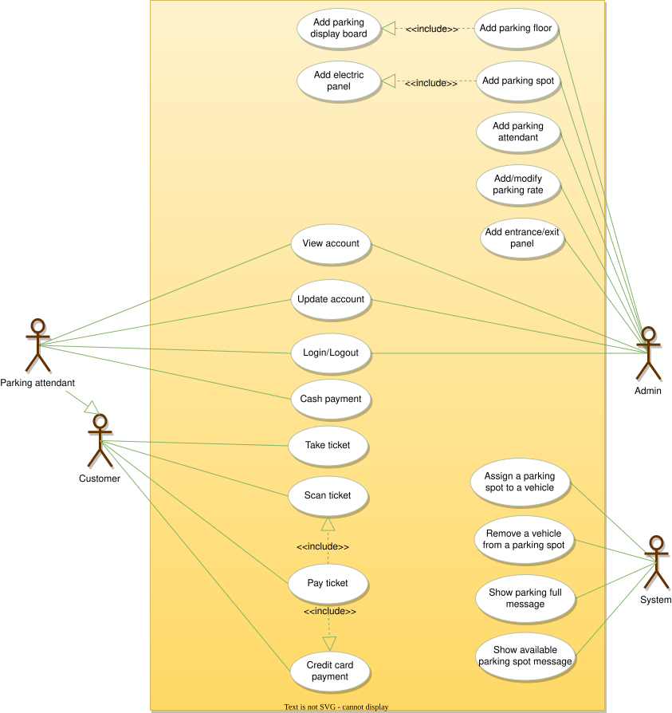
*Figure — Use case diagram of the parking lot: Admin, Customer, Parking attendant and System, with their use cases (course diagram)*

In the figure above, notice that the attendant's use cases overlap the customer's: the attendant is a customer "proxy" who can also take cash. The System actor is what assigns spots and updates the boards.

### Core entities

| Class | Responsibility |
|---|---|
| `VehicleType` (enum) | The kinds of vehicle and, for each, the spot types it fits in, **best fit first**. |
| `SpotType` (enum) | The kinds of spot: motorcycle, compact, large, handicapped, electric. |
| `Vehicle` (record) | Plate, type, accessibility permit. Knows its preferred spot types. |
| `ParkingSpot` | One physical spot: id, floor, type, and who occupies it (atomic). |
| `ChargingPanel` | The pay-and-charge panel owned by an electric spot. |
| `SpotFactory` | Builds spots; the only place that knows an electric spot needs a panel. |
| `ParkingFloor` | Holds the **free** spots per type in a thread-safe sorted set; notifies boards. |
| `DisplayBoard` | Shows free spots per type on one floor (an observer). |
| `SpotAllocationStrategy` | *How* to choose a spot (nearest floor first, least busy floor first, …). |
| `PricingStrategy` | *How much* a stay costs (hourly tiers, flat rate, weekend rate, …). |
| `Ticket` | Proof of entry: vehicle, the actual spot, entry time, status (ACTIVE → PAID → EXITED). |
| `PaymentMethod` | Cash or card. |
| `ParkingLot` | Ties it together: admit, price, pay, exit. |
| `EntrancePanel`, `ExitPanel`, `CustomerInfoPortal` | The devices customers touch. They hold **no rules**; they call the lot. |

The course also models **`Account`** with **`Admin`** and **`ParkingAttendant`** subclasses (both sign in). They carry no parking logic, so they are omitted from the code below; the attendant simply uses the same `pay` method as an exit panel.

### Class diagram

The course grows the design in five steps. Every step adds a handful of classes and leaves you with a feature that runs. Use the same order in an interview: if the clock stops you early, what you have drawn already works, instead of being an unfinished picture.

| Stage | What it adds | What works after it |
|---|---|---|
| 1 | Vehicle and spot types | The system can answer "may this vehicle use this spot?" |
| 2 | Floors and display boards | A floor can hand out a free spot and report counts |
| 3 | Ticket, rate card, payment | A stay can be turned into a price and settled |
| 4 | The `ParkingLot` | A full visit works: enter, park, pay, leave |
| 5 | Entrance/exit panels, info portal, electric panel | Drivers use the flow through physical devices |

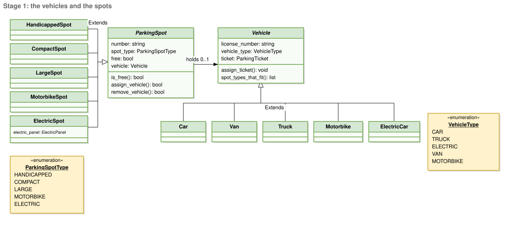
*Figure — Stage 1: the vehicle and spot hierarchies, and the "holds 0..1" link from a spot to a vehicle (course diagram)*

**Stage 1 — vehicles and spots.** Requirements 8 and 10 produce two small families of types and one link: a spot holds **at most one** vehicle (`0..1`). The most important rule of the whole design — *which spot types can this vehicle use?* — lives on the **vehicle** side. Because of that, introducing another kind of vehicle is a change to the vehicle types only; the lot code stays untouched. The fit rules: a motorcycle uses a motorcycle spot, trucks and vans use only large spots, and an electric car tries an electric spot first, then compact, then large.

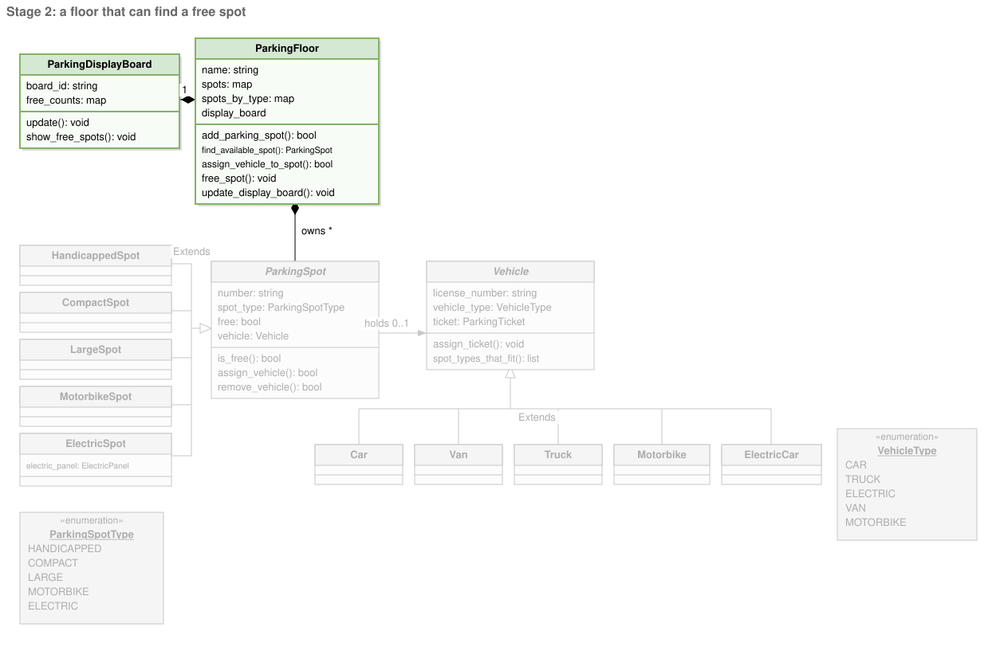
*Figure — Stage 2: a floor owns its spots and its display board (composition) (course diagram)*

**Stage 2 — a floor that can find a free spot.** Requirements 1, 8 and 11. Both new links are **composition** (filled diamond): deleting a floor deletes its spots and its board. The board stores **how many** spots of each type are free, not a pointer to "a sample free spot" of each type; such a pointer goes stale the moment that spot is taken and must be hunted for again. The course's floor keeps a map of all its spots plus an index by spot type (our code keeps a single map from spot type to its free spots). The rejected alternative is one separate collection per type: every method would then need a five-way `if`, and adding a sixth type would touch all of them.

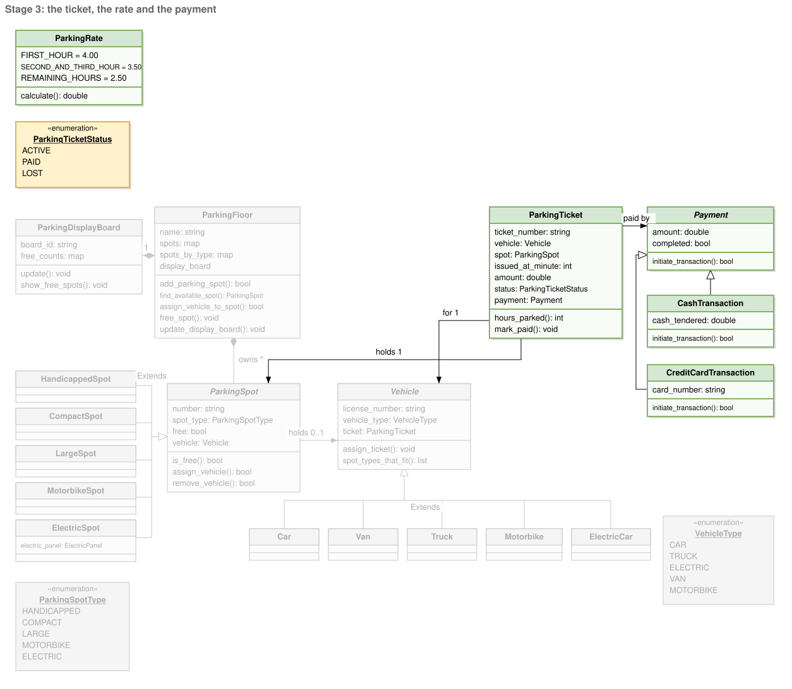
*Figure — Stage 3: ticket, parking rate and the abstract payment with cash and card subclasses (course diagram)*

**Stage 3 — ticket, rate, payment.** Requirements 3, 5 and 12. The key decision: **the ticket stores a reference to the exact spot**, not just "one more spot is taken". At the exit, that reference is how the system knows which spot to free and where the car was. A ticket merely points at the vehicle and the spot (it does not own them), so both links are plain associations. `Payment` is an abstract class (it cannot be created directly) with cash and card subclasses; this inheritance is justified because either subclass can stand in wherever "a payment" is expected (the Liskov Substitution Principle from Chapter 4).

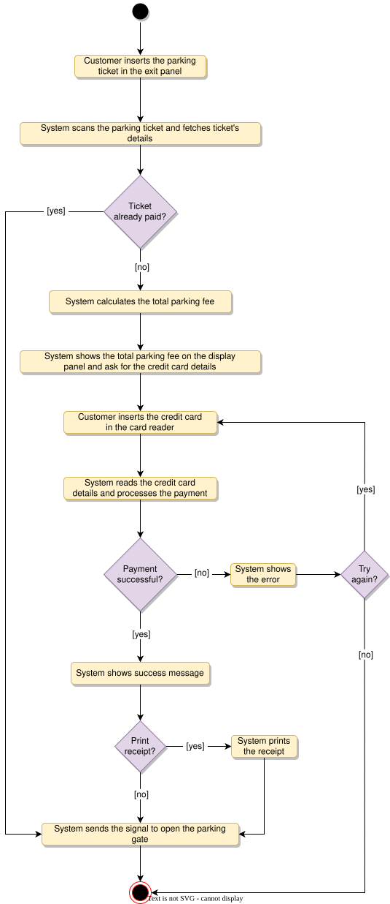
*Figure — Activity diagram: the customer inserts the ticket at the exit, the system computes the fee, the customer pays by card or cash, and the barrier opens (course diagram)*

The activity diagram above is the exit flow; the ticket, rate and payment classes between them handle each of its steps.

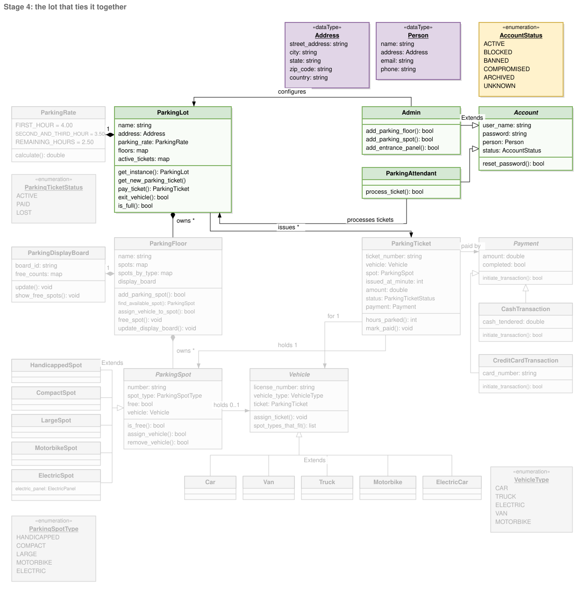
*Figure — Stage 4: the parking lot owns floors and the rate; Admin and ParkingAttendant accounts connect to it (course diagram)*

**Stage 4 — the lot.** Requirement 7 and the actor list. The lot has a **name** and an **address** (so one lot can be told apart from another) and owns its floors and its rate card (filled diamonds). The two account types, `Admin` and `ParkingAttendant`, are linked with plain arrows: they work *on* the lot (setting it up, handling tickets) without owning any part of it. The course makes the lot a **Singleton** (only one instance may exist) and serialises spot assignment (**one caller at a time**), since two entrances assigning in parallel could pick the same spot.

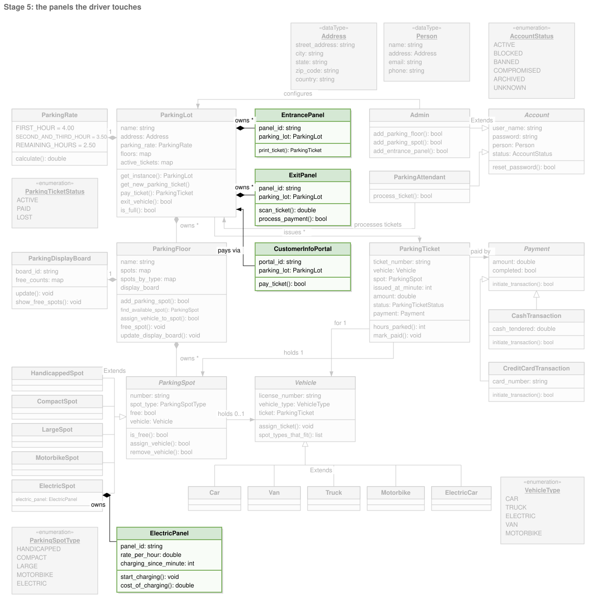
*Figure — Stage 5: entrance and exit panels (owned by the lot), the customer info portal (refers to the lot) and the electric panel (owned by an electric spot) (course diagram)*

**Stage 5 — the panels.** Requirements 2, 4, 6 and 9. The panels are thin: they forward every request to the lot, so all business rules sit in a single class. The entrance panel prints tickets, the exit panel scans a ticket and takes payment, the info portal lets a driver settle early (marking the ticket paid), and the electric panel bills for charging. The lot owns its entrance and exit panels (composition). It keeps no list of info portals, so a portal just holds a reference to the lot (association). The electric panel is owned by its electric spot, the only composition hanging off a spot.

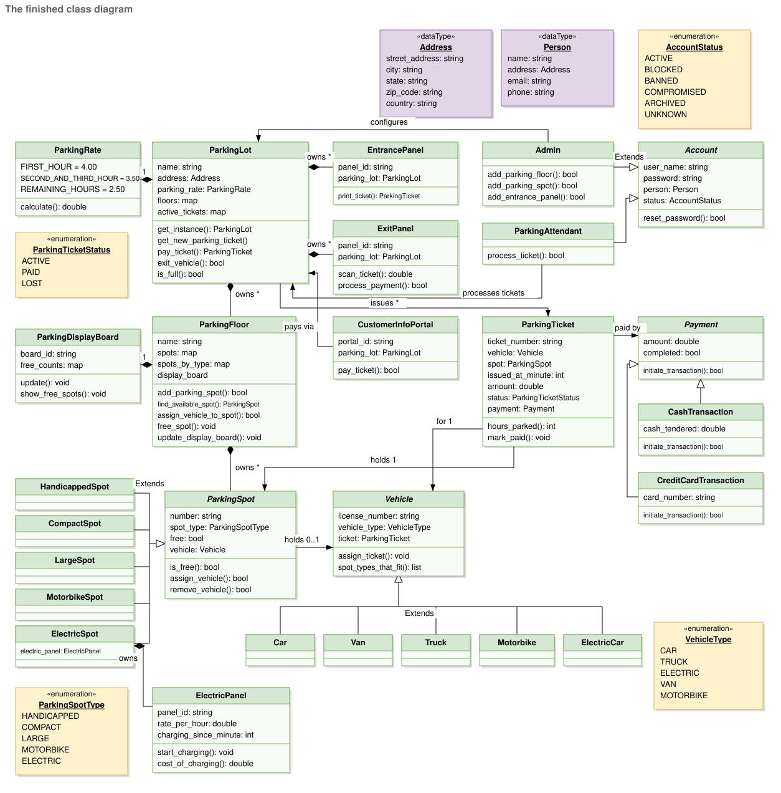
*Figure — The finished class diagram of the parking lot (course diagram)*

The finished diagram above is simply all five stages in colour; nothing new appears in it. Here is the class diagram of **the Java code in this chapter**. It keeps the same shape but makes three changes that interviewers usually push for: spot types are an enum instead of five empty subclasses, pricing and spot-finding are Strategies, and the display board is an Observer.

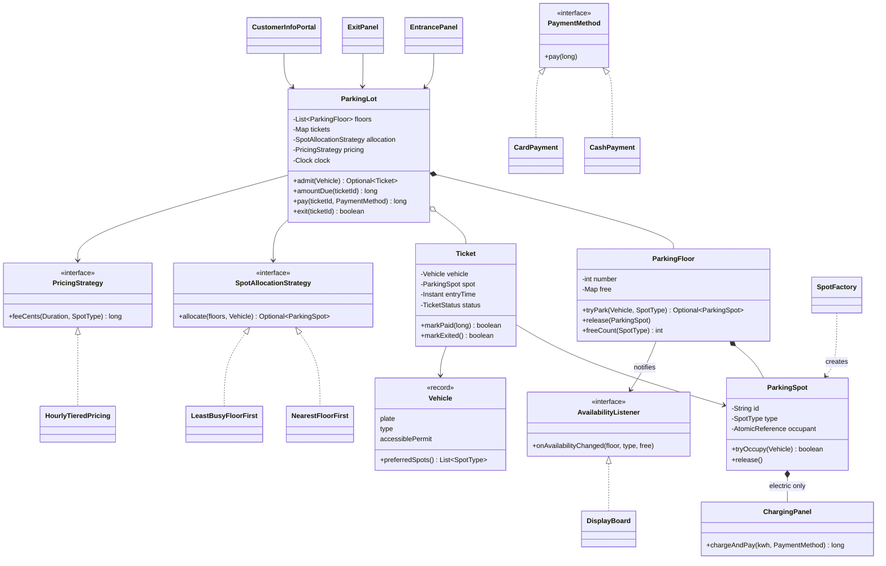

### Key flows

**Entry (take ticket).** The important step is that the spot is taken **atomically**: `pollFirst()` on a concurrent sorted set removes the spot for exactly one caller.

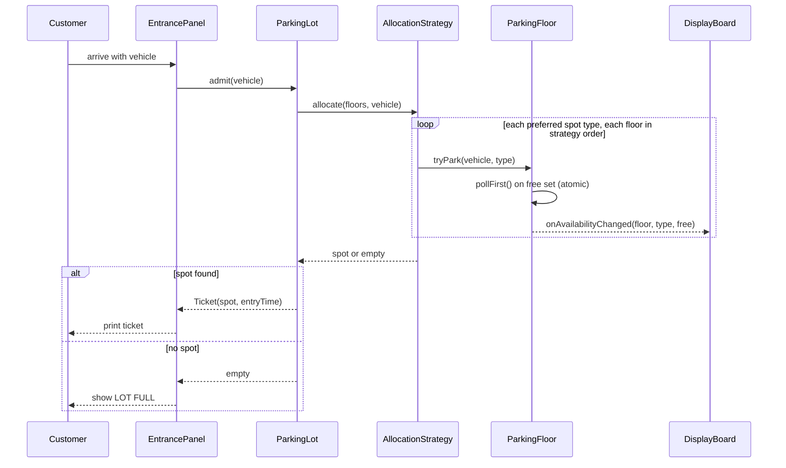

**Exit (scan, pay, leave).** Payment is guarded per ticket so the info portal and the exit panel cannot both charge.

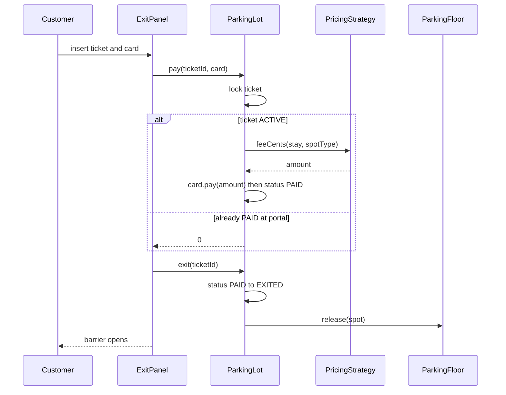

**Ticket life cycle.**

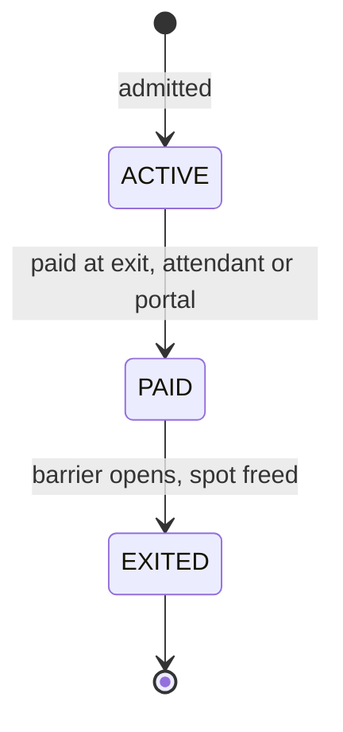

### Design decisions & patterns used

| Decision | Pattern / principle | Why | Alternative rejected |
|---|---|---|---|
| The fit rule lives on `VehicleType` | Information Expert, Open/Closed | Adding a vehicle type is one enum constant; the lot never changes | A big `switch(vehicleType)` inside the lot |
| Spot type is an **enum field**, not 5 subclasses | Composition over inheritance | The 5 course subclasses carried no behaviour; a new type is one constant | `CompactSpot`, `LargeSpot`… (reviewers flag these as empty classes) |
| How to pick a spot is a `SpotAllocationStrategy` | **Strategy** | Nearest floor, least busy floor, closest to the lift, VIP floors… all swap without touching the lot | `if (mode == NEAREST) … else …` in the lot |
| How much to charge is a `PricingStrategy` | **Strategy** | The course's "what if pricing changes?" follow-up; admin swaps the rate at run time (the demo swaps to a flat rate) | Hard-coded tiers inside `Ticket` |
| Electric spots get a `ChargingPanel` in `SpotFactory` | **Factory** (simple static factory) | One place knows the construction rule "electric ⇒ has a panel" | Every caller remembers to attach a panel |
| Boards subscribe to floors | **Observer** | A floor change updates every board (and could update an app or a sensor light) without the floor knowing who listens | The lot pushing into boards directly |
| Ticket holds the **spot**, not a count | — | The exit can find and free the exact spot | Counting occupied spots |
| `ParkingLot` is **not** a hard-coded Singleton | Dependency injection | The course uses a Singleton ("there is one car park"). It is a global in disguise: tests cannot build two lots, and every class that calls `getInstance()` hides a dependency. We create one lot in `main` and pass it to the panels. | `ParkingLot.getInstance()` |
| `Clock` is injected | Testability | The demo moves time forward by hours instantly | `Instant.now()` inside the code |

> **Honest note on "Strategy".** The course points out that a cash/card subclass pair is just an abstract base class, and calling it "Strategy" would be loose use of the word. Strategy means an object **holds** a behaviour and can **swap** it. In our code `ParkingLot` holds a `PricingStrategy` and a `SpotAllocationStrategy` and `setPricing(...)` swaps it at run time — that is genuinely Strategy.

The course also admits that `ParkingLot` does two jobs (finding spots and issuing tickets). Here spot-finding has moved into the strategy and the floors, so the lot is mostly a coordinator; in a longer design you would also move ticket storage into a `TicketRepository`.

### Java implementation

Package `lld.ch14.parkinglot`. Amounts are in **cents** (`long`) to avoid floating-point rounding.

```java
// File: lld/ch14/parkinglot/Vehicles.java
package lld.ch14.parkinglot;

import java.util.ArrayList;
import java.util.List;

/** The kinds of spot a floor can have. */
enum SpotType { MOTORCYCLE, COMPACT, LARGE, HANDICAPPED, ELECTRIC }

/** The kinds of vehicle the lot accepts, each with the spot types it fits, best fit first. */
enum VehicleType {
    MOTORCYCLE(List.of(SpotType.MOTORCYCLE)),
    CAR(List.of(SpotType.COMPACT, SpotType.LARGE)),
    ELECTRIC_CAR(List.of(SpotType.ELECTRIC, SpotType.COMPACT, SpotType.LARGE)),
    VAN(List.of(SpotType.LARGE)),
    TRUCK(List.of(SpotType.LARGE));

    private final List<SpotType> fits;

    VehicleType(List<SpotType> fits) { this.fits = fits; }

    List<SpotType> fits() { return fits; }
}

/** A vehicle is a value: plate + type + whether it carries an accessibility permit. */
record Vehicle(String plate, VehicleType type, boolean accessiblePermit) {

    Vehicle(String plate, VehicleType type) { this(plate, type, false); }

    /** Spot types this vehicle may use, most preferred first. The rule lives here, not in the lot. */
    List<SpotType> preferredSpots() {
        List<SpotType> order = new ArrayList<>();
        if (accessiblePermit && type != VehicleType.MOTORCYCLE && type != VehicleType.TRUCK) {
            order.add(SpotType.HANDICAPPED);
        }
        order.addAll(type.fits());
        return order;
    }
}
```

```java
// File: lld/ch14/parkinglot/ParkingSpot.java
package lld.ch14.parkinglot;

import java.util.Optional;
import java.util.concurrent.atomic.AtomicReference;

/** One physical spot. Occupancy is an AtomicReference so two threads can never both win it. */
class ParkingSpot implements Comparable<ParkingSpot> {
    private final String id;          // e.g. "F1-C03"
    private final int floor;
    private final SpotType type;
    private final AtomicReference<Vehicle> occupant = new AtomicReference<>();
    private final ChargingPanel chargingPanel; // only electric spots have one (composition)

    ParkingSpot(String id, int floor, SpotType type, ChargingPanel chargingPanel) {
        this.id = id;
        this.floor = floor;
        this.type = type;
        this.chargingPanel = chargingPanel;
    }

    /** Compare-and-set: succeeds only if the spot was empty. */
    boolean tryOccupy(Vehicle v) { return occupant.compareAndSet(null, v); }

    void release() { occupant.set(null); }

    boolean isFree() { return occupant.get() == null; }

    String id() { return id; }
    int floor() { return floor; }
    SpotType type() { return type; }
    Optional<ChargingPanel> chargingPanel() { return Optional.ofNullable(chargingPanel); }

    @Override public int compareTo(ParkingSpot o) { return id.compareTo(o.id); }
    @Override public String toString() { return id + "(" + type + ")"; }
}

/** The pay-and-charge panel that belongs to an electric spot. */
class ChargingPanel {
    private final long centsPerKwh;

    ChargingPanel(long centsPerKwh) { this.centsPerKwh = centsPerKwh; }

    /** Charges the car and takes payment for the energy right at the spot. */
    long chargeAndPay(double kwh, PaymentMethod method) {
        long cost = Math.round(kwh * centsPerKwh);
        method.pay(cost);
        return cost;
    }
}

/** Factory: the only place that knows an ELECTRIC spot must be built with its panel. */
final class SpotFactory {
    private static final long EV_CENTS_PER_KWH = 30;

    private SpotFactory() {}

    static ParkingSpot create(int floor, SpotType type, int number) {
        String id = "F%d-%s%02d".formatted(floor, type.name().charAt(0), number);
        ChargingPanel panel = type == SpotType.ELECTRIC ? new ChargingPanel(EV_CENTS_PER_KWH) : null;
        return new ParkingSpot(id, floor, type, panel);
    }
}
```

```java
// File: lld/ch14/parkinglot/ParkingFloor.java
package lld.ch14.parkinglot;

import java.util.EnumMap;
import java.util.List;
import java.util.Map;
import java.util.Optional;
import java.util.Set;
import java.util.concurrent.ConcurrentSkipListSet;
import java.util.concurrent.CopyOnWriteArrayList;

/** Observer: anything that wants to know when free-spot counts change. */
interface AvailabilityListener {
    void onAvailabilityChanged(int floor, SpotType type, int freeNow);
}

/** A floor keeps one sorted, thread-safe set of FREE spots per spot type. */
class ParkingFloor {
    private final int number;
    private final Map<SpotType, ConcurrentSkipListSet<ParkingSpot>> free = new EnumMap<>(SpotType.class);
    private final List<AvailabilityListener> listeners = new CopyOnWriteArrayList<>();
    private final Set<SpotType> typesHere;

    ParkingFloor(int number, Map<SpotType, Integer> spotCounts) {
        this.number = number;
        for (SpotType t : SpotType.values()) free.put(t, new ConcurrentSkipListSet<>());
        typesHere = Set.copyOf(spotCounts.keySet());
        spotCounts.forEach((type, count) -> {
            for (int i = 1; i <= count; i++) free.get(type).add(SpotFactory.create(number, type, i));
        });
    }

    void addListener(AvailabilityListener l) {
        listeners.add(l);
        for (SpotType t : typesHere) l.onAvailabilityChanged(number, t, freeCount(t));
    }

    /** pollFirst() is atomic: two threads can never receive the same spot. Lowest id = nearest. */
    Optional<ParkingSpot> tryPark(Vehicle v, SpotType type) {
        ParkingSpot spot = free.get(type).pollFirst();
        if (spot == null) return Optional.empty();
        if (!spot.tryOccupy(v)) throw new IllegalStateException("free-set out of sync for " + spot);
        notifyListeners(type);
        return Optional.of(spot);
    }

    void release(ParkingSpot spot) {
        spot.release();
        free.get(spot.type()).add(spot);
        notifyListeners(spot.type());
    }

    int freeCount(SpotType t) { return free.get(t).size(); }
    int number() { return number; }

    private void notifyListeners(SpotType t) {
        int n = freeCount(t);
        for (AvailabilityListener l : listeners) l.onAvailabilityChanged(number, t, n);
    }
}

/** The display board on a floor: shows free spots per type. */
class DisplayBoard implements AvailabilityListener {
    private final Map<SpotType, Integer> shown = new EnumMap<>(SpotType.class);

    @Override public synchronized void onAvailabilityChanged(int floor, SpotType type, int freeNow) {
        shown.put(type, freeNow);
    }

    synchronized String render() {
        StringBuilder sb = new StringBuilder();
        shown.forEach((t, n) -> sb.append(t).append('=').append(n == 0 ? "FULL" : n).append(' '));
        return sb.toString().trim();
    }
}
```

```java
// File: lld/ch14/parkinglot/Strategies.java
package lld.ch14.parkinglot;

import java.time.Duration;
import java.util.Comparator;
import java.util.List;
import java.util.Optional;

/** Strategy: HOW to pick a spot. */
interface SpotAllocationStrategy {
    Optional<ParkingSpot> allocate(List<ParkingFloor> floors, Vehicle v);
}

/** Fill the lowest floor first (fewest ramps to drive). */
class NearestFloorFirst implements SpotAllocationStrategy {
    @Override public Optional<ParkingSpot> allocate(List<ParkingFloor> floors, Vehicle v) {
        for (SpotType type : v.preferredSpots()) {
            for (ParkingFloor f : floors) {
                Optional<ParkingSpot> s = f.tryPark(v, type);
                if (s.isPresent()) return s;
            }
        }
        return Optional.empty();
    }
}

/** Spread cars out: pick the floor with the most free spots of the wanted type. */
class LeastBusyFloorFirst implements SpotAllocationStrategy {
    @Override public Optional<ParkingSpot> allocate(List<ParkingFloor> floors, Vehicle v) {
        for (SpotType type : v.preferredSpots()) {
            List<ParkingFloor> order = floors.stream()
                    .sorted(Comparator.comparingInt((ParkingFloor f) -> f.freeCount(type)).reversed())
                    .toList();
            for (ParkingFloor f : order) {
                Optional<ParkingSpot> s = f.tryPark(v, type); // may lose a race: just try the next floor
                if (s.isPresent()) return s;
            }
        }
        return Optional.empty();
    }
}

/** Strategy: HOW MUCH a stay costs. */
interface PricingStrategy {
    long feeCents(Duration stay, SpotType spotType);
}

/**
 * Per-hour tiers: $4 for hour 1, $3.50 for hours 2 and 3, $2.50 for every hour after.
 * A started hour counts as a full hour.
 */
class HourlyTieredPricing implements PricingStrategy {
    private final List<Long> firstHours;   // price of hour 1, 2, 3 ...
    private final long laterHourCents;     // price of every later hour

    HourlyTieredPricing(List<Long> firstHours, long laterHourCents) {
        this.firstHours = List.copyOf(firstHours);
        this.laterHourCents = laterHourCents;
    }

    static HourlyTieredPricing standard() { return new HourlyTieredPricing(List.of(400L, 350L, 350L), 250); }

    @Override public long feeCents(Duration stay, SpotType spotType) {
        long minutes = Math.max(1, stay.toMinutes());
        long hours = (minutes + 59) / 60;                  // round up
        long total = 0;
        for (long h = 0; h < hours; h++) {
            total += h < firstHours.size() ? firstHours.get((int) h) : laterHourCents;
        }
        return total;
    }
}
```

```java
// File: lld/ch14/parkinglot/Ticketing.java
package lld.ch14.parkinglot;

import java.time.Instant;

enum TicketStatus { ACTIVE, PAID, EXITED }

/** The ticket points at the real spot, so the exit can find and free it. */
final class Ticket {
    private final String id;
    private final Vehicle vehicle;
    private final ParkingSpot spot;
    private final Instant entryTime;
    private TicketStatus status = TicketStatus.ACTIVE;
    private long paidCents;

    Ticket(String id, Vehicle vehicle, ParkingSpot spot, Instant entryTime) {
        this.id = id;
        this.vehicle = vehicle;
        this.spot = spot;
        this.entryTime = entryTime;
    }

    /** Only one payment can ever succeed, even if the portal and the exit panel race. */
    synchronized boolean markPaid(long cents) {
        if (status != TicketStatus.ACTIVE) return false;
        status = TicketStatus.PAID;
        paidCents = cents;
        return true;
    }

    synchronized boolean markExited() {
        if (status != TicketStatus.PAID) return false;
        status = TicketStatus.EXITED;
        return true;
    }

    synchronized TicketStatus status() { return status; }
    synchronized long paidCents() { return paidCents; }
    String id() { return id; }
    Vehicle vehicle() { return vehicle; }
    ParkingSpot spot() { return spot; }
    Instant entryTime() { return entryTime; }
}

/** How a customer pays. Cash and card are two implementations. */
interface PaymentMethod {
    void pay(long cents);
    String describe();
}

record CashPayment(long tenderedCents) implements PaymentMethod {
    @Override public void pay(long cents) {
        if (tenderedCents < cents) throw new IllegalArgumentException("not enough cash");
    }
    @Override public String describe() {
        return "cash " + Money.fmt(tenderedCents);
    }
}

record CardPayment(String last4) implements PaymentMethod {
    @Override public void pay(long cents) { /* a real system calls the card gateway here */ }
    @Override public String describe() { return "card ****" + last4; }
}

final class Money {
    private Money() {}
    static String fmt(long cents) { return "$%d.%02d".formatted(cents / 100, cents % 100); }
}
```

```java
// File: lld/ch14/parkinglot/ParkingLot.java
package lld.ch14.parkinglot;

import java.time.Clock;
import java.time.Duration;
import java.util.List;
import java.util.Map;
import java.util.Optional;
import java.util.concurrent.ConcurrentHashMap;
import java.util.concurrent.atomic.AtomicLong;

/**
 * The lot ties floors, tickets, pricing and allocation together.
 * It is NOT a hard-coded Singleton: the application creates one and injects it
 * into the panels, which keeps tests able to build as many lots as they like.
 */
final class ParkingLot {
    private final String name;
    private final List<ParkingFloor> floors;
    private final Clock clock;
    private final Map<String, Ticket> tickets = new ConcurrentHashMap<>();
    private final Map<String, String> ticketByPlate = new ConcurrentHashMap<>();
    private final AtomicLong nextTicket = new AtomicLong(1);
    private volatile SpotAllocationStrategy allocation;
    private volatile PricingStrategy pricing;

    ParkingLot(String name, List<ParkingFloor> floors, Clock clock,
               SpotAllocationStrategy allocation, PricingStrategy pricing) {
        this.name = name;
        this.floors = List.copyOf(floors);
        this.clock = clock;
        this.allocation = allocation;
        this.pricing = pricing;
    }

    /** Entry: find a spot and issue a ticket. Empty result means "full for this vehicle". */
    Optional<Ticket> admit(Vehicle v) {
        String placeholder = "pending";
        if (ticketByPlate.putIfAbsent(v.plate(), placeholder) != null) {
            throw new IllegalStateException(v.plate() + " is already inside");
        }
        Optional<ParkingSpot> spot = allocation.allocate(floors, v);
        if (spot.isEmpty()) {
            ticketByPlate.remove(v.plate());
            return Optional.empty();
        }
        Ticket t = new Ticket("T" + nextTicket.getAndIncrement(), v, spot.get(), clock.instant());
        tickets.put(t.id(), t);
        ticketByPlate.put(v.plate(), t.id());
        return Optional.of(t);
    }

    long amountDue(String ticketId) {
        Ticket t = ticket(ticketId);
        if (t.status() != TicketStatus.ACTIVE) return 0;             // already paid (e.g. at the portal)
        Duration stay = Duration.between(t.entryTime(), clock.instant());
        return pricing.feeCents(stay, t.spot().type());
    }

    /** Pays the ticket once. Returns the amount charged (0 if it was already paid). */
    long pay(String ticketId, PaymentMethod method) {
        Ticket t = ticket(ticketId);
        synchronized (t) {                 // per-ticket lock: portal and exit panel cannot both charge
            long due = amountDue(ticketId);
            if (due == 0) return 0;
            method.pay(due);               // throws if the payment fails: ticket stays ACTIVE
            t.markPaid(due);
            return due;
        }
    }

    /** Exit: only a PAID ticket opens the barrier. Frees the spot. */
    boolean exit(String ticketId) {
        Ticket t = ticket(ticketId);
        if (!t.markExited()) return false;
        floors.get(t.spot().floor() - 1).release(t.spot());
        tickets.remove(ticketId);
        ticketByPlate.remove(t.vehicle().plate());
        return true;
    }

    boolean isFullFor(VehicleType type) {
        return floors.stream().noneMatch(f -> type.fits().stream().anyMatch(s -> f.freeCount(s) > 0));
    }

    void setPricing(PricingStrategy p) { this.pricing = p; }                 // admin changes the rate
    void setAllocation(SpotAllocationStrategy a) { this.allocation = a; }
    List<ParkingFloor> floors() { return floors; }
    String name() { return name; }

    Ticket ticket(String id) {
        Ticket t = tickets.get(id);
        if (t == null) throw new IllegalArgumentException("unknown ticket " + id);
        return t;
    }
}
```

```java
// File: lld/ch14/parkinglot/Panels.java
package lld.ch14.parkinglot;

/** Panels hold no rules. They talk to the lot and print what happened. */
class EntrancePanel {
    private final String id;
    private final ParkingLot lot;

    EntrancePanel(String id, ParkingLot lot) { this.id = id; this.lot = lot; }

    String issueTicket(Vehicle v) {
        return lot.admit(v)
                .map(t -> "[%s] %s -> ticket %s, spot %s".formatted(id, v.plate(), t.id(), t.spot()))
                .orElse("[%s] %s -> SORRY, LOT FULL for %s".formatted(id, v.plate(), v.type()));
    }
}

class ExitPanel {
    private final String id;
    private final ParkingLot lot;

    ExitPanel(String id, ParkingLot lot) { this.id = id; this.lot = lot; }

    String scanPayAndExit(String ticketId, PaymentMethod method) {
        long charged = lot.pay(ticketId, method);
        boolean open = lot.exit(ticketId);
        String paid = charged == 0 ? "already paid" : "paid " + Money.fmt(charged) + " by " + method.describe();
        return "[%s] %s: %s, barrier %s".formatted(id, ticketId, paid, open ? "OPEN" : "CLOSED");
    }
}

/** On each floor: lets the customer pay early so the exit is free. */
class CustomerInfoPortal {
    private final ParkingLot lot;

    CustomerInfoPortal(ParkingLot lot) { this.lot = lot; }

    String pay(String ticketId, PaymentMethod method) {
        long due = lot.amountDue(ticketId);
        long charged = lot.pay(ticketId, method);
        return "[portal] %s due %s, charged %s".formatted(ticketId, Money.fmt(due), Money.fmt(charged));
    }
}
```

```java
// File: lld/ch14/parkinglot/Main.java
package lld.ch14.parkinglot;

import java.time.Clock;
import java.time.Duration;
import java.time.Instant;
import java.time.ZoneId;
import java.time.ZoneOffset;
import java.util.List;
import java.util.Map;
import java.util.concurrent.ConcurrentLinkedQueue;
import java.util.concurrent.CountDownLatch;
import java.util.concurrent.ExecutorService;
import java.util.concurrent.Executors;

public class Main {

    /** A clock we can move forward, so the demo is deterministic. */
    static final class TestClock extends Clock {
        private volatile Instant now = Instant.parse("2026-01-01T09:00:00Z");
        void advance(Duration d) { now = now.plus(d); }
        @Override public Instant instant() { return now; }
        @Override public ZoneId getZone() { return ZoneOffset.UTC; }
        @Override public Clock withZone(ZoneId zone) { return this; }
    }

    public static void main(String[] args) throws Exception {
        TestClock clock = new TestClock();
        ParkingFloor f1 = new ParkingFloor(1, Map.of(SpotType.COMPACT, 2, SpotType.LARGE, 1,
                SpotType.MOTORCYCLE, 1, SpotType.HANDICAPPED, 1, SpotType.ELECTRIC, 1));
        ParkingFloor f2 = new ParkingFloor(2, Map.of(SpotType.COMPACT, 3, SpotType.LARGE, 1));
        DisplayBoard board1 = new DisplayBoard(), board2 = new DisplayBoard();
        f1.addListener(board1);
        f2.addListener(board2);

        ParkingLot lot = new ParkingLot("City Mall", List.of(f1, f2), clock,
                new NearestFloorFirst(), HourlyTieredPricing.standard());
        EntrancePanel gateA = new EntrancePanel("entry-A", lot);
        ExitPanel exitA = new ExitPanel("exit-A", lot);
        CustomerInfoPortal portal = new CustomerInfoPortal(lot);

        System.out.println("== Arrivals ==");
        System.out.println(gateA.issueTicket(new Vehicle("CAR-1", VehicleType.CAR)));
        System.out.println(gateA.issueTicket(new Vehicle("EV-1", VehicleType.ELECTRIC_CAR)));
        System.out.println(gateA.issueTicket(new Vehicle("BIKE-1", VehicleType.MOTORCYCLE)));
        System.out.println(gateA.issueTicket(new Vehicle("CAR-2", VehicleType.CAR, true)));
        System.out.println(gateA.issueTicket(new Vehicle("TRUCK-1", VehicleType.TRUCK)));
        System.out.println(gateA.issueTicket(new Vehicle("VAN-1", VehicleType.VAN)));
        System.out.println(gateA.issueTicket(new Vehicle("TRUCK-2", VehicleType.TRUCK)));
        System.out.println("Floor 1 board: " + board1.render());
        System.out.println("Floor 2 board: " + board2.render());

        System.out.println("\n== EV charging at the spot ==");
        ChargingPanel panel = lot.ticket("T2").spot().chargingPanel().orElseThrow();
        System.out.println("EV-1 charged 20 kWh, paid " + Money.fmt(panel.chargeAndPay(20, new CardPayment("4242"))));

        System.out.println("\n== Departures ==");
        clock.advance(Duration.ofMinutes(50));
        System.out.println(exitA.scanPayAndExit("T1", new CashPayment(500)));          // 1 hour
        clock.advance(Duration.ofHours(4));                                             // T2 now 4h50m
        System.out.println(portal.pay("T2", new CardPayment("1111")));                  // 5 hours
        System.out.println(exitA.scanPayAndExit("T2", new CardPayment("1111")));
        System.out.println("Unpaid exit attempt: barrier opens? " + lot.exit("T3"));

        System.out.println("\n== Admin changes the rate: flat $5/hour ==");
        lot.setPricing((stay, type) -> 500 * Math.max(1, (stay.toMinutes() + 59) / 60));
        System.out.println(exitA.scanPayAndExit("T3", new CardPayment("9999")));       // 4h50m -> 5h

        System.out.println("\n== 20 cars race for the remaining CAR spots ==");
        System.out.println("free compact before: F1=" + f1.freeCount(SpotType.COMPACT)
                + " F2=" + f2.freeCount(SpotType.COMPACT) + ", large: F1=" + f1.freeCount(SpotType.LARGE)
                + " F2=" + f2.freeCount(SpotType.LARGE));
        ConcurrentLinkedQueue<String> winners = new ConcurrentLinkedQueue<>();
        CountDownLatch start = new CountDownLatch(1);
        try (ExecutorService pool = Executors.newFixedThreadPool(8)) {
            for (int i = 0; i < 20; i++) {
                String plate = "RACE-" + i;
                pool.submit(() -> {
                    start.await();
                    lot.admit(new Vehicle(plate, VehicleType.CAR)).ifPresent(t -> winners.add(t.spot().id()));
                    return null;
                });
            }
            start.countDown();
        } // close() waits for all tasks
        System.out.println("cars admitted: " + winners.size()
                + ", distinct spots: " + winners.stream().distinct().count());
        System.out.println("full for cars now? " + lot.isFullFor(VehicleType.CAR));
        System.out.println(gateA.issueTicket(new Vehicle("LATE-CAR", VehicleType.CAR)));
        System.out.println("Floor 2 board: " + board2.render());
    }
}
```

**How the code works, part by part**

- `Vehicle.preferredSpots()` returns the spot types in order of preference. An accessibility permit puts `HANDICAPPED` first; nobody else can ever get a handicapped spot.
- `ParkingFloor` keeps a `ConcurrentSkipListSet` of **free** spots per type, sorted by id. `pollFirst()` removes and returns the lowest id **atomically**: if 20 threads call it at once, each spot goes to exactly one of them. The lowest id stands for "nearest to the entrance".
- `ParkingSpot.tryOccupy` is a second safety net: an `AtomicReference.compareAndSet(null, v)` succeeds only if the spot was empty.
- `NearestFloorFirst` and `LeastBusyFloorFirst` are two interchangeable allocation strategies.
- `HourlyTieredPricing.standard()` encodes $4 / $3.50 / $3.50 / then $2.50, rounding a started hour up.
- `ParkingLot.admit` also reserves the **plate** with `putIfAbsent`, so the same car cannot be admitted twice.
- `ParkingLot.pay` locks **one ticket** (not the whole lot), so payments for different tickets run in parallel while the portal and the exit panel cannot both charge the same ticket.
- `Main` uses a `TestClock` (a subclass of `java.time.Clock`) to jump forward in time, then races 20 threads for the last 5 car spots.

**Output:**

```text
== Arrivals ==
[entry-A] CAR-1 -> ticket T1, spot F1-C01(COMPACT)
[entry-A] EV-1 -> ticket T2, spot F1-E01(ELECTRIC)
[entry-A] BIKE-1 -> ticket T3, spot F1-M01(MOTORCYCLE)
[entry-A] CAR-2 -> ticket T4, spot F1-H01(HANDICAPPED)
[entry-A] TRUCK-1 -> ticket T5, spot F1-L01(LARGE)
[entry-A] VAN-1 -> ticket T6, spot F2-L01(LARGE)
[entry-A] TRUCK-2 -> SORRY, LOT FULL for TRUCK
Floor 1 board: MOTORCYCLE=FULL COMPACT=1 LARGE=FULL HANDICAPPED=FULL ELECTRIC=FULL
Floor 2 board: COMPACT=3 LARGE=FULL

== EV charging at the spot ==
EV-1 charged 20 kWh, paid $6.00

== Departures ==
[exit-A] T1: paid $4.00 by cash $5.00, barrier OPEN
[portal] T2 due $16.00, charged $16.00
[exit-A] T2: already paid, barrier OPEN
Unpaid exit attempt: barrier opens? false

== Admin changes the rate: flat $5/hour ==
[exit-A] T3: paid $25.00 by card ****9999, barrier OPEN

== 20 cars race for the remaining CAR spots ==
free compact before: F1=2 F2=3, large: F1=0 F2=0
cars admitted: 5, distinct spots: 5
full for cars now? true
[entry-A] LATE-CAR -> SORRY, LOT FULL for CAR
Floor 2 board: COMPACT=FULL LARGE=FULL
```

Read the output: the truck is turned away because the only large spots are taken; T2 stayed 4 h 50 min, which rounds up to 5 hours = $4 + $3.50 + $3.50 + $2.50 + $2.50 = **$16.00**, paid at the portal, so the exit charges nothing; an unpaid ticket cannot open the barrier; after the admin switches to a flat $5/hour, the motorcycle pays $25 for 5 hours; 20 racing cars get exactly 5 distinct spots.

### Concurrency & edge cases

| Situation | What could go wrong | How the design handles it |
|---|---|---|
| Two gates want the last compact spot | Both get it (double booking) | `pollFirst()` is atomic; `tryOccupy` uses CAS as a second check |
| Portal and exit panel pay the same ticket at once | Customer charged twice | `synchronized (ticket)` around price-charge-mark; a PAID ticket costs 0 |
| Same plate enters twice (cloned ticket, sensor glitch) | Two tickets for one car | `ticketByPlate.putIfAbsent` |
| Payment fails (card declined) | Ticket marked paid anyway | `method.pay` throws **before** `markPaid`; ticket stays ACTIVE |
| Car leaves without paying | Spot never freed or fee lost | `exit` only succeeds from PAID; the barrier stays closed |
| Customer pays at the portal and then stays 3 more hours | Free parking | Real lots give a **grace period** (e.g. 15 min) after payment; add `paidAt` and re-price after the grace period |
| Display board shows a slightly old number | Two notifications arrive out of order | Acceptable for a display; if exactness matters, have the board **pull** `freeCount` when it renders |
| Lost ticket | No entry time | Charge a daily maximum, or look up the plate (the plate map already exists) |
| Stay of 0 minutes | Fee of $0 | Minimum of one hour (`Math.max(1, minutes)`) |
| Lock scope | One global lock would serialise all gates | Locks are per spot (CAS) and per ticket; no global lock |

`ConcurrentSkipListSet.size()` is not constant-time and is only an estimate while other threads change the set; that is fine for a display board, but never use it to decide whether a spot is free — use `pollFirst()`.

### Extensions & follow-up questions

1. **"What if pricing changes (weekend rate, per spot type, surge)?"** — Write a new `PricingStrategy` (for example `WeekendPricing`, or a decorator that multiplies another strategy for large spots) and call `setPricing`. No other class changes.
2. **"Two cars arrive at the same instant — what happens?"** — Spot handout is atomic (`pollFirst` + CAS). Show the 20-thread race in the output.
3. **"Add reservations."** — Add a `Reservation(plate, spotType, from, to)` and a reserved set per floor; the allocation strategy checks the reservation first. Hold the spot with a timeout (release it if the car does not arrive within, say, 30 minutes).
4. **"Add monthly passes / season tickets."** — A `PricingStrategy` that returns 0 for plates with a valid pass, or a `PassHolderPricing` decorator around the normal pricing.
5. **"Number-plate recognition (ticketless)."** — The entrance camera becomes another kind of entrance panel that calls the same `admit`; the ticket id is keyed by plate. No core class changes.
6. **"How would you store this in a database?"** — Tables: `floor`, `spot(id, floor_id, type, occupied_by)`, `ticket(id, plate, spot_id, entry_time, status, paid_cents)`, `payment(id, ticket_id, method, amount)`. Claim a spot with a conditional update (`UPDATE spot SET occupied_by=? WHERE id=? AND occupied_by IS NULL`) — the database equivalent of our CAS. Candidates who have been asked this report that interviewers like to see **cardinalities** (a floor has 1..* spots, a spot holds 0..1 vehicles, a ticket has 1 spot) and then add a new entity to see how you rewire the model.
7. **"Many lots in a city?"** — A `ParkingLot` per site plus a `ParkingNetwork` that routes drivers to the lot with free spots. This is another reason not to make the lot a Singleton.
8. **"EV idle fees?"** — Add a charging session to `ChargingPanel` (start, end, kWh) and charge a per-minute fee after charging completes.

### Real-world example

Many modern malls and airports use **parking guidance systems**: a sensor above each bay drives a small green/red light, and the boards at each entrance and floor show the free count per level — exactly our `DisplayBoard` observers fed by spot changes. Airports and many city garages increasingly use **automatic number-plate recognition** instead of paper tickets, and apps such as SpotHero and ParkMobile let drivers pre-book a spot, which is the "reservations" extension. Tesla Superchargers charge **idle fees** when a car stays plugged in after charging finishes — the EV extension above.

### In the interview

**Plan for 45 minutes**

| Minutes | What you do |
|---|---|
| 0–5 | Clarifying questions; write the 12 requirements and an out-of-scope list |
| 5–10 | Actors and use cases (take ticket, pay, exit, admin) |
| 10–20 | Stages 1–2: vehicle/spot fit rule, floors, board. Say "the fit rule lives on the vehicle" |
| 20–25 | Stage 3–4: ticket holds the spot; lot with admit/pay/exit; Strategy for pricing |
| 25–38 | Code `admit`, `tryPark`, `pay`, `exit`, and the tiered pricing |
| 38–45 | Concurrency (atomic spot handout, per-ticket lock), extensions |

**30-second answer:** "I'll model vehicles and spot types as enums with the fit rule on the vehicle, floors that keep a concurrent sorted set of free spots per type, and a lot that admits, prices and releases. Tickets point at the real spot. Pricing and spot-finding are Strategies so they can change without touching the lot. Handing out a spot is atomic — `pollFirst` plus a CAS on the spot — so two gates can never get the same spot, and payment locks only the one ticket."

**Follow-ups with answers**

- *"Why not a Singleton?"* — There is one lot in production, but a Singleton is a hidden global: it makes testing two lots impossible. I create one instance and inject it. If the interviewer insists, a lazy holder-class Singleton is thread-safe and simple.
- *"Why is the fit rule on the vehicle?"* — Because it changes when vehicle types change; putting it there keeps the lot closed for modification (OCP).
- *"How do you make finding a spot fast?"* — Keep only the free spots, indexed by type, in a sorted set; taking one is O(log n) and needs no scan.
- *"What if the display board and the real count disagree?"* — The board is informational; the atomic `pollFirst` is the source of truth. The board can pull the count on render if needed.

### Self-check

1. **Q:** Why must the ticket store a reference to the spot? **A:** So the exit can free exactly that spot; a count cannot tell you which spot to release.
2. **Q:** What makes spot assignment thread-safe here? **A:** `ConcurrentSkipListSet.pollFirst()` removes a spot for exactly one caller, and `AtomicReference.compareAndSet` on the spot double-checks it.
3. **Q:** Where would you add a weekend price? **A:** A new `PricingStrategy` implementation; set it with `setPricing`. Nothing else changes.
4. **Q:** Why did we replace the five spot subclasses with an enum? **A:** They had no behaviour of their own; an enum field does the same job and a new type is one constant (composition over inheritance).
5. **Q:** A customer paid at the portal. What does the exit panel charge? **A:** Nothing: `amountDue` returns 0 for a PAID ticket, and `exit` moves it from PAID to EXITED.
6. **Q:** How does the design stop a car from being admitted twice? **A:** `ticketByPlate.putIfAbsent(plate, …)` reserves the plate before allocating.

### TL;DR

- Fit rule on the **vehicle**, spot type as an **enum**, free spots per type in a **concurrent sorted set**.
- **Ticket → spot** reference makes the exit possible; status goes ACTIVE → PAID → EXITED.
- **Strategy** for pricing and spot-finding, **Factory** for electric spots, **Observer** for boards; inject the lot instead of a Singleton.
- Concurrency: atomic `pollFirst` + CAS for spots, per-ticket lock for payment, `putIfAbsent` for plates.

---

## 14.2 Design a Vending Machine

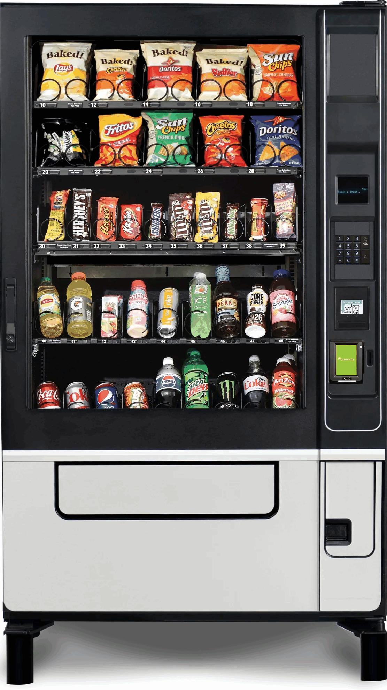
*Figure — A vending machine: slots with codes, a keypad, a coin/note slot and a tray at the bottom (course diagram)*

A **vending machine** is an unattended shop: you key in a slot code, pay, and pull your item out of the tray at the bottom. Because everyone has used one, the interviewer can skip the domain and look at one thing only: **which actions are legal at which moment**. Taking a coin when nothing has been chosen is a bug; handing out two items for one payment is a bug. No amount of tidy code elsewhere makes up for getting that order wrong.

### Problem & clarifying questions

| Question | Assumed answer |
|---|---|
| Select first, or pay first? | Select a slot code first, then pay. |
| Which money? | A fixed set of coins and notes (5¢, 10¢, 25¢, $1, $5). Anything else is returned. |
| Card or contactless? | Out of scope (an extension). |
| Can it give change? | Yes. If it cannot make **exact** change, it refuses the sale and returns everything. |
| Can the customer cancel? | Any time before the product is dispensed, with a full refund. |
| One customer at a time? | Yes (one physical machine). |
| Who restocks? | An operator: restocks slots, loads coins for change, collects the takings. |

### Requirements

**Functional** (the course's twelve)

1. The machine has many **slots**. A slot has a code (`A1`, `B2`, …), holds items of a **single** product, and tracks its remaining **count**.
2. A product has a **name** and a **price in cents**.
3. Order of use: **choose a slot, then pay**.
4. Only a **known set of coins and notes** is accepted; any other piece is given back.
5. After **every** customer action the **display** says what to do next.
6. When the amount paid covers the price, the machine **releases the item and the change**.
7. When **exact change is impossible**, the sale is **refused** and every cent paid is **returned**.
8. Until the item drops, the customer may **cancel** and receive a **full refund**.
9. A slot whose count is **zero cannot be chosen**.
10. One payment buys **exactly one** item, never two.
11. An **operator** refills slots, adds coins for change, and removes the takings.
12. After every sale, cancel and refusal, **both** the item counts and the cash counts must be **exactly right**.

**Non-functional**

- **No illegal transitions**: every button must have a defined answer in every situation.
- **Exact money**: integer cents only — no floating-point.
- **Extensible**: a new payment device (card reader) or a new state (maintenance) should not require editing every existing class.

### Use cases

**Actors:** **Customer** (selects, pays, cancels, takes the product), **Operator** (restocks, loads change, collects money), **System** (decides which actions are allowed now, works out change, shows messages).

**Top use cases:** select a product · insert money · dispense · collect (take from the tray) · cancel · restock a slot · load change and collect takings.

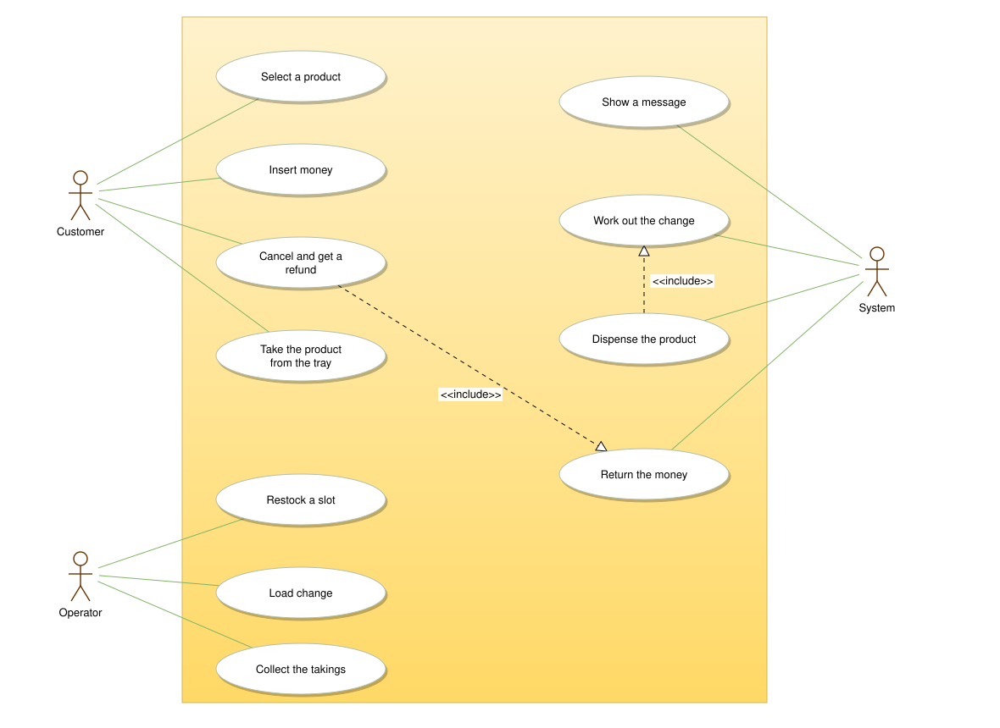
*Figure — Use case diagram of the vending machine: Customer, Operator and System (course diagram)*

In the figure above, "dispense" is a System use case, not a customer one: the customer only *causes* it by paying enough.

### Core entities

| Class | Responsibility |
|---|---|
| `Product` (record) | Name and price in cents. Describes *what* is sold. |
| `Slot` | One physical column: a code, one product, and the **count** left. |
| `Inventory` | All slots, looked up by code. |
| `Denomination` (enum) | The accepted coins and notes and their values in cents. |
| `CashBox` | Counts pieces by value; plans exact change; reports when it cannot. |
| `VendingState` (interface) | One method per customer button: `select`, `insert`, `cancel`, `take`. |
| `IdleState`, `SelectedState`, `HasMoneyState`, `DispensingState`, `OutOfStockState` | The situations the machine can be in (the course has the first four, calling `HasMoneyState` `PaidState`); each answers every button and names the next state. |
| `Display` | The message the customer currently sees. In our code, `VendingMachine.show(...)` plays this part. |
| `Keypad`, `CashSlot`, `Dispenser` | The hardware the customer touches; each calls the machine and holds no rules. In our code they are folded into the machine's public methods. |
| `Operator` | Restocks, loads change, collects takings. In our code: `restock`, `loadChange`, `collectTakings`. |
| `VendingMachine` | Holds the parts, the current state, the selection and the balance; forwards each button to the state. Also exposes operator actions. |

Why is the count on the **slot**, not on the product? `Product` answers "what is it?"; `Slot` is the physical column it sits in. The same product may be loaded into two columns (the course even allows different prices), and emptying one column must leave the other untouched. That is the first real design decision in this question.

### Class diagram

The course builds the machine in five stages:

| Stage | What it adds | What works after it |
|---|---|---|
| 1 | `Product`, `Slot`, `Inventory` | Look up a code and learn what it holds and whether it is empty |
| 2 | `Coin`, `Note`, `CashBox` | Decide whether a given amount of change can be paid exactly |
| 3 | A class for each state | Each button press gets a defined reaction in each situation |
| 4 | `Display` and `VendingMachine` | A complete sale, from choosing to picking up the item |
| 5 | `Keypad`, `CashSlot`, `Dispenser`, `Operator` | Real hardware drives the same flow |

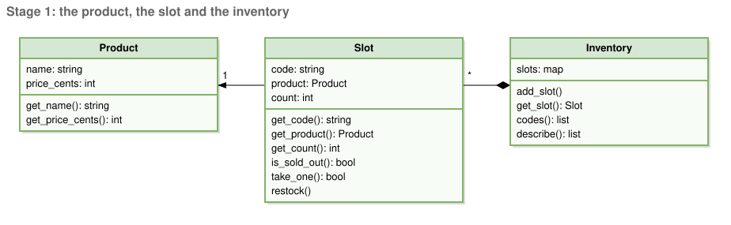
*Figure — Stage 1: Product, Slot (association to Product) and Inventory (composition of Slots) (course diagram)*

**Stage 1.** Requirements 1, 2 and 9. `Slot → Product` is an **association**: a product can appear in several slots, so removing a slot must leave the product alone. `Inventory ◆ Slot` is **composition** (filled diamond): slots are parts of the machine and do not outlive it.

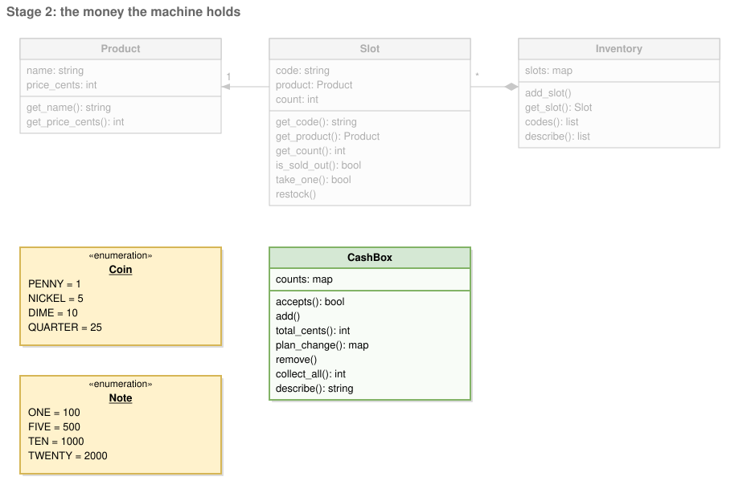
*Figure — Stage 2: Coin and Note enumerations and the CashBox that counts pieces by value (course diagram)*

**Stage 2.** Requirements 4, 6 and 7. All amounts are whole cents, so rounding errors cannot happen. `Coin` and `Note` are enumerations (fixed lists of named values; our code merges them into one `Denomination` enum), and fixed sets like these have no relationship arrows. The choice to defend here: **a piece goes into the cash box the moment it is inserted**, not into a holding area. Those pieces are then available for change, and a refund becomes nothing more than "pay out exact change equal to what was inserted". The box stores a **count per value**; which physical quarter comes back does not matter. Its change planner either returns an exact plan or says "impossible"; it never approximates, and that is what makes requirement 7 implementable.

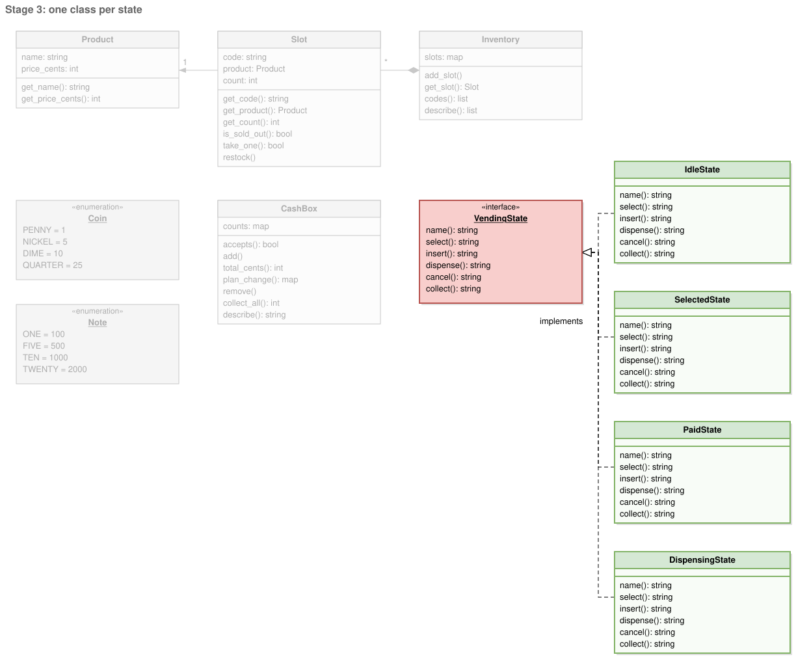
*Figure — Stage 3: one class per state, all implementing the VendingState interface (course diagram)*

**Stage 3 — the heart of the question.** Requirements 3, 8 and 10. The obvious first attempt is one class with a few boolean flags and nested `if`s; that version is exactly where double dispensing and swallowed coins come from. Use the **State pattern** instead: each situation becomes a class, and all of them implement one interface on which **each customer button is a method**. A state class that forgets a button does not compile. Picture the states as a **grid**, buttons down the side and situations across the top: the design is finished when every cell holds a response. The state classes carry no fields, and none of them checks which state is active; each handles its own buttons and hands over to the next state, so a new state can be added without editing the existing ones.

The course draws **four** states: `IdleState`, `SelectedState`, `PaidState` and `DispensingState`. Our code keeps those four (its `HasMoneyState` is the course's `PaidState`: some money is in, not yet enough) and adds a fifth, `OutOfStockState`, so that an empty machine refuses every customer button until an operator restocks it.

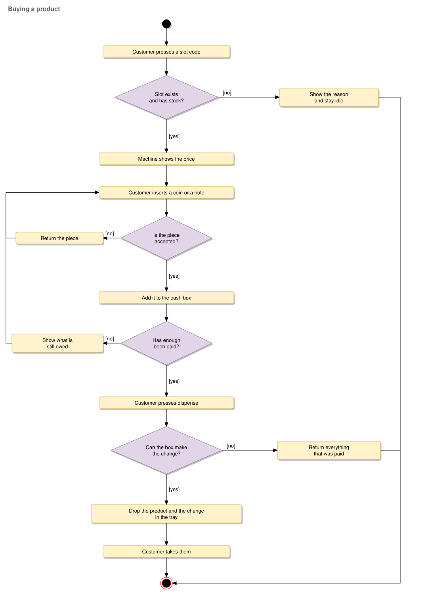
*Figure — Activity diagram "Buying a product": select, check stock, insert money until enough, check change, dispense, take (course diagram)*

Each decision diamond in the activity diagram above corresponds to one state choosing whether to accept an action.

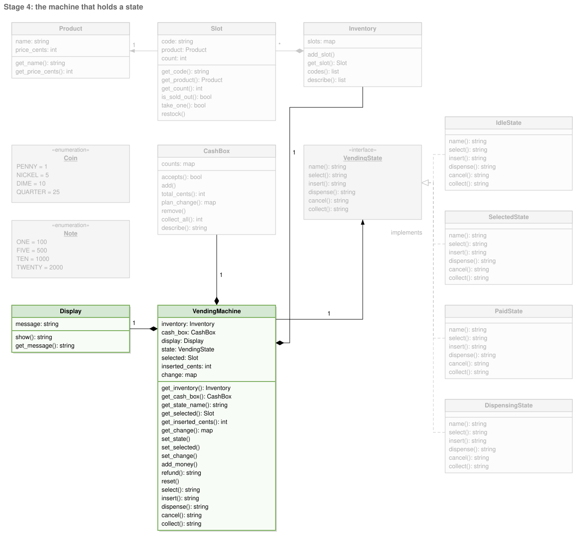
*Figure — Stage 4: VendingMachine owns its display, cash box and inventory, and points at the current VendingState (course diagram)*

**Stage 4.** Requirements 5, 6, 8 and 12. `VendingMachine` remembers the chosen slot and the money inserted so far, and passes every button press to its current state. It **owns** its `Display`, `CashBox` and `Inventory` (composition) and merely **refers to** the current state object (association). Look at what the class does *not* contain: any `if` that tests which state is active. The refund method shows why stage 2 pays off: since inserted money is already in the box, refunding is just a request for exact change equal to the balance.

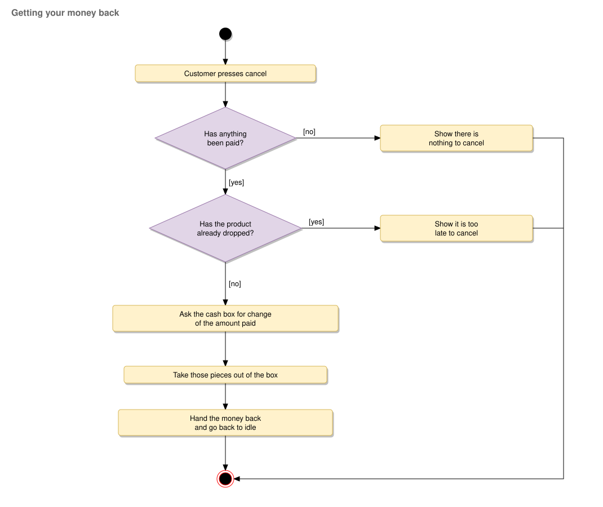
*Figure — Activity diagram "Getting your money back": cancel and "cannot make change" end in the same refund path (course diagram)*

As the figure above shows, a cancel and a "no exact change" refusal finish identically, so the design needs a **single** refund method.

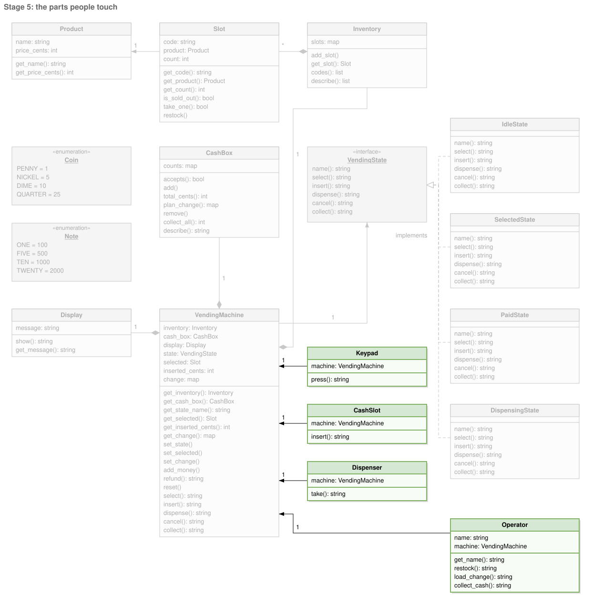
*Figure — Stage 5: Keypad, CashSlot, Dispenser and Operator, all pointing at the machine (course diagram)*

**Stage 5.** Requirements 3, 4 and 11. All four new classes hold references **to** the machine, never the reverse: the keypad calls the machine, but the machine has no idea a keypad exists. Swapping the keypad for a touch screen, or the coin slot for a card reader, therefore touches no other class. The `Dispenser` is the tray; pulling the item out of it is what finishes a sale, which is why `take` is a customer button on the state interface. `Operator` is intentionally kept **off** that interface: refilling, loading change and emptying the box are not customer actions and are permitted whatever state the machine is in (if they were on the interface, every state class would have to answer them).

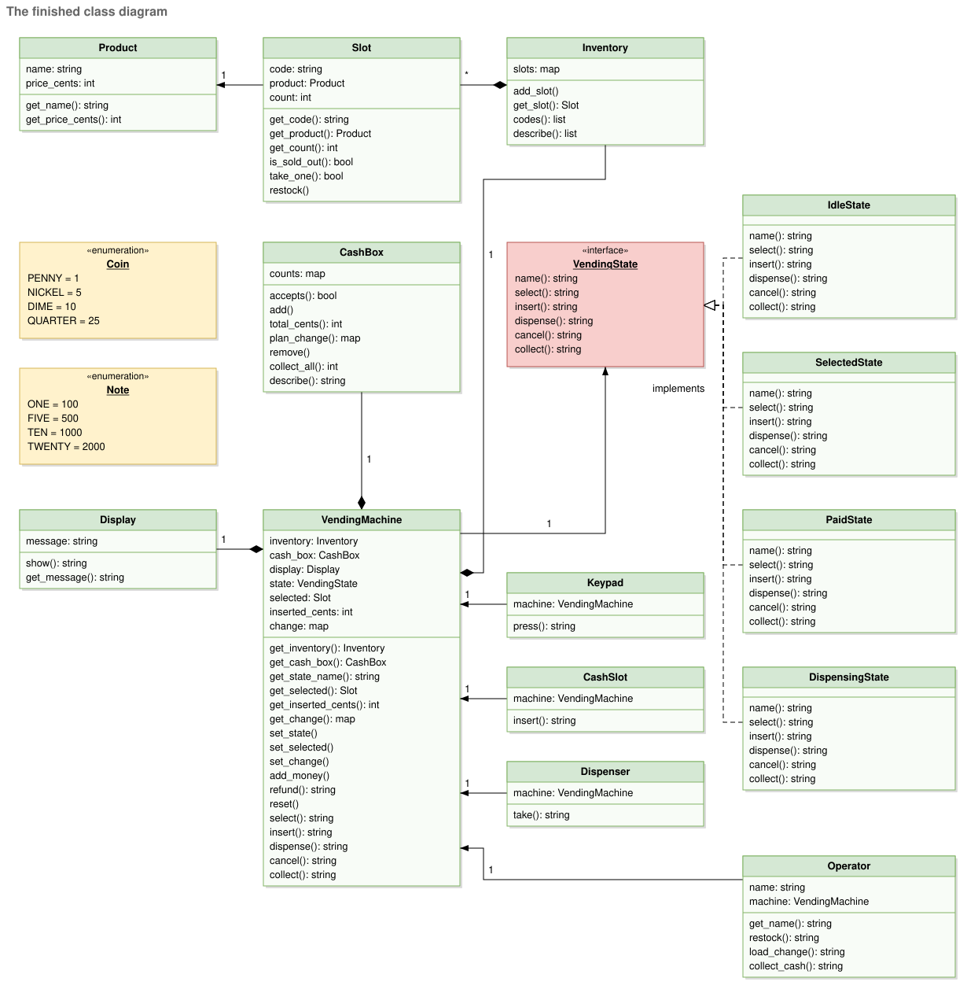
*Figure — The finished class diagram of the vending machine (course diagram)*

Class diagram of **our Java code** (hardware classes folded into the machine's public methods to keep the code short):

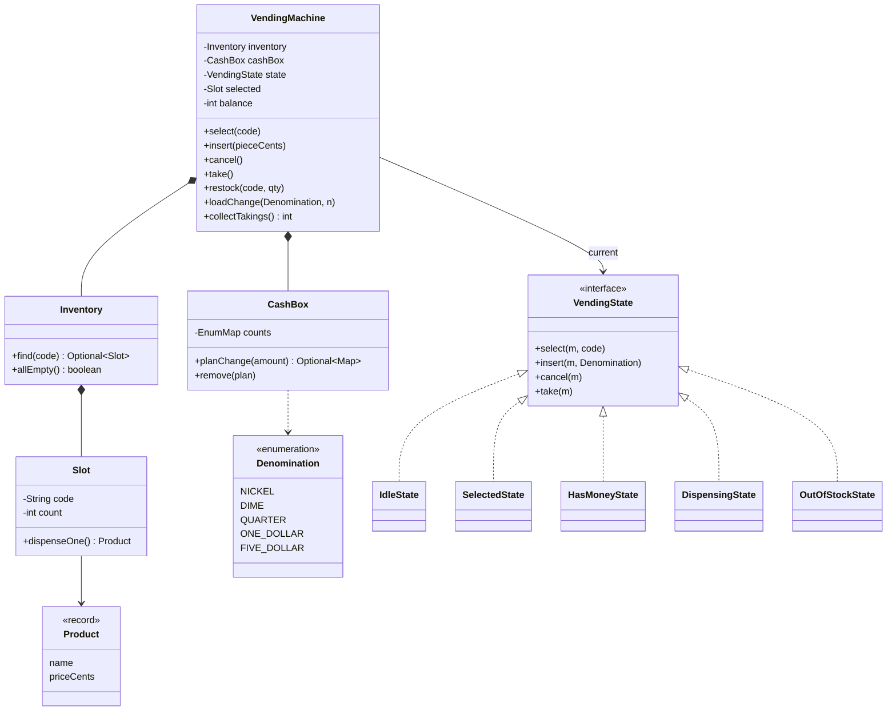

### Key flows

**State machine.** This diagram *is* the design; draw it before writing code.

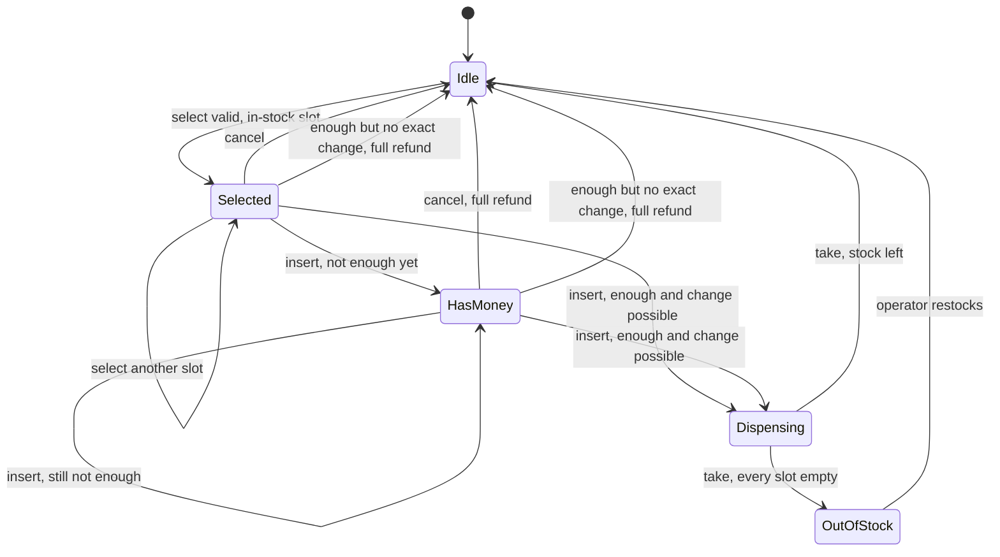

**The state table** (rows = buttons, columns = states). Every cell has an answer:

| Button ↓ / State → | Idle | Selected | HasMoney | Dispensing | OutOfStock |
|---|---|---|---|---|---|
| `select` | choose slot (reject empty/unknown) | change choice | "cancel first" | "take your product first" | "out of stock" |
| `insert` | return piece | accept; check paid | accept; check paid | return piece | return piece |
| `cancel` | "nothing to cancel" | clear choice → Idle | **refund all** → Idle | "too late" | "nothing to cancel" |
| `take` | "tray empty" | "pay first" | "pay the rest" | give product + change → Idle/OutOfStock | "tray empty" |

**Paying enough.**

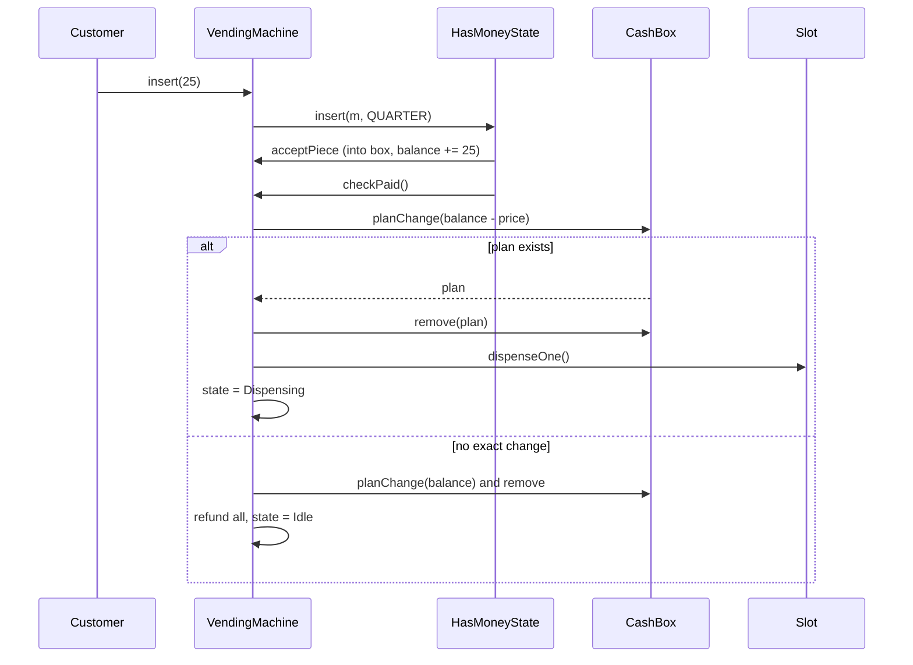

### Design decisions & patterns used

| Decision | Pattern / principle | Why | Alternative rejected |
|---|---|---|---|
| One class per situation behind `VendingState` | **State** | Every button × situation cell is answered; the compiler enforces completeness; no `if (state == …)` | Flags + `if/else` chains (the classic source of double-dispense bugs) |
| States are shared **stateless singletons** (`INSTANCE`) | Flyweight-style sharing | The course notes that creating a new state object on each transition is readable but wasteful; the states hold no data, so one instance each is enough | `new IdleState()` on every transition |
| Operator actions are **not** on the state interface | Interface Segregation | Restocking is allowed in every state; forcing five classes to answer it would be noise | Adding `restock` to `VendingState` |
| Money counted by value in an `EnumMap` | — | The machine never cares which physical quarter it returns | A list of coin objects |
| Inserted money goes straight into the box | — | Refund = "make change for the balance"; one refund path | A separate escrow pile |
| **Exact** change with dynamic programming | Correctness | Greedy can fail when the box is short of one coin (see output part 6) | Greedy only |
| Refuse the sale if exact change is impossible | Requirement 7 | Never short-change the customer | Give "close enough" change |

> **About the change algorithm.** The course's planner is **greedy** (largest piece first, never looks back) and honestly says so: greedy is correct for standard coin sets when the box is well stocked, but when the box is short of one piece it can fail for an amount that smaller pieces could make. The exact fix is **dynamic programming** — the "coin change with limited coins" problem, where you build the answer for each amount from the answers for smaller amounts. Our `CashBox.planChange` implements that (bounded coin change, fewest pieces), and `greedyPlan` is kept only to show the difference: for 30¢ from {1 quarter, 3 dimes}, greedy takes the quarter and gets stuck at 5¢; DP returns three dimes.

### Java implementation

Package `lld.ch14.vendingmachine`.

```java
// File: lld/ch14/vendingmachine/Inventory.java
package lld.ch14.vendingmachine;

import java.util.LinkedHashMap;
import java.util.Map;
import java.util.Optional;

/** What is sold: a name and a price in cents. */
record Product(String name, int priceCents) {}

/** One physical column. The COUNT lives on the slot, not on the product. */
final class Slot {
    private final String code;
    private final Product product;
    private int count;

    Slot(String code, Product product, int count) {
        this.code = code;
        this.product = product;
        this.count = count;
    }

    boolean isEmpty() { return count == 0; }

    Product dispenseOne() {
        if (count == 0) throw new IllegalStateException(code + " is empty");
        count--;
        return product;
    }

    void restock(int qty) { count += qty; }
    String code() { return code; }
    Product product() { return product; }
    int count() { return count; }
}

/** All slots, looked up by code. */
final class Inventory {
    private final Map<String, Slot> slots = new LinkedHashMap<>();

    void addSlot(Slot s) { slots.put(s.code(), s); }
    Optional<Slot> find(String code) { return Optional.ofNullable(slots.get(code)); }
    boolean allEmpty() { return slots.values().stream().allMatch(Slot::isEmpty); }

    String summary() {
        StringBuilder sb = new StringBuilder();
        slots.values().forEach(s -> sb.append(s.code()).append(':').append(s.product().name())
                .append('x').append(s.count()).append(' '));
        return sb.toString().trim();
    }
}
```

```java
// File: lld/ch14/vendingmachine/CashBox.java
package lld.ch14.vendingmachine;

import java.util.Arrays;
import java.util.EnumMap;
import java.util.Map;
import java.util.Optional;

/** The fixed set of pieces the machine accepts, in cents. Anything else is returned. */
enum Denomination {
    NICKEL(5, false), DIME(10, false), QUARTER(25, false), ONE_DOLLAR(100, true), FIVE_DOLLAR(500, true);

    final int cents;
    final boolean note;

    Denomination(int cents, boolean note) { this.cents = cents; this.note = note; }

    static Optional<Denomination> of(int cents) {
        return Arrays.stream(values()).filter(d -> d.cents == cents).findFirst();
    }
}

/** Counts pieces by value. Inserted money goes in straight away, so refunds are just "make change". */
final class CashBox {
    private final EnumMap<Denomination, Integer> counts = new EnumMap<>(Denomination.class);

    CashBox() { for (Denomination d : Denomination.values()) counts.put(d, 0); }

    void add(Denomination d, int n) { counts.merge(d, n, Integer::sum); }

    /**
     * Exact change with the FEWEST pieces, respecting how many of each piece we hold
     * (bounded coin change, dynamic programming). Empty = cannot be made exactly.
     */
    Optional<Map<Denomination, Integer>> planChange(int amount) {
        Denomination[] ds = Denomination.values();
        int[][] best = new int[amount + 1][];   // best[a] = pieces used per denomination to make a
        best[0] = new int[ds.length];
        for (int i = 0; i < ds.length; i++) {
            int v = ds[i].cents;
            int copies = Math.min(counts.get(ds[i]), amount / v);
            for (int c = 0; c < copies; c++) {                 // each copy may be used once (0/1)
                for (int a = amount; a >= v; a--) {
                    if (best[a - v] == null) continue;
                    int pieces = sum(best[a - v]) + 1;
                    if (best[a] == null || pieces < sum(best[a])) {
                        best[a] = best[a - v].clone();
                        best[a][i]++;
                    }
                }
            }
        }
        if (best[amount] == null) return Optional.empty();
        Map<Denomination, Integer> plan = new EnumMap<>(Denomination.class);
        for (int i = 0; i < ds.length; i++) if (best[amount][i] > 0) plan.put(ds[i], best[amount][i]);
        return Optional.of(plan);
    }

    /** Greedy (largest piece first) — shown only to compare with planChange. */
    Optional<Map<Denomination, Integer>> greedyPlan(int amount) {
        Map<Denomination, Integer> plan = new EnumMap<>(Denomination.class);
        Denomination[] ds = Denomination.values();
        for (int i = ds.length - 1; i >= 0 && amount > 0; i--) {
            int take = Math.min(counts.get(ds[i]), amount / ds[i].cents);
            if (take > 0) { plan.put(ds[i], take); amount -= take * ds[i].cents; }
        }
        return amount == 0 ? Optional.of(plan) : Optional.empty();
    }

    void remove(Map<Denomination, Integer> plan) {
        plan.forEach((d, n) -> counts.merge(d, -n, Integer::sum));
    }

    /** Operator empties the notes; coins stay behind as the float for change. */
    int collectNotes() {
        int total = 0;
        for (Denomination d : Denomination.values()) {
            if (d.note) { total += counts.get(d) * d.cents; counts.put(d, 0); }
        }
        return total;
    }

    int total() {
        return counts.entrySet().stream().mapToInt(e -> e.getKey().cents * e.getValue()).sum();
    }

    private static int sum(int[] a) { return Arrays.stream(a).sum(); }
}
```

```java
// File: lld/ch14/vendingmachine/States.java
package lld.ch14.vendingmachine;

/** State pattern: every button is on the interface, so every state must answer every button. */
interface VendingState {
    void select(VendingMachine m, String code);
    void insert(VendingMachine m, Denomination d);
    void cancel(VendingMachine m);
    void take(VendingMachine m);
    String name();
}

/** Waiting for a customer. */
final class IdleState implements VendingState {
    static final IdleState INSTANCE = new IdleState();   // states hold no data, so share one instance

    @Override public void select(VendingMachine m, String code) {
        m.inventory().find(code).ifPresentOrElse(slot -> {
            if (slot.isEmpty()) { m.show(code + " is sold out. Choose another."); return; }
            m.choose(slot);
            m.show("%s costs %d c. Insert money.".formatted(slot.product().name(), slot.product().priceCents()));
            m.setState(SelectedState.INSTANCE);
        }, () -> m.show("Unknown code " + code));
    }
    @Override public void insert(VendingMachine m, Denomination d) { m.rejectPiece(d, "select a product first"); }
    @Override public void cancel(VendingMachine m) { m.show("Nothing to cancel."); }
    @Override public void take(VendingMachine m) { m.show("The tray is empty."); }
    @Override public String name() { return "IDLE"; }
}

/** A product is chosen, no money yet. The customer may still change their mind freely. */
final class SelectedState implements VendingState {
    static final SelectedState INSTANCE = new SelectedState();

    @Override public void select(VendingMachine m, String code) { IdleState.INSTANCE.select(m, code); }
    @Override public void insert(VendingMachine m, Denomination d) { m.acceptPiece(d); m.checkPaid(); }
    @Override public void cancel(VendingMachine m) {
        m.clearSelection();
        m.show("Cancelled.");
        m.setState(IdleState.INSTANCE);
    }
    @Override public void take(VendingMachine m) { m.show("Please pay first."); }
    @Override public String name() { return "SELECTED"; }
}

/** Some money is in, but not enough yet. */
final class HasMoneyState implements VendingState {
    static final HasMoneyState INSTANCE = new HasMoneyState();

    @Override public void select(VendingMachine m, String code) { m.show("Cancel first to change your choice."); }
    @Override public void insert(VendingMachine m, Denomination d) { m.acceptPiece(d); m.checkPaid(); }
    @Override public void cancel(VendingMachine m) { m.refundAll("Cancelled."); }
    @Override public void take(VendingMachine m) { m.show("Please pay the rest first."); }
    @Override public String name() { return "HAS_MONEY"; }
}

/** Product and change are in the tray. Nothing else is allowed until the customer takes them. */
final class DispensingState implements VendingState {
    static final DispensingState INSTANCE = new DispensingState();

    @Override public void select(VendingMachine m, String code) { m.show("Please take your product first."); }
    @Override public void insert(VendingMachine m, Denomination d) { m.rejectPiece(d, "take your product first"); }
    @Override public void cancel(VendingMachine m) { m.show("Too late to cancel: product already dispensed."); }
    @Override public void take(VendingMachine m) { m.emptyTray(); }
    @Override public String name() { return "DISPENSING"; }
}

/** Every slot is empty. Only an operator restock leaves this state. */
final class OutOfStockState implements VendingState {
    static final OutOfStockState INSTANCE = new OutOfStockState();

    @Override public void select(VendingMachine m, String code) { m.show("Machine is out of stock."); }
    @Override public void insert(VendingMachine m, Denomination d) { m.rejectPiece(d, "out of stock"); }
    @Override public void cancel(VendingMachine m) { m.show("Nothing to cancel."); }
    @Override public void take(VendingMachine m) { m.show("The tray is empty."); }
    @Override public String name() { return "OUT_OF_STOCK"; }
}
```

```java
// File: lld/ch14/vendingmachine/VendingMachine.java
package lld.ch14.vendingmachine;

import java.util.ArrayList;
import java.util.List;
import java.util.Map;

/**
 * Holds the parts and the current state and forwards every button to the state.
 * There is no "if (state == ...)" anywhere in this class.
 * Public methods are synchronized: one physical machine, but a networked
 * controller or a second input device must not interleave two actions.
 */
final class VendingMachine {
    private final Inventory inventory;
    private final CashBox cashBox;
    private VendingState state;
    private Slot selected;
    private int balance;                                     // cents inserted in this sale
    private final List<String> tray = new ArrayList<>();

    VendingMachine(Inventory inventory, CashBox cashBox) {
        this.inventory = inventory;
        this.cashBox = cashBox;
        this.state = inventory.allEmpty() ? OutOfStockState.INSTANCE : IdleState.INSTANCE;
    }

    // ----- buttons the customer presses -----
    synchronized void select(String code) { log("select " + code); state.select(this, code); }
    synchronized void cancel() { log("cancel"); state.cancel(this); }
    synchronized void take() { log("take"); state.take(this); }

    synchronized void insert(int pieceCents) {
        log("insert " + pieceCents + "c");
        Denomination.of(pieceCents).ifPresentOrElse(
                d -> state.insert(this, d),
                () -> show("Unknown piece of " + pieceCents + "c returned."));
    }

    // ----- operator actions: allowed in every state, so NOT on the state interface -----
    synchronized void restock(String code, int qty) {
        inventory.find(code).orElseThrow().restock(qty);
        if (state == OutOfStockState.INSTANCE) setState(IdleState.INSTANCE);
        show("Operator restocked " + code + " +" + qty);
    }
    synchronized void loadChange(Denomination d, int n) { cashBox.add(d, n); }
    synchronized int collectTakings() { return cashBox.collectNotes(); }

    // ----- helpers used by the states -----
    void setState(VendingState s) { this.state = s; }
    Inventory inventory() { return inventory; }
    void choose(Slot s) { this.selected = s; }
    void clearSelection() { this.selected = null; }
    void show(String msg) { System.out.println("   [display] " + msg); }

    void acceptPiece(Denomination d) {
        cashBox.add(d, 1);
        balance += d.cents;
    }

    void rejectPiece(Denomination d, String why) { show(d + " returned: " + why + "."); }

    /** Called after every accepted piece in SELECTED / HAS_MONEY. */
    void checkPaid() {
        int price = selected.product().priceCents();
        if (balance < price) {
            show("Paid %d c, %d c to go.".formatted(balance, price - balance));
            setState(HasMoneyState.INSTANCE);
            return;
        }
        var change = cashBox.planChange(balance - price);
        if (change.isEmpty()) {                                // refuse the sale rather than short-change
            refundAll("Cannot make exact change.");
            return;
        }
        cashBox.remove(change.get());
        tray.add(selected.dispenseOne().name());
        if (!change.get().isEmpty()) tray.add("change " + change.get());
        show("Dispensed. Please take: " + tray);
        balance = 0;
        selected = null;
        setState(DispensingState.INSTANCE);
    }

    /** One refund path for "cancel" and for "cannot make change". */
    void refundAll(String reason) {
        Map<Denomination, Integer> back = cashBox.planChange(balance)
                .orElseThrow(() -> new IllegalStateException("inserted pieces must be refundable"));
        cashBox.remove(back);
        show(reason + " Refunded " + balance + " c as " + back);
        balance = 0;
        selected = null;
        setState(IdleState.INSTANCE);
    }

    void emptyTray() {
        show("Customer took " + tray);
        tray.clear();
        setState(inventory.allEmpty() ? OutOfStockState.INSTANCE : IdleState.INSTANCE);
    }

    synchronized String status() {
        return "state=%s cash=%dc stock=[%s]".formatted(state.name(), cashBox.total(), inventory.summary());
    }

    private void log(String action) { System.out.println(" > " + action + "   (" + state.name() + ")"); }
}
```

```java
// File: lld/ch14/vendingmachine/Main.java
package lld.ch14.vendingmachine;

public class Main {
    public static void main(String[] args) {
        Inventory inv = new Inventory();
        inv.addSlot(new Slot("A1", new Product("Cola", 125), 2));
        inv.addSlot(new Slot("B1", new Product("Chips", 50), 1));
        inv.addSlot(new Slot("C1", new Product("Candy", 65), 0));
        CashBox box = new CashBox();
        VendingMachine vm = new VendingMachine(inv, box);
        vm.loadChange(Denomination.QUARTER, 2);
        vm.loadChange(Denomination.DIME, 1);
        System.out.println(vm.status());

        System.out.println("\n1) Happy path: Cola with $1 + 25c. Extra coins and a late cancel are refused");
        vm.select("A1");
        vm.insert(100);
        vm.insert(25);
        vm.insert(25);
        vm.insert(10);           // ignored while the product waits in the tray
        vm.cancel();             // too late
        vm.take();

        System.out.println("\n2) Wrong order and bad input");
        vm.insert(25);           // no selection yet
        vm.select("C1");         // sold out
        vm.select("Z9");         // unknown
        vm.select("B1");
        vm.insert(3);            // foreign coin

        System.out.println("\n3) Cancel with money in: full refund");
        vm.insert(25);
        vm.select("A1");         // must cancel first
        vm.cancel();

        System.out.println("\n4) Cannot make exact change -> sale refused, everything refunded");
        vm.select("B1");
        vm.insert(500);          // needs 450 c change, box can't make it
        System.out.println(vm.status());

        System.out.println("\n5) Last items sold -> OUT_OF_STOCK -> operator restocks");
        vm.select("B1");
        vm.insert(25);
        vm.insert(25);
        vm.take();
        vm.select("A1");
        vm.insert(100);
        vm.insert(25);
        vm.take();
        System.out.println(vm.status());
        vm.select("A1");
        vm.restock("C1", 5);
        vm.select("C1");
        vm.insert(100);          // 35c change: 25 + 10
        vm.take();

        System.out.println("\n6) Why the change planner is not greedy");
        CashBox demo = new CashBox();
        demo.add(Denomination.QUARTER, 1);
        demo.add(Denomination.DIME, 3);
        System.out.println("30c from {1 quarter, 3 dimes}: greedy=" + demo.greedyPlan(30)
                + " dp=" + demo.planChange(30));

        System.out.println("\nOperator collects notes: " + vm.collectTakings() + " c");
        System.out.println(vm.status());
    }
}
```

**How the code works, part by part**

- `VendingMachine.insert(int)` first maps the raw piece to a `Denomination`; an unknown piece (a 3¢ token) is returned without ever reaching a state.
- `SelectedState` and `HasMoneyState` both call `acceptPiece` then `checkPaid`. `checkPaid` either moves to `HasMoney`, or completes the sale (plan change → remove pieces → dispense one → `Dispensing`), or refunds everything if exact change is impossible.
- `refundAll` is the **single** refund path used by cancel and by "cannot make change". It can never fail, because the pieces just inserted are in the box, so an exact plan always exists.
- `DispensingState.take` empties the tray and moves to `Idle` or `OutOfStock` — the sale ends when the customer takes the product, which is why `take` is a customer button.
- All public methods are `synchronized`. A single physical machine has one customer, but a networked controller (remote price change, telemetry, a second input device) must not interleave two actions.

**Output:**

```text
state=IDLE cash=60c stock=[A1:Colax2 B1:Chipsx1 C1:Candyx0]

1) Happy path: Cola with $1 + 25c. Extra coins and a late cancel are refused
 > select A1   (IDLE)
   [display] Cola costs 125 c. Insert money.
 > insert 100c   (SELECTED)
   [display] Paid 100 c, 25 c to go.
 > insert 25c   (HAS_MONEY)
   [display] Dispensed. Please take: [Cola]
 > insert 25c   (DISPENSING)
   [display] QUARTER returned: take your product first.
 > insert 10c   (DISPENSING)
   [display] DIME returned: take your product first.
 > cancel   (DISPENSING)
   [display] Too late to cancel: product already dispensed.
 > take   (DISPENSING)
   [display] Customer took [Cola]

2) Wrong order and bad input
 > insert 25c   (IDLE)
   [display] QUARTER returned: select a product first.
 > select C1   (IDLE)
   [display] C1 is sold out. Choose another.
 > select Z9   (IDLE)
   [display] Unknown code Z9
 > select B1   (IDLE)
   [display] Chips costs 50 c. Insert money.
 > insert 3c   (SELECTED)
   [display] Unknown piece of 3c returned.

3) Cancel with money in: full refund
 > insert 25c   (SELECTED)
   [display] Paid 25 c, 25 c to go.
 > select A1   (HAS_MONEY)
   [display] Cancel first to change your choice.
 > cancel   (HAS_MONEY)
   [display] Cancelled. Refunded 25 c as {QUARTER=1}

4) Cannot make exact change -> sale refused, everything refunded
 > select B1   (IDLE)
   [display] Chips costs 50 c. Insert money.
 > insert 500c   (SELECTED)
   [display] Cannot make exact change. Refunded 500 c as {FIVE_DOLLAR=1}
state=IDLE cash=185c stock=[A1:Colax1 B1:Chipsx1 C1:Candyx0]

5) Last items sold -> OUT_OF_STOCK -> operator restocks
 > select B1   (IDLE)
   [display] Chips costs 50 c. Insert money.
 > insert 25c   (SELECTED)
   [display] Paid 25 c, 25 c to go.
 > insert 25c   (HAS_MONEY)
   [display] Dispensed. Please take: [Chips]
 > take   (DISPENSING)
   [display] Customer took [Chips]
 > select A1   (IDLE)
   [display] Cola costs 125 c. Insert money.
 > insert 100c   (SELECTED)
   [display] Paid 100 c, 25 c to go.
 > insert 25c   (HAS_MONEY)
   [display] Dispensed. Please take: [Cola]
 > take   (DISPENSING)
   [display] Customer took [Cola]
state=OUT_OF_STOCK cash=360c stock=[A1:Colax0 B1:Chipsx0 C1:Candyx0]
 > select A1   (OUT_OF_STOCK)
   [display] Machine is out of stock.
   [display] Operator restocked C1 +5
 > select C1   (IDLE)
   [display] Candy costs 65 c. Insert money.
 > insert 100c   (SELECTED)
   [display] Dispensed. Please take: [Candy, change {DIME=1, QUARTER=1}]
 > take   (DISPENSING)
   [display] Customer took [Candy, change {DIME=1, QUARTER=1}]

6) Why the change planner is not greedy
30c from {1 quarter, 3 dimes}: greedy=Optional.empty dp=Optional[{DIME=3}]

Operator collects notes: 300 c
state=IDLE cash=125c stock=[A1:Colax0 B1:Chipsx0 C1:Candyx4]
```

Read the output: in part 1 the cola is paid exactly, and coins inserted while the product waits are returned, and a late cancel is refused; part 4 shows the refusal when 450¢ of change cannot be made from the box (so the $5 note comes straight back); part 5 shows the machine going to `OUT_OF_STOCK` and back to `IDLE` after a restock; part 6 shows greedy failing where DP succeeds.

### Concurrency & edge cases

| Edge case | Handling |
|---|---|
| Money inserted before selecting | `IdleState.insert` returns the piece |
| Unknown coin or foreign note | Returned before reaching the state |
| Selecting an empty slot | `IdleState.select` refuses; the state stays Idle |
| Changing the choice after paying | `HasMoneyState.select` says "cancel first" (prevents price confusion) |
| Paying more than the price | Change is planned **before** dispensing; if impossible, the sale is refused |
| Cancel after dispensing | "Too late" — the product is already in the tray |
| Two products for one payment | Impossible: after dispensing, the balance is 0 and the state is Dispensing, which accepts no money |
| Last item sold | `take` moves to `OutOfStock`; only a restock leaves it |
| Two threads pressing buttons | `synchronized` public methods; states run under the machine's lock |
| A bank of machines sharing one stock count | The course notes the design is not safe for that; the shared count on `Slot` would then need a lock or an atomic decrement |
| Power failure mid-sale | Real machines keep a transaction log (credit held) in non-volatile memory; out of scope |

### Extensions & follow-up questions

1. **"Where would you add contactless card payment?"** — One new input device beside the cash slot that calls the same machine (for example a `payByCard(amount)` that sets the balance to the price). No state class changes if the states only look at the balance.
2. **"What if it cannot give change?"** — The planner returns empty; the sale is refused and everything is refunded (requirement 7). Mention greedy vs DP.
3. **"Add a maintenance state."** — A new `MaintenanceState` class; the operator switches it on. The existing five states are untouched (Open/Closed).
4. **"Different price per slot for the same product?"** — Move the price from `Product` to `Slot` (the slot already owns the count).
5. **"Report empty slots to headquarters."** — Make `Inventory` notify an observer when a slot reaches 0; a telemetry client sends it over the network.
6. **"What did you leave out on purpose?"** — Card payment, reporting empty slots over a network, refrigeration (chilling) control and per-customer discounts. Say so explicitly: they are scope decisions, not oversights.
7. **"Timeout if the customer walks away with money in?"** — A timer that calls `cancel()` after, say, 60 seconds of inactivity; it goes through the same state machine.

### Real-world example

Modern vending machines are often retro-fitted with cashless readers such as **Nayax** or **Cantaloupe (ePort)** units, which plug into the machine's controller as just another payment device — exactly extension 1: a new input beside the coin mechanism, with the dispensing logic unchanged. Coin mechanisms in real machines keep "change tubes" of each coin and show an **"exact change only"** light when a tube runs low — the physical version of our planner reporting that it cannot make change.

### In the interview

**Plan for 45 minutes:** 5 min questions and requirements → 5 min entities (product, slot, inventory, cash box) → **10 min: draw the state diagram and the state table** → 15 min code the interface, two or three states and `checkPaid`/`refundAll` → 10 min edge cases and follow-ups.

**30-second answer:** "The whole question is the order of events, so I'll use the State pattern: one class per situation — Idle, Selected, HasMoney, Dispensing, OutOfStock — all implementing an interface that lists every button. The machine just forwards to its current state. Money goes into the cash box as it is inserted, so a refund is just 'make exact change for the balance'; if exact change is impossible, the sale is refused and everything is returned. Amounts are integer cents."

**Follow-ups with answers**

- *"Why not an enum with a switch?"* — It works for tiny machines, but every new state means editing every switch; with the State pattern a new state is a new class, and the compiler forces it to answer every button.
- *"Is greedy change correct?"* — Only for well-stocked canonical coin sets. With limited coins it can fail; use bounded coin-change DP.
- *"Where does the operator fit?"* — Outside the state interface; restocking is allowed in any state and can move OutOfStock → Idle.

### Self-check

1. **Q:** What makes the design "complete"? **A:** Every state class implements every button method, so every (state, button) cell has a defined answer.
2. **Q:** Why does inserted money go straight into the cash box? **A:** So the same pieces can be returned as change or refund; a refund is just planning exact change for the balance.
3. **Q:** Why is `restock` not in `VendingState`? **A:** It is not a customer action and is valid in every state (Interface Segregation).
4. **Q:** Give a case where greedy change fails. **A:** 30¢ with one quarter and three dimes: greedy takes 25¢ and cannot make 5¢; three dimes work.
5. **Q:** How is "two products for one payment" prevented? **A:** After dispensing, balance is reset to 0 and the Dispensing state returns any inserted money until the product is taken.

### TL;DR

- **State pattern is the whole design**: five state classes, one interface listing every button, no `if` on state in the machine.
- Count lives on the **slot**; money in **integer cents**; inserted money goes **into the box immediately**.
- Change: **exact** or refuse; greedy can fail, **DP** (bounded coin change) is the correct planner.
- One refund path for cancel and "no change"; operator actions stay off the state interface.

---

## 14.3 Design a Coffee Vending Machine

A **coffee vending machine** makes drinks on demand — espresso, americano, latte, cappuccino, mocha, hot chocolate — from a shared stock of **ingredients** (beans, water, milk, chocolate, sugar). It looks like the previous problem, but the hard part is different. A snack machine hands out a finished item from a slot. A coffee machine **consumes several ingredients at once** from shared containers, and many drinks draw on the same milk. The interviewer wants to see three things:

1. **Recipes as data** — adding a drink should be a data change, not a new class.
2. **Atomic, all-or-nothing deduction** — a latte must take its beans, water *and* milk together, or take nothing; stock must never go negative, even when ten people order at once.
3. **Low-stock alerts** — the operator hears about milk running low *before* it runs out (Observer).

### Problem & clarifying questions

| Question | Assumed answer |
|---|---|
| Which drinks? | Espresso, Americano, Latte, Cappuccino, Mocha, Hot Chocolate — loaded from a menu file. |
| Customisation? | Extra espresso shot (+50¢) and sugar (grams). |
| Payment? | Amount paid in cents; change returned (coin handling was covered in 14.2). |
| Several screens / concurrent orders? | Yes: a large machine or a kiosk with several touch screens, so orders can overlap. |
| Who refills? | An operator, alerted when an ingredient falls to a threshold. |
| One alert or one per drink? | One alert per crossing of the threshold (re-armed after a refill). |

### Requirements

**Functional**

1. Several drink types, each with a **price** and a **recipe** (amount of each ingredient).
2. Show a **menu** with prices and availability.
3. Accept a selection and a **payment**; return **change**; refund in full if the drink cannot be made.
4. Track **ingredient inventory**; deduct exactly the recipe amounts per drink.
5. Raise **low-stock notifications** when an ingredient drops to its threshold.
6. Allow **refills**.
7. Support **customisation** (extra shot, sugar) without changing the menu.

**Non-functional**

- **Thread-safe**: concurrent orders must never over-draw an ingredient or leave a half-deducted recipe.
- **Data-driven**: new drinks and recipe tweaks without code changes.
- **Observable**: operators, dashboards or a telemetry client can subscribe to alerts without the machine knowing about them.

### Use cases

**Actors:** **Customer** (views menu, orders, pays, takes drink and change), **Operator** (refills, receives alerts), **System** (checks stock, deducts, brews, sends alerts).

**Use cases:** view menu · order drink (with customisation) · pay / get change / get refund · refill ingredient · receive low-stock alert.

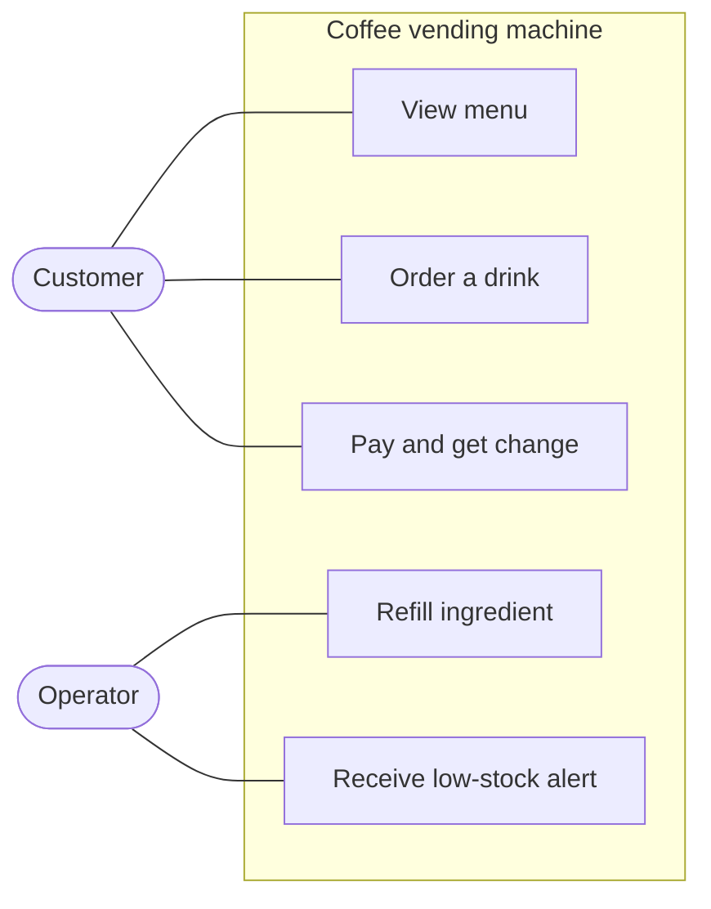

### Core entities

| Class | Responsibility |
|---|---|
| `Ingredient` (enum) | Beans, water, milk, chocolate, sugar — with the unit (g or ml). |
| `Recipe` (record) | **Data**: name, price, `Map<Ingredient, Integer>` amounts. Immutable. `with(...)` returns a customised copy. |
| `RecipeBook` | Parses the menu text into recipes; looks drinks up by name. |
| `IngredientStore` | Levels, thresholds, **one lock**; `tryConsume` = check all + deduct all atomically; alerts listeners. |
| `LowStockListener` (interface) | Observer called once when an ingredient crosses its threshold. |
| `OrderRequest` (record) | Drink name + extra shots + sugar grams. |
| `OrderResult` (sealed) | Either `Served(drink, price, change)` or `Rejected(reason, refund)`. |
| `CoffeeMachine` | Facade: menu board, `order(...)`, `refill(...)`. |

**Mapping to the common problem statement.** The widely used version of this problem (for example in the open-source *awesome-low-level-design* collection) asks for: several coffee types (espresso, cappuccino, latte) each with a price and a recipe, a menu with prices, selection and payment, dispensing with change, ingredient tracking with low-stock notifications, and thread-safe handling of concurrent requests. Its classes map onto ours as follows: `Coffee` (name, price, recipe) → our `Recipe`; `Ingredient` (name + quantity with `synchronized` update methods) → our `Ingredient` enum plus the levels inside `IngredientStore`; `Payment` (amount paid) → the `paidCents` argument and the change/refund in `OrderResult`; `CoffeeMachine` (a Singleton there) → our injected `CoffeeMachine`; concurrent users simulated with an `ExecutorService` → the 10-thread demo in our `Main`. Two deliberate differences: we lock the **whole recipe** rather than each ingredient separately (per-ingredient locking cannot make a multi-ingredient deduction all-or-nothing), and we avoid the Singleton (see the table below).

### Class diagram

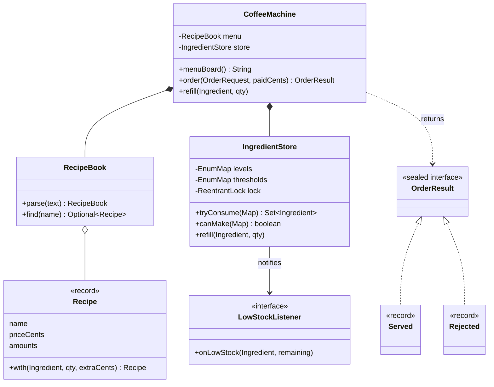

### Key flows

**Ordering a drink.** The key point is that the stock check and the deduction happen **inside one critical section**, and alerts are sent **after** the lock is released.

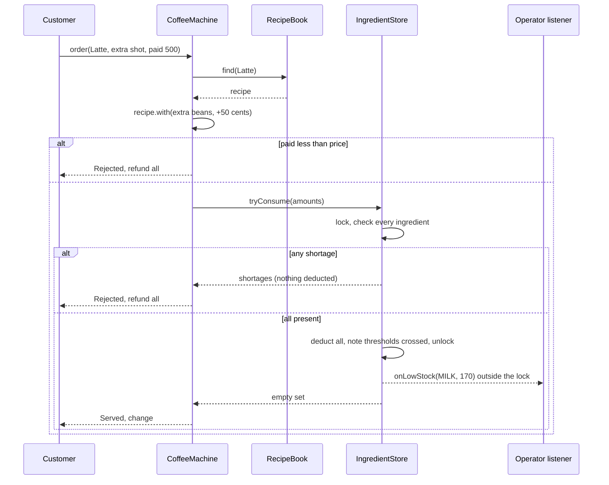

**Order life cycle.**

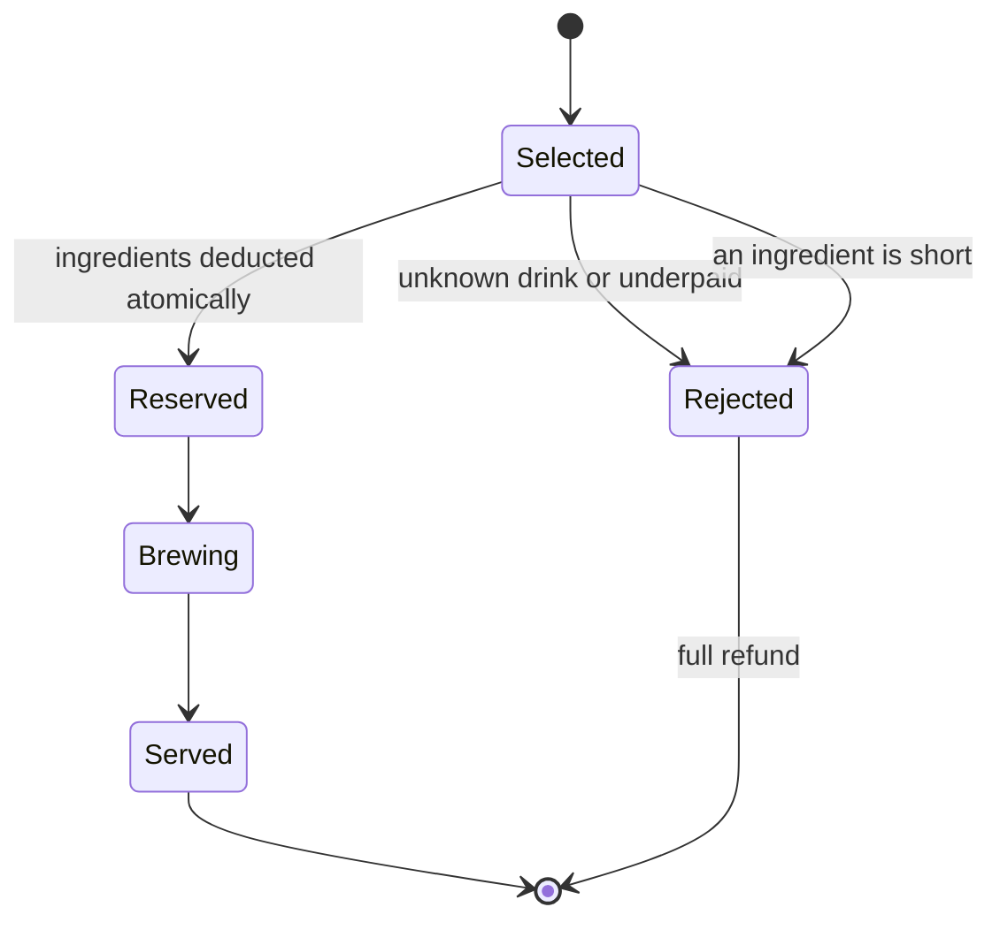

### Design decisions & patterns used

| Decision | Pattern / principle | Why | Alternative rejected |
|---|---|---|---|
| Recipes are **data** parsed from a menu text | Data-driven design, Open/Closed | A new drink is a new line in the menu; no new class, no recompile of logic | One subclass per drink (`Latte extends Coffee`) — class explosion, and recipe tweaks need code changes |
| Check-and-deduct under **one lock** | Atomicity (Ch. 12) | Prevents two orders both seeing "enough milk" and both deducting (a check-then-act race) | Checking in one call and deducting in another; per-ingredient locks (a multi-ingredient recipe would need all of them, in order) |
| All-or-nothing | Transaction semantics | Never leave a half-made recipe's ingredients missing | Deduct one by one and "roll back" on failure |
| Alerts via `LowStockListener` | **Observer** | Operator app, dashboard, telemetry can subscribe independently | The store calling a specific SMS class |
| Alert **once per crossing**, re-armed by refill | — | Prevents alert storms (one per drink) | Alerting on every order below threshold |
| Listeners called **outside** the lock | Concurrency hygiene | A slow listener (network call) must not block every order; it also avoids deadlocks if a listener calls back into the store | Notifying inside the lock |
| Customisation returns a **new** immutable `Recipe` | Immutability | The menu recipe can never be corrupted by one order | Mutating the menu recipe; a Decorator chain (works, but heavier than needed for "extra X") |
| `OrderResult` is a **sealed** interface with records | Algebraic data type (Java 17+ sealed, Java 21 pattern switch) | Callers must handle both Served and Rejected; `switch` is checked for exhaustiveness | Returning `null` or throwing for normal refusals |
| No Singleton | Dependency injection | The problem-set solutions often make `CoffeeMachine` a Singleton; we create one and pass it around, so tests can build fresh machines (the demo builds two) | `CoffeeMachine.getInstance()` |

> **Decorator or data?** A classic textbook example (*Head First Design Patterns*) models coffee add-ons with the **Decorator** pattern: `new Whip(new Mocha(new DarkRoast()))`, each wrapper adding cost and description. That is a good fit when each add-on has **behaviour**. Here add-ons only change **quantities and price**, so a data change (`recipe.with(...)`) is simpler. Say both in the interview and pick one for a reason.

### Java implementation

Package `lld.ch14.coffeemachine`.

```java
// File: lld/ch14/coffeemachine/Recipes.java
package lld.ch14.coffeemachine;

import java.util.Collections;
import java.util.EnumMap;
import java.util.LinkedHashMap;
import java.util.Map;
import java.util.Optional;

enum Ingredient {
    COFFEE_BEANS("g"), WATER("ml"), MILK("ml"), CHOCOLATE("g"), SUGAR("g");

    final String unit;

    Ingredient(String unit) { this.unit = unit; }
}

/** A recipe is DATA: a name, a price and the amount of each ingredient. */
record Recipe(String name, int priceCents, Map<Ingredient, Integer> amounts) {

    Recipe {
        amounts = Collections.unmodifiableMap(new EnumMap<>(amounts));
    }

    /** Customisation returns a NEW recipe; the menu entry is never modified. */
    Recipe with(Ingredient extra, int qty, int extraCents) {
        if (qty == 0) return this;
        Map<Ingredient, Integer> m = new EnumMap<>(Ingredient.class);
        m.putAll(amounts);
        m.merge(extra, qty, Integer::sum);
        return new Recipe(name, priceCents + extraCents, m);
    }
}

/** Parses the menu from plain text, so adding a drink is a data change, not a code change. */
final class RecipeBook {
    private final Map<String, Recipe> byName = new LinkedHashMap<>();

    static RecipeBook parse(String text) {
        RecipeBook book = new RecipeBook();
        for (String line : text.strip().split("\n")) {
            line = line.strip();
            if (line.isEmpty() || line.startsWith("#")) continue;
            String[] parts = line.split(",");
            Map<Ingredient, Integer> amounts = new EnumMap<>(Ingredient.class);
            for (int i = 2; i < parts.length; i++) {
                String[] kv = parts[i].strip().split("=");
                amounts.put(Ingredient.valueOf(kv[0].strip()), Integer.parseInt(kv[1].strip()));
            }
            Recipe r = new Recipe(parts[0].strip(), Integer.parseInt(parts[1].strip()), amounts);
            book.byName.put(r.name().toLowerCase(), r);
        }
        return book;
    }

    Optional<Recipe> find(String name) { return Optional.ofNullable(byName.get(name.toLowerCase())); }
    Iterable<Recipe> all() { return byName.values(); }
}
```

```java
// File: lld/ch14/coffeemachine/IngredientStore.java
package lld.ch14.coffeemachine;

import java.util.ArrayList;
import java.util.EnumMap;
import java.util.EnumSet;
import java.util.List;
import java.util.Map;
import java.util.Set;
import java.util.concurrent.CopyOnWriteArrayList;
import java.util.concurrent.locks.ReentrantLock;

/** Observer: told once when an ingredient drops to or below its threshold. */
interface LowStockListener {
    void onLowStock(Ingredient ingredient, int remaining);
}

/**
 * Ingredient levels. The whole check-then-deduct runs under ONE lock, so a drink either
 * takes every ingredient it needs or takes nothing (all-or-nothing, never negative).
 */
final class IngredientStore {
    private final Map<Ingredient, Integer> levels = new EnumMap<>(Ingredient.class);
    private final Map<Ingredient, Integer> thresholds = new EnumMap<>(Ingredient.class);
    private final Set<Ingredient> alerted = EnumSet.noneOf(Ingredient.class);
    private final List<LowStockListener> listeners = new CopyOnWriteArrayList<>();
    private final ReentrantLock lock = new ReentrantLock();

    IngredientStore(Map<Ingredient, Integer> initial, Map<Ingredient, Integer> lowThresholds) {
        for (Ingredient i : Ingredient.values()) {
            levels.put(i, initial.getOrDefault(i, 0));
            thresholds.put(i, lowThresholds.getOrDefault(i, 0));
        }
    }

    void addListener(LowStockListener l) { listeners.add(l); }

    /** Returns the ingredients that are short. Empty set = success, everything was deducted. */
    Set<Ingredient> tryConsume(Map<Ingredient, Integer> need) {
        Set<Ingredient> shortages = EnumSet.noneOf(Ingredient.class);
        List<Runnable> alerts = new ArrayList<>();
        lock.lock();
        try {
            need.forEach((i, q) -> { if (levels.get(i) < q) shortages.add(i); });
            if (!shortages.isEmpty()) return shortages;               // nothing touched
            need.forEach((i, q) -> levels.merge(i, -q, Integer::sum));
            for (Ingredient i : need.keySet()) {
                int left = levels.get(i);
                if (left <= thresholds.get(i) && alerted.add(i)) {    // alert once per crossing
                    alerts.add(() -> listeners.forEach(l -> l.onLowStock(i, left)));
                }
            }
        } finally {
            lock.unlock();
        }
        alerts.forEach(Runnable::run);   // call listeners OUTSIDE the lock
        return shortages;
    }

    boolean canMake(Map<Ingredient, Integer> need) {
        lock.lock();
        try {
            return need.entrySet().stream().allMatch(e -> levels.get(e.getKey()) >= e.getValue());
        } finally {
            lock.unlock();
        }
    }

    void refill(Ingredient i, int qty) {
        lock.lock();
        try {
            levels.merge(i, qty, Integer::sum);
            if (levels.get(i) > thresholds.get(i)) alerted.remove(i);  // re-arm the alert
        } finally {
            lock.unlock();
        }
    }

    int level(Ingredient i) {
        lock.lock();
        try { return levels.get(i); } finally { lock.unlock(); }
    }
}
```

```java
// File: lld/ch14/coffeemachine/CoffeeMachine.java
package lld.ch14.coffeemachine;

import java.util.Set;

/** What the customer asked for. */
record OrderRequest(String drink, int extraShots, int sugarGrams) {
    OrderRequest(String drink) { this(drink, 0, 0); }
}

/** The outcome of an order: a sealed type, so callers must handle both cases. */
sealed interface OrderResult permits Served, Rejected {}
record Served(String drink, int pricedCents, int changeCents) implements OrderResult {}
record Rejected(String reason, int refundCents) implements OrderResult {}

final class CoffeeMachine {
    static final int EXTRA_SHOT_CENTS = 50;
    static final int SHOT_BEANS_G = 18;

    private final RecipeBook menu;
    private final IngredientStore store;

    CoffeeMachine(RecipeBook menu, IngredientStore store) {
        this.menu = menu;
        this.store = store;
    }

    String menuBoard() {
        StringBuilder sb = new StringBuilder();
        for (Recipe r : menu.all()) {
            String line = "  %-14s %4d c  %s".formatted(r.name(), r.priceCents(),
                    store.canMake(r.amounts()) ? "" : "(unavailable)");
            sb.append(line.stripTrailing()).append('\n');
        }
        return sb.toString();
    }

    /** Thread-safe: many touch screens may order at once. */
    OrderResult order(OrderRequest req, int paidCents) {
        var base = menu.find(req.drink());
        if (base.isEmpty()) return new Rejected("no such drink: " + req.drink(), paidCents);
        Recipe r = base.get()
                .with(Ingredient.COFFEE_BEANS, req.extraShots() * SHOT_BEANS_G, req.extraShots() * EXTRA_SHOT_CENTS)
                .with(Ingredient.SUGAR, req.sugarGrams(), 0);
        if (paidCents < r.priceCents()) {
            return new Rejected("insufficient payment, need " + r.priceCents() + " c", paidCents);
        }
        Set<Ingredient> short_ = store.tryConsume(r.amounts());      // atomic reserve-and-deduct
        if (!short_.isEmpty()) return new Rejected("out of " + short_, paidCents);
        return new Served(r.name(), r.priceCents(), paidCents - r.priceCents());
    }

    void refill(Ingredient i, int qty) { store.refill(i, qty); }
    int level(Ingredient i) { return store.level(i); }
}
```

```java
// File: lld/ch14/coffeemachine/Main.java
package lld.ch14.coffeemachine;

import java.util.Map;
import java.util.concurrent.CountDownLatch;
import java.util.concurrent.ExecutorService;
import java.util.concurrent.Executors;
import java.util.concurrent.atomic.AtomicInteger;

public class Main {
    static final String MENU = """
            # name, price_cents, INGREDIENT=qty ...
            Espresso,      250, COFFEE_BEANS=18, WATER=40
            Americano,     300, COFFEE_BEANS=18, WATER=200
            Latte,         400, COFFEE_BEANS=18, WATER=40, MILK=180
            Cappuccino,    380, COFFEE_BEANS=18, WATER=40, MILK=120
            Mocha,         450, COFFEE_BEANS=18, WATER=40, MILK=150, CHOCOLATE=25
            Hot Chocolate, 300, MILK=200, CHOCOLATE=30
            """;

    static final Map<Ingredient, Integer> LOW = Map.of(Ingredient.COFFEE_BEANS, 100, Ingredient.WATER, 500,
            Ingredient.MILK, 200, Ingredient.CHOCOLATE, 30, Ingredient.SUGAR, 20);

    public static void main(String[] args) throws Exception {
        IngredientStore store = new IngredientStore(Map.of(Ingredient.COFFEE_BEANS, 500, Ingredient.WATER, 3000,
                Ingredient.MILK, 700, Ingredient.CHOCOLATE, 60, Ingredient.SUGAR, 100), LOW);
        store.addListener((i, left) -> System.out.println("   ALERT to operator: " + i + " low, " + left + i.unit + " left"));
        CoffeeMachine cm = new CoffeeMachine(RecipeBook.parse(MENU), store);

        System.out.print("Menu:\n" + cm.menuBoard());
        System.out.println("\n== Orders ==");
        show(cm.order(new OrderRequest("Espresso"), 300));
        show(cm.order(new OrderRequest("Latte", 1, 10), 500));      // extra shot + sugar
        show(cm.order(new OrderRequest("Flat White"), 400));
        show(cm.order(new OrderRequest("Mocha"), 200));
        show(cm.order(new OrderRequest("Mocha"), 450));             // chocolate 60 -> 35
        show(cm.order(new OrderRequest("Hot Chocolate"), 300));     // milk 370 -> 170, chocolate 35 -> 5 : alerts
        show(cm.order(new OrderRequest("Cappuccino"), 400));        // needs 120 milk, 170 left: ok
        show(cm.order(new OrderRequest("Latte"), 400));             // 50 milk left: rejected, nothing deducted
        System.out.println("   beans left " + cm.level(Ingredient.COFFEE_BEANS) + "g (unchanged by the rejected latte)");
        System.out.print("Menu now:\n" + cm.menuBoard());

        System.out.println("\n== Operator refills milk ==");
        cm.refill(Ingredient.MILK, 1000);
        show(cm.order(new OrderRequest("Latte"), 400));

        System.out.println("\n== 10 customers order a Latte at the same instant (milk for exactly 4) ==");
        IngredientStore store2 = new IngredientStore(Map.of(Ingredient.COFFEE_BEANS, 1000, Ingredient.WATER, 5000,
                Ingredient.MILK, 800), LOW);
        store2.addListener((i, left) -> System.out.println("   ALERT to operator: " + i + " low, " + left + i.unit + " left"));
        CoffeeMachine busy = new CoffeeMachine(RecipeBook.parse(MENU), store2);
        AtomicInteger served = new AtomicInteger(), rejected = new AtomicInteger();
        CountDownLatch go = new CountDownLatch(1);
        try (ExecutorService pool = Executors.newFixedThreadPool(10)) {
            for (int i = 0; i < 10; i++) {
                pool.submit(() -> {
                    go.await();
                    switch (busy.order(new OrderRequest("Latte"), 400)) {
                        case Served s -> served.incrementAndGet();
                        case Rejected r -> rejected.incrementAndGet();
                    }
                    return null;
                });
            }
            go.countDown();
        }
        System.out.println("served=" + served + " rejected=" + rejected
                + " milk left=" + busy.level(Ingredient.MILK) + "ml (never negative)");
    }

    static void show(OrderResult r) {
        switch (r) {
            case Served s -> System.out.println("SERVED   %s for %d c, change %d c".formatted(s.drink(), s.pricedCents(), s.changeCents()));
            case Rejected x -> System.out.println("REJECTED %s, refund %d c".formatted(x.reason(), x.refundCents()));
        }
    }
}
```

**How the code works, part by part**

- `Main.MENU` is a Java text block; `RecipeBook.parse` turns each line into a `Recipe`. Adding "Flat White" is one more line.
- `Recipe` copies the amounts into an unmodifiable `EnumMap` in its compact constructor, so a recipe can never be changed after creation.
- `IngredientStore.tryConsume` holds a `ReentrantLock` while it (1) collects shortages, (2) returns immediately if any, (3) deducts every ingredient, (4) records which thresholds were crossed. It releases the lock and **then** calls listeners.
- `alerted` is an `EnumSet` that remembers which ingredients already raised an alert; `refill` clears the flag when the level goes back above the threshold.
- `CoffeeMachine.order` validates the drink, applies customisation, checks payment, then reserves ingredients. The `switch` in `Main.show` uses Java 21 pattern matching over the sealed `OrderResult`.

**Output:**

```text
Menu:
  Espresso        250 c
  Americano       300 c
  Latte           400 c
  Cappuccino      380 c
  Mocha           450 c
  Hot Chocolate   300 c

== Orders ==
SERVED   Espresso for 250 c, change 50 c
SERVED   Latte for 450 c, change 50 c
REJECTED no such drink: Flat White, refund 400 c
REJECTED insufficient payment, need 450 c, refund 200 c
SERVED   Mocha for 450 c, change 0 c
   ALERT to operator: MILK low, 170ml left
   ALERT to operator: CHOCOLATE low, 5g left
SERVED   Hot Chocolate for 300 c, change 0 c
SERVED   Cappuccino for 380 c, change 20 c
REJECTED out of [MILK], refund 400 c
   beans left 410g (unchanged by the rejected latte)
Menu now:
  Espresso        250 c
  Americano       300 c
  Latte           400 c  (unavailable)
  Cappuccino      380 c  (unavailable)
  Mocha           450 c  (unavailable)
  Hot Chocolate   300 c  (unavailable)

== Operator refills milk ==
SERVED   Latte for 400 c, change 0 c

== 10 customers order a Latte at the same instant (milk for exactly 4) ==
   ALERT to operator: MILK low, 80ml left
served=4 rejected=6 milk left=80ml (never negative)
```

Read the output: the rejected latte left the beans at 410 g — nothing is deducted when any ingredient is short; the milk and chocolate alerts fire once each; in the last part ten threads order a latte at the same instant with milk for exactly four: four are served, six are refused, milk ends at 80 ml, never negative, and the alert fires exactly once.

### Concurrency & edge cases

| Situation | What could go wrong | How the design handles it |
|---|---|---|
| Ten concurrent orders, milk for four | Over-draw (negative stock) — classic check-then-act race | Check and deduct under one lock |
| Recipe needs several ingredients, one is short | Beans and water taken, milk missing | All-or-nothing: shortages are found before anything is deducted |
| Listener is slow (sends an SMS) | Every order waits on the network | Listeners run after `unlock()` |
| Many orders below the threshold | Alert storm | One alert per crossing; refill re-arms |
| Underpayment | Drink made, money short | Payment checked before reserving ingredients |
| Brewing fails after deduction (hardware fault) | Customer pays, gets nothing | Extension: refund and optionally `refill` the reserved amounts back (compensation) |
| Menu displays "available" and then the order fails | A race between display and order | The menu is advisory; `tryConsume` is the source of truth |

A **single lock** is right here: the critical section is tiny (five map operations) and the machine brews one drink at a time anyway. If contention mattered (a cloud-backed inventory shared by many machines), you would move to optimistic concurrency (version numbers / compare-and-set on a snapshot) or a database transaction.

### Extensions & follow-up questions

1. **"Add a new drink."** — Add one line to the menu data. No code change.
2. **"Sizes (small/medium/large)?"** — A `Size` enum with a multiplier; `recipe.scaled(size)` returns a new recipe with scaled amounts and price.
3. **"Several brewing units?"** — A pool of `Brewer` workers (a `BlockingQueue` of orders consumed by N threads). Inventory stays in the one `IngredientStore`.
4. **"Remote monitoring?"** — Another `LowStockListener` that posts to a telemetry endpoint. The store does not change.
5. **"Brewing steps differ per drink (grind, tamp, steam milk)?"** — Template Method: a `BrewProcess` with fixed steps and hooks, or a list of `Step` objects in the recipe data (Command).
6. **"Card payments and change?"** — Reuse the `CashBox` from 14.2 for cash; card payment is another payment device.

### Real-world example

Professional espresso machines such as the Thermoplan Mastrena used in Starbucks stores store **drink recipes as configuration**, so a chain can roll out a new beverage without new hardware. Starbucks and Microsoft publicly described (in 2019) connecting store equipment, including espresso machines, to the cloud through Microsoft Azure Sphere, so that each shot's data is collected as telemetry and new recipes are pushed from the cloud instead of being carried to stores on USB drives — the "recipes as data" and "remote monitoring listener" ideas in this design. Many connected self-serve coffee kiosks also report stock levels remotely, so that a service visit is scheduled before the milk runs out — the low-stock Observer in this design.

### In the interview

**Plan for 40 minutes:** 5 min questions → 5 min entities (ingredient, recipe, store, machine) → 5 min "recipes are data" and the menu format → 15 min code `tryConsume` (lock, all-or-nothing, alert outside the lock) and `order` → 10 min concurrency demo and extensions.

**30-second answer:** "Recipes are data: a map from ingredient to amount, loaded from a menu, so a new drink is a new row. The ingredient store checks and deducts **every** ingredient of a recipe under one lock, so an order is all-or-nothing and stock never goes negative. When an ingredient crosses its threshold, the store notes it and, after releasing the lock, notifies observers once. Orders return a sealed Served/Rejected result, and a rejected order is refunded in full."

**Follow-ups with answers**

- *"Why not one class per drink?"* — Drinks differ only in data. Classes would multiply with every size and add-on (class explosion) and every recipe tweak would be a code change.
- *"Why not an `AtomicInteger` per ingredient?"* — Each atomic is safe alone, but a recipe updates several at once; without a common lock, two orders could each take the last milk and beans in different orders, leaving partial deductions.
- *"Why notify outside the lock?"* — A slow or re-entrant listener would block all orders or deadlock.

### Self-check

1. **Q:** What does "all-or-nothing" mean for `tryConsume`? **A:** Either every ingredient of the recipe is deducted, or none is (shortages are detected first).
2. **Q:** What race does the single lock prevent? **A:** Check-then-act: two threads both see enough milk, then both deduct, going negative.
3. **Q:** How is an alert storm prevented? **A:** An `EnumSet` records ingredients already alerted; refill above the threshold re-arms them.
4. **Q:** Why is `Recipe.with` returning a new object important? **A:** Customising one order must not change the shared menu recipe.
5. **Q:** When would you use Decorator for add-ons? **A:** When add-ons carry behaviour (extra steps, special description or pricing logic), not just quantities.

### TL;DR

- **Recipes are data** (`Map<Ingredient,Integer>` + price), parsed from a menu; customisation creates a new immutable recipe.
- **One lock, check-then-deduct, all-or-nothing**: stock never goes negative under concurrent orders.
- **Observer** for low-stock alerts, fired **once per crossing** and **outside** the lock.
- A **sealed** `OrderResult` makes callers handle Served and Rejected; refund in full on rejection.

---

## 14.4 Design an ATM


*Figure — An automated teller machine with its card reader, keypad, screen, cash dispenser, deposit slot and printer (course diagram)*

An **automated teller machine (ATM)** is a cashier-less machine, placed in a public spot, where a bank's customers can do everyday banking. It exists because branches keep limited hours and people cannot go to a branch every time they need cash or want to pay in money. The interviewer is checking whether you can keep **money correct** (never dispense without debiting, never debit without dispensing, never let two machines overdraw one account), **authenticate** before anything else, and model the machine's **session states** cleanly.

### Problem & clarifying questions

| Question | Assumed answer |
|---|---|
| Which transactions? | Balance inquiry, cash withdrawal, cash deposit, check deposit, transfer. |
| Which account types? | Checking and savings. Withdrawal is from checking (and savings within a daily cap). |
| How is the user identified? | ATM card + PIN. The card is the main security element. |
| Does the ATM talk to the bank? | Yes, on every transaction (assume the network is available). |
| Are deposits available at once? | A check is **not**: it waits for verification. We keep a *total* and an *available* balance. |
| Which notes are loaded? | $100, $50, $20, $10 cassettes. |
| Wrong PIN? | Three wrong attempts block the card and the ATM keeps it. The course lists PIN retry limits and card capture as deliberately left out, along with receipt-paper levels, an audit journal and other banks' networks; we add the first two and the journal. |
| How many customers at a time? | One per machine; the ATM must not shut down mid-session. |

### Requirements

**Parts of the machine** (from the course): **card reader** (reads the card), **keypad** (PIN, amounts), **screen** (messages; also used to pick a transaction), **cash dispenser**, **deposit slot** (cash or checks), **printer** (receipts), and a **network link** to the bank.

**Functional**

1. The customer inserts a card and enters a PIN; the ATM asks the **bank** to authenticate. No transaction is possible without authentication.
2. Five transactions: **balance inquiry** (each account), **deposit cash**, **deposit check**, **withdraw cash** (from checking), **transfer funds** to another account.
3. The ATM **keeps the card** for the whole session; the customer can **cancel** at any time and the card is ejected.
4. The ATM keeps an **internal log (journal)** of transactions, including hardware failures, for the operator to resolve issues.
5. A deposited **check is not added at once**: it waits for manual verification and bank approval. (The course assumes deposits in general are verified first; our code credits counted cash immediately and holds checks — see the trade-off below.)
6. The **bank manager** can see the ATM's system information (reports).

**Actors' operations**

- **Operator:** turn the ATM on/off with the key switch; refill cash; refill receipt paper and ink; take out deposited cash and checks.
- **Customer:** balance inquiry, withdraw, deposit (cash or check), transfer.
- **Bank manager:** reports of total deposits and total withdrawals; print them; check the cash remaining in the ATM.

**Non-functional**

- **Security:** PINs never stored or compared in clear on the ATM; limit PIN attempts.
- **Consistency:** debit and dispense happen together or not at all (compensate on failure).
- **Concurrency:** many ATMs act on the same account at once without overdrawing it or deadlocking.
- **Auditability:** every action is journaled.

### Use cases

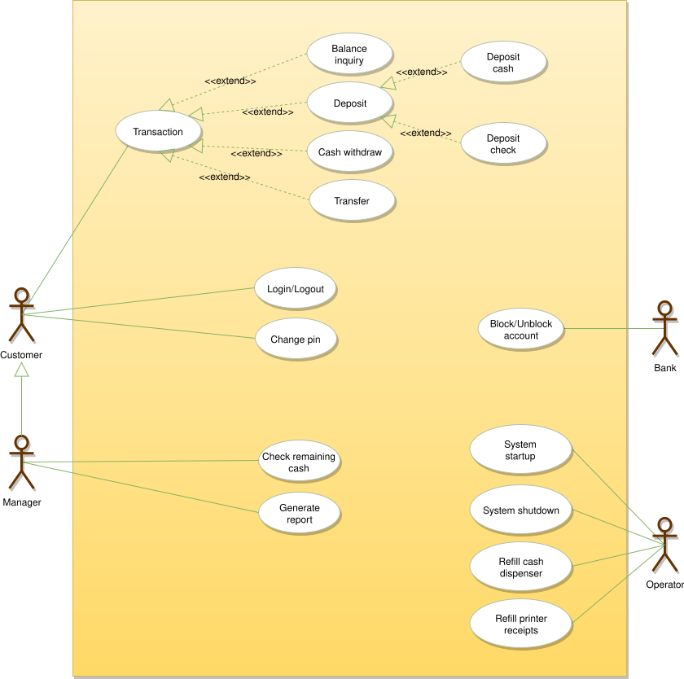
*Figure — ATM use case diagram: Customer (balance, withdraw, deposit, transfer), Operator (on/off, refill cash, paper, ink, empty deposits) and Bank Manager (reports, check remaining cash) (course diagram)*

The figure above shows three actors. Only the Customer's use cases go through PIN authentication; the Operator works with a physical key and the Bank Manager reads data held at the bank.

**Customer authentication** is the entry point of every session:

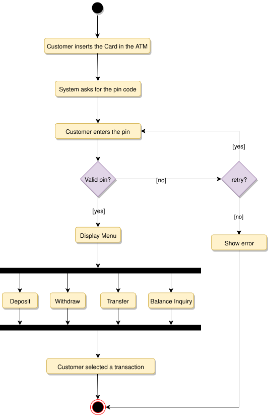
*Figure — Activity diagram: insert card, the system asks for the PIN, the customer enters it; an invalid PIN shows an error and offers a retry; a valid PIN displays the menu (balance inquiry, deposit, withdraw, transfer) (course diagram)*

**Withdraw:**

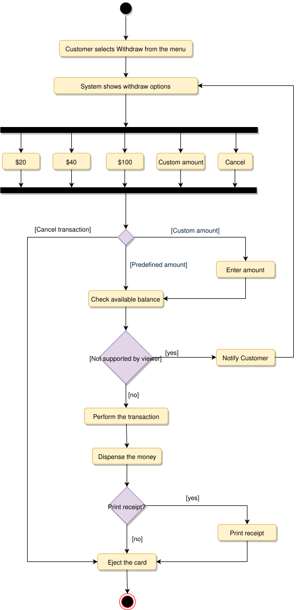
*Figure — Activity diagram: choose Withdraw, pick a predefined amount ($20, $40, $100) or enter a custom one, check the available balance (notify the customer if the amount is greater), perform the transaction, dispense, optional receipt, eject the card (course diagram)*

**Deposit check:**

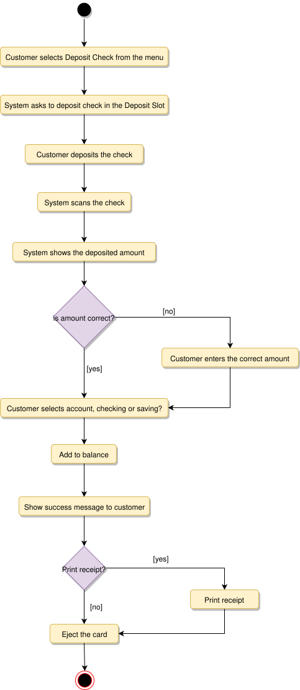
*Figure — Activity diagram: choose Deposit Check, pick checking or savings, put the check in the deposit slot, the system scans it and shows the amount; if wrong the customer enters the correct amount; the amount is added, a success message and optional receipt follow, and the card is ejected (course diagram)*

**Transfer:**

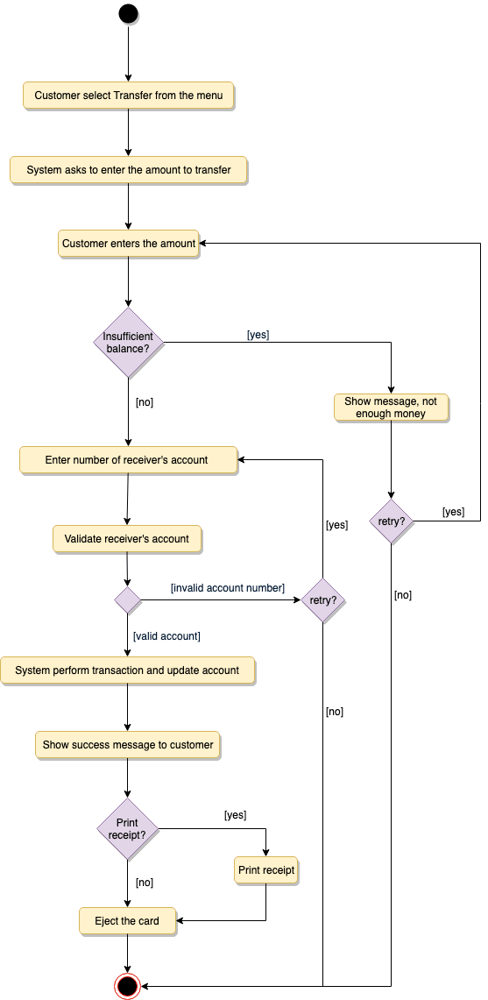
*Figure — Activity diagram: enter the amount (retry if balance is insufficient), enter and validate the receiver's account (retry if invalid), perform the transfer, show success, optional receipt, eject card (course diagram)*

In the transfer diagram above, note the two retry loops: one for "insufficient balance" and one for "invalid account number". If the customer declines to retry, the diagram goes straight to the end node without the "Eject the card" step; in a real design every exit path must still return the card, which is exactly the card-reader rule in stage 2 below.

### Core entities

| Class | Responsibility |
|---|---|
| `Card` (record) | Card number and holder name. (The course also has a `Customer` class with name and email, owning exactly one card; our code folds the holder's name into the card.) |
| `Account` (abstract) | Id, **total** and **available** balance, a lock; the withdrawal rule hook. |
| `CheckingAccount`, `SavingsAccount` | Savings overrides the rule to add a **daily withdrawal cap** — the only behavioural difference, which is why they are two classes. |
| `BankService` (interface) | What the ATM needs from the bank: authenticate, balances, withdraw, reverse, deposits, transfer. |
| `InMemoryBank` | A stand-in bank: PIN hashes, failed-attempt counts, account locks, ordered-lock transfers. |
| `AuthResult` (sealed) | `Ok(accounts)`, `WrongPin(attemptsLeft)` or `Blocked`. |
| `NoteHandler` + 4 subclasses | **Chain of Responsibility** for $100 → $50 → $20 → $10. |
| `CashDispenser` | Plans a withdrawal from the chain (dry run), then dispenses; can jam (fault injection). |
| `Transaction` (sealed) + 5 records | **Command**: each transaction has one `execute(ctx)`; its rules live only there. |
| `AtmState` + 4 states | **State**: Idle → CardInserted → Authenticated → Idle, plus OutOfService. |
| `Atm` | Has an id (the course also gives it a location); owns its parts, holds the session, forwards buttons to the state, keeps the journal. |
| `CardReader`, `Keypad`, `Screen`, `Printer`, `DepositSlot` (cash / check) | The course's hardware classes. Our code folds them into `Atm`: the `card` field is the reader's slot, `screen(...)` is the screen, the method arguments are the keypad, and printing a receipt would format a journal line. |

### Class diagram

The course builds the ATM in four stages:

| Stage | What it adds | What works after it |
|---|---|---|
| 1 | `Customer`, `Card`, `Account` (checking, savings) | Verify a PIN and read a balance |
| 2 | Card reader, dispenser, keypad, screen, printer, deposit slots | Work out and count out a set of notes |
| 3 | `Transaction` and its five kinds | Move money, with each rule written in exactly one class |
| 4 | `Bank` and `ATM` | Run a full session for a single customer at a time |

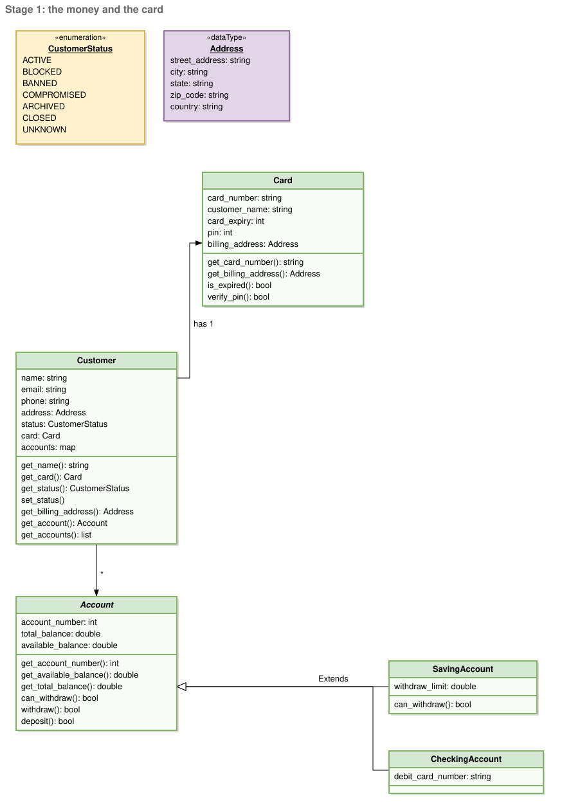
*Figure — Stage 1: enumerations, Customer, Card and the abstract Account with Checking and Saving subclasses (course diagram)*

**Stage 1 — money and card.** An account keeps **two balances**. The *total balance* is everything credited to it; the *available balance* is the part the customer may spend right now. A check deposit is the moment they diverge: the check raises the total at once, but the money becomes available only after the check clears. `Account` is abstract with `CheckingAccount` and `SavingsAccount` beneath it; savings overrides a single method to impose its withdrawal cap, and because that is a difference in **behaviour** (not just data) inheritance is justified here instead of a type field. `Customer` (name, email; each customer has **one** card) is linked to its card and accounts by plain associations, since none of them is deleted along with another.

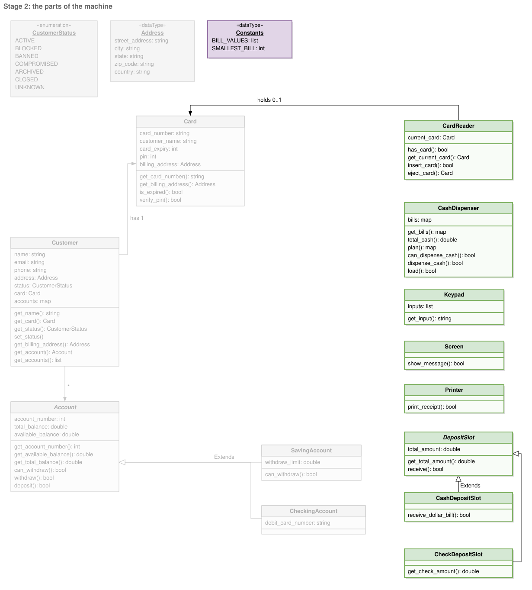
*Figure — Stage 2: CardReader, CashDispenser, Keypad, Screen, Printer and the abstract DepositSlot with cash and check slots (course diagram)*

**Stage 2 — the parts.** Six of the seven hardware parts become one class each (the seventh, the network link, is assumed rather than modelled), and none of them knows what a transaction is. Deciding whether an amount (say $85) can be paid from the notes **currently loaded** belongs to the **dispenser**, not to the withdrawal logic; it tries the largest note first and reports failure when the exact amount is impossible. The card reader has one rule of its own: it **keeps the card for the whole session** and releases it when the session ends, so every failed sign-in path must eject (or retain) the card before it returns; the reader's link to `Card` is the only arrow leaving this stage. `DepositSlot` is abstract, with a cash slot and a check slot below it. It is the physical opening money is pushed into; do not confuse it with the deposit *transaction* of stage 3.

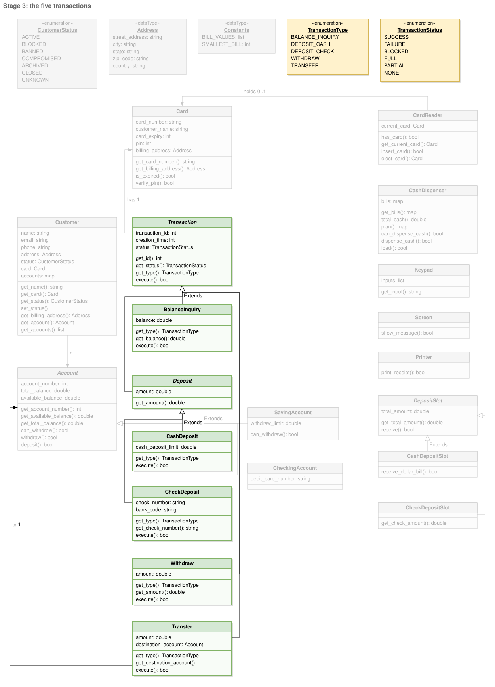
*Figure — Stage 3: the abstract Transaction with BalanceInquiry, Deposit (CashDeposit, CheckDeposit), Withdraw and Transfer (course diagram)*

**Stage 3 — the five transactions.** Every transaction type is a class with a single `execute` method, so each rule has exactly one home: nothing outside `Withdraw` needs to know the withdrawal rules. `Deposit` is an intermediate class: cash and check deposits share an amount but differ in when the money becomes spendable. `Transfer` is the only transaction with an outgoing arrow, to the destination account. Inside the course's `Withdraw`, the checks run in this order: **note denominations** first, then the **account**, then the **dispenser**, and the account is debited only once the notes have been counted out. The reason for that order: if you take the money from the account first and the dispensing then fails, the customer has paid for cash they never received.

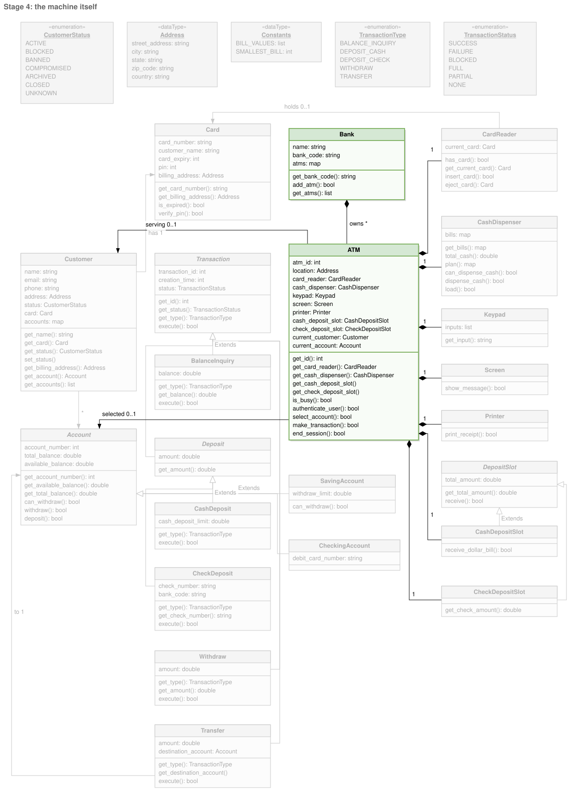
*Figure — Stage 4: the ATM owns its parts (composition), refers to the current Customer and Account, and the Bank owns its ATMs (course diagram)*

**Stage 4 — the machine.** The ATM has an **id** (`atmID`) and a **location**, and it **owns** its parts through composition: if the machine is scrapped, its reader, dispenser and screen go with it. Its links to the current `Customer` and `Account` are plain associations that change with each person at the machine. Because the ATM itself holds the current session, "one customer at a time" is enforced by the structure, not just promised in a comment. The `Bank` owns its ATMs and holds all account data; the ATM asks the bank to carry out every customer transaction.

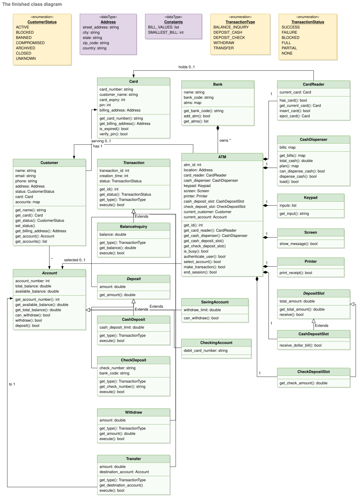
*Figure — The finished class diagram of the ATM system (course diagram)*

Class diagram of **our Java code**:

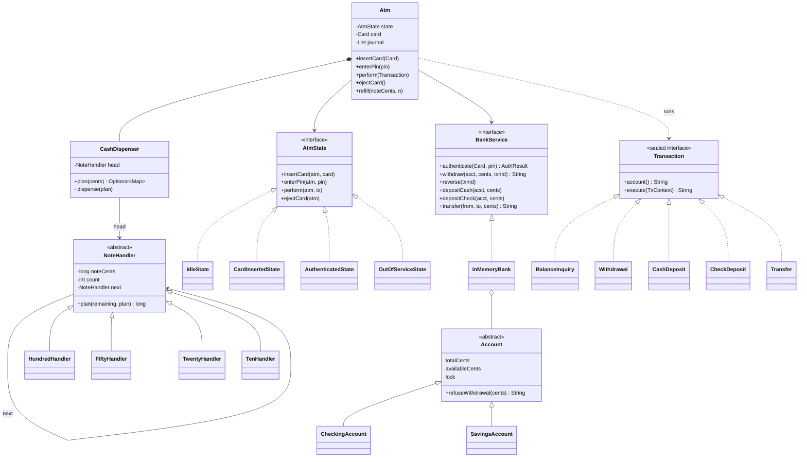

### Key flows

**Session states.**

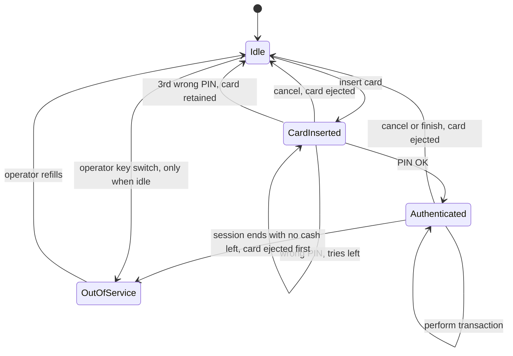

**Balance inquiry** (the course's sequence diagram):

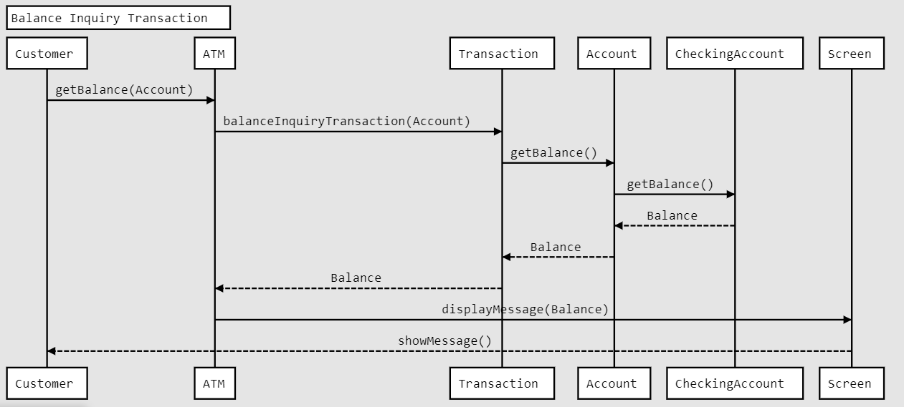
*Figure — Sequence diagram of a balance inquiry: Customer → ATM → Transaction → Account → CheckingAccount, and the balance travels back to the Screen (course diagram)*

In the sequence above, the ATM never reads the balance itself: it creates a transaction, the transaction asks the account, and the result is shown on the screen.

**Withdrawal with compensation** (our code):

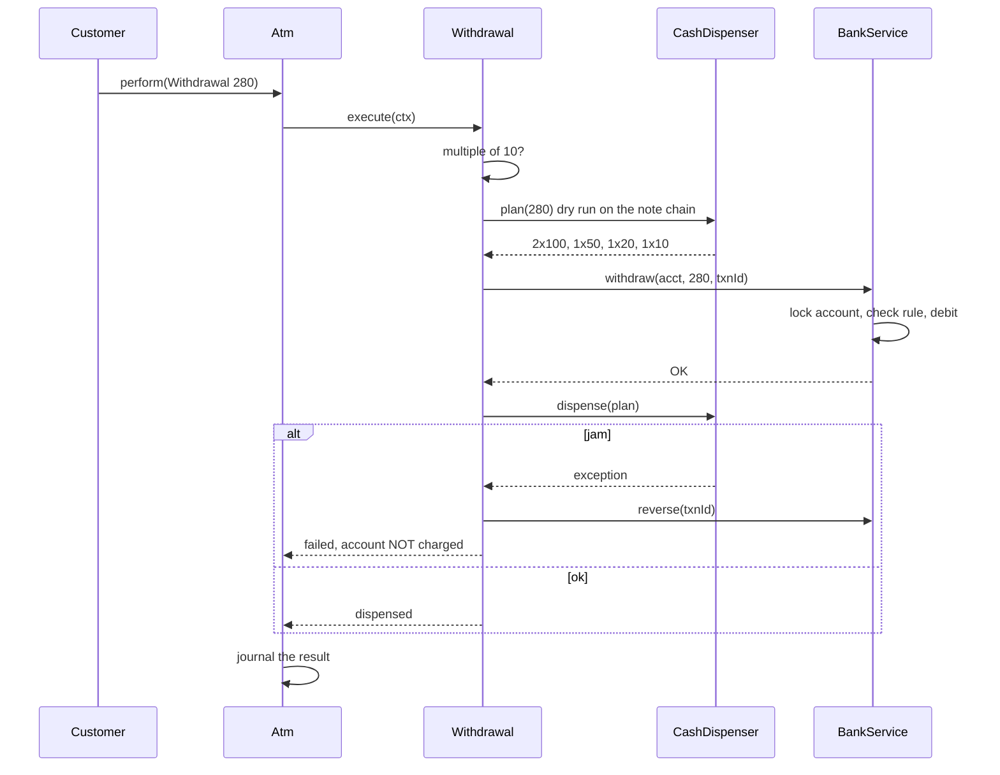

### Design decisions & patterns used

| Decision | Pattern | Why | Alternative rejected |
|---|---|---|---|
| Session flow as state classes | **State** | Insert-card/enter-PIN/perform/eject each mean something different per state; e.g. `perform` in Idle is simply refused | Booleans `cardInserted`, `authenticated` and nested `if`s |
| Dispenser as a chain of note handlers | **Chain of Responsibility** | Each handler takes what it can and passes the rest on; adding a $5 cassette is one new handler linked into the chain | One method with a hard-coded list of notes |
| Plan first, then dispense | — | The chain's dry run touches nothing; a failed plan leaves the cassettes intact | Removing notes while searching |
| Each transaction = one class with `execute` | **Command** | The rules of each transaction live in one place; transactions can be journaled, queued or replayed | A big `switch (type)` in the ATM |
| `Transaction` and `AuthResult` are **sealed** | Java 17+ sealed types | The compiler knows the full list; `switch` over `AuthResult` is exhaustive | Open hierarchies with `instanceof` chains |
| ATM talks to a `BankService` interface | Dependency Inversion | The ATM does not care whether the bank is in-memory, ISO 8583 over a network, or a test fake | ATM changes balances directly |
| Total vs available balance | Domain modelling | Makes the check-hold rule correct, not merely convenient | A single balance |
| Savings is a subclass | Inheritance for **behaviour** | Its withdrawal rule differs (daily cap), so it overrides one hook | A `type` field and `if (type == SAVINGS)` |

> **Debit before or after dispensing?** The course debits **after** the notes are counted out — the safer order for the customer — and admits the weakness: a crash between the two leaves the bank short. Our code does the opposite (debit, then dispense) and adds a **compensating action**: if the dispenser jams, `reverse(txnId)` puts the money back. Both are simplifications of what real systems do: make the pair atomic (a hold/authorisation, then a confirmation after dispensing), and **reconcile** from the ATM's journal when something goes wrong in between. Say this out loud — it is the "power fails halfway through" follow-up.

> **Cash deposits.** The course assumes all deposits are verified before they count. Many banks make cash that the machine itself has counted available immediately (or up to a limit) and hold checks. Our `depositCash` credits both balances and `depositCheck` credits only the total; changing the policy is a one-line change in the bank, not the ATM.

### Java implementation

Package `lld.ch14.atm`. Amounts are cents (`long`); notes are $100/$50/$20/$10.

```java
// File: lld/ch14/atm/Bank.java
package lld.ch14.atm;

import java.nio.charset.StandardCharsets;
import java.security.MessageDigest;
import java.security.NoSuchAlgorithmException;
import java.util.HexFormat;
import java.util.List;
import java.util.Map;
import java.util.concurrent.ConcurrentHashMap;
import java.util.concurrent.locks.ReentrantLock;

final class Money {
    private Money() {}
    static String fmt(long cents) { return "$%d.%02d".formatted(cents / 100, cents % 100); }
}

/** Total = everything credited. Available = what can be spent now (a check has not cleared yet). */
abstract class Account {
    final String id;
    final ReentrantLock lock = new ReentrantLock();   // one lock per account, shared by every ATM
    long totalCents;
    long availableCents;

    Account(String id, long openingCents) {
        this.id = id;
        this.totalCents = openingCents;
        this.availableCents = openingCents;
    }

    /** Hook that subclasses refine. Called with the lock held. Returns null if allowed, else the reason. */
    String refuseWithdrawal(long cents) {
        return cents > availableCents ? "insufficient funds" : null;
    }

    void recordWithdrawal(long cents) {}
    void reverseWithdrawal(long cents) {}
}

class CheckingAccount extends Account {
    CheckingAccount(String id, long opening) { super(id, opening); }
}

/** The one behavioural difference: savings has a daily withdrawal cap. */
class SavingsAccount extends Account {
    private final long dailyLimitCents;
    private long withdrawnTodayCents;

    SavingsAccount(String id, long opening, long dailyLimitCents) {
        super(id, opening);
        this.dailyLimitCents = dailyLimitCents;
    }

    @Override String refuseWithdrawal(long cents) {
        if (withdrawnTodayCents + cents > dailyLimitCents) return "savings daily limit " + Money.fmt(dailyLimitCents);
        return super.refuseWithdrawal(cents);
    }

    @Override void recordWithdrawal(long cents) { withdrawnTodayCents += cents; }
    @Override void reverseWithdrawal(long cents) { withdrawnTodayCents -= cents; }
}

record Card(String number, String holder) {}

sealed interface AuthResult permits AuthResult.Ok, AuthResult.WrongPin, AuthResult.Blocked {
    record Ok(List<String> accountIds) implements AuthResult {}
    record WrongPin(int attemptsLeft) implements AuthResult {}
    record Blocked() implements AuthResult {}
}

/** What the ATM needs from the bank. The ATM never touches balances directly. */
interface BankService {
    AuthResult authenticate(Card card, String pin);
    long availableBalance(String accountId);
    long totalBalance(String accountId);
    String withdraw(String accountId, long cents, String txnId);   // null = OK, else reason
    void reverse(String txnId);
    void depositCash(String accountId, long cents);
    void depositCheck(String accountId, long cents);
    void clearCheck(String accountId, long cents);
    String transfer(String from, String to, long cents);
}

final class InMemoryBank implements BankService {
    private static final int MAX_PIN_TRIES = 3;
    private final Map<String, Account> accounts = new ConcurrentHashMap<>();
    private final Map<String, String> pinHashByCard = new ConcurrentHashMap<>();
    private final Map<String, List<String>> accountsByCard = new ConcurrentHashMap<>();
    private final Map<String, Integer> failedTries = new ConcurrentHashMap<>();
    private final Map<String, Object[]> withdrawals = new ConcurrentHashMap<>();   // txnId -> {accountId, cents}

    void open(Account a) { accounts.put(a.id, a); }

    void issueCard(Card card, String pin, List<String> accountIds) {
        pinHashByCard.put(card.number(), hash(card.number(), pin));
        accountsByCard.put(card.number(), List.copyOf(accountIds));
    }

    @Override public AuthResult authenticate(Card card, String pin) {
        String n = card.number();
        if (failedTries.getOrDefault(n, 0) >= MAX_PIN_TRIES) return new AuthResult.Blocked();
        if (hash(n, pin).equals(pinHashByCard.get(n))) {
            failedTries.remove(n);
            return new AuthResult.Ok(accountsByCard.get(n));
        }
        int tries = failedTries.merge(n, 1, Integer::sum);
        return tries >= MAX_PIN_TRIES ? new AuthResult.Blocked() : new AuthResult.WrongPin(MAX_PIN_TRIES - tries);
    }

    @Override public long availableBalance(String id) { return read(id, true); }
    @Override public long totalBalance(String id) { return read(id, false); }

    @Override public String withdraw(String id, long cents, String txnId) {
        Account a = acc(id);
        a.lock.lock();
        try {                                           // check-then-act under ONE lock: atomic
            String refusal = a.refuseWithdrawal(cents);
            if (refusal != null) return refusal;
            a.availableCents -= cents;
            a.totalCents -= cents;
            a.recordWithdrawal(cents);
            withdrawals.put(txnId, new Object[]{id, cents});
            return null;
        } finally {
            a.lock.unlock();
        }
    }

    /** Compensating action when the cash could not be handed out. */
    @Override public void reverse(String txnId) {
        Object[] w = withdrawals.remove(txnId);
        if (w == null) return;
        Account a = acc((String) w[0]);
        long cents = (Long) w[1];
        a.lock.lock();
        try {
            a.availableCents += cents;
            a.totalCents += cents;
            a.reverseWithdrawal(cents);
        } finally {
            a.lock.unlock();
        }
    }

    @Override public void depositCash(String id, long cents) { credit(id, cents, true); }
    @Override public void depositCheck(String id, long cents) { credit(id, cents, false); }   // on hold

    @Override public void clearCheck(String id, long cents) {
        Account a = acc(id);
        a.lock.lock();
        try { a.availableCents += cents; } finally { a.lock.unlock(); }
    }

    /** Locks both accounts in a fixed (id) order, so two opposite transfers cannot deadlock. */
    @Override public String transfer(String from, String to, long cents) {
        if (cents <= 0) return "amount must be positive";
        if (from.equals(to)) return "same account";
        Account a = acc(from), b = acc(to);
        Account first = from.compareTo(to) < 0 ? a : b;
        Account second = first == a ? b : a;
        first.lock.lock();
        try {
            second.lock.lock();
            try {
                if (cents > a.availableCents) return "insufficient funds";
                a.availableCents -= cents;
                a.totalCents -= cents;
                b.availableCents += cents;
                b.totalCents += cents;
                return null;
            } finally {
                second.lock.unlock();
            }
        } finally {
            first.lock.unlock();
        }
    }

    private void credit(String id, long cents, boolean available) {
        if (cents <= 0) throw new IllegalArgumentException("deposit must be positive");
        Account a = acc(id);
        a.lock.lock();
        try {
            a.totalCents += cents;
            if (available) a.availableCents += cents;
        } finally {
            a.lock.unlock();
        }
    }

    private long read(String id, boolean available) {
        Account a = acc(id);
        a.lock.lock();
        try { return available ? a.availableCents : a.totalCents; } finally { a.lock.unlock(); }
    }

    private Account acc(String id) {
        Account a = accounts.get(id);
        if (a == null) throw new IllegalArgumentException("no account " + id);
        return a;
    }

    /** Demo only. Real banks never see the clear PIN: the PIN pad encrypts it and an HSM verifies it. */
    private static String hash(String card, String pin) {
        try {
            byte[] d = MessageDigest.getInstance("SHA-256").digest((card + ":" + pin).getBytes(StandardCharsets.UTF_8));
            return HexFormat.of().formatHex(d);
        } catch (NoSuchAlgorithmException e) {
            throw new IllegalStateException(e);
        }
    }
}
```

```java
// File: lld/ch14/atm/CashDispenser.java
package lld.ch14.atm;

import java.util.LinkedHashMap;
import java.util.Map;
import java.util.Optional;

/**
 * Chain of Responsibility: each handler owns one note value. It takes as many of its notes
 * as it can for the amount, then passes whatever is left to the next (smaller) handler.
 */
abstract class NoteHandler {
    private final long noteCents;
    private int count;
    private NoteHandler next;

    NoteHandler(long noteCents, int count) {
        this.noteCents = noteCents;
        this.count = count;
    }

    NoteHandler linkTo(NoteHandler next) {
        this.next = next;
        return next;
    }

    /** Dry run: fills 'plan', returns the amount that nobody in the chain could cover. */
    long plan(long remaining, Map<Long, Integer> plan) {
        int use = (int) Math.min(count, remaining / noteCents);
        if (use > 0) plan.put(noteCents, use);
        long left = remaining - use * noteCents;
        return (left == 0 || next == null) ? left : next.plan(left, plan);
    }

    void take(Map<Long, Integer> plan) {
        count -= plan.getOrDefault(noteCents, 0);
        if (next != null) next.take(plan);
    }

    long total() { return noteCents * count + (next == null ? 0 : next.total()); }
    void add(int n) { count += n; }
    long noteCents() { return noteCents; }
    NoteHandler next() { return next; }
}

final class HundredHandler extends NoteHandler { HundredHandler(int n) { super(100_00, n); } }
final class FiftyHandler extends NoteHandler { FiftyHandler(int n) { super(50_00, n); } }
final class TwentyHandler extends NoteHandler { TwentyHandler(int n) { super(20_00, n); } }
final class TenHandler extends NoteHandler { TenHandler(int n) { super(10_00, n); } }

final class CashDispenser {
    private final NoteHandler head;
    private boolean jamNext;                       // hardware fault injection for the demo

    CashDispenser(int hundreds, int fifties, int twenties, int tens) {
        head = new HundredHandler(hundreds);
        head.linkTo(new FiftyHandler(fifties)).linkTo(new TwentyHandler(twenties)).linkTo(new TenHandler(tens));
    }

    /** Plan first, touch nothing. Empty = this amount cannot be made from the notes loaded. */
    synchronized Optional<Map<Long, Integer>> plan(long cents) {
        Map<Long, Integer> plan = new LinkedHashMap<>();
        return head.plan(cents, plan) == 0 ? Optional.of(plan) : Optional.empty();
    }

    /** Physically count out the notes. May fail (jam), in which case nothing leaves the machine. */
    synchronized void dispense(Map<Long, Integer> plan) {
        if (jamNext) { jamNext = false; throw new IllegalStateException("note jam"); }
        head.take(plan);
    }

    synchronized void refill(long noteCents, int n) {
        for (NoteHandler h = head; h != null; h = h.next()) if (h.noteCents() == noteCents) h.add(n);
    }

    synchronized long total() { return head.total(); }
    synchronized void jamNextDispense() { jamNext = true; }
}
```

```java
// File: lld/ch14/atm/Transactions.java
package lld.ch14.atm;

import java.util.Map;
import java.util.stream.Collectors;

/** Everything a transaction may use. */
record TxContext(BankService bank, CashDispenser dispenser, String txnId) {}

/** Each transaction is one class with one execute(): Command pattern. Sealed = the full list is known. */
sealed interface Transaction permits BalanceInquiry, Withdrawal, CashDeposit, CheckDeposit, Transfer {
    String account();
    String execute(TxContext ctx);
}

record BalanceInquiry(String account) implements Transaction {
    public String execute(TxContext c) {
        return "Balance %s: available %s, total %s".formatted(account,
                Money.fmt(c.bank().availableBalance(account)), Money.fmt(c.bank().totalBalance(account)));
    }
}

record Withdrawal(String account, long cents) implements Transaction {
    static final long SMALLEST_NOTE = 10_00;

    public String execute(TxContext c) {
        if (cents <= 0 || cents % SMALLEST_NOTE != 0) return "Withdrawal refused: amount must be a multiple of $10";
        var plan = c.dispenser().plan(cents);                                   // 1. can the notes make it?
        if (plan.isEmpty()) return "Withdrawal refused: ATM cannot make " + Money.fmt(cents) + " from its notes";
        String refusal = c.bank().withdraw(account, cents, c.txnId());           // 2. atomic debit at the bank
        if (refusal != null) return "Withdrawal refused: " + refusal;
        try {
            c.dispenser().dispense(plan.get());                                  // 3. hand out the cash
        } catch (IllegalStateException hardwareFault) {
            c.bank().reverse(c.txnId());                                         // compensate: undo the debit
            return "Withdrawal failed (" + hardwareFault.getMessage() + "), account NOT charged";
        }
        return "Dispensed " + Money.fmt(cents) + " as " + describe(plan.get());
    }

    private static String describe(Map<Long, Integer> plan) {
        return plan.entrySet().stream().map(e -> e.getValue() + "x$" + e.getKey() / 100)
                .collect(Collectors.joining(" + "));
    }
}

record CashDeposit(String account, long cents) implements Transaction {
    public String execute(TxContext c) {
        c.bank().depositCash(account, cents);
        return "Cash deposit " + Money.fmt(cents) + " credited";
    }
}

record CheckDeposit(String account, long cents) implements Transaction {
    public String execute(TxContext c) {
        c.bank().depositCheck(account, cents);
        return "Check " + Money.fmt(cents) + " received: on hold until the bank clears it";
    }
}

record Transfer(String account, String toAccount, long cents) implements Transaction {
    public String execute(TxContext c) {
        String refusal = c.bank().transfer(account, toAccount, cents);
        return refusal == null ? "Transferred " + Money.fmt(cents) + " to " + toAccount
                               : "Transfer refused: " + refusal;
    }
}
```

```java
// File: lld/ch14/atm/States.java
package lld.ch14.atm;

/** State pattern: what each button does depends on where the session is. */
interface AtmState {
    default void insertCard(Atm atm, Card card) { atm.screen("Card slot is not ready."); }
    default void enterPin(Atm atm, String pin) { atm.screen("Please insert your card first."); }
    default void perform(Atm atm, Transaction tx) { atm.screen("Please sign in first."); }
    default void ejectCard(Atm atm) { atm.screen("No card to eject."); }
    String name();
}

final class IdleState implements AtmState {
    static final IdleState INSTANCE = new IdleState();

    @Override public void insertCard(Atm atm, Card card) {
        atm.acceptCard(card);
        atm.screen("Hello " + card.holder() + ". Enter PIN.");
        atm.setState(CardInsertedState.INSTANCE);
    }
    @Override public String name() { return "IDLE"; }
}

final class CardInsertedState implements AtmState {
    static final CardInsertedState INSTANCE = new CardInsertedState();

    @Override public void enterPin(Atm atm, String pin) {
        switch (atm.bank().authenticate(atm.card(), pin)) {
            case AuthResult.Ok ok -> {
                atm.startSession(ok.accountIds());
                atm.screen("PIN OK. Accounts: " + ok.accountIds());
                atm.setState(AuthenticatedState.INSTANCE);
            }
            case AuthResult.WrongPin w -> atm.screen("Wrong PIN. Tries left: " + w.attemptsLeft());
            case AuthResult.Blocked b -> {
                atm.screen("Too many wrong PINs. Card retained. Contact your bank.");
                atm.retainCard();
                atm.finishSession();
            }
        }
    }
    @Override public void ejectCard(Atm atm) { atm.returnCard(); atm.finishSession(); }
    @Override public String name() { return "CARD_INSERTED"; }
}

final class AuthenticatedState implements AtmState {
    static final AuthenticatedState INSTANCE = new AuthenticatedState();

    @Override public void perform(Atm atm, Transaction tx) {
        if (!atm.sessionAccounts().contains(tx.account())) {
            atm.screen("Account " + tx.account() + " is not linked to this card.");
            return;
        }
        atm.run(tx);
    }
    @Override public void ejectCard(Atm atm) { atm.returnCard(); atm.finishSession(); }
    @Override public String name() { return "AUTHENTICATED"; }
}

final class OutOfServiceState implements AtmState {
    static final OutOfServiceState INSTANCE = new OutOfServiceState();

    @Override public void insertCard(Atm atm, Card card) { atm.screen("Out of service. Card returned."); }
    @Override public String name() { return "OUT_OF_SERVICE"; }
}
```

```java
// File: lld/ch14/atm/Atm.java
package lld.ch14.atm;

import java.util.ArrayList;
import java.util.List;
import java.util.concurrent.atomic.AtomicLong;

/** One machine: owns its parts, runs one session at a time, forwards buttons to its state. */
final class Atm {
    private static final AtomicLong TXN_SEQ = new AtomicLong(1);
    private final String id;
    private final BankService bank;
    private final CashDispenser dispenser;
    private final boolean verbose;
    private final List<String> journal = new ArrayList<>();   // operator / bank-manager audit log
    private AtmState state = IdleState.INSTANCE;
    private Card card;                                        // the card reader's slot
    private List<String> sessionAccounts = List.of();

    Atm(String id, BankService bank, CashDispenser dispenser, boolean verbose) {
        this.id = id;
        this.bank = bank;
        this.dispenser = dispenser;
        this.verbose = verbose;
    }

    // ----- customer buttons (one customer at a time: synchronized) -----
    synchronized void insertCard(Card c) { state.insertCard(this, c); }
    synchronized void enterPin(String pin) { state.enterPin(this, pin); }
    synchronized void perform(Transaction tx) { state.perform(this, tx); }
    synchronized void ejectCard() { state.ejectCard(this); }

    // ----- operator -----
    /** Key switch. The ATM must not shut down while serving a customer, so this only works when idle. */
    synchronized boolean setOutOfService() {
        if (state != IdleState.INSTANCE && state != OutOfServiceState.INSTANCE) {
            journal("operator: switch-off refused, session in progress");
            return false;
        }
        state = OutOfServiceState.INSTANCE;
        journal("operator: out of service");
        return true;
    }
    synchronized void refill(long noteCents, int n) {
        dispenser.refill(noteCents, n);
        journal("operator: refilled " + n + " x " + Money.fmt(noteCents));
        if (state == OutOfServiceState.INSTANCE) state = IdleState.INSTANCE;
    }

    // ----- helpers for states -----
    void setState(AtmState s) { state = s; }
    BankService bank() { return bank; }
    Card card() { return card; }
    List<String> sessionAccounts() { return sessionAccounts; }
    void acceptCard(Card c) { card = c; journal("card in " + mask(c)); }
    void startSession(List<String> accounts) { sessionAccounts = accounts; }

    void returnCard() {
        screen("Card ejected. Goodbye.");
        journal("card out " + mask(card));
        endSession();
    }

    void retainCard() { journal("card RETAINED " + mask(card)); endSession(); }

    void run(Transaction tx) {
        String txnId = id + "-" + TXN_SEQ.getAndIncrement();
        String result = tx.execute(new TxContext(bank, dispenser, txnId));
        screen(result);
        journal(txnId + " " + tx.getClass().getSimpleName() + ": " + result);
    }

    /** End of a session: back to Idle, or OutOfService if the cash ran out (never mid-session, so the card is returned first). */
    void finishSession() {
        if (dispenser.total() == 0) {
            state = OutOfServiceState.INSTANCE;
            journal("cash empty: out of service");
        } else {
            state = IdleState.INSTANCE;
        }
    }

    void screen(String msg) { if (verbose) System.out.println("   [" + id + " screen] " + msg); }
    List<String> journal() { return List.copyOf(journal); }
    String stateName() { return state.name(); }
    long cashLeft() { return dispenser.total(); }
    void dispenserJamForDemo() { dispenser.jamNextDispense(); }

    private void journal(String line) { journal.add(line); }
    private void endSession() { card = null; sessionAccounts = List.of(); }
    private static String mask(Card c) { return "****" + c.number().substring(c.number().length() - 4); }
}
```

```java
// File: lld/ch14/atm/Main.java
package lld.ch14.atm;

import java.util.List;
import java.util.concurrent.CountDownLatch;
import java.util.concurrent.ExecutorService;
import java.util.concurrent.Executors;
import java.util.concurrent.atomic.AtomicInteger;

public class Main {
    public static void main(String[] args) throws Exception {
        InMemoryBank bank = new InMemoryBank();
        bank.open(new CheckingAccount("CHK-1", 1_000_00));
        bank.open(new SavingsAccount("SAV-1", 2_000_00, 100_00));
        bank.open(new CheckingAccount("CHK-2", 50_00));
        Card alice = new Card("4000123412341111", "Alice");
        Card bob = new Card("4000999988882222", "Bob");
        bank.issueCard(alice, "1234", List.of("CHK-1", "SAV-1"));
        bank.issueCard(bob, "9999", List.of("CHK-2"));

        Atm atm = new Atm("ATM-7", bank, new CashDispenser(2, 2, 5, 3), true);
        System.out.println("Cash loaded: " + Money.fmt(atm.cashLeft()));

        System.out.println("\n== Alice: wrong PIN, then right PIN ==");
        atm.perform(new BalanceInquiry("CHK-1"));      // not signed in
        atm.insertCard(alice);
        atm.enterPin("0000");
        atm.enterPin("1234");
        atm.perform(new BalanceInquiry("CHK-1"));
        atm.perform(new Withdrawal("CHK-1", 280_00));   // 2x100 + 1x50 + 1x20 + 1x10
        atm.perform(new Withdrawal("CHK-1", 85_00));    // not a multiple of $10
        atm.perform(new Withdrawal("SAV-1", 140_00));   // over the $100 savings daily cap
        atm.perform(new CheckDeposit("CHK-1", 500_00));
        atm.perform(new BalanceInquiry("CHK-1"));       // total grows, available does not
        atm.perform(new Transfer("SAV-1", "CHK-2", 150_00));
        atm.perform(new BalanceInquiry("CHK-2"));       // not Alice's account
        System.out.println("   (dispenser jams on the next withdrawal)");
        atm.dispenserJamForDemo();
        atm.perform(new Withdrawal("CHK-1", 100_00));
        atm.perform(new BalanceInquiry("CHK-1"));
        atm.ejectCard();

        System.out.println("\n== Bank clears the check overnight ==");
        bank.clearCheck("CHK-1", 500_00);
        System.out.println("   CHK-1 available now " + Money.fmt(bank.availableBalance("CHK-1")));

        System.out.println("\n== Bob forgets his PIN three times ==");
        atm.insertCard(bob);
        atm.enterPin("1111");
        atm.enterPin("2222");
        atm.enterPin("3333");
        Atm branch = new Atm("ATM-9", bank, new CashDispenser(1, 1, 1, 1), true);
        branch.insertCard(bob);                          // same card number at another ATM
        branch.enterPin("9999");                         // blocked at the bank, even with the right PIN

        System.out.println("\n== Two ATMs, one account, same instant: $300 each from $500 ==");
        bank.open(new CheckingAccount("JOINT", 500_00));
        Card c1 = new Card("4111000000000001", "Pat"), c2 = new Card("4111000000000002", "Sam");
        bank.issueCard(c1, "1111", List.of("JOINT"));
        bank.issueCard(c2, "2222", List.of("JOINT"));
        Atm east = new Atm("EAST", bank, new CashDispenser(10, 0, 0, 0), false);
        Atm west = new Atm("WEST", bank, new CashDispenser(10, 0, 0, 0), false);
        east.insertCard(c1); east.enterPin("1111");
        west.insertCard(c2); west.enterPin("2222");
        CountDownLatch go = new CountDownLatch(1);
        try (ExecutorService pool = Executors.newFixedThreadPool(2)) {
            for (Atm a : List.of(east, west)) pool.submit(() -> { go.await(); a.perform(new Withdrawal("JOINT", 300_00)); return null; });
            go.countDown();
        }
        long dispensed = (10 * 100_00 - east.cashLeft()) + (10 * 100_00 - west.cashLeft());
        System.out.println("   cash handed out " + Money.fmt(dispensed) + ", JOINT left " + Money.fmt(bank.availableBalance("JOINT")));

        System.out.println("\n== 2,000 opposite transfers in parallel (ordered locking: no deadlock) ==");
        bank.open(new CheckingAccount("A", 1_000_00));
        bank.open(new CheckingAccount("B", 1_000_00));
        AtomicInteger ok = new AtomicInteger();
        try (ExecutorService pool = Executors.newFixedThreadPool(8)) {
            for (int i = 0; i < 1000; i++) {
                pool.submit(() -> { if (bank.transfer("A", "B", 1_00) == null) ok.incrementAndGet(); });
                pool.submit(() -> { if (bank.transfer("B", "A", 1_00) == null) ok.incrementAndGet(); });
            }
        }
        System.out.println("   successful=" + ok + ", A+B=" + Money.fmt(bank.totalBalance("A") + bank.totalBalance("B")));

        System.out.println("\n== ATM-9 runs out of cash; the operator refills it ==");
        branch.insertCard(alice);
        branch.enterPin("1234");
        System.out.println("   operator key switch mid-session accepted? " + branch.setOutOfService());
        branch.perform(new Withdrawal("CHK-1", 180_00));  // takes every note in ATM-9
        System.out.println("   state after the last notes: " + branch.stateName() + " (card still inside)");
        branch.ejectCard();
        System.out.println("   state after the session: " + branch.stateName());
        branch.insertCard(alice);
        branch.refill(20_00, 10);
        System.out.println("   state after refill: " + branch.stateName() + ", cash " + Money.fmt(branch.cashLeft()));

        System.out.println("\n== Journal of ATM-7 (for the operator and bank manager) ==");
        atm.journal().forEach(l -> System.out.println("   " + l));
    }
}
```

**How the code works, part by part**

- **PIN handling:** the bank stores a SHA-256 hash of card+PIN and counts failures; the third failure returns `Blocked` and the ATM **retains** the card. (The course's code compares the PIN inside `Card` and flags that as a simplification. Real banks never see the clear PIN: the PIN pad encrypts it into a PIN block and a hardware security module (HSM) verifies it. A plain hash of a 4-digit PIN is also easy to brute-force, which is one more reason it is demo-only.)
- **Account locks:** each `Account` has its own `ReentrantLock`, shared by every ATM. `withdraw` does check-and-debit under that lock, so two ATMs cannot both spend the same $500.
- **Transfers** lock both accounts in **id order**. Two opposite transfers (A→B and B→A) therefore always lock in the same order and cannot deadlock (Chapter 13).
- **Chain of Responsibility:** `HundredHandler → FiftyHandler → TwentyHandler → TenHandler`. `plan` fills a map and returns the uncovered remainder; `take` removes the planned notes.
- **Command:** each transaction record has `execute(TxContext)`. `AuthenticatedState.perform` first checks the transaction's account belongs to this card.
- **Journal:** the `Atm` logs card in/out, retained cards, every transaction result, operator actions and "cash empty".
- **Out of service:** `finishSession` (called after every eject or retain) chooses Idle or OutOfService, so the machine never changes to OutOfService while a card is still inside. The operator's key switch (`setOutOfService`) is refused during a session.
- **Input checks:** the bank refuses transfers and deposits of zero or negative amounts.

**Output:**

```text
Cash loaded: $430.00

== Alice: wrong PIN, then right PIN ==
   [ATM-7 screen] Please sign in first.
   [ATM-7 screen] Hello Alice. Enter PIN.
   [ATM-7 screen] Wrong PIN. Tries left: 2
   [ATM-7 screen] PIN OK. Accounts: [CHK-1, SAV-1]
   [ATM-7 screen] Balance CHK-1: available $1000.00, total $1000.00
   [ATM-7 screen] Dispensed $280.00 as 2x$100 + 1x$50 + 1x$20 + 1x$10
   [ATM-7 screen] Withdrawal refused: amount must be a multiple of $10
   [ATM-7 screen] Withdrawal refused: savings daily limit $100.00
   [ATM-7 screen] Check $500.00 received: on hold until the bank clears it
   [ATM-7 screen] Balance CHK-1: available $720.00, total $1220.00
   [ATM-7 screen] Transferred $150.00 to CHK-2
   [ATM-7 screen] Account CHK-2 is not linked to this card.
   (dispenser jams on the next withdrawal)
   [ATM-7 screen] Withdrawal failed (note jam), account NOT charged
   [ATM-7 screen] Balance CHK-1: available $720.00, total $1220.00
   [ATM-7 screen] Card ejected. Goodbye.

== Bank clears the check overnight ==
   CHK-1 available now $1220.00

== Bob forgets his PIN three times ==
   [ATM-7 screen] Hello Bob. Enter PIN.
   [ATM-7 screen] Wrong PIN. Tries left: 2
   [ATM-7 screen] Wrong PIN. Tries left: 1
   [ATM-7 screen] Too many wrong PINs. Card retained. Contact your bank.
   [ATM-9 screen] Hello Bob. Enter PIN.
   [ATM-9 screen] Too many wrong PINs. Card retained. Contact your bank.

== Two ATMs, one account, same instant: $300 each from $500 ==
   cash handed out $300.00, JOINT left $200.00

== 2,000 opposite transfers in parallel (ordered locking: no deadlock) ==
   successful=2000, A+B=$2000.00

== ATM-9 runs out of cash; the operator refills it ==
   [ATM-9 screen] Hello Alice. Enter PIN.
   [ATM-9 screen] PIN OK. Accounts: [CHK-1, SAV-1]
   operator key switch mid-session accepted? false
   [ATM-9 screen] Dispensed $180.00 as 1x$100 + 1x$50 + 1x$20 + 1x$10
   state after the last notes: AUTHENTICATED (card still inside)
   [ATM-9 screen] Card ejected. Goodbye.
   state after the session: OUT_OF_SERVICE
   [ATM-9 screen] Out of service. Card returned.
   state after refill: IDLE, cash $200.00

== Journal of ATM-7 (for the operator and bank manager) ==
   card in ****1111
   ATM-7-1 BalanceInquiry: Balance CHK-1: available $1000.00, total $1000.00
   ATM-7-2 Withdrawal: Dispensed $280.00 as 2x$100 + 1x$50 + 1x$20 + 1x$10
   ATM-7-3 Withdrawal: Withdrawal refused: amount must be a multiple of $10
   ATM-7-4 Withdrawal: Withdrawal refused: savings daily limit $100.00
   ATM-7-5 CheckDeposit: Check $500.00 received: on hold until the bank clears it
   ATM-7-6 BalanceInquiry: Balance CHK-1: available $720.00, total $1220.00
   ATM-7-7 Transfer: Transferred $150.00 to CHK-2
   ATM-7-8 Withdrawal: Withdrawal failed (note jam), account NOT charged
   ATM-7-9 BalanceInquiry: Balance CHK-1: available $720.00, total $1220.00
   card out ****1111
   card in ****2222
   card RETAINED ****2222
```

Read the output: $280 comes out as 2×$100 + $50 + $20 + $10; $85 is refused (not a multiple of $10); the savings cap refuses $140; after the $500 check, *total* grows but *available* does not until the bank clears it; the jam leaves the balance unchanged; Bob's card is blocked at the bank, so even another ATM refuses the right PIN; two ATMs racing on a $500 joint account hand out only $300; 2,000 opposite transfers finish with no deadlock and the total conserved; ATM-9 refuses the key switch mid-session, pays out its last $180, ejects the card, and only then goes out of service until the operator refills it.

### Concurrency & edge cases

| Situation | Risk | Handling |
|---|---|---|
| Two ATMs withdraw from one account at once | Overdraft (check-then-act race) | Check and debit under the **account lock** at the bank |
| A→B and B→A transfers at once | **Deadlock** (each holds one lock, waits for the other) | Lock in a global order (account id) |
| Dispenser jams after the debit | Customer charged, no cash | Compensating `reverse(txnId)`; journal entry for reconciliation |
| Amount not makeable from loaded notes | Partial dispense | Dry-run `plan` first; refuse before touching the bank |
| Greedy chain misses a combination | e.g. $60 with one $50 and three $20 but no $10: greedy takes $50, then cannot make $10, though 3×$20 works | Acceptable for standard cassettes; mention a DP planner (as in 14.2) if asked |
| Wrong PIN many times | Brute force | 3 tries, then block at the bank (so another ATM also refuses) and retain the card |
| Customer walks away mid-session | Next person uses the open session | Session timeout that ejects/retains the card (extension) |
| Transaction on an account not linked to the card | Unauthorised access | `AuthenticatedState` checks `sessionAccounts` |
| Cash runs out | Customer's card trapped, or the next customer gets refused mid-session | The session finishes normally (card ejected), then `finishSession` moves the ATM to `OutOfService`; an operator refill returns it to Idle |
| Operator turns the key mid-session | The machine shuts down while serving | `setOutOfService` is refused unless the ATM is idle (requirement: never shut down while serving) |

### Extensions & follow-up questions

1. **"What if the machine cannot make the amount?"** — The dispenser's plan fails and the withdrawal is refused before the bank is called.
2. **"What if the power fails halfway through a withdrawal?"** — Use a two-phase approach: authorise (hold) at the bank, dispense, then confirm; on restart the ATM reads its journal and either confirms or reverses. The bank reconciles against the journal.
3. **"Add a daily withdrawal limit for all accounts."** — Move the cap into `Account` or into a policy object the bank consults; the ATM does not change.
4. **"Receipts and PIN change?"** — Two more `Transaction` records (`PinChange`, and a `Printer` part that formats the journal entry).
5. **"Other banks' cards?"** — `BankService` gets a routing implementation that forwards to a card network for foreign cards (a Proxy/Adapter in front of the network).
6. **"Cardless / mobile withdrawals?"** — A new state path: `enterOneTimeCode` instead of `insertCard` → `enterPin`. The transactions do not change.
7. **"Bank manager reports?"** — Aggregate the journal (total deposits, total withdrawals, cash left = `dispenser.total()`).

### Real-world example

Real ATMs (NCR, Diebold Nixdorf and others) control their devices through the **CEN/XFS** standard, which gives the card reader, PIN pad, dispenser and printer each a standard software interface — the same "parts behind interfaces" idea as our design. Messages between ATM networks and banks commonly use the **ISO 8583** message format, and PIN blocks are defined by **ISO 9564** and verified inside HSMs. Cash sits in **cassettes** of one denomination each, and the dispenser works out a note mix from what the cassettes hold, like our handler chain. After a dispense error, ATMs routinely reverse the transaction, and banks reconcile disputed withdrawals from the machine's electronic journal.

### In the interview

**Plan for 45 minutes:** 5 min parts, actors and transactions → 5 min total vs available balance → 10 min state diagram (Idle → CardInserted → Authenticated) → 15 min code: `Withdrawal.execute` (plan → debit → dispense → compensate) and the dispenser chain → 10 min concurrency (account lock, ordered transfer locks) and follow-ups.

**30-second answer:** "The ATM has parts behind interfaces, a session modelled with the State pattern, and five transactions as Command objects with one `execute` each. It never touches balances: it calls a `BankService`. Accounts have total and available balances so checks can be held. Withdrawal plans the notes first through a Chain of Responsibility over the cassettes, debits the account atomically at the bank, dispenses, and reverses the debit if the hardware fails. The bank locks per account, and transfers lock in id order to avoid deadlock."

**Follow-ups with answers**

- *"Where is the PIN checked?"* — At the bank (in reality in an HSM, from an encrypted PIN block). The ATM never stores or compares it.
- *"How do you stop two ATMs overdrawing a joint account?"* — The check and the debit happen together under the account's lock at the bank (or in one database transaction).
- *"Why Chain of Responsibility for notes?"* — Each denomination handler decides how much it can cover and passes the rest on; adding or removing a cassette changes the chain, not the algorithm.

### Self-check

1. **Q:** Why two balances? **A:** A deposited check increases the total immediately but must not be spendable until it clears; available tracks what can be withdrawn.
2. **Q:** Which order of debit and dispense is safe? **A:** Neither alone is safe against a crash; use a hold + confirm (or debit + compensating reverse) and reconcile from the journal.
3. **Q:** How does the design avoid deadlock in transfers? **A:** Both accounts are always locked in the same global order (by id).
4. **Q:** What does the dispenser's dry run protect against? **A:** Removing notes or debiting the account for an amount that cannot be made exactly.
5. **Q:** Why is `SavingsAccount` a subclass rather than a type field? **A:** It has different behaviour (a daily cap), which inheritance models by overriding one hook.
6. **Q:** What happens after the third wrong PIN? **A:** The bank blocks the card (so every ATM refuses it) and this ATM retains it.

### TL;DR

- **State** for the session, **Command** for the five transactions, **Chain of Responsibility** for the note cassettes, `BankService` interface for the bank.
- **Total vs available** balance makes check deposits correct.
- Withdrawal = **plan notes → atomic debit at the bank → dispense → reverse on failure**, all journaled.
- Concurrency: **per-account lock**, transfers lock in **id order**, PIN attempts limited at the bank.

---

## 14.5 Design an Elevator System

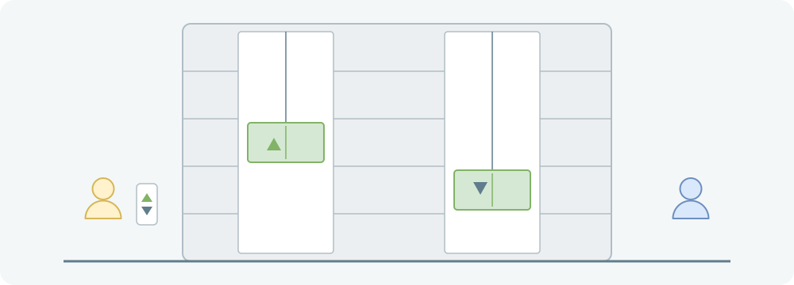
*Figure — An elevator bank in a multi-floor building: several cars, hall buttons on each floor and displays (course diagram)*

An **elevator** (lift) moves people up and down a building. A real building rarely has just one, and its cars are run as a **group** by a shared controller. That group control is what turns this from a small coding task into a design question. Two decisions carry the interview: **which car should answer a call from a floor** (dispatching) and **in what order a single car should visit its stops** (scheduling).

### Problem & clarifying questions

| Question | Assumed answer |
|---|---|
| How many floors and cars? | Many floors (0 … N-1), several cars serving all floors. |
| Which buttons? | Hall panel on each floor with UP and DOWN (no UP on the top floor, no DOWN on the ground floor); a car panel with one button per floor plus door-open and door-close. |
| Displays? | Inside each car: floor, direction, load. On each floor: one display per car showing where it is. |
| Scheduling rule? | A car serves every stop ahead in its direction before turning (the elevator algorithm; we use **LOOK**). |
| Dispatching rule? | Nearest suitable car; swappable. |
| Capacity? | Each car has a maximum load; an overloaded car does not move and says so. |
| Maintenance and emergencies? | A car can be taken out of service; fire alarm recalls all cars to the lobby. |
| Real time or simulated? | Simulated: one `step()` = one action. This makes the design testable without a clock. |

### Requirements

**Functional** (the course's twelve, plus emergency)

1. The building has **multiple floors** and **more than one elevator** serving all of them.
2. Each floor has a **hall panel** with UP and DOWN buttons (top floor: no UP; ground floor: no DOWN).
3. Each car has an **inside panel** with a button per floor, plus **door open** and **door close**.
4. Each car has a **display** showing its floor, direction and the weight it carries.
5. Each floor has a **display for every elevator** so a waiting rider can see where each car is.
6. When a rider presses a hall button, the system **picks one elevator** and sends it.
7. When a rider presses a floor button inside a car, the car **adds that floor** to its stops.
8. A car **serves the stops ahead of it** in its direction before turning around.
9. A car **does not move while its doors are open**.
10. Each car has a **maximum load**; an overloaded car does not move and **says so** on its display.
11. A car with no stops left **waits on the floor where it finished**.
12. An elevator can be **taken out of service** for maintenance; the system must not send riders to it.
13. *(Extension the course leaves out; we add it)* **Fire recall**: all cars go to the lobby, open their doors and ignore car calls.

**Non-functional**

- **Efficiency:** low average wait and ride time; no car runs to the end of the shaft for nothing.
- **Fairness / no starvation:** every accepted call is eventually served.
- **Safety:** doors, load limit and emergency modes always override scheduling.
- **Thread safety:** riders press buttons concurrently while a controller thread moves the cars.
- **Testability:** deterministic stepping.

### Use cases

**Actors:** **Rider** (calls a car, rides, chooses a destination), **Maintenance engineer** (takes a car out of service and back), **System** (chooses the car, moves cars, opens/closes doors, updates displays).

**Top use cases:** call an elevator · choose a destination · dispatch a car · move one floor · open and close the doors · report an overload · take a car out of service.

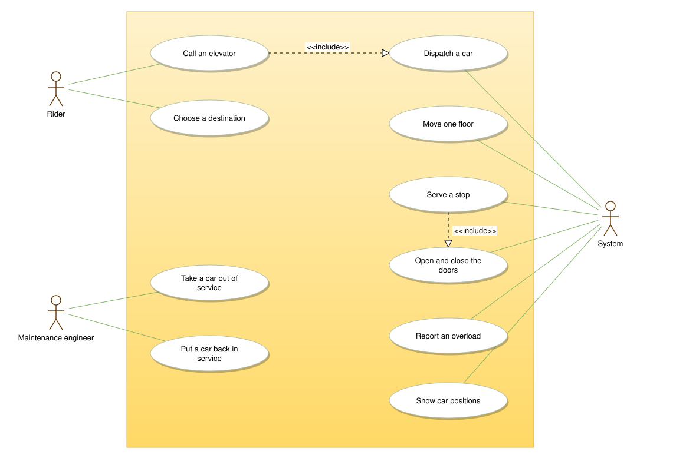
*Figure — Use case diagram of the elevator system: Rider, Maintenance engineer and System (course diagram)*

In the figure above, "dispatch a car" and "move one floor" belong to the System — the rider only triggers them.

### Core entities

| Class | Responsibility |
|---|---|
| `Direction` (enum) | UP, DOWN, IDLE. |
| `Stop` (record) | A floor **plus** the direction the car will travel when it leaves — two riders on floor 5 (one up, one down) are two stops. |
| `StopList` | The accepted stops in **two sorted sets** (`up`, `down`); `next(...)` implements LOOK. |
| `Door` | Open or closed. |
| `Elevator` | One car: floor, direction, mode, load, door, stop list. `step()` does exactly one action. |
| `Mode` (enum) | NORMAL, MAINTENANCE, FIRE_RECALL. |
| `Event` (record) | What one step did (moved, arrived, doors closed, overload, nothing). |
| `DispatchStrategy` | *Which car* answers a hall call. `NearestCarStrategy` is one rule. |
| `Dispatcher` | Holds the cars and one strategy; queues calls no car can take now. |
| `Building` | Owns hall-button lights, the cars and the dispatcher; ticks every car; clears hall lights on arrival; fire alarm. |

The course additionally models the physical parts one-to-one: `Button` (with `HallButton`, `ElevatorButton`, `DoorButton`), `HallPanel`, `ElevatorPanel`, `Display` (with `ElevatorDisplay`, `FloorDisplay`) and `Floor`. Our code keeps the behaviour (lights, displays, door) with fewer classes; in a 45-minute interview either level of detail is fine as long as you say which you chose.

### Class diagram

The course builds the design in five stages:

| Stage | What it adds | What works after it |
|---|---|---|
| 1 | `Button` family and `Door` | Buttons light and reset; a door knows if it is open |
| 2 | `HallPanel`, `ElevatorPanel`, `Display` family, `Floor` | A floor accepts a call and shows each car's position |
| 3 | `Stop` and `StopList` | Given a floor and a direction, compute the next stop |
| 4 | `Elevator` | A car travels to all the stops it has accepted, one step at a time |
| 5 | `DispatchStrategy`, `Dispatcher`, `Building` | A call on floor 7 is handed to the most suitable car |

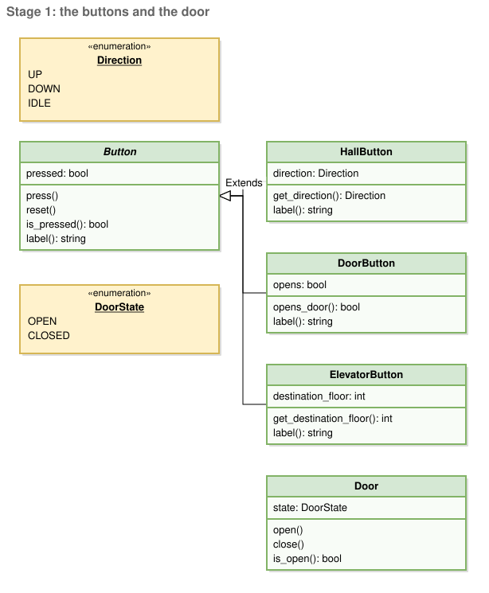
*Figure — Stage 1: the Direction enum, the abstract Button with HallButton, ElevatorButton and DoorButton, and the Door (course diagram)*

**Stage 1.** Requirements 2, 3 and 9. All buttons share one behaviour (light up on press, go dark once handled) and differ only in the value they carry: a hall button stores a **direction**, a car button a **floor number**, a door button **open or close**. That gives one abstract `Button` parent with three subclasses instead of three unrelated classes. `Door` has no owner yet; the car will own it in stage 4. Nothing can move at this point.

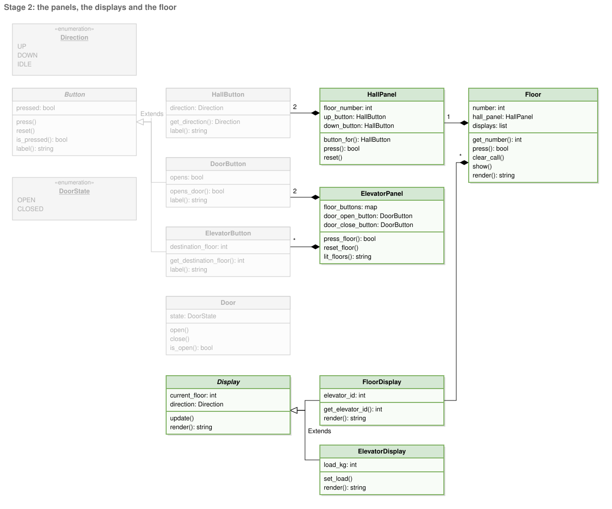
*Figure — Stage 2: HallPanel, ElevatorPanel, the abstract Display with ElevatorDisplay and FloorDisplay, and Floor, all joined by composition (course diagram)*

**Stage 2.** Requirements 2, 3, 4 and 5. Every new link is **composition**: a hall panel owns its buttons, and a floor owns its hall panel and its displays, so deleting a floor deletes them too. A hall panel has **at most two** buttons, and each is optional because the top and bottom floors lack one. The car panel creates one button per floor from the list of floors it receives, so adding a floor needs no edit here. `Display` is abstract: both subclasses show a floor and a direction; the in-car `ElevatorDisplay` adds the load, the wall-mounted `FloorDisplay` adds which car it describes. The inheritance passes the substitution test (Chapter 4): either display can be asked to render itself wherever a `Display` is expected. After this stage a floor can register a call and show where the cars are, but nothing moves yet.

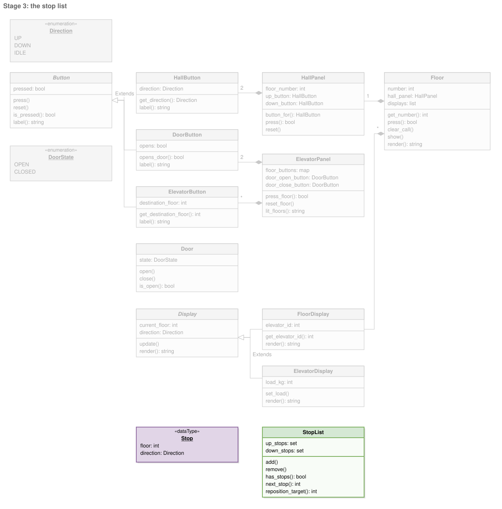
*Figure — Stage 3: the Stop data type and the StopList with its up and down sets (course diagram)*

**Stage 3 — the most important stage.** Requirement 8. The whole stage exists to answer: *knowing a car's floor and travel direction, which floor should it stop at next?* The key choice is to store stops in **two sets** (to serve going up, to serve going down) instead of one list. Picture two people waiting on floor 5, one heading up and one heading down: a plain list of floors records "5" once, so the car either stops there twice for no reason or picks up the wrong person. `Stop` is a small data type (a floor plus the direction the car will be moving when it stops there) with no relationships of its own. The next stop returned is always reachable **without reversing**; when nothing lies ahead, the car heads to the **farthest** waiting request rather than the closest one, so it sweeps everyone up on the return trip. Putting this rule in `StopList` splits responsibilities cleanly: `Elevator` **moves**, `StopList` **chooses**.

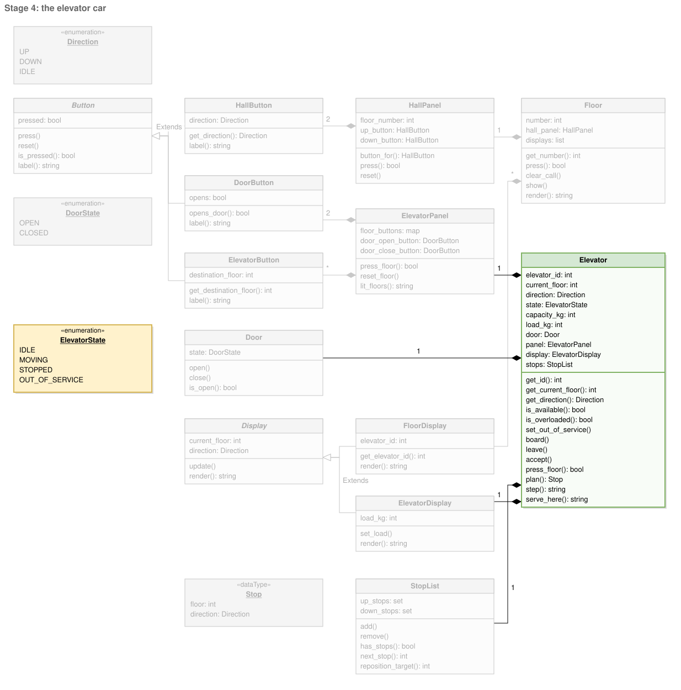
*Figure — Stage 4: the Elevator owns its door, panel, display and stop list (course diagram)*

**Stage 4.** Requirements 7, 9, 10 and 11. The car owns its door, panel, display and stop list (composition: none of them exists without the car). A single `step` does exactly **one** of four things: close the doors, refuse to move because of overload, move one floor, or stop and open the doors. Because each call does one action, a test can drive the car step by step with **no clock**. In the course, only one method reads the stop list and only `step` changes the car's position, and a car that is out of service simply does nothing on `step`, so it drops out of the building's rounds without special cases elsewhere (our `step()` returns a `NOTHING` event). Just as important is what the car does **not** know: it never touches a `Floor` and never talks to another car, which leaves the choice of car to the dispatcher.

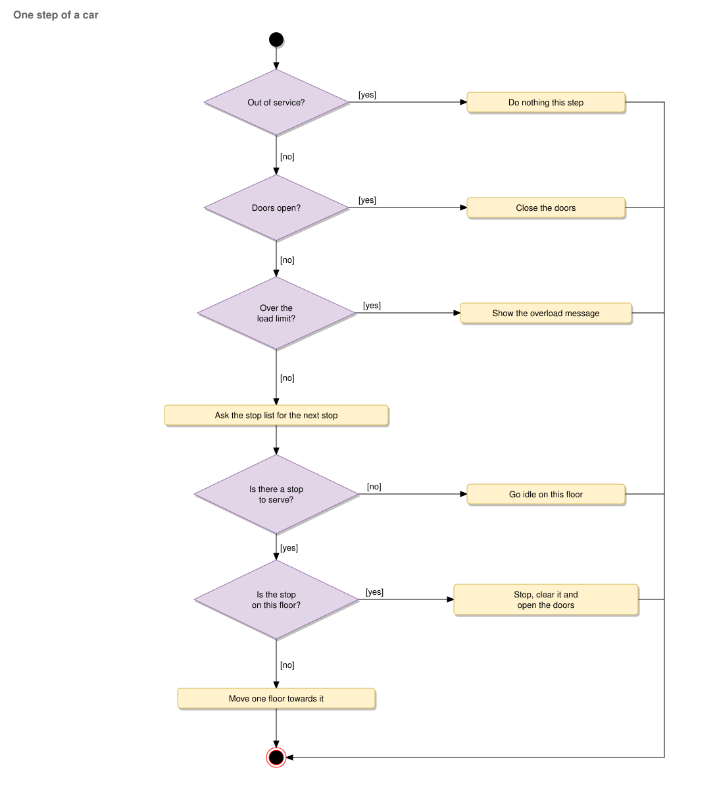
*Figure — Activity diagram "One step of a car": out of service → nothing; doors open → overload check or close; otherwise ask the stop list, go idle, stop and open, or move one floor (course diagram)*

The activity diagram above is our `Elevator.step()` drawn as a picture: every path ends in exactly one outcome, and only one outcome moves the car.


*Figure — Stage 5: DispatchStrategy interface with NearestCarStrategy, the Dispatcher, and the Building that owns floors, cars and the dispatcher (course diagram)*

**Stage 5.** Requirements 1, 6 and 12. The rule that picks a car lives **behind an interface** (`DispatchStrategy`), and the dispatcher depends only on that interface, drawn as a plain arrow to it; `NearestCarStrategy` implements it (dashed line, hollow triangle). Morning rush in an office block and a quiet night in a hotel call for different rules, and swapping the rule touches one class only. The building owns its floors, cars and dispatcher (filled diamonds). It is also the only class that knows about both cars and floors, so switching off the hall-button light when a car opens its doors is the building's job.


*Figure — Activity diagram "Answering a call from a floor": rider presses up/down on floor 7, the dispatcher scores every in-service car, the chosen car adds floor 7, steps until it reaches the stop, opens its doors, and the hall button is cleared (course diagram)*


*Figure — The finished class diagram of the elevator system (course diagram)*

Class diagram of **our Java code**:


### Key flows

**Scheduling algorithms compared.** "Scheduling" means choosing the order in which one car serves its stops. These algorithms come from disk-arm scheduling in operating systems, which has the same shape (a head moving along a line of requests).

| Algorithm | Rule | Good | Bad |
|---|---|---|---|
| **FCFS** (first come, first served) | Serve calls in arrival order | Simple, fair in order | Zig-zags up and down; very inefficient |
| **SSTF** (shortest seek time first) | Always go to the nearest stop | Short average trips | **Starvation**: a far floor may wait forever while nearby calls keep coming |
| **SCAN** ("elevator algorithm") | Sweep in one direction to the **end of the shaft**, then reverse | No starvation, predictable | Wastes travel going to the top/bottom floor even when nobody is there |
| **LOOK** | Sweep in one direction only **as far as the last request**, then reverse | No starvation, no wasted travel | Slightly more bookkeeping |
| **C-SCAN / C-LOOK** | Serve in one direction only; jump back to the start | More uniform waits | Empty return trips |

Our `StopList.next` is **LOOK** with direction-aware stops:

1. Going **UP**: the nearest up-stop at or above the car (`up.ceiling(cur)`).
2. None? If someone *above* wants to go **down**, go up to the **highest** such floor, then turn (collect the rest on the way down).
3. Otherwise turn: the nearest down-stop at or below the car (`down.floor(cur)`).
4. Otherwise the only work left is up-stops **below** the car: go down to the **lowest** one, then serve upward.
5. Going **DOWN** is the mirror image. An **IDLE** car picks the side of the nearest stop.


**Car states.**


**A hall call.**


**Dispatch cost** (`NearestCarStrategy`, from the course): an **idle** car costs its distance; a car **already coming this way in the same direction** costs its distance; any other car pays distance **+ two building heights**, so it wins only when nothing better is free. Cars out of service are skipped.

### Design decisions & patterns used

| Decision | Pattern / principle | Why | Alternative rejected |
|---|---|---|---|
| Choosing a car is a `DispatchStrategy` | **Strategy** | Different buildings and times of day want different rules; the course admits one implementation normally doesn't justify an interface, but here the *requirement* (swap the rule) does | `if (officeMode) … else …` in the dispatcher |
| Sweep rule in `StopList`, not in `Elevator` | Single Responsibility | The car drives; the stop list decides. Without this split, `Elevator` would do two jobs | Next-stop logic inside `step()` |
| Two sets of stops (up/down) | Data modelling | Distinguishes "5 going up" from "5 going down" | One list of floors |
| `step()` = one action | Deterministic simulation | Every scenario is a list of calls and an expected list of events; no clock, no flakiness | A thread per car with `sleep` |
| Modes as an enum inside the car | Lightweight State | Only three modes and a few checks; full State classes would add more code than they save here. If modes grew (fire phase II, independent service, VIP), switch to the State pattern | State classes from day one |
| Hall calls re-dispatched when a car leaves service | Robustness | A call accepted by a car must not be lost when that car is taken out | Silently clearing the car's stops |
| Queue calls when no car is available | — | "No car can take the call right now" is not the same as "rejected" | Dropping the call |

The course lists three honest weak points, all worth saying: (1) one step per call means **no threads**; a real controller runs each car on its own thread and needs a lock around the stop list — our methods are `synchronized` for exactly that; (2) the dispatcher **decides once** and never re-evaluates, though real systems do (that is why a busy building sometimes changes the car number while you wait); (3) `Elevator` is close to doing two jobs, which is why the sweep rule lives in `StopList`. The course also names only **one** pattern here (Strategy); `Button` and `Display` are ordinary abstract base classes and `StopList` is Single Responsibility, not a pattern. Its scope list deliberately leaves out emergency calls, fire service mode, express cars that skip floors, and door sensors that reopen for a hand (we add fire recall; the others are extensions below).

### Java implementation

Package `lld.ch14.elevator`.

```java
// File: lld/ch14/elevator/StopList.java
package lld.ch14.elevator;

import java.util.Optional;
import java.util.TreeSet;

enum Direction { UP, DOWN, IDLE }

/** A floor plus the direction the car will travel when it leaves that floor. */
record Stop(int floor, Direction direction) {}

/**
 * The stops a car has accepted, kept in TWO sorted sets: floors to serve while going up,
 * and floors to serve while going down. Two riders on floor 5 (one up, one down) are two stops.
 * next() implements LOOK: keep going while there is work ahead, turn at the last request,
 * never travel to the end of the shaft for nothing (that would be SCAN).
 */
final class StopList {
    private final TreeSet<Integer> up = new TreeSet<>();
    private final TreeSet<Integer> down = new TreeSet<>();

    void add(Stop s) { (s.direction() == Direction.DOWN ? down : up).add(s.floor()); }
    void remove(Stop s) { (s.direction() == Direction.DOWN ? down : up).remove(s.floor()); }
    boolean isEmpty() { return up.isEmpty() && down.isEmpty(); }
    void clear() { up.clear(); down.clear(); }

    /** Removes and returns every stop (used when a car leaves service). */
    java.util.List<Stop> drain() {
        java.util.List<Stop> all = new java.util.ArrayList<>();
        up.forEach(f -> all.add(new Stop(f, Direction.UP)));
        down.forEach(f -> all.add(new Stop(f, Direction.DOWN)));
        clear();
        return all;
    }

    Optional<Stop> next(int cur, Direction dir) {
        if (isEmpty()) return Optional.empty();
        if (dir == Direction.IDLE) dir = nearestSide(cur);
        return Optional.of(dir == Direction.UP ? goingUp(cur) : goingDown(cur));
    }

    private Stop goingUp(int cur) {
        Integer f = up.ceiling(cur);
        if (f != null) return new Stop(f, Direction.UP);                           // work ahead
        if (!down.isEmpty() && down.last() > cur) return new Stop(down.last(), Direction.DOWN); // go up, then turn
        f = down.floor(cur);
        if (f != null) return new Stop(f, Direction.DOWN);                         // turn around now
        return new Stop(up.first(), Direction.UP);                                 // go down to lowest up-call
    }

    private Stop goingDown(int cur) {
        Integer f = down.floor(cur);
        if (f != null) return new Stop(f, Direction.DOWN);
        if (!up.isEmpty() && up.first() < cur) return new Stop(up.first(), Direction.UP);
        f = up.ceiling(cur);
        if (f != null) return new Stop(f, Direction.UP);
        return new Stop(down.last(), Direction.DOWN);
    }

    private Direction nearestSide(int cur) {
        int best = Integer.MAX_VALUE;
        Direction side = Direction.UP;
        for (int f : up) if (Math.abs(f - cur) < best) { best = Math.abs(f - cur); side = f >= cur ? Direction.UP : Direction.DOWN; }
        for (int f : down) if (Math.abs(f - cur) < best) { best = Math.abs(f - cur); side = f > cur ? Direction.UP : Direction.DOWN; }
        return side;
    }

    @Override public String toString() { return "up" + up + " down" + down; }
}
```

```java
// File: lld/ch14/elevator/Elevator.java
package lld.ch14.elevator;

enum Mode { NORMAL, MAINTENANCE, FIRE_RECALL }

/** What one step of a car did. */
record Event(Kind kind, int car, int floor, Direction direction, String note) {
    enum Kind { MOVED, ARRIVED, DOORS_CLOSED, OVERLOAD, NOTHING }
}

final class Door {
    private boolean open;
    boolean isOpen() { return open; }
    void open() { open = true; }
    void close() { open = false; }
}

/**
 * One car. It drives; its StopList decides. One call to step() = one action, so the whole
 * system is testable without a clock. Methods are synchronized because riders press buttons
 * from other threads while the controller thread calls step().
 */
final class Elevator {
    private final int id;
    private final int capacityKg;
    private final Door door = new Door();
    private final StopList stops = new StopList();
    private int floor;
    private Direction direction = Direction.IDLE;
    private Mode mode = Mode.NORMAL;
    private int loadKg;

    Elevator(int id, int startFloor, int capacityKg) {
        this.id = id;
        this.floor = startFloor;
        this.capacityKg = capacityKg;
    }

    /** From the dispatcher: a hall call this car has been given. */
    synchronized void assign(int f, Direction wanted) { stops.add(new Stop(f, wanted)); }

    /** From the panel inside the car. */
    synchronized void pressFloor(int f) {
        if (mode != Mode.NORMAL) return;                    // car buttons are dead during fire recall
        if (f == floor && door.isOpen()) return;
        Direction d = f > floor ? Direction.UP : f < floor ? Direction.DOWN
                : (direction == Direction.IDLE ? Direction.UP : direction);
        stops.add(new Stop(f, d));
    }

    synchronized Event step() {
        if (mode == Mode.MAINTENANCE) return nothing();   // parked: never moves
        if (door.isOpen()) {
            if (mode == Mode.FIRE_RECALL && stops.isEmpty()) return nothing(); // parked at lobby, doors open
            if (loadKg > capacityKg) {
                return new Event(Event.Kind.OVERLOAD, id, floor, direction,
                        "OVERLOAD " + loadKg + "kg > " + capacityKg + "kg, doors stay open");
            }
            door.close();
            return new Event(Event.Kind.DOORS_CLOSED, id, floor, direction, "doors close");
        }
        var next = stops.next(floor, direction);
        if (next.isEmpty()) {
            direction = Direction.IDLE;
            return nothing();
        }
        Stop target = next.get();
        if (target.floor() == floor) {                       // arrived
            stops.remove(target);
            direction = stops.isEmpty() ? Direction.IDLE : target.direction();
            door.open();
            return new Event(Event.Kind.ARRIVED, id, floor, target.direction(), "doors open");
        }
        direction = target.floor() > floor ? Direction.UP : Direction.DOWN;   // never moves with doors open
        floor += direction == Direction.UP ? 1 : -1;
        return new Event(Event.Kind.MOVED, id, floor, direction, "");
    }

    synchronized void board(int kg) { loadKg += kg; }
    synchronized void alight(int kg) { loadKg = Math.max(0, loadKg - kg); }

    /** Out of service: returns the stops it had accepted, so hall calls can be re-dispatched. */
    synchronized java.util.List<Stop> takeOutOfService() {
        mode = Mode.MAINTENANCE;
        direction = Direction.IDLE;
        door.open();                       // parked with doors open so riders can leave
        return stops.drain();
    }

    synchronized void returnToService() {
        mode = Mode.NORMAL;
    }

    /** Fire service: drop every stop, go straight to the lobby, open the doors and stay there. */
    synchronized void fireRecall(int lobby) {
        if (mode == Mode.MAINTENANCE) return;
        mode = Mode.FIRE_RECALL;
        stops.clear();
        stops.add(new Stop(lobby, Direction.DOWN));
        direction = Direction.IDLE;
    }

    synchronized boolean available() { return mode == Mode.NORMAL; }
    synchronized boolean idle() { return stops.isEmpty() && (!door.isOpen() || mode != Mode.NORMAL); }
    synchronized int floor() { return floor; }
    synchronized Direction direction() { return direction; }
    int id() { return id; }

    synchronized String display() {
        return "car%d@%d %s%s %dkg %s".formatted(id, floor, direction, door.isOpen() ? " [open]" : "",
                loadKg, mode == Mode.NORMAL ? "" : mode);
    }

    private Event nothing() { return new Event(Event.Kind.NOTHING, id, floor, direction, ""); }
}
```

```java
// File: lld/ch14/elevator/Dispatch.java
package lld.ch14.elevator;

import java.util.ArrayDeque;
import java.util.Comparator;
import java.util.List;
import java.util.Optional;
import java.util.Queue;

/** Strategy: which car answers a hall call. Office at 9am and hotel at midnight want different rules. */
interface DispatchStrategy {
    Optional<Elevator> choose(List<Elevator> cars, int floor, Direction wanted, int floorCount);
}

/**
 * Idle car: cost = distance. A car already heading toward the caller in the same direction:
 * cost = distance. Anything else pays a penalty of two building heights, so it wins only
 * when nothing better exists.
 */
final class NearestCarStrategy implements DispatchStrategy {
    @Override public Optional<Elevator> choose(List<Elevator> cars, int floor, Direction wanted, int floorCount) {
        return cars.stream().filter(Elevator::available)
                .min(Comparator.comparingInt((Elevator c) -> cost(c, floor, wanted, floorCount))
                        .thenComparingInt(Elevator::id));
    }

    private int cost(Elevator c, int floor, Direction wanted, int n) {
        int distance = Math.abs(c.floor() - floor);
        Direction d = c.direction();
        if (d == Direction.IDLE) return distance;
        boolean onTheWay = (d == Direction.UP && c.floor() <= floor) || (d == Direction.DOWN && c.floor() >= floor);
        if (onTheWay && d == wanted) return distance;
        return distance + 2 * n;
    }
}

/** Holds the cars and one strategy. Calls no car can take right now wait in a queue. */
final class Dispatcher {
    private final List<Elevator> cars;
    private final int floorCount;
    private volatile DispatchStrategy strategy;
    private final Queue<Stop> pending = new ArrayDeque<>();

    Dispatcher(List<Elevator> cars, int floorCount, DispatchStrategy strategy) {
        this.cars = cars;
        this.floorCount = floorCount;
        this.strategy = strategy;
    }

    synchronized Optional<Elevator> call(int floor, Direction wanted) {
        Optional<Elevator> car = strategy.choose(cars, floor, wanted, floorCount);
        car.ifPresentOrElse(c -> c.assign(floor, wanted), () -> pending.add(new Stop(floor, wanted)));
        return car;
    }

    /** Called every tick: retry the calls nobody could take earlier. */
    synchronized void retryPending() {
        int n = pending.size();
        for (int i = 0; i < n; i++) {
            Stop s = pending.poll();
            Optional<Elevator> car = strategy.choose(cars, s.floor(), s.direction(), floorCount);
            if (car.isPresent()) car.get().assign(s.floor(), s.direction());
            else pending.add(s);
        }
    }

    synchronized int pendingCount() { return pending.size(); }
    void setStrategy(DispatchStrategy s) { this.strategy = s; }
}
```

```java
// File: lld/ch14/elevator/Building.java
package lld.ch14.elevator;

import java.util.ArrayList;
import java.util.List;
import java.util.Set;
import java.util.concurrent.ConcurrentHashMap;

/** Owns floors' hall buttons, the cars and the dispatcher. The only class that knows cars AND floors. */
final class Building {
    private final int floors;
    private final List<Elevator> cars = new ArrayList<>();
    private final Dispatcher dispatcher;
    private final Set<Stop> litHallButtons = ConcurrentHashMap.newKeySet();
    private int tick;

    Building(int floors, int[] carStartFloors, int capacityKg) {
        this.floors = floors;
        for (int i = 0; i < carStartFloors.length; i++) cars.add(new Elevator(i + 1, carStartFloors[i], capacityKg));
        this.dispatcher = new Dispatcher(cars, floors, new NearestCarStrategy());
    }

    /** A rider presses UP or DOWN on a floor. The top floor has no UP, the ground floor no DOWN. */
    String call(int floor, Direction d) {
        if ((floor == floors - 1 && d == Direction.UP) || (floor == 0 && d == Direction.DOWN)) {
            throw new IllegalArgumentException("no " + d + " button on floor " + floor);
        }
        if (!litHallButtons.add(new Stop(floor, d))) return "hall %d %s already lit".formatted(floor, d);
        return dispatcher.call(floor, d).map(c -> "hall %d %s -> car%d".formatted(floor, d, c.id()))
                .orElse("hall %d %s -> queued (no car available)".formatted(floor, d));
    }

    /** One tick: retry queued calls, then every car takes one step. Returns what happened. */
    List<String> step() {
        tick++;
        dispatcher.retryPending();
        List<String> out = new ArrayList<>();
        for (Elevator c : cars) {
            Event e = c.step();
            if (e.kind() == Event.Kind.ARRIVED) litHallButtons.remove(new Stop(e.floor(), e.direction()));
            if (e.kind() == Event.Kind.MOVED) out.add("car%d->%d".formatted(e.car(), e.floor()));
            else if (e.kind() != Event.Kind.NOTHING) out.add("car%d@%d %s".formatted(e.car(), e.floor(), e.note()));
        }
        return out;
    }

    /** Engineer takes a car out: its accepted hall calls go back to the dispatcher. */
    List<String> takeOutOfService(int carId) {
        List<String> out = new ArrayList<>();
        for (Stop s : car(carId).takeOutOfService()) {
            if (litHallButtons.contains(s)) {
                out.add("re-dispatch " + dispatcher.call(s.floor(), s.direction())
                        .map(c -> "hall %d %s -> car%d".formatted(s.floor(), s.direction(), c.id()))
                        .orElse("hall %d %s -> queued".formatted(s.floor(), s.direction())));
            }
        }
        return out;
    }

    void returnToService(int carId) { car(carId).returnToService(); }

    void fireAlarm() {
        litHallButtons.clear();
        cars.forEach(c -> c.fireRecall(0));
    }

    boolean allIdle() { return cars.stream().allMatch(Elevator::idle) && dispatcher.pendingCount() == 0; }
    Elevator car(int id) { return cars.get(id - 1); }
    int tick() { return tick; }

    /** What the display on every floor shows. */
    String floorDisplay() {
        StringBuilder sb = new StringBuilder();
        cars.forEach(c -> sb.append(c.display().stripTrailing()).append(" | "));
        return sb.substring(0, sb.length() - 3);
    }
}
```

```java
// File: lld/ch14/elevator/Main.java
package lld.ch14.elevator;

import java.util.ArrayList;
import java.util.List;
import java.util.concurrent.CountDownLatch;
import java.util.concurrent.ExecutorService;
import java.util.concurrent.Executors;

public class Main {
    public static void main(String[] args) throws Exception {
        System.out.println("== 1. LOOK on one car: at floor 4 going up; stops 6(up) 9(car) 2(down) 1(up) ==");
        StopList sl = new StopList();
        sl.add(new Stop(6, Direction.UP));
        sl.add(new Stop(9, Direction.UP));
        sl.add(new Stop(2, Direction.DOWN));
        sl.add(new Stop(1, Direction.UP));
        int cur = 4;
        Direction dir = Direction.UP;
        List<Integer> order = new ArrayList<>();
        while (!sl.isEmpty()) {
            Stop s = sl.next(cur, dir).orElseThrow();
            sl.remove(s);
            order.add(s.floor());
            cur = s.floor();
            dir = s.direction();
        }
        System.out.println("service order " + order + "  (turns at 9 and at 1: never runs to 0 or to a floor above 9)");

        System.out.println("\n== 2. Building: floors 0-9, car1 at 0, car2 at 8 ==");
        Building b = new Building(10, new int[]{0, 8}, 680);
        System.out.println(b.call(5, Direction.UP));      // car2 idle, 3 away, beats car1 (5 away)
        System.out.println(b.call(1, Direction.UP));      // car1 idle, 1 away
        steps(b, 2);
        System.out.println("rider enters car1 at floor 1, presses 7");
        b.car(1).board(80);
        b.car(1).pressFloor(7);
        steps(b, 2);
        System.out.println("rider enters car2 at floor 5, presses 9");
        b.car(2).board(75);
        b.car(2).pressFloor(9);
        System.out.println(b.call(3, Direction.UP));      // car1 is below 3 and going up: on its way
        runUntilIdle(b);
        System.out.println("display: " + b.floorDisplay());

        System.out.println("\n== 3. Overload: at floor 9, 10 more people squeeze into car2 ==");
        System.out.println(b.call(9, Direction.DOWN));
        steps(b, 1);                                      // doors open at 9
        b.car(2).board(700);
        b.car(2).pressFloor(0);
        steps(b, 2);
        System.out.println("two people step out");
        b.car(2).alight(160);
        steps(b, 3);
        runUntilIdle(b);
        b.car(2).alight(615);                             // everyone leaves at the lobby

        System.out.println("\n== 4. Maintenance: calls move to another car ==");
        System.out.println(b.call(4, Direction.DOWN));
        b.takeOutOfService(1).forEach(System.out::println);       // car1 had the call: it moves to car2
        b.takeOutOfService(2).forEach(System.out::println);  // now no car at all: call is queued
        System.out.println(b.call(2, Direction.UP));
        System.out.println("engineer returns car1 to service; queued calls are dispatched on the next tick");
        b.returnToService(1);
        runUntilIdle(b);
        b.returnToService(2);

        System.out.println("\n== 5. Fire alarm: every car to the lobby, doors open, car buttons dead ==");
        b.car(2).pressFloor(9);
        steps(b, 3);
        b.fireAlarm();
        b.car(1).pressFloor(8);
        runUntilIdle(b);
        System.out.println("display: " + b.floorDisplay());

        System.out.println("\n== 6. 8 riders press hall buttons at the same instant (new building) ==");
        Building busy = new Building(10, new int[]{0, 9, 4}, 680);
        CountDownLatch go = new CountDownLatch(1);
        try (ExecutorService pool = Executors.newFixedThreadPool(8)) {
            int[][] calls = {{1, 0}, {2, 0}, {3, 1}, {5, 0}, {6, 1}, {7, 1}, {8, 0}, {9, 1}};
            for (int[] c : calls) {
                pool.submit(() -> { go.await(); busy.call(c[0], c[1] == 0 ? Direction.UP : Direction.DOWN); return null; });
            }
            go.countDown();
        }
        while (!busy.allIdle() && busy.tick() < 200) busy.step();
        System.out.println("all 8 calls served: " + busy.allIdle() + " (ticks=" + busy.tick() + " < 200)");
    }

    /** Exactly n ticks, printing what happened in each. */
    static void steps(Building b, int n) {
        for (int i = 0; i < n; i++) print(b, b.step());
    }

    static void runUntilIdle(Building b) {
        for (int guard = 0; guard < 100 && !b.allIdle(); guard++) print(b, b.step());
    }

    private static void print(Building b, List<String> events) {
        System.out.println("  t" + b.tick() + ": " + (events.isEmpty() ? "-" : String.join(", ", events)));
    }
}
```

**How the code works, part by part**

- `StopList` keeps two `TreeSet<Integer>`s. `ceiling`, `floor`, `first` and `last` give O(log n) answers to "nearest stop at or above/below" — the core of LOOK.
- `Elevator.step()` checks, in order: maintenance → doors open (overload? fire parked? else close) → ask the stop list → arrive (remove the stop, open the doors) or move one floor. The car never moves with the doors open.
- `pressFloor` classifies a car call as an up- or down-stop relative to the current floor; during fire recall car buttons are ignored.
- `takeOutOfService` returns the car's accepted stops; `Building` re-dispatches the ones that are still lit hall calls.
- `Dispatcher.retryPending` runs every tick, so a queued call is dispatched as soon as any car becomes available.
- `Main` part 1 runs LOOK on one car in isolation; parts 2–5 run a two-car building; part 6 has eight threads press hall buttons at the same instant.

**Output:**

```text
== 1. LOOK on one car: at floor 4 going up; stops 6(up) 9(car) 2(down) 1(up) ==
service order [6, 9, 2, 1]  (turns at 9 and at 1: never runs to 0 or to a floor above 9)

== 2. Building: floors 0-9, car1 at 0, car2 at 8 ==
hall 5 UP -> car2
hall 1 UP -> car1
  t1: car1->1, car2->7
  t2: car1@1 doors open, car2->6
rider enters car1 at floor 1, presses 7
  t3: car1@1 doors close, car2->5
  t4: car1->2, car2@5 doors open
rider enters car2 at floor 5, presses 9
hall 3 UP -> car1
  t5: car1->3, car2@5 doors close
  t6: car1@3 doors open, car2->6
  t7: car1@3 doors close, car2->7
  t8: car1->4, car2->8
  t9: car1->5, car2->9
  t10: car1->6, car2@9 doors open
  t11: car1->7, car2@9 doors close
  t12: car1@7 doors open
  t13: car1@7 doors close
display: car1@7 IDLE 80kg | car2@9 IDLE 75kg

== 3. Overload: at floor 9, 10 more people squeeze into car2 ==
hall 9 DOWN -> car2
  t14: car2@9 doors open
  t15: car2@9 OVERLOAD 775kg > 680kg, doors stay open
  t16: car2@9 OVERLOAD 775kg > 680kg, doors stay open
two people step out
  t17: car2@9 doors close
  t18: car2->8
  t19: car2->7
  t20: car2->6
  t21: car2->5
  t22: car2->4
  t23: car2->3
  t24: car2->2
  t25: car2->1
  t26: car2->0
  t27: car2@0 doors open
  t28: car2@0 doors close

== 4. Maintenance: calls move to another car ==
hall 4 DOWN -> car1
re-dispatch hall 4 DOWN -> car2
re-dispatch hall 4 DOWN -> queued
hall 2 UP -> queued (no car available)
engineer returns car1 to service; queued calls are dispatched on the next tick
  t29: car1@7 doors close
  t30: car1->6
  t31: car1->5
  t32: car1->4
  t33: car1@4 doors open
  t34: car1@4 doors close
  t35: car1->3
  t36: car1->2
  t37: car1@2 doors open
  t38: car1@2 doors close

== 5. Fire alarm: every car to the lobby, doors open, car buttons dead ==
  t39: car2@0 doors close
  t40: car2->1
  t41: car2->2
  t42: car1->1, car2->1
  t43: car1->0, car2->0
  t44: car1@0 doors open, car2@0 doors open
display: car1@0 IDLE [open] 80kg FIRE_RECALL | car2@0 IDLE [open] 0kg FIRE_RECALL

== 6. 8 riders press hall buttons at the same instant (new building) ==
all 8 calls served: true (ticks=11 < 200)
```

Read the output: in part 1 the car serves 6 and 9 going up, turns at 9 (the highest request, not the top of the shaft), serves 2 going down, then 1 — LOOK, not SCAN. In part 2 the hall call on 3 goes to car 1 because it is below floor 3 and already going up. In part 3 the overloaded car keeps its doors open until two people step out. In part 4 the call held by car 1 moves to car 2 when car 1 goes out of service, then is queued when no car is available, and served as soon as car 1 returns. In part 5 car 2 reverses mid-trip and both cars park at the lobby with doors open.

### Concurrency & edge cases

| Situation | Handling |
|---|---|
| Riders press buttons while the controller steps cars | `Elevator` methods are `synchronized`; the dispatcher is `synchronized`; hall lights are a concurrent set |
| Same hall button pressed twice | `litHallButtons.add` returns false: "already lit", no second dispatch |
| Up and down requests on the same floor | Two different `Stop`s in two sets |
| Car call for the floor the car is on, doors open | Ignored (doors already open) |
| Overload | Doors stay open, display shows OVERLOAD, car does not move |
| Car taken out of service with accepted hall calls | Calls re-dispatched or queued; never lost |
| No car available | Call queued; retried every tick |
| Fire alarm | All stops dropped, lobby added, car buttons ignored, doors stay open at the lobby |
| Starvation | LOOK serves every accepted stop within one round trip (one sweep each way) |
| Invalid button (UP on the top floor) | `IllegalArgumentException` — that button does not exist |

### Extensions & follow-up questions

1. **"How do you choose which car?"** — `DispatchStrategy`; show `NearestCarStrategy` and mention alternatives: zoning (car 1 serves floors 0–10), **up-peak** mode (send idle cars to the lobby at 9 a.m.), and energy-saving rules.
2. **"What if two riders press at the same instant?"** — The dispatcher is synchronized, so calls are dispatched one at a time; each car's stop list is guarded by the car's lock. (The course's design leaves this lock out and says so.)
3. **"How would you test this?"** — Because one call = one step, every test is: a list of button presses, N steps, and an expected list of events. No sleeps, no flakiness.
4. **"Destination dispatch?"** — Riders enter their destination in the lobby keypad; the system groups riders with nearby destinations into the same car. Implement as another `DispatchStrategy` that receives (from, to) instead of (floor, direction).
5. **"Re-evaluate assignments?"** — Each tick, for unserved hall calls, ask the strategy again and move the call if a much better car is free now.
6. **"Real time?"** — A `ScheduledExecutorService` calls `building.step()` every second (or per car on its own thread, with the car lock guarding the stop list).
7. **"Emergency stop button inside the car?"** — A new mode that halts movement immediately and raises an alarm; with more modes, refactor modes into State classes.
8. **"Express cars?"** — A car with a set of floors it may serve (e.g. lobby plus 30–40); the dispatch strategy skips cars whose served set does not include the call floor.
9. **"Door sensor that reopens for a hand?"** — A `DoorSensor` input; while it reports an obstruction, `step()` reopens the doors instead of closing them (same slot as the overload check).

### Real-world example

Modern high-rise buildings use **destination dispatch** systems (for example Schindler's PORT, Otis CompassPlus and KONE's destination control): riders choose their floor in the lobby and the system tells them which car to take, which cuts stops per trip — extension 4. Controllers switch between traffic modes such as **up-peak** in the morning. The fire behaviour in this design follows the idea of **Phase I emergency recall** in elevator safety codes such as ASME A17.1: on a fire alarm, cars return to the designated landing, open their doors and are removed from normal service.

### In the interview

**Plan for 45 minutes:** 5 min requirements and scope (how many cars, which modes) → 5 min entities → **15 min on the stop list and LOOK** (two sets, the four cases) → 10 min car `step()` and dispatcher strategy → 10 min concurrency, testing and follow-ups.

**30-second answer:** "Each car keeps its stops in two sorted sets, up-stops and down-stops, and uses LOOK: keep serving stops ahead in the current direction, turn at the last request, never run to the end of the shaft for nothing. A car's `step()` does one action — close doors, refuse to move if overloaded, move one floor, or stop and open — which makes the whole system testable without a clock. A dispatcher assigns hall calls through a `DispatchStrategy`, nearest suitable car by default, and queues calls when no car is available. Doors, load, maintenance and fire recall always override scheduling."

**Follow-ups with answers**

- *"Why LOOK and not SSTF?"* — SSTF can starve a distant floor; LOOK serves every accepted stop within one round trip (one sweep up, one sweep down).
- *"Why two sets and not one?"* — A floor can be requested going up and going down; one set cannot tell which rider to serve on which sweep.
- *"Where do you put the lock?"* — Around each car's stop list and state (the car's monitor), and around the dispatcher's assignment. No global lock across cars.

### Self-check

1. **Q:** Difference between SCAN and LOOK? **A:** SCAN runs to the end of the shaft before reversing; LOOK reverses at the last request.
2. **Q:** A car at 4 going up has stops 6(up), 9(car), 2(down), 1(up). Order? **A:** 6, 9, 2, 1.
3. **Q:** Why is the scheduling rule in `StopList` and not `Elevator`? **A:** Single Responsibility — the car drives, the stop list decides; each can be tested alone.
4. **Q:** What does the dispatcher do when every car is in maintenance? **A:** Queues the call and retries on every tick.
5. **Q:** Why does one `step()` do only one action? **A:** Deterministic, clock-free simulation: tests are sequences of calls with expected events.
6. **Q:** When would you convert modes into State classes? **A:** When there are many modes with different behaviour per action (fire phase I/II, independent service, VIP, emergency stop).

### TL;DR

- **Two sorted sets** (up/down) of stops + **LOOK** = efficient, starvation-free scheduling.
- **`step()` = one action**; doors, load, maintenance and fire recall override scheduling.
- **Strategy** for dispatch (nearest car by default), with a pending queue and re-dispatch when a car leaves service.
- Thread safety: per-car lock, synchronized dispatcher, concurrent hall-light set.

---

## 14.6 Design a Traffic Signal Control System

A **traffic signal controller** decides which approaches of an intersection get green, for how long, and in what order. An **approach** is one road entering the intersection (north, south, east, west). A **phase** is a set of approaches that may be green together because their paths do not cross (for example north and south going straight). The controller cycles through phases, inserting **yellow** (warning) and **all-red** (clearance) intervals between them.

This question tests a **timed state machine** with a **hard safety rule** — *two crossing flows must never be green at the same time* — plus an **emergency override** that must interrupt the normal cycle *safely* (never by cutting a yellow short).

### Problem & clarifying questions

| Question | Assumed answer |
|---|---|
| How many roads? | A four-way intersection (N, S, E, W); phases are configurable. |
| Which signals? | Red, yellow, green; flashing red in fault mode. |
| Fixed or adaptive timing? | Configurable: fixed durations, or adaptive based on queue sensors. |
| Pedestrian signals, turn arrows? | Out of scope (extensions). |
| Emergency vehicles? | Yes: an approaching ambulance or fire truck gets green as soon as safely possible, held until it passes. |
| Many intersections? | Each intersection has its own controller; a central system can coordinate them (extension). |
| Real time? | A timer ticks once per second; the logic is tick-driven so it can also be simulated. |

### Requirements

**Functional**

1. Control traffic at an intersection with **multiple roads**.
2. Support **red, yellow and green** signals.
3. Signal **durations are configurable** and can **adapt to traffic** conditions.
4. Transitions are **smooth and safe**: green → yellow → all-red → next green.
5. Handle **emergencies**: an approaching ambulance or fire truck gets priority.
6. Be **scalable and extensible** (more phases, more intersections, new features).
7. On a controller fault, fall back to a **safe mode** (all flashing red = treat as an all-way stop).

**Non-functional**

- **Safety invariant:** never conflicting greens, not even for an instant during a switch.
- **Deterministic timing:** a tick = one second; testable with a simulated clock.
- **Thread safety:** a timer thread ticks while sensor and emergency inputs arrive from other threads.
- **Observability:** displays, logs and monitors can subscribe to light changes.

### Use cases

**Actors:** **Timer** (ticks every second), **Vehicle sensors** (report queue lengths), **Emergency vehicle / dispatch** (request and clear pre-emption), **Traffic engineer** (configures phases and timing), **Drivers** (see the lights).


### Core entities

| Class | Responsibility |
|---|---|
| `Signal` (enum) | RED, YELLOW, GREEN, FLASHING_RED. |
| `Approach` (enum) | NORTH, SOUTH, EAST, WEST. |
| `Phase` (record) | A name and the set of approaches that may be green together. |
| `TrafficLight` | One signal head for one approach; notifies listeners on every change. |
| `SignalListener` | **Observer** interface for light changes. |
| `SafetyMonitor` | A listener that checks the safety invariant after every change to green. |
| `TimingPolicy` | **Strategy** for green duration: `FixedTiming`, `QueueAdaptiveTiming`. |
| `SignalState` + 5 states | **State**: `GreenState`, `YellowState`, `AllRedState`, `EmergencyHoldState`, `FlashingRedState`. |
| `Intersection` | The State context: phases, lights, timing, sensors, emergency flag; `tick()`. |

**Mapping to the common problem statement.** The widely used version of this problem (for example in the open-source *awesome-low-level-design* collection) asks for: an intersection with multiple roads, red/yellow/green signals, configurable durations that can adjust to traffic, smooth transitions, handling of emergency vehicles (ambulances, fire trucks), and a scalable, extensible design. Its classes map onto ours as follows: the `Signal` enum → our `Signal`; `Road` (id, name, and the traffic light facing it) → our `Approach` plus the `TrafficLight` stored for it; `TrafficLight` (current signal, durations, notifies observers) → our `TrafficLight` (signal + listeners) with the durations moved into `TimingPolicy` and the yellow/all-red settings; `TrafficController` (a Singleton managing all roads) → our `Intersection`, deliberately **not** a Singleton. What the reference leaves implicit, and we make explicit, is the phase model (which roads may be green together), the all-red clearance interval, and the safety check.

### Class diagram


### Key flows

**The controller's state machine.**

```mermaid
stateDiagram-v2
    [*] --> Green
    Green --> Yellow : green time over
    Green --> Yellow : emergency for another phase
    Green --> EmergencyHold : emergency for this phase
    Yellow --> AllRed : yellow time over, never cut short
    AllRed --> Green : clearance over, next phase or emergency phase
    AllRed --> EmergencyHold : next phase is the emergency phase
    EmergencyHold --> Yellow : emergency cleared or moved to a crossing phase
    EmergencyHold --> FlashingRed : fault
    Green --> FlashingRed : fault
    Yellow --> FlashingRed : fault
    AllRed --> FlashingRed : fault
    FlashingRed --> AllRed : recover
```

**Emergency pre-emption.**

```mermaid
sequenceDiagram
    participant EV as Ambulance (WEST)
    participant X as Intersection
    participant G as GreenState (N-S)
    participant T as Timer
    EV->>X: requestEmergency(WEST)
    X->>X: emergencyPhase = East-West
    T->>X: tick()
    X->>G: onTick
    G->>X: setState(Yellow N-S) early
    T->>X: tick() x yellow seconds
    X->>X: AllRed
    T->>X: tick() x clearance
    X->>X: EmergencyHold(East-West), E and W green
    EV->>X: clearEmergency()
    T->>X: tick()
    X->>X: Yellow(East-West), then AllRed, then normal cycle
```

**One full fixed cycle** (green 5 s, yellow 2 s, all-red 1 s): `N-S green (5) → N-S yellow (2) → all red (1) → E-W green (5) → E-W yellow (2) → all red (1) → …` — a 16-second cycle.

### Design decisions & patterns used

| Decision | Pattern | Why | Alternative rejected |
|---|---|---|---|
| Each interval is a state class with `enter` and `onTick` | **State** | What a tick means depends on the interval; the transitions (and the "yellow is never cut short" rule) live in one small class each | One `switch` over an enum with counters for every case |
| States **carry data** (remaining seconds) and are created per transition | State with per-instance data | Unlike the vending machine's stateless states, these hold a countdown, so they cannot be shared | Shared singletons with counters on the context |
| Green duration comes from a `TimingPolicy` | **Strategy** | Fixed, adaptive (queue sensors), time-of-day plans all swap at run time | Durations hard-coded in `GreenState` |
| Light changes are published to listeners | **Observer** | Displays, logs, a central monitoring system and the safety monitor subscribe independently | The intersection calling each consumer directly |
| `showPhaseGreen` turns others **red first**, then turns the phase green | Safety by construction | There is never an instant with conflicting greens | Setting lights in arbitrary order |
| A separate `SafetyMonitor` checks the invariant | Defence in depth | Mirrors real hardware conflict monitors that force flash if a bug ever causes conflicting greens | Trusting the controller logic alone |
| Emergency is a **flag** the states read, not a direct jump | Safety | A request only *shortens* green; yellow and all-red still run in full | Jumping straight to the emergency green (a crash risk) |
| The awesome-lld reference makes the controller a **Singleton** | Rejected | A city has many intersections, each with its own controller; the demo runs two. A per-city `TrafficControlCenter` can own them | `TrafficController.getInstance()` |

### Java implementation

Package `lld.ch14.trafficsignal`.

```java
// File: lld/ch14/trafficsignal/Model.java
package lld.ch14.trafficsignal;

import java.util.List;
import java.util.Map;
import java.util.Set;
import java.util.concurrent.CopyOnWriteArrayList;

enum Signal { RED, YELLOW, GREEN, FLASHING_RED }

enum Approach { NORTH, SOUTH, EAST, WEST }

/** A phase = the set of approaches that may be green together (they never cross). */
record Phase(String name, Set<Approach> greens) {}

/** Observer: anyone who wants to hear about light changes (displays, logs, safety monitor). */
interface SignalListener {
    void onChange(String intersection, Approach approach, Signal from, Signal to);
}

/** One light head facing one approach. */
final class TrafficLight {
    private final String intersection;
    private final Approach approach;
    private final List<SignalListener> listeners;
    private Signal signal = Signal.RED;

    TrafficLight(String intersection, Approach approach, List<SignalListener> listeners) {
        this.intersection = intersection;
        this.approach = approach;
        this.listeners = listeners;
    }

    void set(Signal to) {
        if (to == signal) return;
        Signal from = signal;
        signal = to;
        listeners.forEach(l -> l.onChange(intersection, approach, from, to));
    }

    Signal signal() { return signal; }
}

/** Strategy: how long a phase stays green. */
interface TimingPolicy {
    int greenSeconds(Phase phase, Map<Approach, Integer> waitingCars);
}

record FixedTiming(int green) implements TimingPolicy {
    public int greenSeconds(Phase p, Map<Approach, Integer> waiting) { return green; }
}

/** More waiting cars on the phase's approaches = longer green, between min and max. */
record QueueAdaptiveTiming(int min, int max, int secondsPerCar) implements TimingPolicy {
    public int greenSeconds(Phase p, Map<Approach, Integer> waiting) {
        int cars = p.greens().stream().mapToInt(a -> waiting.getOrDefault(a, 0)).sum();
        return Math.max(min, Math.min(max, cars * secondsPerCar));
    }
}

/** Observer that enforces the one rule that must never break: no two crossing flows moving at once. */
final class SafetyMonitor implements SignalListener {
    private final Intersection[] watched = new Intersection[1];
    private final List<String> violations = new CopyOnWriteArrayList<>();

    void watch(Intersection i) { watched[0] = i; }

    @Override public void onChange(String id, Approach a, Signal from, Signal to) {
        if (to != Signal.GREEN || watched[0] == null) return;
        if (!watched[0].isSafe()) violations.add(id + ": " + a + " went green while a crossing flow was moving");
    }

    List<String> violations() { return violations; }
}
```

```java
// File: lld/ch14/trafficsignal/States.java
package lld.ch14.trafficsignal;

/** State pattern: each state knows what one second of time means for it, and which state is next. */
interface SignalState {
    default void enter(Intersection x) {}
    void onTick(Intersection x);
    String name();
}

final class GreenState implements SignalState {
    private final int phase;
    private int remaining;

    GreenState(int phase) { this.phase = phase; }

    @Override public void enter(Intersection x) {
        if (Integer.valueOf(phase).equals(x.emergencyPhase())) { x.setState(new EmergencyHoldState(phase)); return; }
        remaining = x.greenSecondsFor(phase);
        x.showPhaseGreen(phase);
    }

    @Override public void onTick(Intersection x) {
        Integer em = x.emergencyPhase();
        if (em != null) {                                     // pre-emption: end this green early
            x.setState(em == phase ? new EmergencyHoldState(phase) : new YellowState(phase));
            return;
        }
        if (--remaining <= 0) x.setState(new YellowState(phase));
    }

    @Override public String name() { return "GREEN(" + phase + ")"; }
}

final class YellowState implements SignalState {
    private final int phase;
    private int remaining;

    YellowState(int phase) { this.phase = phase; }

    @Override public void enter(Intersection x) {
        remaining = x.yellowSeconds();
        x.showPhase(phase, Signal.YELLOW);
    }

    @Override public void onTick(Intersection x) {           // yellow is never cut short: that is unsafe
        if (--remaining <= 0) x.setState(new AllRedState(x.nextPhaseAfter(phase)));
    }

    @Override public String name() { return "YELLOW(" + phase + ")"; }
}

/** Clearance interval: everyone red so the junction empties before the next phase. */
final class AllRedState implements SignalState {
    private final int next;
    private int remaining;

    AllRedState(int next) { this.next = next; }

    @Override public void enter(Intersection x) {
        remaining = x.allRedSeconds();
        x.showAllRed();
    }

    @Override public void onTick(Intersection x) {
        if (--remaining <= 0) {
            Integer em = x.emergencyPhase();
            x.setState(new GreenState(em != null ? em : next));
        }
    }

    @Override public String name() { return "ALL_RED"; }
}

/** Emergency vehicle approaching: hold its phase green until the override is cleared. */
final class EmergencyHoldState implements SignalState {
    private final int phase;

    EmergencyHoldState(int phase) { this.phase = phase; }

    @Override public void enter(Intersection x) { x.showPhaseGreen(phase); }

    @Override public void onTick(Intersection x) {
        Integer em = x.emergencyPhase();
        // Cleared, or a newer request came from a crossing phase: leave through yellow + all-red.
        if (em == null || em != phase) x.setState(new YellowState(phase));
    }

    @Override public String name() { return "EMERGENCY_HOLD(" + phase + ")"; }
}

/** Controller fault or power problem: all approaches flash red (treat as a four-way stop). */
final class FlashingRedState implements SignalState {
    @Override public void enter(Intersection x) { x.showAll(Signal.FLASHING_RED); }
    @Override public void onTick(Intersection x) {}
    @Override public String name() { return "FLASHING_RED"; }
}
```

```java
// File: lld/ch14/trafficsignal/Intersection.java
package lld.ch14.trafficsignal;

import java.util.EnumMap;
import java.util.List;
import java.util.Map;
import java.util.StringJoiner;
import java.util.concurrent.CopyOnWriteArrayList;

/**
 * The context of the State pattern. tick() is called once per second by a timer thread;
 * emergency and sensor calls arrive from other threads. Every public method is
 * synchronized, so a state transition is never observed half-done.
 */
final class Intersection {
    private final String id;
    private final List<Phase> phases;
    private final Map<Approach, TrafficLight> lights = new EnumMap<>(Approach.class);
    private final Map<Approach, Integer> waitingCars = new EnumMap<>(Approach.class);
    private final List<SignalListener> listeners = new CopyOnWriteArrayList<>();
    private final int yellowSeconds;
    private final int allRedSeconds;
    private volatile TimingPolicy timing;
    private SignalState state;
    private Integer emergencyPhase;         // null = no override
    private long clock;

    Intersection(String id, List<Phase> phases, TimingPolicy timing, int yellowSeconds, int allRedSeconds) {
        this.id = id;
        this.phases = List.copyOf(phases);
        this.timing = timing;
        this.yellowSeconds = yellowSeconds;
        this.allRedSeconds = allRedSeconds;
        for (Approach a : Approach.values()) lights.put(a, new TrafficLight(id, a, listeners));
    }

    void addListener(SignalListener l) { listeners.add(l); }

    synchronized void start() { setState(new GreenState(0)); }
    synchronized void tick() { clock++; state.onTick(this); }

    // ----- inputs from other threads -----
    synchronized void carsWaiting(Approach a, int n) { waitingCars.put(a, n); }

    synchronized void requestEmergency(Approach from) {
        for (int i = 0; i < phases.size(); i++) if (phases.get(i).greens().contains(from)) emergencyPhase = i;
    }

    synchronized void clearEmergency() { emergencyPhase = null; }
    synchronized void fault() { setState(new FlashingRedState()); }
    synchronized void recover() { emergencyPhase = null; setState(new AllRedState(0)); }
    void setTiming(TimingPolicy t) { timing = t; }

    // ----- used by the states -----
    void setState(SignalState s) { state = s; s.enter(this); }
    Integer emergencyPhase() { return emergencyPhase; }
    int nextPhaseAfter(int p) { return (p + 1) % phases.size(); }
    int greenSecondsFor(int p) { return timing.greenSeconds(phases.get(p), waitingCars); }
    int yellowSeconds() { return yellowSeconds; }
    int allRedSeconds() { return allRedSeconds; }

    /** Turns red first, then green: never two crossing flows green, even for an instant. */
    void showPhaseGreen(int p) {
        Phase phase = phases.get(p);
        lights.forEach((a, l) -> { if (!phase.greens().contains(a)) l.set(Signal.RED); });
        phase.greens().forEach(a -> lights.get(a).set(Signal.GREEN));
    }

    void showPhase(int p, Signal s) { phases.get(p).greens().forEach(a -> lights.get(a).set(s)); }
    void showAllRed() { lights.values().forEach(l -> l.set(Signal.RED)); }
    void showAll(Signal s) { lights.values().forEach(l -> l.set(s)); }

    /** Safe = every approach that is green or yellow belongs to ONE phase. */
    synchronized boolean isSafe() {
        return phases.stream().anyMatch(p -> lights.entrySet().stream()
                .filter(e -> e.getValue().signal() == Signal.GREEN || e.getValue().signal() == Signal.YELLOW)
                .allMatch(e -> p.greens().contains(e.getKey())));
    }

    synchronized String snapshot() {
        StringJoiner j = new StringJoiner(" ");
        lights.forEach((a, l) -> j.add(a.name().charAt(0) + ":" + l.signal().name().charAt(0)
                + (l.signal() == Signal.FLASHING_RED ? "*" : "")));
        return j + "  " + state.name();
    }

    synchronized long clock() { return clock; }
    String id() { return id; }
}
```

```java
// File: lld/ch14/trafficsignal/Main.java
package lld.ch14.trafficsignal;

import java.util.List;
import java.util.Set;
import java.util.concurrent.CountDownLatch;
import java.util.concurrent.Executors;
import java.util.concurrent.ScheduledExecutorService;
import java.util.concurrent.TimeUnit;
import java.util.concurrent.atomic.AtomicInteger;

public class Main {
    static final List<Phase> PHASES = List.of(
            new Phase("North-South", Set.of(Approach.NORTH, Approach.SOUTH)),
            new Phase("East-West", Set.of(Approach.EAST, Approach.WEST)));

    public static void main(String[] args) throws Exception {
        SafetyMonitor safety = new SafetyMonitor();
        Intersection x = new Intersection("5th&Main", PHASES, new FixedTiming(5), 2, 1);
        safety.watch(x);
        x.addListener(safety);
        AtomicInteger changes = new AtomicInteger();
        x.addListener((id, a, from, to) -> changes.incrementAndGet());

        System.out.println("== 1. Fixed cycle: green 5s, yellow 2s, all-red 1s (printed when lights change) ==");
        x.start();
        System.out.println("t=0   " + x.snapshot());
        run(x, 16);

        System.out.println("\n== 2. Adaptive timing: 12 cars waiting East-West, 2 North-South ==");
        x.setTiming(new QueueAdaptiveTiming(3, 10, 1));
        x.carsWaiting(Approach.EAST, 7);
        x.carsWaiting(Approach.WEST, 5);
        x.carsWaiting(Approach.NORTH, 2);
        run(x, 20);

        System.out.println("\n== 3. Ambulance from the WEST while North-South is green ==");
        x.setTiming(new FixedTiming(5));
        run(x, 2);
        System.out.println("t=" + x.clock() + "  emergency request: WEST");
        x.requestEmergency(Approach.WEST);
        run(x, 7);
        System.out.println("t=" + x.clock() + "  ambulance has passed: clear");
        x.clearEmergency();
        run(x, 5);

        System.out.println("\n== 4. Controller fault -> flashing red, then recovery ==");
        x.fault();
        System.out.println("t=" + x.clock() + "  " + x.snapshot());
        x.recover();
        run(x, 3);

        System.out.println("\n== 5. Real timer thread (1 ms = 1 s) + emergency from another thread ==");
        Intersection y = new Intersection("Oak&Pine", PHASES, new FixedTiming(5), 2, 1);
        SafetyMonitor safety2 = new SafetyMonitor();
        safety2.watch(y);
        y.addListener(safety2);
        y.start();
        CountDownLatch done = new CountDownLatch(500);
        ScheduledExecutorService timer = Executors.newSingleThreadScheduledExecutor();
        timer.scheduleAtFixedRate(() -> { y.tick(); done.countDown(); }, 0, 1, TimeUnit.MILLISECONDS);
        Thread dispatcher = Thread.ofVirtual().start(() -> {
            for (int i = 0; i < 20; i++) {
                y.requestEmergency(i % 2 == 0 ? Approach.EAST : Approach.NORTH);
                Thread.onSpinWait();
                y.clearEmergency();
            }
        });
        done.await();
        timer.shutdown();
        timer.awaitTermination(1, TimeUnit.SECONDS);
        dispatcher.join();
        System.out.println("ticks run: " + (y.clock() >= 500) + ", safety violations: " + safety2.violations().size());

        System.out.println("\nlight changes seen by observer: " + changes.get()
                + ", safety violations: " + safety.violations().size());
    }

    static void run(Intersection x, int seconds) {
        String last = x.snapshot();
        for (int i = 0; i < seconds; i++) {
            x.tick();
            String now = x.snapshot();
            if (!now.equals(last)) System.out.printf("t=%-3d %s%n", x.clock(), now);
            last = now;
        }
    }
}
```

**How the code works, part by part**

- `Intersection.tick()` is `synchronized` and simply delegates to `state.onTick(this)`. A state changes the context with `setState(next)`, which immediately calls `next.enter(this)` so the new state can set lights and load its timer.
- `GreenState.enter` asks the `TimingPolicy` for the duration, and jumps straight to `EmergencyHoldState` if its phase is the emergency phase.
- `GreenState.onTick` ends the green **early** when an emergency is pending for another phase. `YellowState` never checks the emergency flag — yellow always runs in full.
- `AllRedState` chooses the emergency phase if one is pending, else the next phase in order.
- `QueueAdaptiveTiming` gives `secondsPerCar × waiting cars`, clamped between min and max.
- `SafetyMonitor` receives every change to GREEN and checks `isSafe()`: all green/yellow approaches must belong to one phase.
- Part 5 of `Main` drives a second intersection with a real `ScheduledExecutorService` (1 ms stands for 1 s) while a virtual thread fires 20 emergency requests and clears; the synchronized methods keep every transition whole, and the monitor sees zero violations.

**Output:**

```text
== 1. Fixed cycle: green 5s, yellow 2s, all-red 1s (printed when lights change) ==
t=0   N:G S:G E:R W:R  GREEN(0)
t=5   N:Y S:Y E:R W:R  YELLOW(0)
t=7   N:R S:R E:R W:R  ALL_RED
t=8   N:R S:R E:G W:G  GREEN(1)
t=13  N:R S:R E:Y W:Y  YELLOW(1)
t=15  N:R S:R E:R W:R  ALL_RED
t=16  N:G S:G E:R W:R  GREEN(0)

== 2. Adaptive timing: 12 cars waiting East-West, 2 North-South ==
t=21  N:Y S:Y E:R W:R  YELLOW(0)
t=23  N:R S:R E:R W:R  ALL_RED
t=24  N:R S:R E:G W:G  GREEN(1)
t=34  N:R S:R E:Y W:Y  YELLOW(1)
t=36  N:R S:R E:R W:R  ALL_RED

== 3. Ambulance from the WEST while North-South is green ==
t=37  N:G S:G E:R W:R  GREEN(0)
t=38  emergency request: WEST
t=39  N:Y S:Y E:R W:R  YELLOW(0)
t=41  N:R S:R E:R W:R  ALL_RED
t=42  N:R S:R E:G W:G  EMERGENCY_HOLD(1)
t=45  ambulance has passed: clear
t=46  N:R S:R E:Y W:Y  YELLOW(1)
t=48  N:R S:R E:R W:R  ALL_RED
t=49  N:G S:G E:R W:R  GREEN(0)

== 4. Controller fault -> flashing red, then recovery ==
t=50  N:F* S:F* E:F* W:F*  FLASHING_RED
t=51  N:G S:G E:R W:R  GREEN(0)

== 5. Real timer thread (1 ms = 1 s) + emergency from another thread ==
ticks run: true, safety violations: 0

light changes seen by observer: 48, safety violations: 0
```

Read the output: the fixed cycle is 5 s green, 2 s yellow, 1 s all-red; with 12 cars waiting east-west, the adaptive policy gives E-W a 10-second green (the maximum); the ambulance request at t=38 ends N-S green at the very next tick, but yellow (2 s) and all-red (1 s) still run before E-W goes green and is **held**; after the clear, the cycle resumes with N-S; a fault switches every head to flashing red; the observer counted every change and found no safety violation.

### Concurrency & edge cases

| Situation | Handling |
|---|---|
| Emergency request arrives between two ticks | Stored in a field under the intersection's lock; the next tick acts on it |
| Emergency arrives during yellow | Yellow runs in full; `AllRedState` then picks the emergency phase |
| Emergency for the phase that is already green | `GreenState.onTick` switches to `EmergencyHold` — no needless yellow |
| Two emergency vehicles from crossing directions | The latest request wins: if it arrives during a hold, `EmergencyHoldState` leaves through yellow and all-red and the new phase is then held. A real system queues requests by priority and arrival and serves them in turn (extension) |
| Emergency never cleared (lost message) | Add a maximum hold time after which the controller resumes the cycle |
| Timer thread and sensor thread overlap | All public methods are `synchronized`; listeners are in a `CopyOnWriteArrayList` |
| Adaptive timing starves a quiet road | Minimum green time in `QueueAdaptiveTiming`; every phase still gets its turn in the cycle |
| Controller bug causes conflicting greens | `SafetyMonitor` detects it; real controllers then force flashing red |
| Timer drift | `scheduleAtFixedRate` keeps a fixed rate; for real deployments use the controller's hardware clock |

### Extensions & follow-up questions

1. **"Pedestrian crossings?"** — Add pedestrian signal heads per phase (WALK during the phase's green, flashing DON'T WALK before yellow) and a push-button input that requests the phase.
2. **"Left-turn arrows?"** — More phases (e.g. N-S protected left, then N-S through); phases are data, so the state machine does not change.
3. **"Coordinate many intersections (green wave)?"** — A `TrafficControlCenter` sets each intersection's cycle length and **offset** so that a platoon of cars driving at the speed limit meets greens in sequence.
4. **"Emergency corridor?"** — The centre pre-empts the next intersections along the ambulance's route, each through `requestEmergency`.
5. **"Night mode?"** — A time-of-day `TimingPolicy`, or a flashing-yellow state for the main road with flashing red for the side road.
6. **"How to test?"** — The tick-driven design is deterministic: call `tick()` N times and assert the snapshot, as `Main` does.

### Real-world example

Adaptive systems such as **SCATS** (developed in Sydney) and **SCOOT** (developed in the UK) adjust green times and cycle lengths from road sensors across whole city networks — the `QueueAdaptiveTiming` strategy scaled up. **Emergency vehicle pre-emption** systems (for example infrared or GPS-based emitters on fire trucks) request green for the vehicle's approach; the controller still times out the current yellow and red clearance before serving it, exactly like our `EmergencyHoldState`. In North American cabinets, a **conflict monitor / malfunction management unit** watches the outputs and forces the intersection into flash if it ever sees conflicting greens — our `SafetyMonitor` observer.

### In the interview

**Plan for 40 minutes:** 5 min requirements (phases, timing, emergency, fault) → 5 min entities → 10 min draw the state machine (green → yellow → all-red → next; emergency and fault edges) → 15 min code `GreenState`/`YellowState`/`AllRedState` and `tick()` → 5 min concurrency and follow-ups.

**30-second answer:** "An intersection has phases — sets of approaches that can be green together — and a controller that is a timed State machine: Green, Yellow, All-Red, plus Emergency-Hold and Flashing-Red. A timer calls `tick()` once a second; each state counts down and names the next one. Green duration comes from a swappable timing Strategy, fixed or queue-adaptive. An emergency request only shortens the current green: yellow and all-red always run in full, then the emergency phase is held green until cleared. Lights publish changes to observers, including a safety monitor that checks no crossing flows are ever green together."

**Follow-ups with answers**

- *"Why not jump straight to the emergency green?"* — Cars already in the intersection need the yellow and all-red intervals to clear it; skipping them causes crashes.
- *"Why is the controller not a Singleton?"* — There is one per intersection, and a city has thousands.
- *"How do you make the timing adaptive?"* — Sensors report queue lengths; a `TimingPolicy` turns them into green seconds within a min/max.

### Self-check

1. **Q:** What is a phase? **A:** A set of approaches that may be green together because their paths do not cross.
2. **Q:** Why the all-red interval? **A:** To let vehicles still in the intersection clear it before the crossing flow gets green.
3. **Q:** What happens to an emergency request that arrives during yellow? **A:** Yellow finishes; all-red then picks the emergency phase instead of the normal next phase.
4. **Q:** Why do these states hold data while the vending states do not? **A:** Each interval has its own countdown, so each state instance carries remaining seconds.
5. **Q:** Which pattern lets you switch from fixed to adaptive timing at run time? **A:** Strategy (`TimingPolicy`).
6. **Q:** What does the `SafetyMonitor` check? **A:** That all green/yellow approaches belong to a single phase whenever a light turns green.

### TL;DR

- **Timed State machine**: Green → Yellow → All-Red → next Green; plus Emergency-Hold and Flashing-Red.
- **Safety first**: red before green, yellow never cut short, conflict-monitor observer.
- **Strategy** for timing (fixed/adaptive), **Observer** for lights, emergency as a flag the states read.
- Tick-driven and synchronized: deterministic tests, safe with a timer thread plus emergency threads.

---

## 14.7 Design a Shipping Locker System

A **parcel locker** (also called a *pickup locker* or *shipping locker*) is a wall of numbered steel doors in a shop, station or apartment lobby. A courier puts a parcel behind one door; the customer later types a **pickup code** on the station's screen and that one door opens. Amazon Hub Locker, InPost's Paczkomat network in Poland and similar networks run by couriers and online shops in many countries all work this way. Lockers save the courier a failed doorstep delivery and let the customer collect at any hour.

This question looks like the parking lot (§14.1) — hand out a limited set of spaces of different sizes — but adds three things interviewers like to probe: **a lifecycle with deadlines** (a reservation that times out, a parcel that expires if nobody collects it), **a secret** (the pickup code, which must be hard to guess and never shown to the courier), and **a network** of stations (if the nearest one is full, suggest another).

### Problem & clarifying questions

| Question | Assumed answer |
|---|---|
| What sizes do doors come in? | A few fixed sizes (small, medium, large). A parcel may go into a bigger door if no door of its own size is free. |
| When is a door chosen — at the station, or before? | Before: the carrier's system **reserves** a door when the parcel is sorted for delivery, so the courier never arrives to a full station. The hold lasts 2 hours; if nothing is deposited, the door is released. |
| How does the customer open the door? | A 6-digit **one-time code** sent by SMS/app when the parcel is deposited. The courier never sees it. |
| How long can a parcel stay? | 3 days after deposit. After that it **expires** and the carrier takes it back to the sender on the next visit. |
| What stops someone guessing codes? | Codes are random and single-use; after 5 wrong codes in a row the keypad locks for 15 minutes. |
| Returns (customer drops a parcel off)? | Same flow in reverse — a carrier-side "code"; treated as an extension. |
| Many stations? | Yes, a city-wide network. If the chosen station is full, offer the nearest station with space. |
| Broken doors? | A technician can take a free door **out of service**. |
| Payment at the locker (cash on delivery)? | Out of scope (extension). |

### Requirements

**Functional**

1. A station has numbered compartments of fixed sizes.
2. **Reserve** the best-fitting free compartment for a parcel (all-or-nothing); a reservation expires if the parcel is not deposited in time.
3. **Deposit**: the parcel goes in, a one-time pickup code is generated and **sent to the customer only**.
4. **Pickup**: a correct code opens exactly one door, frees the compartment and stops working.
5. **Expiry**: an uncollected parcel expires after the pickup window; the customer is told; the carrier **collects expired parcels** for return.
6. **Brute-force protection**: lock the keypad after too many wrong codes.
7. **Network search**: nearest station within a radius that has a free door this parcel fits.
8. Compartments can be taken out of service.

**Non-functional**

- **Never give one door to two parcels**, even when many carriers reserve at the same moment.
- **Security**: codes are unpredictable, single-use, stored only as a hash.
- **Correct deadlines** without depending on a background timer being on time.
- **Testable**: time and randomness are injected (a fake clock and a seeded random generator in the demo).

### Use cases

**Actors:** **Carrier system** (reserves doors), **Courier** (deposits, collects expired parcels), **Customer** (picks up), **Technician** (takes doors out of service), **Scheduler** (runs the periodic sweep), **Notification service** (SMS/app).

```mermaid
flowchart LR
    Carrier(["Carrier system"])
    Courier(["Courier"])
    Cust(["Customer"])
    Tech(["Technician"])
    Sched(["Scheduler"])
    subgraph Station["Locker station"]
        U1["Reserve a compartment"]
        U2["Deposit parcel"]
        U3["Pick up with code"]
        U4["Collect expired parcels"]
        U5["Mark door out of service"]
        U6["Sweep deadlines and notify"]
        U7["Find nearest station with space"]
    end
    Carrier --- U1
    Carrier --- U7
    Courier --- U2
    Courier --- U4
    Cust --- U3
    Tech --- U5
    Sched --- U6
```

### Core entities

| Class | Responsibility |
|---|---|
| `Size` (enum) | SMALL / MEDIUM / LARGE with inner dimensions; `fits(Dimensions)` checks a box against a door after sorting both sides. |
| `Dimensions` (record) | A parcel's three sides in cm (validated positive). |
| `Parcel` (record) | Parcel id, customer phone, dimensions. |
| `Compartment` | One door: id, size, `CompartmentState` (FREE, RESERVED, OCCUPIED, OUT_OF_SERVICE) with the legal moves inside `moveTo`. |
| `Booking` + `BookingStatus` | One parcel's stay in one door: RESERVED → DEPOSITED → PICKED_UP, or → EXPIRED → RETURNED, or RESERVED → CANCELLED. Holds the deadlines and the code **hash**. |
| `PickupResult` (sealed) | `DoorOpened`, `WrongCode`, `KeypadLocked`, `ParcelExpired` — every keypad outcome is a type, not a magic string. |
| `CompartmentSelector` | **Strategy**: `SmallestFit` (default), `FirstFit`. |
| `LockerListener` | **Observer**: parcel ready (with the code), parcel expired. |
| `LockerStation` | The station: doors, bookings, code index, lockout counter, clock, random generator; every state change under one lock. |
| `LockerNetwork` | All stations; nearest station with space. |

### Class diagram

```mermaid
classDiagram
    class LockerStation {
        -Map compartments
        -Map bookings
        -Map bookingByCodeHash
        -CompartmentSelector selector
        -Clock clock
        -RandomGenerator random
        -int wrongCodes
        -long lockedUntil
        +reserve(Parcel) Booking
        +deposit(bookingId)
        +pickup(code) PickupResult
        +collectExpired() List~Parcel~
        +markOutOfService(id)
        +sweep()
        +canFit(Dimensions) boolean
    }
    class Compartment {
        -String id
        -Size size
        -CompartmentState state
        +moveTo(CompartmentState)
    }
    class Booking {
        id
        status
        holdUntil
        pickupBy
        codeHash
    }
    class Parcel {
        <<record>>
        id
        customerPhone
        dims
    }
    class CompartmentSelector {
        <<interface>>
        +choose(free, Dimensions) Optional
    }
    class LockerListener {
        <<interface>>
        +parcelReady(station, parcel, code, pickupBy)
        +parcelExpired(station, parcel)
    }
    class PickupResult {
        <<sealed interface>>
    }
    class LockerNetwork {
        +nearestWithSpace(x, y, dims, maxKm) Optional
    }
    LockerNetwork o-- LockerStation
    LockerStation *-- Compartment
    LockerStation *-- Booking
    Booking --> Parcel
    Booking --> Compartment
    LockerStation --> CompartmentSelector
    LockerStation --> LockerListener : notifies
    CompartmentSelector <|.. SmallestFit
    CompartmentSelector <|.. FirstFit
    PickupResult <|.. DoorOpened
    PickupResult <|.. WrongCode
    PickupResult <|.. KeypadLocked
    PickupResult <|.. ParcelExpired
```

### Key flows

**The two state machines** — first the booking, then the door. A compartment only knows whether it is free; a booking knows the parcel's story. Keeping them separate means a door can be reused while the old booking stays in the history.

```mermaid
stateDiagram-v2
    direction LR
    [*] --> RESERVED : reserve
    RESERVED --> DEPOSITED : deposit, send code
    RESERVED --> CANCELLED : hold expired, free door
    DEPOSITED --> PICKED_UP : right code, free door
    DEPOSITED --> EXPIRED : pickup window over, notify
    EXPIRED --> RETURNED : courier collects, free door
```

```mermaid
stateDiagram-v2
    direction LR
    [*] --> FREE
    FREE --> RESERVED : reserve
    RESERVED --> OCCUPIED : deposit
    RESERVED --> FREE : hold expired
    OCCUPIED --> FREE : picked up or collected
    FREE --> OUT_OF_SERVICE : technician
    OUT_OF_SERVICE --> FREE : repaired
```

**Delivery and pickup.**

```mermaid
sequenceDiagram
    participant CS as Carrier system
    participant S as LockerStation
    participant SEL as SmallestFit
    participant C as Courier
    participant N as SMS listener
    participant U as Customer
    CS->>S: reserve(parcel)
    S->>SEL: choose(free doors, dims)
    SEL-->>S: MG01-03 (MEDIUM)
    S-->>CS: booking B3, hold 2 h
    C->>S: deposit(B3)
    S->>S: door OCCUPIED, code = random 6 digits, store SHA-256 hash
    S-->>N: parcelReady(parcel, code) after the lock is released
    N-->>U: "code 385053, collect by ..."
    U->>S: pickup("385053")
    S->>S: hash matches B3, door FREE, code removed
    S-->>U: DoorOpened(MG01-03)
```

### Design decisions & patterns used

| Decision | Pattern | Why | Alternative rejected |
|---|---|---|---|
| Door choice is a `CompartmentSelector` | **Strategy** | "Smallest door that fits" keeps large doors for large parcels; a station may prefer "lowest door first" (fast for the courier) or "eye-level first" (accessibility). Each is a small class. | An `if (mode == ...)` inside `reserve` |
| Separate `Compartment` state and `Booking` status | Two small state machines | A door is reused many times; the booking keeps each parcel's history and deadlines | One status field on the door that mixes "free" with "expired parcel inside" |
| Transitions checked inside `moveTo` (a `switch` over the current state) | Enum state machine | An illegal move (e.g. taking an occupied door out of service) throws at once | Setting the field anywhere |
| Keypad outcomes as a **sealed** `PickupResult` | Sealed result types | The UI must handle every outcome; the compiler checks the `switch` | Returning `null`, `-1` or strings |
| Codes: random, single-use, unique per station, stored as a salted **SHA-256** hash | Security by design | A database leak does not reveal live codes; the courier never sees them | Storing the plain code, or deriving it from the parcel id |
| Notify through `LockerListener` **after** releasing the lock | **Observer** | SMS, app push and audit log are independent; a slow SMS gateway must not block the keypad | Calling the SMS gateway inside `deposit` while holding the lock |
| **Lazy expiry** at the start of every operation, plus a `sweep()` for notifications | Deadline checking on read | Correct even if the scheduler is late or down; the scheduler only sends messages | A reaper thread as the *only* thing that frees doors |
| `Clock` and `RandomGenerator` are injected | Dependency injection | Deterministic demo and tests; production passes `Clock.systemUTC()` and a `SecureRandom` | `Instant.now()` and `new Random()` inside the class |
| One lock per station (`synchronized`) | Monitor | A station has tens of doors and each call is microseconds, so one lock is simple and never the bottleneck; stations never share a lock | Per-door CAS like the parking lot — more code for no gain at this size |

### Java implementation

Package `lld.ch14.locker`.

```java
// File: lld/ch14/locker/Model.java
package lld.ch14.locker;

import java.util.Arrays;

/** Inner size of a compartment door, in centimetres (height x width x depth). */
enum Size {
    SMALL(10, 40, 60), MEDIUM(20, 40, 60), LARGE(40, 40, 60);

    private final int[] sorted;

    Size(int h, int w, int d) { sorted = new int[]{h, w, d}; Arrays.sort(sorted); }

    /** A box fits if, after sorting both sides, each parcel side is no longer than the matching compartment side. */
    boolean fits(Dimensions p) {
        int[] q = p.sorted();
        return q[0] <= sorted[0] && q[1] <= sorted[1] && q[2] <= sorted[2];
    }
}

/** Parcel box size in centimetres. */
record Dimensions(int a, int b, int c) {
    Dimensions {
        if (a <= 0 || b <= 0 || c <= 0) throw new LockerException("Dimensions must be positive");
    }
    int[] sorted() { int[] s = {a, b, c}; Arrays.sort(s); return s; }
    @Override public String toString() { return a + "x" + b + "x" + c + "cm"; }
}

record Parcel(String id, String customerPhone, Dimensions dims) { }

enum CompartmentState { FREE, RESERVED, OCCUPIED, OUT_OF_SERVICE }

/** One door in a locker station. Its state is changed only by the station, under the station's lock. */
final class Compartment {
    private final String id;
    private final Size size;
    private CompartmentState state = CompartmentState.FREE;

    Compartment(String id, Size size) { this.id = id; this.size = size; }

    String id() { return id; }
    Size size() { return size; }
    CompartmentState state() { return state; }
    boolean isFree() { return state == CompartmentState.FREE; }

    void moveTo(CompartmentState next) {
        boolean ok = switch (state) {
            case FREE -> next == CompartmentState.RESERVED || next == CompartmentState.OUT_OF_SERVICE;
            case RESERVED -> next == CompartmentState.OCCUPIED || next == CompartmentState.FREE;
            case OCCUPIED -> next == CompartmentState.FREE;
            case OUT_OF_SERVICE -> next == CompartmentState.FREE;
        };
        if (!ok) throw new LockerException("Compartment " + id + ": illegal move " + state + " -> " + next);
        state = next;
    }

    @Override public String toString() { return id + "(" + size + ")"; }
}

/** Lifecycle of one parcel's stay in a locker. */
enum BookingStatus {
    RESERVED,      // carrier booked a door, parcel not yet inside
    DEPOSITED,     // parcel inside, pickup code sent
    PICKED_UP,     // customer opened the door with the code (final)
    EXPIRED,       // not collected in time; waiting for the carrier to take it back
    RETURNED,      // carrier removed the expired parcel (final)
    CANCELLED      // reservation hold ran out before the deposit (final)
}

/** One parcel's use of one compartment. */
final class Booking {
    final String id;
    final Parcel parcel;
    final Compartment compartment;
    BookingStatus status = BookingStatus.RESERVED;
    long holdUntil;          // epoch seconds: deposit must happen before this
    long pickupBy;           // epoch seconds: set at deposit
    String codeHash;         // only a hash of the pickup code is stored

    Booking(String id, Parcel parcel, Compartment compartment, long holdUntil) {
        this.id = id; this.parcel = parcel; this.compartment = compartment; this.holdUntil = holdUntil;
    }
}

/** What the customer's keypad entry produced. */
sealed interface PickupResult permits DoorOpened, WrongCode, KeypadLocked, ParcelExpired { }
record DoorOpened(String compartmentId, String parcelId) implements PickupResult { }
record WrongCode(int attemptsLeft) implements PickupResult { }
record KeypadLocked(long secondsLeft) implements PickupResult { }
record ParcelExpired(String parcelId) implements PickupResult { }

/** Observer: SMS/app notifications, carrier dashboards, audit logs. */
interface LockerListener {
    void parcelReady(String stationId, Parcel parcel, String pickupCode, long pickupBy);
    default void parcelExpired(String stationId, Parcel parcel) { }
}

final class LockerException extends RuntimeException {
    LockerException(String message) { super(message); }
}
```

```java
// File: lld/ch14/locker/Selection.java
package lld.ch14.locker;

import java.util.Comparator;
import java.util.List;
import java.util.Optional;

/** Strategy: which free compartment should this parcel get? */
interface CompartmentSelector {
    Optional<Compartment> choose(List<Compartment> free, Dimensions parcel);
}

/** Smallest door that fits: keeps large doors free for large parcels (the usual default). */
final class SmallestFit implements CompartmentSelector {
    @Override public Optional<Compartment> choose(List<Compartment> free, Dimensions parcel) {
        return free.stream()
                .filter(c -> c.size().fits(parcel))
                .min(Comparator.comparing(Compartment::size).thenComparing(Compartment::id));
    }
}

/** Lowest door number that fits, whatever its size: simple and fast, but wastes large doors. */
final class FirstFit implements CompartmentSelector {
    @Override public Optional<Compartment> choose(List<Compartment> free, Dimensions parcel) {
        return free.stream()
                .filter(c -> c.size().fits(parcel))
                .min(Comparator.comparing(Compartment::id));
    }
}
```

```java
// File: lld/ch14/locker/LockerStation.java
package lld.ch14.locker;

import java.nio.charset.StandardCharsets;
import java.security.MessageDigest;
import java.security.NoSuchAlgorithmException;
import java.time.Clock;
import java.time.Duration;
import java.util.ArrayList;
import java.util.EnumMap;
import java.util.HashMap;
import java.util.HexFormat;
import java.util.LinkedHashMap;
import java.util.List;
import java.util.Map;
import java.util.concurrent.CopyOnWriteArrayList;
import java.util.random.RandomGenerator;

/**
 * One locker station (a bank of doors at one address). Every state change happens under the
 * station's monitor lock: a station has tens of doors and each operation takes microseconds,
 * so one lock is simple and never the bottleneck.
 */
final class LockerStation {
    static final int MAX_WRONG_CODES = 5;

    private final String id;
    private final double x, y;                                    // location in km on a city grid
    private final Map<String, Compartment> compartments = new LinkedHashMap<>();
    private final Map<String, Booking> bookings = new HashMap<>();
    private final Map<String, String> bookingByCodeHash = new HashMap<>();
    private final List<LockerListener> listeners = new CopyOnWriteArrayList<>();
    private final CompartmentSelector selector;
    private final Clock clock;
    private final RandomGenerator random;
    private final Duration reservationHold, pickupWindow, lockout;
    private final List<Parcel> newlyExpired = new ArrayList<>();
    private int nextBooking = 1, wrongCodes = 0;
    private long lockedUntil = 0;

    /** layout = the size of each door, in door-number order (door 01 is the first element). */
    LockerStation(String id, double x, double y, List<Size> layout, CompartmentSelector selector,
                  Clock clock, RandomGenerator random) {
        this.id = id; this.x = x; this.y = y;
        this.selector = selector; this.clock = clock; this.random = random;
        this.reservationHold = Duration.ofHours(2);
        this.pickupWindow = Duration.ofDays(3);
        this.lockout = Duration.ofMinutes(15);
        for (int n = 1; n <= layout.size(); n++) {
            String cid = "%s-%02d".formatted(id, n);
            compartments.put(cid, new Compartment(cid, layout.get(n - 1)));
        }
    }

    /** Convenience layout: small doors first, then medium, then large. */
    static List<Size> layout(int small, int medium, int large) {
        List<Size> l = new ArrayList<>();
        for (int i = 0; i < small; i++) l.add(Size.SMALL);
        for (int i = 0; i < medium; i++) l.add(Size.MEDIUM);
        for (int i = 0; i < large; i++) l.add(Size.LARGE);
        return l;
    }

    String id() { return id; }
    double distanceTo(double px, double py) { return Math.hypot(x - px, y - py); }
    void addListener(LockerListener l) { listeners.add(l); }

    /** Carrier books a door before driving to the station. All-or-nothing: a door, or an exception. */
    synchronized Booking reserve(Parcel parcel) {
        expireOverdue();
        if (bookings.values().stream().anyMatch(b -> b.parcel.id().equals(parcel.id()) && isActive(b)))
            throw new LockerException("Parcel " + parcel.id() + " already has a locker");
        List<Compartment> free = compartments.values().stream().filter(Compartment::isFree).toList();
        Compartment c = selector.choose(free, parcel.dims())
                .orElseThrow(() -> new LockerException("No free compartment fits " + parcel.dims() + " at " + id));
        c.moveTo(CompartmentState.RESERVED);
        Booking b = new Booking(id + "-B" + nextBooking++, parcel, c, now() + reservationHold.toSeconds());
        bookings.put(b.id, b);
        return b;
    }

    /** Carrier puts the parcel in and closes the door. The code goes to the customer, never to the carrier. */
    void deposit(String bookingId) {
        Booking b;
        String code;
        synchronized (this) {
            expireOverdue();
            b = booking(bookingId);
            if (b.status != BookingStatus.RESERVED) throw new LockerException("Booking " + bookingId + " is " + b.status);
            b.compartment.moveTo(CompartmentState.OCCUPIED);
            b.status = BookingStatus.DEPOSITED;
            b.pickupBy = now() + pickupWindow.toSeconds();
            do { code = "%06d".formatted(random.nextInt(1_000_000)); }       // unique among active codes here
            while (bookingByCodeHash.containsKey(hash(code)));
            b.codeHash = hash(code);
            bookingByCodeHash.put(b.codeHash, b.id);
        }
        for (LockerListener l : listeners) l.parcelReady(id, b.parcel, code, b.pickupBy);   // outside the lock
    }

    /** Customer types a code on the station keypad. */
    synchronized PickupResult pickup(String code) {
        expireOverdue();
        long t = now();
        if (t < lockedUntil) return new KeypadLocked(lockedUntil - t);
        String bookingId = bookingByCodeHash.get(hash(code));
        if (bookingId == null) {
            if (++wrongCodes >= MAX_WRONG_CODES) {                  // slow down code guessing
                lockedUntil = t + lockout.toSeconds();
                wrongCodes = 0;
                return new KeypadLocked(lockout.toSeconds());
            }
            return new WrongCode(MAX_WRONG_CODES - wrongCodes);
        }
        wrongCodes = 0;
        Booking b = bookings.get(bookingId);
        if (b.status == BookingStatus.EXPIRED) return new ParcelExpired(b.parcel.id());
        b.status = BookingStatus.PICKED_UP;
        b.compartment.moveTo(CompartmentState.FREE);
        bookingByCodeHash.remove(b.codeHash);                       // a code works once
        return new DoorOpened(b.compartment.id(), b.parcel.id());
    }

    /** Carrier's daily visit: open every door holding an expired parcel and take them for return. */
    synchronized List<Parcel> collectExpired() {
        expireOverdue();
        List<Parcel> taken = new ArrayList<>();
        for (Booking b : bookings.values())
            if (b.status == BookingStatus.EXPIRED) {
                b.status = BookingStatus.RETURNED;
                b.compartment.moveTo(CompartmentState.FREE);
                bookingByCodeHash.remove(b.codeHash);
                taken.add(b.parcel);
            }
        return taken;
    }

    synchronized void markOutOfService(String compartmentId) {
        Compartment c = compartments.get(compartmentId);
        if (c == null) throw new LockerException("Unknown compartment " + compartmentId);
        c.moveTo(CompartmentState.OUT_OF_SERVICE);                 // only a FREE door can be taken out
    }

    synchronized Map<Size, Integer> freeBySize() {
        expireOverdue();
        Map<Size, Integer> m = new EnumMap<>(Size.class);
        for (Size s : Size.values()) m.put(s, 0);
        compartments.values().stream().filter(Compartment::isFree).forEach(c -> m.merge(c.size(), 1, Integer::sum));
        return m;
    }

    synchronized boolean canFit(Dimensions d) {
        expireOverdue();
        return compartments.values().stream().anyMatch(c -> c.isFree() && c.size().fits(d));
    }

    /** Called by a scheduler (e.g. every minute): applies deadlines and tells customers, outside the lock. */
    void sweep() {
        List<Parcel> expired;
        synchronized (this) { expireOverdue(); expired = List.copyOf(newlyExpired); newlyExpired.clear(); }
        for (Parcel p : expired) for (LockerListener l : listeners) l.parcelExpired(id, p);
    }

    synchronized BookingStatus status(String bookingId) { expireOverdue(); return booking(bookingId).status; }

    /** Lazy expiry: every operation first applies the deadlines that have passed, so correctness never waits for a timer. */
    private void expireOverdue() {
        long t = now();
        for (Booking b : bookings.values()) {
            if (b.status == BookingStatus.RESERVED && t >= b.holdUntil) {
                b.status = BookingStatus.CANCELLED;
                b.compartment.moveTo(CompartmentState.FREE);
            } else if (b.status == BookingStatus.DEPOSITED && t >= b.pickupBy) {
                b.status = BookingStatus.EXPIRED;                   // door stays OCCUPIED until the carrier collects
                newlyExpired.add(b.parcel);                         // notified by sweep(), outside the lock
            }
        }
    }

    private static boolean isActive(Booking b) {
        return b.status == BookingStatus.RESERVED || b.status == BookingStatus.DEPOSITED || b.status == BookingStatus.EXPIRED;
    }

    private Booking booking(String bookingId) {
        Booking b = bookings.get(bookingId);
        if (b == null) throw new LockerException("Unknown booking " + bookingId);
        return b;
    }

    private long now() { return clock.instant().getEpochSecond(); }

    /** Store only a salted hash of each code, so a leaked database does not reveal live codes. */
    private String hash(String code) {
        try {
            byte[] h = MessageDigest.getInstance("SHA-256").digest((id + ":" + code).getBytes(StandardCharsets.UTF_8));
            return HexFormat.of().formatHex(h);
        } catch (NoSuchAlgorithmException e) { throw new IllegalStateException(e); }
    }
}
```

```java
// File: lld/ch14/locker/LockerNetwork.java
package lld.ch14.locker;

import java.util.Comparator;
import java.util.List;
import java.util.Optional;
import java.util.concurrent.CopyOnWriteArrayList;

/** All stations in a city. Used at checkout ("pick a locker near you") and when a station is full. */
final class LockerNetwork {
    private final List<LockerStation> stations = new CopyOnWriteArrayList<>();

    void add(LockerStation s) { stations.add(s); }

    /** Nearest station within maxKm that has a free door this parcel fits in right now. */
    Optional<LockerStation> nearestWithSpace(double x, double y, Dimensions parcel, double maxKm) {
        return stations.stream()
                .filter(s -> s.distanceTo(x, y) <= maxKm)
                .sorted(Comparator.comparingDouble(s -> s.distanceTo(x, y)))
                .filter(s -> s.canFit(parcel))
                .findFirst();
    }
}
```

```java
// File: lld/ch14/locker/Main.java
package lld.ch14.locker;

import java.time.Clock;
import java.time.Duration;
import java.time.Instant;
import java.time.ZoneOffset;
import java.util.List;
import java.util.Map;
import java.util.Set;
import java.util.concurrent.ConcurrentHashMap;
import java.util.concurrent.CountDownLatch;
import java.util.concurrent.ExecutorService;
import java.util.concurrent.Executors;
import java.util.concurrent.atomic.AtomicInteger;
import java.util.SplittableRandom;

public class Main {
    /** A clock the demo can move forward; production code gets Clock.systemUTC(). */
    static final class TestClock extends Clock {
        private volatile Instant now = Instant.parse("2026-10-01T09:00:00Z");
        void advance(Duration d) { now = now.plus(d); }
        @Override public Instant instant() { return now; }
        @Override public java.time.ZoneId getZone() { return ZoneOffset.UTC; }
        @Override public Clock withZone(java.time.ZoneId z) { return this; }
    }

    /** Fake SMS gateway: remembers the last code sent to each phone so the "customer" can type it. */
    static final class SmsInbox implements LockerListener {
        final Map<String, String> lastCode = new ConcurrentHashMap<>();
        @Override public void parcelReady(String station, Parcel p, String code, long pickupBy) {
            lastCode.put(p.customerPhone(), code);
            System.out.printf("   SMS to %s: parcel %s is in locker %s, code %s, collect by %s%n",
                    p.customerPhone(), p.id(), station, code, Instant.ofEpochSecond(pickupBy));
        }
        @Override public void parcelExpired(String station, Parcel p) {
            System.out.printf("   SMS to %s: parcel %s was not collected and will be returned%n", p.customerPhone(), p.id());
        }
    }

    public static void main(String[] args) throws Exception {
        TestClock clock = new TestClock();
        SmsInbox sms = new SmsInbox();
        LockerStation s1 = new LockerStation("MG01", 0, 0,
                LockerStation.layout(2, 2, 1), new SmallestFit(), clock, new SplittableRandom(7));
        s1.addListener(sms);

        System.out.println("== 1. Carrier reserves doors (smallest door that fits) ==");
        Parcel phoneCase = new Parcel("P1", "+91-98450-00001", new Dimensions(3, 10, 18));
        Parcel book = new Parcel("P2", "+91-98450-00002", new Dimensions(4, 16, 24));
        Parcel mug = new Parcel("P3", "+91-98450-00003", new Dimensions(9, 12, 12));
        Parcel shoes = new Parcel("P4", "+91-98450-00004", new Dimensions(14, 22, 34));
        Booking b1 = s1.reserve(phoneCase), b2 = s1.reserve(book), b3 = s1.reserve(mug), b4 = s1.reserve(shoes);
        for (Booking b : List.of(b1, b2, b3, b4))
            System.out.printf("   %s %-12s -> %s%n", b.parcel.id(), b.parcel.dims(), b.compartment);
        System.out.println("   free now: " + s1.freeBySize() + "  (the mug got a MEDIUM: both SMALL doors were taken)");
        try { s1.reserve(phoneCase); } catch (LockerException e) { System.out.println("   error: " + e.getMessage()); }
        try { s1.reserve(new Parcel("P9", "+91-98450-00009", new Dimensions(50, 50, 70))); }
        catch (LockerException e) { System.out.println("   error: " + e.getMessage()); }

        System.out.println("\n== 2. Deposit: the code goes to the customer by SMS, never to the carrier ==");
        s1.deposit(b1.id);
        s1.deposit(b2.id);
        s1.deposit(b3.id);
        try { s1.deposit(b1.id); } catch (LockerException e) { System.out.println("   error: " + e.getMessage()); }

        System.out.println("\n== 3. Pickup ==");
        System.out.println("   typo 123456 -> " + s1.pickup("123456"));
        String code1 = sms.lastCode.get(phoneCase.customerPhone());
        System.out.println("   right code  -> " + s1.pickup(code1));
        System.out.println("   same code again -> " + s1.pickup(code1) + "  (a code works once)");

        System.out.println("\n== 4. Someone guesses codes: keypad locks after 5 wrong tries in a row ==");
        for (int i = 1; i <= 4; i++) System.out.println("   guess 00000" + i + " -> " + s1.pickup("00000" + i));
        String code2 = sms.lastCode.get(book.customerPhone());
        System.out.println("   real owner during lockout -> " + s1.pickup(code2));
        clock.advance(Duration.ofMinutes(15));
        System.out.println("   15 min later -> " + s1.pickup(code2));

        System.out.println("\n== 5. Reservation hold runs out (carrier never came with the shoes) ==");
        clock.advance(Duration.ofHours(2));
        System.out.println("   booking " + b4.id + " is " + s1.status(b4.id) + ", free now: " + s1.freeBySize());

        System.out.println("\n== 6. Mug not collected within 3 days ==");
        clock.advance(Duration.ofDays(3));
        s1.sweep();
        System.out.println("   customer types the code -> " + s1.pickup(sms.lastCode.get(mug.customerPhone())));
        System.out.println("   carrier collects for return: " + s1.collectExpired().stream().map(Parcel::id).toList()
                + ", free now: " + s1.freeBySize());

        System.out.println("\n== 7. Station full -> suggest the nearest station with space ==");
        LockerStation tiny = new LockerStation("KR02", 1.0, 0.5, LockerStation.layout(1, 0, 0), new SmallestFit(), clock, new SplittableRandom(7));
        LockerStation far = new LockerStation("WF03", 6.0, 2.0, LockerStation.layout(0, 3, 0), new SmallestFit(), clock, new SplittableRandom(7));
        LockerNetwork city = new LockerNetwork();
        city.add(tiny); city.add(far); city.add(s1);
        tiny.reserve(new Parcel("P5", "+91-98450-00005", new Dimensions(2, 10, 10)));
        Dimensions box = new Dimensions(8, 20, 30);
        System.out.println("   customer at (1.0, 0.4), box " + box + " -> "
                + city.nearestWithSpace(1.0, 0.4, box, 5).map(LockerStation::id).orElse("none within 5 km"));
        System.out.println("   same box, max 0.2 km -> "
                + city.nearestWithSpace(1.0, 0.4, box, 0.2).map(LockerStation::id).orElse("none within 0.2 km"));

        System.out.println("\n== 8. FirstFit vs SmallestFit: doors 01 = LARGE, 02 = SMALL ==");
        LockerStation ff = new LockerStation("F", 0, 0, List.of(Size.LARGE, Size.SMALL), new FirstFit(), clock, new SplittableRandom(7));
        LockerStation sf = new LockerStation("S", 0, 0, List.of(Size.LARGE, Size.SMALL), new SmallestFit(), clock, new SplittableRandom(7));
        for (LockerStation st : List.of(ff, sf)) {
            String small = st.reserve(new Parcel("A", "x", new Dimensions(2, 5, 5))).compartment.toString();
            String big;
            try { big = st.reserve(new Parcel("B", "y", new Dimensions(30, 35, 50))).compartment.toString(); }
            catch (LockerException e) { big = "REJECTED"; }
            System.out.println("   station " + st.id() + ": small parcel -> " + small + ", then large parcel -> " + big);
        }

        System.out.println("\n== 9. 50 carriers reserve at once on a 20-door station ==");
        LockerStation hub = new LockerStation("HUB", 0, 0, LockerStation.layout(0, 20, 0), new SmallestFit(), clock, new SplittableRandom(7));
        Set<String> doorsGiven = ConcurrentHashMap.newKeySet();
        AtomicInteger ok = new AtomicInteger(), full = new AtomicInteger();
        CountDownLatch go = new CountDownLatch(1);
        try (ExecutorService pool = Executors.newFixedThreadPool(16)) {
            for (int i = 0; i < 50; i++) {
                int n = i;
                pool.submit(() -> {
                    go.await();
                    try {
                        doorsGiven.add(hub.reserve(new Parcel("C" + n, "z", new Dimensions(10, 20, 30))).compartment.id());
                        ok.incrementAndGet();
                    } catch (LockerException e) { full.incrementAndGet(); }
                    return null;
                });
            }
            go.countDown();
        }
        System.out.println("   reserved=" + ok + " rejected=" + full + " distinct doors=" + doorsGiven.size());
    }
}
```

**How the code works, part by part**

- `Size.fits` sorts the three sides of both the box and the door, then compares smallest-to-smallest. That handles a parcel lying on its side without trying all six rotations.
- `reserve` first applies overdue deadlines, rejects a parcel that already has a door, asks the selector for a free door, moves it to RESERVED and creates a `Booking` whose hold ends in 2 hours. It is `synchronized`, so "find a free door" and "mark it reserved" are one atomic step.
- `deposit` does its state change inside a `synchronized (this)` block, generates a 6-digit code (retrying on the rare clash with another live code at this station), stores only its hash, and calls the listeners **after** the block ends.
- `pickup` checks the lockout, looks the code up by hash, counts wrong attempts (5 in a row locks the keypad for 15 minutes), refuses an expired parcel, and on success frees the door and deletes the code so it cannot be used twice.
- `expireOverdue` runs at the top of every public method: RESERVED past its hold → CANCELLED (door freed); DEPOSITED past its window → EXPIRED (door stays OCCUPIED until the courier collects). `sweep()` is what a scheduler calls every minute; it runs the same check and sends the "not collected" messages outside the lock.
- `LockerNetwork.nearestWithSpace` sorts stations by distance, keeps those within the radius and returns the first that can fit the parcel right now.

**Output:**

```text
== 1. Carrier reserves doors (smallest door that fits) ==
   P1 3x10x18cm    -> MG01-01(SMALL)
   P2 4x16x24cm    -> MG01-02(SMALL)
   P3 9x12x12cm    -> MG01-03(MEDIUM)
   P4 14x22x34cm   -> MG01-04(MEDIUM)
   free now: {SMALL=0, MEDIUM=0, LARGE=1}  (the mug got a MEDIUM: both SMALL doors were taken)
   error: Parcel P1 already has a locker
   error: No free compartment fits 50x50x70cm at MG01

== 2. Deposit: the code goes to the customer by SMS, never to the carrier ==
   SMS to +91-98450-00001: parcel P1 is in locker MG01, code 694696, collect by 2026-10-04T09:00:00Z
   SMS to +91-98450-00002: parcel P2 is in locker MG01, code 607553, collect by 2026-10-04T09:00:00Z
   SMS to +91-98450-00003: parcel P3 is in locker MG01, code 385053, collect by 2026-10-04T09:00:00Z
   error: Booking MG01-B1 is DEPOSITED

== 3. Pickup ==
   typo 123456 -> WrongCode[attemptsLeft=4]
   right code  -> DoorOpened[compartmentId=MG01-01, parcelId=P1]
   same code again -> WrongCode[attemptsLeft=4]  (a code works once)

== 4. Someone guesses codes: keypad locks after 5 wrong tries in a row ==
   guess 000001 -> WrongCode[attemptsLeft=3]
   guess 000002 -> WrongCode[attemptsLeft=2]
   guess 000003 -> WrongCode[attemptsLeft=1]
   guess 000004 -> KeypadLocked[secondsLeft=900]
   real owner during lockout -> KeypadLocked[secondsLeft=900]
   15 min later -> DoorOpened[compartmentId=MG01-02, parcelId=P2]

== 5. Reservation hold runs out (carrier never came with the shoes) ==
   booking MG01-B4 is CANCELLED, free now: {SMALL=2, MEDIUM=1, LARGE=1}

== 6. Mug not collected within 3 days ==
   SMS to +91-98450-00003: parcel P3 was not collected and will be returned
   customer types the code -> ParcelExpired[parcelId=P3]
   carrier collects for return: [P3], free now: {SMALL=2, MEDIUM=2, LARGE=1}

== 7. Station full -> suggest the nearest station with space ==
   customer at (1.0, 0.4), box 8x20x30cm -> MG01
   same box, max 0.2 km -> none within 0.2 km

== 8. FirstFit vs SmallestFit: doors 01 = LARGE, 02 = SMALL ==
   station F: small parcel -> F-01(LARGE), then large parcel -> REJECTED
   station S: small parcel -> S-02(SMALL), then large parcel -> S-01(LARGE)

== 9. 50 carriers reserve at once on a 20-door station ==
   reserved=20 rejected=30 distinct doors=20
```

Reading the output: the mug (9 × 12 × 12 cm) fits a small door but both were taken, so it was upgraded to a medium one; a second reservation for the same parcel and an oversized box are refused. Codes went only to the customers' phones. The keypad counted the earlier typo, so the fourth guess in section 4 hit the limit of five and locked it — even the real owner had to wait 15 minutes. The shoes' reservation lapsed after 2 hours and the door came back. After 3 days the mug expired, the customer's code now says so, and the courier's visit freed the door. `FirstFit` put a tiny parcel in the only large door and then had to refuse a large parcel; `SmallestFit` served both. Fifty concurrent reservations on a 20-door station produced exactly 20 bookings on 20 different doors.

### Concurrency & edge cases

| Situation | Handling |
|---|---|
| Two carriers reserve the last medium door at once | `reserve` is `synchronized`: choose + mark RESERVED is one step; the loser gets "no free compartment" (or a larger door) |
| Courier arrives after the hold ran out | `deposit` sees CANCELLED and refuses; the carrier system reserves again (possibly at another station) |
| Same parcel reserved twice (retry after a timeout) | Rejected while it has an active booking — make the carrier's reserve call idempotent by parcel id |
| Two live parcels get the same random code | Generation retries until the code is unique among live codes at this station |
| Brute-force guessing | 10⁶ possible codes, 5 wrong tries then a 15-minute lockout per station; codes also expire |
| Scheduler down for an hour | Lazy expiry still frees doors on the next operation; only the "expired" SMS is late |
| Slow SMS gateway | Listeners run outside the lock; in production they hand off to a queue |
| `canFit` says yes but `reserve` then fails (someone else took the door) | Expected: `nearestWithSpace` is a hint; the caller reserves and, on failure, tries the next station |
| Door jammed / broken | Technician marks a **free** door OUT_OF_SERVICE; an occupied door must be emptied first (`moveTo` enforces it) |
| Power cut or network loss at the station | Real lockers keep a local copy of live code hashes and sync events later; the design already keeps the station self-contained |

### Extensions & follow-up questions

1. **"Returns (customer drops off)?"** — A `DropOffBooking`: the customer gets a drop-off code, the door opens empty, the courier collects later. Same states with the roles swapped.
2. **"Let the customer extend the pickup window?"** — A method that moves `pickupBy` once, only while DEPOSITED; a policy object can decide how many extensions are allowed.
3. **"Cash on delivery?"** — Payment at the station screen before the door opens: a `PaymentStep` inserted into `pickup` (Chain of Responsibility or a small state machine per session).
4. **"Fairness when the station is nearly full?"** — Keep a few large doors for large parcels only (a `ReservedCapacitySelector` that refuses to upgrade small parcels when fewer than *k* large doors are free).
5. **"Scale to thousands of stations?"** — Stations are independent, so shard by station id; the network search uses a geo index (geohash or an R-tree) instead of sorting every station.
6. **"How would you store this in a database?"** — `compartment(id, station_id, size, state)`, `booking(id, parcel_id, compartment_id, status, hold_until, pickup_by, code_hash)`; reserve with `UPDATE compartment SET state='RESERVED' WHERE id=? AND state='FREE'` and check that one row changed.

### Real-world example

Amazon Hub Locker sends the customer a pickup code by email or app and gives a limited number of days to collect before the parcel goes back — the `DEPOSITED → EXPIRED → RETURNED` path. InPost's Paczkomat lockers in Poland let couriers load many parcels in one visit and customers open a door with a code or a phone app; the network is dense enough that "nearest locker with space" matters. In both, the door is chosen by the system, not the courier, which is our `CompartmentSelector`.

### In the interview

**Plan for 40 minutes:** 5 min questions (sizes, holds, codes, expiry) → 5 min entities → 8 min the two state machines → 15 min code `reserve`, `deposit`, `pickup` with the lock and the listener call outside it → 7 min security, concurrency and follow-ups.

**30-second answer:** "A station has doors of a few sizes. A carrier reserves one ahead of time; a Strategy picks the smallest free door that fits, and the choose-and-mark step runs under the station's lock, so two carriers never get the same door. On deposit I generate a random single-use code, store only its hash, and notify the customer through an observer after releasing the lock. Pickup matches the hash, frees the door and deletes the code; five wrong codes lock the keypad. Holds and pickup windows are checked lazily on every call, so doors come back even if the scheduler is late, and a network object suggests the nearest station with space."

**Follow-ups with answers**

- *"Why not let the courier choose any empty door?"* — Couriers would use big doors for small parcels; the system also needs to know the door before the courier arrives.
- *"Why store only a hash of the code?"* — Anyone who reads the database or logs could otherwise open doors.
- *"Why a separate Booking instead of putting the parcel on the Compartment?"* — The door is reused; the booking keeps deadlines and history per parcel.

### Self-check

1. **Q:** How does `Size.fits` handle a box lying on its side? **A:** It sorts the three sides of both box and door and compares them in order.
2. **Q:** What happens to an expired parcel's door? **A:** It stays OCCUPIED until the courier runs `collectExpired`, which frees it.
3. **Q:** Why is the listener called after the `synchronized` block in `deposit`? **A:** A slow or failing SMS call must not hold the station lock.
4. **Q:** What frees a door if the scheduler never runs? **A:** Lazy expiry at the start of every public method.
5. **Q:** Which pattern lets you switch from smallest-fit to first-fit? **A:** Strategy (`CompartmentSelector`).
6. **Q:** Why is one lock per station enough here but not in a parking lot of 5,000 spots with 20 gates? **A:** A station has tens of doors and few concurrent callers; the lock is held for microseconds.

### TL;DR

- Doors of fixed sizes; a **Strategy** picks the smallest free door that fits; choose-and-mark is **atomic** under the station lock.
- Two small **state machines**: door (FREE/RESERVED/OCCUPIED/OUT_OF_SERVICE) and booking (RESERVED → DEPOSITED → PICKED_UP / EXPIRED → RETURNED / CANCELLED).
- Codes are **random, single-use, hashed**, sent only to the customer via an **Observer** outside the lock; lockout after 5 wrong tries.
- Deadlines are enforced **lazily** on every call; a sweep only sends messages. Inject clock and randomness.

---

## Chapter summary

| Problem | Core difficulty | Key data structure | Key patterns | Concurrency tool |
|---|---|---|---|---|
| Parking lot | Allocate spots without double booking | Concurrent sorted set of free spots per type | Strategy, Factory, Observer | `pollFirst` + CAS, per-ticket lock, `putIfAbsent` |
| Vending machine | Legal order of actions; exact change | `EnumMap` of coin counts; DP table | State | `synchronized` machine |
| Coffee machine | All-or-nothing multi-ingredient deduction | `EnumMap` levels, recipes as data | Observer, sealed results | One `ReentrantLock`; notify outside the lock |
| ATM | Money correctness and authentication | Total vs available balance; note chain | State, Chain of Responsibility, Command | Per-account lock; ordered locking for transfers |
| Elevator | Scheduling and dispatching | Two `TreeSet`s (up/down stops) | Strategy (+ modes) | Per-car lock, synchronized dispatcher |
| Traffic signal | Timed transitions with a safety invariant | Phases as data | State, Strategy, Observer | Synchronized tick; scheduled executor |
| Shipping locker | Best-fit door, holds and pickup windows, secret codes | Doors per station; bookings; code-hash index | Strategy, Observer, enum state machines, sealed results | One lock per station; lazy expiry; notify outside the lock |

### Chapter self-check

1. **Q:** Which two problems use the State pattern with *stateless* states, and which uses states *with data*? **A:** Vending machine and ATM share stateless singletons; the traffic signal's states hold countdowns, so a new instance is created per transition.
2. **Q:** Name the check-then-act race in each of parking, coffee and ATM, and its fix. **A:** Two gates take one spot (atomic `pollFirst`/CAS); two orders take the last milk (one lock around check+deduct); two ATMs overdraw one account (check+debit under the account lock).
3. **Q:** Where did we reject a Singleton, and why? **A:** Parking lot, coffee machine, traffic controller: a Singleton is a hidden global, blocks testing several instances, and real deployments have many (lots, machines, intersections).
4. **Q:** Where does greedy fail and what replaces it? **A:** Change-making with limited coins (vending) and note selection with limited cassettes (ATM); bounded coin-change dynamic programming.
5. **Q:** Which designs are tick-driven, and why is that useful? **A:** Elevator and traffic signal: deterministic, clock-free tests; a real timer just calls `tick()`/`step()`.
6. **Q:** Which case enforces deadlines *lazily*, and why? **A:** The shipping locker: every call first expires overdue holds and parcels, so doors come back even if the scheduler is late; the scheduled sweep only sends messages.

### Chapter TL;DR

- Find the **one hard method** in each problem (spot allocation, change-making, ingredient deduction, withdrawal, next stop, next phase) and spend your time there.
- **State** for machines whose buttons mean different things over time; **Strategy** for rules that change (pricing, dispatch, timing); **Observer** for boards, alerts and monitors; **Chain of Responsibility** and **Command** for the ATM.
- Make every **check-then-act** atomic, lock at the **smallest** useful scope, lock in a **fixed order**, and call listeners **outside** locks.
- Prefer injected instances over Singletons, integer cents over doubles, and tick-driven logic over sleeps.
- For anything with a **deadline** (holds, pickup windows), check it on every call and keep secrets (pickup codes) **hashed and single-use**.
