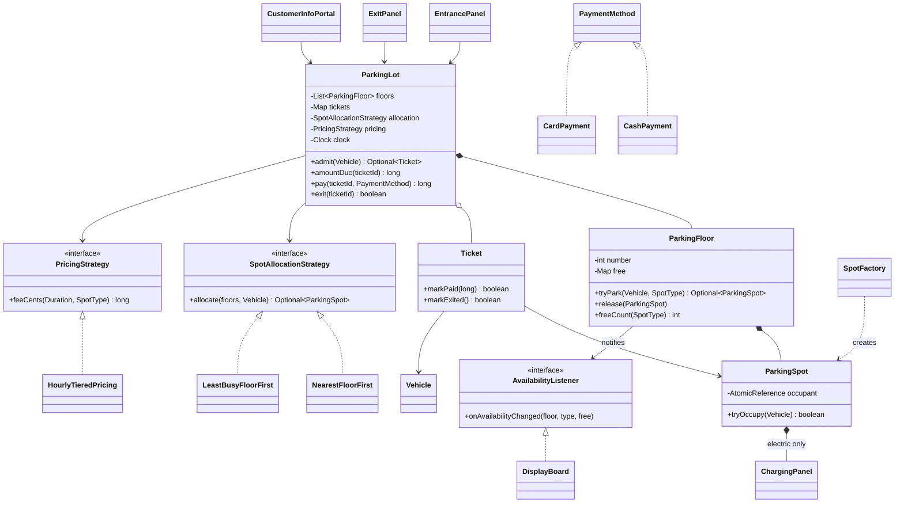
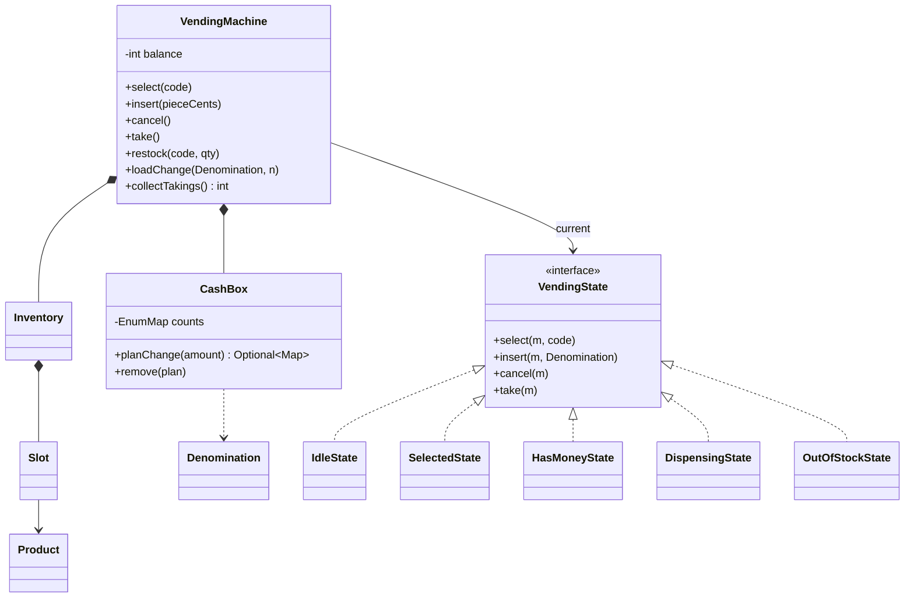
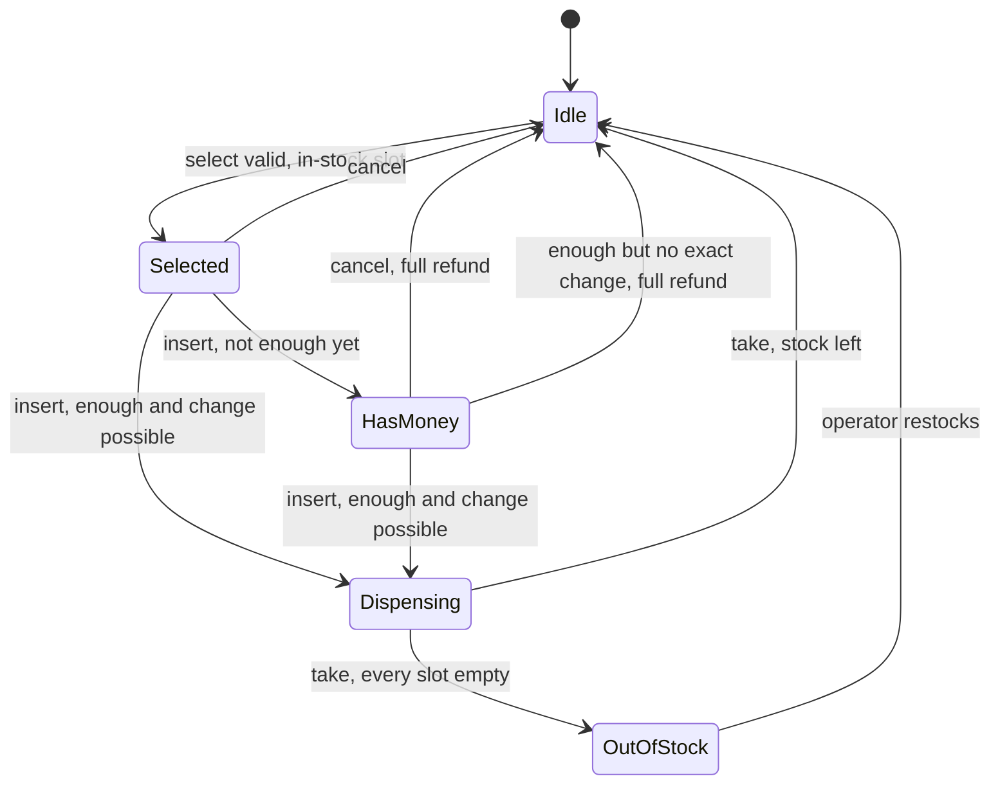
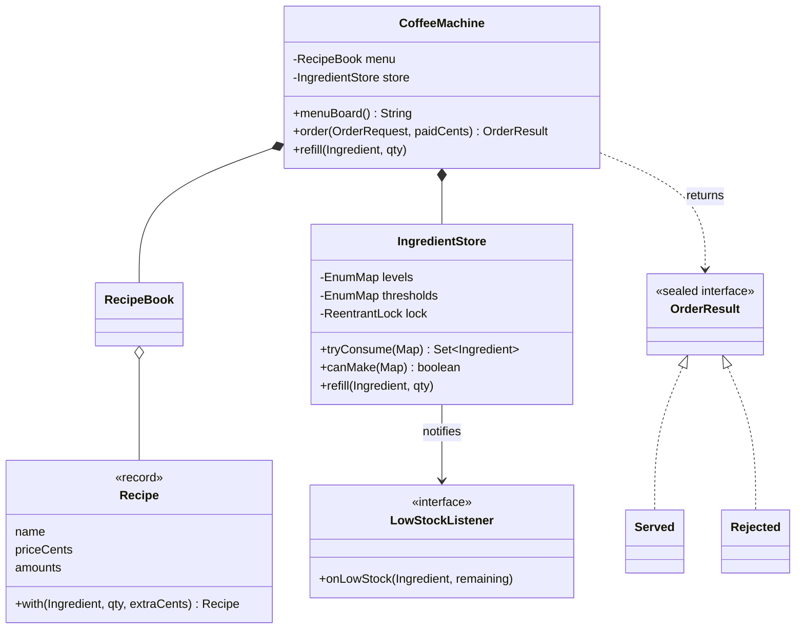
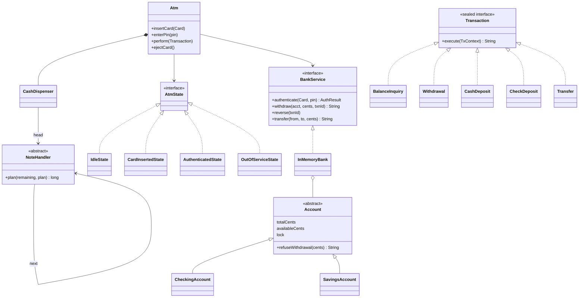
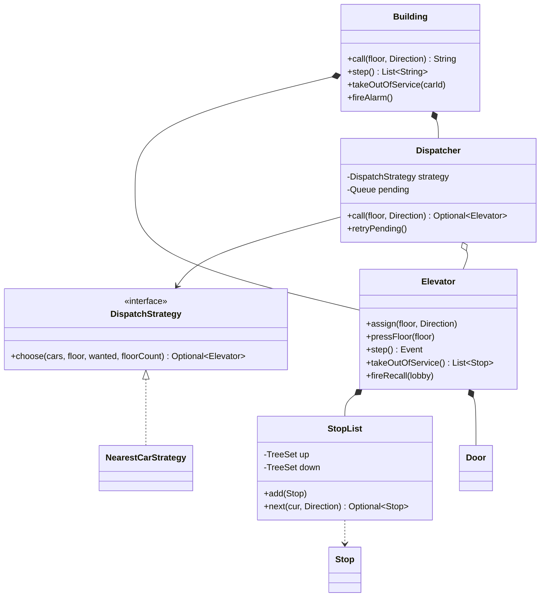
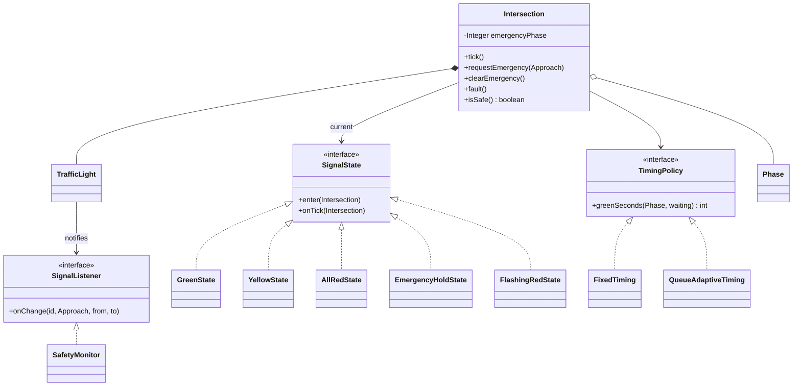
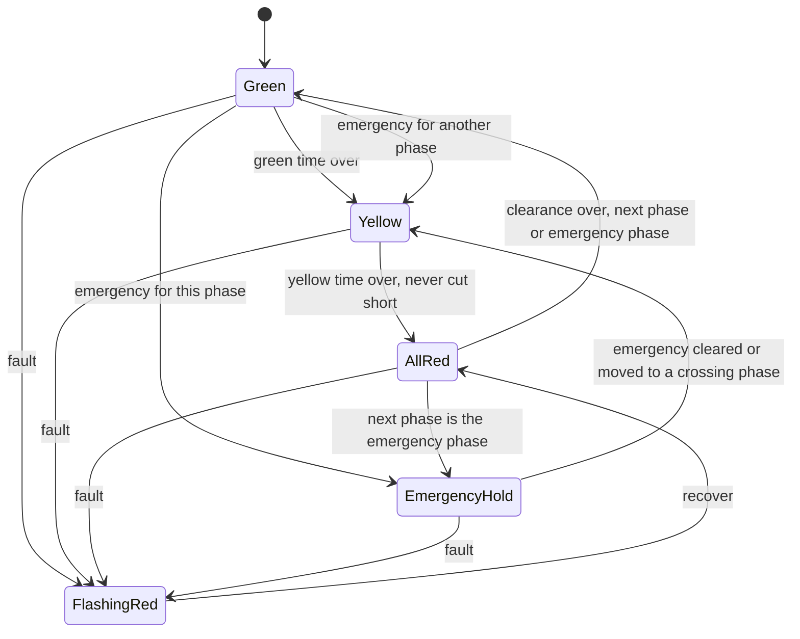
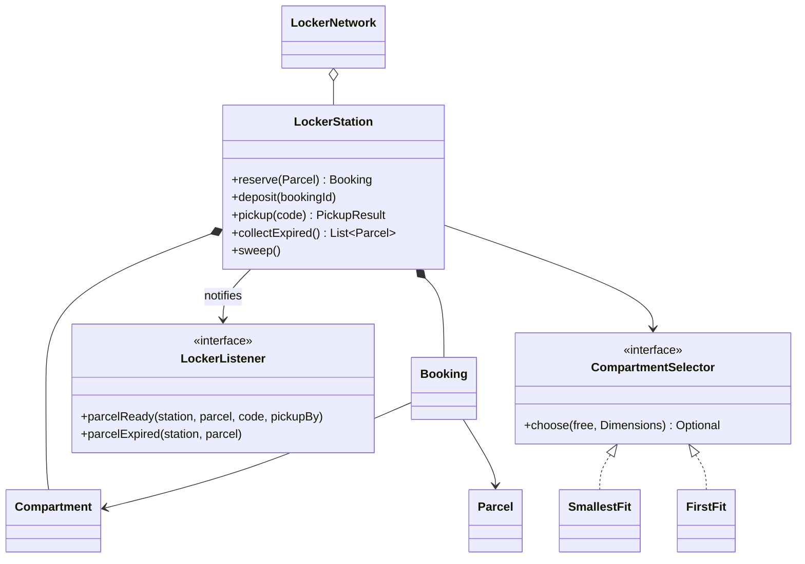
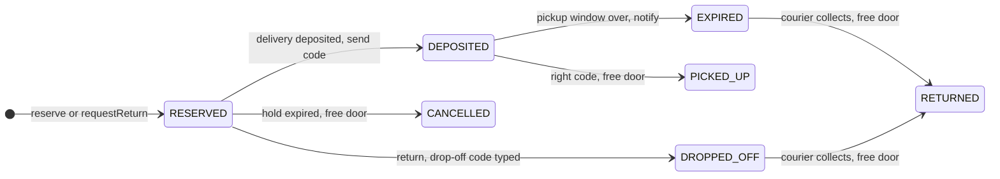

# Chapter 14 — Case Studies: Everyday Objects (Study Edition)

> **Where this fits.** Chapters 1–13 gave you the tools (OOP, UML, SOLID, clean code, the GoF patterns, concurrency). Chapters 14–21 apply them to real interview questions. This chapter starts with **machines you have used yourself** — parking lot, vending machine, coffee machine, ATM, elevator, traffic light, parcel locker — so all your attention can go to the design. This is the study edition: every topic stays, the padding goes. The Full Edition (README.md) has the complete code, outputs and stage-by-stage course diagrams.

| # | Problem | The one idea the interviewer is really testing | Main patterns |
|---|---|---|---|
| 14.1 | Parking Lot | **Resource allocation** under concurrency: two cars must never get the same spot | Strategy (spot finding, pricing), Factory, Observer (display boards) |
| 14.2 | Vending Machine | A **state machine**: the order in which actions are allowed | State |
| 14.3 | Coffee Vending Machine | **Atomic, all-or-nothing** deduction from a shared inventory; recipes as data | Observer (low-stock alerts), data-driven recipes, sealed result types |
| 14.4 | ATM | **Security + money correctness**: authenticate, never lose money, never double-spend | State, Chain of Responsibility (cash dispenser), Command (transactions) |
| 14.5 | Elevator System | **Scheduling** (SCAN/LOOK) and **dispatching** many cars | Strategy (dispatch), State-like modes |
| 14.6 | Traffic Signal Control | **Timed state machine** with a hard safety invariant and emergency override | State, Strategy (timing), Observer (safety monitor) |
| 14.7 | Shipping Locker System (Amazon Locker) | **Best-fit allocation + deadlines + a secret**: reserve a door atomically, expire holds and uncollected parcels, single-use hashed pickup codes | Strategy (door choice), Observer (SMS), enum state machines, sealed results |

### What these problems test

1. **State machines** — a fixed set of states plus transition rules: no dispensing before payment, no withdrawal before the PIN, never green on two crossing roads. The **State pattern** (Chapter 11) gives every button an answer in every state.
2. **Resource allocation** — spots, notes, milk, cars, locker doors handed out never twice, never below zero, fairly.
3. **Concurrency** — several gates, two ATMs on one account, a timer plus an emergency thread; the design must stay correct when calls overlap (Chapters 12–13).

> **Key insight.** The hardest part of each problem is **one method**: pick a spot, make change, deduct ingredients, pick the next stop. Find it early, name it out loud, spend your time there.

### How each case study is laid out

Problem & clarifying questions → Requirements → Use cases → Core entities → Class diagram → Key flows → Design decisions & patterns → Java implementation → Concurrency & edge cases → Extensions & follow-ups → In the interview → Self-check → TL;DR. This is also a good order to speak in during an interview.

### How to read the course diagrams

The course draws class diagrams in stages (earlier classes in grey, new ones in colour). This study edition keeps only the **finished** course diagram per case plus a mermaid diagram of our Java code.


*Figure — Legend for the course class diagrams: interface, class, realization, association, inheritance, composition and the other arrow kinds (course diagram)*

**Hollow triangle** = inheritance ("is a"); **dashed line + hollow triangle** = implements an interface; **filled diamond** = composition (the part dies with the whole); **plain arrow** = association (refers to, does not own). See Chapter 3.

### How to run every example in this chapter

```bash
cd chapters/14-case-everyday-objects/code
javac --release 21 -d /tmp/lld_14 $(find . -name '*.java')
java -cp /tmp/lld_14 lld.ch14.parkinglot.Main      # or vendingmachine, coffeemachine, atm, elevator, trafficsignal, locker
```

Java 21, standard library only. **Code-style note:** some files hold several small package-private types (e.g. `Vehicles.java`); fine except for the `auxiliaryclass` lint — in production give each type its own file.

---

## 14.1 Design a Parking Lot

A **parking lot** (car park) with many floors, many spot sizes and several ways in and out. It is the **most-asked LLD question**. It looks easy, so the interviewer can watch how you **scope** it, how you model the **fit rule** (which vehicle may use which spot), and whether you notice that **two gates can hand out the same spot** at the same moment.

### Problem & clarifying questions

| Question | Assumed answer |
|---|---|
| Scope? | One lot, many floors; several entrances and exits working at once. |
| Vehicles / spots? | Car, truck, van, motorcycle, EV / compact, large, handicapped, motorcycle, electric. |
| Payment? | Cash or card at the exit panel, an attendant, or a per-floor info portal. |
| Fee? | $4 first hour, $3.50 hours 2–3, $2.50 after; a started hour counts as full. |
| EV charging? | Electric spots have a pay-and-charge panel. |
| Reservations, passes, plate recognition? | Out of scope (extensions). |

### Requirements

**Functional:** (1) multiple floors; (2) multiple entries/exits; (3) ticket at entry, pay at exit; (4) pay at the exit panel or an attendant; (5) cash or card; (6) pay early at a per-floor **info portal** (not charged again); (7) **never exceed capacity** — "full" on the entrance panel and ground-floor board; (8) spot types; (9) **electric** spots with a pay-and-charge panel; (10) vehicle types; (11) a **display board per floor**; (12) tiered hourly fees.

**Non-functional:** correct under concurrency (no shared spot, no double payment); fast gate (O(log n) from a sorted free set); extensible; testable (injectable clock).

### Use cases

**Actors:** Admin (floors, spots, attendants, rates), Customer, Parking attendant (a customer proxy who takes cash), System (messages, assigns/frees spots). **Top use cases:** **take ticket**, **scan ticket**, card/cash payment, admin edits, set rate.


*Figure — Use case diagram of the parking lot: Admin, Customer, Parking attendant and System, with their use cases (course diagram)*

### Core entities

| Class | Responsibility |
|---|---|
| `VehicleType` (enum) | Kinds of vehicle and, for each, the spot types it fits, **best fit first**. |
| `SpotType` (enum) | Motorcycle, compact, large, handicapped, electric. |
| `Vehicle` (record) | Plate, type, accessibility permit; knows its preferred spot types. |
| `ParkingSpot` | One spot: id, floor, type, occupant (atomic). |
| `ChargingPanel` | Pay-and-charge panel owned by an electric spot. |
| `SpotFactory` | Builds spots; the only place that knows an electric spot needs a panel. |
| `ParkingFloor` | Free spots per type in a thread-safe sorted set; notifies boards. |
| `DisplayBoard` | Free spots per type on one floor (an observer). |
| `SpotAllocationStrategy` | *How* to choose a spot. |
| `PricingStrategy` | *How much* a stay costs. |
| `Ticket` | Vehicle, the **actual spot**, entry time, status ACTIVE → PAID → EXITED. |
| `PaymentMethod` | Cash or card. |
| `ParkingLot` | Ties it together: admit, price, pay, exit. |
| `EntrancePanel`, `ExitPanel`, `CustomerInfoPortal` | Devices customers touch; **no rules**, they call the lot. |

The course also has `Account` with `Admin` and `ParkingAttendant` subclasses; they carry no parking logic, so the code omits them.

### Class diagram

The course grows the design in **five stages**, each leaving something that runs (a good interview habit: if time runs out, what you drew already works):

| Stage | Adds | Key decision |
|---|---|---|
| 1 | Vehicle and spot types | Spot holds **0..1** vehicle; the **fit rule lives on the vehicle** (truck/van → large; EV → electric, compact, large). |
| 2 | Floors, boards | Floor owns spots and board; board stores **counts**, not a stale "sample free spot"; one map keyed by type. |
| 3 | Ticket, rate, payment | **Ticket stores the exact spot**; abstract `Payment` with cash/card (LSP holds). |
| 4 | `ParkingLot` | Owns floors and rate; course makes it a **Singleton** and serialises assignment. |
| 5 | Panels, portal, electric panel | Panels are **thin**, forwarding to the lot; electric panel owned by its spot. |


*Figure — The finished class diagram of the parking lot (course diagram)*

Our Java code keeps the same shape with three changes interviewers push for: spot types are an **enum** (not five empty subclasses), pricing and spot-finding are **Strategies**, and the display board is an **Observer**.



### Key flows

- **Entry:** `EntrancePanel` → `lot.admit(vehicle)` → strategy tries each preferred spot type on each floor → `floor.tryPark` does `pollFirst()` on the free set (**atomic**) and notifies the board → ticket printed, or "LOT FULL".
- **Exit:** `ExitPanel` → `lot.pay(ticketId, card)` **locks the ticket**; if ACTIVE, price it and charge, then mark PAID; if already PAID at the portal, charge 0 → `lot.exit` moves PAID → EXITED and releases the spot → barrier opens.
- **Ticket life cycle:** `ACTIVE → PAID → EXITED`.

### Design decisions & patterns used

| Decision | Pattern / principle | Why | Alternative rejected |
|---|---|---|---|
| Fit rule on `VehicleType` | Information Expert, OCP | New vehicle type = one enum constant | `switch(vehicleType)` in the lot |
| Spot type is an **enum field** | Composition over inheritance | The 5 course subclasses had no behaviour | `CompactSpot`, `LargeSpot`… |
| `SpotAllocationStrategy` | **Strategy** | Nearest floor, least busy, VIP… swap freely | `if (mode == NEAREST)` |
| `PricingStrategy` | **Strategy** | "What if pricing changes?"; admin swaps at run time | Tiers hard-coded in `Ticket` |
| `SpotFactory` attaches `ChargingPanel` | **Factory** | One place knows "electric ⇒ has a panel" | Every caller remembers |
| Boards subscribe to floors | **Observer** | Boards, apps, bay lights update without the floor knowing them | Lot pushing into boards |
| Ticket holds the **spot** | — | Exit frees the exact spot | Counting occupied spots |
| Lot is **not** a Singleton | Dependency injection | A Singleton is a hidden global; tests can't build two lots | `ParkingLot.getInstance()` |
| `Clock` injected | Testability | Demo jumps hours instantly | `Instant.now()` inside |

> **Honest note on "Strategy".** A cash/card subclass pair is just an abstract base class; Strategy means an object **holds** a swappable behaviour (`setPricing(...)`). The course admits the lot does two jobs; spot-finding moved to strategy and floors, and tickets could move to a `TicketRepository`.

### Java implementation

Package `lld.ch14.parkinglot`. Amounts are **cents** (`long`) to avoid floating-point rounding.

```java
enum VehicleType {
    MOTORCYCLE(List.of(SpotType.MOTORCYCLE)),
    CAR(List.of(SpotType.COMPACT, SpotType.LARGE)),
    ELECTRIC_CAR(List.of(SpotType.ELECTRIC, SpotType.COMPACT, SpotType.LARGE)),
    VAN(List.of(SpotType.LARGE)),
    TRUCK(List.of(SpotType.LARGE));
    // ...
}

class ParkingFloor {
    private final Map<SpotType, ConcurrentSkipListSet<ParkingSpot>> free = new EnumMap<>(SpotType.class);
    // ...
    /** pollFirst() is atomic: two threads can never receive the same spot. Lowest id = nearest. */
    Optional<ParkingSpot> tryPark(Vehicle v, SpotType type) {
        ParkingSpot spot = free.get(type).pollFirst();
        if (spot == null) return Optional.empty();
        if (!spot.tryOccupy(v)) throw new IllegalStateException("free-set out of sync for " + spot);
        notifyListeners(type);
        return Optional.of(spot);
    }
    // ...
}

final class ParkingLot {
    // ...
    Optional<Ticket> admit(Vehicle v) {
        String placeholder = "pending";
        if (ticketByPlate.putIfAbsent(v.plate(), placeholder) != null) {
            throw new IllegalStateException(v.plate() + " is already inside");
        }
        Optional<ParkingSpot> spot = allocation.allocate(floors, v);
        if (spot.isEmpty()) {
            ticketByPlate.remove(v.plate());
            return Optional.empty();
        }
        Ticket t = new Ticket("T" + nextTicket.getAndIncrement(), v, spot.get(), clock.instant());
        tickets.put(t.id(), t);
        ticketByPlate.put(v.plate(), t.id());
        return Optional.of(t);
    }
    // ...
    long pay(String ticketId, PaymentMethod method) {
        Ticket t = ticket(ticketId);
        synchronized (t) {                 // per-ticket lock: portal and exit panel cannot both charge
            long due = amountDue(ticketId);
            if (due == 0) return 0;
            method.pay(due);               // throws if the payment fails: ticket stays ACTIVE
            t.markPaid(due);
            return due;
        }
    }
    // ... exit(): markExited() (PAID -> EXITED), then floor.release(spot)
}
```

Full runnable code: code/lld/ch14/parkinglot/ (see the Full Edition).

**How it works:** `Vehicle.preferredSpots()` puts `HANDICAPPED` first for permit holders only. `ParkingSpot.tryOccupy` (`compareAndSet(null, v)`) is a second safety net. `NearestFloorFirst` and `LeastBusyFloorFirst` are interchangeable strategies.

**Output (excerpt):**

```text
[entry-A] TRUCK-2 -> SORRY, LOT FULL for TRUCK
[portal] T2 due $16.00, charged $16.00
[exit-A] T2: already paid, barrier OPEN
Unpaid exit attempt: barrier opens? false
== 20 cars race for the remaining CAR spots ==
cars admitted: 5, distinct spots: 5
```

4 h 50 min rounds to 5 hours = $4 + $3.50 + $3.50 + $2.50 + $2.50 = **$16.00**; 20 racing threads get exactly 5 distinct spots.

### Concurrency & edge cases

| Situation | Risk | Handling |
|---|---|---|
| Two gates, last spot | Double booking | Atomic `pollFirst()` + CAS `tryOccupy` |
| Portal and exit pay the same ticket | Charged twice | `synchronized (ticket)`; a PAID ticket costs 0 |
| Same plate enters twice | Two tickets | `ticketByPlate.putIfAbsent` |
| Card declined | Marked paid anyway | `method.pay` throws **before** `markPaid` |
| Leaves without paying | Fee lost | `exit` only from PAID; barrier stays closed |
| Pays at portal, stays 3 more hours | Free parking | **Grace period** (e.g. 15 min); add `paidAt`, re-price after |
| Board shows an old number | Out-of-order notifications | OK for display; board can **pull** `freeCount` on render |
| Lost ticket / 0-minute stay | No entry time / $0 | Daily maximum or plate lookup / minimum one hour |
| Lock scope | Global lock serialises gates | Per-spot CAS and per-ticket lock only |

`ConcurrentSkipListSet.size()` is not constant-time and only an estimate under change — fine for a board, never for deciding a spot is free (use `pollFirst()`).

### Extensions & follow-up questions

1. **Pricing changes** (weekend, per spot type, surge) → new `PricingStrategy` (or a decorator), `setPricing`. Nothing else changes.
2. **Reservations** → `Reservation(plate, spotType, from, to)` + reserved set per floor; hold with a timeout (e.g. 30 min).
3. **Monthly passes** → pricing returning 0 for pass plates, or a `PassHolderPricing` decorator.
4. **Plate recognition** → the camera is another entrance panel calling `admit`.
5. **Database** → tables `floor`, `spot`, `ticket`, `payment`; claim with `UPDATE spot SET occupied_by=? WHERE id=? AND occupied_by IS NULL` (the DB equivalent of CAS). Show **cardinalities** (floor 1..* spots, spot 0..1 vehicle, ticket 1 spot).
6. **Many lots in a city** → a `ParkingNetwork` routing to lots — another reason for no Singleton.
7. **EV idle fees** → a charging session on `ChargingPanel` with a per-minute fee after charging completes.

### Real-world example

**Parking guidance systems** (per-bay sensors, free counts per level) are our `DisplayBoard` observers; airports use **plate recognition**; SpotHero/ParkMobile pre-booking = reservations; Tesla **idle fees** = the EV extension.

### In the interview

**45 minutes:** 0–5 questions/requirements → 5–10 use cases → 10–25 stages 1–4 ("fit rule on the vehicle", ticket holds the spot) → 25–38 code `admit`, `tryPark`, `pay`, `exit` → 38–45 concurrency and extensions.

**30-second answer:** "Vehicles and spot types are enums with the fit rule on the vehicle; floors keep a concurrent sorted set of free spots per type; the lot admits, prices and releases. Tickets point at the real spot. Pricing and spot-finding are Strategies. Handing out a spot is atomic — `pollFirst` plus a CAS on the spot — so two gates never get the same spot, and payment locks only the one ticket."

- *"Why not a Singleton?"* — It is a hidden global that makes testing two lots impossible; I create one and inject it. If pressed, a lazy holder-class Singleton is thread-safe.
- *"How do you make finding a spot fast?"* — Keep only free spots, indexed by type, in a sorted set: O(log n), no scan.

### Self-check

1. **Q:** Why must the ticket store the spot? **A:** So the exit frees exactly that spot; a count can't say which.
2. **Q:** What makes assignment thread-safe? **A:** `pollFirst()` gives a spot to exactly one caller; `compareAndSet` double-checks.
3. **Q:** Where does a weekend price go? **A:** A new `PricingStrategy` via `setPricing`.
4. **Q:** Paid at the portal — what does the exit charge? **A:** Nothing: `amountDue` is 0 for PAID; `exit` moves PAID → EXITED.

### TL;DR

- Fit rule on the **vehicle**, spot type as an **enum**, free spots per type in a **concurrent sorted set**.
- **Ticket → spot** reference; status ACTIVE → PAID → EXITED.
- **Strategy** (pricing, spot-finding), **Factory** (electric spots), **Observer** (boards); inject the lot, no Singleton.
- Atomic `pollFirst` + CAS for spots, per-ticket lock for payment, `putIfAbsent` for plates.

---

## 14.2 Design a Vending Machine

A **vending machine** is an unattended shop: key in a slot code, pay, take the item from the tray. The interviewer skips the domain and checks one thing: **which actions are legal at which moment**. Accepting a coin with nothing chosen, or two items for one payment, are bugs no tidy code elsewhere can excuse.

### Problem & clarifying questions

| Question | Assumed answer |
|---|---|
| Select or pay first? | Select a slot code first, then pay. |
| Which money? | Fixed set: 5¢, 10¢, 25¢, $1, $5. Anything else is returned. |
| Card / contactless? | Out of scope (extension). |
| Change? | Yes. If **exact** change is impossible, refuse the sale and return everything. |
| Cancel? | Any time before dispensing, full refund. |
| Concurrency? | One customer at a time (one physical machine). |
| Restocking? | An operator restocks, loads coins, collects takings. |

### Requirements

**Functional (the course's twelve):** (1) many **slots**, each with a code, a **single** product and a **count**; (2) a product has a name and a **price in cents**; (3) **choose, then pay**; (4) only known coins/notes, others returned; (5) the **display** says what to do after every action; (6) when paid enough, release **item and change**; (7) if **exact change is impossible**, refuse and return every cent; (8) **cancel** with full refund until the item drops; (9) an empty slot **cannot be chosen**; (10) one payment = **exactly one** item; (11) an **operator** refills, adds change, removes takings; (12) item and cash counts are **exactly right** after every sale, cancel and refusal.

**Non-functional:** no illegal transitions (every button answered in every state); integer cents only; extensible (new payment device or state without editing every class).

### Use cases

**Actors:** Customer, Operator, System. **Use cases:** select · insert money · dispense · collect · cancel · restock · load change / collect takings. "Dispense" is a **System** use case — the customer only causes it.


*Figure — Use case diagram of the vending machine: Customer, Operator and System (course diagram)*

### Core entities

| Class | Responsibility |
|---|---|
| `Product` (record) | Name and price in cents — *what* is sold. |
| `Slot` | One column: code, one product, **count** left. |
| `Inventory` | All slots by code. |
| `Denomination` (enum) | Accepted coins/notes and their cents. |
| `CashBox` | Counts pieces by value; plans **exact** change or reports it can't. |
| `VendingState` (interface) | One method per customer button: `select`, `insert`, `cancel`, `take`. |
| `IdleState`, `SelectedState`, `HasMoneyState`, `DispensingState`, `OutOfStockState` | The situations; each answers every button and names the next state (course calls `HasMoneyState` `PaidState`). |
| `Display`, `Keypad`, `CashSlot`, `Dispenser`, `Operator` | Course hardware/actor classes; in our code folded into `VendingMachine.show(...)` and its public/operator methods. |
| `VendingMachine` | Parts, current state, selection, balance; forwards each button to the state. |

**Why is the count on the slot, not the product?** `Product` answers "what is it?"; `Slot` is the physical column. The same product can sit in two columns (even at different prices), and emptying one must not affect the other.

### Class diagram

Course stages: (1) `Product`, `Slot` (association — a product can be in many slots), `Inventory` (composition); (2) `Coin`, `Note`, `CashBox` — **a piece goes into the box on insert**, so a refund is "pay exact change equal to the balance"; the planner returns an exact plan or "impossible"; (3) **the heart: one class per state**, each button a method on one interface — a state that forgets a button does not compile; think of a **grid** of buttons × states where every cell needs an answer; (4) `Display` and `VendingMachine` — no `if` on state; (5) `Keypad`, `CashSlot`, `Dispenser`, `Operator` point **to** the machine; `take` finishes the sale; operator actions stay **off** the state interface.

The course draws four states; our code adds `OutOfStockState` so an empty machine refuses customer buttons until restocked. Cancel and "no exact change" end identically, so there is a **single** refund method.


*Figure — The finished class diagram of the vending machine (course diagram)*



### Key flows

**The state machine is the design** — draw it before coding.



**State table** (every cell answered):

| Button ↓ / State → | Idle | Selected | HasMoney | Dispensing | OutOfStock |
|---|---|---|---|---|---|
| `select` | choose slot (reject empty/unknown) | change choice | "cancel first" | "take your product first" | "out of stock" |
| `insert` | return piece | accept; check paid | accept; check paid | return piece | return piece |
| `cancel` | "nothing to cancel" | clear choice → Idle | **refund all** → Idle | "too late" | "nothing to cancel" |
| `take` | "tray empty" | "pay first" | "pay the rest" | give product + change → Idle/OutOfStock | "tray empty" |

**Paying enough:** insert → `acceptPiece` (into box, balance += value) → `checkPaid` → `planChange(balance − price)`; if a plan exists, remove it, `dispenseOne`, go to Dispensing; otherwise refund all and go Idle.

### Design decisions & patterns used

| Decision | Pattern / principle | Why | Alternative rejected |
|---|---|---|---|
| One class per situation | **State** | Every cell answered; compiler enforces completeness | Flags + `if/else` (double-dispense bugs) |
| States are stateless singletons (`INSTANCE`) | Flyweight-style sharing | No data, so one instance each | `new IdleState()` each transition |
| Operator actions off the state interface | Interface Segregation | Restock is valid in every state | `restock` on `VendingState` |
| Money counted by value in an `EnumMap` | — | Which physical quarter comes back doesn't matter | List of coin objects |
| Inserted money straight into the box | — | Refund = make change for the balance | Separate escrow pile |
| **Exact** change by dynamic programming | Correctness | Greedy fails when short of one coin | Greedy only |
| Refuse if exact change impossible | Req. 7 | Never short-change | "Close enough" change |

> **About the change algorithm.** The course's planner is **greedy** (largest piece first) and says so: correct for standard coin sets when well stocked, but it can fail when the box is short. The fix is **dynamic programming** — "coin change with limited coins". Example: 30¢ from {1 quarter, 3 dimes}: greedy takes the quarter and is stuck at 5¢; DP returns three dimes.

### Java implementation

Package `lld.ch14.vendingmachine`.

```java
/** State pattern: every button is on the interface, so every state must answer every button. */
interface VendingState {
    void select(VendingMachine m, String code);
    void insert(VendingMachine m, Denomination d);
    void cancel(VendingMachine m);
    void take(VendingMachine m);
    String name();
}

/** Some money is in, but not enough yet. */
final class HasMoneyState implements VendingState {
    static final HasMoneyState INSTANCE = new HasMoneyState();

    @Override public void select(VendingMachine m, String code) { m.show("Cancel first to change your choice."); }
    @Override public void insert(VendingMachine m, Denomination d) { m.acceptPiece(d); m.checkPaid(); }
    @Override public void cancel(VendingMachine m) { m.refundAll("Cancelled."); }
    @Override public void take(VendingMachine m) { m.show("Please pay the rest first."); }
    @Override public String name() { return "HAS_MONEY"; }
}
// ... IdleState, SelectedState, DispensingState, OutOfStockState

final class VendingMachine {
    // ...
    /** Called after every accepted piece in SELECTED / HAS_MONEY. */
    void checkPaid() {
        int price = selected.product().priceCents();
        if (balance < price) {
            show("Paid %d c, %d c to go.".formatted(balance, price - balance));
            setState(HasMoneyState.INSTANCE);
            return;
        }
        var change = cashBox.planChange(balance - price);
        if (change.isEmpty()) {                                // refuse the sale rather than short-change
            refundAll("Cannot make exact change.");
            return;
        }
        cashBox.remove(change.get());
        tray.add(selected.dispenseOne().name());
        if (!change.get().isEmpty()) tray.add("change " + change.get());
        show("Dispensed. Please take: " + tray);
        balance = 0;
        selected = null;
        setState(DispensingState.INSTANCE);
    }

    /** One refund path for "cancel" and for "cannot make change". */
    void refundAll(String reason) {
        Map<Denomination, Integer> back = cashBox.planChange(balance)
                .orElseThrow(() -> new IllegalStateException("inserted pieces must be refundable"));
        cashBox.remove(back);
        show(reason + " Refunded " + balance + " c as " + back);
        balance = 0;
        selected = null;
        setState(IdleState.INSTANCE);
    }
    // ...
}
```

Full runnable code: code/lld/ch14/vendingmachine/ (see the Full Edition).

**How it works:** unknown pieces are returned before reaching a state. `CashBox.planChange` is bounded coin-change DP (fewest pieces); `greedyPlan` is only for comparison. `refundAll` cannot fail — the inserted pieces are in the box. Public methods are `synchronized`.

**Output (excerpt):**

```text
 > insert 500c   (SELECTED)
   [display] Cannot make exact change. Refunded 500 c as {FIVE_DOLLAR=1}
30c from {1 quarter, 3 dimes}: greedy=Optional.empty dp=Optional[{DIME=3}]
```

### Concurrency & edge cases

| Edge case | Handling |
|---|---|
| Money before selecting | `IdleState.insert` returns it |
| Unknown coin / foreign note | Returned before reaching the state |
| Empty slot selected | Refused; stays Idle |
| Change choice after paying | "Cancel first" (avoids price confusion) |
| Overpayment | Change planned **before** dispensing; refuse if impossible |
| Cancel after dispensing | "Too late" |
| Two products for one payment | Impossible: balance reset to 0, Dispensing accepts no money |
| Last item sold | `take` → `OutOfStock`; only a restock leaves it |
| Two threads pressing buttons | `synchronized` public methods |
| Machines sharing one stock / power failure | Slot count needs a lock or atomic decrement / non-volatile transaction log (out of scope) |

### Extensions & follow-up questions

1. **Contactless card** → a new input device calling the same machine (e.g. `payByCard(amount)` setting the balance); states unchanged.
2. **Maintenance state** → a new `MaintenanceState` class; existing states untouched (OCP).
3. **Different price per slot** → move price from `Product` to `Slot`.
4. **Report empty slots** → `Inventory` notifies an observer; a telemetry client sends it.
5. **Walk-away timeout** → a timer calls `cancel()` after ~60 s through the same state machine.
6. **What did you leave out?** Card payment, network reporting, refrigeration, discounts — say they are scope decisions.

### Real-world example

Cashless readers (**Nayax**, **Cantaloupe ePort**) plug in as another payment device; coin mechanisms light **"exact change only"** when a tube runs low — our planner saying it cannot make change.

### In the interview

**45 minutes:** 5 questions → 5 entities → **10 draw the state diagram and table** → 15 code the interface, two or three states and `checkPaid`/`refundAll` → 10 edge cases.

**30-second answer:** "The question is the order of events, so I use the State pattern: Idle, Selected, HasMoney, Dispensing, OutOfStock, all implementing an interface listing every button. The machine forwards to its state. Money goes into the box on insert, so a refund is 'make exact change for the balance'; if exact change is impossible the sale is refused and everything returned. Integer cents."

- *"Why not an enum with a switch?"* — Every new state means editing every switch; a State class is forced by the compiler to answer every button.
- *"Is greedy change correct?"* — Only for well-stocked canonical coin sets; use bounded coin-change DP.

### Self-check

1. **Q:** What makes the design complete? **A:** Every state implements every button, so every (state, button) cell has an answer.
2. **Q:** Why is `restock` not on `VendingState`? **A:** Not a customer action, valid in every state (ISP).
3. **Q:** A greedy failure? **A:** 30¢ with one quarter and three dimes.
4. **Q:** How is "two items for one payment" prevented? **A:** Balance reset to 0 and Dispensing returns any coins until `take`.

### TL;DR

- **State pattern is the design**: five states, one interface listing every button, no `if` on state.
- Count on the **slot**; **integer cents**; money into the **box immediately**.
- Change **exact or refuse**; greedy can fail, **DP** is correct.
- One refund path; operator actions off the state interface.

---

## 14.3 Design a Coffee Vending Machine

A **coffee machine** makes drinks (espresso, americano, latte, cappuccino, mocha, hot chocolate) from **shared ingredients** (beans, water, milk, chocolate, sugar). Unlike 14.2, a drink **consumes several ingredients at once**, and many drinks draw on the same milk. The interviewer wants: (1) **recipes as data** — a new drink is a data change; (2) **atomic, all-or-nothing deduction** — a latte takes beans, water *and* milk together or nothing, never negative even with ten concurrent orders; (3) **low-stock alerts** via Observer before an ingredient runs out.

### Problem & clarifying questions

| Question | Assumed answer |
|---|---|
| Drinks? | Six, loaded from a menu file. |
| Customisation? | Extra espresso shot (+50¢), sugar in grams. |
| Payment? | Amount in cents; change returned (coins covered in 14.2). |
| Concurrent orders? | Yes — several touch screens. |
| Refills? | Operator, alerted at a threshold. |
| Alert frequency? | **Once per crossing** of the threshold, re-armed after refill. |

### Requirements

**Functional:** (1) drinks with a **price** and a **recipe**; (2) **menu** with prices and availability; (3) selection and **payment**, **change**, full refund if the drink can't be made; (4) track inventory, deduct exactly the recipe; (5) **low-stock notifications**; (6) **refills**; (7) **customisation** without changing the menu.

**Non-functional:** thread-safe (no over-draw, no half recipe); data-driven; observable.

### Use cases

**Actors:** Customer (view menu, order, pay, take drink/change), Operator (refill, receive alerts), System (check stock, deduct, brew, alert). **Use cases:** view menu · order (with customisation) · pay / change / refund · refill · receive low-stock alert.

### Core entities

| Class | Responsibility |
|---|---|
| `Ingredient` (enum) | Beans, water, milk, chocolate, sugar — with unit (g/ml). |
| `Recipe` (record) | **Data**: name, price, `Map<Ingredient,Integer>`. Immutable; `with(...)` returns a customised copy. |
| `RecipeBook` | Parses menu text into recipes; lookup by name. |
| `IngredientStore` | Levels, thresholds, **one lock**; `tryConsume` = check all + deduct all atomically; alerts. |
| `LowStockListener` | Observer called once per threshold crossing. |
| `OrderRequest` (record) | Drink + extra shots + sugar grams. |
| `OrderResult` (sealed) | `Served(drink, price, change)` or `Rejected(reason, refund)`. |
| `CoffeeMachine` | Facade: menu board, `order(...)`, `refill(...)`. |

**Mapping to the common problem statement** (*awesome-low-level-design*): `Coffee` → `Recipe`; `Ingredient` with `synchronized` updates → enum + levels in `IngredientStore`; `Payment` → `paidCents` and `OrderResult`; Singleton → injected machine. We lock the **whole recipe**, not each ingredient (per-ingredient locks can't make a multi-ingredient deduction all-or-nothing).

### Class diagram



### Key flows

**Ordering:** find recipe → apply customisation (`recipe.with(...)`) → if underpaid, `Rejected` with full refund → `tryConsume(amounts)`: lock, check **every** ingredient; if any shortage, nothing is deducted and the order is `Rejected`; else deduct all, note thresholds crossed, **unlock, then** notify listeners → `Served` with change.

**Order life cycle:** `Selected → Reserved (ingredients deducted atomically) → Brewing → Served`, or `Selected → Rejected` (unknown drink, underpaid, or short) with full refund.

### Design decisions & patterns used

| Decision | Pattern / principle | Why | Alternative rejected |
|---|---|---|---|
| Recipes are **data** from menu text | Data-driven, OCP | New drink = new line | `Latte extends Coffee` (class explosion) |
| Check-and-deduct under **one lock** | Atomicity (Ch. 12) | Stops two orders both seeing "enough milk" (check-then-act) | Separate check and deduct; per-ingredient locks |
| All-or-nothing | Transaction semantics | No half-made recipe | Deduct one by one and roll back |
| `LowStockListener` | **Observer** | Operator app, dashboard, telemetry subscribe | Store calling an SMS class |
| Alert **once per crossing** | — | No alert storm | Alert on every order below threshold |
| Listeners **outside** the lock | Concurrency hygiene | Slow listener can't block orders; no deadlock on callback | Notifying inside the lock |
| Customisation returns a **new** `Recipe` | Immutability | Menu recipe never corrupted | Mutating it; a Decorator chain (heavier) |
| **Sealed** `OrderResult` | Algebraic data type (Java 17+/21 switch) | Callers must handle both; exhaustive `switch` | `null` or exceptions for normal refusals |
| No Singleton | DI | Tests build fresh machines (demo builds two) | `getInstance()` |

> **Decorator or data?** *Head First Design Patterns* models add-ons as Decorators (`new Whip(new Mocha(new DarkRoast()))`). Good when add-ons have **behaviour**. Here they only change **quantities and price**, so `recipe.with(...)` is simpler. Say both and pick one for a reason.

### Java implementation

Package `lld.ch14.coffeemachine`.

```java
/** A recipe is DATA: a name, a price and the amount of each ingredient. */
record Recipe(String name, int priceCents, Map<Ingredient, Integer> amounts) {
    // ...
    /** Customisation returns a NEW recipe; the menu entry is never modified. */
    Recipe with(Ingredient extra, int qty, int extraCents) {
        if (qty == 0) return this;
        Map<Ingredient, Integer> m = new EnumMap<>(Ingredient.class);
        m.putAll(amounts);
        m.merge(extra, qty, Integer::sum);
        return new Recipe(name, priceCents + extraCents, m);
    }
}

final class IngredientStore {
    // ...
    /** Returns the ingredients that are short. Empty set = success, everything was deducted. */
    Set<Ingredient> tryConsume(Map<Ingredient, Integer> need) {
        Set<Ingredient> shortages = EnumSet.noneOf(Ingredient.class);
        List<Runnable> alerts = new ArrayList<>();
        lock.lock();
        try {
            need.forEach((i, q) -> { if (levels.get(i) < q) shortages.add(i); });
            if (!shortages.isEmpty()) return shortages;               // nothing touched
            need.forEach((i, q) -> levels.merge(i, -q, Integer::sum));
            for (Ingredient i : need.keySet()) {
                int left = levels.get(i);
                if (left <= thresholds.get(i) && alerted.add(i)) {    // alert once per crossing
                    alerts.add(() -> listeners.forEach(l -> l.onLowStock(i, left)));
                }
            }
        } finally {
            lock.unlock();
        }
        alerts.forEach(Runnable::run);   // call listeners OUTSIDE the lock
        return shortages;
    }
    // ...
}
```

Full runnable code: code/lld/ch14/coffeemachine/ (see the Full Edition).

**How it works:** the menu is a Java text block (`Latte, 400, COFFEE_BEANS=18, WATER=40, MILK=180`) parsed by `RecipeBook.parse`. `Recipe`'s compact constructor stores an unmodifiable `EnumMap`. `refill` clears the `alerted` flag when the level goes back above the threshold. `CoffeeMachine.order` validates drink → customises → checks payment → reserves ingredients.

**Output (excerpt):**

```text
REJECTED out of [MILK], refund 400 c
   beans left 410g (unchanged by the rejected latte)
== 10 customers order a Latte at the same instant (milk for exactly 4) ==
   ALERT to operator: MILK low, 80ml left
served=4 rejected=6 milk left=80ml (never negative)
```

### Concurrency & edge cases

| Situation | Risk | Handling |
|---|---|---|
| Ten orders, milk for four | Negative stock (check-then-act) | Check + deduct under one lock |
| One ingredient short | Beans taken, milk missing | Shortages found before any deduction |
| Slow listener (SMS) | Orders wait on the network | Listeners after `unlock()` |
| Many orders below threshold | Alert storm | One alert per crossing; refill re-arms |
| Underpayment | Drink made, money short | Payment checked before reserving |
| Brew fails after deduction | Pays, gets nothing | Extension: refund, optionally refill the amounts (compensation) |
| Menu says available, order fails | Display/order race | Menu is advisory; `tryConsume` is the truth |

One lock is right: the critical section is tiny and the machine brews one drink at a time. For a cloud inventory shared by many machines, use optimistic concurrency (version / CAS on a snapshot) or a DB transaction.

### Extensions & follow-up questions

1. **New drink** → one menu line. 2. **Sizes** → `recipe.scaled(size)`. 3. **Several brewers** → a `BlockingQueue` consumed by N `Brewer` threads, one store. 4. **Remote monitoring** → another `LowStockListener`. 5. **Different brewing steps** → Template Method or `Step` objects (Command). 6. **Cash** → reuse 14.2's `CashBox`.

### Real-world example

The Thermoplan Mastrena (Starbucks) stores **recipes as configuration**; Starbucks and Microsoft (2019, Azure Sphere) push recipes and collect telemetry from the cloud; connected kiosks report stock remotely — the low-stock Observer.

### In the interview

**40 minutes:** 5 questions → 5 entities → 5 "recipes are data" and the menu format → 15 code `tryConsume` and `order` → 10 concurrency and extensions.

**30-second answer:** "Recipes are data — ingredient-to-amount maps loaded from a menu, so a new drink is a new row. The store checks and deducts **every** ingredient of a recipe under one lock: all-or-nothing, never negative. Crossing a threshold is noted and observers are notified once, after the lock is released. Orders return a sealed Served/Rejected result; rejected orders are refunded in full."

- *"Why not an `AtomicInteger` per ingredient?"* — Each is safe alone, but a recipe updates several at once; without a common lock you get partial deductions.
- *"Why notify outside the lock?"* — A slow or re-entrant listener would block all orders or deadlock.

### Self-check

1. **Q:** All-or-nothing for `tryConsume`? **A:** Every ingredient deducted, or none (shortages detected first).
2. **Q:** Which race does the lock prevent? **A:** Check-then-act: two threads see enough milk and both deduct.
3. **Q:** How is an alert storm prevented? **A:** An `EnumSet` of alerted ingredients, re-armed by refill.
4. **Q:** When use Decorator for add-ons? **A:** When they carry behaviour, not just quantities.

### TL;DR

- **Recipes are data**; customisation makes a new immutable recipe.
- **One lock, check-then-deduct, all-or-nothing**.
- **Observer** alerts, **once per crossing**, **outside** the lock.
- **Sealed** `OrderResult`; full refund on rejection.

---

## 14.4 Design an ATM

An **ATM** is a cashier-less machine where a bank's customers do everyday banking outside branch hours. The interviewer checks that you keep **money correct** (never dispense without debiting, never debit without dispensing, never let two machines overdraw one account), **authenticate first**, and model the **session states** cleanly.

### Problem & clarifying questions

| Question | Assumed answer |
|---|---|
| Accounts / identification? | Checking and savings (daily cap); card + PIN, checked by the bank on every transaction. |
| Deposits available at once? | Checks **not** — they wait. Keep **total** and **available** balances. |
| Notes? | $100, $50, $20, $10 cassettes. |
| Wrong PIN? | 3 wrong attempts block the card and the ATM keeps it (course leaves this out; we add it plus a journal). |
| Customers at a time? | One; the ATM must not shut down mid-session. |

### Requirements

**Parts:** card reader, keypad, screen, cash dispenser, deposit slot (cash/check), printer, network link to the bank.

**Functional:** (1) card + PIN authenticated **by the bank** first; (2) five transactions: balance inquiry, cash deposit, check deposit, withdraw, transfer; (3) the ATM **keeps the card** all session; cancel ejects it; (4) a **journal** of transactions and hardware faults; (5) a **check is held** until verified (the course holds all deposits; we credit counted cash at once); (6) **bank manager** reports.

**Actors' operations:** Operator — on/off key switch, refill cash, paper, ink, empty deposits. Customer — the transactions. Bank manager — total deposits/withdrawals reports, print them, check remaining cash.

**Non-functional:** security (no clear PINs on the ATM; limited attempts); consistency (debit and dispense together or compensate); concurrency (many ATMs, one account, no overdraft, no deadlock); auditability.

### Use cases

Only Customer use cases need the PIN (Operator uses a key; Manager reads bank data). The course's activity diagrams (authenticate, withdraw, deposit check, transfer) all end by ejecting the card — **every** exit path, including declined retries, must return it.


*Figure — ATM use case diagram: Customer (balance, withdraw, deposit, transfer), Operator (on/off, refill cash, paper, ink, empty deposits) and Bank Manager (reports, check remaining cash) (course diagram)*

### Core entities

| Class | Responsibility |
|---|---|
| `Card` (record) | Number and holder (course also has `Customer` with one card). |
| `Account` (abstract) | Id, **total** and **available** balance, a lock, withdrawal-rule hook. |
| `CheckingAccount`, `SavingsAccount` | Savings adds a **daily cap** — a behaviour difference, hence subclasses. |
| `BankService` (interface) | Authenticate, balances, withdraw, reverse, deposits, transfer. |
| `InMemoryBank` | Stand-in bank: PIN hashes, failed attempts, account locks, ordered-lock transfers. |
| `AuthResult` (sealed) | `Ok(accounts)`, `WrongPin(attemptsLeft)`, `Blocked`. |
| `NoteHandler` + 4 subclasses | **Chain of Responsibility** $100 → $50 → $20 → $10. |
| `CashDispenser` | Plans (dry run), then dispenses; can jam (fault injection). |
| `Transaction` (sealed) + 5 records | **Command**: one `execute(ctx)` each. |
| `AtmState` + 4 states | **State**: Idle → CardInserted → Authenticated, plus OutOfService. |
| `Atm` | Id; owns parts, session, journal; forwards buttons to state. Course hardware (`CardReader`, `Keypad`, `Screen`, `Printer`, `DepositSlot`) is folded in. |

### Class diagram

Course stages: (1) **money and card** — two balances (a check raises *total* now, *available* after clearing); savings overrides one method (behaviour ⇒ inheritance); (2) **the parts** — none knows what a transaction is; whether $85 can be made from loaded notes is the **dispenser's** job; the reader **keeps the card** all session; `DepositSlot` (the opening) ≠ the deposit *transaction*; (3) **five transactions**, one `execute` each; the course's `Withdraw` checks **denominations → account → dispenser** and debits only after notes are counted; (4) **the machine** owns its parts and holds the session (one customer at a time); the `Bank` owns its ATMs.


*Figure — The finished class diagram of the ATM system (course diagram)*



### Key flows

**Session states:** Idle → CardInserted → Authenticated (PIN OK) → Idle (finish/cancel, card ejected). **3rd wrong PIN → Idle, card retained.** Session ends with no cash → OutOfService (card out first); key switch only when Idle; refill → Idle. **Balance inquiry:** the ATM creates a transaction, which asks the account; the result goes to the screen.

**Withdrawal with compensation** (our code): multiple of $10? → `plan(280)` dry run on the note chain (2×100, 1×50, 1×20, 1×10) → bank `withdraw` (lock account, check rule, debit) → `dispense(plan)` → on **jam**, `reverse(txnId)` and report "account NOT charged" → journal the result.

### Design decisions & patterns used

| Decision | Pattern | Why | Alternative rejected |
|---|---|---|---|
| Session as state classes | **State** | Each button means something different per state | Booleans + nested `if`s |
| Dispenser as chain of note handlers | **Chain of Responsibility** | Each takes what it can, passes the rest; a $5 cassette is one new handler | Hard-coded note list |
| Plan first, then dispense | — | Dry run touches nothing | Removing notes while searching |
| Each transaction = one class | **Command** | Rules in one place; can be journaled, queued, replayed | `switch (type)` in the ATM |
| `Transaction`, `AuthResult` sealed | Sealed types | Exhaustive `switch` | `instanceof` chains |
| ATM → `BankService` interface | Dependency Inversion | In-memory, ISO 8583, or a test fake | ATM changes balances |
| Total vs available | Domain modelling | Check holds correct | Single balance |
| Savings subclass | Inheritance for **behaviour** | Overrides one hook | `if (type == SAVINGS)` |

> **Debit before or after dispensing?** The course debits **after** counting notes (safer for the customer) and admits a crash in between leaves the bank short. Our code debits then dispenses, with a **compensating** `reverse(txnId)` on a jam. Real systems make the pair atomic (**hold/authorise, dispense, confirm**) and **reconcile** from the journal. This is the "power fails halfway" follow-up.

> **Cash deposits.** Many banks make machine-counted cash available immediately and hold checks. `depositCash` credits both balances, `depositCheck` only the total — a one-line policy change in the bank, not the ATM.

### Java implementation

Package `lld.ch14.atm`. Amounts are cents (`long`).

```java
abstract class NoteHandler {
    // ...
    /** Dry run: fills 'plan', returns the amount that nobody in the chain could cover. */
    long plan(long remaining, Map<Long, Integer> plan) {
        int use = (int) Math.min(count, remaining / noteCents);
        if (use > 0) plan.put(noteCents, use);
        long left = remaining - use * noteCents;
        return (left == 0 || next == null) ? left : next.plan(left, plan);
    }
    // ...
}

record Withdrawal(String account, long cents) implements Transaction {
    static final long SMALLEST_NOTE = 10_00;

    public String execute(TxContext c) {
        if (cents <= 0 || cents % SMALLEST_NOTE != 0) return "Withdrawal refused: amount must be a multiple of $10";
        var plan = c.dispenser().plan(cents);                                   // 1. can the notes make it?
        if (plan.isEmpty()) return "Withdrawal refused: ATM cannot make " + Money.fmt(cents) + " from its notes";
        String refusal = c.bank().withdraw(account, cents, c.txnId());           // 2. atomic debit at the bank
        if (refusal != null) return "Withdrawal refused: " + refusal;
        try {
            c.dispenser().dispense(plan.get());                                  // 3. hand out the cash
        } catch (IllegalStateException hardwareFault) {
            c.bank().reverse(c.txnId());                                         // compensate: undo the debit
            return "Withdrawal failed (" + hardwareFault.getMessage() + "), account NOT charged";
        }
        return "Dispensed " + Money.fmt(cents) + " as " + describe(plan.get());
    }
    // ...
}

final class InMemoryBank implements BankService {
    // ...
    /** Locks both accounts in a fixed (id) order, so two opposite transfers cannot deadlock. */
    @Override public String transfer(String from, String to, long cents) {
        if (cents <= 0) return "amount must be positive";
        if (from.equals(to)) return "same account";
        Account a = acc(from), b = acc(to);
        Account first = from.compareTo(to) < 0 ? a : b;
        Account second = first == a ? b : a;
        first.lock.lock();
        try {
            second.lock.lock();
            try {
                if (cents > a.availableCents) return "insufficient funds";
                a.availableCents -= cents;
                a.totalCents -= cents;
                b.availableCents += cents;
                b.totalCents += cents;
                return null;
            } finally {
                second.lock.unlock();
            }
        } finally {
            first.lock.unlock();
        }
    }
    // ...
}
```

Full runnable code: code/lld/ch14/atm/ (see the Full Edition).

**How it works:** the bank stores a SHA-256 hash of card+PIN and counts failures; the 3rd returns `Blocked` and the ATM **retains** the card (demo only — real banks verify an encrypted PIN block in an HSM). `withdraw` checks and debits under the account's `ReentrantLock`. `finishSession` picks Idle or OutOfService only after the card is out.

**Output (excerpt):**

```text
   [ATM-7 screen] Dispensed $280.00 as 2x$100 + 1x$50 + 1x$20 + 1x$10
   [ATM-7 screen] Balance CHK-1: available $720.00, total $1220.00
   [ATM-7 screen] Withdrawal failed (note jam), account NOT charged
== Two ATMs, one account, same instant: $300 each from $500 ==
   cash handed out $300.00, JOINT left $200.00
== 2,000 opposite transfers in parallel (ordered locking: no deadlock) ==
   successful=2000, A+B=$2000.00
```

### Concurrency & edge cases

| Situation | Risk | Handling |
|---|---|---|
| Two ATMs, one account | Overdraft (check-then-act) | Check + debit under the **account lock** |
| A→B and B→A at once | **Deadlock** | Lock in a global order (account id) |
| Jam after debit | Charged, no cash | `reverse(txnId)` + journal |
| Amount not makeable | Partial dispense | Dry-run `plan` before touching the bank |
| Greedy chain misses a combination | $60 with one $50, three $20, no $10 | OK for standard cassettes; DP planner (14.2) if asked |
| Many wrong PINs | Brute force | 3 tries, block **at the bank**, retain card |
| Walks away / unlinked account | Misuse | Session timeout (extension) / `sessionAccounts` check |
| Cash runs out | Card trapped | Finish session, then `OutOfService`; refill → Idle |
| Key switch mid-session | Shuts down while serving | Refused unless idle |

### Extensions & follow-up questions

1. **Can't make the amount** → plan fails, refused before the bank is called.
2. **Power fails mid-withdrawal** → hold at the bank, dispense, confirm; on restart read the journal and confirm or reverse; bank reconciles.
3. **Daily limit for all accounts** → in `Account` or a policy object; ATM unchanged.
5. **Other banks' cards** → a routing `BankService` (Proxy/Adapter to the card network).
6. **Cardless** → a new state path `enterOneTimeCode`; transactions unchanged.
7. **Manager reports** → aggregate the journal; cash left = `dispenser.total()`. (Receipts / PIN change → more `Transaction` records.)

### Real-world example

ATMs (NCR, Diebold Nixdorf) drive devices through **CEN/XFS** interfaces, talk **ISO 8583**, and use **ISO 9564** PIN blocks verified in HSMs; after a dispense error they reverse and reconcile from the journal.

### In the interview

**45 minutes:** 5 parts, actors, transactions → 5 total vs available → 10 state diagram → 15 code `Withdrawal.execute` and the chain → 10 concurrency and follow-ups.

**30-second answer:** "Parts behind interfaces, the session as a State machine, five transactions as Commands with one `execute`. The ATM never touches balances; it calls a `BankService`. Accounts have total and available balances so checks can be held. Withdrawal plans notes through a Chain of Responsibility, debits atomically at the bank, dispenses, and reverses on hardware failure. The bank locks per account; transfers lock in id order to avoid deadlock."

- *"Where is the PIN checked?"* — At the bank (really an HSM, from an encrypted PIN block).
- *"Two ATMs, joint account?"* — Check and debit together under the account's lock (or one DB transaction).

### Self-check

1. **Q:** Why two balances? **A:** A check raises the total at once but must not be spendable until it clears.
2. **Q:** Safe order of debit and dispense? **A:** Neither alone; use hold + confirm (or debit + compensating reverse) and reconcile from the journal.
3. **Q:** How are transfer deadlocks avoided? **A:** Always lock both accounts in the same global (id) order.
4. **Q:** What happens after the 3rd wrong PIN? **A:** The bank blocks the card (every ATM refuses it) and this ATM retains it.

### TL;DR

- **State** (session), **Command** (transactions), **Chain of Responsibility** (cassettes), `BankService` interface.
- **Total vs available** balance.
- Withdrawal = **plan → atomic debit → dispense → reverse on failure**, journaled.
- **Per-account lock**, transfers in **id order**, PIN attempts limited at the bank.

---

## 14.5 Design an Elevator System

A building's cars are run as a **group** by a shared controller. Two decisions carry the interview: **which car answers a hall call** (dispatching) and **in what order one car visits its stops** (scheduling).

### Problem & clarifying questions

| Question | Assumed answer |
|---|---|
| Floors and cars? | Floors 0 … N-1, several cars serving all. |
| Buttons? | Hall UP/DOWN per floor (no UP on top, no DOWN on ground); car panel per floor plus door open/close. |
| Displays? | In car: floor, direction, load. Per floor: one display per car. |
| Scheduling? | Serve every stop ahead before turning — **LOOK**. |
| Dispatching? | Nearest suitable car; swappable. |
| Capacity? | Overloaded car doesn't move and says so. |
| Maintenance, emergencies? | Out-of-service cars; fire alarm recalls all to the lobby. |
| Real time? | Simulated: one `step()` = one action (testable without a clock). |

### Requirements

**Functional:** (1) many floors and cars; (2–3) hall and car panels; (4–5) car and floor displays; (6) a hall call **picks one car**; (7) a car button **adds a stop**; (8) **serve stops ahead** before turning; (9) **never move with doors open**; (10) **max load** — overloaded car stays and says so; (11) idle car waits where it finished; (12) **out of service** cars get no riders; (13) *(ours)* **fire recall**.

**Non-functional:** efficient (no useless trips to the shaft end); no starvation; safety overrides scheduling; thread-safe; deterministic stepping.

### Use cases

**Actors:** Rider (call, ride, choose destination), Maintenance engineer (out of / back in service), System (choose car, move, doors, displays). **Use cases:** call · choose destination · dispatch · move one floor · open/close doors · report overload · take out of service. Dispatch and move belong to the System; the rider only triggers them.


*Figure — Use case diagram of the elevator system: Rider, Maintenance engineer and System (course diagram)*

### Core entities

| Class | Responsibility |
|---|---|
| `Direction` (enum) | UP, DOWN, IDLE. |
| `Stop` (record) | Floor **plus** direction on leaving — "5 going up" and "5 going down" are two stops. |
| `StopList` | Stops in **two sorted sets** (up, down); `next(...)` implements LOOK. |
| `Door` | Open or closed. |
| `Elevator` | Floor, direction, mode, load, door, stops; `step()` does one action. |
| `Mode` (enum) | NORMAL, MAINTENANCE, FIRE_RECALL. |
| `Event` (record) | What a step did (MOVED, ARRIVED, DOORS_CLOSED, OVERLOAD, NOTHING). |
| `DispatchStrategy` / `NearestCarStrategy` | *Which car* answers a hall call. |
| `Dispatcher` | Cars + one strategy; queues calls no car can take. |
| `Building` | Hall lights, cars, dispatcher; ticks cars; clears lights on arrival; fire alarm. |

The course also models `Button`, `HallPanel`, `ElevatorPanel`, `Display` and `Floor` one-to-one; our code folds them — say which you chose.

### Class diagram

Course stages: (1) `Button` family (shared light/reset behaviour) and `Door`; (2) panels, displays, `Floor` — all **composition**; (3) **most important: `Stop` and `StopList`** — two sets, not one list; the next stop is reachable **without reversing**, and with nothing ahead the car heads to the **farthest** request; `Elevator` **moves**, `StopList` **chooses**; (4) `Elevator` — `step` does **one** of: close doors, refuse (overload), move one floor, stop and open; it never touches a `Floor` or another car; (5) `DispatchStrategy`, `Dispatcher`, `Building` — the only class knowing cars and floors, so it clears hall lights.


*Figure — The finished class diagram of the elevator system (course diagram)*



### Key flows

**Scheduling algorithms compared** (borrowed from disk-arm scheduling — same shape: a head moving along a line of requests):

| Algorithm | Rule | Good | Bad |
|---|---|---|---|
| **FCFS** | Arrival order | Simple | Zig-zags; very inefficient |
| **SSTF** | Nearest stop first | Short trips | **Starvation** of far floors |
| **SCAN** | Sweep to the **end of the shaft**, reverse | No starvation | Wasted travel to the ends |
| **LOOK** | Sweep only **to the last request**, reverse | No starvation, no waste | Slightly more bookkeeping |
| **C-SCAN / C-LOOK** | One direction; jump back to start | Uniform waits | Empty return trips |

**Our `StopList.next` (LOOK, direction-aware), going UP:** (1) nearest up-stop at or above (`up.ceiling(cur)`); (2) else, if someone *above* wants DOWN, go to the **highest** such floor, then turn; (3) else turn: nearest down-stop at or below (`down.floor(cur)`); (4) else go down to the **lowest** up-stop and serve upward. DOWN mirrors it; an IDLE car picks the side of the nearest stop.

**Car states:** Idle → Moving → DoorsOpen (overload: stay) → Moving/Idle; Idle ⇄ Maintenance; any → FireRecall. **Hall call:** light button → strategy picks a car → `assign` → `step()` each tick → on ARRIVED, clear the light.

**Dispatch cost** (`NearestCarStrategy`, from the course): idle car = distance; car already coming this way **in the same direction** = distance; any other car = distance **+ two building heights**. Out-of-service cars are skipped.

### Design decisions & patterns used

| Decision | Pattern / principle | Why | Alternative rejected |
|---|---|---|---|
| `DispatchStrategy` | **Strategy** | Office rush vs quiet hotel; the *requirement* to swap justifies the interface | `if (officeMode)` |
| Sweep rule in `StopList` | SRP | Car drives, stop list decides | Next-stop logic in `step()` |
| Two sets (up/down) | Data modelling | "5 up" ≠ "5 down" | One list |
| `step()` = one action | Deterministic simulation | Tests = calls + expected events, no clock | Thread per car with `sleep` |
| Modes as an enum | Lightweight State | Only 3 modes; switch to State classes if modes grow | State classes from day one |
| Re-dispatch when a car leaves service | Robustness | Accepted calls never lost | Silently clearing stops |
| Queue calls when no car is free | — | "Not now" ≠ "rejected" | Dropping the call |

Course's honest weak points: (1) **no threads** — a real controller locks the stop list (ours is `synchronized`); (2) the dispatcher **decides once**; (3) `Elevator` nearly does two jobs, hence `StopList`. Only **one** pattern (Strategy); out of scope: emergency calls, fire service, express cars, door sensors.

### Java implementation

Package `lld.ch14.elevator`.

```java
final class StopList {
    private final TreeSet<Integer> up = new TreeSet<>();
    private final TreeSet<Integer> down = new TreeSet<>();
    // ...
    Optional<Stop> next(int cur, Direction dir) {
        if (isEmpty()) return Optional.empty();
        if (dir == Direction.IDLE) dir = nearestSide(cur);
        return Optional.of(dir == Direction.UP ? goingUp(cur) : goingDown(cur));
    }

    private Stop goingUp(int cur) {
        Integer f = up.ceiling(cur);
        if (f != null) return new Stop(f, Direction.UP);                           // work ahead
        if (!down.isEmpty() && down.last() > cur) return new Stop(down.last(), Direction.DOWN); // go up, then turn
        f = down.floor(cur);
        if (f != null) return new Stop(f, Direction.DOWN);                         // turn around now
        return new Stop(up.first(), Direction.UP);                                 // go down to lowest up-call
    }
    // ... goingDown is the mirror image
}

final class Elevator {
    // ...
    synchronized Event step() {
        if (mode == Mode.MAINTENANCE) return nothing();   // parked: never moves
        if (door.isOpen()) {
            if (mode == Mode.FIRE_RECALL && stops.isEmpty()) return nothing(); // parked at lobby, doors open
            if (loadKg > capacityKg) {
                return new Event(Event.Kind.OVERLOAD, id, floor, direction,
                        "OVERLOAD " + loadKg + "kg > " + capacityKg + "kg, doors stay open");
            }
            door.close();
            return new Event(Event.Kind.DOORS_CLOSED, id, floor, direction, "doors close");
        }
        var next = stops.next(floor, direction);
        if (next.isEmpty()) {
            direction = Direction.IDLE;
            return nothing();
        }
        Stop target = next.get();
        if (target.floor() == floor) {                       // arrived
            stops.remove(target);
            direction = stops.isEmpty() ? Direction.IDLE : target.direction();
            door.open();
            return new Event(Event.Kind.ARRIVED, id, floor, target.direction(), "doors open");
        }
        direction = target.floor() > floor ? Direction.UP : Direction.DOWN;   // never moves with doors open
        floor += direction == Direction.UP ? 1 : -1;
        return new Event(Event.Kind.MOVED, id, floor, direction, "");
    }
    // ...
}
```

Full runnable code: code/lld/ch14/elevator/ (see the Full Edition).

**How it works:** `TreeSet` `ceiling`/`floor`/`first`/`last` give O(log n) "nearest stop" answers. `takeOutOfService` returns the car's stops for re-dispatch; `Dispatcher.retryPending` runs every tick.

**Output (excerpt):**

```text
== 1. LOOK on one car: at floor 4 going up; stops 6(up) 9(car) 2(down) 1(up) ==
service order [6, 9, 2, 1]  (turns at 9 and at 1: never runs to 0 or to a floor above 9)
  t15: car2@9 OVERLOAD 775kg > 680kg, doors stay open
re-dispatch hall 4 DOWN -> car2
hall 2 UP -> queued (no car available)
```

### Concurrency & edge cases

| Situation | Handling |
|---|---|
| Buttons pressed while the controller steps | `synchronized` car and dispatcher methods; concurrent set of hall lights |
| Same hall button twice | `litHallButtons.add` false: "already lit", no second dispatch |
| Up and down on the same floor | Two `Stop`s in two sets |
| Car call for current floor, doors open | Ignored |
| Overload | Doors stay open, OVERLOAD shown, no movement |
| Car out of service with accepted calls | Re-dispatched or queued, never lost |
| No car available | Queued; retried every tick |
| Fire alarm | Stops dropped, lobby added, car buttons ignored, doors open at lobby |
| Starvation | LOOK serves every stop within one round trip |
| UP on the top floor | `IllegalArgumentException` |

### Extensions & follow-up questions

1. **Choosing a car** → `DispatchStrategy`: zoning, **up-peak** (idle cars to the lobby at 9 a.m.), energy saving.
2. **Simultaneous presses** → synchronized dispatcher + per-car lock (the course omits it).
3. **Testing** → presses, N steps, expected events; no sleeps.
4. **Destination dispatch** → a strategy taking (from, to), grouping nearby destinations.
5. **Re-evaluate / real time** → move unserved calls to a better car each tick; a `ScheduledExecutorService` calls `step()` every second.
6. **Emergency stop / more modes** → refactor modes into State classes.
7. **Express cars / door sensor** → served-floor sets the strategy checks; an obstruction makes `step()` reopen (same slot as overload).

### Real-world example

**Destination dispatch** (Schindler PORT, Otis CompassPlus, KONE) = extension 4; controllers switch to **up-peak** mode; fire recall follows **Phase I emergency recall** (ASME A17.1).

### In the interview

**45 minutes:** 5 requirements/scope → 5 entities → **15 stop list and LOOK** → 10 `step()` and dispatcher → 10 concurrency, testing, follow-ups.

**30-second answer:** "Each car keeps stops in two sorted sets, up and down, and uses LOOK: serve stops ahead, turn at the last request, never run to the shaft end for nothing. `step()` does one action — close doors, refuse if overloaded, move one floor, or stop and open — so the system is testable without a clock. A dispatcher assigns hall calls via a `DispatchStrategy` (nearest suitable car) and queues calls when no car is free. Doors, load, maintenance and fire recall override scheduling."

- *"Why LOOK, not SSTF?"* — SSTF can starve a far floor; LOOK serves everything within one round trip.
- *"Where's the lock?"* — Per car (its monitor) and around dispatch; no global lock across cars.

### Self-check

1. **Q:** SCAN vs LOOK? **A:** SCAN runs to the shaft end; LOOK reverses at the last request.
2. **Q:** Car at 4 going up; stops 6(up), 9(car), 2(down), 1(up) — order? **A:** 6, 9, 2, 1.
3. **Q:** Why is scheduling in `StopList`? **A:** SRP: the car drives, the stop list decides; each testable alone.
4. **Q:** Every car in maintenance — what happens to a call? **A:** Queued, retried every tick.
5. **Q:** When would you move modes to State classes? **A:** When many modes behave differently per action.

### TL;DR

- **Two sorted sets** + **LOOK** = efficient, starvation-free scheduling.
- **`step()` = one action**; doors, load, maintenance, fire recall override scheduling.
- **Strategy** for dispatch, pending queue, re-dispatch when a car leaves service.
- Per-car lock, synchronized dispatcher, concurrent hall-light set.

---

## 14.6 Design a Traffic Signal Control System

A **traffic signal controller** decides which **approaches** (roads entering: N, S, E, W) get green, for how long, and in what order. A **phase** is a set of approaches that may be green together because their paths do not cross (e.g. N and S straight). The controller cycles phases with **yellow** (warning) and **all-red** (clearance) between them. It tests a **timed state machine** with a **hard safety rule** — *two crossing flows are never green together* — plus an **emergency override** that interrupts the cycle *safely* (never cutting a yellow short).

### Problem & clarifying questions

| Question | Assumed answer |
|---|---|
| Roads? | Four-way (N, S, E, W); phases configurable. |
| Signals? | Red, yellow, green; flashing red in fault mode. |
| Timing? | Fixed, or adaptive from queue sensors. |
| Pedestrians, turn arrows? | Out of scope (extensions). |
| Emergency vehicles? | Green as soon as *safely* possible, held until they pass. |
| Many intersections? | One controller each; central coordination is an extension. |
| Real time? | 1 tick = 1 s; tick-driven so it can be simulated. |

### Requirements

**Functional:** (1) multiple roads; (2) red/yellow/green; (3) **configurable, traffic-adaptive** durations; (4) **safe transitions**: green → yellow → all-red → next green; (5) **emergency** priority; (6) scalable/extensible; (7) fault → **all flashing red** (all-way stop).

**Non-functional:** safety invariant (never conflicting greens, not even for an instant); deterministic 1 s ticks; thread safety (timer vs sensor and emergency threads); observability (listeners for light changes).

### Use cases

**Actors → use cases:** Timer → advance the cycle; Vehicle sensor → report waiting cars; Emergency vehicle → request/clear pre-emption; Traffic engineer → configure phases/timing, fault mode; Drivers see the lights.

### Core entities

| Class | Responsibility |
|---|---|
| `Signal` (enum) | RED, YELLOW, GREEN, FLASHING_RED. |
| `Approach` (enum) | NORTH, SOUTH, EAST, WEST. |
| `Phase` (record) | Name + set of approaches green together. |
| `TrafficLight` | One head for one approach; notifies listeners. |
| `SignalListener` | **Observer** for light changes. |
| `SafetyMonitor` | Listener checking the invariant after every change to green. |
| `TimingPolicy` | **Strategy**: `FixedTiming`, `QueueAdaptiveTiming`. |
| `SignalState` + 5 states | **State**: Green, Yellow, AllRed, EmergencyHold, FlashingRed. |
| `Intersection` | State context: phases, lights, timing, sensors, emergency flag; `tick()`. |

**Mapping to the common problem statement** (*awesome-low-level-design*): `Road` → `Approach` + its `TrafficLight`; durations move into `TimingPolicy`; Singleton `TrafficController` → our `Intersection` (**not** a Singleton). We add what the reference leaves implicit: phases, all-red and the safety check.

### Class diagram



### Key flows



**Emergency pre-emption:** ambulance from WEST → `requestEmergency(WEST)` sets `emergencyPhase = East-West` → next tick N-S green ends **early** into yellow → yellow runs in full → all-red → `EmergencyHold(East-West)` → `clearEmergency()` → yellow, all-red, normal cycle.

**One fixed cycle** (green 5, yellow 2, all-red 1): N-S green 5 → N-S yellow 2 → all red 1 → E-W green 5 → E-W yellow 2 → all red 1 — **16 s**.

### Design decisions & patterns used

| Decision | Pattern | Why | Alternative rejected |
|---|---|---|---|
| Each interval a state class (`enter`, `onTick`) | **State** | Transitions and "yellow never cut short" live in one small class each | One `switch` with counters |
| States **carry data** (remaining seconds), new per transition | State with per-instance data | Unlike vending's stateless states, they hold a countdown | Shared singletons with counters on the context |
| Green time from `TimingPolicy` | **Strategy** | Fixed, adaptive, time-of-day swap at run time | Hard-coded in `GreenState` |
| Light changes published | **Observer** | Displays, logs, central monitoring, safety monitor | Calling each consumer |
| `showPhaseGreen`: others **red first**, then green | Safety by construction | Never an instant of conflicting greens | Arbitrary order |
| Separate `SafetyMonitor` | Defence in depth | Like hardware conflict monitors forcing flash | Trusting controller logic alone |
| Emergency is a **flag** states read | Safety | Only *shortens* green; yellow and all-red run in full | Jumping straight to emergency green |
| No Singleton controller | Rejected | Many intersections; a `TrafficControlCenter` can own them | `getInstance()` |

### Java implementation

Package `lld.ch14.trafficsignal`.

```java
/** State pattern: each state knows what one second of time means for it, and which state is next. */
interface SignalState {
    default void enter(Intersection x) {}
    void onTick(Intersection x);
    String name();
}

final class GreenState implements SignalState {
    // ...
    @Override public void onTick(Intersection x) {
        Integer em = x.emergencyPhase();
        if (em != null) {                                     // pre-emption: end this green early
            x.setState(em == phase ? new EmergencyHoldState(phase) : new YellowState(phase));
            return;
        }
        if (--remaining <= 0) x.setState(new YellowState(phase));
    }
    // ...
}

final class YellowState implements SignalState {
    // ...
    @Override public void onTick(Intersection x) {           // yellow is never cut short: that is unsafe
        if (--remaining <= 0) x.setState(new AllRedState(x.nextPhaseAfter(phase)));
    }
    // ...
}

final class Intersection {
    // ...
    synchronized void tick() { clock++; state.onTick(this); }
    // ...
    void setState(SignalState s) { state = s; s.enter(this); }
    // ...
    /** Turns red first, then green: never two crossing flows green, even for an instant. */
    void showPhaseGreen(int p) {
        Phase phase = phases.get(p);
        lights.forEach((a, l) -> { if (!phase.greens().contains(a)) l.set(Signal.RED); });
        phase.greens().forEach(a -> lights.get(a).set(Signal.GREEN));
    }
    // ...
    /** Safe = every approach that is green or yellow belongs to ONE phase. */
    synchronized boolean isSafe() {
        return phases.stream().anyMatch(p -> lights.entrySet().stream()
                .filter(e -> e.getValue().signal() == Signal.GREEN || e.getValue().signal() == Signal.YELLOW)
                .allMatch(e -> p.greens().contains(e.getKey())));
    }
    // ...
}
```

Full runnable code: code/lld/ch14/trafficsignal/ (see the Full Edition).

**How it works:** `QueueAdaptiveTiming` gives `secondsPerCar × waiting cars`, clamped to [min, max]. `setState` calls `enter` at once (set lights, load timer). `AllRedState` picks the emergency phase if pending, else the next. `SafetyMonitor` checks `isSafe()` on every change to GREEN; a real `ScheduledExecutorService` run with 20 concurrent emergency requests shows zero violations.

**Output (excerpt):**

```text
t=37  N:G S:G E:R W:R  GREEN(0)
t=38  emergency request: WEST
t=39  N:Y S:Y E:R W:R  YELLOW(0)
t=41  N:R S:R E:R W:R  ALL_RED
t=42  N:R S:R E:G W:G  EMERGENCY_HOLD(1)
t=50  N:F* S:F* E:F* W:F*  FLASHING_RED
light changes seen by observer: 48, safety violations: 0
```

With 12 cars waiting E-W, the adaptive policy gives a 10 s green (the maximum).

### Concurrency & edge cases

| Situation | Handling |
|---|---|
| Emergency between ticks | Stored under the lock; next tick acts |
| Emergency during yellow | Yellow completes; all-red then picks the emergency phase |
| Emergency for the phase already green | Straight to `EmergencyHold` — no needless yellow |
| Two emergencies from crossing directions | Latest wins; the hold exits via yellow + all-red. Real systems queue by priority and arrival |
| Emergency never cleared | Maximum hold time |
| Timer and sensor threads overlap | `synchronized` methods; `CopyOnWriteArrayList` listeners |
| Adaptive timing starves a quiet road | Minimum green; every phase still gets its turn |
| Bug causes conflicting greens | `SafetyMonitor` detects; real controllers force flashing red |
| Timer drift | `scheduleAtFixedRate`; real deployments use the hardware clock |

### Extensions & follow-up questions

1. **Pedestrians** → WALK during the phase's green, flashing DON'T WALK before yellow, push-button requests.
2. **Left-turn arrows** → more phases; phases are data, state machine unchanged.
3. **Green wave** → a `TrafficControlCenter` sets cycle length and **offset** per intersection.
4. **Emergency corridor** → the centre pre-empts intersections along the route.
5. **Night mode** → time-of-day `TimingPolicy`, or flashing yellow/red states.
6. **Testing** → call `tick()` N times, assert snapshots.

### Real-world example

**SCATS** and **SCOOT** adapt timing city-wide from sensors; **emergency pre-emption** emitters still time out yellow and red first; **conflict monitors / MMUs** force flash on conflicting greens — our `SafetyMonitor`.

### In the interview

**40 minutes:** 5 requirements → 5 entities → 10 state machine → 15 code Green/Yellow/AllRed and `tick()` → 5 concurrency and follow-ups.

**30-second answer:** "Phases are sets of approaches that can be green together; the controller is a timed State machine — Green, Yellow, All-Red, plus Emergency-Hold and Flashing-Red. A timer calls `tick()` each second; each state counts down and names the next. Green time comes from a swappable timing Strategy. An emergency only shortens green: yellow and all-red always run in full, then the emergency phase is held until cleared. Lights publish to observers, including a safety monitor that checks no crossing flows are ever green together."

- *"Why not jump straight to emergency green?"* — Cars in the junction need yellow and all-red to clear it.
- *"Why not a Singleton?"* — One per intersection; a city has thousands.

### Self-check

1. **Q:** What is a phase? **A:** Approaches that may be green together because their paths don't cross.
2. **Q:** Why all-red? **A:** To let vehicles still in the junction clear it.
3. **Q:** Emergency during yellow? **A:** Yellow finishes; all-red then picks the emergency phase.
4. **Q:** Why do these states hold data but vending states don't? **A:** Each interval has its own countdown.

### TL;DR

- **Timed State machine**: Green → Yellow → All-Red → next Green; plus Emergency-Hold and Flashing-Red.
- **Safety first**: red before green, yellow never cut short, conflict-monitor observer.
- **Strategy** for timing, **Observer** for lights, emergency as a flag.
- Tick-driven and synchronized: deterministic tests.

---

## 14.7 Design a Shipping Locker System (Amazon Locker)

> **Also asked as:** "Design Amazon Locker" or "Design a parcel/pickup locker".

A **parcel locker** is a wall of numbered doors in a shop or lobby: a courier puts a parcel behind one door, the customer types a **pickup code** and that door opens (Amazon Hub Locker, InPost Paczkomat). It looks like the parking lot — hand out limited spaces of several sizes — plus three extras interviewers probe: **deadlines** (a reservation that times out, a parcel that expires), **a secret** (the code, hard to guess, never shown to the courier) and **a network** (station full → suggest another).

### Problem & clarifying questions

| Question | Assumed answer |
|---|---|
| Door sizes? | Small, medium, large; a parcel may be upgraded to a bigger free door. |
| When is the door chosen? | In advance: the carrier **reserves** it; the hold lasts 2 h, then the door is released. |
| How does the customer open it? | 6-digit **one-time code** by SMS/app on deposit; the courier never sees it. |
| How long can a parcel stay? | 3 days; then it **expires** and the courier takes it back. |
| Code guessing? | Random, single-use; 5 wrong codes in a row lock the keypad for 15 min. |
| Many stations? | Yes; offer the nearest one with space. Cash on delivery is an extension. |
| Returns? | Yes: a door is held 2 days, a single-use **drop-off code** opens it empty once, the courier collects later. |

### Requirements

**Functional:** (1) numbered doors of fixed sizes; (2) **reserve** the best-fitting free door, all-or-nothing, with a hold deadline; (3) **deposit** → one-time code **sent to the customer only**; (4) **pickup** opens one door once; (5) **expiry** → customer told, courier collects for return; (6) keypad lockout; (7) nearest station with space; (8) doors out of service; (9) **customer return** to a locker with a drop-off code.

**Non-functional:** never one door for two parcels under concurrency; codes unpredictable, single-use, stored as a hash; deadlines correct even if the timer is late; clock and randomness injected.

### Use cases

**Actors → use cases:** Customer → find a locker near me, pick up with code, start a return, drop off with code; Carrier system → reserve; Delivery agent → deposit (includes: send code), collect expired parcels and returns; Locker admin → door out of service; Scheduler → sweep deadlines and notify. Keypad lockout *extends* pickup after 5 wrong codes. (Use-case and activity diagrams: Full Edition.)

### Core entities

| Class | Responsibility |
|---|---|
| `Size` (enum), `Dimensions`, `Parcel` (records) | Door sizes with `fits()` (sort both boxes' sides, compare in order); parcel data. |
| `Compartment` + `CompartmentState` | One door: FREE, RESERVED, OCCUPIED, OUT_OF_SERVICE; legal moves in `moveTo`. |
| `Booking` + `BookingKind` + `BookingStatus` | One parcel's stay, DELIVERY or CUSTOMER_RETURN (statuses below); deadlines and code **hash**. |
| `PickupResult` (sealed) | `DoorOpened`, `DropOffDoorOpened`, `WrongCode`, `KeypadLocked`, `ParcelExpired`. |
| `CompartmentSelector` | **Strategy**: `SmallestFit`, `FirstFit`. |
| `LockerListener` | **Observer**: parcel ready (with code), parcel expired. |
| `LockerStation`, `LockerNetwork` | Doors, bookings, code index, lockout under one lock; nearest station with space. |

### Class diagram



### Key flows



**Delivery:** carrier `reserve(parcel)` → `SmallestFit` picks the smallest free door that fits → door RESERVED, hold 2 h → courier `deposit` → door OCCUPIED, random code, only its SHA-256 hash stored → listener sends the code to the customer **after the lock is released** → customer `pickup(code)` → hash matches → door FREE, code deleted. The door has its own small machine: FREE ↔ RESERVED → OCCUPIED → FREE, and FREE ↔ OUT_OF_SERVICE.

**Station full / courier late:** no door fits → ask the network for the nearest station with space (none → home delivery); courier misses the 2 h hold → booking CANCELLED, reserve again.

**Keypad (pickup or return drop-off):** locked? → show wait. Hash unknown? → count it; the 5th in a row locks for 15 min. Delivery expired? → "will be returned". Otherwise the booking's kind decides: delivery → door opens, PICKED_UP, door FREE; return → empty door opens, DROPPED_OFF, door OCCUPIED. Either way the code is deleted. The courier's visit (`collectExpired`, `collectReturns`) marks both kinds RETURNED and frees the doors.

### Design decisions & patterns used

| Decision | Pattern | Why | Alternative rejected |
|---|---|---|---|
| Door choice as `CompartmentSelector` | **Strategy** | Smallest-fit saves big doors; first-fit, eye-level-first swap in | `if (mode == …)` in `reserve` |
| Door state separate from booking status | Two enum state machines | Doors are reused; bookings keep deadlines and history | One field mixing both |
| Sealed `PickupResult` | Sealed result types | Every keypad outcome handled, compiler-checked | `null` / magic strings |
| Random, single-use, hashed codes | Security by design | A DB leak reveals no live code; courier never sees it | Plain codes; codes derived from the parcel id |
| Listeners called outside the lock | **Observer** | A slow SMS gateway can't block the keypad | SMS call inside `deposit` |
| **Lazy expiry** on every call + `sweep()` for messages | Check deadlines on read | Doors come back even if the scheduler is late | A reaper thread as the only mechanism |
| Injected `Clock`, `RandomGenerator` | DI | Deterministic tests | `Instant.now()`, `new Random()` inside |
| One lock per station | Monitor | Tens of doors, microsecond calls | Per-door CAS (needless here) |

### Java implementation

Package `lld.ch14.locker`.

```java
// File: lld/ch14/locker/LockerStation.java
    synchronized Booking reserve(Parcel parcel) {
        expireOverdue();
        // ... reject a parcel that already has an active booking
        List<Compartment> free = compartments.values().stream().filter(Compartment::isFree).toList();
        Compartment c = selector.choose(free, parcel.dims())
                .orElseThrow(() -> new LockerException("No free compartment fits " + parcel.dims() + " at " + id));
        c.moveTo(CompartmentState.RESERVED);
        Booking b = new Booking(id + "-B" + nextBooking++, parcel, c, now() + reservationHold.toSeconds());
        bookings.put(b.id, b);
        return b;
    }

    void deposit(String bookingId) {
        Booking b;
        String code;
        synchronized (this) {
            // ... expireOverdue(); booking must be RESERVED
            b.compartment.moveTo(CompartmentState.OCCUPIED);
            b.status = BookingStatus.DEPOSITED;
            b.pickupBy = now() + pickupWindow.toSeconds();
            do { code = "%06d".formatted(random.nextInt(1_000_000)); }       // unique among active codes here
            while (bookingByCodeHash.containsKey(hash(code)));
            b.codeHash = hash(code);
            bookingByCodeHash.put(b.codeHash, b.id);
        }
        for (LockerListener l : listeners) l.parcelReady(id, b.parcel, code, b.pickupBy);   // outside the lock
    }

    synchronized PickupResult pickup(String code) {
        expireOverdue();
        long t = now();
        if (t < lockedUntil) return new KeypadLocked(lockedUntil - t);
        String bookingId = bookingByCodeHash.get(hash(code));
        if (bookingId == null) {
            // ... count the wrong code; the 5th in a row sets lockedUntil = t + 15 min and returns KeypadLocked
            return new WrongCode(MAX_WRONG_CODES - wrongCodes);
        }
        wrongCodes = 0;
        Booking b = bookings.get(bookingId);
        if (b.status == BookingStatus.EXPIRED) return new ParcelExpired(b.parcel.id());
        b.status = BookingStatus.PICKED_UP;
        b.compartment.moveTo(CompartmentState.FREE);
        bookingByCodeHash.remove(b.codeHash);                       // a code works once
        return new DoorOpened(b.compartment.id(), b.parcel.id());
    }
    // ... expireOverdue(): RESERVED past hold -> CANCELLED (door FREE); DEPOSITED past window -> EXPIRED
```

Full runnable code: code/lld/ch14/locker/ (see the Full Edition).

**How it works:** `Size.fits` sorts the sides of box and door and compares in order (no need to try six rotations). `sweep()` (called by a scheduler) runs the same deadline check and sends "not collected" messages outside the lock. `LockerNetwork.nearestWithSpace` sorts stations by distance and returns the first within the radius that can fit the parcel now.

**Output (excerpt):**

```text
   P3 9x12x12cm    -> MG01-03(MEDIUM)
   error: Parcel P1 already has a locker
   SMS to +91-98450-00001: parcel P1 is in locker MG01, code 694696, collect by 2026-10-04T09:00:00Z
   right code  -> DoorOpened[compartmentId=MG01-01, parcelId=P1]
   same code again -> WrongCode[attemptsLeft=4]  (a code works once)
   guess 000004 -> KeypadLocked[secondsLeft=900]
   booking MG01-B4 is CANCELLED, free now: {SMALL=2, MEDIUM=1, LARGE=1}
   customer types the code -> ParcelExpired[parcelId=P3]
   station F: small parcel -> F-01(LARGE), then large parcel -> REJECTED
   station S: small parcel -> S-02(SMALL), then large parcel -> S-01(LARGE)
   reserved=20 rejected=30 distinct doors=20
   customer types the drop-off code -> DropOffDoorOpened[compartmentId=RT04-02, parcelId=R1]
   2 days later, never dropped off: booking RT04-B2 is CANCELLED, old code -> WrongCode[attemptsLeft=4]
```

The mug was upgraded to MEDIUM because both small doors were taken; `FirstFit` wasted the large door and had to refuse a large parcel; 50 concurrent reservations on 20 doors gave exactly 20 distinct doors.

### Concurrency & edge cases

| Situation | Handling |
|---|---|
| Two carriers, last door | `synchronized reserve`: choose + mark is one step |
| Courier late past the hold | Booking CANCELLED; `deposit` refuses; carrier re-reserves |
| Retried reserve for the same parcel | Rejected while a booking is active (idempotent by parcel id) |
| Duplicate random code | Regenerate until unique among live codes |
| Guessing | 10⁶ codes, lockout after 5 wrong, codes expire |
| Scheduler down | Lazy expiry still frees doors; only the SMS is late |
| `canFit` true but `reserve` fails | `nearestWithSpace` is a hint; reserve, then try the next station |
| Broken door | Only a FREE door can go OUT_OF_SERVICE (`moveTo`) |

### Extensions & follow-up questions

1. **Extend pickup window** → move `pickupBy` once, only while DEPOSITED.
2. **Cash on delivery** → a payment step before the door opens.
3. **Keep large doors for large parcels** → a selector that refuses upgrades when few large doors are left.
4. **Thousands of stations** → shard by station; geo index (geohash, R-tree) for the network search.
5. **Database** → `UPDATE compartment SET state='RESERVED' WHERE id=? AND state='FREE'` and check one row changed.

### Real-world example

Amazon Hub Locker sends a pickup code and returns uncollected parcels after a limited number of days (our EXPIRED → RETURNED path); InPost's Paczkomat lockers in Poland open with a code or an app and are dense enough that "nearest locker with space" matters. In both, the system — not the courier — chooses the door.

### In the interview

**40 minutes:** 5 questions → 5 entities → 8 the two state machines → 15 code `reserve`/`deposit`/`pickup` → 7 security, concurrency, follow-ups.

**30-second answer:** "Doors come in a few sizes; a Strategy picks the smallest free one that fits, and choose-and-mark runs under the station lock so two carriers never get the same door. On deposit I generate a random single-use code, store only its hash and notify the customer through an observer after releasing the lock. Pickup matches the hash, frees the door and deletes the code; five wrong codes lock the keypad. Holds and pickup windows are checked on every call, so doors come back even if the scheduler is late."

- *"Why a Booking separate from the Compartment?"* — The door is reused; the booking keeps each parcel's deadlines and history.
- *"Why hash the code?"* — Anyone reading the database or logs could otherwise open doors.

### Self-check

1. **Q:** How does `fits` handle a box on its side? **A:** Sort both sets of sides and compare in order.
2. **Q:** What frees a door if the scheduler never runs? **A:** Lazy expiry at the start of every call.
3. **Q:** Why notify after the `synchronized` block? **A:** A slow SMS call must not hold the station lock.
4. **Q:** Which pattern swaps smallest-fit for first-fit? **A:** Strategy (`CompartmentSelector`).

### TL;DR

- **Strategy** picks the smallest free door that fits; choose-and-mark is **atomic** per station.
- Two **state machines**: door and booking (RESERVED → DEPOSITED → PICKED_UP / EXPIRED → RETURNED / CANCELLED; returns RESERVED → DROPPED_OFF → RETURNED).
- Codes **random, single-use, hashed**, sent via an **Observer** outside the lock; lockout after 5 wrong.
- Deadlines enforced **lazily**; inject clock and randomness.

---

## Chapter summary

| Problem | Core difficulty | Key data structure | Key patterns | Concurrency tool |
|---|---|---|---|---|
| Parking lot | Allocate spots without double booking | Concurrent sorted set of free spots per type | Strategy, Factory, Observer | `pollFirst` + CAS, per-ticket lock, `putIfAbsent` |
| Vending machine | Legal order of actions; exact change | `EnumMap` of coin counts; DP table | State | `synchronized` machine |
| Coffee machine | All-or-nothing multi-ingredient deduction | `EnumMap` levels, recipes as data | Observer, sealed results | One `ReentrantLock`; notify outside the lock |
| ATM | Money correctness and authentication | Total vs available balance; note chain | State, Chain of Responsibility, Command | Per-account lock; ordered locking for transfers |
| Elevator | Scheduling and dispatching | Two `TreeSet`s (up/down stops) | Strategy (+ modes) | Per-car lock, synchronized dispatcher |
| Traffic signal | Timed transitions with a safety invariant | Phases as data | State, Strategy, Observer | Synchronized tick; scheduled executor |
| Shipping locker | Best-fit door, holds and pickup windows, secret codes | Doors per station; bookings; code-hash index | Strategy, Observer, enum state machines, sealed results | One lock per station; lazy expiry; notify outside the lock |

### Chapter self-check

1. **Q:** Stateless vs data-carrying states? **A:** Vending and ATM share stateless singletons; traffic-signal states hold countdowns, new per transition.
2. **Q:** The check-then-act race in parking, coffee, ATM? **A:** Two gates one spot (atomic `pollFirst`/CAS); two orders the last milk (one lock around check+deduct); two ATMs one account (check+debit under the account lock).
3. **Q:** Where did we reject a Singleton? **A:** Parking lot, coffee machine, traffic controller — hidden global, untestable, and real deployments have many.
4. **Q:** Where does greedy fail? **A:** Change with limited coins (vending) and notes with limited cassettes (ATM); use bounded coin-change DP.
5. **Q:** Which designs are tick-driven and why? **A:** Elevator and traffic signal — deterministic, clock-free tests.
6. **Q:** Which case enforces deadlines lazily? **A:** The shipping locker — every call expires overdue holds/parcels first; the sweep only sends messages.

### Chapter TL;DR

- Find the **one hard method** per problem and spend your time there.
- **State** for machines whose buttons change meaning; **Strategy** for changing rules; **Observer** for boards, alerts, monitors; **Chain of Responsibility** and **Command** for the ATM.
- Make every **check-then-act** atomic, lock at the **smallest** scope, lock in a **fixed order**, call listeners **outside** locks.
- Prefer injected instances over Singletons, integer cents over doubles, tick-driven logic over sleeps.
- Deadlines (holds, pickup windows): check on every call; secrets (pickup codes): hashed, single-use.
