# Chapter 15 — Case Studies: Booking & Inventory (Part 1)

> **Where this fits.** Chapter 14 designed small, self-contained objects. This chapter is the first of two on **booking systems**: software that sells or lends a limited thing (a book copy, a cinema seat, a concert place, a hotel night) to many people who all want it at once. Chapter 16 continues with more booking problems. Everything here uses the case-study template from Chapter 1 and the concurrency tools from Chapters 12–13.

## Why booking problems are interview favourites

A booking problem looks like simple CRUD ("create, read, update, delete") until two people want the same thing. Then five hard questions appear, and every problem in this chapter is a different mix of them:

| Theme | The question the interviewer is really asking | Where you will see it |
|---|---|---|
| **Inventory** | What exactly is the thing being sold or lent? A title or a copy? A seat or a seat *for one show*? A room or a room *on one night*? | `Book` vs `BookItem` (15.1), `HallSeat` vs `ShowSeat` (15.2), GA count vs numbered seat (15.3), `Room` + booked nights (15.4) |
| **Holds / locks** | How do you keep something for a customer while they pay, without keeping it forever? | Seat lock with a TTL (time-to-live) (15.2), CAS holds + reaper (15.3) |
| **Double-booking prevention** | What stops two threads (or two servers) from both succeeding? | `synchronized` per item (15.1, 15.4), one monitor per show (15.2), lock-free compare-and-set (15.3) |
| **Payments** | What happens if payment fails? If it succeeds but the hold was lost meanwhile? | Release on decline, refund as **compensation** (15.2, 15.3) |
| **Cancellations** | Who gets the thing next, and how much money comes back? | Waitlists (15.1, 15.3), refund policies (15.2, 15.4) |

Three words you will meet in every section:

- **Race condition** — two threads read the same data, both decide "it is free", and both act. One result silently overwrites the other.
- **Check-then-act** — the pattern "if free, then take it". It is only safe if the check and the act happen as one indivisible (atomic) step.
- **Hold** (also called a *lock*, *soft lock* or *reservation*) — a temporary claim with an expiry time, so an abandoned checkout does not block the item forever.

**What you will learn**

| # | Problem | The one idea that carries the design |
|---|---|---|
| 15.1 | Library Management System | A *title* (`Book`) is not a *copy* (`BookItem`). Limits live with the member; the waitlist lives with the title. |
| 15.2 | Movie Ticket Booking (BookMyShow) | You book a `ShowSeat`, not a physical seat. Hold with TTL → pay → commit; refund if the hold was lost. |
| 15.3 | Concert Ticket Booking | Extreme contention: lock-free CAS, a counter for general admission, a fair virtual queue, per-user limits, a waitlist. |
| 15.4 | Hotel Management System | A status field is not availability. Each room remembers which nights are already sold. |

**How to run every example in this chapter**

```bash
cd chapters/15-case-booking-1/code
javac --release 21 -d /tmp/lld_15 $(find . -name '*.java')
java -cp /tmp/lld_15 lld.ch15.library.Main        # or moviebooking, concert, hotel
```

All four `Main` classes compile with Java 21 (standard library only) and run. The output under each implementation is the real output of that program. In the concurrency demos, *which* thread wins a race changes from run to run; the *number* of winners never does.

> **Code-style note.** To keep each design readable in one place, a file sometimes holds several small package-private types (for example `Model.java` holds the enums and records of the library). That is legal Java. In a production codebase you would usually give each public type its own file. (If you compile with `-Xlint:all`, javac prints `[auxiliaryclass]` warnings for exactly this: a package-private type declared in one file and used from another. They are style warnings, not errors.)

> **Money.** Every amount (prices, fines, deposits, refunds) is a `java.math.BigDecimal` built from a string such as `new BigDecimal("0.50")`, never a `double`: binary floating point cannot store 0.10 exactly, so sums drift. Comparisons use `compareTo`/`signum()`, not `equals` (which also compares the number of decimal places), and every rounding step names its `RoundingMode`.

> **A time trick used in every demo.** Holds expire and fines grow with time. Instead of `Thread.sleep`, every service takes a `java.time.Clock`. The demos pass a tiny `SimClock` (a `Clock` subclass whose `advance(Duration)` moves time forward). This is standard practice for testable time-dependent code: production passes `Clock.systemUTC()`, tests pass a controllable clock.

---

## 15.1 Design a Library Management System


*Figure — Cover image for the library case study (course diagram)*

### Problem & clarifying questions

A **Library Management System** (LMS) is the software a library uses for its daily work: it tracks every book and every physical copy, who borrowed which copy and when it is due, each member's account and card, reservations, and fines. New stock is entered into it, and every loan is recorded with a due date.

Always clarify scope first. Good questions, with the answers we will design for:

| Question | Answer we assume |
|---|---|
| Can a title have several physical copies? | Yes. Each copy is a **book item** with its own barcode and rack position. |
| How many books can one member hold? | At most **5** at a time. |
| How long can a member keep a book? | At most **10 days**, then a fine per day late. |
| Can a member reserve a book that is out? | Yes — and be told when a copy comes back. |
| How are people and books identified at the desk? | Every book item and every library card has a **unique barcode**; the system scans both. |
| Do we collect the fine money? | We *calculate and record* fines. Taking payment is out of scope (we say where it would go). |
| E-books, inter-library loans, lost-copy replacement? | Out of scope. Name them as extensions. |

### Requirements

**Functional**

1. Search the catalog by **title, author, subject category and publication date**.
2. Each book has a unique identification number (ISBN) and details; each copy has a **rack number** to find it physically.
3. A title can have **many copies** (book items); members check out and reserve copies.
4. Answer **"who took this copy?"** and **"which books does this member have?"**.
5. Limit: **max 5 books** per member.
6. Limit: **max 10 days** per loan.
7. **Fines** for books returned after the due date.
8. **Reserve** books that are not currently available.
9. **Notify** a member when a reserved book becomes available, and when a book is overdue.
10. **Barcodes** on every book item and every library card.

**Non-functional**

- **Correctness under concurrency:** two members at two desks can never both borrow the last copy; a member can never exceed 5 books even if two librarians scan for them at once.
- **Fast search:** searches are by far the most common operation, so they should be index lookups, not scans.
- **Extensibility:** fine rules and notification channels change; they should be swappable without editing the lending code.

### Use cases

Three actors:

- **Librarian** — adds, edits and removes books, book items and members; can also issue, reserve and return items on a member's behalf.
- **Member** — searches the catalog; checks out, reserves, renews and returns books.
- **System** — sends notifications (overdue books, a reserved book is back, cancelled reservations).

Top use cases: add/remove/edit book (and book item); search catalog; register new account / cancel membership; **check out** a book; **reserve** a book that is out; **renew** (borrow the same copy again); **return** a book.

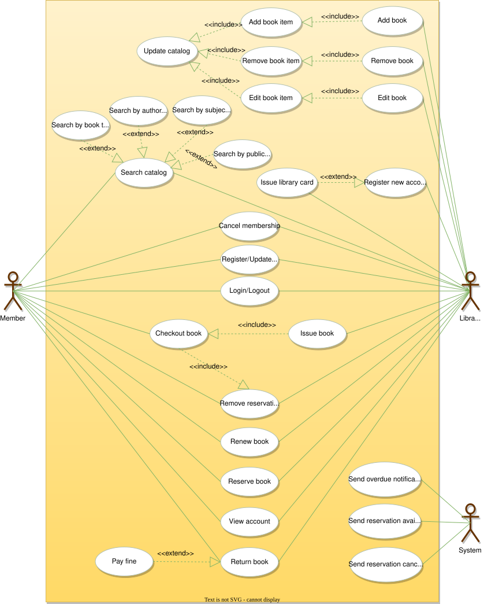
*Figure — Library use cases: Member and Librarian share most of them (log in, search, check out, renew, reserve, return); the four "search by" use cases extend "Search catalog"; add/remove/edit book and book item feed "Update catalog"; "Checkout book" includes "Remove reservation"; the librarian's "Issue book" includes "Checkout book"; "Issue library card" is attached to "Register new account" (course diagram)*

In the figure above, notice the two relationship kinds. `<<include>>` means a use case *always* performs another one as part of it — checking out a book always clears the member's reservation for it, if they had one. `<<extend>>` means an *optional variation* of a base use case — searching by author is one particular way a catalog search can go.

### Core entities

| Class | Responsibility |
|---|---|
| `Book` (record) | The **title**: ISBN, title, subject, publisher, publication date, authors. Immutable. |
| `BookItem` | One **physical copy**: barcode, format, rack, price, status (`AVAILABLE`, `RESERVED`, `LOANED`, `LOST`), and who it is held for. |
| `Author`, `Rack` (records) | An author's name; a rack's number and location. |
| `Account` (sealed, abstract) → `Member`, `Librarian` | People. An account **owns** its `LibraryCard` (composition). A member carries the loan count. |
| `LibraryCard` (record) | Card number, barcode, issue date. |
| `BookLending` | One loan: copy barcode, member id, creation date, **due date**, return date. |
| `Fine` (record) | Amount owed for one late return. |
| `Search` (interface) / `Catalog` | Four search methods; the catalog keeps one index per search and knows every copy of every title. |
| `LendingService` | The rules: check out, return, renew, reserve, overdue notices. |
| `FinePolicy` / `PerDayFine` | How much a late return costs (Strategy). |
| `Notifier` / `ConsoleNotifier` | Where messages go (email, SMS… here: console). |
| `Library` | Facade: owns the catalog and the lending service; only librarians may add stock. |

The course lists the same core classes: **Library** (name, address), **Book**, **BookItem**, **Account** (member or librarian), **LibraryCard**, **BookReservation**, **BookLending**, **Catalog** (searching by title, author, subject, publish date), **Fine**, **Author**, **Rack** (number + location identifier) and **Notification**. We keep every one of them; the only renames are `BookReservation` → a per-title waitlist inside `LendingService` (explained under *Design decisions*) and `Notification` → the `Notifier` interface.

### Class diagram

The course builds its diagram in five stages, adding a few classes each time and greying out earlier ones. Walking through the stages is a good way to *present* a design in an interview, because every box arrives with a reason.

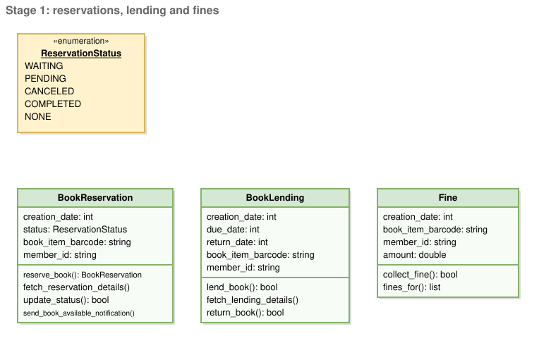
*Figure — Stage 1: the three "what happened" records — `BookReservation`, `BookLending` and `Fine` — each keeping a copy's barcode and a member id (course diagram)*


*Figure — How to read a class box (name, `property: type`, `method(): type`) and the arrow styles used in these diagrams (course diagram)*

Stage 1 answers requirements 4, 7 and 8, which are all about *remembering what happened*. Because each record stores the copy's barcode and the member's id, both halves of "who took this book / what does this member have" are answered by scanning these records.

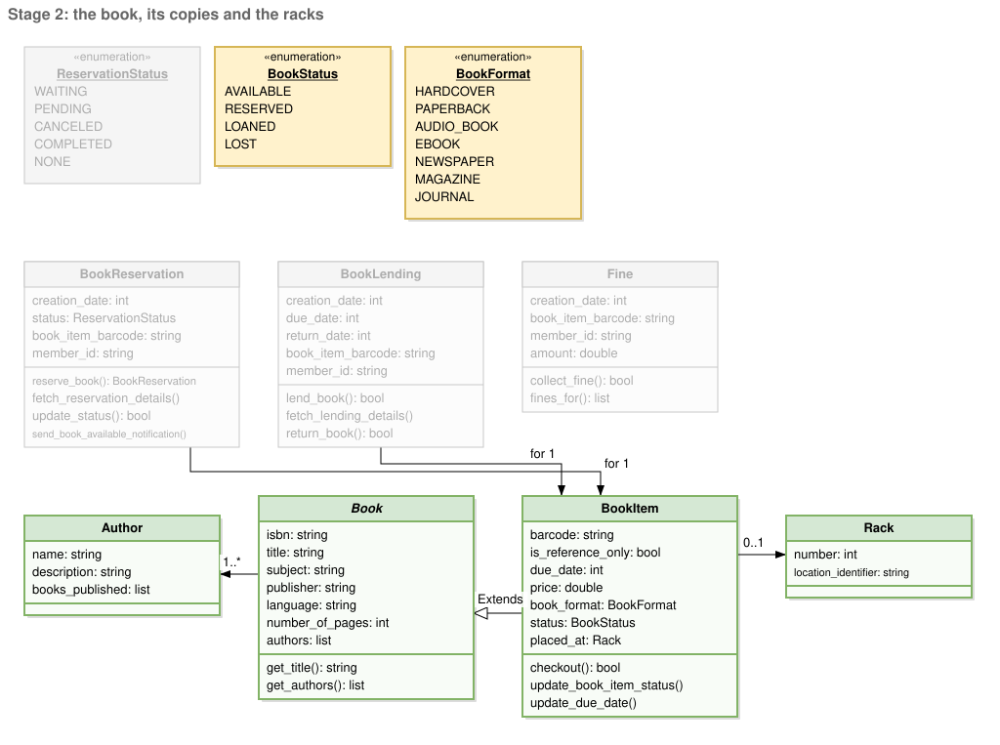
*Figure — Stage 2: `Book` (the title) and `BookItem` (one copy with barcode, price and rack), plus `Author` and `Rack`; every reservation and every loan refers to one single copy (course diagram)*

Stage 2 is the split that carries the whole design. In the course's diagram `BookItem` *inherits* from `Book`: the reading is that a copy carries all of the title's details and adds its own barcode, price and rack position. In our Java we use **composition** instead (`BookItem` *has a* `Book`) — see *Design decisions* for why.

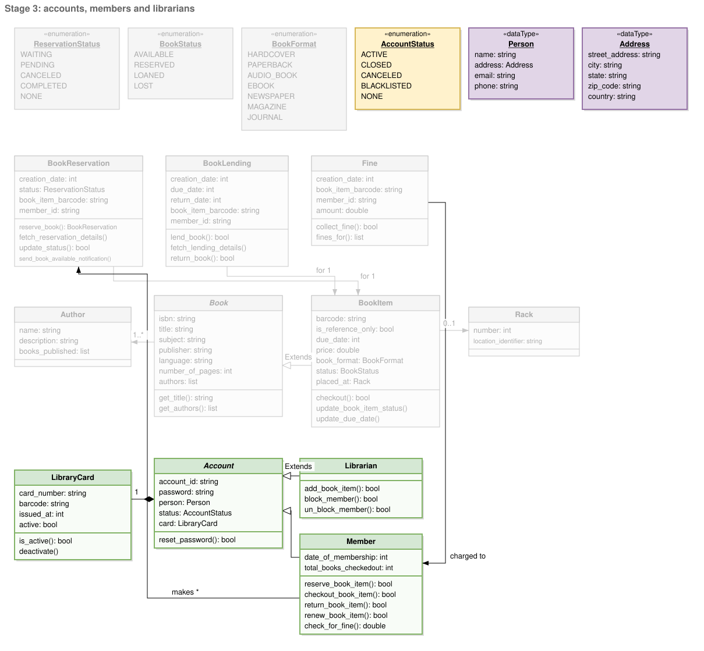
*Figure — Stage 3: abstract `Account` with `Member` and `Librarian`; the account owns its `LibraryCard` (filled diamond = composition); a fine is charged to a member; a member makes reservations (course diagram)*

Requirements 5 and 6 restrict *what one member may do*, so they belong to the people classes. `Account` is an **abstract class**: you can never create a plain `Account`, only a `Member` or a `Librarian`. The **filled diamond** is composition — the card has no life of its own, so closing the account destroys the card too.

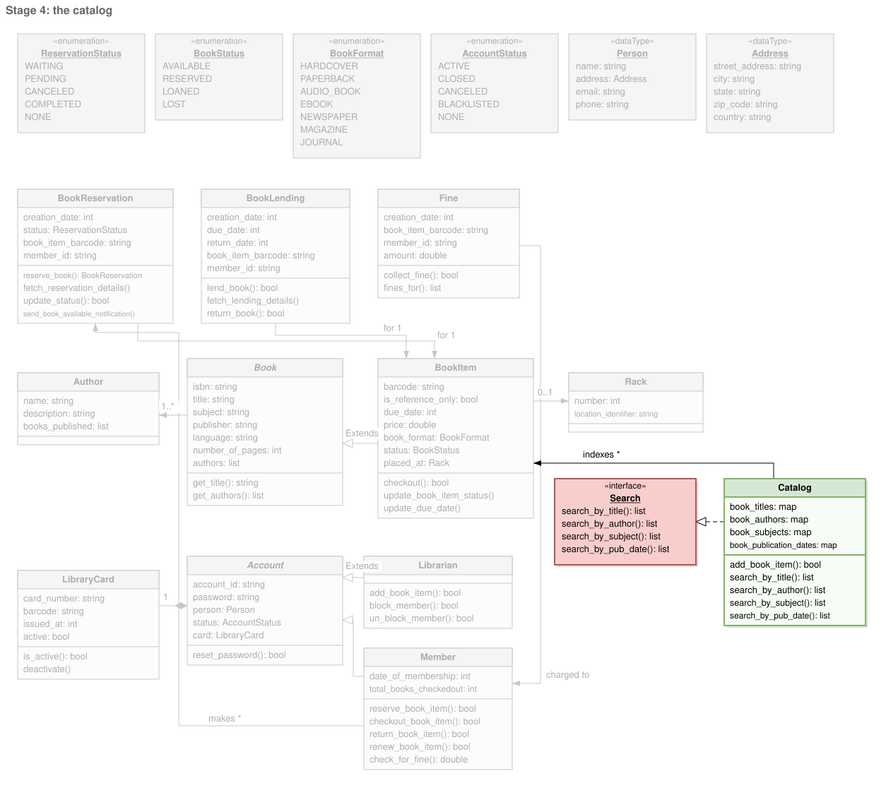
*Figure — Stage 4: the `Search` interface (four methods) and `Catalog` implementing it (dashed line, hollow head), indexing book items without owning them (course diagram)*

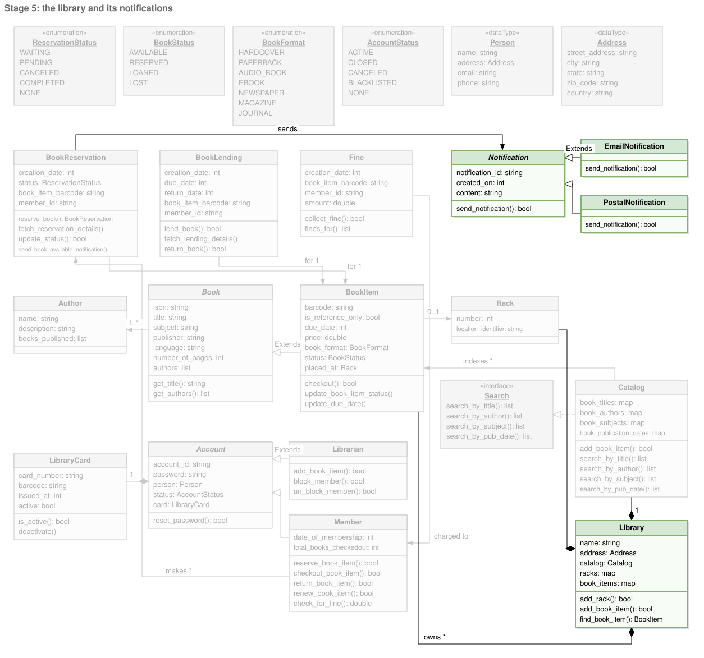
*Figure — Stage 5: `Library` is the owner of the catalog, every rack and every book item; `Notification` is abstract with one subclass per delivery channel; a reservation triggers a notification when its copy comes back (course diagram)*


*Figure — The finished library class diagram: every class from the five stages in full colour (course diagram)*

Here is the class diagram of **our Java code** (the one you would draw on the whiteboard):

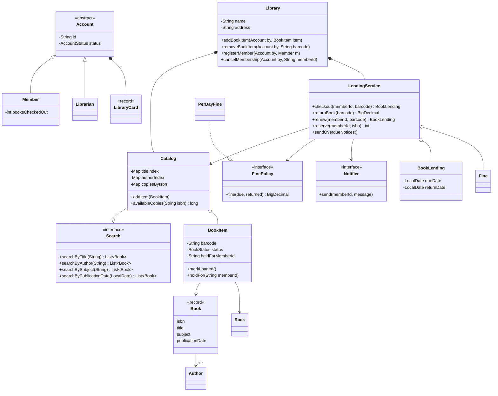

### Key flows

The course gives three activity diagrams — check out, return and renew.

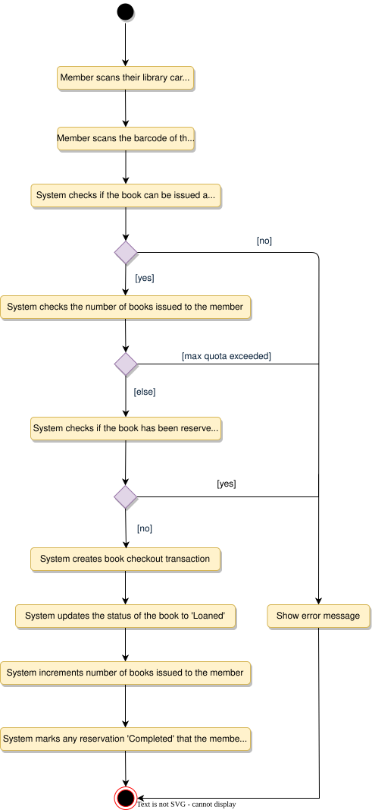
*Figure — Check out: scan the book, check it can be issued (not reserved by someone else), check the member's quota, create the checkout transaction, mark the copy "Loaned", increment the member's count, complete any reservation this member had (course diagram)*

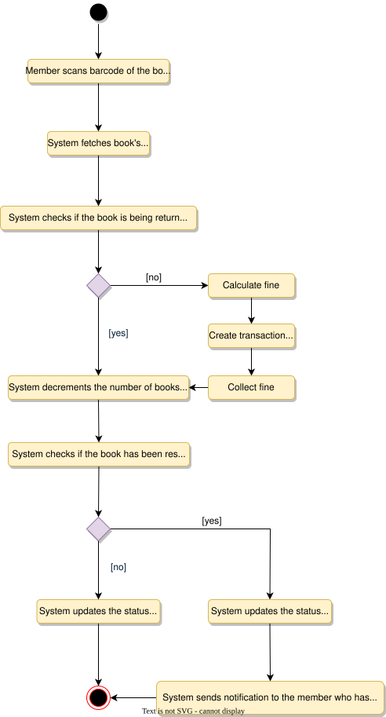
*Figure — Return: scan the book, check whether it is late (if so, calculate and collect the fine), decrement the member's count, then check whether the book is reserved — if yes, notify the member who reserved it and mark it reserved, otherwise make it available (course diagram)*

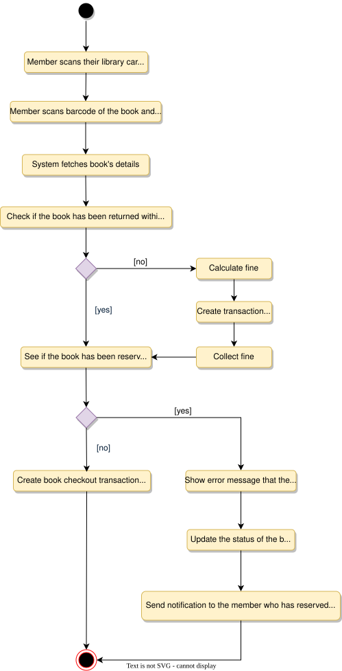
*Figure — Renew: scan card and book, collect a fine if it is already late, check whether another member reserved it (if so, refuse and show an error), otherwise create a new checkout transaction with a new due date (course diagram)*

The same check-out flow as a sequence diagram of our code, including the locks:

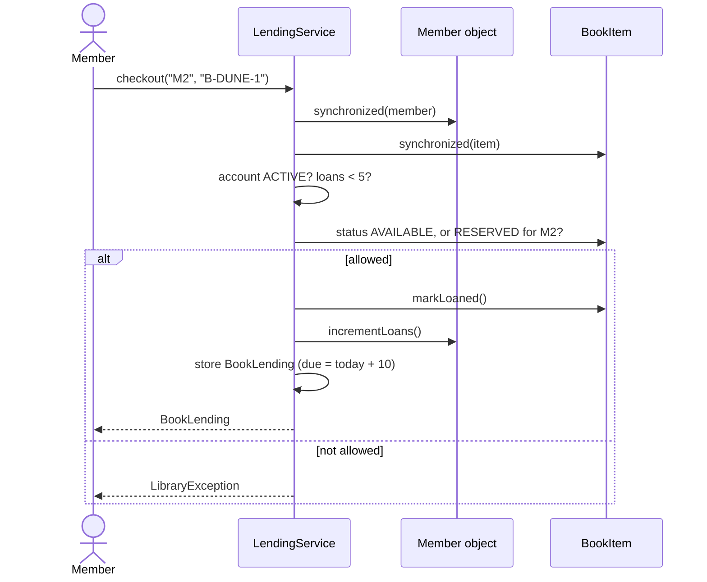

A book copy's life is a small **state machine**:

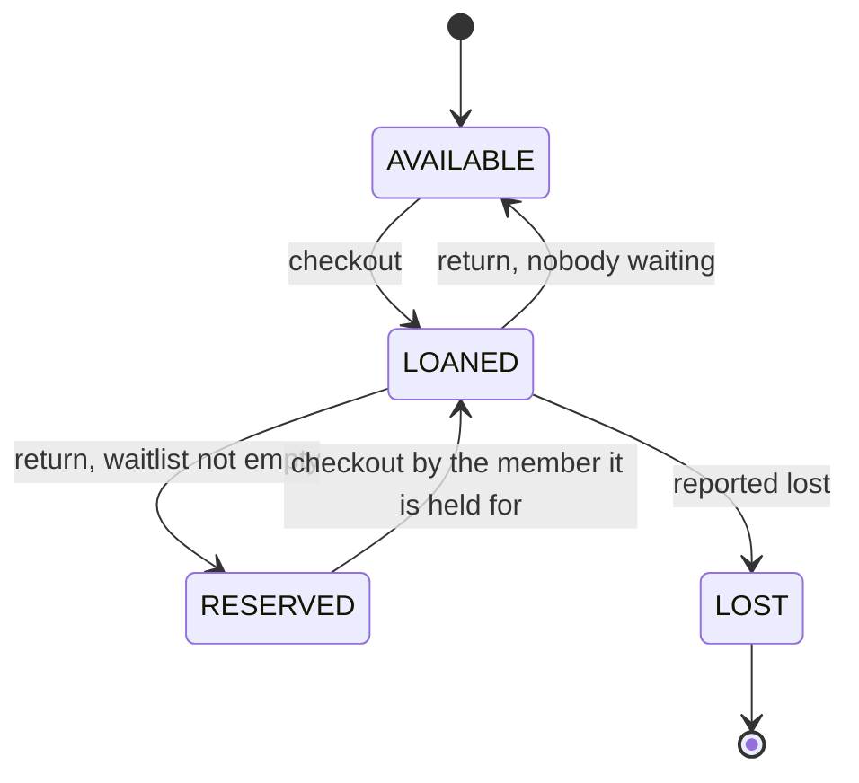

### Design decisions & patterns used

| Decision | Why | Alternative rejected |
|---|---|---|
| **`Book` vs `BookItem` split** | A member borrows a *copy*; search works on *titles*. Every later class depends on this split, so say it early. | One `Book` class with a `copies` counter — cannot say *which* copy is late, on which rack, or who has it. |
| **Composition (`BookItem` has a `Book`)** instead of the course's inheritance | Many copies share one immutable title; with inheritance each copy would duplicate every title field, and changing a title's subject would mean editing every copy. "A copy *is a* title" also fails a strict substitution test: a title has no barcode or status. | `BookItem extends Book` (the course diagram) — works for a small model, and is worth mentioning as the other valid reading. |
| **Lending rules in `LendingService`, not on `Member`** | The course itself flags that a `Member` doing checkout/return/renew has *two reasons to change* (a person, and the lending rules) — a Single Responsibility violation. Moving the flows to a service keeps `Member` a plain person. | Methods on `Member` (course version) — fine for a first sketch. |
| **Reservation = FIFO waitlist per *title*** | A member wants "a copy of Dune", not "copy #3". When *any* copy is returned, the first person in line gets it. | Reservation per copy (course's `BookReservation` keyed by barcode) — a member could wait on copy #3 while copy #1 sits on the shelf. |
| **Strategy for fines** (`FinePolicy`) | Fine rules change (caps, student discounts, holidays). The service calls `fine(due, returned)` and does not care how. | `if/else` inside `returnBook`. |
| **Observer-style `Notifier`** | Lending code announces events; delivery (email, SMS, push) is someone else's job. The course's abstract `Notification` with one subclass per channel is the same idea. | Sending email directly from `LendingService`. |
| **Facade (`Library`)** | Desk software calls one object; role checks (only librarians add stock) live there. | Exposing the catalog and service directly to the UI. |
| **Catalog keeps one index per search** | Every lookup is a map read. The course names the cost: each new way of searching adds another map, whereas a single index keyed by (field, value) would stay one structure. | Scanning all books per search. |

### Java implementation

Package `lld.ch15.library`. Files: `Model.java` (enums, records, entities), `Catalog.java`, `Support.java` (fine policy, notifier, clock, money formatting), `LendingService.java`, `Library.java`, `Main.java`.

```java
// File: lld/ch15/library/Model.java
package lld.ch15.library;

import java.math.BigDecimal;
import java.time.LocalDate;
import java.util.List;

enum BookFormat { HARDCOVER, PAPERBACK, AUDIO_BOOK, EBOOK, NEWSPAPER, MAGAZINE, JOURNAL }

enum BookStatus { AVAILABLE, RESERVED, LOANED, LOST }

enum AccountStatus { ACTIVE, CLOSED, CANCELED, BLACKLISTED }

record Author(String name) {}

/** Where a copy physically sits. */
record Rack(int number, String location) {}

/** The TITLE: one per ISBN, however many copies the library owns. Immutable. */
record Book(String isbn, String title, String subject, String publisher,
            LocalDate publicationDate, List<Author> authors) {
    Book { authors = List.copyOf(authors); }
}

/** One PHYSICAL COPY of a Book: own barcode, own rack, own status. Guarded by its own monitor. */
final class BookItem {
    private final String barcode;
    private final Book book;
    private final BookFormat format;
    private final Rack rack;
    private final BigDecimal price;          // money: BigDecimal, never double
    private BookStatus status = BookStatus.AVAILABLE;
    private String heldForMemberId;          // set only while status == RESERVED

    BookItem(String barcode, Book book, BookFormat format, Rack rack, BigDecimal price) {
        this.barcode = barcode; this.book = book; this.format = format;
        this.rack = rack; this.price = price;
    }
    String barcode()               { return barcode; }
    Book book()                    { return book; }
    Rack rack()                    { return rack; }
    BookFormat format()            { return format; }
    BigDecimal price()             { return price; }
    synchronized BookStatus status()      { return status; }
    synchronized String heldForMemberId() { return heldForMemberId; }

    // State changes are package-private: only LendingService calls them, while holding this monitor.
    void markLoaned()               { status = BookStatus.LOANED;    heldForMemberId = null; }
    void markAvailable()            { status = BookStatus.AVAILABLE; heldForMemberId = null; }
    void holdFor(String memberId)   { status = BookStatus.RESERVED;  heldForMemberId = memberId; }
    void markLost()                 { status = BookStatus.LOST;      heldForMemberId = null; }
}

/** Each account owns exactly one card (composition): the card's barcode identifies the person at the desk. */
record LibraryCard(String cardNumber, String barcode, LocalDate issuedOn) {}

abstract sealed class Account permits Member, Librarian {
    private final String id;
    private final String name;
    private final LibraryCard card;
    private volatile AccountStatus status = AccountStatus.ACTIVE;

    Account(String id, String name, LibraryCard card) { this.id = id; this.name = name; this.card = card; }
    String id()                { return id; }
    String name()              { return name; }
    LibraryCard card()         { return card; }
    AccountStatus status()     { return status; }
    void setStatus(AccountStatus s) { status = s; }
}

/** A member is a person with a quota. The count is guarded by the member's monitor. */
final class Member extends Account {
    private int booksCheckedOut;
    Member(String id, String name, LibraryCard card) { super(id, name, card); }
    int booksCheckedOut()   { return booksCheckedOut; }
    void incrementLoans()   { booksCheckedOut++; }
    void decrementLoans()   { booksCheckedOut--; }
}

final class Librarian extends Account {
    Librarian(String id, String name, LibraryCard card) { super(id, name, card); }
}

/** One checkout of one copy by one member. Answers "who has this copy?" and "what does this member have?". */
final class BookLending {
    private final String barcode;
    private final String memberId;
    private final LocalDate creationDate;
    private volatile LocalDate dueDate;      // volatile: read by the overdue job without the item lock
    private volatile LocalDate returnDate;

    BookLending(String barcode, String memberId, LocalDate creationDate, LocalDate dueDate) {
        this.barcode = barcode; this.memberId = memberId;
        this.creationDate = creationDate; this.dueDate = dueDate;
    }
    String barcode()        { return barcode; }
    String memberId()       { return memberId; }
    LocalDate creationDate(){ return creationDate; }
    LocalDate dueDate()     { return dueDate; }
    LocalDate returnDate()  { return returnDate; }
    void renewUntil(LocalDate d) { dueDate = d; }
    void close(LocalDate d)      { returnDate = d; }
}

record Fine(String memberId, String barcode, BigDecimal amount, LocalDate date) {}

final class LibraryException extends RuntimeException {
    private static final long serialVersionUID = 1L;
    LibraryException(String msg) { super(msg); }
}
```

```java
// File: lld/ch15/library/Catalog.java
package lld.ch15.library;

import java.time.LocalDate;
import java.util.Comparator;
import java.util.List;
import java.util.Locale;
import java.util.Map;
import java.util.concurrent.ConcurrentHashMap;
import java.util.concurrent.CopyOnWriteArrayList;

/** The four searches the requirements ask for. */
interface Search {
    List<Book> searchByTitle(String title);
    List<Book> searchByAuthor(String author);
    List<Book> searchBySubject(String subject);
    List<Book> searchByPublicationDate(LocalDate date);
}

/**
 * Keeps one index per search so every lookup is a map read, not a scan.
 * It also knows every copy of every title, which answers "how many copies are free?".
 * Reads vastly outnumber writes in a library, so concurrent maps + copy-on-write lists fit well.
 */
final class Catalog implements Search {
    private final Map<String, List<Book>> byTitle   = new ConcurrentHashMap<>();
    private final Map<String, List<Book>> byAuthor  = new ConcurrentHashMap<>();
    private final Map<String, List<Book>> bySubject = new ConcurrentHashMap<>();
    private final Map<LocalDate, List<Book>> byDate = new ConcurrentHashMap<>();
    private final Map<String, Book> books = new ConcurrentHashMap<>();                  // isbn -> title
    private final Map<String, List<BookItem>> copies = new ConcurrentHashMap<>();        // isbn -> copies
    private final Map<String, BookItem> itemsByBarcode = new ConcurrentHashMap<>();

    void addBook(Book b) {
        if (books.putIfAbsent(b.isbn(), b) != null) return;       // already indexed
        index(byTitle, key(b.title()), b);
        b.authors().forEach(a -> index(byAuthor, key(a.name()), b));
        index(bySubject, key(b.subject()), b);
        byDate.computeIfAbsent(b.publicationDate(), d -> new CopyOnWriteArrayList<>()).add(b);
    }

    void addItem(BookItem item) {
        addBook(item.book());
        if (itemsByBarcode.putIfAbsent(item.barcode(), item) != null)
            throw new LibraryException("duplicate barcode " + item.barcode());
        copies.computeIfAbsent(item.book().isbn(), k -> new CopyOnWriteArrayList<>()).add(item);
    }

    /** Take a copy out of stock (weeded, damaged beyond repair). A copy that is out on loan or held cannot go. */
    void removeItem(String barcode) {
        BookItem item = item(barcode);
        synchronized (item) {
            if (item.status() == BookStatus.LOANED || item.status() == BookStatus.RESERVED)
                throw new LibraryException(barcode + " is " + item.status() + ", cannot remove it now");
            itemsByBarcode.remove(barcode);
            copies.getOrDefault(item.book().isbn(), List.of()).remove(item);
        }
    }

    BookItem item(String barcode) {
        BookItem i = itemsByBarcode.get(barcode);
        if (i == null) throw new LibraryException("unknown barcode " + barcode);
        return i;
    }

    List<BookItem> copiesOf(String isbn) { return copies.getOrDefault(isbn, List.of()); }

    long availableCopies(String isbn) {
        return copiesOf(isbn).stream().filter(c -> c.status() == BookStatus.AVAILABLE).count();
    }

    @Override public List<Book> searchByTitle(String t)     { return find(byTitle, key(t)); }
    @Override public List<Book> searchByAuthor(String a)    { return find(byAuthor, key(a)); }
    @Override public List<Book> searchBySubject(String s)   { return find(bySubject, key(s)); }
    @Override public List<Book> searchByPublicationDate(LocalDate d) { return List.copyOf(byDate.getOrDefault(d, List.of())); }

    private static String key(String s) { return s.trim().toLowerCase(Locale.ROOT); }

    private static void index(Map<String, List<Book>> idx, String k, Book b) {
        idx.computeIfAbsent(k, x -> new CopyOnWriteArrayList<>()).add(b);
    }

    private static List<Book> find(Map<String, List<Book>> idx, String k) {
        return idx.getOrDefault(k, List.of()).stream().sorted(Comparator.comparing(Book::title)).toList();
    }
}
```

```java
// File: lld/ch15/library/Support.java
package lld.ch15.library;

import java.math.BigDecimal;
import java.math.RoundingMode;
import java.time.Clock;
import java.time.Duration;
import java.time.Instant;
import java.time.LocalDate;
import java.time.ZoneId;
import java.time.ZoneOffset;
import java.time.temporal.ChronoUnit;
import java.util.List;
import java.util.concurrent.CopyOnWriteArrayList;

/** Strategy: how much a late return costs. Swappable without touching LendingService. */
interface FinePolicy {
    BigDecimal fine(LocalDate dueDate, LocalDate returnDate);
}

/** Flat amount per day late (the classic rule: $0.50 a day). */
final class PerDayFine implements FinePolicy {
    private final BigDecimal perDay;
    PerDayFine(BigDecimal perDay) { this.perDay = perDay; }
    @Override public BigDecimal fine(LocalDate due, LocalDate returned) {
        long daysLate = Math.max(0, ChronoUnit.DAYS.between(due, returned));
        return perDay.multiply(BigDecimal.valueOf(daysLate));
    }
}

/** Observer-style outlet for "your reserved book is back" and "your book is overdue". */
interface Notifier {
    void send(String memberId, String message);
}

final class ConsoleNotifier implements Notifier {
    private final List<String> sent = new CopyOnWriteArrayList<>();
    @Override public void send(String memberId, String message) {
        String line = "  [notify " + memberId + "] " + message;
        sent.add(line);
        System.out.println(line);
    }
    List<String> sent() { return sent; }
}

/** A clock we can move forward in tests and demos, so "10 days later" needs no sleeping. */
final class SimClock extends Clock {
    private volatile Instant now;
    SimClock(Instant start) { this.now = start; }
    void advance(Duration d) { now = now.plus(d); }
    @Override public ZoneId getZone() { return ZoneOffset.UTC; }
    @Override public Clock withZone(ZoneId zone) { return this; }
    @Override public Instant instant() { return now; }
}

final class Money {
    private Money() {}
    /** Money is BigDecimal (exact decimals); shown with exactly two decimal places. */
    static String fmt(BigDecimal amount) { return "$" + amount.setScale(2, RoundingMode.UNNECESSARY).toPlainString(); }
}
```

```java
// File: lld/ch15/library/LendingService.java
package lld.ch15.library;

import java.math.BigDecimal;
import java.time.Clock;
import java.time.LocalDate;
import java.util.ArrayDeque;
import java.util.ArrayList;
import java.util.Collections;
import java.util.Deque;
import java.util.List;
import java.util.Map;
import java.util.concurrent.ConcurrentHashMap;

/**
 * The three core flows (check out, return, renew) plus reservations.
 * Lives apart from Member so a Member stays "a person", and the rules live in one place.
 *
 * Locking rule (prevents deadlock): always lock the MEMBER first, then the BOOK ITEM.
 */
public final class LendingService {
    static final int MAX_BOOKS_PER_MEMBER = 5;
    static final int MAX_LENDING_DAYS = 10;

    private final Catalog catalog;
    private final Clock clock;
    private final FinePolicy finePolicy;
    private final Notifier notifier;
    private final Map<String, Member> members = new ConcurrentHashMap<>();
    private final Map<String, BookLending> activeLoans = new ConcurrentHashMap<>();    // barcode -> loan
    private final Map<String, Deque<String>> waitlists = new ConcurrentHashMap<>();    // isbn -> member ids (FIFO)
    private final List<Fine> fines = Collections.synchronizedList(new ArrayList<>());

    LendingService(Catalog catalog, Clock clock, FinePolicy finePolicy, Notifier notifier) {
        this.catalog = catalog; this.clock = clock; this.finePolicy = finePolicy; this.notifier = notifier;
    }

    void register(Member m) { members.put(m.id(), m); }

    /** Cancel a membership. Refused while the member still has books out; drops them from every waitlist. */
    void cancelMembership(String memberId) {
        Member m = member(memberId);
        synchronized (m) {
            if (m.booksCheckedOut() > 0)
                throw new LibraryException(memberId + " must return " + m.booksCheckedOut() + " book(s) first");
            m.setStatus(AccountStatus.CANCELED);
        }
        for (Deque<String> q : waitlists.values()) synchronized (q) { q.remove(memberId); }
    }

    private LocalDate today() { return LocalDate.now(clock); }

    private Member member(String id) {
        Member m = members.get(id);
        if (m == null) throw new LibraryException("unknown member " + id);
        return m;
    }

    // ---------------------------------------------------------------- check out
    BookLending checkout(String memberId, String barcode) {
        Member m = member(memberId);
        BookItem item = catalog.item(barcode);
        synchronized (m) {
            synchronized (item) {
                if (m.status() != AccountStatus.ACTIVE)
                    throw new LibraryException(memberId + " account is " + m.status());
                if (m.booksCheckedOut() >= MAX_BOOKS_PER_MEMBER)
                    throw new LibraryException(memberId + " already has " + MAX_BOOKS_PER_MEMBER + " books");
                switch (item.status()) {
                    case AVAILABLE -> { /* ok */ }
                    case RESERVED -> {
                        if (!memberId.equals(item.heldForMemberId()))
                            throw new LibraryException(barcode + " is held for another member");
                    }
                    case LOANED, LOST -> throw new LibraryException(barcode + " is " + item.status());
                }
                item.markLoaned();
                m.incrementLoans();
                LocalDate today = today();
                BookLending loan = new BookLending(barcode, memberId, today, today.plusDays(MAX_LENDING_DAYS));
                activeLoans.put(barcode, loan);
                removeFromWaitlist(item.book().isbn(), memberId);   // their reservation is now fulfilled
                return loan;
            }
        }
    }

    // ---------------------------------------------------------------- return
    BigDecimal returnBook(String barcode) {
        BookLending loan = activeLoans.get(barcode);
        if (loan == null) throw new LibraryException(barcode + " is not checked out");
        Member m = member(loan.memberId());
        BookItem item = catalog.item(barcode);
        synchronized (m) {
            synchronized (item) {
                if (activeLoans.get(barcode) != loan)                // someone returned it meanwhile
                    throw new LibraryException(barcode + " is not checked out");
                LocalDate today = today();
                loan.close(today);
                activeLoans.remove(barcode);
                m.decrementLoans();
                BigDecimal fine = chargeFineIfLate(loan, today);
                handToNextInLine(item);
                return fine;
            }
        }
    }

    // ---------------------------------------------------------------- renew
    BookLending renew(String memberId, String barcode) {
        Member m = member(memberId);
        BookItem item = catalog.item(barcode);
        synchronized (m) {
            synchronized (item) {
                BookLending loan = activeLoans.get(barcode);
                if (loan == null || !loan.memberId().equals(memberId))
                    throw new LibraryException(memberId + " does not have " + barcode);
                if (waitingCount(item.book().isbn()) > 0)
                    throw new LibraryException("cannot renew " + barcode + ": another member reserved this title");
                LocalDate today = today();
                chargeFineIfLate(loan, today);                       // a late renewal still pays the fine
                loan.renewUntil(today.plusDays(MAX_LENDING_DAYS));
                return loan;
            }
        }
    }

    // ---------------------------------------------------------------- reserve
    /** Join the FIFO waitlist for a TITLE that has no free copy. Returns the 1-based position. */
    int reserve(String memberId, String isbn) {
        Member m = member(memberId);
        if (m.status() != AccountStatus.ACTIVE) throw new LibraryException(memberId + " account is " + m.status());
        if (catalog.copiesOf(isbn).isEmpty()) throw new LibraryException("unknown isbn " + isbn);
        if (catalog.availableCopies(isbn) > 0)
            throw new LibraryException("a copy is on the shelf, just check it out");
        Deque<String> q = waitlist(isbn);
        synchronized (q) {
            if (!q.contains(memberId)) q.addLast(memberId);
            return new ArrayList<>(q).indexOf(memberId) + 1;
        }
    }

    // ---------------------------------------------------------------- system jobs & queries
    void sendOverdueNotices() {
        LocalDate today = today();
        activeLoans.values().stream()
                .filter(l -> l.dueDate().isBefore(today))
                .sorted((a, b) -> a.barcode().compareTo(b.barcode()))
                .forEach(l -> notifier.send(l.memberId(), "'" + catalog.item(l.barcode()).book().title()
                        + "' (" + l.barcode() + ") was due " + l.dueDate()));
    }

    String whoHas(String barcode) {
        BookLending l = activeLoans.get(barcode);
        return l == null ? null : l.memberId();
    }

    List<String> loansOf(String memberId) {
        return activeLoans.values().stream().filter(l -> l.memberId().equals(memberId))
                .map(BookLending::barcode).sorted().toList();
    }

    List<Fine> fines() { synchronized (fines) { return List.copyOf(fines); } }

    // ---------------------------------------------------------------- helpers
    private BigDecimal chargeFineIfLate(BookLending loan, LocalDate today) {
        BigDecimal amount = finePolicy.fine(loan.dueDate(), today);
        if (amount.signum() > 0) {
            fines.add(new Fine(loan.memberId(), loan.barcode(), amount, today));
            notifier.send(loan.memberId(), "fine of " + Money.fmt(amount) + " for late " + loan.barcode());
        }
        return amount;
    }

    /** Caller holds the item's monitor. Give the copy to the first waiting member, or shelve it. */
    private void handToNextInLine(BookItem item) {
        Deque<String> q = waitlist(item.book().isbn());
        String next;
        synchronized (q) { next = q.pollFirst(); }
        if (next == null) { item.markAvailable(); return; }
        item.holdFor(next);
        notifier.send(next, "'" + item.book().title() + "' copy " + item.barcode() + " is held for you");
    }

    private Deque<String> waitlist(String isbn) {
        return waitlists.computeIfAbsent(isbn, k -> new ArrayDeque<>());
    }

    int waitingCount(String isbn) {
        Deque<String> q = waitlist(isbn);
        synchronized (q) { return q.size(); }
    }

    private void removeFromWaitlist(String isbn, String memberId) {
        Deque<String> q = waitlist(isbn);
        synchronized (q) { q.remove(memberId); }
    }
}
```

```java
// File: lld/ch15/library/Library.java
package lld.ch15.library;

import java.time.Clock;

/** Facade: the one object the desk software talks to. Owns the catalog and the lending rules. */
final class Library {
    private final String name;
    private final String address;
    private final Catalog catalog = new Catalog();
    private final LendingService lending;

    Library(String name, String address, Clock clock, FinePolicy finePolicy, Notifier notifier) {
        this.name = name; this.address = address;
        this.lending = new LendingService(catalog, clock, finePolicy, notifier);
    }

    /** Only a librarian may add stock (the use-case diagram's "Add book item"). */
    void addBookItem(Account by, BookItem item) {
        if (!(by instanceof Librarian)) throw new LibraryException(by.id() + " is not a librarian");
        catalog.addItem(item);
    }

    void removeBookItem(Account by, String barcode) {
        if (!(by instanceof Librarian)) throw new LibraryException(by.id() + " is not a librarian");
        catalog.removeItem(barcode);
    }

    void registerMember(Account by, Member m) {
        if (!(by instanceof Librarian)) throw new LibraryException(by.id() + " is not a librarian");
        lending.register(m);
    }

    void cancelMembership(Account by, String memberId) {
        if (!(by instanceof Librarian)) throw new LibraryException(by.id() + " is not a librarian");
        lending.cancelMembership(memberId);
    }

    String name()            { return name; }
    String address()         { return address; }
    Catalog catalog()        { return catalog; }
    LendingService lending() { return lending; }
}
```

```java
// File: lld/ch15/library/Main.java
package lld.ch15.library;

import java.math.BigDecimal;
import java.time.Duration;
import java.time.Instant;
import java.time.LocalDate;
import java.util.List;
import java.util.concurrent.CountDownLatch;
import java.util.concurrent.ExecutorService;
import java.util.concurrent.Executors;
import java.util.concurrent.atomic.AtomicInteger;

public class Main {
    public static void main(String[] args) throws Exception {
        SimClock clock = new SimClock(Instant.parse("2026-03-01T10:00:00Z"));
        ConsoleNotifier notifier = new ConsoleNotifier();
        Library lib = new Library("City Library", "1 Main Street", clock,
                new PerDayFine(new BigDecimal("0.50")), notifier);
        LendingService desk = lib.lending();
        LocalDate today = LocalDate.of(2026, 3, 1);

        Librarian lucy = new Librarian("L1", "Lucy", new LibraryCard("C-L1", "BC-L1", today));
        Book dune = new Book("978-0441013593", "Dune", "Science Fiction", "Ace",
                LocalDate.of(1965, 8, 1), List.of(new Author("Frank Herbert")));
        Book hobbit = new Book("978-0547928227", "The Hobbit", "Fantasy", "Mariner",
                LocalDate.of(1937, 9, 21), List.of(new Author("J.R.R. Tolkien")));
        Book lotr = new Book("978-0544003415", "The Lord of the Rings", "Fantasy", "Mariner",
                LocalDate.of(1954, 7, 29), List.of(new Author("J.R.R. Tolkien")));
        Rack r1 = new Rack(1, "Aisle A");
        lib.addBookItem(lucy, new BookItem("B-DUNE-1", dune, BookFormat.PAPERBACK, r1, new BigDecimal("9.99")));
        for (int i = 1; i <= 6; i++)
            lib.addBookItem(lucy, new BookItem("B-HOB-" + i, hobbit, BookFormat.HARDCOVER, r1, new BigDecimal("14.99")));
        lib.addBookItem(lucy, new BookItem("B-LOTR-1", lotr, BookFormat.HARDCOVER, r1, new BigDecimal("29.99")));

        for (int i = 1; i <= 9; i++)
            lib.registerMember(lucy, new Member("M" + i, "Member " + i, new LibraryCard("C-M" + i, "BC-M" + i, today)));

        System.out.println("== 1. Search the catalog ==");
        System.out.println("  author 'j.r.r. tolkien' -> " + titles(lib.catalog().searchByAuthor("j.r.r. tolkien")));
        System.out.println("  subject 'Fantasy'       -> " + titles(lib.catalog().searchBySubject("Fantasy")));
        System.out.println("  published 1965-08-01    -> " + titles(lib.catalog().searchByPublicationDate(LocalDate.of(1965, 8, 1))));
        System.out.println("  free copies of Hobbit   -> " + lib.catalog().availableCopies(hobbit.isbn()));

        System.out.println("\n== 2. Checkout limit (max 5 books per member) ==");
        for (int i = 1; i <= 6; i++) {
            try {
                BookLending l = desk.checkout("M1", "B-HOB-" + i);
                System.out.println("  M1 took " + l.barcode() + ", due " + l.dueDate());
            } catch (LibraryException e) {
                System.out.println("  REFUSED: " + e.getMessage());
            }
        }
        System.out.println("  M1 has " + desk.loansOf("M1"));

        System.out.println("\n== 3. 8 members race for the ONLY copy of Dune ==");
        AtomicInteger winners = new AtomicInteger(), losers = new AtomicInteger();
        CountDownLatch start = new CountDownLatch(1);
        try (ExecutorService pool = Executors.newFixedThreadPool(8)) {
            for (int i = 2; i <= 9; i++) {
                String id = "M" + i;
                pool.submit(() -> {
                    start.await();
                    try { desk.checkout(id, "B-DUNE-1"); winners.incrementAndGet(); }
                    catch (LibraryException e) { losers.incrementAndGet(); }
                    return null;
                });
            }
            start.countDown();                    // release all threads at once
        }                                         // close() waits for every task
        String holder = desk.whoHas("B-DUNE-1");
        System.out.println("  winners=" + winners + " losers=" + losers + " (exactly one copy was lent)");
        System.out.println("  holder = " + holder + "  (which member wins varies from run to run)");

        System.out.println("\n== 4. Reserve a title with no free copy (FIFO waitlist) ==");
        String first = holder.equals("M2") ? "M3" : "M2";
        String second = holder.equals("M4") ? "M5" : "M4";
        System.out.println("  " + first + " position " + desk.reserve(first, dune.isbn()));
        System.out.println("  " + second + " position " + desk.reserve(second, dune.isbn()));
        try { desk.reserve("M6", hobbit.isbn()); }
        catch (LibraryException e) { System.out.println("  M6 reserve Hobbit REFUSED: " + e.getMessage()); }

        System.out.println("\n== 5. Renew is blocked while someone waits ==");
        try { desk.renew(holder, "B-DUNE-1"); }
        catch (LibraryException e) { System.out.println("  REFUSED: " + e.getMessage()); }

        System.out.println("\n== 6. 13 days later: overdue notices, late return, fine, hand-over ==");
        clock.advance(Duration.ofDays(13));
        desk.sendOverdueNotices();
        BigDecimal fine = desk.returnBook("B-DUNE-1");
        System.out.println("  fine charged = " + Money.fmt(fine) + " (3 days late x $0.50)");
        try { desk.checkout(second, "B-DUNE-1"); }
        catch (LibraryException e) { System.out.println("  " + second + " REFUSED: " + e.getMessage()); }
        System.out.println("  " + first + " checks out held copy, due " + desk.checkout(first, "B-DUNE-1").dueDate());
        System.out.println("  who has B-DUNE-1? " + desk.whoHas("B-DUNE-1"));

        System.out.println("\n== 7. Renew on time with nobody waiting ==");
        desk.returnBook("B-HOB-1");                     // 13 days: late, fine charged
        desk.checkout("M6", "B-HOB-1");
        clock.advance(Duration.ofDays(4));
        System.out.println("  M6 renewed B-HOB-1, new due " + desk.renew("M6", "B-HOB-1").dueDate());
        System.out.println("  fines on record: " + desk.fines().size());

        System.out.println("\n== 8. Librarian housekeeping: remove a copy, cancel a membership ==");
        try { lib.removeBookItem(lucy, "B-DUNE-1"); }
        catch (LibraryException e) { System.out.println("  REFUSED: " + e.getMessage()); }
        lib.removeBookItem(lucy, "B-LOTR-1");
        System.out.println("  copies of LOTR left: " + lib.catalog().copiesOf(lotr.isbn()).size());
        try { lib.cancelMembership(lucy, "M6"); }
        catch (LibraryException e) { System.out.println("  REFUSED: " + e.getMessage()); }
        lib.cancelMembership(lucy, "M8");
        try { desk.checkout("M8", "B-HOB-6"); }
        catch (LibraryException e) { System.out.println("  REFUSED: " + e.getMessage()); }
    }

    private static List<String> titles(List<Book> books) { return books.stream().map(Book::title).toList(); }
}
```

**Output:**

```text
== 1. Search the catalog ==
  author 'j.r.r. tolkien' -> [The Hobbit, The Lord of the Rings]
  subject 'Fantasy'       -> [The Hobbit, The Lord of the Rings]
  published 1965-08-01    -> [Dune]
  free copies of Hobbit   -> 6

== 2. Checkout limit (max 5 books per member) ==
  M1 took B-HOB-1, due 2026-03-11
  M1 took B-HOB-2, due 2026-03-11
  M1 took B-HOB-3, due 2026-03-11
  M1 took B-HOB-4, due 2026-03-11
  M1 took B-HOB-5, due 2026-03-11
  REFUSED: M1 already has 5 books
  M1 has [B-HOB-1, B-HOB-2, B-HOB-3, B-HOB-4, B-HOB-5]

== 3. 8 members race for the ONLY copy of Dune ==
  winners=1 losers=7 (exactly one copy was lent)
  holder = M9  (which member wins varies from run to run)

== 4. Reserve a title with no free copy (FIFO waitlist) ==
  M2 position 1
  M4 position 2
  M6 reserve Hobbit REFUSED: a copy is on the shelf, just check it out

== 5. Renew is blocked while someone waits ==
  REFUSED: cannot renew B-DUNE-1: another member reserved this title

== 6. 13 days later: overdue notices, late return, fine, hand-over ==
  [notify M9] 'Dune' (B-DUNE-1) was due 2026-03-11
  [notify M1] 'The Hobbit' (B-HOB-1) was due 2026-03-11
  [notify M1] 'The Hobbit' (B-HOB-2) was due 2026-03-11
  [notify M1] 'The Hobbit' (B-HOB-3) was due 2026-03-11
  [notify M1] 'The Hobbit' (B-HOB-4) was due 2026-03-11
  [notify M1] 'The Hobbit' (B-HOB-5) was due 2026-03-11
  [notify M9] fine of $1.50 for late B-DUNE-1
  [notify M2] 'Dune' copy B-DUNE-1 is held for you
  fine charged = $1.50 (3 days late x $0.50)
  M4 REFUSED: B-DUNE-1 is held for another member
  M2 checks out held copy, due 2026-03-24
  who has B-DUNE-1? M2

== 7. Renew on time with nobody waiting ==
  [notify M1] fine of $1.50 for late B-HOB-1
  M6 renewed B-HOB-1, new due 2026-03-28
  fines on record: 2

== 8. Librarian housekeeping: remove a copy, cancel a membership ==
  REFUSED: B-DUNE-1 is LOANED, cannot remove it now
  copies of LOTR left: 0
  REFUSED: M6 must return 1 book(s) first
  REFUSED: M8 account is CANCELED
```

What to notice in the output: section 2 refuses the sixth book (requirement 5); section 3 lets exactly one of eight concurrent members borrow the only copy; section 5 refuses a renewal because someone is waiting; section 6 sends overdue notices, charges 3 days × $0.50, and hands the returned copy to the first person in the waitlist — the second person is refused because the copy is *held* for the first; section 8 covers the librarian's "remove book item" and "cancel membership" use cases — a copy that is out on loan cannot be removed, a member with a book still out cannot be cancelled, and a cancelled member can no longer borrow.

### Concurrency & edge cases

- **Two members, one last copy.** `checkout` locks the copy (`synchronized (item)`), so "is it available? → mark loaned" is one atomic step. The demo's 8-thread race always has exactly one winner.
- **Two librarians scanning for the same member.** The quota check and increment happen under `synchronized (member)`, so a member can never end up with 6 books.
- **Deadlock avoidance.** Every method locks **member first, then item** — a fixed global lock order. Two threads can never each hold one lock while waiting for the other. (`returnBook` reads the loan first to find the member, then locks in the same order and re-checks the loan is still active.)
- **Renew vs reserve.** Renewal is refused if the title's waitlist is non-empty. The check happens *before* charging any late fine, so a refused renewal never fines the member twice.
- **A known small window.** `reserve` checks "no free copy" and then joins the queue as two steps. If a copy is returned in between, it goes to the shelf while the member sits first in the queue; the *next* return reaches them. We accept this rather than make `reserve` take the queue lock before the copies' locks, because returns take them in the opposite order (copy, then queue) — mixing the two orders is exactly how deadlocks are born.
- **Held copy.** A returned copy with a waitlist becomes `RESERVED` for one member only; everybody else is refused at checkout.
- **Edge cases handled:** unknown barcode or member, duplicate barcodes, inactive/blacklisted/cancelled accounts, removing a copy that is on loan or held, cancelling a membership while books are still out, reserving a title that has a free copy ("just check it out"), joining the same waitlist twice (keeps your place), returning a book that is not out.
- **Across several servers** the `synchronized` blocks are not enough — the same guarantee must come from the database: e.g. `UPDATE book_item SET status='LOANED' WHERE barcode=? AND status='AVAILABLE'` and check that exactly one row changed (a *conditional update*).

### Extensions & follow-up questions

- **"Two members reserve the last copy at the same moment — what happens?"** The course calls this out as unguarded in its own design. In ours, `reserve` appends to a FIFO deque under a lock, so both are queued in a definite order and the first one gets the next copy.
- **"Where do you keep the number of available copies of a title?"** Don't store a counter that can drift; derive it: `Catalog.availableCopies(isbn)` counts copies with status `AVAILABLE`. If that becomes slow, cache it and update it in the same lock as the status change.
- **"What is a `BookLending` for?"** It is the loan record: it answers "who has this copy, since when, due when", drives overdue notices and fines, and is the history of the copy.
- **"How is the fine paid?"** Add a `FinePayment` / `PaymentService` and block checkouts while unpaid fines exceed a threshold — a one-line rule in `checkout`.
- **"Hold expiry?"** A held copy should not wait forever: add `heldUntil` to `BookItem` and a daily job that passes the copy to the next person (or shelves it) when the hold lapses — exactly the TTL idea of section 15.2.
- **"E-books?"** An e-book "copy" is a licence: `BookFormat.EBOOK` items with no rack, and many libraries buy a fixed number of concurrent licences — the same copy model works.

### Real-world example

Open-source integrated library systems such as **Koha** and **Evergreen** implement exactly this model: bibliographic *records* (titles) with attached *items* (copies with barcodes and shelf locations), circulation rules per patron category (loan period, maximum items, fine per day), a holds queue per title, and overdue/hold-available notices by email or SMS. Digital lending apps such as **OverDrive's Libby** apply the same waitlist idea to e-books: a library owns a fixed number of licences, borrowers join a holds queue, and when a licence frees up the next person is notified and given a limited window to borrow before it passes on.

### In the interview

**30–45 minute plan.** (1) 3 min — clarify: copies, limits (5 books, 10 days), fines, reservations, notifications. (2) 5 min — actors and use cases. (3) 10 min — entities, *starting with the `Book`/`BookItem` split*, then accounts, lending records, catalog. (4) 10 min — code `checkout` and `returnBook` with the locking; mention lock ordering. (5) 5 min — the reservation hand-over and fines (Strategy). (6) Remaining — follow-ups: concurrency across servers, fine payment, hold expiry.

**30-second answer:** "The key split is `Book` (the title) vs `BookItem` (a physical copy with a barcode and rack). Members borrow copies; search works on titles through a `Catalog` with one index per search type. A `LendingService` enforces 5 books and 10 days, records `BookLending`s, charges fines via a `FinePolicy` strategy, and passes returned copies to a FIFO waitlist per title with a notification. Checkout locks member then copy so the last copy can't be double-lent."

### Self-check

- **Q:** Why is `Book` separate from `BookItem`? **A:** Search and metadata are per title; status, rack, barcode and loans are per physical copy. One title has many copies.
- **Q:** What guarantees a member can't get a 6th book when two desks scan at once? **A:** The quota check and increment happen inside `synchronized (member)`.
- **Q:** Why a fixed lock order? **A:** Without it, thread A could hold member→wait item while B holds item→wait member: deadlock.
- **Q:** Which pattern lets the library change its fine rules without touching lending code? **A:** Strategy (`FinePolicy`).
- **Q:** When can't a book be renewed? **A:** When another member is waiting for that title.

### TL;DR

Title vs copy. Limits on the member, state on the copy, history in `BookLending`. Rules in a `LendingService`; fines as a Strategy; notifications behind an interface. Lock member-then-copy so the last copy is never lent twice. Reservations are a FIFO queue per title.

---

## 15.2 Design a Movie Ticket Booking System (BookMyShow)


*Figure — Cover image for the movie ticket booking case study (course diagram)*

### Problem & clarifying questions

An online movie ticket booking system (think **BookMyShow**, **Fandango**, **AMC's app**) lets customers see which movies are playing, pick a show, choose seats on a seat map, pay, and receive a ticket — from anywhere, at any time. It is *the* classic LLD booking question because it has a hierarchy of places (city → cinema → hall → seat), a time dimension (shows), and a genuine race (two people tapping the same seat).

| Question | Answer we assume |
|---|---|
| One city or many? | Many cities with affiliate cinemas; the app lists cities. |
| Can a cinema have several halls? Several shows per hall? | Yes and yes — but a hall runs **one show at a time**. |
| What do customers search by? | Title, language, genre, release date, **city**. |
| Can a customer pick several seats in one booking? | Yes, from a seat map showing free vs booked seats. |
| How long is a seat kept while paying? | A few minutes (we use **5**). If payment does not finish, the seats go back. |
| Payment methods? Discounts? | Credit card or cash (cash at the front desk); optional **discount coupon**. |
| Refunds? | On cancellation, refund if within the allowed time (we use: up to 2 hours before the show). |
| Notifications? | New movie, booking made, booking cancelled. |
| Who else uses it? | Admins (add movies/shows, block customers), front-desk officers (book for walk-ins), guests (search only). |

### Requirements

**Functional** (the course's list, in order)

1. List the **cities** where affiliate cinemas are located.
2. Each cinema has many **halls**; each hall runs **one show at a time**.
3. Each movie has many **shows**.
4. **Search** movies by title, language, genre, release date and city.
5. After choosing a movie, show the **cinemas and shows** running it.
6. Pick a show and **book** tickets.
7. Show the **seating plan**; let the customer pick several seats.
8. Distinguish **available** seats from booked ones.
9. **Notify** on a new movie, and on booking or cancellation.
10. Pay by **credit card or cash**.
11. **No two customers can reserve the same seat.**
12. Apply a **discount coupon** to the payment.

**Non-functional**

- **Strong consistency on seats**: double booking is the one bug that must never happen.
- **High read, bursty write**: browsing dwarfs booking, but a blockbuster's first-day shows get many simultaneous seat grabs.
- **Hold expiry**: abandoned checkouts must not block seats (the course lists this as a gap in its own design; we implement it).
- **Failure-safe payments**: a customer must never pay for a seat they don't get.

### Use cases

Five actors: **Admin** (add movies and shows, cancel a movie or show, block/unblock customers), **FrontDeskOfficer** (book and cancel tickets for walk-ins), **Customer** (view schedules, book, cancel), **Guest** (search only — must register to book), **System** (notifications).

Top use cases: search movies; create/modify/view booking; make payment; add a coupon to the payment; assign seats (seat map); refund payment on cancellation within the allowed time.


*Figure — Movie booking use cases. The hollow arrow from Customer to Guest says a customer can do everything a guest can; the five "search by" use cases extend "Search movie"; "Create booking" includes "Assign seat"; "Make payment" includes "Apply coupon"; "Cancel booking" includes "Refund payment" and the cancellation notification; the admin's "Cancel show" includes updating/cancelling its bookings (course diagram)*

Notice in the figure above that a **Customer is a specialised Guest**: everything a guest can do (search), a customer can do too, plus booking. That is the use-case version of the inheritance we enforce in code by giving `BookingService` a `Customer` parameter.

### Core entities

| Class | Responsibility |
|---|---|
| `City` (record) | Name and state. Cinemas point to it (association — the city exists without the cinema). |
| `Cinema` | Name, city; **owns** its halls. |
| `CinemaHall` | Name, physical seats; refuses an overlapping show. |
| `HallSeat` (record) | The seat bolted to the floor: id and `SeatType` (`REGULAR`, `PREMIUM`, `ACCESSIBLE`, `EMERGENCY_EXIT`, `OTHER`). **No booking state.** |
| `Movie` (record) | Title, language, genre, release date, duration. |
| `Show` | One screening of a movie in a hall at a time; **owns one `ShowSeat` per hall seat**. |
| `ShowSeat` | A seat *for this show*: price and `booked` flag. **This is what gets booked.** |
| `SeatLockProvider` / `InMemorySeatLockProvider` | Temporary, expiring **holds** on show seats; all-or-nothing lock, commit, release. |
| `Booking` | Customer, show, seat ids, status (`PENDING`, `CONFIRMED`, `CHECKED_IN`, `CANCELED`, `ABANDONED`), payment, coupon. |
| `BookingService` | hold → pay → commit; cancel; seat map. |
| `Payment`, `PaymentMethod` (`CardPayment`, `CashPayment`), `PaymentGateway` | Money. The gateway is the boundary to the real provider. |
| `Coupon` | Percentage off, applied to the booking amount before payment. |
| `CancellationPolicy` / `CutoffRefundPolicy` | How much comes back on cancel (Strategy). |
| `MovieSearch` / `Catalog` | Five searches; "by city" is answered from shows. |
| `Customer`, `Guest`, `FrontDeskOfficer`, `Admin` | Actors; a `Guest` has no type that `BookingService` accepts. |
| `Notifier` | Messages to users: new movie (sent by `Catalog.addMovie`), booking confirmed, booking cancelled. |

### Class diagram

The course grows the model over **six stages**; after each one the system gains a capability it lacked:

| Stage | Adds | What works afterwards |
|---|---|---|
| 1 | City, cinema, hall, physical seat | There is a building with seats in it |
| 2 | Movie, show, show seat | Every screening carries its own seat list and prices |
| 3 | Coupon, payment types, notification types | An amount can be reduced by a coupon and then paid |
| 4 | Booking and `BookingService` | One seat can never go to two customers |
| 5 | Search interface and catalog | A movie can be looked up in five different ways |
| 6 | People and accounts | Booking is restricted to registered customers |

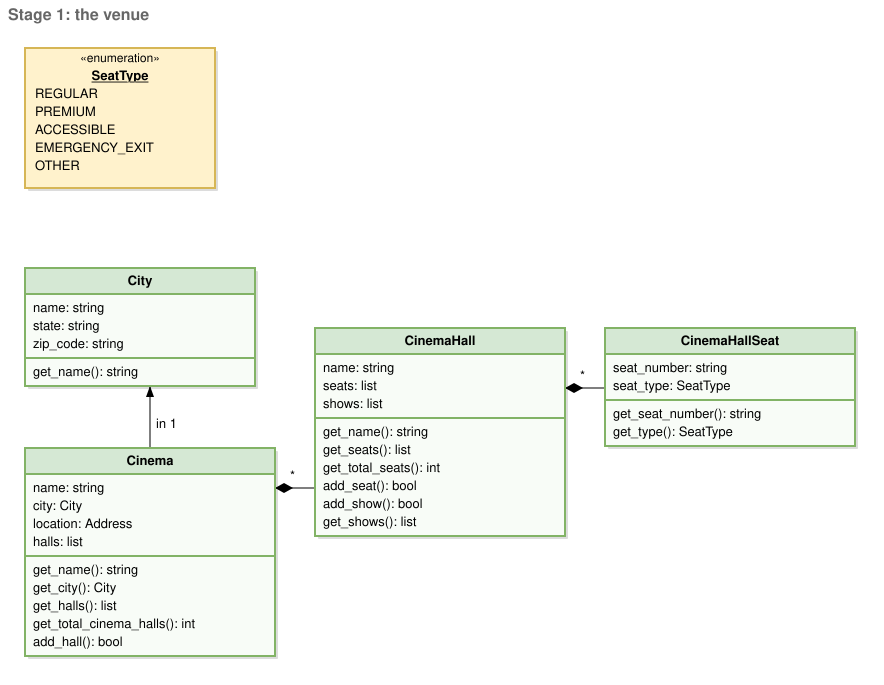
*Figure — Stage 1: `City`, `Cinema`, `CinemaHall` and `CinemaHallSeat`; cinema→city is a plain association, cinema→hall and hall→seat are composition (course diagram)*

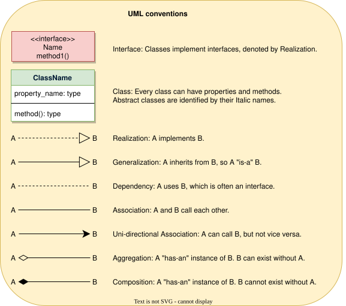
*Figure — How to read a class box and the arrow styles used in these diagrams (course diagram)*

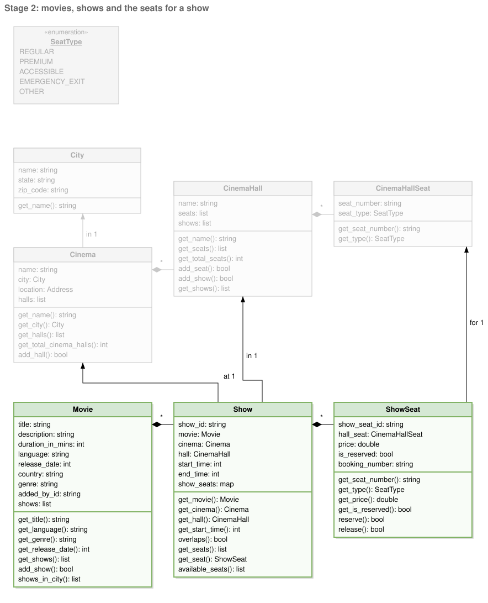
*Figure — Stage 2: `Movie` owns its `Show`s; each `Show` owns one `ShowSeat` per physical seat, and each show seat points back at its `CinemaHallSeat` (course diagram)*

Stage 2 is **where the design succeeds or fails**. One physical seat can be empty for the 3 pm screening and sold for the 9 pm one, so the thing you reserve cannot be the physical seat. You reserve a `ShowSeat` — one per seat per show — which also lets each show price its seats differently (a premium seat costs more).

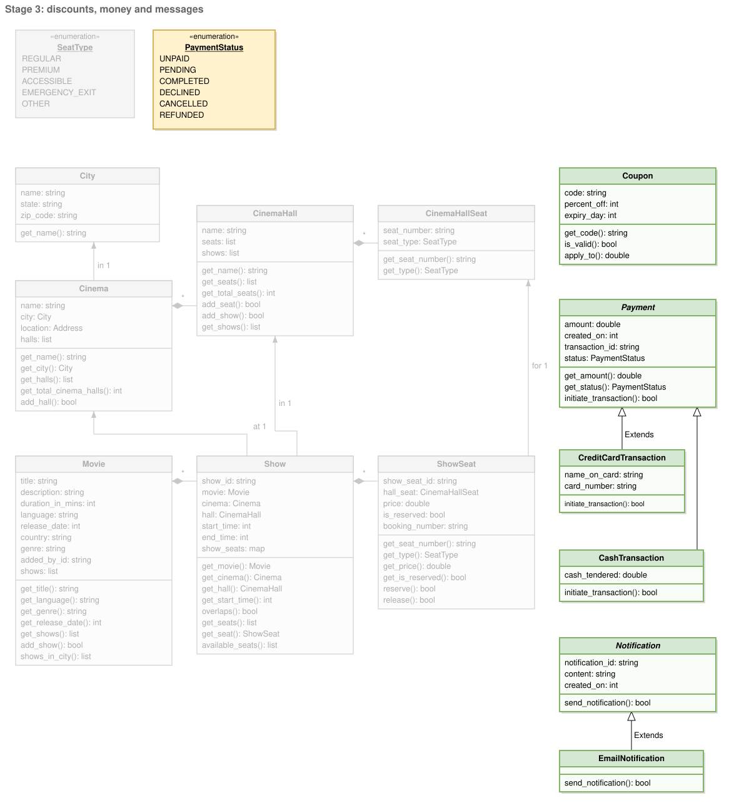
*Figure — Stage 3: `Coupon`, abstract `Payment` (credit card and cash subclasses) and abstract `Notification` (one subclass per channel); none of them points at anything yet (course diagram)*

The coupon reduces **the booking's amount, not the payment**: by the time any payment object is created the price is final, and no payment type needs its own discount logic.

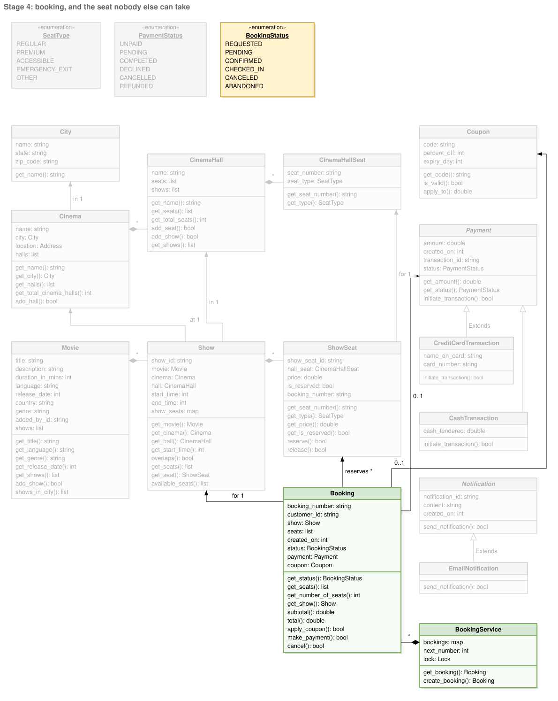
*Figure — Stage 4: `Booking` points at the show, seats, payment and coupon without owning them; `BookingService` owns the bookings and is the only class holding a lock (course diagram)*

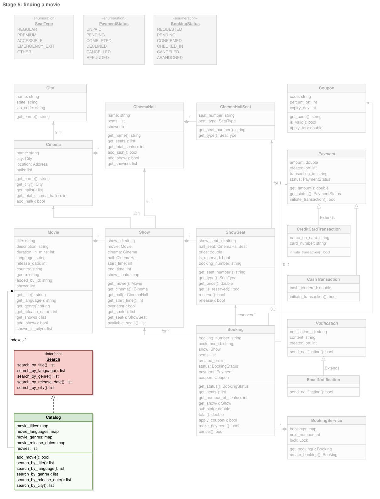
*Figure — Stage 5: the `Search` interface with five methods, implemented by `Catalog`; four searches use indexes built when a movie is added, while city search is computed from the scheduled shows (course diagram)*

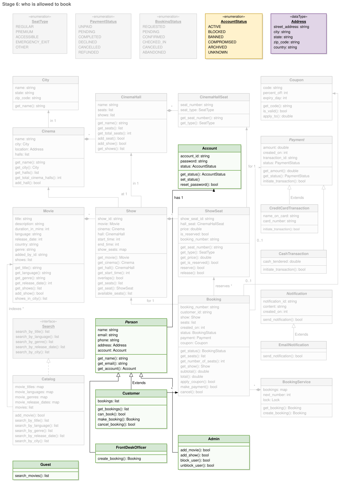
*Figure — Stage 6: `Person` with `Customer`, `FrontDeskOfficer` and `Admin`; `Guest` sits outside that tree and has no booking method; a customer keeps the bookings it made (course diagram)*


*Figure — The finished movie booking class diagram (course diagram)*

Our Java design (the main difference from the course: a separate `SeatLockProvider` with **TTL holds**, which the course names as its biggest omission):

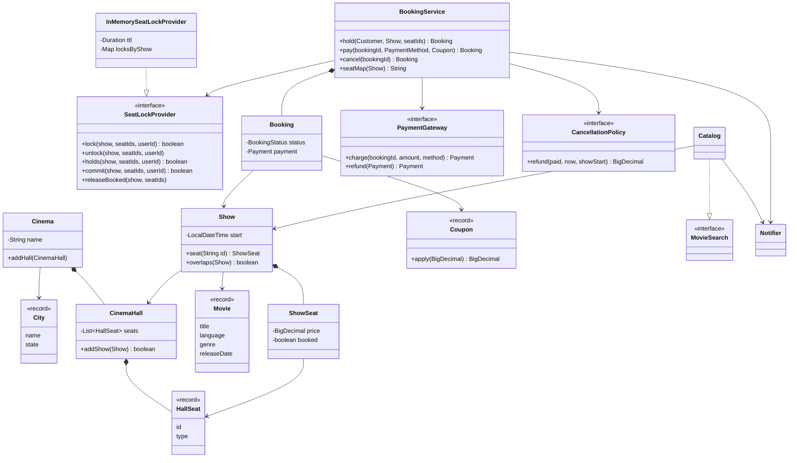

### Key flows

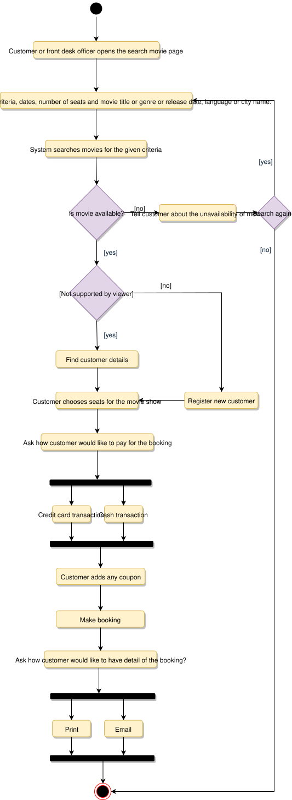
*Figure — Make a booking: search movies; if available, find or register the customer, pick seats, ask how they will pay (credit card or cash), and choose how to receive the ticket (course diagram)*

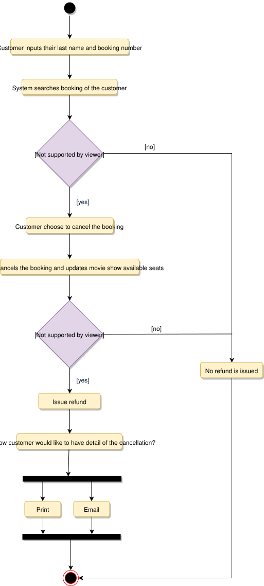
*Figure — Cancel a booking: the customer gives last name and booking number; the system finds the booking, issues a refund if the cancellation is within the allowed time (otherwise no refund), cancels, updates the show's available seats, and prints or emails the details (course diagram)*

The heart of the design is a **three-step booking path**: *hold → pay → commit*.

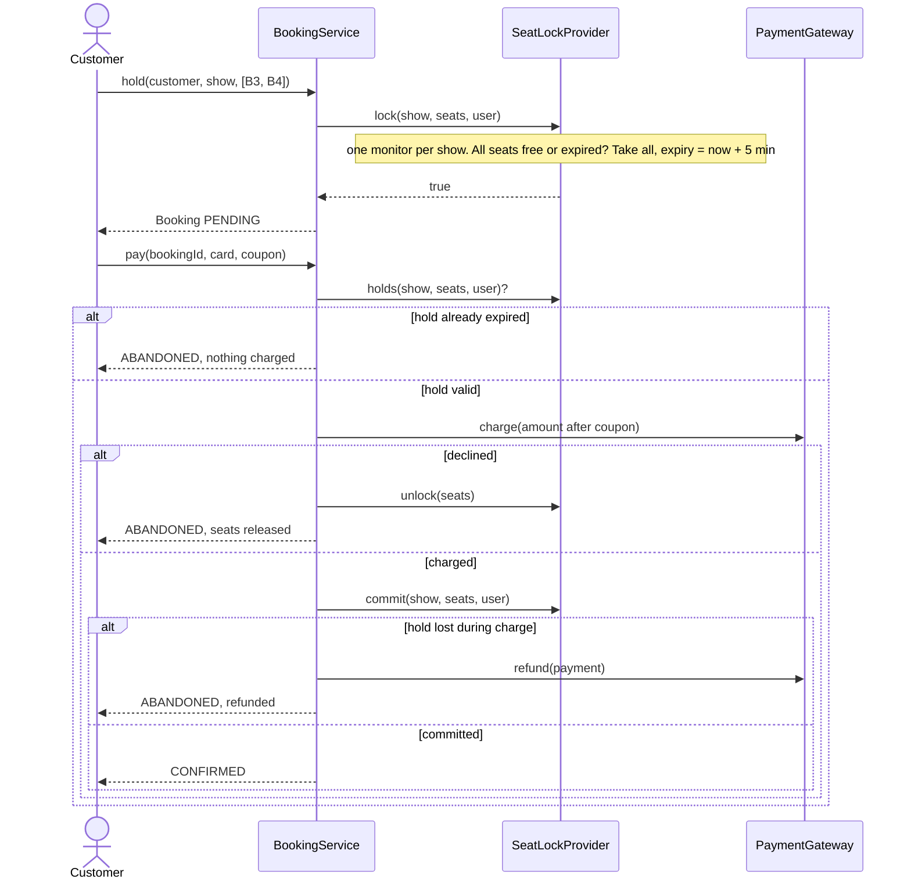

Why `commit` must re-check inside the lock: the payment call can take seconds. If the hold expires during it and someone else grabs the seat, a naive "mark booked" would double-book. `commit` verifies "these seats are still held by me and not expired" **and** marks them booked in one atomic step. If that fails after money was taken, we run a **compensating action** — a refund — instead of a database-style rollback, because a card charge cannot be "un-happened". This is the essence of the **Saga** idea: each step has an undo.

Booking lifecycle:

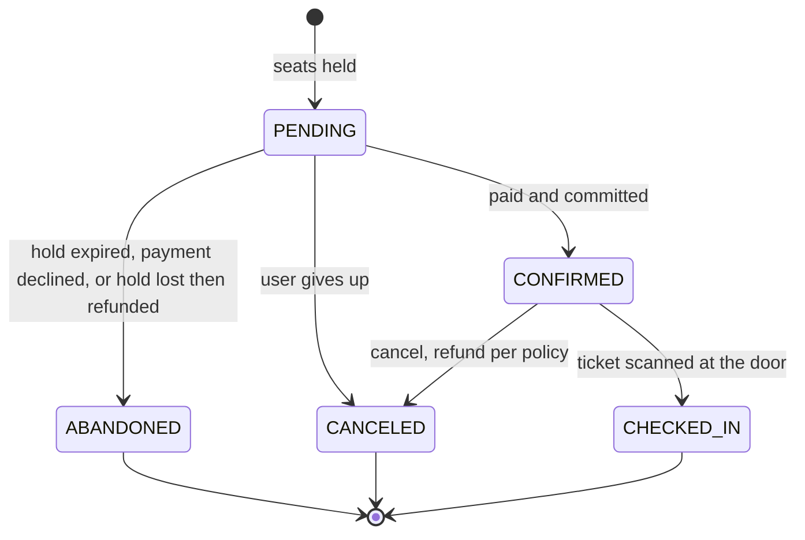

A show seat, as the customer sees it on the map: **free** (`.`), **held** by someone paying (`L`), **booked** (`X`). "Held" is not stored on the seat — it lives in the lock provider and simply disappears when it expires.

### Design decisions & patterns used

| Decision | Why | Alternative rejected |
|---|---|---|
| **`ShowSeat` per show** (course's key point) | The same physical seat is free in one show and taken in another; prices differ per show. | Booking `HallSeat` directly — breaks the moment there are two shows a day. |
| **`SeatLockProvider` interface with TTL holds** | Seats are kept only while the customer pays; abandoned checkouts free themselves. The interface lets you swap the in-memory version for **Redis** (`SET key value NX PX 300000` — set only if absent, expire in 300 000 ms) or a database table with an `expires_at` column. | Holding seats until the booking is cancelled (course's version; it names this as the gap). |
| **All-or-nothing lock** | A customer asking for 4 seats together must never be left with 2. Check every seat first, then take all. | Locking seats one by one without rollback. |
| **One monitor per show** | Shows never block each other; within a show, every decision is serialized. Fine-grained enough for a cinema. | One global lock (the course's single-process lock) — correct but serializes the whole country's bookings. |
| **Commit re-validates + compensation** | Closes the "lock expired during payment" gap; the customer never pays for a seat they don't get. | Trusting the earlier check. |
| **Idempotent `pay`** | A double-click or network retry must not charge twice: paying a non-PENDING booking returns it unchanged. Real systems add an **idempotency key** per request. | Charging on every call. |
| **Strategy** for cancellation refunds and **Strategy-like** `PaymentMethod` | Refund rules and payment types vary independently of booking logic. | `if (method == CARD)` chains. |
| **Adapter boundary** `PaymentGateway` | Wraps the external provider (Stripe, Razorpay…) behind our own interface; tests use `FakeGateway`. | Calling the provider's SDK from `BookingService`. |
| **Coupon applied to the booking** | Amount is correct before payment; payment types stay simple. | Each payment type applying coupons. |
| **Guest has no booking method** | The rule "guests must register to book" is enforced by *types*, not just written down: `hold` takes a `Customer`. | A `Guest.book()` that throws. |
| **"Search by city" from shows** | A movie is in a city only once a show is scheduled there; the other four searches are indexed when a movie is added. | Storing a city on `Movie`. |

### Java implementation

Package `lld.ch15.moviebooking`. Files: `Venue.java` (city, cinema, hall, seats, movie, show), `SeatLockProvider.java` (interface + in-memory TTL implementation), `Payments.java` (payment types, gateway, coupon, cancellation policy, notifier, clock), `Catalog.java` (five searches), `BookingService.java` (actors, booking, the booking path), `Main.java`.

```java
// File: lld/ch15/moviebooking/Venue.java
package lld.ch15.moviebooking;

import java.math.BigDecimal;
import java.time.LocalDate;
import java.time.LocalDateTime;
import java.util.ArrayList;
import java.util.Collections;
import java.util.LinkedHashMap;
import java.util.List;
import java.util.Map;

enum SeatType { REGULAR, PREMIUM, ACCESSIBLE, EMERGENCY_EXIT, OTHER }

record City(String name, String state) {}

/** The physical seat bolted to the floor. It has NO booking state: that depends on which show you ask about. */
record HallSeat(String id, SeatType type) {}

final class CinemaHall {
    private final String name;
    private final List<HallSeat> seats;
    private final List<Show> shows = new ArrayList<>();

    CinemaHall(String name, List<HallSeat> seats) { this.name = name; this.seats = List.copyOf(seats); }
    String name()            { return name; }
    List<HallSeat> seats()   { return seats; }

    /** A hall runs one show at a time, so an overlapping show is refused. */
    synchronized boolean addShow(Show show) {
        for (Show s : shows) if (s.overlaps(show)) return false;
        shows.add(show);
        return true;
    }
    synchronized List<Show> shows() { return List.copyOf(shows); }
}

final class Cinema {
    private final String name;
    private final City city;                       // association: the city exists without the cinema
    private final List<CinemaHall> halls = new ArrayList<>();   // composition: halls die with the cinema
    Cinema(String name, City city) { this.name = name; this.city = city; }
    String name()                 { return name; }
    City city()                   { return city; }
    void addHall(CinemaHall h)    { halls.add(h); }
    List<CinemaHall> halls()      { return Collections.unmodifiableList(halls); }
}

record Movie(String id, String title, String language, String genre, LocalDate releaseDate, int durationMinutes) {}

/** One screening. Owns one ShowSeat per physical seat, so the same seat can be free at 6pm and taken at 9pm. */
final class Show {
    private final String id;
    private final Movie movie;
    private final Cinema cinema;
    private final CinemaHall hall;
    private final LocalDateTime start;
    private final Map<String, ShowSeat> seats = new LinkedHashMap<>();

    Show(String id, Movie movie, Cinema cinema, CinemaHall hall, LocalDateTime start, Map<SeatType, BigDecimal> prices) {
        this.id = id; this.movie = movie; this.cinema = cinema; this.hall = hall; this.start = start;
        for (HallSeat hs : hall.seats())
            seats.put(hs.id(), new ShowSeat(hs, prices.getOrDefault(hs.type(), BigDecimal.ZERO)));
    }
    String id()                 { return id; }
    Movie movie()               { return movie; }
    Cinema cinema()             { return cinema; }
    CinemaHall hall()           { return hall; }
    LocalDateTime start()       { return start; }
    LocalDateTime end()         { return start.plusMinutes(movie.durationMinutes()); }
    Map<String, ShowSeat> seats() { return Collections.unmodifiableMap(seats); }

    ShowSeat seat(String seatId) {
        ShowSeat s = seats.get(seatId);
        if (s == null) throw new IllegalArgumentException("no seat " + seatId + " in show " + id);
        return s;
    }
    boolean overlaps(Show o) { return start.isBefore(o.end()) && o.start().isBefore(end()); }
}

/** A seat for one show: its own price and its booked flag. Only SeatLockProvider flips `booked`. */
final class ShowSeat {
    private final HallSeat seat;
    private final BigDecimal price;          // money: BigDecimal, never double
    private volatile boolean booked;
    ShowSeat(HallSeat seat, BigDecimal price) { this.seat = seat; this.price = price; }
    HallSeat seat()        { return seat; }
    BigDecimal price()     { return price; }
    boolean isBooked()     { return booked; }
    void setBooked(boolean b) { booked = b; }
}
```

```java
// File: lld/ch15/moviebooking/SeatLockProvider.java
package lld.ch15.moviebooking;

import java.time.Clock;
import java.time.Duration;
import java.time.Instant;
import java.util.HashMap;
import java.util.List;
import java.util.Map;
import java.util.Set;
import java.util.TreeSet;
import java.util.concurrent.ConcurrentHashMap;

/**
 * Temporary, expiring holds on seats while the customer pays.
 * An interface so the in-memory version can be swapped for Redis (SET NX PX) or a DB row lock.
 */
interface SeatLockProvider {
    /** All-or-nothing: either every seat is locked for this user, or none is. */
    boolean lock(Show show, List<String> seatIds, String userId);
    /** Release this user's holds (payment failed, user gave up). */
    void unlock(Show show, List<String> seatIds, String userId);
    /** True while this user still holds every one of these seats and no hold has expired. */
    boolean holds(Show show, List<String> seatIds, String userId);
    /** Atomically: verify holds are still valid, mark seats BOOKED, drop the holds. */
    boolean commit(Show show, List<String> seatIds, String userId);
    /** Make booked seats sellable again (cancellation). */
    void releaseBooked(Show show, List<String> seatIds);
    Set<String> lockedSeats(Show show);
}

record SeatLock(String userId, Instant expiresAt) {
    boolean expired(Instant now) { return !now.isBefore(expiresAt); }
}

/**
 * One monitor per show: two shows never block each other, but every decision about one show's
 * seats (lock, commit, release) is made by one thread at a time. That is what makes
 * check-then-act safe and prevents double booking.
 */
final class InMemorySeatLockProvider implements SeatLockProvider {
    private final Duration ttl;
    private final Clock clock;
    private final Map<String, Map<String, SeatLock>> locksByShow = new ConcurrentHashMap<>();

    InMemorySeatLockProvider(Duration ttl, Clock clock) { this.ttl = ttl; this.clock = clock; }

    private Map<String, SeatLock> table(Show show) {
        return locksByShow.computeIfAbsent(show.id(), k -> new HashMap<>());
    }

    @Override public boolean lock(Show show, List<String> seatIds, String userId) {
        Map<String, SeatLock> t = table(show);
        synchronized (t) {
            Instant now = clock.instant();
            for (String id : seatIds) {                         // 1. check every seat first
                if (show.seat(id).isBooked()) return false;
                SeatLock l = t.get(id);
                if (l != null && !l.expired(now) && !l.userId().equals(userId)) return false;
            }
            SeatLock mine = new SeatLock(userId, now.plus(ttl));
            for (String id : seatIds) t.put(id, mine);           // 2. then take them all
            return true;
        }
    }

    @Override public void unlock(Show show, List<String> seatIds, String userId) {
        Map<String, SeatLock> t = table(show);
        synchronized (t) {
            for (String id : seatIds) {
                SeatLock l = t.get(id);
                if (l != null && l.userId().equals(userId)) t.remove(id);
            }
        }
    }

    @Override public boolean holds(Show show, List<String> seatIds, String userId) {
        Map<String, SeatLock> t = table(show);
        synchronized (t) { return holdsLocked(t, seatIds, userId, clock.instant()); }
    }

    @Override public boolean commit(Show show, List<String> seatIds, String userId) {
        Map<String, SeatLock> t = table(show);
        synchronized (t) {
            if (!holdsLocked(t, seatIds, userId, clock.instant())) return false;
            for (String id : seatIds) { show.seat(id).setBooked(true); t.remove(id); }
            return true;
        }
    }

    @Override public void releaseBooked(Show show, List<String> seatIds) {
        Map<String, SeatLock> t = table(show);
        synchronized (t) { for (String id : seatIds) show.seat(id).setBooked(false); }
    }

    @Override public Set<String> lockedSeats(Show show) {
        Map<String, SeatLock> t = table(show);
        synchronized (t) {
            Instant now = clock.instant();
            Set<String> out = new TreeSet<>();
            t.forEach((id, l) -> { if (!l.expired(now)) out.add(id); });
            return out;
        }
    }

    private static boolean holdsLocked(Map<String, SeatLock> t, List<String> ids, String userId, Instant now) {
        for (String id : ids) {
            SeatLock l = t.get(id);
            if (l == null || l.expired(now) || !l.userId().equals(userId)) return false;
        }
        return true;
    }
}
```

```java
// File: lld/ch15/moviebooking/Payments.java
package lld.ch15.moviebooking;

import java.math.BigDecimal;
import java.math.RoundingMode;
import java.time.Clock;
import java.time.Duration;
import java.time.Instant;
import java.time.LocalDateTime;
import java.time.ZoneId;
import java.time.ZoneOffset;
import java.util.Set;
import java.util.concurrent.atomic.AtomicInteger;

enum PaymentStatus { UNPAID, PENDING, COMPLETED, DECLINED, CANCELLED, REFUNDED }

/** How the customer pays. Sealed: the system supports exactly these two (credit card or cash). */
sealed interface PaymentMethod permits CardPayment, CashPayment {}
record CardPayment(String cardNumberLast4) implements PaymentMethod {}
record CashPayment() implements PaymentMethod {}

record Payment(String txnId, BigDecimal amount, PaymentMethod method, PaymentStatus status) {
    Payment withStatus(PaymentStatus s) { return new Payment(txnId, amount, method, s); }
}

/** Adapter boundary to the real payment provider. */
interface PaymentGateway {
    Payment charge(String bookingId, BigDecimal amount, PaymentMethod method);
    Payment refund(Payment p);
}

/** Test double: declines listed cards, and can run a hook "while the bank is thinking". */
final class FakeGateway implements PaymentGateway {
    private final Set<String> declinedCards;
    private final AtomicInteger seq = new AtomicInteger();
    private volatile Runnable duringCharge = () -> {};

    FakeGateway(Set<String> declinedCards) { this.declinedCards = declinedCards; }
    void setDuringCharge(Runnable r) { duringCharge = r; }

    @Override public Payment charge(String bookingId, BigDecimal amount, PaymentMethod m) {
        duringCharge.run();
        String txn = "TXN-" + seq.incrementAndGet();
        boolean declined = m instanceof CardPayment c && declinedCards.contains(c.cardNumberLast4());
        return new Payment(txn, amount, m, declined ? PaymentStatus.DECLINED : PaymentStatus.COMPLETED);
    }
    @Override public Payment refund(Payment p) { return p.withStatus(PaymentStatus.REFUNDED); }
}

/** A percentage off. Applied to the booking amount BEFORE payment, so every payment type sees the right total. */
record Coupon(String code, int percentOff) {
    Coupon {
        if (percentOff < 0 || percentOff > 100) throw new IllegalArgumentException("bad percent " + percentOff);
    }
    /** Amount after the discount, rounded to whole paise/cents (half-up). */
    BigDecimal apply(BigDecimal amount) {
        BigDecimal off = amount.multiply(BigDecimal.valueOf(percentOff)).divide(BigDecimal.valueOf(100), 2, RoundingMode.HALF_UP);
        return amount.subtract(off).setScale(2, RoundingMode.HALF_UP);
    }
}

/** Strategy: how much of the money comes back on cancellation. */
interface CancellationPolicy {
    BigDecimal refund(BigDecimal paid, LocalDateTime now, LocalDateTime showStart);
}

/** Full refund up to `cutoff` before the show, nothing after. */
record CutoffRefundPolicy(Duration cutoff) implements CancellationPolicy {
    @Override public BigDecimal refund(BigDecimal paid, LocalDateTime now, LocalDateTime showStart) {
        return now.plus(cutoff).isAfter(showStart) ? BigDecimal.ZERO : paid;
    }
}

interface Notifier { void send(String userId, String message); }

final class ConsoleNotifier implements Notifier {
    @Override public void send(String userId, String message) {
        System.out.println("  [notify " + userId + "] " + message);
    }
}

final class SimClock extends Clock {
    private volatile Instant now;
    SimClock(Instant start) { this.now = start; }
    void advance(Duration d) { now = now.plus(d); }
    @Override public ZoneId getZone() { return ZoneOffset.UTC; }
    @Override public Clock withZone(ZoneId zone) { return this; }
    @Override public Instant instant() { return now; }
}

final class Money {
    private Money() {}
    static String fmt(BigDecimal amount) { return "Rs." + amount.setScale(2, RoundingMode.UNNECESSARY).toPlainString(); }
}
```

```java
// File: lld/ch15/moviebooking/Catalog.java
package lld.ch15.moviebooking;

import java.time.LocalDate;
import java.util.Comparator;
import java.util.List;
import java.util.Locale;
import java.util.Map;
import java.util.concurrent.ConcurrentHashMap;
import java.util.concurrent.CopyOnWriteArrayList;

/** The five searches. Four are indexed when a movie is added; "by city" is answered from the shows. */
interface MovieSearch {
    List<Movie> searchByTitle(String title);
    List<Movie> searchByLanguage(String language);
    List<Movie> searchByGenre(String genre);
    List<Movie> searchByReleaseDate(LocalDate date);
    List<Movie> searchByCity(String cityName);
}

final class Catalog implements MovieSearch {
    private final Map<String, List<Movie>> byTitle = new ConcurrentHashMap<>();
    private final Map<String, List<Movie>> byLanguage = new ConcurrentHashMap<>();
    private final Map<String, List<Movie>> byGenre = new ConcurrentHashMap<>();
    private final Map<LocalDate, List<Movie>> byRelease = new ConcurrentHashMap<>();
    private final List<Show> shows = new CopyOnWriteArrayList<>();
    private final Notifier notifier;

    Catalog(Notifier notifier) { this.notifier = notifier; }

    /** Admin adds a movie: index it four ways and announce it (requirement: notify on a new movie). */
    void addMovie(Movie m) {
        put(byTitle, key(m.title()), m);
        put(byLanguage, key(m.language()), m);
        put(byGenre, key(m.genre()), m);
        byRelease.computeIfAbsent(m.releaseDate(), d -> new CopyOnWriteArrayList<>()).add(m);
        notifier.send("subscribers", "new movie: " + m.title() + " (" + m.language() + ", " + m.genre() + ")");
    }

    /** Admin schedules a show; the hall refuses it if it overlaps another. */
    boolean addShow(Show s) {
        if (!s.hall().addShow(s)) return false;
        shows.add(s);
        return true;
    }

    /** After picking a movie: which shows play in my city? */
    List<Show> showsOf(Movie m, String cityName) {
        return shows.stream()
                .filter(s -> s.movie().equals(m) && s.cinema().city().name().equalsIgnoreCase(cityName))
                .sorted(Comparator.comparing(Show::start)).toList();
    }

    @Override public List<Movie> searchByTitle(String t)    { return get(byTitle, key(t)); }
    @Override public List<Movie> searchByLanguage(String l) { return get(byLanguage, key(l)); }
    @Override public List<Movie> searchByGenre(String g)    { return get(byGenre, key(g)); }
    @Override public List<Movie> searchByReleaseDate(LocalDate d) { return List.copyOf(byRelease.getOrDefault(d, List.of())); }
    @Override public List<Movie> searchByCity(String city) {
        return shows.stream().filter(s -> s.cinema().city().name().equalsIgnoreCase(city))
                .map(Show::movie).distinct().sorted(Comparator.comparing(Movie::title)).toList();
    }

    private static String key(String s) { return s.trim().toLowerCase(Locale.ROOT); }
    private static void put(Map<String, List<Movie>> idx, String k, Movie m) {
        idx.computeIfAbsent(k, x -> new CopyOnWriteArrayList<>()).add(m);
    }
    private static List<Movie> get(Map<String, List<Movie>> idx, String k) {
        return idx.getOrDefault(k, List.of()).stream().sorted(Comparator.comparing(Movie::title)).toList();
    }
}
```

```java
// File: lld/ch15/moviebooking/BookingService.java
package lld.ch15.moviebooking;

import java.math.BigDecimal;
import java.time.Clock;
import java.time.LocalDateTime;
import java.util.List;
import java.util.Map;
import java.util.Set;
import java.util.concurrent.ConcurrentHashMap;
import java.util.concurrent.atomic.AtomicInteger;

enum BookingStatus { PENDING, CONFIRMED, CHECKED_IN, CANCELED, ABANDONED }

enum AccountStatus { ACTIVE, BLOCKED, BANNED, COMPROMISED, ARCHIVED, UNKNOWN }

/** Only registered customers can book. A guest has no type that BookingService accepts. */
final class Customer {
    private final String id;
    private final String name;
    private volatile AccountStatus status = AccountStatus.ACTIVE;
    Customer(String id, String name) { this.id = id; this.name = name; }
    String id()                 { return id; }
    String name()               { return name; }
    AccountStatus status()      { return status; }
    void setStatus(AccountStatus s) { status = s; }
}

record Guest(String sessionId) {
    Customer register(String id, String name) { return new Customer(id, name); }
}

record FrontDeskOfficer(String id, String name) {}

record Admin(String id, String name) {
    void block(Customer c)   { c.setStatus(AccountStatus.BLOCKED); }
    void unblock(Customer c) { c.setStatus(AccountStatus.ACTIVE); }
}

final class SeatUnavailableException extends RuntimeException {
    private static final long serialVersionUID = 1L;
    SeatUnavailableException(String msg) { super(msg); }
}

/** A booking points at the show and seats; it owns none of them. Transitions run under its own monitor. */
final class Booking {
    private final String id;
    private final String customerId;
    private final Show show;
    private final List<String> seatIds;
    private final BigDecimal baseAmount;
    private BookingStatus status = BookingStatus.PENDING;
    private Payment payment;
    private Coupon coupon;

    Booking(String id, String customerId, Show show, List<String> seatIds, BigDecimal baseAmount) {
        this.id = id; this.customerId = customerId; this.show = show;
        this.seatIds = List.copyOf(seatIds); this.baseAmount = baseAmount;
    }
    String id()               { return id; }
    String customerId()       { return customerId; }
    Show show()               { return show; }
    List<String> seatIds()    { return seatIds; }
    BigDecimal baseAmount()   { return baseAmount; }
    synchronized BookingStatus status() { return status; }
    synchronized Payment payment()      { return payment; }
    synchronized Coupon coupon()        { return coupon; }
    void setStatus(BookingStatus s)     { status = s; }          // called with the monitor held
    void setPayment(Payment p)          { payment = p; }
    void setCoupon(Coupon c)            { coupon = c; }
    @Override public synchronized String toString() {
        return id + " " + seatIds + " " + status + (payment == null ? "" : " " + payment.status() + " " + Money.fmt(payment.amount()));
    }
}

/**
 * The booking path: HOLD seats (TTL) -> PAY -> COMMIT seats. If the hold was lost while the bank
 * was charging, the money is refunded (compensation) instead of double-selling the seat.
 */
final class BookingService {
    private final SeatLockProvider locks;
    private final PaymentGateway gateway;
    private final CancellationPolicy cancellationPolicy;
    private final Notifier notifier;
    private final Clock clock;
    private final Map<String, Booking> bookings = new ConcurrentHashMap<>();
    private final AtomicInteger seq = new AtomicInteger();

    BookingService(SeatLockProvider locks, PaymentGateway gateway, CancellationPolicy policy, Notifier notifier, Clock clock) {
        this.locks = locks; this.gateway = gateway; this.cancellationPolicy = policy;
        this.notifier = notifier; this.clock = clock;
    }

    /** Step 1: hold the seats. All-or-nothing. Throws if any seat is booked or held by someone else. */
    Booking hold(Customer c, Show show, List<String> seatIds) {
        if (c.status() != AccountStatus.ACTIVE) throw new IllegalStateException(c.id() + " is " + c.status());
        if (seatIds.isEmpty()) throw new IllegalArgumentException("no seats");
        List<String> sorted = seatIds.stream().distinct().sorted().toList();
        if (!locks.lock(show, sorted, c.id()))
            throw new SeatUnavailableException(sorted + " not available for " + show.id());
        BigDecimal base = sorted.stream().map(id -> show.seat(id).price()).reduce(BigDecimal.ZERO, BigDecimal::add);
        Booking b = new Booking("BK-" + seq.incrementAndGet(), c.id(), show, sorted, base);
        bookings.put(b.id(), b);
        return b;
    }

    /** The front desk books for a walk-in customer: same flow, different actor. */
    Booking holdFor(FrontDeskOfficer officer, Customer c, Show show, List<String> seatIds) {
        return hold(c, show, seatIds);
    }

    /** Step 2 + 3: pay, then commit. Idempotent: paying a confirmed booking again returns it unchanged. */
    Booking pay(String bookingId, PaymentMethod method, Coupon coupon) {
        Booking b = get(bookingId);
        synchronized (b) {
            if (b.status() != BookingStatus.PENDING) return b;
            if (!locks.holds(b.show(), b.seatIds(), b.customerId())) {       // fast fail, no charge
                b.setStatus(BookingStatus.ABANDONED);
                notifier.send(b.customerId(), b.id() + " hold expired before payment, nothing charged");
                return b;
            }
            b.setCoupon(coupon);
            BigDecimal amount = coupon == null ? b.baseAmount() : coupon.apply(b.baseAmount());
            Payment p = gateway.charge(b.id(), amount, method);
            b.setPayment(p);
            if (p.status() != PaymentStatus.COMPLETED) {
                locks.unlock(b.show(), b.seatIds(), b.customerId());           // free seats at once
                b.setStatus(BookingStatus.ABANDONED);
                notifier.send(b.customerId(), b.id() + " payment " + p.status() + ", seats released");
                return b;
            }
            if (!locks.commit(b.show(), b.seatIds(), b.customerId())) {       // hold lost during charge
                b.setPayment(gateway.refund(p));                              // COMPENSATION
                b.setStatus(BookingStatus.ABANDONED);
                notifier.send(b.customerId(), b.id() + " hold expired during payment, " + Money.fmt(amount) + " refunded");
                return b;
            }
            b.setStatus(BookingStatus.CONFIRMED);
            notifier.send(b.customerId(), b.id() + " CONFIRMED " + b.seatIds() + " for '" + b.show().movie().title()
                    + "' at " + b.show().start() + ", paid " + Money.fmt(amount));
            return b;
        }
    }

    /** Cancel: release seats and refund according to the policy. */
    Booking cancel(String bookingId) {
        Booking b = get(bookingId);
        synchronized (b) {
            switch (b.status()) {
                case PENDING -> {
                    locks.unlock(b.show(), b.seatIds(), b.customerId());
                    b.setStatus(BookingStatus.CANCELED);
                }
                case CONFIRMED -> {
                    locks.releaseBooked(b.show(), b.seatIds());
                    BigDecimal refund = cancellationPolicy.refund(b.payment().amount(),
                            LocalDateTime.now(clock), b.show().start());
                    if (refund.signum() > 0) b.setPayment(gateway.refund(b.payment()));
                    b.setStatus(BookingStatus.CANCELED);
                    notifier.send(b.customerId(), b.id() + " canceled, refund " + Money.fmt(refund));
                }
                default -> throw new IllegalStateException(b.id() + " cannot be canceled from " + b.status());
            }
            return b;
        }
    }

    Booking get(String id) {
        Booking b = bookings.get(id);
        if (b == null) throw new IllegalArgumentException("no booking " + id);
        return b;
    }

    /** "." free, "L" held by someone paying, "X" booked. */
    String seatMap(Show show) {
        Set<String> held = locks.lockedSeats(show);
        StringBuilder sb = new StringBuilder();
        char row = 0;
        for (ShowSeat s : show.seats().values()) {
            String id = s.seat().id();
            if (id.charAt(0) != row) { if (row != 0) sb.append('\n'); row = id.charAt(0); sb.append("  ").append(row).append(' '); }
            sb.append(s.isBooked() ? 'X' : held.contains(id) ? 'L' : '.').append(' ');
        }
        return sb.toString();
    }
}
```

```java
// File: lld/ch15/moviebooking/Main.java
package lld.ch15.moviebooking;

import java.math.BigDecimal;
import java.time.Duration;
import java.time.Instant;
import java.time.LocalDate;
import java.time.LocalDateTime;
import java.util.ArrayList;
import java.util.List;
import java.util.Map;
import java.util.Set;
import java.util.concurrent.ConcurrentLinkedQueue;
import java.util.concurrent.CountDownLatch;
import java.util.concurrent.ExecutorService;
import java.util.concurrent.Executors;

public class Main {
    public static void main(String[] args) throws Exception {
        SimClock clock = new SimClock(Instant.parse("2026-05-01T12:00:00Z"));
        FakeGateway bank = new FakeGateway(Set.of("0002"));
        SeatLockProvider locks = new InMemorySeatLockProvider(Duration.ofMinutes(5), clock);
        Notifier notifier = new ConsoleNotifier();
        BookingService svc = new BookingService(locks, bank, new CutoffRefundPolicy(Duration.ofHours(2)),
                notifier, clock);
        Catalog catalog = new Catalog(notifier);

        // ---- venue: 2 rows x 5 seats; row A regular, row B premium
        City blr = new City("Bengaluru", "KA");
        Cinema pvr = new Cinema("PVR Forum", blr);
        List<HallSeat> seats = new ArrayList<>();
        for (char row : new char[]{'A', 'B'})
            for (int n = 1; n <= 5; n++) seats.add(new HallSeat("" + row + n, row == 'A' ? SeatType.REGULAR : SeatType.PREMIUM));
        CinemaHall audi1 = new CinemaHall("Audi 1", seats);
        pvr.addHall(audi1);

        Movie inception = new Movie("MV1", "Inception", "English", "Sci-Fi", LocalDate.of(2010, 7, 16), 148);
        Movie rrr = new Movie("MV2", "RRR", "Telugu", "Action", LocalDate.of(2022, 3, 25), 187);
        Map<SeatType, BigDecimal> prices = Map.of(SeatType.REGULAR, new BigDecimal("200.00"),
                SeatType.PREMIUM, new BigDecimal("350.00"));
        Show evening = new Show("SH1", inception, pvr, audi1, LocalDateTime.of(2026, 5, 1, 18, 0), prices);
        Show clash = new Show("SH2", rrr, pvr, audi1, LocalDateTime.of(2026, 5, 1, 19, 0), prices);

        System.out.println("== 1. Admin adds movies (subscribers told) and schedules shows; the hall refuses an overlap ==");
        catalog.addMovie(inception);
        catalog.addMovie(rrr);
        System.out.println("  add SH1 Inception 18:00 -> " + catalog.addShow(evening));
        System.out.println("  add SH2 RRR 19:00 same hall -> " + catalog.addShow(clash));

        System.out.println("\n== 2. Search ==");
        System.out.println("  city Bengaluru -> " + titles(catalog.searchByCity("bengaluru")));
        System.out.println("  genre Action   -> " + titles(catalog.searchByGenre("action")) + " (no show yet, but indexed)");
        System.out.println("  Inception shows in Bengaluru -> "
                + catalog.showsOf(inception, "Bengaluru").stream().map(s -> s.id() + "@" + s.start()).toList());

        System.out.println("\n== 3. 10 customers click B3+B4 at the same instant ==");
        List<Customer> crowd = new ArrayList<>();
        for (int i = 1; i <= 10; i++) crowd.add(new Customer("U" + i, "User " + i));
        ConcurrentLinkedQueue<Booking> won = new ConcurrentLinkedQueue<>();
        CountDownLatch go = new CountDownLatch(1);
        try (ExecutorService pool = Executors.newFixedThreadPool(10)) {
            for (Customer c : crowd)
                pool.submit(() -> {
                    go.await();
                    try { won.add(svc.hold(c, evening, List.of("B3", "B4"))); }
                    catch (SeatUnavailableException ignored) { }
                    return null;
                });
            go.countDown();
        }
        Booking first = won.peek();
        System.out.println("  holds granted = " + won.size() + " (the other 9 saw 'not available')");
        System.out.println(svc.seatMap(evening));

        System.out.println("\n== 4. The winner pays by card with a 10% coupon ==");
        svc.pay(first.id(), new CardPayment("4242"), new Coupon("FIRST10", 10));
        System.out.println("  paying twice is harmless -> " + svc.pay(first.id(), new CardPayment("4242"), null).status());
        System.out.println(svc.seatMap(evening));

        System.out.println("\n== 5. Hold expires (TTL 5 min) before paying ==");
        Customer asha = new Customer("ASHA", "Asha"), ravi = new Customer("RAVI", "Ravi");
        Booking slow = svc.hold(asha, evening, List.of("A1", "A2"));
        clock.advance(Duration.ofMinutes(6));
        Booking fast = svc.hold(ravi, evening, List.of("A1", "A2"));
        System.out.println("  Ravi re-held A1,A2 after Asha's hold expired -> " + fast.id());
        svc.pay(slow.id(), new CardPayment("4242"), null);
        svc.pay(fast.id(), new CashPayment(), null);

        System.out.println("\n== 6. Hold expires WHILE the bank is charging -> refund (compensation) ==");
        Customer meena = new Customer("MEENA", "Meena"), kiran = new Customer("KIRAN", "Kiran");
        Booking victim = svc.hold(meena, evening, List.of("A5"));
        bank.setDuringCharge(() -> {                       // bank is slow: 6 minutes pass, Kiran grabs A5
            clock.advance(Duration.ofMinutes(6));
            svc.hold(kiran, evening, List.of("A5"));
        });
        svc.pay(victim.id(), new CardPayment("4242"), null);
        bank.setDuringCharge(() -> {});
        System.out.println("  " + victim);

        System.out.println("\n== 7. Declined card releases the seats immediately ==");
        Booking declined = svc.hold(new Customer("NEHA", "Neha"), evening, List.of("B1"));
        svc.pay(declined.id(), new CardPayment("0002"), null);
        System.out.println("  B1 held by anyone now? " + locks.lockedSeats(evening).contains("B1"));

        System.out.println("\n== 8. Blocked customer, then cancellation with refund ==");
        new Admin("AD1", "Admin").block(crowd.get(9));
        try { svc.hold(crowd.get(9), evening, List.of("B5")); }
        catch (IllegalStateException e) { System.out.println("  REFUSED: " + e.getMessage()); }
        svc.cancel(first.id());                            // 12:06+ vs 18:00 show: more than 2h before
        System.out.println("  " + first);
        System.out.println(svc.seatMap(evening));
    }

    private static List<String> titles(List<Movie> ms) { return ms.stream().map(Movie::title).toList(); }
}
```

**Output:**

```text
== 1. Admin adds movies (subscribers told) and schedules shows; the hall refuses an overlap ==
  [notify subscribers] new movie: Inception (English, Sci-Fi)
  [notify subscribers] new movie: RRR (Telugu, Action)
  add SH1 Inception 18:00 -> true
  add SH2 RRR 19:00 same hall -> false

== 2. Search ==
  city Bengaluru -> [Inception]
  genre Action   -> [RRR] (no show yet, but indexed)
  Inception shows in Bengaluru -> [SH1@2026-05-01T18:00]

== 3. 10 customers click B3+B4 at the same instant ==
  holds granted = 1 (the other 9 saw 'not available')
  A . . . . . 
  B . . L L . 

== 4. The winner pays by card with a 10% coupon ==
  [notify U10] BK-1 CONFIRMED [B3, B4] for 'Inception' at 2026-05-01T18:00, paid Rs.630.00
  paying twice is harmless -> CONFIRMED
  A . . . . . 
  B . . X X . 

== 5. Hold expires (TTL 5 min) before paying ==
  Ravi re-held A1,A2 after Asha's hold expired -> BK-3
  [notify ASHA] BK-2 hold expired before payment, nothing charged
  [notify RAVI] BK-3 CONFIRMED [A1, A2] for 'Inception' at 2026-05-01T18:00, paid Rs.400.00

== 6. Hold expires WHILE the bank is charging -> refund (compensation) ==
  [notify MEENA] BK-4 hold expired during payment, Rs.200.00 refunded
  BK-4 [A5] ABANDONED REFUNDED Rs.200.00

== 7. Declined card releases the seats immediately ==
  [notify NEHA] BK-6 payment DECLINED, seats released
  B1 held by anyone now? false

== 8. Blocked customer, then cancellation with refund ==
  REFUSED: U10 is BLOCKED
  [notify U10] BK-1 canceled, refund Rs.630.00
  BK-1 [B3, B4] CANCELED REFUNDED Rs.630.00
  A X X . . L 
  B . . . . .
```

What to notice: section 1 announces each new movie to subscribers (requirement 9) and refuses an overlapping show in the same hall (requirement 2); section 3 lets exactly 1 of 10 simultaneous customers hold B3+B4; section 4 applies the 10% coupon (Rs.700 → Rs.630) and a second `pay` is a no-op; section 5 shows an expired hold being re-sold and the slow customer *not* being charged; section 6 is the compensation path — Meena's card was charged, but her hold expired during the charge and Kiran took A5, so she is refunded; section 7 releases seats immediately on a decline; section 8 blocks a customer and cancels with a full refund.

### Concurrency & edge cases

- **Check-then-act is atomic.** `lock`, `holds`, `commit`, `unlock` and `releaseBooked` for one show all run inside `synchronized` on that show's lock table. "Is the seat free? → take it" can't interleave.
- **Expired holds are lazy.** There is no background thread; an expired `SeatLock` is simply treated as absent the next time anyone looks. (In Redis, the key's TTL does the same.)
- **The payment-window race** (hold expires mid-payment) is handled by commit re-validation + refund, as shown in section 6.
- **Lock granularity.** The booking's own monitor makes `pay`/`cancel` on the same booking serial (no double charge, no pay-while-cancel). The show monitor protects seats. The two are always taken in the order booking → show, never the reverse, so no deadlock.
- **Across many servers** (real BookMyShow), in-process locks are not enough. Options, from simplest:
  1. **Conditional update** (course): `UPDATE show_seat SET status='HELD', held_by=?, held_until=? WHERE show_id=? AND seat_id IN (...) AND (status='FREE' OR held_until < now())`, then check the row count equals the number of seats; if not, roll back.
  2. **Pessimistic lock**: `SELECT ... FOR UPDATE` on the seat rows inside a transaction.
  3. **Serializable transaction** (course): the result is as if each transaction had run alone, in some order — easiest to reason about, but the slowest option when many buyers collide.
  4. **Optimistic locking**: a `version` column; update `WHERE version = ?`; retry on conflict. Good when conflicts are rare.
  5. **Unique constraint** on `(show_id, seat_id)` in the confirmed-tickets table as the final safety net.
  6. **Distributed lock / hold store** in Redis with TTL for the *hold* phase, with the database as the source of truth for *confirmed* seats.
  The course's point, in short: the in-process lock only makes the common case quick; once there are two servers, correctness comes from the database.
- **Edge cases:** empty seat list; duplicate seat ids in one request (de-duplicated); unknown seat; blocked customer; overlapping show in a hall; cancelling an abandoned booking (rejected); cancelling too late (no refund).

### Extensions & follow-up questions

- **"Show the seat map live."** Push seat changes (held/booked/released) to open seat-map pages over WebSockets or server-sent events; the lock provider publishes events (Observer).
- **"Extend the hold when the user reaches the payment page."** Add `extend(show, seats, user, extra)` that refreshes `expiresAt` only if the caller still holds the lock.
- **"Dynamic pricing / different prices per seat type and time."** Replace the price map with a `PricingStrategy` (base by `SeatType`, surcharge for weekends or premieres).
- **"Payment succeeded but our server crashed before commit."** Store the booking as `PENDING` with the gateway's transaction id before charging; a reconciliation job queries the gateway for pending bookings and either commits (if the seats are still held) or refunds. Payment providers' **webhooks** notify you of the final result.
- **"Cancel a whole show."** Admin cancels → every confirmed booking of the show is cancelled with a full refund and a notification (iterate bookings by show).
- **"Loyalty points, food & beverage add-ons."** Extra line items on the booking; points as another `PaymentMethod`.
- **"Seat gaps rule (no single empty seat left between bookings)."** A validation step in `hold` before locking — a `SeatSelectionRule` chain (Chain of Responsibility).

### Real-world example

On **BookMyShow**, after you pick seats the app shows a **countdown timer** on the payment screen; if it runs out the seats are released and you must start again — that timer is the seat hold's TTL. If your bank debits you but the booking does not complete, the app tells you the amount will be **refunded automatically** — that is the compensation path. Big releases put the "one monitor per show" idea under real stress: first-day-first-show bookings for a blockbuster concentrate thousands of users on a handful of shows.

### In the interview

**30–45 minute plan.** (1) 4 min — requirements; ask about hold time, payment, refunds. (2) 4 min — actors/use cases. (3) 8 min — entities: city → cinema → hall → seat; movie → show → **show seat** (say why). (4) 12 min — the booking path: `SeatLockProvider` (all-or-nothing, TTL), `BookingService.hold/pay/cancel`; write `lock` and `commit`. (5) 5 min — payment failure and the expired-during-payment refund. (6) Remaining — multi-server concurrency (conditional update / Redis TTL), follow-ups.

**30-second answer:** "Venue hierarchy is City → Cinema → Hall → HallSeat. A Show owns a ShowSeat per hall seat, and that's what's booked. Booking is hold → pay → commit: a SeatLockProvider takes all requested seats atomically with a 5-minute TTL; payment goes through a gateway interface; commit re-checks the hold and marks seats booked atomically, and if the hold was lost we refund. In one process a per-show monitor guarantees no double booking; across servers the database's conditional update or a unique constraint is the real guarantee, with Redis TTL keys for holds."

**Follow-ups with answers:** *Why not lock the whole show table?* Fine for one cinema, but a global lock serializes all shows. *Why TTL?* Without it an abandoned checkout blocks seats forever. *Optimistic or pessimistic?* Pessimistic/conditional-update for hot shows (conflicts common); optimistic when conflicts are rare.

### Self-check

- **Q:** Why is `ShowSeat` separate from `HallSeat`? **A:** Booking state and price are per show; the physical seat is shared by every show in the hall.
- **Q:** What does "all-or-nothing" mean in `lock`? **A:** Check every requested seat first; take them all only if all are free — never a partial set.
- **Q:** A payment succeeded but `commit` returned false. What now? **A:** Refund (compensation) and mark the booking abandoned.
- **Q:** How does an expired hold get cleaned up here? **A:** Lazily: any lock/holds check treats an expired lock as absent.
- **Q:** What makes `pay` safe to call twice? **A:** It runs under the booking's monitor and returns immediately unless the booking is `PENDING`.

### TL;DR

Book `ShowSeat`s, not seats. Hold (all-or-nothing, TTL) → pay → commit (re-validate atomically) → refund if the hold was lost. Coupon on the booking, gateway behind an interface, refund rule as a Strategy. Per-show lock in one JVM; conditional updates, unique constraints and Redis TTL keys across servers.

---

## 15.3 Design a Concert Ticket Booking System

### Problem & clarifying questions

A concert ticketing system (think **Ticketmaster**, **Live Nation**, **SeatGeek**, **BookMyShow Live**) sells tickets for a single, huge, one-off event. The *objects* look like section 15.2 — an event, a venue, seats, bookings, payments — so we reuse those ideas and do **not** repeat them. The *focus* is different: **extreme contention**. A movie show has a few hundred seats and demand spread over days; a stadium tour sells 50,000 tickets in minutes to a million people who all arrive at 10:00:00. That changes three things:

1. **Fairness** — who gets to try first? (a *virtual waiting room*)
2. **Throughput under contention** — locks that serialize everyone become the bottleneck (so we use *lock-free* compare-and-set)
3. **Abuse** — scalpers and bots (so *per-user limits*), and what happens to fans who miss out (a *waitlist*)

| Question | Answer we assume |
|---|---|
| Seat types? | Tiers: **VIP** and **PREMIUM** are numbered seats; **GENERAL_ADMISSION** (GA) is a standing area — just a *count*. |
| Search? | By artist, venue, date and time (same catalog idea as 15.2 — not repeated). |
| How do we stop a stampede? | A **virtual waiting room**: everyone gets a queue number; people are admitted in batches, in order. |
| Limit per person? | **4 tickets** per user per concert. |
| Hold time? | **10 minutes** to pay. |
| Sold out? | Fans can join a **waitlist** per tier; released tickets are offered to the waitlist first. |
| Notifications? | Confirmation and "a ticket freed up for you" (email/SMS). |

### Requirements

**Functional** — show concerts with their seating layout and availability; search by artist, venue, date, time; choose seats (or a GA quantity) and buy; **prevent double booking under concurrent requests**; **fair access** for all users; secure payments; confirmation notifications; **waitlist** for sold-out events.

**Non-functional** — very high write contention for a few minutes; **no overselling** ever (GA count never below zero, a seat never sold twice); fairness (first-come-first-served into the sale); bounded per-user purchases; holds that expire on their own.

### Use cases

Actors: **Fan** (join queue, hold, buy, cancel, join waitlist), **Organizer/Admin** (create concert, set tiers and prices, open the sale), **System** (admit batches from the queue, expire holds, offer released tickets to the waitlist, notify), **Payment provider** (external).

Main use cases: join the waiting room → get admitted → **hold** seats or a GA quantity → **purchase** → receive tickets; **cancel** an order (refund); **join waitlist**; system **reaps** expired holds.

### Core entities

| Class | Responsibility |
|---|---|
| `Concert` (record) | Artist, venue, date/time. |
| `Tier` (enum) | `VIP`, `PREMIUM` (seated) and `GENERAL_ADMISSION` (unseated), each with a price. |
| `SeatState` (sealed) → `Free`, `Held`, `Sold` | A seat's whole state as one immutable value. |
| `SeatedInventory` | One `AtomicReference<SeatState>` per numbered seat; claims by **CAS**. |
| `GaPool` | GA capacity as an `AtomicInteger`; take/give back by CAS. |
| `Hold` (record) | A temporary claim: seats or a GA quantity, amount, expiry. |
| `Ticket` (record) | One admission: tier and seat id or "GA". |
| `VirtualWaitingRoom` | Queue numbers in arrival order; admits batches FIFO. |
| `PurchaseLimiter` | At most N tickets per user, checked and updated atomically. |
| `TicketingService` | hold → purchase → (cancel); reaper; waitlist offers. |
| `PaymentGateway`, `Notifier` | External boundaries (as in 15.2). |

### Class diagram

There is no course lesson for this problem; the problem statement comes from the *awesome-low-level-design* problem set. Our design:

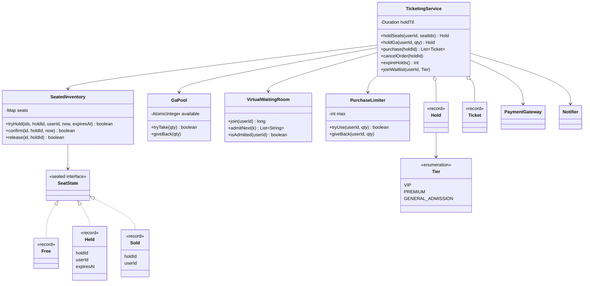

### Key flows

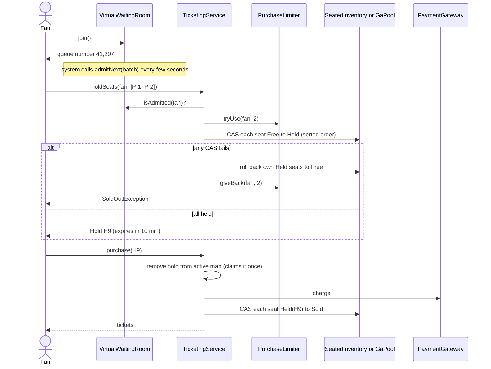

A numbered seat's state machine — every arrow is a single `compareAndSet`:

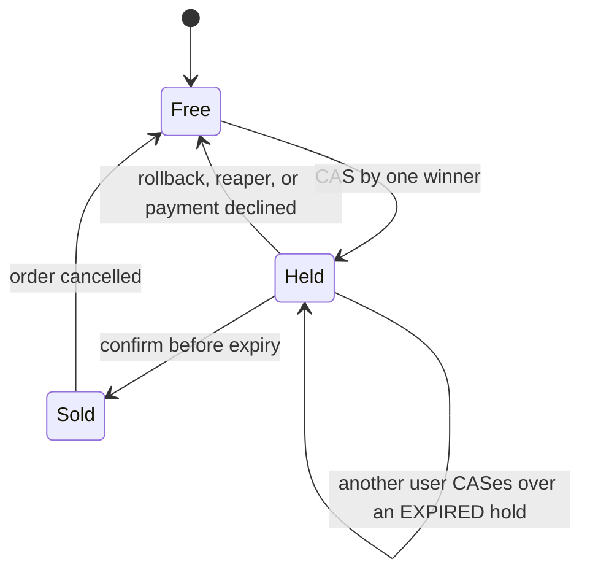

When inventory is released (expired hold, cancellation), `TicketingService` **offers it to the tier's waitlist first**: the next waiting fan is admitted directly and given a fresh hold, plus a notification. If they do not pay in time, the reaper releases it again and the next fan gets it.

### Design decisions & patterns used

| Decision | Why | Alternative rejected |
|---|---|---|
| **Lock-free CAS per seat** (`AtomicReference<SeatState>`) | Buyers of *different* seats never wait for each other; on the *same* seat, exactly one `compareAndSet` wins and the losers learn instantly. No thread is ever blocked holding a lock, so there is no deadlock. | One monitor per concert (15.2's approach) — correct, but at 50,000 simultaneous buyers every request queues behind one lock. |
| **Immutable sealed `SeatState`** | CAS compares *references*; making each state a fresh immutable record means "the state I read" is exactly "the state I replace". Pattern-matching `switch`/`instanceof` on a sealed type is exhaustive and readable. | Mutable fields (`status`, `heldBy`, `expiry`) updated separately — a reader could see a half-updated seat. |
| **Multi-seat hold in sorted order + rollback** | Each seat is claimed independently; on failure we release the ones *we* took (matching our hold id). Sorted order makes two buyers of overlapping sets contend on the same first seat, so one of them fails fast. | Holding several seats with nested locks — deadlock-prone without ordering. |
| **GA as a counter** | Standing places are interchangeable — there's nothing to name. A CAS loop on an `AtomicInteger` (`if cur < qty fail; else CAS(cur, cur-qty)`) never oversells. | A `Seat` object per standing place — 40,000 objects for no benefit. |
| **Virtual waiting room** | Fairness and load control: arrival order decides who gets to *try*, and admitting in batches caps the load on inventory. Bots gain nothing by hammering "buy". `join` is `synchronized` so number order and queue order can never disagree. | "Whoever's request lands first" — rewards bots and fast connections, and melts the backend. |
| **Per-user limit via `ConcurrentHashMap.compute`** | `compute` runs the check-and-update for one key atomically, so two parallel requests from the same user can't both slip under the limit. | `get` then `put` — a classic race. |
| **Holds with TTL + a reaper** | Seat holds are also reclaimed lazily (a CAS can overwrite an expired `Held`); GA holds have no per-item state, so a periodic `expireHolds()` returns their count. `holds.remove(id, h)` ensures the reaper and `purchase` never both process one hold. | Holds that never expire. |
| **Waitlist offers on release** | Released tickets go to the longest-waiting fan (FIFO), not to whoever refreshes fastest. | Returning tickets silently to the pool. |
| **Compensation on lost hold** | Same as 15.2: if a seat could not be confirmed after payment, release and refund. | Assuming the hold is still valid. |
| **Singleton?** | The *awesome-lld* reference solution makes the booking system a Singleton. We pass collaborators through the constructor instead (dependency injection): it is easier to test and allows one service per concert. | A global Singleton. |

### Java implementation

Package `lld.ch15.concert`. Files: `Model.java` (tiers, seat states, hold, ticket, interfaces, clock), `Inventory.java` (CAS seat inventory, GA pool, purchase limiter, waiting room), `TicketingService.java`, `Main.java`. The demos use Java 21 **virtual threads** (`Executors.newVirtualThreadPerTaskExecutor()`), which make 1,000 concurrent buyers cheap.

```java
// File: lld/ch15/concert/Model.java
package lld.ch15.concert;

import java.math.BigDecimal;
import java.time.Clock;
import java.time.Duration;
import java.time.Instant;
import java.time.LocalDateTime;
import java.time.ZoneId;
import java.time.ZoneOffset;
import java.util.List;

/** Seated tiers have numbered seats; general admission (GA) is just a count of standing places. */
enum Tier {
    VIP(true, "5000.00"), PREMIUM(true, "2500.00"), GENERAL_ADMISSION(false, "800.00");
    final boolean seated;
    final BigDecimal price;                       // money: BigDecimal, never double
    Tier(boolean seated, String price) { this.seated = seated; this.price = new BigDecimal(price); }
    BigDecimal priceFor(int qty) { return price.multiply(BigDecimal.valueOf(qty)); }
}

record Concert(String id, String artist, String venue, LocalDateTime startsAt) {}

/** A seat's whole life in one immutable value, swapped atomically with compare-and-set (CAS). */
sealed interface SeatState permits Free, Held, Sold {}
record Free() implements SeatState {}
record Held(String holdId, String userId, Instant expiresAt) implements SeatState {
    boolean expired(Instant now) { return !now.isBefore(expiresAt); }
}
record Sold(String holdId, String userId) implements SeatState {}

/** A temporary claim on inventory: either specific seats or a GA quantity. */
record Hold(String id, String userId, Tier tier, List<String> seatIds, int quantity, BigDecimal amount, Instant expiresAt) {
    boolean expired(Instant now) { return !now.isBefore(expiresAt); }
}

record Ticket(String id, String concertId, String userId, Tier tier, String seatOrGa) {}

final class SoldOutException extends RuntimeException {
    private static final long serialVersionUID = 1L;
    SoldOutException(String msg) { super(msg); }
}

interface PaymentGateway {
    boolean charge(String userId, BigDecimal amount);
    void refund(String userId, BigDecimal amount);
}

interface Notifier { void send(String userId, String message); }

final class SimClock extends Clock {
    private volatile Instant now;
    SimClock(Instant start) { this.now = start; }
    void advance(Duration d) { now = now.plus(d); }
    @Override public ZoneId getZone() { return ZoneOffset.UTC; }
    @Override public Clock withZone(ZoneId zone) { return this; }
    @Override public Instant instant() { return now; }
}
```

```java
// File: lld/ch15/concert/Inventory.java
package lld.ch15.concert;

import java.time.Instant;
import java.util.ArrayList;
import java.util.LinkedHashMap;
import java.util.List;
import java.util.Map;
import java.util.Set;
import java.util.concurrent.ConcurrentHashMap;
import java.util.concurrent.ConcurrentLinkedQueue;
import java.util.concurrent.atomic.AtomicInteger;
import java.util.concurrent.atomic.AtomicLong;
import java.util.concurrent.atomic.AtomicReference;

/**
 * Numbered seats, lock-free. Each seat is an AtomicReference<SeatState>; a claim is one CAS.
 * Many buyers on DIFFERENT seats never wait for each other; on the SAME seat exactly one CAS wins.
 */
final class SeatedInventory {
    private final Map<String, Tier> tierOf = new LinkedHashMap<>();
    private final Map<String, AtomicReference<SeatState>> seats = new ConcurrentHashMap<>();

    void addSeat(String id, Tier tier) {
        tierOf.put(id, tier);
        seats.put(id, new AtomicReference<>(new Free()));
    }
    Tier tierOf(String id) { return tierOf.get(id); }

    /** All-or-nothing over several seats: claim in sorted order, roll back our own claims on failure. */
    boolean tryHold(List<String> ids, String holdId, String userId, Instant now, Instant expiresAt) {
        List<String> taken = new ArrayList<>();
        for (String id : ids.stream().sorted().toList()) {
            if (!tryHoldOne(id, holdId, userId, now, expiresAt)) {
                taken.forEach(t -> release(t, holdId));
                return false;
            }
            taken.add(id);
        }
        return true;
    }

    private boolean tryHoldOne(String id, String holdId, String userId, Instant now, Instant expiresAt) {
        AtomicReference<SeatState> ref = seats.get(id);
        if (ref == null) throw new IllegalArgumentException("no seat " + id);
        while (true) {
            SeatState cur = ref.get();
            boolean claimable = cur instanceof Free || (cur instanceof Held h && h.expired(now));
            if (!claimable) return false;
            if (ref.compareAndSet(cur, new Held(holdId, userId, expiresAt))) return true;
            // CAS lost: someone changed the seat between get() and CAS. Re-read and decide again.
        }
    }

    /** Held-by-this-hold and not expired -> Sold. Fails if the hold was lost. */
    boolean confirm(String id, String holdId, Instant now) {
        AtomicReference<SeatState> ref = seats.get(id);
        SeatState cur = ref.get();
        return cur instanceof Held h && h.holdId().equals(holdId) && !h.expired(now)
                && ref.compareAndSet(cur, new Sold(holdId, h.userId()));
    }

    /** Give the seat back only if it is still ours (held or sold by this hold). */
    boolean release(String id, String holdId) {
        AtomicReference<SeatState> ref = seats.get(id);
        SeatState cur = ref.get();
        boolean ours = (cur instanceof Held h && h.holdId().equals(holdId))
                || (cur instanceof Sold s && s.holdId().equals(holdId));
        return ours && ref.compareAndSet(cur, new Free());
    }

    /** Seats of a tier a fan could claim right now (Free, or Held but expired), in seat order. */
    List<String> freeSeats(Tier tier, Instant now) {
        List<String> out = new ArrayList<>();
        tierOf.forEach((id, t) -> {
            SeatState s = seats.get(id).get();
            if (t == tier && (s instanceof Free || (s instanceof Held h && h.expired(now)))) out.add(id);
        });
        return out;
    }

    long soldCount() { return seats.values().stream().filter(r -> r.get() instanceof Sold).count(); }

    SeatState stateOf(String id) { return seats.get(id).get(); }
}

/** General admission: no seat numbers, just a counter. A CAS loop means it can never go below zero. */
final class GaPool {
    private final AtomicInteger available;
    GaPool(int capacity) { available = new AtomicInteger(capacity); }

    boolean tryTake(int qty) {
        while (true) {
            int cur = available.get();
            if (cur < qty) return false;
            if (available.compareAndSet(cur, cur - qty)) return true;
        }
    }
    void giveBack(int qty) { available.addAndGet(qty); }
    int available()        { return available.get(); }
}

/** Anti-scalping: at most `max` tickets per user per concert, checked-and-updated atomically. */
final class PurchaseLimiter {
    private final int max;
    private final ConcurrentHashMap<String, Integer> used = new ConcurrentHashMap<>();
    PurchaseLimiter(int max) { this.max = max; }

    boolean tryUse(String userId, int qty) {
        boolean[] ok = {false};
        used.compute(userId, (u, cur) -> {
            int c = cur == null ? 0 : cur;
            if (c + qty > max) return cur;             // unchanged
            ok[0] = true;
            return c + qty;
        });
        return ok[0];
    }
    void giveBack(String userId, int qty) { used.computeIfPresent(userId, (u, c) -> c - qty <= 0 ? null : c - qty); }
}

/**
 * Virtual waiting room. Everyone who arrives gets a strictly increasing number; the system admits
 * people in that order, a batch at a time. First come, first served, and bots gain nothing by
 * hammering the buy button, because only admitted users may hold inventory.
 */
final class VirtualWaitingRoom {
    private final AtomicLong nextNumber = new AtomicLong();
    private final ConcurrentLinkedQueue<String> line = new ConcurrentLinkedQueue<>();
    private final Set<String> admitted = ConcurrentHashMap.newKeySet();
    private final Map<String, Long> numberOf = new ConcurrentHashMap<>();

    /** synchronized so the number order and the line order can never disagree. */
    synchronized long join(String userId) {
        Long n = numberOf.get(userId);
        if (n != null) return n;                        // joining twice keeps your place
        long mine = nextNumber.incrementAndGet();
        numberOf.put(userId, mine);
        line.add(userId);
        return mine;
    }
    synchronized List<String> admitNext(int k) {
        List<String> out = new ArrayList<>();
        for (int i = 0; i < k; i++) {
            String u = line.poll();
            if (u == null) break;
            admitted.add(u);
            out.add(u);
        }
        return out;
    }
    boolean isAdmitted(String userId) { return admitted.contains(userId); }
    void admitDirectly(String userId) { admitted.add(userId); }
}
```

```java
// File: lld/ch15/concert/TicketingService.java
package lld.ch15.concert;

import java.math.BigDecimal;
import java.time.Clock;
import java.time.Duration;
import java.time.Instant;
import java.util.ArrayList;
import java.util.EnumMap;
import java.util.List;
import java.util.Map;
import java.util.Queue;
import java.util.concurrent.ConcurrentHashMap;
import java.util.concurrent.ConcurrentLinkedQueue;
import java.util.concurrent.atomic.AtomicInteger;

/**
 * Flow: join waiting room -> get admitted -> HOLD (seats or GA qty, with TTL) -> PURCHASE.
 * Released inventory (expired hold, cancellation) is offered to the tier's waitlist first.
 */
final class TicketingService {
    private final Concert concert;
    private final SeatedInventory seated;
    private final GaPool ga;
    private final PurchaseLimiter limiter;
    private final VirtualWaitingRoom room;
    private final PaymentGateway payments;
    private final Notifier notifier;
    private final Clock clock;
    private final Duration holdTtl;
    private final Map<String, Hold> holds = new ConcurrentHashMap<>();           // active holds
    private final Map<String, List<Ticket>> orders = new ConcurrentHashMap<>();  // holdId -> tickets
    private final Map<Tier, Queue<String>> waitlists = new EnumMap<>(Tier.class);
    private final AtomicInteger seq = new AtomicInteger();

    TicketingService(Concert concert, SeatedInventory seated, GaPool ga, PurchaseLimiter limiter,
                     VirtualWaitingRoom room, PaymentGateway payments, Notifier notifier, Clock clock, Duration holdTtl) {
        this.concert = concert; this.seated = seated; this.ga = ga; this.limiter = limiter; this.room = room;
        this.payments = payments; this.notifier = notifier; this.clock = clock; this.holdTtl = holdTtl;
        for (Tier t : Tier.values()) waitlists.put(t, new ConcurrentLinkedQueue<>());
    }

    // ------------------------------------------------------------------ hold
    Hold holdSeats(String userId, List<String> seatIds) {
        requireAdmitted(userId);
        if (seatIds.isEmpty()) throw new IllegalArgumentException("no seats");
        Tier tier = seated.tierOf(seatIds.get(0));
        if (seatIds.stream().anyMatch(id -> seated.tierOf(id) != tier))
            throw new IllegalArgumentException("one hold = one tier");
        if (!limiter.tryUse(userId, seatIds.size()))
            throw new IllegalStateException(userId + " would exceed the per-user ticket limit");
        Instant now = clock.instant();
        Hold h = new Hold("H" + seq.incrementAndGet(), userId, tier, List.copyOf(seatIds), seatIds.size(),
                tier.priceFor(seatIds.size()), now.plus(holdTtl));
        if (!seated.tryHold(seatIds, h.id(), userId, now, h.expiresAt())) {
            limiter.giveBack(userId, seatIds.size());
            throw new SoldOutException(seatIds + " not available");
        }
        holds.put(h.id(), h);
        return h;
    }

    Hold holdGa(String userId, int qty) {
        requireAdmitted(userId);
        if (!limiter.tryUse(userId, qty))
            throw new IllegalStateException(userId + " would exceed the per-user ticket limit");
        if (!ga.tryTake(qty)) {
            limiter.giveBack(userId, qty);
            throw new SoldOutException("general admission sold out");
        }
        Hold h = new Hold("H" + seq.incrementAndGet(), userId, Tier.GENERAL_ADMISSION, List.of(), qty,
                Tier.GENERAL_ADMISSION.priceFor(qty), clock.instant().plus(holdTtl));
        holds.put(h.id(), h);
        return h;
    }

    // ------------------------------------------------------------------ purchase
    List<Ticket> purchase(String holdId) {
        Hold h = holds.remove(holdId);                    // atomic claim: a hold is purchased at most once
        if (h == null) throw new IllegalStateException(holdId + " unknown, expired or already used");
        if (h.expired(clock.instant())) { releaseInventory(h); throw new IllegalStateException(holdId + " expired"); }
        if (!payments.charge(h.userId(), h.amount())) { releaseInventory(h); throw new IllegalStateException("payment declined"); }

        List<Ticket> tickets = new ArrayList<>();
        if (h.tier().seated) {
            Instant now = clock.instant();
            List<String> confirmed = new ArrayList<>();
            for (String id : h.seatIds()) {
                if (!seated.confirm(id, h.id(), now)) {   // hold lost during payment -> compensate
                    confirmed.forEach(c -> seated.release(c, h.id()));
                    h.seatIds().forEach(s -> seated.release(s, h.id()));
                    limiter.giveBack(h.userId(), h.quantity());
                    payments.refund(h.userId(), h.amount());
                    throw new IllegalStateException("seat " + id + " lost during payment, refunded");
                }
                confirmed.add(id);
                tickets.add(new Ticket("T" + seq.incrementAndGet(), concert.id(), h.userId(), h.tier(), id));
            }
        } else {
            for (int i = 0; i < h.quantity(); i++)
                tickets.add(new Ticket("T" + seq.incrementAndGet(), concert.id(), h.userId(), h.tier(), "GA"));
        }
        orders.put(h.id(), List.copyOf(tickets));
        return tickets;
    }

    // ------------------------------------------------------------------ release paths
    /** The reaper: run every few seconds in production. Returns how many holds it expired. */
    int expireHolds() {
        Instant now = clock.instant();
        int n = 0;
        for (Hold h : holds.values())
            if (h.expired(now) && holds.remove(h.id(), h)) { releaseInventory(h); n++; }
        return n;
    }

    /** Cancel a whole order (all tickets bought with one hold). */
    void cancelOrder(String holdId) {
        List<Ticket> tickets = orders.remove(holdId);
        if (tickets == null) throw new IllegalStateException("no order " + holdId);
        Tier tier = tickets.get(0).tier();
        BigDecimal refund = tier.priceFor(tickets.size());
        payments.refund(tickets.get(0).userId(), refund);
        Hold asIfHeld = new Hold(holdId, tickets.get(0).userId(), tier,
                tier.seated ? tickets.stream().map(Ticket::seatOrGa).toList() : List.of(), tickets.size(), refund, clock.instant());
        releaseInventory(asIfHeld);
    }

    void joinWaitlist(String userId, Tier tier) { waitlists.get(tier).add(userId); }

    private void releaseInventory(Hold h) {
        limiter.giveBack(h.userId(), h.quantity());
        if (h.tier().seated) {
            h.seatIds().forEach(id -> seated.release(id, h.id()));
            h.seatIds().forEach(id -> offerSeat(h.tier(), id));
        } else {
            ga.giveBack(h.quantity());
            offerGa();
        }
    }

    /** Waitlist first: freed inventory goes to the person who has waited longest, as a fresh hold. */
    private void offerGa() {
        Queue<String> q = waitlists.get(Tier.GENERAL_ADMISSION);
        String next;
        while (ga.available() > 0 && (next = q.poll()) != null) {
            room.admitDirectly(next);
            try {
                Hold h = holdGa(next, 1);
                notifier.send(next, "a GA ticket freed up, held for you as " + h.id() + " until " + h.expiresAt());
            } catch (RuntimeException e) { /* over their limit or lost the race: try the next person */ }
        }
    }

    private void offerSeat(Tier tier, String seatId) {
        String next = waitlists.get(tier).poll();
        if (next == null) return;
        room.admitDirectly(next);
        try {
            Hold h = holdSeats(next, List.of(seatId));
            notifier.send(next, "seat " + seatId + " freed up, held for you as " + h.id());
        } catch (RuntimeException e) { /* someone else took it first */ }
    }

    private void requireAdmitted(String userId) {
        if (!room.isAdmitted(userId)) throw new IllegalStateException(userId + " is still in the waiting room");
    }

    int gaAvailable() { return ga.available(); }

    /** What a fan sees before choosing: free places per tier (requirement: view seating and availability). */
    String availability() {
        StringBuilder sb = new StringBuilder();
        for (Tier t : Tier.values()) {
            if (t.seated) sb.append(t).append(" free ").append(seated.freeSeats(t, clock.instant())).append(", ");
            else sb.append(t).append(" free ").append(ga.available());
        }
        return sb.toString();
    }
}
```

```java
// File: lld/ch15/concert/Main.java
package lld.ch15.concert;

import java.math.BigDecimal;
import java.time.Duration;
import java.time.Instant;
import java.time.LocalDateTime;
import java.util.List;
import java.util.concurrent.CountDownLatch;
import java.util.concurrent.ExecutorService;
import java.util.concurrent.Executors;
import java.util.concurrent.atomic.AtomicInteger;
import java.util.concurrent.atomic.AtomicReference;

public class Main {
    public static void main(String[] args) throws Exception {
        SimClock clock = new SimClock(Instant.parse("2026-06-01T09:00:00Z"));
        AtomicReference<BigDecimal> collected = new AtomicReference<>(BigDecimal.ZERO);
        PaymentGateway bank = new PaymentGateway() {
            public boolean charge(String u, BigDecimal a) { collected.accumulateAndGet(a, BigDecimal::add); return true; }
            public void refund(String u, BigDecimal a)    { collected.accumulateAndGet(a, BigDecimal::subtract); }
        };
        Notifier notifier = (u, m) -> System.out.println("  [notify " + u + "] " + m);

        Concert show = new Concert("C1", "The Band", "Stadium", LocalDateTime.of(2026, 8, 15, 19, 30));
        SeatedInventory seated = new SeatedInventory();
        for (int i = 1; i <= 4; i++) seated.addSeat("VIP-" + i, Tier.VIP);
        for (int i = 1; i <= 6; i++) seated.addSeat("P-" + i, Tier.PREMIUM);
        GaPool ga = new GaPool(100);
        VirtualWaitingRoom room = new VirtualWaitingRoom();
        TicketingService svc = new TicketingService(show, seated, ga, new PurchaseLimiter(4), room,
                bank, notifier, clock, Duration.ofMinutes(10));

        System.out.println("== 1. Seating and availability, then the virtual waiting room ==");
        System.out.println("  availability: " + svc.availability());
        for (String u : List.of("ana", "ben", "cai", "dev", "eli")) System.out.println("  " + u + " got number " + room.join(u));
        System.out.println("  ben joins again, keeps number " + room.join("ben"));
        System.out.println("  admitted batch 1: " + room.admitNext(3));
        try { svc.holdGa("eli", 1); } catch (IllegalStateException e) { System.out.println("  REFUSED: " + e.getMessage()); }

        System.out.println("\n== 2. 40 admitted fans CAS for the same seat VIP-1 ==");
        AtomicInteger vipWins = new AtomicInteger();
        CountDownLatch go = new CountDownLatch(1);
        try (ExecutorService pool = Executors.newVirtualThreadPerTaskExecutor()) {
            for (int i = 0; i < 40; i++) {
                String u = "vip-fan-" + i;
                room.admitDirectly(u);
                pool.submit(() -> {
                    go.await();
                    try { svc.holdSeats(u, List.of("VIP-1")); vipWins.incrementAndGet(); }
                    catch (SoldOutException ignored) { }
                    return null;
                });
            }
            go.countDown();
        }
        System.out.println("  holds on VIP-1 = " + vipWins.get());

        System.out.println("\n== 3. Flash sale: 1,000 fans, 100 GA places (98 left after test buys) ==");
        Hold anaHold = svc.holdGa("ana", 2);
        svc.purchase(anaHold.id());
        AtomicInteger sold = new AtomicInteger(), soldOut = new AtomicInteger();
        CountDownLatch go2 = new CountDownLatch(1);
        try (ExecutorService pool = Executors.newVirtualThreadPerTaskExecutor()) {
            for (int i = 0; i < 1000; i++) {
                String u = "fan-" + i;
                room.admitDirectly(u);
                pool.submit(() -> {
                    go2.await();
                    try { svc.purchase(svc.holdGa(u, 1).id()); sold.incrementAndGet(); }
                    catch (SoldOutException e) { soldOut.incrementAndGet(); }
                    return null;
                });
            }
            go2.countDown();
        }
        System.out.println("  sold=" + sold + " soldOut=" + soldOut + " gaLeft=" + svc.gaAvailable() + " (never negative)");

        System.out.println("\n== 4. Per-user limit (4) stops a scalper ==");
        Hold p = svc.holdSeats("ben", List.of("P-1", "P-2", "P-3"));
        System.out.println("  ben holds " + p.seatIds() + " = " + p.amount());
        try { svc.holdSeats("ben", List.of("P-4", "P-5")); } catch (IllegalStateException e) { System.out.println("  REFUSED: " + e.getMessage()); }
        List<Ticket> benTickets = svc.purchase(p.id());
        System.out.println("  ben bought " + benTickets.stream().map(Ticket::seatOrGa).toList());

        System.out.println("\n== 5. Sold out -> waitlist -> a cancellation is offered to the waitlist ==");
        try { svc.holdGa("cai", 1); } catch (SoldOutException e) { System.out.println("  cai: " + e.getMessage() + ", joins waitlist"); }
        svc.joinWaitlist("cai", Tier.GENERAL_ADMISSION);
        svc.cancelOrder(anaHold.id());                  // ana returns her 2 GA tickets
        System.out.println("  GA left after offers = " + svc.gaAvailable());

        System.out.println("\n== 6. Unpaid holds expire; the reaper returns them ==");
        System.out.println("  admitted batch 2: " + room.admitNext(3));
        Hold forgotten = svc.holdSeats("dev", List.of("P-6"));
        clock.advance(Duration.ofMinutes(11));
        System.out.println("  expired holds reaped = " + svc.expireHolds() + " (VIP-1, cai's unpaid offer, dev's P-6)");
        try { svc.purchase(forgotten.id()); } catch (IllegalStateException e) { System.out.println("  dev: " + e.getMessage()); }
        System.out.println("  P-6 now " + seated.stateOf("P-6") + ", GA left " + svc.gaAvailable());
        System.out.println("  availability: " + svc.availability());
        System.out.println("  money collected = " + collected.get());
    }
}
```

**Output:**

```text
== 1. Seating and availability, then the virtual waiting room ==
  availability: VIP free [VIP-1, VIP-2, VIP-3, VIP-4], PREMIUM free [P-1, P-2, P-3, P-4, P-5, P-6], GENERAL_ADMISSION free 100
  ana got number 1
  ben got number 2
  cai got number 3
  dev got number 4
  eli got number 5
  ben joins again, keeps number 2
  admitted batch 1: [ana, ben, cai]
  REFUSED: eli is still in the waiting room

== 2. 40 admitted fans CAS for the same seat VIP-1 ==
  holds on VIP-1 = 1

== 3. Flash sale: 1,000 fans, 100 GA places (98 left after test buys) ==
  sold=98 soldOut=902 gaLeft=0 (never negative)

== 4. Per-user limit (4) stops a scalper ==
  ben holds [P-1, P-2, P-3] = 7500.00
  REFUSED: ben would exceed the per-user ticket limit
  ben bought [P-1, P-2, P-3]

== 5. Sold out -> waitlist -> a cancellation is offered to the waitlist ==
  cai: general admission sold out, joins waitlist
  [notify cai] a GA ticket freed up, held for you as H244 until 2026-06-01T09:10:00Z
  GA left after offers = 1

== 6. Unpaid holds expire; the reaper returns them ==
  admitted batch 2: [dev, eli]
  expired holds reaped = 3 (VIP-1, cai's unpaid offer, dev's P-6)
  dev: H245 unknown, expired or already used
  P-6 now Free[], GA left 2
  availability: VIP free [VIP-1, VIP-2, VIP-3, VIP-4], PREMIUM free [P-4, P-5, P-6], GENERAL_ADMISSION free 2
  money collected = 85900.00
```

What to notice: section 1 admits the first three in arrival order and refuses someone still in the queue; section 2 — 40 concurrent CAS attempts on one seat, exactly one hold; section 3 — 1,000 buyers for 98 remaining GA places sell exactly 98 and the counter stops at 0; section 4 — a fifth ticket is refused by the per-user limit; section 5 — a cancellation's released ticket goes straight to the waitlisted fan as a hold; section 6 — the reaper returns three expired holds (VIP-1, the unpaid waitlist offer, and dev's seat) and a late purchase is refused. The availability line at the end shows what is still for sale (three PREMIUM seats, four VIP seats, two GA places). Money collected is 85,900.00 = 98 × 800 + 3 × 2,500 (ana's 2 GA tickets were refunded).

### Concurrency & edge cases

- **Why CAS is correct.** `compareAndSet(expected, new)` atomically replaces the value only if it is still the exact object we read. If another thread changed it in between, the CAS fails and we re-read and decide again. The loop in `tryHoldOne` only retries while the seat is still claimable; otherwise it returns `false`.
- **ABA problem?** ABA is when a value goes A → B → A and a CAS wrongly succeeds. Here every transition creates a *new* record object and `AtomicReference` compares references, so an "A" that came back is a different object and the CAS fails safely.
- **Hold claimed exactly once.** `purchase` starts with `holds.remove(holdId)`; the reaper uses `holds.remove(id, h)`. Only one of them can get the hold, so inventory is never released twice.
- **Per-user limit and failures.** Every failure path (sold out, declined, expired, lost seat) gives the limit back, so a user is never locked out by a failed attempt.
- **Lost hold after payment.** `confirm` fails if the hold expired and someone CASed over it; we release, give back the limit, and refund.
- **Fair queue scope.** The in-memory queue is fair *within one process*. At real scale the waiting room is a separate service (often at the CDN edge) that hands out signed, time-limited access tokens; inventory servers only check the token.
- **Across servers.** Seat CAS maps naturally to a database conditional update (`UPDATE seat SET state='HELD', hold_id=?, expires_at=? WHERE id=? AND (state='FREE' OR expires_at < now())`) or Redis `SET NX PX`. GA counts map to Redis `DECRBY` guarded by a Lua script, or to a database row updated with `WHERE available >= ?`.

### Extensions & follow-up questions

- **"Best available seats."** Instead of the user choosing, a `SeatAllocator` strategy picks the best adjacent free seats in a tier, then calls the same CAS hold.
- **"Verified fans / presale codes."** Admission to the waiting room requires a token issued to pre-registered fans; the limiter keys on a verified identity, not an email.
- **"Dynamic pricing."** Prices per tier come from a `PricingStrategy` that looks at remaining inventory and time — decided when the hold is created and frozen in the `Hold`.
- **"Resale marketplace."** A sold ticket can be listed; a buyer's purchase transfers ownership and re-issues a new barcode (so the old one stops working).
- **"Waitlist for seated tiers."** Implemented the same way for each released seat (`offerSeat`).

### Real-world example

**Ticketmaster** uses a virtual queue ("Smart Queue") for high-demand on-sales and a **Verified Fan** presale programme that registers fans in advance to filter out bots; purchase limits per account are standard on its events. The November 2022 presale for Taylor Swift's *Eras Tour* is the well-known stress case: demand far beyond what was planned for overwhelmed the system, many fans waited for hours or were dropped, and the general public sale was cancelled — a real lesson that fairness and admission control are as important as seat-locking correctness.

### In the interview

**30–45 minute plan.** (1) Say up front: "the entities are like movie booking; the hard part is contention and fairness." (2) Tiers: seated vs GA, and why GA is a counter. (3) Holds with TTL; code the CAS seat claim and the GA CAS loop. (4) Fairness: waiting room with batches; per-user limit with atomic `compute`. (5) Waitlist on release; reaper. (6) Scale-out: tokens from the waiting room, conditional updates/Redis.

**30-second answer:** "Seated tiers are an `AtomicReference<SeatState>` per seat, claimed by compare-and-set — one winner, no locks. GA is an `AtomicInteger` decremented by a CAS loop so it can't go negative. Everyone enters through a virtual waiting room that admits in arrival order, and a per-user limit is enforced atomically. Holds expire after 10 minutes; a reaper returns expired GA holds; released tickets go to a FIFO waitlist first. If a hold is lost during payment we refund."

**Follow-ups with answers:** *Lock-free vs locks?* Lock-free wins when contention is high and critical sections are tiny (one field swap); locks are simpler when an operation must update many things together. *What if the queue service fails?* Fail closed: pause admissions, don't open the floodgates. *How do you stop one person with 50 accounts?* Verified identity, payment-card fingerprinting, and limits keyed on those.

### Self-check

- **Q:** Why is GA modeled as a counter, not seats? **A:** Standing places are interchangeable; a counter with CAS is simpler and can't oversell.
- **Q:** What does `compareAndSet` guarantee? **A:** The update happens only if the value is still the one you read; otherwise it fails and you retry or give up.
- **Q:** Why must `join` be synchronized? **A:** So the number handed out and the position in the line are assigned together; otherwise two joiners could get numbers in one order and queue slots in the other.
- **Q:** How is a hold prevented from being purchased *and* reaped? **A:** Both paths remove it from the `holds` map first; only one removal succeeds.
- **Q:** What happens to a released ticket when fans are waitlisted? **A:** It becomes a fresh hold for the first fan in the waitlist, who is notified.

### TL;DR

Same nouns as movie booking, different enemy: contention. CAS per seat, CAS counter for GA, a FIFO virtual waiting room for fairness, atomic per-user limits, TTL holds with a reaper, a waitlist that gets released tickets first, and refunds when a hold is lost.

---

## 15.4 Design a Hotel Management System


*Figure — Cover image for the hotel management case study (course diagram)*

### Problem & clarifying questions

A **Hotel Management System** (often called a *property management system*, PMS) runs a hotel's operations in one place: it knows every room, takes bookings, checks guests in and out, issues key cards, records housekeeping and room service, and produces the bill. Management gets one portal to track available rooms, book them and generate invoices.

The inventory here is different from a cinema: a room is not sold once, it is sold **night by night**. That single fact shapes the whole design.

| Question | Answer we assume |
|---|---|
| Several hotel locations? | Yes — a `Hotel` has many `HotelLocation`s, each with its own rooms. |
| Room types? | `STANDARD`, `DELUXE`, `FAMILY_SUITE`, `BUSINESS_SUITE`. |
| What does a guest search by? | Room type and **date range** (availability). |
| Cancellation policy? | **Full refund if cancelled more than 24 hours before check-in**; otherwise no refund (our assumption for the "otherwise" case). |
| Extra charges during the stay? | Room service, food (kitchen) and amenities are added to the bill. |
| How is the bill paid? | **Credit card, check or cash**. |
| Keys? | Electronic key cards with a barcode and key id; deactivated at check-out. |
| Housekeeping? | Every task is logged per room (a history, never overwritten). |
| One booking for several rooms? | No — one booking = one room (a known limitation; see follow-ups). |

### Requirements

**Functional** (course list)

1. Support booking different **room types**: standard, deluxe, family suite (and business suite).
2. Guests **search** room inventory and book any **available** room.
3. Retrieve **who booked a room** and **which rooms a customer booked**.
4. Customers can **cancel**; **full refund if more than 24 hours before check-in**.
5. **Notify** the guest shortly before check-in and shortly before check-out.
6. Keep a **housekeeping log** per room.
7. Customers can add **room services and food items**.
8. Customers can ask for **amenities**.
9. Pay bills by **credit card, check or cash**.

**Non-functional** — never double-book a room-night (even with concurrent bookings from the website and the front desk); the bill must always equal the sum of its lines; each actor may do only their own job; the refund rule must be changeable in one place.

### Use cases

Actors (course): **Guest** (search, book), **Receptionist** (add/modify rooms, create bookings, check in/out), **System** (booking/cancellation/reminder notifications), **Manager** (adds new workers), **Housekeeper** (adds/modifies housekeeping records), **Server** (adds/modifies room-service records).

Top use cases: add/remove/edit room; search room (by type and availability); register or cancel an account; book room; **check in**; **check out** (end of booking, return of keys); add room charge; update housekeeping log.


*Figure — Hotel use cases: Guest and Receptionist share booking, update, cancel, view, print and search; "Make booking" includes "Book room", which includes "Make payment"; "Cancel booking" includes "Refund payment"; the receptionist's "Check-in guest" includes "Issue room key"; the System sends booking notifications; the House Keeper adds/updates housekeeping; a manager adds/modifies employees (course diagram)*

### Core entities

| Class | Responsibility |
|---|---|
| `Hotel` | Owns its locations; searches each one in turn. |
| `HotelLocation` implements `Search` | Owns its rooms; answers "which rooms of this type are free for these dates?". |
| `Room` | Number, style, price per night; the **set of booked nights**; owns its `RoomKey`s and housekeeping log; current `RoomStatus`. |
| `RoomStyle`, `RoomStatus` (enums) | Type of room; what it is doing *now* (`AVAILABLE`, `RESERVED`, `OCCUPIED`, `NOT_AVAILABLE`, `BEING_SERVICED`, `OTHER`). |
| `RoomKey` | Key id, barcode, issue time, master flag, active flag. |
| `RoomHouseKeeping` (record) | One log line: when, who, what, how long. |
| `RoomBooking` | Reservation number, guest id, room, check-in/out dates, status, deposit; **owns its `Invoice`**; `refundDue()` holds the cancellation rule. |
| `BookingStatus` (enum) | `REQUESTED`, `PENDING`, `CONFIRMED`, `CHECKED_IN`, `CHECKED_OUT`, `CANCELLED`, `ABANDONED`. |
| `Invoice`, `InvoiceItem` | A list of lines; the total is computed from them. |
| `RoomCharge` (abstract) → `Amenity`, `RoomService`, `KitchenService` | A charge that knows how to write itself onto the invoice (Template Method). |
| `Payment` (sealed, abstract) → `CreditCardTransaction`, `CheckTransaction`, `CashTransaction` | Three ways to pay with genuinely different behaviour. |
| `Person` (sealed) → `Guest`, `Receptionist`, `Server`, `Housekeeper`, `Manager` | Actors; service methods accept only the right actor type. |
| `FrontDesk` | Every flow of a stay: book, check in, add charge, check out, cancel, housekeeping, reminders, queries. |
| `Notifier` | Messages to guests. |

### Class diagram

The course's five stages:

| Stage | Adds | What works afterwards |
|---|---|---|
| 1 | Invoice, payment types, notification types | A bill can be produced and settled by card, check or cash |
| 2 | Room, key card, housekeeping record | Each room can tell which of its nights are sold |
| 3 | Hotel, location, search interface | Free rooms can be listed for any date range |
| 4 | Booking and room charges | A stay can be followed from reservation to check-out |
| 5 | People and accounts | Every actor is limited to its own tasks |

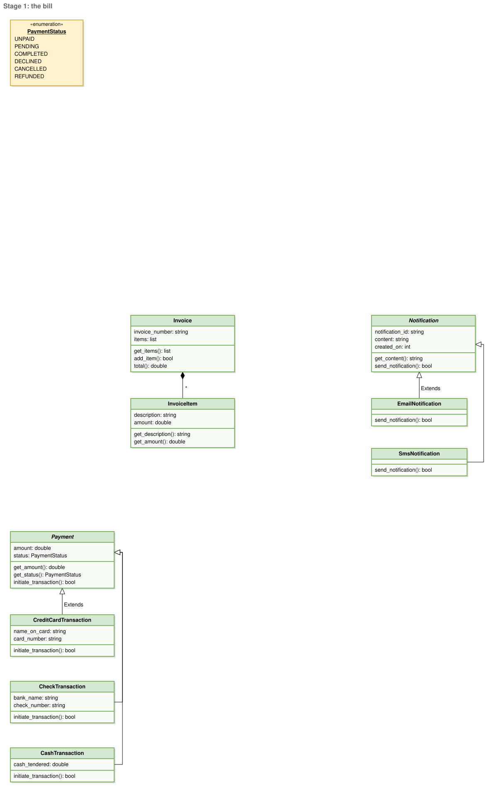
*Figure — Stage 1: `Invoice` owns its `InvoiceItem`s (composition) and computes `total()`; abstract `Payment` with credit card, check and cash subclasses; abstract `Notification` with one subclass per channel (course diagram)*


*Figure — How to read a class box and the arrow styles used in these diagrams (course diagram)*

Requirements 7 and 8 each put extra charges on a stay. That is why the invoice stores **individual lines** and computes its total on demand: a total that is always recomputed can never go out of step with the lines.

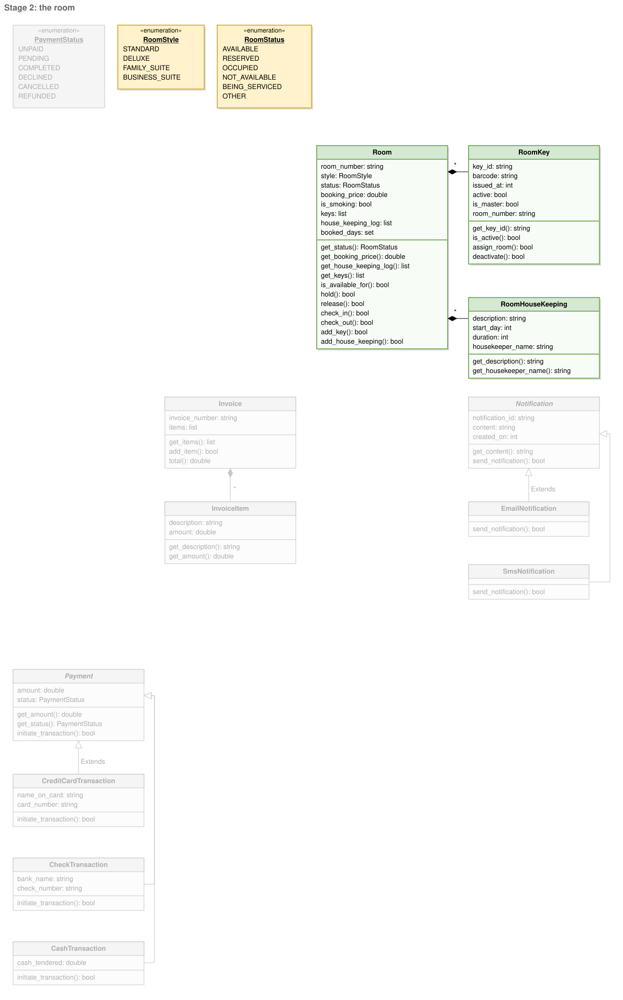
*Figure — Stage 2: `Room` (number, style, status, price, and the set of nights it is committed to) owns its `RoomKey`s and its list of `RoomHouseKeeping` records (course diagram)*

The key decision of the whole design sits here: **a status field is not availability.** `RoomStatus.OCCUPIED` describes the present moment only. A guest, however, asks about the future ("can I have it from the 10th to the 13th?"), and a single status value cannot answer that. So each room also stores the dates of the nights it has already sold.

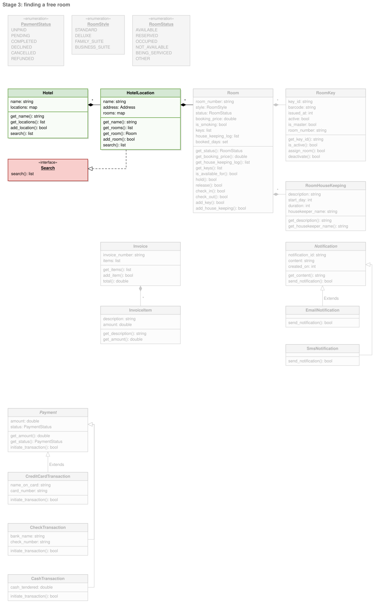
*Figure — Stage 3: the `Search` interface implemented by `HotelLocation`, which owns its rooms; `Hotel` owns its locations (course diagram)*

Search sits on the **location**, not on `Room`: one room has no knowledge of the other rooms, so it cannot list which of them are free. Putting `search` on `Room` is a frequent beginner mistake.

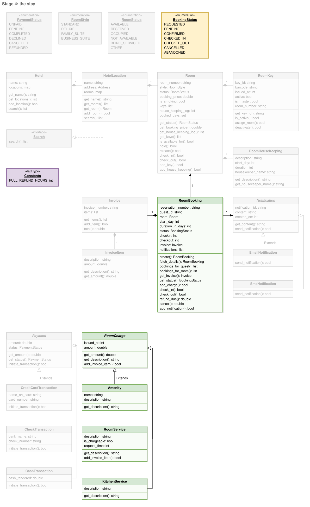
*Figure — Stage 4: `RoomBooking` owns its invoice and points at its room (plain association); `RoomCharge` with `Amenity`, `RoomService` and `KitchenService` subclasses each writing an invoice line (course diagram)*

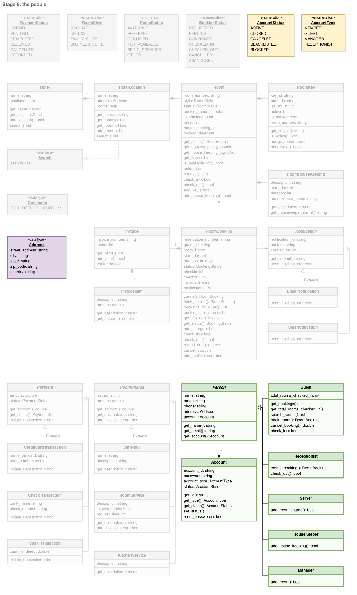
*Figure — Stage 5: `Person` with `Guest`, `Receptionist`, `Server`, `HouseKeeper` and `Manager`, each with only its own methods; `Person` refers to its `Account`; there is deliberately no arrow from guest to booking (course diagram)*

Notice what the figure does *not* have: an arrow between guest and booking. The booking stores only the guest's **id**, and queries filter bookings by that id — requirement 3 is met without either class holding a reference to the other.


*Figure — The finished hotel class diagram (course diagram)*

Our Java design:

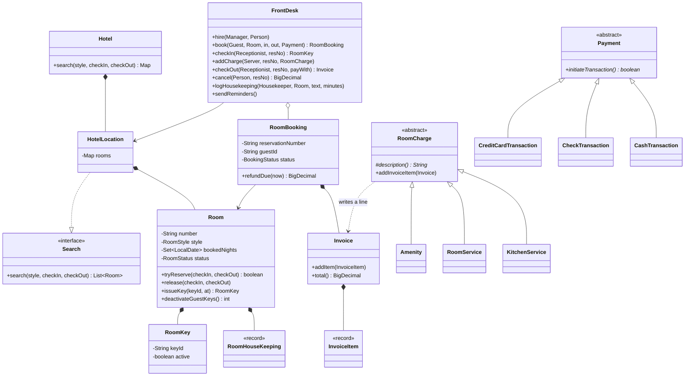

### Key flows

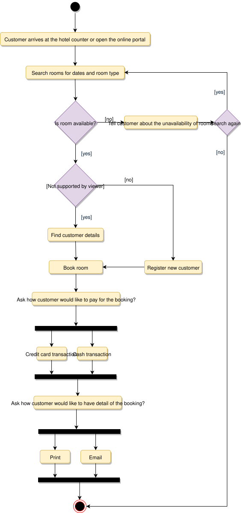
*Figure — Make a room booking: search rooms for dates and room type; if none is available tell the customer; otherwise find or register the customer, book the room, ask how they will pay (credit card or cash), and how they want the booking details (course diagram)*

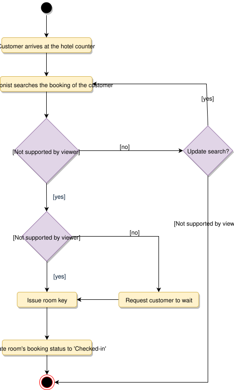
*Figure — Check in: the customer arrives at the counter and the receptionist looks up the booking (searching again if it is not found); with a valid booking, check whether the room is ready — if not, the customer is asked to wait; if so, issue the room key and set the booking status to "Checked-in" (course diagram)*

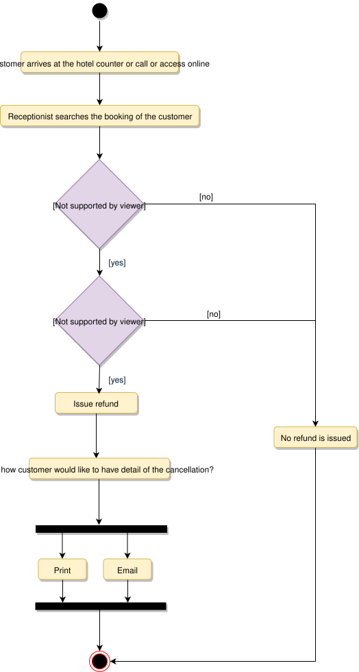
*Figure — Cancel a booking: the customer comes to the counter, calls or goes online; the receptionist finds the booking and checks it is valid; if the customer is cancelling before the cancel deadline a refund is issued, otherwise no refund; the cancellation details are printed or emailed (course diagram)*

A whole stay as a sequence:

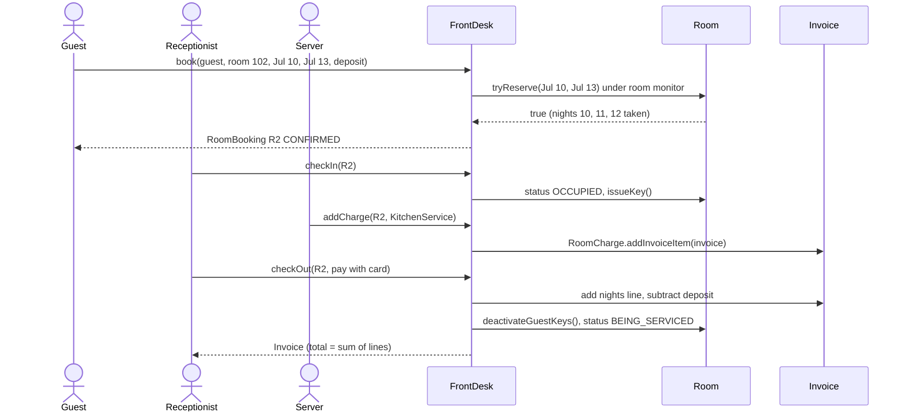

Booking lifecycle:

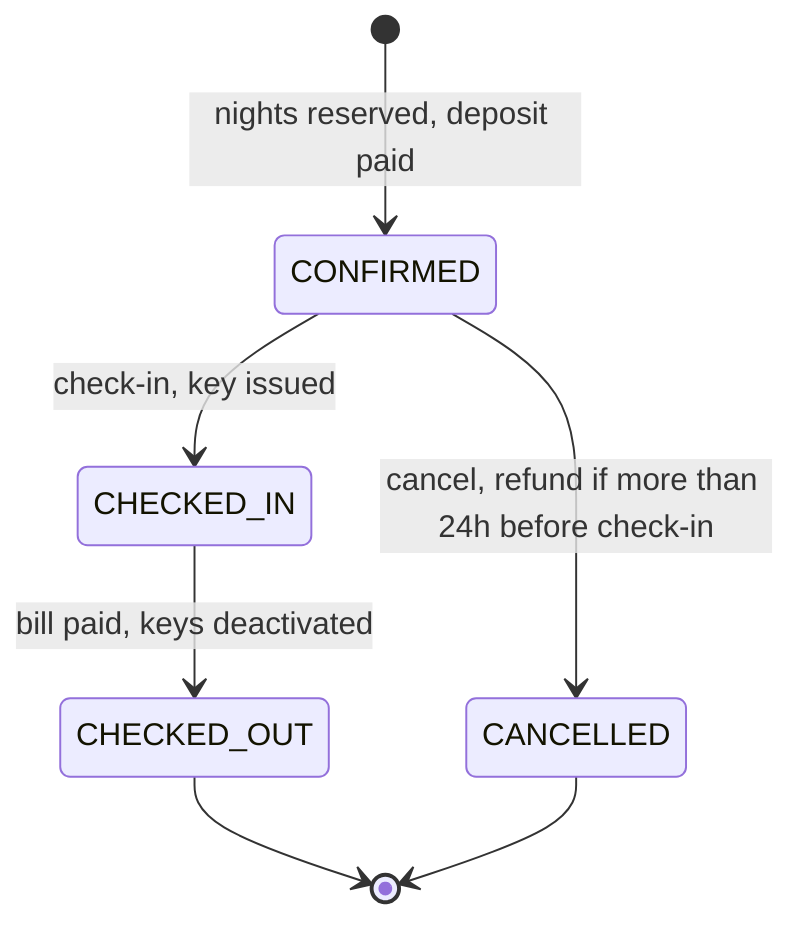

The room's *current* status cycles independently: `AVAILABLE` → `OCCUPIED` (check-in) → `BEING_SERVICED` (check-out) → `AVAILABLE` (housekeeping logged).

### Design decisions & patterns used

| Decision | Why | Alternative rejected |
|---|---|---|
| **Availability = set of booked nights** (course's key point) | Answers date-range questions; nights are half-open `[checkIn, checkOut)`, so a guest leaving on the 13th and one arriving on the 13th don't clash. | Using `RoomStatus` for availability — only knows *now*. |
| **`tryReserve` is `synchronized` on the room** | "Are all these nights free? → take them" is check-then-act; the room's monitor makes it atomic. Rooms don't block each other. | One hotel-wide lock. |
| **Search on `HotelLocation`** | A room can't answer "which rooms are free?". | `Room.search()`. |
| **Invoice = list of lines, total computed** | The total can never disagree with the lines (requirements 7 and 8). | A stored running total. |
| **Template Method: `RoomCharge.addInvoiceItem`** | The parent fixes the algorithm (describe → price → write a line) and is `final`; subclasses fill in only `description()`. A new kind of charge = a new subclass, no edit to `Invoice` (Open/Closed). The course calls this the clearest Template Method example in its catalogue. Compare with Strategy, where the *whole* method is swapped rather than one step. | A `switch` on charge type inside the invoice. |
| **Three `Payment` subclasses** | They really behave differently: a card completes immediately, a **check stays `PENDING`** until it clears, cash can be declined if the amount tendered is short. Each passes the substitution test (each can be asked to take money). | One `Payment` with a `type` field and `if`s. |
| **Refund rule in one method** (`refundDue`) | When the policy changes there is exactly one place to edit. To support several policies (non-refundable rates, partial refunds), promote it to a `CancellationPolicy` strategy as in 15.2. | Refund arithmetic scattered through cancel flows. |
| **Actor types in service signatures** | `addCharge(Server, …)`, `logHousekeeping(Housekeeper, …)`, `addRoom(Manager, …)` — the compiler enforces who can do what. The receptionist booking for a guest calls the *same* booking method — two actors, one behaviour, no duplication. | Every actor able to call everything. |
| **Booking stores guest id, not a `Guest` reference** | No two-way dependency; "which rooms did this guest book?" is a query. | Bidirectional links that must be kept in sync. |
| **Nights released on failed deposit / cancel** | Reserve-then-pay needs an undo: if the deposit fails the nights are given back immediately. | Leaving phantom reservations. |

### Java implementation

Package `lld.ch15.hotel`. Files: `Billing.java` (invoice, payments, room charges), `Rooms.java` (room, key, housekeeping, search, hotel, clock, money), `Stay.java` (booking, actors, front desk), `Main.java`.

```java
// File: lld/ch15/hotel/Billing.java
package lld.ch15.hotel;

import java.math.BigDecimal;
import java.util.ArrayList;
import java.util.List;

enum PaymentStatus { UNPAID, PENDING, COMPLETED, DECLINED, CANCELLED, REFUNDED }

record InvoiceItem(String description, BigDecimal amount) {}   // money: BigDecimal, never double

/** A bill is a list of lines; the total is always computed, so it can never disagree with the lines. */
final class Invoice {
    private final String number;
    private final List<InvoiceItem> items = new ArrayList<>();
    Invoice(String number) { this.number = number; }
    String number()                        { return number; }
    synchronized void addItem(InvoiceItem i) { items.add(i); }
    synchronized List<InvoiceItem> items()   { return List.copyOf(items); }
    synchronized BigDecimal total()          { return items.stream().map(InvoiceItem::amount).reduce(BigDecimal.ZERO, BigDecimal::add); }
}

/** Three ways to pay, which really behave differently: a check does not clear at once. */
abstract sealed class Payment permits CreditCardTransaction, CheckTransaction, CashTransaction {
    private final BigDecimal amount;
    private PaymentStatus status = PaymentStatus.UNPAID;
    Payment(BigDecimal amount) { this.amount = amount; }
    BigDecimal amount()      { return amount; }
    PaymentStatus status()   { return status; }
    protected void setStatus(PaymentStatus s) { status = s; }
    /** Take the money. Returns true when the hotel may release the guest. */
    abstract boolean initiateTransaction();
}

final class CreditCardTransaction extends Payment {
    private final String nameOnCard;
    CreditCardTransaction(BigDecimal amount, String nameOnCard) { super(amount); this.nameOnCard = nameOnCard; }
    @Override boolean initiateTransaction() { setStatus(PaymentStatus.COMPLETED); return true; }
    @Override public String toString() { return "card(" + nameOnCard + ")"; }
}

final class CheckTransaction extends Payment {
    private final String bankName, checkNumber;
    CheckTransaction(BigDecimal amount, String bankName, String checkNumber) {
        super(amount); this.bankName = bankName; this.checkNumber = checkNumber;
    }
    @Override boolean initiateTransaction() { setStatus(PaymentStatus.PENDING); return true; }   // clears in days
    @Override public String toString() { return "check(" + bankName + " #" + checkNumber + ")"; }
}

final class CashTransaction extends Payment {
    private final BigDecimal tendered;
    CashTransaction(BigDecimal amount, BigDecimal tendered) { super(amount); this.tendered = tendered; }
    @Override boolean initiateTransaction() {
        if (tendered.compareTo(amount()) < 0) { setStatus(PaymentStatus.DECLINED); return false; }
        setStatus(PaymentStatus.COMPLETED);
        return true;
    }
    BigDecimal change() { return tendered.subtract(amount()); }
    @Override public String toString() { return "cash"; }
}

/**
 * TEMPLATE METHOD. addInvoiceItem() is the fixed algorithm (describe, price, write a line);
 * each subclass fills in only description(). A new kind of charge = a new subclass, no edit to Invoice.
 */
abstract class RoomCharge {
    private final BigDecimal amount;
    RoomCharge(BigDecimal amount) { this.amount = amount; }
    protected abstract String description();                 // the one step that varies
    final void addInvoiceItem(Invoice invoice) {             // the template: final, so the order can't change
        invoice.addItem(new InvoiceItem(description(), amount));
    }
}

final class Amenity extends RoomCharge {
    private final String name;
    Amenity(String name, BigDecimal amount) { super(amount); this.name = name; }
    @Override protected String description() { return "Amenity: " + name; }
}

final class RoomService extends RoomCharge {
    private final String request;
    RoomService(String request, BigDecimal amount) { super(amount); this.request = request; }
    @Override protected String description() { return "Room service: " + request; }
}

final class KitchenService extends RoomCharge {
    private final String dish;
    KitchenService(String dish, BigDecimal amount) { super(amount); this.dish = dish; }
    @Override protected String description() { return "Kitchen: " + dish; }
}
```

```java
// File: lld/ch15/hotel/Rooms.java
package lld.ch15.hotel;

import java.math.BigDecimal;
import java.math.RoundingMode;
import java.time.Clock;
import java.time.Duration;
import java.time.Instant;
import java.time.LocalDate;
import java.time.LocalDateTime;
import java.time.ZoneId;
import java.time.ZoneOffset;
import java.util.ArrayList;
import java.util.Comparator;
import java.util.HashSet;
import java.util.List;
import java.util.Map;
import java.util.Set;
import java.util.TreeMap;
import java.util.concurrent.ConcurrentHashMap;

enum RoomStyle { STANDARD, DELUXE, FAMILY_SUITE, BUSINESS_SUITE }

/** What the room is doing RIGHT NOW. It cannot answer "is it free for 3 nights from the 10th?". */
enum RoomStatus { AVAILABLE, RESERVED, OCCUPIED, NOT_AVAILABLE, BEING_SERVICED, OTHER }

/** An electronic key card. Deactivated at checkout so it stops opening the door. */
final class RoomKey {
    private final String keyId, barcode;
    private final LocalDateTime issuedAt;
    private final boolean master;
    private volatile boolean active = true;
    RoomKey(String keyId, String barcode, LocalDateTime issuedAt, boolean master) {
        this.keyId = keyId; this.barcode = barcode; this.issuedAt = issuedAt; this.master = master;
    }
    String keyId()        { return keyId; }
    boolean isActive()    { return active; }
    boolean isMaster()    { return master; }
    void deactivate()     { active = false; }
}

/** Append-only log line: nothing is overwritten, so a room's history can be read back. */
record RoomHouseKeeping(LocalDateTime at, String housekeeper, String description, int minutes) {}

/**
 * A room owns its keys and its housekeeping log (composition), and the SET OF NIGHTS it is committed to.
 * Reserving nights is check-then-act, so it runs under the room's monitor: two guests can never
 * both get the night of the 10th.
 */
final class Room {
    private final String number;
    private final RoomStyle style;
    private final BigDecimal pricePerNight;
    private final boolean smoking;
    private final Set<LocalDate> bookedNights = new HashSet<>();
    private final List<RoomKey> keys = new ArrayList<>();
    private final List<RoomHouseKeeping> housekeeping = new ArrayList<>();
    private RoomStatus status = RoomStatus.AVAILABLE;

    Room(String number, RoomStyle style, BigDecimal pricePerNight, boolean smoking) {
        this.number = number; this.style = style; this.pricePerNight = pricePerNight; this.smoking = smoking;
    }
    String number()             { return number; }
    RoomStyle style()           { return style; }
    BigDecimal pricePerNight()  { return pricePerNight; }

    /** Nights are [checkIn, checkOut): the checkout day itself is free for the next guest. */
    synchronized boolean isFree(LocalDate checkIn, LocalDate checkOut) {
        for (LocalDate d = checkIn; d.isBefore(checkOut); d = d.plusDays(1)) if (bookedNights.contains(d)) return false;
        return true;
    }
    synchronized boolean tryReserve(LocalDate checkIn, LocalDate checkOut) {
        if (!isFree(checkIn, checkOut)) return false;              // re-entrant monitor: same lock
        for (LocalDate d = checkIn; d.isBefore(checkOut); d = d.plusDays(1)) bookedNights.add(d);
        return true;
    }
    synchronized void release(LocalDate checkIn, LocalDate checkOut) {
        for (LocalDate d = checkIn; d.isBefore(checkOut); d = d.plusDays(1)) bookedNights.remove(d);
    }

    synchronized RoomStatus status()          { return status; }
    synchronized void setStatus(RoomStatus s) { status = s; }

    synchronized RoomKey issueKey(String keyId, LocalDateTime at) {
        RoomKey k = new RoomKey(keyId, "BC-" + keyId, at, false);
        keys.add(k);
        return k;
    }
    synchronized int deactivateGuestKeys() {
        int n = 0;
        for (RoomKey k : keys) if (!k.isMaster() && k.isActive()) { k.deactivate(); n++; }
        return n;
    }
    synchronized void addHousekeeping(RoomHouseKeeping h) { housekeeping.add(h); }
    synchronized List<RoomHouseKeeping> housekeepingLog()  { return List.copyOf(housekeeping); }
}

/** Search belongs to the LOCATION: a single room only knows about itself. */
interface Search {
    List<Room> search(RoomStyle style, LocalDate checkIn, LocalDate checkOut);
}

final class HotelLocation implements Search {
    private final String name;
    private final Map<String, Room> rooms = new ConcurrentHashMap<>();
    HotelLocation(String name) { this.name = name; }
    String name()           { return name; }
    void addRoom(Room r)    { rooms.put(r.number(), r); }
    Room room(String n)     { return rooms.get(n); }

    @Override public List<Room> search(RoomStyle style, LocalDate in, LocalDate out) {
        return rooms.values().stream().filter(r -> r.style() == style && r.isFree(in, out))
                .sorted(Comparator.comparing(Room::number)).toList();
    }
}

final class Hotel {
    private final String name;
    private final List<HotelLocation> locations = new ArrayList<>();
    Hotel(String name) { this.name = name; }
    void addLocation(HotelLocation l) { locations.add(l); }
    /** Asks every location in turn. */
    Map<String, List<Room>> search(RoomStyle style, LocalDate checkIn, LocalDate checkOut) {
        Map<String, List<Room>> result = new TreeMap<>();
        for (HotelLocation l : locations) result.put(l.name(), l.search(style, checkIn, checkOut));
        return result;
    }
}

final class SimClock extends Clock {
    private volatile Instant now;
    SimClock(Instant start) { this.now = start; }
    void advance(Duration d) { now = now.plus(d); }
    @Override public ZoneId getZone() { return ZoneOffset.UTC; }
    @Override public Clock withZone(ZoneId zone) { return this; }
    @Override public Instant instant() { return now; }
}

final class Money {
    private Money() {}
    static String fmt(BigDecimal amount) {
        String digits = amount.abs().setScale(2, RoundingMode.UNNECESSARY).toPlainString();
        return (amount.signum() < 0 ? "-$" : "$") + digits;
    }
}
```

```java
// File: lld/ch15/hotel/Stay.java
package lld.ch15.hotel;

import java.math.BigDecimal;
import java.time.Clock;
import java.time.Duration;
import java.time.LocalDate;
import java.time.LocalDateTime;
import java.time.LocalTime;
import java.util.ArrayList;
import java.util.List;
import java.util.Map;
import java.util.concurrent.ConcurrentHashMap;
import java.util.concurrent.CopyOnWriteArrayList;
import java.util.concurrent.atomic.AtomicInteger;
import java.util.function.Function;

enum BookingStatus { REQUESTED, PENDING, CONFIRMED, CHECKED_IN, CHECKED_OUT, CANCELLED, ABANDONED }

/** The actors. Each service method takes the actor type allowed to call it, so roles are enforced by types. */
sealed interface Person permits Guest, Receptionist, Server, Housekeeper, Manager { String name(); }
record Guest(String id, String name, String email) implements Person {}
record Receptionist(String id, String name) implements Person {}
record Server(String id, String name) implements Person {}
record Housekeeper(String id, String name) implements Person {}
record Manager(String id, String name) implements Person {}

interface Notifier { void send(String guestId, String message); }

/**
 * One stay in one room. Owns its invoice (composition); only points at the room (association).
 * Records the guest by id, which answers "who booked this room?" and "which rooms did this guest book?".
 */
final class RoomBooking {
    static final LocalTime CHECK_IN_TIME = LocalTime.of(14, 0);
    static final Duration FULL_REFUND_NOTICE = Duration.ofHours(24);

    private final String reservationNumber;
    private final String guestId;
    private final Room room;
    private final LocalDate checkIn, checkOut;
    private final Invoice invoice;
    private BookingStatus status = BookingStatus.CONFIRMED;
    private BigDecimal deposit = BigDecimal.ZERO;

    RoomBooking(String reservationNumber, String guestId, Room room, LocalDate checkIn, LocalDate checkOut) {
        this.reservationNumber = reservationNumber; this.guestId = guestId; this.room = room;
        this.checkIn = checkIn; this.checkOut = checkOut; this.invoice = new Invoice("INV-" + reservationNumber);
    }
    String reservationNumber() { return reservationNumber; }
    String guestId()           { return guestId; }
    Room room()                { return room; }
    LocalDate checkIn()        { return checkIn; }
    LocalDate checkOut()       { return checkOut; }
    Invoice invoice()          { return invoice; }
    long nights()              { return checkIn.until(checkOut).getDays(); }
    synchronized BookingStatus status()        { return status; }
    synchronized void setStatus(BookingStatus s) { status = s; }
    synchronized BigDecimal deposit()             { return deposit; }
    synchronized void setDeposit(BigDecimal d)    { deposit = d; }

    /** The refund rule lives in exactly ONE method: full refund if cancelled more than 24h before check-in. */
    BigDecimal refundDue(LocalDateTime now) {
        Duration notice = Duration.between(now, checkIn.atTime(CHECK_IN_TIME));
        // compareTo, not toHours(): toHours() truncates, so 24h30m would wrongly count as "24, not more than 24".
        return notice.compareTo(FULL_REFUND_NOTICE) > 0 ? deposit() : BigDecimal.ZERO;
    }
}

/** The front desk: every flow of a stay, from booking to checkout. */
final class FrontDesk {
    private final HotelLocation location;
    private final Clock clock;
    private final Notifier notifier;
    private final Map<String, RoomBooking> bookings = new ConcurrentHashMap<>();
    private final List<Person> staff = new CopyOnWriteArrayList<>();
    private final AtomicInteger seq = new AtomicInteger(), keySeq = new AtomicInteger();

    FrontDesk(HotelLocation location, Clock clock, Notifier notifier) {
        this.location = location; this.clock = clock; this.notifier = notifier;
    }

    private LocalDateTime now() { return LocalDateTime.now(clock); }

    void addRoom(Manager by, Room r) { location.addRoom(r); }

    /** The manager adds new workers (receptionists, servers, housekeepers). */
    void hire(Manager by, Person worker) {
        if (worker instanceof Guest) throw new IllegalArgumentException("a guest is not a worker");
        staff.add(worker);
    }
    List<String> staff() { return staff.stream().map(Person::name).toList(); }

    /** Guest or receptionist books: same call, two actors. The room's monitor makes it race-free. */
    RoomBooking book(Guest guest, Room room, LocalDate checkIn, LocalDate checkOut, Payment deposit) {
        if (!checkIn.isBefore(checkOut)) throw new IllegalArgumentException("check-out must be after check-in");
        if (!room.tryReserve(checkIn, checkOut))
            throw new IllegalStateException("room " + room.number() + " is not free " + checkIn + ".." + checkOut);
        RoomBooking b = new RoomBooking("R" + seq.incrementAndGet(), guest.id(), room, checkIn, checkOut);
        if (!deposit.initiateTransaction()) {                  // payment failed: give the nights back
            room.release(checkIn, checkOut);
            throw new IllegalStateException("deposit " + deposit.status());
        }
        b.setDeposit(deposit.amount());
        bookings.put(b.reservationNumber(), b);
        notifier.send(guest.id(), b.reservationNumber() + " confirmed: room " + room.number() + " " + checkIn + ".." + checkOut);
        return b;
    }

    RoomBooking bookFor(Receptionist by, Guest guest, Room room, LocalDate in, LocalDate out, Payment deposit) {
        return book(guest, room, in, out, deposit);
    }

    RoomKey checkIn(Receptionist by, String reservationNumber) {
        RoomBooking b = get(reservationNumber);
        synchronized (b) {
            if (b.status() != BookingStatus.CONFIRMED) throw new IllegalStateException(reservationNumber + " is " + b.status());
            if (now().toLocalDate().isBefore(b.checkIn())) throw new IllegalStateException("too early to check in");
            b.setStatus(BookingStatus.CHECKED_IN);
            b.room().setStatus(RoomStatus.OCCUPIED);
            return b.room().issueKey("K" + keySeq.incrementAndGet(), now());
        }
    }

    void addCharge(Server by, String reservationNumber, RoomCharge charge) {
        RoomBooking b = get(reservationNumber);
        synchronized (b) {                     // same monitor as checkOut: no charge can slip in after the bill is totalled
            if (b.status() != BookingStatus.CHECKED_IN) throw new IllegalStateException("guest not in house");
            charge.addInvoiceItem(b.invoice());
        }
    }

    /** Adds the room nights, credits the deposit, takes payment for the balance, kills the keys. */
    Invoice checkOut(Receptionist by, String reservationNumber, Function<BigDecimal, Payment> payWith) {
        RoomBooking b = get(reservationNumber);
        synchronized (b) {
            if (b.status() != BookingStatus.CHECKED_IN) throw new IllegalStateException(reservationNumber + " is " + b.status());
            Invoice inv = b.invoice();
            BigDecimal price = b.room().pricePerNight();
            List<InvoiceItem> finalLines = new ArrayList<>(List.of(
                    new InvoiceItem(b.nights() + " nights x " + Money.fmt(price), price.multiply(BigDecimal.valueOf(b.nights()))),
                    new InvoiceItem("Deposit paid", b.deposit().negate())));
            BigDecimal balance = finalLines.stream().map(InvoiceItem::amount).reduce(inv.total(), BigDecimal::add);
            Payment p = payWith.apply(balance);
            // Write the final lines only once payment succeeds, so a declined payment can be retried
            // without the nights and deposit lines being added to the invoice twice.
            if (!p.initiateTransaction()) throw new IllegalStateException("payment " + p.status() + ", guest still checked in");
            finalLines.forEach(inv::addItem);
            int killed = b.room().deactivateGuestKeys();
            b.setStatus(BookingStatus.CHECKED_OUT);
            b.room().setStatus(RoomStatus.BEING_SERVICED);
            notifier.send(b.guestId(), "checked out, paid " + Money.fmt(inv.total()) + " by " + p + " [" + p.status()
                    + "], " + killed + " key(s) deactivated");
            return inv;
        }
    }

    void logHousekeeping(Housekeeper by, Room room, String description, int minutes) {
        room.addHousekeeping(new RoomHouseKeeping(now(), by.name(), description, minutes));
        room.setStatus(RoomStatus.AVAILABLE);
    }

    BigDecimal cancel(Person by, String reservationNumber) {
        RoomBooking b = get(reservationNumber);
        synchronized (b) {
            if (b.status() != BookingStatus.CONFIRMED) throw new IllegalStateException(reservationNumber + " is " + b.status());
            BigDecimal refund = b.refundDue(now());
            b.room().release(b.checkIn(), b.checkOut());
            b.setStatus(BookingStatus.CANCELLED);
            notifier.send(b.guestId(), reservationNumber + " cancelled by " + by.name() + ", refund " + Money.fmt(refund));
            return refund;
        }
    }

    /** System job: remind guests whose check-in or check-out is within the next 24 hours. */
    void sendReminders() {
        LocalDateTime now = now(), soon = now.plusHours(24);
        bookings.values().stream().sorted((x, y) -> x.reservationNumber().compareTo(y.reservationNumber())).forEach(b -> {
            LocalDateTime in = b.checkIn().atTime(RoomBooking.CHECK_IN_TIME), out = b.checkOut().atTime(11, 0);
            if (b.status() == BookingStatus.CONFIRMED && in.isAfter(now) && !in.isAfter(soon))
                notifier.send(b.guestId(), "reminder: check-in for " + b.reservationNumber() + " at " + in);
            if (b.status() == BookingStatus.CHECKED_IN && out.isAfter(now) && !out.isAfter(soon))
                notifier.send(b.guestId(), "reminder: check-out for " + b.reservationNumber() + " at " + out);
        });
    }

    List<String> roomsBookedBy(String guestId) {
        return bookings.values().stream().filter(b -> b.guestId().equals(guestId) && b.status() != BookingStatus.CANCELLED)
                .map(b -> b.room().number()).sorted().toList();
    }

    List<String> whoBooked(String roomNumber) {
        return bookings.values().stream().filter(b -> b.room().number().equals(roomNumber) && b.status() != BookingStatus.CANCELLED)
                .map(b -> b.guestId() + "@" + b.checkIn()).sorted().toList();
    }

    RoomBooking get(String n) {
        RoomBooking b = bookings.get(n);
        if (b == null) throw new IllegalArgumentException("no booking " + n);
        return b;
    }
}
```

```java
// File: lld/ch15/hotel/Main.java
package lld.ch15.hotel;

import java.math.BigDecimal;
import java.time.Duration;
import java.time.Instant;
import java.time.LocalDate;
import java.util.concurrent.ConcurrentLinkedQueue;
import java.util.concurrent.CountDownLatch;
import java.util.concurrent.ExecutorService;
import java.util.concurrent.Executors;

public class Main {
    public static void main(String[] args) throws Exception {
        SimClock clock = new SimClock(Instant.parse("2026-07-01T09:00:00Z"));
        Notifier notifier = (g, m) -> System.out.println("  [notify " + g + "] " + m);
        Hotel hotel = new Hotel("Seaside Hotels");
        HotelLocation goa = new HotelLocation("Goa"), kochi = new HotelLocation("Kochi");
        hotel.addLocation(goa);
        hotel.addLocation(kochi);
        FrontDesk desk = new FrontDesk(goa, clock, notifier);
        Manager boss = new Manager("MG1", "Maya");
        desk.addRoom(boss, new Room("101", RoomStyle.DELUXE, usd("120.00"), false));
        desk.addRoom(boss, new Room("102", RoomStyle.DELUXE, usd("120.00"), false));
        desk.addRoom(boss, new Room("201", RoomStyle.FAMILY_SUITE, usd("250.00"), false));
        kochi.addRoom(new Room("K-1", RoomStyle.DELUXE, usd("90.00"), true));
        Room r101 = goa.room("101");
        Receptionist rita = new Receptionist("RC1", "Rita");
        desk.hire(boss, rita);
        desk.hire(boss, new Server("SV1", "Sam"));
        desk.hire(boss, new Housekeeper("HK1", "Hari"));
        System.out.println("== 0. Manager adds rooms and hires staff: " + desk.staff() + " ==\n");

        LocalDate jul10 = LocalDate.of(2026, 7, 10), jul13 = LocalDate.of(2026, 7, 13);
        System.out.println("== 1. Search DELUXE for Jul 10-13 across locations ==");
        hotel.search(RoomStyle.DELUXE, jul10, jul13).forEach((loc, rooms) ->
                System.out.println("  " + loc + " -> " + rooms.stream().map(Room::number).toList()));

        System.out.println("\n== 2. 6 guests try to book room 101 for overlapping dates at once ==");
        ConcurrentLinkedQueue<String> results = new ConcurrentLinkedQueue<>();
        CountDownLatch go = new CountDownLatch(1);
        try (ExecutorService pool = Executors.newFixedThreadPool(6)) {
            for (int i = 1; i <= 6; i++) {
                Guest g = new Guest("G" + i, "Guest " + i, "g" + i + "@mail.com");
                LocalDate out = jul10.plusDays(2 + i % 2);     // Jul 10-12 or Jul 10-13: all overlap
                pool.submit(() -> {
                    go.await();
                    try { desk.book(g, r101, jul10, out, new CreditCardTransaction(usd("120.00"), g.name())); results.add("OK"); }
                    catch (IllegalStateException e) { results.add("NO"); }
                    return null;
                });
            }
            go.countDown();
        }
        System.out.println("  successful bookings = " + results.stream().filter("OK"::equals).count() + " of 6");
        System.out.println("  who booked 101? " + desk.whoBooked("101"));

        System.out.println("\n== 3. Back-to-back stays share the changeover day ==");
        Guest asha = new Guest("ASHA", "Asha", "asha@mail.com");
        RoomBooking stay = desk.bookFor(rita, asha, goa.room("102"), jul10, jul13, new CashTransaction(usd("120.00"), usd("200.00")));
        RoomBooking next = desk.book(new Guest("BEN", "Ben", "ben@mail.com"), goa.room("102"), jul13,
                LocalDate.of(2026, 7, 15), new CheckTransaction(usd("120.00"), "HDFC", "000123"));
        System.out.println("  rooms booked by ASHA: " + desk.roomsBookedBy("ASHA"));

        System.out.println("\n== 4. Cancellation: >24h before check-in = full refund, later = none ==");
        RoomBooking suite = desk.book(asha, goa.room("201"), jul10, jul13, new CreditCardTransaction(usd("250.00"), "Asha"));
        Guest carl = new Guest("CARL", "Carl", "carl@mail.com");
        RoomBooking lastMinute = desk.book(carl, goa.room("201"), LocalDate.of(2026, 7, 2), LocalDate.of(2026, 7, 3),
                new CreditCardTransaction(usd("250.00"), "Carl"));
        clock.advance(Duration.ofHours(10));               // Jul 1 19:00: Carl's check-in (Jul 2 14:00) is 19h away
        desk.cancel(carl, lastMinute.reservationNumber());
        desk.cancel(asha, suite.reservationNumber());      // Asha's is 8+ days away

        System.out.println("\n== 5. Reminders, check-in (key), room service, check-out (invoice) ==");
        clock.advance(Duration.ofDays(8).plusHours(13));   // Jul 10 08:00
        desk.sendReminders();
        clock.advance(Duration.ofHours(6));                // Jul 10 14:00
        RoomKey key = desk.checkIn(rita, stay.reservationNumber());
        System.out.println("  issued key " + key.keyId() + " active=" + key.isActive());
        Server sam = new Server("SV1", "Sam");
        desk.addCharge(sam, stay.reservationNumber(), new RoomService("Extra towels", usd("5.00")));
        desk.addCharge(sam, stay.reservationNumber(), new KitchenService("Fish curry dinner", usd("24.00")));
        desk.addCharge(sam, stay.reservationNumber(), new Amenity("Spa access", usd("30.00")));
        clock.advance(Duration.ofDays(2).plusHours(19));   // Jul 13 09:00: checkout at 11:00 today
        desk.sendReminders();
        try { desk.checkOut(rita, stay.reservationNumber(), total -> new CashTransaction(total, usd("100.00"))); }
        catch (IllegalStateException e) { System.out.println("  cash short: " + e.getMessage()); }
        Invoice inv = desk.checkOut(rita, stay.reservationNumber(), total -> new CreditCardTransaction(total, "Asha"));
        inv.items().forEach(i -> System.out.printf("    %-28s %10s%n", i.description(), Money.fmt(i.amount())));
        System.out.printf("    %-28s %10s%n", "TOTAL", Money.fmt(inv.total()));
        System.out.println("  key active after checkout? " + key.isActive() + ", room 102 is " + goa.room("102").status());

        System.out.println("\n== 6. Housekeeping log ==");
        desk.logHousekeeping(new Housekeeper("HK1", "Hari"), goa.room("102"), "Full clean, linen change", 40);
        goa.room("102").housekeepingLog().forEach(h -> System.out.println("  " + h));
        System.out.println("  room 102 is " + goa.room("102").status());
    }

    private static BigDecimal usd(String amount) { return new BigDecimal(amount); }
}
```

**Output:**

```text
== 0. Manager adds rooms and hires staff: [Rita, Sam, Hari] ==

== 1. Search DELUXE for Jul 10-13 across locations ==
  Goa -> [101, 102]
  Kochi -> [K-1]

== 2. 6 guests try to book room 101 for overlapping dates at once ==
  [notify G6] R1 confirmed: room 101 2026-07-10..2026-07-12
  successful bookings = 1 of 6
  who booked 101? [G6@2026-07-10]

== 3. Back-to-back stays share the changeover day ==
  [notify ASHA] R2 confirmed: room 102 2026-07-10..2026-07-13
  [notify BEN] R3 confirmed: room 102 2026-07-13..2026-07-15
  rooms booked by ASHA: [102]

== 4. Cancellation: >24h before check-in = full refund, later = none ==
  [notify ASHA] R4 confirmed: room 201 2026-07-10..2026-07-13
  [notify CARL] R5 confirmed: room 201 2026-07-02..2026-07-03
  [notify CARL] R5 cancelled by Carl, refund $0.00
  [notify ASHA] R4 cancelled by Asha, refund $250.00

== 5. Reminders, check-in (key), room service, check-out (invoice) ==
  [notify G6] reminder: check-in for R1 at 2026-07-10T14:00
  [notify ASHA] reminder: check-in for R2 at 2026-07-10T14:00
  issued key K1 active=true
  [notify ASHA] reminder: check-out for R2 at 2026-07-13T11:00
  [notify BEN] reminder: check-in for R3 at 2026-07-13T14:00
  cash short: payment DECLINED, guest still checked in
  [notify ASHA] checked out, paid $299.00 by card(Asha) [COMPLETED], 1 key(s) deactivated
    Room service: Extra towels        $5.00
    Kitchen: Fish curry dinner       $24.00
    Amenity: Spa access              $30.00
    3 nights x $120.00              $360.00
    Deposit paid                   -$120.00
    TOTAL                           $299.00
  key active after checkout? false, room 102 is BEING_SERVICED

== 6. Housekeeping log ==
  RoomHouseKeeping[at=2026-07-13T09:00, housekeeper=Hari, description=Full clean, linen change, minutes=40]
  room 102 is AVAILABLE
```

What to notice: section 0 — only a `Manager` can add rooms and hire staff (the course's "Manager adds new workers"); section 2 — six concurrent bookings of room 101 for overlapping dates produce exactly one booking (which guest wins varies per run); section 3 — Ben's stay starting the 13th fits right after Asha's ending the 13th (half-open ranges); section 4 — Carl cancels 19 hours before check-in and gets nothing, Asha cancels 8 days ahead and gets a full refund; section 5 — reminders fire within 24 hours of check-in/check-out, the key is issued at check-in and dead after check-out, a declined cash payment leaves the guest checked in and the invoice untouched (the retry by card does not duplicate any line), and the invoice lines add up (room service $5 + kitchen $24 + spa $30 + 3 nights $360 − $120 deposit = $299); section 6 — housekeeping is logged and the room becomes available.

### Concurrency & edge cases

- **Double booking a room-night.** Prevented by `Room.tryReserve` being `synchronized`: the check and the add of every night are one atomic step. The demo's 6-thread race always has one winner.
- **Search is advisory.** `search` may show a room that is gone a millisecond later; the booking itself (`tryReserve`) is the real check — so always handle "no longer available" on book.
- **Booking-level transitions** (`checkIn`, `checkOut`, `cancel`) run under the booking's monitor, so a cancel can't interleave with a check-in. Lock order is always booking → room.
- **The 24-hour rule, exactly.** `refundDue` compares `Duration`s (`notice.compareTo(24h) > 0`). The tempting `Duration.toHours() > 24` is wrong: `toHours()` drops the minutes, so a cancellation 24 h 30 min ahead would count as "24, not more than 24" and lose its refund.
- **Checkout is retry-safe.** The nights and deposit lines are written to the invoice only after the payment succeeds, and `addCharge` takes the same booking monitor as `checkOut`, so no charge can be added between totalling the bill and closing it.
- **Edge cases:** check-out date not after check-in; checking in before the check-in date; adding charges when the guest is not in house; cancelling after check-in; cash tendered below the amount (declined); a check payment that stays `PENDING`.
- **Chain-wide inventory.** The course notes that storing nights on each room is simple but doesn't scale to a chain selling through many channels: real systems keep availability in one place (an **inventory table** keyed by `(room_type, date)` with a count, updated with a conditional `UPDATE ... SET sold = sold + 1 WHERE sold < capacity`), so two sites or two booking channels can't sell the same night.

### Extensions & follow-up questions

- **"A family wants two rooms in one booking."** The course flags this: move the dates and the invoice *up one level* to a `Reservation` that holds several `RoomStay`s (each with its room and nights). Reserving several rooms then needs all-or-nothing across rooms — lock rooms in a fixed order (by room number) to avoid deadlock, or do it in one database transaction.
- **"Book by room type, assign the room at check-in."** Many hotels sell a *type* for a date range and pick the physical room later. Keep per-type-per-night counts for selling; assign a specific room at check-in (housekeeping status permitting).
- **"Seasonal rates."** A `RatePlan`/`PricingStrategy` gives the price per night (weekends, seasons, loyalty tiers); the nights line becomes one line per night.
- **"Overbooking."** Allow selling capacity × (1 + overbooking factor) of a type; the ones who can't be housed are "walked" to a partner hotel — a business policy, pluggable as a strategy on the availability check.
- **"Separate the booker from the occupants."** The course names this as missing: add `Occupant`s to the stay (names for fire safety/registration) distinct from the paying guest.
- **"Lost key."** Deactivate all active guest keys for that room and issue a new one — `deactivateGuestKeys()` + `issueKey()`.

### Real-world example

Property management systems such as **Oracle Hospitality OPERA** run the front desk this way: reservations are made against room types and dates, a specific room is assigned by check-in, the folio (the guest's bill) collects charges from restaurants, minibar and spa as separate postings, and housekeeping status (dirty, clean, inspected) controls whether a room can be assigned. At check-in, the desk encodes an RFID key card with an electronic lock system (for example ASSA ABLOY's VingCard or dormakaba) that is valid only until the check-out time. Online, **Booking.com** shows each rate's cancellation policy (for example "free cancellation until 24 hours before arrival") — exactly the one-method refund rule of this design, but chosen per rate plan.

### In the interview

**30–45 minute plan.** (1) Clarify: room types, date-range search, 24-hour refund, charges, payment types, keys, housekeeping. (2) Actors and use cases. (3) Entities, stating early: **"a status field is not availability"** — rooms keep booked nights. (4) Code `tryReserve` (synchronized), `book`, `checkIn`, `checkOut` with the invoice. (5) Template Method for charges; payment subclasses; refund rule. (6) Follow-ups: two rooms per booking, chain-wide inventory, overbooking.

**30-second answer:** "A `Hotel` has `HotelLocation`s which own `Room`s and implement search by type and date range. Each room keeps the set of nights it's committed to, and reserving nights is a synchronized check-then-act so two guests can't get the same night. A `RoomBooking` owns an `Invoice` made of lines; room service, kitchen and amenities are `RoomCharge` subclasses using Template Method to add a line. Payment is credit card, check or cash subclasses. Cancellation refunds in full if more than 24 hours before check-in — one method. Check-in issues a key card; check-out totals the invoice, takes payment, kills the keys and hands the room to housekeeping."

### Self-check

- **Q:** Why isn't `RoomStatus` enough to know if a room can be booked? **A:** It only says what the room is doing now; a booking asks about a range of future nights.
- **Q:** Why are nights half-open `[checkIn, checkOut)`? **A:** The checkout day's night is not used, so the next guest can check in that day.
- **Q:** Which pattern lets a new charge type be added without touching `Invoice`? **A:** Template Method (`RoomCharge.addInvoiceItem` is fixed; subclasses supply `description()`).
- **Q:** Where does the refund rule live, and why? **A:** In `RoomBooking.refundDue` — one place to change when the policy changes.
- **Q:** How is it guaranteed only a server can add a room-service charge? **A:** `addCharge` takes a `Server` parameter; other actor types don't compile.

### TL;DR

Rooms are sold night by night: each room keeps its booked nights and reserves them atomically. Search lives on the location. The bill is a list of lines filled by `RoomCharge` Template Methods; three payment subclasses; one refund method (24 hours). Keys issued at check-in, killed at check-out; housekeeping is an append-only log.

---

## Chapter summary

| Problem | Inventory unit | How a hold/booking is made safe | Payment failure handling | Cancellation |
|---|---|---|---|---|
| Library | `BookItem` (copy) | `synchronized` member → item (fixed order) | — (fines recorded) | Return → FIFO waitlist per title gets the copy |
| Movie tickets | `ShowSeat` (seat × show) | Per-show monitor; all-or-nothing lock with TTL; atomic commit | Declined → release; lost hold → refund (compensation) | Refund per `CancellationPolicy`; seats back on sale |
| Concert tickets | Numbered seat state / GA counter | Lock-free CAS; waiting room; per-user limit | Same compensation as movies | Released tickets offered to waitlist first |
| Hotel | Room × night | `synchronized` `Room.tryReserve` over a date range | Failed deposit → nights released | Full refund if > 24h before check-in |

**Five sentences to remember for any booking interview:**

1. Name the *real* unit of inventory first (copy, show seat, room-night, GA count).
2. Every "if free then take" must be one atomic step — a monitor, a CAS, or a conditional `UPDATE`.
3. Temporary holds need an expiry, or abandoned checkouts block inventory forever.
4. Money can't be rolled back — failures after payment need a compensating refund.
5. In-process locks protect one server; with many servers, the database (constraints, conditional updates) or a TTL store like Redis is the real guarantee.
