# Chapter 15 — Case Studies: Booking & Inventory (Part 1) (Study Edition)

> **Where this fits.** Chapter 14 designed small, self-contained objects. This chapter is the first of two on **booking systems**: software that sells or lends a limited thing (a book copy, a cinema seat, a concert place, a hotel night) to many people who want it at once. Chapter 16 continues. This is the study edition: every topic stays, the padding goes; the Full Edition (README.md) has the complete code and outputs.

## Why booking problems are interview favourites

A booking problem looks like simple CRUD until two people want the same thing. Then five hard questions appear, and each problem here is a different mix:

| Theme | The question the interviewer is really asking | Where you will see it |
|---|---|---|
| **Inventory** | What exactly is sold or lent? A title or a copy? A seat or a seat *for one show*? A room or a room *on one night*? | `Book` vs `BookItem` (15.1), `HallSeat` vs `ShowSeat` (15.2), GA count vs numbered seat (15.3), `Room` + booked nights (15.4) |
| **Holds / locks** | How do you keep something for a customer while they pay, without keeping it forever? | Seat lock with a TTL (time-to-live) (15.2), CAS holds + reaper (15.3) |
| **Double-booking prevention** | What stops two threads (or servers) from both succeeding? | `synchronized` per item (15.1, 15.4), one monitor per show (15.2), lock-free CAS (15.3) |
| **Payments** | What if payment fails? Or succeeds but the hold was lost meanwhile? | Release on decline, refund as **compensation** (15.2, 15.3) |
| **Cancellations** | Who gets the thing next, and how much money comes back? | Waitlists (15.1, 15.3), refund policies (15.2, 15.4) |

Three words used everywhere:

- **Race condition** — two threads both read "free" and both act; one result silently overwrites the other.
- **Check-then-act** — "if free, then take it". Safe only if check and act are one **atomic** step.
- **Hold** (lock, soft lock, reservation) — a temporary claim **with an expiry**, so an abandoned checkout does not block the item forever.

| # | Problem | The one idea that carries the design |
|---|---|---|
| 15.1 | Library Management System | A *title* (`Book`) is not a *copy* (`BookItem`). Limits live with the member; the waitlist lives with the title. |
| 15.2 | Movie Ticket Booking (BookMyShow) | You book a `ShowSeat`, not a physical seat. Hold with TTL → pay → commit; refund if the hold was lost. |
| 15.3 | Concert Ticket Booking | Extreme contention: lock-free CAS, a GA counter, a fair virtual queue, per-user limits, a waitlist. |
| 15.4 | Hotel Management System | A status field is not availability. Each room remembers which nights are sold. |

**How to run every example in this chapter**

```bash
cd chapters/15-case-booking-1/code
javac --release 21 -d /tmp/lld_15 $(find . -name '*.java')
java -cp /tmp/lld_15 lld.ch15.library.Main        # or moviebooking, concert, hotel
```

In the concurrency demos, *which* thread wins changes per run; the *number* of winners never does. Several small package-private types share a file (e.g. `Model.java`); `-Xlint:all` flags this as `[auxiliaryclass]` — a style warning, not an error.

> **Money.** Every amount is a `BigDecimal` built from a string (`new BigDecimal("0.50")`), never a `double` (0.10 is not exact in binary, so sums drift). Compare with `compareTo`/`signum()`, not `equals` (which also compares scale), and name the `RoundingMode` at every rounding step.

> **Time trick.** Every service takes a `java.time.Clock`; demos pass a `SimClock` whose `advance(Duration)` moves time forward, so "10 days later" needs no `sleep`. Production passes `Clock.systemUTC()`.

---

## 15.1 Design a Library Management System

### Problem & clarifying questions

A **Library Management System** (LMS) tracks every title and physical copy, who borrowed which copy and when it is due, members and cards, reservations and fines.

| Question | Answer we assume |
|---|---|
| Copies? | Many per title — each a **book item** with barcode and rack. |
| Limits? | **5 books** per member, **10 days** per loan, then a fine per day. |
| Reserve a book that is out? | Yes, with a notification when a copy returns. |
| Fines? | Calculated and recorded; payment out of scope. E-books, inter-library loans out of scope. |

### Requirements

**Functional:** (1) search by **title, author, subject, publication date**; (2) each book has an ISBN; each copy a **rack number**; (3) a title has **many copies**; (4) answer **"who took this copy?"** and **"which books does this member have?"**; (5) **max 5 books** per member; (6) **max 10 days** per loan; (7) **fines** for late returns; (8) **reserve** unavailable books; (9) **notify** when a reserved book is available and when a book is overdue; (10) **barcodes** on items and cards.

**Non-functional:** correct under concurrency (no double-lent last copy, never over 5); index-based search; swappable fine rules and channels.

### Use cases

**Actors:** **Librarian** (add/edit/remove books, items, members; issue, reserve, return for a member), **Member** (search, check out, reserve, renew, return), **System** (overdue, reserved-book-back, cancelled-reservation notifications). **Top use cases:** manage books/items; search; register/cancel account; **check out**; **reserve**; **renew**; **return**.

In the course's use-case diagram, `<<include>>` means *always* performs another (checking out always clears the member's reservation), and `<<extend>>` is an *optional variation* (search by author extends search catalog).

### Core entities

| Class | Responsibility |
|---|---|
| `Book` (record) | The **title**: ISBN, title, subject, publisher, date, authors. Immutable. |
| `BookItem` | One **physical copy**: barcode, format, rack, price, status (`AVAILABLE`, `RESERVED`, `LOANED`, `LOST`), who it is held for. |
| `Author`, `Rack` (records) | Author name; rack number and location. |
| `Account` (sealed, abstract) → `Member`, `Librarian` | People; an account **owns** its `LibraryCard` (composition); a member carries the loan count. |
| `LibraryCard` (record) | Card number, barcode, issue date. |
| `BookLending` | One loan: barcode, member id, created, **due date**, return date. |
| `Fine` (record) | Amount owed for one late return. |
| `Search` / `Catalog` | Four searches; one index per search; knows every copy of every title. |
| `LendingService` | Rules: check out, return, renew, reserve, overdue notices. |
| `FinePolicy` / `PerDayFine` | Cost of a late return (Strategy). |
| `Notifier` / `ConsoleNotifier` | Where messages go. |
| `Library` | Facade: owns catalog and service; only librarians add stock. |

All course classes are kept; `BookReservation` becomes a per-title waitlist and `Notification` the `Notifier` interface.

### Class diagram

The course builds five stages: (1) the "what happened" records — `BookReservation`, `BookLending`, `Fine`, each with barcode and member id (answers requirements 4, 7, 8); (2) **`Book` vs `BookItem`** — the split that carries the design (the course has `BookItem` *inherit* `Book`; we use **composition**); (3) abstract `Account` with `Member`/`Librarian` — limits (req. 5, 6) belong to people; the card is **composition** (dies with the account); (4) `Search` interface implemented by `Catalog`; (5) `Library` owns catalog, racks, items; abstract `Notification` per channel.

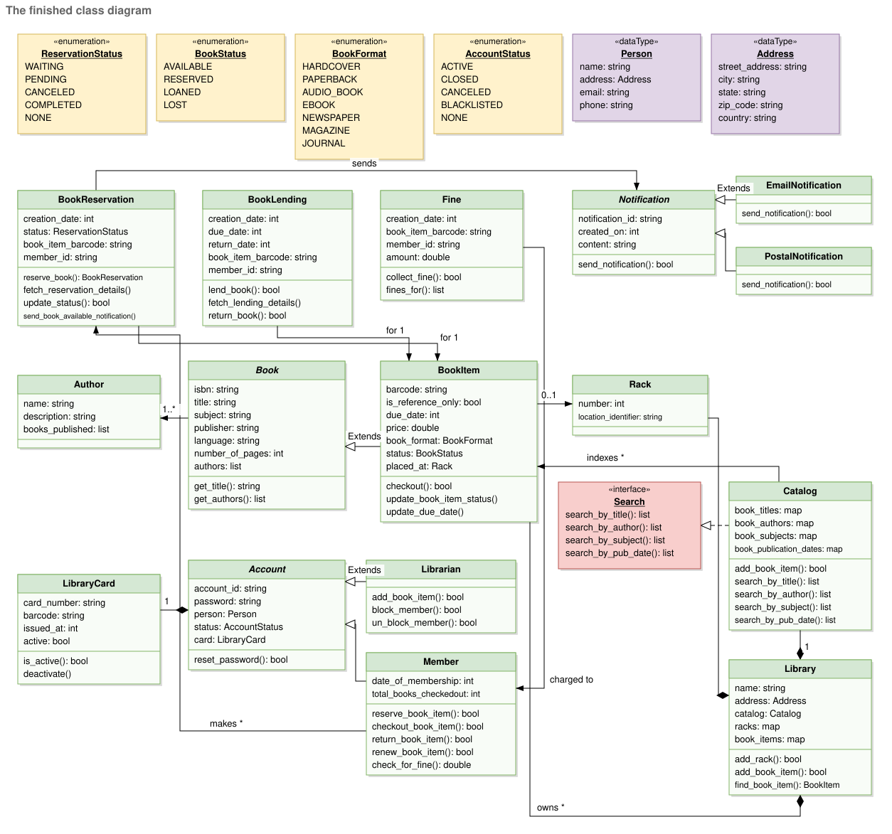
*Figure — The finished library class diagram: every class from the five stages in full colour (course diagram)*

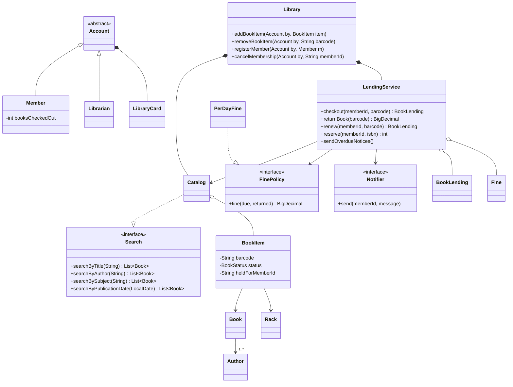

### Key flows

The course's three activity diagrams:

- **Check out:** scan book → can it be issued (not reserved for someone else)? → member under quota? → create the loan, mark "Loaned", increment the member's count, complete this member's reservation.
- **Return:** scan → late? charge fine → decrement count → reserved? notify the first waiting member and mark it held; else make it available.
- **Renew:** scan card and book → charge a fine if already late → someone reserved it? refuse; else new due date.

**Copy state machine:** `AVAILABLE → LOANED` (checkout); `LOANED → AVAILABLE` (return, nobody waiting) or `→ RESERVED` (return, waitlist non-empty); `RESERVED → LOANED` (checkout by the member it is held for); `LOANED → LOST`.

### Design decisions & patterns used

| Decision | Why | Alternative rejected |
|---|---|---|
| **`Book` vs `BookItem`** | Members borrow *copies*; search works on *titles*. Say it early. | One `Book` with a `copies` counter — can't say *which* copy is late or where. |
| **Composition** (`BookItem` has a `Book`) | Many copies share one immutable title; inheritance would duplicate title fields per copy; a title has no barcode, so "copy *is a* title" fails strict substitution. | `BookItem extends Book` (course) — valid for a small model; mention it. |
| **Rules in `LendingService`**, not `Member` | The course itself flags `Member` doing checkout/return/renew as two reasons to change (SRP). | Methods on `Member` (fine for a first sketch). |
| **Reservation = FIFO waitlist per title** | A member wants "a copy of Dune"; any returned copy goes to the first in line. | Per-copy reservation — wait on copy #3 while #1 sits on the shelf. |
| **Strategy for fines** (`FinePolicy`) | Caps, discounts, holidays change. | `if/else` in `returnBook`. |
| **Observer-style `Notifier`** | Lending announces; delivery is someone else's job (course's `Notification` subclasses = same idea). | Emailing from `LendingService`. |
| **Facade** (`Library`) | One entry point; role checks live there. | Exposing catalog and service to the UI. |
| **One index per search** | Every lookup is a map read; cost: a new search adds a map (a single `(field, value)` index would stay one structure). | Scanning all books. |

### Java implementation

Package `lld.ch15.library` (`Model`, `Catalog`, `Support`, `LendingService`, `Library`, `Main`).

```java
/**
 * The three core flows (check out, return, renew) plus reservations.
 * Lives apart from Member so a Member stays "a person", and the rules live in one place.
 *
 * Locking rule (prevents deadlock): always lock the MEMBER first, then the BOOK ITEM.
 */
public final class LendingService {
    static final int MAX_BOOKS_PER_MEMBER = 5;
    static final int MAX_LENDING_DAYS = 10;
    // ...
    BookLending checkout(String memberId, String barcode) {
        Member m = member(memberId);
        BookItem item = catalog.item(barcode);
        synchronized (m) {
            synchronized (item) {
                if (m.status() != AccountStatus.ACTIVE)
                    throw new LibraryException(memberId + " account is " + m.status());
                if (m.booksCheckedOut() >= MAX_BOOKS_PER_MEMBER)
                    throw new LibraryException(memberId + " already has " + MAX_BOOKS_PER_MEMBER + " books");
                switch (item.status()) {
                    case AVAILABLE -> { /* ok */ }
                    case RESERVED -> {
                        if (!memberId.equals(item.heldForMemberId()))
                            throw new LibraryException(barcode + " is held for another member");
                    }
                    case LOANED, LOST -> throw new LibraryException(barcode + " is " + item.status());
                }
                item.markLoaned();
                m.incrementLoans();
                LocalDate today = today();
                BookLending loan = new BookLending(barcode, memberId, today, today.plusDays(MAX_LENDING_DAYS));
                activeLoans.put(barcode, loan);
                removeFromWaitlist(item.book().isbn(), memberId);   // their reservation is now fulfilled
                return loan;
            }
        }
    }
    // ... returnBook(): same lock order, close loan, chargeFineIfLate, handToNextInLine
    /** Caller holds the item's monitor. Give the copy to the first waiting member, or shelve it. */
    private void handToNextInLine(BookItem item) {
        Deque<String> q = waitlist(item.book().isbn());
        String next;
        synchronized (q) { next = q.pollFirst(); }
        if (next == null) { item.markAvailable(); return; }
        item.holdFor(next);
        notifier.send(next, "'" + item.book().title() + "' copy " + item.barcode() + " is held for you");
    }
    // ...
}

/** Strategy: how much a late return costs. Swappable without touching LendingService. */
interface FinePolicy {
    BigDecimal fine(LocalDate dueDate, LocalDate returnDate);
}
```

Full runnable code: code/lld/ch15/library/ (see the Full Edition).

**Output (excerpt):**

```text
  REFUSED: M1 already has 5 books
== 3. 8 members race for the ONLY copy of Dune ==
  winners=1 losers=7 (exactly one copy was lent)
  REFUSED: cannot renew B-DUNE-1: another member reserved this title
  [notify M9] fine of $1.50 for late B-DUNE-1
  [notify M2] 'Dune' copy B-DUNE-1 is held for you
  M4 REFUSED: B-DUNE-1 is held for another member
```

A sixth book is refused; one of eight racing members wins the only copy; renewal is refused while someone waits; a 3-day-late return is fined 3 × $0.50 and the copy is **held** for the first in line. Librarian housekeeping: a copy on loan can't be removed, a member with a book out can't be cancelled, a cancelled member can't borrow.

### Concurrency & edge cases

- **Last copy:** `synchronized (item)` makes "available? → mark loaned" atomic; the 8-thread race always has one winner.
- **Two librarians, one member:** quota check and increment under `synchronized (member)` — never 6 books.
- **Deadlock avoidance:** always **member first, then item** (fixed global order). `returnBook` reads the loan to find the member, then locks in that order and re-checks the loan.
- **Renew vs reserve:** renewal refused if the waitlist is non-empty — checked *before* charging a fine, so no double fine.
- **Known small window:** `reserve` checks "no free copy" then queues in two steps; a copy returned in between goes to the shelf and the *next* return reaches the member. Accepted, because taking the queue lock before copy locks would reverse the order returns use — the recipe for deadlock.
- **Edge cases:** unknown barcode/member, duplicate barcodes, inactive/blacklisted accounts, removing a loaned/held copy, cancelling with books out, reserving a title with a free copy ("just check it out"), joining a waitlist twice (keeps place), returning a book not out.
- **Across servers:** use a conditional update — `UPDATE book_item SET status='LOANED' WHERE barcode=? AND status='AVAILABLE'` and check exactly one row changed.

### Extensions & follow-up questions

- **"Two members reserve at the same moment?"** — The course calls it unguarded; ours appends to a FIFO deque under a lock, so they queue in a definite order.
- **"Where is the available-copies count?"** — Derive it (`availableCopies(isbn)` counts AVAILABLE copies); if slow, cache it and update under the same lock as the status.
- **"How is the fine paid?"** — Add a `PaymentService`; block checkouts while unpaid fines exceed a threshold.
- **"Hold expiry?"** — `heldUntil` on `BookItem` plus a daily job passing it on — the TTL idea of 15.2.
- **"E-books?"** — `EBOOK` items with no rack, a fixed number of concurrent licences.

### Real-world example

**Koha** and **Evergreen** use this model (records + barcoded items, circulation rules, holds queue per title); **Libby** applies the waitlist to e-book licences.

### In the interview

**30–45 minutes:** 3 min clarify (copies, 5 books, 10 days, fines, reservations) → 5 min use cases → 10 min entities, **starting with `Book`/`BookItem`** → 10 min code `checkout`/`returnBook` with lock ordering → 5 min reservation hand-over and fines → follow-ups.

**30-second answer:** "The key split is `Book` (title) vs `BookItem` (a copy with barcode and rack). Members borrow copies; search works on titles via a `Catalog` with one index per search. A `LendingService` enforces 5 books and 10 days, records `BookLending`s, charges fines via a `FinePolicy` strategy, and hands returned copies to a FIFO waitlist per title. Checkout locks member then copy so the last copy can't be double-lent."

### Self-check

- **Q:** Why a fixed lock order? **A:** Otherwise A holds member→waits item while B holds item→waits member: deadlock.
- **Q:** What stops a 6th book with two desks scanning? **A:** Check and increment inside `synchronized (member)`.
- **Q:** When can't a book be renewed? **A:** When another member is waiting for that title.
- **Q:** Which pattern changes fine rules without touching lending? **A:** Strategy (`FinePolicy`).

### TL;DR

Title vs copy. Limits on the member, state on the copy, history in `BookLending`. Rules in a `LendingService`; fines as a Strategy; notifications behind an interface. Lock member-then-copy. Reservations are a FIFO queue per title.

---

## 15.2 Design a Movie Ticket Booking System (BookMyShow)

### Problem & clarifying questions

An online movie booking system (**BookMyShow**, **Fandango**, **AMC**) lets customers find movies, pick a show, choose seats on a map, pay and get a ticket. The classic booking question: a place hierarchy (city → cinema → hall → seat), a time dimension (shows), and a genuine race (two people tapping one seat).

| Question | Answer we assume |
|---|---|
| Venues? | Many cities; several halls per cinema; a hall runs **one show at a time**. |
| Seats? | Several per booking from a seat map; **held 5 minutes** while paying. |
| Payment, refunds? | Card or cash, optional **coupon**; refund up to 2 hours before the show. |
| Users? | Customers, admins, front-desk officers (walk-ins), guests (search only). |

### Requirements

**Functional (course order):** (1) list **cities**; (2) cinemas have **halls**, one show at a time; (3) movies have many **shows**; (4) **search** by title, language, genre, release date, city; (5) show **cinemas and shows** for a movie; (6) **book** a show; (7) **seating plan**, pick several seats; (8) distinguish **available** from booked; (9) **notify** on new movie, booking, cancellation; (10) pay by **card or cash**; (11) **no two customers reserve the same seat**; (12) **discount coupon**.

**Non-functional:** strong seat consistency; high read, bursty write; **hold expiry** (a gap the course names; we implement it); never pay for a seat you don't get.

### Use cases

**Actors:** Admin (add/cancel movies and shows, block customers), FrontDeskOfficer (book/cancel for walk-ins), Customer (view, book, cancel), Guest (search only — must register), System (notifications). **Use cases:** search; create/modify/view booking; pay; apply coupon; assign seats; refund on cancellation within the allowed time. In the course diagram a **Customer is a specialised Guest** — enforced in code because `BookingService` takes a `Customer`.

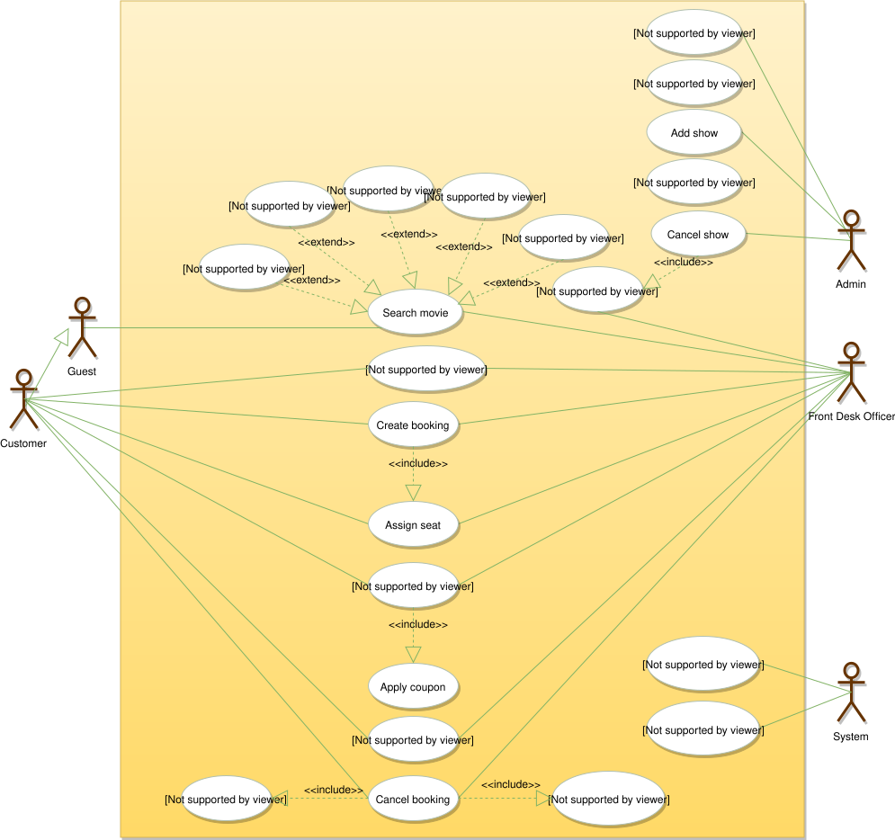
*Figure — Movie booking use cases. The hollow arrow from Customer to Guest says a customer can do everything a guest can; the five "search by" use cases extend "Search movie"; "Create booking" includes "Assign seat"; "Make payment" includes "Apply coupon"; "Cancel booking" includes "Refund payment" and the cancellation notification; the admin's "Cancel show" includes updating/cancelling its bookings (course diagram)*

### Core entities

| Class | Responsibility |
|---|---|
| `City`, `Cinema`, `CinemaHall` | Venue hierarchy; a cinema **owns** halls, refers to its city; a hall refuses an overlapping show. |
| `HallSeat` (record) | The bolted-down seat: id, `SeatType`. **No booking state.** |
| `Movie` (record) | Title, language, genre, release date, duration. |
| `Show` | One screening; **owns one `ShowSeat` per hall seat**. |
| `ShowSeat` | A seat *for this show*: price, `booked`. **This is what gets booked.** |
| `SeatLockProvider` / `InMemorySeatLockProvider` | Expiring, all-or-nothing **holds**; commit; release. |
| `Booking` | Customer, show, seat ids, status (`PENDING`, `CONFIRMED`, `CHECKED_IN`, `CANCELED`, `ABANDONED`), payment, coupon. |
| `BookingService` | hold → pay → commit; cancel; seat map. |
| `Payment`, `PaymentMethod` (`CardPayment`, `CashPayment`), `PaymentGateway` | Money; the gateway is the boundary to the provider. |
| `Coupon` | Percent off the booking amount before payment. |
| `CancellationPolicy` / `CutoffRefundPolicy` | Refund on cancel (Strategy). |
| `MovieSearch` / `Catalog` | Five searches; "by city" comes from shows. |
| `Customer`, `Guest`, `FrontDeskOfficer`, `Admin`; `Notifier` | Actors (`Guest` can't book); messages. |

### Class diagram

Six course stages: (1) city, cinema, hall, physical seat; (2) movie, show, **show seat** — **where the design succeeds or fails**: one physical seat is free at 3 pm and sold at 9 pm, so you reserve a `ShowSeat` (which also allows per-show prices); (3) coupon, payment types, notification types — the coupon reduces **the booking's amount**, not the payment; (4) `Booking` and `BookingService` — one seat never goes to two customers; (5) search interface and catalog; (6) people — booking restricted to customers.

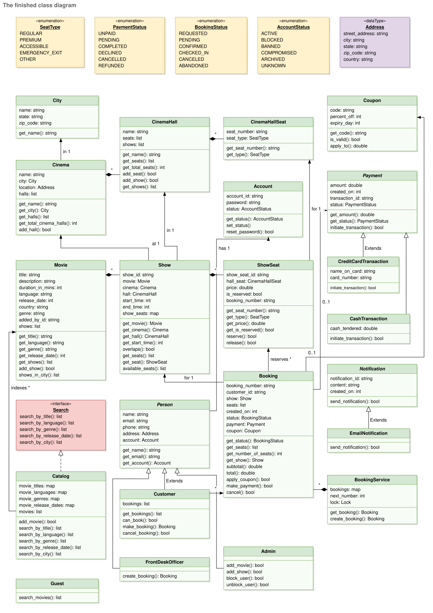
*Figure — The finished movie booking class diagram (course diagram)*

Our main difference from the course: a separate `SeatLockProvider` with **TTL holds** (the course's biggest self-named omission).

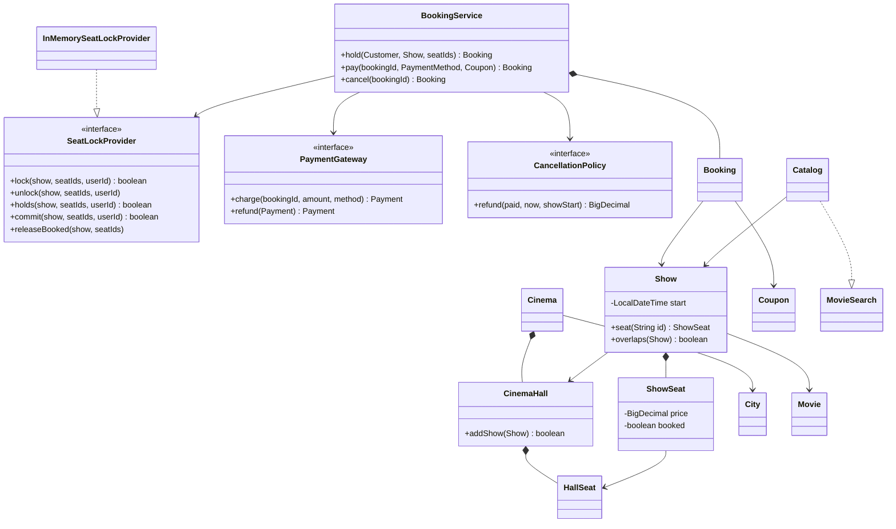

### Key flows

The course's activity diagrams cover **make a booking** and **cancel a booking** (refund only within the allowed time). The heart is **hold → pay → commit**:

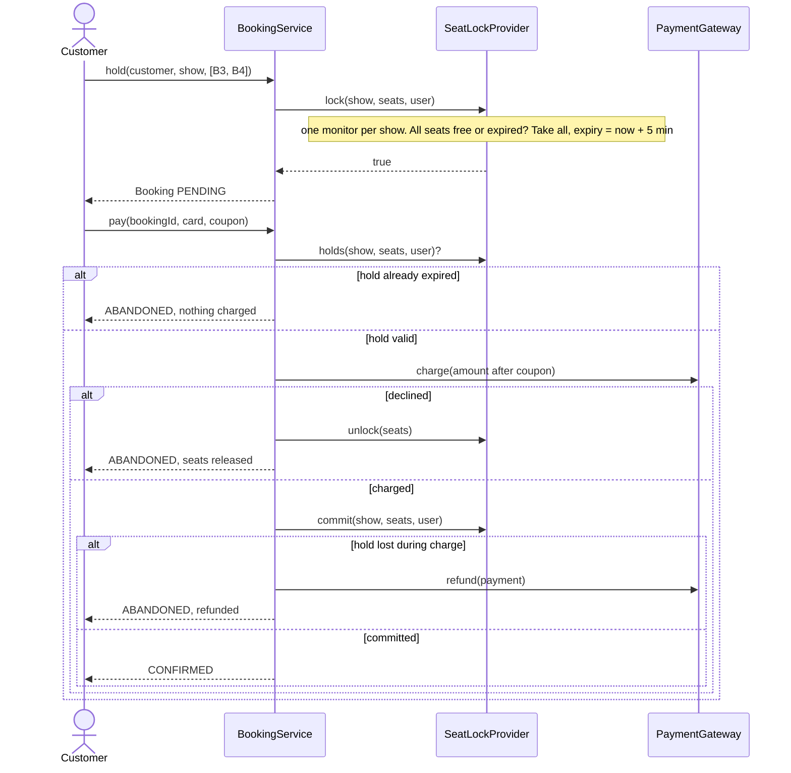

**Why `commit` re-checks inside the lock:** payment can take seconds; if the hold expires and someone else grabs the seat, a naive "mark booked" double-books. `commit` verifies "still held by me, not expired" **and** marks booked atomically. If that fails after money was taken, run a **compensating action** (refund) — a card charge can't be rolled back. This is the **Saga** idea: each step has an undo.

**Booking lifecycle:** `PENDING → CONFIRMED` (paid and committed) `→ CHECKED_IN` (scanned) or `→ CANCELED` (refund per policy); `PENDING → ABANDONED` (expired, declined, or lost and refunded) or `→ CANCELED`. On the seat map a seat is free (`.`), **held** (`L`) or booked (`X`); "held" lives only in the lock provider and disappears on expiry.

### Design decisions & patterns used

| Decision | Why | Alternative rejected |
|---|---|---|
| **`ShowSeat` per show** | Same physical seat free in one show, taken in another; per-show prices. | Booking `HallSeat` — breaks with two shows a day. |
| **`SeatLockProvider` with TTL holds** | Abandoned checkouts free themselves; swap in **Redis** (`SET key value NX PX 300000`) or a DB `expires_at` column. | Holding until cancel (course's gap). |
| **All-or-nothing lock** | 4 seats together, never 2: check all, then take all. | Locking one by one without rollback. |
| **One monitor per show** | Shows never block each other; within a show every decision is serialized. | One global lock (course) — correct but serializes the country. |
| **Commit re-validates + compensation** | Never pay for a seat you don't get. | Trusting the earlier check. |
| **Idempotent `pay`** | Double-click/retry can't charge twice: non-PENDING returns unchanged. Real systems add an **idempotency key**. | Charging on every call. |
| **Strategy** refunds, **Strategy-like** `PaymentMethod` | Rules and payment types vary independently. | `if (method == CARD)`. |
| **Adapter** `PaymentGateway` | Wraps Stripe/Razorpay; tests use `FakeGateway`. | Provider SDK in `BookingService`. |
| **Coupon on the booking** | Amount correct before payment. | Each payment type applying coupons. |
| **Guest has no booking method** | "Register to book" enforced by *types*: `hold` takes a `Customer`. | `Guest.book()` that throws. |
| **"Search by city" from shows** | A movie is in a city only when a show is scheduled there. | A city on `Movie`. |

### Java implementation

Package `lld.ch15.moviebooking` (`Venue`, `SeatLockProvider`, `Payments`, `Catalog`, `BookingService`, `Main`).

```java
final class InMemorySeatLockProvider implements SeatLockProvider {
    // ...
    @Override public boolean lock(Show show, List<String> seatIds, String userId) {
        Map<String, SeatLock> t = table(show);
        synchronized (t) {
            Instant now = clock.instant();
            for (String id : seatIds) {                         // 1. check every seat first
                if (show.seat(id).isBooked()) return false;
                SeatLock l = t.get(id);
                if (l != null && !l.expired(now) && !l.userId().equals(userId)) return false;
            }
            SeatLock mine = new SeatLock(userId, now.plus(ttl));
            for (String id : seatIds) t.put(id, mine);           // 2. then take them all
            return true;
        }
    }
    // ...
    @Override public boolean commit(Show show, List<String> seatIds, String userId) {
        Map<String, SeatLock> t = table(show);
        synchronized (t) {
            if (!holdsLocked(t, seatIds, userId, clock.instant())) return false;
            for (String id : seatIds) { show.seat(id).setBooked(true); t.remove(id); }
            return true;
        }
    }
    // ...
}

final class BookingService {
    // ...
    Booking pay(String bookingId, PaymentMethod method, Coupon coupon) {
        Booking b = get(bookingId);
        synchronized (b) {
            if (b.status() != BookingStatus.PENDING) return b;
            if (!locks.holds(b.show(), b.seatIds(), b.customerId())) {       // fast fail, no charge
                b.setStatus(BookingStatus.ABANDONED);
                notifier.send(b.customerId(), b.id() + " hold expired before payment, nothing charged");
                return b;
            }
            b.setCoupon(coupon);
            BigDecimal amount = coupon == null ? b.baseAmount() : coupon.apply(b.baseAmount());
            Payment p = gateway.charge(b.id(), amount, method);
            b.setPayment(p);
            if (p.status() != PaymentStatus.COMPLETED) {
                locks.unlock(b.show(), b.seatIds(), b.customerId());           // free seats at once
                b.setStatus(BookingStatus.ABANDONED);
                notifier.send(b.customerId(), b.id() + " payment " + p.status() + ", seats released");
                return b;
            }
            if (!locks.commit(b.show(), b.seatIds(), b.customerId())) {       // hold lost during charge
                b.setPayment(gateway.refund(p));                              // COMPENSATION
                b.setStatus(BookingStatus.ABANDONED);
                notifier.send(b.customerId(), b.id() + " hold expired during payment, " + Money.fmt(amount) + " refunded");
                return b;
            }
            b.setStatus(BookingStatus.CONFIRMED);
            // ... notify CONFIRMED
            return b;
        }
    }
    // ...
}
```

Full runnable code: code/lld/ch15/moviebooking/ (see the Full Edition).

**Output (excerpt):**

```text
  add SH2 RRR 19:00 same hall -> false
== 3. 10 customers click B3+B4 at the same instant ==
  holds granted = 1 (the other 9 saw 'not available')
  paying twice is harmless -> CONFIRMED
  [notify ASHA] BK-2 hold expired before payment, nothing charged
  [notify MEENA] BK-4 hold expired during payment, Rs.200.00 refunded
  [notify NEHA] BK-6 payment DECLINED, seats released
```

The 10% coupon turns Rs.700 into Rs.630; an overlapping show in the same hall is refused; Meena's hold expired while the bank was charging and Kiran took the seat, so she is refunded.

### Concurrency & edge cases

- **Atomic check-then-act:** `lock`, `holds`, `commit`, `unlock`, `releaseBooked` for one show all run `synchronized` on that show's lock table.
- **Lazy expiry:** no background thread; an expired `SeatLock` is treated as absent the next time anyone looks (Redis TTL does the same).
- **Payment-window race:** commit re-validation + refund.
- **Lock order:** booking monitor (serialises `pay`/`cancel` — no double charge, no pay-while-cancel) → show monitor, never reversed.
- **Across many servers**, from simplest: (1) **conditional update** (course): `UPDATE show_seat SET status='HELD', held_by=?, held_until=? WHERE show_id=? AND seat_id IN (...) AND (status='FREE' OR held_until < now())`, check the row count; (2) **pessimistic** `SELECT ... FOR UPDATE`; (3) **serializable** transaction (course) — simplest to reason about, slowest under collision; (4) **optimistic** `version` column, retry on conflict (rare conflicts); (5) **unique constraint** on `(show_id, seat_id)` as the final net; (6) **Redis TTL** keys for holds, DB as truth for confirmed seats. The in-process lock only makes the common case quick; with two servers, correctness comes from the database.
- **Edge cases:** empty or duplicate seat ids (de-duplicated), unknown seat, blocked customer, overlapping show, cancelling an abandoned booking, cancelling too late (no refund).

### Extensions & follow-up questions

- **Live seat map** → push seat events over WebSockets/SSE (Observer). **Extend the hold** → refresh `expiresAt` only if still held. **Dynamic pricing** → a `PricingStrategy`.
- **Paid but crashed before commit** → store PENDING with the gateway transaction id first; a reconciliation job (plus provider **webhooks**) commits or refunds.
- **Cancel a whole show** → cancel and fully refund every confirmed booking of that show.
- **Seat-gap rule** → a `SeatSelectionRule` chain (Chain of Responsibility) before locking; loyalty points → another `PaymentMethod`.

### Real-world example

**BookMyShow**'s payment-screen **countdown timer** is the hold's TTL; its **automatic refund** when the bank debits but booking fails is the compensation path.

### In the interview

**30–45 minutes:** 4 min requirements (hold time, payment, refunds) → 4 min actors → 8 min entities, saying **why `ShowSeat`** → 12 min `SeatLockProvider` (`lock`, `commit`) and `BookingService.hold/pay/cancel` → 5 min payment failure and refund → multi-server concurrency.

**30-second answer:** "City → Cinema → Hall → HallSeat. A Show owns a ShowSeat per hall seat — that's what's booked. Booking is hold → pay → commit: a SeatLockProvider takes all requested seats atomically with a 5-minute TTL; payment goes through a gateway interface; commit re-checks the hold and marks seats booked atomically, refunding if the hold was lost. In one process a per-show monitor prevents double booking; across servers a conditional update or unique constraint is the real guarantee, with Redis TTL keys for holds."

**Follow-ups:** *Why TTL?* Otherwise abandoned checkouts block seats forever. *Optimistic or pessimistic?* Pessimistic/conditional update for hot shows; optimistic when conflicts are rare.

### Self-check

- **Q:** Why is `ShowSeat` separate from `HallSeat`? **A:** State and price are per show; the physical seat is shared by every show.
- **Q:** Payment succeeded but `commit` returned false? **A:** Refund (compensation), mark abandoned.
- **Q:** How are expired holds cleaned up? **A:** Lazily — any check treats an expired lock as absent.
- **Q:** What makes `pay` safe to call twice? **A:** It runs under the booking's monitor and returns immediately unless PENDING.

### TL;DR

Book `ShowSeat`s. Hold (all-or-nothing, TTL) → pay → commit (re-validate atomically) → refund if lost. Coupon on the booking, gateway behind an interface, refund rule as a Strategy. Per-show lock in one JVM; conditional updates, unique constraints and Redis TTL across servers.

---

## 15.3 Design a Concert Ticket Booking System

### Problem & clarifying questions

Concert ticketing (**Ticketmaster**, **Live Nation**, **SeatGeek**) has the same objects as 15.2 — we reuse them — but a different enemy: **extreme contention**. A stadium sells 50,000 tickets in minutes to a million people arriving at 10:00:00. That changes three things: (1) **fairness** — who tries first (a *virtual waiting room*); (2) **throughput** — locks that serialise everyone become the bottleneck (use *lock-free* CAS); (3) **abuse** — scalpers and bots (*per-user limits*) and fans who miss out (*waitlist*).

| Question | Answer we assume |
|---|---|
| Seat types? | **VIP** and **PREMIUM** numbered seats; **GENERAL_ADMISSION** (GA) standing = a *count*. |
| Search? | By artist, venue, date, time (as 15.2). |
| Stampede? | **Virtual waiting room**: queue numbers, batches admitted in order. |
| Limit? | **4 tickets** per user per concert. |
| Hold time? | **10 minutes**. |
| Sold out? | Per-tier **waitlist**; released tickets offered to it first. |
| Notifications? | Confirmation; "a ticket freed up for you". |

### Requirements

**Functional:** show concerts with layout and availability; search; choose seats or a GA quantity and buy; **prevent double booking** under concurrency; **fair access**; secure payments; confirmations; **waitlist** for sold-out events.

**Non-functional:** extreme write contention; **no overselling** ever; FCFS fairness; per-user caps; self-expiring holds.

### Use cases

**Actors:** Fan (join queue, hold, buy, cancel, join waitlist), Organizer/Admin (create concert, tiers, prices, open sale), System (admit batches, expire holds, offer released tickets, notify), Payment provider. **Flow:** join waiting room → admitted → **hold** → **purchase** → tickets; cancel (refund); join waitlist; system **reaps** expired holds.

### Core entities

| Class | Responsibility |
|---|---|
| `Concert` (record) | Artist, venue, date/time. |
| `Tier` (enum) | `VIP`, `PREMIUM` (seated), `GENERAL_ADMISSION` (unseated), each with a price. |
| `SeatState` (sealed) → `Free`, `Held`, `Sold` | A seat's whole state as one immutable value. |
| `SeatedInventory` | One `AtomicReference<SeatState>` per seat; claims by **CAS**. |
| `GaPool` | GA capacity as an `AtomicInteger`; CAS take/give back. |
| `Hold` (record) | Seats or GA quantity, amount, expiry. |
| `Ticket` (record) | Tier and seat id or "GA". |
| `VirtualWaitingRoom` | Arrival-order numbers; admits FIFO batches. |
| `PurchaseLimiter` | Max N per user, atomic check-and-update. |
| `TicketingService` | hold → purchase → cancel; reaper; waitlist offers. |
| `PaymentGateway`, `Notifier` | External boundaries (as 15.2). |

### Class diagram

No course lesson here; the problem comes from the *awesome-low-level-design* set. Our design:

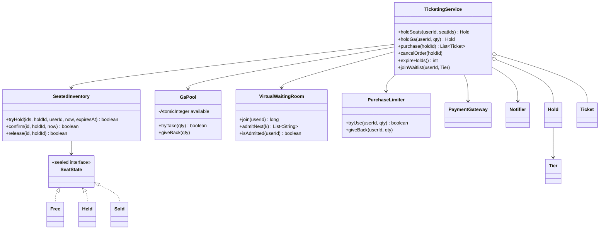

### Key flows

**Buying:** fan joins the room (gets e.g. number 41,207; the system calls `admitNext(batch)` every few seconds) → `holdSeats`: is admitted? → `limiter.tryUse` → CAS each seat Free → Held in **sorted order**; if any CAS fails, roll back own Held seats and give back the limit (`SoldOutException`) → `purchase`: remove the hold from the active map (claims it once) → charge → CAS each seat Held → Sold → tickets.

**Seat state machine — every arrow is one `compareAndSet`:**

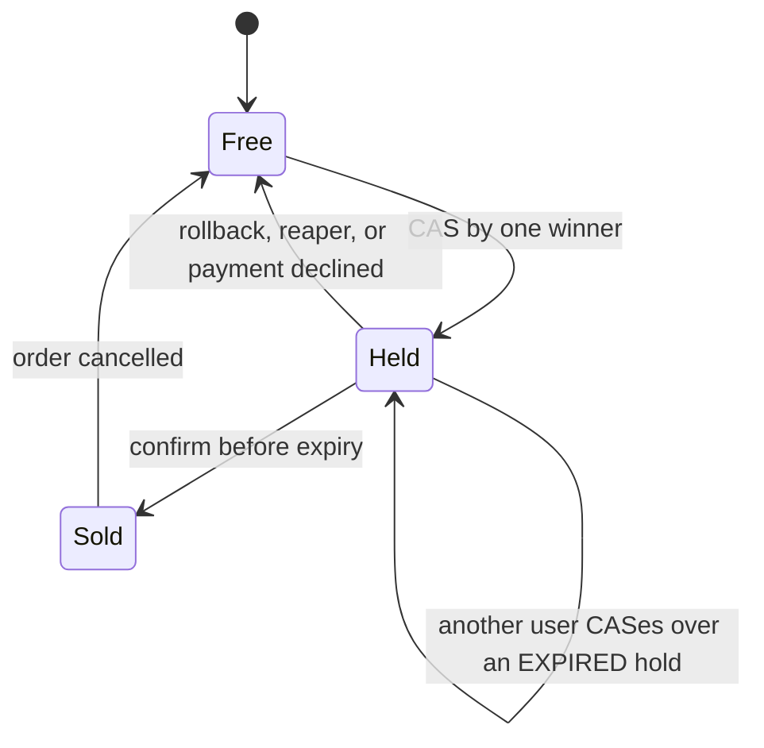

Released inventory (expired hold, cancellation) is **offered to the tier's waitlist first**: the next fan is admitted directly and given a fresh hold plus a notification; if unpaid, the reaper releases it to the next.

### Design decisions & patterns used

| Decision | Why | Alternative rejected |
|---|---|---|
| **Lock-free CAS per seat** | Different seats never wait; on one seat exactly one CAS wins, losers learn instantly; no thread blocks holding a lock, so no deadlock. | One monitor per concert (15.2) — at 50,000 buyers everyone queues on one lock. |
| **Immutable sealed `SeatState`** | CAS compares *references*; a fresh record per state means "what I read" is exactly "what I replace"; exhaustive pattern matching. | Mutable `status`/`heldBy`/`expiry` fields — readers see half-updated seats. |
| **Sorted multi-seat hold + rollback** | Release only seats *we* took; sorted order makes overlapping buyers contend on the same first seat, so one fails fast. | Nested locks — deadlock-prone. |
| **GA as a counter** | Standing places are interchangeable; CAS loop (`if cur < qty fail; else CAS(cur, cur-qty)`) never oversells. | 40,000 `Seat` objects. |
| **Virtual waiting room** | Arrival order decides who may *try*; batches cap load; bots gain nothing. `join` is `synchronized` so number order = queue order. | "Whoever lands first" — rewards bots, melts the backend. |
| **Per-user limit via `ConcurrentHashMap.compute`** | Check-and-update for one key atomically. | `get` then `put` — a race. |
| **TTL holds + reaper** | Seats reclaimed lazily (CAS over expired `Held`); GA holds need `expireHolds()`. `holds.remove(id, h)` ensures reaper and `purchase` never both process a hold. | Holds that never expire. |
| **Waitlist offers on release** | Longest-waiting fan (FIFO), not fastest refresher. | Silent return to the pool. |
| **Compensation on lost hold** | As 15.2: release and refund. | Assuming the hold is valid. |
| **No Singleton** | The *awesome-lld* reference uses one; DI is testable and allows one service per concert. | Global Singleton. |

### Java implementation

Package `lld.ch15.concert` (`Model`, `Inventory`, `TicketingService`, `Main`). Demos use Java 21 **virtual threads** (`Executors.newVirtualThreadPerTaskExecutor()`), making 1,000 concurrent buyers cheap.

```java
/** A seat's whole life in one immutable value, swapped atomically with compare-and-set (CAS). */
sealed interface SeatState permits Free, Held, Sold {}
record Free() implements SeatState {}
record Held(String holdId, String userId, Instant expiresAt) implements SeatState {
    boolean expired(Instant now) { return !now.isBefore(expiresAt); }
}
record Sold(String holdId, String userId) implements SeatState {}

final class SeatedInventory {
    // ...
    private boolean tryHoldOne(String id, String holdId, String userId, Instant now, Instant expiresAt) {
        AtomicReference<SeatState> ref = seats.get(id);
        if (ref == null) throw new IllegalArgumentException("no seat " + id);
        while (true) {
            SeatState cur = ref.get();
            boolean claimable = cur instanceof Free || (cur instanceof Held h && h.expired(now));
            if (!claimable) return false;
            if (ref.compareAndSet(cur, new Held(holdId, userId, expiresAt))) return true;
            // CAS lost: someone changed the seat between get() and CAS. Re-read and decide again.
        }
    }
    // ...
}

/** General admission: no seat numbers, just a counter. A CAS loop means it can never go below zero. */
final class GaPool {
    // ...
    boolean tryTake(int qty) {
        while (true) {
            int cur = available.get();
            if (cur < qty) return false;
            if (available.compareAndSet(cur, cur - qty)) return true;
        }
    }
    // ...
}

final class PurchaseLimiter {
    // ...
    boolean tryUse(String userId, int qty) {
        boolean[] ok = {false};
        used.compute(userId, (u, cur) -> {
            int c = cur == null ? 0 : cur;
            if (c + qty > max) return cur;             // unchanged
            ok[0] = true;
            return c + qty;
        });
        return ok[0];
    }
    // ...
}

final class TicketingService {
    // ...
    List<Ticket> purchase(String holdId) {
        Hold h = holds.remove(holdId);                    // atomic claim: a hold is purchased at most once
        if (h == null) throw new IllegalStateException(holdId + " unknown, expired or already used");
        // ... expired / declined -> releaseInventory(h); then CAS each seat Held -> Sold, refund if lost
    }
    // ...
}
```

Full runnable code: code/lld/ch15/concert/ (see the Full Edition).

**Output (excerpt):**

```text
  REFUSED: eli is still in the waiting room
  holds on VIP-1 = 1
  sold=98 soldOut=902 gaLeft=0 (never negative)
  REFUSED: ben would exceed the per-user ticket limit
  [notify cai] a GA ticket freed up, held for you as H244 until 2026-06-01T09:10:00Z
  expired holds reaped = 3 (VIP-1, cai's unpaid offer, dev's P-6)
```

40 concurrent CAS attempts on one seat → exactly one hold; 1,000 buyers for 98 GA places sell exactly 98; a cancellation goes straight to the waitlisted fan as a hold; money collected 85,900.00 = 98 × 800 + 3 × 2,500.

### Concurrency & edge cases

- **Why CAS is correct:** `compareAndSet(expected, new)` replaces only if the value is still the object we read; otherwise re-read and decide. `tryHoldOne` retries only while the seat is still claimable.
- **ABA problem** (A → B → A fooling a CAS)? Every transition creates a *new* record and `AtomicReference` compares references, so a returned "A" is a different object — the CAS fails safely.
- **Hold claimed once:** `purchase` does `holds.remove(holdId)`, the reaper `holds.remove(id, h)` — only one wins.
- **Limit given back** on every failure path (sold out, declined, expired, lost seat).
- **Lost hold after payment:** `confirm` fails → release, give back limit, refund.
- **Fair queue scope:** fair within one process; at scale the waiting room is a separate service (often at the CDN edge) issuing signed, time-limited access tokens.
- **Across servers:** seat CAS → `UPDATE seat SET state='HELD', hold_id=?, expires_at=? WHERE id=? AND (state='FREE' OR expires_at < now())` or Redis `SET NX PX`; GA → Redis `DECRBY` in a Lua script, or `WHERE available >= ?`.

### Extensions & follow-up questions

- **Best available seats** → a `SeatAllocator` strategy picks adjacent free seats, then the same CAS hold.
- **Verified fans / presale codes** → admission tokens for pre-registered fans; limiter keyed on verified identity.
- **Dynamic pricing** → a `PricingStrategy` using remaining inventory and time, frozen in the `Hold`.
- **Resale** → transfer ownership and re-issue a new barcode.
- **Waitlist for seated tiers** → same mechanism per released seat (`offerSeat`).

### Real-world example

**Ticketmaster** uses a virtual queue ("Smart Queue"), **Verified Fan** presales and per-account limits. The 2022 *Eras Tour* presale overwhelmed the system and the general sale was cancelled — admission control matters as much as seat locking.

### In the interview

**30–45 minutes:** say "entities like movie booking; the hard part is contention and fairness" → tiers (why GA is a counter) → TTL holds; code the seat CAS and GA CAS loop → waiting room and atomic per-user limit → waitlist and reaper → scale-out (tokens, conditional updates/Redis).

**30-second answer:** "Seated tiers are an `AtomicReference<SeatState>` per seat claimed by CAS — one winner, no locks. GA is an `AtomicInteger` decremented by a CAS loop, never negative. Everyone enters through a virtual waiting room admitting in arrival order, with an atomic per-user limit. Holds expire after 10 minutes, a reaper returns them, and released tickets go to a FIFO waitlist first. A hold lost during payment is refunded."

**Follow-ups:** *Lock-free vs locks?* Lock-free wins under high contention with tiny critical sections; locks are simpler when many things change together. *Queue service fails?* Fail closed — pause admissions. *One person, 50 accounts?* Verified identity, card fingerprinting, limits on those.

### Self-check

- **Q:** Why is GA a counter? **A:** Places are interchangeable; a CAS counter is simpler and can't oversell.
- **Q:** What does `compareAndSet` guarantee? **A:** Update only if the value is still the one you read.
- **Q:** Why must `join` be synchronized? **A:** So number and queue position are assigned together, in the same order.
- **Q:** How can't a hold be both purchased and reaped? **A:** Both remove it from `holds` first; only one removal succeeds.

### TL;DR

Same nouns as movie booking, different enemy: contention. CAS per seat, CAS counter for GA, FIFO virtual waiting room, atomic per-user limits, TTL holds with a reaper, waitlist first for released tickets, refunds when a hold is lost.

---

## 15.4 Design a Hotel Management System

### Problem & clarifying questions

A **Hotel Management System** (property management system, PMS) knows every room, takes bookings, checks guests in and out, issues key cards, records housekeeping and room service, and produces the bill. Unlike a cinema, a room is sold **night by night** — that shapes the whole design.

| Question | Answer we assume |
|---|---|
| Locations, types, search? | Many `HotelLocation`s; `STANDARD`, `DELUXE`, `FAMILY_SUITE`, `BUSINESS_SUITE`; search by type and **date range**. |
| Cancellation? | **Full refund if more than 24 h before check-in**; otherwise none (our assumption). |
| Extras? | Room service, kitchen, amenities on the bill. |
| Payment? | **Card, check or cash**. |
| Keys? | Electronic cards with barcode and key id; deactivated at check-out. |
| Housekeeping? | Logged per room, never overwritten. |
| Several rooms per booking? | No — one room (a known limitation). |

### Requirements

**Functional (course):** (1) book **room types**; (2) **search** and book any **available** room; (3) **who booked a room** / **which rooms a customer booked**; (4) **cancel**, full refund > 24 h before check-in; (5) **notify** before check-in and check-out; (6) **housekeeping log**; (7) **room service and food**; (8) **amenities**; (9) pay by **card, check or cash**.

**Non-functional:** never double-book a room-night; bill = sum of lines; actors limited to their jobs; refund rule in one place.

### Use cases

**Actors (course):** Guest (search, book), Receptionist (rooms, bookings, check in/out), System (notifications), Manager (hires workers), Housekeeper (housekeeping records), Server (room-service records). **Top use cases:** manage rooms; search; register/cancel account; book; **check in**; **check out** (return keys); add room charge; update housekeeping.

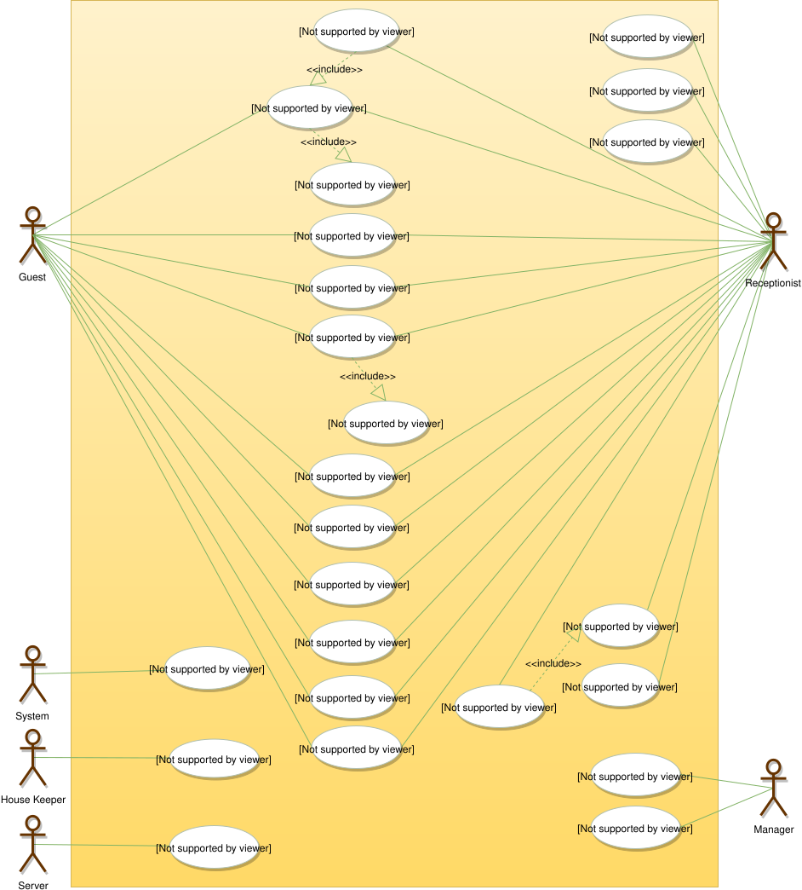
*Figure — Hotel use cases: Guest and Receptionist share booking, update, cancel, view, print and search; "Make booking" includes "Book room", which includes "Make payment"; "Cancel booking" includes "Refund payment"; the receptionist's "Check-in guest" includes "Issue room key"; the System sends booking notifications; the House Keeper adds/updates housekeeping; a manager adds/modifies employees (course diagram)*

### Core entities

| Class | Responsibility |
|---|---|
| `Hotel` | Owns locations; searches each. |
| `HotelLocation` implements `Search` | Owns rooms; "which rooms of this type are free for these dates?". |
| `Room` | Number, style, price; the **set of booked nights**; owns keys and housekeeping log; current `RoomStatus`. |
| `RoomStyle`, `RoomStatus` | Type; what it is doing *now* (`AVAILABLE`, `RESERVED`, `OCCUPIED`, `NOT_AVAILABLE`, `BEING_SERVICED`, `OTHER`). |
| `RoomKey` | Key id, barcode, issue time, master, active. |
| `RoomHouseKeeping` (record) | When, who, what, how long. |
| `RoomBooking` | Reservation number, guest id, room, dates, status, deposit; **owns its `Invoice`**; `refundDue()`. |
| `BookingStatus` | `REQUESTED`, `PENDING`, `CONFIRMED`, `CHECKED_IN`, `CHECKED_OUT`, `CANCELLED`, `ABANDONED`. |
| `Invoice`, `InvoiceItem` | Lines; total computed. |
| `RoomCharge` → `Amenity`, `RoomService`, `KitchenService` | Writes itself onto the invoice (Template Method). |
| `Payment` (sealed) → `CreditCardTransaction`, `CheckTransaction`, `CashTransaction` | Three genuinely different behaviours. |
| `Person` (sealed) → `Guest`, `Receptionist`, `Server`, `Housekeeper`, `Manager` | Actors; methods accept only the right type. |
| `FrontDesk` | Book, check in, add charge, check out, cancel, housekeeping, reminders, queries. |
| `Notifier` | Messages to guests. |

### Class diagram

Five course stages: (1) **invoice, payments, notifications** — the invoice stores **lines** and computes its total, so it can't drift from them (req. 7, 8); (2) **room, keys, housekeeping** — the key decision: **a status field is not availability** — `OCCUPIED` describes now, but guests ask about future date ranges, so each room stores its sold nights; (3) **hotel, location, search** — search sits on the **location** (a room can't list other free rooms; `Room.search()` is a common beginner mistake); (4) **booking and room charges**; (5) **people** — there is deliberately **no arrow guest ↔ booking**: the booking stores the guest's **id**, and queries filter by it.

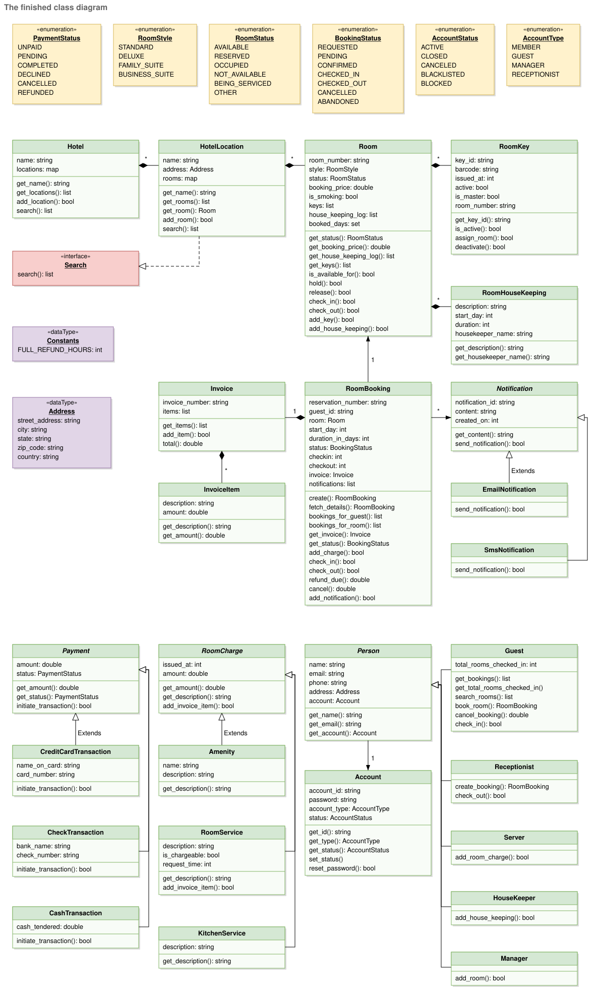
*Figure — The finished hotel class diagram (course diagram)*

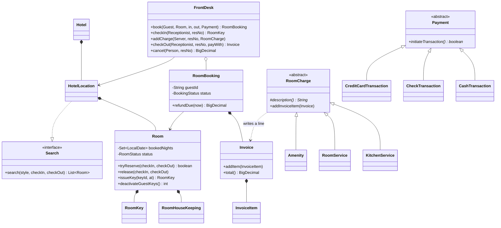

### Key flows

The course's activity diagrams: **make a booking** (search type and dates → none: tell customer; else find/register customer, book, pay, deliver details), **check in** (find booking; room not ready → wait; else issue key, status "Checked-in"), **cancel** (find booking; before the deadline → refund, else none; print/email).

**A whole stay:** guest `book(room 102, Jul 10–13, deposit)` → `tryReserve` under the room monitor (nights 10, 11, 12 taken) → CONFIRMED → receptionist `checkIn` (room OCCUPIED, key issued) → server `addCharge(KitchenService)` writes an invoice line → `checkOut(pay by card)` adds the nights line and subtracts the deposit, deactivates keys, room BEING_SERVICED → invoice total = sum of lines.

**Booking lifecycle:** `CONFIRMED → CHECKED_IN → CHECKED_OUT`, or `CONFIRMED → CANCELLED` (refund if > 24 h ahead). The room's own status cycles independently: `AVAILABLE → OCCUPIED → BEING_SERVICED → AVAILABLE` (after housekeeping).

### Design decisions & patterns used

| Decision | Why | Alternative rejected |
|---|---|---|
| **Availability = set of booked nights** | Answers date ranges; nights are half-open `[checkIn, checkOut)`, so leaving and arriving on the 13th don't clash. | `RoomStatus` — only knows now. |
| **`tryReserve` `synchronized` on the room** | Check-then-act made atomic; rooms don't block each other. | Hotel-wide lock. |
| **Search on `HotelLocation`** | A room can't answer "which rooms are free?". | `Room.search()`. |
| **Invoice = lines, total computed** | Total can't disagree with lines. | Stored running total. |
| **Template Method** `RoomCharge.addInvoiceItem` | `final` parent algorithm (describe → price → write line); subclasses supply only `description()`; new charge = new subclass (OCP). The course calls it its clearest Template Method; Strategy swaps a *whole* method instead. | `switch` on charge type in the invoice. |
| **Three `Payment` subclasses** | Card completes at once; **check stays `PENDING`**; cash declines if short. Each passes LSP. | One `Payment` with a `type` field. |
| **Refund rule in one method** (`refundDue`) | One place to edit; promote to a `CancellationPolicy` strategy (15.2) for several policies. | Scattered refund arithmetic. |
| **Actor types in signatures** | `addCharge(Server, …)`, `logHousekeeping(Housekeeper, …)`, `addRoom(Manager, …)` — compiler-enforced roles; a receptionist booking for a guest calls the *same* method. | Anyone calls anything. |
| **Booking stores guest id** | No two-way dependency; "rooms of this guest" is a query. | Bidirectional links. |
| **Nights released on failed deposit / cancel** | Reserve-then-pay needs an undo. | Phantom reservations. |

### Java implementation

Package `lld.ch15.hotel` (`Billing`, `Rooms`, `Stay`, `Main`).

```java
final class Room {
    // ...
    /** Nights are [checkIn, checkOut): the checkout day itself is free for the next guest. */
    synchronized boolean isFree(LocalDate checkIn, LocalDate checkOut) {
        for (LocalDate d = checkIn; d.isBefore(checkOut); d = d.plusDays(1)) if (bookedNights.contains(d)) return false;
        return true;
    }
    synchronized boolean tryReserve(LocalDate checkIn, LocalDate checkOut) {
        if (!isFree(checkIn, checkOut)) return false;              // re-entrant monitor: same lock
        for (LocalDate d = checkIn; d.isBefore(checkOut); d = d.plusDays(1)) bookedNights.add(d);
        return true;
    }
    // ...
}

abstract class RoomCharge {
    private final BigDecimal amount;
    RoomCharge(BigDecimal amount) { this.amount = amount; }
    protected abstract String description();                 // the one step that varies
    final void addInvoiceItem(Invoice invoice) {             // the template: final, so the order can't change
        invoice.addItem(new InvoiceItem(description(), amount));
    }
}

final class RoomBooking {
    // ...
    /** The refund rule lives in exactly ONE method: full refund if cancelled more than 24h before check-in. */
    BigDecimal refundDue(LocalDateTime now) {
        Duration notice = Duration.between(now, checkIn.atTime(CHECK_IN_TIME));
        // compareTo, not toHours(): toHours() truncates, so 24h30m would wrongly count as "24, not more than 24".
        return notice.compareTo(FULL_REFUND_NOTICE) > 0 ? deposit() : BigDecimal.ZERO;
    }
}

final class FrontDesk {
    // ...
    /** Guest or receptionist books: same call, two actors. The room's monitor makes it race-free. */
    RoomBooking book(Guest guest, Room room, LocalDate checkIn, LocalDate checkOut, Payment deposit) {
        if (!checkIn.isBefore(checkOut)) throw new IllegalArgumentException("check-out must be after check-in");
        if (!room.tryReserve(checkIn, checkOut))
            throw new IllegalStateException("room " + room.number() + " is not free " + checkIn + ".." + checkOut);
        RoomBooking b = new RoomBooking("R" + seq.incrementAndGet(), guest.id(), room, checkIn, checkOut);
        if (!deposit.initiateTransaction()) {                  // payment failed: give the nights back
            room.release(checkIn, checkOut);
            throw new IllegalStateException("deposit " + deposit.status());
        }
        // ... store booking, notify
    }
    // ...
}
```

Full runnable code: code/lld/ch15/hotel/ (see the Full Edition).

**Output (excerpt):**

```text
  successful bookings = 1 of 6
  [notify BEN] R3 confirmed: room 102 2026-07-13..2026-07-15
  [notify CARL] R5 cancelled by Carl, refund $0.00
  [notify ASHA] R4 cancelled by Asha, refund $250.00
  cash short: payment DECLINED, guest still checked in
    TOTAL                           $299.00
  key active after checkout? false, room 102 is BEING_SERVICED
```

Six concurrent overlapping bookings of room 101 → one wins; Ben's stay from the 13th fits after Asha's ending the 13th; Carl cancels 19 h ahead (no refund), Asha 8 days ahead (full); the bill is $5 + $24 + $30 + 3 × $120 − $120 deposit = **$299**, and a declined cash payment doesn't duplicate lines on retry.

### Concurrency & edge cases

- **Double-booking a night:** `Room.tryReserve` is `synchronized` — check and add of every night are one step; the 6-thread race has one winner.
- **Search is advisory:** the room may be gone a millisecond later; `tryReserve` is the real check.
- **Booking transitions** (`checkIn`, `checkOut`, `cancel`) run under the booking's monitor; lock order booking → room.
- **The 24-hour rule, exactly:** compare `Duration`s; `toHours() > 24` truncates minutes, so 24 h 30 min would wrongly lose its refund.
- **Retry-safe checkout:** nights and deposit lines are written only after payment succeeds; `addCharge` takes the same booking monitor, so no charge slips in after totalling.
- **Edge cases:** check-out not after check-in; checking in too early; charges when not in house; cancelling after check-in; short cash (declined); a check stays `PENDING`.
- **Chain-wide inventory:** per-room nights don't scale across channels; real systems use an **inventory table** keyed by `(room_type, date)` with `UPDATE ... SET sold = sold + 1 WHERE sold < capacity`.

### Extensions & follow-up questions

- **Two rooms in one booking** (course flags it) → a `Reservation` holding several `RoomStay`s; all-or-nothing across rooms by locking in room-number order, or one DB transaction.
- **Book by type, assign at check-in** → per-type-per-night counts for selling; pick the physical room at check-in.
- **Seasonal rates** → a `RatePlan`/`PricingStrategy`, one line per night.
- **Overbooking** → sell capacity × (1 + factor); "walk" extras to a partner hotel — a strategy on the availability check.
- **Booker vs occupants** (course names it missing) → `Occupant`s on the stay. **Lost key** → `deactivateGuestKeys()` + `issueKey()`.

### Real-world example

**Oracle OPERA** sells room types by date, assigns rooms at check-in, and posts charges to the folio; key cards (VingCard, dormakaba) expire at check-out; **Booking.com** shows per-rate policies like "free cancellation until 24 hours before arrival".

### In the interview

**30–45 minutes:** clarify (types, date search, 24 h refund, charges, payments, keys, housekeeping) → actors → entities, saying early **"a status field is not availability"** → code `tryReserve`, `book`, `checkIn`, `checkOut` → Template Method charges, payment subclasses, refund rule → follow-ups (two rooms, chain inventory, overbooking).

**30-second answer:** "A `Hotel` has `HotelLocation`s that own `Room`s and search by type and date range. Each room keeps its booked nights, and reserving nights is a synchronized check-then-act. A `RoomBooking` owns an `Invoice` of lines; room service, kitchen and amenities are `RoomCharge` subclasses adding a line via Template Method. Payment is card, check or cash subclasses. Cancellation refunds in full if more than 24 hours before check-in — one method. Check-in issues a key; check-out totals the invoice, takes payment, kills the keys and hands the room to housekeeping."

### Self-check

- **Q:** Why isn't `RoomStatus` enough? **A:** It describes now; a booking asks about future nights.
- **Q:** Why half-open `[checkIn, checkOut)`? **A:** The checkout day's night isn't used, so the next guest can arrive that day.
- **Q:** Which pattern adds a charge type without touching `Invoice`? **A:** Template Method.
- **Q:** How is "only a server adds room service" guaranteed? **A:** `addCharge` takes a `Server`; other types don't compile.

### TL;DR

Rooms are sold night by night: each room keeps booked nights and reserves them atomically. Search on the location. The bill is lines written by `RoomCharge` Template Methods; three payment subclasses; one 24-hour refund method. Keys issued at check-in, killed at check-out; housekeeping is append-only.

---

## Chapter summary

| Problem | Inventory unit | How a hold/booking is made safe | Payment failure handling | Cancellation |
|---|---|---|---|---|
| Library | `BookItem` (copy) | `synchronized` member → item (fixed order) | — (fines recorded) | Return → FIFO waitlist per title gets the copy |
| Movie tickets | `ShowSeat` (seat × show) | Per-show monitor; all-or-nothing lock with TTL; atomic commit | Declined → release; lost hold → refund (compensation) | Refund per `CancellationPolicy`; seats back on sale |
| Concert tickets | Numbered seat state / GA counter | Lock-free CAS; waiting room; per-user limit | Same compensation as movies | Released tickets offered to waitlist first |
| Hotel | Room × night | `synchronized` `Room.tryReserve` over a date range | Failed deposit → nights released | Full refund if > 24h before check-in |

**Five sentences to remember for any booking interview:**

1. Name the *real* unit of inventory first (copy, show seat, room-night, GA count).
2. Every "if free then take" must be one atomic step — a monitor, a CAS, or a conditional `UPDATE`.
3. Temporary holds need an expiry, or abandoned checkouts block inventory forever.
4. Money can't be rolled back — failures after payment need a compensating refund.
5. In-process locks protect one server; with many servers, the database (constraints, conditional updates) or a TTL store like Redis is the real guarantee.
