# Chapter 16 — Case Studies: Booking & Inventory (Part 2)

> **Where this fits.** Chapter 15 covered the first group of booking problems. This chapter finishes the family with four more: a car rental company, a restaurant, an airline and a university's course registration. They look different on the surface, but they are the same problem underneath: **a limited resource, a calendar, and many people trying to claim it at once.** Once you see that shared skeleton, each new booking problem takes minutes to set up in an interview.

**The shared skeleton of every booking problem**

| Idea | Car rental | Restaurant | Airline | Course registration |
|---|---|---|---|---|
| The thing being booked | a vehicle | a table | a seat on one flight instance | a seat in one section |
| The "calendar" it is booked on | days | hourly time slots | the flight instance (route + date) | the term |
| The check-then-claim step that must be atomic | `Vehicle.tryBook` | `Table.tryHold` | `FlightInstance.holdSeats` | `Section.enroll` |
| What happens when it is full | search another car | try the next table | pick another seat or flight | waitlist |
| Money | bill with lines + late fee | check split by seat + tax | fare per seat class, paid per itinerary | none (fees are an extension) |

A **resource** is anything with a limited supply (a car, a table, a seat). A **race condition** is a bug where the result depends on which of two threads runs first — here, two people both "win" the same seat because both checked "free?" before either wrote "taken".

**How to run every example in this chapter**

```bash
cd chapters/16-case-booking-2/code
javac --release 21 -d /tmp/lld_16 $(find . -name '*.java')
java -cp /tmp/lld_16 lld.ch16.carrental.Main          # or restaurant, airline, courseregistration
```

All four `Main` classes compile with Java 21 (standard library only) and run. The output printed under each program is its real output. Where threads race, the *counts* are always the same, but *which* racer wins can differ from run to run.

> **Code-style note.** To keep each design readable, one file sometimes holds several small package-private types (for example `Types.java` holds the enums and records). That is legal Java. In production you would usually give each top-level type its own file.

> **Money.** All prices use `java.math.BigDecimal`, never `double`. A `double` cannot represent 0.1 exactly, so sums of prices drift by fractions of a cent. `BigDecimal` stores exact decimal digits.

---

## Design a Car Rental System


*Figure — A car rental company rents vehicles from many branches (course diagram)*

### Problem & clarifying questions

A **car rental system** is the software a rental company uses to rent vehicles for a short time — from a few hours to a few weeks. Companies usually have many branches, often near airports and city centres, and a customer may return a car to a different branch from the one they picked it up at.

Questions worth asking in the first two minutes, with the answers we assume:

| Question | Assumed answer |
|---|---|
| Which vehicle kinds? | Cars, trucks, SUVs, vans and motorcycles. |
| One branch or many? | Many branches, each with its own vehicles. |
| Can the drop-off branch differ from the pick-up branch? | Yes, the reservation records both. |
| How is price worked out? | A daily rate per vehicle type, plus add-ons, plus a late fee per day late. |
| What can be added? | Insurance, equipment (navigation, child seat, ski rack), services (roadside assistance, wifi) and additional drivers. |
| How are vehicles identified? | Each has a unique barcode; a barcode reader scans it at pick-up and return. |
| Do we need history? | Yes: a vehicle log of every event (reserved, picked up, returned, fuelling, cleaning, damage). |
| Concurrency? | Many members book at once; two must never get the same car on overlapping days. |

### Requirements

**Functional**

1. Rent different vehicle types: car, truck, SUV, van, motorcycle.
2. Each vehicle is added with a unique barcode and details, including the parking stall number that tells staff where it is parked.
3. Answer "which member took this vehicle?" and "which vehicles has this member rented?".
4. Charge a late fee when a vehicle comes back after its due date.
5. Members search the inventory and reserve any available vehicle.
6. Send notifications when a pick-up date is near, when a vehicle is near its due date, and when it is overdue.
7. Read vehicle barcodes.
8. Members can cancel reservations.
9. Keep a vehicle log of all events on a vehicle.
10. Members can add rental insurance.
11. Members can rent extra equipment (navigation, child seat, ski rack).
12. Members can add services (roadside assistance, additional driver, wifi).

**Non-functional**

- **Correctness under concurrency:** no double booking of a vehicle for overlapping days.
- **Extensibility:** adding a new kind of add-on or a new pricing rule should not change the reservation code (Open/Closed Principle).
- **Auditability:** every charge is a visible bill line, every vehicle event is a log entry.

### Use cases

Four **actors** (people or systems that use the software):

- **Receptionist** — adds and edits vehicles and workers; can also reserve vehicles for a customer.
- **Member** — searches the catalogue, reserves, picks up and returns a vehicle.
- **Worker** — handles returned vehicles and updates the vehicle log (cleaning, refuelling, damage).
- **System** — sends notifications (pick-up reminders, overdue alerts, cancellations).

Top use cases: add/remove/edit vehicle; search catalogue by type and availability; register or cancel membership; reserve vehicle; check out (pick up) vehicle; return vehicle; add equipment or services; update the vehicle log.


*Figure — Use case diagram: receptionist, member, worker and system and the use cases each triggers (course diagram)*

In the figure above, notice that reserving is shared by the member and the receptionist, while updating the log belongs to the worker.

### Core entities

| Class | Responsibility |
|---|---|
| `CarRentalSystem` | Top-level object; owns the branches and the reservation service. |
| `CarRentalLocation` | One branch (name, code) with its own `VehicleInventory`. |
| `VehicleInventory` | Three indexes over a branch's vehicles: by barcode, by type, by model. Answers "which SUVs are free on these days?". |
| `Vehicle` | Barcode, plate, make, model, type, seats, parking stall, mileage, **the set of booked days**, and its log. |
| `VehicleLogEntry` | One event on a vehicle (date, type, note). |
| `DateRange` | Half-open range of days `[start, end)`; `end` is the due date. |
| `Reservation` | The rental: member, vehicle, dates, pick-up and return branch, add-ons, drivers, bill, status. Holds the business rules. |
| `ReservationAddOn` (+ `RentalInsurance`, `Equipment`, `Service`) | Anything that adds a charge to a rental. |
| `AdditionalDriver` | A named extra driver on the rental (no charge in our model). |
| `Bill`, `BillItem` | The one place that knows what a rental costs: a list of lines. |
| `PricingStrategy`, `LateFeePolicy` | Pluggable rules for the base charge and the late fee. |
| `ReservationService` | Creates reservations atomically, answers the two "who rented what" questions, runs reminders. |
| `Notifier`, `PaymentMethod` | Ports for sending messages and taking money. |

### Class diagram

The course builds its model in seven stages: money and messages, add-ons, vehicles, search, reservations, actors, and finally the system and its branches.

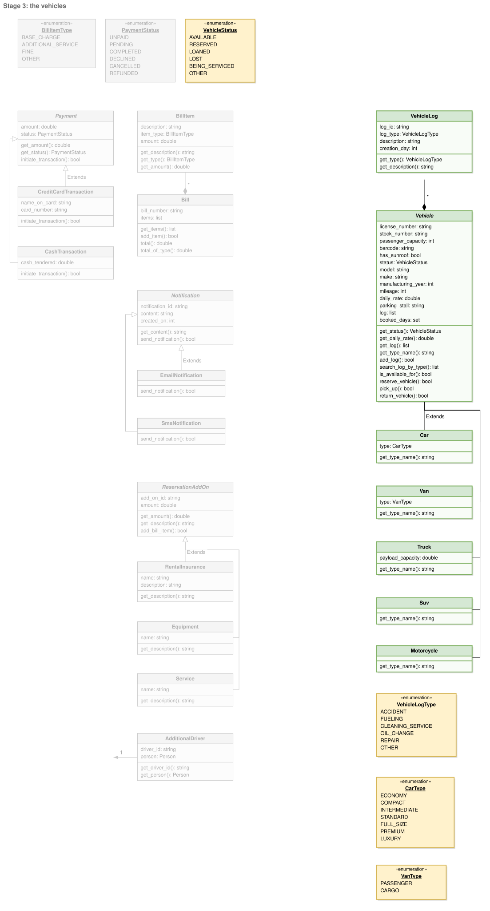
*Figure — Vehicle, its log and the vehicle sub-types (course diagram)*

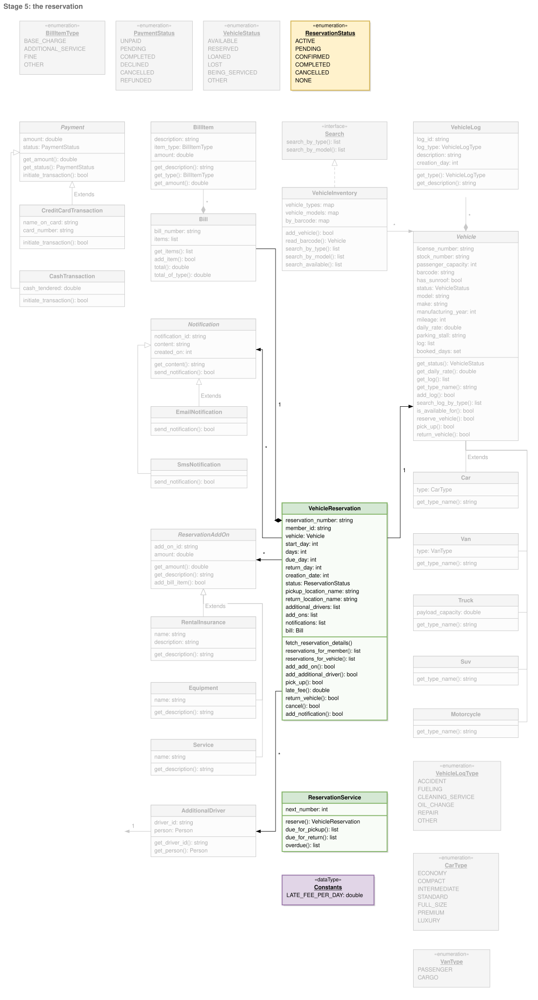
*Figure — The reservation owns its bill and refers to the vehicle, add-ons, drivers and notifications (course diagram)*


*Figure — The finished class diagram of the car rental system (course diagram)*

In the finished figure above, two ownership chains matter: the system owns its branches and each branch owns its inventory (filled diamonds, **composition** — the part dies with the whole), while the inventory only *refers to* vehicles (plain arrow, **association**). A reservation owns its bill but only refers to the vehicle.

Our Java design follows the same shape, with two deliberate differences: vehicle kinds are an enum (`VehicleType`) rather than five empty subclasses, because the subclasses add no behaviour; and pricing is a strategy object rather than a constant.


### Key flows

**Pick up a vehicle.** The receptionist scans the customer's licence (or searches by name), checks there is a valid reservation, scans the vehicle's barcode, and hands over the keys. If there is no reservation, the member can reserve a free vehicle on the spot.


*Figure — Activity diagram: picking up a vehicle (course diagram)*

**Return a vehicle.** A worker scans the vehicle barcode; if it is past the due date, the system adds a late fee; the worker checks for damage and fuel; the bill is settled.


*Figure — Activity diagram: returning a vehicle, with the late-fee branch (course diagram)*

As the figure above shows, the late-fee decision is a branch on the return path — in our code it is one line inside `Reservation.returnVehicle`.

Reservation lifecycle (a **state machine** — a fixed set of states and the only moves allowed between them):

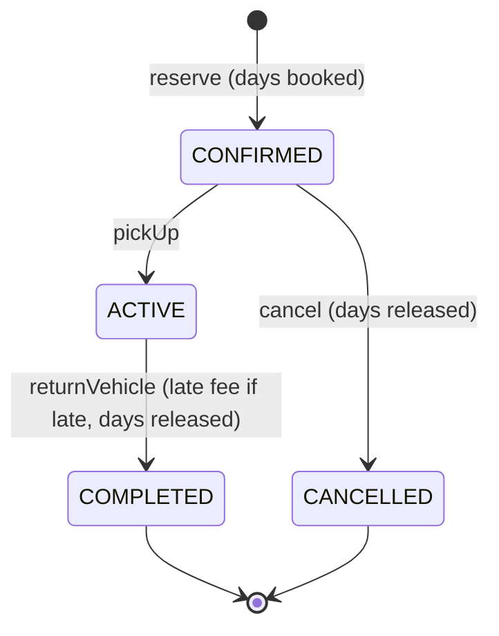

Reserve flow, including the race we must win:

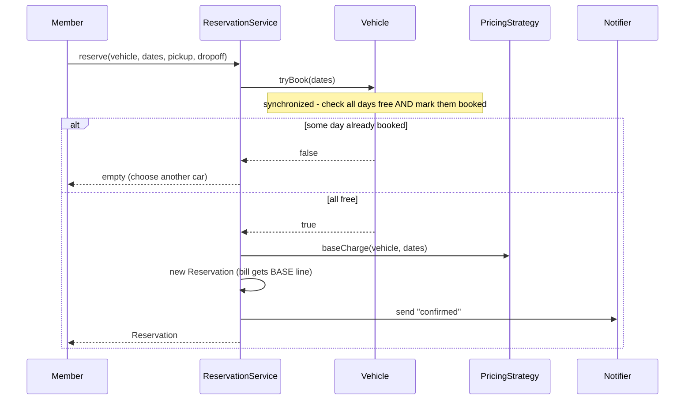

### Design decisions & patterns used

| Decision | Why | Alternative rejected |
|---|---|---|
| **Availability comes from the days each vehicle has already sold**, not from a status field | Members ask about future dates ("can I have it from the 10th to the 13th?"). A car that is out on loan right now may be back by then, and a car sitting on the lot today may already be promised to someone else next week. | A `RESERVED` status: cannot answer future-date questions, and a car can only hold one reservation. |
| Keep `VehicleStatus` too | Staff still need "where is the car right now" (on the lot, loaned, in service, lost). | Dropping status: loses the physical-location answer. |
| `Vehicle.tryBook` does check **and** book in one `synchronized` method | Closes the check-then-act race (see below). | Separate `isFree()` then `book()` calls: two members can both see "free". |
| **Template Method** on `ReservationAddOn` | Billing is written once in the `final` method `toBillItem`; subclasses only say what they are (`kind`) and may override the pricing hook (`Service` is a flat fee). A fourth add-on is one new subclass. | A type enum with `switch` in the reservation: every new add-on edits the reservation. |
| **Strategy** for `PricingStrategy` and `LateFeePolicy` | Seasonal or length-based pricing changes one class, not the reservation. | Hard-coded rate constants. |
| **Decorator** `WeeklyDiscountPricing` wraps any `PricingStrategy` | Stacks a discount on top of whatever base rule is in place. | A subclass per combination (daily+weekly, seasonal+weekly …). |
| `Bill` is the only place charges live | Base, add-ons and late fees are lines on one bill; the total can never be computed in two places and disagree. | Each add-on keeping its own running total. |
| `ReservationService` separate from `Reservation` | Creating and indexing reservations is a different job from holding one reservation's rules (Single Responsibility). | Static factory on `Reservation`. |
| **Actors call the rules, they never compute them** | The course's stage 6: a member calls the reservation service (search, reserve, cancel); a receptionist calls the reservation (hand over, take back, take payment, send reminders). An actor that starts working out fees is doing the reservation's job. In our code the actors are plain data (`Member`) and every rule sits in `Reservation`/`ReservationService`. | `Member.reserve()` / `Receptionist.computeLateFee()` methods. |
| `Bill` methods are `synchronized` and `settle` is idempotent | A late-fee line can never be added while the bill is being paid, and a double-clicked "pay" charges once. | Unsynchronized list + a second charge on retry. |
| The course makes `CarRentalSystem` a **Singleton**; we pass it in instead | A singleton is easy to reach but hard to replace in tests. Constructing one and passing it (dependency injection) gives the same "one per app" without a global. | `static getInstance()`. |

### Java implementation

Package `lld.ch16.carrental`.

```java
// File: code/lld/ch16/carrental/Types.java
package lld.ch16.carrental;

import java.time.LocalDate;
import java.time.temporal.ChronoUnit;
import java.util.stream.Stream;

enum VehicleType { CAR, TRUCK, SUV, VAN, MOTORCYCLE }

/** Where the vehicle physically is RIGHT NOW. Future availability is answered by booked days, not by this. */
enum VehicleStatus { AVAILABLE, LOANED, BEING_SERVICED, LOST }

enum ReservationStatus { CONFIRMED, ACTIVE, COMPLETED, CANCELLED }

enum BillItemType { BASE_CHARGE, ADD_ON, LATE_FEE }

enum VehicleLogType { RESERVED, PICKED_UP, RETURNED, CANCELLED, FUELING, CLEANING, DAMAGE, REPAIR }

/** Half-open range [start, end): 10 Oct to 13 Oct is 3 rental days and the car is due back on 13 Oct. */
record DateRange(LocalDate start, LocalDate end) {
    DateRange {
        if (!end.isAfter(start)) throw new IllegalArgumentException("end must be after start");
    }
    long days() { return ChronoUnit.DAYS.between(start, end); }
    Stream<LocalDate> dates() { return start.datesUntil(end); }
    @Override public String toString() { return start + ".." + end; }
}

record Member(String id, String name, String email) {}

record Location(String code, String name) {}

record VehicleLogEntry(LocalDate date, VehicleLogType type, String note) {}

record AdditionalDriver(String name, String licenseNumber) {}
```

```java
// File: code/lld/ch16/carrental/Vehicle.java
package lld.ch16.carrental;

import java.time.LocalDate;
import java.util.ArrayList;
import java.util.HashSet;
import java.util.List;
import java.util.Set;

/** One physical vehicle. It owns its booked days and its log. */
final class Vehicle {
    private final String barcode;
    private final String licensePlate;
    private final String make;
    private final String model;
    private final VehicleType type;
    private final int passengerCapacity;
    private final String parkingStall;
    private VehicleStatus status = VehicleStatus.AVAILABLE;
    private int mileage;
    private final Set<LocalDate> bookedDays = new HashSet<>();
    private final List<VehicleLogEntry> log = new ArrayList<>();

    Vehicle(String barcode, String licensePlate, String make, String model,
            VehicleType type, int passengerCapacity, String parkingStall, int mileage) {
        this.barcode = barcode;
        this.licensePlate = licensePlate;
        this.make = make;
        this.model = model;
        this.type = type;
        this.passengerCapacity = passengerCapacity;
        this.parkingStall = parkingStall;
        this.mileage = mileage;
    }

    String barcode() { return barcode; }
    String model() { return model; }
    VehicleType type() { return type; }
    String parkingStall() { return parkingStall; }
    synchronized VehicleStatus status() { return status; }
    synchronized int mileage() { return mileage; }
    synchronized void setStatus(VehicleStatus s) { status = s; }
    synchronized void setMileage(int m) {
        if (m < mileage) throw new IllegalArgumentException("odometer cannot go backwards");
        mileage = m;
    }

    synchronized boolean isFreeFor(DateRange r) {
        return r.dates().noneMatch(bookedDays::contains);
    }

    /** Check AND book inside one lock, so two members can never both win the same days. */
    synchronized boolean tryBook(DateRange r) {
        if (!isFreeFor(r)) return false;
        r.dates().forEach(bookedDays::add);
        return true;
    }

    synchronized void release(DateRange r) { r.dates().forEach(bookedDays::remove); }

    synchronized void addLog(LocalDate date, VehicleLogType type, String note) {
        log.add(new VehicleLogEntry(date, type, note));
    }

    synchronized List<VehicleLogEntry> history() { return List.copyOf(log); }

    String describe() {
        return make + " " + model + " (" + type + ", " + passengerCapacity + " seats, plate " + licensePlate + ")";
    }
}
```

```java
// File: code/lld/ch16/carrental/Billing.java
package lld.ch16.carrental;

import java.math.BigDecimal;
import java.util.ArrayList;
import java.util.List;

record BillItem(String description, BillItemType type, BigDecimal amount) {}

/**
 * The ONLY place that knows what a rental costs: every charge becomes a line here.
 * Every method is synchronized on the bill, so a line can never be added while it is being settled.
 */
final class Bill {
    private final List<BillItem> items = new ArrayList<>();
    private boolean paid;

    synchronized void add(BillItem item) {
        if (paid) throw new IllegalStateException("bill already settled");
        items.add(item);
    }
    synchronized List<BillItem> items() { return List.copyOf(items); }
    synchronized BigDecimal total() { return items.stream().map(BillItem::amount).reduce(BigDecimal.ZERO, BigDecimal::add); }
    synchronized boolean isPaid() { return paid; }

    /** Idempotent: settling a bill that is already paid does not charge the member a second time. */
    synchronized boolean settle(PaymentMethod method) {
        if (paid) return true;
        paid = method.charge(total());
        return paid;
    }
}

/** Strategy for how money is taken. */
interface PaymentMethod { boolean charge(BigDecimal amount); }

record CardPayment(String cardToken) implements PaymentMethod {
    public boolean charge(BigDecimal amount) {
        System.out.println("    charged " + amount + " to card token " + cardToken);
        return true;
    }
}

record CashPayment(BigDecimal tendered) implements PaymentMethod {
    public boolean charge(BigDecimal amount) { return tendered.compareTo(amount) >= 0; }
}

/**
 * Template Method: toBillItem() is fixed; subclasses only say what kind of add-on they are
 * and may override how the price is computed (the hook).
 */
abstract class ReservationAddOn {
    private final String name;
    protected final BigDecimal price;

    protected ReservationAddOn(String name, BigDecimal price) {
        this.name = name;
        this.price = price;
    }

    final BillItem toBillItem(long rentalDays) {
        return new BillItem(kind() + ": " + name, BillItemType.ADD_ON, priceFor(rentalDays));
    }

    protected abstract String kind();

    /** Hook: by default an add-on is charged per rental day. */
    protected BigDecimal priceFor(long rentalDays) { return price.multiply(BigDecimal.valueOf(rentalDays)); }
}

final class RentalInsurance extends ReservationAddOn {
    RentalInsurance(String name, BigDecimal perDay) { super(name, perDay); }
    protected String kind() { return "Insurance"; }
}

final class Equipment extends ReservationAddOn {
    Equipment(String name, BigDecimal perDay) { super(name, perDay); }
    protected String kind() { return "Equipment"; }
}

/** A service such as roadside assistance or wifi is a flat fee per rental. */
final class Service extends ReservationAddOn {
    Service(String name, BigDecimal flatFee) { super(name, flatFee); }
    protected String kind() { return "Service"; }
    @Override protected BigDecimal priceFor(long rentalDays) { return price; }
}
```

```java
// File: code/lld/ch16/carrental/Pricing.java
package lld.ch16.carrental;

import java.math.BigDecimal;
import java.math.RoundingMode;
import java.util.EnumMap;
import java.util.Map;

/** Strategy: how the base charge for a rental is computed. */
interface PricingStrategy { BigDecimal baseCharge(Vehicle v, DateRange period); }

final class DailyRatePricing implements PricingStrategy {
    private final Map<VehicleType, BigDecimal> dailyRate;
    DailyRatePricing(Map<VehicleType, BigDecimal> dailyRate) { this.dailyRate = new EnumMap<>(dailyRate); }
    public BigDecimal baseCharge(Vehicle v, DateRange p) {
        return dailyRate.get(v.type()).multiply(BigDecimal.valueOf(p.days()));
    }
}

/** Decorator over any pricing: 10% off rentals of 7 days or more. */
final class WeeklyDiscountPricing implements PricingStrategy {
    private final PricingStrategy inner;
    WeeklyDiscountPricing(PricingStrategy inner) { this.inner = inner; }
    public BigDecimal baseCharge(Vehicle v, DateRange p) {
        BigDecimal base = inner.baseCharge(v, p);
        return p.days() >= 7 ? base.multiply(new BigDecimal("0.90")).setScale(2, RoundingMode.HALF_UP) : base;
    }
}

/** Strategy: what a late return costs. */
interface LateFeePolicy { BigDecimal fee(Vehicle v, long daysLate); }

record FlatLateFee(BigDecimal perDay) implements LateFeePolicy {
    public BigDecimal fee(Vehicle v, long daysLate) { return perDay.multiply(BigDecimal.valueOf(daysLate)); }
}

/** Observer-style port: the service announces events, the notifier decides the channel. */
interface Notifier { void send(Member to, String message); }

final class ConsoleNotifier implements Notifier {
    public void send(Member to, String message) { System.out.println("    [notify " + to.email() + "] " + message); }
}
```

```java
// File: code/lld/ch16/carrental/Reservation.java
package lld.ch16.carrental;

import java.math.BigDecimal;
import java.time.LocalDate;
import java.time.temporal.ChronoUnit;
import java.util.ArrayList;
import java.util.List;

/** One rental. The rules (add-ons, late fee, freeing days) live here, not in the actors. */
final class Reservation {
    private final String id;
    private final Member member;
    private final Vehicle vehicle;
    private final DateRange period;
    private final Location pickupLocation;
    private final Location returnLocation;
    private final Bill bill = new Bill();
    private final List<ReservationAddOn> addOns = new ArrayList<>();
    private final List<AdditionalDriver> drivers = new ArrayList<>();
    private ReservationStatus status = ReservationStatus.CONFIRMED;

    Reservation(String id, Member member, Vehicle vehicle, DateRange period,
                Location pickup, Location dropoff, BigDecimal baseCharge) {
        this.id = id;
        this.member = member;
        this.vehicle = vehicle;
        this.period = period;
        this.pickupLocation = pickup;
        this.returnLocation = dropoff;
        bill.add(new BillItem("Base: " + vehicle.model() + " x " + period.days() + " days",
                BillItemType.BASE_CHARGE, baseCharge));
    }

    String id() { return id; }
    Member member() { return member; }
    Vehicle vehicle() { return vehicle; }
    DateRange period() { return period; }
    Location pickupLocation() { return pickupLocation; }
    Location returnLocation() { return returnLocation; }
    Bill bill() { return bill; }
    synchronized List<AdditionalDriver> drivers() { return List.copyOf(drivers); }
    synchronized ReservationStatus status() { return status; }

    private void require(ReservationStatus expected, String action) {
        if (status != expected)
            throw new IllegalStateException("cannot " + action + " reservation " + id + " in state " + status);
    }

    synchronized void addAddOn(ReservationAddOn addOn) {
        require(ReservationStatus.CONFIRMED, "add an add-on to");
        addOns.add(addOn);
        bill.add(addOn.toBillItem(period.days()));
    }

    synchronized void addDriver(AdditionalDriver d) {
        require(ReservationStatus.CONFIRMED, "add a driver to");
        drivers.add(d);
    }

    synchronized void pickUp(LocalDate on) {
        require(ReservationStatus.CONFIRMED, "pick up");
        status = ReservationStatus.ACTIVE;
        vehicle.setStatus(VehicleStatus.LOANED);
        vehicle.addLog(on, VehicleLogType.PICKED_UP, id + " by " + member.name() + " at " + pickupLocation.code());
    }

    /** Returns the number of late days charged. The due date is period.end(). */
    synchronized long returnVehicle(LocalDate on, int odometer, LateFeePolicy lateFee) {
        require(ReservationStatus.ACTIVE, "return");
        long daysLate = Math.max(0, ChronoUnit.DAYS.between(period.end(), on));
        if (daysLate > 0) {
            bill.add(new BillItem("Late fee: " + daysLate + " day(s)", BillItemType.LATE_FEE,
                    lateFee.fee(vehicle, daysLate)));
        }
        vehicle.setMileage(odometer);
        vehicle.setStatus(VehicleStatus.AVAILABLE);
        vehicle.release(period);
        vehicle.addLog(on, VehicleLogType.RETURNED, id + " at " + returnLocation.code() + ", odometer " + odometer);
        status = ReservationStatus.COMPLETED;
        return daysLate;
    }

    synchronized void cancel(LocalDate on) {
        require(ReservationStatus.CONFIRMED, "cancel");
        status = ReservationStatus.CANCELLED;
        vehicle.release(period);   // a cancelled rental must give its days back
        vehicle.addLog(on, VehicleLogType.CANCELLED, id);
    }
}
```

```java
// File: code/lld/ch16/carrental/RentalSystem.java
package lld.ch16.carrental;

import java.time.LocalDate;
import java.util.ArrayList;
import java.util.List;
import java.util.Map;
import java.util.Optional;
import java.util.concurrent.ConcurrentHashMap;
import java.util.concurrent.CopyOnWriteArrayList;
import java.util.concurrent.atomic.AtomicInteger;

/** Per-branch indexes over vehicles. All three are filled by add(), so they cannot drift apart. */
final class VehicleInventory {
    private final Map<String, Vehicle> byBarcode = new ConcurrentHashMap<>();
    private final Map<VehicleType, List<Vehicle>> byType = new ConcurrentHashMap<>();
    private final Map<String, List<Vehicle>> byModel = new ConcurrentHashMap<>();

    void add(Vehicle v) {
        if (byBarcode.putIfAbsent(v.barcode(), v) != null)
            throw new IllegalArgumentException("duplicate barcode " + v.barcode());
        byType.computeIfAbsent(v.type(), t -> new CopyOnWriteArrayList<>()).add(v);
        byModel.computeIfAbsent(v.model(), m -> new CopyOnWriteArrayList<>()).add(v);
    }

    Optional<Vehicle> scan(String barcode) { return Optional.ofNullable(byBarcode.get(barcode)); }

    List<Vehicle> search(VehicleType type, DateRange period) {
        return byType.getOrDefault(type, List.of()).stream()
                .filter(v -> v.status() != VehicleStatus.LOST && v.isFreeFor(period)).toList();
    }

    List<Vehicle> searchByModel(String model, DateRange period) {
        return byModel.getOrDefault(model, List.of()).stream().filter(v -> v.isFreeFor(period)).toList();
    }
}

record CarRentalLocation(Location location, VehicleInventory inventory) {}

/** Creates and tracks reservations. Answers "what did this member rent" and "who took this car". */
final class ReservationService {
    private final PricingStrategy pricing;
    private final LateFeePolicy lateFee;
    private final Notifier notifier;
    private final Map<String, Reservation> reservations = new ConcurrentHashMap<>();
    private final AtomicInteger seq = new AtomicInteger(1000);

    ReservationService(PricingStrategy pricing, LateFeePolicy lateFee, Notifier notifier) {
        this.pricing = pricing;
        this.lateFee = lateFee;
        this.notifier = notifier;
    }

    Optional<Reservation> reserve(Member m, Vehicle v, DateRange period, Location pickup, Location dropoff, LocalDate today) {
        if (!v.tryBook(period)) return Optional.empty();
        var r = new Reservation("R" + seq.incrementAndGet(), m, v, period, pickup, dropoff, pricing.baseCharge(v, period));
        reservations.put(r.id(), r);
        v.addLog(today, VehicleLogType.RESERVED, r.id() + " for " + period);
        notifier.send(m, "Reservation " + r.id() + " confirmed: " + v.model() + " " + period);
        return Optional.of(r);
    }

    Reservation get(String id) {
        var r = reservations.get(id);
        if (r == null) throw new IllegalArgumentException("no reservation " + id);
        return r;
    }

    void cancel(String id, LocalDate on) {
        var r = get(id);
        r.cancel(on);
        notifier.send(r.member(), "Reservation " + id + " cancelled");
    }

    void pickUp(String id, LocalDate on) { get(id).pickUp(on); }

    void returnVehicle(String id, LocalDate on, int odometer) {
        var r = get(id);
        long late = r.returnVehicle(on, odometer, lateFee);
        if (late > 0) notifier.send(r.member(), "Returned " + late + " day(s) late, late fee added to " + id);
    }

    List<Reservation> byMember(String memberId) {
        return reservations.values().stream().filter(r -> r.member().id().equals(memberId)).toList();
    }

    List<Reservation> byVehicle(String barcode) {
        return reservations.values().stream().filter(r -> r.vehicle().barcode().equals(barcode)).toList();
    }

    /** Requirement: remind before pick-up, before the due date, and when overdue. Run once a day by a scheduler. */
    void sendReminders(LocalDate today) {
        for (var r : reservations.values()) {
            var status = r.status();
            if (status == ReservationStatus.CONFIRMED && r.period().start().equals(today.plusDays(1)))
                notifier.send(r.member(), "Pick-up tomorrow for " + r.id() + " at " + r.pickupLocation().name());
            else if (status == ReservationStatus.ACTIVE && r.period().end().equals(today.plusDays(1)))
                notifier.send(r.member(), "Vehicle for " + r.id() + " is due tomorrow");
            else if (status == ReservationStatus.ACTIVE && r.period().end().isBefore(today))
                notifier.send(r.member(), "OVERDUE: " + r.id() + " was due " + r.period().end());
        }
    }
}

/** Top-level object: owns branches (each owning its inventory) and the reservation service. */
final class CarRentalSystem {
    private final Map<String, CarRentalLocation> locations = new ConcurrentHashMap<>();
    private final ReservationService reservations;

    CarRentalSystem(ReservationService reservations) { this.reservations = reservations; }

    CarRentalLocation addLocation(Location l) {
        return locations.computeIfAbsent(l.code(), c -> new CarRentalLocation(l, new VehicleInventory()));
    }
    CarRentalLocation location(String code) { return locations.get(code); }
    ReservationService reservations() { return reservations; }

    List<Vehicle> searchAll(VehicleType type, DateRange period) {
        List<Vehicle> out = new ArrayList<>();
        locations.values().forEach(l -> out.addAll(l.inventory().search(type, period)));
        return out;
    }
}
```

```java
// File: code/lld/ch16/carrental/Main.java
package lld.ch16.carrental;

import java.math.BigDecimal;
import java.time.LocalDate;
import java.util.Map;
import java.util.concurrent.CountDownLatch;
import java.util.concurrent.ExecutorService;
import java.util.concurrent.Executors;
import java.util.concurrent.atomic.AtomicInteger;

public class Main {
    static BigDecimal usd(String s) { return new BigDecimal(s); }

    public static void main(String[] args) throws Exception {
        var pricing = new WeeklyDiscountPricing(new DailyRatePricing(Map.of(
                VehicleType.CAR, usd("50.00"), VehicleType.SUV, usd("80.00"), VehicleType.TRUCK, usd("100.00"),
                VehicleType.VAN, usd("90.00"), VehicleType.MOTORCYCLE, usd("35.00"))));
        var service = new ReservationService(pricing, new FlatLateFee(usd("40.00")), new ConsoleNotifier());
        var system = new CarRentalSystem(service);

        var sfo = new Location("SFO", "SFO Airport");
        var dtn = new Location("DTN", "Downtown");
        var sfoInv = system.addLocation(sfo).inventory();
        sfoInv.add(new Vehicle("VH-001", "7ABC123", "Toyota", "RAV4", VehicleType.SUV, 5, "A-12", 20_100));
        sfoInv.add(new Vehicle("VH-002", "7ABC124", "Honda", "CR-V", VehicleType.SUV, 5, "A-13", 15_400));
        sfoInv.add(new Vehicle("VH-003", "8XYZ001", "Honda", "Civic", VehicleType.CAR, 5, "B-02", 9_800));
        system.addLocation(dtn).inventory().add(new Vehicle("VH-010", "9VAN555", "Ford", "Transit", VehicleType.VAN, 12, "C-01", 30_000));

        var alice = new Member("M1", "Alice", "alice@example.com");
        var today = LocalDate.of(2026, 10, 1);
        var trip = new DateRange(LocalDate.of(2026, 10, 10), LocalDate.of(2026, 10, 13));

        System.out.println("1) Search SUVs at SFO for " + trip);
        sfoInv.search(VehicleType.SUV, trip).forEach(v -> System.out.println("   " + v.barcode() + " " + v.describe() + " stall " + v.parkingStall()));

        System.out.println("2) Alice reserves VH-001 (pick up SFO, return Downtown) and adds extras");
        var rav4 = sfoInv.scan("VH-001").orElseThrow();
        var r1 = service.reserve(alice, rav4, trip, sfo, dtn, today).orElseThrow();
        r1.addAddOn(new RentalInsurance("Collision damage waiver", usd("15.00")));
        r1.addAddOn(new Equipment("Child seat", usd("8.00")));
        r1.addAddOn(new Service("Roadside assistance", usd("25.00")));
        r1.addDriver(new AdditionalDriver("Sam", "D1234567"));

        System.out.println("3) 8 members race for VH-002 on the same dates");
        var crv = sfoInv.scan("VH-002").orElseThrow();
        var wins = new AtomicInteger();
        var winnerId = new String[1];
        var start = new CountDownLatch(1);
        try (ExecutorService pool = Executors.newFixedThreadPool(8)) {
            for (int i = 0; i < 8; i++) {
                var m = new Member("M" + (10 + i), "Racer" + i, "racer" + i + "@example.com");
                pool.submit(() -> {
                    start.await();
                    service.reserve(m, crv, new DateRange(LocalDate.of(2026, 10, 11), LocalDate.of(2026, 10, 14)), sfo, sfo, today)
                           .ifPresent(r -> { wins.incrementAndGet(); synchronized (winnerId) { winnerId[0] = r.id(); } });
                    return null;
                });
            }
            start.countDown();
        }
        System.out.println("   successful reservations for VH-002: " + wins.get());
        System.out.println("   SUVs free for " + trip + " now: " + sfoInv.search(VehicleType.SUV, trip).size());

        System.out.println("4) Daily reminder job on 2026-10-09");
        service.sendReminders(LocalDate.of(2026, 10, 9));

        System.out.println("5) Pick up on 10 Oct, return at Downtown on 15 Oct (due 13 Oct)");
        service.pickUp(r1.id(), LocalDate.of(2026, 10, 10));
        System.out.println("   VH-001 status while out: " + rav4.status());
        service.sendReminders(LocalDate.of(2026, 10, 14));
        service.returnVehicle(r1.id(), LocalDate.of(2026, 10, 15), 20_640);
        rav4.addLog(LocalDate.of(2026, 10, 15), VehicleLogType.CLEANING, "interior clean by worker W7");

        System.out.println("6) Alice's bill");
        r1.bill().items().forEach(i -> System.out.printf("   %-40s %-10s %8s%n", i.description(), i.type(), i.amount()));
        System.out.println("   TOTAL " + r1.bill().total());
        r1.bill().settle(new CardPayment("tok_alice_visa"));
        System.out.println("   paid: " + r1.bill().isPaid() + ", settle again (double click) -> "
                + r1.bill().settle(new CardPayment("tok_alice_visa")) + ", no second charge");

        System.out.println("7) Who rented VH-001? What has Alice rented?");
        service.byVehicle("VH-001").forEach(r -> System.out.println("   " + r.id() + " -> " + r.member().name() + " " + r.period() + " " + r.status()));
        service.byMember("M1").forEach(r -> System.out.println("   Alice: " + r.id() + " " + r.vehicle().model()));

        System.out.println("8) Vehicle log for VH-001");
        rav4.history().forEach(e -> System.out.println("   " + e.date() + " " + e.type() + " " + e.note()));

        System.out.println("9) The VH-002 winner cancels; the days come back");
        service.cancel(winnerId[0], LocalDate.of(2026, 10, 2));
        System.out.println("   SUVs free for " + trip + ": " + sfoInv.search(VehicleType.SUV, trip).size());

        System.out.println("10) A 7-day Civic rental gets the weekly discount");
        var week = new DateRange(LocalDate.of(2026, 11, 1), LocalDate.of(2026, 11, 8));
        var r3 = service.reserve(alice, sfoInv.scan("VH-003").orElseThrow(), week, sfo, sfo, today).orElseThrow();
        System.out.println("   base charge " + r3.bill().total() + " (7 x 50 = 350, minus 10%)");

        System.out.println("11) Rules are enforced");
        try { r1.addAddOn(new Equipment("Ski rack", usd("10.00"))); }
        catch (IllegalStateException e) { System.out.println("   rejected: " + e.getMessage()); }
        try { new DateRange(LocalDate.of(2026, 10, 5), LocalDate.of(2026, 10, 5)); }
        catch (IllegalArgumentException e) { System.out.println("   rejected: " + e.getMessage()); }
    }
}
```

Output:

```text
1) Search SUVs at SFO for 2026-10-10..2026-10-13
   VH-001 Toyota RAV4 (SUV, 5 seats, plate 7ABC123) stall A-12
   VH-002 Honda CR-V (SUV, 5 seats, plate 7ABC124) stall A-13
2) Alice reserves VH-001 (pick up SFO, return Downtown) and adds extras
    [notify alice@example.com] Reservation R1001 confirmed: RAV4 2026-10-10..2026-10-13
3) 8 members race for VH-002 on the same dates
    [notify racer7@example.com] Reservation R1002 confirmed: CR-V 2026-10-11..2026-10-14
   successful reservations for VH-002: 1
   SUVs free for 2026-10-10..2026-10-13 now: 0
4) Daily reminder job on 2026-10-09
    [notify alice@example.com] Pick-up tomorrow for R1001 at SFO Airport
5) Pick up on 10 Oct, return at Downtown on 15 Oct (due 13 Oct)
   VH-001 status while out: LOANED
    [notify alice@example.com] OVERDUE: R1001 was due 2026-10-13
    [notify alice@example.com] Returned 2 day(s) late, late fee added to R1001
6) Alice's bill
   Base: RAV4 x 3 days                      BASE_CHARGE   240.00
   Insurance: Collision damage waiver       ADD_ON        45.00
   Equipment: Child seat                    ADD_ON        24.00
   Service: Roadside assistance             ADD_ON        25.00
   Late fee: 2 day(s)                       LATE_FEE      80.00
   TOTAL 414.00
    charged 414.00 to card token tok_alice_visa
   paid: true, settle again (double click) -> true, no second charge
7) Who rented VH-001? What has Alice rented?
   R1001 -> Alice 2026-10-10..2026-10-13 COMPLETED
   Alice: R1001 RAV4
8) Vehicle log for VH-001
   2026-10-01 RESERVED R1001 for 2026-10-10..2026-10-13
   2026-10-10 PICKED_UP R1001 by Alice at SFO
   2026-10-15 RETURNED R1001 at DTN, odometer 20640
   2026-10-15 CLEANING interior clean by worker W7
9) The VH-002 winner cancels; the days come back
    [notify racer7@example.com] Reservation R1002 cancelled
   SUVs free for 2026-10-10..2026-10-13: 2
10) A 7-day Civic rental gets the weekly discount
    [notify alice@example.com] Reservation R1003 confirmed: Civic 2026-11-01..2026-11-08
   base charge 315.00 (7 x 50 = 350, minus 10%)
11) Rules are enforced
   rejected: cannot add an add-on to reservation R1001 in state COMPLETED
   rejected: end must be after start
```

What to notice in the output: step 3 has eight threads racing for one car and exactly one wins (which racer wins varies per run); step 5 shows the overdue reminder and the 2-day late fee (2 × 40.00); step 6 shows that settling an already-paid bill does not charge again; step 9 shows cancellation giving the days back.

### Concurrency & edge cases

- **Double booking.** The course lists this as an open gap in its own design (checking the days and booking them are two separate steps there). Two members call `reserve` for the same car at the same moment. Because `tryBook` is `synchronized` on the vehicle, the check "are all days free?" and the write "mark them booked" happen as one step, so the second caller sees the first caller's days. Locking per vehicle (not one global lock) lets different cars be booked in parallel. In a database-backed system the same idea becomes a unique constraint on `(vehicle_id, day)` or a `SELECT … FOR UPDATE` in one transaction.
- **Search is advisory.** `search` may say a car is free and then `reserve` fails because someone else won. That is correct: the client simply shows "no longer available". Never reserve based on a stale search result without re-checking.
- **Late return collides with the next rental.** If Alice returns two days late and Bob booked the car from the 14th, Bob's car is not on the lot. Real systems keep a buffer (for example a cleaning day) between bookings and, when a car is overdue, reassign the next reservation to another car of the same type.
- **Early return.** We release the whole booked range; the unused days become bookable. Whether the member is refunded is a policy question.
- **Cancelling after pick-up** is rejected by the state machine (`CONFIRMED` only).
- **Add-ons after the rental ends** are rejected (see step 11 of the output).
- **Invalid ranges** (end not after start) are rejected in the `DateRange` constructor.
- **Odometer going backwards** is rejected in `Vehicle.setMileage`.
- **Different return branch.** The reservation records the return branch, but the vehicle stays in the pick-up branch's inventory. The course calls this out as a known gap: moving a car between branches is a *transfer* the design does not model yet (see Extensions).

### Extensions & follow-up questions

- **"How do you handle one-way rentals?"** — On return at a different branch, remove the vehicle from the old `VehicleInventory` and add it to the new one inside `returnVehicle`, and log a `TRANSFER` event. Add a one-way fee as another `BillItem`.
- **"Seasonal or dynamic pricing?"** — Add a `SeasonalPricing` strategy (rate per date) or wrap with another decorator (`SurgePricing`). The reservation does not change.
- **"Deposits and card holds?"** — A `PaymentMethod.authorize(amount)` at pick-up and `capture(amount)` at return; the difference is released.
- **"Mileage limits, fuel level, damage claims?"** — Record odometer and fuel at pick-up and return; add `BillItem`s of type `FINE` for extra miles, missing fuel or damage (the course's enum has a `FINE` bill item type for exactly this kind of charge).
- **"How do reminders run?"** — A scheduler (for example a `ScheduledExecutorService` or a cron job) calls `sendReminders(today)` once a day.
- **"How would you scale this?"** — Partition vehicles by branch; the booked-days table becomes `(vehicle_id, day)` with a unique key; searches go to a read replica or a search index; reservations are written with a transaction.
- **"How do workers update the log?"** — `Vehicle.addLog(date, CLEANING, note)` as in step 5; restrict who can call it by role in the service layer.

### In the interview

**30-second pitch:** "Branches own inventories, inventories index vehicles by barcode, type and model. The key decision: availability is a question about *dates*, so each vehicle keeps its booked days, and `tryBook` checks and books them atomically. A reservation owns a bill; every charge — base, insurance, equipment, services, late fee — is a line on it. Add-ons share a template-method base class; pricing and late fees are strategies."

**Suggested 40-minute plan:**

| Minutes | Do |
|---|---|
| 0–5 | Clarify vehicle types, branches, one-way, add-ons, late fees. |
| 5–10 | Actors and use cases; list the entities. |
| 10–20 | Class diagram. Say "availability is dates, not status" early. |
| 20–35 | Code `Vehicle.tryBook`, `Reservation` (state machine + bill + late fee), `ReservationService.reserve`. |
| 35–40 | Concurrency, late-return collision, one-way transfers. |

**Likely follow-ups:** "Can I book it for next month while it is loaned now?" (yes — dates, not status). "Two people click reserve together?" (atomic `tryBook`). "Add a new add-on?" (one subclass).

### Self-check

1. **Q:** Why is a `RESERVED` status not enough to answer "is this car free next week?" **A:** Status describes *now*. A car can be loaned today and free next week, or on the lot today but promised next week. Only per-day bookings answer date questions.
2. **Q:** What pattern does `ReservationAddOn.toBillItem` use and what is the "hook"? **A:** Template Method; `toBillItem` is the fixed algorithm and `priceFor` is the overridable hook (`Service` overrides it to a flat fee).
3. **Q:** Why is `tryBook` one method rather than `isFree` + `book`? **A:** To make check-then-act atomic under the vehicle's lock, so two threads cannot both see "free".
4. **Q:** How is the late fee computed? **A:** Days between the due date (`period.end`) and the actual return date, times the per-day fee from `LateFeePolicy`, added as a `LATE_FEE` bill line.
5. **Q:** Which class answers "who rented VH-001"? **A:** `ReservationService.byVehicle`, from the one list of reservations.

### TL;DR

- Availability = booked **days** per vehicle; status = where it is now.
- `tryBook` makes check-and-book atomic per vehicle.
- A reservation owns one bill; every charge is a line. Late fee = days late × rate.
- Template Method for add-ons, Strategy (+ Decorator) for pricing.
- Known gaps to mention: branch transfers, buffer between rentals.

**Real-world example.** Rental companies such as Hertz and Enterprise let you book a *car class* ("intermediate SUV or similar") rather than a specific plate; the exact vehicle is assigned at the counter. That is the same design one level up: availability is counted per type per day, and a specific `Vehicle` is bound at pick-up. Their counters and return lanes scan the car and compute extra-day and fuel charges on the spot — the "return" activity above.

---

## Design a Restaurant Management System


*Figure — A restaurant with branches, tables, waiters and a kitchen (course diagram)*

### Problem & clarifying questions

A **restaurant management system** runs the day-to-day of a restaurant from one place: which tables are free, table reservations, taking orders, sending them to the kitchen, and producing and settling the bill.

| Question | Assumed answer |
|---|---|
| One restaurant or a chain? | A restaurant with several branches; each branch has its own menu, tables and staff. |
| Menu structure? | Menu → sections (Starters, Mains …) → items with prices. |
| How are orders taken? | A waiter creates an order for a table and adds meals **per seat**; each meal has meal items, each pointing at a menu item. |
| Reservations? | Receptionist searches tables by date/time and party size and reserves one; customers can cancel; the system reminds them before the time. |
| Walk-ins? | Yes: show tables free right now. |
| Seating layouts? | A branch can have several seating arrangements (for example "Weekday" and "Banquet"). |
| Payment? | Credit card, cheque or cash. |
| Kitchen? | Orders go to a chef queue; chefs cook them in order and the waiter is told when food is ready. |

### Requirements

**Functional**

1. The restaurant has several branches.
2. Each branch has a menu.
3. A menu has sections; sections have menu items.
4. A waiter creates an order for a table and adds meals for each seat.
5. Each meal has meal items; each meal item corresponds to a menu item.
6. Show which tables are free now for walk-in customers.
7. Support table reservations.
8. The receptionist searches free tables by date and time and reserves one.
9. Customers can cancel a reservation.
10. Send a notification when the reservation time is approaching.
11. Customers pay by credit card, cheque or cash.
12. A branch can have several seating arrangements of tables.
13. (Added) Orders go to a kitchen queue; chefs take them one at a time and the waiter is notified when an order is ready.

**Non-functional**

- No two parties may be given the same table for overlapping time.
- Prices live in one place (the menu item) so an order and the menu can never disagree.
- Easy to add a new payment type or a new chef-assignment rule.

### Use cases

Actors:

- **Receptionist** — adds and edits tables and layouts; creates and cancels reservations; checks guests in.
- **Waiter** — takes and changes orders.
- **Manager** — hires staff and edits the menu.
- **Chef** — views and cooks orders.
- **Cashier** — produces the check (bill) and takes payment.
- **System** — sends reservation reminders and cancellations.

Top use cases: add/modify tables; search tables; place order; update order; create reservation; cancel reservation; check in; make payment.


*Figure — Use case diagram: receptionist, waiter, manager, chef, cashier and system (course diagram)*

In the figure above, each role has a small, separate set of use cases. That is a hint for the code: each role class gets only its own methods.

### Core entities

| Class | Responsibility |
|---|---|
| `Restaurant` | Owns its branches. In the course the restaurant also registers its employees: closing (deactivating) the restaurant deactivates every employee account with it. |
| `Branch` | Owns its menu, kitchen, seating charts and reservation service; employs staff. |
| `Menu`, `MenuSection`, `MenuItem` | The menu tree. The **price lives only on `MenuItem`**. |
| `Table`, `TableSeat` | A table with a capacity and numbered seats. Keeps both its **current status** and the **time slots it is promised to**. |
| `TableChart` | A named seating arrangement; refers to tables (a table can appear in several charts). |
| `Reservation` | Customer, party size, time, table, status. `updatePeopleCount` refuses a party bigger than the reserved table seats (otherwise the booking would say six while the table holds four). |
| `ReservationService` | Searches tables (best fit), reserves atomically, cancels, checks in, sends reminders, lists walk-in tables. |
| `Order` | One per table visit: meals keyed by seat, status with allowed transitions, listeners. |
| `Meal`, `MealItem` | One meal per seat; a meal item = menu item × quantity. |
| `Kitchen`, `Chef` | Kitchen hands each order to a chef by a pluggable rule; each chef cooks from a FIFO queue. |
| `Employee` and roles (`Receptionist`, `Waiter`, `Manager`, `Chef`, `Cashier`) | Each role's own operations. |
| `Check` | The bill: computed from the order (subtotal, tax, total), never stored separately. |
| `Payment` (`CardPayment`, `CashPayment`, `CheckPayment`) | Three ways to pay with three different behaviours. |

### Class diagram

The course grows the model in seven stages: payments and notifications, the menu, tables, reservations, orders, staff, and finally the branch that ties it together.

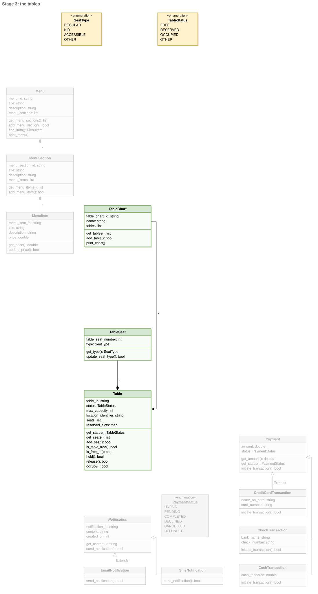
*Figure — Table, TableSeat and TableChart: a table owns its seats; a chart only refers to tables (course diagram)*

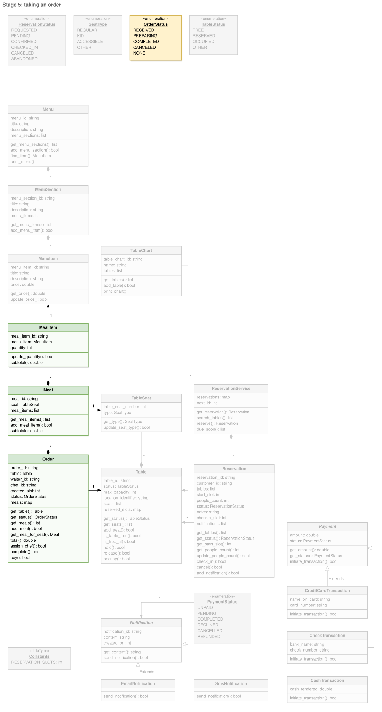
*Figure — Order, Meal and MealItem: one order per table, one meal per seat (course diagram)*


*Figure — The finished class diagram of the restaurant management system (course diagram)*

In the finished figure above, the branch is the hub: its menu, kitchen and seating charts are composition (they do not exist without the branch), while staff are only associated, because staff can move between branches. Note also what is *not* there: no separate `Bill` class that stores a total. The course's argument is that the order already holds every priced line, so storing the total again would create a second copy that could disagree. Our `Check` follows that rule — it is computed from the order on demand.

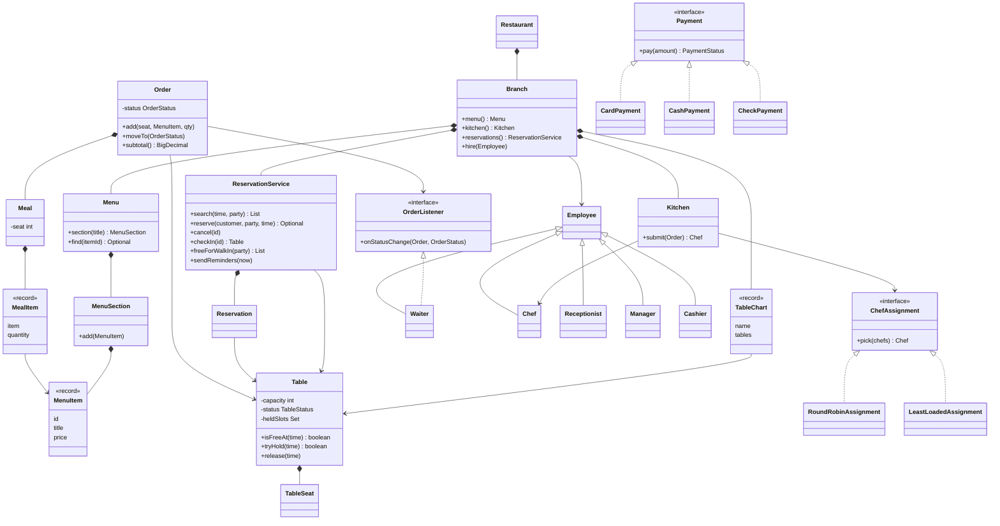

### Key flows

**Place an order.** The waiter opens an order for the table, then for each seat adds a meal with its items, and sends the order to the kitchen.


*Figure — Activity diagram: placing an order seat by seat and sending it to the kitchen (course diagram)*

**Make a reservation.** The customer calls or arrives; the receptionist searches tables for the time and party size; if one is free it is reserved and a confirmation is sent, otherwise the customer is told none is available.


*Figure — Activity diagram: making a table reservation (course diagram)*

**Cancel a reservation.** The receptionist looks up the booking; if it is valid, it is cancelled, the table is released and the customer is notified.


*Figure — Activity diagram: cancelling a reservation (course diagram)*

Order lifecycle — the transitions `Order.moveTo` allows:

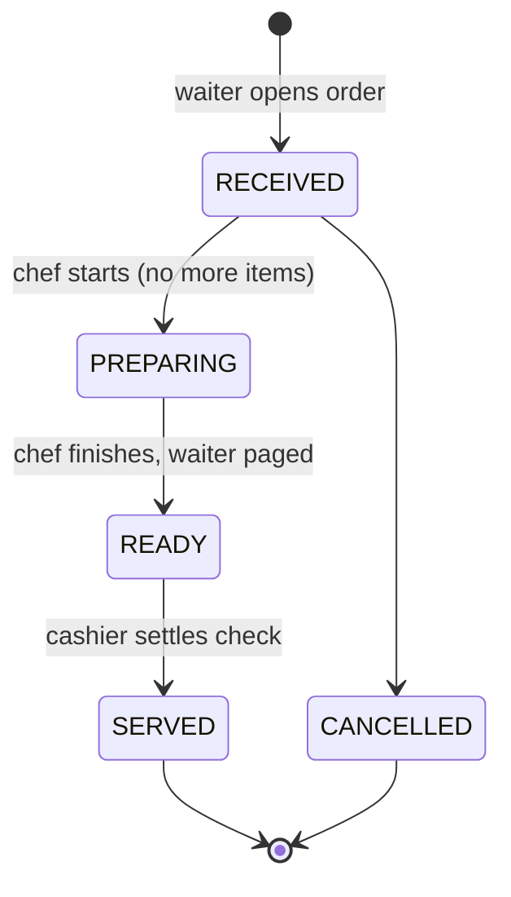

From order to payment:

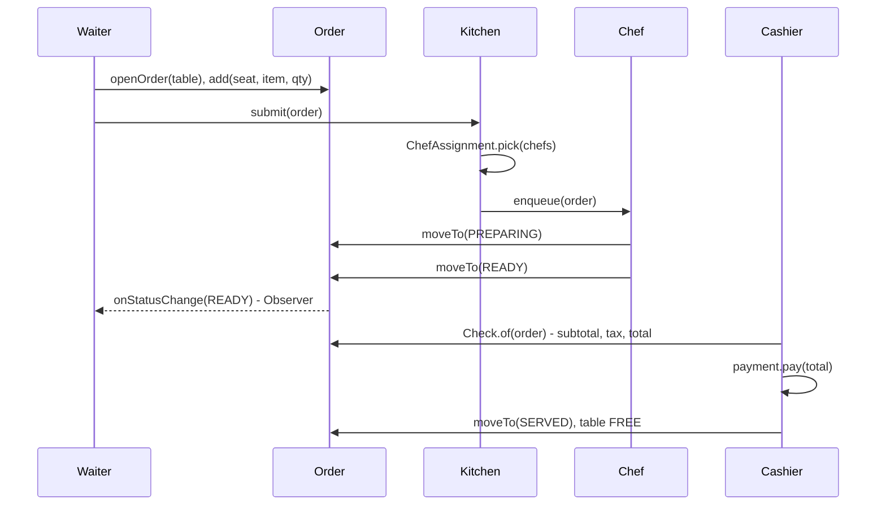

### Design decisions & patterns used

| Decision | Why | Alternative rejected |
|---|---|---|
| **One meal per seat** (`Map<seat, Meal>`) | Requirement 4 asks for it; it tells the kitchen which plate goes to which guest and makes split bills trivial. | A flat list of dishes per order. |
| **Table keeps held time slots as well as status** | Status answers "now" (walk-ins); slots answer "is it free at 19:00 on Friday" (reservations). A booking holds two hourly slots. | Status only: cannot take future bookings. |
| **Search lives on `ReservationService`, not on `Table`** | One table only knows about itself; "which tables are free at seven" needs all of them. The course notes an older version had a static search on `Table` that could not work. | Static `Table.search`. |
| **Best fit** when choosing a table | Smallest table that seats the party keeps large tables free for large parties. | First free table. |
| **Observer** (`OrderListener`) | The kitchen does not need to know who cares about "ready" — the waiter, a display screen, a delivery app can all subscribe. | Chef calling the waiter directly (tight coupling). |
| **Strategy** (`ChefAssignment`) | The course's kitchen rotates chefs; that is fair but not load-aware. Swapping to `LeastLoadedAssignment` is one class, not a rewrite — the course's own point about keeping the rule in one place. | Round-robin hard-coded in `Kitchen`. |
| **State machine** in `Order.moveTo` | Illegal moves (adding food after cooking starts, serving before ready) fail loudly. | Free `setStatus`. |
| Three `Payment` classes behind a `sealed` interface | Card completes at once, cash may be short (declined) and returns change, a cheque must clear (pending). Different behaviour → different classes (Strategy). | One `Payment` class with a `type` field and `if`s. |
| Check computed, not stored | Prices live on menu items; the check is derived, so it cannot disagree with the order. | A stored `Bill` total. |
| Role classes extend `Employee`; `Customer` is not an employee | Only staff have employee ids and accounts; this keeps an account off the customer. | One `Person` class with a role flag. |

### Java implementation

Package `lld.ch16.restaurant`.

```java
// File: code/lld/ch16/restaurant/Types.java
package lld.ch16.restaurant;

import java.math.BigDecimal;

enum TableStatus { FREE, RESERVED, OCCUPIED }
enum SeatType { REGULAR, KID, ACCESSIBLE }
enum ReservationStatus { CONFIRMED, CHECKED_IN, CANCELLED, NO_SHOW }
enum OrderStatus { RECEIVED, PREPARING, READY, SERVED, CANCELLED }
enum PaymentStatus { COMPLETED, PENDING, DECLINED }

record MenuItem(String id, String title, BigDecimal price) {}
record Customer(String name, String phone) {}
record TableSeat(int number, SeatType type) {}
```

```java
// File: code/lld/ch16/restaurant/Menu.java
package lld.ch16.restaurant;

import java.util.ArrayList;
import java.util.LinkedHashMap;
import java.util.List;
import java.util.Map;
import java.util.Optional;

/** A branch's menu: Menu -> sections -> items (composition). Prices live ONLY on MenuItem. */
final class Menu {
    private final Map<String, MenuSection> sections = new LinkedHashMap<>();

    synchronized MenuSection section(String title) { return sections.computeIfAbsent(title, MenuSection::new); }

    synchronized Optional<MenuItem> find(String itemId) {
        return sections.values().stream().flatMap(s -> s.items().stream())
                .filter(i -> i.id().equals(itemId)).findFirst();
    }

    synchronized List<MenuSection> sections() { return List.copyOf(sections.values()); }
}

final class MenuSection {
    private final String title;
    private final List<MenuItem> items = new ArrayList<>();
    MenuSection(String title) { this.title = title; }
    String title() { return title; }
    synchronized void add(MenuItem item) { items.add(item); }
    synchronized boolean remove(String itemId) { return items.removeIf(i -> i.id().equals(itemId)); }
    synchronized List<MenuItem> items() { return List.copyOf(items); }
}
```

```java
// File: code/lld/ch16/restaurant/Tables.java
package lld.ch16.restaurant;

import java.time.LocalDateTime;
import java.time.temporal.ChronoUnit;
import java.util.ArrayList;
import java.util.HashSet;
import java.util.List;
import java.util.Set;

/**
 * status answers "what is this table doing NOW" (for walk-ins).
 * heldSlots answers "is it free at 19:00 on Friday" (for reservations).
 */
final class Table {
    static final int SLOTS_PER_BOOKING = 2;   // a booking holds the table for two hourly slots

    private final String id;
    private final int capacity;
    private final List<TableSeat> seats = new ArrayList<>();
    private final Set<LocalDateTime> heldSlots = new HashSet<>();
    private TableStatus status = TableStatus.FREE;

    Table(String id, int capacity) {
        this.id = id;
        this.capacity = capacity;
        for (int i = 1; i <= capacity; i++) seats.add(new TableSeat(i, SeatType.REGULAR));
    }

    String id() { return id; }
    int capacity() { return capacity; }
    List<TableSeat> seats() { return List.copyOf(seats); }
    synchronized TableStatus status() { return status; }
    synchronized void setStatus(TableStatus s) { status = s; }

    private static List<LocalDateTime> slots(LocalDateTime start) {
        var first = start.truncatedTo(ChronoUnit.HOURS);
        List<LocalDateTime> out = new ArrayList<>();
        for (int i = 0; i < SLOTS_PER_BOOKING; i++) out.add(first.plusHours(i));
        return out;
    }

    synchronized boolean isFreeAt(LocalDateTime start) { return slots(start).stream().noneMatch(heldSlots::contains); }

    /** Atomic check-then-hold. */
    synchronized boolean tryHold(LocalDateTime start) {
        if (!isFreeAt(start)) return false;
        heldSlots.addAll(slots(start));
        return true;
    }

    synchronized void release(LocalDateTime start) { slots(start).forEach(heldSlots::remove); }
}

/** A named seating arrangement. It REFERS to tables (association); a table can appear in several charts. */
record TableChart(String name, List<Table> tables) {}
```

```java
// File: code/lld/ch16/restaurant/Reservations.java
package lld.ch16.restaurant;

import java.time.LocalDateTime;
import java.util.Comparator;
import java.util.List;
import java.util.Map;
import java.util.Optional;
import java.util.concurrent.ConcurrentHashMap;
import java.util.concurrent.atomic.AtomicInteger;

final class Reservation {
    private final String id;
    private final Customer customer;
    private int partySize;
    private final LocalDateTime time;
    private final Table table;
    private ReservationStatus status = ReservationStatus.CONFIRMED;
    private boolean reminded;

    Reservation(String id, Customer customer, int partySize, LocalDateTime time, Table table) {
        this.id = id; this.customer = customer; this.partySize = partySize; this.time = time; this.table = table;
    }
    String id() { return id; }
    Customer customer() { return customer; }
    synchronized int partySize() { return partySize; }

    /** The party grew or shrank. Refused if the reserved table cannot seat the new number. */
    synchronized void updatePeopleCount(int n) {
        if (status != ReservationStatus.CONFIRMED) throw new IllegalStateException(id + " is " + status);
        if (n < 1 || n > table.capacity())
            throw new IllegalArgumentException("table " + table.id() + " seats " + table.capacity() + ", not " + n);
        partySize = n;
    }
    LocalDateTime time() { return time; }
    Table table() { return table; }
    synchronized ReservationStatus status() { return status; }

    synchronized void cancel() {
        if (status != ReservationStatus.CONFIRMED) throw new IllegalStateException(id + " is " + status);
        status = ReservationStatus.CANCELLED;
        table.release(time);
    }

    synchronized void checkIn() {
        if (status != ReservationStatus.CONFIRMED) throw new IllegalStateException(id + " is " + status);
        status = ReservationStatus.CHECKED_IN;
        table.setStatus(TableStatus.OCCUPIED);
    }

    synchronized boolean markReminded() { boolean first = !reminded; reminded = true; return first; }
}

interface Notifier { void send(Customer to, String message); }

final class SmsNotifier implements Notifier {
    public void send(Customer to, String message) { System.out.println("    [sms " + to.phone() + "] " + message); }
}

/** Searching belongs here, not on Table: one table only knows about itself. */
final class ReservationService {
    private final List<Table> tables;
    private final Notifier notifier;
    private final Map<String, Reservation> reservations = new ConcurrentHashMap<>();
    private final AtomicInteger seq = new AtomicInteger();

    ReservationService(List<Table> tables, Notifier notifier) { this.tables = List.copyOf(tables); this.notifier = notifier; }

    /** Best fit first: the smallest table that seats the party, so big tables stay free for big parties. */
    List<Table> search(LocalDateTime time, int partySize) {
        return tables.stream().filter(t -> t.capacity() >= partySize && t.isFreeAt(time))
                .sorted(Comparator.comparingInt(Table::capacity)).toList();
    }

    Optional<Reservation> reserve(Customer c, int partySize, LocalDateTime time) {
        for (Table t : search(time, partySize)) {
            if (t.tryHold(time)) {     // another receptionist may have taken it since search(): try the next one
                var r = new Reservation("RES-" + seq.incrementAndGet(), c, partySize, time, t);
                reservations.put(r.id(), r);
                notifier.send(c, "Table " + t.id() + " booked for " + partySize + " at " + time);
                return Optional.of(r);
            }
        }
        return Optional.empty();
    }

    Reservation get(String id) {
        var r = reservations.get(id);
        if (r == null) throw new IllegalArgumentException("no reservation " + id);
        return r;
    }

    void cancel(String id) {
        var r = get(id);
        r.cancel();
        notifier.send(r.customer(), "Reservation " + id + " cancelled");
    }

    Table checkIn(String id) {
        var r = get(id);
        r.checkIn();
        return r.table();
    }

    List<Table> freeForWalkIn(int partySize) {
        return tables.stream().filter(t -> t.status() == TableStatus.FREE && t.capacity() >= partySize)
                .sorted(Comparator.comparingInt(Table::capacity)).toList();
    }

    /** Run by a scheduler every few minutes: remind reservations starting within the next hour, once. */
    void sendReminders(LocalDateTime now) {
        reservations.values().stream()
                .filter(r -> r.status() == ReservationStatus.CONFIRMED)
                .filter(r -> !r.time().isBefore(now) && r.time().isBefore(now.plusHours(1)))
                .filter(Reservation::markReminded)
                .forEach(r -> notifier.send(r.customer(), "Reminder: your table " + r.table().id() + " at " + r.time().toLocalTime()));
    }
}
```

```java
// File: code/lld/ch16/restaurant/Orders.java
package lld.ch16.restaurant;

import java.math.BigDecimal;
import java.util.ArrayList;
import java.util.List;
import java.util.Map;
import java.util.TreeMap;
import java.util.concurrent.CopyOnWriteArrayList;

record MealItem(MenuItem item, int quantity) {
    MealItem {
        if (quantity <= 0) throw new IllegalArgumentException("quantity must be positive");
    }
    BigDecimal subtotal() { return item.price().multiply(BigDecimal.valueOf(quantity)); }
}

/** One meal per seat: lets the kitchen plate per guest and lets the bill be split. */
final class Meal {
    private final int seat;
    private final List<MealItem> items = new ArrayList<>();
    Meal(int seat) { this.seat = seat; }
    int seat() { return seat; }
    synchronized void add(MealItem i) { items.add(i); }
    synchronized List<MealItem> items() { return List.copyOf(items); }
    synchronized BigDecimal subtotal() { return items.stream().map(MealItem::subtotal).reduce(BigDecimal.ZERO, BigDecimal::add); }
}

/** Observer: whoever cares about an order's progress (the waiter, a display screen). */
interface OrderListener { void onStatusChange(Order order, OrderStatus newStatus); }

final class Order {
    private final String id;
    private final Table table;
    private final Map<Integer, Meal> meals = new TreeMap<>();
    private final List<OrderListener> listeners = new CopyOnWriteArrayList<>();
    private OrderStatus status = OrderStatus.RECEIVED;

    Order(String id, Table table) { this.id = id; this.table = table; }
    String id() { return id; }
    Table table() { return table; }
    synchronized OrderStatus status() { return status; }
    void subscribe(OrderListener l) { listeners.add(l); }

    /** Items can only be added before the kitchen starts cooking. */
    synchronized void add(int seat, MenuItem item, int qty) {
        if (status != OrderStatus.RECEIVED) throw new IllegalStateException("order " + id + " is already " + status);
        if (seat < 1 || seat > table.capacity()) throw new IllegalArgumentException("table " + table.id() + " has no seat " + seat);
        meals.computeIfAbsent(seat, Meal::new).add(new MealItem(item, qty));
    }

    synchronized List<Meal> meals() { return List.copyOf(meals.values()); }

    BigDecimal subtotal() { return meals().stream().map(Meal::subtotal).reduce(BigDecimal.ZERO, BigDecimal::add); }

    void moveTo(OrderStatus next) {
        synchronized (this) {
            boolean ok = switch (status) {
                case RECEIVED -> next == OrderStatus.PREPARING || next == OrderStatus.CANCELLED;
                case PREPARING -> next == OrderStatus.READY;
                case READY -> next == OrderStatus.SERVED;
                case SERVED, CANCELLED -> false;
            };
            if (!ok) throw new IllegalStateException("order " + id + ": " + status + " -> " + next + " not allowed");
            status = next;
        }
        listeners.forEach(l -> l.onStatusChange(this, next));   // notify outside the lock
    }
}
```

```java
// File: code/lld/ch16/restaurant/Kitchen.java
package lld.ch16.restaurant;

import java.util.ArrayDeque;
import java.util.Comparator;
import java.util.Deque;
import java.util.List;
import java.util.concurrent.CopyOnWriteArrayList;

final class Chef extends Employee {
    private final Deque<Order> queue = new ArrayDeque<>();
    private Order current;

    Chef(String id, String name) { super(id, name); }

    synchronized void enqueue(Order o) { queue.addLast(o); }
    synchronized int load() { return queue.size() + (current == null ? 0 : 1); }

    /** Take the next order in FIFO order and start cooking it. */
    synchronized Order startNext() {
        if (current != null) throw new IllegalStateException(name() + " is still cooking " + current.id());
        current = queue.pollFirst();
        if (current != null) current.moveTo(OrderStatus.PREPARING);
        return current;
    }

    synchronized void finishCurrent() {
        if (current == null) throw new IllegalStateException(name() + " has nothing on the stove");
        current.moveTo(OrderStatus.READY);
        current = null;
    }
}

/** Strategy: which chef gets the next order. */
interface ChefAssignment { Chef pick(List<Chef> chefs); }

final class RoundRobinAssignment implements ChefAssignment {
    private int next;
    public synchronized Chef pick(List<Chef> chefs) { return chefs.get(next++ % chefs.size()); }
}

final class LeastLoadedAssignment implements ChefAssignment {
    public Chef pick(List<Chef> chefs) { return chefs.stream().min(Comparator.comparingInt(Chef::load)).orElseThrow(); }
}

final class Kitchen {
    private final List<Chef> chefs = new CopyOnWriteArrayList<>();
    private final ChefAssignment assignment;

    Kitchen(ChefAssignment assignment) { this.assignment = assignment; }
    void addChef(Chef c) { chefs.add(c); }

    Chef submit(Order o) {
        if (chefs.isEmpty()) throw new IllegalStateException("no chef on shift");
        Chef c = assignment.pick(chefs);
        c.enqueue(o);
        return c;
    }
}
```

```java
// File: code/lld/ch16/restaurant/Staff.java
package lld.ch16.restaurant;

import java.math.BigDecimal;
import java.math.RoundingMode;
import java.util.ArrayList;
import java.util.List;
import java.util.concurrent.atomic.AtomicInteger;

abstract class Employee {
    private final String id;
    private final String name;
    protected Employee(String id, String name) { this.id = id; this.name = name; }
    String id() { return id; }
    String name() { return name; }
}

final class Receptionist extends Employee {
    Receptionist(String id, String name) { super(id, name); }
}

/** A waiter opens orders and is told (Observer) when a dish is ready. */
final class Waiter extends Employee implements OrderListener {
    private static final AtomicInteger SEQ = new AtomicInteger();
    Waiter(String id, String name) { super(id, name); }

    Order openOrder(Table t) {
        t.setStatus(TableStatus.OCCUPIED);
        var o = new Order("O" + SEQ.incrementAndGet(), t);
        o.subscribe(this);
        return o;
    }

    public void onStatusChange(Order o, OrderStatus s) {
        if (s == OrderStatus.READY) System.out.println("    [" + name() + "'s pager] order " + o.id() + " for table " + o.table().id() + " is READY");
    }
}

final class Manager extends Employee {
    Manager(String id, String name) { super(id, name); }
    void addMenuItem(Menu menu, String section, MenuItem item) { menu.section(section).add(item); }
    void hire(Branch b, Employee e) { b.hire(e); }
}

/** The bill ("check"). It is computed from the order's lines, never stored separately. */
record Check(Order order, BigDecimal subtotal, BigDecimal tax, BigDecimal total) {
    static final BigDecimal TAX_RATE = new BigDecimal("0.08");
    static Check of(Order o) {
        var sub = o.subtotal();
        var tax = sub.multiply(TAX_RATE).setScale(2, RoundingMode.HALF_UP);
        return new Check(o, sub, tax, sub.add(tax));
    }
}

/** Strategy: three ways to pay, three behaviours. */
sealed interface Payment permits CardPayment, CashPayment, CheckPayment { PaymentStatus pay(BigDecimal amount); }

record CardPayment(String cardToken) implements Payment {
    public PaymentStatus pay(BigDecimal amount) { return PaymentStatus.COMPLETED; }
}

record CashPayment(BigDecimal tendered) implements Payment {
    public PaymentStatus pay(BigDecimal amount) {
        if (tendered.compareTo(amount) < 0) return PaymentStatus.DECLINED;
        System.out.println("    change due: " + tendered.subtract(amount));
        return PaymentStatus.COMPLETED;
    }
}

/** A paper check has to clear at the bank, so it is not money yet. */
record CheckPayment(String bank, String checkNumber) implements Payment {
    public PaymentStatus pay(BigDecimal amount) { return PaymentStatus.PENDING; }
}

final class Cashier extends Employee {
    Cashier(String id, String name) { super(id, name); }

    PaymentStatus settle(Check check, Payment payment) {
        // Check the order state BEFORE taking money: a refused state change after payment would leave the guest charged.
        if (check.order().status() != OrderStatus.READY)
            throw new IllegalStateException("order " + check.order().id() + " is " + check.order().status() + ", not READY");
        var status = payment.pay(check.total());
        if (status != PaymentStatus.DECLINED) {
            check.order().moveTo(OrderStatus.SERVED);
            check.order().table().setStatus(TableStatus.FREE);
        }
        return status;
    }
}

/** A branch owns its menu, kitchen and charts; staff are associated (they can move branches). */
final class Branch {
    private final String name;
    private final Menu menu = new Menu();
    private final Kitchen kitchen;
    private final List<TableChart> charts = new ArrayList<>();
    private final List<Employee> staff = new ArrayList<>();
    private final ReservationService reservations;

    Branch(String name, List<Table> tables, ChefAssignment assignment, Notifier notifier) {
        this.name = name;
        this.kitchen = new Kitchen(assignment);
        this.reservations = new ReservationService(tables, notifier);
        charts.add(new TableChart("Default", tables));
    }
    String name() { return name; }
    Menu menu() { return menu; }
    Kitchen kitchen() { return kitchen; }
    ReservationService reservations() { return reservations; }
    synchronized void addChart(TableChart c) { charts.add(c); }
    synchronized List<TableChart> charts() { return List.copyOf(charts); }
    synchronized void hire(Employee e) {
        staff.add(e);
        if (e instanceof Chef c) kitchen.addChef(c);
    }
    synchronized List<Employee> staff() { return List.copyOf(staff); }
}

final class Restaurant {
    private final String name;
    private final List<Branch> branches = new ArrayList<>();
    Restaurant(String name) { this.name = name; }
    Branch open(Branch b) { branches.add(b); return b; }
    String name() { return name; }
}
```

```java
// File: code/lld/ch16/restaurant/Main.java
package lld.ch16.restaurant;

import java.math.BigDecimal;
import java.time.LocalDateTime;
import java.util.List;

public class Main {
    static MenuItem item(String id, String title, String price) { return new MenuItem(id, title, new BigDecimal(price)); }

    public static void main(String[] args) {
        var t1 = new Table("T1", 2);
        var t2 = new Table("T2", 4);
        var t3 = new Table("T3", 4);
        var t4 = new Table("T4", 6);
        var tables = List.of(t1, t2, t3, t4);

        var restaurant = new Restaurant("Spice Route");
        var branch = restaurant.open(new Branch("Downtown", tables, new RoundRobinAssignment(), new SmsNotifier()));
        branch.addChart(new TableChart("Banquet", List.of(t4)));

        var manager = new Manager("E1", "Maya");
        var reception = new Receptionist("E2", "Ravi");
        var wendy = new Waiter("E3", "Wendy");
        var cashier = new Cashier("E4", "Carl");
        for (var e : List.of(manager, reception, wendy, cashier, new Chef("E5", "Chen"), new Chef("E6", "Maria")))
            manager.hire(branch, e);

        System.out.println("1) Manager builds the menu");
        var menu = branch.menu();
        manager.addMenuItem(menu, "Starters", item("S1", "Tomato soup", "6.50"));
        manager.addMenuItem(menu, "Starters", item("S2", "Garlic bread", "4.00"));
        manager.addMenuItem(menu, "Mains", item("M1", "Margherita pizza", "12.00"));
        manager.addMenuItem(menu, "Mains", item("M2", "Pasta arrabbiata", "14.50"));
        manager.addMenuItem(menu, "Drinks", item("D1", "Lemonade", "3.00"));
        menu.sections().forEach(s -> System.out.println("   " + s.title() + ": " + s.items().stream().map(MenuItem::title).toList()));
        System.out.println("   charts: " + branch.charts().stream().map(TableChart::name).toList());

        var rs = branch.reservations();
        var seven = LocalDateTime.of(2026, 10, 9, 19, 0);
        var eight = seven.plusHours(1);
        System.out.println("2) " + reception.name() + " searches tables for 4 at 19:00: "
                + rs.search(seven, 4).stream().map(Table::id).toList());
        var asha = rs.reserve(new Customer("Asha", "555-0101"), 4, seven).orElseThrow();
        var ben = rs.reserve(new Customer("Ben", "555-0102"), 4, eight).orElseThrow();
        System.out.println("   Asha -> " + asha.table().id() + ", Ben -> " + ben.table().id() + " (T2 is held 19:00-21:00)");
        System.out.println("   party of 8 at 19:00: " + rs.reserve(new Customer("Big group", "555-0199"), 8, seven)
                .map(Reservation::id).orElse("no single table fits"));
        try { asha.updatePeopleCount(6); }
        catch (IllegalArgumentException e) { System.out.println("   Asha's party grows to 6: rejected, " + e.getMessage()); }
        rs.cancel(ben.id());
        System.out.println("   after Ben cancels, free for 4 at 20:00: " + rs.search(eight, 4).stream().map(Table::id).toList());

        System.out.println("3) Reminder job at 18:15");
        rs.sendReminders(seven.minusMinutes(45));
        rs.sendReminders(seven.minusMinutes(30));   // second run does not spam

        System.out.println("4) Asha checks in; a couple walks in");
        var table = rs.checkIn(asha.id());
        var walkIn = rs.freeForWalkIn(2).getFirst();
        System.out.println("   Asha seated at " + table.id() + ", walk-in couple seated at " + walkIn.id());

        System.out.println("5) Wendy takes two orders, one meal per seat");
        var o1 = wendy.openOrder(table);
        o1.add(1, menu.find("S1").orElseThrow(), 1);
        o1.add(1, menu.find("M1").orElseThrow(), 1);
        o1.add(2, menu.find("M2").orElseThrow(), 1);
        o1.add(2, menu.find("D1").orElseThrow(), 2);
        o1.add(3, menu.find("S2").orElseThrow(), 1);
        var o2 = wendy.openOrder(walkIn);
        o2.add(1, menu.find("M1").orElseThrow(), 2);
        var kitchen = branch.kitchen();
        var c1 = kitchen.submit(o1);
        var c2 = kitchen.submit(o2);
        System.out.println("   " + o1.id() + " -> chef " + c1.name() + ", " + o2.id() + " -> chef " + c2.name());

        System.out.println("6) Kitchen works the queues");
        c1.startNext();
        try { o1.add(4, menu.find("D1").orElseThrow(), 1); }
        catch (IllegalStateException e) { System.out.println("   rejected: " + e.getMessage()); }
        c2.startNext();
        c1.finishCurrent();
        c2.finishCurrent();

        System.out.println("7) Check for " + o1.id() + " (split by seat)");
        for (var meal : o1.meals()) {
            System.out.println("   seat " + meal.seat() + ": " + meal.items().stream()
                    .map(i -> i.quantity() + "x " + i.item().title()).toList() + " = " + meal.subtotal());
        }
        var check1 = Check.of(o1);
        System.out.println("   subtotal " + check1.subtotal() + ", tax " + check1.tax() + ", total " + check1.total());
        System.out.println("   paid cash: " + cashier.settle(check1, new CashPayment(new BigDecimal("60.00"))));
        var check2 = Check.of(o2);
        System.out.println("   " + o2.id() + " total " + check2.total() + " paid by check: " + cashier.settle(check2, new CheckPayment("First Bank", "000123")));
        System.out.println("   table statuses: " + tables.stream().map(t -> t.id() + "=" + t.status()).toList());
    }
}
```

Output:

```text
1) Manager builds the menu
   Starters: [Tomato soup, Garlic bread]
   Mains: [Margherita pizza, Pasta arrabbiata]
   Drinks: [Lemonade]
   charts: [Default, Banquet]
2) Ravi searches tables for 4 at 19:00: [T2, T3, T4]
    [sms 555-0101] Table T2 booked for 4 at 2026-10-09T19:00
    [sms 555-0102] Table T3 booked for 4 at 2026-10-09T20:00
   Asha -> T2, Ben -> T3 (T2 is held 19:00-21:00)
   party of 8 at 19:00: no single table fits
   Asha's party grows to 6: rejected, table T2 seats 4, not 6
    [sms 555-0102] Reservation RES-2 cancelled
   after Ben cancels, free for 4 at 20:00: [T3, T4]
3) Reminder job at 18:15
    [sms 555-0101] Reminder: your table T2 at 19:00
4) Asha checks in; a couple walks in
   Asha seated at T2, walk-in couple seated at T1
5) Wendy takes two orders, one meal per seat
   O1 -> chef Chen, O2 -> chef Maria
6) Kitchen works the queues
   rejected: order O1 is already PREPARING
    [Wendy's pager] order O1 for table T2 is READY
    [Wendy's pager] order O2 for table T1 is READY
7) Check for O1 (split by seat)
   seat 1: [1x Tomato soup, 1x Margherita pizza] = 18.50
   seat 2: [1x Pasta arrabbiata, 2x Lemonade] = 20.50
   seat 3: [1x Garlic bread] = 4.00
   subtotal 43.00, tax 3.44, total 46.44
    change due: 13.56
   paid cash: COMPLETED
   O2 total 25.92 paid by check: PENDING
   table statuses: [T1=FREE, T2=FREE, T3=FREE, T4=FREE]
```

Step 2 shows best fit and slot holding (Ben cannot get T2 at 20:00 because Asha's 19:00 booking holds 19:00 and 20:00). Step 6 shows the state machine rejecting a late addition and the Observer paging the waiter. Step 7 shows the per-seat split and the three payment behaviours.

### Concurrency & edge cases

- **Two receptionists book the same table.** `search` is only advisory; `reserve` calls `Table.tryHold`, which is `synchronized` and checks-and-holds both slots in one step. If it fails (someone else won) the loop tries the next table in best-fit order.
- **Notifying outside the lock.** `Order.moveTo` changes state inside `synchronized` but calls listeners *after* leaving it. Calling unknown code while holding a lock is a classic way to cause deadlocks or long waits.
- **Reminder spam.** The reminder job may run every few minutes; `markReminded` makes it send once per reservation.
- **Party larger than any table.** Returns "no single table fits". Combining tables is out of scope (see Extensions). The course notes the design already allows it, since a reservation can hold a list of tables.
- **No-shows.** `NO_SHOW` exists as a status; a job can release tables for bookings not checked in 15 minutes after start.
- **Party grows after booking.** `updatePeopleCount(6)` on a four-seat table is rejected (step 2 of the output); the receptionist must re-book.
- **Paying for food that is not ready.** `Cashier.settle` checks the order is `READY` *before* calling the payment, so a refused state change can never happen after the guest's money has been taken.
- **Unknown reservation id** on cancel or check-in fails with a clear `IllegalArgumentException`, not a `NullPointerException`.
- **Seat number out of range** on an order is rejected.
- **Cash short** → `DECLINED`, the order stays `READY` and the table stays occupied.
- **Cheque** → `PENDING`: the meal is served, but the money is not yet confirmed.

### Extensions & follow-up questions

- **"Large party needs two tables?"** — Let a reservation hold `List<Table>`; search for combinations of adjacent tables (tag tables with a zone); hold all of them atomically by locking tables in a fixed order (for example by id) to avoid deadlock.
- **"Split the bill?"** — Already easy: `Meal.subtotal()` per seat; create one `Check` per seat group.
- **"Tips and service charge?"** — Add lines to `Check` (percentage or amount chosen at payment).
- **"Waiting list for walk-ins?"** — A FIFO queue per party size; when a table frees, notify the head.
- **"Kitchen stock?"** — An `Inventory` of ingredients; each `MenuItem` has a recipe; placing an order reserves ingredients and marks items "86'd" (unavailable) when stock runs out.
- **"Real concurrency in the kitchen?"** — Each chef becomes a worker thread taking from a `BlockingQueue<Order>`; `take()` blocks until an order arrives.
- **"Shift schedules?"** — A `Shift` entity (employee, branch, start, end); `Kitchen` only picks chefs on shift.

### In the interview

**30-second pitch:** "Branch owns a menu tree, a kitchen, seating charts and a reservation service. Tables keep both current status for walk-ins and held time slots for bookings; the service searches best-fit and holds slots atomically. Orders have one meal per seat, move through a strict state machine, and notify the waiter through an observer. The kitchen assigns chefs by a strategy. The check is computed from the order, and payment is a strategy with card, cash and cheque."

| Minutes | Do |
|---|---|
| 0–5 | Clarify branches, seating layouts, per-seat meals, payment types. |
| 5–10 | Actors (six) and use cases. |
| 10–20 | Class diagram — say "meal per seat" and "status vs time slots" out loud. |
| 20–35 | Code `Table.tryHold`, `ReservationService.reserve`, `Order` state machine, `Kitchen.submit`. |
| 35–40 | Races, large parties, kitchen load balancing. |

### Self-check

1. **Q:** Why does a table need both a status and held slots? **A:** Status answers "what is it doing now" (walk-ins); slots answer "is it free at a future time" (reservations).
2. **Q:** Why is search on the service, not the table? **A:** A single table only knows about itself; finding all free tables needs the collection.
3. **Q:** Which pattern tells the waiter the food is ready, and why notify outside the lock? **A:** Observer; calling foreign code while locked risks deadlock and slows other threads.
4. **Q:** Why is there no stored bill total? **A:** The order's lines already hold every price; a second stored total could disagree.
5. **Q:** Why is a cheque payment `PENDING`? **A:** A cheque has to clear at the bank, so it is not money yet.

### TL;DR

- Menu → section → item; price only on the item.
- Table = status (now) + held slots (later); service searches best-fit and holds atomically.
- Order → meal per seat → meal item; strict state machine; Observer for "ready".
- Kitchen assigns chefs by Strategy (round-robin or least-loaded).
- Check is computed; card/cash/cheque are three payment strategies.

**Real-world example.** Restaurant point-of-sale systems such as Toast send each order to a kitchen display screen as a "ticket", show it by station and in order, and let the front of house see when it is done — the Observer and FIFO queue above. Reservation platforms such as OpenTable model table inventory by time slot and party size, exactly like `Table.heldSlots`.

---

## Design an Airline Management System


*Figure — An airline flies passengers between airports with owned or leased aircraft (course diagram)*

### Problem & clarifying questions

An **airline management system** runs an airline's operations: scheduling flights, reserving tickets, cancelling flights, supporting customers and managing staff, plus daily flight updates.

| Question | Assumed answer |
|---|---|
| What does a customer search by? | Date, source airport and destination airport. |
| One flight or a trip of several? | A customer can build an **itinerary** of several flights. |
| Several passengers per booking? | Yes — a reservation seats several passengers (who need not have accounts). |
| Seat classes? | Economy, economy plus, preferred economy, business, first; seat types regular, accessible, emergency exit, extra legroom. |
| Who manages flights? | Only the admin adds aircraft, flights and schedules, and cancels flights; everyone affected is notified. |
| Crew? | Pilots and crew are assigned to flights and can view their schedule. |
| Payment? | Paid per itinerary. |
| Notifications? | When a reservation is made or changed and when a flight's status changes. |

### Requirements

**Functional**

1. Search flights by date and by source and destination airport.
2. Reserve a ticket on any scheduled flight; build an itinerary of several flights.
3. View flight schedules: departure, arrival, available seats and other details.
4. Reserve seats for several passengers under one itinerary.
5. Only the admin adds aircraft, flights and schedules; the admin can cancel a scheduled flight and everyone affected is notified.
6. Customers can cancel a reservation or a whole itinerary.
7. Assign pilots and crew to flights.
8. Take payment for reservations.
9. Send the customer a message whenever a booking is created or modified, and whenever the status of one of their flights changes.

**Non-functional**

- A seat on a flight instance is sold at most once, even under heavy concurrent booking.
- Several passengers in one booking get all their seats or none (**atomic**).
- Fare rules (class multiplier, last-minute surcharge) change without touching booking code.

### Use cases

Five actors:

- **Admin** — adds flights and schedules, cancels flights, manages staff and crew.
- **Front desk officer** — reserves and cancels tickets for walk-in customers.
- **Customer** — views schedules, reserves and cancels.
- **Pilot / Crew** — views assigned flights.
- **System** — sends itinerary and flight-status notifications.

Top use cases: search flights; create/modify/view reservation; assign seats to passengers; pay for a reservation; update the flight schedule; assign pilots and crew.


*Figure — Use case diagram: admin, front desk officer, customer, crew and system (course diagram)*

In the figure above, the front desk officer and the customer share the booking use cases: when an officer books for someone at the counter, it is the very same operation, just triggered by another actor.

### Core entities

The one distinction that makes this design work is **four different "seat-ish" and "flight-ish" ideas**:

| Idea | Class | Example |
|---|---|---|
| The route | `Flight` | GA212 London → Tokyo, 14 h, base fare 500 |
| The route on one date | `FlightInstance` | GA212 on 8 Oct 2026 at 10:00 |
| The physical seat on the aircraft | `Seat` | 12A, extra legroom, economy plus |
| That seat on that one instance | `FlightSeat` | 12A on GA212 8 Oct — booked by PNR147 |

| Class | Responsibility |
|---|---|
| `Airport` | Code and city. |
| `Aircraft` | Registration, model and its physical seats. |
| `Seat` | Number, type, class — nothing about bookings. |
| `Flight` | Route, duration, aircraft, base fare, weekly schedules; generates instances. |
| `WeeklySchedule` | "Every Tuesday at 10:00". |
| `FlightInstance` | Departure time, status, its `FlightSeat`s and assigned crew; holds seats atomically. |
| `FlightSeat` | One seat on one instance and which reservation holds it. |
| `Passenger` | A name on a ticket — deliberately **not** an account holder. |
| `Customer` | The account holder who books and pays. |
| `Admin`, `FrontDeskOfficer` | Staff actors. Admin-only methods on `Airline` require an `Admin` argument; the front desk books through `bookFor`. |
| `CrewMember` | Pilot, co-pilot or cabin crew. |
| `FlightReservation` | One leg: one instance, map passenger → seat, amount, status. |
| `Itinerary` | A trip of legs; owns the connection rule; the unit that is paid. |
| `FareStrategy` | Pluggable pricing: class multiplier, decorated with a last-minute surcharge. |
| `Airline` | Facade for admin and customer operations; keeps the index instance → reservations. |

### Class diagram

The course builds six stages: money and messages, people, what the airline owns, flights and the seats on one flight, reservations and itineraries, and the actors.

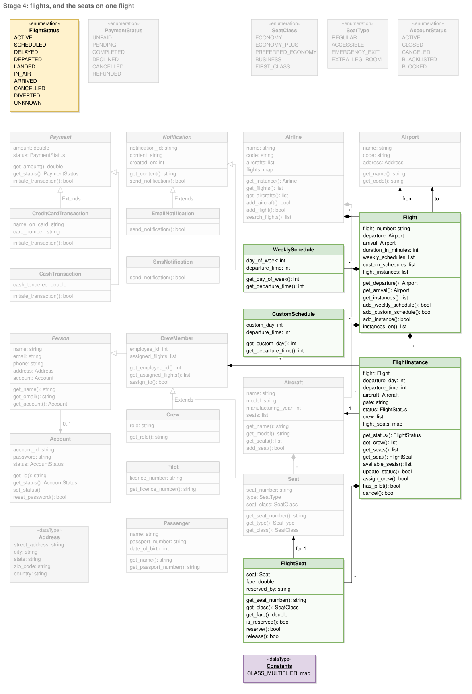
*Figure — Flight, FlightInstance and FlightSeat: the route, the route on a day, and a seat on that day (course diagram)*

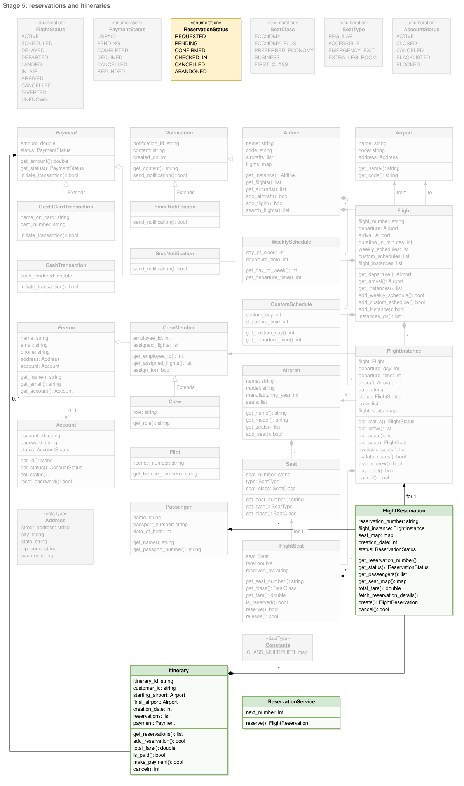
*Figure — FlightReservation maps passengers to flight seats; an Itinerary owns its reservations (course diagram)*


*Figure — The finished class diagram of the airline management system (course diagram)*

In the first figure above, all the ownership (filled-diamond) arrows run in one direction: schedules and instances belong to their flight, and flight seats belong to their instance. Airports, the aircraft and the crew are only referred to — cancelling a flight does not destroy an airport. Notice also in the finished diagram that `Passenger` sits outside the `Person`/account tree: the course's reason is that a passenger may never log in, and a customer can book for other people.

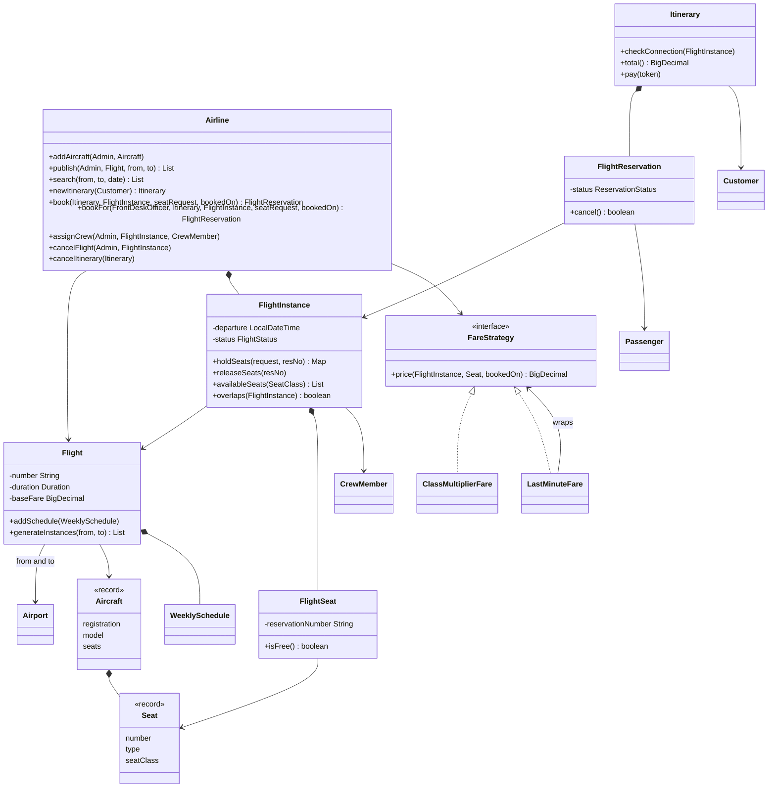

### Key flows

**Reserve a ticket.** The customer (or front desk officer) searches; if a flight is available they choose seats and passengers, pay, and receive a confirmation; otherwise they search again.


*Figure — Activity diagram: reserving a ticket (course diagram)*

**Cancel a reservation.** The system checks that the customer has a valid reservation; if so it cancels it, releases the seats and notifies the customer; if not, it reports the error.


*Figure — Activity diagram: cancelling a reservation (course diagram)*

Booking one leg of an itinerary:

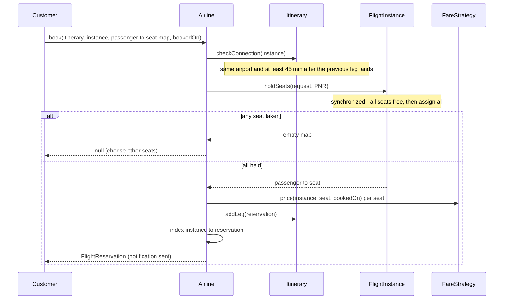

Admin cancels a flight instance:

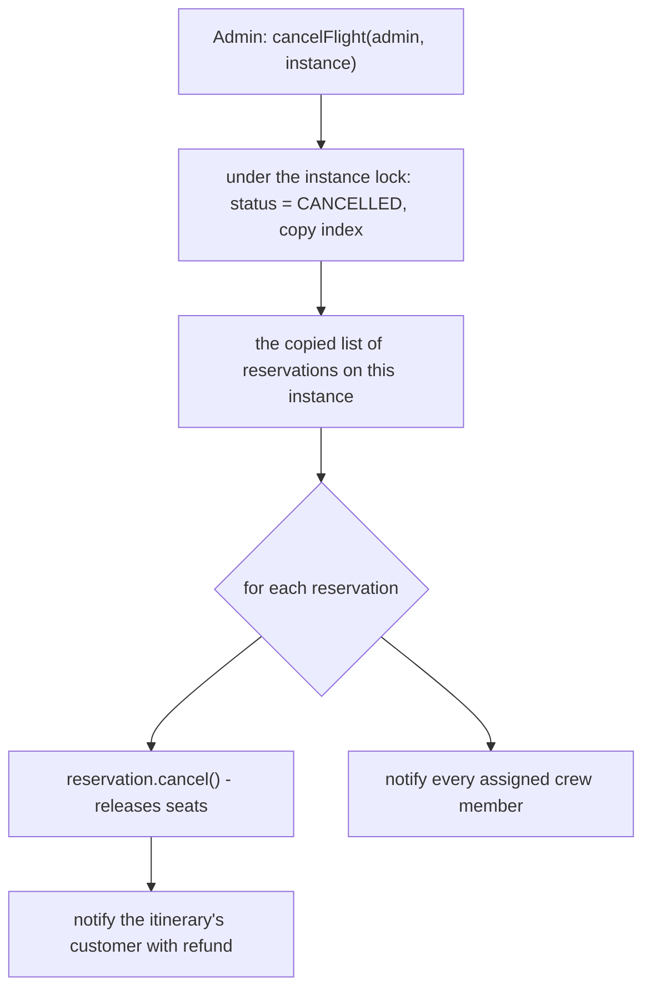

### Design decisions & patterns used

| Decision | Why | Alternative rejected |
|---|---|---|
| **Flight vs FlightInstance vs Seat vs FlightSeat** | 12A is free on Tuesday and taken on Thursday, so "booked" and the fare belong to the seat *on an instance*. The course says an older version of its code had drifted from its diagram here — the code is what runs. | A `booked` flag on `Seat`: one booking would block the seat forever. |
| `holdSeats` is **all-or-nothing** and `synchronized` per instance | A family must get all seats or none; per-instance locks let different flights sell in parallel. | Holding seats one by one (half-booked families), or one global lock (no parallelism). |
| `Passenger` is not an account | A passenger is a name on a ticket; a customer books for others. | `Passenger extends Person` would force an account on a child. |
| **Itinerary is paid, not the leg** | A customer pays for the trip. | Paying per reservation. |
| **Connection rule on `Itinerary`** | The course names "no connecting-time check" as a gap; the rule belongs to the thing that holds the legs. We check same airport and a 45-minute minimum. | No check (impossible trips). |
| **Index instance → reservations** | The course's other named gap: cancelling a flight told the crew but not passengers, because there was no path from instance to its reservations. The index fixes it. | Scanning every itinerary. |
| **Strategy + Decorator** for fares | The course suggests Strategy for fares (base, seasonal, last minute). `ClassMultiplierFare` uses the course's multipliers (1.0, 1.3, 1.5, 2.5, 4.0); `LastMinuteFare` wraps any fare and adds 25% within 3 days. | Price field on the seat. |
| Crew overlap check | A pilot cannot be on two instances whose times overlap. | Trusting the admin. |
| **Facade** (`Airline`) | One entry point for admin and customer operations. Admin-only operations (`addAircraft`, `publish`, `assignCrew`, `cancelFlight`) take an `Admin` parameter, so "only the admin" is enforced by the compiler; `bookFor(FrontDeskOfficer, …)` is the same call as `book` made by a different actor, exactly as in the course's stage 6. | Actors holding the rules. |
| The course makes `Airline` a Singleton | We construct it once and pass it in, to stay testable. | Global `getInstance()`. |

### Java implementation

Package `lld.ch16.airline`.

```java
// File: code/lld/ch16/airline/Types.java
package lld.ch16.airline;

enum FlightStatus { SCHEDULED, DELAYED, DEPARTED, LANDED, CANCELLED }
enum ReservationStatus { CONFIRMED, CANCELLED }
enum SeatClass { ECONOMY, ECONOMY_PLUS, PREFERRED_ECONOMY, BUSINESS, FIRST_CLASS }
enum SeatType { REGULAR, ACCESSIBLE, EMERGENCY_EXIT, EXTRA_LEG_ROOM }
enum CrewRole { PILOT, CO_PILOT, CABIN_CREW }

record Airport(String code, String city) {}

/** The PHYSICAL seat bolted to an aircraft. It knows nothing about bookings. */
record Seat(String number, SeatType type, SeatClass seatClass) {}

/** A name on a ticket. Not an account holder: a customer can book for other people. */
record Passenger(String name, String passportRef) {}

record Customer(String id, String name, String email) {}

record CrewMember(String id, String name, CrewRole role) {}

/** Staff actors. Admin-only operations take an Admin parameter, so the compiler enforces "only the admin". */
record Admin(String id, String name) {}
record FrontDeskOfficer(String id, String name) {}
```

```java
// File: code/lld/ch16/airline/Fleet.java
package lld.ch16.airline;

import java.math.BigDecimal;
import java.time.DayOfWeek;
import java.time.Duration;
import java.time.LocalDate;
import java.time.LocalDateTime;
import java.time.LocalTime;
import java.util.ArrayList;
import java.util.List;

record Aircraft(String registration, String model, List<Seat> seats) {
    Aircraft { seats = List.copyOf(seats); }
}

/** A recurring slot: "every Tuesday at 10:00". */
record WeeklySchedule(DayOfWeek day, LocalTime departure) {}

/**
 * A Flight is the ROUTE (GA212 LHR->NRT). It creates one FlightInstance per scheduled day.
 * All times are in one reference zone (UTC) to keep the example small.
 */
final class Flight {
    private final String number;
    private final Airport from;
    private final Airport to;
    private final Duration duration;
    private final Aircraft aircraft;
    private final BigDecimal baseFare;
    private final List<WeeklySchedule> schedules = new ArrayList<>();

    Flight(String number, Airport from, Airport to, Duration duration, Aircraft aircraft, BigDecimal baseFare) {
        this.number = number; this.from = from; this.to = to;
        this.duration = duration; this.aircraft = aircraft; this.baseFare = baseFare;
    }
    String number() { return number; }
    Airport from() { return from; }
    Airport to() { return to; }
    Duration duration() { return duration; }
    Aircraft aircraft() { return aircraft; }
    BigDecimal baseFare() { return baseFare; }

    void addSchedule(WeeklySchedule s) { schedules.add(s); }

    List<FlightInstance> generateInstances(LocalDate fromDate, LocalDate toDateExclusive) {
        List<FlightInstance> out = new ArrayList<>();
        fromDate.datesUntil(toDateExclusive).forEach(d -> schedules.stream()
                .filter(s -> s.day() == d.getDayOfWeek())
                .forEach(s -> out.add(new FlightInstance(this, LocalDateTime.of(d, s.departure())))));
        return out;
    }
}
```

```java
// File: code/lld/ch16/airline/FlightInstance.java
package lld.ch16.airline;

import java.time.LocalDateTime;
import java.util.ArrayList;
import java.util.LinkedHashMap;
import java.util.List;
import java.util.Map;

/** One seat on one flight instance: 12A can be free on Tuesday and taken on Thursday. */
final class FlightSeat {
    private final Seat seat;
    private String reservationNumber;   // null = free
    FlightSeat(Seat seat) { this.seat = seat; }
    Seat seat() { return seat; }
    String reservationNumber() { return reservationNumber; }
    boolean isFree() { return reservationNumber == null; }
    void assign(String resNo) { reservationNumber = resNo; }
    void free() { reservationNumber = null; }
}

/** The route flown on one date: owns its seats, its crew list and its status. */
final class FlightInstance {
    private final Flight flight;
    private final LocalDateTime departure;
    private final Map<String, FlightSeat> seats = new LinkedHashMap<>();
    private final List<CrewMember> crew = new ArrayList<>();
    private FlightStatus status = FlightStatus.SCHEDULED;

    FlightInstance(Flight flight, LocalDateTime departure) {
        this.flight = flight;
        this.departure = departure;
        flight.aircraft().seats().forEach(s -> seats.put(s.number(), new FlightSeat(s)));
    }

    Flight flight() { return flight; }
    LocalDateTime departure() { return departure; }
    LocalDateTime arrival() { return departure.plus(flight.duration()); }
    synchronized FlightStatus status() { return status; }
    synchronized List<CrewMember> crew() { return List.copyOf(crew); }
    String key() { return flight.number() + "@" + departure.toLocalDate(); }

    synchronized List<Seat> availableSeats(SeatClass c) {
        return seats.values().stream().filter(FlightSeat::isFree).map(FlightSeat::seat)
                .filter(s -> s.seatClass() == c).toList();
    }

    synchronized int freeSeatCount() { return (int) seats.values().stream().filter(FlightSeat::isFree).count(); }

    /** All-or-nothing: a family of three either gets all three seats or none. */
    synchronized Map<Passenger, Seat> holdSeats(Map<Passenger, String> request, String reservationNumber) {
        if (status != FlightStatus.SCHEDULED && status != FlightStatus.DELAYED)
            throw new IllegalStateException(key() + " is " + status);
        for (var seatNo : request.values()) {
            var fs = seats.get(seatNo);
            if (fs == null) throw new IllegalArgumentException("no seat " + seatNo + " on " + key());
            if (!fs.isFree()) return Map.of();
        }
        if (request.values().stream().distinct().count() != request.size())
            throw new IllegalArgumentException("two passengers asked for the same seat");
        Map<Passenger, Seat> out = new LinkedHashMap<>();
        request.forEach((p, no) -> { var fs = seats.get(no); fs.assign(reservationNumber); out.put(p, fs.seat()); });
        return out;
    }

    synchronized void releaseSeats(String reservationNumber) {
        seats.values().stream().filter(fs -> reservationNumber.equals(fs.reservationNumber())).forEach(FlightSeat::free);
    }

    synchronized void addCrew(CrewMember m) { crew.add(m); }
    synchronized void setStatus(FlightStatus s) { status = s; }

    boolean overlaps(FlightInstance other) {
        return departure.isBefore(other.arrival()) && other.departure().isBefore(arrival());
    }
}
```

```java
// File: code/lld/ch16/airline/Booking.java
package lld.ch16.airline;

import java.math.BigDecimal;
import java.math.RoundingMode;
import java.time.Duration;
import java.time.LocalDate;
import java.time.temporal.ChronoUnit;
import java.util.ArrayList;
import java.util.EnumMap;
import java.util.List;
import java.util.Map;

/** Strategy: what one seat on one flight instance costs, booked on a given day. */
interface FareStrategy { BigDecimal price(FlightInstance fi, Seat seat, LocalDate bookedOn); }

final class ClassMultiplierFare implements FareStrategy {
    private static final Map<SeatClass, BigDecimal> MULTIPLIER = new EnumMap<>(Map.of(
            SeatClass.ECONOMY, new BigDecimal("1.0"), SeatClass.ECONOMY_PLUS, new BigDecimal("1.3"),
            SeatClass.PREFERRED_ECONOMY, new BigDecimal("1.5"), SeatClass.BUSINESS, new BigDecimal("2.5"),
            SeatClass.FIRST_CLASS, new BigDecimal("4.0")));
    public BigDecimal price(FlightInstance fi, Seat seat, LocalDate bookedOn) {
        return fi.flight().baseFare().multiply(MULTIPLIER.get(seat.seatClass())).setScale(2, RoundingMode.HALF_UP);
    }
}

/** Decorator on any fare: +25% when booked less than 3 days before departure. */
final class LastMinuteFare implements FareStrategy {
    private final FareStrategy inner;
    LastMinuteFare(FareStrategy inner) { this.inner = inner; }
    public BigDecimal price(FlightInstance fi, Seat seat, LocalDate bookedOn) {
        var p = inner.price(fi, seat, bookedOn);
        long daysBefore = ChronoUnit.DAYS.between(bookedOn, fi.departure().toLocalDate());
        return daysBefore < 3 ? p.multiply(new BigDecimal("1.25")).setScale(2, RoundingMode.HALF_UP) : p;
    }
}

/** One leg: one flight instance, several passengers, each with a seat. */
final class FlightReservation {
    private final String number;
    private final FlightInstance instance;
    private final Map<Passenger, Seat> seatMap;
    private final BigDecimal amount;
    private ReservationStatus status = ReservationStatus.CONFIRMED;

    FlightReservation(String number, FlightInstance instance, Map<Passenger, Seat> seatMap, BigDecimal amount) {
        this.number = number; this.instance = instance; this.seatMap = Map.copyOf(seatMap); this.amount = amount;
    }
    String number() { return number; }
    FlightInstance instance() { return instance; }
    Map<Passenger, Seat> seatMap() { return seatMap; }
    BigDecimal amount() { return amount; }
    synchronized ReservationStatus status() { return status; }

    /** Returns true if this call did the cancelling (idempotent). */
    synchronized boolean cancel() {
        if (status == ReservationStatus.CANCELLED) return false;
        status = ReservationStatus.CANCELLED;
        instance.releaseSeats(number);
        return true;
    }
}

/** A trip of one or more legs. The itinerary, not each leg, is what gets paid for. */
final class Itinerary {
    static final Duration MIN_CONNECTION = Duration.ofMinutes(45);

    private final String id;
    private final Customer customer;
    private final List<FlightReservation> legs = new ArrayList<>();
    private boolean paid;

    Itinerary(String id, Customer customer) { this.id = id; this.customer = customer; }
    String id() { return id; }
    Customer customer() { return customer; }
    synchronized List<FlightReservation> legs() { return List.copyOf(legs); }

    /** Rule the itinerary owns: the next leg must leave from where the last one landed, with time to change. */
    synchronized void checkConnection(FlightInstance next) {
        if (legs.isEmpty()) return;
        var last = legs.getLast().instance();
        if (!last.flight().to().equals(next.flight().from()))
            throw new IllegalArgumentException("leg must depart from " + last.flight().to().code());
        if (next.departure().isBefore(last.arrival().plus(MIN_CONNECTION)))
            throw new IllegalArgumentException("connection too short: " + next.key() + " leaves before " + last.key() + " lands + 45 min");
    }

    synchronized void addLeg(FlightReservation r) { legs.add(r); }

    synchronized BigDecimal total() {
        return legs.stream().filter(l -> l.status() == ReservationStatus.CONFIRMED)
                .map(FlightReservation::amount).reduce(new BigDecimal("0.00"), BigDecimal::add);
    }

    /** Idempotent: a second pay() (double click, retry) does not charge again. */
    synchronized void pay(String cardToken) {
        if (paid) return;
        System.out.println("    charged " + total() + " to " + cardToken + " for itinerary " + id);
        paid = true;
    }
    synchronized boolean isPaid() { return paid; }
}
```

```java
// File: code/lld/ch16/airline/Airline.java
package lld.ch16.airline;

import java.math.BigDecimal;
import java.time.LocalDate;
import java.util.ArrayList;
import java.util.List;
import java.util.Map;
import java.util.concurrent.ConcurrentHashMap;
import java.util.concurrent.CopyOnWriteArrayList;
import java.util.concurrent.atomic.AtomicInteger;

interface Notifier { void send(String to, String message); }

final class EmailNotifier implements Notifier {
    public void send(String to, String message) { System.out.println("    [email " + to + "] " + message); }
}

/**
 * Facade over the airline's data: admin operations, search, booking, crew and cancellation.
 * Keeps an index flight-instance -> reservations so a cancelled flight can reach every passenger.
 */
final class Airline {
    private final String name;
    private final FareStrategy fares;
    private final Notifier notifier;
    private final Map<String, Aircraft> fleet = new ConcurrentHashMap<>();
    private final List<FlightInstance> instances = new CopyOnWriteArrayList<>();
    private final Map<FlightInstance, List<FlightReservation>> byInstance = new ConcurrentHashMap<>();
    private final Map<FlightReservation, Itinerary> owner = new ConcurrentHashMap<>();
    private final AtomicInteger seq = new AtomicInteger(100);

    Airline(String name, FareStrategy fares, Notifier notifier) {
        this.name = name; this.fares = fares; this.notifier = notifier;
    }

    // ---- admin operations ----
    void addAircraft(Admin by, Aircraft a) { fleet.put(a.registration(), a); }

    List<FlightInstance> publish(Admin by, Flight f, LocalDate from, LocalDate toExclusive) {
        var created = f.generateInstances(from, toExclusive);
        instances.addAll(created);
        return created;
    }

    /** A crew member cannot be on two instances whose times overlap. */
    synchronized void assignCrew(Admin by, FlightInstance fi, CrewMember m) {
        for (var other : instances) {
            if (other != fi && other.crew().contains(m) && other.overlaps(fi))
                throw new IllegalStateException(m.name() + " already flies " + other.key() + " at that time");
        }
        if (fi.crew().contains(m)) throw new IllegalStateException(m.name() + " already on " + fi.key());
        fi.addCrew(m);
    }

    List<FlightInstance> scheduleFor(CrewMember m) {
        return instances.stream().filter(fi -> fi.crew().contains(m)).toList();
    }

    void cancelFlight(Admin by, FlightInstance fi) {
        List<FlightReservation> affected;
        synchronized (fi) {        // same lock as the hold+index step in book(): no booking can slip past the cancel
            fi.setStatus(FlightStatus.CANCELLED);
            affected = List.copyOf(byInstance.getOrDefault(fi, List.of()));
        }
        for (var r : affected) {
            if (r.cancel()) {
                var it = owner.get(r);
                notifier.send(it.customer().email(), fi.key() + " is cancelled. Reservation " + r.number()
                        + " refunded " + r.amount() + ". Itinerary " + it.id() + " now totals " + it.total());
            }
        }
        fi.crew().forEach(c -> notifier.send(c.id() + "@crew", "Stand down: " + fi.key() + " cancelled"));
    }

    // ---- customer operations ----
    List<FlightInstance> search(Airport from, Airport to, LocalDate date) {
        return instances.stream().filter(fi -> fi.flight().from().equals(from) && fi.flight().to().equals(to)
                && fi.departure().toLocalDate().equals(date) && fi.status() != FlightStatus.CANCELLED).toList();
    }

    Itinerary newItinerary(Customer c) { return new Itinerary("IT-" + seq.incrementAndGet(), c); }

    /** Books one leg for several passengers. Throws if the connection is invalid; returns null if a seat is taken. */
    FlightReservation book(Itinerary it, FlightInstance fi, Map<Passenger, String> seatRequest, LocalDate bookedOn) {
        it.checkConnection(fi);
        String resNo = "PNR" + seq.incrementAndGet();
        FlightReservation r;
        synchronized (fi) {        // hold the seats AND index the reservation as one step (see cancelFlight)
            var seatMap = fi.holdSeats(seatRequest, resNo);
            if (seatMap.isEmpty()) return null;
            var amount = seatMap.values().stream().map(s -> fares.price(fi, s, bookedOn)).reduce(BigDecimal.ZERO, BigDecimal::add);
            r = new FlightReservation(resNo, fi, seatMap, amount);
            owner.put(r, it);
            byInstance.computeIfAbsent(fi, k -> new CopyOnWriteArrayList<>()).add(r);
        }
        it.addLeg(r);
        var seatMap = r.seatMap();
        var amount = r.amount();
        notifier.send(it.customer().email(), "Booked " + fi.key() + " seats " + seatMap.values().stream().map(Seat::number).sorted().toList() + " (" + resNo + ", " + amount + ")");
        return r;
    }

    /** The front desk books for a walk-in customer: the same call, made by a different actor. */
    FlightReservation bookFor(FrontDeskOfficer by, Itinerary it, FlightInstance fi, Map<Passenger, String> seatRequest, LocalDate bookedOn) {
        return book(it, fi, seatRequest, bookedOn);
    }

    void cancelItinerary(Itinerary it) {
        it.legs().forEach(FlightReservation::cancel);
        notifier.send(it.customer().email(), "Itinerary " + it.id() + " cancelled");
    }

    String name() { return name; }
}
```

```java
// File: code/lld/ch16/airline/Main.java
package lld.ch16.airline;

import java.math.BigDecimal;
import java.time.DayOfWeek;
import java.time.Duration;
import java.time.LocalDate;
import java.time.LocalTime;
import java.util.LinkedHashMap;
import java.util.List;
import java.util.Map;
import java.util.concurrent.CountDownLatch;
import java.util.concurrent.Executors;
import java.util.concurrent.atomic.AtomicInteger;

public class Main {
    public static void main(String[] args) throws Exception {
        var airline = new Airline("Global Air", new LastMinuteFare(new ClassMultiplierFare()), new EmailNotifier());
        var lhr = new Airport("LHR", "London");
        var nrt = new Airport("NRT", "Tokyo");
        var jfk = new Airport("JFK", "New York");

        var seats = List.of(
                new Seat("1A", SeatType.REGULAR, SeatClass.BUSINESS), new Seat("1B", SeatType.REGULAR, SeatClass.BUSINESS),
                new Seat("10A", SeatType.REGULAR, SeatClass.ECONOMY), new Seat("10B", SeatType.REGULAR, SeatClass.ECONOMY),
                new Seat("10C", SeatType.ACCESSIBLE, SeatClass.ECONOMY), new Seat("12A", SeatType.EXTRA_LEG_ROOM, SeatClass.ECONOMY_PLUS));
        var a1 = new Aircraft("G-GAAA", "A350-900", seats);
        var a2 = new Aircraft("G-GAAB", "B787-9", seats);
        var admin = new Admin("AD1", "Olga");
        airline.addAircraft(admin, a1);
        airline.addAircraft(admin, a2);

        System.out.println("1) Admin adds flights (routes) and weekly schedules, then publishes instances");
        var ga212 = new Flight("GA212", lhr, nrt, Duration.ofHours(14), a1, new BigDecimal("500.00"));
        ga212.addSchedule(new WeeklySchedule(DayOfWeek.TUESDAY, LocalTime.of(10, 0)));
        ga212.addSchedule(new WeeklySchedule(DayOfWeek.THURSDAY, LocalTime.of(10, 0)));
        var ga100 = new Flight("GA100", jfk, lhr, Duration.ofHours(7), a2, new BigDecimal("400.00"));
        ga100.addSchedule(new WeeklySchedule(DayOfWeek.WEDNESDAY, LocalTime.of(20, 0)));
        var ga300 = new Flight("GA300", lhr, jfk, Duration.ofHours(8), a2, new BigDecimal("450.00"));
        ga300.addSchedule(new WeeklySchedule(DayOfWeek.THURSDAY, LocalTime.of(12, 0)));
        var from = LocalDate.of(2026, 10, 5);
        var to = LocalDate.of(2026, 10, 19);
        var ga212Instances = airline.publish(admin, ga212, from, to);
        airline.publish(admin, ga100, from, to);
        airline.publish(admin, ga300, from, to);
        System.out.println("   GA212 instances: " + ga212Instances.stream().map(FlightInstance::key).toList());

        System.out.println("2) Search JFK->LHR on 7 Oct and LHR->NRT on 8 Oct");
        var leg1 = airline.search(jfk, lhr, LocalDate.of(2026, 10, 7)).getFirst();
        var leg2 = airline.search(lhr, nrt, LocalDate.of(2026, 10, 8)).getFirst();
        for (var fi : List.of(leg1, leg2))
            System.out.println("   " + fi.key() + " dep " + fi.departure() + " arr " + fi.arrival() + ", free seats " + fi.freeSeatCount());

        System.out.println("3) Priya books a two-leg itinerary for herself and her son");
        var priya = new Customer("C1", "Priya", "priya@example.com");
        var me = new Passenger("Priya Shah", "P-001");
        var son = new Passenger("Arjun Shah", "P-002");
        var bookedOn = LocalDate.of(2026, 10, 1);
        var it = airline.newItinerary(priya);
        airline.book(it, leg1, ordered(me, "10A", son, "10B"), bookedOn);
        airline.book(it, leg2, ordered(me, "1A", son, "1B"), bookedOn);
        System.out.println("   itinerary total " + it.total() + " (2 x 400 economy + 2 x 1250 business)");
        it.pay("tok_priya_card");
        it.pay("tok_priya_card");   // double click: no second charge

        System.out.println("4) Bad connection is rejected");
        var it2 = airline.newItinerary(priya);
        airline.book(it2, leg1, Map.of(me, "12A"), bookedOn);
        try { airline.book(it2, ga212Instances.getFirst(), Map.of(me, "10A"), bookedOn); }
        catch (IllegalArgumentException e) { System.out.println("   rejected: " + e.getMessage()); }
        airline.cancelItinerary(it2);

        System.out.println("5) 20 customers race for seat 10C on " + leg2.key());
        var winners = new AtomicInteger();
        var go = new CountDownLatch(1);
        var raceAirline = airline;   // effectively-final alias for the lambdas
        try (var pool = Executors.newFixedThreadPool(20)) {
            for (int i = 0; i < 20; i++) {
                int n = i;
                pool.submit(() -> {
                    go.await();
                    var c = new Customer("R" + n, "Racer" + n, "racer" + n + "@example.com");
                    var r = raceAirline.book(raceAirline.newItinerary(c), leg2, Map.of(new Passenger("Racer" + n, "X" + n), "10C"), bookedOn);
                    if (r != null) winners.incrementAndGet();
                    return null;
                });
            }
            go.countDown();
        }
        System.out.println("   successful bookings of 10C: " + winners.get() + ", free seats left: " + leg2.freeSeatCount());

        System.out.println("6) Walk-in at the front desk, last-minute (booked 7 Oct for 8 Oct): pays +25%");
        var desk = new FrontDeskOfficer("FD1", "Tom");
        var late = airline.newItinerary(new Customer("C2", "Leo", "leo@example.com"));
        var r = airline.bookFor(desk, late, leg2, Map.of(new Passenger("Leo Park", "P-003"), "12A"), LocalDate.of(2026, 10, 7));
        System.out.println("   economy-plus fare 500 x 1.3 = 650.00, charged " + r.amount());

        System.out.println("7) Admin assigns crew");
        var kim = new CrewMember("K1", "Capt. Kim", CrewRole.PILOT);
        var lee = new CrewMember("L1", "F/O Lee", CrewRole.CO_PILOT);
        var ana = new CrewMember("A1", "Ana", CrewRole.CABIN_CREW);
        for (var m : List.of(kim, lee, ana)) airline.assignCrew(admin, leg2, m);
        var ga300Oct8 = airline.search(lhr, jfk, LocalDate.of(2026, 10, 8)).getFirst();
        try { airline.assignCrew(admin, ga300Oct8, kim); }
        catch (IllegalStateException e) { System.out.println("   rejected: " + e.getMessage()); }
        System.out.println("   Kim's schedule: " + airline.scheduleFor(kim).stream().map(FlightInstance::key).toList());

        System.out.println("8) Admin cancels " + leg2.key() + ": every passenger and crew member is told");
        airline.cancelFlight(admin, leg2);
        System.out.println("   search LHR->NRT on 8 Oct now returns " + airline.search(lhr, nrt, LocalDate.of(2026, 10, 8)).size() + " flights");

        System.out.println("9) Priya cancels the rest of her trip; seats on " + leg1.key() + " come back");
        airline.cancelItinerary(it);
        System.out.println("   free economy seats on " + leg1.key() + ": " + leg1.availableSeats(SeatClass.ECONOMY).stream().map(Seat::number).toList());
    }

    static Map<Passenger, String> ordered(Passenger a, String sa, Passenger b, String sb) {
        var m = new LinkedHashMap<Passenger, String>();
        m.put(a, sa);
        m.put(b, sb);
        return m;
    }
}
```

Output:

```text
1) Admin adds flights (routes) and weekly schedules, then publishes instances
   GA212 instances: [GA212@2026-10-06, GA212@2026-10-08, GA212@2026-10-13, GA212@2026-10-15]
2) Search JFK->LHR on 7 Oct and LHR->NRT on 8 Oct
   GA100@2026-10-07 dep 2026-10-07T20:00 arr 2026-10-08T03:00, free seats 6
   GA212@2026-10-08 dep 2026-10-08T10:00 arr 2026-10-09T00:00, free seats 6
3) Priya books a two-leg itinerary for herself and her son
    [email priya@example.com] Booked GA100@2026-10-07 seats [10A, 10B] (PNR102, 800.00)
    [email priya@example.com] Booked GA212@2026-10-08 seats [1A, 1B] (PNR103, 2500.00)
   itinerary total 3300.00 (2 x 400 economy + 2 x 1250 business)
    charged 3300.00 to tok_priya_card for itinerary IT-101
4) Bad connection is rejected
    [email priya@example.com] Booked GA100@2026-10-07 seats [12A] (PNR105, 520.00)
   rejected: connection too short: GA212@2026-10-06 leaves before GA100@2026-10-07 lands + 45 min
    [email priya@example.com] Itinerary IT-104 cancelled
5) 20 customers race for seat 10C on GA212@2026-10-08
    [email racer7@example.com] Booked GA212@2026-10-08 seats [10C] (PNR115, 500.00)
   successful bookings of 10C: 1, free seats left: 3
6) Walk-in at the front desk, last-minute (booked 7 Oct for 8 Oct): pays +25%
    [email leo@example.com] Booked GA212@2026-10-08 seats [12A] (PNR147, 812.50)
   economy-plus fare 500 x 1.3 = 650.00, charged 812.50
7) Admin assigns crew
   rejected: Capt. Kim already flies GA212@2026-10-08 at that time
   Kim's schedule: [GA212@2026-10-08]
8) Admin cancels GA212@2026-10-08: every passenger and crew member is told
    [email priya@example.com] GA212@2026-10-08 is cancelled. Reservation PNR103 refunded 2500.00. Itinerary IT-101 now totals 800.00
    [email racer7@example.com] GA212@2026-10-08 is cancelled. Reservation PNR115 refunded 500.00. Itinerary IT-107 now totals 0.00
    [email leo@example.com] GA212@2026-10-08 is cancelled. Reservation PNR147 refunded 812.50. Itinerary IT-146 now totals 0.00
    [email K1@crew] Stand down: GA212@2026-10-08 cancelled
    [email L1@crew] Stand down: GA212@2026-10-08 cancelled
    [email A1@crew] Stand down: GA212@2026-10-08 cancelled
   search LHR->NRT on 8 Oct now returns 0 flights
9) Priya cancels the rest of her trip; seats on GA100@2026-10-07 come back
    [email priya@example.com] Itinerary IT-101 cancelled
   free economy seats on GA100@2026-10-07: [10A, 10B, 10C]
```

Step 3 prices 2 × 400 economy + 2 × (500 × 2.5) business = 3300, and the second `pay` call charges nothing. Step 5 has 20 threads racing for seat 10C and exactly one wins (which racer wins, and therefore the PNR and itinerary numbers printed for them in steps 5 and 8, changes from run to run). Step 6 is 500 × 1.3 = 650, plus 25% last-minute = 812.50. Step 8 reaches every passenger through the index — the gap the course points out.

### Concurrency & edge cases

- **Selling one seat twice.** `holdSeats` is `synchronized` on the instance: it checks every requested seat and only then assigns them all. No other thread can slip in between.
- **Booking while the admin cancels the flight.** `book` holds the seats *and* adds the reservation to the instance → reservations index inside one `synchronized (fi)` block, and `cancelFlight` sets `CANCELLED` and copies that index under the same lock. So every reservation is either in the copy (and gets cancelled and notified) or is refused by `holdSeats` because the flight is already `CANCELLED` — none can slip through un-notified.
- **Double payment.** `Itinerary.pay` returns at once if the itinerary is already paid (step 3 calls it twice and charges once).
- **Duplicate seat in one request** (two passengers asking for 12A) is rejected.
- **Booking a cancelled or departed flight** throws.
- **Idempotent cancel.** `FlightReservation.cancel()` returns `false` if already cancelled, so a customer cancelling while the admin cancels the flight does not double-refund.
- **Crew double-booking** across overlapping instances is rejected (`assignCrew` is `synchronized` over the scan and the add).
- **Time zones.** Our example keeps all times in one reference zone. Real systems store departures as `ZonedDateTime` or `Instant` with each airport's zone, because London and Tokyo are 8–9 hours apart.
- **Seat holds during payment.** Real booking flows put a seat on a short *hold* (for example 10–15 minutes) while the customer pays, and release it automatically if payment fails. Add a `heldUntil` timestamp on `FlightSeat` and a sweeper.

### Extensions & follow-up questions

- **"Overbooking on purpose?"** — Airlines sell a few more seats than exist because some passengers do not show up. Model a per-class `overbookLimit` and assign physical seats at check-in.
- **"Check-in and boarding passes?"** — Add `CHECKED_IN` per passenger, a `BoardingPass` (seat, gate, group), and a check-in window.
- **"Baggage?"** — `Baggage(passenger, weight, tag)` on the reservation; fees as extra lines.
- **"Change fees and fare rules?"** — Fare class with rules (refundable, change fee); cancellation refund = fare − fee.
- **"Codeshares?"** — A `MarketingFlight` (partner's number) pointing at the operating `FlightInstance`.
- **"Delays?"** — `FlightInstance.setStatus(DELAYED)` plus a new departure; notify via the same index; re-check itinerary connections and rebook broken ones.
- **"Scale?"** — Seat inventory per instance is a hot row; use one row per seat with a conditional update (`UPDATE … WHERE reservation IS NULL`) or optimistic locking, and a cache for search.

### In the interview

**30-second pitch:** "Four separate ideas carry the design. `Flight` is the published route; `FlightInstance` is one departure of it on a particular day; `Seat` is the chair fixed in the aircraft; `FlightSeat` is that chair on that one departure, and it is where the fare and the booking live. Reservations map passengers to flight seats and are held atomically per instance. An itinerary groups legs, checks connections and is what gets paid. Fares are a strategy with a last-minute decorator. An index from instance to reservations lets a cancelled flight notify every passenger."

| Minutes | Do |
|---|---|
| 0–5 | Clarify search, itineraries, multiple passengers, crew, cancellation. |
| 5–10 | Actors and use cases. |
| 10–20 | The four-way distinction, then the class diagram. |
| 20–35 | Code `FlightInstance.holdSeats`, `Airline.book`, `Itinerary.checkConnection`, `cancelFlight`. |
| 35–40 | Seat holds during payment, overbooking, time zones. |

**Expected follow-up:** "A flight is cancelled — how do its passengers find out?" — "Through an index from instance to reservations; without it you can only reach the crew."

### Self-check

1. **Q:** Where does the "booked" flag live and why? **A:** On `FlightSeat` — a seat's booking is per instance (per date), not per aircraft.
2. **Q:** Why is `Passenger` not a subclass of `Person`/account? **A:** A passenger may never log in; a customer books for other people.
3. **Q:** How do you guarantee a family gets all seats or none? **A:** `holdSeats` checks all requested seats and assigns them in one synchronized block.
4. **Q:** What does `LastMinuteFare` add and which pattern is it? **A:** +25% within 3 days of departure; a Decorator over any `FareStrategy`.
5. **Q:** What two gaps did the course admit and how did we close them? **A:** No passenger notification on flight cancel (fixed by the instance → reservations index) and no connection-time check (fixed in `Itinerary.checkConnection`).

### TL;DR

- Flight (route) ≠ FlightInstance (route on a date); Seat (physical) ≠ FlightSeat (seat on that date).
- Hold seats all-or-nothing under the instance's lock.
- Itinerary = legs + connection rule + payment.
- Fares: Strategy + Decorator. Keep an instance → reservations index for cancellations.

**Real-world example.** Airline systems separate a *flight number* (a published schedule) from a *flight leg on a date*; inventory is controlled per leg and per booking class, and the booking record (a PNR, passenger name record) groups passengers and segments — the same shape as `FlightReservation` and `Itinerary` here. When an airline cancels a flight, its systems find every PNR on that leg and rebook or notify passengers, which is exactly why the index matters.

---

## Design a Course Registration System

### Problem & clarifying questions

A **course registration system** lets university students sign up for classes each term. It looks simple, but it is one of the harshest concurrency problems in this chapter: at 09:00 on registration day, thousands of students click "register" for the same few popular sections within seconds.

Terms first:

- A **course** is a catalogue entry (CS201 Data Structures, 4 credits).
- A **section** is one offering of a course with its own instructor, meeting time and capacity (CS201-A, Mon/Wed 10:00–11:30, 30 seats). Students register for **sections**, not courses — this is the same split as Flight vs FlightInstance.
- A **prerequisite** is a course you must have completed first.
- A **waitlist** is a first-come-first-served queue of students who want a seat in a full section.
- A **registration window** is the period when a student may register; universities often open it earlier for seniors (priority registration).

| Question | Assumed answer |
|---|---|
| Register for courses or sections? | Sections. |
| Prerequisites? | Must be completed (not just in progress). |
| Capacity? | Per section; when full, join a bounded waitlist. |
| Waitlist promotion? | Automatic when someone drops, in FIFO order, after re-checking the student's timetable. |
| Limits? | A per-student credit limit; no two sections that meet at the same time; no two sections of the same course. |
| Windows? | Opens by class year (seniors first); closes for everyone at one time. |
| Search? | By course code or title. |
| Concurrency? | Many students at once; a section must never exceed its capacity; one student must not double-register from two tabs. |

### Requirements

**Functional**

1. Students register for sections and view their registered sections.
2. Each course has a code, name and credits; each section has an instructor, time slot and enrolment limit.
3. Search courses by code or name.
4. Never enrol beyond a section's capacity; when full, put the student on the waitlist (if it has room).
5. Enforce prerequisites, credit limit, time conflicts, one section per course, and the registration window.
6. On drop, promote the first student on the waitlist automatically and notify them.

**Non-functional**

- Handle concurrent registrations safely: no race conditions, consistent data.
- Rules must be easy to add or remove (for example "department majors only").
- Extensible for future features (fees, holds, cross-listed courses).

### Use cases

- **Student** — searches courses, registers, drops, views schedule, joins a waitlist.
- **Registrar / Admin** — creates courses and sections, sets capacity and windows.
- **Instructor** — views the roster.
- **System** — enforces rules, promotes from the waitlist, sends notifications.

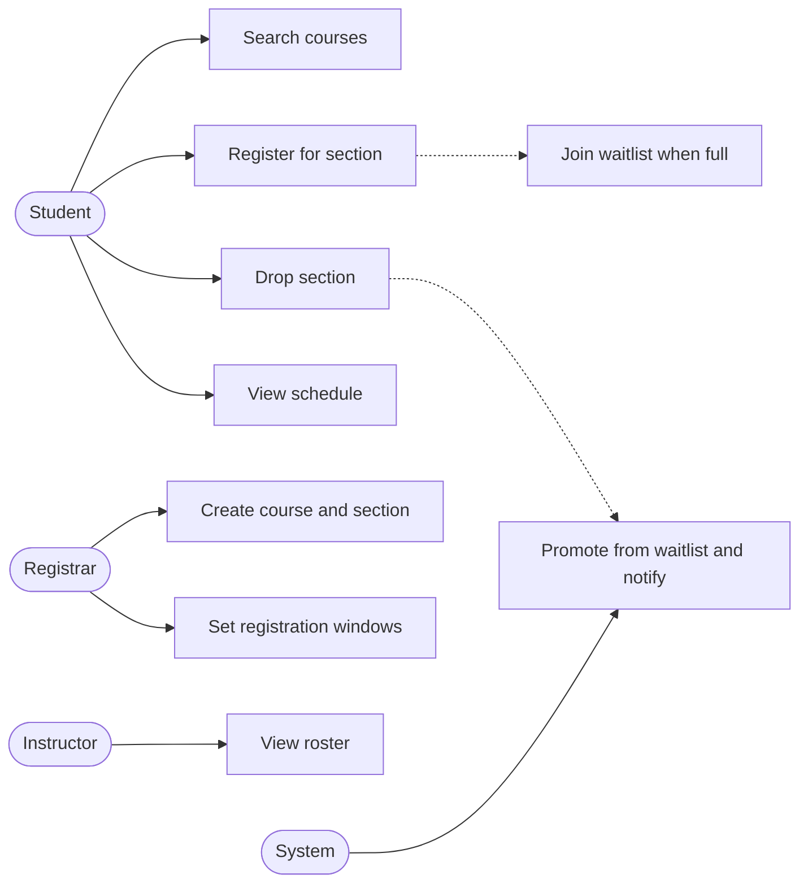

### Core entities

| Class | Responsibility |
|---|---|
| `Course` | Code, title, credits, prerequisite codes. |
| `Section` | One offering: instructor, time slot, capacity, enrolled set, waitlist. **The only place a seat is taken**, under its own lock. |
| `TimeSlot` | Days + start/end; knows whether it overlaps another slot. |
| `Instructor` | Who teaches. |
| `Student` | Year, completed courses, credit limit. |
| `RegistrationWindow` | Opening time per class year and a common closing time. |
| `RegistrationRule` (+ `WindowRule`, `PrerequisiteRule`, `DuplicateCourseRule`, `CreditLimitRule`, `TimeConflictRule`) | One rule each; returns the reason for a violation. |
| `RegistrationContext` | Everything a rule may look at. |
| `RegistrationResult`, `Outcome` | `ENROLLED`, `WAITLISTED` or `REJECTED` + message. |
| `Registrar` | The service: runs the rule chain, takes the seat, drops and promotes, keeps each student's schedule, and defines the lock order. |

### Class diagram

There is no course lesson for this problem. The problem statement comes from the *awesome-low-level-design* problem set: students register for courses and view their enrolments; a course has a code, name, instructor and maximum capacity; search by code or name; no enrolment past capacity; many students registering at once without race conditions; room to extend. Every one of those is covered above (the instructor and capacity sit on the `Section`). Here is the diagram of our Java design.

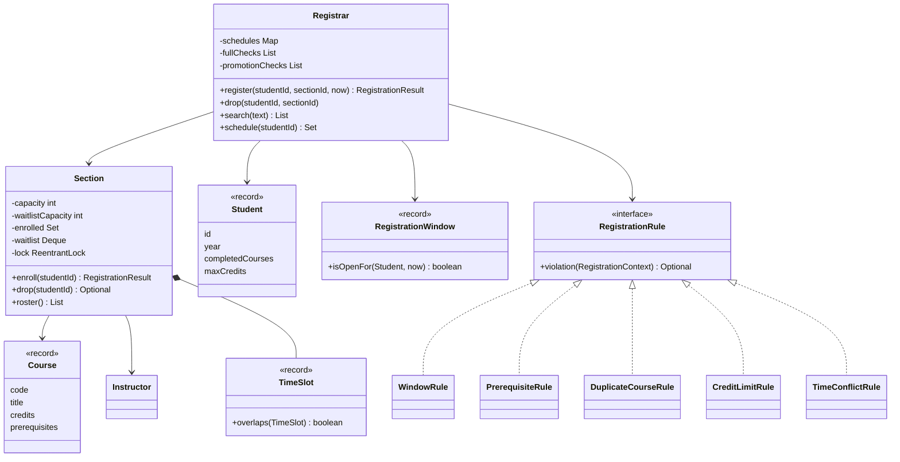

### Key flows

Register:

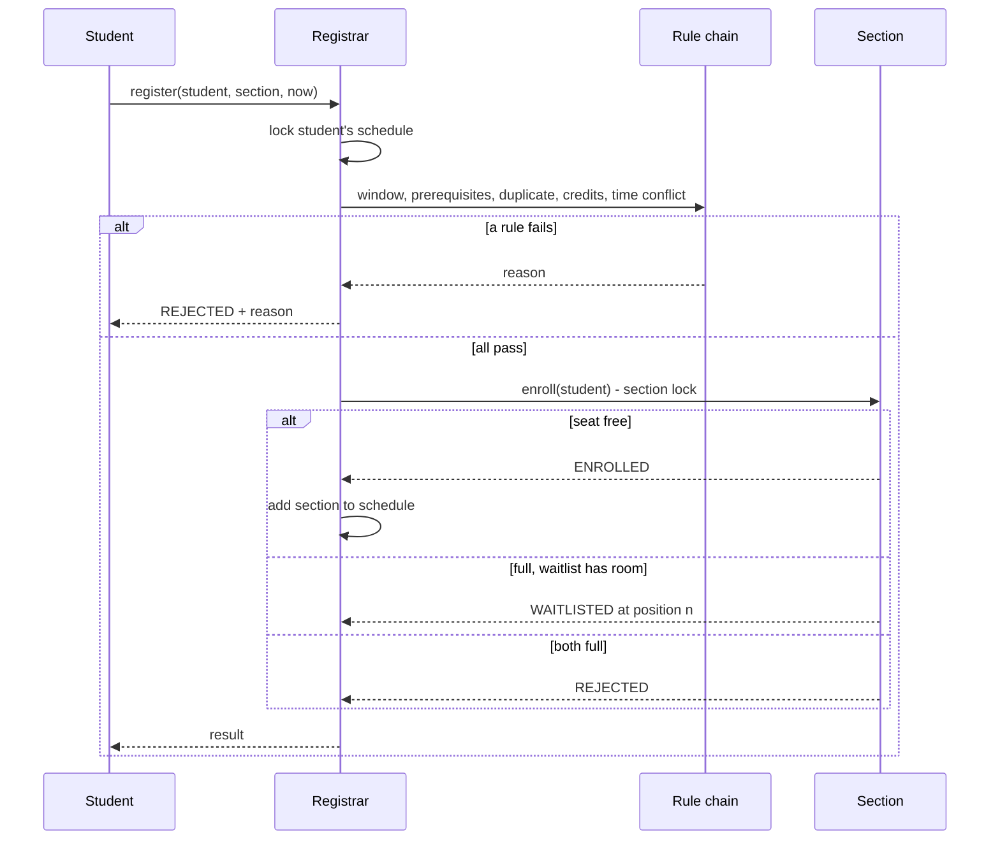

A student's status in one section:

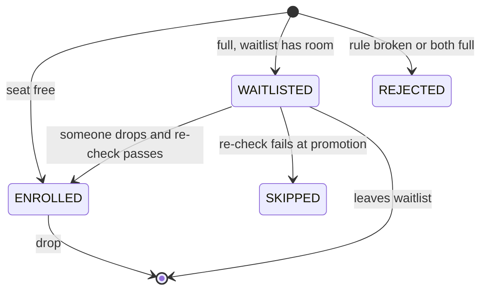

Drop and promote:

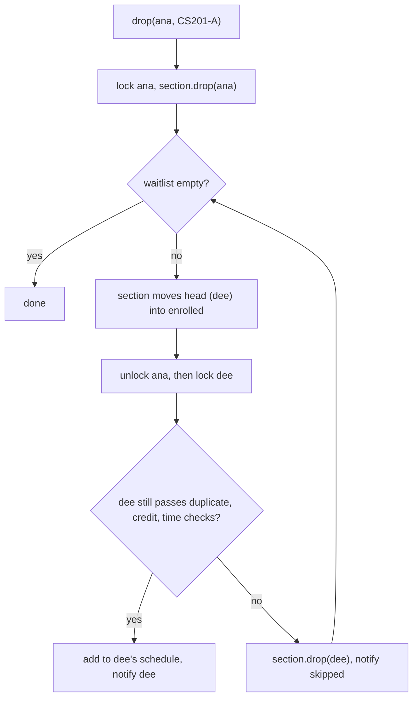

### Design decisions & patterns used

| Decision | Why | Alternative rejected |
|---|---|---|
| **Course vs Section** | Capacity, time and instructor belong to an offering, not the catalogue entry. | Capacity on `Course` (cannot have two sections). |
| **Seat taken only inside `Section.enroll`**, under a `ReentrantLock` per section | Check-capacity-then-add is atomic; different sections do not block each other. | `synchronized` on the whole registrar (every student in the university waits in one line). |
| **Per-student lock** around rules + enroll | Credit limit and time-conflict checks read the schedule; two tabs registering the same student would both pass without it (step 6 of the output). | Lock only the section (a student could exceed credits via two sections in parallel). |
| **Fixed lock order: student, then section** | Deadlock needs two threads taking the same two locks in opposite orders. Always taking student before section rules it out. Promotion takes the next student's lock only *after* releasing the dropper's, so two student locks are never held together. | Promoting while still holding the dropper's lock (student → section → student: deadlock risk). |
| **Rules as objects** (Specification / Chain of Responsibility style) | Each rule is one small class; the registrar runs them in order and stops at the first failure. A new rule ("majors only") is a new class plus one list entry — Open/Closed. The promotion path reuses a *subset* of the same rules. | One long `register` method with nested `if`s. |
| **Waitlist is a FIFO `Deque`, bounded** | Fair (first come, first served) and prevents unbounded queues. | Unbounded list; priority by year (a valid extension). |
| **Re-check on promotion** | A student may have registered for a clashing section while waiting. | Promote blindly (broken timetables). |
| Time passed in (`now`) | Makes window logic testable without waiting for real dates. | Calling `LocalDateTime.now()` inside rules. |
| **Singleton?** The GitHub problem uses a singleton `CourseRegistrationSystem`. | We construct one `Registrar` and pass it in: one instance, still testable. | Global `getInstance()`. |

### Java implementation

Package `lld.ch16.courseregistration`.

```java
// File: code/lld/ch16/courseregistration/Types.java
package lld.ch16.courseregistration;

import java.time.DayOfWeek;
import java.time.LocalDateTime;
import java.time.LocalTime;
import java.util.EnumSet;
import java.util.Map;
import java.util.Set;

/** A catalog entry: what is taught. Prerequisites are course codes. */
record Course(String code, String title, int credits, Set<String> prerequisites) {
    Course { prerequisites = Set.copyOf(prerequisites); }
}

record Instructor(String id, String name) {}

/** When a section meets, e.g. Mon+Wed 10:00-11:30. */
record TimeSlot(Set<DayOfWeek> days, LocalTime start, LocalTime end) {
    TimeSlot {
        days = EnumSet.copyOf(days);
        if (!end.isAfter(start)) throw new IllegalArgumentException("end must be after start");
    }
    boolean overlaps(TimeSlot o) {
        boolean sharedDay = days.stream().anyMatch(o.days::contains);
        return sharedDay && start.isBefore(o.end) && o.start.isBefore(end);
    }
    @Override public String toString() { return days + " " + start + "-" + end; }
}

record Student(String id, String name, int year, Set<String> completedCourses, int maxCredits) {
    Student { completedCourses = Set.copyOf(completedCourses); }
}

/** Priority registration: each class year opens at its own time; everyone closes together. */
record RegistrationWindow(Map<Integer, LocalDateTime> opensByYear, LocalDateTime closes) {
    boolean isOpenFor(Student s, LocalDateTime now) {
        var opens = opensByYear.get(s.year());
        return opens != null && !now.isBefore(opens) && now.isBefore(closes);
    }
}

enum Outcome { ENROLLED, WAITLISTED, REJECTED }

record RegistrationResult(Outcome outcome, String message) {
    static RegistrationResult rejected(String why) { return new RegistrationResult(Outcome.REJECTED, why); }
}
```

```java
// File: code/lld/ch16/courseregistration/Section.java
package lld.ch16.courseregistration;

import java.util.ArrayDeque;
import java.util.Deque;
import java.util.LinkedHashSet;
import java.util.List;
import java.util.Optional;
import java.util.Set;
import java.util.concurrent.locks.ReentrantLock;

/**
 * One offering of a course (CS201 section A). Capacity and waitlist live HERE and are
 * guarded by the section's own lock, so thousands of students can hit different sections in parallel.
 */
final class Section {
    private final String id;
    private final Course course;
    private final Instructor instructor;
    private final TimeSlot slot;
    private final int capacity;
    private final int waitlistCapacity;
    private final Set<String> enrolled = new LinkedHashSet<>();
    private final Deque<String> waitlist = new ArrayDeque<>();
    private final ReentrantLock lock = new ReentrantLock();

    Section(String id, Course course, Instructor instructor, TimeSlot slot, int capacity, int waitlistCapacity) {
        this.id = id; this.course = course; this.instructor = instructor; this.slot = slot;
        this.capacity = capacity; this.waitlistCapacity = waitlistCapacity;
    }

    String id() { return id; }
    Course course() { return course; }
    Instructor instructor() { return instructor; }
    TimeSlot slot() { return slot; }

    /** The only place a seat is taken: check-and-add in one critical section. */
    RegistrationResult enroll(String studentId) {
        lock.lock();
        try {
            if (enrolled.contains(studentId)) return RegistrationResult.rejected("already enrolled in " + id);
            if (waitlist.contains(studentId)) return RegistrationResult.rejected("already on the waitlist of " + id);
            if (enrolled.size() < capacity) {
                enrolled.add(studentId);
                return new RegistrationResult(Outcome.ENROLLED, "enrolled in " + id + " (" + enrolled.size() + "/" + capacity + ")");
            }
            if (waitlist.size() < waitlistCapacity) {
                waitlist.addLast(studentId);
                return new RegistrationResult(Outcome.WAITLISTED, "waitlisted for " + id + " at position " + waitlist.size());
            }
            return RegistrationResult.rejected(id + " and its waitlist are full");
        } finally {
            lock.unlock();
        }
    }

    /** Removes the student; if a seat opened, moves the head of the waitlist in and returns who it was. */
    Optional<String> drop(String studentId) {
        lock.lock();
        try {
            if (waitlist.remove(studentId)) return Optional.empty();
            if (!enrolled.remove(studentId)) throw new IllegalArgumentException(studentId + " is not in " + id);
            String next = waitlist.pollFirst();
            if (next != null) enrolled.add(next);
            return Optional.ofNullable(next);
        } finally {
            lock.unlock();
        }
    }

    boolean isEnrolled(String studentId) {
        lock.lock();
        try { return enrolled.contains(studentId); } finally { lock.unlock(); }
    }

    List<String> roster() {
        lock.lock();
        try { return List.copyOf(enrolled); } finally { lock.unlock(); }
    }

    List<String> waitlist() {
        lock.lock();
        try { return List.copyOf(waitlist); } finally { lock.unlock(); }
    }
}
```

```java
// File: code/lld/ch16/courseregistration/Rules.java
package lld.ch16.courseregistration;

import java.time.LocalDateTime;
import java.util.Optional;
import java.util.Set;

/** What a rule may look at: who, which section, what they already have, and when. */
record RegistrationContext(Student student, Section section, Set<Section> currentSchedule, LocalDateTime now,
                           RegistrationWindow window) {}

/**
 * Specification-style rule: returns a reason when the request breaks it.
 * The registrar runs the rules as a chain and stops at the first violation.
 */
interface RegistrationRule { Optional<String> violation(RegistrationContext c); }

final class WindowRule implements RegistrationRule {
    public Optional<String> violation(RegistrationContext c) {
        return c.window().isOpenFor(c.student(), c.now()) ? Optional.empty()
                : Optional.of("registration window is closed for year " + c.student().year() + " at " + c.now());
    }
}

final class PrerequisiteRule implements RegistrationRule {
    public Optional<String> violation(RegistrationContext c) {
        var missing = c.section().course().prerequisites().stream()
                .filter(p -> !c.student().completedCourses().contains(p)).sorted().toList();
        return missing.isEmpty() ? Optional.empty() : Optional.of("missing prerequisites " + missing);
    }
}

final class DuplicateCourseRule implements RegistrationRule {
    public Optional<String> violation(RegistrationContext c) {
        return c.currentSchedule().stream()
                .filter(s -> s.course().code().equals(c.section().course().code())).findFirst()
                .map(s -> "already registered for " + s.course().code() + " in section " + s.id());
    }
}

final class CreditLimitRule implements RegistrationRule {
    public Optional<String> violation(RegistrationContext c) {
        int current = c.currentSchedule().stream().mapToInt(s -> s.course().credits()).sum();
        int after = current + c.section().course().credits();
        return after <= c.student().maxCredits() ? Optional.empty()
                : Optional.of("credit limit " + c.student().maxCredits() + " exceeded (" + after + ")");
    }
}

final class TimeConflictRule implements RegistrationRule {
    public Optional<String> violation(RegistrationContext c) {
        return c.currentSchedule().stream().filter(s -> s.slot().overlaps(c.section().slot())).findFirst()
                .map(s -> "time conflict with " + s.id() + " " + s.slot());
    }
}
```

```java
// File: code/lld/ch16/courseregistration/Registrar.java
package lld.ch16.courseregistration;

import java.time.LocalDateTime;
import java.util.List;
import java.util.Map;
import java.util.Optional;
import java.util.Set;
import java.util.concurrent.ConcurrentHashMap;
import java.util.function.Consumer;

/**
 * The service. Lock order is ALWAYS student-then-section, which rules out deadlock:
 *  - the student lock makes "check my credits/time clashes, then take the seat" atomic per student
 *    (stops one student double-registering from two browser tabs);
 *  - the section lock (inside Section) makes the seat count atomic across students.
 */
final class Registrar {
    private final Map<String, Student> students = new ConcurrentHashMap<>();
    private final Map<String, Section> sections = new ConcurrentHashMap<>();
    private final Map<String, Set<Section>> schedules = new ConcurrentHashMap<>();
    private final RegistrationWindow window;
    private final List<RegistrationRule> fullChecks;
    private final List<RegistrationRule> promotionChecks;
    private final Consumer<String> notifier;

    Registrar(RegistrationWindow window, Consumer<String> notifier) {
        this.window = window;
        this.notifier = notifier;
        this.fullChecks = List.of(new WindowRule(), new PrerequisiteRule(), new DuplicateCourseRule(),
                new CreditLimitRule(), new TimeConflictRule());
        this.promotionChecks = List.of(new DuplicateCourseRule(), new CreditLimitRule(), new TimeConflictRule());
    }

    void addStudent(Student s) { students.put(s.id(), s); schedules.put(s.id(), ConcurrentHashMap.newKeySet()); }
    void addSection(Section s) { sections.put(s.id(), s); }
    Section section(String id) { return sections.get(id); }

    List<Section> search(String text) {
        var q = text.toLowerCase();
        return sections.values().stream().filter(s -> s.course().code().toLowerCase().contains(q)
                || s.course().title().toLowerCase().contains(q)).sorted((a, b) -> a.id().compareTo(b.id())).toList();
    }

    Set<Section> schedule(String studentId) { return Set.copyOf(schedules.get(studentId)); }

    private Optional<String> firstViolation(List<RegistrationRule> rules, RegistrationContext ctx) {
        for (var r : rules) {
            var v = r.violation(ctx);
            if (v.isPresent()) return v;
        }
        return Optional.empty();
    }

    RegistrationResult register(String studentId, String sectionId, LocalDateTime now) {
        var student = students.get(studentId);
        var section = sections.get(sectionId);
        if (student == null || section == null) return RegistrationResult.rejected("unknown student or section");
        var schedule = schedules.get(studentId);
        synchronized (schedule) {                                    // 1st lock: the student
            var ctx = new RegistrationContext(student, section, Set.copyOf(schedule), now, window);
            var v = firstViolation(fullChecks, ctx);
            if (v.isPresent()) return RegistrationResult.rejected(v.get());
            var result = section.enroll(studentId);                  // 2nd lock: the section
            if (result.outcome() == Outcome.ENROLLED) schedule.add(section);
            return result;
        }
    }

    void drop(String studentId, String sectionId) {
        var section = sections.get(sectionId);
        var schedule = schedules.get(studentId);
        Optional<String> promoted;
        synchronized (schedule) {
            promoted = section.drop(studentId);
            schedule.remove(section);
        }
        notifier.accept(studentId + " dropped " + sectionId);
        // Finish promotions OUTSIDE the dropper's lock, one student lock at a time (no nested student locks).
        while (promoted.isPresent()) promoted = finishPromotion(promoted.get(), section);
    }

    /** The promoted student's timetable may have changed while waiting, so re-check. Returns the next promotion, if any. */
    private Optional<String> finishPromotion(String studentId, Section section) {
        var schedule = schedules.get(studentId);
        synchronized (schedule) {
            var ctx = new RegistrationContext(students.get(studentId), section, Set.copyOf(schedule), null, window);
            var v = firstViolation(promotionChecks, ctx);
            if (v.isEmpty()) {
                schedule.add(section);
                notifier.accept(studentId + " promoted from waitlist into " + section.id());
                return Optional.empty();
            }
            notifier.accept(studentId + " skipped for " + section.id() + ": " + v.get());
            return section.drop(studentId);
        }
    }
}
```

```java
// File: code/lld/ch16/courseregistration/Main.java
package lld.ch16.courseregistration;

import java.time.DayOfWeek;
import java.time.LocalDateTime;
import java.time.LocalTime;
import java.util.EnumSet;
import java.util.Map;
import java.util.Set;
import java.util.concurrent.ConcurrentHashMap;
import java.util.concurrent.CountDownLatch;
import java.util.concurrent.Executors;

public class Main {
    public static void main(String[] args) throws Exception {
        var window = new RegistrationWindow(Map.of(
                4, LocalDateTime.of(2026, 11, 2, 9, 0),     // seniors first
                3, LocalDateTime.of(2026, 11, 3, 9, 0),
                2, LocalDateTime.of(2026, 11, 4, 9, 0),
                1, LocalDateTime.of(2026, 11, 5, 9, 0)),
                LocalDateTime.of(2026, 11, 20, 17, 0));
        var reg = new Registrar(window, msg -> System.out.println("    [notify] " + msg));

        var cs101 = new Course("CS101", "Intro to Programming", 4, Set.of());
        var cs201 = new Course("CS201", "Data Structures", 4, Set.of("CS101"));
        var math201 = new Course("MATH201", "Discrete Math", 3, Set.of());
        var cs301 = new Course("CS301", "Algorithms", 4, Set.of("CS201", "MATH201"));
        var drLee = new Instructor("I1", "Dr. Lee");
        var mw = EnumSet.of(DayOfWeek.MONDAY, DayOfWeek.WEDNESDAY);
        var tt = EnumSet.of(DayOfWeek.TUESDAY, DayOfWeek.THURSDAY);
        reg.addSection(new Section("CS201-A", cs201, drLee, new TimeSlot(mw, LocalTime.of(10, 0), LocalTime.of(11, 30)), 2, 2));
        reg.addSection(new Section("CS201-B", cs201, drLee, new TimeSlot(tt, LocalTime.of(14, 0), LocalTime.of(15, 30)), 30, 5));
        reg.addSection(new Section("MATH201-A", math201, new Instructor("I2", "Dr. Rao"), new TimeSlot(mw, LocalTime.of(11, 0), LocalTime.of(12, 0)), 30, 5));
        reg.addSection(new Section("CS301-A", cs301, drLee, new TimeSlot(tt, LocalTime.of(9, 0), LocalTime.of(10, 30)), 30, 5));
        reg.addSection(new Section("CS101-A", cs101, new Instructor("I3", "Dr. Kim"), new TimeSlot(tt, LocalTime.of(11, 0), LocalTime.of(12, 0)), 30, 10));

        reg.addStudent(new Student("ana", "Ana", 4, Set.of("CS101"), 12));
        reg.addStudent(new Student("ben", "Ben", 3, Set.of("CS101"), 4));
        reg.addStudent(new Student("cy", "Cy", 2, Set.of(), 16));
        reg.addStudent(new Student("dee", "Dee", 3, Set.of("CS101"), 12));
        reg.addStudent(new Student("eve", "Eve", 3, Set.of("CS101"), 12));
        reg.addStudent(new Student("fay", "Fay", 3, Set.of("CS101"), 12));

        var nov2 = LocalDateTime.of(2026, 11, 2, 10, 0);
        var nov3 = LocalDateTime.of(2026, 11, 3, 10, 0);
        System.out.println("1) Search 'cs2': " + reg.search("cs2").stream().map(s -> s.id() + " " + s.slot()).toList());

        System.out.println("2) Rules");
        show("ben  CS201-A on Nov 2 ", reg.register("ben", "CS201-A", nov2));
        show("ana  CS201-A on Nov 2 ", reg.register("ana", "CS201-A", nov2));
        show("ana  MATH201-A        ", reg.register("ana", "MATH201-A", nov2));
        show("ana  CS201-B          ", reg.register("ana", "CS201-B", nov2));
        show("ana  CS301-A          ", reg.register("ana", "CS301-A", nov2));
        show("cy   CS201-B on Nov 4 ", reg.register("cy", "CS201-B", LocalDateTime.of(2026, 11, 4, 9, 30)));
        show("ana  after close      ", reg.register("ana", "CS201-B", LocalDateTime.of(2026, 11, 21, 9, 0)));

        System.out.println("3) Capacity 2 + waitlist 2 on CS201-A (juniors open Nov 3)");
        show("ben  CS201-A          ", reg.register("ben", "CS201-A", nov3));
        show("dee  CS201-A          ", reg.register("dee", "CS201-A", nov3));
        show("eve  CS201-A          ", reg.register("eve", "CS201-A", nov3));
        show("fay  CS201-A          ", reg.register("fay", "CS201-A", nov3));
        show("ben  MATH201-A        ", reg.register("ben", "MATH201-A", nov3));

        System.out.println("4) Ana drops CS201-A: the head of the waitlist is promoted");
        reg.drop("ana", "CS201-A");
        var a = reg.section("CS201-A");
        System.out.println("   roster " + a.roster() + ", waitlist " + a.waitlist());

        System.out.println("5) 50 first-years grab 30 seats (+10 waitlist) in CS101-A at 09:00 sharp");
        var opening = LocalDateTime.of(2026, 11, 5, 9, 0);
        for (int i = 0; i < 50; i++) reg.addStudent(new Student("fy" + i, "Fresher" + i, 1, Set.of(), 16));
        var counts = new ConcurrentHashMap<Outcome, Integer>();
        var go = new CountDownLatch(1);
        try (var pool = Executors.newFixedThreadPool(16)) {
            for (int i = 0; i < 50; i++) {
                String id = "fy" + i;
                pool.submit(() -> {
                    go.await();
                    counts.merge(reg.register(id, "CS101-A", opening).outcome(), 1, Integer::sum);
                    return null;
                });
            }
            go.countDown();
        }
        System.out.println("   ENROLLED=" + counts.get(Outcome.ENROLLED) + " WAITLISTED=" + counts.get(Outcome.WAITLISTED)
                + " REJECTED=" + counts.get(Outcome.REJECTED) + ", roster size " + reg.section("CS101-A").roster().size());

        System.out.println("6) One student double-clicks: two threads, same request");
        reg.addStudent(new Student("gus", "Gus", 3, Set.of("CS101"), 12));
        var outcomes = new ConcurrentHashMap<Outcome, Integer>();
        try (var pool = Executors.newFixedThreadPool(2)) {
            for (int i = 0; i < 2; i++)
                pool.submit(() -> outcomes.merge(reg.register("gus", "CS201-B", nov3).outcome(), 1, Integer::sum));
        }
        System.out.println("   " + new java.util.TreeMap<>(outcomes) + ", gus schedule " + reg.schedule("gus").stream().map(Section::id).toList());
    }

    static void show(String label, RegistrationResult r) {
        System.out.println("   " + label + " -> " + r.outcome() + ": " + r.message());
    }
}
```

Output:

```text
1) Search 'cs2': [CS201-A [MONDAY, WEDNESDAY] 10:00-11:30, CS201-B [TUESDAY, THURSDAY] 14:00-15:30]
2) Rules
   ben  CS201-A on Nov 2  -> REJECTED: registration window is closed for year 3 at 2026-11-02T10:00
   ana  CS201-A on Nov 2  -> ENROLLED: enrolled in CS201-A (1/2)
   ana  MATH201-A         -> REJECTED: time conflict with CS201-A [MONDAY, WEDNESDAY] 10:00-11:30
   ana  CS201-B           -> REJECTED: already registered for CS201 in section CS201-A
   ana  CS301-A           -> REJECTED: missing prerequisites [CS201, MATH201]
   cy   CS201-B on Nov 4  -> REJECTED: missing prerequisites [CS101]
   ana  after close       -> REJECTED: registration window is closed for year 4 at 2026-11-21T09:00
3) Capacity 2 + waitlist 2 on CS201-A (juniors open Nov 3)
   ben  CS201-A           -> ENROLLED: enrolled in CS201-A (2/2)
   dee  CS201-A           -> WAITLISTED: waitlisted for CS201-A at position 1
   eve  CS201-A           -> WAITLISTED: waitlisted for CS201-A at position 2
   fay  CS201-A           -> REJECTED: CS201-A and its waitlist are full
   ben  MATH201-A         -> REJECTED: credit limit 4 exceeded (7)
4) Ana drops CS201-A: the head of the waitlist is promoted
    [notify] ana dropped CS201-A
    [notify] dee promoted from waitlist into CS201-A
   roster [ben, dee], waitlist [eve]
5) 50 first-years grab 30 seats (+10 waitlist) in CS101-A at 09:00 sharp
   ENROLLED=30 WAITLISTED=10 REJECTED=10, roster size 30
6) One student double-clicks: two threads, same request
   {ENROLLED=1, REJECTED=1}, gus schedule [CS201-B]
```

Step 2 shows each rule firing with a clear reason. Step 3 fills two seats and two waitlist places. Step 4 promotes Dee automatically. Step 5 is the "09:00 rush": 50 threads, 30 seats, 10 waitlist places — the counts are exact every run. Step 6 is the double-click: two threads for the same student and section, exactly one succeeds.

### Concurrency & edge cases

- **Overselling a section** — prevented by the section lock around "size < capacity → add".
- **Double-click / two tabs** — prevented by the per-student lock; the second request sees the first enrolment and is rejected by `DuplicateCourseRule` (or by the section's "already enrolled" check).
- **Deadlock** — avoided by the fixed lock order (student → section) and by never holding two student locks at once.
- **Waitlisted in one section, enrolled in another section of the same course** — possible while waiting, because waitlist entries are not in the schedule; the promotion re-check (`DuplicateCourseRule`) catches it and skips to the next student.
- **Registration closes while on the waitlist** — promotion does not re-check the window (it is the drop that triggers it). Many universities stop automatic promotion after a deadline; add `WindowRule` to `promotionChecks` if that is the policy.
- **Dropping a section you are not in** → `IllegalArgumentException`.
- **Rules with time** — the window uses half-open time (`opens ≤ now < closes`).
- **Scaling beyond one JVM** — the in-memory locks work for one process. With several app servers, the seat count moves to the database: `UPDATE section SET enrolled = enrolled + 1 WHERE id = ? AND enrolled < capacity` succeeds for exactly `capacity` requests (an atomic conditional update), or use optimistic locking with a version column. A queue in front of hot sections smooths the 09:00 spike.

### Extensions & follow-up questions

- **"Co-requisites or 'prerequisite OR instructor permission'?"** — Model prerequisites as a small expression tree (`And`, `Or`, `CourseCompleted`, `Permission`) — the Composite pattern — and evaluate it in `PrerequisiteRule`.
- **"Holds (unpaid fees, advising)?"** — A `HoldRule` that rejects if the student has an active hold.
- **"Priority waitlists (seniors first)?"** — Replace the `Deque` with a `PriorityQueue` ordered by (year, time joined).
- **"Seat reservations for majors?"** — Split capacity into buckets (majors 20, others 10) and check the bucket in `Section.enroll`.
- **"Linked sections (lecture + lab)?"** — Register both atomically: lock both sections in a fixed order (by id), check both, enrol both.
- **"Notify by email/SMS?"** — The registrar takes a `Consumer<String>` notifier; swap for an email service or publish an event to a message queue.
- **"Course fees and billing?"** — Add a `Bill` per student per term, a line per enrolled section, recomputed on drop.

### In the interview

**30-second pitch:** "Students register for sections, not courses. A section owns capacity and a bounded FIFO waitlist, and takes seats only inside its own lock. The registrar runs a chain of rule objects — window, prerequisites, duplicate course, credit limit, time conflict — while holding the student's lock, then asks the section for a seat. Lock order is always student then section, so no deadlocks. On drop the head of the waitlist is promoted after a re-check."

| Minutes | Do |
|---|---|
| 0–5 | Clarify course vs section, rules, waitlist, windows, concurrency. |
| 5–12 | Entities and class diagram. |
| 12–30 | Code `Section.enroll/drop`, the rule interface and two rules, `Registrar.register`. |
| 30–40 | Concurrency: run the 50-threads demo in your head; lock order; DB conditional update for scale. |

### Self-check

1. **Q:** Why do students register for sections, not courses? **A:** Capacity, time and instructor belong to each offering; a course can have many sections.
2. **Q:** Which two locks does `register` take and in what order? **A:** The student's schedule lock, then the section's lock — always in that order.
3. **Q:** Why not simply make `register` `synchronized` on the registrar? **A:** It would be correct but serialise every student in the university; per-section and per-student locks let unrelated requests run in parallel.
4. **Q:** Why re-check rules on promotion? **A:** The student's timetable may have changed while waiting (a clash or the same course in another section).
5. **Q:** How do you enforce capacity with many servers? **A:** An atomic conditional update in the database (`… WHERE enrolled < capacity`) or optimistic locking.

### TL;DR

- Course (catalogue) vs Section (offering with capacity, slot, waitlist).
- Rules are small objects run as a chain; add a rule without touching the registrar's logic.
- Seats are taken only inside `Section.enroll` under the section's lock; student lock first, section lock second.
- Drop → promote waitlist head → re-check → notify.
- At scale: conditional update in the database.

**Real-world example.** University student-information systems (for example Ellucian Banner, used by many US universities) run priority registration windows by class standing, check prerequisites and time conflicts, and keep section waitlists that notify a student when a seat opens (some schools enrol the student automatically; others give a time-limited window to claim the seat). Registration-day slowdowns at such schools are the 09:00 "thundering herd" this design addresses with per-section locking and, at scale, database conditional updates.

---

## Chapter summary

| Problem | Key insight | Atomic claim | Patterns |
|---|---|---|---|
| Car rental | Availability is a question about **dates**, not a status field | `Vehicle.tryBook(range)` | Template Method (add-ons), Strategy + Decorator (pricing), state machine |
| Restaurant | **Meal per seat**; table = status (now) + slots (later) | `Table.tryHold(time)` | Observer (order ready), Strategy (chef assignment, payment), state machine |
| Airline | **Flight ≠ FlightInstance, Seat ≠ FlightSeat** | `FlightInstance.holdSeats(map)` (all or nothing) | Strategy + Decorator (fares), Facade, index for cancellation |
| Course registration | **Course ≠ Section**; rules as objects | `Section.enroll` under a section lock, inside a student lock | Specification / Chain of rules, lock ordering |

The four problems share one lesson: **find the calendar, find the atomic check-then-claim, and put the rules on the object that owns the data.**
