# Chapter 16 — Case Studies: Booking & Inventory (Part 2)

> **Where this fits.** Chapter 15 covered the first group of booking problems. This chapter finishes the family with five more: a car rental company, a restaurant, an airline, a university's course registration and a meeting-room scheduler. They look different on the surface, but they are the same problem underneath: **a limited resource, a calendar, and many people trying to claim it at once.** Once you see that shared skeleton, each new booking problem takes minutes to set up in an interview.

**The shared skeleton of every booking problem**

| Idea | Car rental | Restaurant | Airline | Course registration | Meeting scheduler |
|---|---|---|---|---|---|
| The thing being booked | a vehicle | a table | a seat on one flight instance | a seat in one section | a room for a time range |
| The "calendar" it is booked on | days | hourly time slots | the flight instance (route + date) | the term | continuous time (half-open intervals) |
| The check-then-claim step that must be atomic | `Vehicle.tryBook` | `Table.tryHold` | `FlightInstance.holdSeats` | `Section.enroll` | `Room.tryReserve` |
| What happens when it is full | search another car | try the next table | pick another seat or flight | waitlist | try the next fitting room |
| Money | bill with lines + late fee | check split by seat + tax | fare per seat class, paid per itinerary | none (fees are an extension) | none |

A **resource** is anything with a limited supply (a car, a table, a seat). A **thread** is one independent line of execution; a server runs many side by side (**concurrency**: several things in progress at once). A **race condition** is a bug where the result depends on which thread runs first — here, two people both "win" the same seat because both checked "free?" before either wrote "taken". A step is **atomic** when no other thread can see it half-done or slip in between its parts.

**How to run every example in this chapter**

```bash
cd chapters/16-case-booking-2/code
javac --release 21 -d /tmp/lld_16 $(find . -name '*.java')
java -cp /tmp/lld_16 lld.ch16.carrental.Main          # or restaurant, airline, courseregistration, meetingscheduler
```

`javac` compiles `.java` files to `.class` files, `--release 21` targets Java 21, and `-cp` (the **classpath**) tells `java` where the compiled classes are. All five `Main` classes use only the standard library; the output under each is its real output. Where threads race, the *counts* are fixed but *which* racer wins varies per run. The listings below show only the essential lines; the complete files are in each design's `code/` folder.

> **Code-style note.** One file sometimes holds several small package-private types (visible only within the same package) — e.g. `Types.java` holds the enums and records. An **enum** is a type with a fixed list of named values (`CAR`, `TRUCK` …); a **record** is a compact class holding a few fixed values, with `equals`, `hashCode` and `toString` generated. In production each top-level type would usually get its own file.

> **Money.** All prices use `java.math.BigDecimal`, never `double`: a binary floating-point `double` cannot represent 0.1 exactly, so sums of prices drift by fractions of a cent; `BigDecimal` stores exact decimal digits.

---

## Design a Car Rental System


*Figure — A car rental company rents vehicles from many branches (course diagram)*

### Problem & clarifying questions

A **car rental system** is the software a rental company uses to rent vehicles for a short time — from a few hours to a few weeks. Companies usually have many branches, often near airports and city centres, and a customer may return a car to a different branch from the one they picked it up at.

Questions worth asking in the first two minutes, with the answers we assume:

| Question | Assumed answer |
|---|---|
| Which vehicle kinds? | Cars, trucks, SUVs, vans and motorcycles. |
| One branch or many? | Many branches, each with its own vehicles. |
| Can the drop-off branch differ from the pick-up branch? | Yes, the reservation records both. |
| How is price worked out? | A daily rate per vehicle type, plus add-ons, plus a late fee per day late. |
| What can be added? | Insurance, equipment (navigation, child seat, ski rack), services (roadside assistance, wifi) and additional drivers. |
| How are vehicles identified? | Each has a unique barcode; a barcode reader scans it at pick-up and return. |
| Do we need history? | Yes: a vehicle log of every event (reserved, picked up, returned, fuelling, cleaning, damage). |
| Concurrency? | Many members book at once; two must never get the same car on overlapping days. |

### Requirements

**Functional**

1. Rent cars, trucks, SUVs, vans and motorcycles; each vehicle has a unique barcode (read by a scanner) and details including its parking stall number.
2. Members search the inventory, reserve any available vehicle and can cancel.
3. Answer "which member took this vehicle?" and "which vehicles has this member rented?".
4. Charge a late fee after the due date.
5. Notify when a pick-up date is near, a vehicle is near its due date, and when it is overdue.
6. Keep a vehicle log of all events on a vehicle.
7. Add-ons: rental insurance, equipment (navigation, child seat, ski rack), services (roadside assistance, additional driver, wifi).

**Non-functional**

- **Correctness under concurrency:** no double booking of a vehicle for overlapping days.
- **Extensibility:** adding a new kind of add-on or a new pricing rule should not change the reservation code (the **Open/Closed Principle**: code should be open to extension by adding new classes, but closed to editing what already works).
- **Auditability:** every charge is a visible bill line, every vehicle event is a log entry.

### Use cases

Four **actors** (people or systems that use the software):

- **Receptionist** — adds and edits vehicles and workers; can also reserve vehicles for a customer.
- **Member** — searches the catalogue, reserves, picks up and returns a vehicle.
- **Worker** — handles returned vehicles and updates the vehicle log (cleaning, refuelling, damage).
- **System** — sends notifications (pick-up reminders, overdue alerts, cancellations).

A **use case** is one goal an actor can achieve with the system, such as "reserve a vehicle". Top use cases: add/remove/edit vehicle; search catalogue by type and availability; register or cancel membership; reserve vehicle; check out (pick up) vehicle; return vehicle; add equipment or services; update the vehicle log.

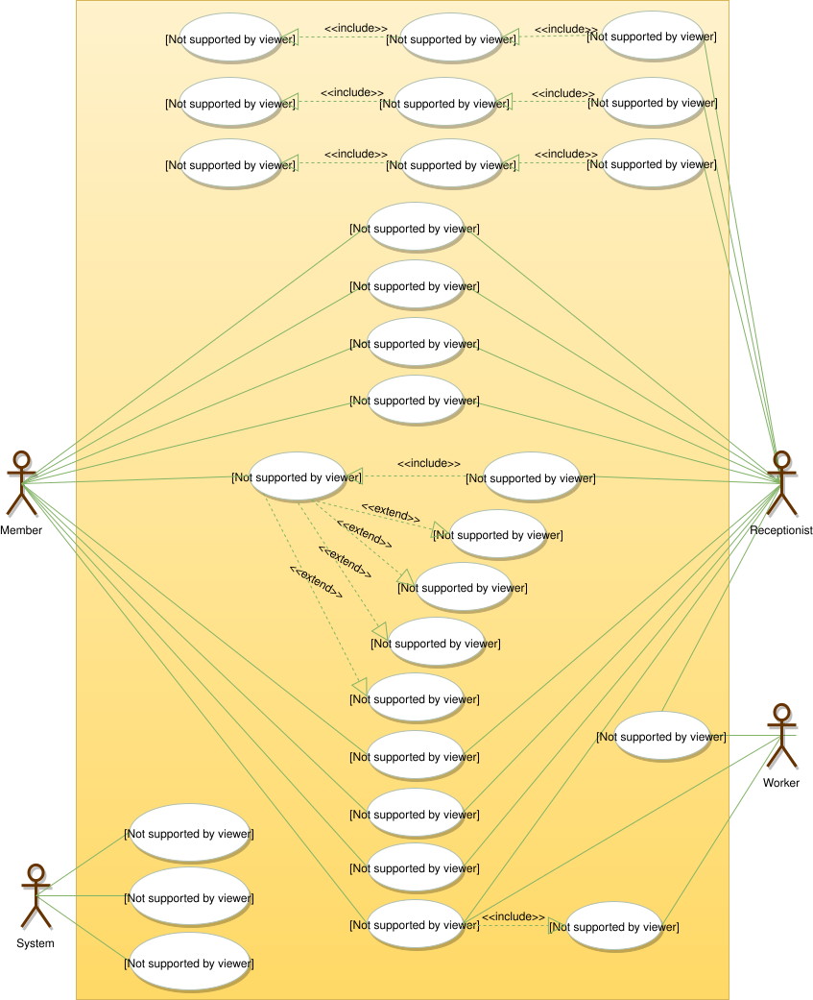
*Figure — Use case diagram: receptionist, member, worker and system and the use cases each triggers (course diagram)*

A **use case diagram** is a UML (Unified Modeling Language, a standard set of software diagrams) picture: stick figures are actors, ovals are use cases, and lines show who triggers what. In the figure above, notice that reserving is shared by the member and the receptionist, while updating the log belongs to the worker.

### Core entities

| Class | Responsibility |
|---|---|
| `CarRentalSystem` | Top-level object; owns the branches and the reservation service. |
| `CarRentalLocation` | One branch (name, code) with its own `VehicleInventory`. |
| `VehicleInventory` | Three indexes (lookup maps) over a branch's vehicles: by barcode, by type, by model. Answers "which SUVs are free on these days?". |
| `Vehicle` | Barcode, plate, make, model, type, seats, parking stall, mileage, **the set of booked days**, and its log. |
| `VehicleLogEntry` | One event on a vehicle (date, type, note). |
| `DateRange` | Half-open range of days `[start, end)` (includes `start`, excludes `end`); `end` is the due date. |
| `Reservation` | The rental: member, vehicle, dates, pick-up and return branch, add-ons, drivers, bill, status. Holds the business rules. |
| `ReservationAddOn` (+ `RentalInsurance`, `Equipment`, `Service`) | Anything that adds a charge to a rental. |
| `AdditionalDriver` | A named extra driver on the rental (no charge in our model). |
| `Bill`, `BillItem` | The one place that knows what a rental costs: a list of lines. |
| `PricingStrategy`, `LateFeePolicy` | Pluggable (swappable without code changes) rules for the base charge and the late fee. |
| `ReservationService` | Creates reservations atomically, answers the two "who rented what" questions, runs reminders. |
| `Notifier`, `PaymentMethod` | Ports (interfaces to outside systems) for sending messages and taking money. |

### Class diagram

A **class diagram** shows the classes, their fields and methods, and how they relate (owns, refers to, inherits from). The course builds its model in seven stages (money and messages, add-ons, vehicles, search, reservations, actors, the system and its branches); the finished result:

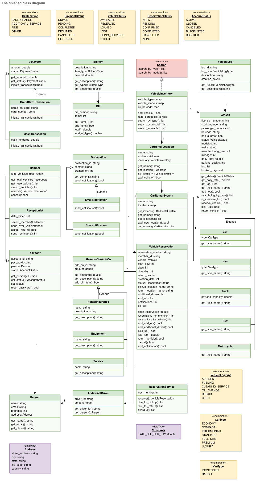
*Figure — The finished class diagram of the car rental system (course diagram)*

Two ownership chains matter: the system owns its branches and each branch owns its inventory (filled diamonds, **composition** — the part dies with the whole), while the inventory only *refers to* vehicles (plain arrow, **association**). A vehicle owns its log; a reservation owns its bill but only refers to the vehicle, add-ons, drivers and notifications.

Our Java design follows the same shape, with two deliberate differences: vehicle kinds are an enum (`VehicleType`) rather than five empty subclasses (classes that inherit from a parent class), because the subclasses add no behaviour; and pricing is a strategy object (an object you plug in to decide one varying rule) rather than a constant.

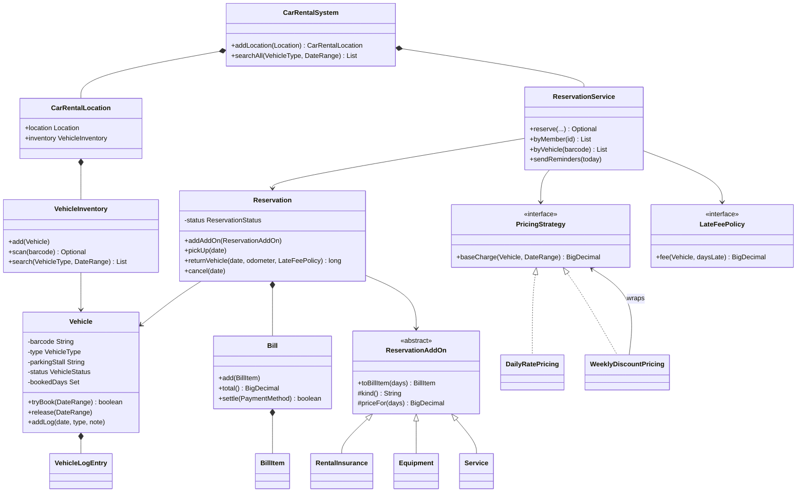

### Key flows

The figures below are **activity diagrams** — flowcharts of one task, with diamonds for decisions. **Pick up a vehicle.** The receptionist scans the customer's licence (or searches by name), checks there is a valid reservation, scans the vehicle's barcode, and hands over the keys. If there is no reservation, the member can reserve a free vehicle on the spot.

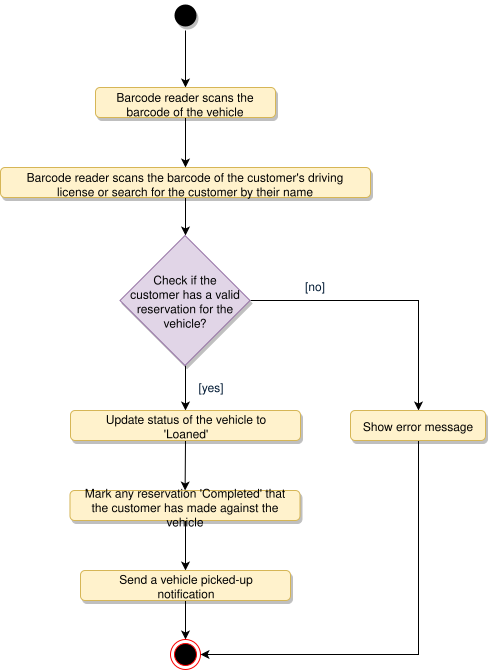
*Figure — Activity diagram: picking up a vehicle (course diagram)*

**Return a vehicle.** A worker scans the vehicle barcode; if it is past the due date, the system adds a late fee; the worker checks for damage and fuel; the bill is settled.

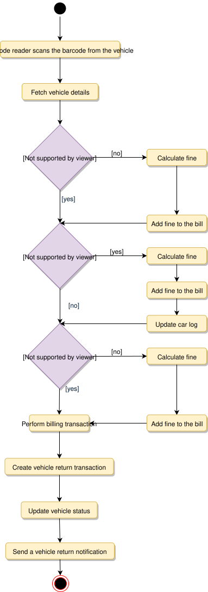
*Figure — Activity diagram: returning a vehicle, with the late-fee branch (course diagram)*

As the figure above shows, the late-fee decision is a branch on the return path — in our code it is one line inside `Reservation.returnVehicle`.

Reservation lifecycle (a **state machine** — a fixed set of states and the only moves allowed between them):

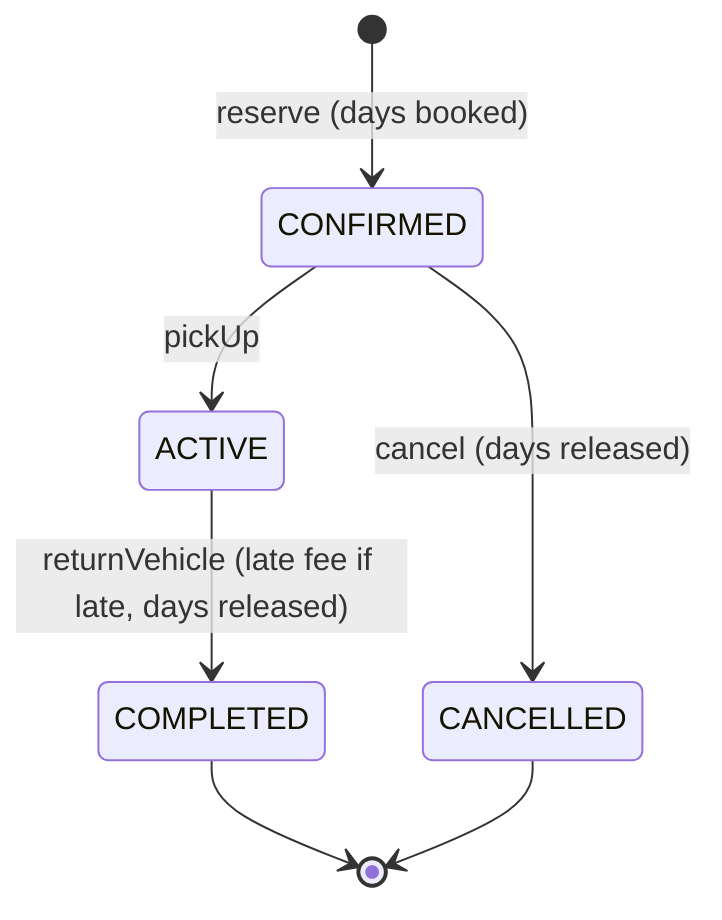

Reserve flow, including the race we must win (a **sequence diagram**: each column is an object, and arrows are calls in time order from top to bottom):

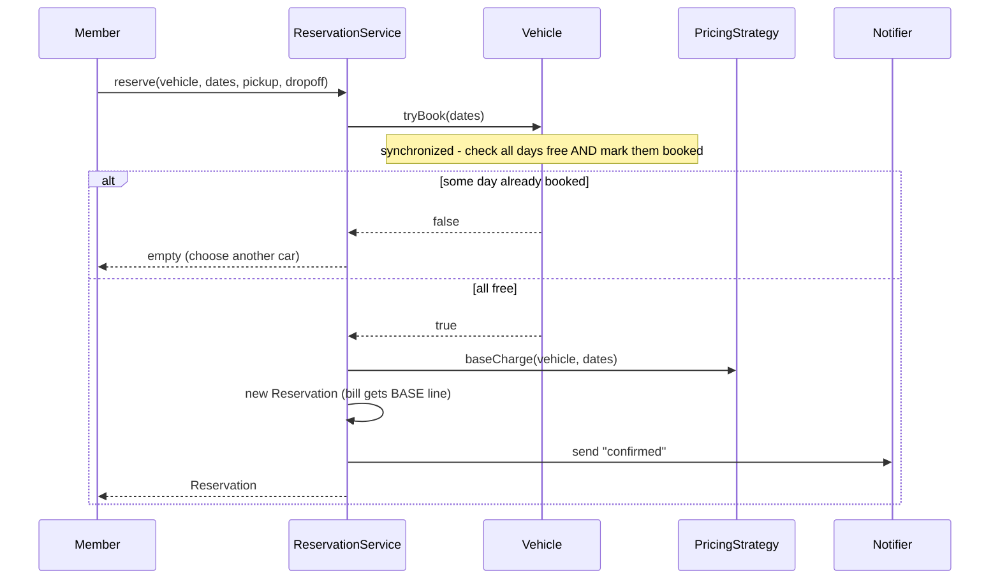

### Design decisions & patterns used

| Decision | Why | Alternative rejected |
|---|---|---|
| **Availability comes from the days each vehicle has already sold**, not from a status field | Members ask about future dates ("can I have it from the 10th to the 13th?"). A car that is out on loan right now may be back by then, and a car sitting on the lot today may already be promised to someone else next week. | A `RESERVED` status: cannot answer future-date questions, and a car can only hold one reservation. |
| Keep `VehicleStatus` too | Staff still need "where is the car right now" (on the lot, loaned, in service, lost). | Dropping status: loses the physical-location answer. |
| `Vehicle.tryBook` does check **and** book in one `synchronized` method (Java lets only one thread at a time run it on the same object) | Closes the check-then-act race (see below). | Separate `isFree()` then `book()` calls: two members can both see "free". |
| **Template Method** (a base class fixes the steps of an algorithm; subclasses fill in some steps) on `ReservationAddOn` | Billing is written once in the `final` (cannot be overridden) method `toBillItem`; subclasses only say what they are (`kind`) and may override the pricing hook (a step meant to be replaced) (`Service` is a flat fee). A fourth add-on is one new subclass. | A type enum with `switch` in the reservation: every new add-on edits the reservation. |
| **Strategy** (one interface, interchangeable implementations of a rule) for `PricingStrategy` and `LateFeePolicy` | Seasonal or length-based pricing changes one class, not the reservation. | Hard-coded rate constants. |
| **Decorator** (an object that wraps another of the same type and adds behaviour) `WeeklyDiscountPricing` wraps any `PricingStrategy` | Stacks a discount on top of whatever base rule is in place. | A subclass per combination (daily+weekly, seasonal+weekly …). |
| `Bill` is the only place charges live | Base, add-ons and late fees are lines on one bill; the total can never be computed in two places and disagree. | Each add-on keeping its own running total. |
| `ReservationService` separate from `Reservation` | Creating and indexing reservations is a different job from holding one reservation's rules (Single Responsibility: one class, one reason to change). | Static factory (a `static` method that builds objects) on `Reservation`. |
| **Actors call the rules, they never compute them** | The course's stage 6: a member calls the reservation service (search, reserve, cancel); a receptionist calls the reservation (hand over, take back, take payment, send reminders). An actor that starts working out fees is doing the reservation's job. In our code the actors are plain data (`Member`) and every rule sits in `Reservation`/`ReservationService`. | `Member.reserve()` / `Receptionist.computeLateFee()` methods. |
| `Bill` methods are `synchronized` and `settle` is idempotent (calling it twice has the same effect as once) | A late-fee line can never be added while the bill is being paid, and a double-clicked "pay" charges once. | Unsynchronized list + a second charge on retry. |
| The course makes `CarRentalSystem` a **Singleton** (a class allowed only one global instance); we pass it in instead | A singleton is easy to reach but hard to replace in tests. Constructing one and passing it (dependency injection: an object receives what it needs from outside instead of creating or looking it up itself) gives the same "one per app" without a global. | `static getInstance()`. |

### Java implementation

Package `lld.ch16.carrental`. Full runnable code is in `code/lld/ch16/carrental/`: `Types.java` (the enums `VehicleType`, `VehicleStatus`, `ReservationStatus`, `BillItemType`, `VehicleLogType` and the records `DateRange`, `Member`, `Location`, `VehicleLogEntry`, `AdditionalDriver`), `Vehicle.java`, `Billing.java` (`Bill`, `BillItem`, `PaymentMethod` with `CardPayment`/`CashPayment`, the add-ons), `Pricing.java` (`DailyRatePricing`, `WeeklyDiscountPricing`, `FlatLateFee`, `Notifier`), `Reservation.java`, `RentalSystem.java` (`VehicleInventory`, `CarRentalLocation`, `ReservationService`, `CarRentalSystem`) and `Main.java`. The essential lines (`/* ... */` and `//` summary comments stand for code left out):

```java
/** Half-open range [start, end): 10 Oct to 13 Oct is 3 rental days and the car is due back on 13 Oct. */
record DateRange(LocalDate start, LocalDate end) {
    DateRange { if (!end.isAfter(start)) throw new IllegalArgumentException("end must be after start"); }
    long days() { return ChronoUnit.DAYS.between(start, end); }
    Stream<LocalDate> dates() { return start.datesUntil(end); }
}

final class Vehicle {                       // barcode, plate, make, model, type, seats, parkingStall, mileage, log ...
    private VehicleStatus status = VehicleStatus.AVAILABLE;      // where it is RIGHT NOW
    private final Set<LocalDate> bookedDays = new HashSet<>();   // future availability

    synchronized boolean isFreeFor(DateRange r) { return r.dates().noneMatch(bookedDays::contains); }

    /** Check AND book inside one lock, so two members can never both win the same days. */
    synchronized boolean tryBook(DateRange r) {
        if (!isFreeFor(r)) return false;
        r.dates().forEach(bookedDays::add);
        return true;
    }
    synchronized void release(DateRange r) { r.dates().forEach(bookedDays::remove); }
    synchronized void setMileage(int m) {
        if (m < mileage) throw new IllegalArgumentException("odometer cannot go backwards");
        mileage = m;
    }
}
```

```java
/** The ONLY place that knows what a rental costs. Every method is synchronized on the bill. */
final class Bill {
    synchronized void add(BillItem item) {
        if (paid) throw new IllegalStateException("bill already settled");
        items.add(item);
    }
    /** Idempotent: settling a bill that is already paid does not charge the member a second time. */
    synchronized boolean settle(PaymentMethod method) {
        if (paid) return true;
        paid = method.charge(total());
        return paid;
    }
}

/** Template Method: toBillItem() is fixed; subclasses say what they are and may override the price hook. */
abstract class ReservationAddOn {
    final BillItem toBillItem(long rentalDays) {
        return new BillItem(kind() + ": " + name, BillItemType.ADD_ON, priceFor(rentalDays));
    }
    protected abstract String kind();
    protected BigDecimal priceFor(long rentalDays) { return price.multiply(BigDecimal.valueOf(rentalDays)); } // hook: per day
}
final class Service extends ReservationAddOn {   // RentalInsurance and Equipment keep the per-day default
    protected String kind() { return "Service"; }
    @Override protected BigDecimal priceFor(long rentalDays) { return price; }   // flat fee per rental
}

/** Decorator over any PricingStrategy: 10% off rentals of 7 days or more. */
final class WeeklyDiscountPricing implements PricingStrategy {
    public BigDecimal baseCharge(Vehicle v, DateRange p) {
        BigDecimal base = inner.baseCharge(v, p);
        return p.days() >= 7 ? base.multiply(new BigDecimal("0.90")).setScale(2, RoundingMode.HALF_UP) : base;
    }
}
```

```java
final class Reservation {   // the rules live here, not in the actors
    /** Returns the number of late days charged. The due date is period.end(). */
    synchronized long returnVehicle(LocalDate on, int odometer, LateFeePolicy lateFee) {
        require(ReservationStatus.ACTIVE, "return");
        long daysLate = Math.max(0, ChronoUnit.DAYS.between(period.end(), on));
        if (daysLate > 0)
            bill.add(new BillItem("Late fee: " + daysLate + " day(s)", BillItemType.LATE_FEE, lateFee.fee(vehicle, daysLate)));
        vehicle.setMileage(odometer);
        vehicle.setStatus(VehicleStatus.AVAILABLE);
        vehicle.release(period);
        vehicle.addLog(on, VehicleLogType.RETURNED, id + " at " + returnLocation.code() + ", odometer " + odometer);
        status = ReservationStatus.COMPLETED;
        return daysLate;
    }
    synchronized void cancel(LocalDate on) {
        require(ReservationStatus.CONFIRMED, "cancel");
        status = ReservationStatus.CANCELLED;
        vehicle.release(period);   // a cancelled rental must give its days back
    }
}

final class ReservationService {
    Optional<Reservation> reserve(Member m, Vehicle v, DateRange period, Location pickup, Location dropoff, LocalDate today) {
        if (!v.tryBook(period)) return Optional.empty();
        var r = new Reservation("R" + seq.incrementAndGet(), m, v, period, pickup, dropoff, pricing.baseCharge(v, period));
        reservations.put(r.id(), r);
        v.addLog(today, VehicleLogType.RESERVED, r.id() + " for " + period);
        notifier.send(m, "Reservation " + r.id() + " confirmed: " + v.model() + " " + period);
        return Optional.of(r);
    }
    // byMember(id), byVehicle(barcode): filters over the one reservations map.
    // sendReminders(today): pick-up tomorrow / due tomorrow / OVERDUE - run once a day by a scheduler.
}
```

`VehicleInventory.add` fills all three indexes (`byBarcode`, `byType`, `byModel`) in one call so they cannot drift apart, and rejects a duplicate barcode. `Main.java` builds two branches (SFO Airport, Downtown), prices with `WeeklyDiscountPricing(DailyRatePricing(...))` and a `FlatLateFee` of 40.00/day, and in step 3 releases 8 threads at once with a `CountDownLatch` to race for VH-002.

Output:

```text
1) Search SUVs at SFO for 2026-10-10..2026-10-13
   VH-001 Toyota RAV4 (SUV, 5 seats, plate 7ABC123) stall A-12
   VH-002 Honda CR-V (SUV, 5 seats, plate 7ABC124) stall A-13
2) Alice reserves VH-001 (pick up SFO, return Downtown) and adds extras
    [notify alice@example.com] Reservation R1001 confirmed: RAV4 2026-10-10..2026-10-13
3) 8 members race for VH-002 on the same dates
    [notify racer7@example.com] Reservation R1002 confirmed: CR-V 2026-10-11..2026-10-14
   successful reservations for VH-002: 1
   SUVs free for 2026-10-10..2026-10-13 now: 0
4) Daily reminder job on 2026-10-09
    [notify alice@example.com] Pick-up tomorrow for R1001 at SFO Airport
5) Pick up on 10 Oct, return at Downtown on 15 Oct (due 13 Oct)
   VH-001 status while out: LOANED
    [notify alice@example.com] OVERDUE: R1001 was due 2026-10-13
    [notify alice@example.com] Returned 2 day(s) late, late fee added to R1001
6) Alice's bill
   Base: RAV4 x 3 days                      BASE_CHARGE   240.00
   Insurance: Collision damage waiver       ADD_ON        45.00
   Equipment: Child seat                    ADD_ON        24.00
   Service: Roadside assistance             ADD_ON        25.00
   Late fee: 2 day(s)                       LATE_FEE      80.00
   TOTAL 414.00
    charged 414.00 to card token tok_alice_visa
   paid: true, settle again (double click) -> true, no second charge
7) Who rented VH-001? What has Alice rented?
   R1001 -> Alice 2026-10-10..2026-10-13 COMPLETED
   Alice: R1001 RAV4
8) Vehicle log for VH-001
   2026-10-01 RESERVED R1001 for 2026-10-10..2026-10-13
   2026-10-10 PICKED_UP R1001 by Alice at SFO
   2026-10-15 RETURNED R1001 at DTN, odometer 20640
   2026-10-15 CLEANING interior clean by worker W7
9) The VH-002 winner cancels; the days come back
    [notify racer7@example.com] Reservation R1002 cancelled
   SUVs free for 2026-10-10..2026-10-13: 2
10) A 7-day Civic rental gets the weekly discount
    [notify alice@example.com] Reservation R1003 confirmed: Civic 2026-11-01..2026-11-08
   base charge 315.00 (7 x 50 = 350, minus 10%)
11) Rules are enforced
   rejected: cannot add an add-on to reservation R1001 in state COMPLETED
   rejected: end must be after start
```

What to notice in the output: step 3 has eight threads racing for one car and exactly one wins (which racer wins varies per run); step 5 shows the overdue reminder and the 2-day late fee (2 × 40.00); step 6 shows that settling an already-paid bill does not charge again; step 9 shows cancellation giving the days back.

### Concurrency & edge cases

> **Key term — lock:** a **lock** (mutex) is a token only one thread can hold at a time; others wait for it ([§12.7](../12-concurrency-concepts/README.md#127-mutex-mutual-exclusion-and-synchronized)). A `synchronized` method locks the object itself. A *global lock* makes everyone queue; a *per-object lock* (one per vehicle here) lets different objects proceed in parallel ([§12.11](../12-concurrency-concepts/README.md#1211-coarse-grained-vs-fine-grained-locking)).

- **Double booking.** The course lists this as an open gap in its own design (checking the days and booking them are two separate steps there). Two members call `reserve` for the same car at the same moment. Because `tryBook` is `synchronized` on the vehicle, the check "are all days free?" and the write "mark them booked" happen as one step, so the second caller sees the first caller's days. Locking per vehicle (not one global lock) lets different cars be booked in parallel. In a database-backed system the same idea becomes a unique constraint on `(vehicle_id, day)` (the database refuses a second row with the same pair) or a `SELECT … FOR UPDATE` (a read that also locks the rows it returns) in one transaction (a group of database changes that succeed or fail together).
- **Search is advisory.** `search` may say a car is free and then `reserve` fails because someone else won. That is correct: the client (the app or web page the member is using) simply shows "no longer available". Never reserve based on a stale (out-of-date) search result without re-checking.
- **Late return collides with the next rental.** If Alice returns two days late and Bob booked the car from the 14th, Bob's car is not on the lot. Real systems keep a buffer (for example a cleaning day) between bookings and, when a car is overdue, reassign the next reservation to another car of the same type.
- **Early return.** We release the whole booked range; the unused days become bookable. Whether the member is refunded is a policy question.
- **Cancelling after pick-up** is rejected by the state machine (`CONFIRMED` only).
- **Add-ons after the rental ends** are rejected (see step 11 of the output).
- **Invalid ranges** (end not after start) are rejected in the `DateRange` constructor.
- **Odometer going backwards** is rejected in `Vehicle.setMileage`.
- **Different return branch.** The reservation records the return branch, but the vehicle stays in the pick-up branch's inventory. The course calls this out as a known gap: moving a car between branches is a *transfer* the design does not model yet (see Extensions).

### Extensions & follow-up questions

- **"How do you handle one-way rentals?"** — On return at a different branch, remove the vehicle from the old `VehicleInventory` and add it to the new one inside `returnVehicle`, and log a `TRANSFER` event. Add a one-way fee as another `BillItem`.
- **"Seasonal or dynamic pricing?"** — Add a `SeasonalPricing` strategy (rate per date) or wrap with another decorator (`SurgePricing`). The reservation does not change.
- **"Deposits and card holds?"** — A card *hold* reserves money on the card without taking it yet. A `PaymentMethod.authorize(amount)` at pick-up and `capture(amount)` at return; the difference is released.
- **"Mileage limits, fuel level, damage claims?"** — Record odometer and fuel at pick-up and return; add `BillItem`s of type `FINE` for extra miles, missing fuel or damage (the course's enum has a `FINE` bill item type for exactly this kind of charge).
- **"How do reminders run?"** — A scheduler (for example a `ScheduledExecutorService`, Java's built-in timer for repeating tasks, or a cron job, an operating-system entry that runs a command on a fixed timetable) calls `sendReminders(today)` once a day.
- **"How would you scale this?"** — Partition vehicles by branch (split the data so each branch's vehicles live on their own database or server); the booked-days table becomes `(vehicle_id, day)` with a unique key; searches go to a read replica (a read-only copy of the database kept in sync with the main one) or a search index (a separate store built for fast lookups, such as Elasticsearch); reservations are written with a transaction. These scaling ideas are explained in [System Design Fundamentals](../../../system-design-patterns/modules/00-system-design-fundamentals/README.md).
- **"How do workers update the log?"** — `Vehicle.addLog(date, CLEANING, note)` as in step 5; restrict who can call it by role in the service layer (the classes, like `ReservationService`, that sit between callers and the domain objects and enforce who may do what).

### In the interview

**30-second pitch:** "Branches own inventories, inventories index vehicles by barcode, type and model. The key decision: availability is a question about *dates*, so each vehicle keeps its booked days, and `tryBook` checks and books them atomically. A reservation owns a bill; every charge — base, insurance, equipment, services, late fee — is a line on it. Add-ons share a template-method base class; pricing and late fees are strategies."

**Suggested 40-minute plan:**

| Minutes | Do |
|---|---|
| 0–5 | Clarify vehicle types, branches, one-way, add-ons, late fees. |
| 5–10 | Actors and use cases; list the entities. |
| 10–20 | Class diagram. Say "availability is dates, not status" early. |
| 20–35 | Code `Vehicle.tryBook`, `Reservation` (state machine + bill + late fee), `ReservationService.reserve`. |
| 35–40 | Concurrency, late-return collision, one-way transfers. |

**Likely follow-ups:** "Can I book it for next month while it is loaned now?" (yes — dates, not status). "Two people click reserve together?" (atomic `tryBook`). "Add a new add-on?" (one subclass).

### Self-check

1. **Q:** Why is a `RESERVED` status not enough to answer "is this car free next week?" **A:** Status describes *now*. A car can be loaned today and free next week, or on the lot today but promised next week. Only per-day bookings answer date questions.
2. **Q:** What pattern does `ReservationAddOn.toBillItem` use and what is the "hook"? **A:** Template Method; `toBillItem` is the fixed algorithm and `priceFor` is the overridable hook (`Service` overrides it to a flat fee).
3. **Q:** Why is `tryBook` one method rather than `isFree` + `book`? **A:** To make check-then-act atomic under the vehicle's lock, so two threads cannot both see "free".
4. **Q:** How is the late fee computed? **A:** Days between the due date (`period.end`) and the actual return date, times the per-day fee from `LateFeePolicy`, added as a `LATE_FEE` bill line.
5. **Q:** Which class answers "who rented VH-001"? **A:** `ReservationService.byVehicle`, from the one list of reservations.

### TL;DR

- Availability = booked **days** per vehicle; status = where it is now.
- `tryBook` makes check-and-book atomic per vehicle.
- A reservation owns one bill; every charge is a line. Late fee = days late × rate.
- Template Method for add-ons, Strategy (+ Decorator) for pricing.
- Known gaps to mention: branch transfers, buffer between rentals.

**Real-world example.** Rental companies such as Hertz and Enterprise let you book a *car class* ("intermediate SUV or similar") rather than a specific plate; the exact vehicle is assigned at the counter. That is the same design one level up: availability is counted per type per day, and a specific `Vehicle` is bound at pick-up. Their counters and return lanes scan the car and compute extra-day and fuel charges on the spot — the "return" activity above.

---

## Design a Restaurant Management System


*Figure — A restaurant with branches, tables, waiters and a kitchen (course diagram)*

### Problem & clarifying questions

A **restaurant management system** runs the day-to-day of a restaurant from one place: which tables are free, table reservations, taking orders, sending them to the kitchen, and producing and settling the bill.

| Question | Assumed answer |
|---|---|
| One restaurant or a chain? | A restaurant with several branches; each branch has its own menu, tables and staff. |
| Menu structure? | Menu → sections (Starters, Mains …) → items with prices. |
| How are orders taken? | A waiter creates an order for a table and adds meals **per seat**; each meal has meal items, each pointing at a menu item. |
| Reservations? | Receptionist searches tables by date/time and party size and reserves one; customers can cancel; the system reminds them before the time. |
| Walk-ins? | Yes: show tables free right now. |
| Seating layouts? | A branch can have several seating arrangements (for example "Weekday" and "Banquet"). |
| Payment? | Credit card, cheque or cash. |
| Kitchen? | Orders go to a chef queue; chefs cook them in order and the waiter is told when food is ready. |

### Requirements

**Functional**

1. Several branches, each with a menu of sections → menu items.
2. A waiter creates an order for a table with meals per seat; each meal item corresponds to a menu item.
3. Show tables free now for walk-ins.
4. Reservations: the receptionist searches free tables by date and time and reserves one; customers can cancel; a notification goes out as the time approaches.
5. Pay by credit card, cheque or cash.
6. A branch can have several seating arrangements of tables.
7. (Added) Orders go to a kitchen queue; chefs take them one at a time and the waiter is notified when an order is ready.

**Non-functional**

- No two parties may be given the same table for overlapping time.
- Prices live in one place (the menu item) so an order and the menu can never disagree.
- Easy to add a new payment type or a new chef-assignment rule.

### Use cases

Actors:

- **Receptionist** — adds and edits tables and layouts; creates and cancels reservations; checks guests in.
- **Waiter** — takes and changes orders.
- **Manager** — hires staff and edits the menu.
- **Chef** — views and cooks orders.
- **Cashier** — produces the check (bill) and takes payment.
- **System** — sends reservation reminders and cancellations.

Top use cases: add/modify tables; search tables; place order; update order; create reservation; cancel reservation; check in; make payment.

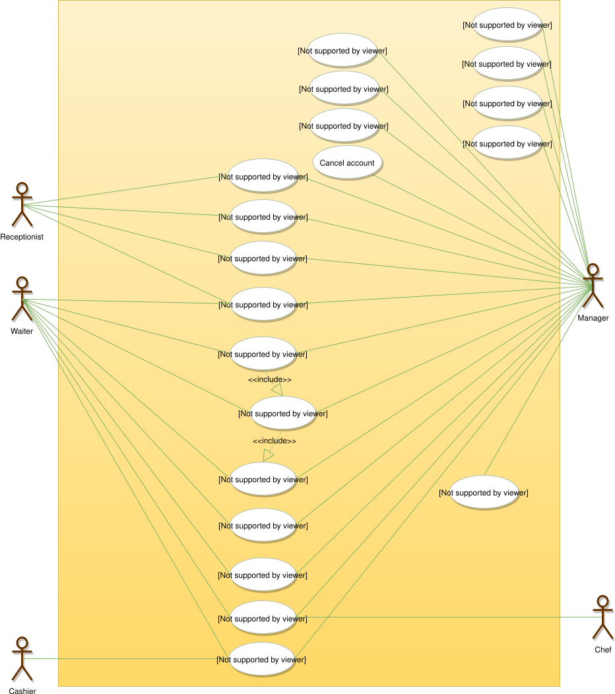
*Figure — Use case diagram: receptionist, waiter, manager, chef, cashier and system (course diagram)*

In the figure above, each role has a small, separate set of use cases. That is a hint for the code: each role class gets only its own methods.

### Core entities

| Class | Responsibility |
|---|---|
| `Restaurant` | Owns its branches. In the course the restaurant also registers its employees: closing (deactivating) the restaurant deactivates every employee account with it. |
| `Branch` | Owns its menu, kitchen, seating charts and reservation service; employs staff. |
| `Menu`, `MenuSection`, `MenuItem` | The menu tree. The **price lives only on `MenuItem`**. |
| `Table`, `TableSeat` | A table with a capacity and numbered seats. Keeps both its **current status** and the **time slots it is promised to**. |
| `TableChart` | A named seating arrangement; refers to tables (a table can appear in several charts). |
| `Reservation` | Customer, party size, time, table, status. `updatePeopleCount` refuses a party bigger than the reserved table seats (otherwise the booking would say six while the table holds four). |
| `ReservationService` | Searches tables (best fit), reserves atomically, cancels, checks in, sends reminders, lists walk-in tables. |
| `Order` | One per table visit: meals keyed by seat, status with allowed transitions, listeners. |
| `Meal`, `MealItem` | One meal per seat; a meal item = menu item × quantity. |
| `Kitchen`, `Chef` | Kitchen hands each order to a chef by a pluggable rule; each chef cooks from a FIFO (first in, first out) queue. |
| `Employee` and roles (`Receptionist`, `Waiter`, `Manager`, `Chef`, `Cashier`) | Each role's own operations. |
| `Check` | The bill: computed from the order (subtotal, tax, total), never stored separately. |
| `Payment` (`CardPayment`, `CashPayment`, `CheckPayment`) | Three ways to pay with three different behaviours. |

### Class diagram

The course grows the model in seven stages (payments and notifications, menu, tables, reservations, orders, staff, the branch); the finished result:

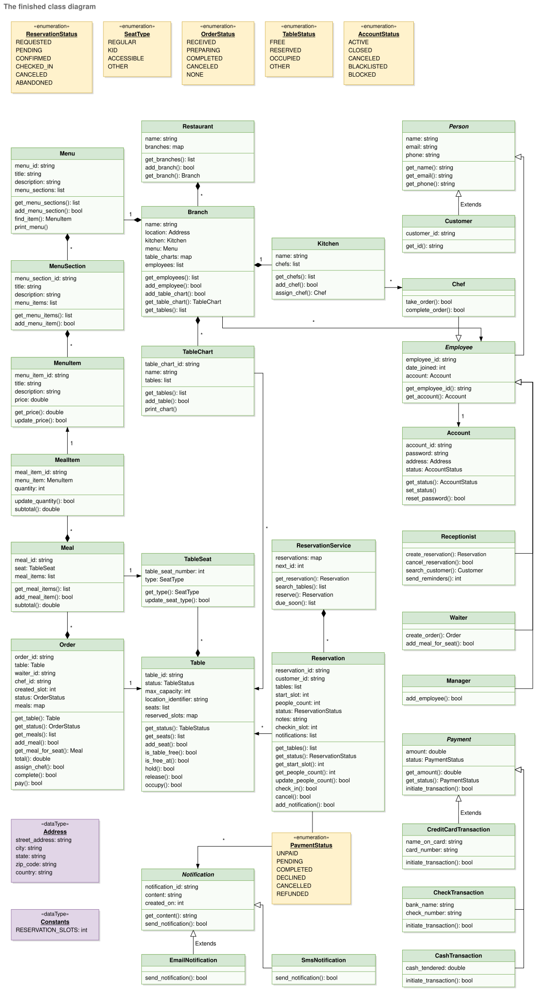
*Figure — The finished class diagram of the restaurant management system (course diagram)*

A table owns its seats while a chart only refers to tables; an order (one per table) owns one meal per seat, and each meal owns its meal items. The branch is the hub: its menu, kitchen and seating charts are composition (they do not exist without the branch), while staff are only associated, because staff can move between branches. Note also what is *not* there: no separate `Bill` class that stores a total. The course's argument is that the order already holds every priced line, so storing the total again would create a second copy that could disagree. Our `Check` follows that rule — it is computed from the order on demand.


### Key flows

**Place an order.** The waiter opens an order for the table, then for each seat adds a meal with its items, and sends the order to the kitchen.

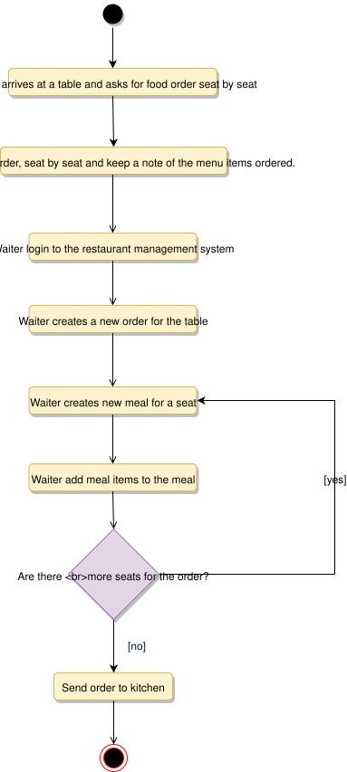
*Figure — Activity diagram: placing an order seat by seat and sending it to the kitchen (course diagram)*

**Make a reservation.** The customer calls or arrives; the receptionist searches tables for the time and party size; if one is free it is reserved and a confirmation is sent, otherwise the customer is told none is available.

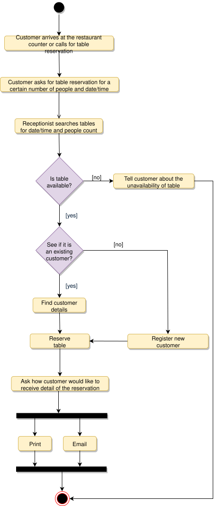
*Figure — Activity diagram: making a table reservation (course diagram)*

**Cancel a reservation.** The receptionist looks up the booking; if it is valid, it is cancelled, the table is released and the customer is notified.

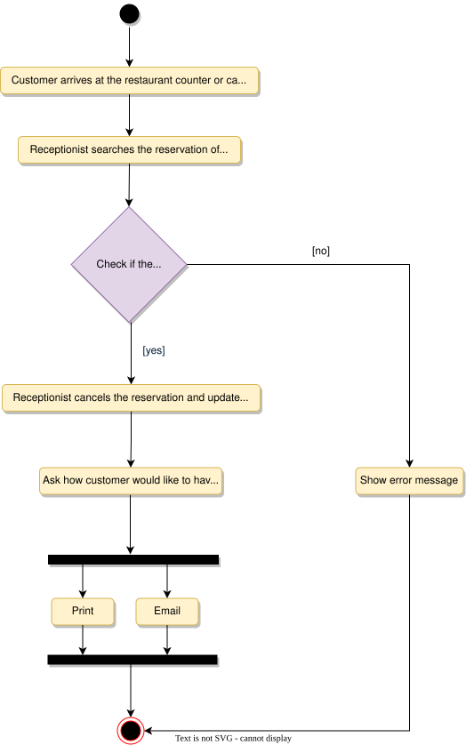
*Figure — Activity diagram: cancelling a reservation (course diagram)*

Order lifecycle — the transitions `Order.moveTo` allows:

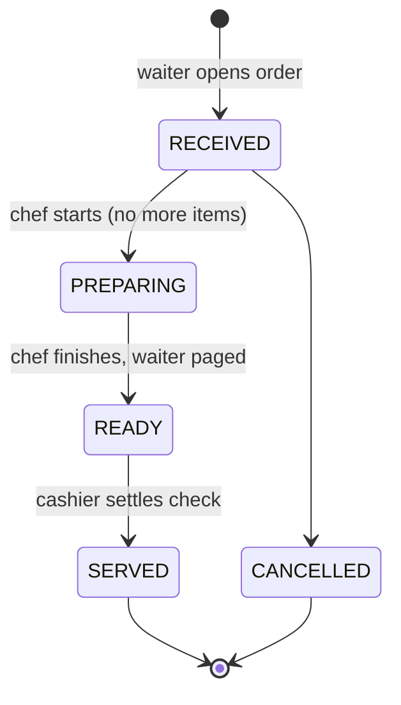

From order to payment:

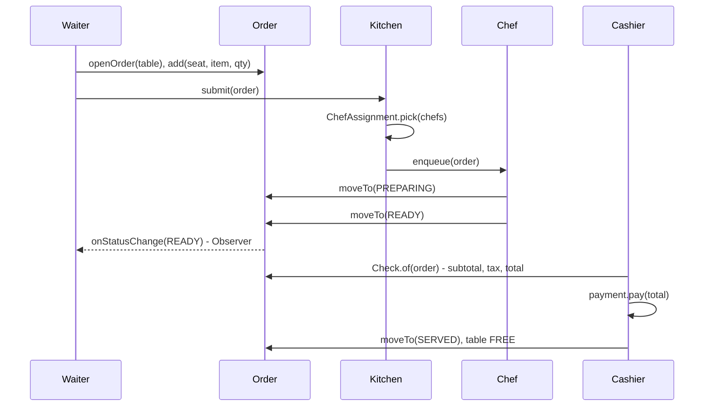

### Design decisions & patterns used

| Decision | Why | Alternative rejected |
|---|---|---|
| **One meal per seat** (`Map<seat, Meal>`) | Requirement 4 asks for it; it tells the kitchen which plate goes to which guest and makes split bills trivial. | A flat list of dishes per order. |
| **Table keeps held time slots as well as status** | Status answers "now" (walk-ins); slots answer "is it free at 19:00 on Friday" (reservations). A booking holds two hourly slots. | Status only: cannot take future bookings. |
| **Search lives on `ReservationService`, not on `Table`** | One table only knows about itself; "which tables are free at seven" needs all of them. The course notes an older version had a static search on `Table` that could not work. | Static `Table.search`. |
| **Best fit** when choosing a table | Smallest table that seats the party keeps large tables free for large parties. | First free table. |
| **Observer** (`OrderListener`; listeners register with a subject and are told when it changes) | The kitchen does not need to know who cares about "ready" — the waiter, a display screen, a delivery app can all subscribe. | Chef calling the waiter directly (tight coupling: classes that know too much about each other to change separately). |
| **Strategy** (`ChefAssignment`) | The course's kitchen rotates chefs; that is fair but not load-aware (it ignores how busy each chef already is). Swapping to `LeastLoadedAssignment` is one class, not a rewrite — the course's own point about keeping the rule in one place. | Round-robin (taking turns in a fixed rotation) hard-coded in `Kitchen`. |
| **State machine** in `Order.moveTo` | Illegal moves (adding food after cooking starts, serving before ready) fail loudly. | Free `setStatus`. |
| Three `Payment` classes behind a `sealed` interface (only the listed classes may implement it) | Card completes at once, cash may be short (declined) and returns change, a cheque must clear (pending). Different behaviour → different classes (Strategy). | One `Payment` class with a `type` field and `if`s. |
| Check computed, not stored | Prices live on menu items; the check is derived, so it cannot disagree with the order. | A stored `Bill` total. |
| Role classes extend `Employee`; `Customer` is not an employee | Only staff have employee ids and accounts; this keeps an account off the customer. | One `Person` class with a role flag. |

### Java implementation

Package `lld.ch16.restaurant`. Full runnable code is in `code/lld/ch16/restaurant/`: `Types.java` (enums `TableStatus`, `SeatType`, `ReservationStatus`, `OrderStatus`, `PaymentStatus`; records `MenuItem`, `Customer`, `TableSeat`), `Menu.java` (`Menu` → `MenuSection` → `MenuItem`; prices live only on `MenuItem`), `Tables.java` (`Table`, `TableChart`), `Reservations.java`, `Orders.java` (`MealItem`, `Meal`, `Order`, `OrderListener`), `Kitchen.java`, `Staff.java` (`Employee` roles, `Check`, payments, `Branch`, `Restaurant`) and `Main.java`. The essential lines (`/* ... */` and `//` summary comments stand for code left out):

```java
/** status answers "what is this table doing NOW" (walk-ins); heldSlots answers "is it free at 19:00 on Friday". */
final class Table {
    static final int SLOTS_PER_BOOKING = 2;   // a booking holds the table for two hourly slots
    private final Set<LocalDateTime> heldSlots = new HashSet<>();
    private TableStatus status = TableStatus.FREE;

    /** Atomic check-then-hold. */
    synchronized boolean tryHold(LocalDateTime start) {
        if (!isFreeAt(start)) return false;          // none of slots(start) already held
        heldSlots.addAll(slots(start));
        return true;
    }
}
/** A named seating arrangement. It REFERS to tables (association); a table can appear in several charts. */
record TableChart(String name, List<Table> tables) {}

/** Searching belongs here, not on Table: one table only knows about itself. */
final class ReservationService {
    /** Best fit first: the smallest table that seats the party, so big tables stay free for big parties. */
    List<Table> search(LocalDateTime time, int partySize) {
        return tables.stream().filter(t -> t.capacity() >= partySize && t.isFreeAt(time))
                .sorted(Comparator.comparingInt(Table::capacity)).toList();
    }
    Optional<Reservation> reserve(Customer c, int partySize, LocalDateTime time) {
        for (Table t : search(time, partySize))
            if (t.tryHold(time)) {     // another receptionist may have taken it since search(): try the next one
                var r = new Reservation("RES-" + seq.incrementAndGet(), c, partySize, time, t);
                reservations.put(r.id(), r);
                notifier.send(c, "Table " + t.id() + " booked for " + partySize + " at " + time);
                return Optional.of(r);
            }
        return Optional.empty();
    }
    // sendReminders(now): run every few minutes; reminds CONFIRMED bookings starting within the next hour,
    // once each (Reservation.markReminded returns true only the first time).
}
// Reservation.updatePeopleCount(n) refuses n larger than the reserved table; cancel() releases the slots;
// checkIn() marks the table OCCUPIED. freeForWalkIn(size) picks FREE tables by status, best fit.
```

```java
final class Order {
    private final Map<Integer, Meal> meals = new TreeMap<>();      // one meal per seat
    private final List<OrderListener> listeners = new CopyOnWriteArrayList<>();

    /** Items can only be added before the kitchen starts cooking. */
    synchronized void add(int seat, MenuItem item, int qty) {
        if (status != OrderStatus.RECEIVED) throw new IllegalStateException("order " + id + " is already " + status);
        if (seat < 1 || seat > table.capacity()) throw new IllegalArgumentException("table " + table.id() + " has no seat " + seat);
        meals.computeIfAbsent(seat, Meal::new).add(new MealItem(item, qty));
    }
    void moveTo(OrderStatus next) {
        synchronized (this) {
            boolean ok = switch (status) {
                case RECEIVED -> next == OrderStatus.PREPARING || next == OrderStatus.CANCELLED;
                case PREPARING -> next == OrderStatus.READY;
                case READY -> next == OrderStatus.SERVED;
                case SERVED, CANCELLED -> false;
            };
            if (!ok) throw new IllegalStateException("order " + id + ": " + status + " -> " + next + " not allowed");
            status = next;
        }
        listeners.forEach(l -> l.onStatusChange(this, next));   // notify outside the lock
    }
}

interface ChefAssignment { Chef pick(List<Chef> chefs); }          // Strategy
final class RoundRobinAssignment implements ChefAssignment {
    public synchronized Chef pick(List<Chef> chefs) { return chefs.get(next++ % chefs.size()); }
}
final class LeastLoadedAssignment implements ChefAssignment {
    public Chef pick(List<Chef> chefs) { return chefs.stream().min(Comparator.comparingInt(Chef::load)).orElseThrow(); }
}
// Chef keeps a FIFO queue: startNext() -> PREPARING, finishCurrent() -> READY. Waiter implements OrderListener.
```

```java
/** The check is computed from the order's lines, never stored separately. */
record Check(Order order, BigDecimal subtotal, BigDecimal tax, BigDecimal total) {
    static final BigDecimal TAX_RATE = new BigDecimal("0.08");
    static Check of(Order o) {
        var sub = o.subtotal();
        var tax = sub.multiply(TAX_RATE).setScale(2, RoundingMode.HALF_UP);
        return new Check(o, sub, tax, sub.add(tax));
    }
}
/** Strategy: three ways to pay, three behaviours. */
sealed interface Payment permits CardPayment, CashPayment, CheckPayment { PaymentStatus pay(BigDecimal amount); }
// CardPayment -> COMPLETED; CashPayment -> DECLINED if short, else prints change and COMPLETED;
// CheckPayment -> PENDING (a paper check has to clear at the bank, so it is not money yet).

final class Cashier extends Employee {
    PaymentStatus settle(Check check, Payment payment) {
        // Check the order state BEFORE taking money: a refused state change after payment would leave the guest charged.
        if (check.order().status() != OrderStatus.READY)
            throw new IllegalStateException("order " + check.order().id() + " is " + check.order().status() + ", not READY");
        var status = payment.pay(check.total());
        if (status != PaymentStatus.DECLINED) {
            check.order().moveTo(OrderStatus.SERVED);
            check.order().table().setStatus(TableStatus.FREE);
        }
        return status;
    }
}
```

A `Branch` owns its menu, kitchen and charts; staff are associated (they can move branches), and `Branch.hire` adds a `Chef` to the kitchen. `Main.java` opens a "Spice Route" Downtown branch with tables T1 (2 seats), T2 and T3 (4), T4 (6), round-robin chefs Chen and Maria, and an SMS notifier.

Output:

```text
1) Manager builds the menu
   Starters: [Tomato soup, Garlic bread]
   Mains: [Margherita pizza, Pasta arrabbiata]
   Drinks: [Lemonade]
   charts: [Default, Banquet]
2) Ravi searches tables for 4 at 19:00: [T2, T3, T4]
    [sms 555-0101] Table T2 booked for 4 at 2026-10-09T19:00
    [sms 555-0102] Table T3 booked for 4 at 2026-10-09T20:00
   Asha -> T2, Ben -> T3 (T2 is held 19:00-21:00)
   party of 8 at 19:00: no single table fits
   Asha's party grows to 6: rejected, table T2 seats 4, not 6
    [sms 555-0102] Reservation RES-2 cancelled
   after Ben cancels, free for 4 at 20:00: [T3, T4]
3) Reminder job at 18:15
    [sms 555-0101] Reminder: your table T2 at 19:00
4) Asha checks in; a couple walks in
   Asha seated at T2, walk-in couple seated at T1
5) Wendy takes two orders, one meal per seat
   O1 -> chef Chen, O2 -> chef Maria
6) Kitchen works the queues
   rejected: order O1 is already PREPARING
    [Wendy's pager] order O1 for table T2 is READY
    [Wendy's pager] order O2 for table T1 is READY
7) Check for O1 (split by seat)
   seat 1: [1x Tomato soup, 1x Margherita pizza] = 18.50
   seat 2: [1x Pasta arrabbiata, 2x Lemonade] = 20.50
   seat 3: [1x Garlic bread] = 4.00
   subtotal 43.00, tax 3.44, total 46.44
    change due: 13.56
   paid cash: COMPLETED
   O2 total 25.92 paid by check: PENDING
   table statuses: [T1=FREE, T2=FREE, T3=FREE, T4=FREE]
```

Step 2 shows best fit and slot holding (Ben cannot get T2 at 20:00 because Asha's 19:00 booking holds 19:00 and 20:00). Step 6 shows the state machine rejecting a late addition and the Observer paging the waiter. Step 7 shows the per-seat split and the three payment behaviours.

### Concurrency & edge cases

- **Two receptionists book the same table.** `search` is only advisory; `reserve` calls `Table.tryHold`, which is `synchronized` and checks-and-holds both slots in one step. If it fails (someone else won) the loop tries the next table in best-fit order.
- **Notifying outside the lock.** `Order.moveTo` changes state inside `synchronized` but calls listeners *after* leaving it. Calling unknown code while holding a lock is a classic way to cause deadlocks or long waits. A **deadlock** is when two threads each hold a lock the other needs, so both wait forever.
- **Reminder spam.** The reminder job may run every few minutes; `markReminded` makes it send once per reservation.
- **Party larger than any table.** Returns "no single table fits". Combining tables is out of scope (see Extensions). The course notes the design already allows it, since a reservation can hold a list of tables.
- **No-shows.** `NO_SHOW` exists as a status; a job can release tables for bookings not checked in 15 minutes after start.
- **Party grows after booking.** `updatePeopleCount(6)` on a four-seat table is rejected (step 2 of the output); the receptionist must re-book.
- **Paying for food that is not ready.** `Cashier.settle` checks the order is `READY` *before* calling the payment, so a refused state change can never happen after the guest's money has been taken.
- **Unknown reservation id** on cancel or check-in fails with a clear `IllegalArgumentException` (Java's standard "you passed a bad value" error), not a `NullPointerException` (the confusing crash you get when code uses a missing object).
- **Seat number out of range** on an order is rejected.
- **Cash short** → `DECLINED`, the order stays `READY` and the table stays occupied.
- **Cheque** → `PENDING`: the meal is served, but the money is not yet confirmed.

### Extensions & follow-up questions

- **"Large party needs two tables?"** — Let a reservation hold `List<Table>`; search for combinations of adjacent tables (tag tables with a zone); hold all of them atomically by locking tables in a fixed order (for example by id) to avoid deadlock.
- **"Split the bill?"** — Already easy: `Meal.subtotal()` per seat; create one `Check` per seat group.
- **"Tips and service charge?"** — Add lines to `Check` (percentage or amount chosen at payment).
- **"Waiting list for walk-ins?"** — A FIFO queue per party size; when a table frees, notify the head.
- **"Kitchen stock?"** — An `Inventory` of ingredients; each `MenuItem` has a recipe; placing an order reserves ingredients and marks items "86'd" (unavailable) when stock runs out.
- **"Real concurrency in the kitchen?"** — Each chef becomes a worker thread (a thread that loops, picking up jobs) taking from a `BlockingQueue<Order>` (a thread-safe queue whose `take()` waits when it is empty); `take()` blocks until an order arrives.
- **"Shift schedules?"** — A `Shift` entity (employee, branch, start, end); `Kitchen` only picks chefs on shift.

### In the interview

**30-second pitch:** "Branch owns a menu tree, a kitchen, seating charts and a reservation service. Tables keep both current status for walk-ins and held time slots for bookings; the service searches best-fit and holds slots atomically. Orders have one meal per seat, move through a strict state machine, and notify the waiter through an observer. The kitchen assigns chefs by a strategy. The check is computed from the order, and payment is a strategy with card, cash and cheque."

| Minutes | Do |
|---|---|
| 0–5 | Clarify branches, seating layouts, per-seat meals, payment types. |
| 5–10 | Actors (six) and use cases. |
| 10–20 | Class diagram — say "meal per seat" and "status vs time slots" out loud. |
| 20–35 | Code `Table.tryHold`, `ReservationService.reserve`, `Order` state machine, `Kitchen.submit`. |
| 35–40 | Races, large parties, kitchen load balancing. |

### Self-check

1. **Q:** Why does a table need both a status and held slots? **A:** Status answers "what is it doing now" (walk-ins); slots answer "is it free at a future time" (reservations).
2. **Q:** Why is search on the service, not the table? **A:** A single table only knows about itself; finding all free tables needs the collection.
3. **Q:** Which pattern tells the waiter the food is ready, and why notify outside the lock? **A:** Observer; calling foreign code while locked risks deadlock and slows other threads.
4. **Q:** Why is there no stored bill total? **A:** The order's lines already hold every price; a second stored total could disagree.
5. **Q:** Why is a cheque payment `PENDING`? **A:** A cheque has to clear at the bank, so it is not money yet.

### TL;DR

- Menu → section → item; price only on the item.
- Table = status (now) + held slots (later); service searches best-fit and holds atomically.
- Order → meal per seat → meal item; strict state machine; Observer for "ready".
- Kitchen assigns chefs by Strategy (round-robin or least-loaded).
- Check is computed; card/cash/cheque are three payment strategies.

**Real-world example.** Restaurant point-of-sale (POS — the till software where orders are entered and paid) systems such as Toast send each order to a kitchen display screen as a "ticket", show it by station and in order, and let the front of house see when it is done — the Observer and FIFO queue above. Reservation platforms such as OpenTable model table inventory by time slot and party size, exactly like `Table.heldSlots`.

---

## Design an Airline Management System


*Figure — An airline flies passengers between airports with owned or leased aircraft (course diagram)*

### Problem & clarifying questions

An **airline management system** runs an airline's operations: scheduling flights, reserving tickets, cancelling flights, supporting customers and managing staff, plus daily flight updates.

| Question | Assumed answer |
|---|---|
| What does a customer search by? | Date, source airport and destination airport. |
| One flight or a trip of several? | A customer can build an **itinerary** (the full planned trip) of several flights. |
| Several passengers per booking? | Yes — a reservation seats several passengers (who need not have accounts). |
| Seat classes? | Economy, economy plus, preferred economy, business, first; seat types regular, accessible, emergency exit, extra legroom. |
| Who manages flights? | Only the admin adds aircraft, flights and schedules, and cancels flights; everyone affected is notified. |
| Crew? | Pilots and crew are assigned to flights and can view their schedule. |
| Payment? | Paid per itinerary. |
| Notifications? | When a reservation is made or changed and when a flight's status changes. |

### Requirements

**Functional**

1. Search flights by date, source and destination; view schedules (departure, arrival, free seats).
2. Reserve seats for several passengers on any scheduled flight; build an itinerary of several flights.
3. Only the admin adds aircraft, flights and schedules, and can cancel a flight (everyone affected is notified).
4. Customers cancel a reservation or a whole itinerary; payment is taken for reservations.
5. Assign pilots and crew to flights.
6. Message the customer whenever a booking is created or modified, and whenever one of their flights changes status.

**Non-functional**

- A seat on a flight instance is sold at most once, even under heavy concurrent booking.
- Several passengers in one booking get all their seats or none (**atomic**).
- Fare rules (class multiplier, last-minute surcharge) change without touching booking code.

### Use cases

Five actors:

- **Admin** — adds flights and schedules, cancels flights, manages staff and crew.
- **Front desk officer** — reserves and cancels tickets for walk-in customers.
- **Customer** — views schedules, reserves and cancels.
- **Pilot / Crew** — views assigned flights.
- **System** — sends itinerary and flight-status notifications.

Top use cases: search flights; create/modify/view reservation; assign seats to passengers; pay for a reservation; update the flight schedule; assign pilots and crew.

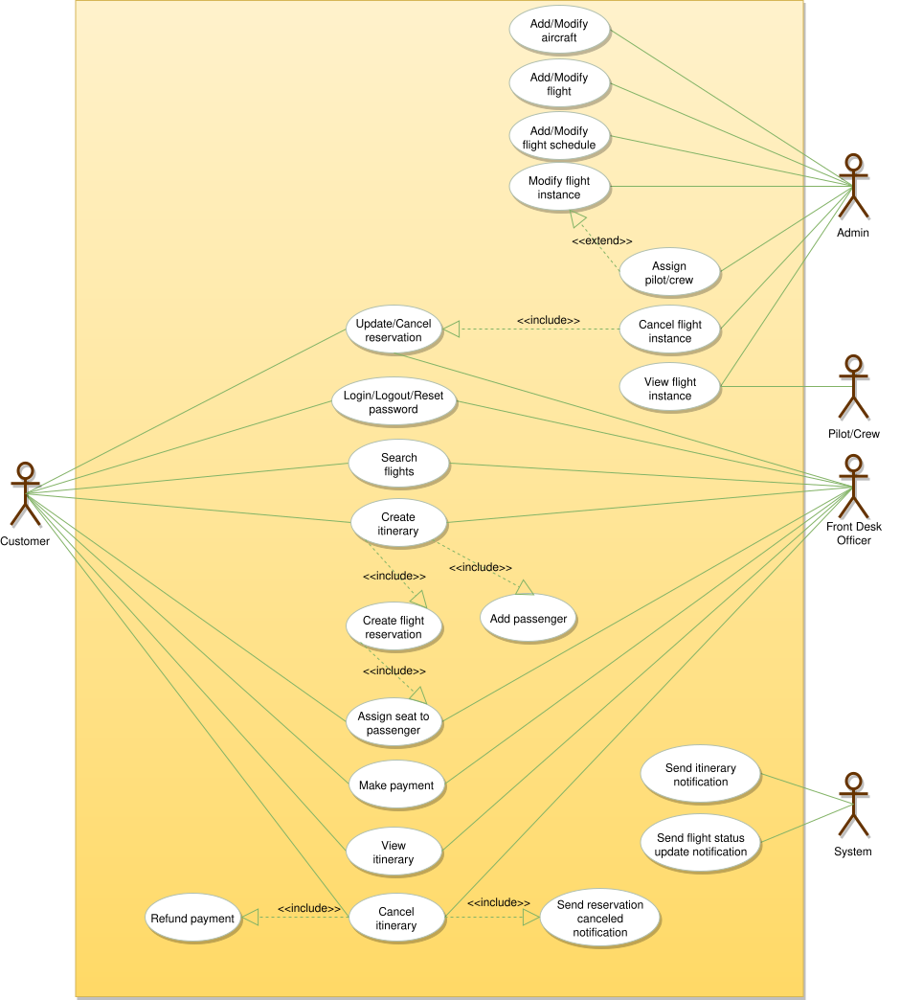
*Figure — Use case diagram: admin, front desk officer, customer, crew and system (course diagram)*

In the figure above, the front desk officer and the customer share the booking use cases: when an officer books for someone at the counter, it is the very same operation, just triggered by another actor.

### Core entities

The one distinction that makes this design work is **four different "seat-ish" and "flight-ish" ideas**:

| Idea | Class | Example |
|---|---|---|
| The route | `Flight` | GA212 London → Tokyo, 14 h, base fare 500 |
| The route on one date | `FlightInstance` | GA212 on 8 Oct 2026 at 10:00 |
| The physical seat on the aircraft | `Seat` | 12A, extra legroom, economy plus |
| That seat on that one instance | `FlightSeat` | 12A on GA212 8 Oct — booked by PNR147 (PNR = booking reference) |

| Class | Responsibility |
|---|---|
| `Airport` | Code and city. |
| `Aircraft` | Registration, model and its physical seats. |
| `Seat` | Number, type, class — nothing about bookings. |
| `Flight` | Route, duration, aircraft, base fare, weekly schedules; generates instances. |
| `WeeklySchedule` | "Every Tuesday at 10:00". |
| `FlightInstance` | Departure time, status, its `FlightSeat`s and assigned crew; holds seats atomically. |
| `FlightSeat` | One seat on one instance and which reservation holds it. |
| `Passenger` | A name on a ticket — deliberately **not** an account holder. |
| `Customer` | The account holder who books and pays. |
| `Admin`, `FrontDeskOfficer` | Staff actors. Admin-only methods on `Airline` require an `Admin` argument; the front desk books through `bookFor`. |
| `CrewMember` | Pilot, co-pilot or cabin crew. |
| `FlightReservation` | One leg: one instance, map passenger → seat, amount, status. |
| `Itinerary` | A trip of legs; owns the connection rule; the unit that is paid. |
| `FareStrategy` | Pluggable pricing: class multiplier, decorated with a last-minute surcharge. |
| `Airline` | Facade (one simple front object that hides many classes behind it) for admin and customer operations; keeps the index instance → reservations. |

### Class diagram

The course builds six stages (money and messages, people, what the airline owns, flights and their seats, reservations and itineraries, the actors); the finished result:

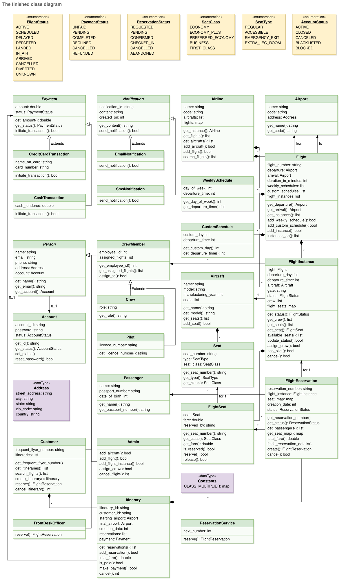
*Figure — The finished class diagram of the airline management system (course diagram)*

`Flight` is the route, `FlightInstance` the route on a day, `FlightSeat` a seat on that day; a `FlightReservation` maps passengers to flight seats and an `Itinerary` owns its reservations. All the ownership (filled-diamond) arrows run one way: schedules and instances belong to their flight, and flight seats belong to their instance. Airports, the aircraft and the crew are only referred to — cancelling a flight does not destroy an airport. `Passenger` sits outside the `Person`/account tree: the course's reason is that a passenger may never log in, and a customer can book for other people.


### Key flows

**Reserve a ticket.** The customer (or front desk officer) searches; if a flight is available they choose seats and passengers, pay, and receive a confirmation; otherwise they search again.

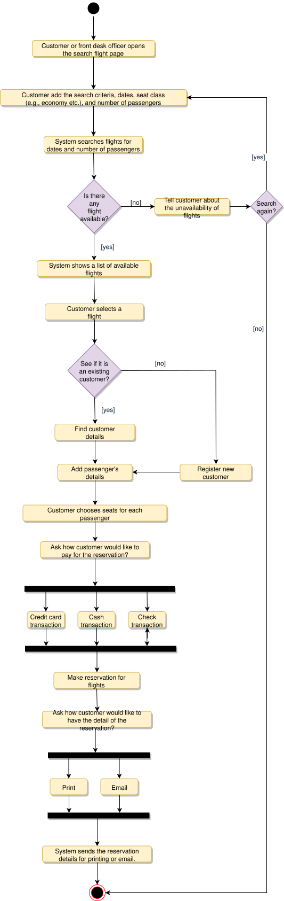
*Figure — Activity diagram: reserving a ticket (course diagram)*

**Cancel a reservation.** The system checks that the customer has a valid reservation; if so it cancels it, releases the seats and notifies the customer; if not, it reports the error.

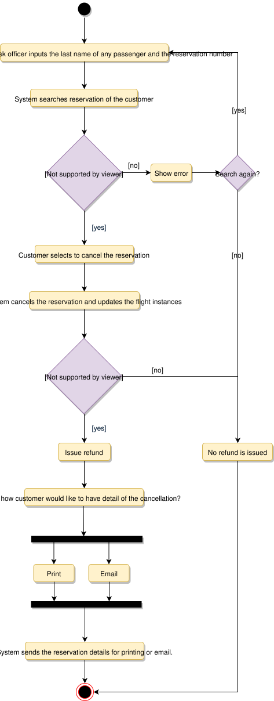
*Figure — Activity diagram: cancelling a reservation (course diagram)*

Booking one leg of an itinerary:

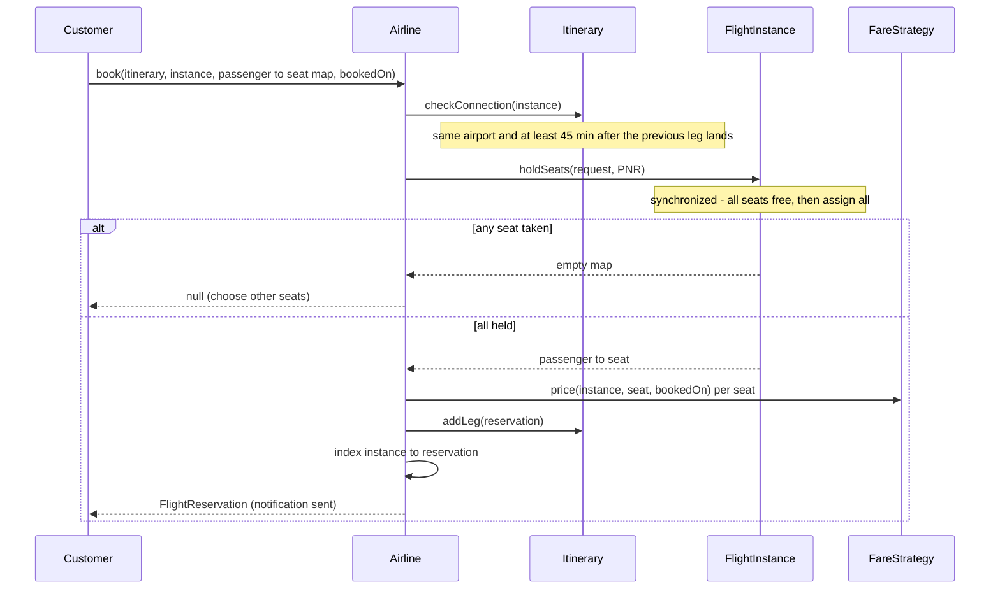

Admin cancels a flight instance:

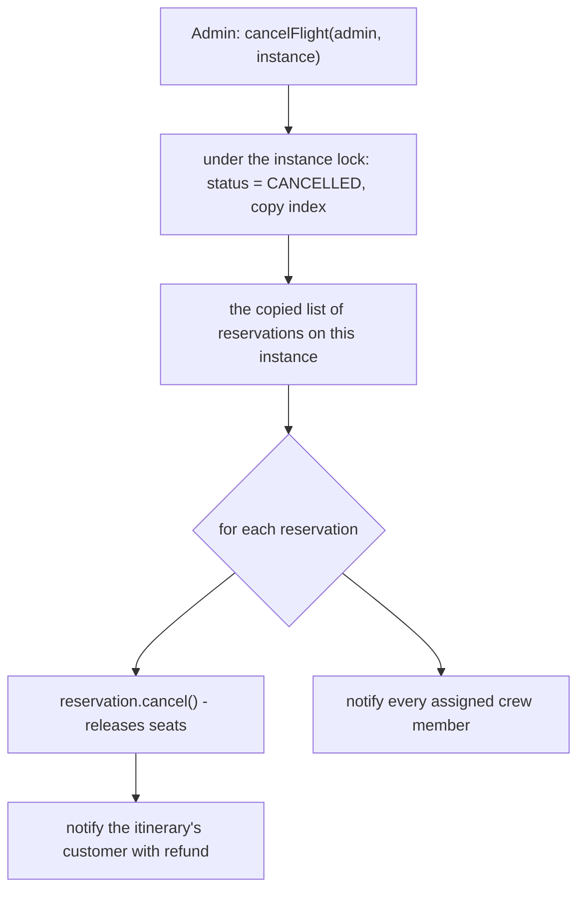

### Design decisions & patterns used

| Decision | Why | Alternative rejected |
|---|---|---|
| **Flight vs FlightInstance vs Seat vs FlightSeat** | 12A is free on Tuesday and taken on Thursday, so "booked" and the fare belong to the seat *on an instance*. The course says an older version of its code had drifted from its diagram here — the code is what runs. | A `booked` flag on `Seat`: one booking would block the seat forever. |
| `holdSeats` is **all-or-nothing** and `synchronized` per instance | A family must get all seats or none; per-instance locks let different flights sell in parallel. | Holding seats one by one (half-booked families), or one global lock (no parallelism). |
| `Passenger` is not an account | A passenger is a name on a ticket; a customer books for others. | `Passenger extends Person` would force an account on a child. |
| **Itinerary is paid, not the leg** | A customer pays for the trip. | Paying per reservation. |
| **Connection rule on `Itinerary`** | The course names "no connecting-time check" as a gap; the rule belongs to the thing that holds the legs. We check same airport and a 45-minute minimum. | No check (impossible trips). |
| **Index instance → reservations** | The course's other named gap: cancelling a flight told the crew but not passengers, because there was no path from instance to its reservations. The index fixes it. | Scanning every itinerary. |
| **Strategy + Decorator** for fares | The course suggests Strategy for fares (base, seasonal, last minute). `ClassMultiplierFare` uses the course's multipliers (1.0, 1.3, 1.5, 2.5, 4.0); `LastMinuteFare` wraps any fare and adds 25% within 3 days. | Price field on the seat. |
| Crew overlap check | A pilot cannot be on two instances whose times overlap. | Trusting the admin. |
| **Facade** (`Airline`) | One entry point for admin and customer operations. Admin-only operations (`addAircraft`, `publish`, `assignCrew`, `cancelFlight`) take an `Admin` parameter, so "only the admin" is enforced by the compiler; `bookFor(FrontDeskOfficer, …)` is the same call as `book` made by a different actor, exactly as in the course's stage 6. | Actors holding the rules. |
| The course makes `Airline` a Singleton | We construct it once and pass it in, to stay testable. | Global `getInstance()`. |

### Java implementation

Package `lld.ch16.airline`. Full runnable code is in `code/lld/ch16/airline/`: `Types.java` (enums `FlightStatus`, `ReservationStatus`, `SeatClass`, `SeatType`, `CrewRole`; records `Airport`, `Seat` — the physical seat, which knows nothing about bookings — `Passenger` — a name on a ticket, not an account — `Customer`, `CrewMember`, `Admin`, `FrontDeskOfficer`), `Fleet.java` (`Aircraft`, `WeeklySchedule`, `Flight` — the route, which generates one `FlightInstance` per scheduled day; all times in UTC), `FlightInstance.java` (`FlightSeat`, `FlightInstance`), `Booking.java` (fares, `FlightReservation`, `Itinerary`), `Airline.java` (the facade) and `Main.java`. The essential lines (`/* ... */` and `//` summary comments stand for code left out):

```java
/** One seat on one flight instance: 12A can be free on Tuesday and taken on Thursday. */
final class FlightSeat { private String reservationNumber; /* null = free */ }

final class FlightInstance {   // the route flown on one date: owns its seats, crew list and status
    /** All-or-nothing: a family of three either gets all three seats or none. */
    synchronized Map<Passenger, Seat> holdSeats(Map<Passenger, String> request, String reservationNumber) {
        if (status != FlightStatus.SCHEDULED && status != FlightStatus.DELAYED)
            throw new IllegalStateException(key() + " is " + status);
        for (var seatNo : request.values()) {
            var fs = seats.get(seatNo);
            if (fs == null) throw new IllegalArgumentException("no seat " + seatNo + " on " + key());
            if (!fs.isFree()) return Map.of();
        }
        if (request.values().stream().distinct().count() != request.size())
            throw new IllegalArgumentException("two passengers asked for the same seat");
        Map<Passenger, Seat> out = new LinkedHashMap<>();
        request.forEach((p, no) -> { var fs = seats.get(no); fs.assign(reservationNumber); out.put(p, fs.seat()); });
        return out;
    }
    boolean overlaps(FlightInstance other) {
        return departure.isBefore(other.arrival()) && other.departure().isBefore(arrival());
    }
}
```

```java
/** Decorator on any fare: +25% when booked less than 3 days before departure. */
final class LastMinuteFare implements FareStrategy {      // ClassMultiplierFare: baseFare x 1.0/1.3/1.5/2.5/4.0
    public BigDecimal price(FlightInstance fi, Seat seat, LocalDate bookedOn) {
        var p = inner.price(fi, seat, bookedOn);
        long daysBefore = ChronoUnit.DAYS.between(bookedOn, fi.departure().toLocalDate());
        return daysBefore < 3 ? p.multiply(new BigDecimal("1.25")).setScale(2, RoundingMode.HALF_UP) : p;
    }
}

/** A trip of one or more legs (FlightReservations). The itinerary, not each leg, is what gets paid for. */
final class Itinerary {
    static final Duration MIN_CONNECTION = Duration.ofMinutes(45);
    /** Rule the itinerary owns: the next leg must leave from where the last one landed, with time to change. */
    synchronized void checkConnection(FlightInstance next) {
        if (legs.isEmpty()) return;
        var last = legs.getLast().instance();
        if (!last.flight().to().equals(next.flight().from()))
            throw new IllegalArgumentException("leg must depart from " + last.flight().to().code());
        if (next.departure().isBefore(last.arrival().plus(MIN_CONNECTION)))
            throw new IllegalArgumentException("connection too short: " + next.key() + " leaves before " + last.key() + " lands + 45 min");
    }
    /** Idempotent: a second pay() (double click, retry) does not charge again. */
    synchronized void pay(String cardToken) { if (paid) return; /* charge total() */ paid = true; }
}
// FlightReservation.cancel() is idempotent: returns true only for the call that did the cancelling, then releases seats.
```

```java
/** Facade. Keeps an index flight-instance -> reservations so a cancelled flight can reach every passenger. */
final class Airline {
    FlightReservation book(Itinerary it, FlightInstance fi, Map<Passenger, String> seatRequest, LocalDate bookedOn) {
        it.checkConnection(fi);
        String resNo = "PNR" + seq.incrementAndGet();
        FlightReservation r;
        synchronized (fi) {        // hold the seats AND index the reservation as one step (see cancelFlight)
            var seatMap = fi.holdSeats(seatRequest, resNo);
            if (seatMap.isEmpty()) return null;
            var amount = seatMap.values().stream().map(s -> fares.price(fi, s, bookedOn)).reduce(BigDecimal.ZERO, BigDecimal::add);
            r = new FlightReservation(resNo, fi, seatMap, amount);
            owner.put(r, it);
            byInstance.computeIfAbsent(fi, k -> new CopyOnWriteArrayList<>()).add(r);
        }
        it.addLeg(r);
        // notifier.send(... "Booked <key> seats [...] (<PNR>, <amount>)")
        return r;
    }
    void cancelFlight(Admin by, FlightInstance fi) {
        List<FlightReservation> affected;
        synchronized (fi) {        // same lock as book(): no booking can slip past the cancel
            fi.setStatus(FlightStatus.CANCELLED);
            affected = List.copyOf(byInstance.getOrDefault(fi, List.of()));
        }
        for (var r : affected)
            if (r.cancel()) { /* email the itinerary's customer: refunded amount, new itinerary total */ }
        fi.crew().forEach(c -> notifier.send(c.id() + "@crew", "Stand down: " + fi.key() + " cancelled"));
    }
    /** A crew member cannot be on two instances whose times overlap. */
    synchronized void assignCrew(Admin by, FlightInstance fi, CrewMember m) { /* scan instances with overlaps(), then add */ }
    /** The front desk books for a walk-in customer: the same call, made by a different actor. */
    FlightReservation bookFor(FrontDeskOfficer by, Itinerary it, FlightInstance fi, Map<Passenger, String> req, LocalDate on) {
        return book(it, fi, req, on);
    }
    // also: addAircraft(Admin, ...), publish(Admin, Flight, from, to), search(from, to, date), scheduleFor(crew), cancelItinerary(it)
}
```

`Main.java` sets up Global Air with `LastMinuteFare(ClassMultiplierFare)`, one six-seat layout (1A/1B business, 10A–10C economy, 12A economy-plus) on two aircraft, and flights GA212 LHR→NRT (Tue/Thu 10:00, 14 h, base 500), GA100 JFK→LHR (Wed 20:00, 7 h, base 400) and GA300 LHR→JFK (Thu 12:00, 8 h); step 5 races 20 threads for seat 10C.

Output:

```text
1) Admin adds flights (routes) and weekly schedules, then publishes instances
   GA212 instances: [GA212@2026-10-06, GA212@2026-10-08, GA212@2026-10-13, GA212@2026-10-15]
2) Search JFK->LHR on 7 Oct and LHR->NRT on 8 Oct
   GA100@2026-10-07 dep 2026-10-07T20:00 arr 2026-10-08T03:00, free seats 6
   GA212@2026-10-08 dep 2026-10-08T10:00 arr 2026-10-09T00:00, free seats 6
3) Priya books a two-leg itinerary for herself and her son
    [email priya@example.com] Booked GA100@2026-10-07 seats [10A, 10B] (PNR102, 800.00)
    [email priya@example.com] Booked GA212@2026-10-08 seats [1A, 1B] (PNR103, 2500.00)
   itinerary total 3300.00 (2 x 400 economy + 2 x 1250 business)
    charged 3300.00 to tok_priya_card for itinerary IT-101
4) Bad connection is rejected
    [email priya@example.com] Booked GA100@2026-10-07 seats [12A] (PNR105, 520.00)
   rejected: connection too short: GA212@2026-10-06 leaves before GA100@2026-10-07 lands + 45 min
    [email priya@example.com] Itinerary IT-104 cancelled
5) 20 customers race for seat 10C on GA212@2026-10-08
    [email racer7@example.com] Booked GA212@2026-10-08 seats [10C] (PNR115, 500.00)
   successful bookings of 10C: 1, free seats left: 3
6) Walk-in at the front desk, last-minute (booked 7 Oct for 8 Oct): pays +25%
    [email leo@example.com] Booked GA212@2026-10-08 seats [12A] (PNR147, 812.50)
   economy-plus fare 500 x 1.3 = 650.00, charged 812.50
7) Admin assigns crew
   rejected: Capt. Kim already flies GA212@2026-10-08 at that time
   Kim's schedule: [GA212@2026-10-08]
8) Admin cancels GA212@2026-10-08: every passenger and crew member is told
    [email priya@example.com] GA212@2026-10-08 is cancelled. Reservation PNR103 refunded 2500.00. Itinerary IT-101 now totals 800.00
    [email racer7@example.com] GA212@2026-10-08 is cancelled. Reservation PNR115 refunded 500.00. Itinerary IT-107 now totals 0.00
    [email leo@example.com] GA212@2026-10-08 is cancelled. Reservation PNR147 refunded 812.50. Itinerary IT-146 now totals 0.00
    [email K1@crew] Stand down: GA212@2026-10-08 cancelled
    [email L1@crew] Stand down: GA212@2026-10-08 cancelled
    [email A1@crew] Stand down: GA212@2026-10-08 cancelled
   search LHR->NRT on 8 Oct now returns 0 flights
9) Priya cancels the rest of her trip; seats on GA100@2026-10-07 come back
    [email priya@example.com] Itinerary IT-101 cancelled
   free economy seats on GA100@2026-10-07: [10A, 10B, 10C]
```

Step 3 prices 2 × 400 economy + 2 × (500 × 2.5) business = 3300, and the second `pay` call charges nothing. Step 5 has 20 threads racing for seat 10C and exactly one wins (which racer wins, and therefore the PNR and itinerary numbers printed for them in steps 5 and 8, changes from run to run). Step 6 is 500 × 1.3 = 650, plus 25% last-minute = 812.50. Step 8 reaches every passenger through the index — the gap the course points out.

### Concurrency & edge cases

- **Selling one seat twice.** `holdSeats` is `synchronized` on the instance: it checks every requested seat and only then assigns them all. No other thread can slip in between.
- **Booking while the admin cancels the flight.** `book` holds the seats *and* adds the reservation to the instance → reservations index inside one `synchronized (fi)` block, and `cancelFlight` sets `CANCELLED` and copies that index under the same lock. So every reservation is either in the copy (and gets cancelled and notified) or is refused by `holdSeats` because the flight is already `CANCELLED` — none can slip through un-notified.
- **Double payment.** `Itinerary.pay` returns at once if the itinerary is already paid (step 3 calls it twice and charges once).
- **Duplicate seat in one request** (two passengers asking for 12A) is rejected.
- **Booking a cancelled or departed flight** throws.
- **Idempotent cancel.** `FlightReservation.cancel()` returns `false` if already cancelled, so a customer cancelling while the admin cancels the flight does not double-refund.
- **Crew double-booking** across overlapping instances is rejected (`assignCrew` is `synchronized` over the scan and the add).
- **Time zones.** Our example keeps all times in one reference zone. Real systems store departures as `ZonedDateTime` (a date-time plus its time zone) or `Instant` (an exact moment on the global UTC timeline) with each airport's zone, because London and Tokyo are 8–9 hours apart.
- **Seat holds during payment.** Real booking flows put a seat on a short *hold* (for example 10–15 minutes) while the customer pays, and release it automatically if payment fails. Add a `heldUntil` timestamp on `FlightSeat` and a sweeper (a background job that regularly frees expired holds).

### Extensions & follow-up questions

- **"Overbooking on purpose?"** — Airlines sell a few more seats than exist because some passengers do not show up. Model a per-class `overbookLimit` and assign physical seats at check-in.
- **"Check-in and boarding passes?"** — Add `CHECKED_IN` per passenger, a `BoardingPass` (seat, gate, group), and a check-in window.
- **"Baggage?"** — `Baggage(passenger, weight, tag)` on the reservation; fees as extra lines.
- **"Change fees and fare rules?"** — Fare class with rules (refundable, change fee); cancellation refund = fare − fee.
- **"Codeshares?"** — A codeshare is one physical flight sold under several airlines' flight numbers. A `MarketingFlight` (partner's number) pointing at the operating `FlightInstance`.
- **"Delays?"** — `FlightInstance.setStatus(DELAYED)` plus a new departure; notify via the same index; re-check itinerary connections and rebook broken ones.
- **"Scale?"** — Seat inventory per instance is a hot row (one database row that very many requests try to change at once); use one row per seat with a conditional update (`UPDATE … WHERE reservation IS NULL` — it only changes the row if the condition still holds, so exactly one buyer wins) or optimistic locking (no lock is taken; each row carries a version number and a write fails if the version changed since you read it, so you retry), and a cache (a fast in-memory copy of data that is read often) for search.

### In the interview

**30-second pitch:** "Four separate ideas carry the design. `Flight` is the published route; `FlightInstance` is one departure of it on a particular day; `Seat` is the chair fixed in the aircraft; `FlightSeat` is that chair on that one departure, and it is where the fare and the booking live. Reservations map passengers to flight seats and are held atomically per instance. An itinerary groups legs, checks connections and is what gets paid. Fares are a strategy with a last-minute decorator. An index from instance to reservations lets a cancelled flight notify every passenger."

| Minutes | Do |
|---|---|
| 0–5 | Clarify search, itineraries, multiple passengers, crew, cancellation. |
| 5–10 | Actors and use cases. |
| 10–20 | The four-way distinction, then the class diagram. |
| 20–35 | Code `FlightInstance.holdSeats`, `Airline.book`, `Itinerary.checkConnection`, `cancelFlight`. |
| 35–40 | Seat holds during payment, overbooking, time zones. |

**Expected follow-up:** "A flight is cancelled — how do its passengers find out?" — "Through an index from instance to reservations; without it you can only reach the crew."

### Self-check

1. **Q:** Where does the "booked" flag live and why? **A:** On `FlightSeat` — a seat's booking is per instance (per date), not per aircraft.
2. **Q:** Why is `Passenger` not a subclass of `Person`/account? **A:** A passenger may never log in; a customer books for other people.
3. **Q:** How do you guarantee a family gets all seats or none? **A:** `holdSeats` checks all requested seats and assigns them in one synchronized block.
4. **Q:** What does `LastMinuteFare` add and which pattern is it? **A:** +25% within 3 days of departure; a Decorator over any `FareStrategy`.
5. **Q:** What two gaps did the course admit and how did we close them? **A:** No passenger notification on flight cancel (fixed by the instance → reservations index) and no connection-time check (fixed in `Itinerary.checkConnection`).

### TL;DR

- Flight (route) ≠ FlightInstance (route on a date); Seat (physical) ≠ FlightSeat (seat on that date).
- Hold seats all-or-nothing under the instance's lock.
- Itinerary = legs + connection rule + payment.
- Fares: Strategy + Decorator. Keep an instance → reservations index for cancellations.

**Real-world example.** Airline systems separate a *flight number* (a published schedule) from a *flight leg on a date*; inventory is controlled per leg and per booking class, and the booking record (a PNR, passenger name record) groups passengers and segments — the same shape as `FlightReservation` and `Itinerary` here. When an airline cancels a flight, its systems find every PNR on that leg and rebook or notify passengers, which is exactly why the index matters.

---

## Design a Course Registration System

### Problem & clarifying questions

A **course registration system** lets university students sign up for classes each term. It looks simple, but it is one of the harshest concurrency problems in this chapter: at 09:00 on registration day, thousands of students click "register" for the same few popular sections within seconds.

Terms first:

- A **course** is a catalogue entry (CS201 Data Structures, 4 credits).
- A **section** is one offering of a course with its own instructor, meeting time and capacity (CS201-A, Mon/Wed 10:00–11:30, 30 seats). Students register for **sections**, not courses — this is the same split as Flight vs FlightInstance.
- A **prerequisite** is a course you must have completed first.
- A **waitlist** is a first-come-first-served queue of students who want a seat in a full section.
- A **registration window** is the period when a student may register; universities often open it earlier for seniors (priority registration).

| Question | Assumed answer |
|---|---|
| Register for courses or sections? | Sections. |
| Prerequisites? | Must be completed (not just in progress). |
| Capacity? | Per section; when full, join a bounded waitlist. |
| Waitlist promotion? | Automatic when someone drops, in FIFO order, after re-checking the student's timetable. |
| Limits? | A per-student credit limit; no two sections that meet at the same time; no two sections of the same course. |
| Windows? | Opens by class year (seniors first); closes for everyone at one time. |
| Search? | By course code or title. |
| Concurrency? | Many students at once; a section must never exceed its capacity; one student must not double-register from two tabs. |

### Requirements

**Functional**

1. Students register for sections and view their registered sections.
2. Each course has a code, name and credits; each section has an instructor, time slot and enrolment limit.
3. Search courses by code or name.
4. Never enrol beyond a section's capacity; when full, put the student on the waitlist (if it has room).
5. Enforce prerequisites, credit limit, time conflicts, one section per course, and the registration window.
6. On drop, promote the first student on the waitlist automatically and notify them.

**Non-functional**

- Handle concurrent registrations safely: no race conditions, consistent data.
- Rules must be easy to add or remove (for example "department majors only").
- Extensible for future features (fees, holds, cross-listed courses).

### Use cases

- **Student** — searches courses, registers, drops, views schedule, joins a waitlist.
- **Registrar / Admin** — creates courses and sections, sets capacity and windows.
- **Instructor** — views the roster.
- **System** — enforces rules, promotes from the waitlist, sends notifications.


### Core entities

| Class | Responsibility |
|---|---|
| `Course` | Code, title, credits, prerequisite codes. |
| `Section` | One offering: instructor, time slot, capacity, enrolled set, waitlist. **The only place a seat is taken**, under its own lock. |
| `TimeSlot` | Days + start/end; knows whether it overlaps another slot. |
| `Instructor` | Who teaches. |
| `Student` | Year, completed courses, credit limit. |
| `RegistrationWindow` | Opening time per class year and a common closing time. |
| `RegistrationRule` (+ `WindowRule`, `PrerequisiteRule`, `DuplicateCourseRule`, `CreditLimitRule`, `TimeConflictRule`) | One rule each; returns the reason for a violation. |
| `RegistrationContext` | Everything a rule may look at. |
| `RegistrationResult`, `Outcome` | `ENROLLED`, `WAITLISTED` or `REJECTED` + message. |
| `Registrar` | The service: runs the rule chain, takes the seat, drops and promotes, keeps each student's schedule, and defines the lock order. |

### Class diagram

There is no course lesson for this problem; the statement comes from the *awesome-low-level-design* problem set, and every requirement in it is covered above (instructor and capacity sit on the `Section`). The diagram of our Java design:


### Key flows

Register:

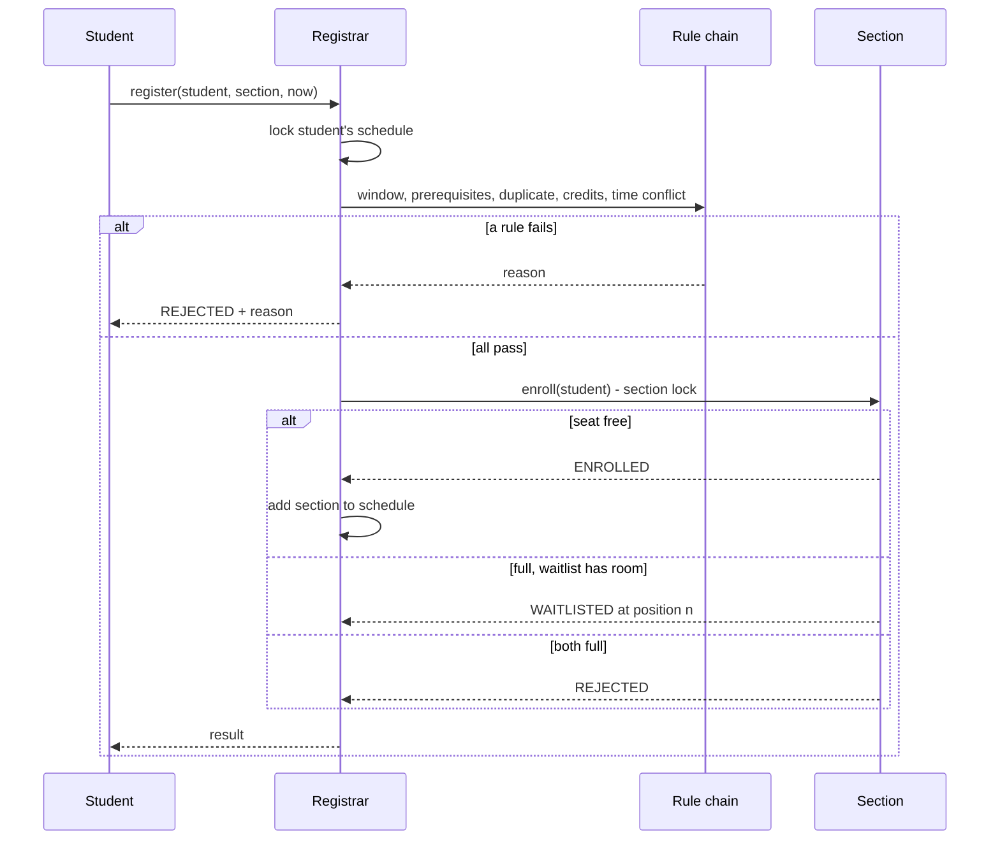

A student's status in one section:

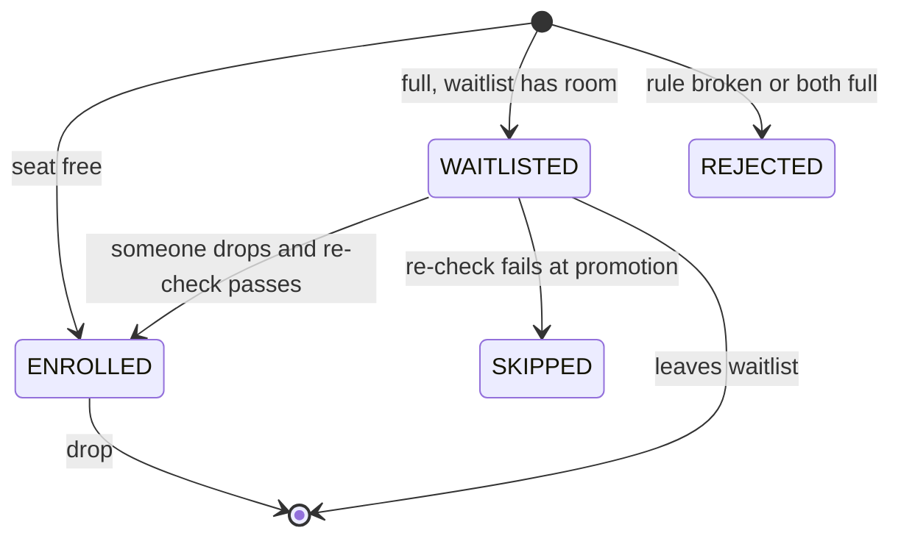

Drop and promote:

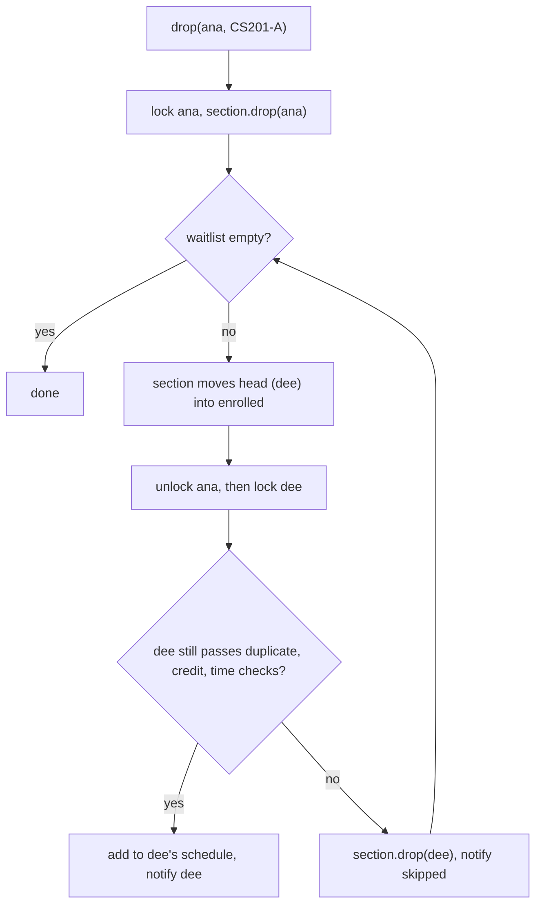

### Design decisions & patterns used

| Decision | Why | Alternative rejected |
|---|---|---|
| **Course vs Section** | Capacity, time and instructor belong to an offering, not the catalogue entry. | Capacity on `Course` (cannot have two sections). |
| **Seat taken only inside `Section.enroll`**, under a `ReentrantLock` (Java's explicit lock object, which the same thread may re-acquire) per section | Check-capacity-then-add is atomic; different sections do not block each other. | `synchronized` on the whole registrar (every student in the university waits in one line). |
| **Per-student lock** around rules + enroll | Credit limit and time-conflict checks read the schedule; two tabs registering the same student would both pass without it (step 6 of the output). | Lock only the section (a student could exceed credits via two sections in parallel). |
| **Fixed lock order: student, then section** | Deadlock needs two threads taking the same two locks in opposite orders. Always taking student before section rules it out. Promotion takes the next student's lock only *after* releasing the dropper's, so two student locks are never held together. | Promoting while still holding the dropper's lock (student → section → student: deadlock risk). |
| **Rules as objects** (Specification / Chain of Responsibility style: each check is its own object, and a request passes along the chain until one rejects it) | Each rule is one small class; the registrar runs them in order and stops at the first failure. A new rule ("majors only") is a new class plus one list entry — Open/Closed. The promotion path reuses a *subset* of the same rules. | One long `register` method with nested `if`s. |
| **Waitlist is a FIFO `Deque`, bounded** (a double-ended queue with a maximum size) | Fair (first come, first served) and prevents unbounded queues. | Unbounded list; priority by year (a valid extension). |
| **Re-check on promotion** | A student may have registered for a clashing section while waiting. | Promote blindly (broken timetables). |
| Time passed in (`now`) | Makes window logic testable without waiting for real dates. | Calling `LocalDateTime.now()` inside rules. |
| **Singleton?** The GitHub problem uses a singleton `CourseRegistrationSystem`. | We construct one `Registrar` and pass it in: one instance, still testable. | Global `getInstance()`. |

### Java implementation

Package `lld.ch16.courseregistration`. Full runnable code is in `code/lld/ch16/courseregistration/`: `Types.java` (records `Course` — a catalogue entry whose prerequisites are course codes — `Instructor`, `TimeSlot`, `Student`, `RegistrationWindow`, `RegistrationResult`; enum `Outcome` = `ENROLLED`/`WAITLISTED`/`REJECTED`), `Section.java`, `Rules.java`, `Registrar.java` and `Main.java`. The essential lines (`/* ... */` and `//` summary comments stand for code left out):

```java
/** When a section meets, e.g. Mon+Wed 10:00-11:30. */
record TimeSlot(Set<DayOfWeek> days, LocalTime start, LocalTime end) {
    boolean overlaps(TimeSlot o) {
        boolean sharedDay = days.stream().anyMatch(o.days::contains);
        return sharedDay && start.isBefore(o.end) && o.start.isBefore(end);
    }
}
/** Priority registration: each class year opens at its own time; everyone closes together. */
record RegistrationWindow(Map<Integer, LocalDateTime> opensByYear, LocalDateTime closes) {
    boolean isOpenFor(Student s, LocalDateTime now) {
        var opens = opensByYear.get(s.year());
        return opens != null && !now.isBefore(opens) && now.isBefore(closes);
    }
}

/** One offering of a course. Capacity and waitlist live HERE, guarded by the section's own lock. */
final class Section {
    private final Set<String> enrolled = new LinkedHashSet<>();
    private final Deque<String> waitlist = new ArrayDeque<>();     // FIFO, bounded by waitlistCapacity
    private final ReentrantLock lock = new ReentrantLock();

    /** The only place a seat is taken: check-and-add in one critical section. */
    RegistrationResult enroll(String studentId) {
        lock.lock();
        try {
            if (enrolled.contains(studentId)) return RegistrationResult.rejected("already enrolled in " + id);
            if (waitlist.contains(studentId)) return RegistrationResult.rejected("already on the waitlist of " + id);
            if (enrolled.size() < capacity) {
                enrolled.add(studentId);
                return new RegistrationResult(Outcome.ENROLLED, "enrolled in " + id + " (" + enrolled.size() + "/" + capacity + ")");
            }
            if (waitlist.size() < waitlistCapacity) {
                waitlist.addLast(studentId);
                return new RegistrationResult(Outcome.WAITLISTED, "waitlisted for " + id + " at position " + waitlist.size());
            }
            return RegistrationResult.rejected(id + " and its waitlist are full");
        } finally {
            lock.unlock();
        }
    }
    /** Removes the student; if a seat opened, moves the head of the waitlist in and returns who it was. */
    Optional<String> drop(String studentId) { /* under lock: remove; enrolled.add(waitlist.pollFirst()) */ }
}
```

```java
/** Specification-style rule: returns a reason when the request breaks it. Run as a chain; first violation wins. */
interface RegistrationRule { Optional<String> violation(RegistrationContext c); }
// RegistrationContext(student, section, currentSchedule, now, window)
// WindowRule, PrerequisiteRule (lists missing codes), DuplicateCourseRule, CreditLimitRule, TimeConflictRule
final class CreditLimitRule implements RegistrationRule {
    public Optional<String> violation(RegistrationContext c) {
        int current = c.currentSchedule().stream().mapToInt(s -> s.course().credits()).sum();
        int after = current + c.section().course().credits();
        return after <= c.student().maxCredits() ? Optional.empty()
                : Optional.of("credit limit " + c.student().maxCredits() + " exceeded (" + after + ")");
    }
}

/** Lock order is ALWAYS student-then-section, which rules out deadlock. */
final class Registrar {
    // fullChecks = Window, Prerequisite, DuplicateCourse, CreditLimit, TimeConflict
    // promotionChecks = DuplicateCourse, CreditLimit, TimeConflict   (a subset of the same rules)
    RegistrationResult register(String studentId, String sectionId, LocalDateTime now) {
        var schedule = schedules.get(studentId);
        synchronized (schedule) {                                    // 1st lock: the student
            var ctx = new RegistrationContext(student, section, Set.copyOf(schedule), now, window);
            var v = firstViolation(fullChecks, ctx);
            if (v.isPresent()) return RegistrationResult.rejected(v.get());
            var result = section.enroll(studentId);                  // 2nd lock: the section
            if (result.outcome() == Outcome.ENROLLED) schedule.add(section);
            return result;
        }
    }
    void drop(String studentId, String sectionId) {
        Optional<String> promoted;
        synchronized (schedule) { promoted = section.drop(studentId); schedule.remove(section); }
        notifier.accept(studentId + " dropped " + sectionId);
        // Finish promotions OUTSIDE the dropper's lock, one student lock at a time (no nested student locks).
        while (promoted.isPresent()) promoted = finishPromotion(promoted.get(), section);
    }
    // finishPromotion: under the promoted student's lock, re-run promotionChecks (their timetable may have
    // changed while waiting); on success add to schedule, otherwise notify "skipped" and promote the next one.
}
```

`Main.java` opens seniors (year 4) on Nov 2, juniors Nov 3, sophomores Nov 4, first-years Nov 5 at 09:00, closing Nov 20 17:00; CS201-A has capacity 2 and waitlist 2, CS101-A has 30 + 10.

Output:

```text
1) Search 'cs2': [CS201-A [MONDAY, WEDNESDAY] 10:00-11:30, CS201-B [TUESDAY, THURSDAY] 14:00-15:30]
2) Rules
   ben  CS201-A on Nov 2  -> REJECTED: registration window is closed for year 3 at 2026-11-02T10:00
   ana  CS201-A on Nov 2  -> ENROLLED: enrolled in CS201-A (1/2)
   ana  MATH201-A         -> REJECTED: time conflict with CS201-A [MONDAY, WEDNESDAY] 10:00-11:30
   ana  CS201-B           -> REJECTED: already registered for CS201 in section CS201-A
   ana  CS301-A           -> REJECTED: missing prerequisites [CS201, MATH201]
   cy   CS201-B on Nov 4  -> REJECTED: missing prerequisites [CS101]
   ana  after close       -> REJECTED: registration window is closed for year 4 at 2026-11-21T09:00
3) Capacity 2 + waitlist 2 on CS201-A (juniors open Nov 3)
   ben  CS201-A           -> ENROLLED: enrolled in CS201-A (2/2)
   dee  CS201-A           -> WAITLISTED: waitlisted for CS201-A at position 1
   eve  CS201-A           -> WAITLISTED: waitlisted for CS201-A at position 2
   fay  CS201-A           -> REJECTED: CS201-A and its waitlist are full
   ben  MATH201-A         -> REJECTED: credit limit 4 exceeded (7)
4) Ana drops CS201-A: the head of the waitlist is promoted
    [notify] ana dropped CS201-A
    [notify] dee promoted from waitlist into CS201-A
   roster [ben, dee], waitlist [eve]
5) 50 first-years grab 30 seats (+10 waitlist) in CS101-A at 09:00 sharp
   ENROLLED=30 WAITLISTED=10 REJECTED=10, roster size 30
6) One student double-clicks: two threads, same request
   {ENROLLED=1, REJECTED=1}, gus schedule [CS201-B]
```

Step 2 shows each rule firing with a clear reason. Step 3 fills two seats and two waitlist places. Step 4 promotes Dee automatically. Step 5 is the "09:00 rush": 50 threads, 30 seats, 10 waitlist places — the counts are exact every run. Step 6 is the double-click: two threads for the same student and section, exactly one succeeds.

### Concurrency & edge cases

- **Overselling a section** — prevented by the section lock around "size < capacity → add".
- **Double-click / two tabs** — prevented by the per-student lock; the second request sees the first enrolment and is rejected by `DuplicateCourseRule` (or by the section's "already enrolled" check).
- **Deadlock** — avoided by the fixed lock order (student → section) and by never holding two student locks at once.
- **Waitlisted in one section, enrolled in another section of the same course** — possible while waiting, because waitlist entries are not in the schedule; the promotion re-check (`DuplicateCourseRule`) catches it and skips to the next student.
- **Registration closes while on the waitlist** — promotion does not re-check the window (it is the drop that triggers it). Many universities stop automatic promotion after a deadline; add `WindowRule` to `promotionChecks` if that is the policy.
- **Dropping a section you are not in** → `IllegalArgumentException`.
- **Rules with time** — the window uses half-open time (`opens ≤ now < closes`).
- **Scaling beyond one JVM** (Java Virtual Machine, one running copy of the program) — in-memory locks cover one process. With several app servers behind a load balancer, the seat count moves to the database: `UPDATE section SET enrolled = enrolled + 1 WHERE id = ? AND enrolled < capacity` succeeds for exactly `capacity` requests (an atomic conditional update), or use optimistic locking with a version column. A queue in front of hot sections smooths the 09:00 spike. (Load balancers, queues and databases at scale are covered in [System Design Fundamentals](../../../system-design-patterns/modules/00-system-design-fundamentals/README.md).)

### Extensions & follow-up questions

- **"Co-requisites or 'prerequisite OR instructor permission'?"** — Model prerequisites as a small expression tree (`And`, `Or` operator nodes over `CourseCompleted`, `Permission` leaves) — the Composite pattern ([§9.3](../09-patterns-structural/README.md#93-composite-pattern)), where a group is treated like a single object — evaluated in `PrerequisiteRule`.
- **"Holds (unpaid fees, advising)?"** — A `HoldRule` that rejects if the student has an active hold.
- **"Priority waitlists (seniors first)?"** — Replace the `Deque` with a `PriorityQueue` (a queue that always hands out the smallest item by some ordering, not the oldest) ordered by (year, time joined).
- **"Seat reservations for majors?"** — Split capacity into buckets (majors 20, others 10) and check the bucket in `Section.enroll`.
- **"Linked sections (lecture + lab)?"** — Register both atomically: lock both sections in a fixed order (by id), check both, enrol both.
- **"Notify by email/SMS?"** — The registrar takes a `Consumer<String>` notifier (a function that takes a value and returns nothing); swap in an email service or publish to a message queue (Kafka, RabbitMQ: stores messages until another program reads them).
- **"Course fees and billing?"** — Add a `Bill` per student per term, a line per enrolled section, recomputed on drop.

### In the interview

**30-second pitch:** "Students register for sections, not courses. A section owns capacity and a bounded FIFO waitlist, and takes seats only inside its own lock. The registrar runs a chain of rule objects — window, prerequisites, duplicate course, credit limit, time conflict — while holding the student's lock, then asks the section for a seat. Lock order is always student then section, so no deadlocks. On drop the head of the waitlist is promoted after a re-check."

| Minutes | Do |
|---|---|
| 0–5 | Clarify course vs section, rules, waitlist, windows, concurrency. |
| 5–12 | Entities and class diagram. |
| 12–30 | Code `Section.enroll/drop`, the rule interface and two rules, `Registrar.register`. |
| 30–40 | Concurrency: run the 50-threads demo in your head; lock order; DB conditional update for scale. |

### Self-check

1. **Q:** Why do students register for sections, not courses? **A:** Capacity, time and instructor belong to each offering; a course can have many sections.
2. **Q:** Which two locks does `register` take and in what order? **A:** The student's schedule lock, then the section's lock — always in that order.
3. **Q:** Why not simply make `register` `synchronized` on the registrar? **A:** It would be correct but serialise (force to run strictly one at a time) every student in the university; per-section and per-student locks let unrelated requests run in parallel.
4. **Q:** Why re-check rules on promotion? **A:** The student's timetable may have changed while waiting (a clash or the same course in another section).
5. **Q:** How do you enforce capacity with many servers? **A:** An atomic conditional update in the database (`… WHERE enrolled < capacity`) or optimistic locking.

### TL;DR

- Course (catalogue) vs Section (offering with capacity, slot, waitlist).
- Rules are small objects run as a chain; add a rule without touching the registrar's logic.
- Seats are taken only inside `Section.enroll` under the section's lock; student lock first, section lock second.
- Drop → promote waitlist head → re-check → notify.
- At scale: conditional update in the database.

**Real-world example.** University student-information systems (for example Ellucian Banner, used by many US universities) run priority registration windows by class standing, check prerequisites and time conflicts, and keep section waitlists that notify a student when a seat opens (some schools enrol the student automatically; others give a time-limited window to claim the seat). Registration-day slowdowns at such schools are the 09:00 "thundering herd" (a huge crowd of requests all arriving at the same instant) this design addresses with per-section locking and, at scale, database conditional updates.

---

## Design a Meeting Scheduler

### Problem & clarifying questions

A **meeting scheduler** is the part of a company calendar that books meeting rooms: an organizer picks a time and the people to invite, the system finds a room that is large enough and free, sends the invitations, and collects the answers. It is the fifth booking problem in this chapter, with two twists the others do not have:

- **The calendar is continuous time, not slots.** A car is booked by the day and a restaurant table by the hour, but a meeting may run 10:15–10:40. Conflict detection must work on arbitrary time ranges.
- **People are booked as well as rooms, but differently.** Two meetings in one room at the same time is impossible. One *person* in two meetings at the same time is merely unwise, and real calendars allow it.

Terms: an **organizer** creates a meeting and **invitees** are asked to attend. An **RSVP** ("please reply") is an invitee's answer — accepted, tentative or declined — and is **pending** until given. A **half-open interval** `[start, end)` includes its start and excludes its end, so 10:00–11:00 and 11:00–12:00 do **not** overlap; two such intervals overlap exactly when `a.start < b.end && b.start < a.end`. A **hard conflict** blocks the booking (room taken); a **soft conflict** only warns (invitee busy). A **recurring meeting** is a **series** of **occurrences** generated by a rule such as "weekly, 4 times".

| Question | Assumed answer |
|---|---|
| What is booked? | A room for a time interval. A meeting always has exactly one room in the core design (virtual meetings are an extension). |
| Who picks the room? | Either the organizer names a room, or the system picks one that fits. |
| What does "fits" mean? | Capacity ≥ organizer + invitees, and the room has the required equipment (video, projector, whiteboard). |
| Is an invitee's double-booking an error? | No: it is reported as a warning to the organizer; the invitee decides by RSVP. |
| Can invitees change their answer? | Yes, until the meeting is cancelled. |
| Who can reschedule or cancel? | Only the organizer. Rescheduling resets every RSVP to pending. |
| Notifications? | On invite, RSVP (to the organizer), reschedule and cancel. Channel (e-mail, push) is pluggable. |
| Recurring meetings? | An extension: daily or weekly, N times, all occurrences in the same room or not at all. |
| Concurrency? | Many organizers book at the same time; a room must never hold two overlapping meetings. |

### Requirements

**Functional**

1. Register rooms with an id, name, capacity and equipment.
2. Book a meeting: organizer, title, interval, invitees, required equipment, and optionally a named room.
3. If no room is named, choose one automatically among the rooms that fit and are free.
4. Reject a booking whose room is taken for any part of the interval (hard conflict); allow back-to-back meetings.
5. Warn (but do not block) when the organizer or an invitee is already in another meeting at that time.
6. Send invitations; let invitees accept, decline or reply tentative; tell the organizer.
7. Let the organizer reschedule (same room) or cancel; notify invitees; free the room on cancel.
8. Show a person's agenda for a day and search for free rooms.
9. Extension: book a recurring series and cancel a whole series.

**Non-functional**

- **No double-booking** of a room, even when many requests arrive at the same instant.
- **Unrelated bookings do not wait for each other** (two different rooms never share a lock).
- **Extensible:** a new room-selection policy or a new notification channel is a new class, not an edit to the scheduler.

### Use cases

Room choice, conflict detection and notification are steps the system performs inside other use cases, so they appear as *included* use cases, not as a "System" actor (notation: [§3.10](../03-relationships-and-uml/README.md#310-use-case-diagrams)).

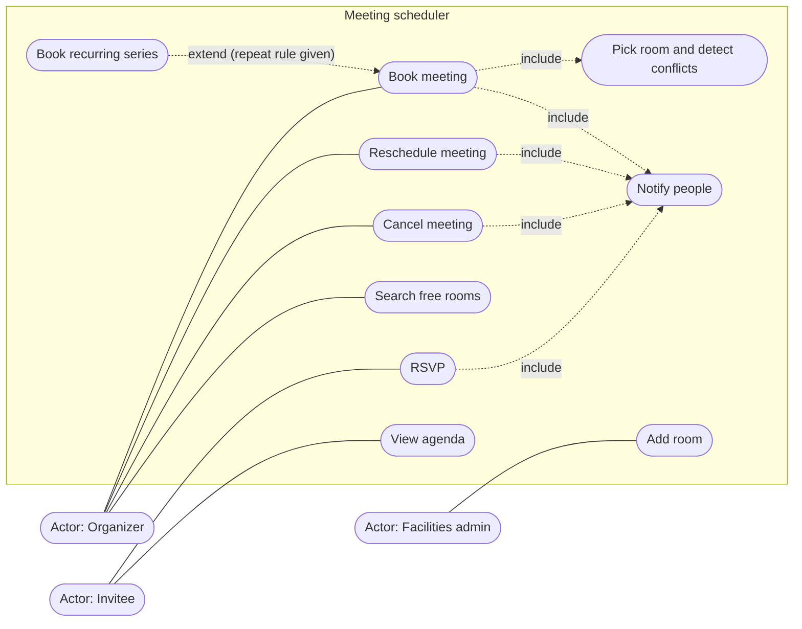

### Core entities

| Class | Responsibility |
|---|---|
| `Interval` | Half-open `[start, end)`; knows whether it overlaps another. |
| `Room` | Capacity, equipment and **its own calendar** of reservations. The **only place a time range is claimed**, under the room's lock. |
| `Meeting` | Id, title, organizer, room, interval, status (`SCHEDULED` / `CANCELLED`) and the invitations. Optional series id. |
| `Invitation` | One invitee and their `RsvpStatus` (`PENDING`, `ACCEPTED`, `TENTATIVE`, `DECLINED`). |
| `MeetingRequest` | What the organizer asks for (people, time, needs, optional room). |
| `RoomSelectionStrategy` (+ `SmallestFitStrategy`, `LeastBusyStrategy`) | Orders the rooms that fit; the scheduler tries them in that order. |
| `MeetingObserver` (+ `InboxNotifier`, `EventCounter`) | Listens to `MeetingEvent`s (invited, RSVP, rescheduled, cancelled). |
| `Recurrence` | Extension: frequency + count; expands one interval into occurrences. |
| `MeetingScheduler` | The service: book, book a series, RSVP, reschedule, cancel, agenda, soft-conflict warnings. Defines the lock order. |
| `BookingResult` | Success with the meeting(s) and any warnings, or failure with a reason. |

### Class diagram

Whiteboard order: `Room` and its calendar, then `Meeting` with its `Invitation`s, then `MeetingScheduler` with its strategy and observers.

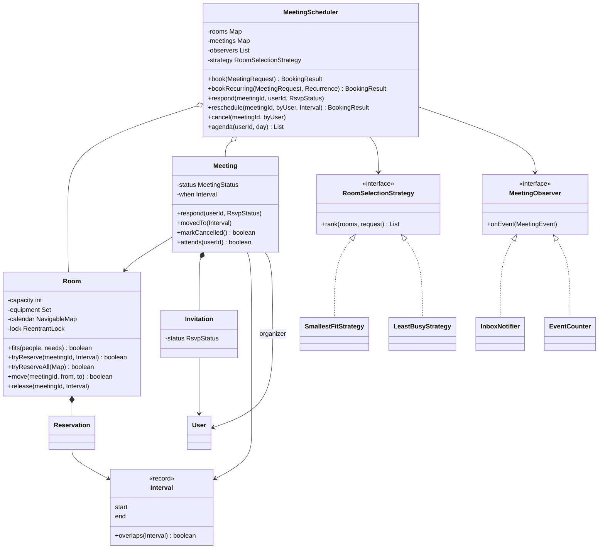

`Meeting --> Room` is plain association (cancelling a meeting does not destroy the room). `Room *-- Reservation` is composition: a reservation lives only in its room's calendar, and the room, not the meeting, owns the truth about which times are taken.

### Key flows

**Book a meeting** (sequence diagram; the "try the next room" loop is where the race is decided):

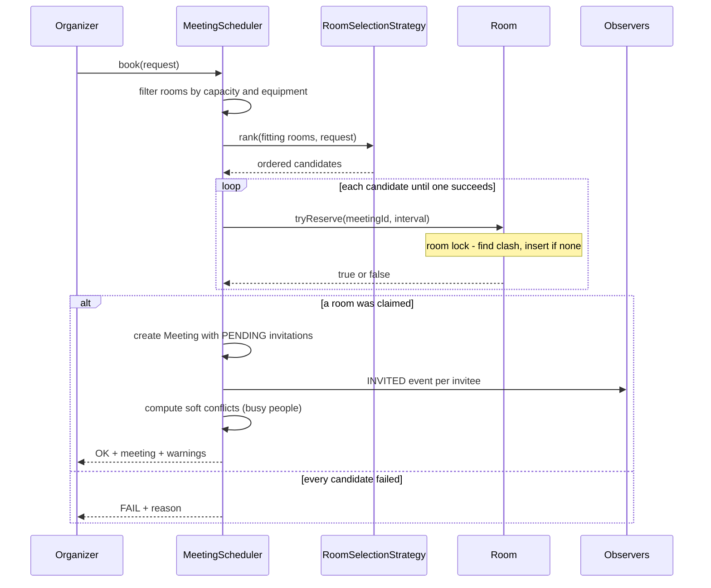

**Reschedule or cancel** (activity diagram; both start by taking the meeting's lock, so they cannot interleave):

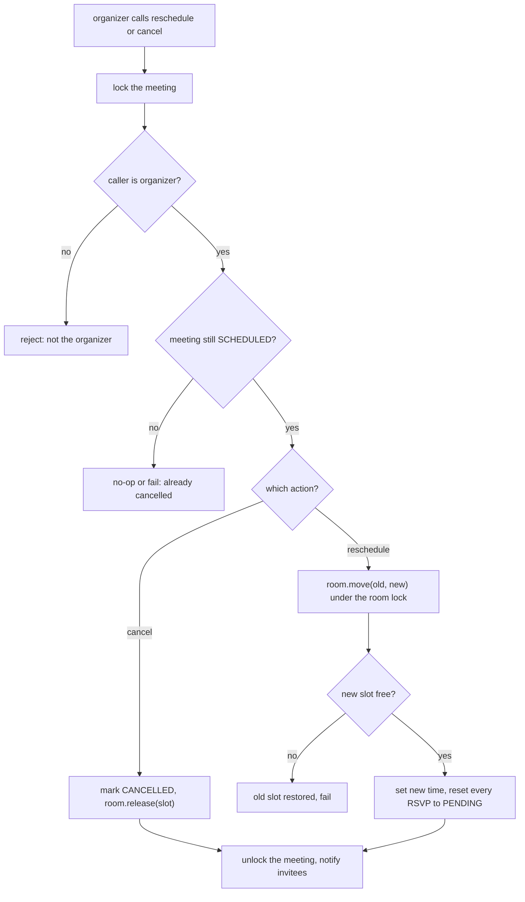

**Lifecycle of one invitation, inside its meeting** (state diagram). The meeting itself has only two states, `SCHEDULED` and `CANCELLED`; cancelling ends every invitation at once.

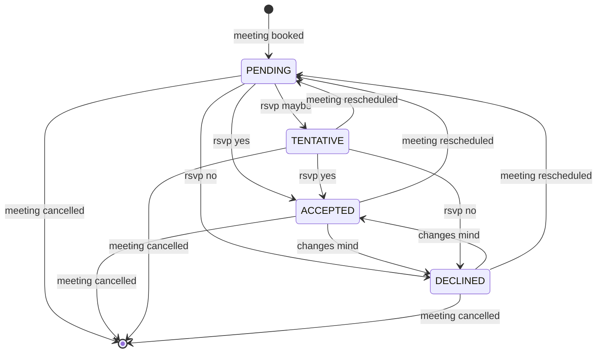

### Design decisions & patterns used

The generic patterns here are already taught elsewhere in the book: notifications use **Observer** ([§11.1](../11-patterns-behavioral-2/README.md#111-observer)) and room ranking uses **Strategy** ([§11.3](../11-patterns-behavioral-2/README.md#113-strategy)), exactly as in the earlier booking cases. The table spends its words on the choices specific to this problem.

| Decision | Why | Alternative rejected |
|---|---|---|
| **The room owns its calendar** (`Room.calendar`), and the room's lock guards it | The invariant "no two overlapping reservations" is about one room, so the room is the object that can enforce it. Different rooms use different locks and never wait on each other. | A global list of meetings scanned for clashes under one global lock (every booking in the company waits in one line). |
| **Calendar = `TreeMap` keyed by start time** (a `NavigableMap`: a map kept sorted by key that can answer "the greatest key below x" in O(log n) time) | Because stored reservations never overlap, **only one entry can clash**: the one with the latest start before the new end (`lowerEntry(end)`). If that one ends at or before the new start, every earlier one does too. One lookup instead of a scan. | A `List` scanned from start to end (O(n) per booking); a per-minute bitmap (wastes memory, fixes the granularity). |
| **Half-open intervals everywhere** | Back-to-back meetings (10:00–11:00, 11:00–11:30) are legal without special cases, and the overlap test is one line. | Closed intervals `[start, end]` (every back-to-back booking becomes a false conflict, or needs a "minus one minute" hack). |
| **Rank, then *try*, rooms in order** | The strategy ranks rooms from a snapshot that can be stale a microsecond later. Instead of trusting it, the scheduler asks each room to claim the slot atomically and moves on if the claim fails. Ranking can be wrong without ever causing a double-booking. | "Find a free room, then book it" (check-then-act across two calls: two organizers find the same free room). |
| **Default strategy is smallest fit** | A 3-person call should not take the 20-seat room. `LeastBusyStrategy` spreads load instead; swapping is one constructor argument. | Always the first free room by id. |
| **Room conflicts are hard, people conflicts are soft** | A room physically holds one meeting. People routinely double-book themselves and choose by RSVP. The organizer gets a warning list; an invitee who declined the other meeting is not counted as busy (`Meeting.attends`). | Rejecting a meeting because one invitee is busy. |
| **Reschedule resets RSVPs to `PENDING`** | "Yes" to Monday 10:00 is not "yes" to Monday 14:00. | Keeping old answers (people silently "accept" a time they never saw). |
| **Reschedule is an atomic move inside the room** (`Room.move`) | Remove old slot, test new slot, insert, or restore the old slot — all under one room lock. The meeting is never left with no room, and the old slot is never lost on failure. A meeting may overlap its *own* old slot (moving 10:00–11:00 to 10:30–11:30 works). | Cancel then re-book (another organizer can grab the slot in between, and invitees get a cancel plus a new invite). |
| **Only the organizer may reschedule or cancel; cancel is idempotent** (doing it twice has the same effect as once) | A double-clicked "cancel" sends one round of notifications. | Throwing on the second cancel, or notifying twice. |
| **Notify after unlocking** | Observers may be slow (e-mail); holding the meeting or room lock while sending would block other bookings. | Publishing inside the critical section. |

### Java implementation

Package `lld.ch16.meetingscheduler`. Files: `Types.java` (`Interval`, `User`, enums, `Recurrence`, `MeetingRequest`, `BookingResult`), `Room.java`, `Meeting.java` (`Meeting`, `Invitation`), `RoomSelection.java` (the two strategies), `Notifications.java` (events and the two observers), `MeetingScheduler.java`, `Main.java`. Only the parts that carry the design are shown; the rest is ordinary getters and the observer and strategy classes described above.

The interval and its overlap test:

```java
// File: code/lld/ch16/meetingscheduler/Types.java (excerpt)
/** A half-open time range [start, end): includes start, excludes end, so 10:00-11:00 and 11:00-12:00 do not clash. */
record Interval(LocalDateTime start, LocalDateTime end) {
    Interval {
        Objects.requireNonNull(start);
        Objects.requireNonNull(end);
        if (!end.isAfter(start)) throw new IllegalArgumentException("end must be after start");
    }

    boolean overlaps(Interval o) { return start.isBefore(o.end) && o.start.isBefore(end); }

    Interval shiftedBy(Duration d) { return new Interval(start.plus(d), end.plus(d)); }
}
```

The room's calendar — the heart of the design. Every method that changes the calendar does its check and its write under the same lock:

```java
// File: code/lld/ch16/meetingscheduler/Room.java (excerpt)
final class Room {
    record Reservation(String meetingId, Interval interval) {}

    /** Bookings keyed by start time. They never overlap, which makes the conflict check one lookup. */
    private final NavigableMap<LocalDateTime, Reservation> calendar = new TreeMap<>();
    private final ReentrantLock lock = new ReentrantLock();

    /**
     * The booking with the latest start before iv.end is the only one that can overlap iv: bookings are
     * disjoint and sorted, so if that one ends at or before iv.start, every earlier one does too. O(log n).
     */
    private Optional<Reservation> clash(Interval iv) {
        var e = calendar.lowerEntry(iv.end());
        return e != null && e.getValue().interval().end().isAfter(iv.start()) ? Optional.of(e.getValue()) : Optional.empty();
    }

    /** Atomic check-then-claim. */
    boolean tryReserve(String meetingId, Interval iv) {
        lock.lock();
        try {
            if (clash(iv).isPresent()) return false;
            calendar.put(iv.start(), new Reservation(meetingId, iv));
            return true;
        } finally {
            lock.unlock();
        }
    }

    /** All-or-nothing claim of several slots (a recurring series): check every one, then insert every one. */
    boolean tryReserveAll(Map<String, Interval> byMeetingId) {
        lock.lock();
        try {
            for (var iv : byMeetingId.values()) if (clash(iv).isPresent()) return false;
            byMeetingId.forEach((mid, iv) -> calendar.put(iv.start(), new Reservation(mid, iv)));
            return true;
        } finally {
            lock.unlock();
        }
    }

    /** Moves a booking inside this room atomically: the old slot is restored if the new one is taken. */
    boolean move(String meetingId, Interval from, Interval to) {
        lock.lock();
        try {
            var old = calendar.get(from.start());
            if (old == null || !old.meetingId().equals(meetingId)) throw new IllegalStateException(meetingId + " not booked at " + from);
            calendar.remove(from.start());
            if (clash(to).isPresent()) {
                calendar.put(from.start(), old);
                return false;
            }
            calendar.put(to.start(), new Reservation(meetingId, to));
            return true;
        } finally {
            lock.unlock();
        }
    }
    // release(meetingId, iv) removes the entry only if it still belongs to that meeting.
}
```

A worked example of `clash`: the room holds A = 09:00–10:00 and B = 10:30–11:00. A request for 09:30–10:45 looks up `lowerEntry(10:45)` = B; B ends at 11:00, after 09:30, so it clashes. A request for 10:00–10:30 looks up `lowerEntry(10:30)` = A (B starts *at* 10:30, not before); A ends at 10:00, not after 10:00, so the slot is free — the half-open rule at work.

The scheduler: rank, then try each room; and the meeting-then-room lock order for reschedule and cancel:

```java
// File: code/lld/ch16/meetingscheduler/MeetingScheduler.java (excerpt)
BookingResult book(MeetingRequest r) {
    var rooms = candidates(r);   // the named room if it fits, else strategy.rank(every room that fits)
    if (rooms.isEmpty()) return BookingResult.failure("no room fits " + r.headcount() + " people with " + r.needs());
    String id = "M" + ids.incrementAndGet();
    for (var room : rooms) {
        if (!room.tryReserve(id, r.when())) continue;          // lost this room: try the next one
        var m = new Meeting(id, null, r.title(), r.organizer(), room, r.when(), r.invitees());
        meetings.put(id, m);
        for (var u : r.invitees()) publish(EventType.INVITED, m, u, "");
        return BookingResult.success(List.of(m), "booked " + m, busyPeople(m));
    }
    // ... failure message: who holds the named room, or "all N fitting rooms are taken"
}

BookingResult reschedule(String meetingId, String byUserId, Interval to) {
    var m = meetings.get(meetingId);
    Interval from;
    synchronized (m) {                                          // 1st lock: the meeting
        requireOrganizer(m, byUserId);
        if (!m.isScheduled()) return BookingResult.failure(meetingId + " is cancelled");
        from = m.when();
        if (!m.room().move(meetingId, from, to))                // 2nd lock: the room
            return BookingResult.failure(m.room().name() + " is not free at " + to);
        m.movedTo(to);                                          // new time, every RSVP back to PENDING
    }
    for (var u : m.invitees()) publish(EventType.RESCHEDULED, m, u, from + " -> " + to);
    return BookingResult.success(List.of(m), "moved " + m, busyPeople(m));
}

void cancel(String meetingId, String byUserId) {
    var m = meetings.get(meetingId);
    synchronized (m) {
        requireOrganizer(m, byUserId);
        if (!m.markCancelled()) return;                         // second cancel is a no-op
        m.room().release(meetingId, m.when());
    }
    for (var u : m.invitees()) publish(EventType.CANCELLED, m, u, "");
}

/** Soft conflict: people who are expected somewhere else at the same time. Reported, not blocked. */
List<String> busyPeople(Meeting m) {
    var people = new ArrayList<User>(m.invitees());
    people.add(m.organizer());
    var out = new ArrayList<String>();
    for (var u : people)
        for (var other : meetings.values())
            if (other != m && other.isScheduled() && other.attends(u.id()) && other.when().overlaps(m.when()))
                out.add(u.id() + " is busy in " + other.id());
    return out;
}
```

`Meeting`'s own methods (`respond`, `movedTo`, `markCancelled`, `attends`) are `synchronized` on the meeting, so an RSVP cannot interleave with a reschedule that is resetting the answers. `bookRecurring` follows the same shape as `book` with `tryReserveAll`: generate the occurrences, allocate one id each, and try the ranked rooms until one room accepts the whole series.

`Main` exercises every requirement, then races threads at one room and at the whole building:

```text
1) Ana books a 5-person video call; the scheduler picks the smallest room that fits
    [to ben] ana invited you to M1 'Design review' Mon 11-02 10:00-11:00 in Maple
    [to cy] ana invited you to M1 'Design review' Mon 11-02 10:00-11:00 in Maple
    [to dee] ana invited you to M1 'Design review' Mon 11-02 10:00-11:00 in Maple
    [to eve] ana invited you to M1 'Design review' Mon 11-02 10:00-11:00 in Maple
   OK   booked M1 'Design review' Mon 11-02 10:00-11:00 in Maple
2) Conflicts in a named room (half-open intervals)
   FAIL R2 is taken by M1 Mon 11-02 10:00-11:00
    [to cy] ben invited you to M3 'Back-to-back' Mon 11-02 11:00-11:30 in Maple
   OK   booked M3 'Back-to-back' Mon 11-02 11:00-11:30 in Maple
3) Capacity
   FAIL no room fits 12 people with []
   OK   booked M4 'All hands' Mon 11-02 15:00-16:00 in Atrium
4) RSVPs go back to the organizer
    [to ana] ben ACCEPTED for M1
    [to ana] cy DECLINED for M1
    [to ana] dee TENTATIVE for M1
   M1 [ben=ACCEPTED, cy=DECLINED, dee=TENTATIVE, eve=PENDING]
5) Soft conflict: Eve is double-booked, which is allowed but reported
    [to eve] dee invited you to M5 'Hiring sync' Mon 11-02 10:30-11:00 in Huddle
   OK   booked M5 'Hiring sync' Mon 11-02 10:30-11:00 in Huddle warnings=[eve is busy in M1, dee is busy in M1]
    [to cy] dee invited you to M6 'Coffee' Mon 11-02 10:30-11:00 in Oak
   OK   booked M6 'Coffee' Mon 11-02 10:30-11:00 in Oak warnings=[dee is busy in M1, dee is busy in M5]
6) Ana moves the design review to 14:00: same room, RSVPs reset
    [to ben] M1 moved: Mon 11-02 10:00-11:00 -> Mon 11-02 14:00-15:00 - please RSVP again
    [to cy] M1 moved: Mon 11-02 10:00-11:00 -> Mon 11-02 14:00-15:00 - please RSVP again
    [to dee] M1 moved: Mon 11-02 10:00-11:00 -> Mon 11-02 14:00-15:00 - please RSVP again
    [to eve] M1 moved: Mon 11-02 10:00-11:00 -> Mon 11-02 14:00-15:00 - please RSVP again
   OK   moved M1 'Design review' Mon 11-02 14:00-15:00 in Maple
   M1 [ben=PENDING, cy=PENDING, dee=PENDING, eve=PENDING]
   ben cancels -> ben is not the organizer of M1
7) Ana cancels; the slot is free again
    [to ben] M1 'Design review' was cancelled
    [to cy] M1 'Design review' was cancelled
    [to dee] M1 'Design review' was cancelled
    [to eve] M1 'Design review' was cancelled
    [to cy] ben invited you to M7 'Retro' Mon 11-02 14:00-15:00 in Maple
    [to dee] ben invited you to M7 'Retro' Mon 11-02 14:00-15:00 in Maple
   OK   booked M7 'Retro' Mon 11-02 14:00-15:00 in Maple
8) Recurring weekly stand-up x4 in Huddle; a later series must be all-or-nothing
   OK   booked series S8 in Huddle
     M9 'Stand-up' Mon 11-02 09:30-09:45 in Huddle
     M10 'Stand-up' Mon 11-09 09:30-09:45 in Huddle
     M11 'Stand-up' Mon 11-16 09:30-09:45 in Huddle
     M12 'Stand-up' Mon 11-23 09:30-09:45 in Huddle
   FAIL no single fitting room is free for all 3 occurrences
   OK   booked series S17 in Maple
   after cancelSeries, Huddle bookings: 1
9) Race: 20 organizers want Oak at Tue 10:00 at the same instant
   winners=1, Oak bookings at that time=1
10) Race: 20 organizers, any room, Wed 10:00 - 4 rooms exist, so exactly 4 win
   per room {Atrium=1, Huddle=1, Maple=1, Oak=1}, rejected=16
11) Inboxes and event counts
   eve's inbox: 10 messages, first: ana invited you to M1 'Design review' Mon 11-02 10:00-11:00 in Maple
   ana's inbox: [ben ACCEPTED for M1, cy DECLINED for M1, dee TENTATIVE for M1]
   events {INVITED=23, RSVP=3, RESCHEDULED=4, CANCELLED=12}
   ben's Monday: [M3 'Back-to-back' Mon 11-02 11:00-11:30 in Maple, M7 'Retro' Mon 11-02 14:00-15:00 in Maple, M4 'All hands' Mon 11-02 15:00-16:00 in Atrium]
```

Reading the output:

- **Step 1:** only Maple (8) and Atrium (20) fit five people with video; smallest fit picks Maple. (M2 is the id used by step 2's failed attempt: ids are allocated before claiming.)
- **Step 2:** 10:30–11:30 overlaps M1 and fails with the blocker named; 11:00–11:30 is back-to-back and succeeds (half-open).
- **Step 3:** twelve people cannot use Huddle (4 seats), so the named-room request fails before any lock is taken; the automatic request lands in Atrium.
- **Step 5:** Eve and Dee are already in M1, so M5 books with warnings. In M6, Cy is *not* flagged, because Cy declined M1.
- **Step 6–7:** the move keeps Maple, resets RSVPs and notifies; Ben cannot cancel Ana's meeting; the second cancel sends nothing; the freed 14:00 slot is immediately bookable.
- **Step 8:** the daily "Planning" series in week 3 clashes with the 09:30 stand-up on its first day, so the named-room request fails as a whole (no half-booked series). With automatic choice, Huddle fails its all-or-nothing claim and the series lands in Maple. After `cancelSeries`, Huddle keeps only M5.
- **Steps 9–10:** the counts are exact every run: one winner for one room, and four winners — one per room — when 20 threads may use any room. *Which* thread wins varies.

### Concurrency & edge cases

The basic technique — one lock per bookable resource, check and claim inside it — is the one used for show seats in BookMyShow ([§15.2](../15-case-booking-1/README.md#152-design-a-movie-ticket-booking-system-bookmyshow)) and for hotel rooms ([§15.4](../15-case-booking-1/README.md#154-design-a-hotel-management-system)). What is specific to meetings:

- **Overlap, not equality.** Seats and hotel nights are discrete keys ("seat 12F", "night of the 3rd"), so a concurrent set rejects a duplicate key. Meetings are ranges: 10:00–11:00 and 10:30–11:15 have different keys but still collide. A `ConcurrentHashMap.putIfAbsent` on the start time would *not* catch this. That is why the check (`lowerEntry`) and the insert must sit inside one lock on the room's sorted map.
- **Automatic room choice under a race.** The ranked list is a snapshot. In step 10, all 20 threads rank Huddle first; one wins it and the other 19 fail their claim and move on to Maple, and so on. Correctness comes from the per-room claim, not from the ranking.
- **Lock order: meeting, then room; never two rooms.** `reschedule` and `cancel` take the meeting's monitor and then the room's lock. Nothing takes them the other way round (a `Room` never calls back into a `Meeting`), and no code holds two room locks at once, so deadlock (two threads each waiting for a lock the other holds; see [§12.17](../12-concurrency-concepts/README.md#1217-deadlock)) cannot happen. `book` takes only a room lock, because the new meeting is not visible to anyone yet.
- **Cancel racing reschedule.** Both run under the meeting's monitor; whichever runs second sees the first's result (a cancelled meeting cannot be moved; a moved meeting is cancelled at its new time, and `release` frees the correct slot).
- **RSVP racing reschedule.** Both are `synchronized` on the meeting. If the RSVP runs first, the reschedule resets it to pending; if it runs second, it is an answer to the new time. Either outcome is consistent.
- **Recurring series.** All occurrences are checked and inserted under one room lock, so a competing one-off booking cannot slip into week 3 between the checks and the inserts.
- **Soft-conflict warnings are advisory.** `busyPeople` reads other meetings without a global lock; a meeting booked a millisecond later may be missed. That is acceptable because it is a warning, not an invariant. The room calendar is the only invariant, and it is always exact.
- **Validation:** `end` after `start`; an occurrence must be shorter than its repeat period (a 25-hour "daily" meeting would overlap its own next occurrence); no RSVP to a cancelled meeting.
- **Time zones.** The code uses `LocalDateTime` for readability. A real system stores `Instant` (an absolute point on the UTC timeline) and converts to each person's zone for display, and expands recurring series in the organizer's zone so "09:30 every Monday" survives a daylight-saving change.
- **Beyond one process.** With several app servers the in-memory lock no longer covers every request. Two standard ways: PostgreSQL's **exclusion constraint** (`EXCLUDE USING gist (room_id WITH =, slot WITH &&)` on a `tstzrange` column, with the `btree_gist` extension installed, which makes the database itself reject any overlapping row for the same room), or a row lock on the room (`SELECT ... FROM room WHERE id = ? FOR UPDATE`) held while checking and inserting the booking.

### Extensions & follow-up questions

- **"Find a time when everyone is free."** Merge the busy intervals of all attendees (sort by start, merge overlapping ones), then walk the gaps inside working hours and return the first gap at least as long as the meeting. The same sweep over the room calendars answers "earliest time with a free room".
- **"Virtual meetings with no room?"** Make the room optional: a `Location` interface with `Room` and `VideoLink` implementations; only `Room` has a calendar to claim.
- **"Edit one occurrence of a series?"** Store the rule plus **exceptions** (moved or cancelled occurrences by date) instead of one row per occurrence; that is how calendar standards such as iCalendar (RFC 5545) model it. Our extension expands occurrences eagerly, which is simpler but cannot express "forever".
- **"Reminders 10 minutes before?"** A scheduled job (or a `ScheduledExecutorService`, Java's timer-backed thread pool) that publishes a `REMINDER` event to the same observers; nothing in booking changes.

### In the interview

**30-second pitch:** "Each room owns its calendar, a sorted map of half-open intervals keyed by start time. Booking is an atomic check-then-insert under that room's lock, and because stored bookings never overlap, one `lowerEntry(end)` lookup detects any clash. If no room is named, a strategy ranks the rooms that fit, and the scheduler tries to claim them in order, so ranking can be stale without double-booking. Room clashes are hard errors; people clashes are warnings. Invitations carry RSVP state, reschedule resets it, and observers deliver notifications after the locks are released. Recurring meetings are claimed all-or-nothing in one room."

**Time plan:** clarify (5 min) → entities and diagram (7) → code `overlaps`, `tryReserve`, `book` (16) → RSVP, reschedule, cancel, lock order (7) → concurrency, series, scale, "common free time" (10).

### Self-check

1. **Q:** Why does `lowerEntry(end)` find any clash with one lookup? **A:** Stored bookings are disjoint and sorted, so the one with the latest start before the new end has the latest end of all candidates; if it ends at or before the new start, every earlier booking does too.
2. **Q:** Why can't `putIfAbsent` on a concurrent map prevent double-booking here? **A:** Overlapping meetings usually have different start times, so their keys differ; the conflict is about ranges, which needs a check and an insert under one lock.
3. **Q:** The strategy said Huddle was free, yet booking failed over to Maple. Is that a bug? **A:** No. The ranking is a snapshot; another thread claimed Huddle first. The scheduler tries the next room, and the per-room claim keeps the result correct.
4. **Q:** How do you prevent double-booking with several servers? **A:** Let the database enforce it: an exclusion constraint on (room, time range) or a row lock on the room while checking and inserting.

### TL;DR

- Room owns its calendar: a `TreeMap` of half-open intervals; claim = check + insert under the room's lock.
- One `lowerEntry(end)` lookup detects any overlap.
- Auto room choice: strategy ranks, scheduler tries each room's atomic claim in order.
- Room conflicts block; people conflicts warn; declined invitees are free.
- Reschedule = atomic move inside the room + RSVPs reset; cancel is idempotent; notify after unlocking.
- Lock order: meeting, then room; never two rooms. Recurring series: all-or-nothing in one room.

**Real-world example.** Outlook/Exchange and Google Calendar model rooms as bookable resources with their own calendars that can decline conflicting invitations, while people may be double-booked; recurring meetings are a rule plus exceptions (iCalendar).

For a lighter, timetable-only version of the same interval logic (user and team availability without rooms), see the machine-coding Event Calendar in [§21.3](../21-case-machine-coding/README.md#213-design-an-event-calendar-flipkart).

---

## Chapter summary

| Problem | Key insight | Atomic claim | Patterns |
|---|---|---|---|
| Car rental | Availability is a question about **dates**, not a status field | `Vehicle.tryBook(range)` | Template Method (add-ons), Strategy + Decorator (pricing), state machine |
| Restaurant | **Meal per seat**; table = status (now) + slots (later) | `Table.tryHold(time)` | Observer (order ready), Strategy (chef assignment, payment), state machine |
| Airline | **Flight ≠ FlightInstance, Seat ≠ FlightSeat** | `FlightInstance.holdSeats(map)` (all or nothing) | Strategy + Decorator (fares), Facade, index for cancellation |
| Course registration | **Course ≠ Section**; rules as objects | `Section.enroll` under a section lock, inside a student lock | Specification / Chain of rules, lock ordering |
| Meeting scheduler | **Room owns a calendar of half-open intervals**; room clash blocks, people clash warns | `Room.tryReserve(interval)` (one `lowerEntry` lookup under the room lock) | Strategy (room ranking), Observer (notifications), meeting-then-room lock order |

The five problems share one lesson: **find the calendar, find the atomic check-then-claim, and put the rules on the object that owns the data.**
