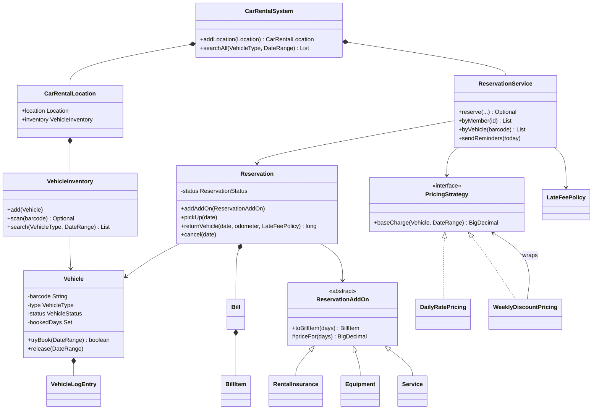
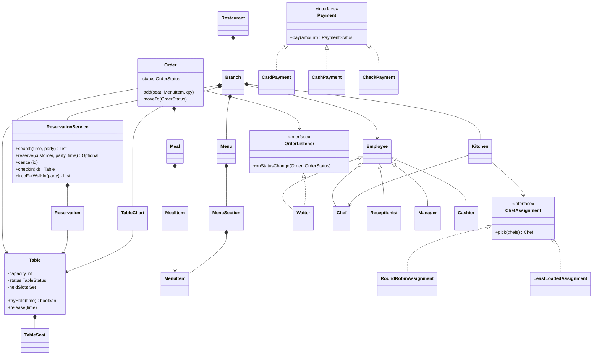
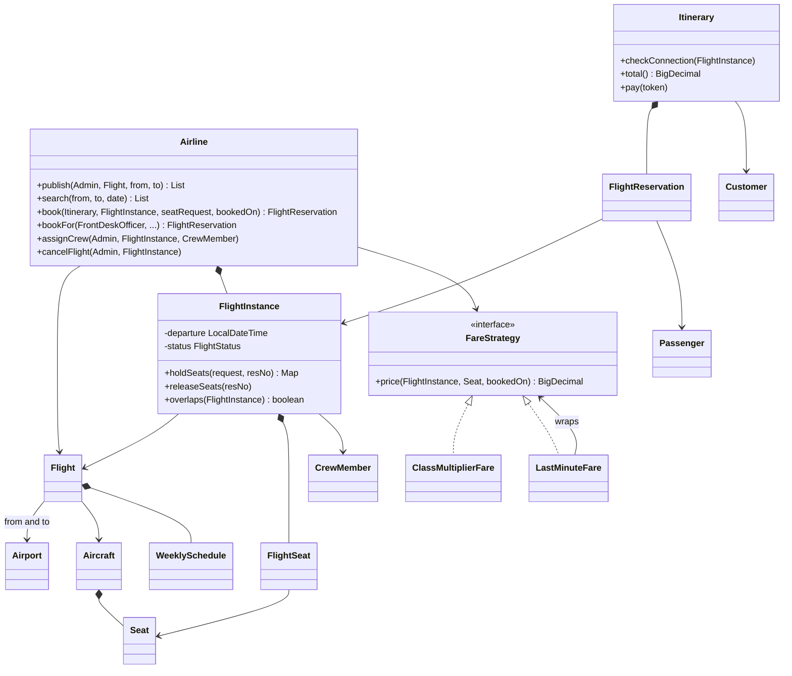
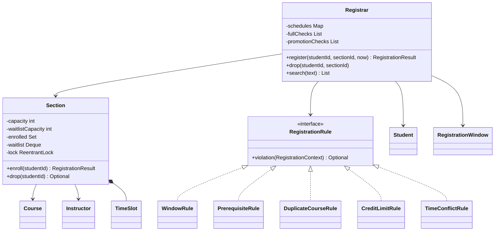
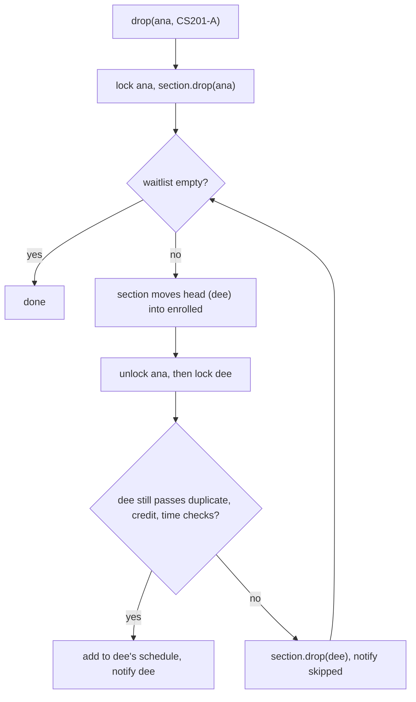

# Chapter 16 — Case Studies: Booking & Inventory (Part 2) — Study Edition

> **Where this fits.** Chapter 15 covered the first group of booking problems. This chapter finishes the family with four more: car rental, restaurant, airline and course registration. They are one problem underneath: **a limited resource, a calendar, and many people trying to claim it at once.** Spot that skeleton and every new booking problem is quick to set up.

**The shared skeleton of every booking problem**

| Idea | Car rental | Restaurant | Airline | Course registration |
|---|---|---|---|---|
| The thing being booked | a vehicle | a table | a seat on one flight instance | a seat in one section |
| The "calendar" | days | hourly time slots | the flight instance (route + date) | the term |
| The atomic check-then-claim | `Vehicle.tryBook` | `Table.tryHold` | `FlightInstance.holdSeats` | `Section.enroll` |
| When it is full | search another car | try the next table | another seat or flight | waitlist |
| Money | bill lines + late fee | check split by seat + tax | fare per seat class, paid per itinerary | none (fees are an extension) |

A **resource** is anything in limited supply. A **race condition** is a bug where the result depends on which thread runs first — here, two people both "win" one seat because both checked "free?" before either wrote "taken".

**How to run:** `cd chapters/16-case-booking-2/code && javac --release 21 -d /tmp/lld_16 $(find . -name '*.java') && java -cp /tmp/lld_16 lld.ch16.carrental.Main` (or `restaurant`, `airline`, `courseregistration`). Where threads race, the *counts* are always the same; *which* racer wins varies. One file sometimes holds several small package-private types (legal Java; production code would split them).

> **Money.** All prices use `BigDecimal`, never `double` — a `double` cannot store 0.1 exactly, so sums drift by fractions of a cent.

---

## Design a Car Rental System

### Problem & clarifying questions

A **car rental system** rents vehicles for hours to weeks from many branches; a car may be returned to a different branch.

| Question | Assumed answer |
|---|---|
| Vehicle kinds? | Car, truck, SUV, van, motorcycle. |
| Branches? | Many, each with its own vehicles; drop-off branch may differ from pick-up. |
| Price? | Daily rate per vehicle type + add-ons + a late fee per day late. |
| Add-ons? | Insurance, equipment (navigation, child seat, ski rack), services (roadside assistance, wifi), additional drivers. |
| Identification? | Unique barcode, scanned at pick-up and return. |
| History? | A vehicle log of every event (reserved, picked up, returned, fuelling, cleaning, damage). |
| Concurrency? | Two members must never get the same car on overlapping days. |

### Requirements

**Functional:** (1) rent car/truck/SUV/van/motorcycle; (2) add each vehicle with a unique barcode and details incl. parking stall; (3) answer "who took this vehicle?" and "what has this member rented?"; (4) late fee after the due date; (5) search and reserve any available vehicle; (6) notify when pick-up is near, due date is near, and when overdue; (7) read barcodes; (8) cancel reservations; (9) vehicle log; (10) rental insurance; (11) extra equipment; (12) services.

**Non-functional:** no double booking for overlapping days; new add-ons or pricing rules without changing reservation code (Open/Closed); auditability — every charge is a bill line, every event a log entry.

### Use cases

Actors: **Receptionist** (adds/edits vehicles and workers, can reserve for a customer), **Member** (searches, reserves, picks up, returns), **Worker** (handles returns, updates the vehicle log), **System** (reminders, overdue alerts, cancellations). Top use cases: add/edit vehicle; search by type and availability; register/cancel membership; reserve; check out; return; add equipment/services; update log. Reserving is shared by member and receptionist; the log belongs to the worker.

### Core entities

| Class | Responsibility |
|---|---|
| `CarRentalSystem` | Owns the branches and the reservation service. |
| `CarRentalLocation` | One branch with its own `VehicleInventory`. |
| `VehicleInventory` | Indexes by barcode, type and model; "which SUVs are free on these days?". |
| `Vehicle` | Barcode, plate, type, parking stall, mileage, **the set of booked days**, its log. |
| `VehicleLogEntry` | One event (date, type, note). |
| `DateRange` | Half-open `[start, end)`; `end` is the due date. |
| `Reservation` | Member, vehicle, dates, pick-up/return branch, add-ons, drivers, bill, status; holds the business rules. |
| `ReservationAddOn` (+ `RentalInsurance`, `Equipment`, `Service`), `AdditionalDriver` | Things that add a charge; a named extra driver (no charge). |
| `Bill`, `BillItem` | The one place that knows what a rental costs. |
| `PricingStrategy`, `LateFeePolicy` | Pluggable base-charge and late-fee rules. |
| `ReservationService` | Creates reservations atomically, answers "who rented what", runs reminders. |
| `Notifier`, `PaymentMethod` | Ports for messages and money. |

### Class diagram


*Figure — The finished class diagram of the car rental system (course diagram)*

The system owns its branches and each branch owns its inventory (**composition** — the part dies with the whole); the inventory only *refers to* vehicles (**association**). A reservation owns its bill but refers to the vehicle. Our Java design differs in two ways: vehicle kinds are an enum (the five subclasses added no behaviour), and pricing is a strategy object.



### Key flows

- **Pick up:** scan licence (or search by name) → check reservation → scan vehicle barcode → hand over keys; no reservation → reserve a free car on the spot.
- **Return:** worker scans the barcode → past due date adds a late fee (one line in `returnVehicle`) → check damage and fuel → settle the bill.
- **Reserve:** `ReservationService.reserve` calls `vehicle.tryBook(dates)`; if false the member picks another car; if true it prices via `PricingStrategy`, creates the reservation (bill gets a BASE line) and notifies.
- **Lifecycle (state machine):** `CONFIRMED →pickUp→ ACTIVE →returnVehicle→ COMPLETED`; `CONFIRMED →cancel→ CANCELLED` (days released on cancel and return).

### Design decisions & patterns used

| Decision | Why | Alternative rejected |
|---|---|---|
| **Availability = booked days per vehicle**, not a status | Members ask about future dates; a car loaned now may be free next week, a car on the lot may be promised next week. | A `RESERVED` status (can't answer date questions; one reservation per car). |
| Keep `VehicleStatus` too | Staff need "where is it now" (lot, loaned, in service, lost). | Dropping it. |
| `tryBook` checks **and** books in one `synchronized` method | Closes the check-then-act race. | `isFree()` then `book()`. |
| **Template Method** on `ReservationAddOn` | Billing written once in `final toBillItem`; subclasses give `kind` and may override the `priceFor` hook. | Type enum + `switch`. |
| **Strategy** for pricing and late fee; **Decorator** `WeeklyDiscountPricing` | Swap/stack rules without touching the reservation. | Constants; a subclass per combination. |
| `Bill` is the only place charges live; methods `synchronized`, `settle` idempotent | One total; no line added mid-payment; a double-click pays once. | Per-add-on running totals. |
| `ReservationService` separate from `Reservation` | Creating/indexing vs one reservation's rules (SRP). | Static factory. |
| **Actors call the rules, never compute them** | Member calls the service; receptionist calls the reservation. | `Receptionist.computeLateFee()`. |
| Course's `CarRentalSystem` **Singleton** → we pass one in | Same "one per app", but testable (dependency injection). | `getInstance()`. |

### Java implementation

Package `lld.ch16.carrental`. Full runnable code: code/lld/ch16/carrental/ (see the Full Edition).

```java
// Vehicle.java — check AND book inside one lock
synchronized boolean isFreeFor(DateRange r) {
    return r.dates().noneMatch(bookedDays::contains);
}

synchronized boolean tryBook(DateRange r) {
    if (!isFreeFor(r)) return false;
    r.dates().forEach(bookedDays::add);
    return true;
}

synchronized void release(DateRange r) { r.dates().forEach(bookedDays::remove); }

// Billing.java — Template Method
abstract class ReservationAddOn {
    // ...
    final BillItem toBillItem(long rentalDays) {
        return new BillItem(kind() + ": " + name, BillItemType.ADD_ON, priceFor(rentalDays));
    }

    protected abstract String kind();

    /** Hook: by default an add-on is charged per rental day. */
    protected BigDecimal priceFor(long rentalDays) { return price.multiply(BigDecimal.valueOf(rentalDays)); }
}

/** A service such as roadside assistance or wifi is a flat fee per rental. */
final class Service extends ReservationAddOn {
    Service(String name, BigDecimal flatFee) { super(name, flatFee); }
    protected String kind() { return "Service"; }
    @Override protected BigDecimal priceFor(long rentalDays) { return price; }
}

// Pricing.java — Decorator over any pricing: 10% off rentals of 7 days or more.
final class WeeklyDiscountPricing implements PricingStrategy {
    private final PricingStrategy inner;
    WeeklyDiscountPricing(PricingStrategy inner) { this.inner = inner; }
    public BigDecimal baseCharge(Vehicle v, DateRange p) {
        BigDecimal base = inner.baseCharge(v, p);
        return p.days() >= 7 ? base.multiply(new BigDecimal("0.90")).setScale(2, RoundingMode.HALF_UP) : base;
    }
}

// Reservation.java — the rules live here
synchronized long returnVehicle(LocalDate on, int odometer, LateFeePolicy lateFee) {
    require(ReservationStatus.ACTIVE, "return");
    long daysLate = Math.max(0, ChronoUnit.DAYS.between(period.end(), on));
    if (daysLate > 0) {
        bill.add(new BillItem("Late fee: " + daysLate + " day(s)", BillItemType.LATE_FEE,
                lateFee.fee(vehicle, daysLate)));
    }
    vehicle.setMileage(odometer);
    vehicle.setStatus(VehicleStatus.AVAILABLE);
    vehicle.release(period);
    // ... log RETURNED, status = COMPLETED
}

// RentalSystem.java — ReservationService
Optional<Reservation> reserve(Member m, Vehicle v, DateRange period, Location pickup, Location dropoff, LocalDate today) {
    if (!v.tryBook(period)) return Optional.empty();
    var r = new Reservation("R" + seq.incrementAndGet(), m, v, period, pickup, dropoff, pricing.baseCharge(v, period));
    reservations.put(r.id(), r);
    v.addLog(today, VehicleLogType.RESERVED, r.id() + " for " + period);
    notifier.send(m, "Reservation " + r.id() + " confirmed: " + v.model() + " " + period);
    return Optional.of(r);
}
```

Output excerpt:

```text
3) 8 members race for VH-002 on the same dates
   successful reservations for VH-002: 1
6) Alice's bill
   Base: RAV4 x 3 days                      BASE_CHARGE   240.00
   Insurance: Collision damage waiver       ADD_ON        45.00
   Equipment: Child seat                    ADD_ON        24.00
   Service: Roadside assistance             ADD_ON        25.00
   Late fee: 2 day(s)                       LATE_FEE      80.00
   TOTAL 414.00
   paid: true, settle again (double click) -> true, no second charge
10) A 7-day Civic rental gets the weekly discount
   base charge 315.00 (7 x 50 = 350, minus 10%)
```

Eight threads race for one car and exactly one wins; the late fee is 2 × 40.00; a second `settle` does not charge again.

### Concurrency & edge cases

- **Double booking** (a gap the course admits): `tryBook` is `synchronized` per vehicle, so check and mark happen as one step; per-vehicle locks let different cars book in parallel. In a database: unique key on `(vehicle_id, day)` or `SELECT … FOR UPDATE`.
- **Search is advisory** — `reserve` may still fail; show "no longer available".
- **Late return collides with the next rental** — keep a buffer day; reassign the next booking to another car of the same type.
- **Early return** releases the whole range; refunds are policy. **Cancel after pick-up**, **add-ons after the rental**, **invalid ranges**, **odometer going backwards** are all rejected.
- **Different return branch** — recorded, but the car stays in the pick-up inventory: a known gap (transfers).

### Extensions & follow-up questions

- **One-way rentals?** On return at another branch move the vehicle between inventories, log a `TRANSFER`, add a one-way fee line.
- **Seasonal/dynamic pricing?** A `SeasonalPricing` strategy or another decorator; reservation unchanged.
- **Deposits?** `authorize` at pick-up, `capture` at return. **Mileage/fuel/damage?** `FINE` bill lines. **Reminders?** A daily scheduler calls `sendReminders(today)`. **Scale?** Partition by branch, `(vehicle_id, day)` unique key, search on a replica/index.

### In the interview

**30-second answer:** "Branches own inventories indexed by barcode, type and model. Availability is a question about *dates*, so each vehicle keeps its booked days and `tryBook` checks and books atomically. A reservation owns a bill; every charge is a line. Add-ons share a template-method base; pricing and late fees are strategies."

Plan (40 min): 0–5 clarify; 5–10 actors and entities; 10–20 class diagram ("dates, not status"); 20–35 code `tryBook`, `Reservation`, `reserve`; 35–40 concurrency, late collisions, transfers. Likely follow-ups: book next month while loaned now? (yes — dates); two clicks at once? (atomic `tryBook`); new add-on? (one subclass).

### Self-check

1. **Q:** Why isn't a `RESERVED` status enough for "free next week?" **A:** Status describes *now*; only per-day bookings answer date questions.
2. **Q:** Pattern and hook in `toBillItem`? **A:** Template Method; `priceFor` is the hook (`Service` makes it flat).
3. **Q:** Why one `tryBook` not `isFree` + `book`? **A:** Atomic check-then-act under the vehicle lock.
4. **Q:** How is the late fee computed? **A:** Days from `period.end` to return × `LateFeePolicy` rate, as a `LATE_FEE` line.

### TL;DR

- Availability = booked **days** per vehicle; status = where it is now.
- `tryBook` = atomic check-and-book per vehicle.
- One bill per reservation; late fee = days late × rate.
- Template Method (add-ons), Strategy + Decorator (pricing). Gaps: branch transfers, buffer between rentals.

**Real-world example.** Hertz or Enterprise sell a *car class* ("intermediate SUV or similar"), counting availability per type per day and binding a specific vehicle at the counter — the same design one level up.

---

## Design a Restaurant Management System

### Problem & clarifying questions

A **restaurant management system** runs tables, reservations, orders, the kitchen, and the bill.

| Question | Assumed answer |
|---|---|
| One restaurant or chain? | Several branches, each with its own menu, tables, staff. |
| Menu? | Menu → sections → items with prices. |
| Orders? | Waiter creates an order per table and adds meals **per seat**; meal items point at menu items. |
| Reservations / walk-ins? | Search tables by time and party size and reserve; cancel; reminders; show tables free now. |
| Layouts? | Several seating arrangements per branch ("Weekday", "Banquet"). |
| Payment? | Card, cheque or cash. |
| Kitchen? | Orders go to a chef queue, cooked in order; waiter told when ready. |

### Requirements

**Functional:** (1) several branches; (2) menu per branch; (3) sections with items; (4) waiter creates an order per table, meals per seat; (5) meal items ↔ menu items; (6) free tables for walk-ins; (7) table reservations; (8) search by date/time and reserve; (9) cancel; (10) reminder notification; (11) pay by card, cheque or cash; (12) several seating arrangements; (13, added) kitchen queue, waiter notified when ready.

**Non-functional:** no two parties on one table for overlapping time; prices live in one place (the menu item); easy to add a payment type or chef-assignment rule.

### Use cases

Actors: **Receptionist** (tables, layouts, reservations, check-in), **Waiter** (orders), **Manager** (staff, menu), **Chef** (cooks), **Cashier** (check and payment), **System** (reminders). Top use cases: add/modify tables, search tables, place/update order, create/cancel reservation, check in, pay. Each role has a small separate set — each role class gets only its own methods.

### Core entities

| Class | Responsibility |
|---|---|
| `Restaurant` | Owns branches; closing it deactivates every employee account. |
| `Branch` | Owns menu, kitchen, seating charts, reservation service; employs staff. |
| `Menu`, `MenuSection`, `MenuItem` | Menu tree; **price only on `MenuItem`**. |
| `Table`, `TableSeat` | Capacity and seats; **current status** and **held time slots**. |
| `TableChart` | Named arrangement; refers to tables (a table can be in several charts). |
| `Reservation` | Customer, party size, time, table, status; `updatePeopleCount` refuses more than the table seats. |
| `ReservationService` | Best-fit search, atomic reserve, cancel, check-in, reminders, walk-ins. |
| `Order`, `Meal`, `MealItem` | One order per visit; one meal per seat; item × quantity; status machine + listeners. |
| `Kitchen`, `Chef` | Kitchen picks a chef by a pluggable rule; each chef has a FIFO queue. |
| `Employee` + roles | `Receptionist`, `Waiter`, `Manager`, `Chef`, `Cashier`. |
| `Check` | Subtotal, tax, total — computed from the order, never stored. |
| `Payment` (`CardPayment`, `CashPayment`, `CheckPayment`) | Three behaviours. |

### Class diagram


*Figure — The finished class diagram of the restaurant management system (course diagram)*

The branch is the hub: menu, kitchen and charts are composition; staff are associated (they can move branches). There is **no stored `Bill`** — the order already holds every priced line, so a stored total could disagree. Our `Check` is computed on demand.



### Key flows

- **Place an order:** waiter opens an order for the table, adds a meal per seat, submits it to the kitchen.
- **Make a reservation:** search by time and party size → reserve and confirm, or "none available". **Cancel:** look up, cancel, release table, notify.
- **Order lifecycle:** `RECEIVED → PREPARING` (no more items) `→ READY` (waiter paged) `→ SERVED` (cashier settles); `RECEIVED → CANCELLED`.
- **Order to payment:** `Kitchen.submit` → `ChefAssignment.pick` → chef queue → `PREPARING` → `READY` → Observer pages the waiter → `Check.of(order)` → `payment.pay(total)` → `SERVED`, table `FREE`.

### Design decisions & patterns used

| Decision | Why | Alternative rejected |
|---|---|---|
| **One meal per seat** (`Map<seat, Meal>`) | Plate per guest; split bills are trivial. | Flat list of dishes. |
| **Table keeps held slots as well as status** | Status = now (walk-ins); slots = future bookings (a booking holds two hourly slots). | Status only. |
| **Search on `ReservationService`, not `Table`** | One table knows only itself (an old course version had an unworkable static `Table.search`). | Static search. |
| **Best fit** | Smallest table that fits keeps big tables for big parties. | First free. |
| **Observer** (`OrderListener`) | Waiter, screen, delivery app can all subscribe to "ready". | Chef calls waiter directly. |
| **Strategy** (`ChefAssignment`) | Course rotates chefs (fair, not load-aware); `LeastLoadedAssignment` is one class. | Hard-coded round-robin. |
| **State machine** in `Order.moveTo` | Illegal moves fail loudly. | Free `setStatus`. |
| `sealed` `Payment` with three classes | Card completes, cash may be short/gives change, cheque is pending. | One class + `if`s. |
| Check computed; `Customer` not an `Employee` | No second total; only staff have accounts. | Stored bill; one `Person` with a role flag. |

### Java implementation

Package `lld.ch16.restaurant`. Full runnable code: code/lld/ch16/restaurant/ (see the Full Edition).

```java
// Tables.java — Atomic check-then-hold of two hourly slots
synchronized boolean isFreeAt(LocalDateTime start) { return slots(start).stream().noneMatch(heldSlots::contains); }

synchronized boolean tryHold(LocalDateTime start) {
    if (!isFreeAt(start)) return false;
    heldSlots.addAll(slots(start));
    return true;
}

// Reservations.java — Best fit first
List<Table> search(LocalDateTime time, int partySize) {
    return tables.stream().filter(t -> t.capacity() >= partySize && t.isFreeAt(time))
            .sorted(Comparator.comparingInt(Table::capacity)).toList();
}

Optional<Reservation> reserve(Customer c, int partySize, LocalDateTime time) {
    for (Table t : search(time, partySize)) {
        if (t.tryHold(time)) {     // another receptionist may have taken it since search(): try the next one
            var r = new Reservation("RES-" + seq.incrementAndGet(), c, partySize, time, t);
            reservations.put(r.id(), r);
            notifier.send(c, "Table " + t.id() + " booked for " + partySize + " at " + time);
            return Optional.of(r);
        }
    }
    return Optional.empty();
}

// Orders.java — state machine + Observer
void moveTo(OrderStatus next) {
    synchronized (this) {
        boolean ok = switch (status) {
            case RECEIVED -> next == OrderStatus.PREPARING || next == OrderStatus.CANCELLED;
            case PREPARING -> next == OrderStatus.READY;
            case READY -> next == OrderStatus.SERVED;
            case SERVED, CANCELLED -> false;
        };
        if (!ok) throw new IllegalStateException("order " + id + ": " + status + " -> " + next + " not allowed");
        status = next;
    }
    listeners.forEach(l -> l.onStatusChange(this, next));   // notify outside the lock
}

// Kitchen.java — Strategy: which chef gets the next order
interface ChefAssignment { Chef pick(List<Chef> chefs); }

final class LeastLoadedAssignment implements ChefAssignment {
    public Chef pick(List<Chef> chefs) { return chefs.stream().min(Comparator.comparingInt(Chef::load)).orElseThrow(); }
}

// Staff.java — Cashier
PaymentStatus settle(Check check, Payment payment) {
    // Check the order state BEFORE taking money: a refused state change after payment would leave the guest charged.
    if (check.order().status() != OrderStatus.READY)
        throw new IllegalStateException("order " + check.order().id() + " is " + check.order().status() + ", not READY");
    var status = payment.pay(check.total());
    if (status != PaymentStatus.DECLINED) {
        check.order().moveTo(OrderStatus.SERVED);
        check.order().table().setStatus(TableStatus.FREE);
    }
    return status;
}
```

Output excerpt:

```text
2) Ravi searches tables for 4 at 19:00: [T2, T3, T4]
   Asha -> T2, Ben -> T3 (T2 is held 19:00-21:00)
   Asha's party grows to 6: rejected, table T2 seats 4, not 6
6) Kitchen works the queues
   rejected: order O1 is already PREPARING
    [Wendy's pager] order O1 for table T2 is READY
7) Check for O1 (split by seat)
   seat 1: [1x Tomato soup, 1x Margherita pizza] = 18.50
   subtotal 43.00, tax 3.44, total 46.44
   O2 total 25.92 paid by check: PENDING
```

### Concurrency & edge cases

- **Two receptionists, one table:** search is advisory; `tryHold` checks and holds both slots atomically; on failure try the next best fit.
- **Notify outside the lock:** calling unknown listener code while locked risks deadlock and long waits.
- **Reminder spam:** `markReminded` sends once per reservation.
- **Party larger than any table:** "no single table fits" (combining tables is an extension). **No-shows:** `NO_SHOW` status; a job frees tables 15 min after start.
- **Party grows** beyond the table → rejected. **Pay before ready** → `settle` checks `READY` before taking money. Unknown id → clear `IllegalArgumentException`; bad seat number rejected.
- **Cash short** → `DECLINED`, order stays `READY`. **Cheque** → `PENDING`.

### Extensions & follow-up questions

- **Large party, two tables?** Reservation holds `List<Table>`; lock tables in a fixed order (by id) to avoid deadlock.
- **Split bill?** Already easy — per-seat `Meal.subtotal()`. **Tips?** Extra `Check` lines. **Walk-in waitlist?** FIFO per party size.
- **Kitchen stock?** Ingredient `Inventory`, recipes, mark items "86'd". **Real kitchen threads?** Each chef takes from a `BlockingQueue<Order>`. **Shifts?** A `Shift` entity; only on-shift chefs are picked.

### In the interview

**30-second answer:** "Branch owns a menu tree, kitchen, charts and reservation service. Tables keep status for walk-ins and held slots for bookings; the service searches best-fit and holds atomically. Orders have a meal per seat, a strict state machine and an observer for 'ready'. Chefs are assigned by a strategy. The check is computed; payment is card, cash or cheque strategies."

Plan: 0–5 clarify; 5–10 six actors; 10–20 diagram ("meal per seat", "status vs slots"); 20–35 code `tryHold`, `reserve`, `Order`, `Kitchen.submit`; 35–40 races, large parties, load balancing.

### Self-check

1. **Q:** Why both status and held slots? **A:** Status = now (walk-ins); slots = future times (reservations).
2. **Q:** Why is search on the service? **A:** One table only knows itself.
3. **Q:** Which pattern pages the waiter, and why notify outside the lock? **A:** Observer; foreign code under a lock risks deadlock.
4. **Q:** Why is a cheque `PENDING`? **A:** It must clear at the bank.

### TL;DR

- Menu → section → item; price only on the item.
- Table = status (now) + held slots (later); best-fit, atomic hold.
- Order → meal per seat; state machine; Observer for "ready"; Strategy for chefs.
- Check is computed; card/cash/cheque strategies.

**Real-world example.** POS systems like Toast send orders as tickets to kitchen display screens in order (FIFO + Observer); OpenTable models inventory by time slot and party size, like `heldSlots`.

---

## Design an Airline Management System

### Problem & clarifying questions

An **airline management system** schedules flights, reserves tickets, cancels flights, and manages staff and crew.

| Question | Assumed answer |
|---|---|
| Search by? | Date, source and destination airport. |
| Trips? | An **itinerary** of several flights, several passengers (no accounts needed). |
| Seat classes/types? | Economy, economy plus, preferred economy, business, first; regular, accessible, emergency exit, extra legroom. |
| Who manages flights? | Only the admin adds aircraft/flights/schedules and cancels flights; everyone affected is notified. |
| Crew? | Pilots and crew assigned to flights, can view their schedule. |
| Payment / notifications? | Paid per itinerary; notify on booking changes and flight status changes. |

### Requirements

**Functional:** (1) search by date, source, destination; (2) reserve tickets, build itineraries; (3) view schedules and available seats; (4) several passengers per itinerary; (5) only the admin adds aircraft, flights, schedules and cancels flights (all notified); (6) customers cancel a reservation or itinerary; (7) assign pilots and crew; (8) take payment; (9) notify on booking create/modify and flight status change.

**Non-functional:** a seat on an instance is sold at most once; a multi-passenger booking gets all seats or none (**atomic**); fare rules change without touching booking code.

### Use cases

Actors: **Admin**, **Front desk officer** (books for walk-ins), **Customer**, **Pilot/Crew** (view assignments), **System** (notifications). Top use cases: search; create/modify/view reservation; assign seats; pay; update schedule; assign crew. The officer's booking is the same operation as the customer's, triggered by another actor.

### Core entities

The key is **four "seat-ish" and "flight-ish" ideas**:

| Idea | Class | Example |
|---|---|---|
| The route | `Flight` | GA212 London → Tokyo, 14 h, base fare 500 |
| The route on one date | `FlightInstance` | GA212 on 8 Oct 2026 at 10:00 |
| The physical seat | `Seat` | 12A, extra legroom, economy plus |
| That seat on that instance | `FlightSeat` | 12A on GA212 8 Oct — booked by PNR147 |

Others: `Airport`; `Aircraft` (registration, model, seats); `WeeklySchedule` ("every Tuesday 10:00"); `Passenger` (a name on a ticket — **not** an account); `Customer` (books and pays); `Admin`, `FrontDeskOfficer` (admin-only methods need an `Admin` argument); `CrewMember`; `FlightReservation` (one leg: instance, passenger → seat, amount, status); `Itinerary` (legs, connection rule, the unit paid); `FareStrategy`; `Airline` (Facade, keeps the index instance → reservations).

### Class diagram


*Figure — The finished class diagram of the airline management system (course diagram)*

Ownership runs one way: schedules and instances belong to their flight, flight seats to their instance; airports, aircraft and crew are only referenced. `Passenger` sits outside the account tree — a passenger may never log in.



### Key flows

- **Reserve:** search → choose seats and passengers → pay → confirmation. In code: `checkConnection` (same airport, ≥ 45 min after the previous leg lands) → `holdSeats` all-or-nothing → price each seat → add leg → index instance → reservation → notify.
- **Cancel reservation:** validate → cancel → release seats → notify.
- **Admin cancels a flight:** under the instance lock set `CANCELLED` and copy the index → cancel each reservation (releases seats) → notify each customer with the refund → notify every crew member.

### Design decisions & patterns used

| Decision | Why | Alternative rejected |
|---|---|---|
| **Flight / FlightInstance / Seat / FlightSeat** | 12A is free Tuesday, taken Thursday: booking and fare belong to the seat *on an instance*. | `booked` flag on `Seat`. |
| `holdSeats` all-or-nothing, `synchronized` per instance | A family gets all seats or none; flights sell in parallel. | One-by-one holds; a global lock. |
| `Passenger` not an account | Customers book for others. | `Passenger extends Person`. |
| Itinerary is paid; **connection rule on `Itinerary`** | Course gap: no connecting-time check. | Pay per leg; no check. |
| **Index instance → reservations** | Course gap: cancelling notified crew but not passengers. | Scanning every itinerary. |
| **Strategy + Decorator** fares | Multipliers 1.0/1.3/1.5/2.5/4.0; `LastMinuteFare` +25% within 3 days. | Price on the seat. |
| Crew overlap check | No pilot on overlapping instances. | Trust the admin. |
| **Facade** `Airline`; admin ops take `Admin` | Compiler enforces "only the admin"; `bookFor` = `book` by another actor. | Rules in actors. |
| Course Singleton → construct and pass in | Testable. | `getInstance()`. |

### Java implementation

Package `lld.ch16.airline`. Full runnable code: code/lld/ch16/airline/ (see the Full Edition).

```java
// FlightInstance.java — All-or-nothing: a family of three either gets all three seats or none.
synchronized Map<Passenger, Seat> holdSeats(Map<Passenger, String> request, String reservationNumber) {
    if (status != FlightStatus.SCHEDULED && status != FlightStatus.DELAYED)
        throw new IllegalStateException(key() + " is " + status);
    for (var seatNo : request.values()) {
        var fs = seats.get(seatNo);
        if (fs == null) throw new IllegalArgumentException("no seat " + seatNo + " on " + key());
        if (!fs.isFree()) return Map.of();
    }
    if (request.values().stream().distinct().count() != request.size())
        throw new IllegalArgumentException("two passengers asked for the same seat");
    Map<Passenger, Seat> out = new LinkedHashMap<>();
    request.forEach((p, no) -> { var fs = seats.get(no); fs.assign(reservationNumber); out.put(p, fs.seat()); });
    return out;
}

// Booking.java — Decorator on any fare: +25% when booked less than 3 days before departure.
public BigDecimal price(FlightInstance fi, Seat seat, LocalDate bookedOn) {
    var p = inner.price(fi, seat, bookedOn);
    long daysBefore = ChronoUnit.DAYS.between(bookedOn, fi.departure().toLocalDate());
    return daysBefore < 3 ? p.multiply(new BigDecimal("1.25")).setScale(2, RoundingMode.HALF_UP) : p;
}

// Booking.java — Itinerary: the next leg must leave from where the last one landed, with time to change.
synchronized void checkConnection(FlightInstance next) {
    if (legs.isEmpty()) return;
    var last = legs.getLast().instance();
    if (!last.flight().to().equals(next.flight().from()))
        throw new IllegalArgumentException("leg must depart from " + last.flight().to().code());
    if (next.departure().isBefore(last.arrival().plus(MIN_CONNECTION)))
        throw new IllegalArgumentException("connection too short: " + next.key() + " leaves before " + last.key() + " lands + 45 min");
}

// Airline.java
FlightReservation book(Itinerary it, FlightInstance fi, Map<Passenger, String> seatRequest, LocalDate bookedOn) {
    it.checkConnection(fi);
    String resNo = "PNR" + seq.incrementAndGet();
    FlightReservation r;
    synchronized (fi) {        // hold the seats AND index the reservation as one step (see cancelFlight)
        var seatMap = fi.holdSeats(seatRequest, resNo);
        if (seatMap.isEmpty()) return null;
        var amount = seatMap.values().stream().map(s -> fares.price(fi, s, bookedOn)).reduce(BigDecimal.ZERO, BigDecimal::add);
        r = new FlightReservation(resNo, fi, seatMap, amount);
        owner.put(r, it);
        byInstance.computeIfAbsent(fi, k -> new CopyOnWriteArrayList<>()).add(r);
    }
    it.addLeg(r);
    // ... notify customer, return r
}

void cancelFlight(Admin by, FlightInstance fi) {
    List<FlightReservation> affected;
    synchronized (fi) {        // same lock as the hold+index step in book(): no booking can slip past the cancel
        fi.setStatus(FlightStatus.CANCELLED);
        affected = List.copyOf(byInstance.getOrDefault(fi, List.of()));
    }
    for (var r : affected) {
        if (r.cancel()) {
            // ... notify the itinerary's customer with the refund
        }
    }
    fi.crew().forEach(c -> notifier.send(c.id() + "@crew", "Stand down: " + fi.key() + " cancelled"));
}
```

Output excerpt:

```text
   itinerary total 3300.00 (2 x 400 economy + 2 x 1250 business)
   rejected: connection too short: GA212@2026-10-06 leaves before GA100@2026-10-07 lands + 45 min
   successful bookings of 10C: 1, free seats left: 3
   economy-plus fare 500 x 1.3 = 650.00, charged 812.50
   rejected: Capt. Kim already flies GA212@2026-10-08 at that time
    [email priya@example.com] GA212@2026-10-08 is cancelled. Reservation PNR103 refunded 2500.00. Itinerary IT-101 now totals 800.00
```

20 threads race for seat 10C and exactly one wins; 650 + 25% last-minute = 812.50; the cancellation reaches every passenger through the index.

### Concurrency & edge cases

- **Selling one seat twice:** `holdSeats` checks every seat, then assigns all, under the instance lock.
- **Booking while the admin cancels:** hold + index and set-`CANCELLED` + copy use the same `synchronized (fi)` — every reservation is either in the copy (cancelled and notified) or refused.
- **Double payment:** `Itinerary.pay` is idempotent. **Idempotent cancel:** `FlightReservation.cancel()` returns `false` if already cancelled — no double refund.
- **Duplicate seat in one request**, **booking a cancelled/departed flight**, **crew on overlapping instances** — all rejected.
- **Time zones:** real systems use `ZonedDateTime`/`Instant` per airport. **Holds during payment:** 10–15 min `heldUntil` on `FlightSeat` plus a sweeper.

### Extensions & follow-up questions

- **Overbooking?** Per-class `overbookLimit`; assign physical seats at check-in.
- **Check-in/boarding passes, baggage, change fees, codeshares (`MarketingFlight`)** — small new entities.
- **Delays?** `DELAYED` + new departure; notify through the index; re-check connections.
- **Scale?** One row per seat with `UPDATE … WHERE reservation IS NULL` or optimistic locking; cache search.

### In the interview

**30-second answer:** "`Flight` is the route, `FlightInstance` one departure; `Seat` is the physical chair, `FlightSeat` that chair on that departure, where booking and fare live. Seats are held all-or-nothing per instance. An itinerary groups legs, checks connections and is paid. Fares are a strategy with a last-minute decorator. An instance → reservations index lets a cancelled flight notify every passenger."

Plan: 0–5 clarify; 5–10 actors; 10–20 the four-way distinction and diagram; 20–35 code `holdSeats`, `book`, `checkConnection`, `cancelFlight`; 35–40 holds, overbooking, time zones. Expected follow-up: "How do passengers learn of a cancellation?" — "Through the instance → reservations index; without it you only reach the crew."

### Self-check

1. **Q:** Where does "booked" live? **A:** On `FlightSeat` — per instance, not per aircraft.
2. **Q:** All seats or none? **A:** `holdSeats` checks all, then assigns all, in one synchronized block.
3. **Q:** `LastMinuteFare`? **A:** +25% within 3 days; a Decorator over any `FareStrategy`.
4. **Q:** Two course gaps closed? **A:** Passenger notification on cancel (index) and connection-time check (`Itinerary.checkConnection`).

### TL;DR

- Flight ≠ FlightInstance; Seat ≠ FlightSeat.
- Hold seats all-or-nothing under the instance's lock.
- Itinerary = legs + connection rule + payment.
- Fares: Strategy + Decorator; instance → reservations index for cancellations.

**Real-world example.** Airlines separate a flight number from a leg on a date and control inventory per leg and booking class; a PNR groups passengers and segments — like `FlightReservation`/`Itinerary`. On cancellation they find every PNR on the leg, which is why the index matters.

---

## Design a Course Registration System

### Problem & clarifying questions

A **course registration system** lets students sign up for classes each term — a harsh concurrency problem: at 09:00 thousands click "register" for a few popular sections.

Terms: a **course** is a catalogue entry (CS201, 4 credits); a **section** is one offering with instructor, time and capacity (CS201-A, Mon/Wed 10:00–11:30, 30 seats) — students register for **sections** (like Flight vs FlightInstance); a **prerequisite** must be completed first; a **waitlist** is a FIFO queue for a full section; a **registration window** is when a student may register (seniors often first).

| Question | Assumed answer |
|---|---|
| Courses or sections? | Sections. |
| Prerequisites? | Must be completed. |
| Capacity? | Per section; when full, a bounded waitlist. |
| Promotion? | Automatic on drop, FIFO, after re-checking the timetable. |
| Limits? | Credit limit; no time clashes; no two sections of one course. |
| Windows? | Open by class year; close together. |
| Concurrency? | Never exceed capacity; no double registration from two tabs. |

### Requirements

**Functional:** (1) register for sections and view them; (2) course has code, name, credits; section has instructor, time slot, limit; (3) search by code or name; (4) never exceed capacity, else waitlist (if room); (5) enforce prerequisites, credit limit, time conflicts, one section per course, window; (6) on drop, promote the waitlist head and notify.

**Non-functional:** safe concurrent registration; rules easy to add/remove ("majors only"); extensible (fees, holds, cross-listing).

### Use cases

**Student** — search, register, drop, view schedule, join waitlist. **Registrar/Admin** — create courses/sections, set capacity and windows. **Instructor** — view roster. **System** — enforce rules, promote from waitlist, notify (a drop triggers promotion).

### Core entities

| Class | Responsibility |
|---|---|
| `Course` | Code, title, credits, prerequisite codes. |
| `Section` | Instructor, slot, capacity, enrolled set, waitlist. **The only place a seat is taken**, under its own lock. |
| `TimeSlot` | Days + start/end; knows overlap. |
| `Instructor`, `Student` | Who teaches; year, completed courses, credit limit. |
| `RegistrationWindow` | Opening per class year, common close. |
| `RegistrationRule` (+ `WindowRule`, `PrerequisiteRule`, `DuplicateCourseRule`, `CreditLimitRule`, `TimeConflictRule`) | One rule each; returns a violation reason. |
| `RegistrationContext` | Everything a rule may look at. |
| `RegistrationResult`, `Outcome` | `ENROLLED` / `WAITLISTED` / `REJECTED` + message. |
| `Registrar` | Runs the rule chain, takes the seat, drops and promotes, keeps schedules, defines the lock order. |

### Class diagram

There is no course lesson for this problem; it comes from the *awesome-low-level-design* problem set (register, view, search, capacity, concurrency, extensibility) — all covered, with instructor and capacity on `Section`.



### Key flows



- **Register:** lock the student's schedule → run window, prerequisites, duplicate, credits, time conflict → first failure = `REJECTED` + reason; else `section.enroll` (section lock) → `ENROLLED` (add to schedule), `WAITLISTED at position n`, or `REJECTED` (both full).
- **Student status in a section:** `ENROLLED`, `WAITLISTED` (→ `ENROLLED` on promotion, or `SKIPPED` if the re-check fails), `REJECTED`; drop leaves.
- **Drop and promote:** as in the flowchart above.

### Design decisions & patterns used

| Decision | Why | Alternative rejected |
|---|---|---|
| **Course vs Section** | Capacity, time, instructor belong to an offering. | Capacity on `Course`. |
| **Seat taken only in `Section.enroll`**, `ReentrantLock` per section | Atomic check-capacity-then-add; sections don't block each other. | `synchronized` registrar (the whole university in one line). |
| **Per-student lock** around rules + enroll | Credit/time checks read the schedule; two tabs would both pass without it. | Section lock only. |
| **Lock order: student, then section** | Deadlock needs opposite orders; promotion takes the next student's lock only *after* releasing the dropper's. | Promote while holding the dropper's lock. |
| **Rules as objects** (Specification / Chain of Responsibility) | A new rule = new class + list entry (Open/Closed); promotion reuses a subset. | One long `if` method. |
| **Bounded FIFO `Deque` waitlist** | Fair, bounded. | Unbounded list. |
| **Re-check on promotion** | Timetable may have changed while waiting. | Promote blindly. |
| `now` passed in | Testable windows. | `LocalDateTime.now()` in rules. |
| GitHub problem's **Singleton** → one `Registrar` passed in | Testable. | `getInstance()`. |

### Java implementation

Package `lld.ch16.courseregistration`. Full runnable code: code/lld/ch16/courseregistration/ (see the Full Edition).

```java
// Section.java — The only place a seat is taken: check-and-add in one critical section.
RegistrationResult enroll(String studentId) {
    lock.lock();
    try {
        if (enrolled.contains(studentId)) return RegistrationResult.rejected("already enrolled in " + id);
        if (waitlist.contains(studentId)) return RegistrationResult.rejected("already on the waitlist of " + id);
        if (enrolled.size() < capacity) {
            enrolled.add(studentId);
            return new RegistrationResult(Outcome.ENROLLED, "enrolled in " + id + " (" + enrolled.size() + "/" + capacity + ")");
        }
        if (waitlist.size() < waitlistCapacity) {
            waitlist.addLast(studentId);
            return new RegistrationResult(Outcome.WAITLISTED, "waitlisted for " + id + " at position " + waitlist.size());
        }
        return RegistrationResult.rejected(id + " and its waitlist are full");
    } finally {
        lock.unlock();
    }
}

// Rules.java
interface RegistrationRule { Optional<String> violation(RegistrationContext c); }

final class CreditLimitRule implements RegistrationRule {
    public Optional<String> violation(RegistrationContext c) {
        int current = c.currentSchedule().stream().mapToInt(s -> s.course().credits()).sum();
        int after = current + c.section().course().credits();
        return after <= c.student().maxCredits() ? Optional.empty()
                : Optional.of("credit limit " + c.student().maxCredits() + " exceeded (" + after + ")");
    }
}

// Registrar.java — lock order is ALWAYS student-then-section
RegistrationResult register(String studentId, String sectionId, LocalDateTime now) {
    // ... look up student, section (reject if unknown)
    var schedule = schedules.get(studentId);
    synchronized (schedule) {                                    // 1st lock: the student
        var ctx = new RegistrationContext(student, section, Set.copyOf(schedule), now, window);
        var v = firstViolation(fullChecks, ctx);
        if (v.isPresent()) return RegistrationResult.rejected(v.get());
        var result = section.enroll(studentId);                  // 2nd lock: the section
        if (result.outcome() == Outcome.ENROLLED) schedule.add(section);
        return result;
    }
}

void drop(String studentId, String sectionId) {
    // ...
    synchronized (schedule) {
        promoted = section.drop(studentId);
        schedule.remove(section);
    }
    notifier.accept(studentId + " dropped " + sectionId);
    // Finish promotions OUTSIDE the dropper's lock, one student lock at a time (no nested student locks).
    while (promoted.isPresent()) promoted = finishPromotion(promoted.get(), section);
}
```

`finishPromotion` locks the promoted student, re-runs `promotionChecks` (duplicate, credit, time), and either adds the section to their schedule or drops them and returns the next promotion.

Output excerpt:

```text
   ana  MATH201-A         -> REJECTED: time conflict with CS201-A [MONDAY, WEDNESDAY] 10:00-11:30
   ana  CS301-A           -> REJECTED: missing prerequisites [CS201, MATH201]
   fay  CS201-A           -> REJECTED: CS201-A and its waitlist are full
   ben  MATH201-A         -> REJECTED: credit limit 4 exceeded (7)
    [notify] dee promoted from waitlist into CS201-A
5) 50 first-years grab 30 seats (+10 waitlist) in CS101-A at 09:00 sharp
   ENROLLED=30 WAITLISTED=10 REJECTED=10, roster size 30
6) One student double-clicks: two threads, same request
   {ENROLLED=1, REJECTED=1}, gus schedule [CS201-B]
```

The 09:00 rush counts are exact every run; the double-click succeeds exactly once.

### Concurrency & edge cases

- **Overselling** — section lock around "size < capacity → add". **Double-click / two tabs** — per-student lock; the second request hits `DuplicateCourseRule` or "already enrolled".
- **Deadlock** — fixed order student → section; never two student locks at once.
- **Waitlisted in one section, enrolled in another of the same course** — caught by the promotion re-check, which skips to the next student.
- **Window closes while waitlisted** — promotion doesn't re-check the window; add `WindowRule` to `promotionChecks` if that is the policy.
- Dropping a section you're not in → `IllegalArgumentException`; windows are half-open (`opens ≤ now < closes`).
- **Beyond one JVM:** `UPDATE section SET enrolled = enrolled + 1 WHERE id = ? AND enrolled < capacity` (atomic conditional update) or optimistic locking; a queue in front of hot sections.

### Extensions & follow-up questions

- **Co-requisites / "prereq OR permission"?** Composite expression tree (`And`, `Or`, `CourseCompleted`, `Permission`) in `PrerequisiteRule`.
- **Holds?** A `HoldRule`. **Priority waitlist?** `PriorityQueue` by (year, time joined). **Major seat buckets?** Split capacity in `Section.enroll`.
- **Lecture + lab?** Lock both sections by id order, check both, enrol both. **Notifications/fees?** Swap the `Consumer<String>` notifier; a `Bill` per student per term.

### In the interview

**30-second answer:** "Students register for sections, not courses. A section owns capacity and a bounded FIFO waitlist and takes seats only inside its own lock. The registrar runs a chain of rule objects under the student's lock, then asks the section for a seat. Lock order is always student then section, so no deadlocks. On drop the waitlist head is promoted after a re-check."

Plan: 0–5 clarify; 5–12 entities and diagram; 12–30 code `Section.enroll/drop`, the rule interface and two rules, `register`; 30–40 concurrency, lock order, DB conditional update.

### Self-check

1. **Q:** Which two locks does `register` take, in what order? **A:** Student's schedule, then the section — always.
2. **Q:** Why not `synchronized` on the whole registrar? **A:** Correct but serialises the whole university.
3. **Q:** Why re-check on promotion? **A:** The timetable may have changed while waiting.
4. **Q:** Capacity with many servers? **A:** Atomic conditional update (`… WHERE enrolled < capacity`) or optimistic locking.

### TL;DR

- Course (catalogue) vs Section (capacity, slot, waitlist).
- Rules are small objects run as a chain.
- Seats taken only in `Section.enroll`; student lock first, section lock second.
- Drop → promote head → re-check → notify. At scale: DB conditional update.

**Real-world example.** Student-information systems such as Ellucian Banner run priority windows by class standing, check prerequisites and clashes, and keep section waitlists; registration-day slowdowns are the 09:00 "thundering herd" this design handles.

---

## Chapter summary

| Problem | Key insight | Atomic claim | Patterns |
|---|---|---|---|
| Car rental | Availability is about **dates**, not status | `Vehicle.tryBook(range)` | Template Method, Strategy + Decorator, state machine |
| Restaurant | **Meal per seat**; table = status + slots | `Table.tryHold(time)` | Observer, Strategy (chefs, payment), state machine |
| Airline | **Flight ≠ FlightInstance, Seat ≠ FlightSeat** | `FlightInstance.holdSeats(map)` (all or nothing) | Strategy + Decorator, Facade, cancellation index |
| Course registration | **Course ≠ Section**; rules as objects | `Section.enroll` inside a student lock | Specification / Chain of rules, lock ordering |

**Find the calendar, find the atomic check-then-claim, and put the rules on the object that owns the data.**
