# Chapter 17 — Case Studies: Games & Rules

> **Where this fits.** Chapters 14–16 designed things that model the real world (an ATM, a parking lot, booking systems). Games are different: the "world" is a set of **rules**, and the rules are exact. That makes games a favourite interview topic. There is nowhere to hide a vague class, because every rule must live *somewhere*, and the interviewer will ask where.

An **LLD** (low-level design) interview asks you to design the classes, their responsibilities and some of the code for one system — as opposed to high-level design, which is about servers, databases and networks.

**What games test in an LLD interview**

| Skill | What it means | Where you see it in this chapter |
|---|---|---|
| **Rule encapsulation** (hiding a rule inside the class that owns it) | Each rule lives in one obvious class, not spread across `if` statements everywhere. | Blackjack scoring in `BlackjackScoring`; chess legality in `Rules`; 2048 merging in `LineMerger`. |
| **Turn management** | Whose turn is it, what may they do now, and what happens when the turn ends? | A turn index (tic-tac-toe), a queue of players (snake and ladder), `turn` colour (chess), rounds (blackjack). |
| **Polymorphic pieces** | Different kinds of objects answer the same question in their own way (*polymorphism* = "many shapes": one method call, many behaviours). | Chess `Piece.targets(...)` overridden by King, Knight, Pawn and the sliding pieces. |
| **Pluggable strategies** | Behaviour that varies (how a bot plays, how dice roll, when the game ends) sits behind an interface (a list of methods with no fixed implementation; the **Strategy** pattern, Chapter 10). | `PlayerStrategy`, `DealerPolicy`, `MoveStrategy`, `Dice`, `OverflowRule`, `WinStrategy`, `TileSpawner`. |
| **Deterministic testing** (same input, same result every time) | Randomness is *injected* (handed in from outside). Pass `new Random(seed)` and the "random" sequence is the same on every run, so tests and demos repeat exactly. Or pass a scripted source (stacked shoe, loaded dice). | Every `Main` in this chapter prints the same output every time. |
| **State and status** | A game moves through states (in progress, won, draw, over). Illegal actions in the wrong state are rejected. | `GameStatus`, `GameState` enums (types with a fixed list of named values) in every game. |

> **Key idea: seeded randomness.** `java.util.Random` is a *pseudo-random* generator: it computes its numbers from a starting value called the **seed**. The same seed always produces the same sequence (the algorithm is fixed by the Java specification). `Collections.shuffle(list, rnd)` is also deterministic for a given `Random`. So the rule for game code is: **never call `new Random()` or `Math.random()` inside the game. Accept a `Random` (or a `Dice`/`Spawner` interface) from outside.** Production passes an unseeded (or `SecureRandom` — a slower generator whose output cannot be predicted, used for security) source; tests pass a seed. This is plain Dependency Injection (Chapter 5): an object receives what it needs from its caller instead of creating it itself.

**Problems in this chapter**

| # | Problem | Main ideas |
|---|---|---|
| 17.1 | Blackjack and a Deck of Cards | generic deck, shoe, soft/hard hand values, dealer rule, betting, split, double, insurance |
| 17.2 | Chess | board, polymorphic pieces, legal moves, check/checkmate/stalemate, castling, en passant, promotion, undo |
| 17.3 | Tic-Tac-Toe | N×N board, O(1) win detection with counters, pluggable players |
| 17.4 | Snake and Ladder | board config and validation, seeded dice, rules engine, pluggable win rules |
| 17.5 | 2048 | slide/merge logic, seeded tile spawns, game-over detection |

> **Key term — Big-O notation:** Expressions like O(1), O(n) and O(N²) describe how an algorithm's work grows as the input grows. **O(1)** ("constant time") means the work stays the same no matter how big the input is; **O(n)** means it grows in step with the input size n; **O(N²)** means doubling N makes the work about four times bigger. Interviewers use it to compare approaches without timing them.

**How to run every example in this chapter**

```bash
cd chapters/17-case-games/code
javac --release 21 -d /tmp/lld_17 $(find . -name '*.java')
java -cp /tmp/lld_17 lld.ch17.blackjack.Main    # or chess, tictactoe, snakeladder, game2048
```

`javac` is the Java compiler and `-cp` (the classpath) tells `java` where the compiled classes are. All five `Main` classes compile with Java 21 (standard library only — just the classes that ship with Java) and run. All randomness is seeded or scripted, so the output shown under each program is exactly what you will see.

**A reusable skeleton for any board/card game.** Almost every game design in an interview has the same five parts. Name them early and the rest of the interview becomes filling in details.

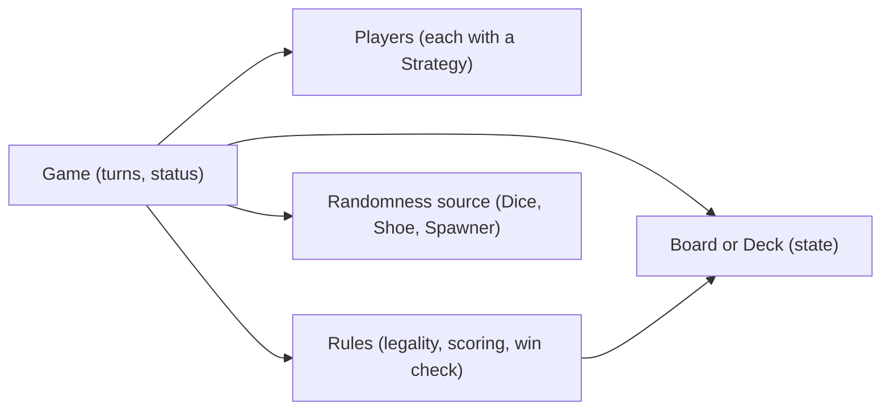

| Part | Question it answers | Typical class names |
|---|---|---|
| State | What does the table look like right now? | `Board`, `Deck`, `Shoe`, `Hand`, `Cell` |
| Actors | Who acts, and how do they decide? | `Player` + `PlayerStrategy`/`MoveStrategy` |
| Rules | Is this action allowed? What does it do? Who won? | `Rules`, `DealerPolicy`, `OverflowRule`, `WinStrategy` |
| Controller | Whose turn? What state is the game in? | `Game`, `GameStatus` |
| Randomness | Where does chance come from? | `Dice`, `Shoe`, `TileSpawner` — always injected |

---

## Design Blackjack and a Deck of Cards


*Figure — A blackjack table: players each compete against the dealer (course diagram)*

### Problem & clarifying questions

**Blackjack** is the casino card game played more than any other. Nobody plays against the other people at the table: every player's cards are measured only against the cards of the **dealer** (the dealer is the casino employee who deals and plays for the house). Everybody tries to get as close to **21 points** as possible without going over. Going over 21 is called **busting** and loses at once.

The interviewer often phrases it as "Design a deck of cards, then use it to build blackjack". The first half checks that you keep the deck **generic**; the second half checks rule placement.

Questions worth asking (with the answers this design assumes):

| Question | Assumed answer |
|---|---|
| One deck or several? | A **shoe** holding several standard 52-card decks (casinos use 6–8). One deck is just a shoe of 1. |
| How many players? | One or more players, each against the dealer. |
| Which player options? | Hit, stand, double down, split (once), insurance. Surrender and side bets are out of scope. |
| Dealer rule? | Hit on 16 or less, stand on 17 or more. Some casinos also hit a "soft 17" — make it pluggable. |
| Payouts? | Win 1:1, blackjack 3:2, tie ("push") returns the bet, insurance 2:1 (odds like 3:2 mean you win 3 chips for every 2 bet). |
| Money? | Bets are counted in whole **chips** (an `int`, a whole-number type), and the ante (the starting bet) must be even. Never use `double` (an inexact binary floating-point number) for money. |
| Real UI (user interface — the screens), network, accounts? | Out of scope. The course model has `Account`/`Person` for sign-in; we keep `Player` minimal and say where it would attach. |

### Requirements

**Background rules**

- A standard deck has **13 ranks** (A, 2–10, J, Q, K) in **4 suits** (clubs, diamonds, hearts, spades). Blackjack uses one or more such decks.
- At the start, each player and the dealer receive **two cards**. Both player cards are face up. The dealer has one card face up (the **up card**) and one face down (the **hole card**), so players decide with incomplete information.
- **Card points:** 2–10 are worth their number. J, Q, K are worth 10. An **ace is worth 1 or 11**, whichever helps.
- **Soft vs hard total:** when an ace is counted as 11 the total is **soft** (it can still "soften" to 1 later, so one more card can never bust it). When every ace counts as 1 the total is **hard**. Example: A+5 is "soft 16" (or hard 6).
- **Blackjack** (also called a *natural*): exactly two cards totalling 21, i.e. an ace plus a 10-point card.
- **Dealer rule:** the dealer has no choices. Hit (take a card) while the hand is 16 or less; stand at 17 or more.

**Functional requirements**

1. A player must place an initial bet (the **ante**) to play a round.
2. Deal two cards to each player and to the dealer (one up, one hole).
3. If the dealer's up card is an **ace**, offer **insurance**: a side bet of half the ante that pays **2:1** if the dealer has blackjack. After that, the dealer checks ("peeks at") the hole card. If it is blackjack, the round ends at once: insurance wins, main bets lose, except a player blackjack, which ties.
4. A player whose hand is below 21 chooses:
   - **Hit** — take one more card, and choose again.
   - **Stand** ("stand pat") — take no more cards.
   - **Double down** — double the bet (the extra must equal the ante), take exactly **one** more card, and stop.
   - **Split** — only when the first two cards have the same rank: pay a second bet equal to the ante, split the pair into two hands, deal one card to each, and play each hand separately. No re-splitting.
5. A hand over 21 is **resolved immediately as a loss**.
6. The dealer then plays by the fixed rule.
7. **Resolution:** if the dealer busts, every non-bust hand wins. Otherwise the higher total wins; equal totals are a **push** (bet returned). A winning blackjack pays **3:2**; every other win pays **1:1**.
8. **Even money** (course requirement): if a player holds blackjack and the dealer shows an ace, the player may accept an immediate 1:1 payout instead of risking a push. (It is mathematically identical to buying insurance with a blackjack, so we explain it rather than build it — see Extensions.)

**Non-functional requirements**

- **Generic deck:** the `Card`/`Deck` classes must work for any card game, not just blackjack.
- **Deterministic tests:** shuffling uses an injected `Random`; a *stacked* shoe (fixed card order) makes exact scenarios reproducible.
- **Extensible rules:** dealer rule and player decision-making are pluggable.
- **Correct money:** bets and balances are whole chips held in an `int`, never a `double`. This is the one place in the handbook where money is not a `BigDecimal`, and it is deliberate: a table only accepts whole chips, and requiring an **even ante** makes every payout a whole number of chips (3:2 on 10 is 15; insurance is exactly half the ante, 5, and pays 2:1 = 10). If the table ever had to pay fractions (a 3:2 payout on an odd ante, or converting chips to currency at the cashier), switch the amounts to `BigDecimal` (Java's exact decimal number type) with an explicit `RoundingMode` (the rule for what to do with a leftover fraction, such as "round half up").

### Use cases


*Figure — Blackjack use cases for the Player and the Dealer, including account management (course diagram)*

The figure above is a **use case diagram** (UML — Unified Modeling Language — notation: stick figures are *actors*, the people or systems using the software; ovals are *use cases*, the goals they can achieve). In the figure above there are two actors:

- **Player** — places the initial bet; accepts or declines extra bets (insurance, split, double); accepts or declines an offered resolution such as even money; chooses hit, double or stand. The player also has account-level use cases (create account, log in, join or view games), which belong to a lobby service (the separate part of the app where players sign in and pick a table), not the game engine (the code that enforces the game's rules).
- **Dealer** — deals cards, plays the house hand by the fixed rule, collects losing bets and pays winners.

The main use cases (note the `<<include>>` arrows in the figure — an include arrow means one use case always runs another as part of itself: dealing and payout are part of every round):

| Use case | What happens |
|---|---|
| Create hands | Deal two cards each; dealer shows one card. |
| Place bet | The ante; required before cards are dealt. |
| Player plays the hand | Hit (repeat), double (one card, done), or stand. A hand over 21 is resolved as a bust. |
| Dealer plays the hand | Draw while 16 or less, stop at 17 or more. A dealer bust pays every live hand. |
| Insurance / even money / examine hole card | Only when the up card is an ace. The hole card is checked; a 10-value hole card means dealer blackjack, insurance wins and the round ends; otherwise insurance loses and the hole card stays hidden. |
| Split | Pair of equal rank: second bet, two hands, one extra card each, no further splitting. |
| Game resolution | Compare totals; tie returns the bet; blackjack 3:2; other wins 1:1. |

**Activity: hit or stand**


*Figure — Activity diagram for one player's hit-or-stand round against the dealer (course diagram)*

An **activity diagram** is a flowchart of one task, with diamonds for decisions. The figure above walks through one round: bet, deal, check for 21 (blackjack pays 3:2), check for bust, hit or stand, then the dealer draws while below 17, and finally the three outcomes — player wins 1:1, player loses, or a tie returns the bet.

### Core entities

| Class | Responsibility |
|---|---|
| `Suit`, `Rank` (enums) | The fixed values of a French deck (the standard 52-card deck with four suits). `Rank` stores the *face value* 1–13 (ace = 1, J = 11, Q = 12, K = 13). |
| `Card` (record — a compact class that just holds fixed values) | Rank + suit. Knows **nothing** about blackjack. Immutable (cannot change after creation). |
| `Deck<T>` | A generic (works for any type `T` you plug in), shuffleable stack of any card type `T`; `standard52()` factory (a method that builds objects) builds a French deck. |
| `Shoe` | Several decks shuffled together; deals one card at a time; reshuffles at the **cut card** (a marker card placed near the end of the shoe). `Shoe.stacked(...)` gives a fixed order for tests. |
| `BlackjackScoring` | The blackjack value of a rank (K = 10, ace = 1 hard). The *game* rule, kept off `Card`. |
| `Hand` | Cards + bet; computes hard/soft/best totals, bust, blackjack, can-split; splits and doubles. |
| `Action` (enum) | HIT, STAND, DOUBLE, SPLIT. |
| `PlayerStrategy` (interface) | How a player decides. `BasicStrategy` and `MimicDealerStrategy` are two bots (computer-controlled players); a UI-backed human would be a third. |
| `DealerPolicy` (interface) | When the dealer hits. `standOnAll17()` and `hitSoft17()`. |
| `Player` | Name, chip balance, strategy. |
| The dealer | Not a class of its own here: during a round the dealer is a `Hand` inside `BlackjackGame` plus the `DealerPolicy` that decides when it draws. (The course has a `Dealer` class next to `Player`, both under `BasePlayer`.) |
| `BlackjackGame` | Runs a round: bets, deal, insurance + peek, player turns, dealer turn, settlement. |

### Class diagram


*Figure — Course class diagram: Card, BlackjackCard, Deck, Shoe, Hand, BasePlayer, Player, Dealer, Game, Account (course diagram)*

In the course model (figure above), `Card` holds a suit and a face value, and a subclass `BlackjackCard` adds the *game value* — because a king has face value 13 but is worth 10 in blackjack. A `Shoe` is composed of several `Deck`s (filled diamonds = composition: the parts belong to the whole). A plain arrow is an *association* (one class merely refers to another), and an open triangle is *inheritance* (a subclass extends a parent class). `Hand` scores itself. `Player` and `Dealer` share a `BasePlayer` (balance, hands), which extends `Account`. `Player` adds the bet; `Dealer` adds the "should I hit?" rule. `Game` points at a player, a dealer and a shoe and holds the order of play. Note the `*` from `BasePlayer` to `Hand`: splitting gives one player several hands.

Our Java design keeps the same core idea — **the game value must not live on the generic card** — but implements it with a separate scoring function instead of a subclass, and turns the two things that vary (player decisions, dealer rule) into strategies:

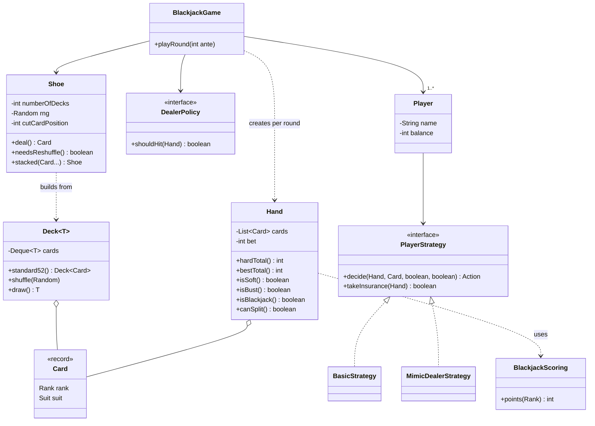

### Key flows

**One round (sequence)**

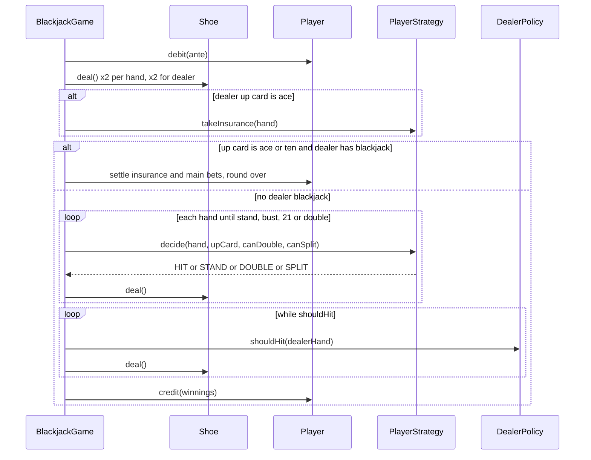

**States of one round**

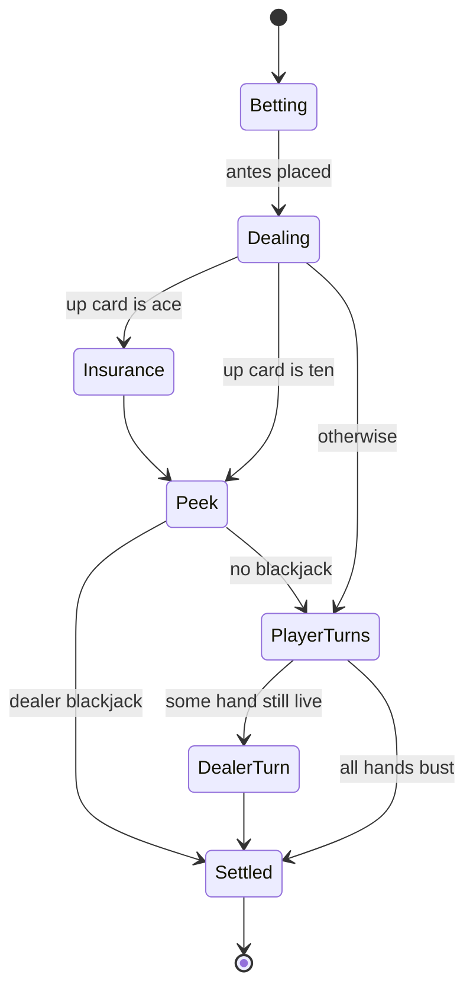

**Scoring a hand (the ace problem).** The trick is that **at most one ace can ever count as 11** (two elevens would be 22, a bust). So:

1. Add up every card with the ace as 1. This is the **hard total**.
2. If the hand has at least one ace and `hard + 10 ≤ 21`, one ace can be 11: the hand is **soft** and the best total is `hard + 10`.
3. Otherwise the best total is the hard total.

This is O(n) in the number of cards, needs no search over combinations, and gives the soft/hard flag for free (the dealer's "hit soft 17" rule needs it).

### Design decisions & patterns used

| Decision | Why | Alternative rejected |
|---|---|---|
| `Card` is a game-agnostic **record** (rank + suit). | A deck of cards is reused by poker, bridge, solitaire. A king's blackjack value (10) is a *rule of this game*, not a fact about the card. | Putting `getValue()` returning 10 for K on `Card` — breaks every other game. |
| Blackjack value in `BlackjackScoring`, not a `BlackjackCard` subclass. | Records cannot be extended, and the value depends only on the rank. A function is simpler and keeps one card type in the shoe. | The course's `BlackjackCard extends Card` — also valid, and also keeps `Card` clean. Say both in the interview; the important point is the same. |
| `Deck<T>` is **generic**. | "Design a deck of cards" follow-up: Uno or tarot cards reuse the same shuffle/draw code. | A deck hard-wired to `Card`. |
| **Strategy** for players (`PlayerStrategy`) and dealer (`DealerPolicy`). | Human UI, bots and test scripts plug in; casino variants (S17 vs H17: dealer stands on soft 17 vs hits soft 17) are one line. Open/Closed principle (add new behaviour with new classes, without editing working code). | `if (isHuman) ... else ...` and `if (casino == X)` branches inside the game. |
| **Factory methods** `Deck.standard52()`, `Shoe.stacked(...)`, `DealerPolicy.standOnAll17()`. | Named constructors make intent obvious. | Big constructors with flags. |
| Randomness injected (`Random` passed into `Shoe`). | Seeded shuffles make demos and tests exact. | `Collections.shuffle(list)` with a hidden random source. |
| `Hand` answers with `hardTotal()`, `bestTotal()` and `isSoft()`. | The course's `Hand` returns *every* possible total (A+6 is both 7 and 17) and lets the caller choose. Because at most one ace can ever count as 11, the hard total plus the soft flag already carries all of that information, and most callers just want `bestTotal()`. | Returning a list of totals that each caller must filter. |
| Hand stores its **own bet**. | Split and double change the bet *per hand*, not per player. | One bet per player — breaks as soon as a player splits. |
| The game **validates** a strategy's choice (`canDouble`, `canSplit` passed in, and re-checked). | A buggy or malicious client (the program sending the player's choices) cannot double without money. | Trusting the client. |

**Honest weaknesses (and what a longer design would do).** `BlackjackGame.playRound` owns the whole sequence of play *and* the payout rules. Each new option (surrender, side bets) adds another branch. A larger design would model the round as a **State** machine (a fixed set of states plus the allowed moves between them; the State pattern gives each state its own class — one class per state in the diagram above, like the vending machine in Chapter 14) and move payouts into a `PayoutTable`. Say this out loud; interviewers reward knowing where your design will strain.

### Java implementation

Package `lld.ch17.blackjack`.

```java
// File: code/lld/ch17/blackjack/Suit.java
package lld.ch17.blackjack;

/** The four suits. A suit never affects a blackjack score, but a generic deck needs it. */
public enum Suit {
    CLUBS('C'), DIAMONDS('D'), HEARTS('H'), SPADES('S');

    private final char letter;

    Suit(char letter) { this.letter = letter; }

    public char letter() { return letter; }
}
```

```java
// File: code/lld/ch17/blackjack/Rank.java
package lld.ch17.blackjack;

/** Thirteen ranks with their face value (ace = 1, jack = 11, queen = 12, king = 13). */
public enum Rank {
    ACE("A", 1), TWO("2", 2), THREE("3", 3), FOUR("4", 4), FIVE("5", 5), SIX("6", 6),
    SEVEN("7", 7), EIGHT("8", 8), NINE("9", 9), TEN("10", 10),
    JACK("J", 11), QUEEN("Q", 12), KING("K", 13);

    private final String symbol;
    private final int faceValue;

    Rank(String symbol, int faceValue) { this.symbol = symbol; this.faceValue = faceValue; }

    public String symbol() { return symbol; }
    public int faceValue() { return faceValue; }
}
```

```java
// File: code/lld/ch17/blackjack/Card.java
package lld.ch17.blackjack;

/** A game-agnostic playing card: just a rank and a suit. Immutable, so it is safe to share. */
public record Card(Rank rank, Suit suit) {
    @Override public String toString() { return rank.symbol() + suit.letter(); }
}
```

```java
// File: code/lld/ch17/blackjack/Deck.java
package lld.ch17.blackjack;

import java.util.ArrayDeque;
import java.util.ArrayList;
import java.util.Collection;
import java.util.Collections;
import java.util.Deque;
import java.util.List;
import java.util.NoSuchElementException;
import java.util.Random;

/**
 * A generic deck: any card type T (poker card, Uno card, tarot card...).
 * Shuffling takes a Random so that tests can pass a seeded one and get the same order every run.
 */
public final class Deck<T> {
    private final Deque<T> cards;

    public Deck(Collection<? extends T> cards) { this.cards = new ArrayDeque<>(cards); }

    /** Factory for the standard 52-card French deck (13 ranks x 4 suits). */
    public static Deck<Card> standard52() {
        List<Card> all = new ArrayList<>(52);
        for (Suit s : Suit.values()) {
            for (Rank r : Rank.values()) {
                all.add(new Card(r, s));
            }
        }
        return new Deck<>(all);
    }

    public void shuffle(Random rng) {
        List<T> list = new ArrayList<>(cards);
        Collections.shuffle(list, rng);
        cards.clear();
        cards.addAll(list);
    }

    public T draw() {
        if (cards.isEmpty()) throw new NoSuchElementException("deck is empty");
        return cards.pop();
    }

    public int size() { return cards.size(); }

    public List<T> cards() { return List.copyOf(cards); }
}
```

```java
// File: code/lld/ch17/blackjack/Shoe.java
package lld.ch17.blackjack;

import java.util.ArrayDeque;
import java.util.ArrayList;
import java.util.Collections;
import java.util.Deque;
import java.util.List;
import java.util.Random;

/**
 * A casino shoe: several standard decks shuffled together. A "cut card" marks how deep we deal
 * before reshuffling (penetration). A stacked shoe (fixed order) exists for deterministic tests.
 */
public final class Shoe {
    private final int numberOfDecks;
    private final Random rng;          // null for a stacked test shoe
    private final int cutCardPosition; // reshuffle when fewer cards than this remain
    private final Deque<Card> cards = new ArrayDeque<>();

    public Shoe(int numberOfDecks, Random rng, double penetration) {
        if (numberOfDecks < 1) throw new IllegalArgumentException("need at least one deck");
        if (penetration <= 0 || penetration >= 1) throw new IllegalArgumentException("penetration must be in (0,1)");
        this.numberOfDecks = numberOfDecks;
        this.rng = rng;
        this.cutCardPosition = (int) Math.round(numberOfDecks * 52 * (1 - penetration));
        refill();
    }

    private Shoe(List<Card> stackedOrder) {
        this.numberOfDecks = 0;
        this.rng = null;
        this.cutCardPosition = 0;
        cards.addAll(stackedOrder);
    }

    /** Cards come out in exactly the order given. Perfect for unit tests. */
    public static Shoe stacked(Card... order) { return new Shoe(List.of(order)); }

    public Card deal() {
        if (cards.isEmpty()) {
            if (rng == null) throw new IllegalStateException("stacked shoe ran out of cards");
            refill();
        }
        return cards.pop();
    }

    public boolean needsReshuffle() { return rng != null && cards.size() < cutCardPosition; }

    public void reshuffle() { refill(); }

    public int remaining() { return cards.size(); }

    private void refill() {
        List<Card> all = new ArrayList<>(numberOfDecks * 52);
        for (int i = 0; i < numberOfDecks; i++) {
            all.addAll(Deck.standard52().cards());
        }
        Collections.shuffle(all, rng);
        cards.clear();
        cards.addAll(all);
    }
}
```

```java
// File: code/lld/ch17/blackjack/BlackjackScoring.java
package lld.ch17.blackjack;

/**
 * The blackjack-specific value of a card lives here, NOT on Card.
 * A king has face value 13 in general, but it is worth 10 points in this game.
 */
public final class BlackjackScoring {
    private BlackjackScoring() {}

    /** Points with an ace counted as 1 (the "hard" value). */
    public static int points(Rank rank) {
        return switch (rank) {
            case ACE -> 1;
            case JACK, QUEEN, KING -> 10;
            default -> rank.faceValue();
        };
    }
}
```

```java
// File: code/lld/ch17/blackjack/Hand.java
package lld.ch17.blackjack;

import java.util.ArrayList;
import java.util.List;
import java.util.stream.Collectors;

/** A blackjack hand: its cards, its bet, and how to score itself (aces = 1 or 11). */
public final class Hand {
    private final List<Card> cards = new ArrayList<>();
    private int bet;
    private boolean fromSplit;
    private boolean doubled;

    public Hand(int bet) { this.bet = bet; }

    public static Hand of(Card... cs) {
        Hand h = new Hand(0);
        for (Card c : cs) h.add(c);
        return h;
    }

    void add(Card c) { cards.add(c); }

    /** Every ace counted as 1. */
    public int hardTotal() {
        int sum = 0;
        for (Card c : cards) sum += BlackjackScoring.points(c.rank());
        return sum;
    }

    private boolean hasAce() { return cards.stream().anyMatch(c -> c.rank() == Rank.ACE); }

    /** A hand is soft when one ace can count as 11 without busting. At most one ace can ever do so. */
    public boolean isSoft() { return hasAce() && hardTotal() + 10 <= 21; }

    /** The best total: the soft total if it is legal, otherwise the hard total. */
    public int bestTotal() { return isSoft() ? hardTotal() + 10 : hardTotal(); }

    public boolean isBust() { return bestTotal() > 21; }

    /** A natural: exactly two cards worth 21, and not the result of a split. */
    public boolean isBlackjack() { return !fromSplit && cards.size() == 2 && bestTotal() == 21; }

    /** Two cards of the same rank, and no re-splitting (one split per round). */
    public boolean canSplit() {
        return !fromSplit && cards.size() == 2 && cards.get(0).rank() == cards.get(1).rank();
    }

    /** Takes the second card out to start a new hand; both hands are now split hands. */
    Hand split() {
        if (!canSplit()) throw new IllegalStateException("hand cannot be split");
        Hand other = new Hand(bet);
        other.add(cards.remove(1));
        this.fromSplit = true;
        other.fromSplit = true;
        return other;
    }

    void doubleDown() { bet *= 2; doubled = true; }

    public boolean isDoubled() { return doubled; }
    public int bet() { return bet; }
    public int size() { return cards.size(); }
    public Card first() { return cards.get(0); }
    public List<Card> cards() { return List.copyOf(cards); }

    @Override public String toString() {
        String cs = cards.stream().map(Card::toString).collect(Collectors.joining(" "));
        String kind = isBlackjack() ? "BLACKJACK" : isBust() ? "bust " + bestTotal()
                : (isSoft() ? "soft " : "") + bestTotal();
        return "[" + cs + "] = " + kind;
    }
}
```

```java
// File: code/lld/ch17/blackjack/Action.java
package lld.ch17.blackjack;

public enum Action { HIT, STAND, DOUBLE, SPLIT }
```

```java
// File: code/lld/ch17/blackjack/PlayerStrategy.java
package lld.ch17.blackjack;

/**
 * Strategy pattern: HOW a player decides is pluggable (human via UI, basic-strategy bot, test script).
 * The game passes what is allowed, so a strategy never has to know the betting rules.
 */
public interface PlayerStrategy {
    Action decide(Hand hand, Card dealerUpCard, boolean canDouble, boolean canSplit);

    /** Offered only when the dealer shows an ace. Mathematically a bad bet for most players. */
    default boolean takeInsurance(Hand hand) { return false; }
}
```

```java
// File: code/lld/ch17/blackjack/BasicStrategy.java
package lld.ch17.blackjack;

/** A simplified version of the well-known "basic strategy" table. */
public final class BasicStrategy implements PlayerStrategy {
    @Override
    public Action decide(Hand hand, Card up, boolean canDouble, boolean canSplit) {
        int dealer = BlackjackScoring.points(up.rank()) == 1 ? 11 : BlackjackScoring.points(up.rank());
        if (canSplit && (hand.first().rank() == Rank.ACE || hand.first().rank() == Rank.EIGHT)) {
            return Action.SPLIT;                                   // always split aces and eights
        }
        int total = hand.bestTotal();
        if (hand.isSoft()) {
            return total >= 18 ? Action.STAND : Action.HIT;
        }
        if (canDouble && (total == 11 || (total == 10 && dealer <= 9))) {
            return Action.DOUBLE;
        }
        if (total >= 17) return Action.STAND;
        if (total >= 13) return dealer <= 6 ? Action.STAND : Action.HIT;
        if (total == 12) return (dealer >= 4 && dealer <= 6) ? Action.STAND : Action.HIT;
        return Action.HIT;
    }
}
```

```java
// File: code/lld/ch17/blackjack/MimicDealerStrategy.java
package lld.ch17.blackjack;

/** A naive player who copies the dealer (hit below 17) and always buys insurance. */
public final class MimicDealerStrategy implements PlayerStrategy {
    @Override
    public Action decide(Hand hand, Card up, boolean canDouble, boolean canSplit) {
        return hand.bestTotal() < 17 ? Action.HIT : Action.STAND;
    }

    @Override public boolean takeInsurance(Hand hand) { return true; }
}
```

```java
// File: code/lld/ch17/blackjack/DealerPolicy.java
package lld.ch17.blackjack;

/** The house rule for when the dealer draws. Casinos differ, so it is a pluggable strategy. */
@FunctionalInterface
public interface DealerPolicy {
    boolean shouldHit(Hand dealerHand);

    /** Classic rule: draw on 16 or less, stand on every 17 ("S17"). */
    static DealerPolicy standOnAll17() { return h -> h.bestTotal() <= 16; }

    /** Variant: also draw on a soft 17 such as A+6 ("H17"), which favours the house. */
    static DealerPolicy hitSoft17() { return h -> h.bestTotal() <= 16 || (h.bestTotal() == 17 && h.isSoft()); }
}
```

```java
// File: code/lld/ch17/blackjack/Player.java
package lld.ch17.blackjack;

/** A seated player: a name, a chip balance (whole chips) and a decision strategy. */
public final class Player {
    private final String name;
    private final PlayerStrategy strategy;
    private int balance;

    public Player(String name, int balance, PlayerStrategy strategy) {
        this.name = name;
        this.balance = balance;
        this.strategy = strategy;
    }

    void debit(int amount) {
        if (amount > balance) throw new IllegalStateException(name + " cannot cover " + amount);
        balance -= amount;
    }

    void credit(int amount) { balance += amount; }

    public boolean canAfford(int amount) { return balance >= amount; }
    public String name() { return name; }
    public int balance() { return balance; }
    public PlayerStrategy strategy() { return strategy; }
}
```

```java
// File: code/lld/ch17/blackjack/BlackjackGame.java
package lld.ch17.blackjack;

import java.util.ArrayList;
import java.util.LinkedHashMap;
import java.util.List;
import java.util.Map;
import java.util.function.Consumer;

/**
 * Runs rounds at one table: bets, deal, insurance + dealer peek, player turns (hit/stand/double/split),
 * dealer turn, settlement. Each player plays only against the dealer.
 */
public final class BlackjackGame {
    private final Shoe shoe;
    private final DealerPolicy dealerPolicy;
    private final List<Player> players;
    private final Consumer<String> log;

    public BlackjackGame(Shoe shoe, DealerPolicy dealerPolicy, List<Player> players, Consumer<String> log) {
        this.shoe = shoe;
        this.dealerPolicy = dealerPolicy;
        this.players = List.copyOf(players);
        this.log = log;
    }

    public void playRound(int ante) {
        if (ante <= 0 || ante % 2 != 0) throw new IllegalArgumentException("ante must be a positive even number");
        if (shoe.needsReshuffle()) {
            shoe.reshuffle();
            log.accept("  (cut card reached: shoe reshuffled)");
        }

        // 1. Bets: each player who can afford the ante gets one hand.
        Map<Player, List<Hand>> hands = new LinkedHashMap<>();
        for (Player p : players) {
            if (!p.canAfford(ante)) { log.accept("  " + p.name() + " sits out (balance " + p.balance() + ")"); continue; }
            p.debit(ante);
            hands.put(p, new ArrayList<>(List.of(new Hand(ante))));
        }
        if (hands.isEmpty()) return;

        // 2. Deal two rounds: one card to each player, then one to the dealer. Dealer's 2nd card is the hole card.
        Hand dealer = new Hand(0);
        for (int round = 0; round < 2; round++) {
            for (List<Hand> hs : hands.values()) hs.get(0).add(shoe.deal());
            dealer.add(shoe.deal());
        }
        Card up = dealer.first();
        log.accept("  Dealer shows " + up + " (hole card hidden)");
        hands.forEach((p, hs) -> log.accept("  " + p.name() + " " + hs.get(0)));

        // 3. Insurance (only when the up card is an ace), then the dealer peeks for blackjack.
        Map<Player, Integer> insurance = new LinkedHashMap<>();
        if (up.rank() == Rank.ACE) {
            hands.forEach((p, hs) -> {
                int side = ante / 2;
                if (p.strategy().takeInsurance(hs.get(0)) && p.canAfford(side)) {
                    p.debit(side);
                    insurance.put(p, side);
                    log.accept("  " + p.name() + " buys insurance for " + side);
                }
            });
        }
        boolean dealerMayHaveBlackjack = up.rank() == Rank.ACE || BlackjackScoring.points(up.rank()) == 10;
        if (dealerMayHaveBlackjack && dealer.isBlackjack()) {
            log.accept("  Dealer peeks: " + dealer + " -> round over");
            insurance.forEach((p, side) -> { p.credit(side * 3); log.accept("  " + p.name() + " insurance pays 2:1 (+" + side * 2 + ")"); });
            hands.forEach((p, hs) -> {
                Hand h = hs.get(0);
                if (h.isBlackjack()) { p.credit(h.bet()); log.accept("  " + p.name() + ": PUSH (both blackjack)"); }
                else log.accept("  " + p.name() + ": LOSE " + h.bet());
            });
            printBalances();
            return;
        }
        if (!insurance.isEmpty()) log.accept("  Dealer peeks: no blackjack, insurance bets lost");

        // 4. Player turns. Splitting inserts a new hand right after the current one.
        hands.forEach((p, hs) -> {
            for (int i = 0; i < hs.size(); i++) playHand(p, hs, i, up);
        });

        // 5. Dealer turn (skipped if every player hand is already bust).
        boolean anyLive = hands.values().stream().flatMap(List::stream).anyMatch(h -> !h.isBust());
        if (anyLive) {
            while (dealerPolicy.shouldHit(dealer)) dealer.add(shoe.deal());
            log.accept("  Dealer reveals and plays: " + dealer);
        }

        // 6. Settle every hand against the dealer.
        hands.forEach((p, hs) -> hs.forEach(h -> settle(p, h, dealer)));
        printBalances();
    }

    private void playHand(Player p, List<Hand> hs, int index, Card up) {
        Hand hand = hs.get(index);
        String label = p.name() + (hs.size() > 1 ? " hand " + (index + 1) : "");
        while (!hand.isBlackjack() && hand.bestTotal() < 21) {
            boolean canDouble = hand.size() == 2 && p.canAfford(hand.bet());
            boolean canSplit = hand.canSplit() && p.canAfford(hand.bet());
            Action a = p.strategy().decide(hand, up, canDouble, canSplit);
            if ((a == Action.DOUBLE && !canDouble) || (a == Action.SPLIT && !canSplit)) {
                throw new IllegalStateException(label + " chose a move that is not allowed: " + a);
            }
            switch (a) {
                case STAND -> { log.accept("  " + label + " stands on " + hand.bestTotal()); return; }
                case HIT -> { hand.add(shoe.deal()); log.accept("  " + label + " hits: " + hand); }
                case DOUBLE -> {
                    p.debit(hand.bet());
                    hand.doubleDown();
                    hand.add(shoe.deal());
                    log.accept("  " + label + " doubles (bet now " + hand.bet() + "): " + hand);
                    return;                                     // exactly one card after doubling
                }
                case SPLIT -> {
                    p.debit(hand.bet());
                    Hand second = hand.split();
                    hand.add(shoe.deal());
                    second.add(shoe.deal());
                    hs.add(index + 1, second);
                    label = p.name() + " hand " + (index + 1);
                    log.accept("  " + p.name() + " splits -> " + hand + " and " + second);
                }
            }
        }
        if (hand.isBust()) log.accept("  " + label + " busts");
    }

    private void settle(Player p, Hand h, Hand dealer) {
        String who = "  " + p.name() + " " + h + " vs dealer " + dealer.bestTotal() + ": ";
        if (h.isBust()) { log.accept(who + "LOSE " + h.bet()); return; }
        if (h.isBlackjack()) {                                  // dealer blackjack was handled by the peek
            p.credit(h.bet() + h.bet() * 3 / 2);
            log.accept(who + "BLACKJACK pays 3:2 (+" + h.bet() * 3 / 2 + ")");
            return;
        }
        int mine = h.bestTotal(), theirs = dealer.bestTotal();
        if (dealer.isBust() || mine > theirs) { p.credit(h.bet() * 2); log.accept(who + "WIN +" + h.bet()); }
        else if (mine == theirs) { p.credit(h.bet()); log.accept(who + "PUSH"); }
        else log.accept(who + "LOSE " + h.bet());
    }

    private void printBalances() {
        StringBuilder sb = new StringBuilder("  Balances:");
        players.forEach(p -> sb.append(' ').append(p.name()).append('=').append(p.balance()));
        log.accept(sb.toString());
    }
}
```

```java
// File: code/lld/ch17/blackjack/Main.java
package lld.ch17.blackjack;

import java.util.List;
import java.util.Random;

public final class Main {
    private static Card c(Rank r, Suit s) { return new Card(r, s); }

    public static void main(String[] args) {
        System.out.println("== 1. Hand values (aces are 1 or 11) ==");
        List<Hand> samples = List.of(
                Hand.of(c(Rank.ACE, Suit.SPADES), c(Rank.SIX, Suit.HEARTS)),
                Hand.of(c(Rank.ACE, Suit.SPADES), c(Rank.SIX, Suit.HEARTS), c(Rank.TEN, Suit.CLUBS)),
                Hand.of(c(Rank.ACE, Suit.SPADES), c(Rank.ACE, Suit.HEARTS), c(Rank.NINE, Suit.CLUBS)),
                Hand.of(c(Rank.KING, Suit.SPADES), c(Rank.QUEEN, Suit.HEARTS), c(Rank.FIVE, Suit.CLUBS)),
                Hand.of(c(Rank.ACE, Suit.DIAMONDS), c(Rank.KING, Suit.CLUBS)));
        samples.forEach(h -> System.out.println("  " + h + "   (hard total " + h.hardTotal() + ")"));

        System.out.println("\n== 2. Stacked shoe: split 8s, then double both hands ==");
        Shoe stacked = Shoe.stacked(
                c(Rank.EIGHT, Suit.HEARTS), c(Rank.SIX, Suit.SPADES),     // Alice 1st card, dealer up card
                c(Rank.EIGHT, Suit.DIAMONDS), c(Rank.TEN, Suit.CLUBS),    // Alice 2nd card, dealer hole card
                c(Rank.THREE, Suit.CLUBS), c(Rank.TWO, Suit.SPADES),      // one card to each split hand
                c(Rank.NINE, Suit.HEARTS), c(Rank.FIVE, Suit.DIAMONDS),   // the two double-down cards
                c(Rank.SEVEN, Suit.SPADES));                              // dealer's hit on 16
        Player alice = new Player("Alice", 100, new BasicStrategy());
        new BlackjackGame(stacked, DealerPolicy.standOnAll17(), List.of(alice), System.out::println).playRound(10);

        System.out.println("\n== 3. Stacked shoe: dealer shows an ace, Bob buys insurance ==");
        Shoe aceUp = Shoe.stacked(c(Rank.TEN, Suit.HEARTS), c(Rank.ACE, Suit.SPADES),
                c(Rank.NINE, Suit.CLUBS), c(Rank.KING, Suit.DIAMONDS));
        Player bob = new Player("Bob", 100, new MimicDealerStrategy());
        new BlackjackGame(aceUp, DealerPolicy.standOnAll17(), List.of(bob), System.out::println).playRound(10);

        System.out.println("\n== 4. Seeded 6-deck shoe (seed 42), two players, 5 rounds ==");
        Shoe shoe = new Shoe(6, new Random(42), 0.75);
        Player carol = new Player("Carol", 100, new BasicStrategy());
        Player dave = new Player("Dave", 100, new MimicDealerStrategy());
        BlackjackGame game = new BlackjackGame(shoe, DealerPolicy.hitSoft17(), List.of(carol, dave), System.out::println);
        for (int round = 1; round <= 5; round++) {
            System.out.println("Round " + round + ":");
            game.playRound(10);
        }
    }
}
```

**Output:**

```text
== 1. Hand values (aces are 1 or 11) ==
  [AS 6H] = soft 17   (hard total 7)
  [AS 6H 10C] = 17   (hard total 17)
  [AS AH 9C] = soft 21   (hard total 11)
  [KS QH 5C] = bust 25   (hard total 25)
  [AD KC] = BLACKJACK   (hard total 11)

== 2. Stacked shoe: split 8s, then double both hands ==
  Dealer shows 6S (hole card hidden)
  Alice [8H 8D] = 16
  Alice splits -> [8H 3C] = 11 and [8D 2S] = 10
  Alice hand 1 doubles (bet now 20): [8H 3C 9H] = 20
  Alice hand 2 doubles (bet now 20): [8D 2S 5D] = 15
  Dealer reveals and plays: [6S 10C 7S] = bust 23
  Alice [8H 3C 9H] = 20 vs dealer 23: WIN +20
  Alice [8D 2S 5D] = 15 vs dealer 23: WIN +20
  Balances: Alice=140

== 3. Stacked shoe: dealer shows an ace, Bob buys insurance ==
  Dealer shows AS (hole card hidden)
  Bob [10H 9C] = 19
  Bob buys insurance for 5
  Dealer peeks: [AS KD] = BLACKJACK -> round over
  Bob insurance pays 2:1 (+10)
  Bob: LOSE 10
  Balances: Bob=100

== 4. Seeded 6-deck shoe (seed 42), two players, 5 rounds ==
Round 1:
  Dealer shows AS (hole card hidden)
  Carol [8S 3S] = 11
  Dave [5D 9C] = 14
  Dave buys insurance for 5
  Dealer peeks: [AS QS] = BLACKJACK -> round over
  Dave insurance pays 2:1 (+10)
  Carol: LOSE 10
  Dave: LOSE 10
  Balances: Carol=90 Dave=100
Round 2:
  Dealer shows 6D (hole card hidden)
  Carol [2S 8H] = 10
  Dave [QS 10H] = 20
  Carol doubles (bet now 20): [2S 8H QD] = 20
  Dave stands on 20
  Dealer reveals and plays: [6D 6D 7C] = 19
  Carol [2S 8H QD] = 20 vs dealer 19: WIN +20
  Dave [QS 10H] = 20 vs dealer 19: WIN +10
  Balances: Carol=110 Dave=110
Round 3:
  Dealer shows 5C (hole card hidden)
  Carol [AD KD] = BLACKJACK
  Dave [8D AH] = soft 19
  Dave stands on 19
  Dealer reveals and plays: [5C 7D 7S] = 19
  Carol [AD KD] = BLACKJACK vs dealer 19: BLACKJACK pays 3:2 (+15)
  Dave [8D AH] = soft 19 vs dealer 19: PUSH
  Balances: Carol=125 Dave=110
Round 4:
  Dealer shows 10S (hole card hidden)
  Carol [8D 8S] = 16
  Dave [5C 9S] = 14
  Carol splits -> [8D 4S] = 12 and [8S JD] = 18
  Carol hand 1 hits: [8D 4S 7D] = 19
  Carol hand 1 stands on 19
  Carol hand 2 stands on 18
  Dave hits: [5C 9S KS] = bust 24
  Dave busts
  Dealer reveals and plays: [10S 9H] = 19
  Carol [8D 4S 7D] = 19 vs dealer 19: PUSH
  Carol [8S JD] = 18 vs dealer 19: LOSE 10
  Dave [5C 9S KS] = bust 24 vs dealer 19: LOSE 10
  Balances: Carol=115 Dave=100
Round 5:
  Dealer shows KD (hole card hidden)
  Carol [5S 8C] = 13
  Dave [8S 2C] = 10
  Carol hits: [5S 8C JS] = bust 23
  Carol busts
  Dave hits: [8S 2C 7C] = 17
  Dave stands on 17
  Dealer reveals and plays: [KD 10H] = 20
  Carol [5S 8C JS] = bust 23 vs dealer 20: LOSE 10
  Dave [8S 2C 7C] = 17 vs dealer 20: LOSE 10
  Balances: Carol=105 Dave=90
```

**Reading the output.** Part 1 shows the scoring: A+6 is soft 17, adding a 10 makes it a *hard* 17 (the ace dropped to 1), A+A+9 is soft 21. Part 2 uses a stacked shoe to force an exact scenario: Alice splits eights against a dealer 6, doubles both hands, and the dealer busts — she staked 40 chips and won 40. Part 3 shows insurance working as a hedge: Bob loses his main bet of 10 but the 5-chip insurance pays 10, so he breaks even. Part 4 is a seeded six-deck game: run it again and you get the same cards.

### Concurrency & edge cases

- **One table = one thread.** A **thread** is one independent line of execution in a program; a server runs many side by side. A round is a strict sequence, so the simplest safe design runs each table's rounds on a single thread (or an actor/event loop — a single worker that processes incoming messages one at a time from its own queue) and funnels player commands into it. Many tables run in parallel; they share nothing except the wallet service.
- **Balances are shared across tables** in a real casino app. Move `debit`/`credit` into a wallet service with atomic operations — ones that happen as a single indivisible step no other thread can interrupt (a database transaction, i.e. a group of changes that all succeed or all fail, or `AtomicLong`/`synchronized` in memory; `synchronized` lets only one thread at a time run that code) and debit *before* dealing.
- **Odd antes and 3:2.** 3:2 on 5 chips is 7.5. We require even antes. Real casinos either round down or use smaller chip units — decide and state it.
- **Split aces.** Many casinos deal only one card to each split ace, and 21 after a split is *not* a blackjack (our `isBlackjack()` checks `fromSplit`).
- **Shoe exhaustion.** The cut card triggers a reshuffle *between* rounds; the shoe also refills if emptied mid-round. A stacked test shoe throws instead, so a wrong test fails loudly.
- **Player cannot afford a double/split.** The game passes `canDouble=false` and rejects the action if chosen anyway.
- **Dealer peek only on ace or ten.** If the up card is anything else the dealer cannot have blackjack, so there is no peek.

### Extensions & follow-up questions

- **"Where would even money go?"** — It is the same as insurance for a player holding blackjack: insurance of half the ante plus a blackjack always nets exactly +1× the ante whatever the dealer has. Add `PlayerStrategy.takeEvenMoney(hand)` and, if accepted, settle that hand at 1:1 before the peek.
- **"Add surrender."** — New `Action.SURRENDER`, allowed only as the first decision; refund half the bet and end the hand.
- **"Several players at the table?"** — Already supported: the game iterates players in seat order, then the dealer plays once.
- **"Card counting detection / security?"** — Card counting is tracking which cards have gone to guess what is left. Shoe penetration (how deep into the shoe the cut card sits) already limits counting. Log every dealt card for audit (a later independent check of what happened); never send the hole card to clients until it is revealed.
- **"How would you test the dealer rule?"** — Stacked shoe + `DealerPolicy.hitSoft17()`: deal the dealer A+6 and assert it draws; with `standOnAll17()` assert it stands.
- **"Make the deck work for Uno."** — `Deck<UnoCard>` with its own factory; nothing else changes.
- **"Replace the round logic with a state machine."** — One class per state (Betting, Dealing, PlayerTurns, DealerTurn, Settled), each handling only the commands valid in that state; invalid commands are rejected by the current state.

### Real-world example

Online casino tables (for example live-dealer blackjack products) separate exactly these concerns: a **shuffle/RNG service** that is certified and audited (gambling regulators, for example the UK Gambling Commission, require the random number generator to be independently tested), a **game engine** that enforces the table rules (number of decks, S17 or H17, payout 3:2 or 6:5 — printed on the physical table felt), and a **wallet** service that debits bets atomically. The rule variants are configuration (settings chosen at deploy time, not code), which is exactly why `DealerPolicy` is a strategy.

### In the interview

**30-second answer:** "A generic `Card` (rank, suit) and a generic `Deck<T>`. A `Shoe` combines several decks and deals with an injected `Random`, plus a stacked constructor for tests. The blackjack value of a card lives in the game's scoring, not on `Card`. `Hand` scores itself: hard total with aces as 1, and it's soft if one ace can be 11 without busting. Player decisions and the dealer's hit rule are strategies. `BlackjackGame` runs the round: bets, deal, insurance and peek, player turns with hit/stand/double/split, dealer turn, settle 3:2, 1:1 or push."

**How to spend 30–45 minutes:** 5 min questions and rules → 5 min entities → 10 min class diagram (defend `Card` vs game value, hand-owned bet) → 15 min code `Hand` scoring and `playRound` → 5 min edge cases (split aces, insurance, money) and extensions.

**Likely follow-ups with answers**

- *"Why not an `int value` on `Card`?"* — Because value is game-specific; poker ranks aces high, bridge uses suits, blackjack makes K = 10.
- *"How do you compute the best hand value?"* — Hard total, then add 10 if there is an ace and it fits. At most one ace can be 11.
- *"How do you make the game testable?"* — Inject the randomness: seeded `Random` for repeatability, stacked shoe for exact scenarios.

### Self-check

1. **Q:** Why does the `Hand` store the bet instead of the `Player`? **A:** After a split, one player has two hands with separate bets; after a double, only that hand's bet changes.
2. **Q:** A+A+9 — soft or hard, and what total? **A:** Hard 11 with aces as 1; one ace can be 11 → soft 21.
3. **Q:** When does the dealer peek? **A:** Only when the up card is an ace or a 10-value card — otherwise blackjack is impossible.
4. **Q:** What does insurance pay, and how much is it? **A:** 2:1. In this design (and the course) it is exactly half the ante; real casinos let you buy *up to* half.
5. **Q:** Is 21 after splitting a blackjack? **A:** No, a blackjack must be the original two-card hand.

### TL;DR

- Keep `Card`/`Deck` generic; the game's value rule lives in the game (`BlackjackScoring`, or a `BlackjackCard` subclass in the course version).
- Hand value: hard total + 10 if an ace fits → soft. Blackjack = original two cards totalling 21.
- Strategies for player decisions and dealer rule; inject randomness; stacked shoe for tests.
- Round = bet → deal → (insurance + peek) → player turns → dealer turn → settle (3:2, 1:1, push).

---

## Design Chess


*Figure — A chess board in play (course diagram)*

### Problem & clarifying questions

**Chess** is a two-player strategy game on an 8×8 board of 64 squares. Each side starts with 16 pieces: **8 pawns, 2 rooks, 2 knights, 2 bishops, 1 queen, 1 king**. The goal is **checkmate**: attack the enemy king so that it has no legal escape. We design an **online** two-player chess game.

| Question | Assumed answer |
|---|---|
| Full international rules? | Yes: every piece's moves, captures, check, checkmate, stalemate, castling, en passant, promotion. |
| How are sides chosen? | Randomly assigned white or black (`Game.withRandomSides`, with an injected `Random`); **white moves first**; players alternate. |
| Can players take moves back? | Not in a rated game (one that counts toward the players' official ratings; course requirement). We still support `undo()` for analysis mode and tests. |
| How can a game end? | Checkmate, stalemate (a draw), resignation, or forfeit. |
| Move log? | Yes — every move by both players is recorded. |
| Timers, rating, spectators, draw by repetition? | Out of scope; discussed in Extensions. |
| AI opponent? | Out of scope; a bot would be a `MoveStrategy` that picks from `legalMoves()`. |

### Requirements

**Functional**

1. Two players play one game; each is assigned a colour, white moves first, turns alternate.
2. A player moves one of **their own** pieces; the system rejects moves out of turn, moves a piece cannot make, and moves that would leave the mover's own king in check.
3. All international rules, including the special moves:
   - **Castling** — the king moves two squares toward a rook and the rook jumps over to the square the king crossed. Allowed only if neither piece has moved, the squares between are empty, the king is not in check, and the king does not pass through or land on an attacked square.
   - **En passant** ("in passing") — if a pawn advances two squares and lands beside an enemy pawn, that enemy pawn may capture it *as if it had moved only one square*, but only on the very next move.
   - **Promotion** — a pawn reaching the last rank becomes a queen, rook, bishop or knight (the player's choice).
4. Detect **check** (the king is attacked), **checkmate** (in check and no legal move — the attacker wins) and **stalemate** (not in check but no legal move — a draw).
5. Support **resignation** (the player gives up) and **forfeit** (the player loses without choosing to, for example by leaving or timing out); record the result.
6. Keep a **log** of every move.

**Non-functional**

- Adding a new piece type (for a chess variant) should not touch existing pieces (Open/Closed).
- Legality checks must be correct first; speed is a secondary concern for a two-human game.
- Online play: the game object must be safe when two player connections call it concurrently (at the same time, from different threads).

### Use cases


*Figure — Chess use cases for Member (player) and Admin, with "Make move" extended by each piece type (course diagram)*

In the figure above there are two actors:

- **Player** (a registered member) — creates or joins a game, views open games, **makes moves**, resigns or forfeits, and manages their account.
- **Admin** — adds, modifies, or blocks (bans) members.

The key use cases are **Player moves a piece** (extended per piece type — "Play pawn", "Play knight"... — which is exactly the polymorphism in our `Piece` hierarchy), **Resign or forfeit**, **Register/cancel membership**, and **Update game log** (every move is appended).

**Activity: make a move**


*Figure — Activity diagram for making a move: validate, check self-check, capture, promotion, castling, and checkmate/stalemate (course diagram)*

The figure above shows the full decision chain for one move. We follow the same order in `Game.move` and `Game.play`:

1. Is the move valid for that piece? If not, show "not a valid move".
2. Would the mover's king be in check afterwards? If yes, reject.
3. Does the destination hold a piece? Capture it.
4. Is it a pawn reaching the back rank? Promote it.
5. Is it castling? Move the rook as well.
6. Does the move produce checkmate or stalemate? Then the game is over.

### Core entities

| Class | Responsibility |
|---|---|
| `Color` (enum) | WHITE/BLACK and `opposite()`. |
| `Position` (record) | A square (file a–h, rank 1–8). Validates bounds; parses "e4". The course calls this a *Box*. |
| `Piece` (abstract — cannot be created directly, only through subclasses; sealed — only listed subclasses allowed) | Colour + `targets(board, from)`: where it can move by its own rules. `attacks(...)` for check detection. |
| `King`, `Knight`, `Pawn` | Step pieces and the pawn's special forward/diagonal rule. |
| `SlidingPiece` → `Rook`, `Bishop`, `Queen` | Share one "slide until blocked" loop; each subclass only lists its directions. |
| `Board` | 8×8 grid of pieces; `copy()`, `kingOf(color)`, `isAttacked(square, byColor)`, `render()`. No turn or history knowledge. |
| `Move` (record) + `MoveType` (enum) | A move as data: from, to, type (NORMAL, CASTLE_KINGSIDE, CASTLE_QUEENSIDE, EN_PASSANT, PROMOTION), promotion piece. |
| `CastlingRights` (record) | The four castling permissions; how they change after a move. |
| `Rules` | Stateless (keeps no data between calls) rules engine: pseudo-legal moves (allowed by piece movement, before the king-safety check), legal moves (king-safety filter), special moves, `apply(board, move)`, `isInCheck`. |
| `Game` | Turn, status, winner, en passant square, castling rights, move log, undo (Command + Memento — patterns explained below), resign, forfeit, random side assignment. Thread-safe (correct even when several threads call it at once). |
| `Player` (record), `GameStatus` (enum), `IllegalMoveException` | Supporting types. |

### Class diagram


*Figure — Course class diagram: Box, Board, Piece hierarchy with SlidingPiece, Move, Player, Account, Game, GameStatus (course diagram)*

In the course model (figure above), a `Board` is **composed** of 64 `Box`es; a `Box` refers to at most one `Piece` with a *plain association* (not composition), because capturing a piece takes it off the board without destroying it — which is what makes a move log replayable. `Piece` is abstract with `can_move(board, start, end)`; `SlidingPiece` sits between `Piece` and rook/bishop/queen so the "path is clear" check is written once, while knight and king extend `Piece` directly. A `Move` is a *record* of what happened (player, start and end box, piece moved, piece captured, castling flag). `Game` owns the board and the list of moves and refers to the two players (they exist before and after the game). The course's `GameStatus` has ACTIVE, BLACK_WIN, WHITE_WIN, FORFEIT, STALEMATE, RESIGNATION.

Our Java design keeps that shape and fixes the two limits the course itself points out: (1) its pieces decide legality from the board alone, so history-based rules (castling rights, en passant) have nowhere to live, and (2) checkmate/stalemate are not detected. We add `Rules` (which sees history through `CastlingRights` and the en passant square) and make `Move` carry a `MoveType`, so a single move can move two pieces (castling) or remove a piece that is not on the target square (en passant).

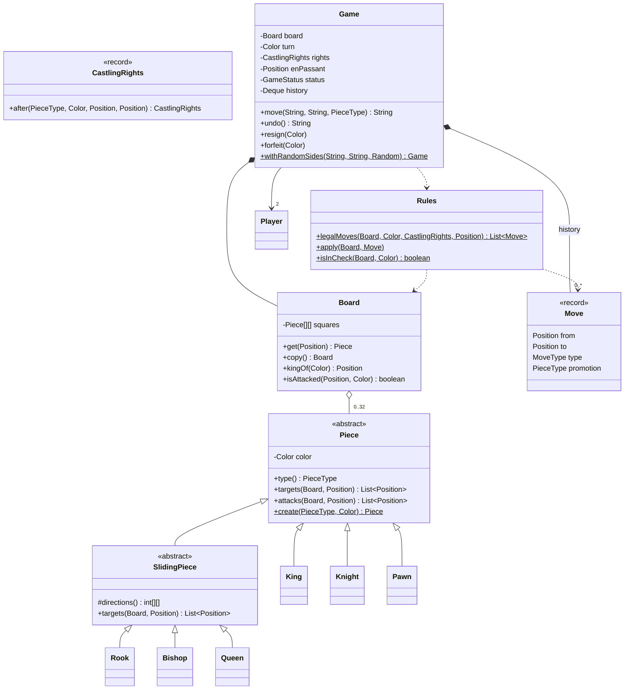

### Key flows

**Making a move**

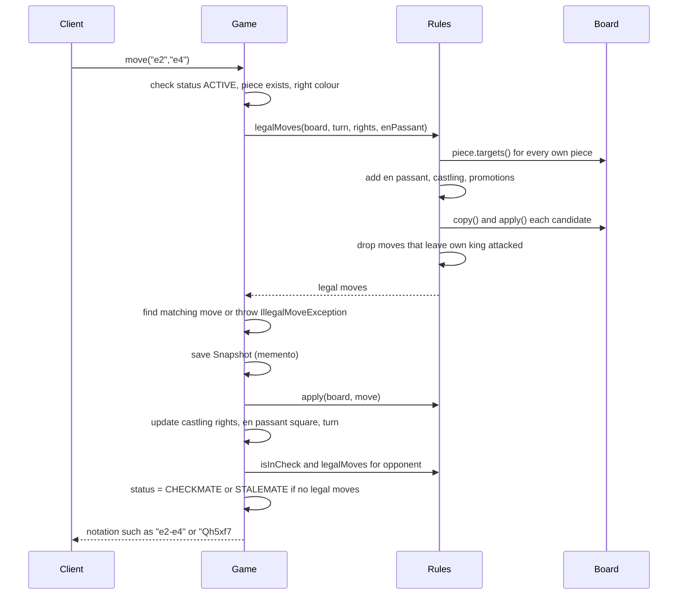

**Game status**

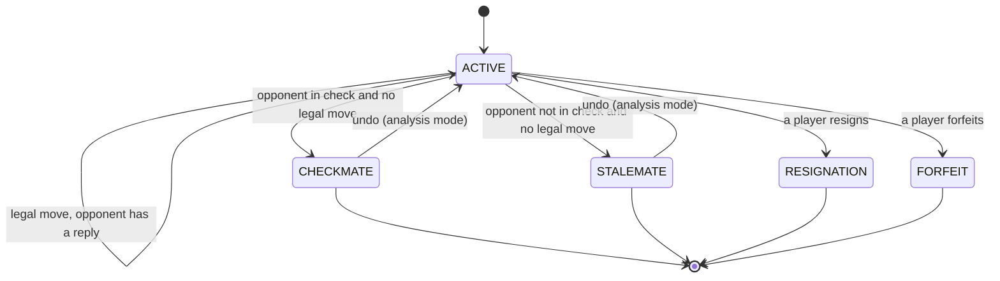

**How check, checkmate and stalemate are detected (the "reasonable depth" answer)**

1. **Pseudo-legal moves** — every move allowed by the pieces' movement rules, plus castling, en passant and promotions.
2. **Legal moves** — for each pseudo-legal move, apply it to a *copy* of the board and keep it only if the mover's king is **not attacked** afterwards. This one filter handles pins, moving into check, and ignoring a check, with no special cases.
3. **Is the king attacked?** Ask every enemy piece for the squares it attacks (`attacks(...)`); pawns attack diagonally even onto empty squares, which is why `Pawn` overrides `attacks`.
4. After a move, look at the **opponent**: if it has **zero legal moves**, it is **checkmate** when its king is in check, otherwise **stalemate**.

This is a one-ply (one move deep) search, which is all the *rules* need. Searching deeper is what a chess *engine* does to choose good moves — not required for enforcing rules.

**Cost:** at most ~200 pseudo-legal moves, each checked with an attack scan over ≤16 pieces — trivial for a human game. A production engine would use bitboards (each piece type's squares packed into one 64-bit number, so set operations become fast bit tricks) and incremental attack maps (attacked squares updated per move instead of recomputed); mention it only if asked.

### Design decisions & patterns used

| Decision | Why | Alternative rejected |
|---|---|---|
| **Polymorphic pieces** (`targets` overridden per piece), **Template-like** `SlidingPiece`. | Each piece's rule lives in its own class; the blocked-path loop is written once for three pieces. | One giant `switch (pieceType)` in the board. |
| **Sealed** hierarchy (`sealed ... permits`). | The set of chess pieces is closed; the compiler knows all subclasses, so `switch` on type can be exhaustive (the compiler checks every case is handled). | Open hierarchy — fine too for variants; say so. |
| Pieces are **immutable**; `Board.copy()` copies references (pointers to the same piece objects) only. | Trial moves and snapshots are cheap and safe. | Mutable pieces with `hasMoved` flags — then undo must restore every flag. |
| **History-based rules in `Rules`/`Game`**, not in pieces. | Castling rights and en passant depend on earlier moves. The course notes that a piece seeing only the board cannot know this. | Letting `King` look up history — couples a piece to the game log. |
| `Move` carries a **`MoveType`**. | One move can move two pieces (castling) or capture off-square (en passant). | Special-casing in `Game` (the course's `move_castling_rook`), which breaks "rules live in one place". |
| **Command + Memento** for undo. `Move` is the command (an action stored as an object); `Snapshot` is the memento (a saved copy of an object's state that can be restored later) of the state before it. | Restoring a snapshot is always correct, even for promotion/castling/en passant, with no inverse logic. | Pure Command with `undo()` per move type — works, but every special move needs a hand-written inverse, a common bug source. |
| **Factory method** `Piece.create(type, color)`. | Used by board set-up and promotion. | `new` calls scattered around. |
| `Game` methods are `synchronized`. | Two player connections may call `move`/`resign` at the same time. | No locking — race (result depends on which thread runs first) between a move and a resignation. |

**Memento vs incremental undo — trade-off.** A snapshot of an 8×8 reference array is 64 references (~0.5 KB): nothing for a human game (a few hundred moves). An engine searching millions of positions would instead store only what the move changed (captured piece, old castling rights, old en passant square) and reverse it. Know both.

### Java implementation

Package `lld.ch17.chess`.

```java
// File: code/lld/ch17/chess/Color.java
package lld.ch17.chess;

public enum Color {
    WHITE, BLACK;

    public Color opposite() { return this == WHITE ? BLACK : WHITE; }
}
```

```java
// File: code/lld/ch17/chess/PieceType.java
package lld.ch17.chess;

public enum PieceType {
    KING('K'), QUEEN('Q'), ROOK('R'), BISHOP('B'), KNIGHT('N'), PAWN('P');

    private final char letter;

    PieceType(char letter) { this.letter = letter; }

    public char letter() { return letter; }
}
```

```java
// File: code/lld/ch17/chess/Position.java
package lld.ch17.chess;

/** A square. file 0..7 = a..h, rank 0..7 = 1..8. Immutable value object. */
public record Position(int file, int rank) {
    public Position {
        if (!onBoard(file, rank)) throw new IllegalArgumentException("off board: " + file + "," + rank);
    }

    public static boolean onBoard(int file, int rank) { return file >= 0 && file < 8 && rank >= 0 && rank < 8; }

    /** Parses algebraic notation such as "e4". */
    public static Position of(String sq) {
        if (sq == null || sq.length() != 2) throw new IllegalArgumentException("bad square: " + sq);
        return new Position(sq.charAt(0) - 'a', sq.charAt(1) - '1');
    }

    @Override public String toString() { return "" + (char) ('a' + file) + (rank + 1); }
}
```

```java
// File: code/lld/ch17/chess/Piece.java
package lld.ch17.chess;

import java.util.List;

/**
 * Every piece answers "which squares can I reach from here on this board?" in its own way
 * (polymorphism). Pieces are immutable: moving a piece moves the reference, so a board copy is cheap
 * and undo can simply restore an old board. Rules that need history (castling rights, en passant)
 * live in Rules/Game, not here.
 */
public abstract sealed class Piece permits King, Knight, Pawn, SlidingPiece {
    private final Color color;

    protected Piece(Color color) { this.color = color; }

    public Color color() { return color; }

    public abstract PieceType type();

    /** Squares this piece may move to by its ordinary rules (captures included, own-king safety NOT checked). */
    public abstract List<Position> targets(Board board, Position from);

    /** Squares this piece attacks. Same as targets for every piece except the pawn. */
    public List<Position> attacks(Board board, Position from) { return targets(board, from); }

    /** Empty square or enemy piece. */
    protected boolean canLandOn(Board board, Position p) {
        Piece other = board.get(p);
        return other == null || other.color != color;
    }

    public char symbol() {
        char c = type().letter();
        return color == Color.WHITE ? c : Character.toLowerCase(c);
    }

    /** Simple factory used for set-up and promotion. */
    public static Piece create(PieceType type, Color color) {
        return switch (type) {
            case KING -> new King(color);
            case QUEEN -> new Queen(color);
            case ROOK -> new Rook(color);
            case BISHOP -> new Bishop(color);
            case KNIGHT -> new Knight(color);
            case PAWN -> new Pawn(color);
        };
    }
}
```

```java
// File: code/lld/ch17/chess/StepPieces.java
package lld.ch17.chess;

import java.util.ArrayList;
import java.util.List;

/** Shared helper for pieces that jump a fixed set of offsets (king, knight). */
final class StepPieces {
    private StepPieces() {}

    static List<Position> step(Piece piece, Board board, Position from, int[][] offsets) {
        List<Position> out = new ArrayList<>();
        for (int[] d : offsets) {
            int f = from.file() + d[0], r = from.rank() + d[1];
            if (!Position.onBoard(f, r)) continue;
            Position p = new Position(f, r);
            if (piece.canLandOn(board, p)) out.add(p);
        }
        return out;
    }
}
```

```java
// File: code/lld/ch17/chess/King.java
package lld.ch17.chess;

import java.util.List;

/** One square in any direction. Castling is a two-piece move, so Rules generates it, not King. */
public final class King extends Piece {
    private static final int[][] OFFSETS = {{1,0},{-1,0},{0,1},{0,-1},{1,1},{1,-1},{-1,1},{-1,-1}};

    public King(Color color) { super(color); }

    @Override public PieceType type() { return PieceType.KING; }

    @Override public List<Position> targets(Board board, Position from) {
        return StepPieces.step(this, board, from, OFFSETS);
    }
}
```

```java
// File: code/lld/ch17/chess/Knight.java
package lld.ch17.chess;

import java.util.List;

/** L-shaped jump; the only piece that ignores pieces in between. */
public final class Knight extends Piece {
    private static final int[][] OFFSETS = {{1,2},{2,1},{2,-1},{1,-2},{-1,-2},{-2,-1},{-2,1},{-1,2}};

    public Knight(Color color) { super(color); }

    @Override public PieceType type() { return PieceType.KNIGHT; }

    @Override public List<Position> targets(Board board, Position from) {
        return StepPieces.step(this, board, from, OFFSETS);
    }
}
```

```java
// File: code/lld/ch17/chess/SlidingPiece.java
package lld.ch17.chess;

import java.util.ArrayList;
import java.util.List;

/** Rook, bishop and queen slide until blocked. The "is the path clear" loop is written once, here. */
public abstract sealed class SlidingPiece extends Piece permits Rook, Bishop, Queen {
    protected static final int[][] STRAIGHT = {{1,0},{-1,0},{0,1},{0,-1}};
    protected static final int[][] DIAGONAL = {{1,1},{1,-1},{-1,1},{-1,-1}};

    protected SlidingPiece(Color color) { super(color); }

    protected abstract int[][] directions();

    @Override public final List<Position> targets(Board board, Position from) {
        List<Position> out = new ArrayList<>();
        for (int[] d : directions()) {
            int f = from.file() + d[0], r = from.rank() + d[1];
            while (Position.onBoard(f, r)) {
                Position p = new Position(f, r);
                Piece occupant = board.get(p);
                if (occupant == null) {
                    out.add(p);
                } else {
                    if (occupant.color() != color()) out.add(p);   // capture, then stop
                    break;
                }
                f += d[0];
                r += d[1];
            }
        }
        return out;
    }
}
```

```java
// File: code/lld/ch17/chess/Rook.java
package lld.ch17.chess;

public final class Rook extends SlidingPiece {
    public Rook(Color color) { super(color); }
    @Override public PieceType type() { return PieceType.ROOK; }
    @Override protected int[][] directions() { return STRAIGHT; }
}
```

```java
// File: code/lld/ch17/chess/Bishop.java
package lld.ch17.chess;

public final class Bishop extends SlidingPiece {
    public Bishop(Color color) { super(color); }
    @Override public PieceType type() { return PieceType.BISHOP; }
    @Override protected int[][] directions() { return DIAGONAL; }
}
```

```java
// File: code/lld/ch17/chess/Queen.java
package lld.ch17.chess;

public final class Queen extends SlidingPiece {
    private static final int[][] ALL = {{1,0},{-1,0},{0,1},{0,-1},{1,1},{1,-1},{-1,1},{-1,-1}};
    public Queen(Color color) { super(color); }
    @Override public PieceType type() { return PieceType.QUEEN; }
    @Override protected int[][] directions() { return ALL; }
}
```

```java
// File: code/lld/ch17/chess/Pawn.java
package lld.ch17.chess;

import java.util.ArrayList;
import java.util.List;

/** Moves straight forward but captures diagonally. En passant and promotion are added by Rules. */
public final class Pawn extends Piece {
    public Pawn(Color color) { super(color); }

    @Override public PieceType type() { return PieceType.PAWN; }

    private int dir() { return color() == Color.WHITE ? 1 : -1; }

    @Override public List<Position> targets(Board board, Position from) {
        List<Position> out = new ArrayList<>();
        int f = from.file(), r = from.rank() + dir();
        if (Position.onBoard(f, r) && board.get(new Position(f, r)) == null) {
            out.add(new Position(f, r));
            int startRank = color() == Color.WHITE ? 1 : 6;
            int r2 = r + dir();
            if (from.rank() == startRank && board.get(new Position(f, r2)) == null) out.add(new Position(f, r2));
        }
        for (Position p : attacks(board, from)) {
            Piece victim = board.get(p);
            if (victim != null && victim.color() != color()) out.add(p);
        }
        return out;
    }

    /** A pawn attacks both forward diagonals whether or not anything stands there. */
    @Override public List<Position> attacks(Board board, Position from) {
        List<Position> out = new ArrayList<>(2);
        int r = from.rank() + dir();
        for (int df : new int[]{-1, 1}) {
            int f = from.file() + df;
            if (Position.onBoard(f, r)) out.add(new Position(f, r));
        }
        return out;
    }
}
```

```java
// File: code/lld/ch17/chess/Board.java
package lld.ch17.chess;

/** 8x8 grid of (immutable) pieces. Knows geometry and attacks; knows nothing about turns or history. */
public final class Board {
    private final Piece[][] squares = new Piece[8][8]; // [file][rank]

    public static Board standard() {
        Board b = new Board();
        PieceType[] back = {PieceType.ROOK, PieceType.KNIGHT, PieceType.BISHOP, PieceType.QUEEN,
                            PieceType.KING, PieceType.BISHOP, PieceType.KNIGHT, PieceType.ROOK};
        for (int f = 0; f < 8; f++) {
            b.squares[f][0] = Piece.create(back[f], Color.WHITE);
            b.squares[f][1] = new Pawn(Color.WHITE);
            b.squares[f][6] = new Pawn(Color.BLACK);
            b.squares[f][7] = Piece.create(back[f], Color.BLACK);
        }
        return b;
    }

    public Piece get(Position p) { return squares[p.file()][p.rank()]; }

    void set(Position p, Piece piece) { squares[p.file()][p.rank()] = piece; }

    /** Pieces are immutable, so copying the references is a full, independent copy of the position. */
    public Board copy() {
        Board b = new Board();
        for (int f = 0; f < 8; f++) b.squares[f] = squares[f].clone();
        return b;
    }

    public Position kingOf(Color color) {
        for (int f = 0; f < 8; f++)
            for (int r = 0; r < 8; r++) {
                Piece p = squares[f][r];
                if (p != null && p.type() == PieceType.KING && p.color() == color) return new Position(f, r);
            }
        throw new IllegalStateException("no " + color + " king on board");
    }

    public boolean isAttacked(Position target, Color by) {
        for (int f = 0; f < 8; f++)
            for (int r = 0; r < 8; r++) {
                Piece p = squares[f][r];
                if (p != null && p.color() == by && p.attacks(this, new Position(f, r)).contains(target)) return true;
            }
        return false;
    }

    public String render() {
        StringBuilder sb = new StringBuilder();
        for (int r = 7; r >= 0; r--) {
            sb.append("    ").append(r + 1).append(' ');
            for (int f = 0; f < 8; f++) {
                Piece p = squares[f][r];
                sb.append(' ').append(p == null ? '.' : p.symbol());
            }
            sb.append('\n');
        }
        return sb.append("       a b c d e f g h").toString();
    }
}
```

```java
// File: code/lld/ch17/chess/MoveType.java
package lld.ch17.chess;

public enum MoveType { NORMAL, CASTLE_KINGSIDE, CASTLE_QUEENSIDE, EN_PASSANT, PROMOTION }
```

```java
// File: code/lld/ch17/chess/Move.java
package lld.ch17.chess;

/** A move as data (the Command's payload). promotion is null unless type == PROMOTION. */
public record Move(Position from, Position to, MoveType type, PieceType promotion) {
    public static Move normal(Position from, Position to) { return new Move(from, to, MoveType.NORMAL, null); }
}
```

```java
// File: code/lld/ch17/chess/CastlingRights.java
package lld.ch17.chess;

/** Which castles are still allowed. Lost forever once the king or that rook moves (or the rook is captured). */
public record CastlingRights(boolean whiteKingSide, boolean whiteQueenSide, boolean blackKingSide, boolean blackQueenSide) {
    public static CastlingRights all() { return new CastlingRights(true, true, true, true); }

    public boolean kingSide(Color c) { return c == Color.WHITE ? whiteKingSide : blackKingSide; }
    public boolean queenSide(Color c) { return c == Color.WHITE ? whiteQueenSide : blackQueenSide; }

    /** Returns the rights after a move from -> to by a piece of the given type. */
    public CastlingRights after(PieceType moved, Color mover, Position from, Position to) {
        boolean wk = whiteKingSide, wq = whiteQueenSide, bk = blackKingSide, bq = blackQueenSide;
        if (moved == PieceType.KING) {
            if (mover == Color.WHITE) { wk = false; wq = false; } else { bk = false; bq = false; }
        }
        for (Position p : new Position[]{from, to}) {          // a rook leaving or being captured on its corner
            if (p.equals(new Position(0, 0))) wq = false;
            if (p.equals(new Position(7, 0))) wk = false;
            if (p.equals(new Position(0, 7))) bq = false;
            if (p.equals(new Position(7, 7))) bk = false;
        }
        return new CastlingRights(wk, wq, bk, bq);
    }
}
```

```java
// File: code/lld/ch17/chess/Rules.java
package lld.ch17.chess;

import java.util.ArrayList;
import java.util.List;

/**
 * Stateless rules engine: generates legal moves (including castling, en passant, promotion)
 * and applies a move to a board. "Legal" = pseudo-legal AND does not leave your own king attacked.
 */
public final class Rules {
    private Rules() {}

    private static final PieceType[] PROMOTIONS = {PieceType.QUEEN, PieceType.ROOK, PieceType.BISHOP, PieceType.KNIGHT};

    public static boolean isInCheck(Board board, Color side) {
        return board.isAttacked(board.kingOf(side), side.opposite());
    }

    /** Moves that follow the pieces' movement rules, before the king-safety filter. */
    public static List<Move> pseudoLegalMoves(Board board, Color side, CastlingRights rights, Position enPassant) {
        List<Move> moves = new ArrayList<>();
        int lastRank = side == Color.WHITE ? 7 : 0;
        for (int f = 0; f < 8; f++) {
            for (int r = 0; r < 8; r++) {
                Position from = new Position(f, r);
                Piece piece = board.get(from);
                if (piece == null || piece.color() != side) continue;
                for (Position to : piece.targets(board, from)) {
                    if (piece.type() == PieceType.PAWN && to.rank() == lastRank) {
                        for (PieceType promo : PROMOTIONS) moves.add(new Move(from, to, MoveType.PROMOTION, promo));
                    } else {
                        moves.add(Move.normal(from, to));
                    }
                }
                if (piece.type() == PieceType.PAWN && enPassant != null && piece.attacks(board, from).contains(enPassant)) {
                    moves.add(new Move(from, enPassant, MoveType.EN_PASSANT, null));
                }
            }
        }
        addCastling(board, side, rights, moves);
        return moves;
    }

    private static void addCastling(Board board, Color side, CastlingRights rights, List<Move> moves) {
        int r = side == Color.WHITE ? 0 : 7;
        Position kingSq = new Position(4, r);
        Piece king = board.get(kingSq);
        if (king == null || king.type() != PieceType.KING || king.color() != side) return;
        Color enemy = side.opposite();
        if (board.isAttacked(kingSq, enemy)) return;                       // cannot castle out of check
        if (rights.kingSide(side) && isOwnRook(board, new Position(7, r), side)
                && empty(board, r, 5, 6)
                && !board.isAttacked(new Position(5, r), enemy)             // cannot pass through check
                && !board.isAttacked(new Position(6, r), enemy)) {
            moves.add(new Move(kingSq, new Position(6, r), MoveType.CASTLE_KINGSIDE, null));
        }
        if (rights.queenSide(side) && isOwnRook(board, new Position(0, r), side)
                && empty(board, r, 1, 2, 3)
                && !board.isAttacked(new Position(3, r), enemy)
                && !board.isAttacked(new Position(2, r), enemy)) {
            moves.add(new Move(kingSq, new Position(2, r), MoveType.CASTLE_QUEENSIDE, null));
        }
    }

    private static boolean isOwnRook(Board b, Position p, Color side) {
        Piece piece = b.get(p);
        return piece != null && piece.type() == PieceType.ROOK && piece.color() == side;
    }

    private static boolean empty(Board b, int rank, int... files) {
        for (int f : files) if (b.get(new Position(f, rank)) != null) return false;
        return true;
    }

    /** Explains why a king move of two squares (a castling attempt) is not legal right now. */
    public static String whyCannotCastle(Board board, Color side, CastlingRights rights, Position kingTo) {
        int r = side == Color.WHITE ? 0 : 7;
        if (kingTo.rank() != r || (kingTo.file() != 6 && kingTo.file() != 2)) return "that is not a castling square";
        boolean kingSide = kingTo.file() == 6;
        if (!(kingSide ? rights.kingSide(side) : rights.queenSide(side))
                || !isOwnRook(board, new Position(kingSide ? 7 : 0, r), side))
            return "the king or that rook has already moved";
        if (!(kingSide ? empty(board, r, 5, 6) : empty(board, r, 1, 2, 3)))
            return "the squares between king and rook are not empty";
        Color enemy = side.opposite();
        if (board.isAttacked(new Position(4, r), enemy)) return "the king is in check";
        Position crossed = new Position(kingSide ? 5 : 3, r);
        if (board.isAttacked(crossed, enemy)) return "the king would pass through the attacked square " + crossed;
        if (board.isAttacked(kingTo, enemy)) return "the king would land on the attacked square " + kingTo;
        return "it is not legal in this position";
    }

    public static List<Move> legalMoves(Board board, Color side, CastlingRights rights, Position enPassant) {
        List<Move> legal = new ArrayList<>();
        for (Move m : pseudoLegalMoves(board, side, rights, enPassant)) {
            Board trial = board.copy();
            apply(trial, m);
            if (!isInCheck(trial, side)) legal.add(m);
        }
        return legal;
    }

    /** Mutates the board. Handles the extra piece movements of the special moves. */
    public static void apply(Board board, Move m) {
        Piece piece = board.get(m.from());
        board.set(m.from(), null);
        board.set(m.to(), piece);
        switch (m.type()) {
            case EN_PASSANT -> board.set(new Position(m.to().file(), m.from().rank()), null);   // the passed pawn
            case PROMOTION -> board.set(m.to(), Piece.create(m.promotion(), piece.color()));
            case CASTLE_KINGSIDE -> moveRook(board, m.from().rank(), 7, 5);
            case CASTLE_QUEENSIDE -> moveRook(board, m.from().rank(), 0, 3);
            case NORMAL -> { }
        }
    }

    private static void moveRook(Board board, int rank, int fromFile, int toFile) {
        Position from = new Position(fromFile, rank);
        board.set(new Position(toFile, rank), board.get(from));
        board.set(from, null);
    }
}
```

```java
// File: code/lld/ch17/chess/GameStatus.java
package lld.ch17.chess;

public enum GameStatus { ACTIVE, CHECKMATE, STALEMATE, RESIGNATION, FORFEIT }
```

```java
// File: code/lld/ch17/chess/Player.java
package lld.ch17.chess;

public record Player(String name, Color color) {}
```

```java
// File: code/lld/ch17/chess/IllegalMoveException.java
package lld.ch17.chess;

public final class IllegalMoveException extends RuntimeException {
    private static final long serialVersionUID = 1L;

    public IllegalMoveException(String message) { super(message); }
}
```

```java
// File: code/lld/ch17/chess/Game.java
package lld.ch17.chess;

import java.util.ArrayDeque;
import java.util.Deque;
import java.util.List;
import java.util.Optional;
import java.util.Random;

/**
 * Controls one game: whose turn it is, validates and plays moves, detects check/checkmate/stalemate,
 * keeps the move log, and supports undo.
 *
 * Undo = Command + Memento: each history entry stores the move (the command) and a snapshot of the
 * state before it (the memento). Undo restores the snapshot, which is always correct even for
 * castling, en passant and promotion.
 */
public final class Game {
    /** Memento: everything needed to restore the position exactly. */
    private record Snapshot(Board board, Color turn, CastlingRights rights, Position enPassant,
                            GameStatus status, Color winner) {}

    private record HistoryEntry(Player player, Move move, String notation, Snapshot before) {}

    private final Player white, black;
    private Board board = Board.standard();
    private Color turn = Color.WHITE;                      // white always moves first
    private CastlingRights rights = CastlingRights.all();
    private Position enPassant;                            // square a pawn just skipped over, or null
    private GameStatus status = GameStatus.ACTIVE;
    private Color winner;
    private final Deque<HistoryEntry> history = new ArrayDeque<>();

    public Game(Player white, Player black) {
        if (white.color() != Color.WHITE || black.color() != Color.BLACK) throw new IllegalArgumentException("colors mismatch");
        this.white = white;
        this.black = black;
    }

    /** The course's rule: each player is randomly assigned a side. Pass a seeded Random for repeatable tests. */
    public static Game withRandomSides(String nameA, String nameB, Random rng) {
        boolean aIsWhite = rng.nextBoolean();
        return aIsWhite ? new Game(new Player(nameA, Color.WHITE), new Player(nameB, Color.BLACK))
                        : new Game(new Player(nameB, Color.WHITE), new Player(nameA, Color.BLACK));
    }

    public synchronized Player player(Color c) { return c == Color.WHITE ? white : black; }

    public synchronized String move(String from, String to) { return move(from, to, null); }

    public synchronized String move(String fromSq, String toSq, PieceType promotion) {
        if (status != GameStatus.ACTIVE) throw new IllegalMoveException("game is over: " + status);
        Position from = Position.of(fromSq), to = Position.of(toSq);
        Piece piece = board.get(from);
        if (piece == null) throw new IllegalMoveException("no piece on " + from);
        if (piece.color() != turn) throw new IllegalMoveException("it is " + turn + "'s turn");

        List<Move> legal = Rules.legalMoves(board, turn, rights, enPassant);
        Optional<Move> chosen = legal.stream()
                .filter(m -> m.from().equals(from) && m.to().equals(to))
                .filter(m -> m.type() != MoveType.PROMOTION
                        || m.promotion() == (promotion == null ? PieceType.QUEEN : promotion))
                .findFirst();
        if (chosen.isEmpty()) {
            if (piece.type() == PieceType.KING && Math.abs(to.file() - from.file()) == 2)
                throw new IllegalMoveException("cannot castle " + fromSq + "-" + toSq + ": "
                        + Rules.whyCannotCastle(board, turn, rights, to));
            boolean reachable = Rules.pseudoLegalMoves(board, turn, rights, enPassant).stream()
                    .anyMatch(m -> m.from().equals(from) && m.to().equals(to));
            throw new IllegalMoveException(reachable
                    ? fromSq + "-" + toSq + " would leave the " + turn + " king in check"
                    : piece.type() + " on " + fromSq + " cannot move to " + toSq);
        }
        return play(chosen.get(), piece);
    }

    private String play(Move m, Piece piece) {
        Player mover = turn == Color.WHITE ? white : black;
        Snapshot before = new Snapshot(board.copy(), turn, rights, enPassant, status, winner);
        boolean capture = board.get(m.to()) != null || m.type() == MoveType.EN_PASSANT;

        Rules.apply(board, m);
        rights = rights.after(piece.type(), turn, m.from(), m.to());
        enPassant = (piece.type() == PieceType.PAWN && Math.abs(m.to().rank() - m.from().rank()) == 2)
                ? new Position(m.from().file(), (m.from().rank() + m.to().rank()) / 2) : null;
        turn = turn.opposite();

        // End-of-game detection: the side to move has no legal move -> checkmate if in check, else stalemate.
        boolean check = Rules.isInCheck(board, turn);
        boolean noMoves = Rules.legalMoves(board, turn, rights, enPassant).isEmpty();
        if (noMoves) {
            status = check ? GameStatus.CHECKMATE : GameStatus.STALEMATE;
            winner = check ? mover.color() : null;
        }
        String notation = notation(m, piece, capture) + (check ? (noMoves ? "#" : "+") : "");
        history.push(new HistoryEntry(mover, m, notation, before));
        return notation;
    }

    private static String notation(Move m, Piece piece, boolean capture) {
        return switch (m.type()) {
            case CASTLE_KINGSIDE -> "O-O";
            case CASTLE_QUEENSIDE -> "O-O-O";
            default -> {
                String prefix = piece.type() == PieceType.PAWN ? "" : String.valueOf(piece.type().letter());
                String s = prefix + m.from() + (capture ? "x" : "-") + m.to();
                if (m.type() == MoveType.PROMOTION) s += "=" + m.promotion().letter();
                if (m.type() == MoveType.EN_PASSANT) s += " e.p.";
                yield s;
            }
        };
    }

    /** Undo the last move (e.g. for analysis mode or a take-back both players agree on). */
    public synchronized String undo() {
        if (history.isEmpty()) throw new IllegalStateException("nothing to undo");
        HistoryEntry last = history.pop();
        Snapshot s = last.before();
        board = s.board(); turn = s.turn(); rights = s.rights(); enPassant = s.enPassant();
        status = s.status(); winner = s.winner();
        return last.notation();
    }

    public synchronized void resign(Color who) {
        if (status != GameStatus.ACTIVE) throw new IllegalStateException("game is over");
        status = GameStatus.RESIGNATION;
        winner = who.opposite();
    }

    /** Forfeit: the player loses without choosing to (left the game, ran out of time, broke the rules of the site). */
    public synchronized void forfeit(Color who) {
        if (status != GameStatus.ACTIVE) throw new IllegalStateException("game is over");
        status = GameStatus.FORFEIT;
        winner = who.opposite();
    }

    public synchronized boolean isInCheck() { return Rules.isInCheck(board, turn); }
    public synchronized int legalMoveCount() { return Rules.legalMoves(board, turn, rights, enPassant).size(); }
    public synchronized GameStatus status() { return status; }
    public synchronized Color winner() { return winner; }
    public synchronized Color turn() { return turn; }
    public synchronized String render() { return board.render(); }

    /** The move log, oldest first, numbered like a score sheet. */
    public synchronized String moveLog() {
        List<HistoryEntry> list = new java.util.ArrayList<>(history);
        java.util.Collections.reverse(list);
        StringBuilder sb = new StringBuilder();
        for (int i = 0; i < list.size(); i++) {
            if (i % 2 == 0) sb.append(i / 2 + 1).append(". ");
            sb.append(list.get(i).notation()).append(' ');
        }
        return sb.toString().trim();
    }
}
```

```java
// File: code/lld/ch17/chess/Main.java
package lld.ch17.chess;

import java.util.Random;

public final class Main {
    private static Game newGame() { return new Game(new Player("Ann", Color.WHITE), new Player("Ben", Color.BLACK)); }

    private static void play(Game g, String... moves) {
        for (String mv : moves) {
            String[] parts = mv.split("-");
            PieceType promo = parts[1].length() == 3 ? PieceType.valueOf(switch (parts[1].charAt(2)) {
                case 'Q' -> "QUEEN"; case 'R' -> "ROOK"; case 'B' -> "BISHOP"; default -> "KNIGHT"; }) : null;
            g.move(parts[0], parts[1].substring(0, 2), promo);
        }
    }

    private static void tryMove(Game g, String from, String to, PieceType promo) {
        try {
            System.out.println("  " + from + "-" + to + " played as " + g.move(from, to, promo));
        } catch (IllegalMoveException e) {
            System.out.println("  " + from + "-" + to + " rejected: " + e.getMessage());
        }
    }

    public static void main(String[] args) {
        System.out.println("== 1. Validation, Scholar's mate, undo ==");
        Game g = newGame();
        tryMove(g, "e7", "e5", null);                 // black out of turn
        tryMove(g, "e1", "e3", null);                 // king cannot jump two squares
        tryMove(g, "a1", "a4", null);                 // rook blocked by its own pawn
        play(g, "e2-e4", "e7-e5", "f1-c4", "b8-c6", "d1-h5", "g8-f6");
        tryMove(g, "h5", "f7", null);
        System.out.println("  Log: " + g.moveLog());
        System.out.println("  Status: " + g.status() + ", winner " + g.winner());
        System.out.println(g.render());
        System.out.println("  undo " + g.undo() + " -> status " + g.status() + ", " + g.turn() + " to move, "
                + g.legalMoveCount() + " legal moves");

        System.out.println("\n== 2. En passant, castling, promotion, and a move that ignores check ==");
        Game s = newGame();
        play(s, "e2-e4", "g8-f6", "e4-e5", "d7-d5");
        tryMove(s, "e5", "d6", null);                 // en passant
        play(s, "b8-c6", "g1-f3", "a7-a5", "f1-c4", "a5-a4");
        tryMove(s, "e1", "g1", null);                 // castle kingside
        play(s, "a4-a3", "d6-c7", "a3-b2");
        tryMove(s, "c7", "d8", PieceType.QUEEN);      // capture + promote, gives check
        System.out.println("  Black in check? " + s.isInCheck());
        tryMove(s, "b2", "a1", PieceType.KNIGHT);     // ignores the check -> illegal
        tryMove(s, "e8", "d8", null);                 // king takes the new queen
        System.out.println("  Log: " + s.moveLog());
        System.out.println(s.render());

        System.out.println("\n== 3. Stalemate (Sam Loyd's 10-move stalemate) ==");
        Game st = newGame();
        play(st, "e2-e3", "a7-a5", "d1-h5", "a8-a6", "h5-a5", "h7-h5", "h2-h4", "a6-h6",
                 "a5-c7", "f7-f6", "c7-d7", "e8-f7", "d7-b7", "d8-d3", "b7-b8", "d3-h7",
                 "b8-c8", "f7-g6", "c8-e6");
        System.out.println("  Log: " + st.moveLog());
        System.out.println("  Status: " + st.status() + ", black in check? " + st.isInCheck()
                + ", black legal moves: " + st.legalMoveCount());
        System.out.println(st.render());

        System.out.println("\n== 4. Castling rules: through an attacked square, and out of check ==");
        Game c1 = newGame();
        play(c1, "g2-g3", "b7-b6", "f1-h3", "c8-a6", "g1-f3", "b8-c6", "e2-e4", "g8-f6");
        tryMove(c1, "e1", "g1", null);                // f1 is attacked by the bishop on a6
        Game c2 = newGame();
        play(c2, "e2-e4", "d7-d6", "d2-d4", "g8-f6", "b1-c3", "g7-g6", "g1-f3", "f8-g7", "f1-b5");
        tryMove(c2, "e8", "g8", null);                // black is in check from the b5 bishop
        tryMove(c2, "c7", "c6", null);                // block the check
        tryMove(c2, "e1", "g1", null);
        tryMove(c2, "e8", "g8", null);                // no longer in check: now legal

        System.out.println("\n== 5. Random sides, resignation and forfeit ==");
        Game r = Game.withRandomSides("Ann", "Ben", new Random(7));
        System.out.println("  white = " + r.player(Color.WHITE).name() + ", black = " + r.player(Color.BLACK).name());
        play(r, "f2-f3", "e7-e5");
        r.resign(Color.WHITE);
        System.out.println("  Status: " + r.status() + ", winner " + r.winner());
        tryMove(r, "g2", "g4", null);
        Game f = newGame();
        f.forfeit(Color.BLACK);                        // e.g. black disconnected and did not come back
        System.out.println("  Status: " + f.status() + ", winner " + f.winner());
    }
}
```

**Output:**

```text
== 1. Validation, Scholar's mate, undo ==
  e7-e5 rejected: it is WHITE's turn
  e1-e3 rejected: KING on e1 cannot move to e3
  a1-a4 rejected: ROOK on a1 cannot move to a4
  h5-f7 played as Qh5xf7#
  Log: 1. e2-e4 e7-e5 2. Bf1-c4 Nb8-c6 3. Qd1-h5 Ng8-f6 4. Qh5xf7#
  Status: CHECKMATE, winner WHITE
    8  r . b q k b . r
    7  p p p p . Q p p
    6  . . n . . n . .
    5  . . . . p . . .
    4  . . B . P . . .
    3  . . . . . . . .
    2  P P P P . P P P
    1  R N B . K . N R
       a b c d e f g h
  undo Qh5xf7# -> status ACTIVE, WHITE to move, 43 legal moves

== 2. En passant, castling, promotion, and a move that ignores check ==
  e5-d6 played as e5xd6 e.p.
  e1-g1 played as O-O
  c7-d8 played as c7xd8=Q+
  Black in check? true
  b2-a1 rejected: b2-a1 would leave the BLACK king in check
  e8-d8 played as Ke8xd8
  Log: 1. e2-e4 Ng8-f6 2. e4-e5 d7-d5 3. e5xd6 e.p. Nb8-c6 4. Ng1-f3 a7-a5 5. Bf1-c4 a5-a4 6. O-O a4-a3 7. d6xc7 a3xb2 8. c7xd8=Q+ Ke8xd8
    8  r . b k . b . r
    7  . p . . p p p p
    6  . . n . . n . .
    5  . . . . . . . .
    4  . . B . . . . .
    3  . . . . . N . .
    2  P p P P . P P P
    1  R N B Q . R K .
       a b c d e f g h

== 3. Stalemate (Sam Loyd's 10-move stalemate) ==
  Log: 1. e2-e3 a7-a5 2. Qd1-h5 Ra8-a6 3. Qh5xa5 h7-h5 4. h2-h4 Ra6-h6 5. Qa5xc7 f7-f6 6. Qc7xd7+ Ke8-f7 7. Qd7xb7 Qd8-d3 8. Qb7xb8 Qd3-h7 9. Qb8xc8 Kf7-g6 10. Qc8-e6
  Status: STALEMATE, black in check? false, black legal moves: 0
    8  . . . . . b n r
    7  . . . . p . p q
    6  . . . . Q p k r
    5  . . . . . . . p
    4  . . . . . . . P
    3  . . . . P . . .
    2  P P P P . P P .
    1  R N B . K B N R
       a b c d e f g h

== 4. Castling rules: through an attacked square, and out of check ==
  e1-g1 rejected: cannot castle e1-g1: the king would pass through the attacked square f1
  e8-g8 rejected: cannot castle e8-g8: the king is in check
  c7-c6 played as c7-c6
  e1-g1 played as O-O
  e8-g8 played as O-O

== 5. Random sides, resignation and forfeit ==
  white = Ann, black = Ben
  Status: RESIGNATION, winner BLACK
  g2-g4 rejected: game is over: RESIGNATION
  Status: FORFEIT, winner WHITE
```

**Reading the output.** Part 1 shows validation (out of turn, illegal king jump, blocked rook), then Scholar's mate (`Qh5xf7#`), and `undo()` returning the game to ACTIVE with white to move. Part 2 plays en passant (`e5xd6 e.p.` removes the black pawn from d5), kingside castling (`O-O`), and a capturing promotion that gives check (`c7xd8=Q+`); black's attempt to ignore the check is rejected, and the king captures the new queen. Part 3 is the famous 10-move stalemate composed by Sam Loyd: black is not in check but has no legal move, so the game is a draw. Part 4 shows the castling guards: white may not castle through f1 while the a6 bishop attacks it, black may not castle out of check, and once the check is blocked both sides castle. Part 5 assigns sides at random (seeded) and shows resignation and forfeit.

### Concurrency & edge cases

- **Two players, one game.** `Game`'s public methods are `synchronized`, so a move and a resignation cannot interleave (have their steps mixed together). For a server with thousands of games, each game gets its own lock (the object's monitor — the built-in lock every Java object carries, which `synchronized` uses) — games do not block each other.
- **Moving out of turn / game over / empty square** — rejected with a clear message before any rule work.
- **Pins and discovered checks** (a *pin* is a piece that cannot move because it shields its king; a *discovered check* is a check revealed when a blocking piece moves away) — handled automatically by the "apply to a copy and test the king" filter.
- **Castling through check** — explicitly tested for the squares the king crosses and lands on; the rook's crossing square on the queenside (b1/b8) may be attacked — that is legal. Section 4 of the output shows both refusals with their reason (`Rules.whyCannotCastle`): passing through an attacked f1, and castling while in check; once the check is blocked the same castle is accepted.
- **Castling rights** are lost when the king moves, when that rook moves, or when that rook is **captured** on its corner (we check both `from` and `to`).
- **En passant expires** after one move: the square is reset on every move unless a pawn just advanced two.
- **Promotion without a choice** defaults to a queen; underpromotion (knight, rook, bishop) is supported.
- **Not implemented, but should be named:** draw by threefold repetition (the same position occurs three times), the 50-move rule (50 moves each with no capture or pawn move), insufficient material (e.g. king vs king), clocks/timeouts, draw offers.

### Extensions & follow-up questions

- **"Add threefold repetition."** — Keep a `Map<PositionKey, Integer>` where the key is (board, side to move, castling rights, en passant square). Production engines hash this (turn it into one compact number for quick comparison) with Zobrist hashing, which combines a random number per piece-and-square. Three occurrences → draw.
- **"Add a 50-move rule."** — A half-move (one player's move) clock reset on every pawn move or capture; at 100 half-moves either player may claim a draw.
- **"Add chess clocks."** — A `Clock` per player; the server stamps time on each move; a flag-fall (a player's time running out) ends the game (Observer — listeners register once and are told about every change — notifies both clients).
- **"Add an AI player."** — A `MoveStrategy` that picks from `legalMoves()`; a real one runs minimax (search ahead, assuming you pick your best move and the opponent picks the move worst for you) with alpha-beta pruning (skipping branches that provably cannot change the answer).
- **"Support Chess960 (a variant with a shuffled back row) or a new piece."** — New `Piece` subclass (e.g. an Archbishop = bishop + knight) and a different starting-position factory; existing pieces are untouched.
- **"Spectators and UI updates."** — Observer: `GameListener.onMove(notation)`. The course mentions a `GameController` (takes input, calls `Game`) and a `GameView` (redraws) — that is the MVC (Model–View–Controller: data, display and input handling kept in separate classes) split from Chapter 11.
- **"Why is `Position` a record?"** — It is a value: two `e4`s are equal. Records give `equals`/`hashCode` (the methods Java uses to decide if two objects are equal and to place them in hash tables) for free, which `List.contains` relies on.

### Real-world example

Online chess sites such as Lichess and Chess.com treat the **server** as the source of truth (the one copy whose data wins whenever copies disagree): the board in your browser is only a view, and a move counts only after the server has accepted it as legal. Games are exported in PGN (Portable Game Notation — a move log like ours) and positions in FEN (Forsyth–Edwards Notation — one line describing the board, side to move, castling rights and en passant square, i.e. exactly the fields of our `Snapshot`). "Takeback" is offered only when the opponent agrees, and then the server undoes the move — the same `undo()` our `Game` exposes.

### In the interview

**30-second answer:** "`Board` is an 8×8 grid of immutable `Piece`s. `Piece` is abstract with `targets(board, from)`; each piece overrides it, and rook/bishop/queen share a `SlidingPiece` loop. A stateless `Rules` class generates pseudo-legal moves, adds castling, en passant and promotion using history kept in `Game` (castling rights, en passant square), and filters out moves that leave your king attacked. After each move, if the opponent has no legal move, it's checkmate if they're in check, otherwise stalemate. `Game` handles turns, status, a move log, and undo via Command plus Memento."

**How to spend 30–45 minutes:** 5 min requirements → 5 min entities → 10 min class diagram (piece hierarchy, why history lives outside pieces) → 15 min code `Piece`/`SlidingPiece`/`Pawn` and the legal-move filter → 5–10 min checkmate/stalemate, special moves, concurrency.

**Likely follow-ups with answers**

- *"How do you detect checkmate?"* — No legal moves and in check. Legal = pseudo-legal filtered by "king not attacked after the move".
- *"Where does castling live?"* — In `Rules`, because it moves two pieces and depends on history; `MoveType.CASTLE_*` tells `apply` to move the rook too.
- *"Why is `Box -> Piece` not composition?"* — Removing a piece from a square doesn't destroy the piece; it goes to the captured list or the log.
- *"How is undo safe with promotion?"* — The memento stores the whole prior board, so undo simply puts the old pawn back.

### Self-check

1. **Q:** Why does `Pawn` override `attacks()`? **A:** A pawn moves straight but attacks diagonally, even onto empty squares; check detection needs the attack squares.
2. **Q:** What is the difference between checkmate and stalemate? **A:** Both mean no legal move; checkmate is while in check (loss), stalemate is while not in check (draw).
3. **Q:** When is en passant allowed? **A:** Only on the move immediately after an enemy pawn advanced two squares past your pawn's attack square.
4. **Q:** Name three conditions for castling. **A:** King and that rook have not moved; squares between empty; king not in check, not passing through or landing on an attacked square.
5. **Q:** Why are pieces immutable in this design? **A:** Board copies for trial moves and undo snapshots can share pieces safely.

### TL;DR

- Polymorphic `Piece.targets()`; `SlidingPiece` shares the path loop; pawn overrides `attacks()`.
- `Rules`: pseudo-legal → add castling / en passant / promotion → drop moves leaving own king attacked.
- No legal moves: in check = checkmate, else stalemate.
- History-dependent rules live in `Game`/`Rules`, not in pieces. Undo = Command + Memento. `synchronized` game for online play.

---

## Design Tic-Tac-Toe

### Problem & clarifying questions

**Tic-tac-toe** is played on a grid. Players take turns placing their mark (X or O). The first to fill a whole **row, column or diagonal** wins; if the board fills with no winner, it is a **draw**. The classic game is 3×3 with two players; interviewers love to generalise it to **N×N** and ask for **fast win detection**.

| Question | Assumed answer |
|---|---|
| Board size? | Any N ≥ 3 (classic N = 3). |
| Win condition? | A full line of N marks: any row, column, or one of the two main diagonals. |
| Players? | Two by default; the design allows more (each with its own mark). |
| Human or computer? | Both: each player has a pluggable **move strategy** (human input, random bot, rule-based bot, scripted test). |
| Invalid moves? | Rejected (occupied or off-board); the same player tries again. |
| UI? | Console rendering only; the engine exposes state for any UI. |

### Requirements

**Functional**

1. Create an N×N board and a game with two (or more) players, each with a unique mark.
2. Players take turns; the current player chooses an empty cell.
3. Validate moves: inside the board and empty.
4. After each move, detect a **win** (the mover completed a line) or a **draw** (board full).
5. Announce the result and show the board.

**Non-functional**

- Win check in **O(1)** per move (not a full O(N²) board scan).
- New player types (AI levels, network player) without touching `Game` (Open/Closed).
- Deterministic tests: random bots take a seeded `Random`; scripted players replay fixed moves.
- Separate games must not share state (many games can run at once on a server).

### Use cases

Actors: **Player** (human or bot). Use cases: *start game* (choose N and players), *make move*, *view board*, *see result*. A system actor (the `Game`) validates moves, switches turns and declares the result.

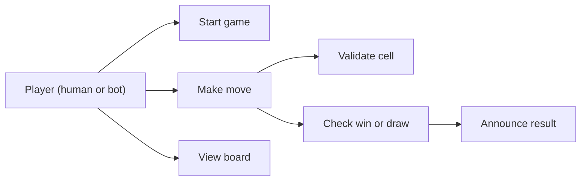

### Core entities

| Class | Responsibility |
|---|---|
| `Cell` (record) | Row + column of a square. |
| `Board` | The grid plus **per-player line counters**; `place` returns "did this win?" in O(1); `wouldWin` for bots; `isFull`, `emptyCells`, `render`. |
| `MoveStrategy` (interface) | Chooses the next cell. Implementations: `ScriptedStrategy`, `RandomStrategy`, `RuleBasedStrategy`. |
| `Player` (record) | Name, mark, strategy. |
| `GameState` (enum) | IN_PROGRESS, WON, DRAW. |
| `Game` | Turn order, move validation, state, winner, result. |

### Class diagram

There is no course lesson for this problem; it comes from the *awesome-low-level-design* problem set. That statement asks for: a 3×3 grid; two players taking turns with X and O; three in a row, column or diagonal wins; a full board with no winner is a draw; a way to display the grid and take moves; turn handling and move validation; announcing the winner or the draw. All of these are covered (the board size is generalised to N×N).

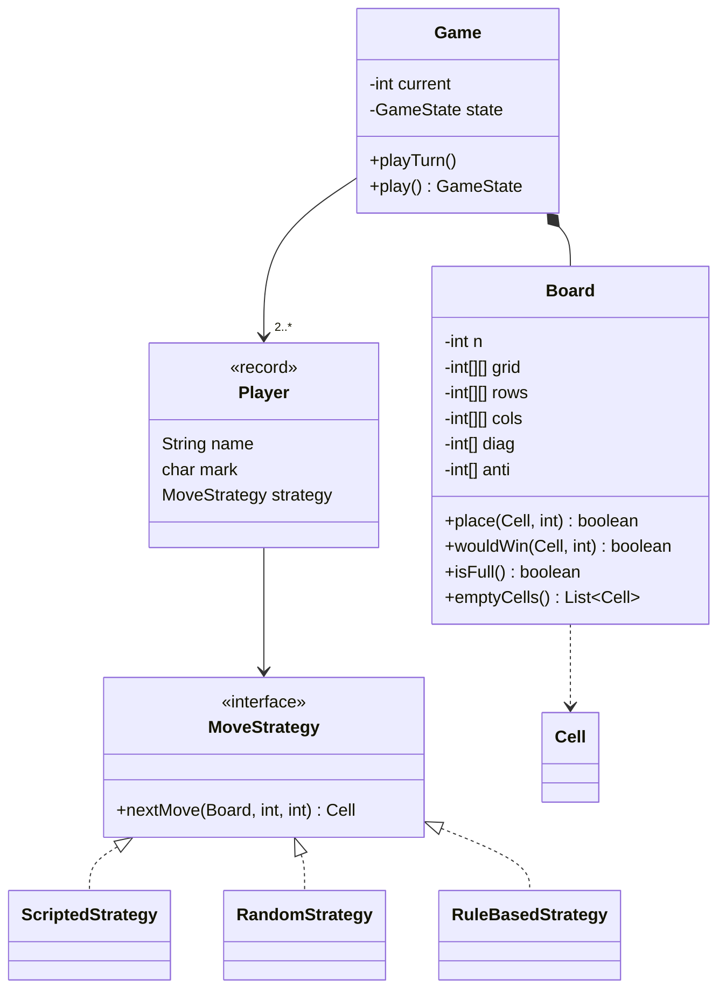

### Key flows

**O(1) win detection — how it works**

A naive win check scans every row, column and diagonal after each move: O(N²). But a move at `(r, c)` can only complete **row r, column c, and (maybe) the two diagonals**. So we keep counters:

1. `rows[p][r]` = how many marks player `p` has in row `r`; `cols[p][c]` likewise.
2. `diag[p]` counts marks on the main diagonal (`r == c`); `anti[p]` on the anti-diagonal (`r + c == N-1`).
3. When player `p` places at `(r, c)`, increment the counters that cell belongs to.
4. If any of them reaches **N**, player `p` owns the whole line — a win. Because only `p`'s marks increment `p`'s counters, no check for opponents' marks is needed.

Four increments and four comparisons: **O(1) time**, **O(P·N) memory** for P players.

> **The 2-player trick you may see online:** one shared counter per line, +1 for X and −1 for O; `|count| == N` means a win. It uses half the memory but only works for exactly two players. Our per-player counters work for any number of players.

The same counters give a free **"would this move win?"** check: an empty cell wins for `p` if any of its lines already has `N-1` of `p`'s marks. The rule-based bot uses it to *win* if possible and *block* the opponent otherwise.

**One turn**

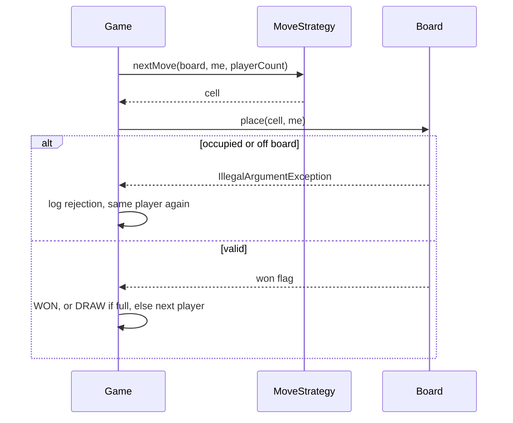

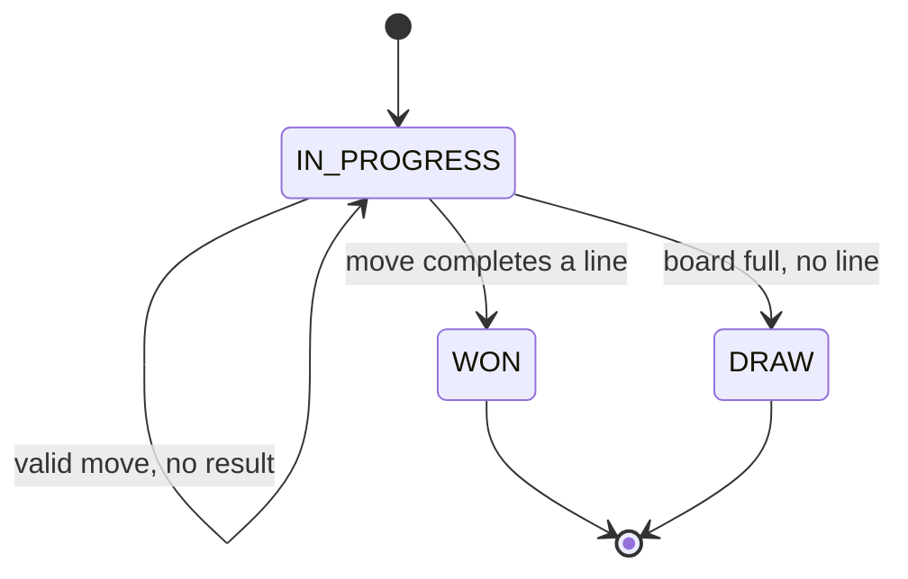

### Design decisions & patterns used

| Decision | Why | Alternative rejected |
|---|---|---|
| **Strategy** for player moves. | Human, random, rule-based, network or minimax players plug in; `Game` never changes. | `if (player.isComputer())` branches in `Game`. |
| Counters inside `Board` (not a separate "WinChecker" that scans). | O(1) check, kept next to the data it summarises. | Scanning all lines each move — O(N²) and duplicated for "would win". |
| Board returns "won?" from `place`. | The only moment a win can appear is right after a move. | Separate `checkWinner()` that the caller might forget to call. |
| Invalid move → exception from `Board`, caught by `Game`. | The board protects its invariant (a fact that must always stay true, e.g. one mark per cell); the game decides the policy (retry). | Silently ignoring a bad move. |
| Seeded `Random` injected into `RandomStrategy`. | Repeatable demos/tests. | `Math.random()` inside the bot. |
| Players as a list + index `current = (current+1) % size` (`%` is remainder, so the index wraps back to 0). | Works for any number of players. | Hard-coded X/O toggling. |

### Java implementation

Package `lld.ch17.tictactoe`.

```java
// File: code/lld/ch17/tictactoe/Cell.java
package lld.ch17.tictactoe;

public record Cell(int row, int col) {
    @Override public String toString() { return "(" + row + "," + col + ")"; }
}
```

```java
// File: code/lld/ch17/tictactoe/Board.java
package lld.ch17.tictactoe;

import java.util.ArrayList;
import java.util.List;

/**
 * N x N grid plus per-player line counters, so "did that move win?" is O(1) instead of O(N^2).
 * rows[p][r] = how many marks player p has in row r. Same idea for columns and the two diagonals.
 * A line is won when one player's count reaches N (other players' marks make that impossible).
 */
public final class Board {
    private final int n;
    private final int[][] grid;       // -1 empty, otherwise player index
    private final int[][] rows, cols;
    private final int[] diag, anti;
    private int filled;

    public Board(int n, int players) {
        if (n < 3) throw new IllegalArgumentException("board must be at least 3x3");
        this.n = n;
        grid = new int[n][n];
        for (int[] row : grid) java.util.Arrays.fill(row, -1);
        rows = new int[players][n];
        cols = new int[players][n];
        diag = new int[players];
        anti = new int[players];
    }

    public int size() { return n; }

    public boolean isEmpty(Cell c) { return inside(c) && grid[c.row()][c.col()] == -1; }

    private boolean inside(Cell c) { return c.row() >= 0 && c.row() < n && c.col() >= 0 && c.col() < n; }

    /** Places a mark and returns true if this move completed a line. O(1). */
    boolean place(Cell c, int player) {
        if (!inside(c)) throw new IllegalArgumentException("cell " + c + " is off the board");
        if (grid[c.row()][c.col()] != -1) throw new IllegalArgumentException("cell " + c + " is already taken");
        grid[c.row()][c.col()] = player;
        filled++;
        int r = c.row(), k = c.col();
        boolean win = ++rows[player][r] == n;
        win |= ++cols[player][k] == n;
        if (r == k) win |= ++diag[player] == n;
        if (r + k == n - 1) win |= ++anti[player] == n;
        return win;
    }

    /** Would placing player's mark on this empty cell win? Also O(1): a line needs exactly one more mark. */
    public boolean wouldWin(Cell c, int player) {
        int r = c.row(), k = c.col();
        return rows[player][r] == n - 1 || cols[player][k] == n - 1
                || (r == k && diag[player] == n - 1) || (r + k == n - 1 && anti[player] == n - 1);
    }

    public boolean isFull() { return filled == n * n; }

    public List<Cell> emptyCells() {
        List<Cell> out = new ArrayList<>();
        for (int r = 0; r < n; r++) for (int c = 0; c < n; c++) if (grid[r][c] == -1) out.add(new Cell(r, c));
        return out;
    }

    public String render(char[] marks) {
        StringBuilder sb = new StringBuilder();
        for (int r = 0; r < n; r++) {
            sb.append("    ");
            for (int c = 0; c < n; c++) sb.append(grid[r][c] == -1 ? '.' : marks[grid[r][c]]).append(c < n - 1 ? " " : "");
            if (r < n - 1) sb.append('\n');
        }
        return sb.toString();
    }
}
```

```java
// File: code/lld/ch17/tictactoe/MoveStrategy.java
package lld.ch17.tictactoe;

/** Strategy pattern: human input, scripted test moves, random bot, rule-based bot... all plug in here. */
public interface MoveStrategy {
    Cell nextMove(Board board, int me, int playerCount);
}
```

```java
// File: code/lld/ch17/tictactoe/ScriptedStrategy.java
package lld.ch17.tictactoe;

import java.util.ArrayDeque;
import java.util.Deque;
import java.util.List;

/** Plays a fixed list of moves. Stands in for a human in tests. */
public final class ScriptedStrategy implements MoveStrategy {
    private final Deque<Cell> moves;

    public ScriptedStrategy(List<Cell> moves) { this.moves = new ArrayDeque<>(moves); }

    @Override public Cell nextMove(Board board, int me, int playerCount) { return moves.poll(); }
}
```

```java
// File: code/lld/ch17/tictactoe/RandomStrategy.java
package lld.ch17.tictactoe;

import java.util.List;
import java.util.Random;

/** Picks any empty cell. Takes a seeded Random so games are repeatable. */
public final class RandomStrategy implements MoveStrategy {
    private final Random rng;

    public RandomStrategy(Random rng) { this.rng = rng; }

    @Override public Cell nextMove(Board board, int me, int playerCount) {
        List<Cell> empty = board.emptyCells();
        return empty.get(rng.nextInt(empty.size()));
    }
}
```

```java
// File: code/lld/ch17/tictactoe/RuleBasedStrategy.java
package lld.ch17.tictactoe;

import java.util.List;

/** Win if you can, else block an opponent's win, else take the centre, else the first corner, else anything. */
public final class RuleBasedStrategy implements MoveStrategy {
    @Override public Cell nextMove(Board board, int me, int playerCount) {
        List<Cell> empty = board.emptyCells();
        for (Cell c : empty) if (board.wouldWin(c, me)) return c;
        for (int other = 0; other < playerCount; other++) {
            if (other == me) continue;
            for (Cell c : empty) if (board.wouldWin(c, other)) return c;
        }
        int n = board.size();
        Cell centre = new Cell(n / 2, n / 2);
        if (board.isEmpty(centre)) return centre;
        for (Cell corner : List.of(new Cell(0, 0), new Cell(0, n - 1), new Cell(n - 1, 0), new Cell(n - 1, n - 1))) {
            if (board.isEmpty(corner)) return corner;
        }
        return empty.get(0);
    }
}
```

```java
// File: code/lld/ch17/tictactoe/Player.java
package lld.ch17.tictactoe;

public record Player(String name, char mark, MoveStrategy strategy) {}
```

```java
// File: code/lld/ch17/tictactoe/GameState.java
package lld.ch17.tictactoe;

public enum GameState { IN_PROGRESS, WON, DRAW }
```

```java
// File: code/lld/ch17/tictactoe/Game.java
package lld.ch17.tictactoe;

import java.util.List;
import java.util.function.Consumer;

/** Turn management and game state. Supports 2+ players on an N x N board. */
public final class Game {
    private final Board board;
    private final List<Player> players;
    private final char[] marks;
    private final Consumer<String> log;
    private int current;
    private GameState state = GameState.IN_PROGRESS;
    private Player winner;

    public Game(int n, List<Player> players, Consumer<String> log) {
        if (players.size() < 2) throw new IllegalArgumentException("need at least 2 players");
        this.players = List.copyOf(players);
        this.board = new Board(n, players.size());
        this.marks = new char[players.size()];
        for (int i = 0; i < marks.length; i++) marks[i] = players.get(i).mark();
        this.log = log;
    }

    /** Plays one turn for the current player. An invalid cell is rejected and the same player goes again. */
    public void playTurn() {
        if (state != GameState.IN_PROGRESS) throw new IllegalStateException("game is over");
        Player p = players.get(current);
        Cell cell = p.strategy().nextMove(board, current, players.size());
        boolean won;
        try {
            won = board.place(cell, current);
        } catch (IllegalArgumentException e) {
            log.accept("  " + p.name() + " tried " + cell + ": rejected (" + e.getMessage() + "), try again");
            return;
        }
        log.accept("  " + p.name() + " (" + p.mark() + ") -> " + cell);
        if (won) { state = GameState.WON; winner = p; }
        else if (board.isFull()) state = GameState.DRAW;
        else current = (current + 1) % players.size();
    }

    public GameState play() {
        while (state == GameState.IN_PROGRESS) playTurn();
        log.accept(board.render(marks));
        log.accept("  Result: " + (state == GameState.WON ? winner.name() + " wins" : "draw"));
        return state;
    }
}
```

```java
// File: code/lld/ch17/tictactoe/Main.java
package lld.ch17.tictactoe;

import java.util.List;
import java.util.Random;

public final class Main {
    public static void main(String[] args) {
        System.out.println("== 1. 3x3 scripted game (with one invalid move) ==");
        Player x = new Player("Xena", 'X', new ScriptedStrategy(List.of(
                new Cell(0, 0), new Cell(1, 1), new Cell(2, 2))));
        Player o = new Player("Omar", 'O', new ScriptedStrategy(List.of(
                new Cell(0, 0), new Cell(0, 1), new Cell(0, 2))));   // first one is already taken
        new Game(3, List.of(x, o), System.out::println).play();

        System.out.println("\n== 2. 3x3 rule-based bot vs seeded random bot (seed 7) ==");
        new Game(3, List.of(new Player("Bot", 'X', new RuleBasedStrategy()),
                new Player("Rand", 'O', new RandomStrategy(new Random(7)))), System.out::println).play();

        System.out.println("\n== 3. 4x4 rule-based vs rule-based ==");
        new Game(4, List.of(new Player("A", 'X', new RuleBasedStrategy()),
                new Player("B", 'O', new RuleBasedStrategy())), line -> { if (!line.startsWith("  A") && !line.startsWith("  B")) System.out.println(line); }).play();

        System.out.println("\n== 4. 5x5 with three players (two random, seeds 1 and 2; one rule-based) ==");
        new Game(5, List.of(new Player("P1", 'X', new RandomStrategy(new Random(1))),
                new Player("P2", 'O', new RandomStrategy(new Random(2))),
                new Player("P3", 'Z', new RuleBasedStrategy())), line -> { if (!line.startsWith("  P")) System.out.println(line); }).play();
    }
}
```

**Output:**

```text
== 1. 3x3 scripted game (with one invalid move) ==
  Xena (X) -> (0,0)
  Omar tried (0,0): rejected (cell (0,0) is already taken), try again
  Omar (O) -> (0,1)
  Xena (X) -> (1,1)
  Omar (O) -> (0,2)
  Xena (X) -> (2,2)
    X O O
    . X .
    . . X
  Result: Xena wins

== 2. 3x3 rule-based bot vs seeded random bot (seed 7) ==
  Bot (X) -> (1,1)
  Rand (O) -> (2,0)
  Bot (X) -> (0,0)
  Rand (O) -> (1,0)
  Bot (X) -> (2,2)
    X . .
    O X .
    O . X
  Result: Bot wins

== 3. 4x4 rule-based vs rule-based ==
    O O X X
    O O X X
    X X X O
    O O O X
  Result: draw

== 4. 5x5 with three players (two random, seeds 1 and 2; one rule-based) ==
    Z Z Z O O
    X O X Z X
    X X Z O O
    Z O O X O
    Z X X X Z
  Result: draw
```

**Reading the output.** Game 1 shows the retry after an invalid move and a diagonal win found by the O(1) counters. Game 2: the rule-based bot takes the centre, then a corner, and completes the diagonal against a seeded random bot (no block was needed: the random bot's two O's in column 0 were already blocked by the X in the corner). Game 3: two rule-based bots on 4×4 draw (the move lines are filtered out of the log for brevity). Game 4 runs the same counters with three players on 5×5 (a draw).

### Concurrency & edge cases

- **Many games on one server:** each `Game` owns its own `Board`, so games share nothing. Keep them in a `ConcurrentHashMap<gameId, Game>` (a hash map that many threads can read and write safely at once) and process each game's moves one at a time (per-game lock or single-threaded actor).
- **Two clicks at once from the same game:** make `playTurn`/a `makeMove(player, cell)` method `synchronized` and check that the caller is the current player.
- **Edge cases:** move after game over (rejected with `IllegalStateException`, Java's standard "not allowed right now" error); off-board or occupied cell (rejected, same player retries); a scripted strategy running out of moves (returns `null` → fail fast, i.e. stop with a clear error at once, in tests); N = 3 minimum.
- **A cell on both diagonals** (the centre of an odd board) updates both diagonal counters — handled by two independent `if`s.

### Extensions & follow-up questions

- **"Win with K in a row on an N×N board (Gomoku, K = 5)?"** — Counters no longer work because lines are shorter than the board. After each move, walk out from the new cell in the 4 directions (horizontal, vertical, two diagonals) and count consecutive own marks: O(K) per move.
- **"Unbeatable AI?"** — Minimax over the game tree (every possible sequence of moves drawn as a branching tree; tic-tac-toe 3×3 has at most 9! = 362,880 move orders, easily searched); add alpha-beta pruning or memoisation (caching the result for each position already evaluated) for larger boards. Plug it in as another `MoveStrategy`.
- **"Undo?"** — Store moves in a stack (last in, first out); undo = clear the cell and **decrement** the counters (counters are reversible, unlike a boolean "won" flag).
- **"Online multiplayer?"** — Server holds the `Game`; clients send `makeMove(gameId, playerId, cell)`; the server broadcasts the new state (Observer).
- **"Replay a game?"** — The move list plus `ScriptedStrategy` replays it exactly.

### Real-world example

Google Search has a built-in tic-tac-toe game (search "tic tac toe") with difficulty levels — different computer players behind the same game rules, which is the Strategy split in this design. Tic-tac-toe is also the classic first example for the minimax algorithm in AI courses, because the full game tree is small enough to search completely.

### In the interview

**30-second answer:** "`Board` is N×N plus per-player counters for each row, column and the two diagonals. Placing a mark bumps at most four counters; if one hits N, that player wins — O(1) per move. `Game` holds a list of players and a turn index, validates moves, and ends on a win or a full board. Each `Player` has a `MoveStrategy` — human, random with a seeded `Random`, or rule-based that wins if it can and blocks otherwise."

**Time plan:** 5 min requirements and N×N/players → 5 min entities → 10 min the counter idea (draw it!) → 15 min code → 5 min extensions (K-in-a-row, minimax, undo).

### Self-check

1. **Q:** Why does a move only need to check four lines? **A:** A cell belongs to exactly one row, one column, and at most the two diagonals.
2. **Q:** How do you know a cell is on the anti-diagonal? **A:** `row + col == N - 1`.
3. **Q:** Why per-player counters instead of +1/−1? **A:** They work for more than two players and give "would win" for any player.
4. **Q:** How is a draw detected? **A:** No win and the number of filled cells equals N².
5. **Q:** How do you test a bot that plays randomly? **A:** Inject `new Random(seed)`; the game is then identical every run.

### TL;DR

- Per-player row/column/diagonal counters → O(1) win check; `N-1` → O(1) "would win".
- `Game` = players list + turn index + state enum; invalid moves rejected, same player retries.
- Players via `MoveStrategy` (human, random-seeded, rule-based, minimax later).
- K-in-a-row needs a directional walk from the last move instead.

---

## Design Snake and Ladder

### Problem & clarifying questions

**Snake and Ladder** is a race on a numbered board (usually 1–100). Players take turns rolling a die and move forward by the number rolled. Landing on the **foot of a ladder** takes you up to its top; landing on the **head of a snake** sends you down to its tail. The first to reach the last square wins. There are no decisions — everything is dice and rules — so the design is about a **clean rules engine**, **turn management** and **testable randomness**.

| Question | Assumed answer |
|---|---|
| Board size and snakes/ladders? | Configurable (default 100 squares, a given list of snakes and ladders). Validate the config. |
| How many dice? | Configurable: count and faces (default one six-sided die). |
| How many players? | Two or more; all start off the board (square 0). |
| Overshooting the last square? | Configurable: **exact finish** (stay put) or **bounce back**. |
| Rolling a six? | Common house rule (an optional rule some players add): roll again; three sixes in a row cancels the whole turn. Configurable on/off. |
| When does the game end? | Configurable: **first to finish** wins, or keep playing to **rank everyone**. |
| Several games at once? | Yes, independent sessions (e.g. many groups online). |

### Requirements

**Functional**

1. A board of numbered cells (typically 100) with a predefined set of snakes and ladders connecting cells.
2. Multiple players, each with one token, starting off the board.
3. Players take turns rolling the dice and move forward by the total.
4. Landing on a snake head slides the token down to its tail; landing on a ladder foot climbs to its top.
5. Handle overshooting the final square (exact-finish or bounce-back rule).
6. Optional bonus roll on a six, with the three-sixes penalty.
7. The game continues until the win strategy says it is over (first to finish, or everyone ranked).
8. Support many independent game sessions at once.

**Non-functional**

- **Deterministic** dice for tests (seeded or loaded).
- Rules are **pluggable** without editing the game loop.
- Invalid boards are rejected **at construction**, not discovered mid-game.

### Use cases

Actors: **Player** (rolls the dice — or the system rolls for them), **Game admin/host** (configures board, dice and rules, starts a game). Use cases: *configure board*, *add players*, *start game*, *take turn* (roll → move → apply snake/ladder → maybe bonus roll), *declare winner / standings*.

### Core entities

| Class | Responsibility |
|---|---|
| `Jump` (record) | A snake or a ladder: `start → end`. One class, because the behaviour is identical ("land on start, move to end"); `isSnake()` is just `end < start`. |
| `Board` | Size + `Map<start, Jump>` for O(1) lookup; validates configuration. |
| `Dice` (interface) | `roll()`, `maxRoll()`. `RandomDice` (count, faces, seeded `Random`), `LoadedDice` (scripted rolls for tests). |
| `OverflowRule` (functional interface — exactly one method, so a lambda, a short unnamed function like `x -> x + 1`, can implement it) | Where a roll past the end lands: `exactFinish()` or `bounceBack()`. |
| `WinStrategy` (functional interface) | When the game ends: `firstToFinish()` or `rankAll()`. |
| `Rules` (record) | Bundles a variant: overflow rule, win strategy, six-rolls-again flag, max bonus rolls. |
| `Player` | Name and position. |
| `Game` | Turn queue, `playTurn()`, `play(maxTurns)`, standings, event log. |

### Class diagram

There is no course lesson for this problem; it comes from the *awesome-low-level-design* problem set. That statement asks for: a board of numbered cells (usually 100); predefined snakes and ladders; several players, each with a token; turn-based dice rolls; sliding down a snake's head to its tail and climbing a ladder's foot to its top; a win on reaching the last cell; and many independent game sessions running at once (its reference solution uses a singleton — a class with only one global instance — `GameManager` with one thread per session). All of these are covered; part 6 of the output runs eight sessions in parallel.

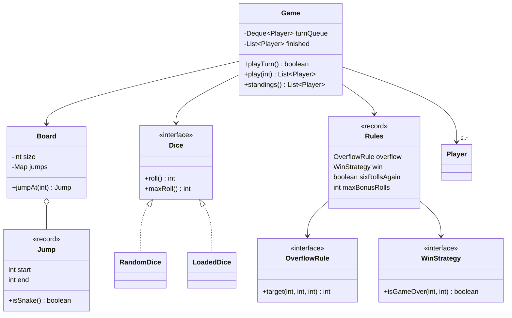

### Key flows

**One turn**

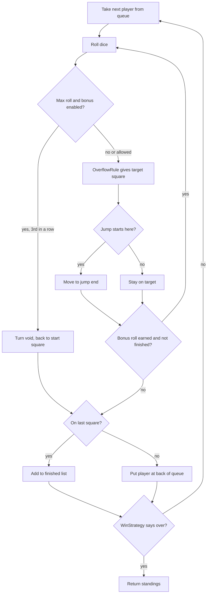

**Board validation (done once, in the constructor)**

1. A jump must not start and end on the same square.
2. No jump starts on square 1 or the last square (you could never win if the last square were a snake).
3. No two jumps share a start square.
4. A jump may not end on another jump's start. This forbids chains, and therefore also forbids infinite loops (snake A → ladder B → snake A...).

### Design decisions & patterns used

| Decision | Why | Alternative rejected |
|---|---|---|
| **One `Jump` type** for snakes and ladders. | Identical behaviour; the direction is data. | `Snake` and `Ladder` classes with duplicate code — only worth it if they behave differently. |
| `Map<Integer, Jump>` lookup. | O(1) per move instead of scanning a list. | Array of size 101 — also fine; a map scales to sparse or huge boards. |
| **Strategy** for `Dice`, `OverflowRule`, `WinStrategy`. | House rules vary a lot; each is swappable. Lambdas keep them tiny. | Flags and `if`s in the game loop. |
| `Rules` record groups a variant. | One object = one rule set ("classic", "kids", "tournament"); easy to pass around. | Many constructor parameters on `Game`. |
| **Queue** of players. | Natural turn order; finished players simply are not re-queued. | Index arithmetic that must skip finished players. |
| Event log via `Consumer<String>` (a built-in "takes a value, returns nothing" function type). | The engine does not print; the caller decides (console, UI, nothing). A full design would use **Observer** (`GameListener.onMove/onSnake/onLadder/onWin`). | `System.out.println` inside the engine. |
| Validation in the `Board` constructor (fail fast). | The loop can trust the board. | Detecting a loop mid-game. |
| `play(maxTurns)` guard. | A misconfigured rule set can never hang (loop forever and never finish) a server thread. | An unbounded `while (true)`. |

### Java implementation

Package `lld.ch17.snakeladder`.

```java
// File: code/lld/ch17/snakeladder/Jump.java
package lld.ch17.snakeladder;

/** A snake (goes down) or a ladder (goes up). Both are just "land on start -> move to end". */
public record Jump(int start, int end) {
    public boolean isSnake() { return end < start; }
    public String kind() { return isSnake() ? "snake" : "ladder"; }
}
```

```java
// File: code/lld/ch17/snakeladder/Board.java
package lld.ch17.snakeladder;

import java.util.Collection;
import java.util.HashMap;
import java.util.Map;

/**
 * Board configuration: size plus a map start -> Jump for O(1) lookup.
 * Validates the config once, up front, so the game loop can trust it.
 */
public final class Board {
    private final int size;
    private final Map<Integer, Jump> jumps = new HashMap<>();

    public Board(int size, Collection<Jump> all) {
        if (size < 10) throw new IllegalArgumentException("board too small");
        this.size = size;
        for (Jump j : all) {
            if (j.start() == j.end()) throw new IllegalArgumentException("jump to itself: " + j);
            if (j.start() <= 1 || j.start() >= size) throw new IllegalArgumentException("jump cannot start on first/last square: " + j);
            if (j.end() < 1 || j.end() > size) throw new IllegalArgumentException("jump ends off board: " + j);
            if (jumps.putIfAbsent(j.start(), j) != null) throw new IllegalArgumentException("two jumps start at " + j.start());
        }
        for (Jump j : jumps.values()) {   // no chains: an end square may not be another jump's start (also rules out loops)
            if (jumps.containsKey(j.end())) throw new IllegalArgumentException("jump " + j + " ends on another jump's start");
        }
    }

    public int size() { return size; }

    /** Returns the jump that starts on this square, or null. */
    public Jump jumpAt(int square) { return jumps.get(square); }
}
```

```java
// File: code/lld/ch17/snakeladder/Dice.java
package lld.ch17.snakeladder;

/** Strategy for rolling. Real dice use a seeded Random; tests use a fixed sequence. */
public interface Dice {
    int roll();
    int maxRoll();
}
```

```java
// File: code/lld/ch17/snakeladder/RandomDice.java
package lld.ch17.snakeladder;

import java.util.Random;

/** count dice with the given number of faces. Pass new Random(seed) for repeatable games. */
public final class RandomDice implements Dice {
    private final int count, faces;
    private final Random rng;

    public RandomDice(int count, int faces, Random rng) {
        this.count = count;
        this.faces = faces;
        this.rng = rng;
    }

    @Override public int roll() {
        int sum = 0;
        for (int i = 0; i < count; i++) sum += 1 + rng.nextInt(faces);
        return sum;
    }

    @Override public int maxRoll() { return count * faces; }
}
```

```java
// File: code/lld/ch17/snakeladder/LoadedDice.java
package lld.ch17.snakeladder;

/** Returns a scripted sequence of rolls (cycling). Used to test exact scenarios. */
public final class LoadedDice implements Dice {
    private final int[] rolls;
    private int i;

    public LoadedDice(int... rolls) { this.rolls = rolls.clone(); }

    @Override public int roll() { return rolls[i++ % rolls.length]; }

    @Override public int maxRoll() { return 6; }
}
```

```java
// File: code/lld/ch17/snakeladder/OverflowRule.java
package lld.ch17.snakeladder;

/** What happens when a roll would carry a token past the last square. */
@FunctionalInterface
public interface OverflowRule {
    /** Returns the new square (before snakes/ladders), given current square, roll and board size. */
    int target(int from, int roll, int size);

    /** Must land exactly on the last square, otherwise stay put. */
    static OverflowRule exactFinish() { return (from, roll, size) -> from + roll > size ? from : from + roll; }

    /** Bounce back by the extra amount (at 98 on a 100 board, a 5 goes to 100 then back to 97). */
    static OverflowRule bounceBack() { return (from, roll, size) -> from + roll > size ? size - (from + roll - size) : from + roll; }
}
```

```java
// File: code/lld/ch17/snakeladder/WinStrategy.java
package lld.ch17.snakeladder;

/** When is the whole game over? */
@FunctionalInterface
public interface WinStrategy {
    boolean isGameOver(int finishedPlayers, int totalPlayers);

    /** Classic: the first player to reach the end wins and the game stops. */
    static WinStrategy firstToFinish() { return (finished, total) -> finished >= 1; }

    /** Play on to rank everybody; stop when only one player is left on the board. */
    static WinStrategy rankAll() { return (finished, total) -> finished >= total - 1; }
}
```

```java
// File: code/lld/ch17/snakeladder/Player.java
package lld.ch17.snakeladder;

public final class Player {
    private final String name;
    private int position;     // 0 = off the board, waiting to enter

    public Player(String name) { this.name = name; }

    public String name() { return name; }
    public int position() { return position; }
    void moveTo(int square) { position = square; }
}
```

```java
// File: code/lld/ch17/snakeladder/Rules.java
package lld.ch17.snakeladder;

/**
 * The rules engine's configuration, bundled so a game variant is one object.
 * sixRollsAgain: rolling the dice's maximum earns another roll; maxBonusRolls in a row cancels the turn.
 */
public record Rules(OverflowRule overflow, WinStrategy win, boolean sixRollsAgain, int maxBonusRolls) {
    public static Rules classic() { return new Rules(OverflowRule.exactFinish(), WinStrategy.firstToFinish(), true, 3); }
}
```

```java
// File: code/lld/ch17/snakeladder/Game.java
package lld.ch17.snakeladder;

import java.util.ArrayDeque;
import java.util.ArrayList;
import java.util.Deque;
import java.util.List;
import java.util.function.Consumer;

/** Turn loop: a queue of players, a dice strategy, a board and a rule set. */
public final class Game {
    private final Board board;
    private final Dice dice;
    private final Rules rules;
    private final Deque<Player> turnQueue;
    private final int totalPlayers;
    private final List<Player> finished = new ArrayList<>();
    private final Consumer<String> log;

    public Game(Board board, Dice dice, Rules rules, List<Player> players, Consumer<String> log) {
        if (players.size() < 2) throw new IllegalArgumentException("need at least 2 players");
        this.board = board;
        this.dice = dice;
        this.rules = rules;
        this.turnQueue = new ArrayDeque<>(players);
        this.totalPlayers = players.size();
        this.log = log;
    }

    public boolean isOver() { return rules.win().isGameOver(finished.size(), totalPlayers); }

    /** Plays one player's turn (including bonus rolls). Returns true if the game is now over. */
    public boolean playTurn() {
        if (isOver()) throw new IllegalStateException("game is over");
        Player p = turnQueue.poll();
        takeTurn(p);
        if (p.position() == board.size()) {
            finished.add(p);
            log.accept("  *** " + p.name() + " finishes in place " + finished.size() + " ***");
        } else {
            turnQueue.offer(p);
        }
        return isOver();
    }

    /** Plays until the win strategy says stop. Returns the standings (finishers first, in order). */
    public List<Player> play(int maxTurns) {
        for (int turns = 0; !isOver(); turns++) {
            if (turns == maxTurns) throw new IllegalStateException("no result after " + maxTurns + " turns");
            playTurn();
        }
        return standings();
    }

    public List<Player> standings() {
        List<Player> order = new ArrayList<>(finished);
        order.addAll(turnQueue);          // whoever is still on the board, in turn order
        return order;
    }

    private void takeTurn(Player p) {
        int start = p.position();
        int bonus = 0;
        StringBuilder line = new StringBuilder("  " + p.name() + " @" + start + ":");
        while (true) {
            int roll = dice.roll();
            line.append(" rolls ").append(roll);
            boolean max = rules.sixRollsAgain() && roll == dice.maxRoll();
            if (max && ++bonus == rules.maxBonusRolls()) {
                p.moveTo(start);                       // too many sixes in a row: the whole turn is cancelled
                line.append(" -> ").append(rules.maxBonusRolls()).append(" sixes in a row, turn void, back to ").append(start);
                break;
            }
            move(p, roll, line);
            if (!max || p.position() == board.size()) break;
            line.append(", bonus roll:");
        }
        log.accept(line.toString());
    }

    private void move(Player p, int roll, StringBuilder line) {
        int target = rules.overflow().target(p.position(), roll, board.size());
        if (target == p.position()) { line.append(" -> needs exact roll, stays at ").append(target); return; }
        line.append(" -> ").append(target);
        Jump j = board.jumpAt(target);
        if (j != null) {
            target = j.end();
            line.append(" (").append(j.kind()).append(" to ").append(target).append(')');
        }
        p.moveTo(target);
    }
}
```

```java
// File: code/lld/ch17/snakeladder/Main.java
package lld.ch17.snakeladder;

import java.util.ArrayList;
import java.util.List;
import java.util.Map;
import java.util.concurrent.ConcurrentHashMap;
import java.util.concurrent.ExecutorService;
import java.util.concurrent.Executors;
import java.util.Random;
import java.util.stream.Collectors;

public final class Main {
    private static final List<Jump> JUMPS = List.of(
            new Jump(4, 14), new Jump(9, 31), new Jump(21, 42), new Jump(28, 84), new Jump(51, 67),
            new Jump(71, 91), new Jump(80, 99),                                       // ladders
            new Jump(17, 7), new Jump(54, 34), new Jump(62, 19), new Jump(64, 60),
            new Jump(87, 24), new Jump(93, 73), new Jump(95, 75), new Jump(98, 79));  // snakes

    public static void main(String[] args) throws Exception {
        Board board = new Board(100, JUMPS);

        System.out.println("== 1. Loaded dice: ladder, bonus roll, snake, three sixes ==");
        Game g1 = new Game(board, new LoadedDice(4, 6, 3, 3, 6, 6, 6, 2), Rules.classic(),
                List.of(new Player("Ann"), new Player("Bob")), System.out::println);
        for (int i = 0; i < 4; i++) g1.playTurn();

        System.out.println("\n== 2. Overflow rules: token on 97 of 100, rolls a 5 ==");
        Board plain = new Board(100, List.of());
        for (String variant : List.of("Exact", "Bounce")) {
            OverflowRule rule = variant.equals("Exact") ? OverflowRule.exactFinish() : OverflowRule.bounceBack();
            Player p = new Player(variant);
            p.moveTo(97);
            Game g = new Game(plain, new LoadedDice(5), new Rules(rule, WinStrategy.firstToFinish(), false, 3),
                    List.of(p, new Player("Q")), System.out::println);
            g.playTurn();
        }

        System.out.println("\n== 3. Bad configurations are rejected up front ==");
        for (List<Jump> bad : List.of(List.of(new Jump(100, 5)), List.of(new Jump(10, 30), new Jump(30, 5)))) {
            try { new Board(100, bad); }
            catch (IllegalArgumentException e) { System.out.println("  rejected: " + e.getMessage()); }
        }

        System.out.println("\n== 4. Seeded game (seed 2024), 3 players, first to finish wins ==");
        Game g4 = new Game(board, new RandomDice(1, 6, new Random(2024)), Rules.classic(),
                List.of(new Player("Ann"), new Player("Bob"), new Player("Cid")), System.out::println);
        System.out.println("  Winner: " + g4.play(500).get(0).name());

        System.out.println("\n== 5. Same seed, rank-everyone rule, bounce-back overflow (log hidden) ==");
        Game g5 = new Game(board, new RandomDice(1, 6, new Random(2024)),
                new Rules(OverflowRule.bounceBack(), WinStrategy.rankAll(), true, 3),
                List.of(new Player("Ann"), new Player("Bob"), new Player("Cid")), line -> { });
        System.out.println("  Standings: " + g5.play(1000).stream().map(Player::name).collect(Collectors.joining(" > ")));

        System.out.println("\n== 6. Eight independent sessions on eight threads at once ==");
        // Each session owns its players, turn queue and dice (its own seeded Random), and shares only the
        // read-only Board. So running them in parallel must give exactly the result each one gives alone.
        Map<Integer, String> parallel = new ConcurrentHashMap<>();
        try (ExecutorService pool = Executors.newFixedThreadPool(8)) {
            for (int seed = 1; seed <= 8; seed++) {
                int s0 = seed;
                pool.submit(() -> parallel.put(s0, winnerOf(board, s0)));
            }
        }
        List<String> mismatches = new ArrayList<>();
        for (int seed = 1; seed <= 8; seed++)
            if (!parallel.get(seed).equals(winnerOf(board, seed))) mismatches.add("seed " + seed);
        System.out.println("  winners by seed: " + new java.util.TreeMap<>(parallel));
        System.out.println("  same as running each session alone? " + (mismatches.isEmpty() ? "yes" : "NO " + mismatches));
    }

    private static String winnerOf(Board board, int seed) {
        Game g = new Game(board, new RandomDice(1, 6, new Random(seed)), Rules.classic(),
                List.of(new Player("Ann"), new Player("Bob"), new Player("Cid")), line -> { });
        return g.play(500).get(0).name();
    }
}
```

**Output:**

```text
== 1. Loaded dice: ladder, bonus roll, snake, three sixes ==
  Ann @0: rolls 4 -> 4 (ladder to 14)
  Bob @0: rolls 6 -> 6, bonus roll: rolls 3 -> 9 (ladder to 31)
  Ann @14: rolls 3 -> 17 (snake to 7)
  Bob @31: rolls 6 -> 37, bonus roll: rolls 6 -> 43, bonus roll: rolls 6 -> 3 sixes in a row, turn void, back to 31

== 2. Overflow rules: token on 97 of 100, rolls a 5 ==
  Exact @97: rolls 5 -> needs exact roll, stays at 97
  Bounce @97: rolls 5 -> 98

== 3. Bad configurations are rejected up front ==
  rejected: jump cannot start on first/last square: Jump[start=100, end=5]
  rejected: jump Jump[start=10, end=30] ends on another jump's start

== 4. Seeded game (seed 2024), 3 players, first to finish wins ==
  Ann @0: rolls 1 -> 1
  Bob @0: rolls 3 -> 3
  Cid @0: rolls 1 -> 1
  Ann @1: rolls 5 -> 6
  Bob @3: rolls 6 -> 9 (ladder to 31), bonus roll: rolls 6 -> 37, bonus roll: rolls 6 -> 3 sixes in a row, turn void, back to 3
  Cid @1: rolls 6 -> 7, bonus roll: rolls 1 -> 8
  Ann @6: rolls 6 -> 12, bonus roll: rolls 4 -> 16
  Bob @3: rolls 4 -> 7
  Cid @8: rolls 3 -> 11
  Ann @16: rolls 4 -> 20
  Bob @7: rolls 2 -> 9 (ladder to 31)
  Cid @11: rolls 3 -> 14
  Ann @20: rolls 4 -> 24
  Bob @31: rolls 5 -> 36
  Cid @14: rolls 6 -> 20, bonus roll: rolls 1 -> 21 (ladder to 42)
  Ann @24: rolls 4 -> 28 (ladder to 84)
  Bob @36: rolls 3 -> 39
  Cid @42: rolls 5 -> 47
  Ann @84: rolls 4 -> 88
  Bob @39: rolls 5 -> 44
  Cid @47: rolls 3 -> 50
  Ann @88: rolls 1 -> 89
  Bob @44: rolls 6 -> 50, bonus roll: rolls 4 -> 54 (snake to 34)
  Cid @50: rolls 1 -> 51 (ladder to 67)
  Ann @89: rolls 4 -> 93 (snake to 73)
  Bob @34: rolls 2 -> 36
  Cid @67: rolls 5 -> 72
  Ann @73: rolls 6 -> 79, bonus roll: rolls 2 -> 81
  Bob @36: rolls 3 -> 39
  Cid @72: rolls 3 -> 75
  Ann @81: rolls 4 -> 85
  Bob @39: rolls 5 -> 44
  Cid @75: rolls 2 -> 77
  Ann @85: rolls 5 -> 90
  Bob @44: rolls 2 -> 46
  Cid @77: rolls 2 -> 79
  Ann @90: rolls 2 -> 92
  Bob @46: rolls 6 -> 52, bonus roll: rolls 5 -> 57
  Cid @79: rolls 1 -> 80 (ladder to 99)
  Ann @92: rolls 2 -> 94
  Bob @57: rolls 4 -> 61
  Cid @99: rolls 1 -> 100
  *** Cid finishes in place 1 ***
  Winner: Cid

== 5. Same seed, rank-everyone rule, bounce-back overflow (log hidden) ==
  Standings: Cid > Ann > Bob

== 6. Eight independent sessions on eight threads at once ==
  winners by seed: {1=Ann, 2=Bob, 3=Cid, 4=Bob, 5=Cid, 6=Cid, 7=Ann, 8=Bob}
  same as running each session alone? yes
```

**Reading the output.** Part 1 uses loaded dice to force every rule: Ann climbs 4→14, Bob rolls a 6 and gets a bonus roll that lands on the 9→31 ladder, Ann hits the 17→7 snake, and Bob's three sixes void his turn (he goes back to 31). Part 2 compares overflow rules from square 97 with a roll of 5: exact-finish stays, bounce-back goes to 100 and back 2 to 98. Part 3 shows bad boards rejected. Part 4 is a full seeded game; Part 5 replays with different rules and ranks every player. Part 6 runs eight games with different seeds on eight threads at the same time and checks that each winner is exactly what the same seed gives when that game runs alone — proof that sessions share no mutable state (data that can be changed after creation).

### Concurrency & edge cases

- **Many sessions:** each `Game` owns its players, queue and dice. Give **each game its own `Random`** (sharing one `java.util.Random` across threads is thread-safe but becomes a contention point — many threads waiting on the same shared object — and breaks per-game reproducibility). Keep games in a `ConcurrentHashMap` and run each game's turns on one thread at a time.
- **Rolling after the game ends** → `IllegalStateException`.
- **A player on the last square** is removed from the queue, so they are never asked to roll again.
- **Bonus roll that finishes the game** stops immediately — no roll after reaching 100.
- **Three sixes** → the turn is voided, and the token returns to where the turn started (even if a ladder was climbed during the turn).
- **Bounce-back landing on a snake** (e.g. bouncing to 98 on the standard board) is applied — the rule output goes through the same jump lookup.
- **Endless games** are impossible with a valid board and fair dice (probability of never finishing is 0), but `maxTurns` guards against bad custom rules.

### Extensions & follow-up questions

- **"Add special cells (skip a turn, extra move, teleport)."** — Generalise `Jump` into a `CellEffect` interface (`apply(player, game)`); snakes and ladders become two implementations.
- **"Two dice, or a 1–12 die?"** — `new RandomDice(2, 6, rng)`; `maxRoll()` is 12, so the bonus rule triggers on double-max. Note that 2d6 (two six-sided dice added together) is not uniform — not every total is equally likely (7 is the most likely), which changes game balance.
- **"Players must roll a 6 to enter the board."** — A new rule strategy: `EntryRule` checked when position is 0.
- **"Pause and resume."** — Serialize (turn into bytes or text that can be saved and loaded back) the game state (positions, queue order, and the dice's state — or a seed plus number of rolls so far).
- **"Real-time UI / spectators?"** — Observer: publish `PlayerMoved`, `SnakeBitten`, `LadderClimbed`, `PlayerFinished` events.
- **"Random board generation?"** — A `BoardGenerator` with a seed, calling the same validating constructor.

### Real-world example

Online multiplayer board-game apps (for example Ludo King, which also offers a Snakes & Ladders mode) have to solve the same problems as this design: every match is an isolated session with its own state, the dice must be rolled somewhere the players cannot tamper with (in a sound design, on the server, not in the client app), and each move is pushed to all players as an event. That is the "one game = isolated state + injected dice + event stream" split used here.

### In the interview

**30-second answer:** "`Board` holds size and a map from square to `Jump` (snake or ladder — same behaviour, just direction), validated on construction. `Dice` is a strategy: seeded random for play, loaded for tests. `Rules` bundles pluggable policies: overflow (exact or bounce), win strategy (first finish or rank all), and the bonus-six rule. `Game` keeps a queue of players; each turn rolls, applies the overflow rule, then any jump, and re-queues the player unless they finished."

**Time plan:** 5 min rules questions (overshoot, sixes, win) → 5 min entities → 10 min diagram + validation rules → 15 min code turn loop → 5 min extensions and concurrency.

### Self-check

1. **Q:** Why is one `Jump` class enough for snakes and ladders? **A:** Both mean "land on start, go to end"; only the direction differs, which is data.
2. **Q:** How do you guarantee there is no infinite snake/ladder loop? **A:** Forbid any jump from ending on another jump's start.
3. **Q:** How do you test "three sixes voids the turn"? **A:** `LoadedDice(6, 6, 6)` and assert the position is unchanged.
4. **Q:** What changes to support "bounce back"? **A:** Pass `OverflowRule.bounceBack()` — no game-loop edits.
5. **Q:** Why a queue for turns? **A:** Players who finish simply are not put back; turn order stays correct.

### TL;DR

- Board = size + `Map<start, Jump>`; validate once (no jump on last square, no chains/loops).
- Dice, overflow, win condition, bonus rule are all strategies; seeded or loaded dice for tests.
- Queue-based turn loop with a `maxTurns` guard; events go to a listener, not `System.out`.

---

## Design 2048

### Problem & clarifying questions

**2048** is a single-player sliding puzzle on a 4×4 grid. Each move (left, right, up, down) slides every tile as far as possible in that direction. Two tiles with the **same value** that collide **merge** into one tile with double the value, and the merged value is added to the **score**. After every move that changes the board, a new tile (a 2 most of the time, sometimes a 4) appears in a random empty cell. You "win" by making a 2048 tile; the game is **over** when no move can change the board.

There is no course lesson for this problem. The problem statement is the common machine-coding (an interview round where you write working code for a small system in 1–2 hours) version (the "2048" exercise found in LLD practice lists such as Tharun's and on machine-coding sites): start with **two tiles numbered 2** at random positions; after every move insert a random tile in a random empty cell; tiles slide until stopped by another tile or the edge; two equal tiles that collide merge into their sum; if **three** equal tiles line up, the pair **nearest the wall you move toward** merges; if **four** are equal, the first two and the last two merge; win at 2048; lose when there is no empty cell and no two equal neighbours; read moves from the command line as **0 = left, 1 = right, 2 = up, 3 = down**. Every one of those rules is in the design below.

| Question | Assumed answer |
|---|---|
| Board size? | Configurable N (default 4). |
| New tile? | One per successful move: value 2 with probability 0.9, else 4, in a uniformly random empty cell. The game starts with two 2s. |
| Merge rule? | Each tile merges **at most once per move**; merges happen from the wall you move toward. |
| Move that changes nothing? | Not a turn: no new tile, no score. |
| Win? | Reaching the target tile (2048, configurable). The player may continue afterwards. |
| Game over? | No empty cell **and** no two equal neighbours (horizontally or vertically). |
| Undo, high scores, animations? | Out of scope; see Extensions. |

### Requirements

**Functional**

1. Start an N×N board with two tiles numbered 2 at random positions.
2. Move in four directions: slide, merge equal neighbours once, add merged values to the score.
3. If the move changed the board, spawn one tile (2 or 4) in a random empty cell.
4. Detect reaching the target (WON, then allow continuing).
5. Detect game over (LOST) when no move is possible.
6. Accept the command-line codes 0/1/2/3 for left/right/up/down (`Direction.fromKey`).

**Non-functional**

- **Deterministic** spawns via an injected, seeded `Random` for tests.
- The merge logic must be written **once**, not four times (one per direction).
- The spawning rule is pluggable (e.g. an "evil" spawner for testing hard cases).

### Use cases

Actor: **Player**. Use cases: *start new game*, *make a move* (includes *slide and merge*, *spawn tile*, *update score*), *see win*, *see game over*, *restart*.

### Core entities

| Class | Responsibility |
|---|---|
| `Direction` (enum) | LEFT, RIGHT, UP, DOWN; `fromKey(0..3)` maps the command-line codes. |
| `LineMerger` | Pure function (output depends only on input; changes nothing else): slide and merge **one line toward index 0**; returns the new line and points. |
| `Board` | N×N values; maps each direction onto lines for `LineMerger`; `slide`, `hasMove`, `maxTile`, `emptyCells`, `render`. |
| `TileSpawner` (interface) / `RandomTileSpawner` | Adds a new tile; seeded `Random`, 90% twos. `spawnStart` places the two starting tiles (always 2s). |
| `GameStatus` (enum) | PLAYING, WON, LOST. |
| `Game` | Score, move count, status; ties slide + spawn + status together. |

### Class diagram

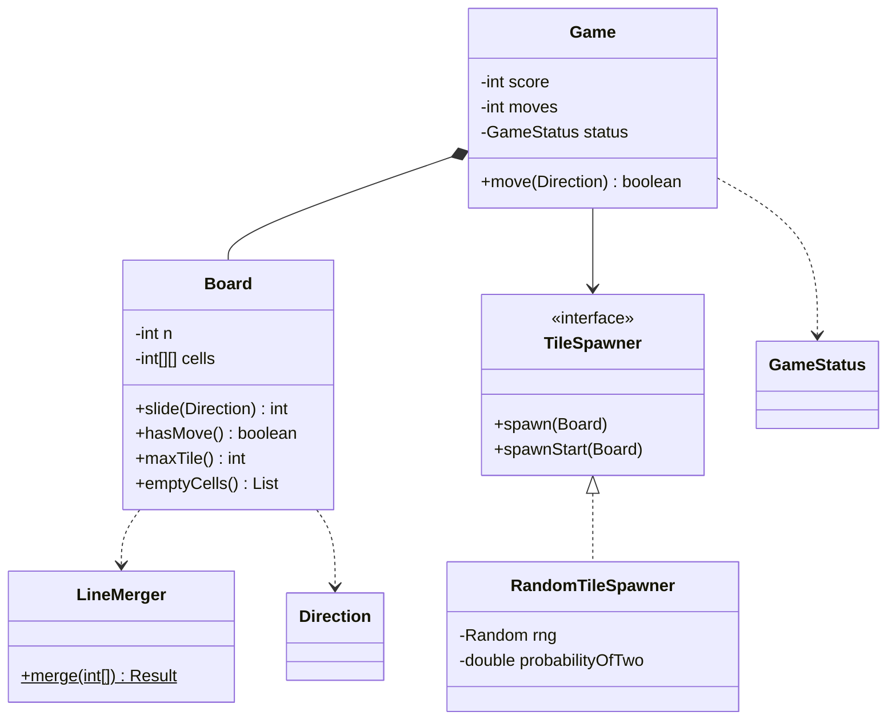

### Key flows

**Merging one line (toward index 0)** — the whole game in one function:

1. Walk the line from the wall outward, skipping zeros.
2. Keep one **pending** tile. If the next non-zero tile equals it, write the doubled value, add it to the points, and clear pending — so the new tile **cannot merge again this move**.
3. If it differs, write the pending tile and make the new tile pending.
4. At the end, write any pending tile; the rest of the line is zeros.

Examples (moving left): `[2,2,2,2] → [4,4,0,0]` (two merges, not one 8), `[2,2,2,0] → [4,2,0,0]` (of three equal tiles, the pair nearest the wall merges), `[2,2,4,0] → [4,4,0,0]` (the new 4 does not merge with the old 4), `[4,0,4,8] → [8,8,0,0]`.

**One function for four directions.** `Board.coords(direction, i, j)` maps "line `i`, position `j` counted from the wall" to a real cell:

| Direction | Line i is | j = 0 is |
|---|---|---|
| LEFT | row i | column 0 |
| RIGHT | row i | column N-1 |
| UP | column i | row 0 |
| DOWN | column i | row N-1 |

Read each line in that order, merge it with `LineMerger`, write it back. No duplicated slide code.

**A move**

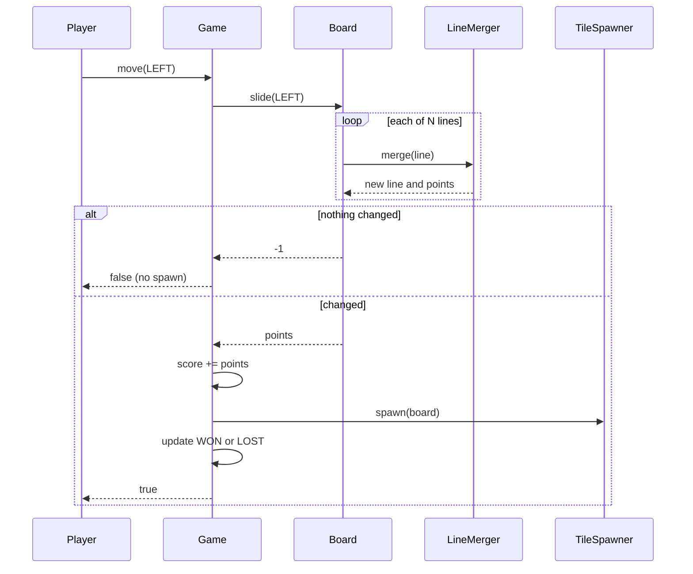

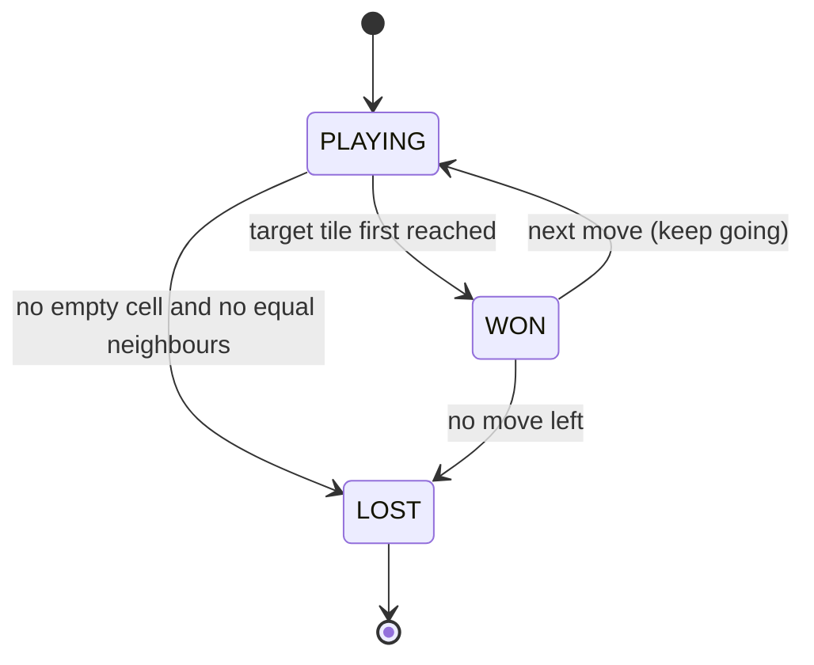

**Game-over check.** A move is possible if **any cell is empty** or **any two neighbours are equal**. It is enough to compare each cell with its right and lower neighbour (the other two directions are covered by the neighbour's own check). O(N²).

### Design decisions & patterns used

| Decision | Why | Alternative rejected |
|---|---|---|
| **One pure `LineMerger`** + direction→coordinates mapping. | The tricky rule is written and tested once (DRY — "Don't Repeat Yourself"). | Four copies of nested loops (`moveLeft`, `moveRight`...) — classic bug farm. |
| `LineMerger` is a **pure function** (no state). | Trivial to unit test (test one small piece of code on its own; Part 1 of the output). | Merge logic mixed with board mutation. |
| **Strategy** for spawning (`TileSpawner`). | Seeded tests, "evil" spawner, different probabilities for variants. | `Math.random()` inside `Board`. |
| "No change = no turn" detected by comparing each written cell. | Matches the real game; prevents spawning on a no-op. | Always spawning — makes the game unwinnable/unfair. |
| `Board.of(int[][])` factory for preset boards. | Game-over and edge-case tests without playing to that position. | Only random starts — untestable edge cases. |
| Status updated after each move; WON only once. | The player can continue past 2048, as in the original game. | Ending the game at 2048. |

### Java implementation

Package `lld.ch17.game2048`.

```java
// File: code/lld/ch17/game2048/Direction.java
package lld.ch17.game2048;

public enum Direction {
    LEFT, RIGHT, UP, DOWN;

    /** Command-line input of the common machine-coding statement: 0 = left, 1 = right, 2 = up, 3 = down. */
    public static Direction fromKey(int key) {
        return switch (key) {
            case 0 -> LEFT;
            case 1 -> RIGHT;
            case 2 -> UP;
            case 3 -> DOWN;
            default -> throw new IllegalArgumentException("unknown move " + key + " (use 0-3)");
        };
    }
}
```

```java
// File: code/lld/ch17/game2048/LineMerger.java
package lld.ch17.game2048;

/**
 * The heart of 2048, written for ONE line moving toward index 0.
 * Every direction is reduced to this by reading the line in the right order.
 * Rule: slide tiles together, merge equal neighbours once per move, the merge nearest the wall first.
 */
public final class LineMerger {
    private LineMerger() {}

    /** Result: the new line and the points earned (sum of merged tile values). */
    public record Result(int[] line, int points) {}

    public static Result merge(int[] in) {
        int n = in.length;
        int[] out = new int[n];
        int write = 0, points = 0;
        int pending = 0;                        // tile waiting for a possible merge partner
        for (int v : in) {
            if (v == 0) continue;
            if (pending == 0) {
                pending = v;
            } else if (pending == v) {
                out[write++] = v * 2;           // merge, and the new tile cannot merge again this move
                points += v * 2;
                pending = 0;
            } else {
                out[write++] = pending;
                pending = v;
            }
        }
        if (pending != 0) out[write] = pending;
        return new Result(out, points);
    }
}
```

```java
// File: code/lld/ch17/game2048/TileSpawner.java
package lld.ch17.game2048;

/** Strategy for adding a new tile after each successful move. */
public interface TileSpawner {
    /** Adds one tile to a random empty cell. The board must have at least one empty cell. */
    void spawn(Board board);

    /** One of the two tiles placed when a new game starts. By default the same as spawn(). */
    default void spawnStart(Board board) { spawn(board); }
}
```

```java
// File: code/lld/ch17/game2048/RandomTileSpawner.java
package lld.ch17.game2048;

import java.util.List;
import java.util.Random;

/** Classic rule: a 2 with probability 0.9, else a 4, in a uniformly random empty cell. Seeded for tests. */
public final class RandomTileSpawner implements TileSpawner {
    private final Random rng;
    private final double probabilityOfTwo;

    public RandomTileSpawner(Random rng, double probabilityOfTwo) {
        this.rng = rng;
        this.probabilityOfTwo = probabilityOfTwo;
    }

    @Override public void spawn(Board board) {
        int[] cell = randomEmptyCell(board);
        board.set(cell[0], cell[1], rng.nextDouble() < probabilityOfTwo ? 2 : 4);
    }

    /** The problem statement starts every game with two tiles numbered 2. */
    @Override public void spawnStart(Board board) {
        int[] cell = randomEmptyCell(board);
        board.set(cell[0], cell[1], 2);
    }

    private int[] randomEmptyCell(Board board) {
        List<int[]> empty = board.emptyCells();
        if (empty.isEmpty()) throw new IllegalStateException("no empty cell");
        return empty.get(rng.nextInt(empty.size()));
    }
}
```

```java
// File: code/lld/ch17/game2048/Board.java
package lld.ch17.game2048;

import java.util.ArrayList;
import java.util.List;

/** N x N grid of tile values (0 = empty). Knows how to slide in a direction and whether any move is left. */
public final class Board {
    private final int n;
    private final int[][] cells;

    public Board(int n) {
        if (n < 2) throw new IllegalArgumentException("board too small");
        this.n = n;
        this.cells = new int[n][n];
    }

    public static Board of(int[][] values) {
        Board b = new Board(values.length);
        for (int r = 0; r < b.n; r++) b.cells[r] = values[r].clone();
        return b;
    }

    public int size() { return n; }
    public int get(int r, int c) { return cells[r][c]; }
    void set(int r, int c, int v) { cells[r][c] = v; }

    public List<int[]> emptyCells() {
        List<int[]> out = new ArrayList<>();
        for (int r = 0; r < n; r++) for (int c = 0; c < n; c++) if (cells[r][c] == 0) out.add(new int[]{r, c});
        return out;
    }

    /**
     * Slides every line toward the given wall. Returns the points earned, or -1 if nothing moved
     * (a move that changes nothing is not a turn and must not spawn a tile).
     */
    int slide(Direction d) {
        boolean changed = false;
        int points = 0;
        for (int i = 0; i < n; i++) {
            int[] line = new int[n];
            for (int j = 0; j < n; j++) line[j] = read(d, i, j);       // j = 0 is the cell next to the wall
            LineMerger.Result res = LineMerger.merge(line);
            for (int j = 0; j < n; j++) {
                if (read(d, i, j) != res.line()[j]) changed = true;
                write(d, i, j, res.line()[j]);
            }
            points += res.points();
        }
        return changed ? points : -1;
    }

    /** Maps (line i, position j from the wall) to a real cell for each direction. */
    private int[] coords(Direction d, int i, int j) {
        return switch (d) {
            case LEFT -> new int[]{i, j};
            case RIGHT -> new int[]{i, n - 1 - j};
            case UP -> new int[]{j, i};
            case DOWN -> new int[]{n - 1 - j, i};
        };
    }

    private int read(Direction d, int i, int j) { int[] rc = coords(d, i, j); return cells[rc[0]][rc[1]]; }
    private void write(Direction d, int i, int j, int v) { int[] rc = coords(d, i, j); cells[rc[0]][rc[1]] = v; }

    /** A move exists if a cell is empty or two neighbours (right or below) are equal. */
    public boolean hasMove() {
        for (int r = 0; r < n; r++)
            for (int c = 0; c < n; c++) {
                if (cells[r][c] == 0) return true;
                if (c + 1 < n && cells[r][c] == cells[r][c + 1]) return true;
                if (r + 1 < n && cells[r][c] == cells[r + 1][c]) return true;
            }
        return false;
    }

    public int maxTile() {
        int m = 0;
        for (int[] row : cells) for (int v : row) m = Math.max(m, v);
        return m;
    }

    public String render() {
        StringBuilder sb = new StringBuilder();
        for (int r = 0; r < n; r++) {
            sb.append("   ");
            for (int c = 0; c < n; c++) sb.append(String.format("%5s", cells[r][c] == 0 ? "." : cells[r][c]));
            if (r < n - 1) sb.append('\n');
        }
        return sb.toString();
    }
}
```

```java
// File: code/lld/ch17/game2048/GameStatus.java
package lld.ch17.game2048;

public enum GameStatus { PLAYING, WON, LOST }
```

```java
// File: code/lld/ch17/game2048/Game.java
package lld.ch17.game2048;

/**
 * One game: board + spawner + score + status. Reaching the target tile sets WON once;
 * the player may keep going ("continue" mode). No move left sets LOST.
 */
public final class Game {
    private final Board board;
    private final TileSpawner spawner;
    private final int target;
    private int score;
    private int moves;
    private boolean reachedTarget;
    private GameStatus status = GameStatus.PLAYING;

    /** New game: an empty board with two starting tiles (two 2s with the standard spawner). */
    public Game(int size, int target, TileSpawner spawner) {
        this(new Board(size), target, spawner);
        spawner.spawnStart(board);
        spawner.spawnStart(board);
        updateStatus();
    }

    /** Game from a preset board (used by tests). */
    public Game(Board preset, int target, TileSpawner spawner) {
        this.board = preset;
        this.target = target;
        this.spawner = spawner;
        updateStatus();
    }

    /** Returns true if the move changed the board (and so counted as a turn). */
    public boolean move(Direction d) {
        if (status == GameStatus.LOST) throw new IllegalStateException("game over");
        int points = board.slide(d);
        if (points < 0) return false;          // nothing moved: no spawn, no turn
        score += points;
        moves++;
        spawner.spawn(board);                  // at least one cell is empty, because something moved or merged
        updateStatus();
        return true;
    }

    private void updateStatus() {
        if (!reachedTarget && board.maxTile() >= target) { reachedTarget = true; status = GameStatus.WON; }
        else if (status == GameStatus.WON) status = GameStatus.PLAYING;   // "keep going" after the win screen
        if (!board.hasMove()) status = GameStatus.LOST;
    }

    public GameStatus status() { return status; }
    public boolean reachedTarget() { return reachedTarget; }
    public int score() { return score; }
    public int moves() { return moves; }
    public Board board() { return board; }
}
```

```java
// File: code/lld/ch17/game2048/Main.java
package lld.ch17.game2048;

import java.util.Arrays;
import java.util.List;
import java.util.Random;

public final class Main {
    public static void main(String[] args) {
        System.out.println("== 1. Merge rules for one line moving left ==");
        for (int[] line : List.of(new int[]{2, 2, 2, 2}, new int[]{2, 2, 2, 0}, new int[]{2, 2, 4, 0}, new int[]{4, 0, 4, 8},
                new int[]{2, 0, 0, 2}, new int[]{8, 4, 2, 2}, new int[]{2, 4, 8, 16})) {
            LineMerger.Result r = LineMerger.merge(line);
            System.out.println("  " + Arrays.toString(line) + " -> " + Arrays.toString(r.line()) + "  +" + r.points());
        }

        System.out.println("\n== 2. A move that changes nothing does not count and spawns nothing ==");
        Game stuckLeft = new Game(Board.of(new int[][]{{2, 4, 8, 16}, {0, 0, 0, 0}, {0, 0, 0, 0}, {0, 0, 0, 0}}),
                2048, new RandomTileSpawner(new Random(1), 0.9));
        System.out.println("  move LEFT changed board? " + stuckLeft.move(Direction.LEFT) + ", moves=" + stuckLeft.moves());
        System.out.println("  move DOWN changed board? " + stuckLeft.move(Direction.DOWN) + ", moves=" + stuckLeft.moves());
        System.out.println(stuckLeft.board().render());

        System.out.println("\n== 3. Game-over detection ==");
        Game full = new Game(Board.of(new int[][]{{2, 4, 2, 4}, {4, 2, 4, 2}, {2, 4, 2, 4}, {4, 2, 4, 2}}),
                2048, new RandomTileSpawner(new Random(1), 0.9));
        System.out.println("  checkerboard, no empty cell, no equal neighbours -> " + full.status());
        Game almost = new Game(Board.of(new int[][]{{2, 4, 2, 4}, {4, 2, 4, 2}, {2, 4, 2, 4}, {4, 2, 4, 4}}),
                2048, new RandomTileSpawner(new Random(1), 0.9));
        System.out.println("  same but last row ends 4,4 -> " + almost.status());

        System.out.println("\n== 4. Keyboard codes from the problem statement ==");
        for (int key = 0; key < 4; key++) System.out.print("  " + key + "=" + Direction.fromKey(key));
        System.out.println();

        System.out.println("\n== 5. Seeded game (seed 42), corner strategy LEFT > DOWN > RIGHT > UP, target 128 ==");
        Game g = new Game(4, 128, new RandomTileSpawner(new Random(42), 0.9));
        System.out.println("  start:\n" + g.board().render());
        List<Direction> priority = List.of(Direction.LEFT, Direction.DOWN, Direction.RIGHT, Direction.UP);
        boolean announced = false;
        while (g.status() != GameStatus.LOST) {
            for (Direction d : priority) if (g.move(d)) break;
            if (g.reachedTarget() && !announced) {
                announced = true;
                System.out.println("  reached 128 after " + g.moves() + " moves (status " + g.status() + "), score " + g.score());
                System.out.println(g.board().render());
            }
        }
        System.out.println("  game over after " + g.moves() + " moves, score " + g.score() + ", max tile " + g.board().maxTile());
        System.out.println(g.board().render());
    }
}
```

**Output:**

```text
== 1. Merge rules for one line moving left ==
  [2, 2, 2, 2] -> [4, 4, 0, 0]  +8
  [2, 2, 2, 0] -> [4, 2, 0, 0]  +4
  [2, 2, 4, 0] -> [4, 4, 0, 0]  +4
  [4, 0, 4, 8] -> [8, 8, 0, 0]  +8
  [2, 0, 0, 2] -> [4, 0, 0, 0]  +4
  [8, 4, 2, 2] -> [8, 4, 4, 0]  +4
  [2, 4, 8, 16] -> [2, 4, 8, 16]  +0

== 2. A move that changes nothing does not count and spawns nothing ==
  move LEFT changed board? false, moves=0
  move DOWN changed board? true, moves=1
       .    .    .    .
       .    .    .    .
       .    2    .    .
       2    4    8   16

== 3. Game-over detection ==
  checkerboard, no empty cell, no equal neighbours -> LOST
  same but last row ends 4,4 -> PLAYING

== 4. Keyboard codes from the problem statement ==
  0=LEFT  1=RIGHT  2=UP  3=DOWN

== 5. Seeded game (seed 42), corner strategy LEFT > DOWN > RIGHT > UP, target 128 ==
  start:
       .    .    .    2
       .    .    .    .
       .    .    .    2
       .    .    .    .
  reached 128 after 85 moves (status WON), score 852
       8    2    .    .
      16    4    4    .
       2    8    4    .
     128    4    .    .
  game over after 232 moves, score 2584, max tile 256
      16    8    4    2
       8   32    8    4
      16    2   16    8
     256   64   32   16
```

**Reading the output.** Part 1 unit-tests the merge rule (note `[2,2,2,2]` becomes `[4,4,0,0]`, not `[8,0,0,0]`, and `[2,2,2,0]` becomes `[4,2,0,0]`). Part 2 shows that a move changing nothing does not count. Part 3 checks game-over detection on preset boards. Part 4 prints the command-line key mapping. Part 5 plays a whole seeded game that starts from two 2s, using a simple "keep tiles in the bottom-left corner" priority strategy; it reaches the 128 target after 85 moves (status `WON`) and keeps playing until the board locks after 232 moves with a 256 tile.

### Concurrency & edge cases

- Single-player and single-threaded by nature. If a UI thread (the thread that draws the screen) and an input thread both call `move`, make `move` `synchronized` (or post moves to the UI event queue — the list of pending clicks, key presses and redraws that the UI thread handles one by one).
- **Key repeat / double input:** a no-op move returns `false` and changes nothing, so extra key presses are harmless.
- **Spawning needs an empty cell:** guaranteed, because a changed board after sliding always has at least one empty cell (tiles only move into gaps or merge, which frees a cell). The spawner still checks and throws if not.
- **Integer overflow** (a number growing past the largest value its type can hold, so it wraps around to a wrong value): not reachable on 4×4 (the maximum possible tile is 2^17 = 131072); a very large board would still fit an `int` for any practical game.
- **Merge order matters:** `[2,2,2]` moving left is `[4,2,0]` — the pair nearest the wall merges first.

### Extensions & follow-up questions

- **"Add undo."** — Memento: push a copy of the board and score before each successful move; undo pops it (the spawned tile disappears too).
- **"Different sizes / targets?"** — Already parameters (`new Game(5, 4096, spawner)`).
- **"An AI player?"** — Expectimax search (max over your moves, average over random spawns) is the well-known approach; plug it in as a move-choosing strategy like the corner strategy in `Main`.
- **"Animations?"** — Have `LineMerger` also return where each tile came from (a list of moves/merges) and publish them to the view (Observer, MVC).
- **"High scores / leaderboard?"** — A separate service; the game only emits "game over with score X".
- **"Why is `[2,2,4]` left `[4,4,0]` and not `[8,0,0]`?"** — Each tile merges at most once per move; the new 4 was created this move.

### Real-world example

2048 was created by Gabriele Cirulli in 2014 and released as open-source (its code is public for anyone to read and reuse) JavaScript; its code has the same separation: a grid model, a game manager that handles moves, merges, score and "keep playing" after a win, and a separate view that animates tiles. Its new tiles are 2 with 90% probability and 4 with 10%, the same rule our `RandomTileSpawner` uses.

### In the interview

**30-second answer:** "The core is one pure function that slides and merges a single line toward index 0: skip zeros, merge equal neighbours once, score the merged values. The board maps each direction to lines in the right order, so the function is reused four times. After a move that changes the board, a `TileSpawner` — seeded for tests — adds a 2 (90%) or a 4. The game is won when the target tile appears and over when there's no empty cell and no equal neighbours."

**Time plan:** 5 min rules (merge once, no-op move) → 5 min entities → 15 min `LineMerger` + direction mapping (write the tests first: `[2,2,2,2]`, `[2,2,4,0]`) → 10 min game loop, spawning, game over → 5 min extensions.

### Self-check

1. **Q:** What does `[4,4,8,8]` become moving left, and how many points? **A:** `[8,16,0,0]`, 24 points.
2. **Q:** Why must a no-op move not spawn a tile? **A:** It is not a turn in the real game; spawning would punish harmless key presses and change the game's balance.
3. **Q:** How do you avoid four copies of the slide code? **A:** Map each direction to lines read from the wall, then call one line-merge function.
4. **Q:** When is the game over? **A:** No empty cell and no two equal adjacent tiles.
5. **Q:** How do you make a 2048 test repeatable? **A:** Inject `new Random(seed)` into the spawner, or start from `Board.of(...)`.

### TL;DR

- One pure `LineMerger` (merge once per move, from the wall) + a direction→line mapping.
- Spawn only after a real change; 2 (90%) or 4 (10%), seeded spawner for tests.
- WON once at the target (keep playing); LOST when no empty cell and no equal neighbours.

---

## Chapter summary

| Game | Core rule object | Pluggable strategies | Randomness for tests | Signature technique |
|---|---|---|---|---|
| Blackjack | `Hand` scoring + `BlackjackScoring` | `PlayerStrategy`, `DealerPolicy` | Seeded `Shoe`, stacked shoe | Soft/hard totals; generic `Deck<T>` |
| Chess | `Rules` (legal-move filter) | (bot would be a move strategy) | None needed — deterministic game | Polymorphic pieces; checkmate = in check + no legal move; Command + Memento undo |
| Tic-Tac-Toe | `Board` counters | `MoveStrategy` | Seeded `RandomStrategy`, scripted players | O(1) win with row/col/diagonal counters |
| Snake & Ladder | `Board` + `Rules` record | `Dice`, `OverflowRule`, `WinStrategy` | Seeded `RandomDice`, `LoadedDice` | Validated config; queue-based turns |
| 2048 | `LineMerger` | `TileSpawner` | Seeded spawner, `Board.of` presets | One merge function reused for 4 directions |

**Patterns you used in this chapter:** Strategy (everywhere), Factory Method (`Deck.standard52`, `Piece.create`, `Board.of`), Template-style shared base (`SlidingPiece`), Command + Memento (chess undo), State (game-status enums; a full State pattern is the suggested upgrade for blackjack rounds), Observer (the event log hooks; suggested for UIs and spectators).

**The three habits interviewers look for in game designs:**

1. **Put every rule in exactly one place** — and be able to say where.
2. **Inject randomness** — seeded or scripted — so the design is testable.
3. **Model the game's states explicitly** — and reject actions that are invalid in the current state.
