# Chapter 17 — Case Studies: Games & Rules

> **Where this fits.** Chapters 14–16 designed things that model the real world (an ATM, a parking lot, booking systems). Games are different: the "world" is a set of **rules**, and the rules are exact. That makes games a favourite interview topic. There is nowhere to hide a vague class, because every rule must live *somewhere*, and the interviewer will ask where.

**What games test in an LLD interview**

| Skill | What it means | Where you see it in this chapter |
|---|---|---|
| **Rule encapsulation** (hiding a rule inside the class that owns it) | Each rule lives in one obvious class, not spread across `if` statements everywhere. | Blackjack scoring in `BlackjackScoring`; chess legality in `Rules`; 2048 merging in `LineMerger`. |
| **Turn management** | Whose turn is it, what may they do now, and what happens when the turn ends? | A turn index (tic-tac-toe), a queue of players (snake and ladder), `turn` colour (chess), rounds (blackjack). |
| **Polymorphic pieces** | Different kinds of objects answer the same question in their own way (*polymorphism* = "many shapes": one method call, many behaviours). | Chess `Piece.targets(...)` overridden by King, Knight, Pawn and the sliding pieces. |
| **Pluggable strategies** | Behaviour that varies (how a bot plays, how dice roll, when the game ends) sits behind an interface (a list of methods with no fixed implementation; the **Strategy** pattern, Chapter 10). | `PlayerStrategy`, `DealerPolicy`, `MoveStrategy`, `Dice`, `OverflowRule`, `WinStrategy`, `TileSpawner`. |
| **Deterministic testing** (same input, same result every time) | Randomness is *injected* (handed in from outside). Pass `new Random(seed)` and the "random" sequence is the same on every run, so tests and demos repeat exactly. Or pass a scripted source (stacked shoe, loaded dice). | Every `Main` in this chapter prints the same output every time. |
| **State and status** | A game moves through states (in progress, won, draw, over). Illegal actions in the wrong state are rejected. | `GameStatus`, `GameState` enums (types with a fixed list of named values) in every game. |

> **Key idea: seeded randomness.** `java.util.Random` is *pseudo-random*: its numbers are computed from a starting **seed**, and the same seed always gives the same sequence (the algorithm is fixed by the Java specification); `Collections.shuffle(list, rnd)` is deterministic for a given `Random` too. Rule: **never call `new Random()` or `Math.random()` inside the game — accept a `Random` (or a `Dice`/`Spawner` interface) from outside.** Production passes an unseeded source (or `SecureRandom`, slower but unpredictable, for security); tests pass a seed. This is plain Dependency Injection (Chapter 5).

**Problems in this chapter**

| # | Problem | Main ideas |
|---|---|---|
| 17.1 | Blackjack and a Deck of Cards | generic deck, shoe, soft/hard hand values, dealer rule, betting, split, double, insurance |
| 17.2 | Chess | board, polymorphic pieces, legal moves, check/checkmate/stalemate, castling, en passant, promotion, undo |
| 17.3 | Tic-Tac-Toe | N×N board, O(1) win detection with counters, pluggable players |
| 17.4 | Snake and Ladder | board config and validation, seeded dice, rules engine, pluggable win rules |
| 17.5 | 2048 | slide/merge logic, seeded tile spawns, game-over detection |
| 17.6 | Jigsaw Puzzle | pieces with flat/tab/blank sides, rotation, one placement check, validation, swappable solvers (brute force vs edge-first) |

> **Key term — Big-O notation** describes how work grows with input size: **O(1)** (constant) stays the same, **O(n)** grows in step with n, **O(N²)** quadruples when N doubles.

**How to run every example in this chapter**

```bash
cd chapters/17-case-games/code
javac --release 21 -d /tmp/lld_17 $(find . -name '*.java')
java -cp /tmp/lld_17 lld.ch17.blackjack.Main    # or chess, tictactoe, snakeladder, game2048, jigsaw
```

`javac` compiles, and `-cp` (the classpath) tells `java` where the compiled classes are. All six `Main` classes use only the Java 21 standard library, and all randomness is seeded or scripted, so the output under each program is exactly what you will see. Listings show only the essential lines; the complete files are in `code/`.

**A reusable skeleton for any board/card game.** Almost every game design in an interview has the same five parts. Name them early and the rest of the interview becomes filling in details.

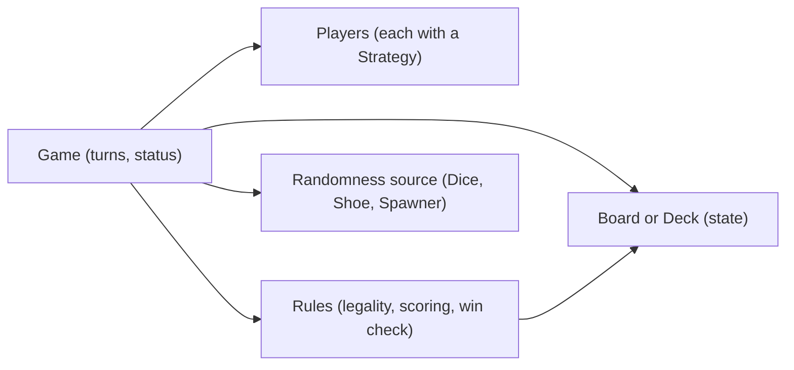

| Part | Question it answers | Typical class names |
|---|---|---|
| State | What does the table look like right now? | `Board`, `Deck`, `Shoe`, `Hand`, `Cell` |
| Actors | Who acts, and how do they decide? | `Player` + `PlayerStrategy`/`MoveStrategy` |
| Rules | Is this action allowed? What does it do? Who won? | `Rules`, `DealerPolicy`, `OverflowRule`, `WinStrategy` |
| Controller | Whose turn? What state is the game in? | `Game`, `GameStatus` |
| Randomness | Where does chance come from? | `Dice`, `Shoe`, `TileSpawner` — always injected |

---

## Design Blackjack and a Deck of Cards

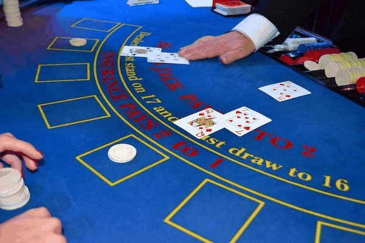
*Figure — A blackjack table: players each compete against the dealer (course diagram)*

### Problem & clarifying questions

**Blackjack** is the casino card game played more than any other. Nobody plays against the other people at the table: every player's cards are measured only against the cards of the **dealer** (the dealer is the casino employee who deals and plays for the house). Everybody tries to get as close to **21 points** as possible without going over. Going over 21 is called **busting** and loses at once.

The interviewer often phrases it as "Design a deck of cards, then use it to build blackjack". The first half checks that you keep the deck **generic**; the second half checks rule placement.

Questions worth asking (with the answers this design assumes):

| Question | Assumed answer |
|---|---|
| One deck or several? | A **shoe** holding several standard 52-card decks (casinos use 6–8). One deck is just a shoe of 1. |
| How many players? | One or more players, each against the dealer. |
| Which player options? | Hit, stand, double down, split (once), insurance. Surrender and side bets are out of scope. |
| Dealer rule? | Hit on 16 or less, stand on 17 or more. Some casinos also hit a "soft 17" — make it pluggable. |
| Payouts? | Win 1:1, blackjack 3:2, tie ("push") returns the bet, insurance 2:1 (odds like 3:2 mean you win 3 chips for every 2 bet). |
| Money? | Bets are counted in whole **chips** (an `int`, a whole-number type), and the ante (the starting bet) must be even. Never use `double` (an inexact binary floating-point number) for money. |
| Real UI (user interface — the screens), network, accounts? | Out of scope. The course model has `Account`/`Person` for sign-in; we keep `Player` minimal and say where it would attach. |

### Requirements

**Background rules**

- A standard deck has **13 ranks** (A, 2–10, J, Q, K) in **4 suits** (clubs, diamonds, hearts, spades). Blackjack uses one or more such decks.
- At the start, each player and the dealer receive **two cards**. Both player cards are face up. The dealer has one card face up (the **up card**) and one face down (the **hole card**), so players decide with incomplete information.
- **Card points:** 2–10 are worth their number. J, Q, K are worth 10. An **ace is worth 1 or 11**, whichever helps.
- **Soft vs hard total:** when an ace is counted as 11 the total is **soft** (it can still "soften" to 1 later, so one more card can never bust it). When every ace counts as 1 the total is **hard**. Example: A+5 is "soft 16" (or hard 6).
- **Blackjack** (also called a *natural*): exactly two cards totalling 21, i.e. an ace plus a 10-point card.
- **Dealer rule:** the dealer has no choices. Hit (take a card) while the hand is 16 or less; stand at 17 or more.

**Functional requirements**

1. A player must place an initial bet (the **ante**) to play a round.
2. Deal two cards to each player and to the dealer (one up, one hole).
3. If the dealer's up card is an **ace**, offer **insurance**: a side bet of half the ante that pays **2:1** if the dealer has blackjack. After that, the dealer checks ("peeks at") the hole card. If it is blackjack, the round ends at once: insurance wins, main bets lose, except a player blackjack, which ties.
4. A player whose hand is below 21 chooses:
   - **Hit** — take one more card, and choose again.
   - **Stand** ("stand pat") — take no more cards.
   - **Double down** — double the bet (the extra must equal the ante), take exactly **one** more card, and stop.
   - **Split** — only when the first two cards have the same rank: pay a second bet equal to the ante, split the pair into two hands, deal one card to each, and play each hand separately. No re-splitting.
5. A hand over 21 is **resolved immediately as a loss**.
6. The dealer then plays by the fixed rule.
7. **Resolution:** if the dealer busts, every non-bust hand wins. Otherwise the higher total wins; equal totals are a **push** (bet returned). A winning blackjack pays **3:2**; every other win pays **1:1**.
8. **Even money** (course requirement): if a player holds blackjack and the dealer shows an ace, the player may accept an immediate 1:1 payout instead of risking a push. (It is mathematically identical to buying insurance with a blackjack, so we explain it rather than build it — see Extensions.)

**Non-functional requirements**

- **Generic deck:** the `Card`/`Deck` classes must work for any card game, not just blackjack.
- **Deterministic tests:** shuffling uses an injected `Random`; a *stacked* shoe (fixed card order) makes exact scenarios reproducible.
- **Extensible rules:** dealer rule and player decision-making are pluggable.
- **Correct money:** bets and balances are whole chips in an `int`, never a `double`. This is the one place in the handbook where money is not a `BigDecimal`, deliberately: a table only accepts whole chips, and an **even ante** makes every payout whole (3:2 on 10 is 15; insurance is half the ante, 5, and pays 2:1 = 10). If fractions ever appear (3:2 on an odd ante, converting chips to currency), switch to `BigDecimal` with an explicit `RoundingMode` (e.g. round half up).

### Use cases

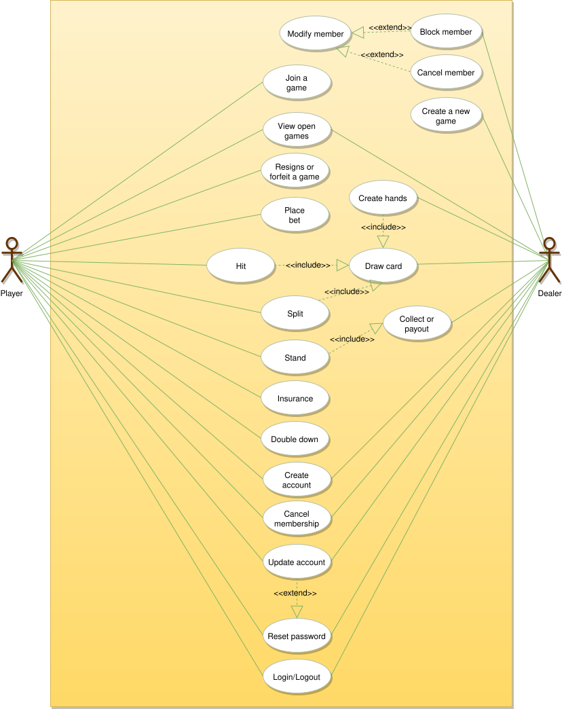
*Figure — Blackjack use cases for the Player and the Dealer, including account management (course diagram)*

The figure above is a **use case diagram** (UML — Unified Modeling Language — notation: stick figures are *actors*, the people or systems using the software; ovals are *use cases*, the goals they can achieve). In the figure above there are two actors:

- **Player** — places the initial bet; accepts or declines extra bets (insurance, split, double); accepts or declines an offered resolution such as even money; chooses hit, double or stand. The player also has account-level use cases (create account, log in, join or view games), which belong to a lobby service (the separate part of the app where players sign in and pick a table), not the game engine (the code that enforces the game's rules).
- **Dealer** — deals cards, plays the house hand by the fixed rule, collects losing bets and pays winners.

The main use cases — create hands, place bet, player plays the hand, dealer plays the hand, insurance / even money / examine hole card, split, game resolution — are exactly the functional requirements above. The `<<include>>` arrows mean one use case always runs another as part of itself: dealing and payout are part of every round. When insurance is offered and the hole card is not a 10-value card, insurance loses and the hole card stays hidden.

**Activity: hit or stand**

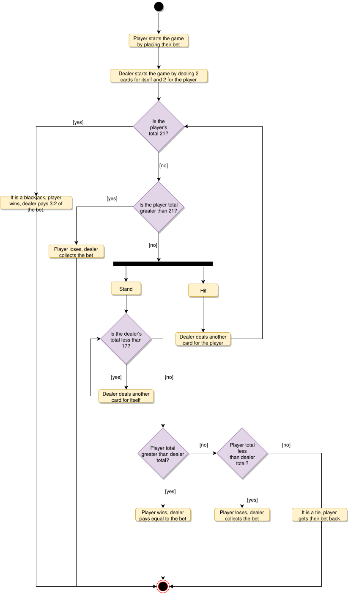
*Figure — Activity diagram for one player's hit-or-stand round against the dealer (course diagram)*

An **activity diagram** is a flowchart of one task, with diamonds for decisions. The figure above walks through one round: bet, deal, check for 21 (blackjack pays 3:2), check for bust, hit or stand, then the dealer draws while below 17, and finally the three outcomes — player wins 1:1, player loses, or a tie returns the bet.

### Core entities

| Class | Responsibility |
|---|---|
| `Suit`, `Rank` (enums) | The fixed values of a French deck (the standard 52-card deck with four suits). `Rank` stores the *face value* 1–13 (ace = 1, J = 11, Q = 12, K = 13). |
| `Card` (record — a compact class that just holds fixed values) | Rank + suit. Knows **nothing** about blackjack. Immutable (cannot change after creation). |
| `Deck<T>` | A generic (works for any type `T` you plug in), shuffleable stack of any card type `T`; `standard52()` factory (a method that builds objects) builds a French deck. |
| `Shoe` | Several decks shuffled together; deals one card at a time; reshuffles at the **cut card** (a marker card placed near the end of the shoe). `Shoe.stacked(...)` gives a fixed order for tests. |
| `BlackjackScoring` | The blackjack value of a rank (K = 10, ace = 1 hard). The *game* rule, kept off `Card`. |
| `Hand` | Cards + bet; computes hard/soft/best totals, bust, blackjack, can-split; splits and doubles. |
| `Action` (enum) | HIT, STAND, DOUBLE, SPLIT. |
| `PlayerStrategy` (interface) | How a player decides. `BasicStrategy` and `MimicDealerStrategy` are two bots (computer-controlled players); a UI-backed human would be a third. |
| `DealerPolicy` (interface) | When the dealer hits. `standOnAll17()` and `hitSoft17()`. |
| `Player` | Name, chip balance, strategy. |
| The dealer | Not a class of its own here: during a round the dealer is a `Hand` inside `BlackjackGame` plus the `DealerPolicy` that decides when it draws. (The course has a `Dealer` class next to `Player`, both under `BasePlayer`.) |
| `BlackjackGame` | Runs a round: bets, deal, insurance + peek, player turns, dealer turn, settlement. |

### Class diagram

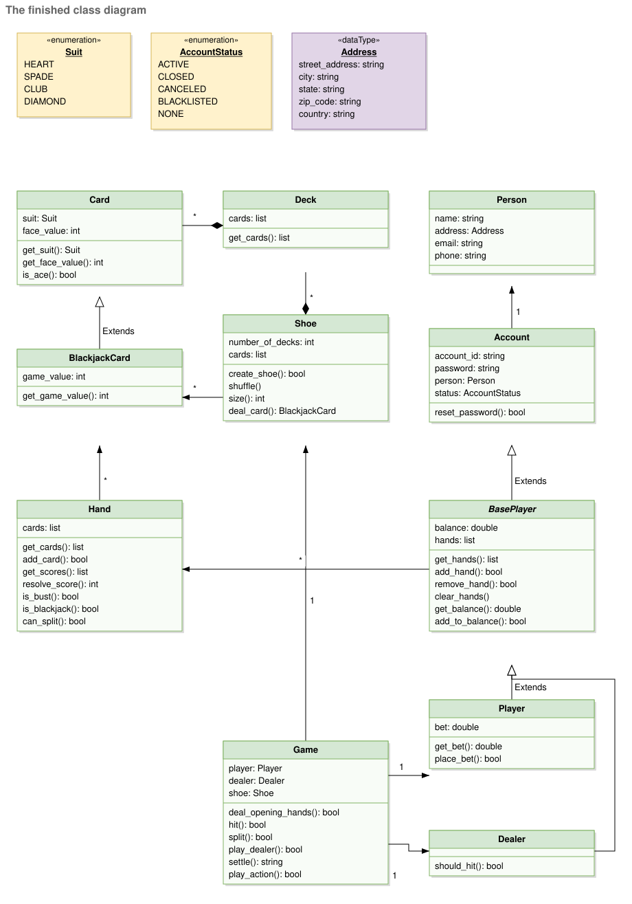
*Figure — Course class diagram: Card, BlackjackCard, Deck, Shoe, Hand, BasePlayer, Player, Dealer, Game, Account (course diagram)*

In the course model, `Card` holds a suit and a face value and a subclass `BlackjackCard` adds the *game value* (a king: face value 13, worth 10). A `Shoe` is composed of several `Deck`s (filled diamond = composition; plain arrow = association; open triangle = inheritance). `Hand` scores itself. `Player` (adds the bet) and `Dealer` (adds the "should I hit?" rule) share a `BasePlayer` (balance, hands) that extends `Account`; the `*` from `BasePlayer` to `Hand` is because splitting gives one player several hands. `Game` points at a player, a dealer and a shoe and holds the order of play.

Our Java design keeps the same core idea — **the game value must not live on the generic card** — but implements it with a separate scoring function instead of a subclass, and turns the two things that vary (player decisions, dealer rule) into strategies:

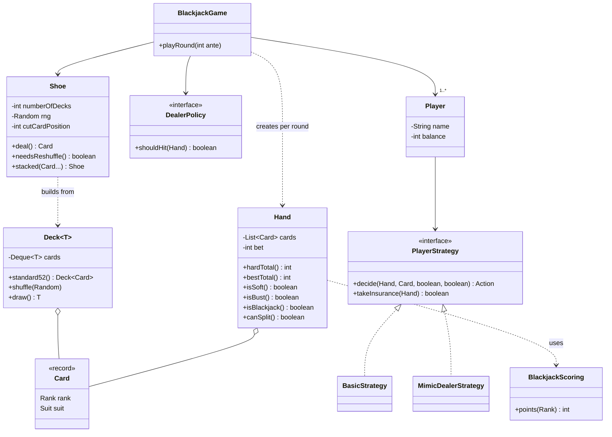

### Key flows

**One round (sequence)**

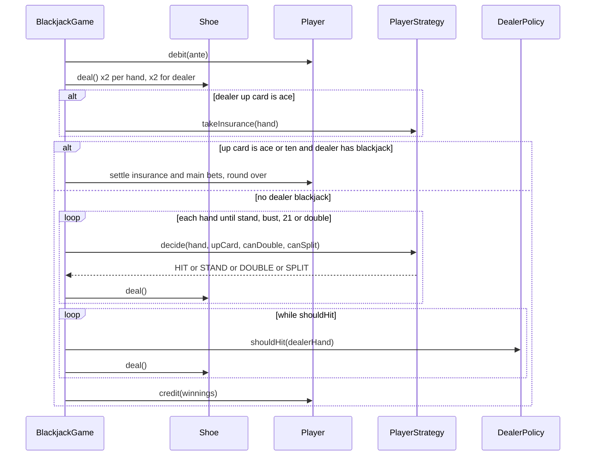

**States of one round**

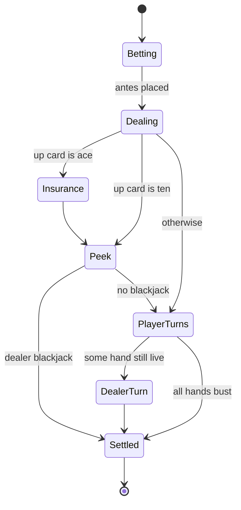

**Scoring a hand (the ace problem).** The trick is that **at most one ace can ever count as 11** (two elevens would be 22, a bust). So:

1. Add up every card with the ace as 1. This is the **hard total**.
2. If the hand has at least one ace and `hard + 10 ≤ 21`, one ace can be 11: the hand is **soft** and the best total is `hard + 10`.
3. Otherwise the best total is the hard total.

This is O(n) in the number of cards, needs no search over combinations, and gives the soft/hard flag for free (the dealer's "hit soft 17" rule needs it).

### Design decisions & patterns used

| Decision | Why | Alternative rejected |
|---|---|---|
| `Card` is a game-agnostic **record** (rank + suit). | A deck of cards is reused by poker, bridge, solitaire. A king's blackjack value (10) is a *rule of this game*, not a fact about the card. | Putting `getValue()` returning 10 for K on `Card` — breaks every other game. |
| Blackjack value in `BlackjackScoring`, not a `BlackjackCard` subclass. | Records cannot be extended, and the value depends only on the rank. A function is simpler and keeps one card type in the shoe. | The course's `BlackjackCard extends Card` — also valid, and also keeps `Card` clean. Say both in the interview; the important point is the same. |
| `Deck<T>` is **generic**. | "Design a deck of cards" follow-up: Uno or tarot cards reuse the same shuffle/draw code. | A deck hard-wired to `Card`. |
| **Strategy** for players (`PlayerStrategy`) and dealer (`DealerPolicy`). | Human UI, bots and test scripts plug in; casino variants (S17 vs H17: dealer stands on soft 17 vs hits soft 17) are one line. Open/Closed principle (add new behaviour with new classes, without editing working code). | `if (isHuman) ... else ...` and `if (casino == X)` branches inside the game. |
| **Factory methods** `Deck.standard52()`, `Shoe.stacked(...)`, `DealerPolicy.standOnAll17()`. | Named constructors make intent obvious. | Big constructors with flags. |
| Randomness injected (`Random` passed into `Shoe`). | Seeded shuffles make demos and tests exact. | `Collections.shuffle(list)` with a hidden random source. |
| `Hand` answers with `hardTotal()`, `bestTotal()` and `isSoft()`. | The course's `Hand` returns *every* possible total (A+6 is both 7 and 17) and lets the caller choose. Because at most one ace can ever count as 11, the hard total plus the soft flag already carries all of that information, and most callers just want `bestTotal()`. | Returning a list of totals that each caller must filter. |
| Hand stores its **own bet**. | Split and double change the bet *per hand*, not per player. | One bet per player — breaks as soon as a player splits. |
| The game **validates** a strategy's choice (`canDouble`, `canSplit` passed in, and re-checked). | A buggy or malicious client (the program sending the player's choices) cannot double without money. | Trusting the client. |

**Honest weaknesses (and what a longer design would do).** `BlackjackGame.playRound` owns the whole sequence of play *and* the payout rules. Each new option (surrender, side bets) adds another branch. A larger design would model the round as a **State** machine (a fixed set of states plus the allowed moves between them; the State pattern gives each state its own class — one class per state in the diagram above, like the vending machine in Chapter 14) and move payouts into a `PayoutTable`. Say this out loud; interviewers reward knowing where your design will strain.

### Java implementation

Package `lld.ch17.blackjack`; full runnable code (one file per class in Core entities, plus `Main`) is in `code/lld/ch17/blackjack/`. The essential lines (`/* ... */` and `//` summary comments stand for code left out):

```java
/** A generic deck: any card type T. Shuffling takes a Random so tests can pass a seeded one. */
public final class Deck<T> {
    /** Factory for the standard 52-card French deck (13 ranks x 4 suits). */
    public static Deck<Card> standard52() { /* every Suit x every Rank */ }
    public void shuffle(Random rng) { /* Collections.shuffle(list, rng) */ }
    public T draw() { /* NoSuchElementException when empty */ }
}

/** Several decks shuffled together. A "cut card" marks how deep we deal before reshuffling (penetration). */
public final class Shoe {
    public Shoe(int numberOfDecks, Random rng, double penetration) {
        if (penetration <= 0 || penetration >= 1) throw new IllegalArgumentException("penetration must be in (0,1)");
        this.cutCardPosition = (int) Math.round(numberOfDecks * 52 * (1 - penetration));
        refill();
    }
    /** Cards come out in exactly the order given. Perfect for unit tests. */
    public static Shoe stacked(Card... order) { return new Shoe(List.of(order)); }
    public boolean needsReshuffle() { return rng != null && cards.size() < cutCardPosition; }
}

/** The blackjack value of a card lives here, NOT on Card: a king has face value 13 but is worth 10 here. */
public final class BlackjackScoring {
    public static int points(Rank rank) {
        return switch (rank) { case ACE -> 1; case JACK, QUEEN, KING -> 10; default -> rank.faceValue(); };
    }
}
```

```java
/** A blackjack hand: its cards, its own bet, and how to score itself (aces = 1 or 11). */
public final class Hand {
    public int hardTotal() { /* every ace counted as 1 */ }
    /** Soft when one ace can count as 11 without busting. At most one ace can ever do so. */
    public boolean isSoft() { return hasAce() && hardTotal() + 10 <= 21; }
    public int bestTotal() { return isSoft() ? hardTotal() + 10 : hardTotal(); }
    public boolean isBust() { return bestTotal() > 21; }
    /** A natural: exactly two cards worth 21, and not the result of a split. */
    public boolean isBlackjack() { return !fromSplit && cards.size() == 2 && bestTotal() == 21; }
    /** Two cards of the same rank, and no re-splitting (one split per round). */
    public boolean canSplit() { return !fromSplit && cards.size() == 2 && cards.get(0).rank() == cards.get(1).rank(); }
    Hand split()      { /* move 2nd card into a new Hand(bet); both marked fromSplit */ }
    void doubleDown() { bet *= 2; doubled = true; }
}

/** Strategy: HOW a player decides is pluggable. The game passes what is allowed. */
public interface PlayerStrategy {
    Action decide(Hand hand, Card dealerUpCard, boolean canDouble, boolean canSplit);
    /** Offered only when the dealer shows an ace. Mathematically a bad bet for most players. */
    default boolean takeInsurance(Hand hand) { return false; }
}
// BasicStrategy: a simplified basic-strategy table (always split aces and eights; double on 11, or 10 vs 2-9; ...).
// MimicDealerStrategy: a naive player who hits below 17 like the dealer and always buys insurance.

/** The house rule for when the dealer draws. Casinos differ, so it is a pluggable strategy. */
@FunctionalInterface
public interface DealerPolicy {
    boolean shouldHit(Hand dealerHand);
    static DealerPolicy standOnAll17() { return h -> h.bestTotal() <= 16; }                               // "S17"
    static DealerPolicy hitSoft17()    { return h -> h.bestTotal() <= 16 || (h.bestTotal() == 17 && h.isSoft()); } // "H17"
}
```

```java
public final class BlackjackGame {
    public void playRound(int ante) {
        if (ante <= 0 || ante % 2 != 0) throw new IllegalArgumentException("ante must be a positive even number");
        if (shoe.needsReshuffle()) shoe.reshuffle();
        // 1. Bets: each player who can afford the ante gets one hand (others sit out).
        // 2. Deal two rounds: one card to each player, then one to the dealer (2nd dealer card = hole card).
        // 3. Insurance (only when the up card is an ace, side bet = ante / 2); the dealer peeks when the up card
        //    is an ace or a ten-value. Dealer blackjack: insurance pays 2:1, player blackjacks push, the rest lose.
        // 4. Player turns: playHand(...) for each hand; splitting inserts a new hand right after the current one.
        // 5. Dealer turn, skipped if every player hand is already bust:
        //        while (dealerPolicy.shouldHit(dealer)) dealer.add(shoe.deal());
        // 6. Settle every hand against the dealer.
    }

    private void playHand(Player p, List<Hand> hs, int index, Card up) {
        Hand hand = hs.get(index);
        String label = p.name() + (hs.size() > 1 ? " hand " + (index + 1) : "");
        while (!hand.isBlackjack() && hand.bestTotal() < 21) {
            boolean canDouble = hand.size() == 2 && p.canAfford(hand.bet());
            boolean canSplit = hand.canSplit() && p.canAfford(hand.bet());
            Action a = p.strategy().decide(hand, up, canDouble, canSplit);
            if ((a == Action.DOUBLE && !canDouble) || (a == Action.SPLIT && !canSplit))
                throw new IllegalStateException(label + " chose a move that is not allowed: " + a);
            switch (a) {
                case STAND -> { return; }
                case HIT -> hand.add(shoe.deal());
                case DOUBLE -> { p.debit(hand.bet()); hand.doubleDown(); hand.add(shoe.deal()); return; } // exactly one card
                case SPLIT -> {
                    p.debit(hand.bet());
                    Hand second = hand.split();
                    hand.add(shoe.deal());
                    second.add(shoe.deal());
                    hs.add(index + 1, second);
                }
            }
        }
    }

    private void settle(Player p, Hand h, Hand dealer) {
        if (h.isBust()) return;                                  // LOSE the bet (already debited)
        if (h.isBlackjack()) { p.credit(h.bet() + h.bet() * 3 / 2); return; }   // pays 3:2
        int mine = h.bestTotal(), theirs = dealer.bestTotal();
        if (dealer.isBust() || mine > theirs) p.credit(h.bet() * 2);            // WIN
        else if (mine == theirs) p.credit(h.bet());                            // PUSH
    }
}
```

`Main.java` prints five sample hands, then plays a stacked shoe where Alice (`BasicStrategy`) splits 8s and doubles both hands, a stacked ace-up round where Bob (`MimicDealerStrategy`) buys insurance, and five rounds from a seeded 6-deck shoe (`new Random(42)`, penetration 0.75, `hitSoft17`) for Carol and Dave.

**Output:**

```text
== 1. Hand values (aces are 1 or 11) ==
  [AS 6H] = soft 17   (hard total 7)
  [AS 6H 10C] = 17   (hard total 17)
  [AS AH 9C] = soft 21   (hard total 11)
  [KS QH 5C] = bust 25   (hard total 25)
  [AD KC] = BLACKJACK   (hard total 11)

== 2. Stacked shoe: split 8s, then double both hands ==
  Dealer shows 6S (hole card hidden)
  Alice [8H 8D] = 16
  Alice splits -> [8H 3C] = 11 and [8D 2S] = 10
  Alice hand 1 doubles (bet now 20): [8H 3C 9H] = 20
  Alice hand 2 doubles (bet now 20): [8D 2S 5D] = 15
  Dealer reveals and plays: [6S 10C 7S] = bust 23
  Alice [8H 3C 9H] = 20 vs dealer 23: WIN +20
  Alice [8D 2S 5D] = 15 vs dealer 23: WIN +20
  Balances: Alice=140

== 3. Stacked shoe: dealer shows an ace, Bob buys insurance ==
  Dealer shows AS (hole card hidden)
  Bob [10H 9C] = 19
  Bob buys insurance for 5
  Dealer peeks: [AS KD] = BLACKJACK -> round over
  Bob insurance pays 2:1 (+10)
  Bob: LOSE 10
  Balances: Bob=100

== 4. Seeded 6-deck shoe (seed 42), two players, 5 rounds ==
Round 1:
  Dealer shows AS (hole card hidden)
  Carol [8S 3S] = 11
  Dave [5D 9C] = 14
  Dave buys insurance for 5
  Dealer peeks: [AS QS] = BLACKJACK -> round over
  Dave insurance pays 2:1 (+10)
  Carol: LOSE 10
  Dave: LOSE 10
  Balances: Carol=90 Dave=100
Round 2:
  Dealer shows 6D (hole card hidden)
  Carol [2S 8H] = 10
  Dave [QS 10H] = 20
  Carol doubles (bet now 20): [2S 8H QD] = 20
  Dave stands on 20
  Dealer reveals and plays: [6D 6D 7C] = 19
  Carol [2S 8H QD] = 20 vs dealer 19: WIN +20
  Dave [QS 10H] = 20 vs dealer 19: WIN +10
  Balances: Carol=110 Dave=110
Round 3:
  Dealer shows 5C (hole card hidden)
  Carol [AD KD] = BLACKJACK
  Dave [8D AH] = soft 19
  Dave stands on 19
  Dealer reveals and plays: [5C 7D 7S] = 19
  Carol [AD KD] = BLACKJACK vs dealer 19: BLACKJACK pays 3:2 (+15)
  Dave [8D AH] = soft 19 vs dealer 19: PUSH
  Balances: Carol=125 Dave=110
Round 4:
  Dealer shows 10S (hole card hidden)
  Carol [8D 8S] = 16
  Dave [5C 9S] = 14
  Carol splits -> [8D 4S] = 12 and [8S JD] = 18
  Carol hand 1 hits: [8D 4S 7D] = 19
  Carol hand 1 stands on 19
  Carol hand 2 stands on 18
  Dave hits: [5C 9S KS] = bust 24
  Dave busts
  Dealer reveals and plays: [10S 9H] = 19
  Carol [8D 4S 7D] = 19 vs dealer 19: PUSH
  Carol [8S JD] = 18 vs dealer 19: LOSE 10
  Dave [5C 9S KS] = bust 24 vs dealer 19: LOSE 10
  Balances: Carol=115 Dave=100
Round 5:
  Dealer shows KD (hole card hidden)
  Carol [5S 8C] = 13
  Dave [8S 2C] = 10
  Carol hits: [5S 8C JS] = bust 23
  Carol busts
  Dave hits: [8S 2C 7C] = 17
  Dave stands on 17
  Dealer reveals and plays: [KD 10H] = 20
  Carol [5S 8C JS] = bust 23 vs dealer 20: LOSE 10
  Dave [8S 2C 7C] = 17 vs dealer 20: LOSE 10
  Balances: Carol=105 Dave=90
```

**Reading the output.** Part 1 shows the scoring: A+6 is soft 17, adding a 10 makes it a *hard* 17 (the ace dropped to 1), A+A+9 is soft 21. Part 2 uses a stacked shoe to force an exact scenario: Alice splits eights against a dealer 6, doubles both hands, and the dealer busts — she staked 40 chips and won 40. Part 3 shows insurance working as a hedge: Bob loses his main bet of 10 but the 5-chip insurance pays 10, so he breaks even. Part 4 is a seeded six-deck game: run it again and you get the same cards.

### Concurrency & edge cases

- **One table = one thread.** A round is a strict sequence, so the simplest safe design runs each table's rounds on a single **thread** (one independent line of execution) or an actor/event loop (one worker processing messages from its own queue) and funnels player commands into it. Tables run in parallel and share nothing except the wallet service.
- **Balances are shared across tables** in a real casino app. Move `debit`/`credit` into a wallet service with **atomic** (indivisible) operations — a database transaction, or `AtomicLong`/`synchronized` in memory — and debit *before* dealing.
- **Odd antes and 3:2.** 3:2 on 5 chips is 7.5. We require even antes. Real casinos either round down or use smaller chip units — decide and state it.
- **Split aces.** Many casinos deal only one card to each split ace, and 21 after a split is *not* a blackjack (our `isBlackjack()` checks `fromSplit`).
- **Shoe exhaustion.** The cut card triggers a reshuffle *between* rounds; the shoe also refills if emptied mid-round. A stacked test shoe throws instead, so a wrong test fails loudly.
- **Player cannot afford a double/split.** The game passes `canDouble=false` and rejects the action if chosen anyway.
- **Dealer peek only on ace or ten.** If the up card is anything else the dealer cannot have blackjack, so there is no peek.

### Extensions & follow-up questions

- **"Where would even money go?"** — It is the same as insurance for a player holding blackjack: insurance of half the ante plus a blackjack always nets exactly +1× the ante whatever the dealer has. Add `PlayerStrategy.takeEvenMoney(hand)` and, if accepted, settle that hand at 1:1 before the peek.
- **"Add surrender."** — New `Action.SURRENDER`, allowed only as the first decision; refund half the bet and end the hand.
- **"Several players at the table?"** — Already supported: the game iterates players in seat order, then the dealer plays once.
- **"Card counting detection / security?"** — Card counting is tracking which cards have gone to guess what is left. Shoe penetration (how deep into the shoe the cut card sits) already limits counting. Log every dealt card for audit (a later independent check of what happened); never send the hole card to clients until it is revealed.
- **"How would you test the dealer rule?"** — Stacked shoe + `DealerPolicy.hitSoft17()`: deal the dealer A+6 and assert it draws; with `standOnAll17()` assert it stands.
- **"Make the deck work for Uno."** — `Deck<UnoCard>` with its own factory; nothing else changes.
- **"Replace the round logic with a state machine."** — One class per state (Betting, Dealing, PlayerTurns, DealerTurn, Settled), each handling only the commands valid in that state; invalid commands are rejected by the current state.

### Real-world example

Online casino tables (e.g. live-dealer blackjack) separate exactly these concerns: a certified, audited **shuffle/RNG service** (regulators such as the UK Gambling Commission require the random number generator to be independently tested), a **game engine** enforcing the table rules (number of decks, S17 or H17, payout 3:2 or 6:5 — printed on the table felt), and a **wallet** service that debits bets atomically. Rule variants are configuration, not code — exactly why `DealerPolicy` is a strategy.

### In the interview

**30-second answer:** "A generic `Card` (rank, suit) and a generic `Deck<T>`. A `Shoe` combines several decks and deals with an injected `Random`, plus a stacked constructor for tests. The blackjack value of a card lives in the game's scoring, not on `Card`. `Hand` scores itself: hard total with aces as 1, and it's soft if one ace can be 11 without busting. Player decisions and the dealer's hit rule are strategies. `BlackjackGame` runs the round: bets, deal, insurance and peek, player turns with hit/stand/double/split, dealer turn, settle 3:2, 1:1 or push."

**How to spend 30–45 minutes:** 5 min questions and rules → 5 min entities → 10 min class diagram (defend `Card` vs game value, hand-owned bet) → 15 min code `Hand` scoring and `playRound` → 5 min edge cases (split aces, insurance, money) and extensions.

**Likely follow-ups with answers**

- *"Why not an `int value` on `Card`?"* — Because value is game-specific; poker ranks aces high, bridge uses suits, blackjack makes K = 10.
- *"How do you compute the best hand value?"* — Hard total, then add 10 if there is an ace and it fits. At most one ace can be 11.
- *"How do you make the game testable?"* — Inject the randomness: seeded `Random` for repeatability, stacked shoe for exact scenarios.

### Self-check

1. **Q:** Why does the `Hand` store the bet instead of the `Player`? **A:** After a split, one player has two hands with separate bets; after a double, only that hand's bet changes.
2. **Q:** A+A+9 — soft or hard, and what total? **A:** Hard 11 with aces as 1; one ace can be 11 → soft 21.
3. **Q:** When does the dealer peek? **A:** Only when the up card is an ace or a 10-value card — otherwise blackjack is impossible.
4. **Q:** What does insurance pay, and how much is it? **A:** 2:1. In this design (and the course) it is exactly half the ante; real casinos let you buy *up to* half.
5. **Q:** Is 21 after splitting a blackjack? **A:** No, a blackjack must be the original two-card hand.

### TL;DR

- Keep `Card`/`Deck` generic; the game's value rule lives in the game (`BlackjackScoring`, or a `BlackjackCard` subclass in the course version).
- Hand value: hard total + 10 if an ace fits → soft. Blackjack = original two cards totalling 21.
- Strategies for player decisions and dealer rule; inject randomness; stacked shoe for tests.
- Round = bet → deal → (insurance + peek) → player turns → dealer turn → settle (3:2, 1:1, push).

---

## Design Chess

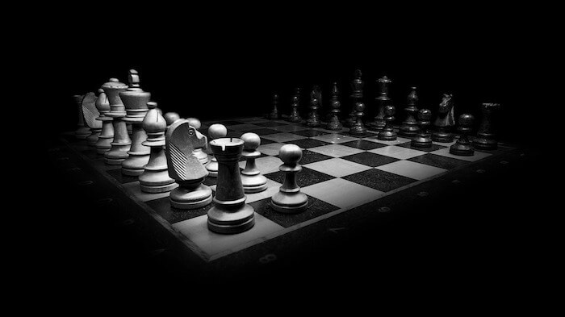
*Figure — A chess board in play (course diagram)*

### Problem & clarifying questions

**Chess** is a two-player strategy game on an 8×8 board of 64 squares. Each side starts with 16 pieces: **8 pawns, 2 rooks, 2 knights, 2 bishops, 1 queen, 1 king**. The goal is **checkmate**: attack the enemy king so that it has no legal escape. We design an **online** two-player chess game.

| Question | Assumed answer |
|---|---|
| Full international rules? | Yes: every piece's moves, captures, check, checkmate, stalemate, castling, en passant, promotion. |
| How are sides chosen? | Randomly assigned white or black (`Game.withRandomSides`, with an injected `Random`); **white moves first**; players alternate. |
| Can players take moves back? | Not in a rated game (one that counts toward the players' official ratings; course requirement). We still support `undo()` for analysis mode and tests. |
| How can a game end? | Checkmate, stalemate (a draw), resignation, or forfeit. |
| Move log? | Yes — every move by both players is recorded. |
| Timers, rating, spectators, draw by repetition? | Out of scope; discussed in Extensions. |
| AI opponent? | Out of scope; a bot would be a `MoveStrategy` that picks from `legalMoves()`. |

### Requirements

**Functional**

1. Two players play one game; each is assigned a colour, white moves first, turns alternate.
2. A player moves one of **their own** pieces; the system rejects moves out of turn, moves a piece cannot make, and moves that would leave the mover's own king in check.
3. All international rules, including the special moves:
   - **Castling** — the king moves two squares toward a rook and the rook jumps over to the square the king crossed. Allowed only if neither piece has moved, the squares between are empty, the king is not in check, and the king does not pass through or land on an attacked square.
   - **En passant** ("in passing") — if a pawn advances two squares and lands beside an enemy pawn, that enemy pawn may capture it *as if it had moved only one square*, but only on the very next move.
   - **Promotion** — a pawn reaching the last rank becomes a queen, rook, bishop or knight (the player's choice).
4. Detect **check** (the king is attacked), **checkmate** (in check and no legal move — the attacker wins) and **stalemate** (not in check but no legal move — a draw).
5. Support **resignation** (the player gives up) and **forfeit** (the player loses without choosing to, for example by leaving or timing out); record the result.
6. Keep a **log** of every move.

**Non-functional**

- Adding a new piece type (for a chess variant) should not touch existing pieces (Open/Closed).
- Legality checks must be correct first; speed is a secondary concern for a two-human game.
- Online play: the game object must be safe when two player connections call it concurrently (at the same time, from different threads).

### Use cases

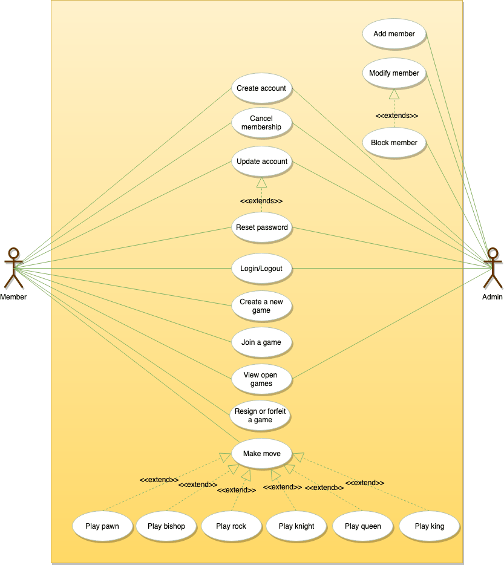
*Figure — Chess use cases for Member (player) and Admin, with "Make move" extended by each piece type (course diagram)*

In the figure above there are two actors:

- **Player** (a registered member) — creates or joins a game, views open games, **makes moves**, resigns or forfeits, and manages their account.
- **Admin** — adds, modifies, or blocks (bans) members.

The key use cases are **Player moves a piece** (extended per piece type — "Play pawn", "Play knight"... — which is exactly the polymorphism in our `Piece` hierarchy), **Resign or forfeit**, **Register/cancel membership**, and **Update game log** (every move is appended).

**Activity: make a move**

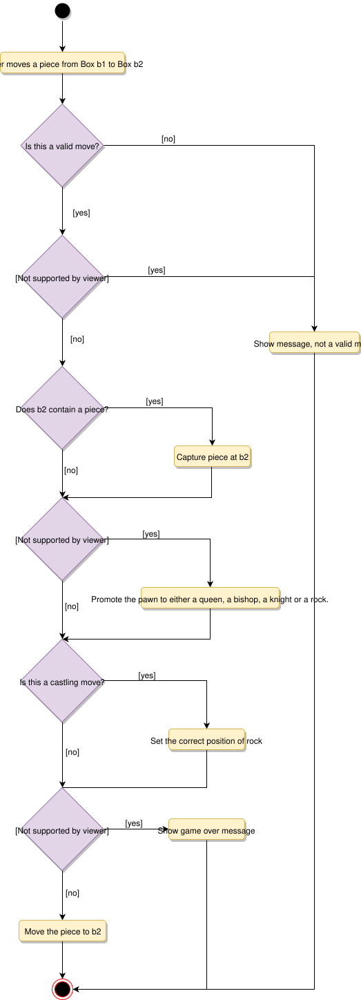
*Figure — Activity diagram for making a move: validate, check self-check, capture, promotion, castling, and checkmate/stalemate (course diagram)*

`Game.move` and `Game.play` follow the figure's order: reject a move invalid for that piece or one that leaves the mover's king in check; capture; promote a pawn reaching the back rank; move the rook too when castling; finally detect checkmate or stalemate.

### Core entities

| Class | Responsibility |
|---|---|
| `Color` (enum) | WHITE/BLACK and `opposite()`. |
| `Position` (record) | A square (file a–h, rank 1–8). Validates bounds; parses "e4". The course calls this a *Box*. |
| `Piece` (abstract — cannot be created directly, only through subclasses; sealed — only listed subclasses allowed) | Colour + `targets(board, from)`: where it can move by its own rules. `attacks(...)` for check detection. |
| `King`, `Knight`, `Pawn` | Step pieces and the pawn's special forward/diagonal rule. |
| `SlidingPiece` → `Rook`, `Bishop`, `Queen` | Share one "slide until blocked" loop; each subclass only lists its directions. |
| `Board` | 8×8 grid of pieces; `copy()`, `kingOf(color)`, `isAttacked(square, byColor)`, `render()`. No turn or history knowledge. |
| `Move` (record) + `MoveType` (enum) | A move as data: from, to, type (NORMAL, CASTLE_KINGSIDE, CASTLE_QUEENSIDE, EN_PASSANT, PROMOTION), promotion piece. |
| `CastlingRights` (record) | The four castling permissions; how they change after a move. |
| `Rules` | Stateless (keeps no data between calls) rules engine: pseudo-legal moves (allowed by piece movement, before the king-safety check), legal moves (king-safety filter), special moves, `apply(board, move)`, `isInCheck`. |
| `Game` | Turn, status, winner, en passant square, castling rights, move log, undo (Command + Memento — patterns explained below), resign, forfeit, random side assignment. Thread-safe (correct even when several threads call it at once). |
| `Player` (record), `GameStatus` (enum), `IllegalMoveException` | Supporting types. |

### Class diagram

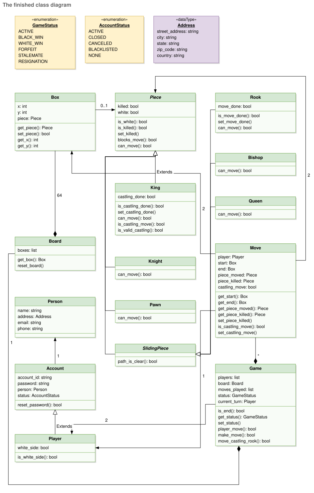
*Figure — Course class diagram: Box, Board, Piece hierarchy with SlidingPiece, Move, Player, Account, Game, GameStatus (course diagram)*

In the course model, a `Board` is **composed** of 64 `Box`es; a `Box` refers to at most one `Piece` by plain association (not composition), because a captured piece leaves the board without being destroyed — which keeps the move log replayable. `Piece` is abstract with `can_move(board, start, end)`; `SlidingPiece` sits between `Piece` and rook/bishop/queen so the "path is clear" check is written once. A `Move` records player, start and end box, piece moved, piece captured and a castling flag. `Game` owns the board and the moves and refers to the two players (who outlive the game). The course's `GameStatus`: ACTIVE, BLACK_WIN, WHITE_WIN, FORFEIT, STALEMATE, RESIGNATION.

Our Java design keeps that shape and fixes the two limits the course itself points out: (1) its pieces decide legality from the board alone, so history-based rules (castling rights, en passant) have nowhere to live, and (2) checkmate/stalemate are not detected. We add `Rules` (which sees history through `CastlingRights` and the en passant square) and make `Move` carry a `MoveType`, so a single move can move two pieces (castling) or remove a piece that is not on the target square (en passant).

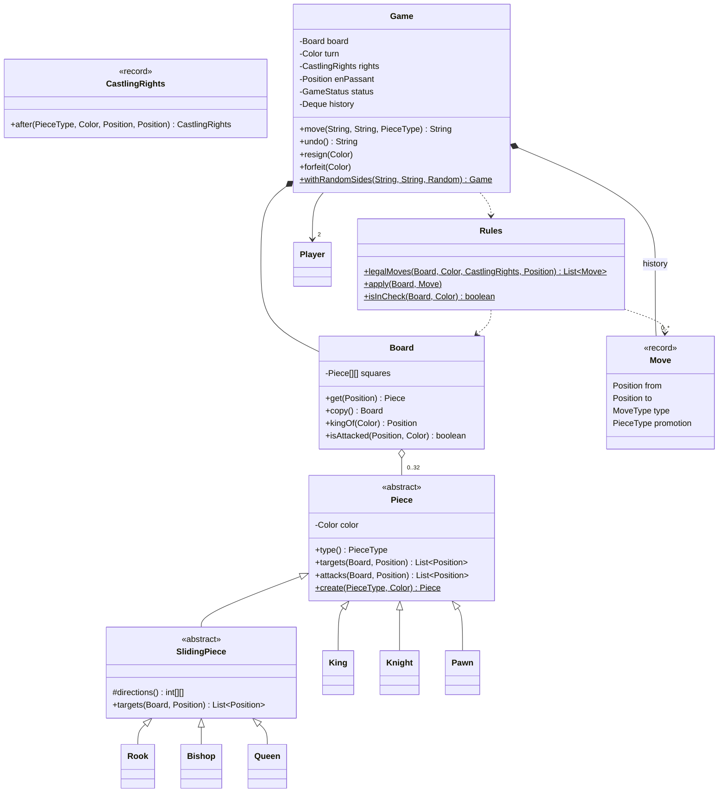

### Key flows

**Making a move**

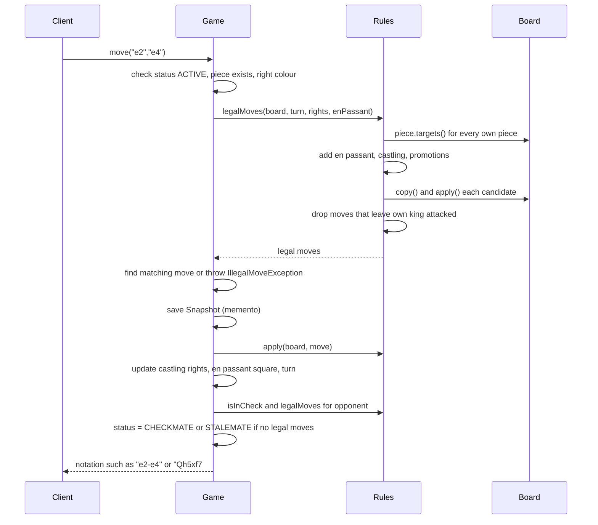

**Game status**

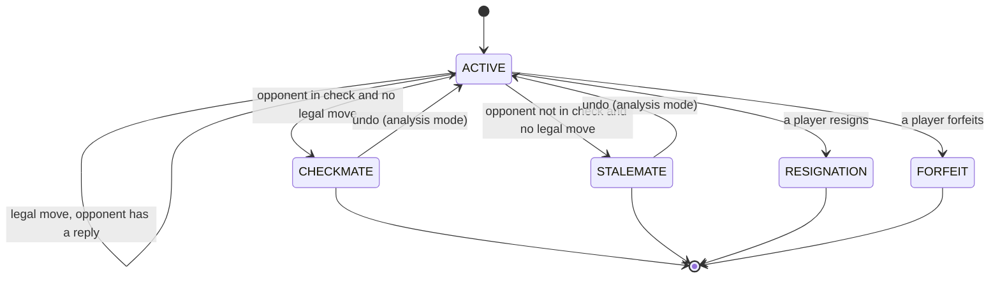

**How check, checkmate and stalemate are detected (the "reasonable depth" answer)**

1. **Pseudo-legal moves** — every move allowed by the pieces' movement rules, plus castling, en passant and promotions.
2. **Legal moves** — for each pseudo-legal move, apply it to a *copy* of the board and keep it only if the mover's king is **not attacked** afterwards. This one filter handles pins, moving into check, and ignoring a check, with no special cases.
3. **Is the king attacked?** Ask every enemy piece for the squares it attacks (`attacks(...)`); pawns attack diagonally even onto empty squares, which is why `Pawn` overrides `attacks`.
4. After a move, look at the **opponent**: if it has **zero legal moves**, it is **checkmate** when its king is in check, otherwise **stalemate**.

This is a one-ply (one move deep) search, which is all the *rules* need. Searching deeper is what a chess *engine* does to choose good moves — not required for enforcing rules.

**Cost:** at most ~200 pseudo-legal moves, each checked with an attack scan over ≤16 pieces — trivial for a human game. A production engine uses bitboards (each piece type's squares packed into one 64-bit number) and incremental attack maps (updated per move, not recomputed); mention only if asked.

### Design decisions & patterns used

| Decision | Why | Alternative rejected |
|---|---|---|
| **Polymorphic pieces** (`targets` overridden per piece), **Template-like** `SlidingPiece`. | Each piece's rule lives in its own class; the blocked-path loop is written once for three pieces. | One giant `switch (pieceType)` in the board. |
| **Sealed** hierarchy (`sealed ... permits`). | The set of chess pieces is closed; the compiler knows all subclasses, so `switch` on type can be exhaustive (the compiler checks every case is handled). | Open hierarchy — fine too for variants; say so. |
| Pieces are **immutable**; `Board.copy()` copies references (pointers to the same piece objects) only. | Trial moves and snapshots are cheap and safe. | Mutable pieces with `hasMoved` flags — then undo must restore every flag. |
| **History-based rules in `Rules`/`Game`**, not in pieces. | Castling rights and en passant depend on earlier moves. The course notes that a piece seeing only the board cannot know this. | Letting `King` look up history — couples a piece to the game log. |
| `Move` carries a **`MoveType`**. | One move can move two pieces (castling) or capture off-square (en passant). | Special-casing in `Game` (the course's `move_castling_rook`), which breaks "rules live in one place". |
| **Command + Memento** for undo. `Move` is the command (an action stored as an object); `Snapshot` is the memento (a saved copy of an object's state that can be restored later) of the state before it. | Restoring a snapshot is always correct, even for promotion/castling/en passant, with no inverse logic. | Pure Command with `undo()` per move type — works, but every special move needs a hand-written inverse, a common bug source. |
| **Factory method** `Piece.create(type, color)`. | Used by board set-up and promotion. | `new` calls scattered around. |
| `Game` methods are `synchronized`. | Two player connections may call `move`/`resign` at the same time. | No locking — race (result depends on which thread runs first) between a move and a resignation. |

**Memento vs incremental undo — trade-off.** A snapshot of an 8×8 reference array is 64 references (~0.5 KB): nothing for a human game (a few hundred moves). An engine searching millions of positions would instead store only what the move changed (captured piece, old castling rights, old en passant square) and reverse it. Know both.

### Java implementation

Package `lld.ch17.chess`; full runnable code (one file per class, plus `StepPieces`, `IllegalMoveException` and `Main`) is in `code/lld/ch17/chess/`. `Position` is an immutable square (file 0..7 = a..h, rank 0..7 = 1..8) parsed from "e4"; `GameStatus` is `ACTIVE`, `CHECKMATE`, `STALEMATE`, `RESIGNATION` or `FORFEIT`. The essential lines (`/* ... */` and `//` summary comments stand for code left out):

```java
/** Each piece answers "which squares can I reach from here?" its own way. Pieces are immutable. */
public abstract sealed class Piece permits King, Knight, Pawn, SlidingPiece {
    public abstract PieceType type();
    /** Squares reachable by ordinary rules (captures included, own-king safety NOT checked). */
    public abstract List<Position> targets(Board board, Position from);
    /** Squares this piece attacks. Same as targets for every piece except the pawn. */
    public List<Position> attacks(Board board, Position from) { return targets(board, from); }
    /** Simple factory used for set-up and promotion. */
    public static Piece create(PieceType type, Color color) { /* switch over every type */ }
}
// King and Knight jump fixed offsets via StepPieces.step(...). Castling is a two-piece move, so Rules
// generates it, not King. The knight is the only piece that ignores pieces in between.

/** Rook, bishop and queen slide until blocked. The "is the path clear" loop is written once, here. */
public abstract sealed class SlidingPiece extends Piece permits Rook, Bishop, Queen {
    protected abstract int[][] directions();          // Rook: STRAIGHT, Bishop: DIAGONAL, Queen: all eight
    @Override public final List<Position> targets(Board board, Position from) {
        List<Position> out = new ArrayList<>();
        for (int[] d : directions()) {
            int f = from.file() + d[0], r = from.rank() + d[1];
            while (Position.onBoard(f, r)) {
                Position p = new Position(f, r);
                Piece occupant = board.get(p);
                if (occupant == null) out.add(p);
                else { if (occupant.color() != color()) out.add(p); break; }   // capture, then stop
                f += d[0]; r += d[1];
            }
        }
        return out;
    }
}
// Pawn: one square forward (two from its start rank) onto empty squares; captures diagonally.
// Its attacks() are both forward diagonals whether or not anything stands there. En passant and promotion: Rules.

/** 8x8 grid of (immutable) pieces. Knows geometry and attacks; knows nothing about turns or history. */
public final class Board {
    /** Pieces are immutable, so copying the references is a full, independent copy of the position. */
    public Board copy() { /* clone each file's array */ }
    public boolean isAttacked(Position target, Color by) { /* any piece of `by` whose attacks() contain target */ }
}

/** A move as data (the Command's payload). promotion is null unless type == PROMOTION. */
public record Move(Position from, Position to, MoveType type, PieceType promotion) {}
// MoveType: NORMAL, CASTLE_KINGSIDE, CASTLE_QUEENSIDE, EN_PASSANT, PROMOTION
// CastlingRights: four booleans, lost for good once the king or that rook moves (or the rook is captured on its corner).
```

```java
/** Stateless rules engine. "Legal" = pseudo-legal AND does not leave your own king attacked. */
public final class Rules {
    public static boolean isInCheck(Board board, Color side) { return board.isAttacked(board.kingOf(side), side.opposite()); }

    public static List<Move> legalMoves(Board board, Color side, CastlingRights rights, Position enPassant) {
        List<Move> legal = new ArrayList<>();
        for (Move m : pseudoLegalMoves(board, side, rights, enPassant)) {   // pieces' targets + 4 promotion choices
            Board trial = board.copy();                                      // + en passant + castling
            apply(trial, m);
            if (!isInCheck(trial, side)) legal.add(m);
        }
        return legal;
    }

    private static void addCastling(Board board, Color side, CastlingRights rights, List<Move> moves) {
        // ... king on e1/e8; cannot castle out of check
        if (rights.kingSide(side) && isOwnRook(board, new Position(7, r), side)
                && empty(board, r, 5, 6)
                && !board.isAttacked(new Position(5, r), enemy)             // cannot pass through check
                && !board.isAttacked(new Position(6, r), enemy))
            moves.add(new Move(kingSq, new Position(6, r), MoveType.CASTLE_KINGSIDE, null));
        // queen side: files 1-3 empty, d and c squares not attacked
    }
    // whyCannotCastle(...) explains a rejected two-square king move ("the king or that rook has already moved",
    // "the squares between king and rook are not empty", "the king is in check", "pass through the attacked square").

    /** Mutates the board. Handles the extra piece movements of the special moves. */
    public static void apply(Board board, Move m) {
        Piece piece = board.get(m.from());
        board.set(m.from(), null);
        board.set(m.to(), piece);
        switch (m.type()) {
            case EN_PASSANT -> board.set(new Position(m.to().file(), m.from().rank()), null);   // the passed pawn
            case PROMOTION -> board.set(m.to(), Piece.create(m.promotion(), piece.color()));
            case CASTLE_KINGSIDE -> moveRook(board, m.from().rank(), 7, 5);
            case CASTLE_QUEENSIDE -> moveRook(board, m.from().rank(), 0, 3);
            case NORMAL -> { }
        }
    }
}
```

```java
/** Controls one game. Undo = Command (the move) + Memento (a snapshot of the state before it). */
public final class Game {
    /** Memento: everything needed to restore the position exactly. */
    private record Snapshot(Board board, Color turn, CastlingRights rights, Position enPassant,
                            GameStatus status, Color winner) {}
    private record HistoryEntry(Player player, Move move, String notation, Snapshot before) {}

    /** The course's rule: each player is randomly assigned a side. Pass a seeded Random for repeatable tests. */
    public static Game withRandomSides(String nameA, String nameB, Random rng) { /* rng.nextBoolean() */ }

    public synchronized String move(String fromSq, String toSq, PieceType promotion) {
        // rejects: game over, empty square, wrong turn; then finds the chosen move in Rules.legalMoves
        // (promotion defaults to QUEEN). If absent, explains why: castling reason, "would leave the king in check",
        // or "<PIECE> on <sq> cannot move to <sq>".
    }

    private String play(Move m, Piece piece) {
        Player mover = turn == Color.WHITE ? white : black;
        Snapshot before = new Snapshot(board.copy(), turn, rights, enPassant, status, winner);
        boolean capture = board.get(m.to()) != null || m.type() == MoveType.EN_PASSANT;
        Rules.apply(board, m);
        rights = rights.after(piece.type(), turn, m.from(), m.to());
        enPassant = (piece.type() == PieceType.PAWN && Math.abs(m.to().rank() - m.from().rank()) == 2)
                ? new Position(m.from().file(), (m.from().rank() + m.to().rank()) / 2) : null;
        turn = turn.opposite();
        // End-of-game detection: the side to move has no legal move -> checkmate if in check, else stalemate.
        boolean check = Rules.isInCheck(board, turn);
        boolean noMoves = Rules.legalMoves(board, turn, rights, enPassant).isEmpty();
        if (noMoves) { status = check ? GameStatus.CHECKMATE : GameStatus.STALEMATE; winner = check ? mover.color() : null; }
        String notation = notation(m, piece, capture) + (check ? (noMoves ? "#" : "+") : "");   // O-O, O-O-O, =Q, e.p.
        history.push(new HistoryEntry(mover, m, notation, before));
        return notation;
    }

    public synchronized String undo() {
        HistoryEntry last = history.pop();
        Snapshot s = last.before();
        board = s.board(); turn = s.turn(); rights = s.rights(); enPassant = s.enPassant();
        status = s.status(); winner = s.winner();
        return last.notation();
    }
    // resign(who) and forfeit(who) (left the game, ran out of time, broke site rules): winner = who.opposite().
}
```

`Main.java` plays five scripted games between Ann and Ben: validation + Scholar's mate + undo; en passant, castling, promotion and a move that ignores check; Sam Loyd's 10-move stalemate; castling through an attacked square and out of check; random sides (`new Random(7)`), resignation and forfeit.

**Output:**

```text
== 1. Validation, Scholar's mate, undo ==
  e7-e5 rejected: it is WHITE's turn
  e1-e3 rejected: KING on e1 cannot move to e3
  a1-a4 rejected: ROOK on a1 cannot move to a4
  h5-f7 played as Qh5xf7#
  Log: 1. e2-e4 e7-e5 2. Bf1-c4 Nb8-c6 3. Qd1-h5 Ng8-f6 4. Qh5xf7#
  Status: CHECKMATE, winner WHITE
    8  r . b q k b . r
    7  p p p p . Q p p
    6  . . n . . n . .
    5  . . . . p . . .
    4  . . B . P . . .
    3  . . . . . . . .
    2  P P P P . P P P
    1  R N B . K . N R
       a b c d e f g h
  undo Qh5xf7# -> status ACTIVE, WHITE to move, 43 legal moves

== 2. En passant, castling, promotion, and a move that ignores check ==
  e5-d6 played as e5xd6 e.p.
  e1-g1 played as O-O
  c7-d8 played as c7xd8=Q+
  Black in check? true
  b2-a1 rejected: b2-a1 would leave the BLACK king in check
  e8-d8 played as Ke8xd8
  Log: 1. e2-e4 Ng8-f6 2. e4-e5 d7-d5 3. e5xd6 e.p. Nb8-c6 4. Ng1-f3 a7-a5 5. Bf1-c4 a5-a4 6. O-O a4-a3 7. d6xc7 a3xb2 8. c7xd8=Q+ Ke8xd8
    8  r . b k . b . r
    7  . p . . p p p p
    6  . . n . . n . .
    5  . . . . . . . .
    4  . . B . . . . .
    3  . . . . . N . .
    2  P p P P . P P P
    1  R N B Q . R K .
       a b c d e f g h

== 3. Stalemate (Sam Loyd's 10-move stalemate) ==
  Log: 1. e2-e3 a7-a5 2. Qd1-h5 Ra8-a6 3. Qh5xa5 h7-h5 4. h2-h4 Ra6-h6 5. Qa5xc7 f7-f6 6. Qc7xd7+ Ke8-f7 7. Qd7xb7 Qd8-d3 8. Qb7xb8 Qd3-h7 9. Qb8xc8 Kf7-g6 10. Qc8-e6
  Status: STALEMATE, black in check? false, black legal moves: 0
    8  . . . . . b n r
    7  . . . . p . p q
    6  . . . . Q p k r
    5  . . . . . . . p
    4  . . . . . . . P
    3  . . . . P . . .
    2  P P P P . P P .
    1  R N B . K B N R
       a b c d e f g h

== 4. Castling rules: through an attacked square, and out of check ==
  e1-g1 rejected: cannot castle e1-g1: the king would pass through the attacked square f1
  e8-g8 rejected: cannot castle e8-g8: the king is in check
  c7-c6 played as c7-c6
  e1-g1 played as O-O
  e8-g8 played as O-O

== 5. Random sides, resignation and forfeit ==
  white = Ann, black = Ben
  Status: RESIGNATION, winner BLACK
  g2-g4 rejected: game is over: RESIGNATION
  Status: FORFEIT, winner WHITE
```

**Reading the output.** Part 1 shows validation (out of turn, illegal king jump, blocked rook), then Scholar's mate (`Qh5xf7#`), and `undo()` returning the game to ACTIVE with white to move. Part 2 plays en passant (`e5xd6 e.p.` removes the black pawn from d5), kingside castling (`O-O`), and a capturing promotion that gives check (`c7xd8=Q+`); black's attempt to ignore the check is rejected, and the king captures the new queen. Part 3 is the famous 10-move stalemate composed by Sam Loyd: black is not in check but has no legal move, so the game is a draw. Part 4 shows the castling guards: white may not castle through f1 while the a6 bishop attacks it, black may not castle out of check, and once the check is blocked both sides castle. Part 5 assigns sides at random (seeded) and shows resignation and forfeit.

### Concurrency & edge cases

- **Two players, one game.** `Game`'s public methods are `synchronized`, so a move and a resignation cannot interleave. With thousands of games, each game's own monitor (the built-in lock of every Java object) is its lock, so games never block each other.
- **Moving out of turn / game over / empty square** — rejected with a clear message before any rule work.
- **Pins and discovered checks** (a *pin* is a piece that cannot move because it shields its king; a *discovered check* is a check revealed when a blocking piece moves away) — handled automatically by the "apply to a copy and test the king" filter.
- **Castling through check** — explicitly tested for the squares the king crosses and lands on; the rook's crossing square on the queenside (b1/b8) may be attacked — that is legal. Section 4 of the output shows both refusals with their reason (`Rules.whyCannotCastle`): passing through an attacked f1, and castling while in check; once the check is blocked the same castle is accepted.
- **Castling rights** are lost when the king moves, when that rook moves, or when that rook is **captured** on its corner (we check both `from` and `to`).
- **En passant expires** after one move: the square is reset on every move unless a pawn just advanced two.
- **Promotion without a choice** defaults to a queen; underpromotion (knight, rook, bishop) is supported.
- **Not implemented, but should be named:** draw by threefold repetition (the same position occurs three times), the 50-move rule (50 moves each with no capture or pawn move), insufficient material (e.g. king vs king), clocks/timeouts, draw offers.

### Extensions & follow-up questions

- **"Add threefold repetition."** — Keep a `Map<PositionKey, Integer>` where the key is (board, side to move, castling rights, en passant square). Production engines hash this (turn it into one compact number for quick comparison) with Zobrist hashing, which combines a random number per piece-and-square. Three occurrences → draw.
- **"Add a 50-move rule."** — A half-move (one player's move) clock reset on every pawn move or capture; at 100 half-moves either player may claim a draw.
- **"Add chess clocks."** — A `Clock` per player; the server stamps time on each move; a flag-fall (time running out) ends the game, and an Observer notifies both clients.
- **"Add an AI player."** — A `MoveStrategy` that picks from `legalMoves()`; a real one runs minimax (search ahead, assuming you pick your best move and the opponent picks the move worst for you) with alpha-beta pruning (skipping branches that provably cannot change the answer).
- **"Support Chess960 (a variant with a shuffled back row) or a new piece."** — New `Piece` subclass (e.g. an Archbishop = bishop + knight) and a different starting-position factory; existing pieces are untouched.
- **"Spectators and UI updates."** — Observer: `GameListener.onMove(notation)`. The course's `GameController` (takes input, calls `Game`) and `GameView` (redraws) are the MVC (Model–View–Controller) split from Chapter 11.
- **"Why is `Position` a record?"** — It is a value: two `e4`s are equal. Records generate `equals`/`hashCode`, which `List.contains` relies on.

### Real-world example

Online chess sites such as Lichess and Chess.com treat the **server** as the source of truth (the one copy whose data wins whenever copies disagree): the board in your browser is only a view, and a move counts only after the server has accepted it as legal. Games are exported in PGN (Portable Game Notation — a move log like ours) and positions in FEN (Forsyth–Edwards Notation — one line describing the board, side to move, castling rights and en passant square, i.e. exactly the fields of our `Snapshot`). "Takeback" is offered only when the opponent agrees, and then the server undoes the move — the same `undo()` our `Game` exposes.

### In the interview

**30-second answer:** "`Board` is an 8×8 grid of immutable `Piece`s. `Piece` is abstract with `targets(board, from)`; each piece overrides it, and rook/bishop/queen share a `SlidingPiece` loop. A stateless `Rules` class generates pseudo-legal moves, adds castling, en passant and promotion using history kept in `Game` (castling rights, en passant square), and filters out moves that leave your king attacked. After each move, if the opponent has no legal move, it's checkmate if they're in check, otherwise stalemate. `Game` handles turns, status, a move log, and undo via Command plus Memento."

**How to spend 30–45 minutes:** 5 min requirements → 5 min entities → 10 min class diagram (piece hierarchy, why history lives outside pieces) → 15 min code `Piece`/`SlidingPiece`/`Pawn` and the legal-move filter → 5–10 min checkmate/stalemate, special moves, concurrency.

**Likely follow-ups with answers**

- *"How do you detect checkmate?"* — No legal moves and in check. Legal = pseudo-legal filtered by "king not attacked after the move".
- *"Where does castling live?"* — In `Rules`, because it moves two pieces and depends on history; `MoveType.CASTLE_*` tells `apply` to move the rook too.
- *"Why is `Box -> Piece` not composition?"* — Removing a piece from a square doesn't destroy the piece; it goes to the captured list or the log.
- *"How is undo safe with promotion?"* — The memento stores the whole prior board, so undo simply puts the old pawn back.

### Self-check

1. **Q:** Why does `Pawn` override `attacks()`? **A:** A pawn moves straight but attacks diagonally, even onto empty squares; check detection needs the attack squares.
2. **Q:** What is the difference between checkmate and stalemate? **A:** Both mean no legal move; checkmate is while in check (loss), stalemate is while not in check (draw).
3. **Q:** When is en passant allowed? **A:** Only on the move immediately after an enemy pawn advanced two squares past your pawn's attack square.
4. **Q:** Name three conditions for castling. **A:** King and that rook have not moved; squares between empty; king not in check, not passing through or landing on an attacked square.
5. **Q:** Why are pieces immutable in this design? **A:** Board copies for trial moves and undo snapshots can share pieces safely.

### TL;DR

- Polymorphic `Piece.targets()`; `SlidingPiece` shares the path loop; pawn overrides `attacks()`.
- `Rules`: pseudo-legal → add castling / en passant / promotion → drop moves leaving own king attacked.
- No legal moves: in check = checkmate, else stalemate.
- History-dependent rules live in `Game`/`Rules`, not in pieces. Undo = Command + Memento. `synchronized` game for online play.

---

## Design Tic-Tac-Toe

### Problem & clarifying questions

**Tic-tac-toe** is played on a grid. Players take turns placing their mark (X or O). The first to fill a whole **row, column or diagonal** wins; if the board fills with no winner, it is a **draw**. The classic game is 3×3 with two players; interviewers love to generalise it to **N×N** and ask for **fast win detection**.

| Question | Assumed answer |
|---|---|
| Board size? | Any N ≥ 3 (classic N = 3). |
| Win condition? | A full line of N marks: any row, column, or one of the two main diagonals. |
| Players? | Two by default; the design allows more (each with its own mark). |
| Human or computer? | Both: each player has a pluggable **move strategy** (human input, random bot, rule-based bot, scripted test). |
| Invalid moves? | Rejected (occupied or off-board); the same player tries again. |
| UI? | Console rendering only; the engine exposes state for any UI. |

### Requirements

**Functional**

1. Create an N×N board and a game with two (or more) players, each with a unique mark.
2. Players take turns; the current player chooses an empty cell.
3. Validate moves: inside the board and empty.
4. After each move, detect a **win** (the mover completed a line) or a **draw** (board full).
5. Announce the result and show the board.

**Non-functional**

- Win check in **O(1)** per move (not a full O(N²) board scan).
- New player types (AI levels, network player) without touching `Game` (Open/Closed).
- Deterministic tests: random bots take a seeded `Random`; scripted players replay fixed moves.
- Separate games must not share state (many games can run at once on a server).

### Use cases

Actors: **Player** (human or bot). Use cases: *start game* (choose N and players), *make move*, *view board*, *see result*. A system actor (the `Game`) validates moves, switches turns and declares the result.

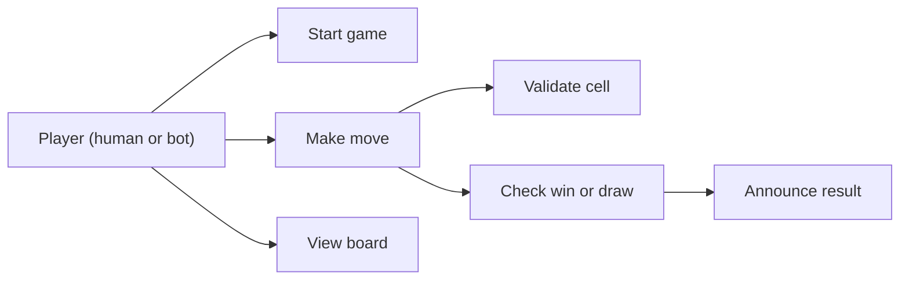

### Core entities

| Class | Responsibility |
|---|---|
| `Cell` (record) | Row + column of a square. |
| `Board` | The grid plus **per-player line counters**; `place` returns "did this win?" in O(1); `wouldWin` for bots; `isFull`, `emptyCells`, `render`. |
| `MoveStrategy` (interface) | Chooses the next cell. Implementations: `ScriptedStrategy`, `RandomStrategy`, `RuleBasedStrategy`. |
| `Player` (record) | Name, mark, strategy. |
| `GameState` (enum) | IN_PROGRESS, WON, DRAW. |
| `Game` | Turn order, move validation, state, winner, result. |

### Class diagram

There is no course lesson for this problem; it comes from the *awesome-low-level-design* problem set (3×3 grid, X and O turns, line wins, draw on a full board, display, validation, result). All of it is covered, generalised to N×N.

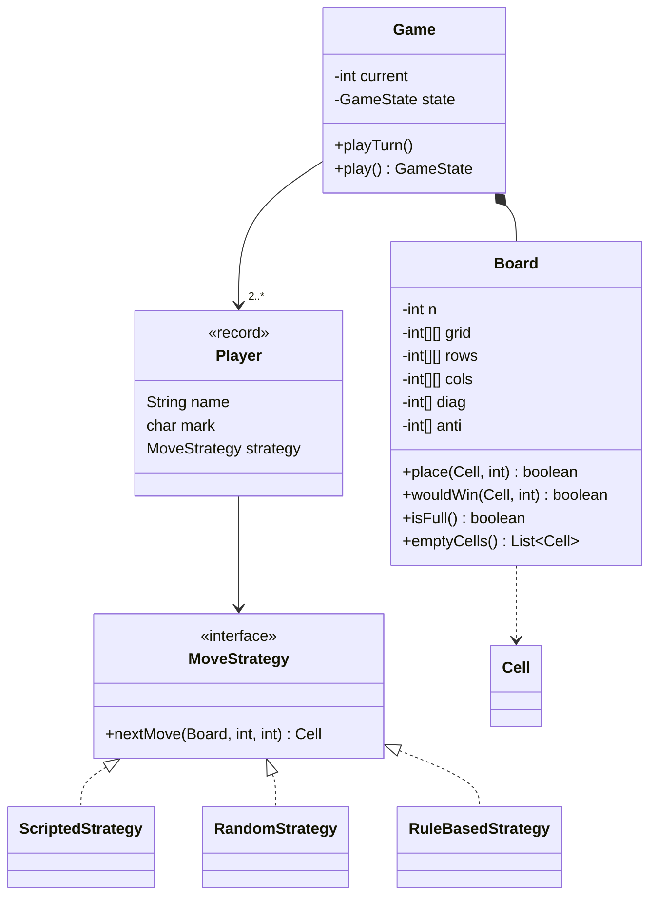

### Key flows

**O(1) win detection — how it works**

A naive win check scans every row, column and diagonal after each move: O(N²). But a move at `(r, c)` can only complete **row r, column c, and (maybe) the two diagonals**. So we keep counters:

1. `rows[p][r]` = how many marks player `p` has in row `r`; `cols[p][c]` likewise.
2. `diag[p]` counts marks on the main diagonal (`r == c`); `anti[p]` on the anti-diagonal (`r + c == N-1`).
3. When player `p` places at `(r, c)`, increment the counters that cell belongs to.
4. If any of them reaches **N**, player `p` owns the whole line — a win. Because only `p`'s marks increment `p`'s counters, no check for opponents' marks is needed.

Four increments and four comparisons: **O(1) time**, **O(P·N) memory** for P players.

> **The 2-player trick you may see online:** one shared counter per line, +1 for X and −1 for O; `|count| == N` means a win. It uses half the memory but only works for exactly two players. Our per-player counters work for any number of players.

The same counters give a free **"would this move win?"** check: an empty cell wins for `p` if any of its lines already has `N-1` of `p`'s marks. The rule-based bot uses it to *win* if possible and *block* the opponent otherwise.

**One turn**

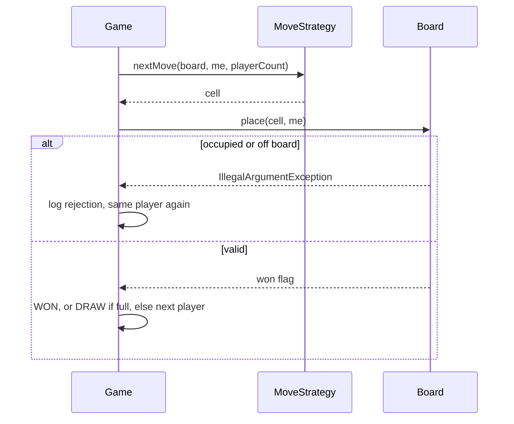

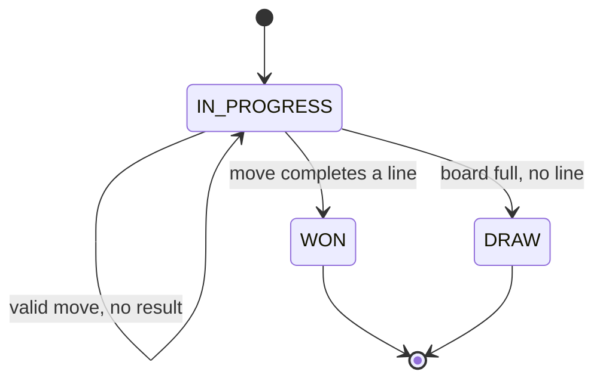

### Design decisions & patterns used

| Decision | Why | Alternative rejected |
|---|---|---|
| **Strategy** for player moves. | Human, random, rule-based, network or minimax players plug in; `Game` never changes. | `if (player.isComputer())` branches in `Game`. |
| Counters inside `Board` (not a separate "WinChecker" that scans). | O(1) check, kept next to the data it summarises. | Scanning all lines each move — O(N²) and duplicated for "would win". |
| Board returns "won?" from `place`. | The only moment a win can appear is right after a move. | Separate `checkWinner()` that the caller might forget to call. |
| Invalid move → exception from `Board`, caught by `Game`. | The board protects its invariant (a fact that must always stay true, e.g. one mark per cell); the game decides the policy (retry). | Silently ignoring a bad move. |
| Seeded `Random` injected into `RandomStrategy`. | Repeatable demos/tests. | `Math.random()` inside the bot. |
| Players as a list + index `current = (current+1) % size` (`%` is remainder, so the index wraps back to 0). | Works for any number of players. | Hard-coded X/O toggling. |

### Java implementation

Package `lld.ch17.tictactoe`; full runnable code (one file per class in Core entities, plus `ScriptedStrategy`, `RandomStrategy`, `RuleBasedStrategy` and `Main`) is in `code/lld/ch17/tictactoe/`. The essential lines (`/* ... */` and `//` summary comments stand for code left out):

```java
/**
 * N x N grid plus per-player line counters, so "did that move win?" is O(1) instead of O(N^2).
 * rows[p][r] = how many marks player p has in row r. Same idea for columns and the two diagonals.
 * A line is won when one player's count reaches N (other players' marks make that impossible).
 */
public final class Board {
    private final int[][] grid;       // -1 empty, otherwise player index
    private final int[][] rows, cols;
    private final int[] diag, anti;

    /** Places a mark and returns true if this move completed a line. O(1). */
    boolean place(Cell c, int player) {
        if (!inside(c)) throw new IllegalArgumentException("cell " + c + " is off the board");
        if (grid[c.row()][c.col()] != -1) throw new IllegalArgumentException("cell " + c + " is already taken");
        grid[c.row()][c.col()] = player;
        filled++;
        int r = c.row(), k = c.col();
        boolean win = ++rows[player][r] == n;
        win |= ++cols[player][k] == n;
        if (r == k) win |= ++diag[player] == n;
        if (r + k == n - 1) win |= ++anti[player] == n;
        return win;
    }

    /** Would placing player's mark on this empty cell win? Also O(1): a line needs exactly one more mark. */
    public boolean wouldWin(Cell c, int player) {
        int r = c.row(), k = c.col();
        return rows[player][r] == n - 1 || cols[player][k] == n - 1
                || (r == k && diag[player] == n - 1) || (r + k == n - 1 && anti[player] == n - 1);
    }
    public boolean isFull() { return filled == n * n; }
}

/** Strategy pattern: human input, scripted test moves, random bot, rule-based bot... all plug in here. */
public interface MoveStrategy { Cell nextMove(Board board, int me, int playerCount); }

/** Win if you can, else block an opponent's win, else take the centre, else the first corner, else anything. */
public final class RuleBasedStrategy implements MoveStrategy { /* uses board.wouldWin for me, then each opponent */ }
```

```java
/** Turn management and game state. Supports 2+ players on an N x N board (n >= 3). */
public final class Game {
    /** Plays one turn for the current player. An invalid cell is rejected and the same player goes again. */
    public void playTurn() {
        if (state != GameState.IN_PROGRESS) throw new IllegalStateException("game is over");
        Player p = players.get(current);
        Cell cell = p.strategy().nextMove(board, current, players.size());
        boolean won;
        try {
            won = board.place(cell, current);
        } catch (IllegalArgumentException e) {
            log.accept("  " + p.name() + " tried " + cell + ": rejected (" + e.getMessage() + "), try again");
            return;
        }
        if (won) { state = GameState.WON; winner = p; }
        else if (board.isFull()) state = GameState.DRAW;
        else current = (current + 1) % players.size();
    }
}
```

`Main.java` runs a scripted 3×3 game with one invalid move, rule-based bot vs seeded random bot (seed 7), a 4×4 rule-based mirror match, and a 5×5 three-player game (random seeds 1 and 2, plus one rule-based).

**Output:**

```text
== 1. 3x3 scripted game (with one invalid move) ==
  Xena (X) -> (0,0)
  Omar tried (0,0): rejected (cell (0,0) is already taken), try again
  Omar (O) -> (0,1)
  Xena (X) -> (1,1)
  Omar (O) -> (0,2)
  Xena (X) -> (2,2)
    X O O
    . X .
    . . X
  Result: Xena wins

== 2. 3x3 rule-based bot vs seeded random bot (seed 7) ==
  Bot (X) -> (1,1)
  Rand (O) -> (2,0)
  Bot (X) -> (0,0)
  Rand (O) -> (1,0)
  Bot (X) -> (2,2)
    X . .
    O X .
    O . X
  Result: Bot wins

== 3. 4x4 rule-based vs rule-based ==
    O O X X
    O O X X
    X X X O
    O O O X
  Result: draw

== 4. 5x5 with three players (two random, seeds 1 and 2; one rule-based) ==
    Z Z Z O O
    X O X Z X
    X X Z O O
    Z O O X O
    Z X X X Z
  Result: draw
```

**Reading the output.** Game 1 shows the retry after an invalid move and a diagonal win found by the O(1) counters. Game 2: the rule-based bot takes the centre, then a corner, and completes the diagonal against a seeded random bot (no block was needed: the random bot's two O's in column 0 were already blocked by the X in the corner). Game 3: two rule-based bots on 4×4 draw (the move lines are filtered out of the log for brevity). Game 4 runs the same counters with three players on 5×5 (a draw).

### Concurrency & edge cases

- **Many games on one server:** each `Game` owns its own `Board`, so games share nothing. Keep them in a thread-safe `ConcurrentHashMap<gameId, Game>` and process each game's moves one at a time (per-game lock or single-threaded actor).
- **Two clicks at once from the same game:** make `playTurn`/a `makeMove(player, cell)` method `synchronized` and check that the caller is the current player.
- **Edge cases:** move after game over (`IllegalStateException`); off-board or occupied cell (rejected, same player retries); a scripted strategy running out of moves (returns `null` → fail fast in tests); N = 3 minimum.
- **A cell on both diagonals** (the centre of an odd board) updates both diagonal counters — handled by two independent `if`s.

### Extensions & follow-up questions

- **"Win with K in a row on an N×N board (Gomoku, K = 5)?"** — Counters no longer work because lines are shorter than the board. After each move, walk out from the new cell in the 4 directions (horizontal, vertical, two diagonals) and count consecutive own marks: O(K) per move.
- **"Unbeatable AI?"** — Minimax over the game tree (3×3 has at most 9! = 362,880 move orders, easily searched); add alpha-beta pruning or memoisation (caching each evaluated position) for larger boards. Plug it in as another `MoveStrategy`.
- **"Undo?"** — Store moves in a stack (last in, first out); undo = clear the cell and **decrement** the counters (counters are reversible, unlike a boolean "won" flag).
- **"Online multiplayer?"** — Server holds the `Game`; clients send `makeMove(gameId, playerId, cell)`; the server broadcasts the new state (Observer).
- **"Replay a game?"** — The move list plus `ScriptedStrategy` replays it exactly.

### Real-world example

Google Search's built-in tic-tac-toe (search "tic tac toe") has difficulty levels — different computer players behind the same rules, i.e. this design's Strategy split. Tic-tac-toe is also the classic first minimax example in AI courses, because its full game tree is small enough to search completely.

### In the interview

**30-second answer:** "`Board` is N×N plus per-player counters for each row, column and the two diagonals. Placing a mark bumps at most four counters; if one hits N, that player wins — O(1) per move. `Game` holds a list of players and a turn index, validates moves, and ends on a win or a full board. Each `Player` has a `MoveStrategy` — human, random with a seeded `Random`, or rule-based that wins if it can and blocks otherwise."

**Time plan:** 5 min requirements and N×N/players → 5 min entities → 10 min the counter idea (draw it!) → 15 min code → 5 min extensions (K-in-a-row, minimax, undo).

### Self-check

1. **Q:** Why does a move only need to check four lines? **A:** A cell belongs to exactly one row, one column, and at most the two diagonals.
2. **Q:** How do you know a cell is on the anti-diagonal? **A:** `row + col == N - 1`.
3. **Q:** Why per-player counters instead of +1/−1? **A:** They work for more than two players and give "would win" for any player.
4. **Q:** How is a draw detected? **A:** No win and the number of filled cells equals N².
5. **Q:** How do you test a bot that plays randomly? **A:** Inject `new Random(seed)`; the game is then identical every run.

### TL;DR

- Per-player row/column/diagonal counters → O(1) win check; `N-1` → O(1) "would win".
- `Game` = players list + turn index + state enum; invalid moves rejected, same player retries.
- Players via `MoveStrategy` (human, random-seeded, rule-based, minimax later).
- K-in-a-row needs a directional walk from the last move instead.

---

## Design Snake and Ladder

### Problem & clarifying questions

**Snake and Ladder** is a race on a numbered board (usually 1–100). Players take turns rolling a die and move forward by the number rolled. Landing on the **foot of a ladder** takes you up to its top; landing on the **head of a snake** sends you down to its tail. The first to reach the last square wins. There are no decisions — everything is dice and rules — so the design is about a **clean rules engine**, **turn management** and **testable randomness**.

| Question | Assumed answer |
|---|---|
| Board size and snakes/ladders? | Configurable (default 100 squares, a given list of snakes and ladders). Validate the config. |
| How many dice? | Configurable: count and faces (default one six-sided die). |
| How many players? | Two or more; all start off the board (square 0). |
| Overshooting the last square? | Configurable: **exact finish** (stay put) or **bounce back**. |
| Rolling a six? | Common house rule (an optional rule some players add): roll again; three sixes in a row cancels the whole turn. Configurable on/off. |
| When does the game end? | Configurable: **first to finish** wins, or keep playing to **rank everyone**. |
| Several games at once? | Yes, independent sessions (e.g. many groups online). |

### Requirements

**Functional**

1. A numbered board (typically 100 cells) with predefined snakes and ladders; several players, one token each, starting off the board.
2. Players take turns rolling the dice and move forward by the total; a snake head slides the token to its tail, a ladder foot climbs to its top.
3. Overshooting the last square follows the exact-finish or bounce-back rule; optional bonus roll on a six, with the three-sixes penalty.
4. The game continues until the win strategy says it is over (first to finish, or everyone ranked).
5. Many independent game sessions run at once.

**Non-functional**

- **Deterministic** dice for tests (seeded or loaded).
- Rules are **pluggable** without editing the game loop.
- Invalid boards are rejected **at construction**, not discovered mid-game.

### Use cases

Actors: **Player** (rolls the dice — or the system rolls for them), **Game admin/host** (configures board, dice and rules, starts a game). Use cases: *configure board*, *add players*, *start game*, *take turn* (roll → move → apply snake/ladder → maybe bonus roll), *declare winner / standings*.

### Core entities

| Class | Responsibility |
|---|---|
| `Jump` (record) | A snake or a ladder: `start → end`. One class, because the behaviour is identical ("land on start, move to end"); `isSnake()` is just `end < start`. |
| `Board` | Size + `Map<start, Jump>` for O(1) lookup; validates configuration. |
| `Dice` (interface) | `roll()`, `maxRoll()`. `RandomDice` (count, faces, seeded `Random`), `LoadedDice` (scripted rolls for tests). |
| `OverflowRule` (functional interface — exactly one method, so a lambda, a short unnamed function like `x -> x + 1`, can implement it) | Where a roll past the end lands: `exactFinish()` or `bounceBack()`. |
| `WinStrategy` (functional interface) | When the game ends: `firstToFinish()` or `rankAll()`. |
| `Rules` (record) | Bundles a variant: overflow rule, win strategy, six-rolls-again flag, max bonus rolls. |
| `Player` | Name and position. |
| `Game` | Turn queue, `playTurn()`, `play(maxTurns)`, standings, event log. |

### Class diagram

There is no course lesson for this problem; it comes from the *awesome-low-level-design* problem set, whose requirements are all covered above — including many independent game sessions at once (its reference solution uses a singleton `GameManager` with one thread per session); part 6 of the output runs eight sessions in parallel.

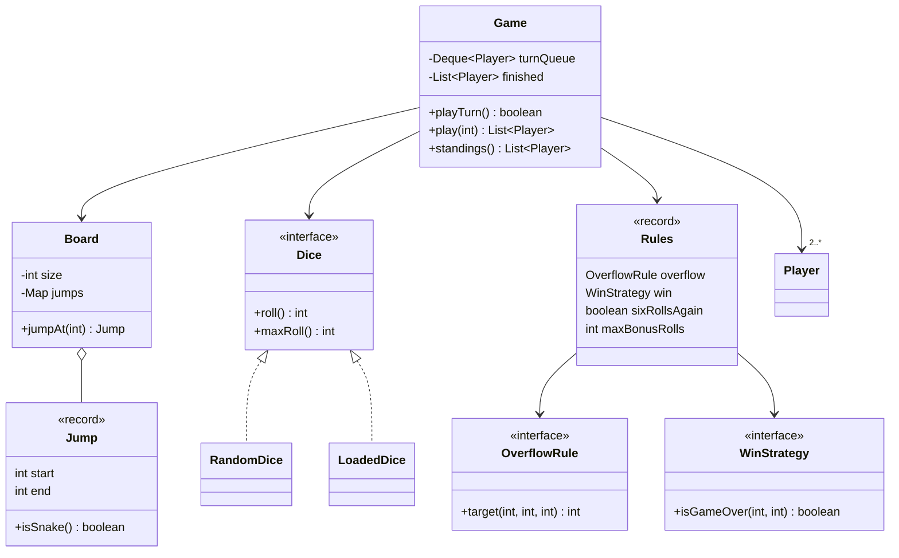

### Key flows

**One turn**

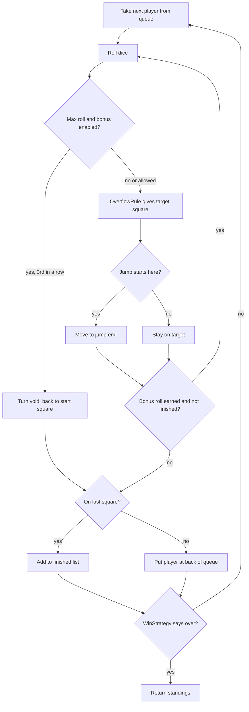

**Board validation (done once, in the constructor)**

1. A jump must not start and end on the same square.
2. No jump starts on square 1 or the last square (you could never win if the last square were a snake).
3. No two jumps share a start square.
4. A jump may not end on another jump's start. This forbids chains, and therefore also forbids infinite loops (snake A → ladder B → snake A...).

### Design decisions & patterns used

| Decision | Why | Alternative rejected |
|---|---|---|
| **One `Jump` type** for snakes and ladders. | Identical behaviour; the direction is data. | `Snake` and `Ladder` classes with duplicate code — only worth it if they behave differently. |
| `Map<Integer, Jump>` lookup. | O(1) per move instead of scanning a list. | Array of size 101 — also fine; a map scales to sparse or huge boards. |
| **Strategy** for `Dice`, `OverflowRule`, `WinStrategy`. | House rules vary a lot; each is swappable. Lambdas keep them tiny. | Flags and `if`s in the game loop. |
| `Rules` record groups a variant. | One object = one rule set ("classic", "kids", "tournament"); easy to pass around. | Many constructor parameters on `Game`. |
| **Queue** of players. | Natural turn order; finished players simply are not re-queued. | Index arithmetic that must skip finished players. |
| Event log via `Consumer<String>` (a built-in "takes a value, returns nothing" function type). | The engine does not print; the caller decides (console, UI, nothing). A full design would use **Observer** (`GameListener.onMove/onSnake/onLadder/onWin`). | `System.out.println` inside the engine. |
| Validation in the `Board` constructor (fail fast). | The loop can trust the board. | Detecting a loop mid-game. |
| `play(maxTurns)` guard. | A misconfigured rule set can never hang (loop forever and never finish) a server thread. | An unbounded `while (true)`. |

### Java implementation

Package `lld.ch17.snakeladder`; full runnable code (one file per class in Core entities, plus `RandomDice`, `LoadedDice` and `Main`) is in `code/lld/ch17/snakeladder/`. The essential lines (`/* ... */` and `//` summary comments stand for code left out):

```java
/** A snake (goes down) or a ladder (goes up). Both are just "land on start -> move to end". */
public record Jump(int start, int end) {
    public boolean isSnake() { return end < start; }
}

/** Board configuration: size plus a map start -> Jump for O(1) lookup. Validated once, up front. */
public final class Board {
    public Board(int size, Collection<Jump> all) {
        if (size < 10) throw new IllegalArgumentException("board too small");
        for (Jump j : all) {
            if (j.start() == j.end()) throw new IllegalArgumentException("jump to itself: " + j);
            if (j.start() <= 1 || j.start() >= size) throw new IllegalArgumentException("jump cannot start on first/last square: " + j);
            if (j.end() < 1 || j.end() > size) throw new IllegalArgumentException("jump ends off board: " + j);
            if (jumps.putIfAbsent(j.start(), j) != null) throw new IllegalArgumentException("two jumps start at " + j.start());
        }
        for (Jump j : jumps.values())   // no chains: an end square may not be another jump's start (also rules out loops)
            if (jumps.containsKey(j.end())) throw new IllegalArgumentException("jump " + j + " ends on another jump's start");
    }
    public Jump jumpAt(int square) { return jumps.get(square); }   // or null
}

/** Strategy for rolling. Real dice use a seeded Random; tests use a fixed sequence. */
public interface Dice { int roll(); int maxRoll(); }

/** What happens when a roll would carry a token past the last square. */
@FunctionalInterface
public interface OverflowRule {
    int target(int from, int roll, int size);
    /** Must land exactly on the last square, otherwise stay put. */
    static OverflowRule exactFinish() { return (from, roll, size) -> from + roll > size ? from : from + roll; }
    /** Bounce back by the extra amount (at 98 on a 100 board, a 5 goes to 100 then back to 97). */
    static OverflowRule bounceBack() { return (from, roll, size) -> from + roll > size ? size - (from + roll - size) : from + roll; }
}

/** When is the whole game over? */
@FunctionalInterface
public interface WinStrategy {
    boolean isGameOver(int finishedPlayers, int totalPlayers);
    static WinStrategy firstToFinish() { return (finished, total) -> finished >= 1; }       // classic
    static WinStrategy rankAll()       { return (finished, total) -> finished >= total - 1; } // play on to rank everybody
}

/** One game variant as one object. sixRollsAgain: max roll earns another; maxBonusRolls in a row voids the turn. */
public record Rules(OverflowRule overflow, WinStrategy win, boolean sixRollsAgain, int maxBonusRolls) {
    public static Rules classic() { return new Rules(OverflowRule.exactFinish(), WinStrategy.firstToFinish(), true, 3); }
}
```

```java
/** Turn loop: a queue of players, a dice strategy, a board and a rule set. */
public final class Game {
    public boolean playTurn() {
        Player p = turnQueue.poll();
        takeTurn(p);
        if (p.position() == board.size()) finished.add(p);   // finished players are simply not re-queued
        else turnQueue.offer(p);
        return isOver();                                      // rules.win().isGameOver(finished, total)
    }
    /** Plays until the win strategy says stop; maxTurns guards against a misconfigured rule set. */
    public List<Player> play(int maxTurns) { /* throws "no result after N turns" */ }

    private void takeTurn(Player p) {
        int start = p.position(), bonus = 0;
        while (true) {
            int roll = dice.roll();
            boolean max = rules.sixRollsAgain() && roll == dice.maxRoll();
            if (max && ++bonus == rules.maxBonusRolls()) { p.moveTo(start); break; }   // too many sixes: turn void
            move(p, roll);
            if (!max || p.position() == board.size()) break;
        }
    }
    private void move(Player p, int roll) {
        int target = rules.overflow().target(p.position(), roll, board.size());
        if (target == p.position()) return;                   // needs exact roll, stays put
        Jump j = board.jumpAt(target);
        if (j != null) target = j.end();
        p.moveTo(target);
    }
}
```

`Main.java` uses a 100-square board with ladders 4→14, 9→31, 21→42, 28→84, 51→67, 71→91, 80→99 and snakes 17→7, 54→34, 62→19, 64→60, 87→24, 93→73, 95→75, 98→79. Step 6 runs eight independent sessions on eight threads; each owns its players, turn queue and seeded dice and shares only the read-only `Board`, so each must give the same winner as when run alone.

**Output:**

```text
== 1. Loaded dice: ladder, bonus roll, snake, three sixes ==
  Ann @0: rolls 4 -> 4 (ladder to 14)
  Bob @0: rolls 6 -> 6, bonus roll: rolls 3 -> 9 (ladder to 31)
  Ann @14: rolls 3 -> 17 (snake to 7)
  Bob @31: rolls 6 -> 37, bonus roll: rolls 6 -> 43, bonus roll: rolls 6 -> 3 sixes in a row, turn void, back to 31

== 2. Overflow rules: token on 97 of 100, rolls a 5 ==
  Exact @97: rolls 5 -> needs exact roll, stays at 97
  Bounce @97: rolls 5 -> 98

== 3. Bad configurations are rejected up front ==
  rejected: jump cannot start on first/last square: Jump[start=100, end=5]
  rejected: jump Jump[start=10, end=30] ends on another jump's start

== 4. Seeded game (seed 2024), 3 players, first to finish wins ==
  Ann @0: rolls 1 -> 1
  Bob @0: rolls 3 -> 3
  Cid @0: rolls 1 -> 1
  Ann @1: rolls 5 -> 6
  Bob @3: rolls 6 -> 9 (ladder to 31), bonus roll: rolls 6 -> 37, bonus roll: rolls 6 -> 3 sixes in a row, turn void, back to 3
  Cid @1: rolls 6 -> 7, bonus roll: rolls 1 -> 8
  Ann @6: rolls 6 -> 12, bonus roll: rolls 4 -> 16
  Bob @3: rolls 4 -> 7
  Cid @8: rolls 3 -> 11
  Ann @16: rolls 4 -> 20
  Bob @7: rolls 2 -> 9 (ladder to 31)
  Cid @11: rolls 3 -> 14
  Ann @20: rolls 4 -> 24
  Bob @31: rolls 5 -> 36
  Cid @14: rolls 6 -> 20, bonus roll: rolls 1 -> 21 (ladder to 42)
  Ann @24: rolls 4 -> 28 (ladder to 84)
  Bob @36: rolls 3 -> 39
  Cid @42: rolls 5 -> 47
  Ann @84: rolls 4 -> 88
  Bob @39: rolls 5 -> 44
  Cid @47: rolls 3 -> 50
  Ann @88: rolls 1 -> 89
  Bob @44: rolls 6 -> 50, bonus roll: rolls 4 -> 54 (snake to 34)
  Cid @50: rolls 1 -> 51 (ladder to 67)
  Ann @89: rolls 4 -> 93 (snake to 73)
  Bob @34: rolls 2 -> 36
  Cid @67: rolls 5 -> 72
  Ann @73: rolls 6 -> 79, bonus roll: rolls 2 -> 81
  Bob @36: rolls 3 -> 39
  Cid @72: rolls 3 -> 75
  Ann @81: rolls 4 -> 85
  Bob @39: rolls 5 -> 44
  Cid @75: rolls 2 -> 77
  Ann @85: rolls 5 -> 90
  Bob @44: rolls 2 -> 46
  Cid @77: rolls 2 -> 79
  Ann @90: rolls 2 -> 92
  Bob @46: rolls 6 -> 52, bonus roll: rolls 5 -> 57
  Cid @79: rolls 1 -> 80 (ladder to 99)
  Ann @92: rolls 2 -> 94
  Bob @57: rolls 4 -> 61
  Cid @99: rolls 1 -> 100
  *** Cid finishes in place 1 ***
  Winner: Cid

== 5. Same seed, rank-everyone rule, bounce-back overflow (log hidden) ==
  Standings: Cid > Ann > Bob

== 6. Eight independent sessions on eight threads at once ==
  winners by seed: {1=Ann, 2=Bob, 3=Cid, 4=Bob, 5=Cid, 6=Cid, 7=Ann, 8=Bob}
  same as running each session alone? yes
```

**Reading the output.** Part 1 uses loaded dice to force every rule: Ann climbs 4→14, Bob rolls a 6 and gets a bonus roll that lands on the 9→31 ladder, Ann hits the 17→7 snake, and Bob's three sixes void his turn (he goes back to 31). Part 2 compares overflow rules from square 97 with a roll of 5: exact-finish stays, bounce-back goes to 100 and back 2 to 98. Part 3 shows bad boards rejected. Part 4 is a full seeded game; Part 5 replays with different rules and ranks every player. Part 6 runs eight games with different seeds on eight threads at the same time and checks that each winner is exactly what the same seed gives when that game runs alone — proof that sessions share no mutable state (data that can be changed after creation).

### Concurrency & edge cases

- **Many sessions:** each `Game` owns its players, queue and dice. Give **each game its own `Random`** (sharing one `java.util.Random` across threads is thread-safe but makes threads contend for it and breaks per-game reproducibility). Keep games in a `ConcurrentHashMap` and run each game's turns on one thread at a time.
- **Rolling after the game ends** → `IllegalStateException`.
- **A player on the last square** is removed from the queue, so they are never asked to roll again.
- **Bonus roll that finishes the game** stops immediately — no roll after reaching 100.
- **Three sixes** → the turn is voided, and the token returns to where the turn started (even if a ladder was climbed during the turn).
- **Bounce-back landing on a snake** (e.g. bouncing to 98 on the standard board) is applied — the rule output goes through the same jump lookup.
- **Endless games** are impossible with a valid board and fair dice (probability of never finishing is 0), but `maxTurns` guards against bad custom rules.

### Extensions & follow-up questions

- **"Add special cells (skip a turn, extra move, teleport)."** — Generalise `Jump` into a `CellEffect` interface (`apply(player, game)`); snakes and ladders become two implementations.
- **"Two dice, or a 1–12 die?"** — `new RandomDice(2, 6, rng)`; `maxRoll()` is 12, so the bonus rule triggers on double-max. Note that 2d6 (two six-sided dice added) is not uniform — 7 is the most likely total — which changes game balance.
- **"Players must roll a 6 to enter the board."** — A new rule strategy: `EntryRule` checked when position is 0.
- **"Pause and resume."** — Serialize (save to bytes or text that can be loaded back) the positions, queue order and dice state (or a seed plus the number of rolls so far).
- **"Real-time UI / spectators?"** — Observer: publish `PlayerMoved`, `SnakeBitten`, `LadderClimbed`, `PlayerFinished` events.
- **"Random board generation?"** — A `BoardGenerator` with a seed, calling the same validating constructor.

### Real-world example

Online multiplayer board-game apps (for example Ludo King, which also offers a Snakes & Ladders mode) have to solve the same problems as this design: every match is an isolated session with its own state, the dice must be rolled where players cannot tamper with them (on the server, not in the client app), and each move is pushed to all players as an event. That is the "one game = isolated state + injected dice + event stream" split used here.

### In the interview

**30-second answer:** "`Board` holds size and a map from square to `Jump` (snake or ladder — same behaviour, just direction), validated on construction. `Dice` is a strategy: seeded random for play, loaded for tests. `Rules` bundles pluggable policies: overflow (exact or bounce), win strategy (first finish or rank all), and the bonus-six rule. `Game` keeps a queue of players; each turn rolls, applies the overflow rule, then any jump, and re-queues the player unless they finished."

**Time plan:** 5 min rules questions (overshoot, sixes, win) → 5 min entities → 10 min diagram + validation rules → 15 min code turn loop → 5 min extensions and concurrency.

### Self-check

1. **Q:** Why is one `Jump` class enough for snakes and ladders? **A:** Both mean "land on start, go to end"; only the direction differs, which is data.
2. **Q:** How do you guarantee there is no infinite snake/ladder loop? **A:** Forbid any jump from ending on another jump's start.
3. **Q:** How do you test "three sixes voids the turn"? **A:** `LoadedDice(6, 6, 6)` and assert the position is unchanged.
4. **Q:** What changes to support "bounce back"? **A:** Pass `OverflowRule.bounceBack()` — no game-loop edits.
5. **Q:** Why a queue for turns? **A:** Players who finish simply are not put back; turn order stays correct.

### TL;DR

- Board = size + `Map<start, Jump>`; validate once (no jump on last square, no chains/loops).
- Dice, overflow, win condition, bonus rule are all strategies; seeded or loaded dice for tests.
- Queue-based turn loop with a `maxTurns` guard; events go to a listener, not `System.out`.

---

## Design 2048

### Problem & clarifying questions

**2048** is a single-player sliding puzzle on a 4×4 grid. Each move (left, right, up, down) slides every tile as far as possible in that direction. Two tiles with the **same value** that collide **merge** into one tile with double the value, and the merged value is added to the **score**. After every move that changes the board, a new tile (a 2 most of the time, sometimes a 4) appears in a random empty cell. You "win" by making a 2048 tile; the game is **over** when no move can change the board.

There is no course lesson for this problem. The statement is the common machine-coding version (a *machine-coding* round is one where you write working code for a small system in 1–2 hours; this exercise appears in LLD practice lists such as Tharun's). Its specific rules, all covered below: start with **two tiles numbered 2**; if **three** equal tiles line up, the pair **nearest the wall you move toward** merges; if **four** are equal, the first two and the last two merge; read moves as **0 = left, 1 = right, 2 = up, 3 = down**.

| Question | Assumed answer |
|---|---|
| Board size? | Configurable N (default 4). |
| New tile? | One per successful move: value 2 with probability 0.9, else 4, in a uniformly random empty cell. The game starts with two 2s. |
| Merge rule? | Each tile merges **at most once per move**; merges happen from the wall you move toward. |
| Move that changes nothing? | Not a turn: no new tile, no score. |
| Win? | Reaching the target tile (2048, configurable). The player may continue afterwards. |
| Game over? | No empty cell **and** no two equal neighbours (horizontally or vertically). |
| Undo, high scores, animations? | Out of scope; see Extensions. |

### Requirements

**Functional**

1. Start an N×N board with two tiles numbered 2 at random positions.
2. Move in four directions: slide, merge equal neighbours once, add merged values to the score.
3. If the move changed the board, spawn one tile (2 or 4) in a random empty cell.
4. Detect reaching the target (WON, then allow continuing).
5. Detect game over (LOST) when no move is possible.
6. Accept the command-line codes 0/1/2/3 for left/right/up/down (`Direction.fromKey`).

**Non-functional**

- **Deterministic** spawns via an injected, seeded `Random` for tests.
- The merge logic must be written **once**, not four times (one per direction).
- The spawning rule is pluggable (e.g. an "evil" spawner for testing hard cases).

### Use cases

Actor: **Player**. Use cases: *start new game*, *make a move* (includes *slide and merge*, *spawn tile*, *update score*), *see win*, *see game over*, *restart*.

### Core entities

| Class | Responsibility |
|---|---|
| `Direction` (enum) | LEFT, RIGHT, UP, DOWN; `fromKey(0..3)` maps the command-line codes. |
| `LineMerger` | Pure function (output depends only on input; changes nothing else): slide and merge **one line toward index 0**; returns the new line and points. |
| `Board` | N×N values; maps each direction onto lines for `LineMerger`; `slide`, `hasMove`, `maxTile`, `emptyCells`, `render`. |
| `TileSpawner` (interface) / `RandomTileSpawner` | Adds a new tile; seeded `Random`, 90% twos. `spawnStart` places the two starting tiles (always 2s). |
| `GameStatus` (enum) | PLAYING, WON, LOST. |
| `Game` | Score, move count, status; ties slide + spawn + status together. |

### Class diagram

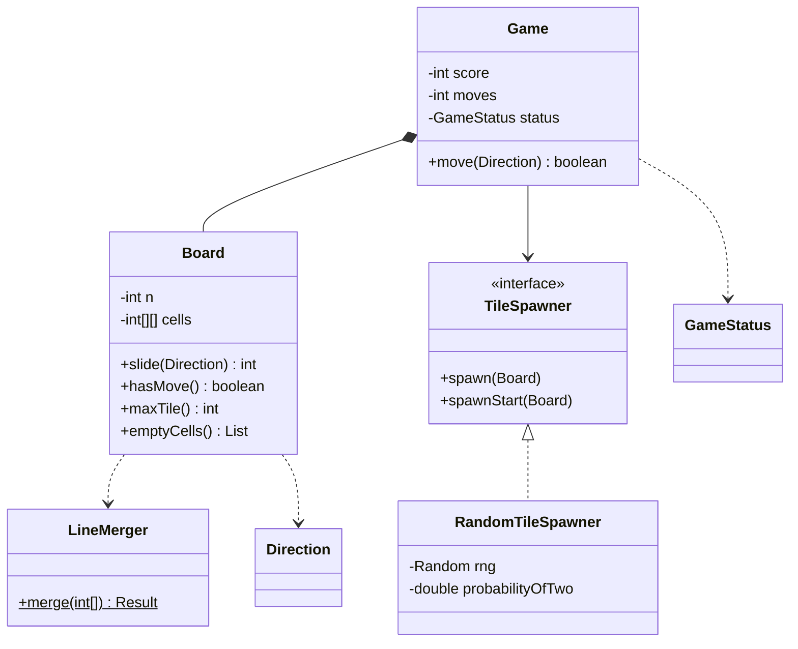

### Key flows

**Merging one line (toward index 0)** — the whole game in one function:

1. Walk the line from the wall outward, skipping zeros.
2. Keep one **pending** tile. If the next non-zero tile equals it, write the doubled value, add it to the points, and clear pending — so the new tile **cannot merge again this move**.
3. If it differs, write the pending tile and make the new tile pending.
4. At the end, write any pending tile; the rest of the line is zeros.

Examples (moving left): `[2,2,2,2] → [4,4,0,0]` (two merges, not one 8), `[2,2,2,0] → [4,2,0,0]` (of three equal tiles, the pair nearest the wall merges), `[2,2,4,0] → [4,4,0,0]` (the new 4 does not merge with the old 4), `[4,0,4,8] → [8,8,0,0]`.

**One function for four directions.** `Board.coords(direction, i, j)` maps "line `i`, position `j` counted from the wall" to a real cell:

| Direction | Line i is | j = 0 is |
|---|---|---|
| LEFT | row i | column 0 |
| RIGHT | row i | column N-1 |
| UP | column i | row 0 |
| DOWN | column i | row N-1 |

Read each line in that order, merge it with `LineMerger`, write it back. No duplicated slide code.

**A move**

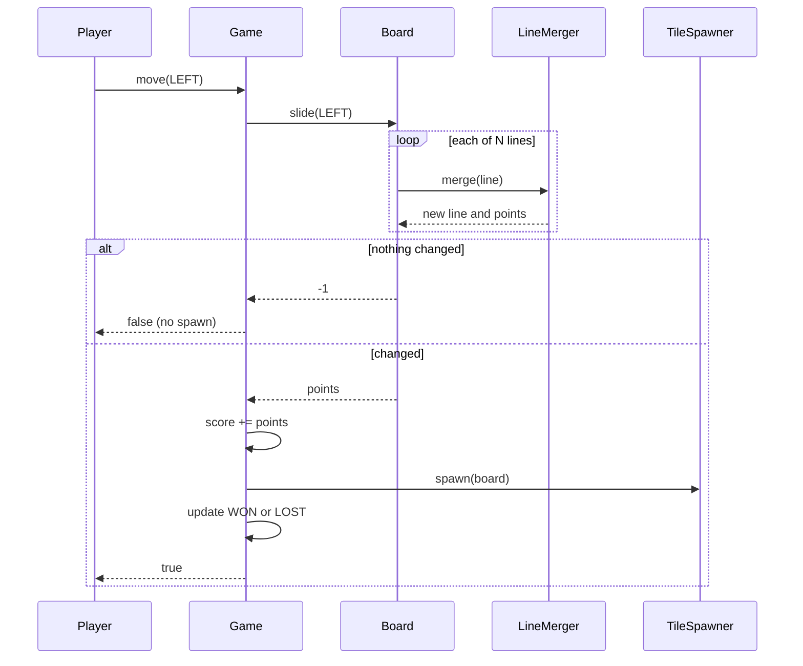

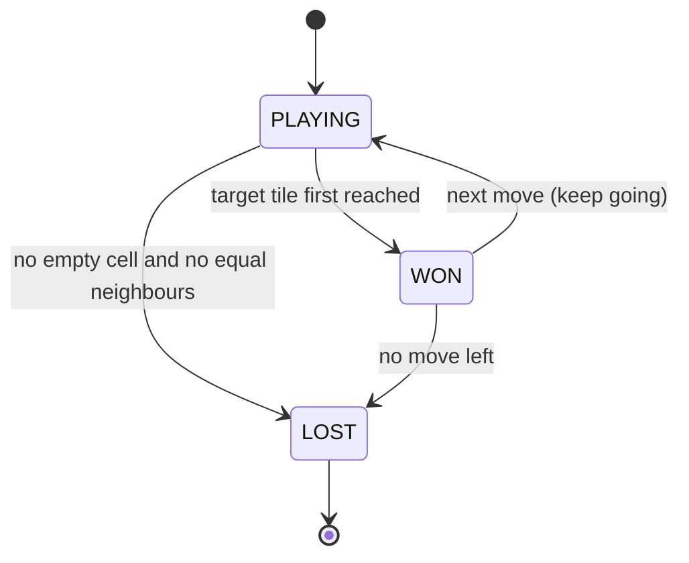

**Game-over check.** A move is possible if **any cell is empty** or **any two neighbours are equal**. It is enough to compare each cell with its right and lower neighbour (the other two directions are covered by the neighbour's own check). O(N²).

### Design decisions & patterns used

| Decision | Why | Alternative rejected |
|---|---|---|
| **One pure `LineMerger`** + direction→coordinates mapping. | The tricky rule is written and tested once (DRY — "Don't Repeat Yourself"). | Four copies of nested loops (`moveLeft`, `moveRight`...) — classic bug farm. |
| `LineMerger` is a **pure function** (no state). | Trivial to unit test (test one small piece of code on its own; Part 1 of the output). | Merge logic mixed with board mutation. |
| **Strategy** for spawning (`TileSpawner`). | Seeded tests, "evil" spawner, different probabilities for variants. | `Math.random()` inside `Board`. |
| "No change = no turn" detected by comparing each written cell. | Matches the real game; prevents spawning on a no-op. | Always spawning — makes the game unwinnable/unfair. |
| `Board.of(int[][])` factory for preset boards. | Game-over and edge-case tests without playing to that position. | Only random starts — untestable edge cases. |
| Status updated after each move; WON only once. | The player can continue past 2048, as in the original game. | Ending the game at 2048. |

### Java implementation

Package `lld.ch17.game2048`; full runnable code (one file per class in Core entities, plus `Main`) is in `code/lld/ch17/game2048/`. The essential lines (`/* ... */` and `//` summary comments stand for code left out):

```java
/**
 * The heart of 2048, written for ONE line moving toward index 0. Every direction is reduced to this.
 * Rule: slide tiles together, merge equal neighbours once per move, the merge nearest the wall first.
 */
public final class LineMerger {
    public record Result(int[] line, int points) {}          // points = sum of merged tile values

    public static Result merge(int[] in) {
        int[] out = new int[in.length];
        int write = 0, points = 0;
        int pending = 0;                        // tile waiting for a possible merge partner
        for (int v : in) {
            if (v == 0) continue;
            if (pending == 0) {
                pending = v;
            } else if (pending == v) {
                out[write++] = v * 2;           // merge, and the new tile cannot merge again this move
                points += v * 2;
                pending = 0;
            } else {
                out[write++] = pending;
                pending = v;
            }
        }
        if (pending != 0) out[write] = pending;
        return new Result(out, points);
    }
}

/** Strategy for adding a new tile after each successful move. */
public interface TileSpawner {
    void spawn(Board board);                                  // one tile in a random empty cell
    default void spawnStart(Board board) { spawn(board); }   // one of the two starting tiles
}
// RandomTileSpawner: a 2 with probability 0.9, else a 4, in a uniformly random empty cell (seeded);
// spawnStart always places a 2 (the problem statement starts with two 2s).
```

```java
/** N x N grid of tile values (0 = empty). Board.of(int[][]) builds preset boards for tests. */
public final class Board {
    /** Slides every line toward the wall. Returns points earned, or -1 if nothing moved (no turn, no spawn). */
    int slide(Direction d) {
        boolean changed = false;
        int points = 0;
        for (int i = 0; i < n; i++) {
            int[] line = new int[n];
            for (int j = 0; j < n; j++) line[j] = read(d, i, j);       // j = 0 is the cell next to the wall
            LineMerger.Result res = LineMerger.merge(line);
            for (int j = 0; j < n; j++) {
                if (read(d, i, j) != res.line()[j]) changed = true;
                write(d, i, j, res.line()[j]);
            }
            points += res.points();
        }
        return changed ? points : -1;
    }
    /** Maps (line i, position j from the wall) to a real cell for each direction. */
    private int[] coords(Direction d, int i, int j) {
        return switch (d) {
            case LEFT -> new int[]{i, j};
            case RIGHT -> new int[]{i, n - 1 - j};
            case UP -> new int[]{j, i};
            case DOWN -> new int[]{n - 1 - j, i};
        };
    }
    /** A move exists if a cell is empty or two neighbours (right or below) are equal. */
    public boolean hasMove() { /* ... */ }
}

/** One game: board + spawner + score + status. Reaching the target sets WON once; the player may keep going. */
public final class Game {
    public boolean move(Direction d) {
        if (status == GameStatus.LOST) throw new IllegalStateException("game over");
        int points = board.slide(d);
        if (points < 0) return false;          // nothing moved: no spawn, no turn
        score += points;
        moves++;
        spawner.spawn(board);                  // at least one cell is empty, because something moved or merged
        updateStatus();
        return true;
    }
    private void updateStatus() {
        if (!reachedTarget && board.maxTile() >= target) { reachedTarget = true; status = GameStatus.WON; }
        else if (status == GameStatus.WON) status = GameStatus.PLAYING;   // "keep going" after the win screen
        if (!board.hasMove()) status = GameStatus.LOST;
    }
}
```

`Main.java` prints merge results for seven sample lines, shows a no-op move, checks game-over on preset boards, prints the key codes, and plays a seeded game (`new Random(42)`) with the corner strategy LEFT > DOWN > RIGHT > UP and target 128.

**Output:**

```text
== 1. Merge rules for one line moving left ==
  [2, 2, 2, 2] -> [4, 4, 0, 0]  +8
  [2, 2, 2, 0] -> [4, 2, 0, 0]  +4
  [2, 2, 4, 0] -> [4, 4, 0, 0]  +4
  [4, 0, 4, 8] -> [8, 8, 0, 0]  +8
  [2, 0, 0, 2] -> [4, 0, 0, 0]  +4
  [8, 4, 2, 2] -> [8, 4, 4, 0]  +4
  [2, 4, 8, 16] -> [2, 4, 8, 16]  +0

== 2. A move that changes nothing does not count and spawns nothing ==
  move LEFT changed board? false, moves=0
  move DOWN changed board? true, moves=1
       .    .    .    .
       .    .    .    .
       .    2    .    .
       2    4    8   16

== 3. Game-over detection ==
  checkerboard, no empty cell, no equal neighbours -> LOST
  same but last row ends 4,4 -> PLAYING

== 4. Keyboard codes from the problem statement ==
  0=LEFT  1=RIGHT  2=UP  3=DOWN

== 5. Seeded game (seed 42), corner strategy LEFT > DOWN > RIGHT > UP, target 128 ==
  start:
       .    .    .    2
       .    .    .    .
       .    .    .    2
       .    .    .    .
  reached 128 after 85 moves (status WON), score 852
       8    2    .    .
      16    4    4    .
       2    8    4    .
     128    4    .    .
  game over after 232 moves, score 2584, max tile 256
      16    8    4    2
       8   32    8    4
      16    2   16    8
     256   64   32   16
```

**Reading the output.** Part 1 unit-tests the merge rule (note `[2,2,2,2]` becomes `[4,4,0,0]`, not `[8,0,0,0]`, and `[2,2,2,0]` becomes `[4,2,0,0]`). Part 2 shows that a move changing nothing does not count. Part 3 checks game-over detection on preset boards. Part 4 prints the command-line key mapping. Part 5 plays a whole seeded game that starts from two 2s, using a simple "keep tiles in the bottom-left corner" priority strategy; it reaches the 128 target after 85 moves (status `WON`) and keeps playing until the board locks after 232 moves with a 256 tile.

### Concurrency & edge cases

- Single-player and single-threaded by nature. If a UI thread (the one drawing the screen) and an input thread both call `move`, make `move` `synchronized` or post moves to the UI event queue, which the UI thread handles one by one.
- **Key repeat / double input:** a no-op move returns `false` and changes nothing, so extra key presses are harmless.
- **Spawning needs an empty cell:** guaranteed, because a changed board after sliding always has at least one empty cell (tiles only move into gaps or merge, which frees a cell). The spawner still checks and throws if not.
- **Integer overflow** (a value wrapping past its type's maximum): not reachable on 4×4 (the maximum possible tile is 2^17 = 131072); any practical board still fits an `int`.
- **Merge order matters:** `[2,2,2]` moving left is `[4,2,0]` — the pair nearest the wall merges first.

### Extensions & follow-up questions

- **"Add undo."** — Memento: push a copy of the board and score before each successful move; undo pops it (the spawned tile disappears too).
- **"Different sizes / targets?"** — Already parameters (`new Game(5, 4096, spawner)`).
- **"An AI player?"** — Expectimax search (max over your moves, average over random spawns) is the well-known approach; plug it in as a move-choosing strategy like the corner strategy in `Main`.
- **"Animations?"** — Have `LineMerger` also return where each tile came from (a list of moves/merges) and publish them to the view (Observer, MVC).
- **"High scores / leaderboard?"** — A separate service; the game only emits "game over with score X".
- **"Why is `[2,2,4]` left `[4,4,0]` and not `[8,0,0]`?"** — Each tile merges at most once per move; the new 4 was created this move.

### Real-world example

2048 was created by Gabriele Cirulli in 2014 as open-source JavaScript with the same separation: a grid model, a game manager that handles moves, merges, score and "keep playing" after a win, and a separate view that animates tiles. Its new tiles are 2 with 90% probability and 4 with 10%, the same rule our `RandomTileSpawner` uses.

### In the interview

**30-second answer:** "The core is one pure function that slides and merges a single line toward index 0: skip zeros, merge equal neighbours once, score the merged values. The board maps each direction to lines in the right order, so the function is reused four times. After a move that changes the board, a `TileSpawner` — seeded for tests — adds a 2 (90%) or a 4. The game is won when the target tile appears and over when there's no empty cell and no equal neighbours."

**Time plan:** 5 min rules (merge once, no-op move) → 5 min entities → 15 min `LineMerger` + direction mapping (write the tests first: `[2,2,2,2]`, `[2,2,4,0]`) → 10 min game loop, spawning, game over → 5 min extensions.

### Self-check

1. **Q:** What does `[4,4,8,8]` become moving left, and how many points? **A:** `[8,16,0,0]`, 24 points.
2. **Q:** Why must a no-op move not spawn a tile? **A:** It is not a turn in the real game; spawning would punish harmless key presses and change the game's balance.
3. **Q:** How do you avoid four copies of the slide code? **A:** Map each direction to lines read from the wall, then call one line-merge function.
4. **Q:** When is the game over? **A:** No empty cell and no two equal adjacent tiles.
5. **Q:** How do you make a 2048 test repeatable? **A:** Inject `new Random(seed)` into the spawner, or start from `Board.of(...)`.

### TL;DR

- One pure `LineMerger` (merge once per move, from the wall) + a direction→line mapping.
- Spawn only after a real change; 2 (90%) or 4 (10%), seeded spawner for tests.
- WON once at the target (keep playing); LOST when no empty cell and no equal neighbours.

---

## Design a Jigsaw Puzzle

### Problem & clarifying questions

A **jigsaw puzzle** is a picture cut into many small pieces that the player puts back together. Each piece is roughly square and has **four sides**. Every side is one of three types:

- **Flat** (also called an *edge* side) — a straight side. It can only lie on the outer frame of the picture.
- **Tab** — a knob that sticks out.
- **Blank** — a hole that a tab slots into.

Two neighbouring pieces **interlock** (fit together) when one has a tab, the other a blank, and the two have the **same cut profile** (the exact wavy outline the cutter made). The puzzle is solved when every cell of the frame holds a piece and every shared side interlocks.

The interview tests whether you put the **matching rule** in one place and the **search algorithm** behind a swappable interface.

| Question | Assumed answer |
|---|---|
| Shape of the puzzle? | A rectangle of `rows × cols` cells, at least 2 × 2. Each piece fills one cell. |
| How do we know two sides fit? | Each non-flat side carries a **shape code** (an integer standing for its cut profile). A tab fits a blank with the same code. Real systems would get this from image analysis; we take it as given. |
| May pieces be turned? | Yes, by quarter turns (0°, 90°, 180°, 270°). Pieces are not flipped over — the back has no picture. |
| Do we match on picture content? | No. Only shapes. (Picture matching is an extension.) |
| Who places pieces? | A human player (one, or several in a co-op mode), and/or an automatic **solver**. |
| Can two different pieces have the same shape? | In real puzzles, almost never. Our generator can do both: unique shapes, or a few reused shapes ("look-alike" pieces), which forces the solver to search. |

### Requirements

**Functional**

1. Model a piece with four sides, each FLAT, TAB or BLANK; classify a piece as **corner** (two flat sides), **border** (one flat side) or **interior** (no flat side).
2. Decide whether two sides interlock.
3. Place a piece on a cell with a given rotation; reject the placement, with a reason, if it breaks a rule: off the board, cell taken, piece already used, a non-flat side facing out of the picture, a flat side facing in, or a side that does not interlock with an already-placed neighbour.
4. Remove a piece from a cell.
5. **Validate** a box of pieces before play (right count, 4 corners, right number of border pieces, every tab has a matching blank).
6. **Solve** the puzzle automatically, from empty or from a partly built board, with a **pluggable** solving algorithm.
7. Report progress and detect the SOLVED state.

**Non-functional**

- One place for the placement rules, so player moves and solver moves can never disagree.
- New solving algorithms can be added without changing `Board`, `Piece` or the game (Open/Closed principle).
- Reproducible: the puzzle generator takes an injected, seeded `Random`.
- Co-op play: several players may place pieces at the same time.

### Use cases

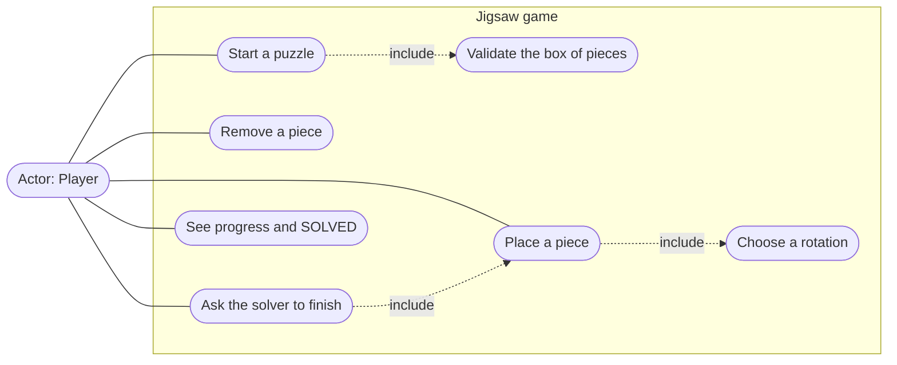

The solver is part of the system, not an actor. "Ask the solver to finish" *includes* "Place a piece": the solver goes through the same placement use case as a human, which is the key design point below. Starting *includes* validation, so a broken box is refused up front.

### Core entities

| Class | Responsibility |
|---|---|
| `SideType` (enum) | FLAT, TAB, BLANK; `complement()` (TAB ↔ BLANK). |
| `Side` (record) | Type + shape code; `fits(other)`, `partner()` (the one side that fits this one). |
| `Direction` (enum) | TOP, RIGHT, BOTTOM, LEFT in clockwise order; row/column offset to the neighbour; `opposite()`. |
| `Piece` | Immutable (never changes after creation): id + four sides as found in the box. `side(direction, rotation)`, `kind()`. |
| `PieceKind` (enum) | CORNER, BORDER, INTERIOR — derived from the number of flat sides. |
| `Board` | The `rows × cols` grid of `Placement(piece, rotation)`. **Owns every placement rule** in `check(...)`; `place`, `remove`, `verify`, `isSolved`. |
| `PlaceResult` (enum) | OK or the exact reason a placement was refused. |
| `Puzzle` | What is in the box: size + list of pieces, lookup by id. |
| `PuzzleGenerator` | Cuts a picture into pieces, then turns and shuffles them (seeded). |
| `PuzzleValidator` | Cheap sanity checks on a box before solving. |
| `SolverStrategy` (interface) + `BruteForceSolver`, `EdgeFirstSolver` | Interchangeable solving algorithms; `SolveResult` reports attempts and backtracks. |
| `JigsawGame` + `GameStatus` | One puzzle in progress: validates on start, places/removes for players, `finishWith(solver)`, status. Thread-safe. |

**Why is rotation not a field of `Piece`?** How a piece is turned is a fact about *where it lies*, not about the piece. Keeping rotation in `Board.Placement` leaves `Piece` immutable, so a solver can try four rotations with nothing to undo (a mutating `piece.rotate()` would have to be turned back after every failed try).

### Class diagram

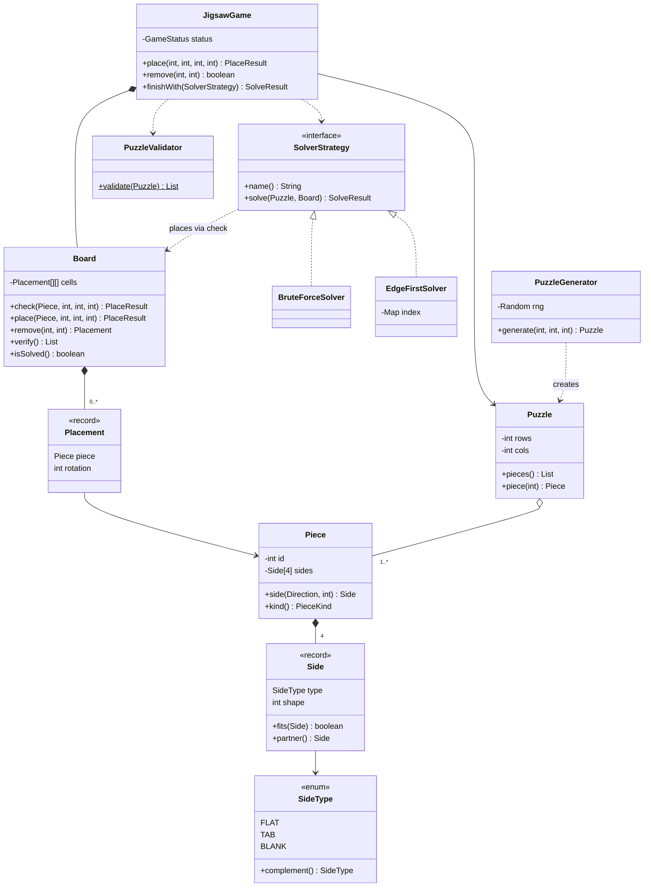

A `Piece` is **composed** of four `Side`s; a `Placement` only **refers** to a piece. Solvers **depend on** `Board.place`/`remove` and have no rules of their own.

### Key flows

**1. Rotation in one line.** Sides are stored clockwise as `[TOP, RIGHT, BOTTOM, LEFT]` at rotation 0. Turning a piece clockwise once moves what was on TOP to RIGHT. So after `r` clockwise quarter turns, the side now facing direction `d` is the one stored at index `(d − r) mod 4`. Example from the program's output: the corner `[F, T1, B2, F]` turned once has `TOP=F RIGHT=F BOTTOM=T1 LEFT=B2`.

**2. The placement check** (`Board.check`) — one method, used by the player and by every solver:

1. Off the board → OUT_OF_BOUNDS. Cell taken → CELL_OCCUPIED. Piece already used elsewhere → ALREADY_PLACED.
2. For each of the four directions, take the side that faces it (after rotation):
   - The neighbour cell is **outside** the picture → the side must be FLAT, else EDGE_MUST_BE_FLAT.
   - The neighbour cell is **inside** → the side must **not** be FLAT (FLAT_FACES_INSIDE); and if a piece is already there, the two sides must interlock (SIDES_DO_NOT_FIT).
3. Otherwise OK. It is O(1): four sides, four neighbours.

Note what this gives for free: a corner piece can only go in a corner cell, and only in the one rotation that turns both flat sides outward. No separate "corner rule" is needed.

**3. Asking the solver to finish** (sequence diagram):

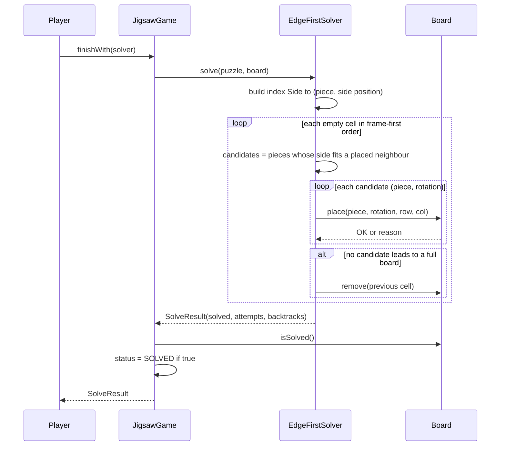

**4. The edge-first solving method** (activity diagram) — the way most people do a jigsaw:

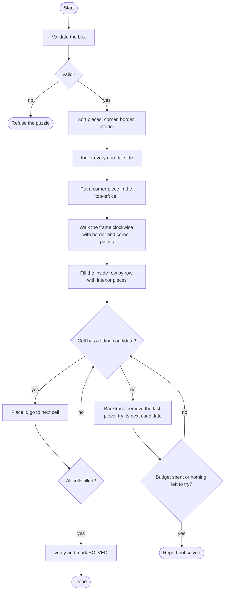

**Backtracking** (used in steps I–M) means: make a choice, carry on, and if you reach a dead end, undo the most recent choice and try the next option. With every shape unique, a correct choice is always the only choice and the solver never backtracks. With look-alike pieces, a wrong piece can fit locally and the mistake is only discovered later, so the solver must undo work.

**Why the index makes such a difference.** For the next cell, one neighbour is always already placed (that is what the frame-first order guarantees). The cell needs the **partner** of that neighbour's facing side — for example, if the left neighbour shows `T7` on its right, this cell needs `B7` on its left. A hash map from `Side` to the pieces that have it returns those pieces in O(1), and the rotation follows directly: if the needed side sits at index `i` of the piece and must face direction `d`, rotation = `(d − i) mod 4`. With unique shapes there is exactly one candidate per cell, so the whole puzzle is solved in about *n* attempts for *n* pieces instead of *n²·4*.

### Design decisions & patterns used

| Decision | Why | Alternative rejected |
|---|---|---|
| **All placement rules in `Board.check`.** | A human move and a solver move are judged identically; one place to fix a rule. | Each solver re-implementing "does it fit?" — they drift apart. |
| **Strategy** for solving — `SolverStrategy` (see [§11.3 Strategy](../11-patterns-behavioral-2/README.md#113-strategy)). | Brute force, edge-first, or a future picture-aware solver plug in without touching `Board` or `JigsawGame`. | A `switch (algorithm)` inside `JigsawGame`. |
| `Side` as an immutable **value** (record) with `partner()`. | Equal sides are `equals`, so a side can be a map key — that is what makes the index possible. | Sides as mutable objects compared by identity. |
| Placement returns a **`PlaceResult` reason**, not `boolean` or an exception. | A UI can show "that side doesn't fit" vs "that's an edge piece"; refusals are normal play, not errors. | Exceptions for routine wrong guesses. |
| **Validate before play** (`PuzzleValidator`). | A box with a missing piece is reported in O(n) instead of a solver searching forever. | Discovering the problem by failing to solve. |
| Solvers carry an **attempt budget**. | Search can explode on look-alike pieces; a bounded solver always returns. | Unbounded recursion on user-supplied data. |

### Java implementation

Package `lld.ch17.jigsaw` — 16 files in `code/lld/ch17/jigsaw/`; run `lld.ch17.jigsaw.Main` as shown at the top of the chapter. Only the key parts are below; the enums, `Puzzle`, `PuzzleGenerator`, `PuzzleValidator`, `BruteForceSolver`, `JigsawGame` and `Main` are in the folder.

```java
// File: code/lld/ch17/jigsaw/Side.java (excerpt)
package lld.ch17.jigsaw;

/**
 * One side of a piece: its type and a shape code. Two sides interlock when one is a TAB, the other a BLANK,
 * and both have the same shape code (the same cut profile). A FLAT side always has shape 0.
 */
public record Side(SideType type, int shape) {
    public static final Side FLAT = new Side(SideType.FLAT, 0);

    // compact constructor validates: FLAT has shape 0, TAB/BLANK has shape > 0; factories tab(n), blank(n)

    public boolean isFlat() { return type == SideType.FLAT; }

    /** The only side that fits against this one. */
    public Side partner() { return new Side(type.complement(), shape); }

    public boolean fits(Side other) {
        return !isFlat() && !other.isFlat() && other.type == type.complement() && other.shape == shape;
    }
}
```

```java
// File: code/lld/ch17/jigsaw/Piece.java (excerpt)
public final class Piece {
    private final int id;
    private final Side[] sides;   // index = Direction.ordinal() at rotation 0: TOP, RIGHT, BOTTOM, LEFT

    public Piece(int id, Side top, Side right, Side bottom, Side left) {
        this.id = id;
        this.sides = new Side[]{top, right, bottom, left};
        if (flatCount() > 2) throw new IllegalArgumentException("piece " + id + " has more than two flat sides");
        if ((top.isFlat() && bottom.isFlat()) || (left.isFlat() && right.isFlat()))
            throw new IllegalArgumentException("piece " + id + ": two flat sides must be adjacent (a corner)");
    }

    /** Turning clockwise once moves what was on TOP to RIGHT, so the side now facing d came from d - rotation. */
    public Side side(Direction d, int rotation) {
        return sides[Math.floorMod(d.ordinal() - rotation, 4)];
    }

    public PieceKind kind() {
        return switch (flatCount()) { case 2 -> PieceKind.CORNER; case 1 -> PieceKind.BORDER; default -> PieceKind.INTERIOR; };
    }
    // id(), side(int), flatCount(), toString() ...
}
```

`Math.floorMod` is used instead of `%` because Java's `%` keeps the sign of the left operand: `(0 - 1) % 4` is `-1`, while `floorMod(-1, 4)` is `3`.

```java
// File: code/lld/ch17/jigsaw/Board.java (excerpt)
public final class Board {
    /** A piece lying on a cell, turned clockwise 'rotation' quarter turns. */
    public record Placement(Piece piece, int rotation) {
        public Side side(Direction d) { return piece.side(d, rotation); }
    }

    private final int rows, cols;
    private final Placement[][] cells;
    private final Set<Integer> placedIds = new HashSet<>();

    /** Every rule for one placement, checked against the frame and against neighbours already placed. */
    public PlaceResult check(Piece piece, int rotation, int r, int c) {
        if (rotation < 0 || rotation > 3) throw new IllegalArgumentException("rotation must be 0..3");
        if (!inside(r, c)) return PlaceResult.OUT_OF_BOUNDS;
        if (cells[r][c] != null) return PlaceResult.CELL_OCCUPIED;
        if (placedIds.contains(piece.id())) return PlaceResult.ALREADY_PLACED;
        for (Direction d : Direction.values()) {
            Side mine = piece.side(d, rotation);
            int nr = r + d.dRow, nc = c + d.dCol;
            if (!inside(nr, nc)) {
                if (!mine.isFlat()) return PlaceResult.EDGE_MUST_BE_FLAT;
                continue;
            }
            if (mine.isFlat()) return PlaceResult.FLAT_FACES_INSIDE;
            Placement neighbour = cells[nr][nc];
            if (neighbour != null && !mine.fits(neighbour.side(d.opposite()))) return PlaceResult.SIDES_DO_NOT_FIT;
        }
        return PlaceResult.OK;
    }

    // place() = check(), then store the Placement if OK; remove(r, c), kindOfCell(r, c), verify() (re-checks every joint of a finished board),
    // isSolved() = isFull() && verify().isEmpty(), render() ...
}
```

```java
// File: code/lld/ch17/jigsaw/SolverStrategy.java
package lld.ch17.jigsaw;

/**
 * Strategy pattern: one interface, many ways to solve. A solver works on the given board, keeps any
 * pieces already placed, and fills the empty cells using the pieces not yet on the board.
 */
public interface SolverStrategy {
    String name();

    SolveResult solve(Puzzle puzzle, Board board);
}
```

`BruteForceSolver` is the baseline: it visits cells row by row and, at each empty cell, tries **every** unused piece in all four rotations, backtracking on dead ends. `EdgeFirstSolver` is the human method with the side index:

```java
// File: code/lld/ch17/jigsaw/EdgeFirstSolver.java (excerpt)
public final class EdgeFirstSolver implements SolverStrategy {
    private record Hit(Piece piece, int sideIndex) {}

    private final long maxAttempts;
    private long attempts, backtracks;
    private boolean gaveUp;
    private Map<Side, List<Hit>> index;

    @Override public SolveResult solve(Puzzle puzzle, Board board) {
        attempts = backtracks = 0;
        gaveUp = false;
        index = new HashMap<>();
        for (Piece p : puzzle.pieces())
            for (int i = 0; i < 4; i++)
                if (!p.side(i).isFlat()) index.computeIfAbsent(p.side(i), k -> new ArrayList<>()).add(new Hit(p, i));
        boolean ok = fill(puzzle, board, order(board), 0);
        return new SolveResult(name(), ok, attempts, backtracks);
    }

    /** Frame first, clockwise from the top-left corner; then the inside, row by row. */
    static List<int[]> order(Board b) {
        List<int[]> cells = new ArrayList<>();
        int R = b.rows() - 1, C = b.cols() - 1;
        for (int c = 0; c <= C; c++) cells.add(new int[]{0, c});
        for (int r = 1; r <= R; r++) cells.add(new int[]{r, C});
        for (int c = C - 1; c >= 0; c--) cells.add(new int[]{R, c});
        for (int r = R - 1; r >= 1; r--) cells.add(new int[]{r, 0});
        for (int r = 1; r < R; r++) for (int c = 1; c < C; c++) cells.add(new int[]{r, c});
        return cells;
    }

    private boolean fill(Puzzle puzzle, Board board, List<int[]> order, int k) {
        if (k == order.size()) return true;
        int r = order.get(k)[0], c = order.get(k)[1];
        if (board.at(r, c) != null) return fill(puzzle, board, order, k + 1);   // keep the player's pieces
        for (Board.Placement option : candidates(puzzle, board, r, c)) {
            if (gaveUp || attempts >= maxAttempts) { gaveUp = true; return false; }   // budget spent
            attempts++;
            if (board.place(option.piece(), option.rotation(), r, c) != PlaceResult.OK) continue;
            if (fill(puzzle, board, order, k + 1)) return true;
            board.remove(r, c);                                                 // dead end: undo, try next
            if (!gaveUp) backtracks++;
        }
        return false;
    }

    /** Looked up by the side a placed neighbour needs, else every unused piece of the right kind. */
    private List<Board.Placement> candidates(Puzzle puzzle, Board board, int r, int c) {
        PieceKind wanted = board.kindOfCell(r, c);
        List<Board.Placement> out = new ArrayList<>();
        for (Direction d : Direction.values()) {
            int nr = r + d.dRow, nc = c + d.dCol;
            if (!board.inside(nr, nc) || board.at(nr, nc) == null) continue;
            Side needed = board.at(nr, nc).side(d.opposite()).partner();   // what must face d from this cell
            for (Hit h : index.getOrDefault(needed, List.of()))
                if (!board.isPlaced(h.piece().id()) && h.piece().kind() == wanted)
                    out.add(new Board.Placement(h.piece(), Math.floorMod(d.ordinal() - h.sideIndex(), 4)));
            return out;                                                    // one neighbour narrows enough
        }
        for (Piece p : puzzle.pieces())                                    // no neighbour yet: the first corner
            if (!board.isPlaced(p.id()) && p.kind() == wanted)
                for (int rot = 0; rot < 4; rot++) out.add(new Board.Placement(p, rot));
        return out;
    }
}
```

The solver only *proposes*; `board.place` still runs the full check, so a candidate that fits the left neighbour but not the top one is refused there. `PuzzleValidator.validate` counts pieces, corners (must be 4), border pieces (must be `2(rows−2) + 2(cols−2)`), interior pieces, and, per shape code, checks that the number of tabs equals the number of blanks. These checks are **necessary but not sufficient**: a box that fails can never be solved; a box that passes still might not be.

`JigsawGame` is a thin controller: its constructor runs the validator and refuses a bad box; `place` delegates to `board.place`, counts the move and sets `SOLVED` when `board.isSolved()`; `finishWith(solver)` calls `solver.solve(puzzle, board)` and re-checks the status. All its public methods are `synchronized`.

**Output:**

```text
== 1. Sides and rotation ==
  T3 fits B3? true | T3 fits T3? false | T3 fits B4? false | F fits F? false
  piece #99[F, T1, B2, F] is a CORNER
  rotation 0: TOP=F RIGHT=T1 BOTTOM=B2 LEFT=F
  rotation 1: TOP=F RIGHT=F BOTTOM=T1 LEFT=B2
  rotation 2: TOP=B2 RIGHT=F BOTTOM=F LEFT=T1
  rotation 3: TOP=T1 RIGHT=B2 BOTTOM=F LEFT=F

== 2. A 3 x 4 puzzle out of the box (seed 7) ==
  #1[B8, B16, T9, F] BORDER
  #2[T15, T4, T11, B5] INTERIOR
  #3[B9, T17, F, F] CORNER
  #4[T12, B2, F, T3] BORDER
  #5[F, B13, B3, F] CORNER
  #6[B11, B1, F, T2] BORDER
  #7[T14, T7, F, F] CORNER
  #8[T10, F, F, T1] CORNER
  #9[T6, T13, F, B17] BORDER
  #10[T8, F, B7, B15] BORDER
  #11[B4, B14, F, B10] BORDER
  #12[T16, T5, B12, B6] INTERIOR
  validation problems: []

== 3. A player places pieces; the board enforces every rule ==
  piece 12 (interior) at corner (0,0)    EDGE_MUST_BE_FLAT
  piece 3 at (0,0), wrong turn           FLAT_FACES_INSIDE
  piece 3 at (0,0), right turn           OK
  piece 1 at (0,0) too                   CELL_OCCUPIED
  piece 3 again, at (2,3)                ALREADY_PLACED
  piece 1 at (0,1), wrong turn           EDGE_MUST_BE_FLAT
  piece 1 at (0,1), right turn           OK
  piece 12 at (1,1), right turn          OK
  piece 1 at (5,5)                       OUT_OF_BOUNDS
  progress 3/12, status IN_PROGRESS
      3r1   1r1     .     .
        .  12r0     .     .
        .     .     .     .
  solver finishes the rest: EdgeFirst+Index    solved=true  attempts=        9 backtracks=        0
  progress 12/12, status SOLVED
      3r1   1r1  10r3   7r2
      9r1  12r0   2r0  11r3
      5r3   4r0   6r0   8r0

== 4. Validation catches a bad box ==
  piece 12 lost: [expected 12 pieces, found 11, expected 2 interior pieces, found 1, shape 5: 0 tabs but 1 blanks, shape 6: 1 tabs but 0 blanks, shape 12: 1 tabs but 0 blanks, shape 16: 0 tabs but 1 blanks]
  one side mis-cut: [shape 8: 2 tabs but 0 blanks]
  new JigsawGame(...) refused: invalid puzzle: [shape 8: 2 tabs but 0 blanks]

== 5. Same puzzles, two strategies ==
  4 x 4, shapeVariety 0 (every joint unique)
    BruteForce         solved=true  attempts=      209 backtracks=        0  verify=true
    EdgeFirst+Index    solved=true  attempts=       16 backtracks=        0  verify=true
  6 x 6, shapeVariety 0 (every joint unique)
    BruteForce         solved=true  attempts=    1,171 backtracks=        0  verify=true
    EdgeFirst+Index    solved=true  attempts=       38 backtracks=        0  verify=true
  6 x 6, shapeVariety 2 (look-alike pieces)
    BruteForce         solved=true  attempts=2,099,470 backtracks=   46,642  verify=true
    EdgeFirst+Index    solved=true  attempts=  501,976 backtracks=   72,683  verify=true
  10 x 10, shapeVariety 0 (every joint unique)
    BruteForce         solved=true  attempts=   11,060 backtracks=        0  verify=true
    EdgeFirst+Index    solved=true  attempts=      101 backtracks=        0  verify=true

== 6. Co-op: four players place pieces of one 6 x 6 puzzle at once ==
  progress 36/36, moves 36, status SOLVED
```

**Reading the output.** Cell labels such as `3r1` mean "piece 3, turned once". Part 3 hits every refusal reason; an interior piece is refused at a corner and a corner piece in the wrong rotation with no special-case code, and the solver then finishes in 9 attempts. Part 5 runs both strategies on the *same* seeded puzzles: with unique shapes edge-first needs about one attempt per piece (16, 38, 101) while brute force grows roughly with the square of the piece count. With look-alikes both must search; edge-first makes 4× fewer attempts but backtracks more, because a wrong frame piece is exposed only when the frame closes. Part 6: four threads, one game, exact count.

### Concurrency & edge cases

- **Co-op play.** `JigsawGame`'s public methods are `synchronized` (only one thread at a time runs them on a given game), so two players cannot both drop a piece into the same cell or both use the same piece: the second one gets CELL_OCCUPIED or ALREADY_PLACED. A server hosting many puzzles has one lock per game, so games do not block each other. Finer-grained locking (per cell) is possible but must still make "is the piece unused?" and "is the cell empty?" one atomic step (all-or-nothing, never seen half-done).
- **Solver and players at once.** `finishWith` holds the game lock for the whole solve, so players wait; for big puzzles, solve on a *copy* of the board and offer the result as hints.
- **Invalid box** (missing piece, extra piece, three flat sides, opposite flat sides, unbalanced tabs) — rejected by the `Piece` constructor or `PuzzleValidator` before play.
- **Look-alike pieces** — two pieces with identical sides are interchangeable; any arrangement that passes `verify` counts as solved, even if the picture would be scrambled. Only picture matching can tell them apart.
- **Search blow-up** — the attempt budget makes every solver return; `solved=false` leaves the board exactly as it was before the call (every trial placement is undone).
- **1 × N strips** are excluded (a piece there has two *opposite* flat sides); supporting them means relaxing the corner rule in `Piece` and the counts in `PuzzleValidator`.

### Extensions & follow-up questions

- **"Match on the picture too."** — Give `Side` an edge colour signature (for example, average colours sampled along the edge) and let a new strategy rank candidates by colour difference. Only a new `SolverStrategy` (and a richer `Side`) is needed; `Board` is unchanged.
- **"Make the solver faster on look-alikes."** — Choose the next cell dynamically: the empty cell with the **fewest** candidates first (the "most constrained variable" heuristic used in constraint solving), and check both placed neighbours when building candidates.
- **"Undo."** — Each successful `place` is a command on a stack; undo = `remove` ([Command, §10.2](../10-patterns-behavioral-1/README.md#102-command)).
- **"Show progress live / multiplayer UI."** — Publish `PiecePlaced` events ([Observer, §11.1](../11-patterns-behavioral-2/README.md#111-observer)).
- **"Non-rectangular puzzles or hexagonal pieces."** — Generalise `Direction` to N sides and `Board` to a graph of cells and neighbours; the side-matching rule stays the same.

### Real-world example

Computer jigsaw solving is a studied problem: matching only by shape is hard in general (with arbitrary look-alike pieces it is NP-complete — no known fast algorithm guarantees a solution), so practical solvers combine edge-first ordering with **picture-content** scores between neighbouring edges and greedy or best-first placement.

### In the interview

**30-second answer:** "A `Piece` is immutable with four `Side`s stored clockwise; a `Side` is FLAT, TAB or BLANK plus a shape code, and a tab fits a blank with the same code. Rotation lives in the board's `Placement`, and the side facing direction d after r turns is `sides[(d − r) mod 4]`. `Board.check` holds every rule — flat sides out, no flat side in, every placed neighbour interlocks — and both players and solvers use it. Solving is a Strategy: brute-force backtracking, or edge-first with a hash index from side to pieces, which is about one attempt per piece when shapes are unique. A validator rejects broken boxes up front, and `JigsawGame` is synchronized for co-op."

**Likely follow-ups with answers**

- *"What is the cost of solving?"* — Edge-first with unique shapes: O(n) attempts, each O(1). With look-alikes: exponential in the worst case, which is why there is a budget.
- *"What does validation guarantee?"* — Only that the box *could* be solvable; failing it proves it cannot be.

### Self-check

1. **Q:** When do two sides interlock? **A:** One is a TAB, the other a BLANK, with the same shape code. FLAT never interlocks.
2. **Q:** A piece stored as `[F, T1, B2, F]` is turned clockwise twice. What faces TOP? **A:** `sides[(0 − 2) mod 4] = sides[2] = B2`.
3. **Q:** How many border (non-corner) pieces does a 5 × 7 puzzle have? **A:** `2(5−2) + 2(7−2) = 16`.
4. **Q:** Why does the edge-first solver need only about one attempt per piece on a normal puzzle? **A:** Each next cell has a placed neighbour; the index returns the pieces having the partner side, and with unique shapes that is a single piece with a computed rotation.
5. **Q:** Name a box that passes validation but cannot be solved. **A:** A 2 × 2 box in which the only `T1` and the only `B1` are on the **same** piece: counts and tab/blank balance are fine, but a piece cannot interlock with itself, so that joint can never be filled.

### TL;DR

- `Side` = FLAT/TAB/BLANK + shape code; fits = TAB↔BLANK with equal codes. `Piece` immutable, sides clockwise; rotation lives in `Placement`; facing side = `sides[(d − r) mod 4]`.
- `Board.check` is the single home of every rule (frame flat, no flat inside, neighbours interlock, cell free, piece unused) and returns a reason.
- Solving is a **Strategy**: brute-force backtracking vs edge-first with a `Side → pieces` index (≈ n attempts with unique shapes). Budget every search.
- Validate the box first (counts, 4 corners, tabs = blanks per shape); `synchronized` game for co-op.

---

## Chapter summary

| Game | Core rule object | Pluggable strategies | Randomness for tests | Signature technique |
|---|---|---|---|---|
| Blackjack | `Hand` scoring + `BlackjackScoring` | `PlayerStrategy`, `DealerPolicy` | Seeded `Shoe`, stacked shoe | Soft/hard totals; generic `Deck<T>` |
| Chess | `Rules` (legal-move filter) | (bot would be a move strategy) | None needed — deterministic game | Polymorphic pieces; checkmate = in check + no legal move; Command + Memento undo |
| Tic-Tac-Toe | `Board` counters | `MoveStrategy` | Seeded `RandomStrategy`, scripted players | O(1) win with row/col/diagonal counters |
| Snake & Ladder | `Board` + `Rules` record | `Dice`, `OverflowRule`, `WinStrategy` | Seeded `RandomDice`, `LoadedDice` | Validated config; queue-based turns |
| 2048 | `LineMerger` | `TileSpawner` | Seeded spawner, `Board.of` presets | One merge function reused for 4 directions |
| Jigsaw | `Board.check` (one placement rule) | `SolverStrategy` | Seeded `PuzzleGenerator` | Side matching + rotation formula; edge-first solver with a side index |

**Patterns you used in this chapter:** Strategy (everywhere), Factory Method (`Deck.standard52`, `Piece.create`, `Board.of`), Template-style shared base (`SlidingPiece`), Command + Memento (chess undo), State (game-status enums; a full State pattern is the suggested upgrade for blackjack rounds), Observer (the event log hooks; suggested for UIs and spectators).

**The three habits interviewers look for in game designs:**

1. **Put every rule in exactly one place** — and be able to say where.
2. **Inject randomness** — seeded or scripted — so the design is testable.
3. **Model the game's states explicitly** — and reject actions that are invalid in the current state.
