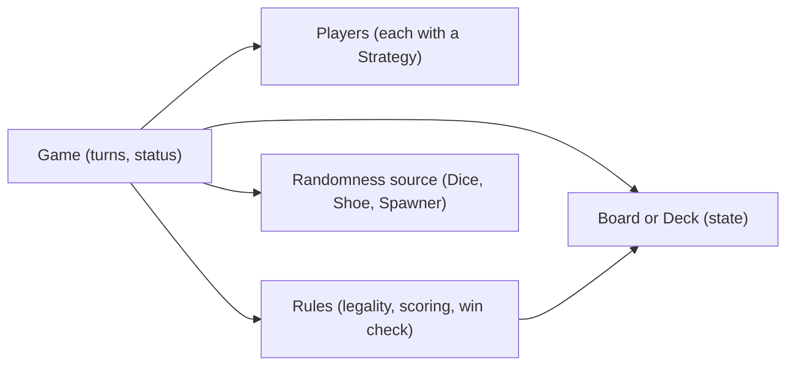
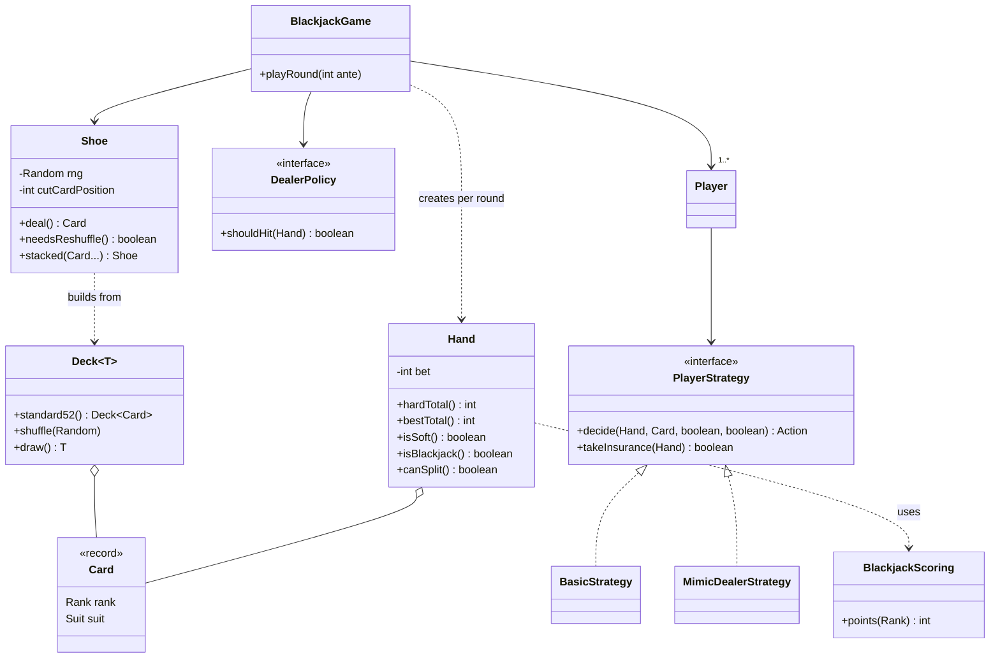
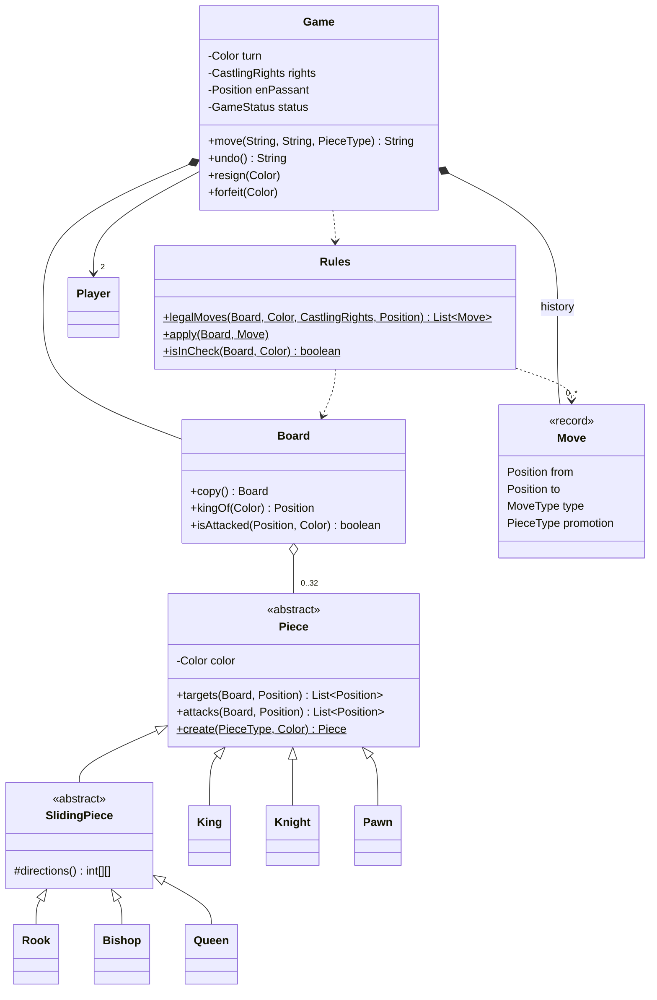
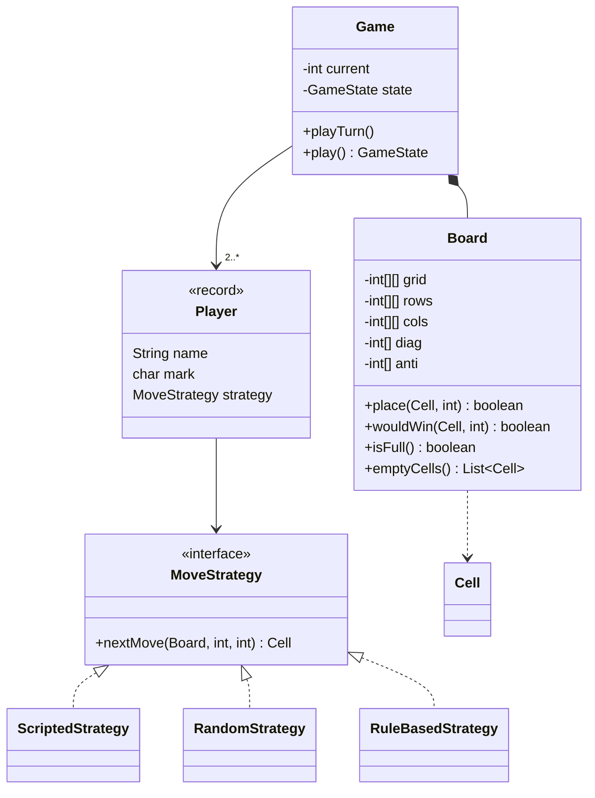
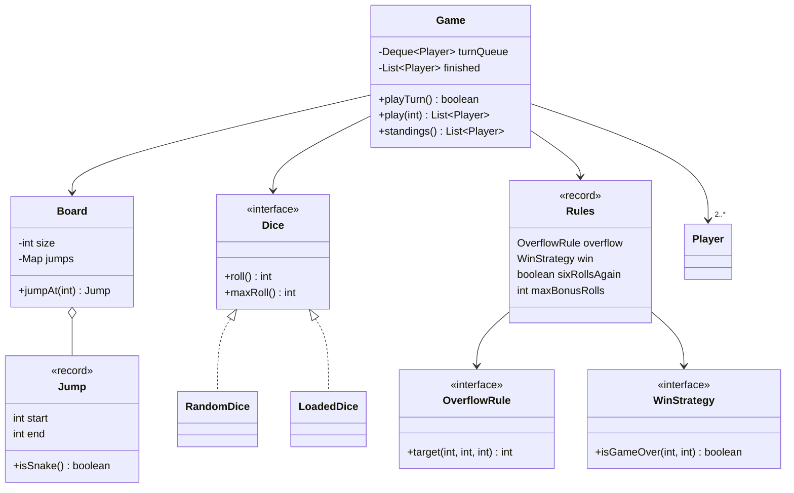
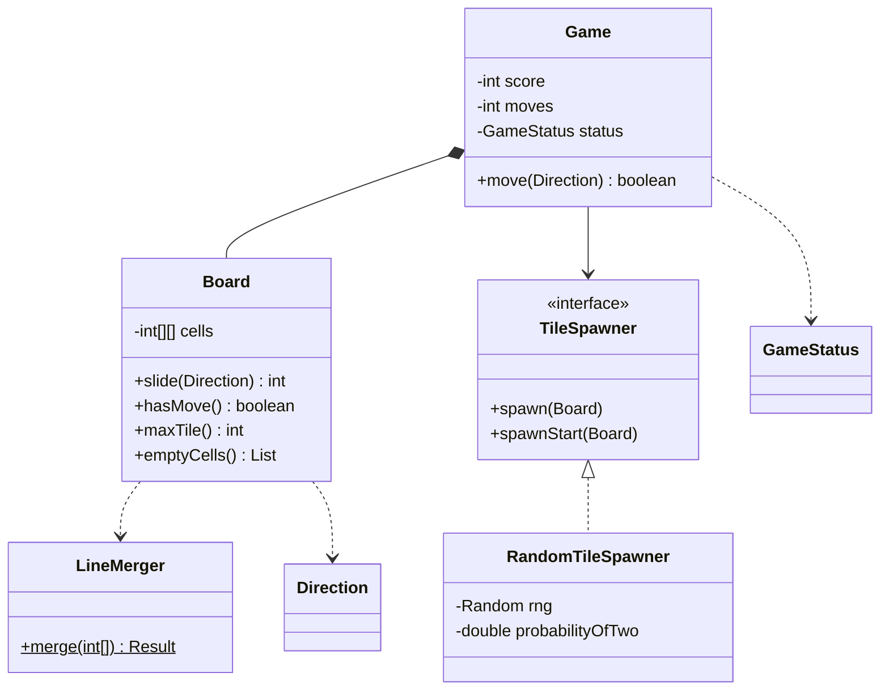

# Chapter 17 — Case Studies: Games & Rules — Study Edition

> **Where this fits.** Chapters 14–16 modelled the real world. In games the "world" is a set of exact **rules** — every rule must live *somewhere*, and the interviewer will ask where. That is why games are a favourite interview topic.

**What games test in an LLD interview**

| Skill | What it means | Where you see it |
|---|---|---|
| **Rule encapsulation** | Each rule lives in one obvious class. | `BlackjackScoring`; chess `Rules`; 2048 `LineMerger`. |
| **Turn management** | Whose turn, what may they do, what happens at the end of a turn. | Turn index (tic-tac-toe), player queue (snake and ladder), `turn` colour (chess), rounds (blackjack). |
| **Polymorphic pieces** | One method call, many behaviours (*polymorphism*). | Chess `Piece.targets(...)`. |
| **Pluggable strategies** | Varying behaviour behind an interface (**Strategy**, Ch. 10). | `PlayerStrategy`, `DealerPolicy`, `MoveStrategy`, `Dice`, `OverflowRule`, `WinStrategy`, `TileSpawner`. |
| **Deterministic testing** | Randomness is *injected*: `new Random(seed)` or a scripted source (stacked shoe, loaded dice). | Every `Main` prints the same output every run. |
| **State and status** | Games move through states; illegal actions in the wrong state are rejected. | `GameStatus`, `GameState` enums. |

> **Key idea: seeded randomness.** `java.util.Random` is *pseudo-random*: the same **seed** always gives the same sequence, and `Collections.shuffle(list, rnd)` is deterministic for a given `Random`. Rule: **never call `new Random()` or `Math.random()` inside the game — accept a `Random` (or a `Dice`/`Spawner`) from outside.** Production passes an unseeded (or `SecureRandom`) source; tests pass a seed. This is plain Dependency Injection (Ch. 5).

**Problems:** 17.1 Blackjack and a deck of cards · 17.2 Chess · 17.3 Tic-Tac-Toe · 17.4 Snake and Ladder · 17.5 2048.

**How to run:** `cd chapters/17-case-games/code && javac --release 21 -d /tmp/lld_17 $(find . -name '*.java') && java -cp /tmp/lld_17 lld.ch17.blackjack.Main` (or `chess`, `tictactoe`, `snakeladder`, `game2048`). All randomness is seeded or scripted, so output is exact.

**A reusable skeleton for any board/card game** — name these five parts early:



| Part | Question it answers | Typical class names |
|---|---|---|
| State | What does the table look like now? | `Board`, `Deck`, `Shoe`, `Hand`, `Cell` |
| Actors | Who acts, how do they decide? | `Player` + `PlayerStrategy`/`MoveStrategy` |
| Rules | Allowed? What does it do? Who won? | `Rules`, `DealerPolicy`, `OverflowRule`, `WinStrategy` |
| Controller | Whose turn? Which state? | `Game`, `GameStatus` |
| Randomness | Where does chance come from? | `Dice`, `Shoe`, `TileSpawner` — always injected |

---

## Design Blackjack and a Deck of Cards

### Problem & clarifying questions

**Blackjack**: every player plays only against the **dealer** (the casino employee playing for the house); everyone tries to get close to **21** without going over (**busting** loses at once). Often asked as "design a deck of cards, then blackjack" — the first half checks the deck stays **generic**, the second checks rule placement.

| Question | Assumed answer |
|---|---|
| Decks? | A **shoe** of several 52-card decks (casinos use 6–8); one deck = shoe of 1. |
| Players? | One or more, each against the dealer. |
| Options? | Hit, stand, double down, split (once), insurance. No surrender/side bets. |
| Dealer rule? | Hit ≤ 16, stand ≥ 17; "hit soft 17" pluggable. |
| Payouts? | Win 1:1, blackjack 3:2, push returns the bet, insurance 2:1. |
| Money? | Whole **chips** (`int`), even ante. Never `double`. |
| UI, accounts? | Out of scope (the course's `Account`/`Person` would attach to `Player`). |

### Requirements

**Background rules:** 13 ranks × 4 suits; two cards each; the dealer shows the **up card** and hides the **hole card**. J/Q/K = 10, **ace = 1 or 11**. **Soft** total = an ace counted as 11; **hard** = all aces as 1 (A+5 = soft 16 / hard 6). **Blackjack** (natural) = two cards totalling 21.

**Functional:**

1. Place an ante to play.
2. Deal two cards each (dealer: one up, one hole).
3. Dealer shows an **ace** → offer **insurance** (half the ante, pays **2:1** on dealer blackjack); the dealer then **peeks**; dealer blackjack ends the round (insurance wins, main bets lose, player blackjack pushes).
4. Below 21 the player chooses **hit**, **stand**, **double down** (double the bet, exactly one card, stop) or **split** (equal ranks only, second bet = ante, two hands, one card each, no re-split).
5. Over 21 → immediate loss.
6. Dealer plays by the fixed rule.
7. Dealer bust → every live hand wins; else higher total wins; equal = **push**. Blackjack pays **3:2**, other wins 1:1.
8. **Even money**: blackjack vs a dealer ace may take 1:1 at once (= insurance + blackjack; explained, not built).

**Non-functional:** generic `Card`/`Deck`; deterministic tests; pluggable dealer and player rules; whole-chip `int` money — deliberately not `BigDecimal`: an even ante keeps every payout whole (3:2 on 10 = 15). If fractions appear, use `BigDecimal` + `RoundingMode`.

### Use cases

**Player** — bets; accepts/declines insurance, split, double, even money; hits or stands (log in / join game belong to a lobby service). **Dealer** — deals, plays by the fixed rule, collects and pays. Use cases: create hands, place bet, player plays, dealer plays, insurance / even money / examine hole card (ace up only), split, resolution; dealing and payout are `<<include>>`d in every round.

### Core entities

| Class | Responsibility |
|---|---|
| `Suit`, `Rank` | Fixed values; `Rank` stores *face value* 1–13 (ace 1, K 13). |
| `Card` (record) | Rank + suit; knows **nothing** about blackjack. |
| `Deck<T>` | Generic shuffleable stack; `standard52()` factory. |
| `Shoe` | Several decks; deals; reshuffles at the **cut card**; `Shoe.stacked(...)` for tests. |
| `BlackjackScoring` | Blackjack value of a rank (K = 10, ace = 1 hard) — kept off `Card`. |
| `Hand` | Cards + **its own bet**; hard/soft/best total, bust, blackjack, split, double. |
| `Action`, `PlayerStrategy` | HIT/STAND/DOUBLE/SPLIT; `BasicStrategy`, `MimicDealerStrategy` (a UI human would be a third). |
| `DealerPolicy` | `standOnAll17()`, `hitSoft17()`. |
| `Player` | Name, chip balance, strategy. |
| The dealer | No class here: a `Hand` in `BlackjackGame` + the `DealerPolicy` (the course has `Dealer` beside `Player` under `BasePlayer`). |
| `BlackjackGame` | Runs a round: bets, deal, insurance + peek, player turns, dealer turn, settlement. |

### Class diagram


*Figure — Course class diagram: Card, BlackjackCard, Deck, Shoe, Hand, BasePlayer, Player, Dealer, Game, Account (course diagram)*

In the course, `BlackjackCard extends Card` adds the *game value* (K: face 13, worth 10); a `Shoe` is composed of `Deck`s; `Player` and `Dealer` share `BasePlayer` (balance, `*` hands because of splits). We keep the core idea — **the game value must not live on the generic card** — using a scoring function, and make player and dealer rules strategies:



### Key flows

**One round:** debit antes → deal two each → if up card is an ace, offer insurance → if up card is ace or ten and dealer has blackjack, settle and stop → else each hand plays (`decide` until stand, bust, 21 or double) → dealer draws while `shouldHit` (skipped if all hands bust) → settle. States: `Betting → Dealing → (Insurance) → Peek → PlayerTurns → DealerTurn → Settled`.

**Scoring a hand (the ace problem).** **At most one ace can ever count as 11** (two would be 22). So: (1) sum all cards with aces as 1 = **hard total**; (2) if there is an ace and `hard + 10 ≤ 21`, the hand is **soft** and best = `hard + 10`; (3) else best = hard. O(n), no search, and the soft flag comes free (needed for "hit soft 17").

### Design decisions & patterns used

| Decision | Why | Alternative rejected |
|---|---|---|
| `Card` is a game-agnostic **record**. | Poker, bridge, solitaire reuse it; K = 10 is a rule of this game. | `getValue()` returning 10 for K on `Card`. |
| Value in `BlackjackScoring`, not a `BlackjackCard` subclass. | Records can't be extended; one card type in the shoe. | The course's subclass — also valid; say both. |
| **Generic** `Deck<T>`. | Uno/tarot reuse shuffle/draw. | Deck hard-wired to `Card`. |
| **Strategy** for `PlayerStrategy`, `DealerPolicy`. | UI, bots, scripts plug in; S17 vs H17 is one line (Open/Closed). | `if (isHuman)`, `if (casino == X)`. |
| **Factory methods** (`standard52`, `stacked`, `standOnAll17`); injected `Random`. | Named constructors; exact tests. | Flag constructors; hidden randomness. |
| `hardTotal`/`bestTotal`/`isSoft`. | The course returns every possible total; hard + soft flag carries the same information. | List of totals to filter. |
| Hand stores its **own bet**. | Split and double change bets per hand. | One bet per player. |
| Game **validates** the strategy's choice. | A buggy client can't double without money. | Trusting the client. |

**Honest weakness.** `playRound` owns the whole sequence *and* the payouts; each new option adds a branch. A larger design uses a **State** machine (one class per round state, like the Ch. 14 vending machine) and a `PayoutTable`. Say it out loud.

### Java implementation

Package `lld.ch17.blackjack`. Full runnable code: code/lld/ch17/blackjack/ (see the Full Edition).

```java
/** A game-agnostic playing card: just a rank and a suit. Immutable, so it is safe to share. */
public record Card(Rank rank, Suit suit) {
    @Override public String toString() { return rank.symbol() + suit.letter(); }
}

// BlackjackScoring.java — Points with an ace counted as 1 (the "hard" value).
public static int points(Rank rank) {
    return switch (rank) {
        case ACE -> 1;
        case JACK, QUEEN, KING -> 10;
        default -> rank.faceValue();
    };
}

// Hand.java
public int hardTotal() {
    int sum = 0;
    for (Card c : cards) sum += BlackjackScoring.points(c.rank());
    return sum;
}
public boolean isSoft() { return hasAce() && hardTotal() + 10 <= 21; }
public int bestTotal() { return isSoft() ? hardTotal() + 10 : hardTotal(); }
public boolean isBust() { return bestTotal() > 21; }
public boolean isBlackjack() { return !fromSplit && cards.size() == 2 && bestTotal() == 21; }

// DealerPolicy.java
@FunctionalInterface
public interface DealerPolicy {
    boolean shouldHit(Hand dealerHand);

    /** Classic rule: draw on 16 or less, stand on every 17 ("S17"). */
    static DealerPolicy standOnAll17() { return h -> h.bestTotal() <= 16; }

    /** Variant: also draw on a soft 17 such as A+6 ("H17"), which favours the house. */
    static DealerPolicy hitSoft17() { return h -> h.bestTotal() <= 16 || (h.bestTotal() == 17 && h.isSoft()); }
}

// BlackjackGame.java — validate the strategy's choice, then settle
Action a = p.strategy().decide(hand, up, canDouble, canSplit);
if ((a == Action.DOUBLE && !canDouble) || (a == Action.SPLIT && !canSplit)) {
    throw new IllegalStateException(label + " chose a move that is not allowed: " + a);
}
// ...
private void settle(Player p, Hand h, Hand dealer) {
    String who = "  " + p.name() + " " + h + " vs dealer " + dealer.bestTotal() + ": ";
    if (h.isBust()) { log.accept(who + "LOSE " + h.bet()); return; }
    if (h.isBlackjack()) {                                  // dealer blackjack was handled by the peek
        p.credit(h.bet() + h.bet() * 3 / 2);
        log.accept(who + "BLACKJACK pays 3:2 (+" + h.bet() * 3 / 2 + ")");
        return;
    }
    int mine = h.bestTotal(), theirs = dealer.bestTotal();
    if (dealer.isBust() || mine > theirs) { p.credit(h.bet() * 2); log.accept(who + "WIN +" + h.bet()); }
    else if (mine == theirs) { p.credit(h.bet()); log.accept(who + "PUSH"); }
    else log.accept(who + "LOSE " + h.bet());
}
```

**Output excerpt:**

```text
  [AS 6H] = soft 17   (hard total 7)
  [AS 6H 10C] = 17   (hard total 17)
  [AS AH 9C] = soft 21   (hard total 11)
== 2. Stacked shoe: split 8s, then double both hands ==
  Alice splits -> [8H 3C] = 11 and [8D 2S] = 10
  Alice hand 1 doubles (bet now 20): [8H 3C 9H] = 20
  Dealer reveals and plays: [6S 10C 7S] = bust 23
  Balances: Alice=140
== 3. Stacked shoe: dealer shows an ace, Bob buys insurance ==
  Dealer peeks: [AS KD] = BLACKJACK -> round over
  Bob insurance pays 2:1 (+10)
  Bob: LOSE 10
  Balances: Bob=100
```

A stacked shoe forces exact scenarios; Bob's insurance hedges his loss to break even.

### Concurrency & edge cases

- **One table = one thread** (or actor); tables share only the wallet, which needs atomic debit/credit — debit *before* dealing.
- **Odd antes** (3:2 on 5 = 7.5) → we require even antes; casinos round down or use smaller chips — decide and say it.
- **Split aces**: 21 after a split is *not* blackjack (`fromSplit`). **Shoe exhaustion**: cut card reshuffles between rounds; a stacked shoe throws instead.
- **Can't afford double/split** → `canDouble=false`, and the action is rejected if chosen. **Peek** only on ace or ten.

### Extensions & follow-up questions

- **Even money?** Same as insurance with a blackjack (always nets +1× ante); add `takeEvenMoney(hand)` and settle 1:1 before the peek.
- **Surrender?** `Action.SURRENDER` as first decision; refund half.
- **Testing the dealer rule?** Stacked shoe, deal A+6, assert `hitSoft17()` draws and `standOnAll17()` stands.
- **Uno deck?** `Deck<UnoCard>`. **Security?** Cut card limits counting; never send the hole card early.

### Real-world example

Online casino tables split a certified **RNG/shuffle service** (regulators such as the UK Gambling Commission require independent testing), a **game engine** enforcing table rules (S17/H17, 3:2 or 6:5), and a **wallet** debiting atomically — rule variants are configuration.

### In the interview

**30-second answer:** "A generic `Card` and `Deck<T>`. A `Shoe` combines decks with an injected `Random`, plus a stacked constructor for tests. The blackjack value lives in the game's scoring, not on `Card`. `Hand` scores itself: hard total with aces as 1, soft if one ace can be 11. Player decisions and the dealer rule are strategies. `BlackjackGame` runs bets, deal, insurance and peek, player turns, dealer turn, and settles 3:2, 1:1 or push."

**Likely follow-ups:** *Why not `int value` on `Card`?* — value is game-specific. *Best hand value?* — hard + 10 if an ace fits. *Testable?* — seeded `Random`, stacked shoe.

### Self-check

1. **Q:** Why does `Hand` store the bet? **A:** After a split each hand has its own bet; a double changes only that hand.
2. **Q:** A+A+9? **A:** Hard 11; one ace as 11 → soft 21.
3. **Q:** When does the dealer peek? **A:** Only on an ace or 10-value up card.
4. **Q:** Is 21 after a split a blackjack? **A:** No — only the original two cards.

### TL;DR

- Keep `Card`/`Deck` generic; the value rule lives in the game.
- Hard total + 10 if an ace fits → soft. Blackjack = original two cards totalling 21.
- Strategies for player and dealer; inject randomness; stacked shoe for tests.
- Round = bet → deal → (insurance + peek) → player turns → dealer → settle (3:2, 1:1, push).

---

## Design Chess

### Problem & clarifying questions

**Chess**: two players, 8×8 board, 16 pieces each (**8 pawns, 2 rooks, 2 knights, 2 bishops, 1 queen, 1 king**); goal is **checkmate**. We design an **online** two-player game.

| Question | Assumed answer |
|---|---|
| Full rules? | Yes: all moves, check, checkmate, stalemate, castling, en passant, promotion. |
| Sides? | Random (`Game.withRandomSides`, injected `Random`); **white first**; alternate. |
| Take-backs? | Not in rated games (course); `undo()` for analysis and tests. |
| Endings? | Checkmate, stalemate (draw), resignation, forfeit. |
| Move log? | Yes. |
| Timers, rating, AI? | Out of scope. |

### Requirements

**Functional:**

1. Two players, a colour each, white first, alternating.
2. Move only your **own** piece; reject out-of-turn moves, impossible moves, and moves leaving your king in check.
3. All special moves:
   - **Castling** — king moves two squares toward a rook, rook jumps over; only if neither moved, squares between empty, king not in check and not passing through or landing on an attacked square.
   - **En passant** — a pawn that advanced two squares beside an enemy pawn may be captured as if it moved one, only on the very next move.
   - **Promotion** — a pawn on the last rank becomes Q, R, B or N.
4. Detect **check**, **checkmate** (in check, no legal move — attacker wins) and **stalemate** (not in check, no legal move — draw).
5. **Resignation** and **forfeit** (losing without choosing, e.g. leaving or timeout).
6. **Log** every move.

**Non-functional:** new piece types without touching existing ones (Open/Closed); correctness before speed; safe when two player connections call concurrently.

### Use cases

**Player** — create/join games, **make moves**, resign/forfeit, manage account. **Admin** — add, modify, block members. "Make move" is extended per piece type — our `Piece` polymorphism. The move activity `Game.move` follows: valid for the piece? → own king safe? → capture → promote → castling moves the rook → checkmate/stalemate ends the game.

### Core entities

| Class | Responsibility |
|---|---|
| `Color` | WHITE/BLACK, `opposite()`. |
| `Position` (record) | Square a–h/1–8; validates; parses "e4" (course: *Box*). |
| `Piece` (abstract, sealed) | Colour + `targets(board, from)`; `attacks(...)` for check detection. |
| `King`, `Knight`, `Pawn` | Step pieces and the pawn rule. |
| `SlidingPiece` → `Rook`, `Bishop`, `Queen` | One "slide until blocked" loop; subclasses list directions. |
| `Board` | 8×8 grid; `copy()`, `kingOf`, `isAttacked`, `render`; no turns or history. |
| `Move` + `MoveType` | from, to, type (NORMAL, CASTLE_KINGSIDE, CASTLE_QUEENSIDE, EN_PASSANT, PROMOTION), promotion piece. |
| `CastlingRights` (record) | Four permissions and how a move changes them. |
| `Rules` | Stateless: pseudo-legal, legal (king-safety filter), special moves, `apply`, `isInCheck`. |
| `Game` | Turn, status, winner, en passant square, castling rights, log, undo (Command + Memento), resign, forfeit, random sides. Thread-safe. |
| `Player`, `GameStatus`, `IllegalMoveException` | Supporting types. |

### Class diagram


*Figure — Course class diagram: Box, Board, Piece hierarchy with SlidingPiece, Move, Player, Account, Game, GameStatus (course diagram)*

In the course, `Board` is **composed** of 64 `Box`es; a box refers to a piece by **association** (a captured piece isn't destroyed, so the log is replayable). `SlidingPiece` writes the "path is clear" check once; `Move` records piece moved and captured; course `GameStatus`: ACTIVE, BLACK_WIN, WHITE_WIN, FORFEIT, STALEMATE, RESIGNATION. We fix two limits the course admits — history rules (castling, en passant) had nowhere to live, and checkmate/stalemate weren't detected — by adding `Rules` and a `MoveType` on `Move`.



### Key flows

**Making a move:** check status, piece and colour → `Rules.legalMoves` → match or throw `IllegalMoveException` → save a `Snapshot` (memento) → `Rules.apply` → update rights, en passant, turn → check the opponent → notation (`Qh5xf7#`). **Status:** `ACTIVE` → `CHECKMATE` / `STALEMATE` / `RESIGNATION` / `FORFEIT` (undo can reactivate).

**Detecting check, checkmate, stalemate:**

1. **Pseudo-legal moves** — the pieces' movement rules + castling, en passant, promotions.
2. **Legal moves** — apply each to a *copy* of the board, keep it only if the mover's king is **not attacked**. This one filter handles pins, moving into check and ignoring check.
3. **King attacked?** — every enemy piece's `attacks(...)`; pawns attack diagonally even onto empty squares.
4. After a move, if the **opponent** has **zero legal moves**: in check = **checkmate**, else **stalemate**.

This one-ply search is all the *rules* need (deeper search is an *engine's* job). Cost: ~200 pseudo-legal moves × an attack scan over ≤ 16 pieces — trivial; engines use bitboards.

### Design decisions & patterns used

| Decision | Why | Alternative rejected |
|---|---|---|
| **Polymorphic pieces**, template-like `SlidingPiece`. | Each rule in its own class; path loop written once. | Giant `switch (pieceType)`. |
| **Sealed** hierarchy. | Closed set; exhaustive `switch`. | Open hierarchy — fine for variants. |
| **Immutable** pieces; `Board.copy()` copies references. | Cheap, safe trial moves and snapshots. | Mutable `hasMoved` flags undo must restore. |
| **History rules in `Rules`/`Game`**. | Castling and en passant depend on earlier moves. | `King` reading the game log. |
| `Move` carries a **`MoveType`**. | Castling moves two pieces; en passant captures off-square. | Special cases in `Game` (course's `move_castling_rook`). |
| **Command + Memento** undo. | Restoring a snapshot is always correct for special moves. | Hand-written inverse per move type (bug source). |
| **Factory method** `Piece.create`. | Set-up and promotion. | Scattered `new`. |
| `synchronized` `Game`. | A move and a resignation can't interleave. | No locking. |

**Memento vs incremental undo.** A snapshot is 64 references (~0.5 KB) — nothing for a human game. An engine searching millions of positions stores only what changed (captured piece, old rights, old en passant) and reverses it. Know both.

### Java implementation

Package `lld.ch17.chess`. Full runnable code: code/lld/ch17/chess/ (see the Full Edition).

```java
public abstract sealed class Piece permits King, Knight, Pawn, SlidingPiece {
    // ...
    /** Squares this piece may move to by its ordinary rules (captures included, own-king safety NOT checked). */
    public abstract List<Position> targets(Board board, Position from);

    /** Squares this piece attacks. Same as targets for every piece except the pawn. */
    public List<Position> attacks(Board board, Position from) { return targets(board, from); }
    // ...
}

public abstract sealed class SlidingPiece extends Piece permits Rook, Bishop, Queen {
    // ...
    protected abstract int[][] directions();

    @Override public final List<Position> targets(Board board, Position from) {
        List<Position> out = new ArrayList<>();
        for (int[] d : directions()) {
            int f = from.file() + d[0], r = from.rank() + d[1];
            while (Position.onBoard(f, r)) {
                Position p = new Position(f, r);
                Piece occupant = board.get(p);
                if (occupant == null) {
                    out.add(p);
                } else {
                    if (occupant.color() != color()) out.add(p);   // capture, then stop
                    break;
                }
                f += d[0];
                r += d[1];
            }
        }
        return out;
    }
}

// Rules.java
public static List<Move> legalMoves(Board board, Color side, CastlingRights rights, Position enPassant) {
    List<Move> legal = new ArrayList<>();
    for (Move m : pseudoLegalMoves(board, side, rights, enPassant)) {
        Board trial = board.copy();
        apply(trial, m);
        if (!isInCheck(trial, side)) legal.add(m);
    }
    return legal;
}

public static void apply(Board board, Move m) {
    Piece piece = board.get(m.from());
    board.set(m.from(), null);
    board.set(m.to(), piece);
    switch (m.type()) {
        case EN_PASSANT -> board.set(new Position(m.to().file(), m.from().rank()), null);   // the passed pawn
        case PROMOTION -> board.set(m.to(), Piece.create(m.promotion(), piece.color()));
        case CASTLE_KINGSIDE -> moveRook(board, m.from().rank(), 7, 5);
        case CASTLE_QUEENSIDE -> moveRook(board, m.from().rank(), 0, 3);
        case NORMAL -> { }
    }
}

// Game.java — inside play(): end-of-game detection
boolean check = Rules.isInCheck(board, turn);
boolean noMoves = Rules.legalMoves(board, turn, rights, enPassant).isEmpty();
if (noMoves) {
    status = check ? GameStatus.CHECKMATE : GameStatus.STALEMATE;
    winner = check ? mover.color() : null;
}

public synchronized String undo() {
    if (history.isEmpty()) throw new IllegalStateException("nothing to undo");
    HistoryEntry last = history.pop();
    Snapshot s = last.before();
    board = s.board(); turn = s.turn(); rights = s.rights(); enPassant = s.enPassant();
    status = s.status(); winner = s.winner();
    return last.notation();
}
```

`Pawn` overrides `attacks` to return both forward diagonals; `Rules.addCastling` checks rights, empty squares and attacked squares; `CastlingRights.after` clears rights when the king or a rook moves or a corner rook is captured.

**Output excerpt:**

```text
  e7-e5 rejected: it is WHITE's turn
  a1-a4 rejected: ROOK on a1 cannot move to a4
  h5-f7 played as Qh5xf7#
  Status: CHECKMATE, winner WHITE
  undo Qh5xf7# -> status ACTIVE, WHITE to move, 43 legal moves
  c7-d8 played as c7xd8=Q+
  b2-a1 rejected: b2-a1 would leave the BLACK king in check
  Status: STALEMATE, black in check? false, black legal moves: 0
  e1-g1 rejected: cannot castle e1-g1: the king would pass through the attacked square f1
  e8-g8 rejected: cannot castle e8-g8: the king is in check
```

Validation, Scholar's mate and undo, a checking promotion, Sam Loyd's 10-move stalemate, and castling refusals with reasons (`Rules.whyCannotCastle`).

### Concurrency & edge cases

- **Two players, one game:** `synchronized` public methods; each game has its own monitor, so games don't block each other.
- **Out of turn / game over / empty square** rejected before rule work. **Pins, discovered checks** handled by the copy-and-test filter.
- **Castling through check** tested for the king's crossing and landing squares (the queenside rook's crossing square b1/b8 may be attacked — legal). **Rights** lost when king or rook moves or the rook is **captured** on its corner.
- **En passant expires** after one move. **Promotion** defaults to a queen; underpromotion supported.
- **Not implemented, but name them:** threefold repetition, 50-move rule, insufficient material, clocks, draw offers.

### Extensions & follow-up questions

- **Threefold repetition?** `Map<PositionKey, Integer>` keyed on (board, side, rights, en passant); engines use Zobrist hashing.
- **50-move rule?** Half-move clock, reset on pawn moves/captures. **Clocks?** A `Clock` per player (Observer on flag-fall).
- **AI?** A `MoveStrategy` over `legalMoves()`; minimax + alpha-beta. **Chess960/new piece?** New `Piece` subclass + start factory.
- **Spectators/UI?** Observer `GameListener.onMove`; the course's `GameController`/`GameView` is MVC (Ch. 11).

### Real-world example

Lichess and Chess.com treat the **server** as the source of truth. Games export as PGN (a move log) and positions as FEN (board, side to move, castling rights, en passant — our `Snapshot` fields); takebacks are a server-side undo.

### In the interview

**30-second answer:** "`Board` is an 8×8 grid of immutable `Piece`s. Each piece overrides `targets`; rook/bishop/queen share a `SlidingPiece` loop. A stateless `Rules` class generates pseudo-legal moves, adds castling, en passant and promotion using history kept in `Game`, and filters out moves that leave your king attacked. If the opponent then has no legal move, it's checkmate if in check, else stalemate. `Game` handles turns, status, the log, and undo via Command plus Memento."

**Likely follow-ups:** *Checkmate?* — no legal moves + in check. *Where does castling live?* — `Rules`; `MoveType.CASTLE_*` tells `apply` to move the rook. *Why is Box→Piece not composition?* — a captured piece isn't destroyed. *Undo with promotion?* — the memento holds the old board with the pawn.

### Self-check

1. **Q:** Why does `Pawn` override `attacks()`? **A:** It moves straight but attacks diagonally, even onto empty squares.
2. **Q:** Checkmate vs stalemate? **A:** Both = no legal move; in check = loss, not in check = draw.
3. **Q:** Three castling conditions? **A:** King and rook unmoved; squares between empty; king not in, through, or into check.
4. **Q:** Why immutable pieces? **A:** Board copies and snapshots can share them safely.

### TL;DR

- Polymorphic `targets()`; `SlidingPiece` shares the path loop; pawn overrides `attacks()`.
- `Rules`: pseudo-legal → add specials → drop moves leaving own king attacked.
- No legal moves: in check = checkmate, else stalemate.
- History rules live in `Game`/`Rules`. Undo = Command + Memento. `synchronized` game.

---

## Design Tic-Tac-Toe

### Problem & clarifying questions

Players take turns placing X or O; first to fill a **row, column or diagonal** wins; a full board with no winner is a **draw**. Interviewers generalise to **N×N** and ask for **fast win detection**.

| Question | Assumed answer |
|---|---|
| Board size? | Any N ≥ 3. |
| Win? | A full line of N marks: row, column, or one of the two main diagonals. |
| Players? | Two by default; more allowed, each with its own mark. |
| Human or computer? | Both, via a pluggable **move strategy** (human, random, rule-based, scripted). |
| Invalid moves? | Rejected; same player tries again. |

### Requirements

**Functional:** (1) N×N board and 2+ players with unique marks; (2) turns, current player picks an empty cell; (3) validate inside and empty; (4) detect **win** or **draw** after each move; (5) announce result and show board.

**Non-functional:** win check **O(1)** per move (not O(N²)); new player types without touching `Game`; seeded random bots and scripted players; games share no state.

### Use cases

**Player** (human or bot): start game (choose N and players), make move, view board, see result. The `Game` validates moves, switches turns, declares the result.

### Core entities

| Class | Responsibility |
|---|---|
| `Cell` (record) | Row + column. |
| `Board` | Grid + **per-player line counters**; `place` returns "won?" in O(1); `wouldWin`, `isFull`, `emptyCells`, `render`. |
| `MoveStrategy` | `ScriptedStrategy`, `RandomStrategy`, `RuleBasedStrategy`. |
| `Player` (record), `GameState` | Name, mark, strategy; IN_PROGRESS, WON, DRAW. |
| `Game` | Turn order, validation, state, winner. |

### Class diagram

No course lesson; from the *awesome-low-level-design* problem set (3×3, X/O turns, line wins, full board draws, validate, announce) — covered and generalised to N×N.



### Key flows

**O(1) win detection.** A move at `(r, c)` can only complete **row r, column c, and maybe the two diagonals**. Keep `rows[p][r]`, `cols[p][c]`, `diag[p]` (`r == c`) and `anti[p]` (`r + c == N-1`); increment the ones the cell belongs to; if any reaches **N**, player `p` wins (only `p`'s marks bump `p`'s counters). Four increments: **O(1) time, O(P·N) memory**.

> **The 2-player trick:** one counter per line, +1 for X and −1 for O, `|count| == N` wins — half the memory but only for two players.

The same counters give **"would this move win?"**: a line already holding `N-1` of `p`'s marks. The rule-based bot uses it to win, else block.

**One turn:** `nextMove` → `place` → occupied/off-board throws, `Game` logs and the same player goes again; else `WON`, `DRAW` if full, or next player. States: `IN_PROGRESS → WON | DRAW`.

### Design decisions & patterns used

| Decision | Why | Alternative rejected |
|---|---|---|
| **Strategy** for moves. | Human, random, rule-based, network, minimax plug in. | `if (player.isComputer())`. |
| Counters inside `Board`. | O(1), next to the data. | Scanning — O(N²), duplicated for "would win". |
| `place` returns "won?". | A win can only appear right after a move. | A `checkWinner()` callers forget. |
| Board throws, Game catches. | Board guards its invariant; game sets policy (retry). | Silently ignoring bad moves. |
| `current = (current+1) % size`. | Any number of players. | X/O toggle. |

### Java implementation

Package `lld.ch17.tictactoe`. Full runnable code: code/lld/ch17/tictactoe/ (see the Full Edition).

```java
// Board.java — Places a mark and returns true if this move completed a line. O(1).
boolean place(Cell c, int player) {
    if (!inside(c)) throw new IllegalArgumentException("cell " + c + " is off the board");
    if (grid[c.row()][c.col()] != -1) throw new IllegalArgumentException("cell " + c + " is already taken");
    grid[c.row()][c.col()] = player;
    filled++;
    int r = c.row(), k = c.col();
    boolean win = ++rows[player][r] == n;
    win |= ++cols[player][k] == n;
    if (r == k) win |= ++diag[player] == n;
    if (r + k == n - 1) win |= ++anti[player] == n;
    return win;
}

public boolean wouldWin(Cell c, int player) {
    int r = c.row(), k = c.col();
    return rows[player][r] == n - 1 || cols[player][k] == n - 1
            || (r == k && diag[player] == n - 1) || (r + k == n - 1 && anti[player] == n - 1);
}

public boolean isFull() { return filled == n * n; }

/** Win if you can, else block an opponent's win, else take the centre, else the first corner, else anything. */
public final class RuleBasedStrategy implements MoveStrategy {
    @Override public Cell nextMove(Board board, int me, int playerCount) {
        List<Cell> empty = board.emptyCells();
        for (Cell c : empty) if (board.wouldWin(c, me)) return c;
        for (int other = 0; other < playerCount; other++) {
            if (other == me) continue;
            for (Cell c : empty) if (board.wouldWin(c, other)) return c;
        }
        // ... centre, then corners, then empty.get(0)
    }
}

// Game.java
public void playTurn() {
    if (state != GameState.IN_PROGRESS) throw new IllegalStateException("game is over");
    Player p = players.get(current);
    Cell cell = p.strategy().nextMove(board, current, players.size());
    boolean won;
    try {
        won = board.place(cell, current);
    } catch (IllegalArgumentException e) {
        log.accept("  " + p.name() + " tried " + cell + ": rejected (" + e.getMessage() + "), try again");
        return;
    }
    log.accept("  " + p.name() + " (" + p.mark() + ") -> " + cell);
    if (won) { state = GameState.WON; winner = p; }
    else if (board.isFull()) state = GameState.DRAW;
    else current = (current + 1) % players.size();
}
```

**Output excerpt:**

```text
== 1. 3x3 scripted game (with one invalid move) ==
  Xena (X) -> (0,0)
  Omar tried (0,0): rejected (cell (0,0) is already taken), try again
  ...
    X O O
    . X .
    . . X
  Result: Xena wins
== 3. 4x4 rule-based vs rule-based ==
  Result: draw
```


### Concurrency & edge cases

- **Many games:** each `Game` owns its `Board`; keep them in a `ConcurrentHashMap<gameId, Game>`, one move at a time per game.
- **Two clicks at once:** `synchronized` `makeMove(player, cell)` that checks the caller is the current player.
- Move after game over → `IllegalStateException`; off-board/occupied → retry; scripted strategy out of moves → `null`, fail fast; N ≥ 3.
- **Centre of an odd board** is on both diagonals → two independent `if`s.

### Extensions & follow-up questions

- **K in a row on N×N (Gomoku)?** Counters fail; walk out from the new cell in 4 directions counting own marks — O(K).
- **Unbeatable AI?** Minimax (3×3 has ≤ 9! orders), alpha-beta or memoisation for bigger boards — another `MoveStrategy`.
- **Undo?** Move stack; clear the cell and **decrement** counters. **Online?** Server holds the `Game`, broadcasts state (Observer). **Replay?** Move list + `ScriptedStrategy`.

### Real-world example

Google Search's built-in tic-tac-toe offers difficulty levels — different players behind the same rules, the Strategy split here.

### In the interview

**30-second answer:** "`Board` is N×N plus per-player counters for each row, column and both diagonals. A move bumps at most four; if one hits N the player wins — O(1). `Game` holds a player list and turn index, validates moves, and ends on a win or full board. Each `Player` has a `MoveStrategy` — human, seeded random, or rule-based that wins if it can and blocks otherwise."

**Time plan:** spend 10 minutes on the counter idea — draw it.

### Self-check

1. **Q:** Why check only four lines? **A:** A cell is in one row, one column and at most two diagonals.
2. **Q:** Anti-diagonal test? **A:** `row + col == N - 1`.
3. **Q:** Why per-player counters, not +1/−1? **A:** Work for 3+ players and give "would win" for anyone.
4. **Q:** Draw detection? **A:** No win and filled cells = N².

### TL;DR

- Per-player row/column/diagonal counters → O(1) win; `N-1` → O(1) "would win".
- `Game` = players + turn index + state; invalid moves retried.
- Players via `MoveStrategy`; K-in-a-row needs a directional walk instead.

---

## Design Snake and Ladder

### Problem & clarifying questions

A race on a numbered board (usually 1–100): roll, move forward; a **ladder foot** takes you up, a **snake head** down; first to the last square wins. No decisions — the design is about a **clean rules engine**, **turn management** and **testable randomness**.

| Question | Assumed answer |
|---|---|
| Board? | Configurable (default 100, given snakes/ladders); validated. |
| Dice? | Configurable count and faces (default one d6). |
| Players? | Two or more, starting off the board (square 0). |
| Overshoot? | Configurable: **exact finish** or **bounce back**. |
| Rolling a six? | Roll again; three sixes cancels the turn (on/off). |
| End? | **First to finish** or **rank everyone**. |
| Several games? | Yes, independent sessions. |

### Requirements

**Functional:** (1) numbered board (~100) with predefined snakes and ladders; (2) several players with one token, off the board; (3) roll and move by the total; (4) snake head → tail, ladder foot → top; (5) overshoot rule; (6) optional bonus on a six with the three-sixes penalty; (7) continue until the win strategy says over; (8) many independent sessions.

**Non-functional:** deterministic dice (seeded or loaded); pluggable rules without editing the loop; invalid boards rejected **at construction**.

### Use cases

**Player** (rolls, or the system rolls) and **Game admin/host** (configures board, dice, rules; starts). Use cases: configure board, add players, start, take turn (roll → move → snake/ladder → maybe bonus), declare winner/standings.

### Core entities

| Class | Responsibility |
|---|---|
| `Jump` (record) | Snake or ladder: `start → end`; one class, `isSnake()` = `end < start`. |
| `Board` | Size + `Map<start, Jump>` (O(1)); validates config. |
| `Dice` | `roll()`, `maxRoll()`; `RandomDice` (seeded), `LoadedDice` (scripted). |
| `OverflowRule` | `exactFinish()` or `bounceBack()`. |
| `WinStrategy` | `firstToFinish()` or `rankAll()`. |
| `Rules` (record) | A variant: overflow, win, six-rolls-again, max bonus rolls. |
| `Player`, `Game` | Name + position; turn queue, `playTurn`, `play(maxTurns)`, standings, event log. |

### Class diagram

No course lesson; from the *awesome-low-level-design* problem set (board, snakes and ladders, tokens, turns, win at the last cell, many concurrent sessions — its reference uses a singleton `GameManager`, a thread per session). All covered.



### Key flows

**One turn:** take the next player from the queue → roll → a max roll with bonus enabled that is the 3rd in a row voids the turn (back to the start square) → else `OverflowRule` gives the target → apply a jump starting there → bonus roll if earned and not finished → on the last square add to `finished`, else re-queue → stop when `WinStrategy` says so.

**Board validation (once, in the constructor):** (1) no jump to itself; (2) no jump starting on square 1 or the last square; (3) no two jumps with the same start; (4) no jump ending on another jump's start — forbids chains and therefore infinite loops.

### Design decisions & patterns used

| Decision | Why | Alternative rejected |
|---|---|---|
| **One `Jump`** for snakes and ladders. | Same behaviour; direction is data. | Duplicate `Snake`/`Ladder` classes. |
| `Map<Integer, Jump>`. | O(1); fine for sparse/huge boards. | Array of 101 (also fine). |
| **Strategy** for `Dice`, `OverflowRule`, `WinStrategy`. | House rules vary; lambdas keep them tiny. | Flags and `if`s in the loop. |
| `Rules` record. | One object = one variant ("classic", "kids"). | Many `Game` constructor params. |
| **Queue** of players. | Finished players just aren't re-queued. | Index arithmetic skipping finishers. |
| `Consumer<String>` event log. | Engine doesn't print; full design uses **Observer** (`GameListener`). | `System.out` in the engine. |
| Validate in the constructor; `play(maxTurns)` guard. | Fail fast; a bad rule set can't hang a thread. | Mid-game loop detection; `while (true)`. |

### Java implementation

Package `lld.ch17.snakeladder`. Full runnable code: code/lld/ch17/snakeladder/ (see the Full Edition).

```java
// Board.java — validate once, up front
public Board(int size, Collection<Jump> all) {
    if (size < 10) throw new IllegalArgumentException("board too small");
    this.size = size;
    for (Jump j : all) {
        if (j.start() == j.end()) throw new IllegalArgumentException("jump to itself: " + j);
        if (j.start() <= 1 || j.start() >= size) throw new IllegalArgumentException("jump cannot start on first/last square: " + j);
        if (j.end() < 1 || j.end() > size) throw new IllegalArgumentException("jump ends off board: " + j);
        if (jumps.putIfAbsent(j.start(), j) != null) throw new IllegalArgumentException("two jumps start at " + j.start());
    }
    for (Jump j : jumps.values()) {   // no chains: an end square may not be another jump's start (also rules out loops)
        if (jumps.containsKey(j.end())) throw new IllegalArgumentException("jump " + j + " ends on another jump's start");
    }
}

// OverflowRule.java
static OverflowRule exactFinish() { return (from, roll, size) -> from + roll > size ? from : from + roll; }
static OverflowRule bounceBack() { return (from, roll, size) -> from + roll > size ? size - (from + roll - size) : from + roll; }

// WinStrategy.java
static WinStrategy firstToFinish() { return (finished, total) -> finished >= 1; }
static WinStrategy rankAll() { return (finished, total) -> finished >= total - 1; }

// Rules.java
public record Rules(OverflowRule overflow, WinStrategy win, boolean sixRollsAgain, int maxBonusRolls) {
    public static Rules classic() { return new Rules(OverflowRule.exactFinish(), WinStrategy.firstToFinish(), true, 3); }
}

// Game.java
public boolean playTurn() {
    if (isOver()) throw new IllegalStateException("game is over");
    Player p = turnQueue.poll();
    takeTurn(p);
    if (p.position() == board.size()) {
        finished.add(p);
        log.accept("  *** " + p.name() + " finishes in place " + finished.size() + " ***");
    } else {
        turnQueue.offer(p);
    }
    return isOver();
}

private void takeTurn(Player p) {
    int start = p.position();
    int bonus = 0;
    // ...
    while (true) {
        int roll = dice.roll();
        // ...
        boolean max = rules.sixRollsAgain() && roll == dice.maxRoll();
        if (max && ++bonus == rules.maxBonusRolls()) {
            p.moveTo(start);                       // too many sixes in a row: the whole turn is cancelled
            // ...
            break;
        }
        move(p, roll, line);
        if (!max || p.position() == board.size()) break;
        // ...
    }
    // ...
}
```

`move` asks the overflow rule for the target, then looks up `board.jumpAt(target)` and moves to its end.

**Output excerpt:**

```text
  Ann @0: rolls 4 -> 4 (ladder to 14)
  Bob @0: rolls 6 -> 6, bonus roll: rolls 3 -> 9 (ladder to 31)
  Ann @14: rolls 3 -> 17 (snake to 7)
  Bob @31: rolls 6 -> 37, bonus roll: rolls 6 -> 43, bonus roll: rolls 6 -> 3 sixes in a row, turn void, back to 31
  rejected: jump Jump[start=10, end=30] ends on another jump's start
  winners by seed: {1=Ann, 2=Bob, 3=Cid, 4=Bob, 5=Cid, 6=Cid, 7=Ann, 8=Bob}
  same as running each session alone? yes
```

Eight seeded sessions on eight threads match their solo results — sessions share no mutable state.

### Concurrency & edge cases

- **Many sessions:** each `Game` owns players, queue and **its own `Random`** (a shared one is contended and breaks per-game reproducibility).
- Rolling after the end → `IllegalStateException`. A finished player is never re-queued. A bonus roll that finishes stops immediately.
- **Three sixes** voids the turn and returns the token to the turn's start (even past a ladder). **Bounce-back onto a snake** is applied.
- **Endless games** impossible with a valid board and fair dice, but `maxTurns` guards custom rules.

### Extensions & follow-up questions

- **Special cells?** Generalise `Jump` into a `CellEffect` interface (`apply(player, game)`).
- **Two dice?** `new RandomDice(2, 6, rng)`; 2d6 isn't uniform (7 most likely). **Roll a 6 to enter?** An `EntryRule`. **Pause/resume?** Serialize positions, queue, dice state.
- **UI/spectators?** Observer events (`PlayerMoved`, `SnakeBitten`, …).

### Real-world example

Apps such as Ludo King (with a Snakes & Ladders mode) isolate each match, roll dice where players can't tamper (the server), and push moves as events.

### In the interview

**30-second answer:** "`Board` holds size and a map from square to `Jump` — snake or ladder, same behaviour — validated on construction. `Dice` is a strategy: seeded for play, loaded for tests. `Rules` bundles overflow (exact or bounce), win strategy (first or rank all) and the bonus-six rule. `Game` keeps a queue of players; each turn rolls, applies overflow, then any jump, and re-queues the player unless they finished."

### Self-check

1. **Q:** Why is one `Jump` class enough? **A:** Both mean "land on start, go to end"; direction is data.
2. **Q:** How is an infinite loop prevented? **A:** No jump may end on another jump's start.
3. **Q:** Testing "three sixes voids the turn"? **A:** `LoadedDice(6, 6, 6)`; assert the position is unchanged.
4. **Q:** Why a queue? **A:** Finishers simply aren't put back.

### TL;DR

- Board = size + `Map<start, Jump>`; validate once (no jump on last square, no chains/loops).
- Dice, overflow, win and bonus rules are strategies; seeded or loaded dice.
- Queue-based turns with a `maxTurns` guard; events to a listener, not `System.out`.

---

## Design 2048

### Problem & clarifying questions

**2048**: single-player 4×4 puzzle. Each move slides all tiles one way; two **equal** tiles that collide **merge** into their sum, added to the **score**. After each move that changes the board a new tile (usually 2, sometimes 4) appears in a random empty cell. Win on a 2048 tile; **over** when no move changes the board.

No course lesson; the common machine-coding statement adds: start with **two 2s**; with **three** equal tiles the pair **nearest the wall** merges, with **four** the first two and last two; input **0 = left, 1 = right, 2 = up, 3 = down**.

| Question | Assumed answer |
|---|---|
| Size? | N (default 4). |
| New tile? | One per successful move: 2 (p = 0.9) else 4, uniform empty cell; start with two 2s. |
| Merge rule? | Each tile merges **at most once per move**, from the wall you move toward. |
| No-change move? | Not a turn: no tile, no score. |
| Win? | Target tile (2048, configurable); may continue. |
| Over? | No empty cell **and** no equal horizontal/vertical neighbours. |

### Requirements

**Functional:** (1) N×N with two 2s; (2) four directions: slide, merge once, score; (3) spawn a 2 or 4 only if the board changed; (4) detect WON, allow continuing; (5) detect LOST; (6) accept 0/1/2/3 (`Direction.fromKey`).

**Non-functional:** deterministic spawns via a seeded `Random`; merge logic written **once**, not four times; pluggable spawner (e.g. an "evil" one for hard cases).

### Use cases

**Player**: start new game, make a move (includes slide and merge, spawn tile, update score), see win, see game over, restart.

### Core entities

| Class | Responsibility |
|---|---|
| `Direction` | LEFT, RIGHT, UP, DOWN; `fromKey(0..3)`. |
| `LineMerger` | Pure function: slide and merge **one line toward index 0**; new line + points. |
| `Board` | N×N values; maps directions to lines; `slide`, `hasMove`, `maxTile`, `emptyCells`, `render`. |
| `TileSpawner` / `RandomTileSpawner` | Seeded, 90% twos; `spawnStart` places the two starting 2s. |
| `GameStatus`, `Game` | PLAYING, WON, LOST; score, moves, status; slide + spawn + status. |

### Class diagram



### Key flows

**Merging one line toward index 0:** walk from the wall, skip zeros; keep one **pending** tile; if the next equals it, write the double, add points, clear pending (so it **can't merge again**); if different, write pending and make the new tile pending; finally write any pending tile. Examples (left): `[2,2,2,2] → [4,4,0,0]` (not one 8), `[2,2,2,0] → [4,2,0,0]` (pair nearest the wall), `[2,2,4,0] → [4,4,0,0]` (new 4 doesn't re-merge), `[4,0,4,8] → [8,8,0,0]`.

**One function for four directions** — `coords(direction, i, j)` maps "line i, position j from the wall" to a cell:

| Direction | Line i is | j = 0 is |
|---|---|---|
| LEFT | row i | column 0 |
| RIGHT | row i | column N-1 |
| UP | column i | row 0 |
| DOWN | column i | row N-1 |

**A move:** `slide` merges every line; nothing changed → return `false`, no spawn; else add points, spawn, update status. States: `PLAYING → WON` (target first reached) `→ PLAYING` (keep going); `PLAYING/WON → LOST` (no move left).

**Game-over check:** a move exists if any cell is empty or two neighbours are equal; comparing each cell with its right and lower neighbour is enough. O(N²).

### Design decisions & patterns used

| Decision | Why | Alternative rejected |
|---|---|---|
| **One pure `LineMerger`** + direction mapping. | Tricky rule written and tested once (DRY). | Four copies of nested loops — a bug farm. |
| `LineMerger` is **pure**. | Trivial unit tests. | Merge mixed with board mutation. |
| **Strategy** `TileSpawner`. | Seeded tests, evil spawner, variants. | `Math.random()` in `Board`. |
| No change = no turn. | Matches the real game; no spawn on a no-op. | Always spawning — unfair. |
| WON set once; keep playing. | Like the original game. | Ending at 2048. |

### Java implementation

Package `lld.ch17.game2048`. Full runnable code: code/lld/ch17/game2048/ (see the Full Edition).

```java
// LineMerger.java
public static Result merge(int[] in) {
    int n = in.length;
    int[] out = new int[n];
    int write = 0, points = 0;
    int pending = 0;                        // tile waiting for a possible merge partner
    for (int v : in) {
        if (v == 0) continue;
        if (pending == 0) {
            pending = v;
        } else if (pending == v) {
            out[write++] = v * 2;           // merge, and the new tile cannot merge again this move
            points += v * 2;
            pending = 0;
        } else {
            out[write++] = pending;
            pending = v;
        }
    }
    if (pending != 0) out[write] = pending;
    return new Result(out, points);
}

// Board.java — returns the points earned, or -1 if nothing moved
int slide(Direction d) {
    boolean changed = false;
    int points = 0;
    for (int i = 0; i < n; i++) {
        int[] line = new int[n];
        for (int j = 0; j < n; j++) line[j] = read(d, i, j);       // j = 0 is the cell next to the wall
        LineMerger.Result res = LineMerger.merge(line);
        for (int j = 0; j < n; j++) {
            if (read(d, i, j) != res.line()[j]) changed = true;
            write(d, i, j, res.line()[j]);
        }
        points += res.points();
    }
    return changed ? points : -1;
}

private int[] coords(Direction d, int i, int j) {
    return switch (d) {
        case LEFT -> new int[]{i, j};
        case RIGHT -> new int[]{i, n - 1 - j};
        case UP -> new int[]{j, i};
        case DOWN -> new int[]{n - 1 - j, i};
    };
}

public boolean hasMove() {
    for (int r = 0; r < n; r++)
        for (int c = 0; c < n; c++) {
            if (cells[r][c] == 0) return true;
            if (c + 1 < n && cells[r][c] == cells[r][c + 1]) return true;
            if (r + 1 < n && cells[r][c] == cells[r + 1][c]) return true;
        }
    return false;
}

// Game.java
public boolean move(Direction d) {
    if (status == GameStatus.LOST) throw new IllegalStateException("game over");
    int points = board.slide(d);
    if (points < 0) return false;          // nothing moved: no spawn, no turn
    score += points;
    moves++;
    spawner.spawn(board);                  // at least one cell is empty, because something moved or merged
    updateStatus();
    return true;
}
```

**Output excerpt:**

```text
  [2, 2, 2, 2] -> [4, 4, 0, 0]  +8
  [2, 2, 2, 0] -> [4, 2, 0, 0]  +4
  [2, 2, 4, 0] -> [4, 4, 0, 0]  +4
  move LEFT changed board? false, moves=0
  checkerboard, no empty cell, no equal neighbours -> LOST
  reached 128 after 85 moves (status WON), score 852
  game over after 232 moves, score 2584, max tile 256
```

A seeded corner-strategy game reaches the 128 target and keeps playing until the board locks.

### Concurrency & edge cases

- Single-player, single-threaded; if a UI thread and an input thread both call `move`, make it `synchronized` (or post to the UI event queue).
- **Key repeat:** a no-op move returns `false` — harmless.
- **Spawn needs an empty cell:** guaranteed after a change (tiles move into gaps or merge, freeing a cell); the spawner still checks.
- **Integer overflow:** unreachable on 4×4 (max tile 2^17 = 131072). **Merge order:** `[2,2,2]` left → `[4,2,0]`.

### Extensions & follow-up questions

- **Undo?** Memento: push board + score before each successful move.
- **Sizes/targets?** Already parameters (`new Game(5, 4096, spawner)`).
- **AI?** Expectimax (max over moves, average over spawns) as a move-choosing strategy.
- **Animations?** `LineMerger` also returns tile origins for the view (Observer, MVC). **Leaderboard?** A separate service.

### Real-world example

2048 (Gabriele Cirulli, 2014, open source) separates a grid model, a game manager and an animating view; new tiles are 2 at 90%, 4 at 10%.

### In the interview

**30-second answer:** "One pure function slides and merges a single line toward index 0: skip zeros, merge equal neighbours once, score the merges. The board maps each direction to lines in the right order, reusing the function four times. After a move that changes the board, a seeded `TileSpawner` adds a 2 (90%) or 4. Won when the target appears; over when no empty cell and no equal neighbours."

**Time plan:** give `LineMerger` + mapping 15 minutes; write its tests first.

### Self-check

1. **Q:** `[4,4,8,8]` moving left? **A:** `[8,16,0,0]`, 24 points.
2. **Q:** Why no spawn on a no-op? **A:** It isn't a turn; spawning would punish harmless key presses.
3. **Q:** Avoiding four copies of slide code? **A:** Map directions to lines, one merge function.
4. **Q:** Repeatable tests? **A:** Seeded spawner or `Board.of(...)`.

### TL;DR

- One pure `LineMerger` (merge once, from the wall) + direction→line mapping.
- Spawn only after a real change; 2 (90%) or 4; seeded spawner.
- WON once at the target; LOST with no empty cell and no equal neighbours.

---

## Chapter summary

| Game | Core rule object | Pluggable strategies | Randomness for tests | Signature technique |
|---|---|---|---|---|
| Blackjack | `Hand` + `BlackjackScoring` | `PlayerStrategy`, `DealerPolicy` | Seeded `Shoe`, stacked shoe | Soft/hard totals; generic `Deck<T>` |
| Chess | `Rules` (legal-move filter) | (bot = move strategy) | None needed | Polymorphic pieces; checkmate = in check + no legal move; Command + Memento |
| Tic-Tac-Toe | `Board` counters | `MoveStrategy` | Seeded `RandomStrategy`, scripted | O(1) win with counters |
| Snake & Ladder | `Board` + `Rules` | `Dice`, `OverflowRule`, `WinStrategy` | `RandomDice`, `LoadedDice` | Validated config; queue-based turns |
| 2048 | `LineMerger` | `TileSpawner` | Seeded spawner, `Board.of` | One merge function for 4 directions |

**Patterns used:** Strategy (everywhere), Factory Method (`Deck.standard52`, `Piece.create`, `Board.of`), template-style base (`SlidingPiece`), Command + Memento (chess undo), State (status enums; full State pattern suggested for blackjack rounds), Observer (event-log hooks; suggested for UIs).

**Three habits interviewers look for:** (1) **put every rule in exactly one place** and say where; (2) **inject randomness** so the design is testable; (3) **model states explicitly** and reject actions invalid in the current state.
