# Chapter 18 — Case Studies: Platforms & Feeds (Part 1)

> **Where this fits.** Chapters 14–17 designed *things* (a parking lot, a vending machine), *bookings* (movies, hotels, flights) and *games*. This chapter and the next one design **platforms**: websites where many people create content, react to each other's content and build up a history. The objects are no longer machines with buttons; they are people, posts, votes, relationships and feeds. Chapter 19 continues with more platforms.

**What you will learn**

| # | Problem | What makes it interesting | Main patterns and ideas |
|---|---|---|---|
| 18.0 | What platform problems test | The common toolkit you will reuse in every social or community design | Facade, Observer, Strategy, services for two-sided operations, inverted index |
| 18.1 | Design Stack Overflow | Reputation unlocks privileges; one vote per member; moderation; bounties | Shared `Post` base class, Strategy (reputation rules), Observer (badges), privilege table |
| 18.2 | Design Cricinfo (+ Udaan "Cricket Match Dashboard") | Modelling a real sport's rules; live scorecards; stats derived from balls | Template Method (formats and stat queries), Observer (live feeds), "derive, don't store" |
| 18.3 | Design LinkedIn | Profiles, connections and their degrees, invitations, messaging, jobs, search, feed | Service for two-sided operations, State (invitation), BFS for degrees, Strategy (feed ranking) |
| 18.4 | Design Facebook | Friends vs followers, privacy lists, pages, groups, news feed, friend suggestions | One visibility policy for feed + search, sealed `Audience`, pull-model feed, suggestions |

**How to run every example in this chapter**

```bash
cd chapters/18-case-platforms-1/code
javac --release 21 -d /tmp/lld_18 $(find . -name '*.java')
java -cp /tmp/lld_18 lld.ch18.stackoverflow.Main       # or cricinfo, cricketdashboard, linkedin, facebook
```

`javac` is the Java **compiler** (it turns `.java` source files into `.class` files the Java runtime can execute); `--release 21` says which Java version to target, and `-d` names the output folder. `java -cp` runs a program, where the **classpath** (`-cp`) is the list of folders in which Java looks for compiled classes. The **standard library** is the set of classes that ships with Java itself, so nothing extra has to be downloaded.

All five `Main` classes compile with Java 21 (standard library only) and run. The output printed under each design is the real output of that program.

> **Code-style note.** To keep a whole design readable in one place, a file sometimes holds several small package-private types (for example `Posts.java` holds `Post`, `Question`, `Answer`, `Comment`, `Tag` and `Bounty`). That is legal Java. In a production codebase you would usually give each public top-level type its own file.

> **Key term — Java vocabulary used in this chapter:** A **package** is a named folder of related classes (`lld.ch18.stackoverflow`); a **package-private** type has no `public`/`private` keyword and can be used only by classes in the same package. A **top-level type** is a class, interface, enum or record not nested inside another one. An **interface** lists methods a class promises to provide, without the code; a class that provides them *implements* it. An **abstract class** can never be created directly — only its subclasses can. An **enum** is a type with a fixed list of named values (`OPEN`, `CLOSED`). A **record** is a short way to declare a class that just carries data that never changes. A **sealed** type names exactly which subclasses are allowed, so the compiler knows every possible kind.

---

## 18.0 What platform problems test

### What it is

A **platform problem** asks you to design a website or app where *users produce the content* — questions and answers, posts and comments, match commentary, job postings. Stack Overflow, Cricinfo, LinkedIn and Facebook are the classic examples. Unlike a vending machine, there is no single "machine" object in the middle. Instead there is a **rich domain model**: many small classes (profile, post, comment, vote, tag, badge, invitation, group, page…) that each hold a little data and a little behaviour.

Everyday analogy: a vending machine is like a toaster — one box with a few buttons. A platform is like a town — many people, many buildings, rules about who may enter where, a notice board (the feed), a post office (notifications) and a library catalogue (search).

### The problem it solves

Interviewers pick platform problems to check six skills at once. The table names each one, defines it, and shows where this chapter practises it.

| Skill tested | What it means | Where you practise it |
|---|---|---|
| **Rich domain model** | Turning a long list of nouns into classes with clear responsibilities, and knowing which noun is *just data* (a record) and which has *behaviour* | Cricinfo's `Over` knows a wide is not one of its six balls |
| **User roles** | Different people may do different things: guest, member, moderator, admin, commentator | Stack Overflow's reputation-based privileges; Facebook's admin who blocks members |
| **Feeds** | A **feed** is a personalised, ranked list of recent content from the people and pages you are linked to | LinkedIn and Facebook feed services with a ranking Strategy |
| **Notifications** | Telling a user that something happened (new message, friend request, comment) through one or more **channels** (in-app, email, push — a pop-up alert sent to a phone or browser) | Observer + Strategy in every design |
| **Search** | Finding things by words. Built with an **inverted index**: a map from each word to the items that contain it | Question search, member search, privacy-aware post search |
| **Reputation / trust** | Numbers that summarise past behaviour and unlock abilities (reputation, badges, endorsements, ratings) | Stack Overflow reputation and badges; LinkedIn endorsements; Facebook page ratings |

### How it works — the reusable toolkit

These ideas repeat in every design in this chapter. Learn them once.

1. **A facade in front.** A **facade** is one class that offers the simple operations the UI (user interface — the screens and buttons people use) needs (`ask`, `vote`, `post`, `invite`) and hides the many classes behind it (Chapter 9). It is also the natural place to check "is this account active?" and "is this person allowed?" before anything changes.
2. **Behaviour shared by content goes in a base class.** Questions, answers and comments are all voted on; posts and comments are all liked. Write that once in a base class (`Post`, `SocialContent`) and let the content-specific parts stay in subclasses.
3. **Store *who*, not *how many*.** Keep likes and votes as a **set of member ids**, not an integer counter. A set blocks double voting, allows "unlike", and still gives the count as `set.size()`.
4. **Derive, don't store.** If a number can be computed from data you already keep (follower count, a batter's runs, a page's rating), compute it. A stored copy will one day disagree with the source and nobody will know which is right. If it is too slow to compute every time, keep a **cache** (a saved copy of a computed answer, kept so it can be read quickly instead of recomputed) that you can always rebuild from the source. See [System Design Fundamentals](../../../system-design-patterns/modules/00-system-design-fundamentals/README.md) for caches at scale.
5. **An operation that changes two objects lives in a service.** Accepting a connection or friend request changes *both* members. Put it on neither — put it in a small **service** class (a class whose job is to perform an operation, not to hold data) so there is exactly one place that keeps both sides consistent.
6. **Notifications through Observer + Strategy.** The domain *publishes* events ("answer posted"); **observers** (Chapter 10) react. The **Observer** pattern means objects *subscribe* to another object and are called back automatically whenever it announces an event, so the announcer does not need to know who is listening. The **Strategy** pattern means putting each interchangeable way of doing a job (here: each delivery method) behind one interface, so you can swap or add ways without editing the caller. How a message is *delivered* (email, push, in-app) is a **Strategy** (Chapter 11) so adding a channel means adding a class, not another `if`.
7. **Search is its own class.** An **inverted index** (word → items) belongs in a `SearchIndex`, not on the entity. Rule from the course: every key maps to a *collection*, even when only one item matches, so the second "Sharma" never breaks the index.
8. **Privacy and permissions are asked in one place.** If both the feed and the search must hide private posts, write `canSee(viewer, post)` once and call it from both.

### Trade-offs

| Choice | Benefit | Cost |
|---|---|---|
| Rich model (many small classes) | Each rule has one home; easy to test | More classes to explain in 45 minutes |
| Sets of voter ids instead of counters | Correct: no double votes, reversible | Memory grows with votes; real systems store votes in a table and cache the count |
| Derive stats from raw events | Never inconsistent | Slow for large data; needs a cache |
| Services for two-sided operations | Symmetry guaranteed in one place | One more class; entities become thinner ("anemic") if you overdo it |

### When not to use it

Do not bring the whole toolkit to a tiny problem. If the interviewer asks only for "a like button", a set on the post is enough — no services, no observers.

### Common mistakes

- Putting search as a static method on `Question` ("`Question.search()`"), so the entity must know every other question.
- Storing `likeCount` as a constructor argument — a post can then be created "with 1,000 likes".
- Forgetting that the privacy rule also applies inside search and the feed.
- Writing `acceptInvitation` on the sender (or the receiver) and updating only one side.

### Real-world examples

- **Kafka** (a system that stores streams of events and delivers them to any program that wants to read them) was created at LinkedIn to move activity events (page views, posts, connections) between systems — the industrial version of the Observer idea used here.
- **Facebook's TAO** is a graph store (a database built for a **graph** — items joined by links, like people joined by friendships) built to serve the social graph (users, friendships, likes) at very large scale — the production version of our in-memory friend graph.
- **Stack Overflow** publishes its reputation-to-privilege table on its help pages — exactly the data-driven `Privilege` enum used in 18.1.

### In the interview

**30-second answer:** "Platform problems test whether I can model a domain with many small classes, put each rule in one place, and handle roles, feeds, notifications and search. I'll start with requirements and actors, then the core entities, then the tricky flows — voting, accepting requests, privacy — and I'll say which operations need a service because they touch two objects."

**Follow-ups:**
- *Why a set instead of a counter for likes?* — A bare number does not record *who* liked, so it can neither block a repeat like nor undo one. The set gives the count for free.
- *Where does the notification code go?* — Not inside the domain methods directly; the domain raises an event and a notification service with pluggable channels delivers it.

### Self-check

- **Q:** What is an inverted index? **A:** A map from each word to the items containing that word; used to answer "which items contain these words?" quickly.
- **Q:** Why is "accept a friend request" not a method on `Member`? **A:** It changes two members; putting it on one of them means one object edits another's state, and the two halves can drift. A service updates both together.
- **Q:** Name two ways to deliver a notification and the pattern that makes adding a third easy. **A:** Email and push; Strategy (a `NotificationChannel` interface).

### TL;DR

Platform problems = rich domain model + roles + feed + notifications + search + reputation. Share behaviour in a content base class, store *who* not *how many*, derive numbers, put two-sided operations in services, notify via Observer + Strategy, keep search and privacy each in one place.

---
## 18.1 Design Stack Overflow


*Figure — The Stack Overflow logo that opens this case study (course diagram)*

Stack Overflow is a huge question-and-answer community for programmers. Members can **upvote** or **downvote** questions and answers, and anyone with enough standing can edit posts, much like a wiki (a website whose pages any permitted reader can edit). Members earn **reputation** (a points score) and **badges** (named awards) for useful contributions. Higher reputation unlocks **privileges** — voting, commenting anywhere, editing other people's posts, voting to close questions. For scale: an upvote on an answer is worth 10 points to its author. The course says a question upvote is worth 5; that was true until November 2019, when Stack Overflow raised it to 10 as well, and this chapter's code uses today's value.

### Problem & clarifying questions

Ask these before drawing anything. The answers are the assumptions this design uses.

| Question to ask | Answer we assume |
|---|---|
| Who uses the system? | Guests (not logged in), members, moderators, admins, and the system itself (notifications, badges) |
| What can a guest do? | Search and read only. Posting or voting requires membership |
| What can be voted on? | Questions, answers and comments (comments: upvote only, as on the real site) |
| How much reputation does a vote give? | Upvote +10 on a question or an answer (question upvotes were +5 before November 2019), downvote −2 to the author, −1 to whoever downvotes an answer (downvoting a question is free), accepted answer +15 (and +2 to the asker) |
| Does reputation unlock actions? | Yes — a privilege table (vote up at 15, comment everywhere at 50, set bounty at 75, vote down at 125, create tag at 1,500, edit at 2,000, close votes at 3,000, delete votes at 10,000) |
| How are questions closed? | 3 close votes from members with the privilege, or one moderator. Moderators can also reopen, delete and undelete |
| What is a bounty? | Reputation a member (usually the asker) stakes, 50 to 500 points, to attract answers. It runs for 7 days (the real site adds a 24-hour grace period) and goes to the answer the sponsor picks. The staked points are taken at once and are never refunded; if the sponsor picks nobody, the real site may auto-award half to a qualifying new answer |
| Do we need search? | Yes: by keyword and by tag, plus "most used tags" |
| Scale? | Read-heavy (many more views than posts); votes must never double-count |

### Requirements

**Functional** (the course's thirteen, in our words)

1. Guests can search and view questions; to post or upvote they must become members.
2. Members can post new questions.
3. Members can answer an **open** question.
4. Members can comment on any question or answer.
5. Questions, answers and comments can all be upvoted by members.
6. Members can **flag** any question, answer or comment that has a serious problem or needs a moderator to look at it.
7. A member can attach a **bounty** to a question they asked.
8. Members earn **badges** for being helpful.
9. Members can cast votes to **close** a question; a moderator can close or reopen any question on their own.
10. Members can add **tags** (a word or phrase naming the topic) to questions.
11. Members can vote to **delete** far off-topic or very low-quality questions.
12. Moderators can close questions and restore (undelete) deleted ones.
13. The system can report the **most frequently used tags**.

Plus from the real site (added so the privilege rules have somewhere to live): downvotes, accepting an answer, reputation-gated privileges, blocking accounts.

**Non-functional**

- **Correctness of counts:** one member, one vote per post; reputation changes must be reversible when a vote changes.
- **Read-heavy performance:** search and "top tags" must not scan every question.
- **Concurrency** (several pieces of work running at the same time — for example two requests handled by two **threads**, the independent paths of execution inside one program)**:** two members voting on the same post at the same instant must both be counted exactly once.
- **Abuse resistance:** you cannot vote on your own post; blocked accounts can do nothing.
- **Extensibility** (how easily new features can be added without rewriting old code)**:** reputation rules, badge rules and notification channels change often — changing them should not touch voting code.

### Use cases

The five actors:

- **Guest** — searches and views questions.
- **Member** — everything a guest can do, plus ask, answer, comment, vote, flag, add bounties and tags, and delete or undelete their own posts.
- **Moderator** — everything a member can do, plus close, reopen, delete and undelete *any* question.
- **Admin** — blocks and unblocks members.
- **System** — sends notifications and assigns badges.

Top use cases: search questions; ask a question (with tags and an optional bounty); write or edit answers; add comments; moderators close, delete and undelete questions.

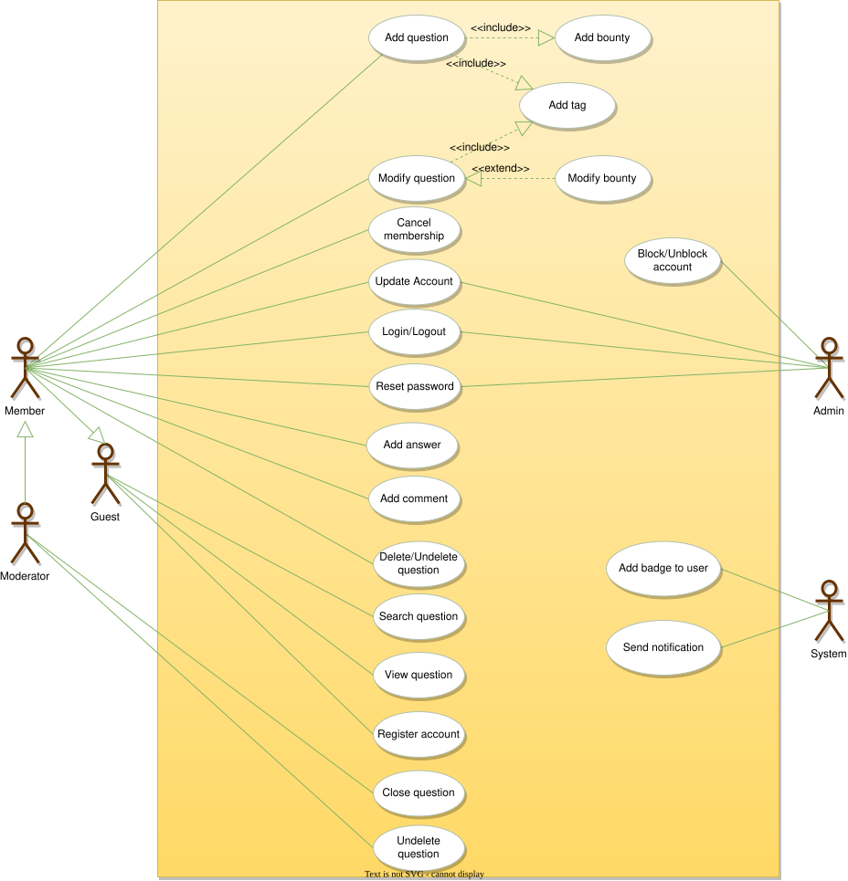
*Figure — Use cases per actor: Guest (search, view, register), Member (add/modify question, answer, comment, bounty, tag), Moderator (close, delete/undelete), Admin (block/unblock), System (send notification, add badge) (course diagram)*

A **use-case diagram** is a UML picture of the actors (stick figures) and the things each one can do (ovals). In the figure above, notice the `<<include>>` from "Add question" to "Add tag" (adding a tag is part of asking) and the `<<extend>>` for bounties (an optional extra on a question).

An **activity diagram** is a flowchart of the steps and yes/no decisions in one task; a **sequence diagram** shows, top to bottom in time order, the messages objects send to each other.

**Activity — post a new question.** The member clicks *Ask Question*, types a title and body, and adds tags. For each tag, the system checks whether it already exists; if not, it checks whether the member has **enough reputation to create a tag**. Then it validates the question and either saves and posts it or shows an error.

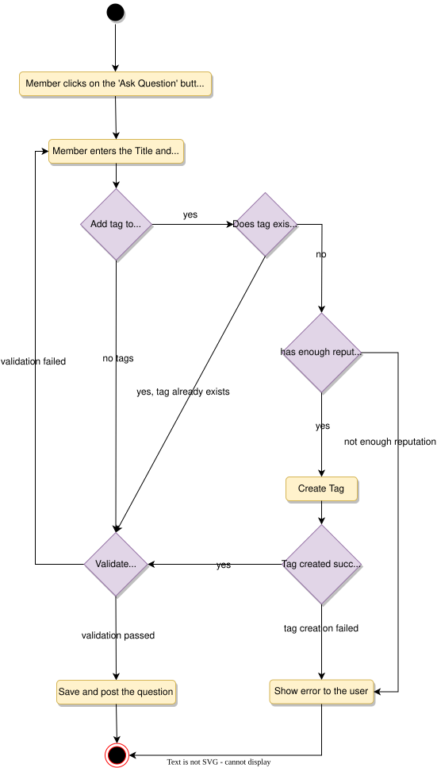
*Figure — Activity diagram for posting a question, including the "does the tag exist?" and "has enough reputation?" decisions (course diagram)*

**Sequence — create a question.** The member sets the title and body, looks up tags (creating one if missing), creates the question with a bounty value, the question creates its `Bounty`, and finally the question is published.

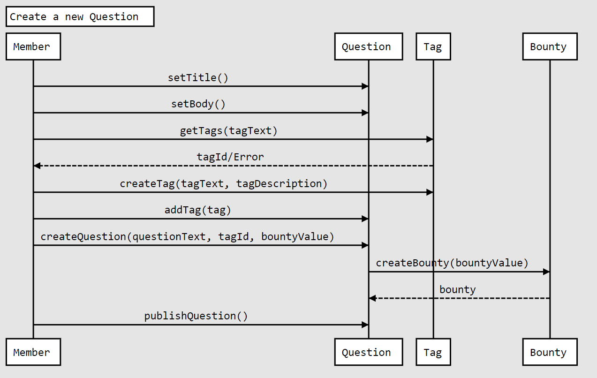
*Figure — Sequence diagram: Member → Question (setTitle, setBody), Member → Tag (getTags / createTag), Question → Bounty (createBounty), then publishQuestion (course diagram)*

Our Java code follows the same order: `ask()` resolves each tag, creating it only if the asker holds the `CREATE_TAG` privilege, and then builds the question; `offerBounty()` attaches the bounty.

### Core entities

| Class | Responsibility |
|---|---|
| `Member` (+ `Moderator`, `Admin`) | Identity, reputation (atomic — safe when updated by many threads at once), badges, account status; `hasPrivilege(p)` |
| `Privilege` (enum) | The reputation needed for each action — a data table, not scattered `if`s |
| `Post` (sealed, abstract) | Shared behaviour: author, body, votes per voter, flags, comments |
| `Question` | Title, tags, answers, status (OPEN / CLOSED / DELETED…), closing remark, close/delete voters, bounty, view count |
| `Answer` | Belongs to one question; can be *accepted*. (The course also gives answers and comments a view count and vote/flag counts; our code derives the vote and flag counts from the voter and flagger sets) |
| `Comment` | Belongs to a question or answer |
| `Tag` | Name + description; counts its own uses (for "top tags") |
| `Bounty` | Staked reputation, sponsor, expiry date, winner |
| `Badge` (record) | Name + description |
| `ReputationPolicy` / `DefaultReputationPolicy` | Strategy: how many points each event is worth |
| `ReputationListener` / `BadgeAwarder` | Observer: reacts to reputation changes (awards badges) |
| `Notifier` + `NotificationChannel` / `EmailChannel` | Sends notifications through pluggable channels |
| `Search` / `QuestionIndex` | Inverted index by word and by tag |
| `StackOverflow` | Facade: checks status + privilege, delegates, applies reputation |

### Class diagram

The course builds the class diagram in **five stages**, each adding a few classes for a few requirements. Classes from earlier stages are drawn in grey, so the picture fills in step by step.

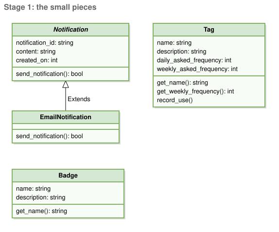
*Figure — Stage 1: `Badge`, `Tag` (with daily and weekly usage counters and `record_use`) and abstract `Notification` with its `EmailNotification` subclass (course diagram)*

Stage 1 covers requirements 8, 10 and 13. None of these classes depends on anything yet. The key idea is in `Tag`: it counts its own uses when attached to a question, so "most used tags" becomes a quick read rather than a scan of every question. `Notification` is abstract with one subclass per delivery method — an email notification genuinely is a notification that can be sent, so the inheritance passes the substitution test (the Liskov Substitution Principle: a subclass object must work correctly anywhere its parent class is expected).


*Figure — The UML legend used in these diagrams: class, interface, realization, generalization, dependency, association, aggregation and composition arrows (course diagram)*

**UML** (Unified Modeling Language) is the standard notation for drawing classes and their links. In short: **generalization** is the inheritance arrow ("is a kind of"); **realization** means a class implements an interface; **dependency** means one class merely uses another for a moment; **aggregation** (hollow diamond) means "has, but does not own"; **composition** (filled diamond) and **association** are explained in Stage 3 below.

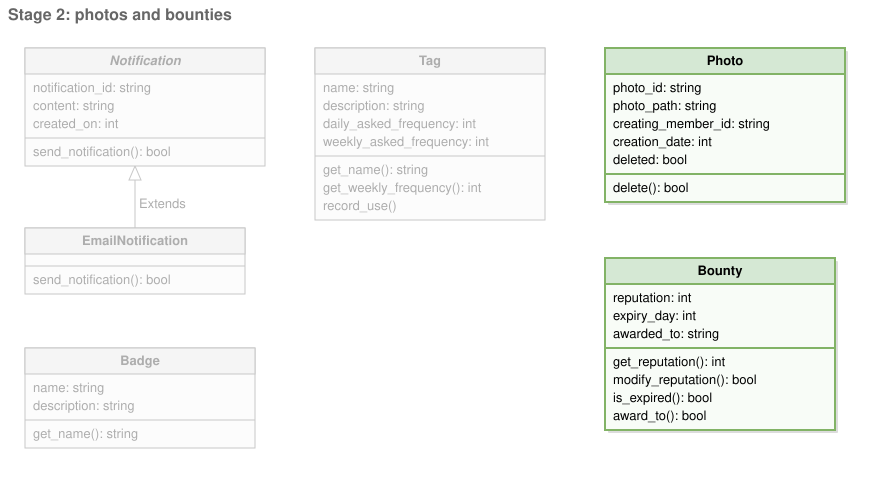
*Figure — Stage 2 adds `Photo` (attachments on questions and answers) and `Bounty` (reputation held until awarded or expired) (course diagram)*

Stage 2 covers requirement 7. The bounty keeps the staked amount itself rather than on the question, so the money-like value has one owner until it is settled. The course's reason for this is that the amount can then go back to the sponsor if nobody earns it. Be careful in an interview: on the real site a bounty is *not* refundable, so our code deducts the points when the bounty starts and never returns them.

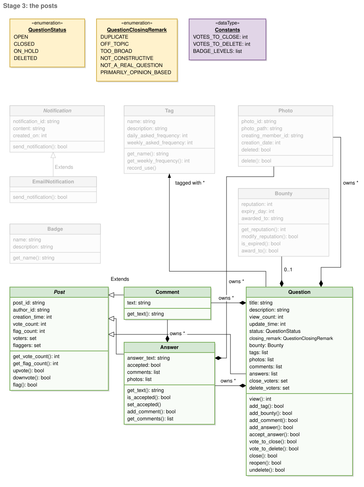
*Figure — Stage 3: abstract `Post` with `Question`, `Answer` and `Comment` below it; filled diamonds from `Question` to its answers, comments, photos and bounty; a plain association from `Question` to `Tag` (course diagram)*

Stage 3 is the heart of the design. Requirements 5 and 6 say that upvoting and flagging work the *same way* on three classes, so that behaviour is written once in `Post`. What *differs* is what each one contains, so they remain three separate classes instead of a single class plus a "kind" field. `Post` also remembers **who** voted — otherwise one member could vote ten times. The filled diamonds are **composition**: deleting a question also deletes its answers, comments, photos and bounty. `Tag` is linked by a plain **association** instead: many questions use the same tag, and the tag lives on after any one of them is deleted. Because `Post` keeps only the author's id, the diagram has no arrow from a post to a member.

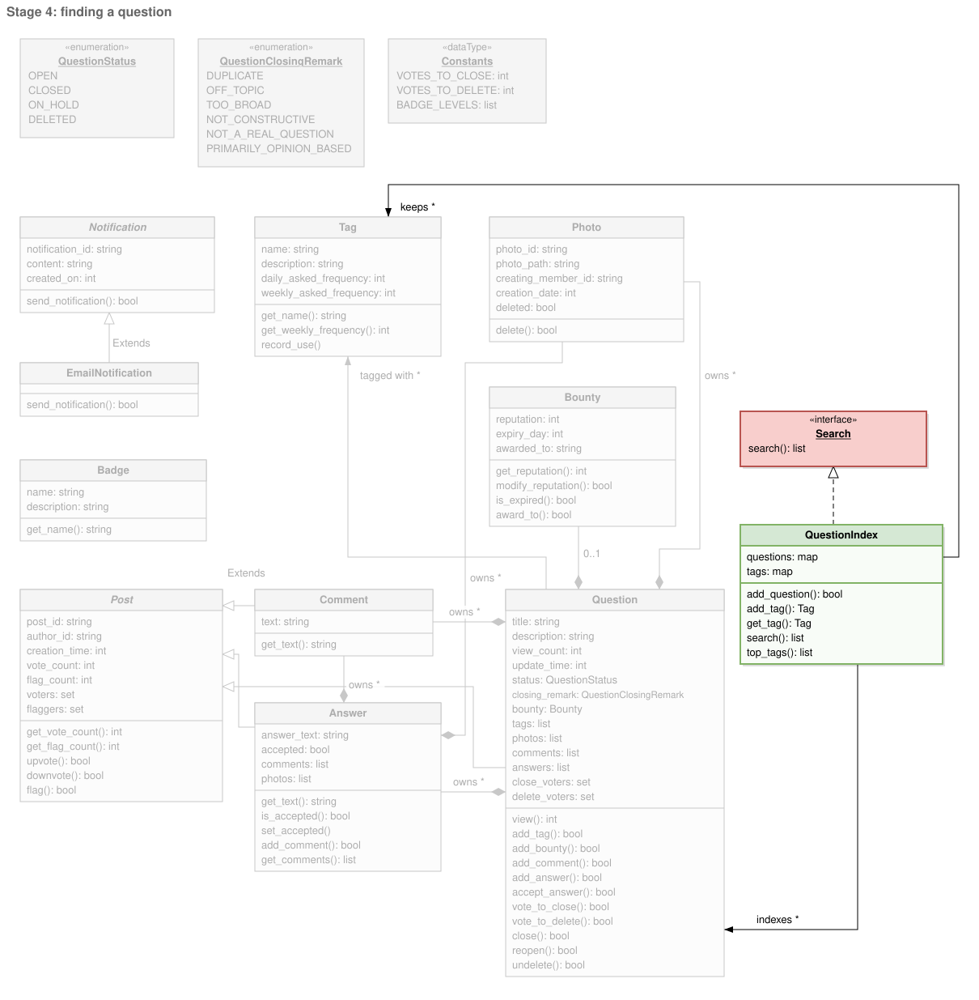
*Figure — Stage 4: the `Search` interface and `QuestionIndex`, which holds (but does not own) questions and tags (course diagram)*

Stage 4 covers search and requirement 13. A tempting first attempt makes search a static method (a method that belongs to the class itself rather than to any one object) on `Question`, which forces `Question` to know every question in existence — not its job. The index implements `Search` (dashed line with hollow head = realization). Its arrows are plain associations: deleting the index deletes no question.

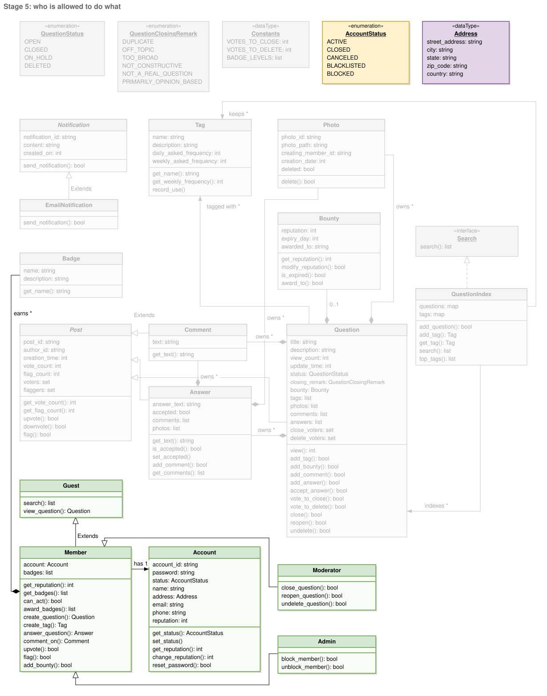
*Figure — Stage 5: `Account`, `Guest`, `Member` (extends Guest), `Moderator` and `Admin` (extend Member); `Member` owns its badges (course diagram)*

Stage 5 covers requirement 1 by the *shape* of the classes: the methods a guest may call sit on `Guest`, and `Member` inherits them and adds posting and voting. A guest simply has no `createQuestion` method, so no check can be forgotten. `Moderator` and `Admin` inherit from `Member` since each of them may do anything a member may (the substitution test passes). `Member` owns its badges (filled diamond): a badge is awarded to that one member. The link from a member to its `Account` is a plain association, because the account is created elsewhere and handed to the member.

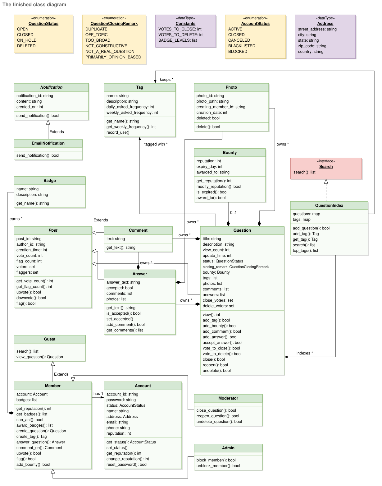
*Figure — The finished Stack Overflow class diagram: enums (QuestionStatus, QuestionClosingRemark, AccountStatus), Constants, the posts, tags, badges, bounty, photo, notification, search index and the account hierarchy (course diagram)*

**Our Java design.** It keeps the course's structure and adds three things the course's "what we left out" section invites: a reputation **Strategy**, a badge **Observer**, and a data-driven **privilege table** (because on the real site privileges depend on reputation, not only on account type). A guest in our code is simply "no `Member` object": every write operation on the facade requires a `Member` argument, so the type system still enforces requirement 1. The course also lists what it deliberately leaves out: edit history, revision review, linking duplicates, chat, and the reputation a downvoter pays. We add the downvote cost (it is one line in the policy); edit history and duplicate links are covered under Extensions below; chat stays out of scope.

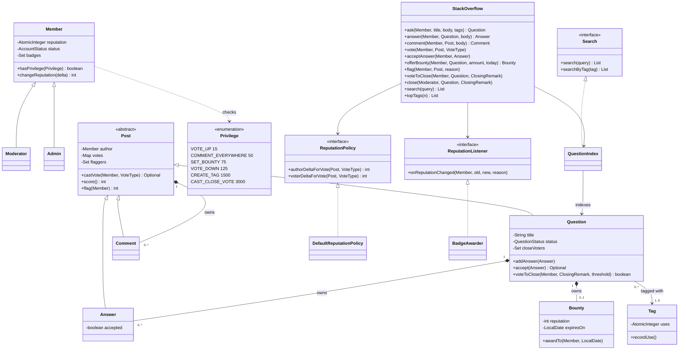

### Key flows

**Voting (with a changed vote).** The facade checks privilege first, then asks the post to record the vote. The post returns the voter's *previous* vote, so the facade can reverse its reputation effect before applying the new one.

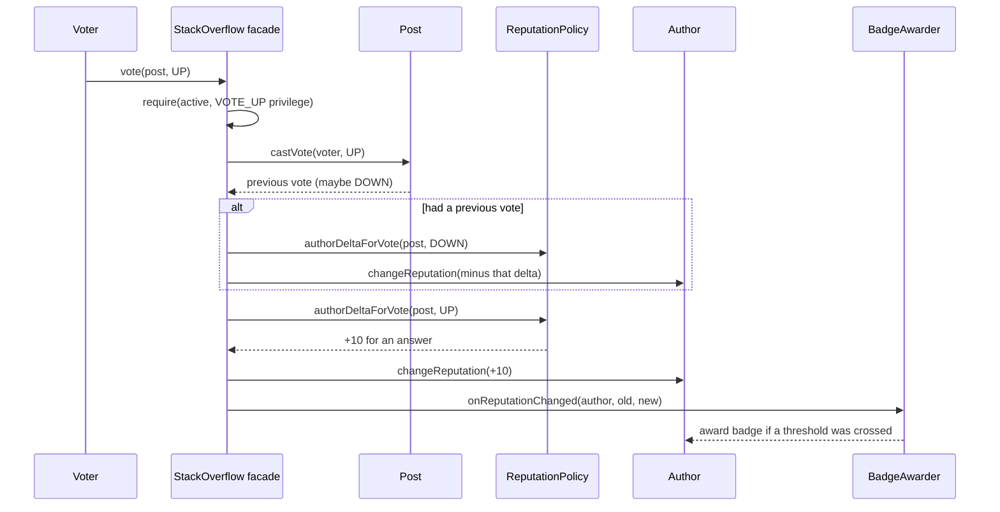

**Question lifecycle.**

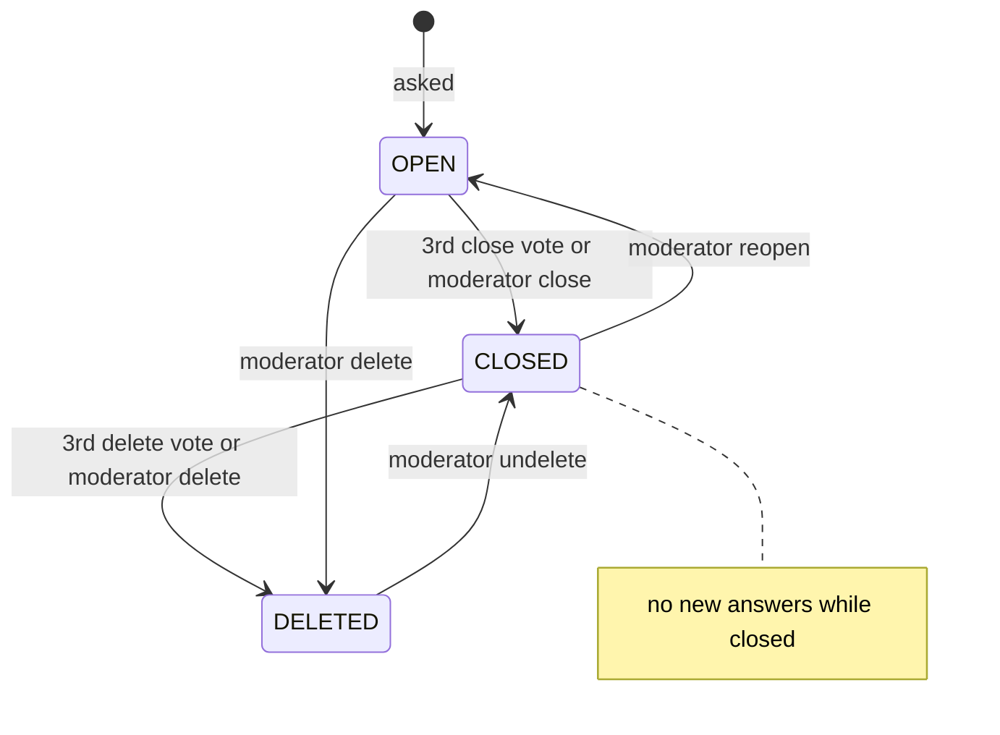

**Bounty.** `offerBounty` checks the `SET_BOUNTY` privilege and the 50–500 range, attaches the bounty to the (open) question, and *immediately* deducts the amount from the sponsor. Later `awardBounty` (sponsor only, not to their own answer, before expiry) credits the winner.

### Design decisions & patterns used

| Decision | Pattern / principle | Why | Alternative rejected |
|---|---|---|---|
| `Post` base class for question, answer, comment | Inheritance (passes the substitution test), `sealed` | Voting, flagging and commenting are identical on all three | One `Post` class with a `type` field — then every method needs `if (type == …)` |
| Votes stored as `Map<voterId, VoteType>` | "Store who, not how many" | Blocks double votes; lets a vote be changed and its reputation reversed | An `int voteCount` — cannot tell who voted |
| `ReputationPolicy` interface | **Strategy** | Scoring rules change (Stack Overflow really did change them); voting code should not | Hard-coded numbers inside `vote()` — the course calls this out as a weakness |
| `ReputationListener` + `BadgeAwarder` | **Observer** | Badges, notifications, analytics all react to reputation without the facade knowing them | Calling `awardBadges()` directly inside `vote()` |
| `Privilege` enum with thresholds | Table-driven design | One place holds the rules; `hasPrivilege` is one comparison | `if (rep >= 125)` scattered across methods |
| Moderator-only methods take a `Moderator` parameter | Type-level permission | You cannot even call `close(…)` without a moderator object | A runtime role check that someone might forget |
| `QuestionIndex` separate from `Question` | Single Responsibility | Search can later be swapped for Elasticsearch (a popular search-engine server) behind `Search` | Static `Question.search()` |
| `Tag` counts its own uses | Maintain an aggregate at write time | "Top tags" becomes a sort of a small collection | Scanning all questions on every request |
| `StackOverflow` facade | **Facade** | One entry point that validates, delegates and logs | Letting the UI call `Question`, `Member`, `Bounty` directly |
| Pattern matching `switch` over the sealed `Post` | Exhaustive dispatch | The compiler forces us to handle each post kind in the policy | `instanceof` chains that silently miss a new type |

### Java implementation

Package `lld.ch18.stackoverflow`. Read the files in this order: the enums and privilege table (`Types.java`), accounts, posts, reputation Strategy/Observer, the search index, then the facade and the demo.

```java
// File: lld/ch18/stackoverflow/Types.java
package lld.ch18.stackoverflow;

/** Lifecycle of a question. ON_HOLD is the older name Stack Overflow used for a freshly closed question. */
enum QuestionStatus { OPEN, ON_HOLD, CLOSED, DELETED }

/** Why a question was closed. */
enum ClosingRemark {
    DUPLICATE, OFF_TOPIC, TOO_BROAD, NOT_CONSTRUCTIVE, NOT_A_REAL_QUESTION, PRIMARILY_OPINION_BASED
}

enum AccountStatus { ACTIVE, CLOSED, CANCELED, BLACKLISTED, BLOCKED }

enum VoteType { UP, DOWN }

/**
 * Reputation needed to unlock an action. The numbers follow the public
 * privileges page of stackoverflow.com, so "reputation unlocks privileges"
 * is data here, not if-statements spread over the code.
 */
enum Privilege {
    ASK_OR_ANSWER(1),
    VOTE_UP(15),
    FLAG(15),
    COMMENT_EVERYWHERE(50),
    SET_BOUNTY(75),
    VOTE_DOWN(125),
    CREATE_TAG(1500),
    EDIT_ANY_POST(2000),
    CAST_CLOSE_VOTE(3000),
    CAST_DELETE_VOTE(10000);

    final int minReputation;

    Privilege(int minReputation) { this.minReputation = minReputation; }
}

/** A badge is just a name and a description; members own the badges they earn. */
record Badge(String name, String description) {}
```

```java
// File: lld/ch18/stackoverflow/Accounts.java
package lld.ch18.stackoverflow;

import java.util.Collections;
import java.util.LinkedHashSet;
import java.util.Set;
import java.util.concurrent.atomic.AtomicInteger;
import java.util.concurrent.atomic.AtomicLong;

/**
 * A registered member. A guest has no Member object at all: every write
 * operation on the StackOverflow facade takes a Member, so "guests can only
 * search and view" is enforced by the method signatures.
 */
class Member {
    private static final AtomicLong IDS = new AtomicLong();

    private final long id = IDS.incrementAndGet();
    private final String name;
    private final String email;
    private final AtomicInteger reputation = new AtomicInteger(1);   // every account starts at 1
    private final Set<Badge> badges = Collections.synchronizedSet(new LinkedHashSet<>());
    private volatile AccountStatus status = AccountStatus.ACTIVE;

    Member(String name, String email) {
        this.name = name;
        this.email = email;
    }

    long id() { return id; }
    String name() { return name; }
    String email() { return email; }
    int reputation() { return reputation.get(); }
    AccountStatus status() { return status; }
    void setStatus(AccountStatus status) { this.status = status; }

    /** Applies a delta atomically; reputation never drops below 1 (the site's floor). Returns the new value. */
    int changeReputation(int delta) {
        return reputation.updateAndGet(r -> Math.max(1, r + delta));
    }

    /** Demo helper: pretend the member earned reputation before the demo started. */
    void seedReputation(int value) { reputation.set(value); }

    boolean hasPrivilege(Privilege p) { return reputation() >= p.minReputation; }

    boolean addBadge(Badge b) { return badges.add(b); }
    Set<Badge> badges() { synchronized (badges) { return Set.copyOf(badges); } }

    @Override public String toString() { return name + "(" + reputation() + ")"; }
}

/** Moderators can do everything a member can, whatever their reputation, plus close/reopen/delete/undelete any question. */
class Moderator extends Member {
    Moderator(String name, String email) { super(name, email); }
    @Override boolean hasPrivilege(Privilege p) { return true; }
}

/** Admins block and unblock members. */
class Admin extends Member {
    Admin(String name, String email) { super(name, email); }
    @Override boolean hasPrivilege(Privilege p) { return true; }
}
```

```java
// File: lld/ch18/stackoverflow/Posts.java
package lld.ch18.stackoverflow;

import java.time.LocalDate;
import java.util.ArrayList;
import java.util.HashMap;
import java.util.HashSet;
import java.util.LinkedHashSet;
import java.util.List;
import java.util.Map;
import java.util.Optional;
import java.util.Set;
import java.util.concurrent.atomic.AtomicInteger;
import java.util.concurrent.atomic.AtomicLong;

/**
 * Behaviour shared by questions, answers and comments: votes, flags and comments.
 * Votes are stored per voter (not as a bare counter) so one member cannot vote twice
 * and a vote can be changed or reversed.
 */
abstract sealed class Post permits Question, Answer, Comment {
    private static final AtomicLong IDS = new AtomicLong(100);

    private final long id = IDS.incrementAndGet();
    private final Member author;
    private volatile String body;
    private final Map<Long, VoteType> votes = new HashMap<>();
    private final Set<Long> flaggers = new HashSet<>();
    private final List<Comment> comments = new ArrayList<>();

    Post(Member author, String body) {
        this.author = author;
        this.body = body;
    }

    long id() { return id; }
    Member author() { return author; }
    String body() { return body; }
    void edit(String newBody) { this.body = newBody; }

    /** Records or changes a vote and returns the voter's previous vote, if any. */
    synchronized Optional<VoteType> castVote(Member voter, VoteType type) {
        if (voter.id() == author.id()) throw new IllegalStateException("you cannot vote on your own post");
        VoteType previous = votes.put(voter.id(), type);
        if (previous == type) throw new IllegalStateException(voter.name() + " already voted " + type + " on this post");
        return Optional.ofNullable(previous);
    }

    synchronized int score() {
        return votes.values().stream().mapToInt(v -> v == VoteType.UP ? 1 : -1).sum();
    }

    /** Returns the number of distinct flaggers after this flag. */
    synchronized int flag(Member by) {
        if (!flaggers.add(by.id())) throw new IllegalStateException(by.name() + " already flagged this post");
        return flaggers.size();
    }

    synchronized void addComment(Comment c) { comments.add(c); }
    synchronized List<Comment> comments() { return List.copyOf(comments); }

    abstract String label();
}

final class Question extends Post {
    private final String title;
    private final Set<Tag> tags;
    private final List<Answer> answers = new ArrayList<>();
    private final Set<Long> closeVoters = new HashSet<>();
    private final Set<Long> deleteVoters = new HashSet<>();
    private final AtomicInteger views = new AtomicInteger();
    private QuestionStatus status = QuestionStatus.OPEN;
    private ClosingRemark closingRemark;
    private Bounty bounty;

    Question(Member author, String title, String body, Set<Tag> tags) {
        super(author, body);
        this.title = title;
        this.tags = new LinkedHashSet<>(tags);
        tags.forEach(Tag::recordUse);            // a tag counts its own uses: "top tags" becomes a read
    }

    String title() { return title; }
    Set<Tag> tags() { return Set.copyOf(tags); }
    int view() { return views.incrementAndGet(); }
    int views() { return views.get(); }

    synchronized QuestionStatus status() { return status; }
    synchronized Optional<ClosingRemark> closingRemark() { return Optional.ofNullable(closingRemark); }
    synchronized List<Answer> answers() { return List.copyOf(answers); }
    synchronized Optional<Bounty> bounty() { return Optional.ofNullable(bounty); }

    synchronized void addAnswer(Answer a) {
        if (status != QuestionStatus.OPEN) throw new IllegalStateException("question is " + status + ", no new answers");
        answers.add(a);
    }

    /** Marks one answer accepted and returns the previously accepted one (only one answer can win). */
    synchronized Optional<Answer> accept(Answer chosen) {
        if (!answers.contains(chosen)) throw new IllegalArgumentException("answer does not belong to this question");
        Optional<Answer> previous = answers.stream().filter(Answer::isAccepted).findFirst();
        previous.ifPresent(p -> p.setAccepted(false));
        chosen.setAccepted(true);
        return previous;
    }

    synchronized void attachBounty(Bounty b) {
        if (status != QuestionStatus.OPEN) throw new IllegalStateException("bounties need an open question");
        if (bounty != null && !bounty.isSettled()) throw new IllegalStateException("question already has an active bounty");
        bounty = b;
    }

    /** One close vote per member; returns true when this vote closed the question. */
    synchronized boolean voteToClose(Member voter, ClosingRemark remark, int threshold) {
        if (status != QuestionStatus.OPEN) throw new IllegalStateException("question is already " + status);
        if (!closeVoters.add(voter.id())) throw new IllegalStateException(voter.name() + " already voted to close");
        if (closeVoters.size() >= threshold) { close(remark); return true; }
        return false;
    }

    synchronized boolean voteToDelete(Member voter, int threshold) {
        if (status != QuestionStatus.CLOSED) throw new IllegalStateException("only closed questions can be deleted by vote");
        if (!deleteVoters.add(voter.id())) throw new IllegalStateException(voter.name() + " already voted to delete");
        if (deleteVoters.size() >= threshold) { status = QuestionStatus.DELETED; return true; }
        return false;
    }

    synchronized void close(ClosingRemark remark) { status = QuestionStatus.CLOSED; closingRemark = remark; }
    synchronized void reopen() { status = QuestionStatus.OPEN; closingRemark = null; closeVoters.clear(); }
    synchronized void delete() { status = QuestionStatus.DELETED; }
    synchronized void undelete() { status = QuestionStatus.CLOSED; deleteVoters.clear(); }

    @Override String label() { return "question #" + id() + " \"" + title + "\""; }
}

final class Answer extends Post {
    private final Question question;
    private volatile boolean accepted;

    Answer(Member author, Question question, String body) {
        super(author, body);
        this.question = question;
    }

    Question question() { return question; }
    boolean isAccepted() { return accepted; }
    void setAccepted(boolean accepted) { this.accepted = accepted; }

    @Override String label() { return "answer #" + id() + " by " + author().name(); }
}

final class Comment extends Post {
    private final Post parent;

    Comment(Member author, Post parent, String body) {
        super(author, body);
        this.parent = parent;
    }

    Post parent() { return parent; }
    @Override String label() { return "comment #" + id(); }
}

/** A tag is shared by many questions and outlives each of them (association, not composition). */
final class Tag {
    private final String name;
    private final String description;
    private final AtomicInteger uses = new AtomicInteger();

    Tag(String name, String description) { this.name = name; this.description = description; }

    String name() { return name; }
    String description() { return description; }
    void recordUse() { uses.incrementAndGet(); }
    int uses() { return uses.get(); }
    @Override public String toString() { return "[" + name + "]"; }
}

/** Reputation the asker has staked; it leaves the asker's account when the bounty starts. */
final class Bounty {
    private final Member sponsor;
    private final int reputation;
    private final LocalDate expiresOn;
    private Member awardedTo;
    private boolean expired;

    Bounty(Member sponsor, int reputation, LocalDate expiresOn) {
        this.sponsor = sponsor;
        this.reputation = reputation;
        this.expiresOn = expiresOn;
    }

    Member sponsor() { return sponsor; }
    int reputation() { return reputation; }
    LocalDate expiresOn() { return expiresOn; }
    synchronized boolean isSettled() { return awardedTo != null || expired; }

    synchronized void awardTo(Member winner, LocalDate today) {
        if (isSettled()) throw new IllegalStateException("bounty already settled");
        if (today.isAfter(expiresOn)) throw new IllegalStateException("bounty expired on " + expiresOn);
        awardedTo = winner;
    }

    synchronized void expire() { expired = true; }
}
```

```java
// File: lld/ch18/stackoverflow/Reputation.java
package lld.ch18.stackoverflow;

import java.util.List;

/**
 * Strategy: the scoring rules live behind an interface, so voting code does not
 * know the numbers. Changing a rule (e.g. the 2019 move of question upvotes
 * from +5 to +10) is a new
 * policy, not an edit to the voting code (Open/Closed Principle).
 */
interface ReputationPolicy {
    int authorDeltaForVote(Post post, VoteType type);
    int voterDeltaForVote(Post post, VoteType type);
    int acceptedAnswerBonus();
    int acceptorBonus();
}

/** Today's stackoverflow.com rules: +10 for any upvote, -2 to the author per downvote, -1 to whoever downvotes an answer. */
final class DefaultReputationPolicy implements ReputationPolicy {
    @Override public int authorDeltaForVote(Post post, VoteType type) {
        return switch (post) {
            case Question q -> type == VoteType.UP ? 10 : -2;   // +5 before November 2019
            case Answer a -> type == VoteType.UP ? 10 : -2;
            case Comment c -> 0;                       // comment votes earn no reputation
        };
    }
    @Override public int voterDeltaForVote(Post post, VoteType type) {
        return post instanceof Answer && type == VoteType.DOWN ? -1 : 0;
    }
    @Override public int acceptedAnswerBonus() { return 15; }
    @Override public int acceptorBonus() { return 2; }
}

/** Observer: anything that wants to react to a reputation change. */
interface ReputationListener {
    void onReputationChanged(Member member, int oldValue, int newValue, String reason);
}

/** Awards reputation-level badges (course thresholds: 15, 50, 125). */
final class BadgeAwarder implements ReputationListener {
    private record Level(int reputation, Badge badge) {}

    private final List<Level> levels = List.of(
            new Level(15, new Badge("Contributor", "reached 15 reputation")),
            new Level(50, new Badge("Helpful", "reached 50 reputation")),
            new Level(125, new Badge("Trusted", "reached 125 reputation")));
    private final Notifier notifier;

    BadgeAwarder(Notifier notifier) { this.notifier = notifier; }

    @Override public void onReputationChanged(Member m, int oldValue, int newValue, String reason) {
        for (Level level : levels) {
            if (oldValue < level.reputation() && newValue >= level.reputation() && m.addBadge(level.badge())) {
                notifier.send(m, "You earned the '" + level.badge().name() + "' badge");
            }
        }
    }
}

/** Delivery channel for notifications (Strategy: email today, push tomorrow). */
interface NotificationChannel {
    void deliver(Member to, String text);
}

final class EmailChannel implements NotificationChannel {
    @Override public void deliver(Member to, String text) {
        System.out.println("    [email to " + to.email() + "] " + text);
    }
}

/** The "System" actor: sends notifications through every configured channel. */
final class Notifier {
    private final List<NotificationChannel> channels;
    Notifier(List<NotificationChannel> channels) { this.channels = List.copyOf(channels); }
    void send(Member to, String text) { channels.forEach(c -> c.deliver(to, text)); }
}
```

```java
// File: lld/ch18/stackoverflow/QuestionIndex.java
package lld.ch18.stackoverflow;

import java.util.Arrays;
import java.util.Comparator;
import java.util.HashSet;
import java.util.List;
import java.util.Locale;
import java.util.Map;
import java.util.Set;
import java.util.concurrent.ConcurrentHashMap;

/** Search contract, kept separate so a full-text engine could replace the in-memory index. */
interface Search {
    List<Question> search(String query);
    List<Question> searchByTag(String tagName);
}

/**
 * An inverted index: word -> questions containing it. It refers to questions
 * but does not own them (throwing the index away deletes no question).
 */
final class QuestionIndex implements Search {
    private final Map<String, Set<Question>> byWord = new ConcurrentHashMap<>();
    private final Map<String, Set<Question>> byTag = new ConcurrentHashMap<>();

    void add(Question q) {
        for (String word : words(q.title() + " " + q.body())) {
            byWord.computeIfAbsent(word, k -> ConcurrentHashMap.newKeySet()).add(q);
        }
        for (Tag t : q.tags()) {
            byTag.computeIfAbsent(t.name(), k -> ConcurrentHashMap.newKeySet()).add(q);
        }
    }

    /** Questions containing every word of the query, best score first; deleted questions are hidden. */
    @Override public List<Question> search(String query) {
        List<String> terms = words(query);
        if (terms.isEmpty()) return List.of();
        Set<Question> result = new HashSet<>(byWord.getOrDefault(terms.get(0), Set.of()));
        for (String t : terms.subList(1, terms.size())) result.retainAll(byWord.getOrDefault(t, Set.of()));
        return rank(result);
    }

    @Override public List<Question> searchByTag(String tagName) {
        return rank(byTag.getOrDefault(tagName.toLowerCase(Locale.ROOT), Set.of()));
    }

    private static List<Question> rank(Set<Question> qs) {
        return qs.stream()
                .filter(q -> q.status() != QuestionStatus.DELETED)
                .sorted(Comparator.comparingInt(Question::score).reversed().thenComparingLong(Question::id))
                .toList();
    }

    private static List<String> words(String text) {
        return Arrays.stream(text.toLowerCase(Locale.ROOT).split("[^a-z0-9#+]+"))
                .filter(w -> w.length() > 2)
                .distinct()
                .toList();
    }
}
```

```java
// File: lld/ch18/stackoverflow/StackOverflow.java
package lld.ch18.stackoverflow;

import java.time.LocalDate;
import java.util.Comparator;
import java.util.LinkedHashSet;
import java.util.List;
import java.util.Locale;
import java.util.Map;
import java.util.Optional;
import java.util.Set;
import java.util.concurrent.ConcurrentHashMap;
import java.util.concurrent.CopyOnWriteArrayList;

/**
 * Facade: the one entry point the UI/controllers call. It checks who may do
 * what (account status + privilege), delegates state changes to the posts,
 * applies reputation through the policy, and tells listeners.
 */
public final class StackOverflow {
    static final int VOTES_TO_CLOSE = 3;
    static final int VOTES_TO_DELETE = 3;
    static final int FLAGS_FOR_MODERATOR_REVIEW = 3;
    static final int MIN_BOUNTY = 50;
    static final int MAX_BOUNTY = 500;
    static final int BOUNTY_DAYS = 7;

    private final Map<String, Tag> tags = new ConcurrentHashMap<>();
    private final Map<Long, Member> members = new ConcurrentHashMap<>();
    private final QuestionIndex index = new QuestionIndex();
    private final ReputationPolicy policy;
    private final Notifier notifier;
    private final List<ReputationListener> listeners = new CopyOnWriteArrayList<>();
    private final List<Moderator> moderators = new CopyOnWriteArrayList<>();

    StackOverflow(ReputationPolicy policy, Notifier notifier) {
        this.policy = policy;
        this.notifier = notifier;
    }

    void addReputationListener(ReputationListener l) { listeners.add(l); }

    // ---------- accounts ----------
    <M extends Member> M register(M member) {
        members.put(member.id(), member);
        if (member instanceof Moderator mod) moderators.add(mod);
        return member;
    }

    void block(Admin admin, Member target) { target.setStatus(AccountStatus.BLOCKED); log(admin.name() + " blocked " + target.name()); }
    void unblock(Admin admin, Member target) { target.setStatus(AccountStatus.ACTIVE); log(admin.name() + " unblocked " + target.name()); }

    // ---------- guest operations (no Member needed) ----------
    List<Question> search(String query) { return index.search(query); }
    List<Question> searchByTag(String tag) { return index.searchByTag(tag); }
    int view(Question q) { return q.view(); }

    /** Requirement 13: the most used tags; each tag counted itself, so this is a sort, not a scan of all questions. */
    List<Tag> topTags(int n) {
        return tags.values().stream()
                .sorted(Comparator.comparingInt(Tag::uses).reversed().thenComparing(Tag::name))
                .limit(n).toList();
    }

    // ---------- tags ----------
    Tag createTag(Member by, String name, String description) {
        require(by, Privilege.CREATE_TAG);
        return tags.computeIfAbsent(name.toLowerCase(Locale.ROOT), k -> new Tag(k, description));
    }

    // ---------- posting ----------
    Question ask(Member asker, String title, String body, List<String> tagNames) {
        require(asker, Privilege.ASK_OR_ANSWER);
        Set<Tag> resolved = new LinkedHashSet<>();
        for (String raw : tagNames) {
            String name = raw.toLowerCase(Locale.ROOT);
            Tag tag = tags.get(name);
            if (tag == null) tag = createTag(asker, name, "");    // throws if the asker may not create tags
            resolved.add(tag);
        }
        Question q = new Question(asker, title, body, resolved);
        index.add(q);
        log(asker.name() + " asked " + q.label() + " " + resolved);
        return q;
    }

    Answer answer(Member author, Question q, String body) {
        require(author, Privilege.ASK_OR_ANSWER);
        Answer a = new Answer(author, q, body);
        q.addAnswer(a);                                          // throws unless the question is OPEN
        log(author.name() + " posted " + a.label() + " on question #" + q.id());
        notifier.send(q.author(), author.name() + " answered \"" + q.title() + "\"");
        return a;
    }

    Comment comment(Member author, Post target, String body) {
        requireActive(author);
        boolean ownThread = target.author().id() == author.id()
                || (target instanceof Answer a && a.question().author().id() == author.id());
        if (!ownThread) require(author, Privilege.COMMENT_EVERYWHERE);
        Comment c = new Comment(author, target, body);
        target.addComment(c);
        log(author.name() + " commented on " + target.label() + ": \"" + body + "\"");
        if (target.author().id() != author.id()) notifier.send(target.author(), author.name() + " commented on your " + target.label());
        return c;
    }

    // ---------- voting & reputation ----------
    void vote(Member voter, Post post, VoteType type) {
        require(voter, type == VoteType.UP ? Privilege.VOTE_UP : Privilege.VOTE_DOWN);
        if (post instanceof Comment && type == VoteType.DOWN) throw new IllegalStateException("comments can only be upvoted");
        Optional<VoteType> previous = post.castVote(voter, type);
        log(voter.name() + " voted " + type + " on " + post.label() + " -> score " + post.score());
        previous.ifPresent(p -> {                                  // undo the old vote's effect first
            adjust(post.author(), -policy.authorDeltaForVote(post, p), "vote changed on " + post.label());
            adjust(voter, -policy.voterDeltaForVote(post, p), "vote changed");
        });
        adjust(post.author(), policy.authorDeltaForVote(post, type), type + " on " + post.label());
        adjust(voter, policy.voterDeltaForVote(post, type), "downvoted an answer");
    }

    void acceptAnswer(Member asker, Answer answer) {
        requireActive(asker);
        Question q = answer.question();
        if (q.author().id() != asker.id()) throw new IllegalStateException("only the asker can accept an answer");
        Optional<Answer> previous = q.accept(answer);
        log(asker.name() + " accepted " + answer.label());
        previous.ifPresent(p -> adjust(p.author(), -policy.acceptedAnswerBonus(), "acceptance moved away"));
        adjust(answer.author(), policy.acceptedAnswerBonus(), "answer accepted");
        if (previous.isEmpty() && answer.author().id() != asker.id()) adjust(asker, policy.acceptorBonus(), "accepted an answer");
    }

    // ---------- bounties ----------
    Bounty offerBounty(Member sponsor, Question q, int amount, LocalDate today) {
        require(sponsor, Privilege.SET_BOUNTY);
        if (amount < MIN_BOUNTY || amount > MAX_BOUNTY) throw new IllegalArgumentException("bounty must be " + MIN_BOUNTY + ".." + MAX_BOUNTY);
        if (sponsor.reputation() - amount < 1) throw new IllegalStateException("not enough reputation to stake " + amount);
        Bounty b = new Bounty(sponsor, amount, today.plusDays(BOUNTY_DAYS));
        q.attachBounty(b);
        adjust(sponsor, -amount, "bounty staked");          // staked reputation leaves the sponsor now
        log(sponsor.name() + " offered a +" + amount + " bounty on question #" + q.id() + " (expires " + b.expiresOn() + ")");
        return b;
    }

    void awardBounty(Member sponsor, Answer winner, LocalDate today) {
        Bounty b = winner.question().bounty().orElseThrow(() -> new IllegalStateException("no bounty on this question"));
        if (b.sponsor().id() != sponsor.id()) throw new IllegalStateException("only the sponsor awards the bounty");
        if (winner.author().id() == sponsor.id()) throw new IllegalStateException("you cannot award your own answer");
        b.awardTo(winner.author(), today);
        adjust(winner.author(), b.reputation(), "bounty awarded");
        log(sponsor.name() + " awarded the bounty to " + winner.label());
    }

    // ---------- moderation ----------
    void flag(Member by, Post post, String reason) {
        require(by, Privilege.FLAG);
        int count = post.flag(by);
        log(by.name() + " flagged " + post.label() + " (" + reason + "), flags=" + count);
        if (count == FLAGS_FOR_MODERATOR_REVIEW) {
            moderators.forEach(m -> notifier.send(m, post.label() + " needs moderator attention"));
        }
    }

    void voteToClose(Member voter, Question q, ClosingRemark remark) {
        require(voter, Privilege.CAST_CLOSE_VOTE);
        boolean closed = q.voteToClose(voter, remark, VOTES_TO_CLOSE);
        log(voter.name() + " voted to close question #" + q.id() + " as " + remark + (closed ? " -> CLOSED" : ""));
    }

    void voteToDelete(Member voter, Question q) {
        require(voter, Privilege.CAST_DELETE_VOTE);
        boolean deleted = q.voteToDelete(voter, VOTES_TO_DELETE);
        log(voter.name() + " voted to delete question #" + q.id() + (deleted ? " -> DELETED" : ""));
    }

    // Moderator-only operations: the parameter type is the permission check.
    void close(Moderator m, Question q, ClosingRemark remark) { q.close(remark); log(m.name() + " (mod) closed question #" + q.id() + " as " + remark); }
    void reopen(Moderator m, Question q) { q.reopen(); log(m.name() + " (mod) reopened question #" + q.id()); }
    void delete(Moderator m, Question q) { q.delete(); log(m.name() + " (mod) deleted question #" + q.id()); }
    void undelete(Moderator m, Question q) { q.undelete(); log(m.name() + " (mod) undeleted question #" + q.id() + " -> " + q.status()); }

    // ---------- helpers ----------
    private void adjust(Member m, int delta, String reason) {
        if (delta == 0) return;
        int before = m.reputation();
        int after = m.changeReputation(delta);
        log(String.format("    rep %-6s %+d -> %d (%s)", m.name(), delta, after, reason));
        listeners.forEach(l -> l.onReputationChanged(m, before, after, reason));
    }

    private static void requireActive(Member m) {
        if (m.status() != AccountStatus.ACTIVE) throw new IllegalStateException(m.name() + " is " + m.status());
    }

    private static void require(Member m, Privilege p) {
        requireActive(m);
        if (!m.hasPrivilege(p)) {
            throw new IllegalStateException(m.name() + " needs " + p.minReputation + " reputation for " + p + " (has " + m.reputation() + ")");
        }
    }

    private static void log(String s) { System.out.println(s); }
}
```

```java
// File: lld/ch18/stackoverflow/Main.java
package lld.ch18.stackoverflow;

import java.time.LocalDate;
import java.util.List;

public class Main {
    public static void main(String[] args) {
        Notifier notifier = new Notifier(List.of(new EmailChannel()));
        StackOverflow so = new StackOverflow(new DefaultReputationPolicy(), notifier);
        so.addReputationListener(new BadgeAwarder(notifier));

        Member alice = so.register(new Member("alice", "alice@example.com"));
        Member bob = so.register(new Member("bob", "bob@example.com"));
        Member carol = so.register(new Member("carol", "carol@example.com"));
        Member erin = so.register(new Member("erin", "erin@example.com"));
        Member dave = so.register(new Member("dave", "dave@example.com"));
        Moderator mia = so.register(new Moderator("mia", "mia@example.com"));
        Admin root = so.register(new Admin("root", "root@example.com"));
        alice.seedReputation(200);
        bob.seedReputation(3500);
        carol.seedReputation(3200);
        erin.seedReputation(3100);
        LocalDate today = LocalDate.of(2026, 9, 28);

        section("1. Tags and asking");
        so.createTag(bob, "java", "The Java language");
        so.createTag(bob, "collections", "java.util collections");
        attempt(() -> so.ask(alice, "How does HashMap handle collisions?", "What happens when two keys land in the same bucket?",
                List.of("java", "hashmap")));
        Question q1 = so.ask(alice, "How does HashMap handle collisions?", "What happens when two keys land in the same bucket?",
                List.of("java", "collections"));

        section("2. Answers, votes, reputation");
        Answer bobs = so.answer(bob, q1, "Entries share a bucket as a linked list, turned into a tree when the bin grows past 8.");
        Answer carols = so.answer(carol, q1, "It uses open addressing.");
        attempt(() -> so.vote(dave, q1, VoteType.UP));               // dave has 1 rep
        attempt(() -> so.vote(alice, q1, VoteType.UP));              // own post
        so.vote(bob, q1, VoteType.UP);
        so.vote(carol, bobs, VoteType.UP);
        so.vote(erin, carols, VoteType.DOWN);
        attempt(() -> so.vote(erin, carols, VoteType.DOWN));         // double vote
        so.vote(erin, carols, VoteType.UP);                          // changing a vote reverses the old effect
        so.comment(erin, carols, "HashMap uses chaining, not open addressing.");
        attempt(() -> so.comment(dave, carols, "+1"));               // needs 50 rep to comment everywhere
        so.acceptAnswer(alice, bobs);

        section("3. Bounty");
        Question q2 = so.ask(alice, "Why is ConcurrentHashMap faster than synchronizedMap?", "Under many threads.", List.of("java"));
        so.offerBounty(alice, q2, 50, today);
        Answer carolsQ2 = so.answer(carol, q2, "Reads take no lock and writes lock only one bin.");
        so.awardBounty(alice, carolsQ2, today.plusDays(3));

        section("4. Badges for a new member");
        Question q3 = so.ask(dave, "Is Java pass-by-value?", "Objects seem to be passed by reference.", List.of("java"));
        so.vote(bob, q3, VoteType.UP);
        so.vote(carol, q3, VoteType.UP);
        so.vote(erin, q3, VoteType.UP);
        System.out.println("dave's badges: " + dave.badges().stream().map(Badge::name).toList());

        section("5. Moderation");
        so.voteToClose(bob, q3, ClosingRemark.DUPLICATE);
        so.voteToClose(carol, q3, ClosingRemark.DUPLICATE);
        so.voteToClose(erin, q3, ClosingRemark.DUPLICATE);
        attempt(() -> so.answer(bob, q3, "Yes, always by value."));
        so.reopen(mia, q3);
        Comment rude = so.comment(dave, q3, "you all are wrong!!!");
        so.flag(bob, rude, "rude");
        so.flag(carol, rude, "rude");
        so.flag(erin, rude, "rude");
        so.delete(mia, q3);
        so.undelete(mia, q3);
        so.block(root, dave);
        attempt(() -> so.ask(dave, "Another one", "text", List.of("java")));

        section("6. Guest search and top tags");
        so.search("hashmap collisions").forEach(q -> System.out.println("found: " + q.label() + " score=" + q.score()
                + " answers=" + q.answers().size() + " status=" + q.status()));
        so.searchByTag("java").forEach(q -> System.out.println("[java] " + q.label()));
        System.out.println("top tags: " + so.topTags(2).stream().map(t -> t.name() + "x" + t.uses()).toList());
        System.out.println("final reputation: " + List.of(alice, bob, carol, erin, dave));
    }

    private static void section(String title) { System.out.println("\n== " + title + " =="); }

    private static void attempt(Runnable action) {
        try { action.run(); }
        catch (RuntimeException e) { System.out.println("  REJECTED: " + e.getMessage()); }
    }
}
```

**Output:**

```text

== 1. Tags and asking ==
  REJECTED: alice needs 1500 reputation for CREATE_TAG (has 200)
alice asked question #101 "How does HashMap handle collisions?" [[java], [collections]]

== 2. Answers, votes, reputation ==
bob posted answer #102 by bob on question #101
    [email to alice@example.com] bob answered "How does HashMap handle collisions?"
carol posted answer #103 by carol on question #101
    [email to alice@example.com] carol answered "How does HashMap handle collisions?"
  REJECTED: dave needs 15 reputation for VOTE_UP (has 1)
  REJECTED: you cannot vote on your own post
bob voted UP on question #101 "How does HashMap handle collisions?" -> score 1
    rep alice  +10 -> 210 (UP on question #101 "How does HashMap handle collisions?")
carol voted UP on answer #102 by bob -> score 1
    rep bob    +10 -> 3510 (UP on answer #102 by bob)
erin voted DOWN on answer #103 by carol -> score -1
    rep carol  -2 -> 3198 (DOWN on answer #103 by carol)
    rep erin   -1 -> 3099 (downvoted an answer)
  REJECTED: erin already voted DOWN on this post
erin voted UP on answer #103 by carol -> score 1
    rep carol  +2 -> 3200 (vote changed on answer #103 by carol)
    rep erin   +1 -> 3100 (vote changed)
    rep carol  +10 -> 3210 (UP on answer #103 by carol)
erin commented on answer #103 by carol: "HashMap uses chaining, not open addressing."
    [email to carol@example.com] erin commented on your answer #103 by carol
  REJECTED: dave needs 50 reputation for COMMENT_EVERYWHERE (has 1)
alice accepted answer #102 by bob
    rep bob    +15 -> 3525 (answer accepted)
    rep alice  +2 -> 212 (accepted an answer)

== 3. Bounty ==
alice asked question #105 "Why is ConcurrentHashMap faster than synchronizedMap?" [[java]]
    rep alice  -50 -> 162 (bounty staked)
alice offered a +50 bounty on question #105 (expires 2026-10-05)
carol posted answer #106 by carol on question #105
    [email to alice@example.com] carol answered "Why is ConcurrentHashMap faster than synchronizedMap?"
    rep carol  +50 -> 3260 (bounty awarded)
alice awarded the bounty to answer #106 by carol

== 4. Badges for a new member ==
dave asked question #107 "Is Java pass-by-value?" [[java]]
bob voted UP on question #107 "Is Java pass-by-value?" -> score 1
    rep dave   +10 -> 11 (UP on question #107 "Is Java pass-by-value?")
carol voted UP on question #107 "Is Java pass-by-value?" -> score 2
    rep dave   +10 -> 21 (UP on question #107 "Is Java pass-by-value?")
    [email to dave@example.com] You earned the 'Contributor' badge
erin voted UP on question #107 "Is Java pass-by-value?" -> score 3
    rep dave   +10 -> 31 (UP on question #107 "Is Java pass-by-value?")
dave's badges: [Contributor]

== 5. Moderation ==
bob voted to close question #107 as DUPLICATE
carol voted to close question #107 as DUPLICATE
erin voted to close question #107 as DUPLICATE -> CLOSED
  REJECTED: question is CLOSED, no new answers
mia (mod) reopened question #107
dave commented on question #107 "Is Java pass-by-value?": "you all are wrong!!!"
bob flagged comment #109 (rude), flags=1
carol flagged comment #109 (rude), flags=2
erin flagged comment #109 (rude), flags=3
    [email to mia@example.com] comment #109 needs moderator attention
mia (mod) deleted question #107
mia (mod) undeleted question #107 -> CLOSED
root blocked dave
  REJECTED: dave is BLOCKED

== 6. Guest search and top tags ==
found: question #101 "How does HashMap handle collisions?" score=1 answers=2 status=OPEN
[java] question #107 "Is Java pass-by-value?"
[java] question #101 "How does HashMap handle collisions?"
[java] question #105 "Why is ConcurrentHashMap faster than synchronizedMap?"
top tags: [javax3, collectionsx1]
final reputation: [alice(162), bob(3525), carol(3260), erin(3100), dave(31)]
```

**Walking through the important parts**

- `Post.castVote` is `synchronized` (Java lets only one thread at a time run a synchronized method on the same object; others wait their turn) and uses `votes.put(...)`, which returns the previous vote. That single call both records the vote and tells us whether this is a *change* (so the facade can undo the old reputation effect). Voting the same way twice throws.
- `DefaultReputationPolicy` uses a Java 21 **pattern-matching switch** (a `switch` that picks a branch by the *type* of the value and hands you that typed value) over the sealed `Post`. Because `Post` permits exactly `Question`, `Answer` and `Comment`, the compiler rejects the switch if a case is missing.
- `Member.changeReputation` uses `AtomicInteger.updateAndGet` (an `AtomicInteger` is a number whose read-change-write happens as one indivisible step) so concurrent changes never lose an update, and it enforces the site's floor of 1.
- `BadgeAwarder` fires only when a threshold is *crossed* (`oldValue < level && newValue >= level`), so members who already had high reputation are not showered with badges, and each badge is added once (`Set.add` returns `false` for duplicates).
- `ask()` shows the activity diagram's decision "does the tag exist? has enough reputation?": in the output, Alice (200 rep) cannot create the new tag `hashmap`, so her first attempt is rejected.
- In section 2 of the output, Erin downvotes Carol's answer (Carol −2, Erin −1), then changes her vote to up: the old effect is reversed (+2, +1) and the new one applied (+10).
- `voteToClose` closes the question on the third vote; answering a closed question is then refused; a moderator reopens it.

### Concurrency & edge cases

- **Two votes at the same time on one post.** `castVote`, `score` and `flag` are `synchronized` on the post, so the vote map is never corrupted and each voter is counted once. Reputation uses `AtomicInteger`, so two simultaneous reputation changes to the same author both apply.
- **Reputation updates are not in the same lock as the vote.** A reader could briefly see the new vote before the author's reputation changes. That is acceptable (**eventual consistency** for a score: the copies may disagree for a moment but will match shortly — see [System Design Fundamentals](../../../system-design-patterns/modules/00-system-design-fundamentals/README.md)). In a database you would put both in one **transaction** (a group of changes that either all succeed or all fail together), and enforce "one vote per member per post" with a **unique constraint** (a database rule that refuses a second row with the same values) on `(post_id, voter_id)`.
- **Reputation floor.** Because reputation cannot go below 1, reversing a vote on a member who was at the floor is not perfectly symmetric. The real site has the same quirk; if exact reversal matters, keep a ledger (an append-only list of every change, in order) of reputation events and recompute.
- **Accepting a different answer.** `Question.accept` returns the previously accepted answer so the facade removes its +15; the asker's +2 is given only once.
- **Self-actions.** Voting on your own post and awarding your own bounty are rejected.
- **Closed and deleted questions.** Closed: no new answers. Deleted: hidden from search results.
- **Blocked accounts.** Every write goes through `requireActive`, so a blocked member can do nothing.
- **Bounty expiry.** `awardTo` refuses after the expiry date. On the real site, bounty reputation is never refunded; if the sponsor does not award it, the system may auto-award half to a qualifying answer.

### Extensions & follow-up questions

- **"How do you stop one person voting twice?"** — The per-post map of voter ids (the course's key follow-up). In a database: a unique key on `(post_id, voter_id)`.
- **"Add edit history."** — Store each version as an immutable `Revision` (author, time, body) in a list on the post; editing appends a revision. This is close to the **Memento** idea: the past states are kept so they can be shown or rolled back.
- **"Daily reputation cap."** — The real site caps reputation from votes at 200 per day. Wrap the policy: a `CappedReputationPolicy` decorator (the **Decorator** pattern: an object that wraps another object with the same interface and adds behaviour before or after passing the call on) that tracks today's total per member and trims the delta. No voting code changes.
- **"Mark as duplicate and link."** — Add `duplicateOf: Question` to `Question` and a `ClosingRemark.DUPLICATE`; closing as duplicate sets the link.
- **"Review queues."** — Flags already reach moderators at a threshold; turn that into a `ReviewQueue` that holds flagged posts, with reviewers voting to keep or delete.
- **"Hot questions."** — A ranking Strategy over recent votes, answers and views with time decay (older activity counts for less and less), just like the feed rankers in 18.3 and 18.4.
- **"Tag frequency per day and week."** — The course's `Tag` keeps daily and weekly counters. Keep a counter per time bucket and roll the buckets over with a scheduled job (a task the system runs automatically at set times, e.g. every midnight).

### Real-world example

On stackoverflow.com, the numbers in this design are real product rules. The help centre lists privileges by reputation (vote up at 15, comment everywhere at 50, set bounties at 75, vote down at 125, create tags at 1,500, edit at 2,000, cast close and reopen votes at 3,000, moderator tools at 10,000). In November 2019 the company raised question upvotes from +5 to +10 ("rewarding the question askers") — a change that, in our design, touches only the `ReputationPolicy` (one number, or a new policy class) and nothing in the voting code. After a 2019 experiment the number of close votes needed was lowered from 5 to 3, which in our code is one constant.

### In the interview

**How to spend 30–45 minutes**

| Minutes | What to do |
|---|---|
| 0–5 | Clarify actors and the reputation rules; write the requirement list |
| 5–10 | Use cases per actor; say "guest has no posting method" |
| 10–20 | Class diagram: `Post` base with three subclasses, `Member` hierarchy, `Tag`, `Bounty`, `QuestionIndex`, facade |
| 20–30 | Walk through `vote()` and `acceptAnswer()` including reversal; question state machine |
| 30–40 | Code the core: `Post.castVote`, the policy, the facade's `vote` |
| 40–45 | Concurrency (per-post lock, atomic reputation, DB unique key) and extensions |

**30-second answer:** "Questions, answers and comments share voting and flagging, so they extend one `Post` that stores votes per voter — that stops double voting and lets me reverse a changed vote. Reputation rules are a Strategy so they can change without touching voting; badges are an Observer on reputation changes. Privileges come from a reputation table; moderator actions take a `Moderator` parameter so a guest or member cannot call them. Search is a separate inverted index, and tags count their own uses for 'top tags'."

**Follow-ups with answers**

- *Why not store `voteCount` only?* — It cannot prevent duplicates or support vote changes; derive the count from the voter map (or cache it next to a votes table).
- *Where does reputation get awarded — in `upvote`?* — Not inside the post. The facade asks the policy; that keeps posts ignorant of scoring (the course names this as the improvement to make).
- *How would you scale search?* — Keep the `Search` interface and replace `QuestionIndex` with a search engine fed by events when questions are created or edited.

### Self-check

- **Q:** Which requirement is enforced by the *shape* of the classes rather than by an `if`? **A:** Guests cannot post or vote: guests have no `Member` object, and every write method needs one (course version: `Guest` has no `createQuestion`).
- **Q:** Why is `Post` abstract and sealed? **A:** Abstract because a bare "post" is never created; sealed so switches over post kinds are checked for completeness.
- **Q:** What happens to reputation when Erin changes a downvote into an upvote on an answer? **A:** The old effect is reversed (author +2, Erin +1) and the new one applied (author +10).
- **Q:** Why does `Tag` count its own uses? **A:** So "most used tags" is a sort of the tags, not a scan of all questions.
- **Q:** What makes a comment different from an answer in voting? **A:** Comments can only be upvoted and earn no reputation (policy returns 0).

### TL;DR

Stack Overflow = `Post` base (votes per voter, flags, comments) + `Question`/`Answer`/`Comment` + reputation **Strategy** + badge **Observer** + reputation **privilege table** + moderator-typed methods + inverted-index search + a facade that checks, delegates and scores.

---
## 18.2 Design Cricinfo


*Figure — A ball hitting the stumps under the ESPNcricinfo logo, the cover image of this case study (course diagram)*

**Cricinfo** (today ESPNcricinfo) is a sports news site only for cricket. It gives **live ball-by-ball commentary** of matches, keeps a database of every historic match, and publishes news and articles.

Before we start, a two-minute cricket primer, because this design is graded on whether you model the *rules*, not just the nouns:

| Term | Meaning |
|---|---|
| **Delivery / ball** | One throw ("bowl") of the ball by the **bowler** to the **batter** on strike |
| **Over** | Six **legal** deliveries by one bowler. A **wide** (too far from the batter) or a **no ball** (illegal delivery, e.g. overstepping the line) gives the batting side a penalty run and must be bowled again, so it does not count toward the six |
| **Striker / non-striker** | Two batters are in at once. The striker faces the ball; they change ends whenever they complete an odd number of runs (1, 3, 5), and again after every over |
| **Runs** | Off the bat (credited to the batter) or **extras** — wides, no balls, **byes** and **leg byes** (credited to the team, not the batter) |
| **Wicket / dismissal** | A batter is out: bowled, caught, LBW (leg before wicket), stumped, hit wicket, run out, obstructing the field. A **run out is not credited to the bowler** |
| **Innings** | One team's turn to bat, ending when 10 batters are out ("all out"), the overs run out, or the target is reached |
| **Formats** | **T20** (20 overs per side), **ODI** (One Day International, 50 overs per side), **Test** (no over limit, two innings per side, over several days) |
| **Squad / playing eleven** | Before a tournament each team names a **squad**; for every match it chooses exactly **eleven** of those players |

### Problem & clarifying questions

| Question to ask | Answer we assume |
|---|---|
| Which formats? | T20, ODI and Test |
| Who enters the data? | An **Admin** (scorer) records every ball; a **Commentator** adds text for each ball |
| Do we follow real cricket rules? | Yes — the international rules, at least: six legal balls per over, extras, who gets credit for a wicket, strike rotation, bowler limits |
| Live updates? | Yes — the scorecard and commentary update after every ball (push to subscribers, i.e. readers who asked for updates) |
| Stats? | Per player, match and tournament, plus global questions such as "highest wicket taker of all time" |
| Tournaments? | Yes, with squads and a points table |
| Out of scope? | The course leaves these out on purpose: rain rules (Duckworth–Lewis–Stern, a formula that resets the target when rain shortens a match), the follow-on and declarations in a Test, powerplays and fielding restrictions, free hits after a no ball, telling a leg-side wide from an off-side one, partnerships, net run rate (a team's scoring rate minus its opponents', used to break ties in a points table), and the site's news articles. (Our code adds a simple `declare()`; several others appear under Extensions) |

### Requirements

**Functional** (the course's eight, in our words, plus the rules they imply)

1. Track every team that plays cricket, and every match it plays.
2. Show live ball-by-ball commentary.
3. Follow international cricket rules.
4. Each team announces a squad for each tournament.
5. For each match, each team announces its playing eleven from the tournament squad.
6. Keep statistics for players, for matches and for tournaments.
7. Answer global statistics questions, such as "which bowler has taken the most wickets ever?" or "which batter has made the most Test hundreds?"
8. Track ODI, Test and T20 matches.

**Non-functional**

- **Accuracy:** stats must match the ball-by-ball record exactly (a scorer's correction must fix every derived number).
- **Low-latency live updates** (**latency** = the delay between something happening and the reader seeing it)**:** thousands to millions of readers see a new ball within seconds.
- **Consistency of recording:** two scorers must not interleave balls in the same match.
- **Extensibility:** a new stat question, a new format, or a new subscriber (push alerts) should be a new class.

### Use cases

Two actors: the **Admin** adds or modifies players, teams, tournaments and matches and records the ball-by-ball details; the **Commentator** writes the text commentary for each ball.

Top use cases: add/modify teams and players; add tournaments and matches; add ball; add stadium, umpire and referee; add/update stats (some generated by the system); add commentary.

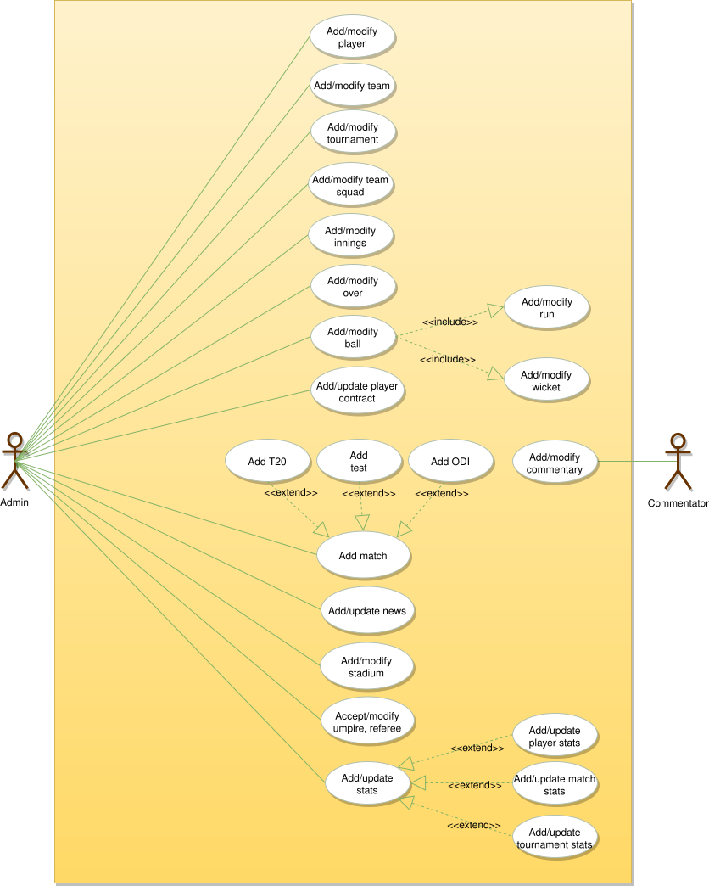
*Figure — Cricinfo use cases: the Admin adds tournaments, matches (extended by Test, T20 and ODI), teams, squads, players, stadiums, umpires, innings, overs, balls (which include runs and wickets) and stats; the Commentator adds commentary (course diagram)*

In the figure above, "Add match" is *extended* by the three formats, and "Add ball" *includes* adding its runs and wicket — a ball is recorded together with what happened on it.

**Activity — record a ball.** The scorer selects *Add Ball*; picks the ball type (normal, wide, no ball, or wicket-taking); if a wicket fell, adds wicket details; if runs were scored, adds a run record for each run type; adds commentary; saves the ball.

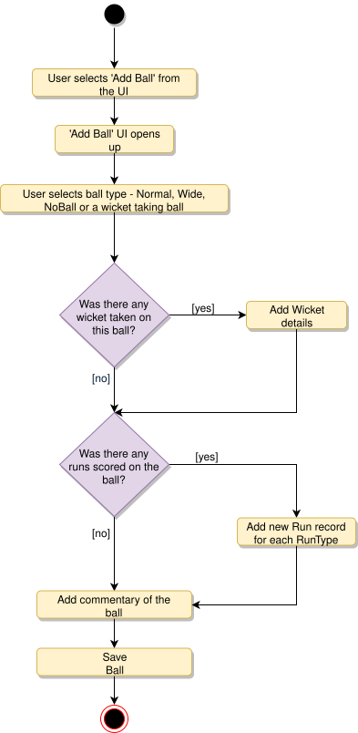
*Figure — Activity diagram "record a ball of an over": choose ball type, add wicket details if any, add run records if any, add commentary, save (course diagram)*

### Core entities

| Class | Responsibility |
|---|---|
| `Person` (record) | A human: name, country. Roles *hold* a person |
| `Player` | A role holding a `Person` (the course's `Player` also keeps a basic profile and contract details) |
| `MatchOfficial` (abstract) → `Umpire`, `Referee`, `Commentator` | Shared "assign to a match" behaviour; each says its role |
| `Team` | Every player the team has ever picked |
| `TournamentSquad` | Who a team may use in one tournament (must be team members) |
| `Playing11` | Exactly eleven, all from the squad, in batting order |
| `Tournament` | Owns squads, lists matches, keeps the points table |
| `BallOutcome` (record) | What happened: runs off the bat, extra type and runs, boundary?, wicket type, which batter was out, commentary text. Validates the laws (no bowled off a no ball) |
| `Ball` (record) | A recorded delivery: over, delivery number, bowler, striker, outcome, wicket |
| `Wicket` (record) + `WicketType` | Who was out, how, off whose bowling; `creditedToBowler()` |
| `Over` | One bowler's six **legal** deliveries; runs conceded; maiden? |
| `Innings` | Owns overs; decides striker, end of over, new batter, bowler limits, and when the innings ends |
| `Match` (abstract) → `T20`, `ODI`, `Test` | Holds everything; formats say only overs per innings and innings per side |
| `Result` (sealed) → `Win`, `Tie`, `Draw` | The outcome |
| `MatchObserver` → `CommentaryFeed`, `LiveScorecard` | Subscribers to ball / over / innings / match events |
| `PlayerStats`, `StatsService` | Numbers derived from balls |
| `StatQuery` (abstract) → `MostRuns`, `MostHundreds`, `MostWickets`, `MostSixes` | Template Method: one question per class |

### Class diagram

The course builds this design in **six stages**.

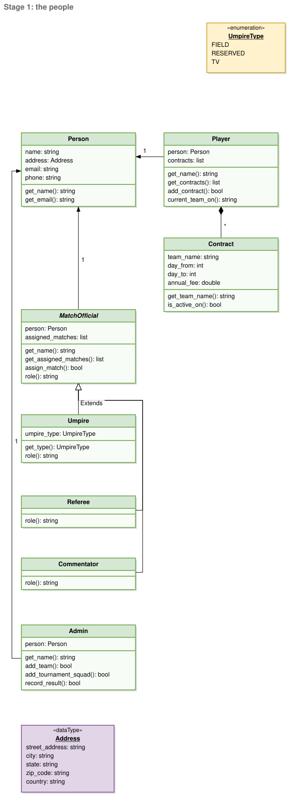
*Figure — Stage 1: `Person`, `MatchOfficial` with `Umpire`, `Referee` and `Commentator`, `Admin`, and `Player` holding a `Person` (course diagram)*

**Stage 1 — the people.** A player *holds* a person instead of extending one: one real human can play today and commentate after retiring, and composition lets them take both roles without copying. Umpires, referees and commentators all do one thing in common — get assigned to matches — so that lives once in `MatchOfficial`.


*Figure — UML legend for reading the arrows in these diagrams (course diagram)*

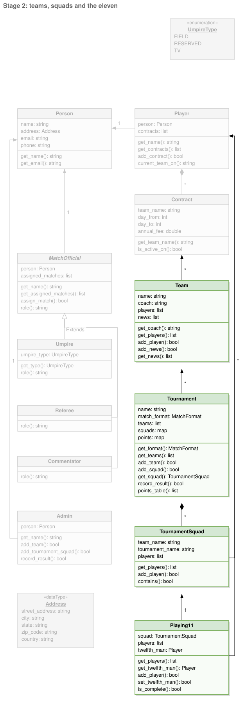
*Figure — Stage 2: `Team`, `TournamentSquad`, `Playing11` and `Tournament`; only the tournament owns anything (its squads) (course diagram)*

**Stage 2 — teams, squads and the eleven.** Requirements 4 and 5 look like one idea but are three nested sets: the team (everyone ever picked) ⊇ the squad (one tournament) ⊇ the eleven (one match). `Playing11` keeps a reference to its squad, which lets it reject anyone outside the squad, and it also rejects a twelfth pick. Requirement 5 thus lives in code rather than in a comment.

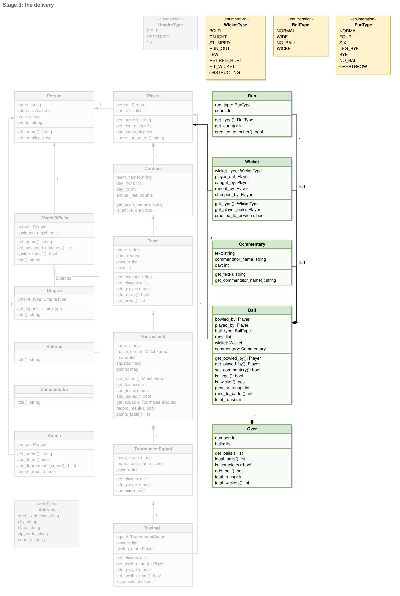
*Figure — Stage 3: enums `WicketType`, `BallType`, `RunType`, and classes `Run`, `Wicket`, `Commentary`, `Ball` (owning its runs, wicket and commentary) and `Over` (course diagram)*

**Stage 3 — the delivery.** This stage decides whether the design understands cricket. Three rules hide in it: (1) an over is six *legal* deliveries, so `Over.isComplete` counts only legal balls, and an over with two wides takes eight deliveries; (2) a run out is credited to the fielding side, *not the bowler* — get this wrong and "highest wicket taker" is silently wrong for years; (3) byes and leg byes belong to the team, not the batter, so each run carries a type that says who gets the credit. `Ball` owns its runs, wicket and commentary (composition); it only *refers* to the bowler and batter.

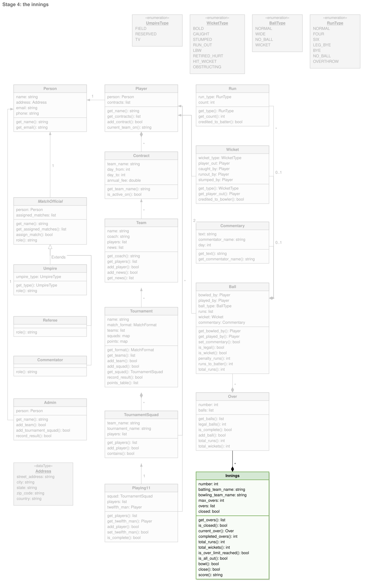
*Figure — Stage 4: `Innings` owns its overs and prints the score (course diagram)*

**Stage 4 — the innings.** Because the innings owns the overs, it alone decides when an over is finished and a new one starts; if that rule lived anywhere else, it would soon exist in two slightly different copies. Its `score` uses scorecard notation: runs/wickets, then full overs and the legal balls of the over in progress.

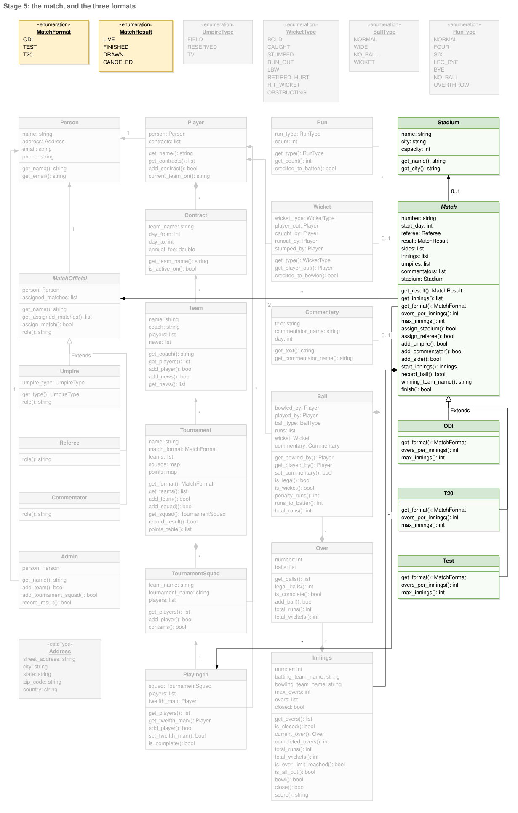
*Figure — Stage 5: `Stadium`, abstract `Match` owning its innings, and the `ODI`, `T20` and `Test` subclasses (course diagram)*

**Stage 5 — the match and the formats.** Before creating three classes, check what really changes between the formats. Starting an innings, recording a ball and deciding the winner are the same. Only two numbers differ: overs per innings and innings per match. So `Match` is abstract and holds everything; each format overrides two short methods. A Test returns zero overs (meaning "no limit") and four innings in total.

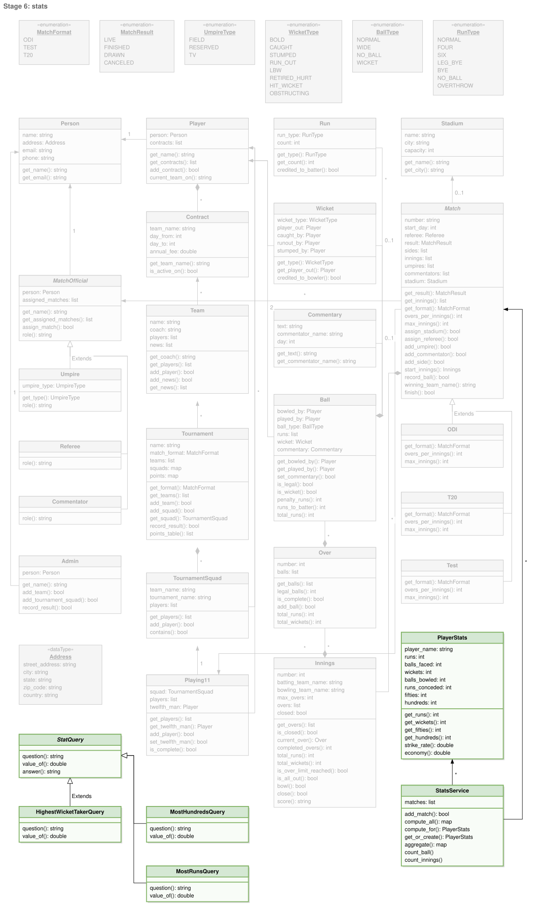
*Figure — Stage 6: `PlayerStats`, `StatsService` and the `StatQuery` hierarchy (course diagram)*

> **Key term — Template Method:** a design pattern where a base class writes the fixed outline of an algorithm in one method and leaves one or more steps as abstract methods for subclasses to fill in. Every subclass reuses the outline and changes only its own step. In this design `StatQuery.answer()` is the outline (loop over players, keep the best) and each subclass supplies only `valueOf()` — "runs", "wickets" and so on.

**Stage 6 — stats.** Stats are **worked out from the balls**, not stored beside them. Keep a separate counter and it will drift from the ball record as soon as a scorer fixes a mistake, and after that nobody can say which number is correct. Fifties and hundreds are per-innings milestones, so they are counted after each innings (`countInnings`) next to the per-ball counting (`countBall`). Each global question is one small `StatQuery` subclass.

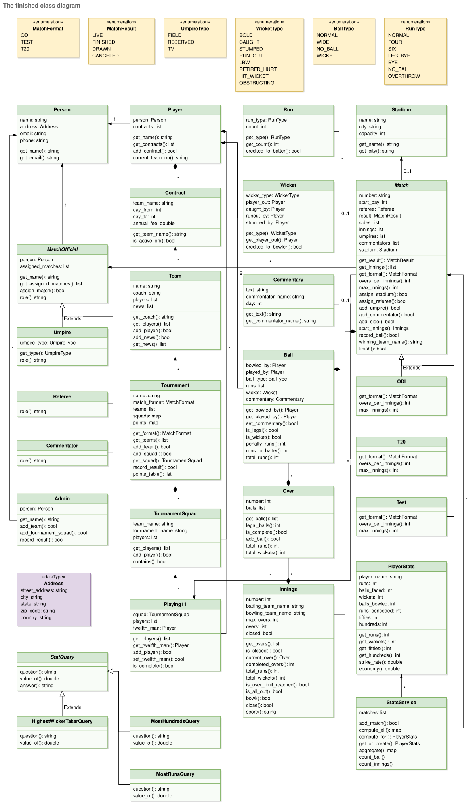
*Figure — The finished Cricinfo class diagram, with every class from the six stages in full colour (course diagram)*

**Our Java design** keeps all six stages and adds what the course flags as missing: **strike rotation** (who is on strike), bowler rules (not two overs in a row; 4 overs per bowler in a T20, 10 in an ODI), the laws about which dismissals are possible off a wide or no ball, a result calculation, and **Observers** for live updates. Instead of separate `Run` objects per run type, a `BallOutcome` record carries bat runs, extra type and extra runs — the same information in one immutable value (an object that can never be changed after it is created).

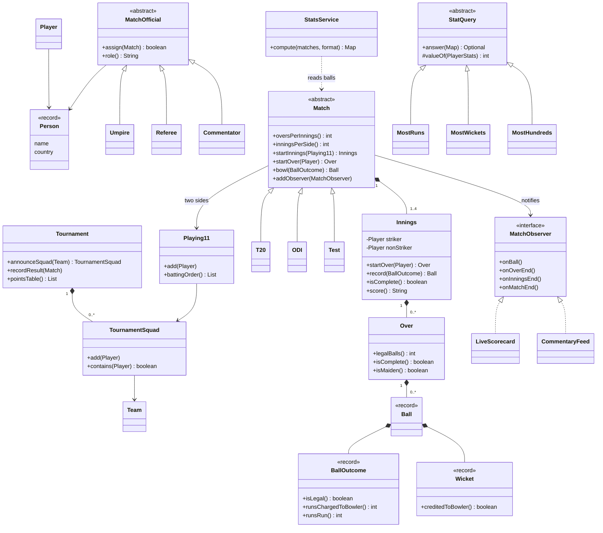

### Key flows

**Recording one ball** (the scorer's "Add Ball"):

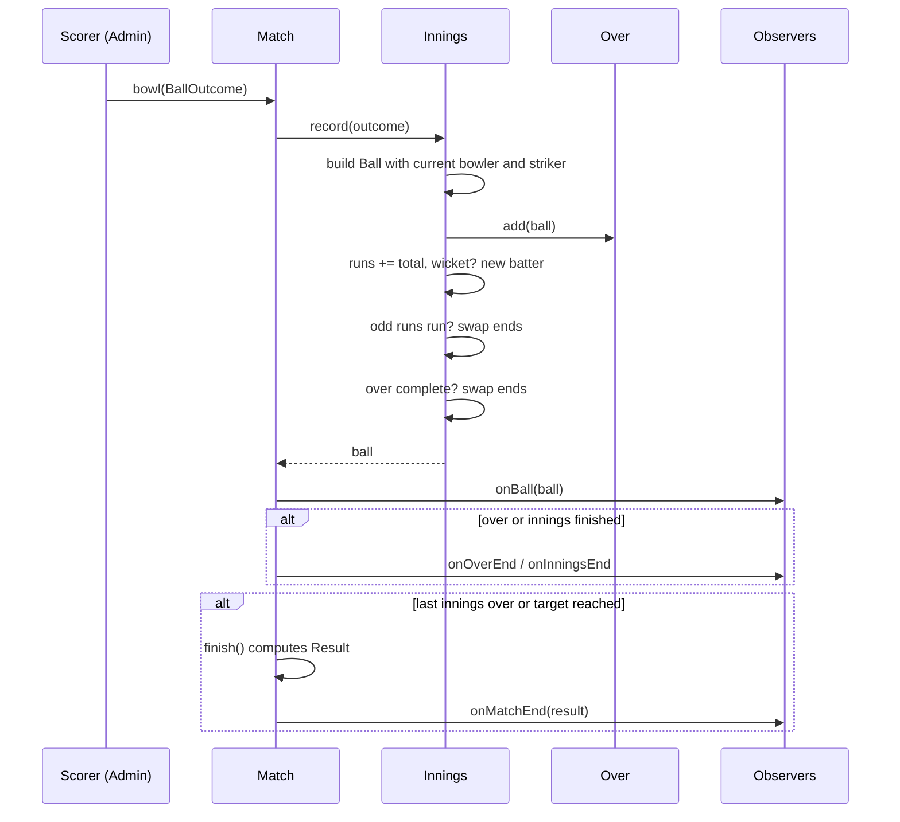

**Innings end conditions** (checked by `Innings.isComplete`):

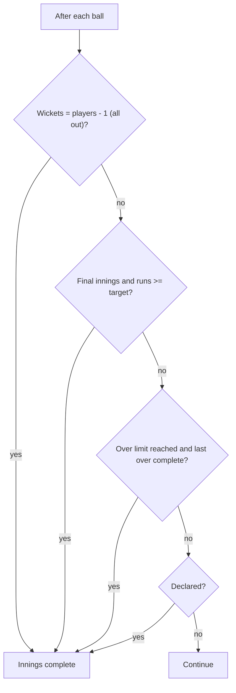

**Match status:**

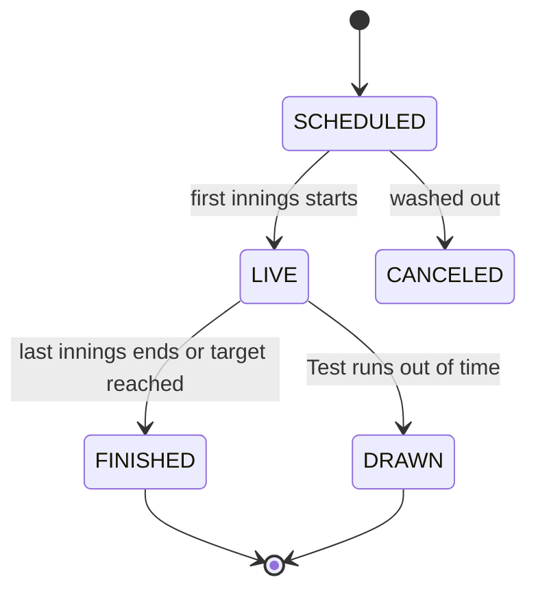

### Design decisions & patterns used

| Decision | Pattern / principle | Why | Alternative rejected |
|---|---|---|---|
| `Player` and `MatchOfficial` hold a `Person` | Composition over inheritance | One human, many roles over time | `Player extends Person` — a player who becomes a commentator must be copied |
| `Match` abstract; `T20`/`ODI`/`Test` override two numbers | Template-style base class (the course notes it is not a named pattern here) | Only what differs is overridden | Three full `Match` copies |
| `StatQuery.answer()` final, `valueOf()` abstract | **Template Method** | A new statistic is one tiny subclass; the search loop is written once (Open/Closed: open to new features, closed to editing old code) | A `switch (questionType)` inside the service |
| Stats derived from balls | Single source of truth | Corrections fix every number automatically | Stored counters that drift; a cache is fine if it is rebuildable |
| `Innings` owns the over rule and strike | Information Expert (GRASP — guidelines for deciding which class gets a job) | The class with the data makes the decision | Scorer UI deciding when an over ends |
| `BallOutcome` validates the laws in its constructor | Fail fast, immutable value | Impossible deliveries (bowled off a no ball) never enter the record | Checking later in the stats code |
| `MatchObserver` with default methods | **Observer** | Commentary feed, live scorecard, push alerts subscribe without the match knowing them | The match printing to the console itself |
| `Result` is a sealed interface of records | Algebraic data type (a value that is exactly one of a closed set of shapes) | `switch` over results is exhaustive (see `Tournament.recordResult`) | Strings like "Team A won" |
| `Match.bowl` is `synchronized` | Monitor lock (Java's built-in per-object lock) per match | Two scorers cannot interleave balls | Unsynchronised updates that corrupt the over |

### Java implementation

Package `lld.ch18.cricinfo`. The demo builds two teams, a tournament, squads and elevens (showing both refusals), then plays a scripted first over (a wide and a no ball make it **eight deliveries**; a bowled that counts for the bowler; a run out that does not), and simulates the rest with a fixed random seed (the starting number for the random generator; the same seed always gives the same "random" sequence) so the output is repeatable. An ODI is simulated too, so the global stat queries have data from two formats.

```java
// File: lld/ch18/cricinfo/People.java
package lld.ch18.cricinfo;

import java.util.ArrayList;
import java.util.List;

/** A human being. Roles (player, umpire, commentator) HOLD a person instead of extending it. */
record Person(String name, String country) {}

final class Player {
    private final Person person;
    Player(Person person) { this.person = person; }
    String name() { return person.name(); }
    Person person() { return person; }
    @Override public String toString() { return name(); }
}

enum UmpireType { FIELD, RESERVED, TV }

/** Umpires, referees and commentators share one behaviour: being assigned to matches. */
abstract class MatchOfficial {
    private final Person person;
    private final List<Match> assignedMatches = new ArrayList<>();

    MatchOfficial(Person person) { this.person = person; }

    String name() { return person.name(); }
    synchronized boolean assign(Match m) { return !assignedMatches.contains(m) && assignedMatches.add(m); }
    synchronized List<Match> assignedMatches() { return List.copyOf(assignedMatches); }
    abstract String role();
    @Override public String toString() { return role() + " " + name(); }
}

final class Umpire extends MatchOfficial {
    private final UmpireType type;
    Umpire(Person p, UmpireType type) { super(p); this.type = type; }
    @Override String role() { return type + " umpire"; }
}

final class Referee extends MatchOfficial {
    Referee(Person p) { super(p); }
    @Override String role() { return "referee"; }
}

final class Commentator extends MatchOfficial {
    Commentator(Person p) { super(p); }
    @Override String role() { return "commentator"; }
}
```

```java
// File: lld/ch18/cricinfo/Teams.java
package lld.ch18.cricinfo;

import java.util.ArrayList;
import java.util.Comparator;
import java.util.LinkedHashMap;
import java.util.LinkedHashSet;
import java.util.List;
import java.util.Map;
import java.util.Set;

/** Everyone the team has ever picked. */
final class Team {
    private final String name;
    private final Set<Player> players = new LinkedHashSet<>();

    Team(String name) { this.name = name; }
    String name() { return name; }
    void addPlayer(Player p) { players.add(p); }
    List<Player> players() { return List.copyOf(players); }   // keeps insertion order
    @Override public String toString() { return name; }
}

/** Who a team may use in ONE tournament: a subset of the team. */
final class TournamentSquad {
    private final Team team;
    private final Set<Player> players = new LinkedHashSet<>();

    TournamentSquad(Team team) { this.team = team; }
    Team team() { return team; }
    void add(Player p) {
        if (!team.players().contains(p)) throw new IllegalArgumentException(p + " does not play for " + team);
        players.add(p);
    }
    boolean contains(Player p) { return players.contains(p); }
}

/** Who takes the field in ONE match: exactly eleven, all from the squad. The class enforces the rule. */
final class Playing11 {
    static final int SIZE = 11;
    private final TournamentSquad squad;
    private final List<Player> players = new ArrayList<>();   // batting order

    Playing11(TournamentSquad squad) { this.squad = squad; }

    void add(Player p) {
        if (!squad.contains(p)) throw new IllegalArgumentException(p + " is not in the " + squad.team() + " squad");
        if (players.size() == SIZE) throw new IllegalStateException("a playing eleven cannot have a twelfth player (" + p + ")");
        if (players.contains(p)) throw new IllegalArgumentException(p + " already picked");
        players.add(p);
    }

    Team team() { return squad.team(); }
    List<Player> battingOrder() { return List.copyOf(players); }
    boolean isComplete() { return players.size() == SIZE; }
    boolean contains(Player p) { return players.contains(p); }
}

/** A tournament owns its squads and keeps a points table (2 for a win, 1 each for a tie or no result). */
final class Tournament {
    private final String name;
    private final Map<Team, TournamentSquad> squads = new LinkedHashMap<>();
    private final Map<Team, Integer> points = new LinkedHashMap<>();
    private final List<Match> matches = new ArrayList<>();

    Tournament(String name) { this.name = name; }
    String name() { return name; }

    TournamentSquad announceSquad(Team team) {
        TournamentSquad s = new TournamentSquad(team);
        squads.put(team, s);
        points.putIfAbsent(team, 0);
        return s;
    }

    void addMatch(Match m) { matches.add(m); }
    List<Match> matches() { return List.copyOf(matches); }

    void recordResult(Match m) {
        Result r = m.result().orElseThrow(() -> new IllegalStateException("match not finished"));
        switch (r) {
            case Result.Win w -> points.merge(w.winner(), 2, Integer::sum);
            case Result.Tie t -> { points.merge(m.teamA().team(), 1, Integer::sum); points.merge(m.teamB().team(), 1, Integer::sum); }
            case Result.Draw d -> { }                     // Tests are not part of a points table here
        }
    }

    List<Map.Entry<Team, Integer>> pointsTable() {
        return points.entrySet().stream()
                .sorted(Map.Entry.<Team, Integer>comparingByValue(Comparator.reverseOrder()))
                .toList();
    }
}
```

```java
// File: lld/ch18/cricinfo/Delivery.java
package lld.ch18.cricinfo;

import java.util.ArrayList;
import java.util.List;

enum Extra { NONE, WIDE, NO_BALL, BYE, LEG_BYE }

enum WicketType {
    BOWLED, CAUGHT, LBW, STUMPED, HIT_WICKET, RUN_OUT, OBSTRUCTING_THE_FIELD;

    /** A run out (or obstructing the field) is a wicket for the fielding side, NOT for the bowler. */
    boolean creditedToBowler() { return this != RUN_OUT && this != OBSTRUCTING_THE_FIELD; }
}

/**
 * What happened on one delivery, as typed by the scorer. Who bowled and who
 * faced is filled in by the Innings, which knows the state of play.
 *
 * @param batRuns    runs off the bat (credited to the batter)
 * @param extra      kind of extra, if any
 * @param extraRuns  runs credited to the team as extras (a wide or no ball is at least 1)
 * @param boundary   true when batRuns came from a 4 or 6 hit to the rope (batters do not cross)
 * @param wicket     type of dismissal, or null
 * @param nonStrikerOut for a run out: true when the batter at the bowler's end is out
 */
record BallOutcome(int batRuns, Extra extra, int extraRuns, boolean boundary,
                   WicketType wicket, boolean nonStrikerOut, String commentary) {

    BallOutcome {
        if (batRuns < 0 || extraRuns < 0) throw new IllegalArgumentException("runs cannot be negative");
        if ((extra == Extra.WIDE || extra == Extra.NO_BALL) && extraRuns < 1)
            throw new IllegalArgumentException(extra + " carries at least one penalty run");
        // Laws of cricket: off a no ball the bowler cannot take a wicket; off a wide only stumped/hit wicket/run out.
        if (wicket != null && extra == Extra.NO_BALL && wicket.creditedToBowler())
            throw new IllegalArgumentException(wicket + " is not possible off a no ball");
        if (wicket != null && extra == Extra.WIDE && !(wicket == WicketType.STUMPED || wicket == WicketType.HIT_WICKET
                || !wicket.creditedToBowler()))
            throw new IllegalArgumentException(wicket + " is not possible off a wide");
    }

    static BallOutcome dot(String c) { return new BallOutcome(0, Extra.NONE, 0, false, null, false, c); }
    static BallOutcome runs(int n, String c) { return new BallOutcome(n, Extra.NONE, 0, false, null, false, c); }
    static BallOutcome four(String c) { return new BallOutcome(4, Extra.NONE, 0, true, null, false, c); }
    static BallOutcome six(String c) { return new BallOutcome(6, Extra.NONE, 0, true, null, false, c); }
    static BallOutcome wide(String c) { return new BallOutcome(0, Extra.WIDE, 1, false, null, false, c); }
    static BallOutcome noBall(int batRuns, String c) { return new BallOutcome(batRuns, Extra.NO_BALL, 1, batRuns >= 4, null, false, c); }
    static BallOutcome legBye(int n, String c) { return new BallOutcome(0, Extra.LEG_BYE, n, false, null, false, c); }
    static BallOutcome bye(int n, String c) { return new BallOutcome(0, Extra.BYE, n, false, null, false, c); }
    static BallOutcome out(WicketType w, String c) { return new BallOutcome(0, Extra.NONE, 0, false, w, false, c); }
    static BallOutcome runOut(int completedRuns, boolean nonStrikerOut, String c) {
        return new BallOutcome(completedRuns, Extra.NONE, 0, false, WicketType.RUN_OUT, nonStrikerOut, c);
    }

    /** A wide or a no ball is not one of the six balls of an over. */
    boolean isLegal() { return extra != Extra.WIDE && extra != Extra.NO_BALL; }
    boolean countsAsBallFaced() { return extra != Extra.WIDE; }
    int totalRuns() { return batRuns + extraRuns; }
    /** Byes and leg byes are not the bowler's fault; wides and no balls are. */
    int runsChargedToBowler() { return batRuns + (isLegal() ? 0 : extraRuns); }

    /** Runs physically run between the wickets: an odd number means the batters swapped ends. */
    int runsRun() {
        if (boundary) return 0;
        return switch (extra) {
            case NONE -> batRuns;
            case WIDE -> extraRuns - 1;
            case NO_BALL -> batRuns;
            case BYE, LEG_BYE -> extraRuns;
        };
    }
}

record Wicket(WicketType type, Player batter, Player bowler) {
    boolean creditedToBowler() { return type.creditedToBowler(); }
}

/** One delivery as recorded: owns its outcome, its wicket and its commentary (composition). */
record Ball(int overNumber, int deliveryInOver, Player bowler, Player striker, BallOutcome outcome, Wicket wicket) {
    /** Scorecard style: over 1, ball 3 is "0.3" (completed overs . ball); an extra shows the number of the ball it replaces. */
    String label() { return (overNumber - 1) + "." + deliveryInOver; }
}

/** An over is SIX LEGAL deliveries, not six balls. */
final class Over {
    static final int LEGAL_BALLS = 6;
    private final int number;
    private final Player bowler;
    private final List<Ball> balls = new ArrayList<>();

    Over(int number, Player bowler) { this.number = number; this.bowler = bowler; }

    int number() { return number; }
    Player bowler() { return bowler; }
    void add(Ball b) {
        if (isComplete()) throw new IllegalStateException("over " + number + " is complete");
        balls.add(b);
    }
    List<Ball> balls() { return List.copyOf(balls); }
    int legalBalls() { return (int) balls.stream().filter(b -> b.outcome().isLegal()).count(); }
    boolean isComplete() { return legalBalls() == LEGAL_BALLS; }
    int runsConceded() { return balls.stream().mapToInt(b -> b.outcome().runsChargedToBowler()).sum(); }
    boolean isMaiden() { return isComplete() && runsConceded() == 0; }
}
```

```java
// File: lld/ch18/cricinfo/Innings.java
package lld.ch18.cricinfo;

import java.util.ArrayList;
import java.util.HashMap;
import java.util.List;
import java.util.Map;
import java.util.Optional;

/**
 * One side's turn to bat. The innings owns its overs, so it is the ONE place
 * that decides when an over ends, who is on strike, and when the innings is over.
 */
final class Innings {
    private final int number;
    private final Playing11 batting;
    private final Playing11 bowling;
    private final int maxOvers;              // 0 = no limit (Test)
    private final int maxOversPerBowler;     // 0 = no limit
    private final Integer target;            // runs needed to win, only for the final innings
    private final List<Over> overs = new ArrayList<>();
    private final List<Ball> balls = new ArrayList<>();
    private final Map<Player, Integer> oversByBowler = new HashMap<>();
    private Player striker;
    private Player nonStriker;
    private int nextBatter = 2;
    private int runs;
    private int wickets;
    private boolean closed;

    Innings(int number, Playing11 batting, Playing11 bowling, int maxOvers, int maxOversPerBowler, Integer target) {
        if (!batting.isComplete() || !bowling.isComplete()) throw new IllegalStateException("both sides need eleven players");
        this.number = number;
        this.batting = batting;
        this.bowling = bowling;
        this.maxOvers = maxOvers;
        this.maxOversPerBowler = maxOversPerBowler;
        this.target = target;
        this.striker = batting.battingOrder().get(0);
        this.nonStriker = batting.battingOrder().get(1);
    }

    int number() { return number; }
    Team battingTeam() { return batting.team(); }
    Team bowlingTeam() { return bowling.team(); }
    Playing11 battingSide() { return batting; }
    int runs() { return runs; }
    int wickets() { return wickets; }
    Optional<Integer> target() { return Optional.ofNullable(target); }
    List<Ball> balls() { return List.copyOf(balls); }
    List<Over> overs() { return List.copyOf(overs); }
    Player striker() { return striker; }
    Player nonStriker() { return nonStriker; }

    Over startOver(Player bowler) {
        if (isComplete()) throw new IllegalStateException("innings is complete");
        Over current = currentOver();
        if (current != null && !current.isComplete()) throw new IllegalStateException("over " + current.number() + " is still in progress");
        if (!bowling.contains(bowler)) throw new IllegalArgumentException(bowler + " is not in the fielding eleven");
        if (current != null && current.bowler().equals(bowler))
            throw new IllegalStateException(bowler + " cannot bowl two overs in a row");
        int bowled = oversByBowler.getOrDefault(bowler, 0);
        if (maxOversPerBowler > 0 && bowled >= maxOversPerBowler)
            throw new IllegalStateException(bowler + " has used all " + maxOversPerBowler + " overs");
        oversByBowler.put(bowler, bowled + 1);
        Over over = new Over(overs.size() + 1, bowler);
        overs.add(over);
        return over;
    }

    Ball record(BallOutcome o) {
        Over over = currentOver();
        if (over == null || over.isComplete()) throw new IllegalStateException("start a new over first");
        if (isComplete()) throw new IllegalStateException("innings is complete");

        int deliveryNo = over.legalBalls() + 1;          // a wide or no ball is re-bowled, so it shares the next number
        Wicket wicket = null;
        if (o.wicket() != null) wicket = new Wicket(o.wicket(), o.nonStrikerOut() ? nonStriker : striker, over.bowler());
        Ball ball = new Ball(over.number(), deliveryNo, over.bowler(), striker, o, wicket);
        over.add(ball);
        balls.add(ball);
        runs += o.totalRuns();

        if (o.runsRun() % 2 == 1) swapEnds();              // odd runs: batters crossed
        if (wicket != null) {
            wickets++;
            if (!allOut()) {
                Player newBatter = batting.battingOrder().get(nextBatter++);
                if (wicket.batter().equals(striker)) striker = newBatter; else nonStriker = newBatter;
            }
        }
        if (over.isComplete()) swapEnds();                  // ends change after every over
        return ball;
    }

    boolean isComplete() {
        if (closed || allOut()) return true;
        if (target != null && runs >= target) return true;
        Over current = currentOver();
        return maxOvers > 0 && overs.size() == maxOvers && current != null && current.isComplete();
    }

    /** A Test captain may declare; the demo also uses it to stop an unlimited innings. */
    void declare() { closed = true; }

    int wicketsInHand() { return batting.battingOrder().size() - 1 - wickets; }

    /** Scorecard style: runs/wickets (completed overs.legal balls). */
    String score() {
        return battingTeam() + " " + runs + "/" + wickets + " (" + oversText() + " ov)";
    }

    String oversText() {
        Over current = currentOver();
        if (current == null) return "0";
        int full = current.isComplete() ? overs.size() : overs.size() - 1;
        int part = current.isComplete() ? 0 : current.legalBalls();
        return part == 0 ? String.valueOf(full) : full + "." + part;
    }

    private boolean allOut() { return wickets == batting.battingOrder().size() - 1; }
    private Over currentOver() { return overs.isEmpty() ? null : overs.get(overs.size() - 1); }
    private void swapEnds() { Player t = striker; striker = nonStriker; nonStriker = t; }
}
```

```java
// File: lld/ch18/cricinfo/Match.java
package lld.ch18.cricinfo;

import java.time.LocalDate;
import java.util.ArrayList;
import java.util.List;
import java.util.Optional;
import java.util.concurrent.CopyOnWriteArrayList;

enum MatchFormat { ODI, T20, TEST }

enum MatchStatus { SCHEDULED, LIVE, FINISHED, DRAWN, CANCELED }

record Stadium(String name, String city, int capacity) {}

/** Outcome of a finished match. A sealed hierarchy lets callers switch over it exhaustively. */
sealed interface Result {
    record Win(Team winner, String margin) implements Result {
        @Override public String toString() { return winner + " won by " + margin; }
    }
    record Tie() implements Result {
        @Override public String toString() { return "Match tied"; }
    }
    record Draw() implements Result {
        @Override public String toString() { return "Match drawn"; }
    }
}

/**
 * Everything that is the same in every format lives here. The formats only
 * answer two questions: how many overs per innings, how many innings per side.
 * Observers (live scorecard, commentary feed, push alerts) subscribe to events.
 */
abstract class Match {
    private final Playing11 teamA;
    private final Playing11 teamB;
    private final Stadium stadium;
    private final LocalDate date;
    private final List<MatchOfficial> officials = new ArrayList<>();
    private final List<Innings> innings = new ArrayList<>();
    private final List<MatchObserver> observers = new CopyOnWriteArrayList<>();
    private MatchStatus status = MatchStatus.SCHEDULED;
    private Result result;

    Match(Playing11 teamA, Playing11 teamB, Stadium stadium, LocalDate date) {
        this.teamA = teamA;
        this.teamB = teamB;
        this.stadium = stadium;
        this.date = date;
    }

    abstract MatchFormat format();
    abstract int oversPerInnings();       // 0 means no limit
    abstract int inningsPerSide();
    /** ODIs allow 10 overs per bowler and T20s 4, i.e. one fifth of the innings. */
    int maxOversPerBowler() { return oversPerInnings() / 5; }

    Playing11 teamA() { return teamA; }
    Playing11 teamB() { return teamB; }
    Stadium stadium() { return stadium; }
    LocalDate date() { return date; }
    synchronized MatchStatus status() { return status; }
    synchronized Optional<Result> result() { return Optional.ofNullable(result); }
    synchronized List<Innings> innings() { return List.copyOf(innings); }

    void addObserver(MatchObserver o) { observers.add(o); }

    void assign(MatchOfficial official) {
        official.assign(this);
        officials.add(official);
    }

    synchronized Innings startInnings(Playing11 batting) {
        if (status == MatchStatus.FINISHED || status == MatchStatus.DRAWN) throw new IllegalStateException("match is over");
        Innings current = currentInnings();
        if (current != null && !current.isComplete()) throw new IllegalStateException("current innings still in progress");
        if (innings.size() == 2 * inningsPerSide()) throw new IllegalStateException("all innings played");
        Playing11 bowling = batting == teamA ? teamB : teamA;
        boolean finalInnings = innings.size() == 2 * inningsPerSide() - 1;
        Integer target = finalInnings ? totalFor(bowling.team()) - totalFor(batting.team()) + 1 : null;
        Innings in = new Innings(innings.size() + 1, batting, bowling, oversPerInnings(), maxOversPerBowler(), target);
        innings.add(in);
        status = MatchStatus.LIVE;
        return in;
    }

    synchronized Over startOver(Player bowler) { return requireCurrent().startOver(bowler); }

    /** Records one delivery and fires the events; thread-safe so two scorers cannot interleave balls. */
    synchronized Ball bowl(BallOutcome outcome) {
        Innings in = requireCurrent();
        Ball ball = in.record(outcome);
        observers.forEach(o -> o.onBall(this, in, ball));
        Over over = in.overs().get(in.overs().size() - 1);
        if (over.isComplete() || in.isComplete()) observers.forEach(o -> o.onOverEnd(this, in, over));
        if (in.isComplete()) {
            observers.forEach(o -> o.onInningsEnd(this, in));
            boolean chased = in.target().map(t -> in.runs() >= t).orElse(false);
            if (innings.size() == 2 * inningsPerSide() || chased) finish(in);
        }
        return ball;
    }

    synchronized void declareDraw() {
        status = MatchStatus.DRAWN;
        result = new Result.Draw();
        observers.forEach(o -> o.onMatchEnd(this, result));
    }

    private void finish(Innings last) {
        Team chasing = last.battingTeam();
        Team other = last.bowlingTeam();
        int chasingRuns = totalFor(chasing);
        int otherRuns = totalFor(other);
        if (chasingRuns > otherRuns) result = new Result.Win(chasing, last.wicketsInHand() + " wickets");
        else if (chasingRuns < otherRuns) result = new Result.Win(other, (otherRuns - chasingRuns) + " runs");
        else result = new Result.Tie();
        status = MatchStatus.FINISHED;
        observers.forEach(o -> o.onMatchEnd(this, result));
    }

    private int totalFor(Team t) {
        return innings.stream().filter(i -> i.battingTeam() == t).mapToInt(Innings::runs).sum();
    }

    private Innings currentInnings() { return innings.isEmpty() ? null : innings.get(innings.size() - 1); }

    private Innings requireCurrent() {
        Innings in = currentInnings();
        if (in == null) throw new IllegalStateException("no innings started");
        return in;
    }

    @Override public String toString() { return format() + " " + teamA.team() + " v " + teamB.team() + " at " + stadium.name(); }
}

final class ODI extends Match {
    ODI(Playing11 a, Playing11 b, Stadium s, LocalDate d) { super(a, b, s, d); }
    @Override MatchFormat format() { return MatchFormat.ODI; }
    @Override int oversPerInnings() { return 50; }
    @Override int inningsPerSide() { return 1; }
}

final class T20 extends Match {
    T20(Playing11 a, Playing11 b, Stadium s, LocalDate d) { super(a, b, s, d); }
    @Override MatchFormat format() { return MatchFormat.T20; }
    @Override int oversPerInnings() { return 20; }
    @Override int inningsPerSide() { return 1; }
}

final class Test extends Match {
    Test(Playing11 a, Playing11 b, Stadium s, LocalDate d) { super(a, b, s, d); }
    @Override MatchFormat format() { return MatchFormat.TEST; }
    @Override int oversPerInnings() { return 0; }    // no limit
    @Override int inningsPerSide() { return 2; }
}
```

```java
// File: lld/ch18/cricinfo/Observers.java
package lld.ch18.cricinfo;

import java.util.LinkedHashMap;
import java.util.List;
import java.util.Map;

/** Observer: the match publishes events; screens, feeds and alerts subscribe. */
interface MatchObserver {
    default void onBall(Match m, Innings in, Ball b) {}
    default void onOverEnd(Match m, Innings in, Over o) {}
    default void onInningsEnd(Match m, Innings in) {}
    default void onMatchEnd(Match m, Result r) {}
}

/** Ball-by-ball commentary written by a commentator (prints only the first few overs of each innings in the demo). */
final class CommentaryFeed implements MatchObserver {
    private final Commentator commentator;
    private final int oversToShow;

    CommentaryFeed(Commentator commentator, int oversToShow) {
        this.commentator = commentator;
        this.oversToShow = oversToShow;
    }

    @Override public void onBall(Match m, Innings in, Ball b) {
        if (b.overNumber() > oversToShow) return;
        String what = describe(b);
        String text = b.outcome().commentary() == null ? "" : "  [" + commentator.name() + ": " + b.outcome().commentary() + "]";
        System.out.printf("  %-4s %s to %s, %s%s%n", b.label(), b.bowler(), b.striker(), what, text);
    }

    private static String describe(Ball b) {
        BallOutcome o = b.outcome();
        if (b.wicket() != null) return "OUT " + b.wicket().type() + " (" + b.wicket().batter() + ")"
                + (b.wicket().creditedToBowler() ? "" : " - not the bowler's wicket");
        return switch (o.extra()) {
            case WIDE -> "wide";
            case NO_BALL -> "no ball" + (o.batRuns() > 0 ? " + " + o.batRuns() : "");
            case BYE -> o.extraRuns() + " bye(s)";
            case LEG_BYE -> o.extraRuns() + " leg bye(s)";
            case NONE -> o.batRuns() == 0 ? "no run" : o.boundary() ? o.batRuns() == 4 ? "FOUR" : "SIX" : o.batRuns() + " run(s)";
        };
    }
}

/** Live score line at the end of an over (every n overs, to keep the demo short). */
final class LiveScorecard implements MatchObserver {
    private final int everyNOvers;
    LiveScorecard(int everyNOvers) { this.everyNOvers = everyNOvers; }

    @Override public void onOverEnd(Match m, Innings in, Over o) {
        if (o.number() % everyNOvers == 0 || in.isComplete()) {
            String chase = in.target().filter(t -> in.runs() < t).map(t -> "  need " + (t - in.runs()) + " to win").orElse("");
            System.out.println("  [live] " + in.score() + chase);
        }
    }

    @Override public void onInningsEnd(Match m, Innings in) {
        System.out.println("  [innings " + in.number() + " over] " + in.score());
    }

    @Override public void onMatchEnd(Match m, Result r) {
        System.out.println("  [result] " + r);
    }
}

/** Builds batting and bowling cards from the recorded balls (nothing is stored twice). */
final class Scorecard {
    static void print(Innings in) {
        System.out.println("Batting - " + in.battingTeam());
        Map<Player, int[]> bat = new LinkedHashMap<>();   // runs, balls, 4s, 6s
        Map<Player, String> howOut = new LinkedHashMap<>();
        for (Ball b : in.balls()) {
            int[] s = bat.computeIfAbsent(b.striker(), k -> new int[4]);
            BallOutcome o = b.outcome();
            s[0] += o.batRuns();
            if (o.countsAsBallFaced()) s[1]++;
            if (o.boundary() && o.batRuns() == 4) s[2]++;
            if (o.boundary() && o.batRuns() == 6) s[3]++;
            if (b.wicket() != null) {
                bat.computeIfAbsent(b.wicket().batter(), k -> new int[4]);
                howOut.put(b.wicket().batter(), b.wicket().creditedToBowler()
                        ? (b.wicket().type() == WicketType.BOWLED ? "" : b.wicket().type().name().toLowerCase().replace('_', ' ') + " ")
                                + "b " + b.bowler()
                        : "run out");
            }
        }
        bat.computeIfAbsent(in.striker(), k -> new int[4]);        // the two batters at the crease are listed
        bat.computeIfAbsent(in.nonStriker(), k -> new int[4]);     // even if one has not faced a ball yet
        List<Player> order = in.battingSide().battingOrder();
        for (Player p : order) {
            int[] s = bat.get(p);
            if (s == null) continue;
            System.out.printf("  %-10s %-22s %3d (%d)  4s:%d 6s:%d%n", p, howOut.getOrDefault(p, "not out"), s[0], s[1], s[2], s[3]);
        }
        int extras = in.balls().stream().mapToInt(b -> b.outcome().extraRuns()).sum();
        System.out.println("  Extras " + extras + "   Total " + in.runs() + "/" + in.wickets() + " (" + in.oversText() + " ov)");

        System.out.println("Bowling - " + in.bowlingTeam());
        Map<Player, int[]> bowl = new LinkedHashMap<>();  // legal balls, maidens, runs, wickets
        for (Over o : in.overs()) {
            int[] s = bowl.computeIfAbsent(o.bowler(), k -> new int[4]);
            s[0] += o.legalBalls();
            if (o.isMaiden()) s[1]++;
            s[2] += o.runsConceded();
            s[3] += (int) o.balls().stream().filter(b -> b.wicket() != null && b.wicket().creditedToBowler()).count();
        }
        bowl.forEach((p, s) -> System.out.printf("  %-10s %d.%d-%d-%d-%d%n", p, s[0] / 6, s[0] % 6, s[1], s[2], s[3]));
    }
}
```

```java
// File: lld/ch18/cricinfo/Stats.java
package lld.ch18.cricinfo;

import java.util.Collection;
import java.util.HashMap;
import java.util.List;
import java.util.Map;
import java.util.Optional;

/** Career numbers for one player, always DERIVED from balls, never typed in by hand. */
final class PlayerStats {
    final Player player;
    int runs, ballsFaced, fours, sixes, fifties, hundreds, highest;
    int wickets, ballsBowled, runsConceded;

    PlayerStats(Player player) { this.player = player; }

    /** Per-ball numbers. */
    void countBall(Ball b, boolean asBatter) {
        BallOutcome o = b.outcome();
        if (asBatter) {
            runs += o.batRuns();
            if (o.countsAsBallFaced()) ballsFaced++;
            if (o.boundary() && o.batRuns() == 4) fours++;
            if (o.boundary() && o.batRuns() == 6) sixes++;
        } else {
            if (o.isLegal()) ballsBowled++;
            runsConceded += o.runsChargedToBowler();
            if (b.wicket() != null && b.wicket().creditedToBowler()) wickets++;
        }
    }

    /** Milestones are per innings, so they are counted once the innings score is known. */
    void countInnings(int inningsRuns) {
        if (inningsRuns >= 100) hundreds++;
        else if (inningsRuns >= 50) fifties++;
        highest = Math.max(highest, inningsRuns);
    }
}

/** Recomputes stats from the recorded balls of the given matches, optionally for one format. */
final class StatsService {
    Map<Player, PlayerStats> compute(Collection<Match> matches, MatchFormat formatOrNull) {
        Map<Player, PlayerStats> stats = new HashMap<>();
        for (Match m : matches) {
            if (formatOrNull != null && m.format() != formatOrNull) continue;
            for (Innings in : m.innings()) {
                Map<Player, Integer> inningsRuns = new HashMap<>();
                for (Ball b : in.balls()) {
                    stats.computeIfAbsent(b.striker(), PlayerStats::new).countBall(b, true);
                    stats.computeIfAbsent(b.bowler(), PlayerStats::new).countBall(b, false);
                    inningsRuns.merge(b.striker(), b.outcome().batRuns(), Integer::sum);
                }
                inningsRuns.forEach((p, r) -> stats.get(p).countInnings(r));
            }
        }
        return stats;
    }
}

/**
 * Template Method: answer() is the fixed algorithm (walk all players, keep the best);
 * each question fills in one step, valueOf(). A new statistic = one new subclass.
 */
abstract class StatQuery {
    record Leader(Player player, int value) {}

    abstract String question();
    abstract int valueOf(PlayerStats s);

    final Optional<Leader> answer(Map<Player, PlayerStats> stats) {
        Leader best = null;
        for (PlayerStats s : stats.values()) {
            int v = valueOf(s);
            if (v > 0 && (best == null || v > best.value()
                    || (v == best.value() && s.player.name().compareTo(best.player().name()) < 0))) {
                best = new Leader(s.player, v);
            }
        }
        return Optional.ofNullable(best);
    }
}

final class MostRuns extends StatQuery {
    @Override String question() { return "Most runs"; }
    @Override int valueOf(PlayerStats s) { return s.runs; }
}

final class MostHundreds extends StatQuery {
    @Override String question() { return "Most hundreds"; }
    @Override int valueOf(PlayerStats s) { return s.hundreds; }
}

final class MostWickets extends StatQuery {
    @Override String question() { return "Highest wicket taker"; }
    @Override int valueOf(PlayerStats s) { return s.wickets; }
}

final class MostSixes extends StatQuery {
    @Override String question() { return "Most sixes"; }
    @Override int valueOf(PlayerStats s) { return s.sixes; }
}

final class StatQueries {
    static final List<StatQuery> ALL = List.of(new MostRuns(), new MostHundreds(), new MostWickets(), new MostSixes());
    private StatQueries() {}
}
```

```java
// File: lld/ch18/cricinfo/Main.java
package lld.ch18.cricinfo;

import java.time.LocalDate;
import java.util.ArrayList;
import java.util.List;
import java.util.Map;
import java.util.Random;

public class Main {
    public static void main(String[] args) {
        // ---- teams, squads, tournament ----
        Team lions = team("Lions", "Arun", "Bala", "Chetan", "Dev", "Eshan", "Farhan", "Gopal", "Hari", "Imran", "Jai", "Kiran", "Lokesh", "Manav");
        Team tigers = team("Tigers", "Nabil", "Omar", "Pranav", "Qasim", "Rahul", "Sameer", "Tarun", "Uday", "Varun", "Wasim", "Yash", "Zubin", "Ajay");
        Tournament cup = new Tournament("Demo Cup");
        TournamentSquad lionsSquad = cup.announceSquad(lions);
        TournamentSquad tigersSquad = cup.announceSquad(tigers);
        lions.players().stream().limit(12).forEach(lionsSquad::add);      // Manav is not in the squad
        tigers.players().stream().limit(12).forEach(tigersSquad::add);

        System.out.println("== Picking the elevens ==");
        Playing11 lionsXI = new Playing11(lionsSquad);
        Playing11 tigersXI = new Playing11(tigersSquad);
        lions.players().stream().limit(11).forEach(lionsXI::add);
        tigers.players().stream().limit(11).forEach(tigersXI::add);
        attempt(() -> new Playing11(lionsSquad).add(find(lions, "Manav")));
        attempt(() -> lionsXI.add(find(lions, "Lokesh")));

        // ---- the match ----
        Stadium stadium = new Stadium("Riverside Oval", "Pune", 40000);
        T20 match = new T20(lionsXI, tigersXI, stadium, LocalDate.of(2026, 9, 28));
        cup.addMatch(match);
        Commentator ravi = new Commentator(new Person("Ravi", "IN"));
        match.assign(new Umpire(new Person("Ken", "NZ"), UmpireType.FIELD));
        match.assign(new Umpire(new Person("Paul", "AU"), UmpireType.FIELD));
        match.assign(new Referee(new Person("Chris", "UK")));
        match.assign(ravi);
        match.addObserver(new CommentaryFeed(ravi, 1));
        match.addObserver(new LiveScorecard(5));

        System.out.println("\n== " + match + " ==");
        match.startInnings(lionsXI);
        List<Player> tigersBowlers = bowlers(tigersXI);
        match.startOver(tigersBowlers.get(0));
        match.bowl(BallOutcome.four("driven through cover"));
        match.bowl(BallOutcome.wide("sprayed down leg"));
        match.bowl(BallOutcome.runs(1, "pushed to mid-on"));
        match.bowl(BallOutcome.noBall(0, "overstepped, free hit next"));
        match.bowl(BallOutcome.out(WicketType.BOWLED, "through the gate!"));
        match.bowl(BallOutcome.runOut(1, false, "a second run was never there"));
        match.bowl(BallOutcome.dot("defended"));
        match.bowl(BallOutcome.six("launched over long-on"));
        attempt(() -> match.startOver(tigersBowlers.get(0)));             // same bowler twice in a row
        Random rnd = new Random(23);
        simulate(match, rnd, tigersBowlers);

        match.startInnings(tigersXI);
        simulate(match, rnd, bowlers(lionsXI));

        System.out.println("\n== Scorecards ==");
        match.innings().forEach(Scorecard::print);
        cup.recordResult(match);
        System.out.println("Points table: " + cup.pointsTable());

        // ---- a second match (ODI) so the global stats have more data ----
        ODI odi = new ODI(tigersXI, lionsXI, stadium, LocalDate.of(2026, 10, 2));
        odi.addObserver(new LiveScorecard(25));
        System.out.println("\n== " + odi + " ==");
        odi.startInnings(tigersXI);
        simulate(odi, rnd, bowlers(lionsXI));
        odi.startInnings(lionsXI);
        simulate(odi, rnd, bowlers(tigersXI));

        // ---- stats, derived from balls ----
        StatsService statsService = new StatsService();
        List<Match> all = List.of(match, odi);
        Map<Player, PlayerStats> career = statsService.compute(all, null);
        System.out.println("\n== Global stat queries (all formats) ==");
        for (StatQuery q : StatQueries.ALL) {
            System.out.println("  " + q.question() + ": " + q.answer(career)
                    .map(l -> l.player() + " (" + l.value() + ")").orElse("nobody yet"));
        }
        Map<Player, PlayerStats> odiOnly = statsService.compute(all, MatchFormat.ODI);
        System.out.println("  Most runs in ODIs: " + new MostRuns().answer(odiOnly).map(l -> l.player() + " (" + l.value() + ")").orElse("-"));
        System.out.println("  Ravi is assigned to " + ravi.assignedMatches().size() + " match(es)");
    }

    /** Plays the rest of the current innings with random but legal deliveries. */
    static void simulate(Match m, Random rnd, List<Player> bowlers) {
        Innings in = m.innings().get(m.innings().size() - 1);
        int over = in.overs().size();
        while (!in.isComplete()) {
            m.startOver(bowlers.get(over % bowlers.size()));
            over++;
            while (!in.isComplete() && in.overs().get(in.overs().size() - 1).legalBalls() < Over.LEGAL_BALLS) {
                m.bowl(randomBall(rnd));
            }
        }
    }

    static BallOutcome randomBall(Random rnd) {
        int r = rnd.nextInt(1000);
        if (r < 330) return BallOutcome.dot(null);
        if (r < 640) return BallOutcome.runs(1, null);
        if (r < 720) return BallOutcome.runs(2, null);
        if (r < 730) return BallOutcome.runs(3, null);
        if (r < 810) return BallOutcome.four(null);                     // about 1 ball in 12 is a four
        if (r < 840) return BallOutcome.six(null);                      // and 1 in 33 a six: roughly 6.5 runs an over
        if (r < 870) return BallOutcome.wide(null);
        if (r < 880) return BallOutcome.noBall(0, null);
        if (r < 895) return BallOutcome.legBye(1, null);
        if (r < 905) return BallOutcome.out(WicketType.BOWLED, null);
        if (r < 920) return BallOutcome.out(WicketType.CAUGHT, null);
        if (r < 927) return BallOutcome.out(WicketType.LBW, null);
        if (r < 930) return BallOutcome.runOut(0, rnd.nextBoolean(), null);
        return BallOutcome.dot(null);
    }

    static List<Player> bowlers(Playing11 xi) {
        List<Player> order = xi.battingOrder();
        return new ArrayList<>(order.subList(order.size() - 5, order.size()));   // the last five are the bowlers
    }

    static Team team(String name, String... players) {
        Team t = new Team(name);
        for (String p : players) t.addPlayer(new Player(new Person(p, "IN")));
        return t;
    }

    static Player find(Team t, String name) {
        return t.players().stream().filter(p -> p.name().equals(name)).findFirst().orElseThrow();
    }

    static void attempt(Runnable r) {
        try { r.run(); } catch (RuntimeException e) { System.out.println("  REJECTED: " + e.getMessage()); }
    }
}
```

**Output:**

```text
== Picking the elevens ==
  REJECTED: Manav is not in the Lions squad
  REJECTED: a playing eleven cannot have a twelfth player (Lokesh)

== T20 Lions v Tigers at Riverside Oval ==
  0.1  Tarun to Arun, FOUR  [Ravi: driven through cover]
  0.2  Tarun to Arun, wide  [Ravi: sprayed down leg]
  0.2  Tarun to Arun, 1 run(s)  [Ravi: pushed to mid-on]
  0.3  Tarun to Bala, no ball  [Ravi: overstepped, free hit next]
  0.3  Tarun to Bala, OUT BOWLED (Bala)  [Ravi: through the gate!]
  0.4  Tarun to Chetan, OUT RUN_OUT (Chetan) - not the bowler's wicket  [Ravi: a second run was never there]
  0.5  Tarun to Arun, no run  [Ravi: defended]
  0.6  Tarun to Arun, SIX  [Ravi: launched over long-on]
  REJECTED: Tarun cannot bowl two overs in a row
  [live] Lions 29/2 (5 ov)
  [live] Lions 76/2 (10 ov)
  [live] Lions 117/3 (15 ov)
  [live] Lions 151/5 (20 ov)
  [innings 1 over] Lions 151/5 (20 ov)
  0.1  Gopal to Nabil, wide
  0.1  Gopal to Nabil, 1 run(s)
  0.2  Gopal to Omar, 1 run(s)
  0.3  Gopal to Nabil, 2 run(s)
  0.4  Gopal to Nabil, no run
  0.5  Gopal to Nabil, wide
  0.5  Gopal to Nabil, no run
  0.6  Gopal to Nabil, no ball
  0.6  Gopal to Nabil, no run
  [live] Tigers 40/0 (5 ov)  need 112 to win
  [live] Tigers 76/0 (10 ov)  need 76 to win
  [live] Tigers 91/2 (15 ov)  need 61 to win
  [live] Tigers 128/4 (20 ov)  need 24 to win
  [innings 2 over] Tigers 128/4 (20 ov)
  [result] Lions won by 23 runs

== Scorecards ==
Batting - Lions
  Arun       b Uday                  45 (32)  4s:4 6s:1
  Bala       b Tarun                  0 (2)  4s:0 6s:0
  Chetan     run out                  1 (1)  4s:0 6s:0
  Dev        caught b Yash           51 (51)  4s:4 6s:2
  Eshan      caught b Wasim          42 (31)  4s:5 6s:1
  Farhan     not out                  5 (3)  4s:0 6s:0
  Gopal      not out                  1 (1)  4s:0 6s:0
  Extras 6   Total 151/5 (20 ov)
Bowling - Tigers
  Tarun      4.0-0-41-1
  Uday       4.0-0-27-1
  Varun      4.0-0-29-0
  Wasim      4.0-0-28-1
  Yash       4.0-0-24-1
Batting - Tigers
  Nabil      lbw b Kiran             55 (56)  4s:3 6s:2
  Omar       lbw b Jai               44 (41)  4s:5 6s:0
  Pranav     run out                  1 (4)  4s:0 6s:0
  Qasim      not out                 20 (19)  4s:1 6s:1
  Rahul      caught b Kiran           0 (1)  4s:0 6s:0
  Sameer     not out                  0 (0)  4s:0 6s:0
  Extras 8   Total 128/4 (20 ov)
Bowling - Lions
  Gopal      4.0-0-21-0
  Hari       4.0-0-22-0
  Imran      4.0-0-38-0
  Jai        4.0-0-19-1
  Kiran      4.0-0-27-2
Points table: [Lions=2, Tigers=0]

== ODI Tigers v Lions at Riverside Oval ==
  [live] Tigers 181/3 (25 ov)
  [live] Tigers 348/9 (50 ov)
  [innings 1 over] Tigers 348/9 (50 ov)
  [live] Lions 159/1 (25 ov)  need 190 to win
  [live] Lions 349/5 (49.4 ov)
  [innings 2 over] Lions 349/5 (49.4 ov)
  [result] Lions won by 5 wickets

== Global stat queries (all formats) ==
  Most runs: Chetan (131)
  Most hundreds: Chetan (1)
  Highest wicket taker: Kiran (5)
  Most sixes: Nabil (5)
  Most runs in ODIs: Chetan (130)
  Ravi is assigned to 1 match(es)
```

**Walking through the important parts**

- Ball numbers follow the scorecard convention "completed overs . ball", so the first ball of the match is `0.1`. A wide or no ball carries the number of the ball that must be re-bowled, which is why `0.2` and `0.3` each appear twice.
- In over 1 of the output, there are eight lines but the over ends at `0.6`: the wide and the no ball did not count toward the six (`Over.isComplete` counts legal balls).
- Chetan is **run out** after completing one run: `Innings.record` first swaps ends for the completed single, then replaces the dismissed batter, so the new batter (Dev) comes in at the correct end and Arun faces the next ball. In the scorecard, Chetan's line says "run out" and Tarun's bowling figures show only **1** wicket (the bowled), because `WicketType.RUN_OUT.creditedToBowler()` is `false`.
- Trying to give Tarun the second over is rejected ("cannot bowl two overs in a row"). The simulation rotates five bowlers, so each bowls exactly 4 overs in the T20 (`maxOversPerBowler() = 20 / 5`).
- `LiveScorecard` prints every 5 overs and the chase line ("need 112 to win") comes from the target set automatically for the final innings (`first-innings total + 1`). The random ball generator is tuned to about 6.5 runs an over, so totals look like real matches (151 and 128 in the T20; 348 and 349 in the ODI, which the Lions win by 5 wickets with two balls to spare).
- The batting card lists every batter who faced a ball or was out, plus the two batters at the crease (Sameer is "not out 0 (0)": he walked in but never faced).
- The global queries (`MostRuns`, `MostHundreds`, `MostWickets`, `MostSixes`) are each a one-line subclass; "Most runs in ODIs" reuses the same service with a format filter.

### Machine-coding variant: Cricket Match Dashboard (Udaan)

A **machine-coding round** asks you to write a *working, runnable* program in 60–90 minutes, judged on correctness, readability and extensibility. This problem was set by Udaan (an Indian B2B — business-to-business — e-commerce company) and appears in the kumaransg/LLD collection.

#### Problem statement (in our words)

Build a cricket **scorecard** for a two-team, limited-overs match.

- **Input:** number of players per team, number of overs, then for each team its batting order, followed by the balls of each over, one per line: a number of runs (`0`–`6`), `W` (wicket), `Wd` (wide) or `Nb` (no ball).
- **Output after every over:** for each batter of the batting side — runs, 4s, 6s, balls faced — with a `*` on the two batters currently at the crease; then team total/wickets and overs.
- **Rules to handle:** strike changes on 1s and 3s and at the end of every over; wides and no balls add one run and are re-bowled (they do not count toward the six); the innings ends when the team is all out, the overs run out, or (second innings) the target is passed.
- **At the end:** print the winner and the margin (by runs or by wickets).
- **Good to have:** bowler figures (overs, runs, wickets, maidens, dot balls, economy), team extras, batter strike rates.

#### How the full Cricinfo design shrinks to a 90-minute solution

| Cricinfo class | Machine-coding version | Why it is enough here |
|---|---|---|
| `BallOutcome` with extras, wickets, validation | `BallEvent` sealed interface: `Runs`, `Wide`, `NoBall`, `Wicket` with a `parse(token)` factory (a method that builds the right object from one input word) | Input has only four kinds of token |
| `Innings` (strike, over rule, end conditions) | `TeamInnings` — same responsibilities, ints instead of objects | Same rules, no bowler data in the input |
| `Scorecard` derived from balls | `Batter` counters + `ScorecardPrinter` | Only batting card needed; printer separated so another view could replace it |
| `Match` + `Result` | `MatchRunner` (reads input, plays two innings, prints result) | One format, two innings |

This is the lesson of machine coding: keep the *same responsibilities in the same places* (the innings owns strike and the over rule; parsing is separate from scoring; printing is separate from both), but use the simplest data that satisfies the input.

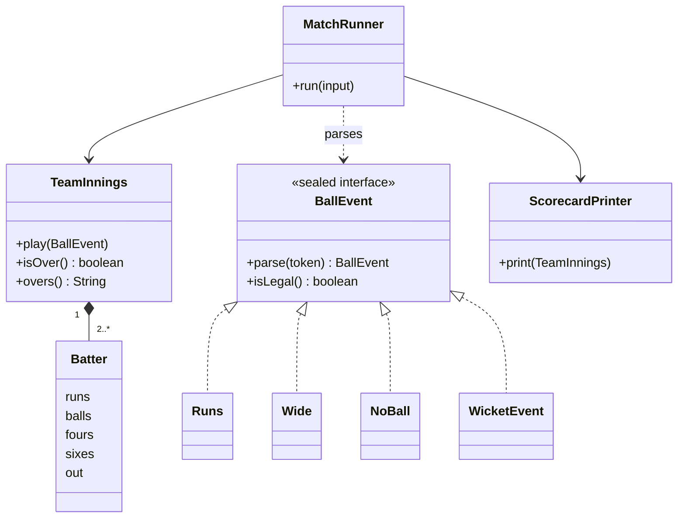

*(In the code the wicket record is called `BallEvent.Wicket`; it is shown as `WicketEvent` above only to keep the diagram label unique.)*

#### Code

Package `lld.ch18.cricketdashboard`. `Main` feeds the problem's sample input as a text block.

```java
// File: lld/ch18/cricketdashboard/Model.java
package lld.ch18.cricketdashboard;

import java.util.ArrayList;
import java.util.List;

/** One input token, parsed once. Factory method: BallEvent.parse("Wd") etc. */
sealed interface BallEvent {
    record Runs(int runs) implements BallEvent {}
    record Wide() implements BallEvent {}
    record NoBall(int batRuns) implements BallEvent {}
    record Wicket() implements BallEvent {}

    static BallEvent parse(String token) {
        String t = token.trim();
        if (t.equalsIgnoreCase("W")) return new Wicket();
        if (t.equalsIgnoreCase("Wd")) return new Wide();
        if (t.regionMatches(true, 0, "Nb", 0, 2)) return new NoBall(t.length() > 2 ? Integer.parseInt(t.substring(2)) : 0);
        int runs = Integer.parseInt(t);
        if (runs < 0 || runs > 6) throw new IllegalArgumentException("bad runs: " + t);
        return new Runs(runs);
    }

    default boolean isLegal() { return !(this instanceof Wide || this instanceof NoBall); }
}

/** A batter's line on the scorecard. */
final class Batter {
    final String name;
    int runs, balls, fours, sixes;
    boolean out;

    Batter(String name) { this.name = name; }

    void faced(int batRuns) {
        runs += batRuns;
        balls++;
        if (batRuns == 4) fours++;
        if (batRuns == 6) sixes++;
    }

    String strikeRate() { return balls == 0 ? "-" : String.format("%.1f", 100.0 * runs / balls); }
}

/** One team's batting innings: owns strike rotation, extras, and the "is it over?" rule. */
final class TeamInnings {
    private final String team;
    private final List<Batter> order = new ArrayList<>();
    private final int maxOvers;
    private final Integer target;           // null for the first innings
    private int striker = 0, nonStriker = 1, next = 2;
    private int total, wickets, legalBalls, extras;

    TeamInnings(String team, List<String> battingOrder, int maxOvers, Integer target) {
        if (battingOrder.size() < 2) throw new IllegalArgumentException("need at least two batters");
        this.team = team;
        battingOrder.forEach(n -> order.add(new Batter(n)));
        this.maxOvers = maxOvers;
        this.target = target;
    }

    void play(BallEvent e) {
        if (isOver()) throw new IllegalStateException("innings already finished");
        Batter s = order.get(striker);
        switch (e) {
            case BallEvent.Wide w -> { total += 1; extras += 1; }
            case BallEvent.NoBall nb -> {
                total += 1 + nb.batRuns(); extras += 1;
                s.faced(nb.batRuns());               // a no ball counts as a ball faced by the batter
                if (nb.batRuns() % 2 == 1) swap();
            }
            case BallEvent.Wicket w -> {
                legalBalls++;
                s.balls++;
                s.out = true;
                wickets++;
                if (!allOut()) striker = next++;     // new batter takes strike
            }
            case BallEvent.Runs r -> {
                legalBalls++;
                total += r.runs();
                s.faced(r.runs());
                if (r.runs() % 2 == 1) swap();       // 1s and 3s change strike
            }
        }
        if (e.isLegal() && legalBalls % 6 == 0 && !isOver()) swap();  // end of over
    }

    boolean isOver() {
        return allOut() || legalBalls == maxOvers * 6 || (target != null && total >= target);
    }

    private boolean allOut() { return wickets == order.size() - 1; }
    private void swap() { int t = striker; striker = nonStriker; nonStriker = t; }

    String team() { return team; }
    int total() { return total; }
    int wickets() { return wickets; }
    int legalBalls() { return legalBalls; }
    int extras() { return extras; }
    int wicketsInHand() { return order.size() - 1 - wickets; }
    List<Batter> batters() { return List.copyOf(order); }
    boolean isAtCrease(Batter b) { return !b.out && (order.get(striker) == b || order.get(nonStriker) == b); }

    String overs() { return legalBalls / 6 + (legalBalls % 6 == 0 ? "" : "." + legalBalls % 6); }
}
```

```java
// File: lld/ch18/cricketdashboard/Main.java
package lld.ch18.cricketdashboard;

import java.util.ArrayDeque;
import java.util.ArrayList;
import java.util.Arrays;
import java.util.Deque;
import java.util.List;

/** Prints the scorecard; kept apart so a web or JSON view could replace it (Single Responsibility). */
final class ScorecardPrinter {
    void print(TeamInnings in) {
        System.out.println("Scorecard for " + in.team() + ":");
        System.out.printf("%-8s %5s %3s %3s %5s %6s%n", "Player", "Score", "4s", "6s", "Balls", "SR");
        for (Batter b : in.batters()) {
            String name = b.name + (in.isAtCrease(b) ? "*" : "");
            System.out.printf("%-8s %5d %3d %3d %5d %6s%n", name, b.runs, b.fours, b.sixes, b.balls, b.strikeRate());
        }
        System.out.println("Total: " + in.total() + "/" + in.wickets() + "   Extras: " + in.extras());
        System.out.println("Overs: " + in.overs());
    }
}

/** Drives the whole match from the text input (input format of the Udaan machine-coding round). */
final class MatchRunner {
    private final ScorecardPrinter printer = new ScorecardPrinter();

    void run(String input) {
        Deque<String> lines = new ArrayDeque<>();
        Arrays.stream(input.split("\\R")).map(String::trim).filter(l -> !l.isEmpty()).forEach(lines::add);
        int players = Integer.parseInt(after(lines.poll()));
        int overs = Integer.parseInt(after(lines.poll()));

        TeamInnings first = playInnings("Team 1", players, overs, null, lines);
        TeamInnings second = playInnings("Team 2", players, overs, first.total() + 1, lines);

        if (second.total() > first.total()) System.out.println("Result: Team 2 won the match by " + second.wicketsInHand() + " wickets");
        else if (second.total() < first.total()) System.out.println("Result: Team 1 won the match by " + (first.total() - second.total()) + " runs");
        else System.out.println("Result: Match tied");
    }

    private TeamInnings playInnings(String team, int players, int overs, Integer target, Deque<String> lines) {
        lines.poll();                                            // "Batting Order for team N:"
        List<String> order = new ArrayList<>();
        for (int i = 0; i < players; i++) order.add(lines.poll());
        TeamInnings in = new TeamInnings(team, order, overs, target);
        System.out.println("Batting order for " + team + ": " + order);
        while (!in.isOver() && !lines.isEmpty() && lines.peek().startsWith("Over")) {
            System.out.println(lines.poll());
            int legalThisOver = 0;
            while (legalThisOver < 6 && !in.isOver()) {          // an over = 6 LEGAL balls
                BallEvent e = BallEvent.parse(lines.poll());
                in.play(e);
                if (e.isLegal()) legalThisOver++;
            }
            printer.print(in);
        }
        // skip any balls left in the input after the innings ended (e.g. target reached mid-over)
        while (!lines.isEmpty() && !lines.peek().startsWith("Batting Order")) lines.poll();
        return in;
    }

    private static String after(String line) { return line.substring(line.indexOf(':') + 1).trim(); }
}

public class Main {
    static final String SAMPLE = """
            No. of players for each team: 5
            No. of overs: 2
            Batting Order for team 1:
            P1
            P2
            P3
            P4
            P5
            Over 1:
            1
            1
            1
            1
            1
            2
            Over 2:
            W
            4
            4
            Wd
            W
            1
            6
            Batting Order for team 2:
            P6
            P7
            P8
            P9
            P10
            Over 1:
            4
            6
            W
            W
            1
            1
            Over 2:
            6
            1
            W
            W
            """;

    public static void main(String[] args) {
        new MatchRunner().run(SAMPLE);
    }
}
```

**Output:**

```text
Batting order for Team 1: [P1, P2, P3, P4, P5]
Over 1:
Scorecard for Team 1:
Player   Score  4s  6s Balls     SR
P1*          3   0   0     3  100.0
P2*          4   0   0     3  133.3
P3           0   0   0     0      -
P4           0   0   0     0      -
P5           0   0   0     0      -
Total: 7/0   Extras: 0
Overs: 1
Over 2:
Scorecard for Team 1:
Player   Score  4s  6s Balls     SR
P1           3   0   0     4   75.0
P2*         10   0   1     4  250.0
P3           8   2   0     3  266.7
P4*          1   0   0     1  100.0
P5           0   0   0     0      -
Total: 23/2   Extras: 1
Overs: 2
Batting order for Team 2: [P6, P7, P8, P9, P10]
Over 1:
Scorecard for Team 2:
Player   Score  4s  6s Balls     SR
P6          10   1   1     3  333.3
P7*          1   0   0     1  100.0
P8           0   0   0     1    0.0
P9*          1   0   0     1  100.0
P10          0   0   0     0      -
Total: 12/2   Extras: 0
Overs: 1
Over 2:
Scorecard for Team 2:
Player   Score  4s  6s Balls     SR
P6          10   1   1     3  333.3
P7*          8   0   1     3  266.7
P8           0   0   0     1    0.0
P9           1   0   0     2   50.0
P10          0   0   0     1    0.0
Total: 19/4   Extras: 0
Overs: 1.4
Result: Team 1 won the match by 4 runs
```

#### Notes on the sample and on correctness

- Leaving aside the strike-rate and extras columns we add, our output matches the published sample for team 1 exactly, and for team 2 in every line except two places where the published sample itself is inconsistent: after team 2's first over it prints `12/1`, but the over contains **two** `W` tokens (P6 and P8 were both out), so the correct total is `12/2`; and in the final card it shows P6 with 2 balls after 3 in the previous card. Following the stated rules gives `12/2` and 3 balls, which is what our program prints. Pointing out such inconsistencies calmly is a plus in a machine-coding round.
- Team 2's second over stops after four balls because the fourth wicket leaves only one batter (5 players → all out at 4 wickets), so "Overs: 1.4".
- The loop that reads an over counts **legal** balls (`legalThisOver < 6`), so a wide in team 1's second over makes that over seven tokens long.
- Extras and strike rate (two of the "good to have" items) are printed; bowler figures would need bowler names in the input — add a `Bowler` class with the same counters and a line per over naming the bowler.

### Concurrency & edge cases

- **Two scorers, one match.** `Match.bowl`, `startOver` and `startInnings` are `synchronized` on the match, so balls are applied one at a time in order. Different matches never block each other.
- **Many readers.** Observers are held in a `CopyOnWriteArrayList` (a list that makes a fresh copy on every change, so readers never see it half-updated), which is safe to iterate while another thread subscribes. At web scale, the match would publish each ball to a **message broker** (a middleman service that receives messages and passes them on to every subscriber) and readers would receive it over **WebSockets** (a connection the browser keeps open so the server can send data at any time) or **server-sent events** (a one-way stream of updates from server to browser); the scorecard would be a cached view rebuilt from balls.
- **Illegal sequences rejected:** starting an over while one is in progress; the same bowler twice in a row; a bowler over his quota; bowling after the innings ended; a bowler from the batting side; a twelfth player; a player outside the squad.
- **Impossible dismissals rejected:** bowled, caught, LBW, stumped or hit wicket off a no ball; bowled, caught or LBW off a wide.
- **Wicket on the last ball of an over:** the new batter comes in, then ends change for the new over — both handled in `Innings.record`.
- **Tie:** equal totals give `Result.Tie` (a super over would be an extension).
- **Test matches:** `oversPerInnings() = 0` means no limit; the demo's `declare()` lets a captain close an innings; `declareDraw()` ends a Test that runs out of time.

### Extensions & follow-up questions

- **"Who is on strike?"** — The course leaves this out; our `Innings` tracks it (odd runs and end of over swap ends).
- **"Stats are slow to recompute from every ball."** — Keep a running total per player as a cache, updated by an Observer on each ball, and rebuild it from balls whenever a scorer corrects a ball. The balls stay the truth; the total is only a cache.
- **"Add Duckworth–Lewis–Stern."** — A `TargetCalculator` Strategy on the match: the default returns "opponent total + 1"; a DLS implementation recomputes the target from overs lost.
- **"Add a free hit after a no ball."** — The innings remembers "next legal ball is a free hit"; `BallOutcome` validation then allows only run-out-type dismissals on that ball.
- **"Add partnerships and fall of wickets."** — Derive from balls: split the ball list at each wicket and sum.
- **"Add net run rate to the points table."** — Derive from innings totals and overs faced/bowled; still no stored numbers.
- **"Push notifications for wickets and milestones."** — A new `MatchObserver` that sends a push when `ball.wicket() != null` or a batter crosses 50/100.

### Real-world example

ESPNcricinfo (founded in 1993 and bought by ESPN in 2007) is the reference site for cricket statistics; its **Statsguru** tool answers questions like the ones in requirement 7 across every recorded international match. Live pages update ball by ball with commentary lines very much like our `CommentaryFeed`, and millions follow big matches on phones — which is why the push-based Observer design (and, at scale, message brokers and caches) matters.

### In the interview

| Minutes | What to do |
|---|---|
| 0–5 | Clarify formats, actors, and that the real rules matter; say early: **"an over ends after six *legal* balls, however many deliveries that takes"** |
| 5–10 | Team ⊇ squad ⊇ playing eleven; people hold a `Person` |
| 10–20 | Class diagram: match (abstract) → innings → over → ball; formats differ in two numbers |
| 20–30 | Ball-recording flow, strike rotation, **the bowler gets no credit for a run out**, byes are not the batter's runs |
| 30–40 | Stats derived from balls; Template Method for stat queries; Observers for live feed |
| 40–45 | Concurrency (one scorer lock per match, broadcast to readers) and extensions |

**30-second answer:** "I model cricket's rules, not just its nouns. An over is six legal balls; a wide or no ball is re-bowled. Because the overs belong to the innings, only the innings decides when an over ends, who is on strike and when the innings is over. Formats differ only in overs per innings and innings per match, so they override two methods. Stats are derived from the balls so corrections propagate, and each stat question is a Template Method subclass. Live pages subscribe as observers."

**Follow-ups with answers**

- *Why not store `wickets` on `Player`?* — It would drift from the ball record and cannot be filtered by format or tournament; derive it.
- *How do you add "most catches"?* — Add the fielder to `Wicket`, count it in `PlayerStats`, and write `MostCatches extends StatQuery` — no change to the service's loop.
- *Is Template Method the right name for `Match`/formats?* — The course says only `StatQuery` is a named pattern here; the formats are plain abstract-class specialisation. Be precise about that.

### Self-check

- **Q:** A bowler bowls a wide and a no ball in an over. How many deliveries does the over have? **A:** Eight — six legal plus the two illegal ones.
- **Q:** Who is credited with a run-out wicket? **A:** The fielding side, not the bowler; it counts in the team's wickets but not in the bowler's figures.
- **Q:** Are leg byes added to the batter's score? **A:** No — they are extras for the team, and they are not charged to the bowler either.
- **Q:** Why does `Playing11` hold its `TournamentSquad`? **A:** So it can refuse a player not in the squad (requirement 5) — the rule lives in code.
- **Q:** What two methods distinguish `T20`, `ODI` and `Test`? **A:** `oversPerInnings()` (20, 50, 0 = unlimited) and `inningsPerSide()` (1, 1, 2).
- **Q:** In the Udaan variant, what is the correct team 2 score after over 1 of the sample? **A:** 12/2 — the over contains two wickets.

### TL;DR

Cricinfo = people hold a `Person`; team ⊇ squad ⊇ eleven; `Match` (abstract, formats override two numbers) → `Innings` (owns overs, strike, end rules) → `Over` (six **legal** balls) → `Ball` (outcome + wicket). Run outs are not the bowler's; byes are not the batter's. Stats are derived from balls; stat questions are **Template Method** subclasses; live pages are **Observers**. The Udaan dashboard is the same responsibilities in a 90-minute, input-driven form.

---
## 18.3 Design LinkedIn


*Figure — A tablet showing the LinkedIn logo surrounded by a network of professionals, the cover image of this case study (course diagram)*

LinkedIn is a networking site for people's **working lives**. Members link up with colleagues and contacts they trust, and they use the site to find their next career move. A profile lists a member's skills, jobs and schooling; the home page shows a **feed** of updates from the member's network, arranged in sections (modules) the member can reorder. It works much like Facebook, with features specialised for careers: **connections** (mutual, both sides agree), **follows** (one-sided), **endorsements**, **recommendations**, **company pages** and **job postings**.

### Problem & clarifying questions

| Question to ask | Answer we assume |
|---|---|
| Is a connection mutual? | Yes: an **invitation** is sent, and the receiver accepts or rejects it. Following is one-sided and needs no approval |
| Do we show degrees of connection? | Yes: 1st (direct), 2nd (connection of a connection), 3rd; beyond that "out of network" |
| Who can message whom? | A member can message their connections (messaging most non-connections needs LinkedIn's paid *InMail*, out of scope) |
| Who can endorse a skill? | Only 1st-degree connections, once per skill |
| Recommendations? | A member *requests* one from a connection; only that person can write it |
| Profile stats? | Profile views, number of connections, search appearances |
| Companies and jobs? | Members create company pages; page admins post jobs; members apply once per job |
| Feed? | Posts from connections and followed members, ranked (the course leaves the feed out; we add a simple one) |

### Requirements

**Functional** (the course's twelve, in our words)

1. A member fills in a profile: basic details, jobs held, schooling, skills and accomplishments.
2. Any user can search for members or companies by name (and jobs by title).
3. Members send, accept (or reject) connection requests.
4. Members can request a recommendation from other members.
5. The system shows profile stats: profile views, total connections, search appearances.
6. Members create posts to share with their connections.
7. Members can comment on posts; they can like or share both posts **and comments**.
8. Members send messages to other members.
9. A member gets a notification for each new message, each connection invitation, and each comment left on one of their posts.
10. Members create company pages and add job postings.
11. Members create groups and join any group.
12. Members follow other members or companies.

**Non-functional**

- **Symmetry:** a connection must always appear on *both* members, never only one.
- **Fast reads:** feed, search and degree lookups are far more frequent than writes.
- **Privacy/abuse:** blocked members' content disappears; you cannot spam strangers with messages.
- **Extensibility:** new notification channels and feed-ranking rules plug in without edits.

### Use cases

Three actors: **Member** (search, connect, post, message, follow…), **Admin** (block and unblock members) and **System** (sends notifications for new messages, invitations and so on).

Top use cases: add/update profile; search members, companies or jobs and send connection requests; follow or unfollow a member or company; send a message to connections; create a post, like and comment; send notifications.

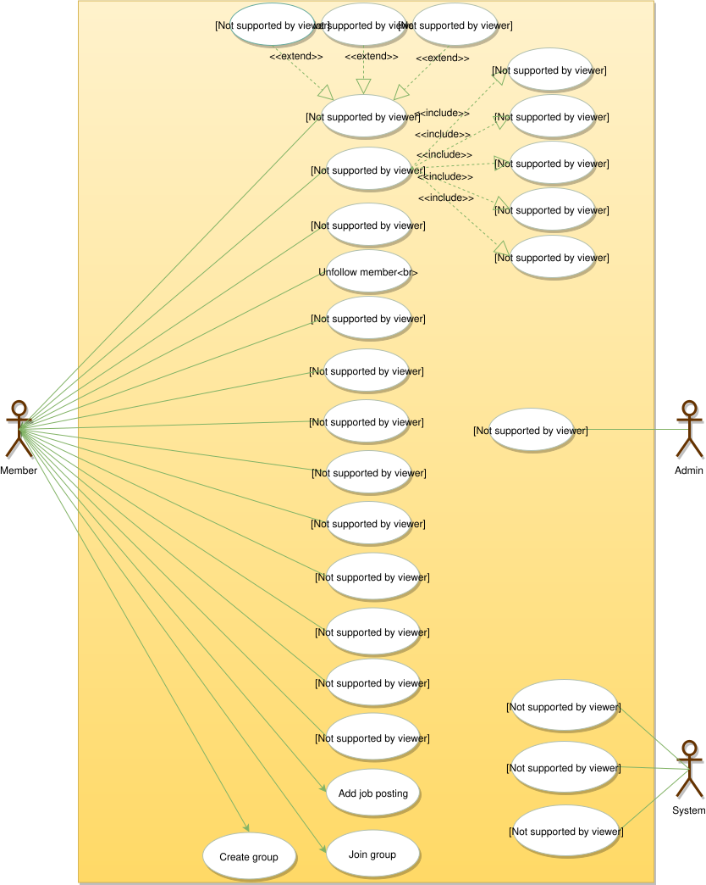
*Figure — LinkedIn use cases for Member, Admin and System, including follow/unfollow member, with `<<include>>` and `<<extend>>` relationships (course diagram)*

**Activity — add experience to a profile.** The member opens *Add Experience*, enters title, company, location, dates and description, optionally uploads a document or photo with a description, and presses save. The system verifies the data; if anything is missing it notifies the member, otherwise it saves the experience.

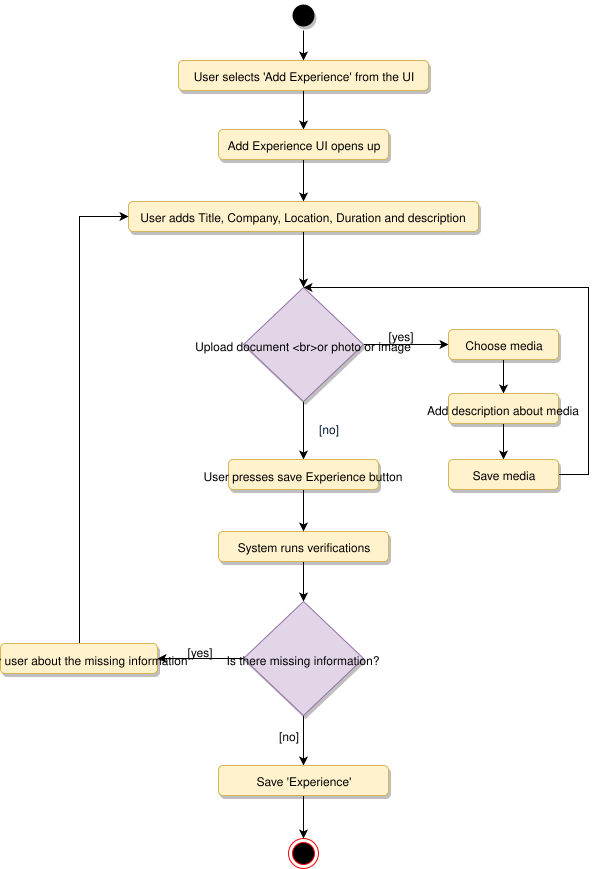
*Figure — Activity diagram "add experience to profile" with optional media upload and a verification loop (course diagram)*

**Activity — send a message.** The member composes a message, picks one or more recipients, adds a body and optional media, and presses send. After verification the message goes to every recipient, and each gets an email and a push notification.

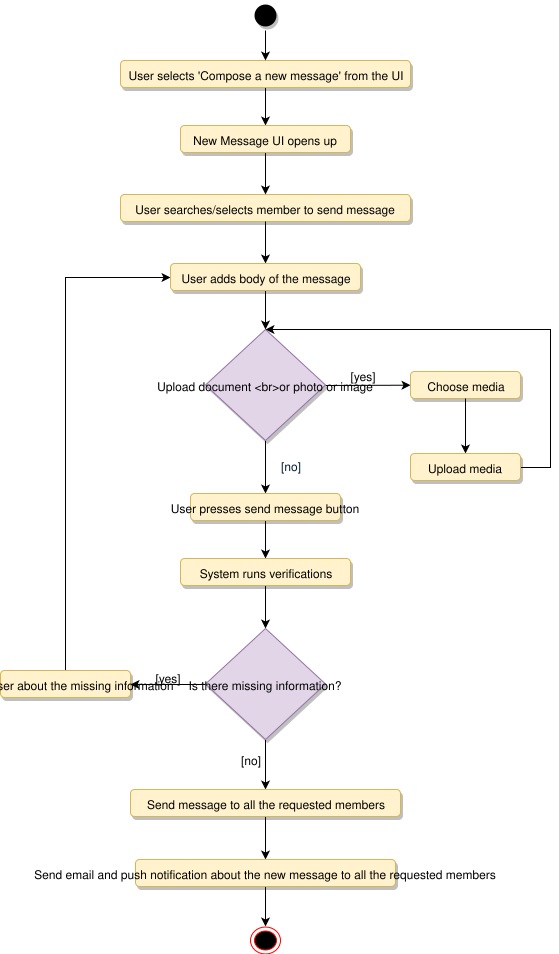
*Figure — Activity diagram "send message": choose recipients, add body and media, verify, deliver to all recipients, notify them by email and push (course diagram)*

### Core entities

| Class | Responsibility |
|---|---|
| `Member`, `Admin` | Identity, profile, connection set (changed only by the service), follows, posts, inbox, notifications |
| `Profile` | Owns `Experience`, `Education`, `Skill`, `Accomplishment`, `Recommendation`, `ProfileStats` |
| `Skill` | Name + set of endorsers (no double endorsement) |
| `Recommendation` | Created empty on request; only the named author writes it (REQUESTED → WRITTEN) |
| `ProfileStats` | View and search-appearance counters pushed in from where the events happen |
| `SocialContent` (abstract) → `Post`, `Comment` | Author, text, time, likes as a set; posts own comments and can be shares of another post |
| `Message` (record) | Sender, recipients, text — not "social content" (nobody likes a message). The course allows media on messages and posts too; our code keeps text only |
| `ConnectionInvitation` + `InvitationStatus` | State over time: PENDING → ACCEPTED / REJECTED / CANCELED |
| `ConnectionService` | Invite, accept, reject, withdraw; degree (BFS); mutual connections; people-you-may-know |
| `Company`, `JobPosting`, `JobApplication`, `Group` | Pages, jobs (apply once), groups (owner cannot leave) |
| `Notification`, `NotificationService`, channels | One notification class with a *type* field; delivery Strategy |
| `SearchIndex` | Word → set of members / companies / jobs |
| `FeedService` + `FeedRanker` | Pull-model feed with pluggable ranking |
| `LinkedIn` | Facade |

### Class diagram

The course builds LinkedIn in **six stages**.

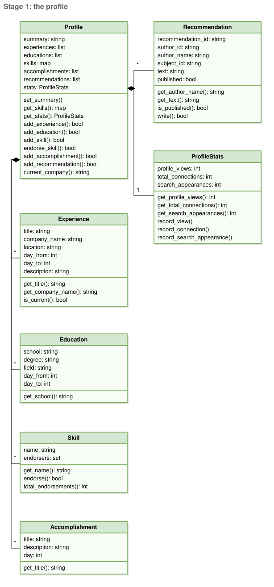
*Figure — Stage 1: `Profile` owning `Experience`, `Education`, `Skill`, `Accomplishment`, `Recommendation` and `ProfileStats` (course diagram)*

**Stage 1 — the profile.** Each of requirement 1's five parts is a small class, not a line of text, because other code uses them (search looks up the current employer; endorsements are counted on the skill). Two details matter. You cannot pass text when creating a `Recommendation`: requirement 4 is about *asking* for one, so the object is born empty and the author fills it in later. And the profile never updates `ProfileStats` itself: whoever witnesses the event bumps the counter — the code that shows a profile, the code that accepts an invitation, the code that returns search results — because an object cannot count events it never sees. All arrows out of `Profile` are composition: delete the profile and its parts go with it.


*Figure — UML conventions: interface, class, abstract class, realization, generalization, dependency, association, aggregation and composition (course diagram)*

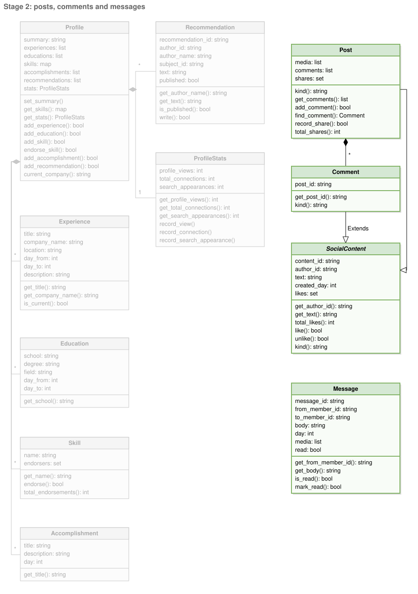
*Figure — Stage 2: `SocialContent` with `Post` and `Comment`; `Post` owns its comments; `Message` stands apart (course diagram)*

**Stage 2 — posts, comments and messages.** Requirement 7 hides a detail: *comments get likes as well.* Put likes only on `Post` and part of the requirement has no home. So both classes extend one parent, `SocialContent`, which holds the author, the text and the likes. The likes are kept as the **ids of the members who liked**, not as a number, which makes a second like by the same person impossible and lets a like be taken back. `Message` is not part of this family: it is delivered to people rather than published, and no one likes a message.

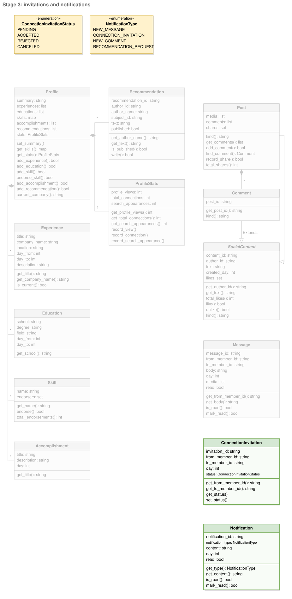
*Figure — Stage 3: `ConnectionInvitation` (with a status) and `Notification` (with a type) (course diagram)*

**Stage 3 — invitations and notifications.** An invitation to connect starts pending and later becomes accepted or rejected. Because it **changes state as time passes**, it deserves its own object (this is the idea behind the **State** pattern: an object's allowed actions depend on which state it is in, and only certain moves between states are legal) rather than a true/false field on a member, and that object can still record, afterwards, that the answer was no. Requirement 9 lists three notification events, but *delivering* them is identical, so the kind is a **field**, not three subclasses. The general rule: **subclass when behaviour differs; use a field when only data differs.**

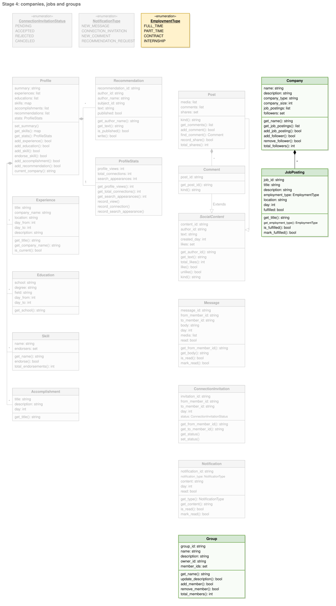
*Figure — Stage 4: `Company` owning its `JobPosting`s, with followers as ids; `Group` with members and an owner (course diagram)*

**Stage 4 — companies, jobs and groups.** A company page owns its job postings (a posting means nothing once the page is gone) and keeps followers as a set of ids. A group records who created it, and that creator is never allowed to leave or be removed.

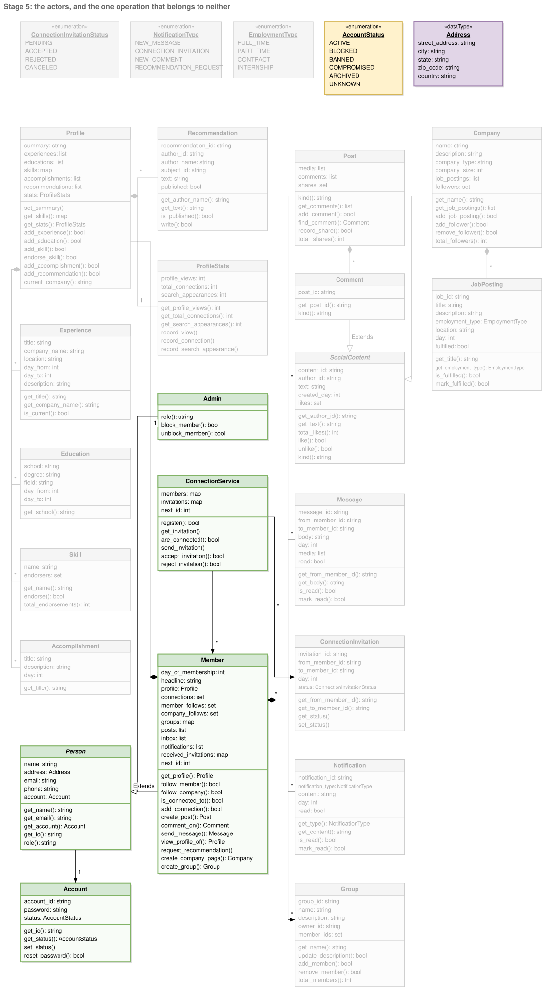
*Figure — Stage 5: `Account`, `Person`, `Member`, `Admin` and `ConnectionService`, which points at both invitations and members (course diagram)*

**Stage 5 — the actors, and an operation that fits neither of them.** Nearly every requirement becomes a method on `Member`. **Accepting an invitation does not**: it edits two members together. If the sender's class did it, the receiver's connection list would be changed by a different object; if each side did half, a bug would one day update only one half, leaving a one-way link. So the operation goes into a small `ConnectionService`, and that single class is responsible for keeping connections **symmetric** (A lists B exactly when B lists A). Following is different: it is one-sided and needs no agreement, so it is just a set on the follower, no service needed.

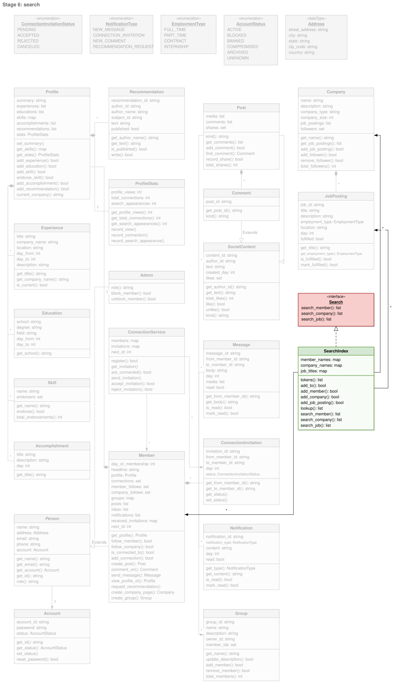
*Figure — Stage 6: the `Search` interface and `SearchIndex` with three maps from key to list (members, companies, job postings) (course diagram)*

**Stage 6 — search.** The course shows a real bug from an earlier version: on the first occurrence of a name the index saved *one* member object, and on the next occurrence it tried to "add" to that object — fine for the first Sharma, broken for the second. The cure is a rule: **an index value is always a collection, even when it holds one item.** Keys are single lowercase words, so first and last names both work.

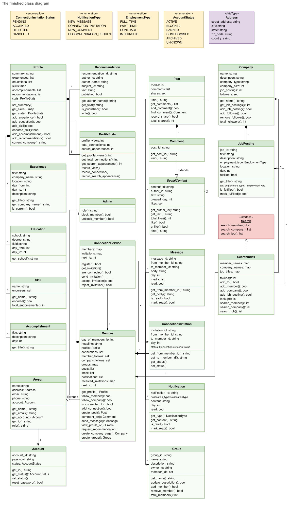
*Figure — The finished LinkedIn class diagram, with all six stages in full colour (course diagram)*

The course deliberately omits several features: the feed and how it is ranked, suggested connections, degrees of separation, applying for jobs and tracking applicants, privacy controls, and one member blocking another. It also admits two weak spots a reviewer will probe. First, there is no feed; building one means either gathering the connections' posts at the moment the page loads, or copying each new post into all the connections' feeds when it is written, and which is better depends on how many connections a typical member has. Second, the search index goes stale (out of date) when a member changes their name, because nothing informs it.

**Our Java design** follows the six stages and fills the gaps the course names: a **feed** (pull model — the feed is gathered when the member opens it — with a ranking Strategy), **degrees of connection** (breadth-first search, described under Key flows), **people you may know**, a **rename that updates the index**, job **applications**, and connection-count derived from the set instead of a stored counter.

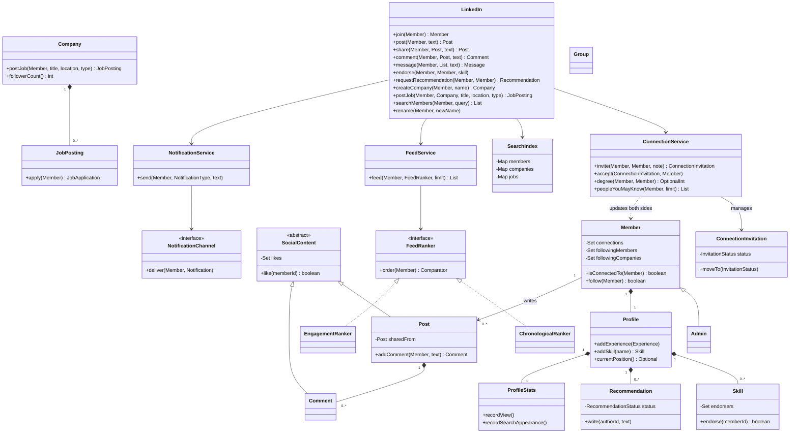

### Key flows

**Invite and accept (the two-sided operation):**

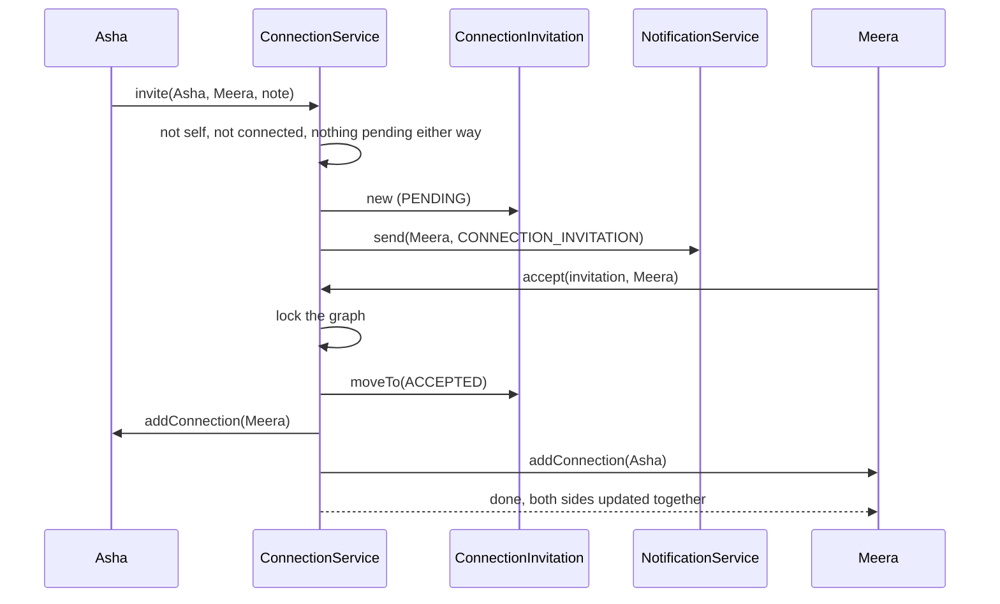

**Invitation states:**

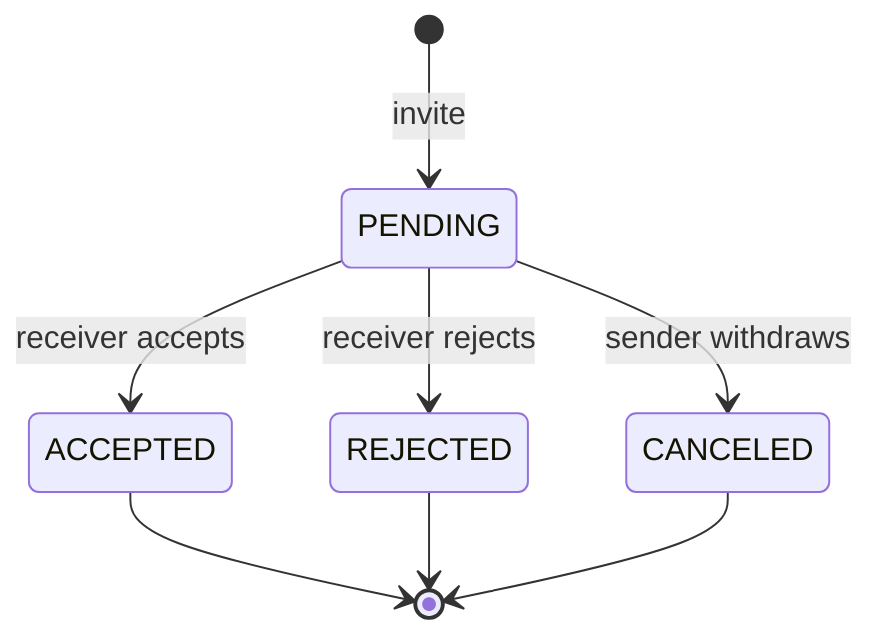

**Degree of connection** — breadth-first search (**BFS**: explore all 1-hop neighbours, then all 2-hop, and so on) from the viewer, stopping at depth 3:

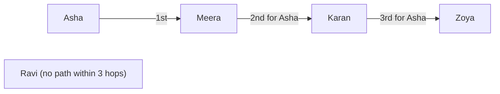

### Design decisions & patterns used

| Decision | Pattern / principle | Why | Alternative rejected |
|---|---|---|---|
| `ConnectionService.accept` updates both members under one lock | Service for a two-object operation; Information Expert at the right level | Symmetry has one guardian | `member.accept(inv)` editing the other member |
| Following is a set on the follower | Simplicity | One-sided relationship needs no agreement or service | Reusing invitations for follows |
| `ConnectionInvitation` with explicit states | **State** (as an enum with allowed transitions) | Accept-twice and accept-after-reject are rejected | A boolean `accepted` flag |
| `SocialContent` base for `Post` and `Comment` | Inheritance for shared behaviour | Requirement 7: comments are liked too | Likes only on `Post` |
| One `Notification` class with a `type` field | "Field when only data differs" | Delivery is identical | A subclass per event |
| `NotificationChannel` interface | **Strategy** | In-app, email, push are interchangeable | `if (email) … else if (push) …` |
| `FeedRanker` interface | **Strategy** | "Recent" vs "Top" ranking swap at run time | Sorting code inside the feed service |
| Index maps key → set | Robust inverted index | Two people named Sharma both found | Key → single member (the course's bug) |
| `LinkedIn.rename` tells the index | Keep derived structures in sync at the write point | Search is never stale | Rebuilding the index nightly |
| Connection count = `connections().size()` | Derive, don't store | Cannot disagree with the set | A separate counter bumped on accept |

### Java implementation

Package `lld.ch18.linkedin`.

```java
// File: lld/ch18/linkedin/Profile.java
package lld.ch18.linkedin;

import java.time.YearMonth;
import java.util.ArrayList;
import java.util.LinkedHashMap;
import java.util.LinkedHashSet;
import java.util.List;
import java.util.Map;
import java.util.Optional;
import java.util.Set;
import java.util.concurrent.atomic.AtomicInteger;
import java.util.concurrent.atomic.AtomicLong;

enum EmploymentType { FULL_TIME, PART_TIME, CONTRACT, INTERNSHIP }

/** A deterministic logical clock so the demo output is repeatable (a real system uses Instant.now()). */
final class Tick {
    private static final AtomicLong NOW = new AtomicLong();
    static long next() { return NOW.incrementAndGet(); }
    static long now() { return NOW.get(); }
    private Tick() {}
}

record Experience(String title, String company, String location, YearMonth from, YearMonth to, EmploymentType type) {
    boolean isCurrent() { return to == null; }
}

record Education(String school, String degree, int fromYear, int toYear) {}

record Accomplishment(String title, String description) {}

/** A skill keeps the set of members who endorsed it, so nobody endorses twice. */
final class Skill {
    private final String name;
    private final Set<Long> endorsers = new LinkedHashSet<>();
    Skill(String name) { this.name = name; }
    String name() { return name; }
    synchronized boolean endorse(long memberId) { return endorsers.add(memberId); }
    synchronized int endorsements() { return endorsers.size(); }
}

enum RecommendationStatus { REQUESTED, WRITTEN, DECLINED }

/** Created EMPTY when requested; only the named author may fill it in, once. */
final class Recommendation {
    private final long authorId;
    private final String authorName;
    private RecommendationStatus status = RecommendationStatus.REQUESTED;
    private String text;

    Recommendation(long authorId, String authorName) { this.authorId = authorId; this.authorName = authorName; }

    synchronized void write(long byMemberId, String text) {
        if (byMemberId != authorId) throw new IllegalStateException("only " + authorName + " can write this recommendation");
        if (status != RecommendationStatus.REQUESTED) throw new IllegalStateException("recommendation is " + status);
        this.text = text;
        this.status = RecommendationStatus.WRITTEN;
    }

    long authorId() { return authorId; }
    String authorName() { return authorName; }
    synchronized RecommendationStatus status() { return status; }
    synchronized Optional<String> text() { return Optional.ofNullable(text); }
}

/**
 * Counters that are pushed in by whoever sees the event (a profile cannot
 * observe its own views or search appearances). The connection count is NOT
 * stored here: it is the size of the connection set, so it can never disagree.
 */
final class ProfileStats {
    private final AtomicInteger profileViews = new AtomicInteger();
    private final AtomicInteger searchAppearances = new AtomicInteger();
    void recordView() { profileViews.incrementAndGet(); }
    void recordSearchAppearance() { searchAppearances.incrementAndGet(); }
    int profileViews() { return profileViews.get(); }
    int searchAppearances() { return searchAppearances.get(); }
}

/** The profile owns all its parts (composition): delete the profile and they go too. */
final class Profile {
    private volatile String headline = "";
    private volatile String summary = "";
    private final List<Experience> experiences = new ArrayList<>();
    private final List<Education> educations = new ArrayList<>();
    private final Map<String, Skill> skills = new LinkedHashMap<>();
    private final List<Accomplishment> accomplishments = new ArrayList<>();
    private final List<Recommendation> recommendations = new ArrayList<>();
    private final ProfileStats stats = new ProfileStats();

    void setHeadline(String h) { headline = h; }
    void setSummary(String s) { summary = s; }
    String headline() { return headline; }
    String summary() { return summary; }

    synchronized void addExperience(Experience e) {
        if (e.to() != null && e.to().isBefore(e.from())) throw new IllegalArgumentException("experience ends before it starts");
        experiences.add(e);
    }
    synchronized void addEducation(Education e) { educations.add(e); }
    synchronized void addAccomplishment(Accomplishment a) { accomplishments.add(a); }
    synchronized Skill addSkill(String name) { return skills.computeIfAbsent(name, Skill::new); }
    synchronized Optional<Skill> skill(String name) { return Optional.ofNullable(skills.get(name)); }
    synchronized void addRecommendation(Recommendation r) { recommendations.add(r); }

    synchronized List<Experience> experiences() { return List.copyOf(experiences); }
    synchronized List<Education> educations() { return List.copyOf(educations); }
    synchronized List<Skill> skills() { return List.copyOf(skills.values()); }
    synchronized List<Recommendation> recommendations() { return List.copyOf(recommendations); }
    ProfileStats stats() { return stats; }

    synchronized Optional<Experience> currentPosition() {
        return experiences.stream().filter(Experience::isCurrent).findFirst();
    }
}
```

```java
// File: lld/ch18/linkedin/Content.java
package lld.ch18.linkedin;

import java.util.ArrayList;
import java.util.LinkedHashSet;
import java.util.List;
import java.util.Optional;
import java.util.Set;
import java.util.concurrent.atomic.AtomicInteger;
import java.util.concurrent.atomic.AtomicLong;

/** Posts AND comments can be liked, so likes live in a shared base class, as a set of member ids. */
abstract class SocialContent {
    private static final AtomicLong IDS = new AtomicLong(1000);
    private final long id = IDS.incrementAndGet();
    private final Member author;
    private final String text;
    private final long createdAt = Tick.next();
    private final Set<Long> likes = new LinkedHashSet<>();

    SocialContent(Member author, String text) {
        if (text == null || text.isBlank()) throw new IllegalArgumentException("text cannot be empty");
        this.author = author;
        this.text = text;
    }

    long id() { return id; }
    Member author() { return author; }
    String text() { return text; }
    long createdAt() { return createdAt; }
    synchronized boolean like(long memberId) { return likes.add(memberId); }
    synchronized boolean unlike(long memberId) { return likes.remove(memberId); }
    synchronized int likeCount() { return likes.size(); }
}

final class Post extends SocialContent {
    private final List<Comment> comments = new ArrayList<>();
    private final Post sharedFrom;                  // null for an original post
    private final AtomicInteger shares = new AtomicInteger();

    Post(Member author, String text, Post sharedFrom) {
        super(author, text);
        this.sharedFrom = sharedFrom;
    }

    synchronized Comment addComment(Member by, String text) {
        Comment c = new Comment(by, text, this);
        comments.add(c);
        return c;
    }
    synchronized List<Comment> comments() { return List.copyOf(comments); }
    Optional<Post> sharedFrom() { return Optional.ofNullable(sharedFrom); }
    void recordShare() { shares.incrementAndGet(); }
    int shares() { return shares.get(); }

    @Override public String toString() {
        return "\"" + text() + "\" by " + author().name()
                + sharedFrom().map(p -> " (shared from " + p.author().name() + ")").orElse("");
    }
}

final class Comment extends SocialContent {
    private final Post post;
    Comment(Member author, String text, Post post) { super(author, text); this.post = post; }
    Post post() { return post; }
}

/** Sent to people, never posted; nobody likes a message, so it is not SocialContent. */
record Message(long id, Member sender, List<Member> recipients, String text, long sentAt) {}
```

```java
// File: lld/ch18/linkedin/Network.java
package lld.ch18.linkedin;

import java.util.ArrayDeque;
import java.util.ArrayList;
import java.util.Comparator;
import java.util.Deque;
import java.util.HashMap;
import java.util.HashSet;
import java.util.List;
import java.util.Map;
import java.util.OptionalInt;
import java.util.Set;
import java.util.concurrent.ConcurrentHashMap;
import java.util.concurrent.CopyOnWriteArrayList;
import java.util.concurrent.atomic.AtomicLong;
import java.util.function.LongFunction;

enum AccountStatus { ACTIVE, BLOCKED, BANNED, COMPROMISED, ARCHIVED, UNKNOWN }

class Member {
    private static final AtomicLong IDS = new AtomicLong();
    private final long id = IDS.incrementAndGet();
    private volatile String name;
    private final String email;
    private final Profile profile = new Profile();
    private volatile AccountStatus status = AccountStatus.ACTIVE;
    // Connections change only through ConnectionService, which keeps both sides symmetric.
    private final Set<Long> connections = ConcurrentHashMap.newKeySet();
    // Following is one-sided: nobody has to agree, so it is just a set on the follower.
    private final Set<Long> followingMembers = ConcurrentHashMap.newKeySet();
    private final Set<Long> followingCompanies = ConcurrentHashMap.newKeySet();
    private final List<Post> posts = new CopyOnWriteArrayList<>();
    private final List<Message> inbox = new CopyOnWriteArrayList<>();
    private final List<Notification> notifications = new CopyOnWriteArrayList<>();

    Member(String name, String email) { this.name = name; this.email = email; }

    long id() { return id; }
    String name() { return name; }
    void rename(String newName) { this.name = newName; }
    String email() { return email; }
    Profile profile() { return profile; }
    AccountStatus status() { return status; }
    void setStatus(AccountStatus s) { status = s; }

    Set<Long> connections() { return Set.copyOf(connections); }
    boolean isConnectedTo(Member other) { return connections.contains(other.id()); }
    void addConnection(long otherId) { connections.add(otherId); }         // package-private: only the service calls it
    void removeConnection(long otherId) { connections.remove(otherId); }

    boolean follow(Member m) { return m.id != id && followingMembers.add(m.id()); }
    boolean unfollow(Member m) { return followingMembers.remove(m.id()); }
    boolean followCompany(Company c) { return followingCompanies.add(c.id()); }
    Set<Long> followingMembers() { return Set.copyOf(followingMembers); }
    Set<Long> followingCompanies() { return Set.copyOf(followingCompanies); }

    void addPost(Post p) { posts.add(p); }
    List<Post> posts() { return List.copyOf(posts); }
    void receive(Message m) { inbox.add(m); }
    List<Message> inbox() { return List.copyOf(inbox); }
    void notify(Notification n) { notifications.add(n); }
    List<Notification> notifications() { return List.copyOf(notifications); }

    @Override public String toString() { return name; }
}

final class Admin extends Member {
    Admin(String name, String email) { super(name, email); }
}

enum InvitationStatus {
    PENDING, ACCEPTED, REJECTED, CANCELED;
    boolean canMoveTo(InvitationStatus next) { return this == PENDING && next != PENDING; }
}

/** A connection request is an object with a state over time: it can remember that it was rejected. */
final class ConnectionInvitation {
    private static final AtomicLong IDS = new AtomicLong();
    private final long id = IDS.incrementAndGet();
    private final Member from;
    private final Member to;
    private final String note;
    private InvitationStatus status = InvitationStatus.PENDING;

    ConnectionInvitation(Member from, Member to, String note) { this.from = from; this.to = to; this.note = note; }

    long id() { return id; }
    Member from() { return from; }
    Member to() { return to; }
    String note() { return note; }
    synchronized InvitationStatus status() { return status; }

    synchronized void moveTo(InvitationStatus next) {
        if (!status.canMoveTo(next)) throw new IllegalStateException("invitation is already " + status);
        status = next;
    }
}

/**
 * Accepting an invitation changes TWO members, so it belongs to neither: it lives here.
 * This service is the only code that must be right for connections to stay symmetric.
 */
final class ConnectionService {
    private final Map<Long, ConnectionInvitation> invitations = new ConcurrentHashMap<>();
    private final NotificationService notifications;
    private final LongFunction<Member> lookup;

    ConnectionService(NotificationService notifications, LongFunction<Member> lookup) {
        this.notifications = notifications;
        this.lookup = lookup;
    }

    synchronized ConnectionInvitation invite(Member from, Member to, String note) {
        if (from.id() == to.id()) throw new IllegalArgumentException("cannot connect to yourself");
        if (from.isConnectedTo(to)) throw new IllegalStateException(from + " and " + to + " are already connected");
        if (pendingBetween(from, to)) throw new IllegalStateException("an invitation between " + from + " and " + to + " is already pending");
        ConnectionInvitation inv = new ConnectionInvitation(from, to, note);
        invitations.put(inv.id(), inv);
        notifications.send(to, NotificationType.CONNECTION_INVITATION, from + " wants to connect: \"" + note + "\"");
        return inv;
    }

    /** One lock for the whole graph change: both sides are updated together or not at all. */
    synchronized void accept(ConnectionInvitation inv, Member by) {
        if (by.id() != inv.to().id()) throw new IllegalStateException("only " + inv.to() + " can accept");
        inv.moveTo(InvitationStatus.ACCEPTED);
        inv.from().addConnection(inv.to().id());
        inv.to().addConnection(inv.from().id());
    }

    synchronized void reject(ConnectionInvitation inv, Member by) {
        if (by.id() != inv.to().id()) throw new IllegalStateException("only " + inv.to() + " can reject");
        inv.moveTo(InvitationStatus.REJECTED);
    }

    synchronized void withdraw(ConnectionInvitation inv, Member by) {
        if (by.id() != inv.from().id()) throw new IllegalStateException("only " + inv.from() + " can withdraw");
        inv.moveTo(InvitationStatus.CANCELED);
    }

    synchronized void removeConnection(Member a, Member b) {
        a.removeConnection(b.id());
        b.removeConnection(a.id());
    }

    boolean pendingBetween(Member a, Member b) {
        return invitations.values().stream().anyMatch(i -> i.status() == InvitationStatus.PENDING
                && ((i.from() == a && i.to() == b) || (i.from() == b && i.to() == a)));
    }

    /** Degree of connection (1st, 2nd, 3rd) by breadth-first search; empty means "out of network". */
    OptionalInt degree(Member from, Member to) {
        if (from.id() == to.id()) return OptionalInt.of(0);
        Set<Long> seen = new HashSet<>(Set.of(from.id()));
        Deque<long[]> queue = new ArrayDeque<>();                 // {memberId, depth}
        queue.add(new long[]{from.id(), 0});
        while (!queue.isEmpty()) {
            long[] cur = queue.poll();
            if (cur[1] == 3) continue;                              // LinkedIn stops at 3rd degree
            for (long next : lookup.apply(cur[0]).connections()) {
                if (next == to.id()) return OptionalInt.of((int) cur[1] + 1);
                if (seen.add(next)) queue.add(new long[]{next, cur[1] + 1});
            }
        }
        return OptionalInt.empty();
    }

    Set<Long> mutualConnections(Member a, Member b) {
        Set<Long> mutual = new HashSet<>(a.connections());
        mutual.retainAll(b.connections());
        return mutual;
    }

    /** "People you may know": 2nd-degree members ranked by mutual connections, then name. */
    List<Member> peopleYouMayKnow(Member me, int limit) {
        Map<Long, Integer> mutualCount = new HashMap<>();
        for (long friend : me.connections()) {
            for (long candidate : lookup.apply(friend).connections()) {
                if (candidate != me.id() && !me.connections().contains(candidate)) mutualCount.merge(candidate, 1, Integer::sum);
            }
        }
        List<Member> result = new ArrayList<>();
        mutualCount.keySet().stream().map(lookup::apply)
                .filter(m -> !pendingBetween(me, m))
                .sorted(Comparator.comparing((Member m) -> -mutualCount.get(m.id())).thenComparing(Member::name))
                .limit(limit).forEach(result::add);
        return result;
    }
}
```

```java
// File: lld/ch18/linkedin/Pages.java
package lld.ch18.linkedin;

import java.util.LinkedHashMap;
import java.util.List;
import java.util.Map;
import java.util.Set;
import java.util.concurrent.ConcurrentHashMap;
import java.util.concurrent.CopyOnWriteArrayList;
import java.util.concurrent.atomic.AtomicLong;

final class Company {
    private static final AtomicLong IDS = new AtomicLong(500);
    private final long id = IDS.incrementAndGet();
    private final String name;
    private final Member createdBy;
    private final Set<Long> followers = ConcurrentHashMap.newKeySet();
    private final List<JobPosting> jobs = new CopyOnWriteArrayList<>();     // owned: gone with the page

    Company(String name, Member createdBy) { this.name = name; this.createdBy = createdBy; }

    long id() { return id; }
    String name() { return name; }
    Member createdBy() { return createdBy; }
    void addFollower(long memberId) { followers.add(memberId); }
    Set<Long> followers() { return Set.copyOf(followers); }
    int followerCount() { return followers.size(); }          // counted, never stored

    JobPosting postJob(Member by, String title, String location, EmploymentType type) {
        if (by.id() != createdBy.id()) throw new IllegalStateException(by + " is not an admin of " + name);
        JobPosting job = new JobPosting(this, title, location, type);
        jobs.add(job);
        return job;
    }
    List<JobPosting> jobs() { return List.copyOf(jobs); }
    @Override public String toString() { return name; }
}

enum ApplicationStatus { APPLIED, IN_REVIEW, REJECTED, HIRED }

record JobApplication(Member applicant, long appliedAt, ApplicationStatus status) {}

final class JobPosting {
    private static final AtomicLong IDS = new AtomicLong(700);
    private final long id = IDS.incrementAndGet();
    private final Company company;
    private final String title;
    private final String location;
    private final EmploymentType type;
    private final Map<Long, JobApplication> applications = new LinkedHashMap<>();
    private volatile boolean open = true;

    JobPosting(Company company, String title, String location, EmploymentType type) {
        this.company = company; this.title = title; this.location = location; this.type = type;
    }

    long id() { return id; }
    Company company() { return company; }
    String title() { return title; }
    String location() { return location; }
    EmploymentType type() { return type; }
    boolean isOpen() { return open; }
    void close() { open = false; }

    synchronized JobApplication apply(Member m) {
        if (!open) throw new IllegalStateException("job " + title + " is closed");
        if (applications.containsKey(m.id())) throw new IllegalStateException(m + " already applied to " + title);
        JobApplication a = new JobApplication(m, Tick.next(), ApplicationStatus.APPLIED);
        applications.put(m.id(), a);
        return a;
    }
    synchronized int applicantCount() { return applications.size(); }
    @Override public String toString() { return title + " @ " + company + " (" + location + ", " + type + ")"; }
}

final class Group {
    private static final AtomicLong IDS = new AtomicLong(900);
    private final long id = IDS.incrementAndGet();
    private final String name;
    private final long ownerId;
    private final Set<Long> members = ConcurrentHashMap.newKeySet();

    Group(String name, Member owner) {
        this.name = name;
        this.ownerId = owner.id();
        members.add(owner.id());
    }

    long id() { return id; }
    String name() { return name; }
    boolean join(Member m) { return members.add(m.id()); }
    boolean leave(Member m) {
        if (m.id() == ownerId) throw new IllegalStateException("the owner cannot leave their own group");
        return members.remove(m.id());
    }
    int memberCount() { return members.size(); }
}
```

```java
// File: lld/ch18/linkedin/Services.java
package lld.ch18.linkedin;

import java.util.Arrays;
import java.util.Comparator;
import java.util.List;
import java.util.Locale;
import java.util.Map;
import java.util.Set;
import java.util.concurrent.ConcurrentHashMap;
import java.util.concurrent.CopyOnWriteArrayList;
import java.util.stream.Stream;

enum NotificationType { NEW_MESSAGE, CONNECTION_INVITATION, NEW_COMMENT, RECOMMENDATION_REQUEST }

/** Only the data differs between notification kinds, so the kind is a field, not a subclass. */
record Notification(NotificationType type, String text, long at) {}

/** Strategy for delivery: in-app, email, push... */
interface NotificationChannel { void deliver(Member to, Notification n); }

final class InAppChannel implements NotificationChannel {
    @Override public void deliver(Member to, Notification n) { to.notify(n); }
}

final class EmailChannel implements NotificationChannel {
    @Override public void deliver(Member to, Notification n) {
        System.out.println("    [email to " + to.email() + "] " + n.type() + ": " + n.text());
    }
}

final class NotificationService {
    private final List<NotificationChannel> channels = new CopyOnWriteArrayList<>();
    NotificationService(List<NotificationChannel> channels) { this.channels.addAll(channels); }
    void send(Member to, NotificationType type, String text) {
        Notification n = new Notification(type, text, Tick.next());
        channels.forEach(c -> c.deliver(to, n));
    }
}

interface Search {
    List<Member> searchMembers(String name);
    List<Company> searchCompanies(String name);
    List<JobPosting> searchJobs(String title);
}

/**
 * Inverted indexes. RULE: every key maps to a LIST, even for one match,
 * so the second "Sharma" never breaks the index.
 */
final class SearchIndex implements Search {
    private final Map<String, Set<Member>> members = new ConcurrentHashMap<>();
    private final Map<String, Set<Company>> companies = new ConcurrentHashMap<>();
    private final Map<String, Set<JobPosting>> jobs = new ConcurrentHashMap<>();

    void addMember(Member m) { words(m.name()).forEach(w -> members.computeIfAbsent(w, k -> ConcurrentHashMap.newKeySet()).add(m)); }
    void removeMember(Member m, String oldName) { words(oldName).forEach(w -> members.getOrDefault(w, Set.of()).remove(m)); }
    void addCompany(Company c) { words(c.name()).forEach(w -> companies.computeIfAbsent(w, k -> ConcurrentHashMap.newKeySet()).add(c)); }
    void addJob(JobPosting j) { words(j.title()).forEach(w -> jobs.computeIfAbsent(w, k -> ConcurrentHashMap.newKeySet()).add(j)); }

    @Override public List<Member> searchMembers(String q) {
        return match(members, q).sorted(Comparator.comparing(Member::name)).toList();
    }
    @Override public List<Company> searchCompanies(String q) {
        return match(companies, q).sorted(Comparator.comparing(Company::name)).toList();
    }
    @Override public List<JobPosting> searchJobs(String q) {
        return match(jobs, q).filter(JobPosting::isOpen).sorted(Comparator.comparingLong(JobPosting::id)).toList();
    }

    /** Items matching ALL words of the query. */
    private static <T> Stream<T> match(Map<String, Set<T>> index, String query) {
        List<String> ws = words(query);
        if (ws.isEmpty()) return Stream.empty();
        return index.getOrDefault(ws.get(0), Set.of()).stream()
                .filter(item -> ws.stream().allMatch(w -> index.getOrDefault(w, Set.of()).contains(item)));
    }

    private static List<String> words(String s) {
        return Arrays.stream(s.toLowerCase(Locale.ROOT).split("\\W+")).filter(w -> !w.isEmpty()).toList();
    }
}

/** Strategy for ordering the feed. */
interface FeedRanker {
    String name();
    Comparator<Post> order(Member viewer);
}

final class ChronologicalRanker implements FeedRanker {
    @Override public String name() { return "latest"; }
    @Override public Comparator<Post> order(Member viewer) {
        return Comparator.comparingLong(Post::createdAt).reversed();
    }
}

/** Engagement score with a simple age decay; 1st-degree connections get a boost over follows. */
final class EngagementRanker implements FeedRanker {
    @Override public String name() { return "top"; }
    @Override public Comparator<Post> order(Member viewer) {
        return Comparator.comparingDouble((Post p) -> -score(p, viewer)).thenComparing(Comparator.comparingLong(Post::createdAt).reversed());
    }
    private static double score(Post p, Member viewer) {
        double engagement = p.likeCount() + 2.0 * p.comments().size() + 3.0 * p.shares();
        double affinity = viewer.isConnectedTo(p.author()) ? 1.5 : 1.0;
        double age = Tick.now() - p.createdAt();
        return (1 + engagement) * affinity / (1 + age / 20.0);
    }
}

/**
 * Pull model ("fan-out on read"): build the feed when it is opened from the
 * posts of connections and followed members. Fine for small networks; see the
 * README for the push model and the hybrid real sites use.
 */
final class FeedService {
    private final java.util.function.LongFunction<Member> lookup;
    FeedService(java.util.function.LongFunction<Member> lookup) { this.lookup = lookup; }

    List<Post> feed(Member viewer, FeedRanker ranker, int limit) {
        Set<Long> sources = new java.util.HashSet<>(viewer.connections());
        sources.addAll(viewer.followingMembers());
        return sources.stream()
                .map(lookup::apply)
                .filter(m -> m.status() == AccountStatus.ACTIVE)
                .flatMap(m -> m.posts().stream())
                .sorted(ranker.order(viewer))
                .limit(limit)
                .toList();
    }
}
```

```java
// File: lld/ch18/linkedin/LinkedIn.java
package lld.ch18.linkedin;

import java.util.List;
import java.util.Map;
import java.util.NoSuchElementException;
import java.util.concurrent.ConcurrentHashMap;
import java.util.concurrent.atomic.AtomicLong;

/** Facade that wires the services and checks account status before every action. */
final class LinkedIn {
    private final Map<Long, Member> members = new ConcurrentHashMap<>();
    private final AtomicLong messageIds = new AtomicLong();
    final NotificationService notifications;
    final ConnectionService connections;
    final SearchIndex search = new SearchIndex();
    final FeedService feeds;

    LinkedIn(List<NotificationChannel> channels) {
        notifications = new NotificationService(channels);
        connections = new ConnectionService(notifications, this::member);
        feeds = new FeedService(this::member);
    }

    Member member(long id) {
        Member m = members.get(id);
        if (m == null) throw new NoSuchElementException("no member " + id);
        return m;
    }

    <M extends Member> M join(M m) {
        members.put(m.id(), m);
        search.addMember(m);
        return m;
    }

    /** The code that changes a name must tell the index, or search goes stale. */
    void rename(Member m, String newName) {
        String old = m.name();
        search.removeMember(m, old);
        m.rename(newName);
        search.addMember(m);
    }

    List<Member> searchMembers(Member viewer, String query) {
        List<Member> found = search.searchMembers(query);
        found.stream().filter(m -> m != viewer).forEach(m -> m.profile().stats().recordSearchAppearance());
        return found;
    }

    void viewProfile(Member viewer, Member owner) {
        if (viewer != owner) owner.profile().stats().recordView();
    }

    void endorse(Member by, Member owner, String skillName) {
        active(by);
        if (!by.isConnectedTo(owner)) throw new IllegalStateException("only 1st-degree connections can endorse " + owner);
        Skill s = owner.profile().skill(skillName).orElseThrow(() -> new NoSuchElementException(owner + " has no skill " + skillName));
        if (!s.endorse(by.id())) throw new IllegalStateException(by + " already endorsed " + skillName);
    }

    Recommendation requestRecommendation(Member requester, Member author) {
        active(requester);
        if (!requester.isConnectedTo(author)) throw new IllegalStateException("you can only ask your connections");
        Recommendation r = new Recommendation(author.id(), author.name());
        requester.profile().addRecommendation(r);
        notifications.send(author, NotificationType.RECOMMENDATION_REQUEST, requester + " asked you for a recommendation");
        return r;
    }

    Post post(Member author, String text) {
        active(author);
        Post p = new Post(author, text, null);
        author.addPost(p);
        return p;
    }

    Post share(Member by, Post original, String text) {
        active(by);
        Post p = new Post(by, text, original);
        original.recordShare();
        by.addPost(p);
        return p;
    }

    Comment comment(Member by, Post post, String text) {
        active(by);
        Comment c = post.addComment(by, text);
        if (post.author() != by) notifications.send(post.author(), NotificationType.NEW_COMMENT, by + " commented: \"" + text + "\"");
        return c;
    }

    Message message(Member from, List<Member> to, String text) {
        active(from);
        for (Member r : to) {
            if (!from.isConnectedTo(r)) throw new IllegalStateException(r + " is not a connection (that would need InMail)");
        }
        Message m = new Message(messageIds.incrementAndGet(), from, List.copyOf(to), text, Tick.next());
        for (Member r : to) {
            r.receive(m);
            notifications.send(r, NotificationType.NEW_MESSAGE, "from " + from + ": " + text);
        }
        return m;
    }

    Company createCompany(Member by, String name) {
        active(by);
        Company c = new Company(name, by);
        search.addCompany(c);
        return c;
    }

    JobPosting postJob(Member by, Company c, String title, String location, EmploymentType type) {
        JobPosting j = c.postJob(by, title, location, type);
        search.addJob(j);
        return j;
    }

    void followCompany(Member m, Company c) {
        if (m.followCompany(c)) c.addFollower(m.id());
    }

    void block(Admin admin, Member target) { target.setStatus(AccountStatus.BLOCKED); }

    private static void active(Member m) {
        if (m.status() != AccountStatus.ACTIVE) throw new IllegalStateException(m + " is " + m.status());
    }
}
```

```java
// File: lld/ch18/linkedin/Main.java
package lld.ch18.linkedin;

import java.time.YearMonth;
import java.util.List;

public class Main {
    public static void main(String[] args) {
        LinkedIn li = new LinkedIn(List.of(new InAppChannel(), new EmailChannel()));
        Member asha = li.join(new Member("Asha Sharma", "asha@example.com"));
        Member ravi = li.join(new Member("Ravi Sharma", "ravi@example.com"));
        Member meera = li.join(new Member("Meera Iyer", "meera@example.com"));
        Member karan = li.join(new Member("Karan Mehta", "karan@example.com"));
        Member zoya = li.join(new Member("Zoya Khan", "zoya@example.com"));
        Admin admin = li.join(new Admin("Site Admin", "admin@example.com"));

        section("1. Profile");
        Profile p = asha.profile();
        p.setHeadline("Backend engineer | Java | Distributed systems");
        p.addExperience(new Experience("Software Engineer", "Acme Cloud", "Bengaluru", YearMonth.of(2022, 7), null, EmploymentType.FULL_TIME));
        p.addEducation(new Education("IIT Madras", "B.Tech CSE", 2018, 2022));
        p.addSkill("Java");
        p.addSkill("System Design");
        attempt(() -> p.addExperience(new Experience("Intern", "X", "Pune", YearMonth.of(2021, 6), YearMonth.of(2021, 1), EmploymentType.INTERNSHIP)));
        System.out.println(asha + ": " + p.headline() + ", now at " + p.currentPosition().map(Experience::company).orElse("-"));

        section("2. Connections");
        ConnectionInvitation i1 = li.connections.invite(asha, meera, "We met at the Java meetup");
        li.connections.accept(i1, meera);
        attempt(() -> li.connections.accept(i1, meera));                 // accepted once, never again
        li.connections.accept(li.connections.invite(meera, karan, "Ex-colleague"), karan);
        li.connections.accept(li.connections.invite(karan, zoya, "Hi"), zoya);
        ConnectionInvitation pending = li.connections.invite(asha, ravi, "Same surname!");
        attempt(() -> li.connections.invite(ravi, asha, "Hello"));      // pending the other way
        attempt(() -> li.connections.accept(pending, asha));             // only the receiver can accept
        System.out.println("degree asha->meera=" + li.connections.degree(asha, meera).getAsInt()
                + ", asha->karan=" + li.connections.degree(asha, karan).getAsInt()
                + ", asha->zoya=" + li.connections.degree(asha, zoya).getAsInt()
                + ", asha->ravi=" + (li.connections.degree(asha, ravi).isPresent() ? "?" : "out of network"));
        System.out.println("people asha may know: " + li.connections.peopleYouMayKnow(asha, 5));

        section("3. Endorsements and recommendations");
        li.endorse(meera, asha, "Java");
        attempt(() -> li.endorse(meera, asha, "Java"));
        attempt(() -> li.endorse(karan, asha, "Java"));
        Recommendation rec = li.requestRecommendation(asha, meera);
        attempt(() -> rec.write(karan.id(), "Great engineer"));
        rec.write(meera.id(), "Asha owns problems end to end.");
        System.out.println("Java endorsements=" + p.skill("Java").orElseThrow().endorsements()
                + ", recommendation from " + rec.authorName() + ": " + rec.text().orElse("") + " [" + rec.status() + "]");

        section("4. Posts, comments, likes, feed");
        karan.follow(asha);                                              // follow = one-sided, no approval
        Post launch = li.post(meera, "We are hiring Java engineers at Acme Cloud!");
        Post tip = li.post(asha, "Tip: prefer composition over inheritance.");
        Comment c = li.comment(asha, launch, "Sharing with my network");
        launch.like(asha.id());
        c.like(meera.id());                                              // comments can be liked too
        System.out.println("double like accepted? " + launch.like(asha.id()));
        li.share(karan, tip, "Good advice");
        tip.like(meera.id());
        tip.like(zoya.id());
        System.out.println("feed(asha, latest): " + li.feeds.feed(asha, new ChronologicalRanker(), 5));
        System.out.println("feed(karan, top):   " + li.feeds.feed(karan, new EngagementRanker(), 5));

        section("5. Messaging");
        li.message(asha, List.of(meera), "Coffee on Friday?");
        attempt(() -> li.message(asha, List.of(karan), "Hi Karan"));

        section("6. Companies, jobs, groups");
        Company acme = li.createCompany(meera, "Acme Cloud");
        li.followCompany(asha, acme);
        JobPosting job = li.postJob(meera, acme, "Senior Java Engineer", "Bengaluru", EmploymentType.FULL_TIME);
        attempt(() -> li.postJob(asha, acme, "Fake job", "Nowhere", EmploymentType.CONTRACT));
        System.out.println("search jobs 'java engineer': " + li.search.searchJobs("java engineer"));
        job.apply(asha);
        attempt(() -> job.apply(asha));
        Group group = new Group("Java Developers India", meera);
        group.join(asha);
        attempt(() -> group.leave(meera));
        System.out.println(acme + " followers=" + acme.followerCount() + ", applicants=" + job.applicantCount()
                + ", group members=" + group.memberCount());

        section("7. Search and profile stats");
        System.out.println("search 'sharma' (by meera): " + li.searchMembers(meera, "sharma"));
        li.rename(zoya, "Zoya Ali");
        System.out.println("search 'khan' after rename: " + li.searchMembers(meera, "khan")
                + ", search 'ali': " + li.searchMembers(meera, "ali"));
        li.viewProfile(meera, asha);
        li.viewProfile(karan, asha);
        System.out.println("asha stats: views=" + p.stats().profileViews() + ", connections=" + asha.connections().size()
                + ", search appearances=" + p.stats().searchAppearances());
        System.out.println("meera's in-app notifications: " + meera.notifications().stream().map(Notification::type).toList());

        section("8. Admin");
        li.block(admin, karan);
        attempt(() -> li.post(karan, "spam spam"));
        System.out.println("feed(meera) hides blocked Karan's share: " + li.feeds.feed(meera, new ChronologicalRanker(), 5));
    }

    static void section(String t) { System.out.println("\n== " + t + " =="); }

    static void attempt(Runnable r) {
        try { r.run(); } catch (RuntimeException e) { System.out.println("  REJECTED: " + e.getMessage()); }
    }
}
```

**Output:**

```text

== 1. Profile ==
  REJECTED: experience ends before it starts
Asha Sharma: Backend engineer | Java | Distributed systems, now at Acme Cloud

== 2. Connections ==
    [email to meera@example.com] CONNECTION_INVITATION: Asha Sharma wants to connect: "We met at the Java meetup"
  REJECTED: invitation is already ACCEPTED
    [email to karan@example.com] CONNECTION_INVITATION: Meera Iyer wants to connect: "Ex-colleague"
    [email to zoya@example.com] CONNECTION_INVITATION: Karan Mehta wants to connect: "Hi"
    [email to ravi@example.com] CONNECTION_INVITATION: Asha Sharma wants to connect: "Same surname!"
  REJECTED: an invitation between Ravi Sharma and Asha Sharma is already pending
  REJECTED: only Ravi Sharma can accept
degree asha->meera=1, asha->karan=2, asha->zoya=3, asha->ravi=out of network
people asha may know: [Karan Mehta]

== 3. Endorsements and recommendations ==
  REJECTED: Meera Iyer already endorsed Java
  REJECTED: only 1st-degree connections can endorse Asha Sharma
    [email to meera@example.com] RECOMMENDATION_REQUEST: Asha Sharma asked you for a recommendation
  REJECTED: only Meera Iyer can write this recommendation
Java endorsements=1, recommendation from Meera Iyer: Asha owns problems end to end. [WRITTEN]

== 4. Posts, comments, likes, feed ==
    [email to meera@example.com] NEW_COMMENT: Asha Sharma commented: "Sharing with my network"
double like accepted? false
feed(asha, latest): ["We are hiring Java engineers at Acme Cloud!" by Meera Iyer]
feed(karan, top):   ["Tip: prefer composition over inheritance." by Asha Sharma, "We are hiring Java engineers at Acme Cloud!" by Meera Iyer]

== 5. Messaging ==
    [email to meera@example.com] NEW_MESSAGE: from Asha Sharma: Coffee on Friday?
  REJECTED: Karan Mehta is not a connection (that would need InMail)

== 6. Companies, jobs, groups ==
  REJECTED: Asha Sharma is not an admin of Acme Cloud
search jobs 'java engineer': [Senior Java Engineer @ Acme Cloud (Bengaluru, FULL_TIME)]
  REJECTED: Asha Sharma already applied to Senior Java Engineer
  REJECTED: the owner cannot leave their own group
Acme Cloud followers=1, applicants=1, group members=2

== 7. Search and profile stats ==
search 'sharma' (by meera): [Asha Sharma, Ravi Sharma]
search 'khan' after rename: [], search 'ali': [Zoya Ali]
asha stats: views=2, connections=1, search appearances=1
meera's in-app notifications: [CONNECTION_INVITATION, RECOMMENDATION_REQUEST, NEW_COMMENT, NEW_MESSAGE]

== 8. Admin ==
  REJECTED: Karan Mehta is BLOCKED
feed(meera) hides blocked Karan's share: ["Tip: prefer composition over inheritance." by Asha Sharma]
```

**Walking through the important parts**

- `ConnectionService.invite` refuses a request when one is already pending *in either direction* — in the output Ravi's counter-invite to Asha is rejected.
- `accept` checks that the caller is the receiver, moves the invitation to ACCEPTED (a second accept fails because only PENDING can move), and adds each member to the other's set inside one `synchronized` block.
- `degree` is a BFS over connection sets that stops at depth 3: Asha → Meera is 1st, Karan 2nd, Zoya 3rd, and Ravi (only a pending invitation) is "out of network".
- `peopleYouMayKnow` counts mutual connections for every 2nd-degree member, skips anyone with a pending invitation, and sorts by count then name, so the list is stable.
- `endorse` requires a 1st-degree connection and uses the skill's endorser set to reject a second endorsement.
- `Recommendation.write` accepts only the named author and only once.
- `SearchIndex` maps each lowercase word to a *set*, so "sharma" returns both Asha and Ravi; `rename` removes the old words before adding the new ones, so "khan" finds nobody after Zoya's rename.
- `FeedService` is a **pull** feed: it gathers posts from connections and followed members when asked, drops blocked authors, then sorts with the chosen `FeedRanker`. Karan sees Asha's tip because he *follows* her, even though they are not connected.

### Concurrency & edge cases

- **Symmetric connections:** all graph changes (`invite`, `accept`, `reject`, `withdraw`, `removeConnection`) are `synchronized` on the single service, so two concurrent accepts or an accept racing a withdraw cannot leave a one-way edge. In a distributed system (one spread across many machines that talk over a network), write both edges (an **edge** is one link in a graph) in one database transaction (or one row keyed by the ordered pair of ids).
- **Double invitations** in either direction are refused while one is pending.
- **Likes, endorsements, applications:** sets and maps keyed by member id make repeats harmless or rejected; their mutators are `synchronized`.
- **Collections on `Member`** are concurrent sets or `CopyOnWriteArrayList`, and getters return copies, so callers cannot mutate internal state.
- **Stale search:** handled by `rename`; the general rule is "whatever changes the data tells the index" (in production, via an event).
- **Blocked members:** writes are refused and their posts vanish from feeds.
- **Validation:** an experience that ends before it starts is rejected; blank posts are rejected.

### Extensions & follow-up questions

- **"Build the feed for 900 million members."** — Two classic strategies. **Fan-out on write (push):** when someone posts, append the post id to each connection's precomputed feed list — fast reads, expensive for members with huge followings. **Fan-out on read (pull):** assemble the feed when it is opened, as our `FeedService` does — cheap writes, slower reads. Large networks use a **hybrid**: push for ordinary members, pull for very popular accounts, merged at read time.
- **"People you may know at scale."** — Compute suggestions offline (in a background batch job, not while the user waits) on a schedule (friends-of-friends plus signals such as shared companies and schools) and store them; the live page reads the stored list.
- **"Connection limit."** — LinkedIn caps members at 30,000 connections; enforce in `accept`.
- **"InMail to non-connections."** — A premium credit balance on `Member`; `message` spends a credit instead of rejecting.
- **"Who viewed my profile."** — Store view events (viewer, time) instead of a bare counter, then derive the count.
- **"Job recommendations."** — A Strategy that matches a member's skills and current title against open postings, ranked by overlap.

### Real-world example

LinkedIn shows 1st, 2nd and 3rd-degree badges next to names in search results — the exact BFS depth our `degree` computes — and its "People You May Know" panel is driven by shared connections and other signals. Messaging someone who is not a connection usually requires paid **InMail** (some members open their profile to free messages). And the event stream that feeds notifications, analytics and the feed at LinkedIn gave rise to **Apache Kafka**, which LinkedIn open-sourced (published free, with its source code, for anyone to use) in 2011.

### In the interview

| Minutes | What to do |
|---|---|
| 0–5 | Clarify connect vs follow, degrees, who can message and endorse |
| 5–15 | Profile composition, `SocialContent` (comments can be liked), invitation as an object with state |
| 15–25 | **Say it out loud:** accepting changes two objects, so it belongs to neither — `ConnectionService`; following is one-sided, so it needs no service |
| 25–35 | Search index (key → list), degrees by BFS, people you may know |
| 35–45 | Feed: pull vs push vs hybrid; notifications via Strategy channels; concurrency |

**30-second answer:** "Members own profiles made of small parts. Posts and comments share a base class because both are liked, with likes as a set. A connection request is an object with states. Accepting changes both members, so it lives in a `ConnectionService` that updates both sides under one lock; following is one-sided, just a set. Search is an inverted index mapping each word to a list. Degrees come from a BFS to depth 3. The feed is a pull model with a pluggable ranking Strategy, and I'd move to a push/pull hybrid at scale."

**Follow-ups with answers**

- *Why not store `connectionCount` on the profile?* — It is `connections.size()`; a stored copy can drift.
- *How do you compute a 2nd-degree badge quickly for every search result?* — Precompute or cache each member's 1st-degree set; a result is 2nd-degree if its connection set intersects yours.
- *What if the same name appears twice?* — The index maps words to lists (sets), never to a single member.

### Self-check

- **Q:** Why is accepting an invitation not a method on `Member`? **A:** It updates two members; a service keeps both sides consistent in one place.
- **Q:** What is the difference between connecting and following? **A:** Connecting is mutual and needs acceptance; following is one-sided and immediate.
- **Q:** Why does `Recommendation` start without text? **A:** Because it is *requested* first; the author fills it in later.
- **Q:** What is the rule for search index values? **A:** Always a collection, even for one match.
- **Q:** Pull vs push feed — which does `FeedService` implement, and what is its cost? **A:** Pull; cheap writes, but reading scans every connection's posts each time.

### TL;DR

LinkedIn = profile composition + `SocialContent` (likes as sets) + invitation **State** + `ConnectionService` for the two-sided accept (following is just a set) + BFS degrees + people-you-may-know + inverted-index search (key → list) + notification and feed-ranking **Strategies** + a facade.

---
## 18.4 Design Facebook


*Figure — A browser showing the Facebook home page, the cover image of this case study (course diagram)*

Facebook is an online social network where users connect with **friends** (a mutual relationship), **follow** people and **pages**, join **groups**, and read and write posts through a website or mobile apps. Compared with LinkedIn, the new challenges are **privacy** (who may see each post), a real **news feed**, **pages** with ratings, **groups** (public and private), and **friend suggestions**.

### Problem & clarifying questions

| Question to ask | Answer we assume |
|---|---|
| Friend vs follow? | Friendship is mutual (request + accept); following is one-sided |
| Who can see a post? | The author chooses an **audience**: Public, Friends, a custom **privacy list**, or Only me |
| What is a privacy list? | A named subset of the author's friends (e.g. "Close friends"); a post linked to it is visible only to those friends |
| Pages? | Created by members; others follow them and add **recommendations** (a 1–5 rating and text) |
| Groups? | Public (join at once) or private (owner approves); posts inside a private group are visible only to members |
| Search? | Members, groups and pages by name; posts by a word — respecting privacy |
| News feed? | Posts from friends, followed members, followed pages and joined groups, filtered by privacy, ranked |
| Extended requirement? | Suggest people you may know (friends of friends) |

### Requirements

**Functional** (the course's twelve plus the extended one, in our words)

1. A member fills in a profile: basic details, jobs, schooling and places lived.
2. Any user can search members, groups or pages by name.
3. Members send friend requests and accept or reject them.
4. Members can follow other members without becoming friends.
5. Members create groups and pages, join groups, and follow pages.
6. Members create posts to share with their friends.
7. Members can comment on posts; posts **and comments** can both be liked or shared.
8. Members create privacy lists of friends; a post linked to a list is visible only to that list.
9. Members send messages to other members.
10. Members add a recommendation to any page.
11. A member is notified about each new message, each friend request, and each comment on one of their posts.
12. Members can search posts for a word.
13. **Extended:** write a function that suggests connections for a member.

**Non-functional**

- **Privacy is never leaked** — through the feed, search, comments, likes or shares.
- **Feed latency** — the feed must load fast even for members with hundreds of friends.
- **Consistency of the friend graph** — friendship is symmetric.
- **Stable output** — suggestions and feeds must not reshuffle randomly between page loads.

### Use cases

Three actors: **Member**, **Admin** (blocks/unblocks members) and **System** (sends notifications).

Top use cases: add/update profile; search members, groups, pages and posts; send friend requests; follow/unfollow a member or page; send messages to friends; create posts, like and comment on visible posts; send notifications; create a page; recommend a page.

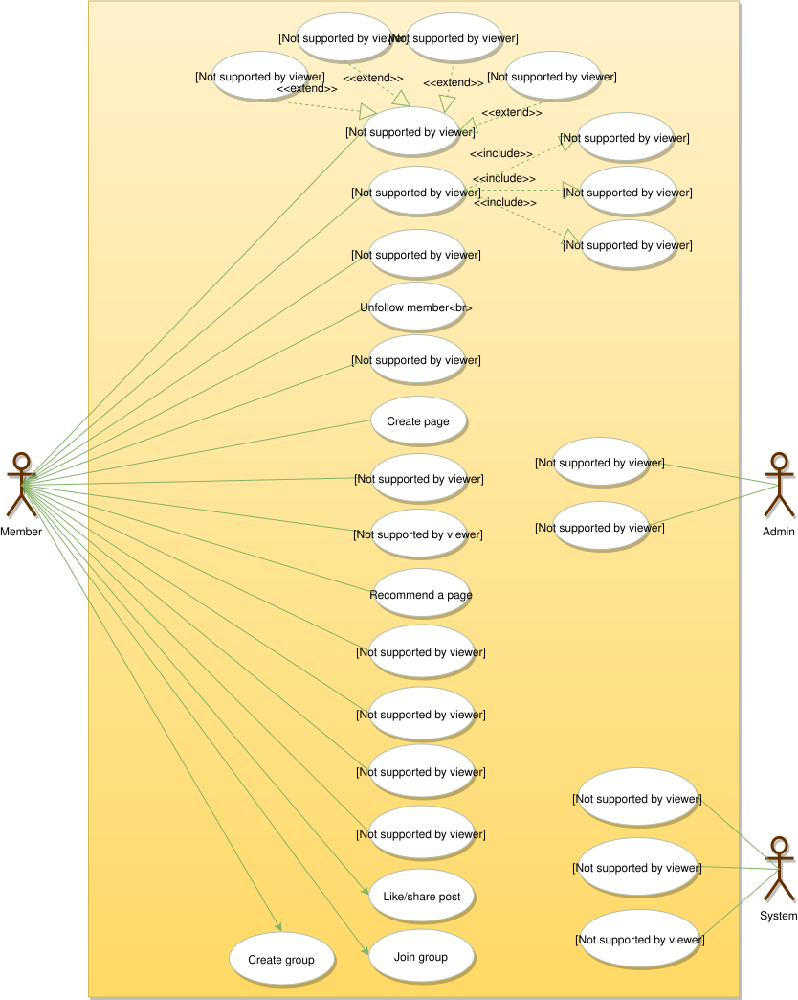
*Figure — Facebook use cases for Member, Admin and System, including "Create page", "Recommend a page" and "Unfollow member" (course diagram)*

**Activity — add work experience.** The member opens *Add Work*, enters position, company, location, dates and description, and presses save; the system verifies, asks for missing information if needed, then saves.

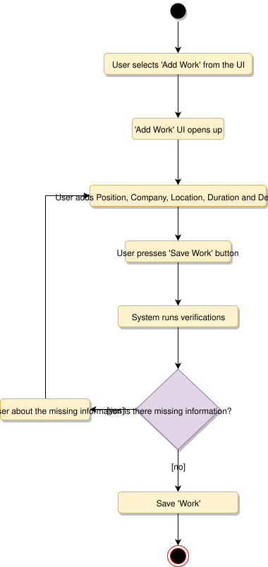
*Figure — Activity diagram "add work to profile" with a verification loop (course diagram)*

**Activity — create a post.** The member opens *New Post*, writes the text, optionally uploads a photo or video, **chooses the privacy list** that may see it, and presses publish. After verification the post is published to the chosen audience, who receive an email or push notification.

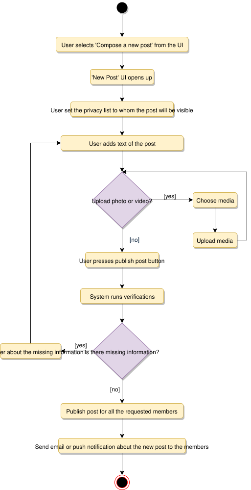
*Figure — Activity diagram "create a new post": add text, optional media, set the privacy list, verify, publish, notify (course diagram)*

### Core entities

| Class | Responsibility |
|---|---|
| `Member`, `Admin` | Identity, profile, follows (members and pages), groups, posts, privacy lists, inbox, notifications (the course's messages may carry photos and videos; ours are text only) |
| `Profile` (+ `Work`, `Education`, `Place`) | Defaults for every field, lists of parts |
| `PrivacyList` | Owner + named set of friend ids |
| `Audience` (sealed) → `Public`, `Friends`, `Custom(list)`, `OnlyMe` | Who may see a post |
| `SocialContent` → `Post`, `Comment` | Likes as a set; posts own comments; a post may belong to a group or page or be a share |
| `FriendRequest` + `FriendService` | Requests with both ends, the friend graph, `areFriends`, `pendingBetween` (both ways) |
| `VisibilityService` | The single `canSee(viewer, post)` rule, combining the post's privacy list and the friend graph |
| `Page` (+ `PageType`, `PageRecommendation`) | Followers (counted), one recommendation per member, average rating, page posts |
| `Group` (+ `GroupPrivacy`) | Members, join requests, owner approval, group posts |
| `NotificationService` + `PushChannel`/`EmailChannel` | Routes each notification type to channels |
| `SearchIndex` | Names of members/groups/pages; post words — `searchPosts` takes the viewer |
| `NewsFeedService` + `FeedRanker` | Gathers candidates, filters by `canSee`, ranks |
| `SuggestionService` + `Suggestion` | Friends-of-friends by mutual count |
| `Facebook` | Facade |

### Class diagram

The course builds Facebook in **five stages plus the extended requirement**.

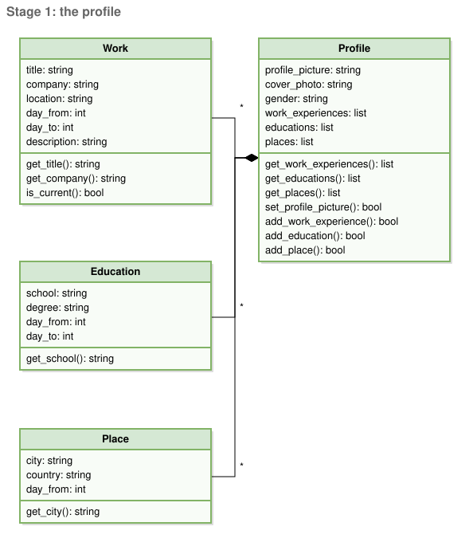
*Figure — Stage 1: `Profile` holding lists of `Work`, `Education` and `Place` (course diagram)*

**Stage 1 — the profile.** Work, education and places are small classes held in lists (composition). Every profile field starts with a **default** value, so a brand-new account already has a working profile, and no other code needs to make up a placeholder picture for someone who never uploaded one.


*Figure — UML conventions used in these diagrams (course diagram)*

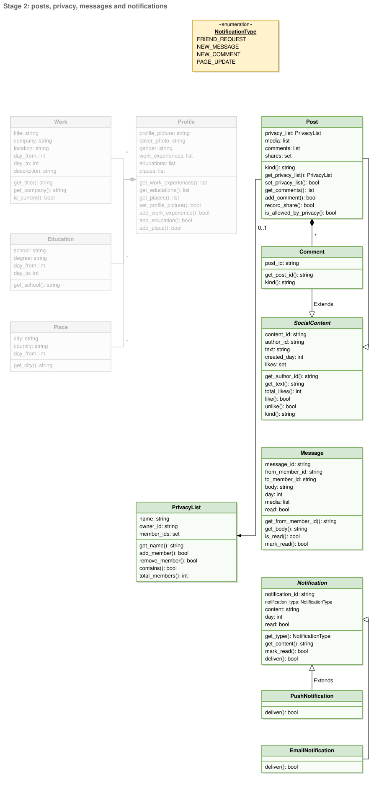
*Figure — Stage 2: `SocialContent` with `Post` and `Comment`, a `0..1` association from `Post` to `PrivacyList`, `Message`, and abstract `Notification` (course diagram)*

**Stage 2 — posts, privacy, messages and notifications.** Three choices here repair bugs in older versions. (1) **Store the likers, not a like count** — an old `Post` received its like count through the constructor, so a fresh post could start with a thousand likes, and there was no way to know whether you had liked it already. (2) **Comments get likes too**, so the likes set lives in the shared `SocialContent` parent. (3) **Privacy is checked by the post itself** — `isAllowedByPrivacy` is a method on the post, not something each screen must remember. Yet it can answer only part of the question, because a post has no idea who is friends with whom; stage 5 supplies the rest. The link from `Post` to `PrivacyList` is marked `0..1`: a post might have no list (it is public), and one list is reused by many posts and survives them. `Notification` is abstract, with a subclass for each delivery method.

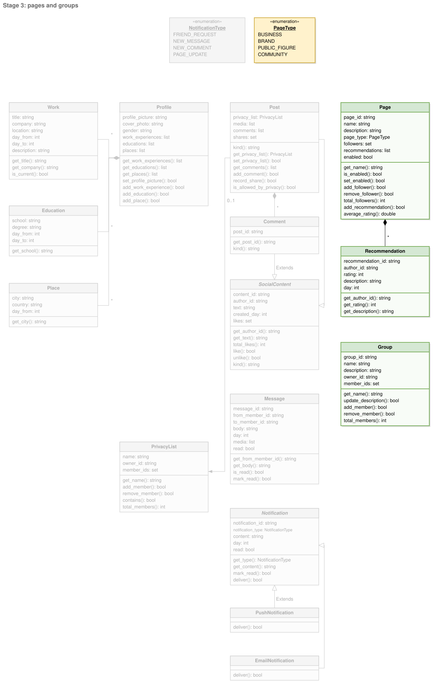
*Figure — Stage 3: `Page` owning its `Recommendation`s, followers as ids, and `Group`; no member-count fields (course diagram)*

**Stage 3 — pages and groups.** Look at what these classes do *not* have: a member-count field. An earlier version accepted the count in its constructor *and* also stored the members, so the two numbers could be different from day one. The rule: **if a number can be computed by counting a collection, do not keep it as a separate field; keep the collection and count it when asked.**

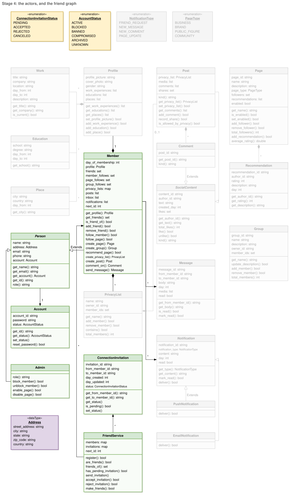
*Figure — Stage 4: `Account`, `Person`, `Member`, `Admin`, `ConnectionInvitation` and `FriendService`, which owns the friend graph (course diagram)*

**Stage 4 — the actors and the friend graph.** An earlier invitation class remembered only the person invited, not the person inviting, so there was no way to accept it properly. Since acceptance updates two members, it belongs in `FriendService`; that service therefore holds the **friend graph** (who is friends with whom) and is the obvious class to ask "are these two friends?" and "is a request already waiting between them?". Following (requirement 4) is deliberately different: one-sided, a set on the follower, no service.

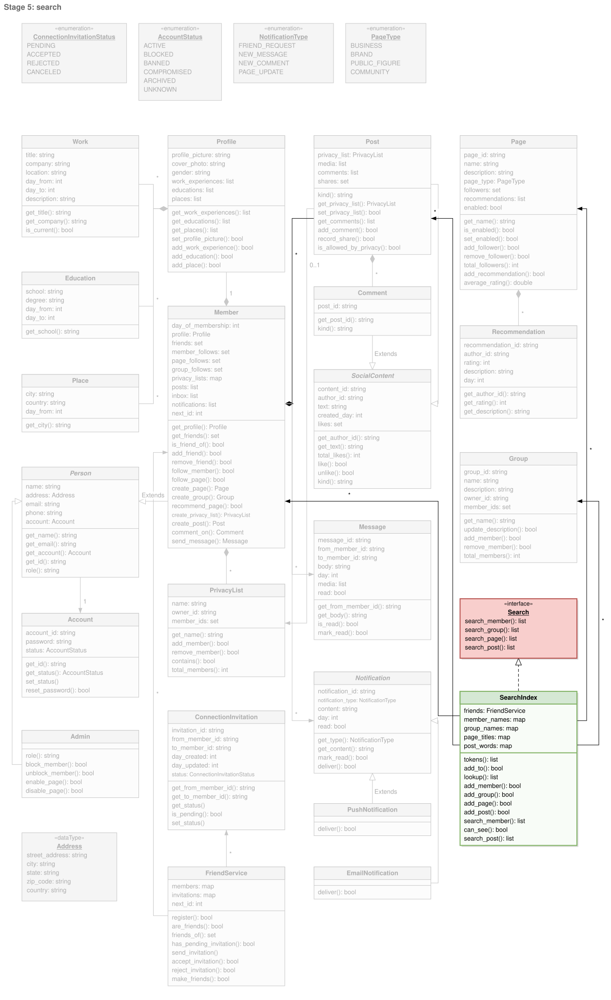
*Figure — Stage 5: `Search` and `SearchIndex`, which holds a `FriendService` so post search can respect privacy (course diagram)*

**Stage 5 — search.** The most important detail is small: **`searchPost` needs the viewer as a parameter.** The privacy rule (requirement 8) still applies when someone searches; a keyword search that skips it would let anyone read posts that were never shared with them. Deciding visibility therefore needs two sources — the post's own privacy list, and the friendship data that only the friend service holds — and neither source can answer for the other. The index follows the same rule as LinkedIn's: each key maps to a collection.

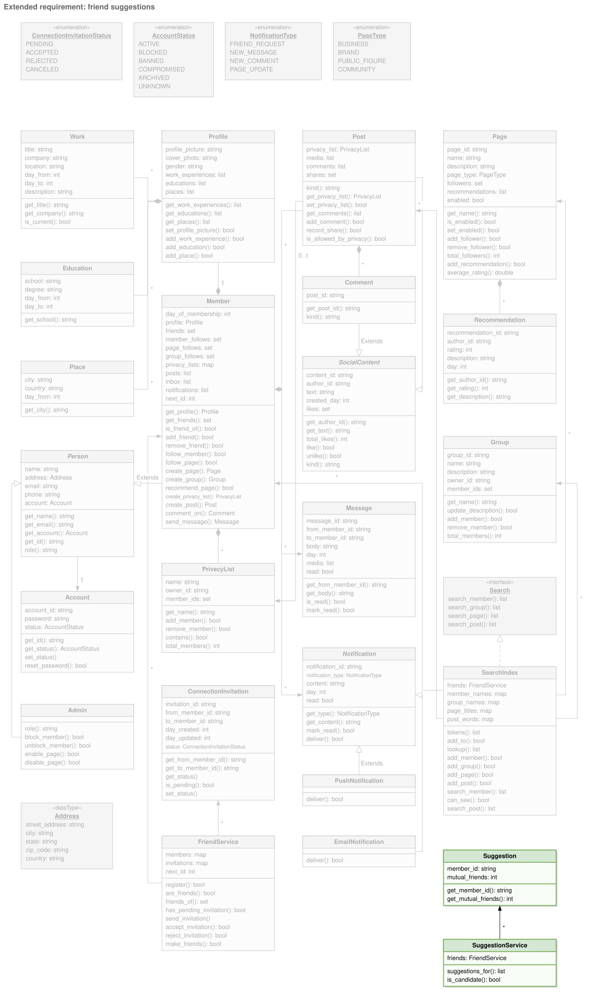
*Figure — Extended requirement: `SuggestionService` reading the friend graph and producing `Suggestion` objects, with no change to existing classes (course diagram)*

**Extended requirement — friend suggestions.** Friends of friends, **scored by mutual friends** (someone reached through three of your friends beats someone reached through one). Never suggest yourself, an existing friend, or anyone with a request pending **in either direction** (the one candidates forget — showing someone you invited yesterday is a visible bug). Sort by mutual count, then by id, so equal scores do not reshuffle between page loads. Notice that the feature arrives as two new classes with no edits to existing ones; if a design must be modified every time a new question is asked, it will keep being modified.

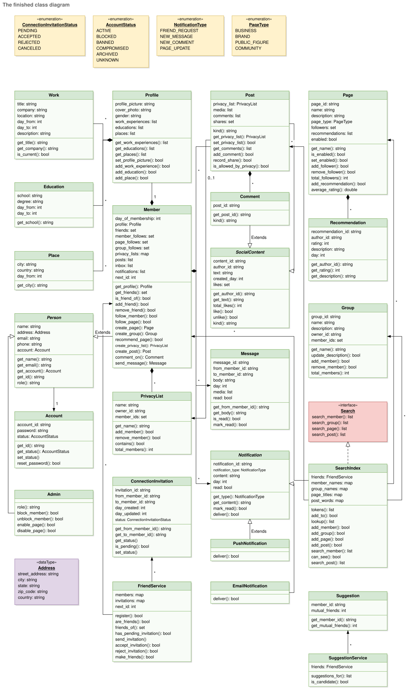
*Figure — The finished Facebook class diagram with every class in full colour (course diagram)*

**Our Java design** keeps the course's structure and makes three things explicit: a sealed `Audience` type (Public / Friends / Custom list / Only me), a single **`VisibilityService`** used by the feed, search, comments, likes and shares, and a **`NewsFeedService`** (the course leaves the feed out) with ranking Strategies. Private groups with owner approval and page posts in the feed are added too. The course lists what it leaves out on purpose: the news feed and its ranking, one member blocking another, reactions other than a plain like, tagging people, events, marketplace, stories, and photo albums that carry separate privacy settings. We add the feed; the rest are sketched under Extensions.


### Key flows

**Can this viewer see this post?** (used by feed, search, comment, like and share):


**Building a news feed (pull model):**


**Friend suggestions:**


### Design decisions & patterns used

| Decision | Pattern / principle | Why | Alternative rejected |
|---|---|---|---|
| `VisibilityService.canSee` used everywhere | Single point of policy (a **Specification**-like rule object — one object that answers a yes/no business question) | The privacy rule is written once; search and feed cannot leak | Checking privacy in each screen |
| `Audience` sealed interface of records | Algebraic data type + exhaustive `switch` | Adding an audience forces every decision point to handle it | Integer or string codes |
| `Post.isAllowedByPrivacyList` + `FriendService.areFriends` | Each object answers what it knows (Information Expert) | Neither half pretends to know the other's data | Post holding a reference to the whole friend graph |
| `FriendService` owns the graph | Service for two-sided operations | Symmetric friendships; one place for "pending either way" | `member.acceptFriend()` |
| Likes as a set | "Store who, not how many" | No fake like counts, no double likes | `likeCount` field |
| No stored member/follower counts | Derive, don't store | Counts cannot disagree with lists | Constructor-supplied counts (the course's bug) |
| `NotificationService` routes types to channels | **Strategy** + configuration map | Friend requests go by push *and* email, comments by push only | `if/else` on type inside each domain method |
| `FeedRanker` | **Strategy** | "Most recent" vs ranked feed swap at run time | Ranking code inside the feed |
| `SuggestionService` added without editing others | Open/Closed Principle | The extended requirement is two new classes | Adding suggestion fields to `Member` |
| `Facebook` facade | **Facade** | One entry point, account-status checks | UI talking to every service |

### Java implementation

Package `lld.ch18.facebook`.

```java
// File: lld/ch18/facebook/Model.java
package lld.ch18.facebook;

import java.util.ArrayList;
import java.util.LinkedHashSet;
import java.util.List;
import java.util.Optional;
import java.util.Set;
import java.util.concurrent.ConcurrentHashMap;
import java.util.concurrent.CopyOnWriteArrayList;
import java.util.concurrent.atomic.AtomicLong;

/** Deterministic logical clock for repeatable demo output. */
final class Tick {
    private static final AtomicLong NOW = new AtomicLong();
    static long next() { return NOW.incrementAndGet(); }
    static long now() { return NOW.get(); }
    private Tick() {}
}

record Work(String title, String company, String location, int fromYear, Integer toYear) {
    boolean isCurrent() { return toYear == null; }
}
record Education(String school, String degree, int fromYear, int toYear) {}
record Place(String city, String country, int fromYear) {}

/** Every field has a default, so a profile is usable the moment the account exists. */
final class Profile {
    private volatile String picture = "default-avatar.png";
    private volatile String bio = "";
    private final List<Work> work = new CopyOnWriteArrayList<>();
    private final List<Education> education = new CopyOnWriteArrayList<>();
    private final List<Place> places = new CopyOnWriteArrayList<>();

    String picture() { return picture; }
    void setPicture(String p) { picture = p; }
    String bio() { return bio; }
    void setBio(String b) { bio = b; }
    void addWork(Work w) { work.add(w); }
    void addEducation(Education e) { education.add(e); }
    void addPlace(Place p) { places.add(p); }
    List<Work> work() { return List.copyOf(work); }
    List<Place> places() { return List.copyOf(places); }
}

enum AccountStatus { ACTIVE, BLOCKED, BANNED, COMPROMISED, ARCHIVED, UNKNOWN }

class Member {
    private static final AtomicLong IDS = new AtomicLong();
    private final long id = IDS.incrementAndGet();
    private final String name;
    private final String email;
    private final Profile profile = new Profile();
    private volatile AccountStatus status = AccountStatus.ACTIVE;
    private final Set<Long> followingMembers = ConcurrentHashMap.newKeySet();   // one-sided
    private final Set<Long> followingPages = ConcurrentHashMap.newKeySet();
    private final Set<Long> groups = ConcurrentHashMap.newKeySet();
    private final List<Post> posts = new CopyOnWriteArrayList<>();
    private final List<PrivacyList> privacyLists = new CopyOnWriteArrayList<>();
    private final List<Message> inbox = new CopyOnWriteArrayList<>();
    private final List<Notification> notifications = new CopyOnWriteArrayList<>();

    Member(String name, String email) { this.name = name; this.email = email; }

    long id() { return id; }
    String name() { return name; }
    String email() { return email; }
    Profile profile() { return profile; }
    AccountStatus status() { return status; }
    void setStatus(AccountStatus s) { status = s; }

    boolean follow(Member m) { return m.id != id && followingMembers.add(m.id); }
    boolean unfollow(Member m) { return followingMembers.remove(m.id); }
    Set<Long> followingMembers() { return Set.copyOf(followingMembers); }
    boolean followPage(Page p) { return followingPages.add(p.id()); }
    Set<Long> followingPages() { return Set.copyOf(followingPages); }
    void joinedGroup(Group g) { groups.add(g.id()); }
    Set<Long> groups() { return Set.copyOf(groups); }

    void addPost(Post p) { posts.add(p); }
    List<Post> posts() { return List.copyOf(posts); }
    void addPrivacyList(PrivacyList l) { privacyLists.add(l); }
    List<PrivacyList> privacyLists() { return List.copyOf(privacyLists); }
    void receive(Message m) { inbox.add(m); }
    List<Message> inbox() { return List.copyOf(inbox); }
    void notify(Notification n) { notifications.add(n); }
    List<Notification> notifications() { return List.copyOf(notifications); }

    @Override public String toString() { return name; }
}

final class Admin extends Member {
    Admin(String name, String email) { super(name, email); }
}

/** A named subset of the owner's friends, e.g. "Close friends". Outlives any single post. */
final class PrivacyList {
    private final Member owner;
    private final String name;
    private final Set<Long> members = ConcurrentHashMap.newKeySet();

    PrivacyList(Member owner, String name) { this.owner = owner; this.name = name; }
    Member owner() { return owner; }
    String name() { return name; }
    void add(long memberId) { members.add(memberId); }
    boolean contains(long memberId) { return members.contains(memberId); }
}

/** Who may see a post. A sealed type makes the visibility switch exhaustive. */
sealed interface Audience {
    record Public() implements Audience {}
    record Friends() implements Audience {}
    record Custom(PrivacyList list) implements Audience {}
    record OnlyMe() implements Audience {}
}

abstract class SocialContent {
    private static final AtomicLong IDS = new AtomicLong(1000);
    private final long id = IDS.incrementAndGet();
    private final Member author;
    private final String text;
    private final long createdAt = Tick.next();
    private final Set<Long> likes = new LinkedHashSet<>();      // a set: no double likes, can be undone

    SocialContent(Member author, String text) { this.author = author; this.text = text; }

    long id() { return id; }
    Member author() { return author; }
    String text() { return text; }
    long createdAt() { return createdAt; }
    synchronized boolean like(long memberId) { return likes.add(memberId); }
    synchronized boolean unlike(long memberId) { return likes.remove(memberId); }
    synchronized int likeCount() { return likes.size(); }
}

final class Post extends SocialContent {
    private final Audience audience;
    private final Group group;          // null unless posted in a group
    private final Page page;            // null unless published by a page
    private final Post sharedFrom;
    private final List<Comment> comments = new ArrayList<>();

    Post(Member author, String text, Audience audience, Group group, Page page, Post sharedFrom) {
        super(author, text);
        this.audience = audience;
        this.group = group;
        this.page = page;
        this.sharedFrom = sharedFrom;
    }

    Audience audience() { return audience; }
    Optional<Group> group() { return Optional.ofNullable(group); }
    Optional<Page> page() { return Optional.ofNullable(page); }
    Optional<Post> sharedFrom() { return Optional.ofNullable(sharedFrom); }

    /** The half of the privacy rule the post CAN answer on its own. */
    boolean isAllowedByPrivacyList(long viewerId) {
        return !(audience instanceof Audience.Custom c) || c.list().contains(viewerId);
    }

    synchronized Comment addComment(Member by, String text) {
        Comment c = new Comment(by, text, this);
        comments.add(c);
        return c;
    }
    synchronized List<Comment> comments() { return List.copyOf(comments); }

    @Override public String toString() {
        String where = page != null ? " [page " + page.name() + "]" : group != null ? " [group " + group.name() + "]" : "";
        return "\"" + text() + "\" by " + author().name() + where;
    }
}

final class Comment extends SocialContent {
    private final Post post;
    Comment(Member author, String text, Post post) { super(author, text); this.post = post; }
    Post post() { return post; }
}

record Message(Member sender, List<Member> recipients, String text, long sentAt) {}
```

```java
// File: lld/ch18/facebook/PagesAndGroups.java
package lld.ch18.facebook;

import java.util.List;
import java.util.Map;
import java.util.OptionalDouble;
import java.util.Set;
import java.util.concurrent.ConcurrentHashMap;
import java.util.concurrent.CopyOnWriteArrayList;
import java.util.concurrent.atomic.AtomicLong;

enum PageType { BUSINESS, BRAND, PUBLIC_FIGURE, COMMUNITY }

/** One recommendation per member per page, with a 1-5 rating. */
record PageRecommendation(long memberId, int rating, String text) {
    PageRecommendation {
        if (rating < 1 || rating > 5) throw new IllegalArgumentException("rating must be 1..5");
    }
}

final class Page {
    private static final AtomicLong IDS = new AtomicLong(500);
    private final long id = IDS.incrementAndGet();
    private final String name;
    private final PageType type;
    private final Member owner;
    private final Set<Long> followers = ConcurrentHashMap.newKeySet();
    private final Map<Long, PageRecommendation> recommendations = new ConcurrentHashMap<>();   // owned
    private final List<Post> posts = new CopyOnWriteArrayList<>();

    Page(String name, PageType type, Member owner) { this.name = name; this.type = type; this.owner = owner; }

    long id() { return id; }
    String name() { return name; }
    PageType type() { return type; }
    Member owner() { return owner; }
    void addFollower(long memberId) { followers.add(memberId); }
    int followerCount() { return followers.size(); }            // never store what you can count

    void recommend(Member by, int rating, String text) {
        if (recommendations.putIfAbsent(by.id(), new PageRecommendation(by.id(), rating, text)) != null)
            throw new IllegalStateException(by + " already recommended " + name);
    }

    OptionalDouble averageRating() {
        return recommendations.values().stream().mapToInt(PageRecommendation::rating).average();
    }
    int recommendationCount() { return recommendations.size(); }

    Post publish(Member by, String text) {
        if (by.id() != owner.id()) throw new IllegalStateException(by + " does not manage page " + name);
        Post p = new Post(by, text, new Audience.Public(), null, this, null);
        posts.add(p);
        return p;
    }
    List<Post> posts() { return List.copyOf(posts); }
}

enum GroupPrivacy { PUBLIC, PRIVATE }

final class Group {
    private static final AtomicLong IDS = new AtomicLong(900);
    private final long id = IDS.incrementAndGet();
    private final String name;
    private final GroupPrivacy privacy;
    private final Member owner;
    private final Set<Long> members = ConcurrentHashMap.newKeySet();
    private final Set<Long> joinRequests = ConcurrentHashMap.newKeySet();
    private final List<Post> posts = new CopyOnWriteArrayList<>();

    Group(String name, GroupPrivacy privacy, Member owner) {
        this.name = name;
        this.privacy = privacy;
        this.owner = owner;
        members.add(owner.id());
        owner.joinedGroup(this);
    }

    long id() { return id; }
    String name() { return name; }
    boolean isPublic() { return privacy == GroupPrivacy.PUBLIC; }
    boolean isMember(long memberId) { return members.contains(memberId); }
    int memberCount() { return members.size(); }

    /** Public groups: join at once. Private groups: the request waits for the owner. Returns true if joined now. */
    boolean requestToJoin(Member m) {
        if (isPublic()) { members.add(m.id()); m.joinedGroup(this); return true; }
        joinRequests.add(m.id());
        return false;
    }

    void approve(Member by, Member requester) {
        if (by.id() != owner.id()) throw new IllegalStateException("only the owner approves members");
        if (!joinRequests.remove(requester.id())) throw new IllegalStateException(requester + " did not ask to join");
        members.add(requester.id());
        requester.joinedGroup(this);
    }

    Post post(Member by, String text) {
        if (!isMember(by.id())) throw new IllegalStateException(by + " is not a member of " + name);
        Post p = new Post(by, text, new Audience.Public(), this, null, null);
        posts.add(p);
        return p;
    }
    List<Post> posts() { return List.copyOf(posts); }
}
```

```java
// File: lld/ch18/facebook/Services.java
package lld.ch18.facebook;

import java.util.Arrays;
import java.util.Comparator;
import java.util.HashMap;
import java.util.HashSet;
import java.util.List;
import java.util.Locale;
import java.util.Map;
import java.util.Set;
import java.util.concurrent.ConcurrentHashMap;
import java.util.concurrent.atomic.AtomicLong;
import java.util.function.LongFunction;
import java.util.stream.Stream;

// ------------------------------------------------------------------ friends

enum RequestStatus { PENDING, ACCEPTED, REJECTED, CANCELED }

/** Records BOTH ends; an invitation that only knows the invitee cannot be accepted. */
final class FriendRequest {
    private static final AtomicLong IDS = new AtomicLong();
    private final long id = IDS.incrementAndGet();
    private final Member from;
    private final Member to;
    private RequestStatus status = RequestStatus.PENDING;

    FriendRequest(Member from, Member to) { this.from = from; this.to = to; }
    long id() { return id; }
    Member from() { return from; }
    Member to() { return to; }
    synchronized RequestStatus status() { return status; }
    synchronized void moveTo(RequestStatus next) {
        if (status != RequestStatus.PENDING) throw new IllegalStateException("request is already " + status);
        status = next;
    }
}

/** Owns the friend graph. Accepting changes two members, so it lives here, not on either member. */
final class FriendService {
    private final Map<Long, Set<Long>> friends = new ConcurrentHashMap<>();
    private final Map<Long, FriendRequest> requests = new ConcurrentHashMap<>();
    private final NotificationService notifications;

    FriendService(NotificationService notifications) { this.notifications = notifications; }

    synchronized FriendRequest sendRequest(Member from, Member to) {
        if (from.id() == to.id()) throw new IllegalArgumentException("cannot befriend yourself");
        if (areFriends(from, to)) throw new IllegalStateException(from + " and " + to + " are already friends");
        if (pendingBetween(from.id(), to.id())) throw new IllegalStateException("a request between " + from + " and " + to + " is pending");
        FriendRequest r = new FriendRequest(from, to);
        requests.put(r.id(), r);
        notifications.send(to, NotificationType.FRIEND_REQUEST, from + " sent you a friend request");
        return r;
    }

    synchronized void accept(FriendRequest r, Member by) {
        if (by.id() != r.to().id()) throw new IllegalStateException("only " + r.to() + " can accept");
        r.moveTo(RequestStatus.ACCEPTED);
        friends.computeIfAbsent(r.from().id(), k -> ConcurrentHashMap.newKeySet()).add(r.to().id());
        friends.computeIfAbsent(r.to().id(), k -> ConcurrentHashMap.newKeySet()).add(r.from().id());
    }

    synchronized void reject(FriendRequest r, Member by) {
        if (by.id() != r.to().id()) throw new IllegalStateException("only " + r.to() + " can reject");
        r.moveTo(RequestStatus.REJECTED);
    }

    synchronized void unfriend(Member a, Member b) {
        friends.getOrDefault(a.id(), Set.of()).remove(b.id());
        friends.getOrDefault(b.id(), Set.of()).remove(a.id());
    }

    boolean areFriends(Member a, Member b) { return friendsOf(a.id()).contains(b.id()); }
    Set<Long> friendsOf(long memberId) { return Set.copyOf(friends.getOrDefault(memberId, Set.of())); }

    /** Looks BOTH ways: a request from a to b or from b to a. */
    boolean pendingBetween(long a, long b) {
        return requests.values().stream().anyMatch(r -> r.status() == RequestStatus.PENDING
                && ((r.from().id() == a && r.to().id() == b) || (r.from().id() == b && r.to().id() == a)));
    }
}

// ------------------------------------------------------------------ privacy

/**
 * The ONE place that decides "can this viewer see this post?". The post knows
 * its privacy list; only the friend graph knows friendship; this asks both.
 * Feed, search and profile pages all call it, so the rule is written once.
 */
final class VisibilityService {
    private final FriendService friends;
    VisibilityService(FriendService friends) { this.friends = friends; }

    boolean canSee(Member viewer, Post post) {
        Member author = post.author();
        if (author.status() != AccountStatus.ACTIVE) return false;
        if (viewer.id() == author.id()) return true;
        if (post.group().isPresent()) {
            Group g = post.group().get();
            return g.isPublic() || g.isMember(viewer.id());
        }
        return switch (post.audience()) {
            case Audience.Public p -> true;
            case Audience.Friends f -> friends.areFriends(viewer, author);
            case Audience.Custom c -> friends.areFriends(viewer, author) && post.isAllowedByPrivacyList(viewer.id());
            case Audience.OnlyMe o -> false;
        };
    }
}

// ------------------------------------------------------------------ notifications

enum NotificationType { FRIEND_REQUEST, NEW_MESSAGE, NEW_COMMENT, PAGE_UPDATE }

record Notification(NotificationType type, String text, long at) {}

/** Strategy for delivery. A new channel is a new class, not a new if-branch. */
interface NotificationChannel { void deliver(Member to, Notification n); }

final class PushChannel implements NotificationChannel {
    @Override public void deliver(Member to, Notification n) {
        to.notify(n);
        System.out.println("    [push -> " + to + "] " + n.text());
    }
}

final class EmailChannel implements NotificationChannel {
    @Override public void deliver(Member to, Notification n) {
        System.out.println("    [email -> " + to.email() + "] " + n.text());
    }
}

final class NotificationService {
    private final Map<NotificationType, List<NotificationChannel>> routes;
    NotificationService(Map<NotificationType, List<NotificationChannel>> routes) { this.routes = Map.copyOf(routes); }
    void send(Member to, NotificationType type, String text) {
        Notification n = new Notification(type, text, Tick.next());
        routes.getOrDefault(type, List.of()).forEach(c -> c.deliver(to, n));
    }
}

// ------------------------------------------------------------------ search

/** Every key maps to a set of matches (never a single object), and post search respects privacy. */
final class SearchIndex {
    private final Map<String, Set<Member>> members = new ConcurrentHashMap<>();
    private final Map<String, Set<Group>> groups = new ConcurrentHashMap<>();
    private final Map<String, Set<Page>> pages = new ConcurrentHashMap<>();
    private final Map<String, Set<Post>> posts = new ConcurrentHashMap<>();
    private final VisibilityService visibility;

    SearchIndex(VisibilityService visibility) { this.visibility = visibility; }

    void add(Member m) { index(members, m.name(), m); }
    void add(Group g) { index(groups, g.name(), g); }
    void add(Page p) { index(pages, p.name(), p); }
    void add(Post p) { index(posts, p.text(), p); }

    List<Member> searchMembers(String q) { return find(members, q).sorted(Comparator.comparing(Member::name)).toList(); }
    List<Group> searchGroups(String q) { return find(groups, q).toList(); }
    List<Page> searchPages(String q) { return find(pages, q).toList(); }

    /** Takes the viewer: privacy does not stop being true inside a search. */
    List<Post> searchPosts(String word, Member viewer) {
        return find(posts, word).filter(p -> visibility.canSee(viewer, p))
                .sorted(Comparator.comparingLong(Post::createdAt).reversed()).toList();
    }

    private static <T> void index(Map<String, Set<T>> idx, String text, T item) {
        for (String w : words(text)) idx.computeIfAbsent(w, k -> ConcurrentHashMap.newKeySet()).add(item);
    }

    private static <T> Stream<T> find(Map<String, Set<T>> idx, String q) {
        List<String> ws = words(q);
        if (ws.isEmpty()) return Stream.empty();
        return idx.getOrDefault(ws.get(0), Set.of()).stream()
                .filter(item -> ws.stream().allMatch(w -> idx.getOrDefault(w, Set.of()).contains(item)));
    }

    private static List<String> words(String s) {
        return Arrays.stream(s.toLowerCase(Locale.ROOT).split("\\W+")).filter(w -> !w.isEmpty()).toList();
    }
}

// ------------------------------------------------------------------ news feed

/** Strategy for ranking the news feed. */
interface FeedRanker { Comparator<Post> order(Member viewer); }

final class RecentFirst implements FeedRanker {
    @Override public Comparator<Post> order(Member viewer) { return Comparator.comparingLong(Post::createdAt).reversed(); }
}

/** Engagement x affinity / age, a toy version of the idea behind ranked feeds. */
final class EngagementRanker implements FeedRanker {
    private final FriendService friends;
    EngagementRanker(FriendService friends) { this.friends = friends; }

    @Override public Comparator<Post> order(Member viewer) {
        return Comparator.comparingDouble((Post p) -> -score(viewer, p)).thenComparing(Comparator.comparingLong(Post::createdAt).reversed());
    }

    private double score(Member viewer, Post p) {
        double engagement = 1 + p.likeCount() + 2.0 * p.comments().size();
        double affinity = friends.areFriends(viewer, p.author()) ? 2.0 : 1.0;
        return engagement * affinity / (1 + (Tick.now() - p.createdAt()) / 10.0);
    }
}

/**
 * Pull model: gather candidates (friends, followed members, followed pages,
 * joined groups), drop what the viewer may not see, rank, cut to size.
 */
final class NewsFeedService {
    private final FriendService friends;
    private final VisibilityService visibility;
    private final LongFunction<Member> members;
    private final LongFunction<Page> pages;
    private final LongFunction<Group> groups;

    NewsFeedService(FriendService f, VisibilityService v, LongFunction<Member> m, LongFunction<Page> p, LongFunction<Group> g) {
        friends = f; visibility = v; members = m; pages = p; groups = g;
    }

    List<Post> feed(Member viewer, FeedRanker ranker, int limit) {
        Set<Long> people = new HashSet<>(friends.friendsOf(viewer.id()));
        people.addAll(viewer.followingMembers());
        Stream<Post> fromPeople = people.stream().map(members::apply).flatMap(m -> m.posts().stream());
        Stream<Post> fromPages = viewer.followingPages().stream().map(pages::apply).flatMap(pg -> pg.posts().stream());
        Stream<Post> fromGroups = viewer.groups().stream().map(groups::apply).flatMap(g -> g.posts().stream());
        return Stream.of(fromPeople, fromPages, fromGroups).flatMap(s -> s)
                .distinct()
                .filter(p -> p.author().id() != viewer.id())
                .filter(p -> visibility.canSee(viewer, p))
                .sorted(ranker.order(viewer))
                .limit(limit)
                .toList();
    }
}

// ------------------------------------------------------------------ suggestions (extended requirement)

record Suggestion(Member member, int mutualFriends) {
    @Override public String toString() { return member.name() + "(" + mutualFriends + " mutual)"; }
}

/** Friends of friends, scored by mutual friends; never yourself, a friend, or anyone with a pending request. */
final class SuggestionService {
    private final FriendService friends;
    private final LongFunction<Member> members;

    SuggestionService(FriendService friends, LongFunction<Member> members) { this.friends = friends; this.members = members; }

    List<Suggestion> suggest(Member me, int limit) {
        Set<Long> mine = friends.friendsOf(me.id());
        Map<Long, Integer> mutual = new HashMap<>();
        for (long f : mine) {
            for (long candidate : friends.friendsOf(f)) {
                if (candidate == me.id() || mine.contains(candidate) || friends.pendingBetween(me.id(), candidate)) continue;
                mutual.merge(candidate, 1, Integer::sum);
            }
        }
        return mutual.entrySet().stream()
                .map(e -> new Suggestion(members.apply(e.getKey()), e.getValue()))
                .sorted(Comparator.comparingInt(Suggestion::mutualFriends).reversed()
                        .thenComparingLong(s -> s.member().id()))            // stable tie-break
                .limit(limit)
                .toList();
    }
}
```

```java
// File: lld/ch18/facebook/Facebook.java
package lld.ch18.facebook;

import java.util.List;
import java.util.Map;
import java.util.concurrent.ConcurrentHashMap;

/** Facade: wires the services and checks account status on every write. */
final class Facebook {
    private final Map<Long, Member> members = new ConcurrentHashMap<>();
    private final Map<Long, Page> pages = new ConcurrentHashMap<>();
    private final Map<Long, Group> groups = new ConcurrentHashMap<>();
    final NotificationService notifications;
    final FriendService friends;
    final VisibilityService visibility;
    final SearchIndex search;
    final NewsFeedService feed;
    final SuggestionService suggestions;

    Facebook(Map<NotificationType, List<NotificationChannel>> routes) {
        notifications = new NotificationService(routes);
        friends = new FriendService(notifications);
        visibility = new VisibilityService(friends);
        search = new SearchIndex(visibility);
        feed = new NewsFeedService(friends, visibility, members::get, pages::get, groups::get);
        suggestions = new SuggestionService(friends, members::get);
    }

    <M extends Member> M register(M m) {
        members.put(m.id(), m);
        search.add(m);
        return m;
    }

    PrivacyList createPrivacyList(Member owner, String name, List<Member> people) {
        PrivacyList list = new PrivacyList(owner, name);
        for (Member p : people) {
            if (!friends.areFriends(owner, p)) throw new IllegalStateException(p + " is not a friend of " + owner);
            list.add(p.id());
        }
        owner.addPrivacyList(list);
        return list;
    }

    Post post(Member author, String text, Audience audience) {
        active(author);
        if (audience instanceof Audience.Custom c && c.list().owner() != author)
            throw new IllegalArgumentException("you can only use your own privacy lists");
        Post p = new Post(author, text, audience, null, null, null);
        author.addPost(p);
        search.add(p);
        return p;
    }

    Post share(Member by, Post original, Audience audience) {
        active(by);
        if (!visibility.canSee(by, original)) throw new IllegalStateException(by + " cannot see that post");
        Post p = new Post(by, "shared: " + original.text(), audience, null, null, original);
        by.addPost(p);
        return p;
    }

    Comment comment(Member by, Post post, String text) {
        active(by);
        if (!visibility.canSee(by, post)) throw new IllegalStateException(by + " cannot see that post");
        Comment c = post.addComment(by, text);
        if (post.author() != by) notifications.send(post.author(), NotificationType.NEW_COMMENT, by + " commented on your post");
        return c;
    }

    boolean like(Member by, SocialContent content, Post containingPost) {
        active(by);
        if (!visibility.canSee(by, containingPost)) throw new IllegalStateException(by + " cannot see that post");
        return content.like(by.id());
    }

    void message(Member from, List<Member> to, String text) {
        active(from);
        Message m = new Message(from, List.copyOf(to), text, Tick.next());
        for (Member r : to) {
            r.receive(m);
            notifications.send(r, NotificationType.NEW_MESSAGE, "new message from " + from);
        }
    }

    Page createPage(Member owner, String name, PageType type) {
        active(owner);
        Page p = new Page(name, type, owner);
        pages.put(p.id(), p);
        search.add(p);
        return p;
    }

    void followPage(Member m, Page p) {
        if (m.followPage(p)) p.addFollower(m.id());
    }

    Post publishOnPage(Member by, Page page, String text) {
        Post p = page.publish(by, text);
        search.add(p);
        return p;
    }

    Group createGroup(Member owner, String name, GroupPrivacy privacy) {
        active(owner);
        Group g = new Group(name, privacy, owner);
        groups.put(g.id(), g);
        search.add(g);
        return g;
    }

    Post postInGroup(Member by, Group g, String text) {
        active(by);
        Post p = g.post(by, text);
        search.add(p);
        return p;
    }

    void block(Admin admin, Member target) { target.setStatus(AccountStatus.BLOCKED); }

    private static void active(Member m) {
        if (m.status() != AccountStatus.ACTIVE) throw new IllegalStateException(m + " is " + m.status());
    }
}
```

```java
// File: lld/ch18/facebook/Main.java
package lld.ch18.facebook;

import java.util.List;
import java.util.Map;

public class Main {
    public static void main(String[] args) {
        NotificationChannel push = new PushChannel();
        NotificationChannel email = new EmailChannel();
        Facebook fb = new Facebook(Map.of(
                NotificationType.FRIEND_REQUEST, List.of(push, email),
                NotificationType.NEW_MESSAGE, List.of(push),
                NotificationType.NEW_COMMENT, List.of(push)));

        Member alice = fb.register(new Member("Alice Rao", "alice@example.com"));
        Member bob = fb.register(new Member("Bob Das", "bob@example.com"));
        Member carol = fb.register(new Member("Carol Nair", "carol@example.com"));
        Member dave = fb.register(new Member("Dave Paul", "dave@example.com"));
        Member erin = fb.register(new Member("Erin Shah", "erin@example.com"));
        Member frank = fb.register(new Member("Frank Lee", "frank@example.com"));
        Member grace = fb.register(new Member("Grace Lee", "grace@example.com"));
        Admin admin = fb.register(new Admin("Admin", "admin@example.com"));

        section("1. Profile and search by name");
        alice.profile().addWork(new Work("Designer", "Studio Nine", "Mumbai", 2021, null));
        alice.profile().addPlace(new Place("Mumbai", "India", 2019));
        System.out.println("Alice's picture before upload: " + alice.profile().picture());
        System.out.println("search 'lee': " + fb.search.searchMembers("lee"));

        section("2. Friend requests");
        FriendRequest r = fb.friends.sendRequest(alice, bob);
        fb.friends.accept(r, bob);
        attempt(() -> fb.friends.accept(r, bob));
        befriend(fb, alice, carol);
        befriend(fb, alice, erin);
        befriend(fb, bob, dave);
        befriend(fb, carol, dave);
        befriend(fb, erin, grace);
        frank.follow(alice);                                         // follow without being friends

        section("3. Friend suggestions (extended requirement)");
        System.out.println("before: " + fb.suggestions.suggest(alice, 5));
        fb.friends.sendRequest(alice, grace);
        System.out.println("after inviting Grace: " + fb.suggestions.suggest(alice, 5));
        attempt(() -> fb.friends.sendRequest(grace, alice));        // pending the other way

        section("4. Posts and privacy");
        PrivacyList close = fb.createPrivacyList(alice, "Close friends", List.of(bob, carol));
        attempt(() -> fb.createPrivacyList(alice, "Oops", List.of(frank)));
        Post pub = fb.post(alice, "New portfolio is live!", new Audience.Public());
        Post fr = fb.post(alice, "Moving to Pune next month", new Audience.Friends());
        Post secret = fb.post(alice, "Planning a surprise party for Erin", new Audience.Custom(close));
        for (Member viewer : List.of(alice, bob, erin, frank)) {
            System.out.printf("  %-10s public=%-5s friends=%-5s closeFriends=%s%n", viewer.name(),
                    fb.visibility.canSee(viewer, pub), fb.visibility.canSee(viewer, fr), fb.visibility.canSee(viewer, secret));
        }
        System.out.println("search posts 'party' as Bob:  " + fb.search.searchPosts("party", bob));
        System.out.println("search posts 'party' as Erin: " + fb.search.searchPosts("party", erin));

        section("5. Comments, likes, shares");
        Comment cm = fb.comment(bob, secret, "I'll bring the cake");
        fb.like(carol, secret, secret);
        fb.like(alice, cm, secret);                                  // comments can be liked too
        System.out.println("Bob likes: " + fb.like(bob, secret, secret) + " / again: " + fb.like(bob, secret, secret));
        attempt(() -> fb.comment(erin, secret, "What party?"));
        fb.share(erin, pub, new Audience.Friends());

        section("6. Pages and groups");
        Page pizza = fb.createPage(carol, "Joe's Pizza", PageType.BUSINESS);
        fb.followPage(alice, pizza);
        pizza.recommend(alice, 5, "Best crust in town");
        pizza.recommend(bob, 4, "Good, a bit slow");
        attempt(() -> pizza.recommend(alice, 1, "changed my mind"));
        fb.publishOnPage(carol, pizza, "Two-for-one pizza on Friday");
        System.out.printf("%s: followers=%d, rating=%.1f from %d recommendations%n",
                pizza.name(), pizza.followerCount(), pizza.averageRating().orElse(0), pizza.recommendationCount());
        Group chess = fb.createGroup(dave, "Chess Club", GroupPrivacy.PRIVATE);
        System.out.println("Frank joined at once? " + chess.requestToJoin(frank));
        chess.approve(dave, frank);
        fb.postInGroup(frank, chess, "Chess tournament on Sunday");
        attempt(() -> fb.postInGroup(alice, chess, "Can I play?"));
        System.out.println("search posts 'chess' as Alice: " + fb.search.searchPosts("chess", alice)
                + ", as Dave: " + fb.search.searchPosts("chess", dave));

        section("7. News feeds");
        System.out.println("Alice (recent): " + fb.feed.feed(alice, new RecentFirst(), 5));
        System.out.println("Bob   (ranked): " + fb.feed.feed(bob, new EngagementRanker(fb.friends), 5));
        System.out.println("Frank (recent): " + fb.feed.feed(frank, new RecentFirst(), 5));

        section("8. Messages and admin");
        System.out.println("Dave before Frank is blocked: " + fb.feed.feed(dave, new RecentFirst(), 5));
        fb.message(bob, List.of(alice, carol), "Party at 8?");
        fb.block(admin, frank);
        System.out.println("Dave after Frank is blocked: " + fb.feed.feed(dave, new RecentFirst(), 5));
        System.out.println("Alice's notifications: " + alice.notifications().stream().map(Notification::type).toList());
    }

    static void befriend(Facebook fb, Member a, Member b) { fb.friends.accept(fb.friends.sendRequest(a, b), b); }

    static void section(String t) { System.out.println("\n== " + t + " =="); }

    static void attempt(Runnable r) {
        try { r.run(); } catch (RuntimeException e) { System.out.println("  REJECTED: " + e.getMessage()); }
    }
}
```

**Output:**

```text

== 1. Profile and search by name ==
Alice's picture before upload: default-avatar.png
search 'lee': [Frank Lee, Grace Lee]

== 2. Friend requests ==
    [push -> Bob Das] Alice Rao sent you a friend request
    [email -> bob@example.com] Alice Rao sent you a friend request
  REJECTED: request is already ACCEPTED
    [push -> Carol Nair] Alice Rao sent you a friend request
    [email -> carol@example.com] Alice Rao sent you a friend request
    [push -> Erin Shah] Alice Rao sent you a friend request
    [email -> erin@example.com] Alice Rao sent you a friend request
    [push -> Dave Paul] Bob Das sent you a friend request
    [email -> dave@example.com] Bob Das sent you a friend request
    [push -> Dave Paul] Carol Nair sent you a friend request
    [email -> dave@example.com] Carol Nair sent you a friend request
    [push -> Grace Lee] Erin Shah sent you a friend request
    [email -> grace@example.com] Erin Shah sent you a friend request

== 3. Friend suggestions (extended requirement) ==
before: [Dave Paul(2 mutual), Grace Lee(1 mutual)]
    [push -> Grace Lee] Alice Rao sent you a friend request
    [email -> grace@example.com] Alice Rao sent you a friend request
after inviting Grace: [Dave Paul(2 mutual)]
  REJECTED: a request between Grace Lee and Alice Rao is pending

== 4. Posts and privacy ==
  REJECTED: Frank Lee is not a friend of Alice Rao
  Alice Rao  public=true  friends=true  closeFriends=true
  Bob Das    public=true  friends=true  closeFriends=true
  Erin Shah  public=true  friends=true  closeFriends=false
  Frank Lee  public=true  friends=false closeFriends=false
search posts 'party' as Bob:  ["Planning a surprise party for Erin" by Alice Rao]
search posts 'party' as Erin: []

== 5. Comments, likes, shares ==
    [push -> Alice Rao] Bob Das commented on your post
Bob likes: true / again: false
  REJECTED: Erin Shah cannot see that post

== 6. Pages and groups ==
  REJECTED: Alice Rao already recommended Joe's Pizza
Joe's Pizza: followers=1, rating=4.5 from 2 recommendations
Frank joined at once? false
  REJECTED: Alice Rao is not a member of Chess Club
search posts 'chess' as Alice: [], as Dave: ["Chess tournament on Sunday" by Frank Lee [group Chess Club]]

== 7. News feeds ==
Alice (recent): ["Two-for-one pizza on Friday" by Carol Nair [page Joe's Pizza], "shared: New portfolio is live!" by Erin Shah]
Bob   (ranked): ["Planning a surprise party for Erin" by Alice Rao, "Moving to Pune next month" by Alice Rao, "New portfolio is live!" by Alice Rao]
Frank (recent): ["New portfolio is live!" by Alice Rao]

== 8. Messages and admin ==
Dave before Frank is blocked: ["Chess tournament on Sunday" by Frank Lee [group Chess Club]]
    [push -> Alice Rao] new message from Bob Das
    [push -> Carol Nair] new message from Bob Das
Dave after Frank is blocked: []
Alice's notifications: [NEW_COMMENT, NEW_MESSAGE]
```

**Walking through the important parts**

- **The visibility table in section 4** is the course's key scenario, with four viewers. Alice is the author, so she sees all three of her posts. Bob is a friend *and* on the "Close friends" list, so he sees all three posts. Erin is a friend but *not* on the list, so she sees the public and friends posts but not the close-friends one. Frank is not Alice's friend, so only the public post is visible to him. Two rules, both applied, neither written twice.
- **Search respects privacy:** searching "party" returns Alice's close-friends post for Bob and nothing for Erin, because `searchPosts` takes the viewer and calls `canSee`.
- `createPrivacyList` refuses Frank because a privacy list may contain only friends.
- **Comments, likes and shares go through `canSee` too:** Erin cannot comment on the close-friends post. Without this, "comment" would be a side door into private content.
- **Suggestions:** before inviting Grace, Alice sees Dave (2 mutual: Bob and Carol) and Grace (1 mutual: Erin). After Alice invites Grace, Grace disappears (pending), and Grace cannot send a request back while one is pending.
- **Pages:** one recommendation per member (`putIfAbsent`), follower count and average rating computed from the stored data.
- **Private group:** Frank's join waits for Dave's approval; Alice (not a member) cannot post there and cannot find the group's post by search, while Dave can.
- **Feeds:** Alice's feed includes the page she follows and Erin's share; Bob's ranked feed puts the most-engaged, most recent friend posts first; Frank (who only follows Alice) sees only her public post.
- **Blocking:** once Frank is blocked, `canSee` hides his posts, so his group post disappears from Dave's feed.
- **Notification routing:** friend requests go to push *and* email; comments and messages go to push only — configured with a `Map<NotificationType, List<NotificationChannel>>`.

### Concurrency & edge cases

- **Friend graph:** `sendRequest`, `accept`, `reject` and `unfriend` are `synchronized` on the service, and adjacency sets (each member's set of directly linked members) are concurrent, so an accept cannot leave a one-way friendship. In a database, a friendship is one row keyed by the ordered pair `(min(id), max(id))`, which makes symmetry automatic.
- **Pending in both directions:** checked by `pendingBetween(a, b)` for both requests and suggestions.
- **Privacy changes after posting:** because visibility is computed at read time, removing someone from a list or unfriending them hides the post immediately. (A push-model feed that copied posts into feeds would need to re-check `canSee` at read time anyway.)
- **Shares:** sharing requires seeing the original; a share of a friends-only post should not expose it to the sharer's audience — a production rule would cap the share's audience at the original's.
- **Deterministic ordering** (the same input always produces the same order)**:** suggestions tie-break by id; feeds tie-break by creation time; our logical `Tick` clock (a counter that goes up by one per event and stands in for real time) makes demo output repeatable.
- **Blocked or deleted authors:** `canSee` returns false for inactive authors.

### Extensions & follow-up questions

- **"Scale the news feed."** — **Fan-out on write**: when a member posts, push the post id into each friend's feed cache (fast reads; costly for accounts with millions of followers). **Fan-out on read**: assemble at open time (our design). Real systems mix them: push for normal users, pull for celebrities, merge at read, and always re-check privacy.
- **"Rank the feed better."** — Add signals (affinity = how often the viewer interacts with the author, content type, recency decay) behind the same `FeedRanker` interface; that is the idea behind Facebook's early **EdgeRank** (affinity × weight × time decay).
- **"Suggestions at scale."** — Precompute friends-of-friends offline on a schedule and store them (the course notes the original diagram had a `memberSuggestions` field for exactly this), adding signals like shared groups, schools and workplaces.
- **"Blocking one member from another."** — Add a per-member block set; `canSee` and `sendRequest` check it both ways.
- **"Reactions beyond like."** — Change the like set to `Map<memberId, Reaction>`, exactly like Stack Overflow's vote map.
- **"Tagging people in posts."** — Add tagged ids to `Post`, notify them, and (a privacy decision) optionally widen the audience to their friends.
- **"Events, stories, marketplace, albums with their own privacy."** — Each is a new content type extending `SocialContent` with its own `Audience`.

### Real-world example

Facebook launched **News Feed** in 2006, turning profiles you had to visit into a stream pushed to you — the feature this design adds. Posts carry an audience selector (Public, Friends, specific friends, Only me, custom lists), and a personal profile is capped at **5,000 friends** (beyond that people use followers or pages). The social graph itself is served by **TAO**, a distributed store Facebook built for objects (users, posts) and associations (friendship, likes) — the production-scale version of our `FriendService` plus `SocialContent` likes.

### In the interview

| Minutes | What to do |
|---|---|
| 0–5 | Clarify friend vs follow, the audience options, pages, groups, feed |
| 5–15 | Profile, `SocialContent` (likes as set, comments liked too), `PrivacyList`, `Audience` |
| 15–25 | `FriendService` owns the graph (accept is two-sided); following is a set |
| 25–35 | **The strongest point:** the post holds its list and the friend service holds friendships, so `canSee` must consult both — and search, feed, comments and shares all call it |
| 35–45 | Feed (pull, push, hybrid), suggestions (mutual count, exclude pending both ways, stable sort), concurrency |

**30-second answer:** "Posts and comments share a likes set. A post has an audience — public, friends, a custom privacy list, or only me. The post can check its own list, but only the friend service knows friendships, so one `VisibilityService.canSee` asks both, and every read path — feed, search, comment, like, share — calls it. The friend service owns the graph because accepting changes two members; following is one-sided. The feed gathers from friends, follows, pages and groups, filters by `canSee`, and ranks with a Strategy. Suggestions are friends of friends by mutual count, excluding pending requests either way, with a stable tie-break."

**Follow-ups with answers**

- *How could a private post leak?* — Through any read path that forgets privacy: search, feed, comment threads, shares, notifications. That is why `canSee` is one method used by all of them.
- *Why exclude pending requests in suggestions?* — Re-suggesting someone you already invited is a visible bug; and the check must look both ways.
- *Why the second sort key?* — Without it, people with the same mutual count can swap places between page loads, and a list that reshuffles itself looks broken.

### Self-check

- **Q:** Erin is Alice's friend but not on "Close friends". Can she see a close-friends post? **A:** No — she must be a friend *and* on the list.
- **Q:** Why does `searchPosts` take a viewer? **A:** Because privacy applies inside search; otherwise search leaks private posts.
- **Q:** Where are follower counts stored? **A:** Nowhere — they are the size of the follower set.
- **Q:** Which three people are excluded from suggestions? **A:** Yourself, existing friends, and anyone with a pending request in either direction.
- **Q:** Name the two feed-building strategies and one weakness of each. **A:** Push (fan-out on write): expensive for accounts with huge audiences. Pull (fan-out on read): slower reads because it gathers at open time.

### TL;DR

Facebook = LinkedIn's structure + **privacy**: a sealed `Audience`, privacy lists of friends, and one `VisibilityService.canSee` (post's list AND friend graph) called by feed, search, comments, likes and shares. `FriendService` owns the symmetric graph; following is a set. Pages and groups store collections, not counts. The news feed gathers, filters, and ranks with a Strategy; suggestions are friends-of-friends by mutual count, excluding pending requests both ways, with a stable tie-break.

---

## 18.5 Chapter summary

### The four designs side by side

| Aspect | Stack Overflow | Cricinfo | LinkedIn | Facebook |
|---|---|---|---|---|
| Core content | Question / answer / comment | Ball / over / innings / match | Post / comment / message | Post / comment / message / page post / group post |
| Relationship between users | None (votes and reputation) | Team membership, officials | Connection (mutual) + follow | Friendship (mutual) + follow |
| Two-sided operation → service | — | — | `ConnectionService.accept` | `FriendService.accept` |
| Role / permission model | Reputation privileges + Moderator/Admin types | Admin scorer, Commentator | Member / Admin | Member / Admin + audiences |
| "Derive, don't store" | Score from votes, tag counts | All stats from balls | Connection count, follower count | Member, follower counts, ratings |
| Strategy | Reputation policy, channels | (Target calculator as extension) | Feed ranker, channels | Feed ranker, channels |
| Observer | Reputation listeners (badges) | Match observers (live feed) | Notifications | Notifications |
| Template Method | — | `StatQuery` | — | — |
| Search | Words and tags | Stat queries | Members, companies, jobs | Members, groups, pages, privacy-aware posts |

### Common mistakes across all four

- Counters instead of sets (votes, likes, endorsements) — cannot stop duplicates.
- Stored counts next to the collections they summarise — they drift.
- Two-sided operations on one entity — asymmetric graphs.
- Privacy or permission checks in one read path but not another.
- Search index values that are a single object instead of a list.
- Modelling the nouns but not the rules (six balls vs six *legal* balls; run outs; byes).

### Chapter TL;DR

Platforms are rich domain models. Share behaviour in a content base class; keep votes and likes as sets of ids; derive every number you can; put operations that change two objects in a service; notify through Observer with Strategy channels; rank feeds with a Strategy; keep search in an inverted index that maps words to lists; and write each permission or privacy rule exactly once, then call it from every read path.
