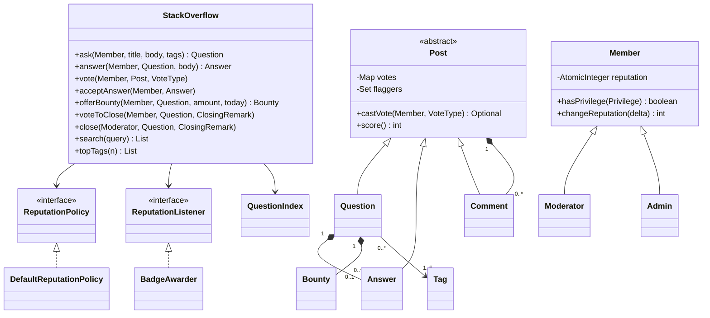
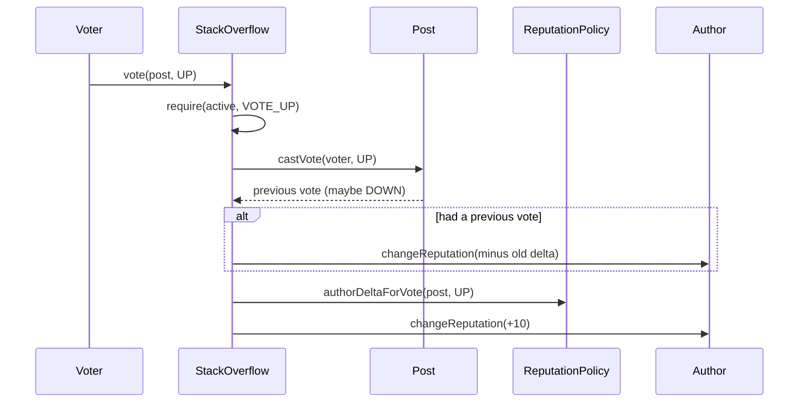
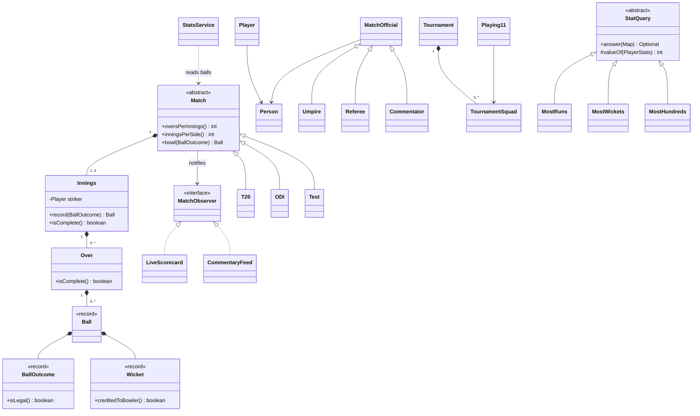
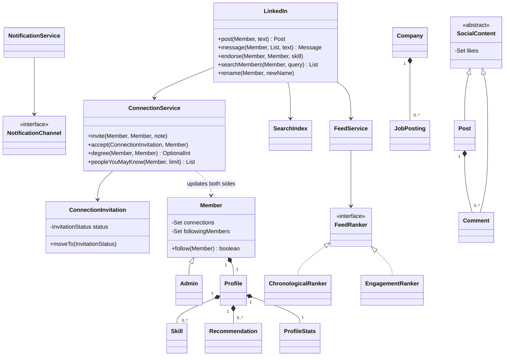
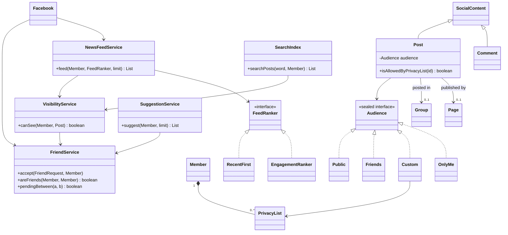
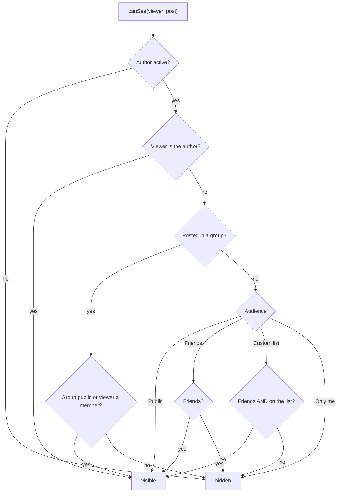

# Chapter 18 — Case Studies: Platforms & Feeds (Part 1) — Study Edition

> **Where this fits.** Chapters 14–17 designed *things*, *bookings* and *games*. This chapter and the next design **platforms**: websites where many people create content, react to each other and build up a history. The objects are people, posts, votes, relationships and feeds. This is the study edition: every topic of the full chapter, without the padding.

| # | Problem | What makes it interesting | Main patterns and ideas |
|---|---|---|---|
| 18.0 | What platform problems test | The toolkit reused in every social design | Facade, Observer, Strategy, services for two-sided operations, inverted index |
| 18.1 | Stack Overflow | Reputation unlocks privileges; one vote per member; moderation; bounties | Shared `Post` base, Strategy (reputation), Observer (badges), privilege table |
| 18.2 | Cricinfo (+ Udaan "Cricket Match Dashboard") | A real sport's rules; live scorecards; stats from balls | Template Method (stat queries), Observer (live feeds), "derive, don't store" |
| 18.3 | LinkedIn | Connections and degrees, invitations, messaging, jobs, search, feed | Service for two-sided operations, State (invitation), BFS, Strategy (feed ranking) |
| 18.4 | Facebook | Friends vs followers, privacy lists, pages, groups, feed, suggestions | One visibility policy for feed + search, sealed `Audience`, pull feed, suggestions |

**Running the code:** `cd chapters/18-case-platforms-1/code && javac --release 21 -d /tmp/lld_18 $(find . -name '*.java') && java -cp /tmp/lld_18 lld.ch18.stackoverflow.Main` (or `cricinfo`, `cricketdashboard`, `linkedin`, `facebook`). Java 21, standard library only. A file may hold several small package-private types (e.g. `Posts.java` holds `Post`, `Question`, `Answer`, `Comment`, `Tag`, `Bounty`) to keep a design readable in one place.

---

## 18.0 What platform problems test

### What it is

A **platform problem** asks you to design a site where *users produce the content* — Stack Overflow, Cricinfo, LinkedIn, Facebook. There is no single "machine" object; instead there is a **rich domain model**: many small classes (profile, post, vote, tag, badge, invitation, group…) each with a little data and a little behaviour. Analogy: a vending machine is a toaster; a platform is a town — people, buildings, entry rules, a notice board (feed), a post office (notifications) and a library catalogue (search).

### The problem it solves

Interviewers use platform problems to test six skills at once:

| Skill tested | What it means | Where you practise it |
|---|---|---|
| **Rich domain model** | Nouns → classes with clear jobs; knowing which noun is *just data* (a record) and which has *behaviour* | Cricinfo's `Over` knows a wide is not one of its six balls |
| **User roles** | Guest, member, moderator, admin, commentator may do different things | Stack Overflow privileges; Facebook admin blocks members |
| **Feeds** | A personalised, ranked list of recent content from people and pages you are linked to | LinkedIn and Facebook feed services with a ranking Strategy |
| **Notifications** | Telling a user something happened, through **channels** (in-app, email, push) | Observer + Strategy in every design |
| **Search** | Finding things by words, using an **inverted index** (word → items containing it) | Question, member and privacy-aware post search |
| **Reputation / trust** | Numbers summarising past behaviour that unlock abilities | Reputation and badges; endorsements; page ratings |

### How it works — the reusable toolkit

1. **A facade in front** (Chapter 9): one class offers `ask`, `vote`, `post`, `invite` and hides the rest; it checks "is this account active / allowed?" before anything changes.
2. **Shared content behaviour goes in a base class** (`Post`, `SocialContent`): voting and liking written once.
3. **Store *who*, not *how many*.** Likes and votes are a **set of member ids**: blocks double votes, allows "unlike", and the count is `set.size()`.
4. **Derive, don't store.** If a number can be computed from data you keep (follower count, batter's runs, page rating), compute it. A stored copy will one day disagree. If too slow, keep a **cache** you can always rebuild.
5. **An operation that changes two objects lives in a service** (a class whose job is to perform an operation). Accepting a connection changes *both* members, so neither member owns it.
6. **Notifications through Observer + Strategy.** The domain publishes events; observers react; the delivery channel is a Strategy, so a new channel is a new class, not a new `if`.
7. **Search is its own class** — a `SearchIndex`, not a method on the entity. Every key maps to a *collection*, even for one match, so the second "Sharma" never breaks it.
8. **Privacy and permissions are asked in one place.** Write `canSee(viewer, post)` once and call it from both feed and search.

### Trade-offs

| Choice | Benefit | Cost |
|---|---|---|
| Rich model (many small classes) | Each rule has one home; easy to test | More classes to explain in 45 minutes |
| Sets of voter ids instead of counters | No double votes, reversible | Memory grows; real systems use a votes table + cached count |
| Derive stats from raw events | Never inconsistent | Slow at scale; needs a cache |
| Services for two-sided operations | Symmetry guaranteed in one place | One more class; overdone, entities become "anemic" |

### When not to use it

For a tiny problem ("just a like button"), a set on the post is enough — no services, no observers.

### Common mistakes

- Search as a static `Question.search()`, so the entity must know every other question.
- `likeCount` as a constructor argument — a post can be created "with 1,000 likes".
- Forgetting that privacy also applies inside search and the feed.
- `acceptInvitation` on the sender (or receiver), updating only one side.

### Real-world examples

**Kafka** was built at LinkedIn to move activity events between systems (industrial Observer). **Facebook's TAO** serves the social graph at huge scale. **Stack Overflow** publishes its reputation-to-privilege table — exactly the `Privilege` enum in 18.1.

### In the interview

**30-second answer:** "Platform problems test whether I can model a domain with many small classes, put each rule in one place, and handle roles, feeds, notifications and search. I'll start with requirements and actors, then core entities, then the tricky flows — voting, accepting requests, privacy — and I'll say which operations need a service because they touch two objects."

- *Why a set instead of a counter?* — A number does not record *who* liked, so it can neither block a repeat nor undo one; the set gives the count for free.
- *Where does notification code go?* — The domain raises an event; a notification service with pluggable channels delivers it.

### Self-check

- **Q:** What is an inverted index? **A:** A map from each word to the items containing it.
- **Q:** Why is "accept a friend request" not a method on `Member`? **A:** It changes two members; a service updates both together so the halves cannot drift.
- **Q:** Two notification channels and the pattern that makes adding a third easy? **A:** Email and push; Strategy (`NotificationChannel`).

### TL;DR

Platform problems = rich domain model + roles + feed + notifications + search + reputation. Share behaviour in a content base class, store *who* not *how many*, derive numbers, put two-sided operations in services, notify via Observer + Strategy, keep search and privacy each in one place.

---
## 18.1 Design Stack Overflow

Stack Overflow is a Q&A community for programmers. Members **upvote/downvote** questions and answers, edit posts wiki-style, and earn **reputation** (points) and **badges** (named awards). Higher reputation unlocks **privileges**. An upvote on an answer is worth +10; the course says +5 for a question upvote, but since November 2019 it is +10 as well, and the code uses today's value.

### Problem & clarifying questions

| Question to ask | Answer we assume |
|---|---|
| Who uses it? | Guests, members, moderators, admins, and the system (notifications, badges) |
| What can a guest do? | Search and read only |
| What can be voted on? | Questions, answers, comments (comments: upvote only) |
| Reputation per vote? | Upvote +10 (question or answer); downvote −2 to the author, −1 to whoever downvotes an *answer* (downvoting a question is free); accepted answer +15 (+2 to the asker) |
| Privileges? | Vote up 15, comment everywhere 50, set bounty 75, vote down 125, create tag 1,500, edit 2,000, close votes 3,000, delete votes 10,000 |
| Closing? | 3 close votes from privileged members, or one moderator. Moderators also reopen, delete, undelete |
| Bounty? | 50–500 points staked to attract answers, runs 7 days (+24 h grace on the real site), goes to the answer the sponsor picks. Deducted at once, **never refunded**; if unawarded, the site may auto-award half to a qualifying new answer |
| Search? | By keyword and tag, plus "most used tags" |
| Scale? | Read-heavy; votes must never double-count |

### Requirements

**Functional** (the course's thirteen): (1) guests search and view, must join to post or vote; (2) members ask; (3) answer **open** questions; (4) comment on questions and answers; (5) upvote questions, answers and comments; (6) **flag** posts for moderators; (7) add a **bounty** to their own question; (8) earn **badges**; (9) vote to **close**, and a moderator can close or reopen alone; (10) add **tags**; (11) vote to **delete** off-topic or low-quality questions; (12) moderators close and undelete; (13) report the **most used tags**. Added from the real site: downvotes, accepting an answer, reputation privileges, blocking accounts.

**Non-functional:** one vote per member per post, reversible reputation; search and top tags must not scan every question; concurrent votes each counted once; no voting on your own post and blocked accounts can do nothing; reputation, badge and channel rules change without touching voting code.

### Use cases

Actors: **Guest** (search, view), **Member** (ask, answer, comment, vote, flag, bounty, tag, delete/undelete own posts), **Moderator** (close, reopen, delete, undelete *any* question), **Admin** (block/unblock), **System** (notifications, badges). In the course's use-case diagram, "Add question" `<<include>>`s "Add tag" and a bounty is an `<<extend>>`. The activity diagram for asking checks, per tag, "does it exist?" and if not "does the member have enough reputation to create it?". Our `ask()` follows the same order.


*Figure — Use cases per actor: Guest, Member, Moderator, Admin, System (course diagram)*

### Core entities

| Class | Responsibility |
|---|---|
| `Member` (+ `Moderator`, `Admin`) | Identity, atomic reputation, badges, status; `hasPrivilege(p)` |
| `Privilege` (enum) | Reputation needed per action — a data table, not scattered `if`s |
| `Post` (sealed, abstract) | Author, body, votes per voter, flags, comments |
| `Question` | Title, tags, answers, status, closing remark, close/delete voters, bounty, views |
| `Answer` / `Comment` | Answer belongs to one question and can be *accepted*; comment belongs to a question or answer (vote/flag counts derived from sets) |
| `Tag` | Name + description; counts its own uses |
| `Bounty` | Staked reputation, sponsor, expiry, winner |
| `Badge` (record) | Name + description |
| `ReputationPolicy` / `DefaultReputationPolicy` | Strategy: points per event |
| `ReputationListener` / `BadgeAwarder` | Observer: awards badges on reputation change |
| `Notifier` + `NotificationChannel` / `EmailChannel` | Pluggable delivery |
| `Search` / `QuestionIndex` | Inverted index by word and tag |
| `StackOverflow` | Facade: status + privilege checks, delegation, reputation |

### Class diagram

The course builds the diagram in five stages:

1. **`Badge`, `Tag`, `Notification`** (reqs 8, 10, 13). `Tag` counts its own uses, so "top tags" is a quick read. `EmailNotification` extends abstract `Notification` (passes the substitution test).
2. **`Photo`, `Bounty`** (req 7). The bounty owns the staked amount. The course says it can go back to the sponsor; on the real site it is **not** refundable, so our code deducts it at once and never returns it.
3. **The posts** — the heart. Voting and flagging work the *same* on three classes, so that lives in abstract `Post`; what they *contain* differs, so there are three subclasses, not one class with a "kind" field. `Post` remembers **who** voted. Filled diamonds (composition): deleting a question deletes its answers, comments, photos, bounty. `Tag` is a plain association — it outlives any question.
4. **Search** — `Search` interface + `QuestionIndex`, not a static method on `Question`.
5. **Accounts** — `Guest` ← `Member` ← `Moderator`/`Admin`. Requirement 1 is enforced by *shape*: a guest has no `createQuestion` method. `Member` owns its badges.


*Figure — The finished Stack Overflow class diagram (course diagram)*

**Our Java design** keeps this structure and adds a reputation **Strategy**, a badge **Observer** and a data-driven **privilege table**. A guest is simply "no `Member` object": every write needs a `Member` argument. We also add the downvote cost the course leaves out; edit history and duplicate links are extensions; chat is out of scope.



### Key flows

**Voting (with a changed vote).** The facade checks privilege, asks the post to record the vote; the post returns the voter's *previous* vote so the facade can reverse its reputation effect before applying the new one; listeners (badges) are told.



**Question lifecycle:** OPEN → CLOSED (3rd close vote or moderator) → OPEN (moderator reopen); CLOSED → DELETED (3rd delete vote or moderator); OPEN → DELETED (moderator); DELETED → CLOSED (undelete). No new answers while closed.

**Bounty:** `offerBounty` checks `SET_BOUNTY` and the 50–500 range, attaches it to the open question and deducts the amount immediately; `awardBounty` (sponsor only, not their own answer, before expiry) credits the winner.

### Design decisions & patterns used

| Decision | Pattern / principle | Why | Alternative rejected |
|---|---|---|---|
| `Post` base for question/answer/comment | Inheritance, `sealed` | Voting, flagging, commenting identical | One class + `type` field → `if (type == …)` everywhere |
| Votes as `Map<voterId, VoteType>` | Store who, not how many | Blocks double votes; allows reversal | `int voteCount` |
| `ReputationPolicy` | **Strategy** | Scoring rules change (they did in 2019) | Hard-coded numbers in `vote()` |
| `ReputationListener` + `BadgeAwarder` | **Observer** | Badges, notifications react without the facade knowing | Calling `awardBadges()` inside `vote()` |
| `Privilege` enum with thresholds | Table-driven | One place for rules | `if (rep >= 125)` scattered |
| Moderator-only methods take `Moderator` | Type-level permission | Cannot call `close(…)` without a moderator | Forgettable runtime role check |
| `QuestionIndex` separate | SRP | Swap for Elasticsearch behind `Search` | Static `Question.search()` |
| `Tag` counts its uses | Aggregate at write time | Top tags = sort a small collection | Scan all questions |
| `StackOverflow` facade | **Facade** | One entry that validates, delegates, logs | UI calling entities directly |
| Pattern-matching `switch` over sealed `Post` | Exhaustive dispatch | Compiler forces every post kind | `instanceof` chains |

### Java implementation

Package `lld.ch18.stackoverflow` (`Types.java`, `Accounts.java`, `Posts.java`, `Reputation.java`, `QuestionIndex.java`, `StackOverflow.java`, `Main.java`). The core: vote storage, the policy, the badge observer and the facade's `vote`.

```java
// File: lld/ch18/stackoverflow/Posts.java (excerpt)
abstract sealed class Post permits Question, Answer, Comment {
    // ...
    private final Map<Long, VoteType> votes = new HashMap<>();
    private final Set<Long> flaggers = new HashSet<>();
    // ...
    /** Records or changes a vote and returns the voter's previous vote, if any. */
    synchronized Optional<VoteType> castVote(Member voter, VoteType type) {
        if (voter.id() == author.id()) throw new IllegalStateException("you cannot vote on your own post");
        VoteType previous = votes.put(voter.id(), type);
        if (previous == type) throw new IllegalStateException(voter.name() + " already voted " + type + " on this post");
        return Optional.ofNullable(previous);
    }

    synchronized int score() {
        return votes.values().stream().mapToInt(v -> v == VoteType.UP ? 1 : -1).sum();
    }
    // ...
}

// File: lld/ch18/stackoverflow/Reputation.java (excerpt)
final class DefaultReputationPolicy implements ReputationPolicy {
    @Override public int authorDeltaForVote(Post post, VoteType type) {
        return switch (post) {
            case Question q -> type == VoteType.UP ? 10 : -2;   // +5 before November 2019
            case Answer a -> type == VoteType.UP ? 10 : -2;
            case Comment c -> 0;                       // comment votes earn no reputation
        };
    }
    @Override public int voterDeltaForVote(Post post, VoteType type) {
        return post instanceof Answer && type == VoteType.DOWN ? -1 : 0;
    }
    @Override public int acceptedAnswerBonus() { return 15; }
    @Override public int acceptorBonus() { return 2; }
}

final class BadgeAwarder implements ReputationListener {
    // ... levels: 15 Contributor, 50 Helpful, 125 Trusted
    @Override public void onReputationChanged(Member m, int oldValue, int newValue, String reason) {
        for (Level level : levels) {
            if (oldValue < level.reputation() && newValue >= level.reputation() && m.addBadge(level.badge())) {
                notifier.send(m, "You earned the '" + level.badge().name() + "' badge");
            }
        }
    }
}

// File: lld/ch18/stackoverflow/StackOverflow.java (excerpt)
    void vote(Member voter, Post post, VoteType type) {
        require(voter, type == VoteType.UP ? Privilege.VOTE_UP : Privilege.VOTE_DOWN);
        if (post instanceof Comment && type == VoteType.DOWN) throw new IllegalStateException("comments can only be upvoted");
        Optional<VoteType> previous = post.castVote(voter, type);
        log(voter.name() + " voted " + type + " on " + post.label() + " -> score " + post.score());
        previous.ifPresent(p -> {                                  // undo the old vote's effect first
            adjust(post.author(), -policy.authorDeltaForVote(post, p), "vote changed on " + post.label());
            adjust(voter, -policy.voterDeltaForVote(post, p), "vote changed");
        });
        adjust(post.author(), policy.authorDeltaForVote(post, type), type + " on " + post.label());
        adjust(voter, policy.voterDeltaForVote(post, type), "downvoted an answer");
    }
```

Full runnable code: code/lld/ch18/stackoverflow/ (see the Full Edition).

**Output (excerpt)** — a changed vote reverses the old effect first:

```text
  REJECTED: alice needs 1500 reputation for CREATE_TAG (has 200)
erin voted DOWN on answer #103 by carol -> score -1
    rep carol  -2 -> 3198 (DOWN on answer #103 by carol)
    rep erin   -1 -> 3099 (downvoted an answer)
erin voted UP on answer #103 by carol -> score 1
    rep carol  +2 -> 3200 (vote changed on answer #103 by carol)
    rep erin   +1 -> 3100 (vote changed)
    rep carol  +10 -> 3210 (UP on answer #103 by carol)
erin voted to close question #107 as DUPLICATE -> CLOSED
  REJECTED: question is CLOSED, no new answers
```

Key points: `votes.put` both records the vote and returns the previous one (voting the same way twice throws). The sealed `Post` makes the policy's `switch` exhaustive. `Member.changeReputation` uses `AtomicInteger.updateAndGet` with a floor of 1. `BadgeAwarder` fires only when a threshold is *crossed*, and `Set.add` stops duplicate badges. Alice (200 rep) cannot create the new tag `hashmap`. The third close vote closes the question; a moderator reopens it.

### Concurrency & edge cases

- **Simultaneous votes:** `castVote`, `score`, `flag` are `synchronized` per post; reputation is `AtomicInteger`, so both changes apply.
- **Vote and reputation not in one lock:** a reader may briefly see the vote before the reputation — acceptable. In a database: one transaction plus a **unique constraint** on `(post_id, voter_id)`.
- **Reputation floor of 1** makes reversal not perfectly symmetric (same quirk as the real site); keep a ledger of events if exactness matters.
- **Accepting a different answer:** `Question.accept` returns the previous one so its +15 is removed; the asker's +2 is given once.
- **Self-actions** (vote own post, award own bounty) rejected; **closed** questions take no answers, **deleted** ones are hidden from search; **blocked** members fail `requireActive`; **bounty** award refused after expiry.

### Extensions & follow-up questions

- **Stop double voting** — the per-post voter map; in a DB, a unique key on `(post_id, voter_id)`.
- **Edit history** — immutable `Revision`s appended per edit (close to **Memento**).
- **Daily reputation cap (200/day)** — a `CappedReputationPolicy` **decorator**; no voting code changes.
- **Duplicate link** — `duplicateOf` on `Question` set when closed as `DUPLICATE`.
- **Review queues** — flagged posts go to a `ReviewQueue` where reviewers vote keep/delete.
- **Hot questions** — ranking Strategy over recent votes/answers/views with time decay.
- **Tag frequency per day/week** — counters per time bucket rolled over by a scheduled job.

### Real-world example

The numbers are real stackoverflow.com rules (privileges page: 15, 50, 75, 125, 1,500, 2,000, 3,000, 10,000). The 2019 change of question upvotes from +5 to +10 touches only the `ReputationPolicy`; lowering close votes from 5 to 3 after a 2019 experiment is one constant in our code.

### In the interview

| Minutes | What to do |
|---|---|
| 0–5 | Actors and reputation rules; requirements |
| 5–10 | Use cases; "guest has no posting method" |
| 10–20 | Class diagram: `Post` + 3 subclasses, `Member` hierarchy, `Tag`, `Bounty`, index, facade |
| 20–30 | `vote()` and `acceptAnswer()` with reversal; question states |
| 30–40 | Code `Post.castVote`, the policy, facade `vote` |
| 40–45 | Concurrency and extensions |

**30-second answer:** "Questions, answers and comments share voting and flagging, so they extend one `Post` that stores votes per voter — that stops double voting and lets me reverse a changed vote. Reputation rules are a Strategy; badges are an Observer on reputation changes. Privileges come from a reputation table; moderator actions take a `Moderator` parameter. Search is a separate inverted index, and tags count their own uses for 'top tags'."

- *Why not store `voteCount` only?* — It cannot prevent duplicates or support changes; derive it from the voter map.
- *Is reputation awarded inside `upvote`?* — No; the facade asks the policy, so posts know nothing about scoring (the course's suggested improvement).
- *Scale search?* — Keep `Search`, replace `QuestionIndex` with a search engine fed by events.

### Self-check

- **Q:** Which requirement is enforced by class shape? **A:** Guests cannot post or vote — no `Member` object, and every write needs one.
- **Q:** Why is `Post` abstract and sealed? **A:** A bare post is never created; sealed makes switches over post kinds complete.
- **Q:** Erin changes a downvote on an answer to an upvote — reputation? **A:** Old effect reversed (author +2, Erin +1), new applied (author +10).
- **Q:** How do comments differ in voting? **A:** Upvote only, and they earn no reputation.

### TL;DR

Stack Overflow = `Post` base (votes per voter, flags, comments) + `Question`/`Answer`/`Comment` + reputation **Strategy** + badge **Observer** + reputation **privilege table** + moderator-typed methods + inverted-index search + a facade that checks, delegates and scores.

---
## 18.2 Design Cricinfo

**Cricinfo** (ESPNcricinfo) is a cricket site with **live ball-by-ball commentary**, a database of historic matches, and news. This design is graded on whether you model the *rules*, not just the nouns. Cricket primer:

| Term | Meaning |
|---|---|
| **Delivery / ball** | One ball bowled by the **bowler** to the **batter** on strike |
| **Over** | Six **legal** deliveries by one bowler. A **wide** or **no ball** gives a penalty run and is re-bowled — it does not count toward the six |
| **Striker / non-striker** | The striker faces; they change ends on an odd number of runs (1, 3, 5) and after every over |
| **Runs** | Off the bat (batter's) or **extras** — wides, no balls, **byes**, **leg byes** (the team's, not the batter's) |
| **Wicket** | Bowled, caught, LBW, stumped, hit wicket, run out, obstructing the field. **A run out is not the bowler's** |
| **Innings** | One team's turn to bat; ends all out (10 wickets), overs used up, or target reached |
| **Formats** | **T20** (20 overs/side), **ODI** (50 overs/side), **Test** (no limit, two innings per side) |
| **Squad / playing eleven** | A team names a squad per tournament, then picks exactly **eleven** from it per match |

### Problem & clarifying questions

| Question | Answer we assume |
|---|---|
| Formats? | T20, ODI, Test |
| Who enters data? | **Admin** (scorer) records each ball; **Commentator** adds text |
| Real rules? | Yes: six legal balls, extras, wicket credit, strike rotation, bowler limits |
| Live updates? | Push to subscribers after every ball |
| Stats? | Per player, match, tournament, plus global ("highest wicket taker ever") |
| Tournaments? | Yes, with squads and points table |
| Out of scope? | Duckworth–Lewis–Stern, follow-on and declarations in Tests, powerplays, free hits, leg/off-side wides, partnerships, net run rate, news (our code adds a simple `declare()`) |

### Requirements

**Functional** (the course's eight): (1) track every team and its matches; (2) live ball-by-ball commentary; (3) follow international rules; (4) a squad per tournament; (5) a playing eleven per match from the squad; (6) stats for players, matches, tournaments; (7) global stat questions ("most wickets ever", "most Test hundreds"); (8) ODI, Test and T20.

**Non-functional:** stats exactly match the ball record (a correction fixes every derived number); live updates within seconds to millions; two scorers must not interleave balls; a new stat, format or subscriber is a new class.

### Use cases

**Admin** adds/modifies teams, players, tournaments, matches, stadiums, umpires, referees and records balls (some stats system-generated); **Commentator** adds commentary. In the use-case diagram "Add match" is *extended* by the three formats and "Add ball" *includes* its runs and wicket. Activity "record a ball": choose ball type (normal, wide, no ball, wicket) → wicket details if any → a run record per run type → commentary → save.

### Core entities

| Class | Responsibility |
|---|---|
| `Person` (record) | Name, country; roles *hold* a person |
| `Player`; `MatchOfficial` → `Umpire`, `Referee`, `Commentator` | Roles; officials share "assign to match" |
| `Team` ⊇ `TournamentSquad` ⊇ `Playing11` | Everyone ever picked ⊇ one tournament ⊇ exactly eleven, in batting order |
| `Tournament` | Owns squads, lists matches, points table |
| `BallOutcome` (record) | Bat runs, extra type/runs, boundary?, wicket type, who was out, commentary; validates the laws |
| `Ball`, `Wicket` (records) + `WicketType` | Recorded delivery; `creditedToBowler()` |
| `Over` | Six **legal** deliveries; runs conceded; maiden? |
| `Innings` | Owns overs; decides striker, over end, new batter, bowler limits, innings end |
| `Match` (abstract) → `T20`, `ODI`, `Test` | Formats override only overs per innings and innings per side |
| `Result` (sealed) → `Win`, `Tie`, `Draw` | Outcome |
| `MatchObserver` → `CommentaryFeed`, `LiveScorecard` | Live subscribers |
| `PlayerStats`, `StatsService`, `StatQuery` → `MostRuns`, `MostHundreds`, `MostWickets`, `MostSixes` | Derived stats; Template Method queries |

### Class diagram

The course builds it in six stages:

1. **People** — `Player` *holds* a `Person` (composition over inheritance: one human can play, then commentate). Officials share assignment in `MatchOfficial`.
2. **Teams, squads, eleven** — three nested sets. `Playing11` keeps its squad so it rejects outsiders and a twelfth pick: requirement 5 lives in code.
3. **The delivery** — three hidden rules: an over is six *legal* balls (two wides → eight deliveries); a **run out is not the bowler's wicket**; byes and leg byes are the team's. `Ball` owns runs, wicket, commentary; it only *refers* to bowler and batter.
4. **The innings** — owns the overs, so it alone decides when an over ends. `score` uses runs/wickets and overs.balls notation.
5. **Match and formats** — only two numbers differ (overs per innings, innings per match), so `Match` is abstract and each format overrides two short methods. Test returns 0 overs ("no limit") and four innings total.
6. **Stats** — **worked out from the balls**, never stored beside them (a stored counter drifts after a correction). Fifties/hundreds counted per innings (`countInnings`) beside `countBall`. Each global question is a small `StatQuery` subclass.


*Figure — The finished Cricinfo class diagram (course diagram)*

**Our Java design** adds what the course flags as missing: **strike rotation**, bowler rules (not two overs in a row; 4 overs per bowler in T20, 10 in ODI), which dismissals are legal off a wide/no ball, result calculation, and **Observers**. A `BallOutcome` record replaces separate `Run` objects.



### Key flows

**Recording a ball:** scorer → `Match.bowl(outcome)` → `Innings.record`: build the `Ball` with current bowler and striker, add to the over, add runs; wicket → new batter; odd runs run → swap ends; over complete → swap ends. The match then notifies `onBall`, and `onOverEnd`/`onInningsEnd` if finished; after the last innings or target reached, `finish()` computes the `Result` and calls `onMatchEnd`.

**Innings end** (`Innings.isComplete`): all out (wickets = players − 1) → final innings and runs ≥ target → over limit reached and last over complete → declared.

**Match status:** SCHEDULED → LIVE → FINISHED; LIVE → DRAWN (Test out of time); SCHEDULED → CANCELED (washed out).

### Design decisions & patterns used

| Decision | Pattern / principle | Why | Alternative rejected |
|---|---|---|---|
| Roles hold a `Person` | Composition over inheritance | One human, many roles | `Player extends Person` |
| `Match` abstract; formats override two numbers | Template-style base (not a named pattern here) | Only what differs is overridden | Three copies of `Match` |
| `StatQuery.answer()` final, `valueOf()` abstract | **Template Method** | New statistic = one tiny subclass (OCP) | `switch (questionType)` |
| Stats derived from balls | Single source of truth | Corrections fix every number | Stored counters that drift |
| `Innings` owns over rule and strike | Information Expert | Class with the data decides | UI deciding when an over ends |
| `BallOutcome` validates in constructor | Fail fast, immutable | Bowled off a no ball never enters the record | Checking later in stats |
| `MatchObserver` (default methods) | **Observer** | Feeds subscribe without the match knowing | Match printing itself |
| `Result` sealed records | Algebraic data type | Exhaustive `switch` | Strings like "Team A won" |
| `Match.bowl` `synchronized` | Monitor lock per match | Scorers cannot interleave | Unsynchronised updates |

### Java implementation

Package `lld.ch18.cricinfo` (`People`, `Teams`, `Delivery`, `Innings`, `Match`, `Observers`, `Stats`, `Main`). The demo shows both eleven refusals, a scripted first over (a wide and a no ball make **eight deliveries**; a bowled that counts for the bowler; a run out that does not), then a seeded simulation of a T20 and an ODI.

```java
// File: lld/ch18/cricinfo/Delivery.java (excerpt)
enum WicketType {
    BOWLED, CAUGHT, LBW, STUMPED, HIT_WICKET, RUN_OUT, OBSTRUCTING_THE_FIELD;

    /** A run out (or obstructing the field) is a wicket for the fielding side, NOT for the bowler. */
    boolean creditedToBowler() { return this != RUN_OUT && this != OBSTRUCTING_THE_FIELD; }
}
// ... record BallOutcome: isLegal() { return extra != Extra.WIDE && extra != Extra.NO_BALL; }
    /** Byes and leg byes are not the bowler's fault; wides and no balls are. */
    int runsChargedToBowler() { return batRuns + (isLegal() ? 0 : extraRuns); }
// ...
/** An over is SIX LEGAL deliveries, not six balls. */
final class Over {
    // ...
    int legalBalls() { return (int) balls.stream().filter(b -> b.outcome().isLegal()).count(); }
    boolean isComplete() { return legalBalls() == LEGAL_BALLS; }
    // ...
}

// File: lld/ch18/cricinfo/Innings.java (excerpt)
    Ball record(BallOutcome o) {
        Over over = currentOver();
        if (over == null || over.isComplete()) throw new IllegalStateException("start a new over first");
        if (isComplete()) throw new IllegalStateException("innings is complete");

        int deliveryNo = over.legalBalls() + 1;          // a wide or no ball is re-bowled, so it shares the next number
        Wicket wicket = null;
        if (o.wicket() != null) wicket = new Wicket(o.wicket(), o.nonStrikerOut() ? nonStriker : striker, over.bowler());
        Ball ball = new Ball(over.number(), deliveryNo, over.bowler(), striker, o, wicket);
        over.add(ball);
        balls.add(ball);
        runs += o.totalRuns();

        if (o.runsRun() % 2 == 1) swapEnds();              // odd runs: batters crossed
        if (wicket != null) {
            wickets++;
            if (!allOut()) {
                Player newBatter = batting.battingOrder().get(nextBatter++);
                if (wicket.batter().equals(striker)) striker = newBatter; else nonStriker = newBatter;
            }
        }
        if (over.isComplete()) swapEnds();                  // ends change after every over
        return ball;
    }

// File: lld/ch18/cricinfo/Stats.java (excerpt)
abstract class StatQuery {
    record Leader(Player player, int value) {}

    abstract String question();
    abstract int valueOf(PlayerStats s);

    final Optional<Leader> answer(Map<Player, PlayerStats> stats) {
        Leader best = null;
        for (PlayerStats s : stats.values()) {
            int v = valueOf(s);
            if (v > 0 && (best == null || v > best.value()
                    || (v == best.value() && s.player.name().compareTo(best.player().name()) < 0))) {
                best = new Leader(s.player, v);
            }
        }
        return Optional.ofNullable(best);
    }
}

final class MostWickets extends StatQuery {
    @Override String question() { return "Highest wicket taker"; }
    @Override int valueOf(PlayerStats s) { return s.wickets; }
}
```

Full runnable code: code/lld/ch18/cricinfo/ (see the Full Edition).

**Output (excerpt)** — the first over has eight lines but ends at `0.6`:

```text
  0.1  Tarun to Arun, FOUR  [Ravi: driven through cover]
  0.2  Tarun to Arun, wide  [Ravi: sprayed down leg]
  0.2  Tarun to Arun, 1 run(s)  [Ravi: pushed to mid-on]
  0.3  Tarun to Bala, no ball  [Ravi: overstepped, free hit next]
  0.3  Tarun to Bala, OUT BOWLED (Bala)  [Ravi: through the gate!]
  0.4  Tarun to Chetan, OUT RUN_OUT (Chetan) - not the bowler's wicket  [Ravi: a second run was never there]
  0.5  Tarun to Arun, no run  [Ravi: defended]
  0.6  Tarun to Arun, SIX  [Ravi: launched over long-on]
  REJECTED: Tarun cannot bowl two overs in a row
```

Key points: ball numbers are "completed overs . ball"; an extra carries the number of the ball it replaces. Chetan is run out after one completed run: `record` swaps ends for the single first, then replaces the dismissed batter, so Dev arrives at the right end; Tarun's figures show only **1** wicket. Five bowlers rotate, so each bowls exactly 4 overs (`maxOversPerBowler() = 20 / 5`). The chase target is set automatically (`first-innings total + 1`). The T20 ends "Lions won by 23 runs"; the ODI "Lions won by 5 wickets". Global queries are one-line subclasses; "Most runs in ODIs" reuses the service with a format filter.

### Machine-coding variant: Cricket Match Dashboard (Udaan)

A **machine-coding round** asks for a *working, runnable* program in 60–90 minutes, judged on correctness, readability and extensibility. This problem was set by Udaan (Indian B2B e-commerce) and appears in the kumaransg/LLD collection.

#### Problem statement (in our words)

- **Input:** players per team, number of overs, each team's batting order, then each over's balls: runs `0`–`6`, `W`, `Wd` or `Nb`.
- **After every over:** each batter's runs, 4s, 6s, balls (with `*` on the two at the crease), then total/wickets and overs.
- **Rules:** strike changes on 1s and 3s and at over end; wides and no balls add one run and are re-bowled; innings ends all out, overs done, or target passed.
- **At the end:** winner and margin (runs or wickets). **Good to have:** bowler figures, extras, strike rates.

#### How the full Cricinfo design shrinks to a 90-minute solution

| Cricinfo class | Machine-coding version | Why it is enough |
|---|---|---|
| `BallOutcome` | `BallEvent` sealed interface (`Runs`, `Wide`, `NoBall`, `Wicket`) with `parse(token)` factory | Only four token kinds |
| `Innings` | `TeamInnings` — same responsibilities, ints instead of objects | Same rules, no bowler data |
| Scorecard from balls | `Batter` counters + `ScorecardPrinter` | Printer separate so another view can replace it |
| `Match` + `Result` | `MatchRunner` | One format, two innings |

The lesson: keep the *same responsibilities in the same places* (innings owns strike and the over rule; parsing, scoring and printing separate), but use the simplest data that satisfies the input.

#### Code

Package `lld.ch18.cricketdashboard` (`Model.java`, `Main.java`; `Main` feeds the sample input as a text block).

```java
// File: lld/ch18/cricketdashboard/Model.java (excerpt)
sealed interface BallEvent {
    record Runs(int runs) implements BallEvent {}
    record Wide() implements BallEvent {}
    record NoBall(int batRuns) implements BallEvent {}
    record Wicket() implements BallEvent {}
    // ... static BallEvent parse(String token): "W", "Wd", "Nb..", or 0-6
    default boolean isLegal() { return !(this instanceof Wide || this instanceof NoBall); }
}
// ...
    void play(BallEvent e) {
        if (isOver()) throw new IllegalStateException("innings already finished");
        Batter s = order.get(striker);
        switch (e) {
            case BallEvent.Wide w -> { total += 1; extras += 1; }
            case BallEvent.NoBall nb -> {
                total += 1 + nb.batRuns(); extras += 1;
                s.faced(nb.batRuns());               // a no ball counts as a ball faced by the batter
                if (nb.batRuns() % 2 == 1) swap();
            }
            case BallEvent.Wicket w -> {
                legalBalls++;
                s.balls++;
                s.out = true;
                wickets++;
                if (!allOut()) striker = next++;     // new batter takes strike
            }
            case BallEvent.Runs r -> {
                legalBalls++;
                total += r.runs();
                s.faced(r.runs());
                if (r.runs() % 2 == 1) swap();       // 1s and 3s change strike
            }
        }
        if (e.isLegal() && legalBalls % 6 == 0 && !isOver()) swap();  // end of over
    }

    boolean isOver() {
        return allOut() || legalBalls == maxOvers * 6 || (target != null && total >= target);
    }
```

Full runnable code: code/lld/ch18/cricketdashboard/ (see the Full Edition).

```text
Scorecard for Team 2:
Player   Score  4s  6s Balls     SR
P6          10   1   1     3  333.3
P7*          1   0   0     1  100.0
P8           0   0   0     1    0.0
P9*          1   0   0     1  100.0
P10          0   0   0     0      -
Total: 12/2   Extras: 0
Overs: 1
...
Result: Team 1 won the match by 4 runs
```

#### Notes on the sample and on correctness

- Our output matches the published sample except where the sample is inconsistent: after team 2's first over it prints `12/1`, but the over has **two** `W`s, so `12/2` is correct; and it later shows P6 with 2 balls after 3. Pointing this out calmly is a plus.
- Team 2's second over stops after four balls: 5 players → all out at 4 wickets ("Overs: 1.4").
- The over loop counts **legal** balls, so a wide makes an over seven tokens long.
- Extras and strike rate are printed; bowler figures would need bowler names in the input (add a `Bowler` class).

### Concurrency & edge cases

- **Two scorers:** `bowl`, `startOver`, `startInnings` are `synchronized` per match; different matches never block each other.
- **Many readers:** observers in a `CopyOnWriteArrayList`. At web scale, publish each ball to a broker and push via WebSockets/SSE; the scorecard is a cached view rebuilt from balls.
- **Rejected sequences:** over while one is in progress, same bowler twice in a row, bowler over quota, bowling after the innings, bowler from batting side, twelfth player, non-squad player.
- **Impossible dismissals:** bowled/caught/LBW/stumped/hit wicket off a no ball; bowled/caught/LBW off a wide.
- **Wicket on the last ball:** new batter comes in, then ends change. **Tie** → `Result.Tie`. **Tests:** 0 = no over limit; `declare()` and `declareDraw()`.

### Extensions & follow-up questions

- **Who is on strike?** — `Innings` tracks it (odd runs and over end swap).
- **Stats too slow** — a per-player running total updated by an Observer, rebuilt from balls after corrections; balls stay the truth.
- **Duckworth–Lewis–Stern** — a `TargetCalculator` Strategy (default: opponent total + 1).
- **Free hit** — innings remembers "next legal ball is a free hit"; only run-out-type dismissals allowed.
- **Partnerships / fall of wickets, net run rate** — derive from balls and innings totals.
- **Push notifications** — a new `MatchObserver` firing on wickets and 50/100 milestones.

### Real-world example

ESPNcricinfo (founded 1993, bought by ESPN in 2007) is the reference for cricket stats; its **Statsguru** answers requirement-7 questions across all internationals. Live pages update ball by ball with commentary like our `CommentaryFeed`, for millions of phones — hence push-based Observers, brokers and caches.

### In the interview

| Minutes | What to do |
|---|---|
| 0–5 | Formats, actors; say early **"an over ends after six *legal* balls"** |
| 5–10 | Team ⊇ squad ⊇ eleven; people hold a `Person` |
| 10–20 | Match (abstract) → innings → over → ball; formats differ in two numbers |
| 20–30 | Ball flow, strike rotation, **no bowler credit for a run out**, byes not the batter's |
| 30–40 | Derived stats; Template Method queries; Observers |
| 40–45 | One scorer lock per match, broadcast to readers; extensions |

**30-second answer:** "I model cricket's rules, not just its nouns. An over is six legal balls; a wide or no ball is re-bowled. The innings owns the overs, so only it decides when an over ends, who is on strike and when the innings is over. Formats differ only in overs per innings and innings per match. Stats are derived from balls so corrections propagate, each stat question is a Template Method subclass, and live pages subscribe as observers."

- *Why not store `wickets` on `Player`?* — It drifts from the ball record and cannot be filtered by format; derive it.
- *Add "most catches"?* — Fielder on `Wicket`, count it in `PlayerStats`, `MostCatches extends StatQuery`.
- *Is `Match`/formats a Template Method?* — No; only `StatQuery` is a named pattern here — formats are plain abstract-class specialisation.

### Self-check

- **Q:** A wide and a no ball in an over — how many deliveries? **A:** Eight.
- **Q:** Who gets a run-out wicket? **A:** The fielding side; not in the bowler's figures.
- **Q:** Are leg byes the batter's runs? **A:** No — team extras, not charged to the bowler either.
- **Q:** What distinguishes `T20`, `ODI`, `Test`? **A:** `oversPerInnings()` (20, 50, 0) and `inningsPerSide()` (1, 1, 2).
- **Q:** Correct team 2 score after over 1 in the Udaan sample? **A:** 12/2.

### TL;DR

Cricinfo = people hold a `Person`; team ⊇ squad ⊇ eleven; `Match` (abstract, formats override two numbers) → `Innings` (owns overs, strike, end rules) → `Over` (six **legal** balls) → `Ball`. Run outs are not the bowler's; byes are not the batter's. Stats derived from balls; stat questions are **Template Method** subclasses; live pages are **Observers**. The Udaan dashboard is the same responsibilities in a 90-minute, input-driven form.

---
## 18.3 Design LinkedIn

LinkedIn is a networking site for **working lives**: profiles with skills, jobs and schooling, and a home **feed** of updates from your network. It is like Facebook with career features: **connections** (mutual), **follows** (one-sided), **endorsements**, **recommendations**, **company pages** and **job postings**.

### Problem & clarifying questions

| Question | Answer we assume |
|---|---|
| Is a connection mutual? | Yes: an **invitation** is accepted or rejected. Following is one-sided |
| Degrees? | 1st, 2nd, 3rd; beyond that "out of network" |
| Messaging? | Only connections (non-connections need paid *InMail*, out of scope) |
| Endorsements? | Only 1st-degree connections, once per skill |
| Recommendations? | *Requested* from a connection; only that person writes it |
| Profile stats? | Views, connections, search appearances |
| Companies/jobs? | Members create pages; page admins post jobs; apply once per job |
| Feed? | Posts from connections and followed members, ranked (course omits it; we add one) |

### Requirements

**Functional** (the course's twelve): (1) profile with details, jobs, schooling, skills, accomplishments; (2) search members, companies (and jobs); (3) send/accept/reject connection requests; (4) request recommendations; (5) profile stats; (6) posts to connections; (7) comment on posts, like/share posts **and comments**; (8) messages; (9) notifications for new messages, invitations, comments on your posts; (10) company pages and job postings; (11) create and join groups; (12) follow members or companies.

**Non-functional:** a connection always appears on **both** members; fast reads (feed, search, degrees); blocked members' content disappears and no spamming strangers; new channels and ranking rules plug in.

### Use cases

Actors: **Member**, **Admin** (block/unblock), **System** (notifications). Top cases: profile, search and connect, follow/unfollow, message connections, post/like/comment, notify. Activity diagrams: *add experience* (enter details, optional media, verify, save or ask for missing data) and *send message* (recipients, body, media, verify, deliver, email + push to each recipient).

### Core entities

| Class | Responsibility |
|---|---|
| `Member`, `Admin` | Identity, profile, connection set (changed only by the service), follows, posts, inbox, notifications |
| `Profile` | Owns `Experience`, `Education`, `Skill`, `Accomplishment`, `Recommendation`, `ProfileStats` |
| `Skill` | Name + set of endorsers |
| `Recommendation` | Born empty on request; only the named author writes it (REQUESTED → WRITTEN) |
| `ProfileStats` | Counters bumped by whoever witnesses the event |
| `SocialContent` → `Post`, `Comment` | Likes as a set; posts own comments and may be shares |
| `Message` (record) | Not social content — nobody likes a message (text only in our code) |
| `ConnectionInvitation` + `InvitationStatus` | PENDING → ACCEPTED / REJECTED / CANCELED |
| `ConnectionService` | Invite, accept, reject, withdraw; BFS degree; mutuals; people-you-may-know |
| `Company`, `JobPosting`, `JobApplication`, `Group` | Pages, jobs (apply once), groups (owner cannot leave) |
| `Notification`, `NotificationService`, channels | One class with a *type* field; delivery Strategy |
| `SearchIndex` | Word → set of members / companies / jobs |
| `FeedService` + `FeedRanker` | Pull feed with pluggable ranking |
| `LinkedIn` | Facade |

### Class diagram

Six course stages:

1. **Profile** — each part is a small class because other code uses it. `Recommendation` is created *without* text (requirement 4 is about asking). The profile never bumps its own `ProfileStats` — whoever sees the event does (an object cannot count events it never sees). All composition.
2. **Posts, comments, messages** — *comments get likes too*, so both extend `SocialContent` holding author, text and **liker ids**. `Message` stays apart.
3. **Invitations and notifications** — an invitation **changes state over time**, so it is its own object that can remember "no". Notification kind is a **field**: **subclass when behaviour differs; field when only data differs.**
4. **Companies, jobs, groups** — a page owns its postings; followers are ids; a group's creator can never leave.
5. **Actors and `ConnectionService`** — accepting edits **two** members, so it belongs to neither; one service keeps connections **symmetric**. Following is one-sided: just a set on the follower.
6. **Search** — the course's real bug: the index stored *one* member per name and broke on the second Sharma. Rule: **an index value is always a collection.** Keys are lowercase words.


*Figure — The finished LinkedIn class diagram (course diagram)*

The course omits the feed and ranking, suggestions, degrees, job applications, privacy controls and member-to-member blocking, and admits two weak spots: no feed (pull at load vs copy on write — depends on typical connection count) and a search index that goes stale on rename. **Our Java design** fills these: a pull **feed** with a ranking Strategy, **BFS degrees**, **people you may know**, a **rename that updates the index**, job **applications**, and a connection count derived from the set.



### Key flows

**Invite and accept:** `invite` checks not-self, not-connected, and nothing pending *either way*, creates a PENDING invitation and notifies the receiver. `accept` locks the graph, moves the invitation to ACCEPTED, and adds each member to the other's set together.

**Invitation states:** PENDING → ACCEPTED (receiver accepts) / REJECTED (receiver rejects) / CANCELED (sender withdraws); all final.

**Degree of connection:** **BFS** (all 1-hop neighbours, then 2-hop…) from the viewer, stopping at depth 3: Asha → Meera 1st, Karan 2nd, Zoya 3rd, Ravi out of network.

### Design decisions & patterns used

| Decision | Pattern / principle | Why | Alternative rejected |
|---|---|---|---|
| `ConnectionService.accept` updates both under one lock | Service for two-object operation | Symmetry has one guardian | `member.accept(inv)` editing the other |
| Following = set on follower | Simplicity | One-sided, no agreement | Reusing invitations |
| Invitation with explicit states | **State** (enum + allowed transitions) | Accept-twice / accept-after-reject rejected | Boolean `accepted` |
| `SocialContent` base | Inheritance | Comments are liked too | Likes only on `Post` |
| One `Notification` with `type` | Field when only data differs | Delivery identical | Subclass per event |
| `NotificationChannel` | **Strategy** | In-app, email, push interchangeable | `if (email) … else …` |
| `FeedRanker` | **Strategy** | "Recent" vs "Top" at run time | Sorting inside the service |
| Index key → set | Robust inverted index | Both Sharmas found | Key → single member |
| `rename` tells the index | Sync derived data at the write point | Search never stale | Nightly rebuild |
| Count = `connections().size()` | Derive, don't store | Cannot disagree | Separate counter |

### Java implementation

Package `lld.ch18.linkedin` (`Profile`, `Content`, `Network`, `Pages`, `Services`, `LinkedIn`, `Main`). The heart is `Network.java`:

```java
// File: lld/ch18/linkedin/Network.java (excerpt)
enum InvitationStatus {
    PENDING, ACCEPTED, REJECTED, CANCELED;
    boolean canMoveTo(InvitationStatus next) { return this == PENDING && next != PENDING; }
}
// ... ConnectionInvitation:
    synchronized void moveTo(InvitationStatus next) {
        if (!status.canMoveTo(next)) throw new IllegalStateException("invitation is already " + status);
        status = next;
    }
// ...
final class ConnectionService {
    // ...
    synchronized ConnectionInvitation invite(Member from, Member to, String note) {
        if (from.id() == to.id()) throw new IllegalArgumentException("cannot connect to yourself");
        if (from.isConnectedTo(to)) throw new IllegalStateException(from + " and " + to + " are already connected");
        if (pendingBetween(from, to)) throw new IllegalStateException("an invitation between " + from + " and " + to + " is already pending");
        ConnectionInvitation inv = new ConnectionInvitation(from, to, note);
        invitations.put(inv.id(), inv);
        notifications.send(to, NotificationType.CONNECTION_INVITATION, from + " wants to connect: \"" + note + "\"");
        return inv;
    }

    /** One lock for the whole graph change: both sides are updated together or not at all. */
    synchronized void accept(ConnectionInvitation inv, Member by) {
        if (by.id() != inv.to().id()) throw new IllegalStateException("only " + inv.to() + " can accept");
        inv.moveTo(InvitationStatus.ACCEPTED);
        inv.from().addConnection(inv.to().id());
        inv.to().addConnection(inv.from().id());
    }
    // ...
    /** Degree of connection (1st, 2nd, 3rd) by breadth-first search; empty means "out of network". */
    OptionalInt degree(Member from, Member to) {
        if (from.id() == to.id()) return OptionalInt.of(0);
        Set<Long> seen = new HashSet<>(Set.of(from.id()));
        Deque<long[]> queue = new ArrayDeque<>();                 // {memberId, depth}
        queue.add(new long[]{from.id(), 0});
        while (!queue.isEmpty()) {
            long[] cur = queue.poll();
            if (cur[1] == 3) continue;                              // LinkedIn stops at 3rd degree
            for (long next : lookup.apply(cur[0]).connections()) {
                if (next == to.id()) return OptionalInt.of((int) cur[1] + 1);
                if (seen.add(next)) queue.add(new long[]{next, cur[1] + 1});
            }
        }
        return OptionalInt.empty();
    }
    // ... mutualConnections, peopleYouMayKnow
}
```

Full runnable code: code/lld/ch18/linkedin/ (see the Full Edition).

```text
  REJECTED: an invitation between Ravi Sharma and Asha Sharma is already pending
degree asha->meera=1, asha->karan=2, asha->zoya=3, asha->ravi=out of network
people asha may know: [Karan Mehta]
search 'sharma' (by meera): [Asha Sharma, Ravi Sharma]
search 'khan' after rename: [], search 'ali': [Zoya Ali]
feed(meera) hides blocked Karan's share: ["Tip: prefer composition over inheritance." by Asha Sharma]
```

Key points: Ravi's counter-invite is refused (pending *either* direction). A second accept fails because only PENDING can move. `peopleYouMayKnow` counts mutuals for 2nd-degree members, skips pending invitations, sorts by count then name. `endorse` needs a 1st-degree connection and rejects repeats via the endorser set; `Recommendation.write` accepts only the named author, once. `rename` removes old words before adding new ones. `FeedService` is a **pull** feed: Karan sees Asha's tip because he *follows* her.

### Concurrency & edge cases

- **Symmetric connections:** all graph changes are `synchronized` on the one service. Distributed: write both edges in one transaction, or one row keyed by the ordered id pair.
- **Double invitations** either way refused while pending.
- **Likes, endorsements, applications:** id-keyed sets/maps with `synchronized` mutators.
- **`Member` collections** are concurrent and getters return copies.
- **Stale search:** handled by `rename` — "whatever changes the data tells the index" (events in production).
- **Blocked members:** writes refused, posts vanish from feeds. **Validation:** experience ending before it starts, blank posts rejected.

### Extensions & follow-up questions

- **Feed for 900 million members** — **fan-out on write (push)**: append post ids to each connection's precomputed feed (fast reads, costly for huge followings). **Fan-out on read (pull)**: assemble on open (ours; cheap writes, slower reads). **Hybrid**: push for ordinary members, pull for very popular accounts, merged at read.
- **People you may know at scale** — compute offline (friends-of-friends + shared companies, schools), store, read live.
- **Connection limit** — 30,000; enforce in `accept`.
- **InMail** — a premium credit balance spent by `message`.
- **Who viewed my profile** — store view events, derive the count.
- **Job recommendations** — a Strategy matching skills and title to postings.

### Real-world example

LinkedIn shows 1st/2nd/3rd-degree badges in search (our BFS depth) and "People You May Know" from shared connections. Messaging non-connections usually needs paid **InMail**. Its event stream gave rise to **Apache Kafka**, open-sourced in 2011.

### In the interview

| Minutes | What to do |
|---|---|
| 0–5 | Connect vs follow, degrees, who can message and endorse |
| 5–15 | Profile composition, `SocialContent`, invitation with state |
| 15–25 | **Say it:** accept changes two objects → `ConnectionService`; follow needs no service |
| 25–35 | Search (key → list), BFS degrees, people you may know |
| 35–45 | Feed pull/push/hybrid, notification Strategy, concurrency |

**30-second answer:** "Members own profiles made of small parts. Posts and comments share a base class because both are liked, with likes as a set. A connection request is an object with states. Accepting changes both members, so it lives in a `ConnectionService` that updates both sides under one lock; following is just a set. Search is an inverted index mapping each word to a list. Degrees come from a BFS to depth 3. The feed is pull with a pluggable ranking Strategy, moving to a push/pull hybrid at scale."

- *Why not store `connectionCount`?* — It is `connections.size()`; a copy drifts.
- *2nd-degree badge for every search result quickly?* — Cache each member's 1st-degree set; a result is 2nd-degree if its set intersects yours.

### Self-check

- **Q:** Why is accepting not a `Member` method? **A:** It updates two members; a service keeps both consistent.
- **Q:** Connect vs follow? **A:** Mutual with acceptance vs one-sided and immediate.
- **Q:** Why does `Recommendation` start without text? **A:** It is requested first; the author fills it later.
- **Q:** Which feed model is `FeedService`, and its cost? **A:** Pull; cheap writes but every read scans connections' posts.

### TL;DR

LinkedIn = profile composition + `SocialContent` (likes as sets) + invitation **State** + `ConnectionService` for the two-sided accept (following is a set) + BFS degrees + people-you-may-know + inverted-index search (key → list) + notification and feed-ranking **Strategies** + a facade.

---
## 18.4 Design Facebook

Facebook: **friends** (mutual), **follows** of people and **pages**, **groups**, posts. New challenges versus LinkedIn: **privacy** (who may see each post), a real **news feed**, **pages** with ratings, public/private **groups**, and **friend suggestions**.

### Problem & clarifying questions

| Question | Answer we assume |
|---|---|
| Friend vs follow? | Friendship mutual (request + accept); following one-sided |
| Who sees a post? | Author picks an **audience**: Public, Friends, custom **privacy list**, Only me |
| Privacy list? | A named subset of the author's friends ("Close friends") |
| Pages? | Created by members; followed; **recommendations** (1–5 rating + text) |
| Groups? | Public (join at once) or private (owner approves; posts visible only to members) |
| Search? | Members, groups, pages by name; posts by word — respecting privacy |
| Feed? | Friends, followed members/pages, joined groups — privacy-filtered, ranked |
| Extended? | Suggest people you may know |

### Requirements

**Functional** (twelve + extended): (1) profile — details, jobs, schooling, places; (2) search members, groups, pages; (3) friend requests; (4) follow without friendship; (5) create groups/pages, join groups, follow pages; (6) posts to friends; (7) comments; posts **and comments** liked or shared; (8) privacy lists; (9) messages; (10) page recommendations; (11) notifications for messages, friend requests, comments; (12) search posts by word; (13) **extended:** suggest connections.

**Non-functional:** privacy never leaked (feed, search, comments, likes, shares); fast feeds for hundreds of friends; symmetric friend graph; stable (non-reshuffling) suggestions and feeds.

### Use cases

Actors: **Member**, **Admin** (block/unblock), **System** (notifications). Top cases: profile, search, friend requests, follow/unfollow, message friends, post/like/comment on visible posts, notifications, create page, recommend page. Activity *create post*: text, optional media, **choose the privacy list**, verify, publish to that audience, notify.

### Core entities

| Class | Responsibility |
|---|---|
| `Member`, `Admin` | Identity, profile, follows, groups, posts, privacy lists, inbox, notifications |
| `Profile` (+ `Work`, `Education`, `Place`) | Defaults for every field |
| `PrivacyList` | Owner + named set of friend ids |
| `Audience` (sealed) → `Public`, `Friends`, `Custom(list)`, `OnlyMe` | Who may see a post |
| `SocialContent` → `Post`, `Comment` | Likes as set; posts own comments; may belong to a group/page or be a share |
| `FriendRequest` + `FriendService` | Friend graph, `areFriends`, `pendingBetween` (both ways) |
| `VisibilityService` | The single `canSee(viewer, post)` |
| `Page` (+ `PageType`, `PageRecommendation`) | Followers, one recommendation per member, average rating |
| `Group` (+ `GroupPrivacy`) | Members, join requests, owner approval, posts |
| `NotificationService` + `PushChannel`/`EmailChannel` | Routes each type to channels |
| `SearchIndex` | Names; post words — `searchPosts` takes the viewer |
| `NewsFeedService` + `FeedRanker`; `SuggestionService` + `Suggestion` | Feed; friends-of-friends |
| `Facebook` | Facade |

### Class diagram

Five course stages plus the extended requirement:

1. **Profile** — `Work`, `Education`, `Place` in lists; every field has a **default** so a new account already works.
2. **Posts, privacy, messages, notifications** — fixes three old bugs: **store likers, not a like count** (an old constructor took the count); **comments get likes too**; **the post checks its own privacy list** — but it cannot know friendships (stage 5 supplies that). `Post` → `PrivacyList` is `0..1`; one list serves many posts. `Notification` abstract with a subclass per delivery method.
3. **Pages and groups** — *no member-count field* (an old version stored both count and members). Rule: **if a number can be computed by counting a collection, keep the collection and count it.**
4. **Actors and friend graph** — an old invitation forgot the *sender*. Acceptance changes two members → `FriendService`, which owns the graph and answers "friends?" and "pending?". Following is a set, no service.
5. **Search** — **`searchPost` takes the viewer**: privacy applies in search. Visibility needs the post's list *and* the friend graph; neither answers for the other. Keys map to collections.
6. **Extended — suggestions** — friends of friends **scored by mutual friends**; never yourself, a friend, or anyone with a request pending **in either direction**; sort by mutual count then id so equal scores don't reshuffle. Arrives as two new classes, no edits (OCP).


*Figure — The finished Facebook class diagram (course diagram)*

**Our Java design** adds a sealed `Audience`, one **`VisibilityService`** used by feed, search, comments, likes and shares, a **`NewsFeedService`** with ranking Strategies, private groups with approval, and page posts in the feed. The course deliberately omits the feed, member blocking, non-like reactions, tagging, events, marketplace, stories and albums with separate privacy; we add the feed and sketch the rest under Extensions.



### Key flows

**Can this viewer see this post?** (feed, search, comment, like, share):



**News feed (pull):** friends + followed members + followed pages + joined groups → collect posts, drop own and duplicates → filter with `canSee` → sort with the ranker (recency, or engagement × affinity / age) → top N.

**Friend suggestions:** for each friend F, for each friend C of F: skip if C is me, already a friend, or pending either way; else `mutual[C] += 1`; sort by mutual desc, then id; take top N.

### Design decisions & patterns used

| Decision | Pattern / principle | Why | Alternative rejected |
|---|---|---|---|
| `VisibilityService.canSee` everywhere | Single policy point (Specification-like) | Search and feed cannot leak | Checks per screen |
| Sealed `Audience` records | Algebraic data type, exhaustive `switch` | New audience forces every decision to handle it | Int/string codes |
| `Post.isAllowedByPrivacyList` + `FriendService.areFriends` | Information Expert | Each answers what it knows | Post holding the whole graph |
| `FriendService` owns the graph | Service for two-sided ops | Symmetry; "pending either way" in one place | `member.acceptFriend()` |
| Likes as a set; no stored counts | Store who; derive, don't store | No fake/double likes; counts can't drift | `likeCount`, constructor counts |
| `NotificationService` routes types → channels | **Strategy** + config map | Friend requests push + email; comments push only | `if/else` on type |
| `FeedRanker` | **Strategy** | Recent vs ranked | Ranking inside the feed |
| `SuggestionService` added without edits | OCP | Extended requirement = two new classes | Fields on `Member` |
| `Facebook` | **Facade** | One entry, status checks | UI calling every service |

### Java implementation

Package `lld.ch18.facebook` (`Model`, `PagesAndGroups`, `Services`, `Facebook`, `Main`).

```java
// File: lld/ch18/facebook/Model.java (excerpt)
sealed interface Audience {
    record Public() implements Audience {}
    record Friends() implements Audience {}
    record Custom(PrivacyList list) implements Audience {}
    record OnlyMe() implements Audience {}
}
// ... in Post:
    /** The half of the privacy rule the post CAN answer on its own. */
    boolean isAllowedByPrivacyList(long viewerId) {
        return !(audience instanceof Audience.Custom c) || c.list().contains(viewerId);
    }

// File: lld/ch18/facebook/Services.java (excerpt)
final class VisibilityService {
    private final FriendService friends;
    VisibilityService(FriendService friends) { this.friends = friends; }

    boolean canSee(Member viewer, Post post) {
        Member author = post.author();
        if (author.status() != AccountStatus.ACTIVE) return false;
        if (viewer.id() == author.id()) return true;
        if (post.group().isPresent()) {
            Group g = post.group().get();
            return g.isPublic() || g.isMember(viewer.id());
        }
        return switch (post.audience()) {
            case Audience.Public p -> true;
            case Audience.Friends f -> friends.areFriends(viewer, author);
            case Audience.Custom c -> friends.areFriends(viewer, author) && post.isAllowedByPrivacyList(viewer.id());
            case Audience.OnlyMe o -> false;
        };
    }
}
// ...
    List<Suggestion> suggest(Member me, int limit) {
        Set<Long> mine = friends.friendsOf(me.id());
        Map<Long, Integer> mutual = new HashMap<>();
        for (long f : mine) {
            for (long candidate : friends.friendsOf(f)) {
                if (candidate == me.id() || mine.contains(candidate) || friends.pendingBetween(me.id(), candidate)) continue;
                mutual.merge(candidate, 1, Integer::sum);
            }
        }
        return mutual.entrySet().stream()
                .map(e -> new Suggestion(members.apply(e.getKey()), e.getValue()))
                .sorted(Comparator.comparingInt(Suggestion::mutualFriends).reversed()
                        .thenComparingLong(s -> s.member().id()))            // stable tie-break
                .limit(limit)
                .toList();
    }
```

Full runnable code: code/lld/ch18/facebook/ (see the Full Edition).

```text
  Alice Rao  public=true  friends=true  closeFriends=true
  Bob Das    public=true  friends=true  closeFriends=true
  Erin Shah  public=true  friends=true  closeFriends=false
  Frank Lee  public=true  friends=false closeFriends=false
search posts 'party' as Bob:  ["Planning a surprise party for Erin" by Alice Rao]
search posts 'party' as Erin: []
before: [Dave Paul(2 mutual), Grace Lee(1 mutual)]
after inviting Grace: [Dave Paul(2 mutual)]
```

Key points: the visibility table is the course's key scenario — Bob is a friend *and* on "Close friends", Erin only a friend, Frank neither. Search respects privacy because `searchPosts` takes the viewer. `createPrivacyList` refuses non-friends. Comments, likes and shares also call `canSee` (otherwise "comment" is a side door). Pages allow one recommendation per member (`putIfAbsent`); count and average are computed. A private group's join waits for approval and its posts are hidden from non-members, even in search. Once Frank is blocked his posts vanish from feeds. Notification routing is a `Map<NotificationType, List<NotificationChannel>>`.

### Concurrency & edge cases

- **Friend graph:** `sendRequest`, `accept`, `reject`, `unfriend` `synchronized`; concurrent adjacency sets. In a DB, one row keyed by `(min(id), max(id))` makes symmetry automatic.
- **Pending both ways:** `pendingBetween(a, b)` for requests and suggestions.
- **Privacy changes after posting:** visibility computed at read time, so unfriending hides posts at once (a push feed must still re-check `canSee` on read).
- **Shares:** need to see the original; production should cap the share's audience at the original's.
- **Deterministic ordering:** suggestions tie-break by id, feeds by creation time; a logical `Tick` clock makes output repeatable.
- **Blocked/deleted authors:** `canSee` returns false.

### Extensions & follow-up questions

- **Scale the feed** — fan-out on write vs on read; mix (push for normal users, pull for celebrities), always re-check privacy.
- **Better ranking** — affinity, content type, recency decay behind `FeedRanker`: early **EdgeRank** (affinity × weight × time decay).
- **Suggestions at scale** — precompute offline (the original diagram's `memberSuggestions` field), add shared groups/schools/work.
- **Member blocking** — per-member block set checked both ways by `canSee` and `sendRequest`.
- **Reactions** — `Map<memberId, Reaction>`, like Stack Overflow's vote map.
- **Tagging** — tagged ids on `Post`, notify, optionally widen audience.
- **Events, stories, marketplace, albums** — new `SocialContent` types with their own `Audience`.

### Real-world example

Facebook launched **News Feed** in 2006. Posts carry an audience selector, a profile is capped at **5,000 friends** (then followers or pages), and the graph is served by **TAO**, a distributed store for objects and associations.

### In the interview

| Minutes | What to do |
|---|---|
| 0–5 | Friend vs follow, audiences, pages, groups, feed |
| 5–15 | Profile, `SocialContent`, `PrivacyList`, `Audience` |
| 15–25 | `FriendService` owns the graph; follow is a set |
| 25–35 | **Strongest point:** `canSee` consults post list + friend graph; every read path calls it |
| 35–45 | Feed models, suggestions, concurrency |

**30-second answer:** "Posts and comments share a likes set. A post has an audience — public, friends, a custom list, or only me. The post checks its own list, but only the friend service knows friendships, so one `VisibilityService.canSee` asks both, and every read path — feed, search, comment, like, share — calls it. The friend service owns the graph because accepting changes two members; following is one-sided. The feed gathers from friends, follows, pages and groups, filters by `canSee`, and ranks with a Strategy. Suggestions are friends of friends by mutual count, excluding pending requests either way, with a stable tie-break."

- *How could a private post leak?* — Any read path that forgets privacy: search, feed, comments, shares, notifications.
- *Why the second sort key?* — Equal mutual counts would swap between loads; a self-reshuffling list looks broken.

### Self-check

- **Q:** Erin is a friend but not on "Close friends" — can she see a close-friends post? **A:** No; friend *and* on the list.
- **Q:** Why does `searchPosts` take a viewer? **A:** Privacy applies inside search.
- **Q:** Who is excluded from suggestions? **A:** Yourself, existing friends, anyone pending either way.
- **Q:** Push vs pull feed weaknesses? **A:** Push is expensive for huge audiences; pull reads are slower.

### TL;DR

Facebook = LinkedIn's structure + **privacy**: sealed `Audience`, privacy lists of friends, one `VisibilityService.canSee` (post's list AND friend graph) called by feed, search, comments, likes and shares. `FriendService` owns the symmetric graph; following is a set. Pages and groups store collections, not counts. The feed gathers, filters, ranks with a Strategy; suggestions are friends-of-friends by mutual count, excluding pending both ways, stable tie-break.

---

## 18.5 Chapter summary

### The four designs side by side

| Aspect | Stack Overflow | Cricinfo | LinkedIn | Facebook |
|---|---|---|---|---|
| Core content | Question / answer / comment | Ball / over / innings / match | Post / comment / message | Post / comment / message / page & group posts |
| User relationship | None (votes, reputation) | Team membership, officials | Connection + follow | Friendship + follow |
| Two-sided op → service | — | — | `ConnectionService.accept` | `FriendService.accept` |
| Roles | Reputation privileges + Moderator/Admin | Admin scorer, Commentator | Member / Admin | Member / Admin + audiences |
| Derive, don't store | Score, tag counts | All stats from balls | Connection, follower counts | Member/follower counts, ratings |
| Strategy | Reputation policy, channels | (Target calculator, extension) | Feed ranker, channels | Feed ranker, channels |
| Observer | Reputation listeners | Match observers | Notifications | Notifications |
| Template Method | — | `StatQuery` | — | — |
| Search | Words and tags | Stat queries | Members, companies, jobs | Members, groups, pages, privacy-aware posts |

### Common mistakes across all four

- Counters instead of sets — cannot stop duplicates.
- Stored counts beside the collections they summarise — they drift.
- Two-sided operations on one entity — asymmetric graphs.
- Privacy or permission checks in one read path but not another.
- Index values that are a single object instead of a list.
- Modelling nouns but not rules (six *legal* balls; run outs; byes).

### Chapter TL;DR

Platforms are rich domain models. Share behaviour in a content base class; keep votes and likes as sets of ids; derive every number you can; put operations that change two objects in a service; notify through Observer with Strategy channels; rank feeds with a Strategy; keep search in an inverted index mapping words to lists; and write each permission or privacy rule once, then call it from every read path.
