# Chapter 19 — Case Studies: Commerce & Marketplaces (Part 2 of Platforms)

> **Where this fits.** Chapter 18 designed platforms where people *talk* (Q&A sites, social networks, sports scores). This chapter designs platforms where people *buy, sell and trade*. Money moves, stock runs out, prices change every second, and two people often want the same last thing at the same moment. Those three pressures — **money must be exact, state must follow rules, and shared things must not be double-sold** — shape every design here.

**What you will learn**

| # | Problem | The one idea that makes it work | Main patterns |
|---|---|---|---|
| 19.1 | Amazon — online shopping | An order is an immutable copy of the cart, moved through a **state machine** | State machine (enum), Strategy (payment), Observer (notifications), Facade |
| 19.2 | Online stock brokerage + stock-exchange matching engine | Four order types differ in only **two questions**; a book matches by **price, then time** | Template Method, Observer, Strategy (price policy) |
| 19.3 | Online auction | "Read highest bid, compare, replace" must be **one atomic step** | Monitor lock, Observer, Specification |
| 19.4 | Music streaming (Spotify) | Play order is a **pluggable strategy**; plan rules live **in the plan** | Strategy, Observer, enum-with-behaviour |
| 19.5 | Food delivery (Swiggy) + FoodKart | Capacity and riders are **claimed atomically**; selection is a **strategy** | Strategy, Observer, State machine, CAS |
| 19.6 | Grocery store (POS & checkout) | A **pure pricing engine**: best offer per product, then a coupon spread over items so tax and refunds stay exact | Strategy (offers, tax, payment), Facade, Observer, enum state machine |

**How to run every example in this chapter**

```bash
cd chapters/19-case-platforms-2/code
javac --release 21 -d /tmp/lld_19 $(find . -name '*.java')
java -cp /tmp/lld_19 lld.ch19.amazon.Main          # or brokerage, stockexchange, auction, music, fooddelivery, foodkart, grocery
```

`javac` is the Java compiler (it turns `.java` files into runnable `.class` files); `-d` names the output folder, and `java -cp` runs a class, where the **classpath** (`-cp`) is the list of folders Java searches for compiled classes.

All eight `Main` classes compile with Java 21 (standard library only — only the classes that ship with Java) and run. The output under each implementation is the real output of that program. The stock-exchange `Main` also runs a small test suite (a set of automatic checks that confirm the code behaves as expected; no JUnit — the usual Java testing library — needed).

> **Code-style note.** To keep each case readable, one file sometimes holds several small package-private types (for example `Payments.java` holds `Payment`, its two subclasses and `Shipment`). That is legal Java. In production you would usually give each top-level type its own file.

> **Key term — Java vocabulary used in this chapter:** A **package-private** type has no access keyword and is visible only inside its own package (folder of classes). A **top-level type** is a class, interface, enum or record not nested in another. An **interface** lists methods a class promises to provide. An **enum** is a type with a fixed list of named values. A **record** is a compact class that just carries data that never changes. A **sealed** type lists exactly which subclasses are allowed (the `permits` clause), so the compiler knows every possible kind. **`synchronized`** means only one thread at a time may run that code on the same object.

> **Key term — the design patterns named in this chapter:** **Strategy** puts each interchangeable way of doing a job (each payment method, each play order) behind one interface so it can be swapped or added without editing the caller. **Observer** lets objects subscribe to events from another object and be called back automatically, so the publisher does not know who listens. **Facade** is one simple class that hides many classes behind a few easy methods. **Template Method** is a base-class method that fixes the outline of an algorithm and lets subclasses fill in one or two steps. **Specification** turns each business rule or search condition into a small yes/no object that can be combined with others.

### Four rules that apply to every design in this chapter

1. **Money is `BigDecimal`, never `double`.** `double` is Java's floating-point number type: it stores numbers in binary, so most decimal fractions are only approximated. `BigDecimal` is Java's exact decimal-number class. A `double` cannot store 0.1 exactly, so `0.1 + 0.2` prints `0.30000000000000004`. With `BigDecimal` you choose the scale (number of decimal places) and the rounding mode yourself. Two traps: build it from a `String` (`new BigDecimal("0.10")`), not from a `double`; and compare with `compareTo`, not `equals` — `new BigDecimal("2.0").equals(new BigDecimal("2.00"))` is `false` because the scales differ.
2. **Status changes follow a state machine.** A **state machine** is a fixed list of states plus the allowed moves between them. We put the allowed moves *inside the enum*, so an illegal move (for example "cancel a delivered order") throws immediately instead of silently corrupting data.
3. **Check-then-act on shared stock must be atomic.** "Is there one left? Then take it" is two steps. If two threads (independent paths of execution running at the same time inside one program) run step 1 together, both see "yes" and both take it — a **race condition**, where the result depends on which thread happens to get there first. The fix is to do both steps under one lock (a guard that only one thread can hold at a time; the others wait), or with one atomic compare-and-set (CAS: "set to B only if it is still A").
4. **Copy prices into orders.** An order remembers the price that was paid, and is **immutable** (it cannot be changed after it is created). If the menu or catalog price changes later, old orders must not change.

---

## Design Amazon — Online Shopping System

### Problem & clarifying questions

Amazon started as an online bookshop and now sells almost every kind of consumer product and digital media. We design the **online retail part**: people list products, other people find them, put them in a cart, pay, and track the parcel.

Questions worth asking before you draw anything (with the answers we assume):

| Question | Assumed answer |
|---|---|
| Can someone buy without an account? | No. Browsing and filling a cart are open to everyone; placing an order needs a **registered member** account. |
| Who sells? | Members can list products for sale (a marketplace, not only first-party — goods sold by the platform itself). |
| How do people pay? | Credit card or electronic bank transfer. Cards clear at once, transfers clear later. |
| Can an order be cancelled? | Yes, until it has shipped. |
| Do we notify people? | Yes, on every order or shipping status change. |
| Returns, wish lists, seller payouts, recommendations, stock spread over several warehouses? | Out of scope — a deliberate choice, and you should say so out loud. |

### Requirements

**Functional**

1. Members can add new products to sell.
2. Anyone can search products by **name** or **category**.
3. Anyone can search and view products; only registered members can buy.
4. Users can add, remove and change the quantity of items in their shopping cart.
5. Users can check out and buy everything in the cart.
6. Members can rate and review a product.
7. Members give a shipping address for delivery.
8. A member can cancel an order that has not shipped.
9. Members are notified each time the status of their order or of its shipment changes.
10. Members pay with a credit card or with an electronic bank transfer.
11. Members can track the shipment and see the current order state.

**Non-functional**

- **Correctness of stock:** two buyers can never both get the last unit.
- **Exact money:** totals are computed with `BigDecimal`.
- **Auditability** (being able to prove later exactly what happened and when)**:** every order and shipment keeps a history of its states, not just the latest one.
- **Extensibility** (how easily new features can be added without rewriting old code)**:** adding a payment method or a notification channel must not change the checkout code.

### Use cases

Four actors:

- **Admin** — manages accounts (block / unblock) and adds or changes product categories.
- **Guest** — searches the catalog, adds and removes cart items, and can register to become a member.
- **Member** — everything a guest can do, plus placing orders and listing products to sell.
- **System** — sends order and shipment notifications.

Top use cases: add or update products (each change also updates the catalog), search products (by name, or by category), put items into the cart or take them out, check out, pay, add a product category, and send shipment notifications.

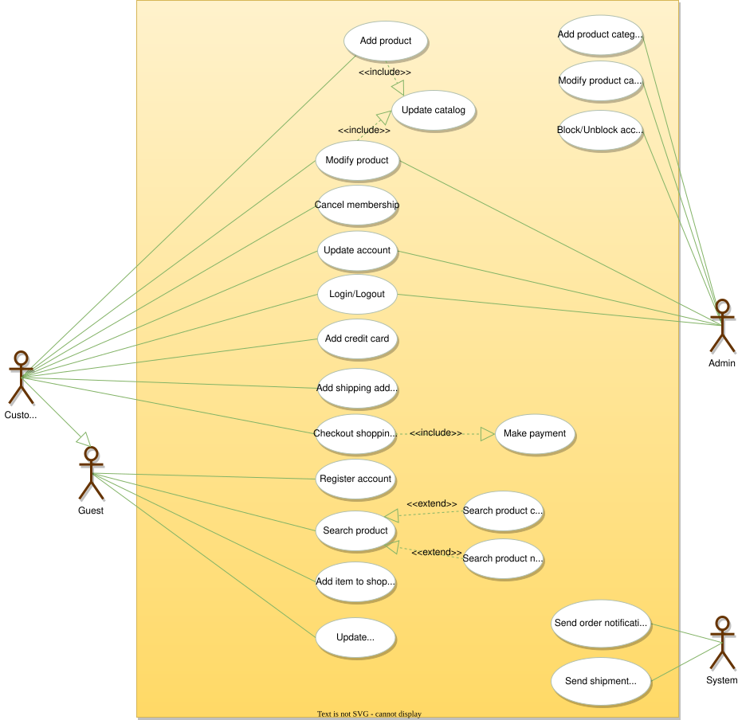
*Figure — Use-case diagram for the online shopping system: Admin, Guest, Member and System and what each may do (course diagram)*

In the figure above, notice that "Checkout" *includes* "Make payment" and "Add shipping address": you cannot check out without them. Search by name and search by category *extend* the general "Search product" use case.

### Core entities

| Class | Responsibility |
|---|---|
| `ProductCategory` | A named group such as Books or Electronics. Exists whether or not any product uses it. |
| `Product` | The thing sold: price, seller, stock count. **Owns** its reviews and guards its own stock (`reserve` / `release`). |
| `ProductReview` | Rating 1–5 plus text. Records the reviewer **by id**, so `Product` never depends on `Member`. |
| `Search` / `Catalog` | Interface with two search methods. The catalog keeps one index (a lookup map built in advance) per search (name words → products, category → products), so a lookup reads a map instead of scanning every product, and `addProduct` updates both indexes together so they cannot drift apart. The catalog only *points to* products; it never owns them. |
| `ShoppingCart` | Mutable (changeable) working area. **Owns** its items; clearing the cart destroys them. |
| `Item` | One line: product id, name, quantity, unit price (an immutable `record`). A pen is a *product*; ten pens in stock are ten product *items*. |
| `Order` | Immutable **copy** of the cart lines + address + a status that moves only along legal edges. |
| `OrderLog` | One entry per status change (unshipped, pending, complete, cancelled...). |
| `Payment` (`CreditCardPayment`, `BankTransferPayment`) | Takes the money. A card clears immediately; a bank transfer comes back `PENDING` from `process()` and clears later. |
| `Shipment` / `ShipmentLog` | A parcel and its tracking history (pending, shipped, delivered, on hold). The last log entry is "where is it now". |
| `Notification` channel (`EmailChannel`, `SmsChannel`) | One way of delivering a message. (The course draws an abstract `Notification` class with one subclass per channel; we use an interface — same idea.) |
| `Account` | Login data, addresses, status (active, blocked, banned...). |
| `Customer` → `Guest`, `Member` | `Customer` has only what *anyone* may do; ordering lives on `Member`. |
| `Admin` | Adds categories, blocks and unblocks members. |
| `OrderService` | Application service (a class that coordinates domain objects to carry out one user action) that turns a cart into an order and drives its state machine. |

### Class diagram

The course builds the model in five stages (products → catalog → payment/shipment/notification → cart/order → accounts). Here is the finished picture:


*Figure — The finished class diagram of the online shopping system (course diagram)*

In the figure above, read the arrows this way: a **filled diamond** means *composition* (the part belongs to the whole and is destroyed along with it — `Product` owns its reviews, `ShoppingCart` owns its items, `Order` owns its log and shipment). A **plain arrow** is *association* (a link without ownership — a product points at its category; an order only *refers to* the payment it was handed). The hollow triangle is inheritance (`Guest` and `Member` extend `Customer`).

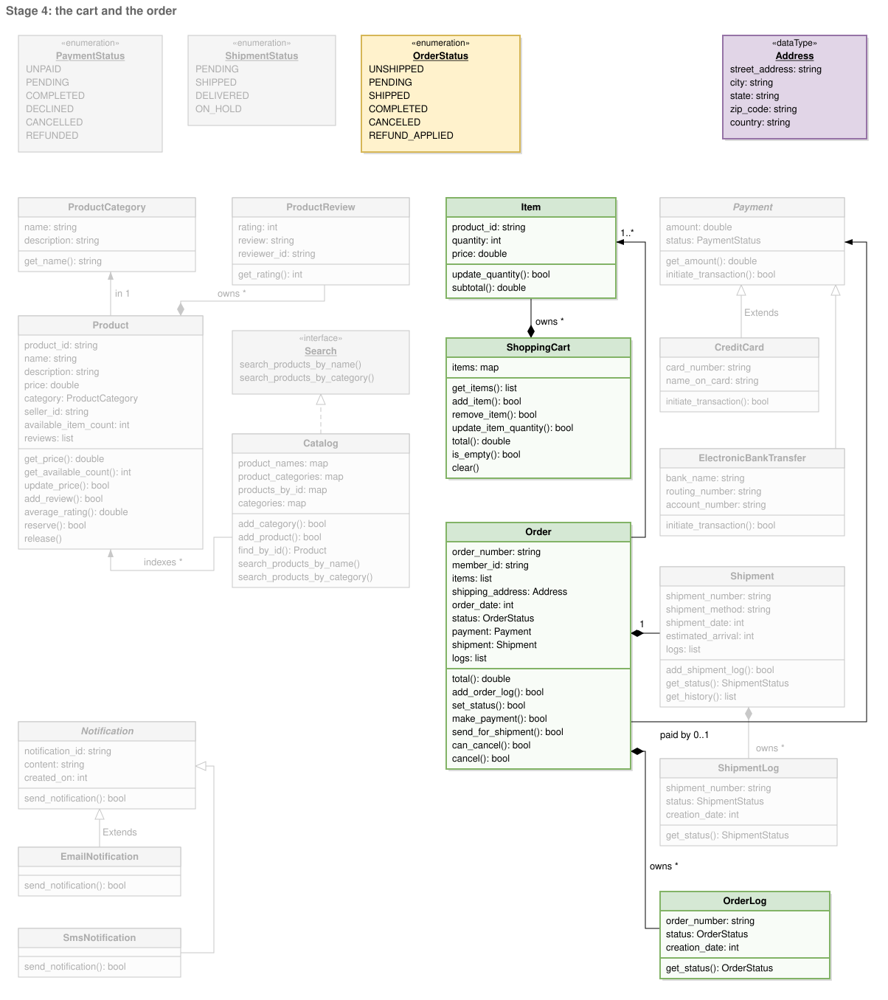
*Figure — Stage 4: the cart owns its items, while the order holds its own copy of what was bought (course diagram)*

Our Java design follows the same shape:

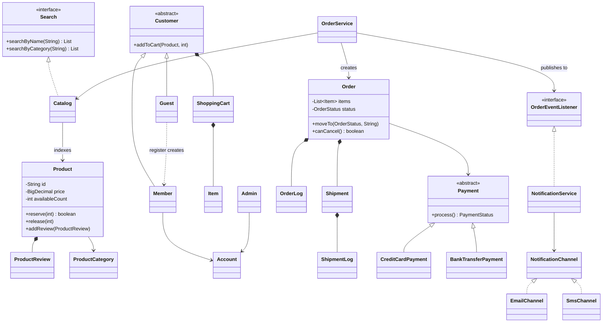

### Key flows

**Shopping activity.** The course's activity diagram shows the loop a shopper goes round: search, view, add to cart, update the cart, "more shopping?", and finally checkout.

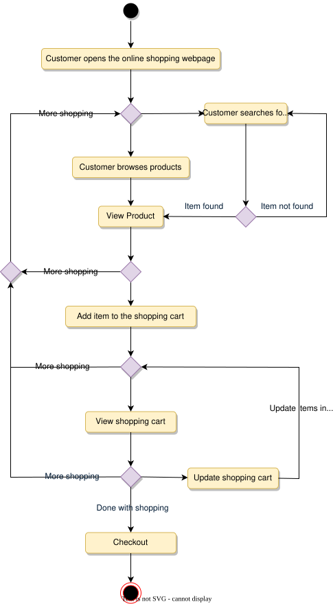
*Figure — Activity diagram of a customer shopping online, from opening the site to checkout (course diagram)*

**Searching the catalog, and adding to the cart.** The first two course sequence diagrams show the simple read path (customer → catalog → matching products) and the cart update path (customer → cart → item).

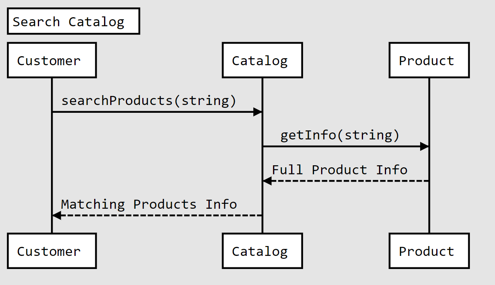
*Figure — Sequence diagram for searching the catalog (course diagram)*

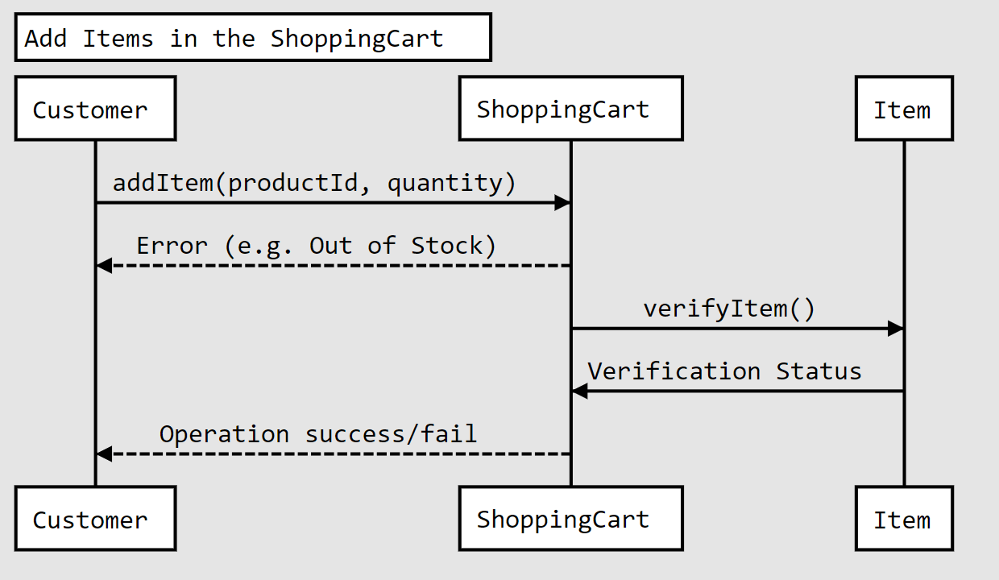
*Figure — Sequence diagram for adding an item to the shopping cart (course diagram)*

**Checkout.** The third course sequence diagram shows the important one: get the cart items, get billing and shipping info, create the order, verify every item, process the payment, create the shipment, and return the order status — with an error path after item verification and after payment.

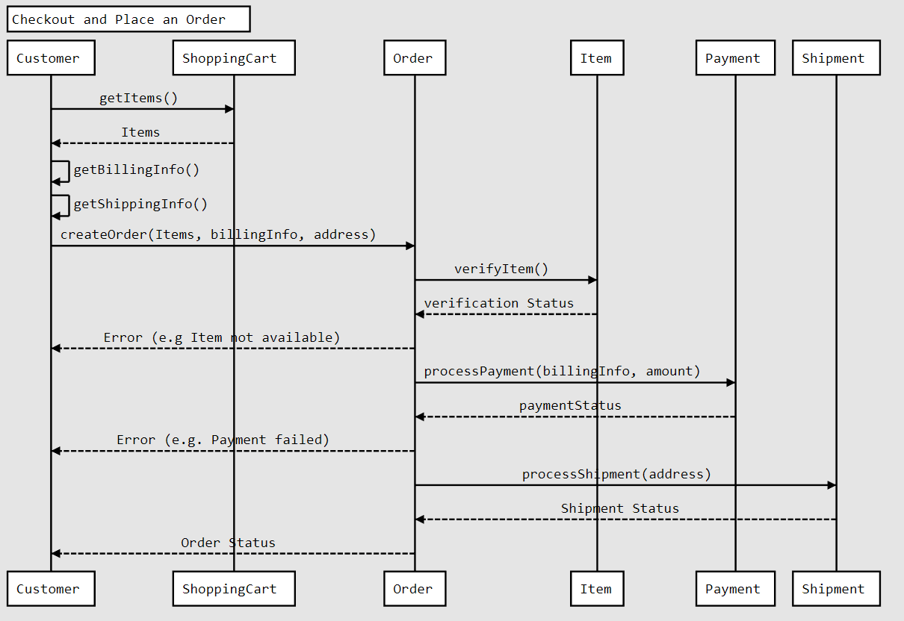
*Figure — Sequence diagram for checkout: verify items, take payment, create shipment (course diagram)*

Our `OrderService.placeOrder` follows that order, with one addition: stock is **reserved** during verification (not merely checked), so the check cannot go stale before payment.

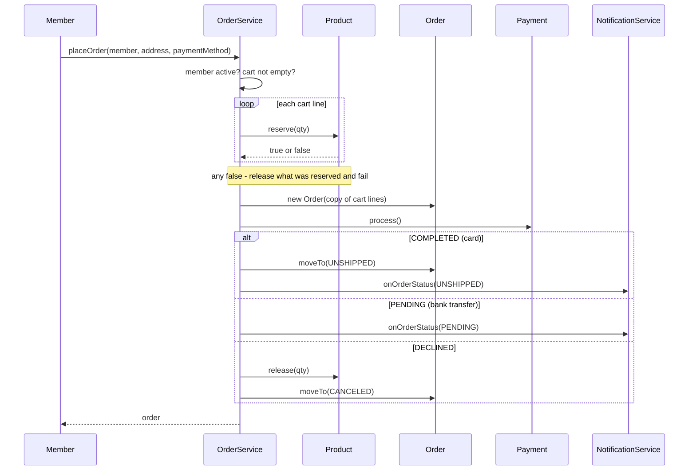

**The order state machine.** Every legal move is listed in `OrderStatus.next()`. Anything else throws.

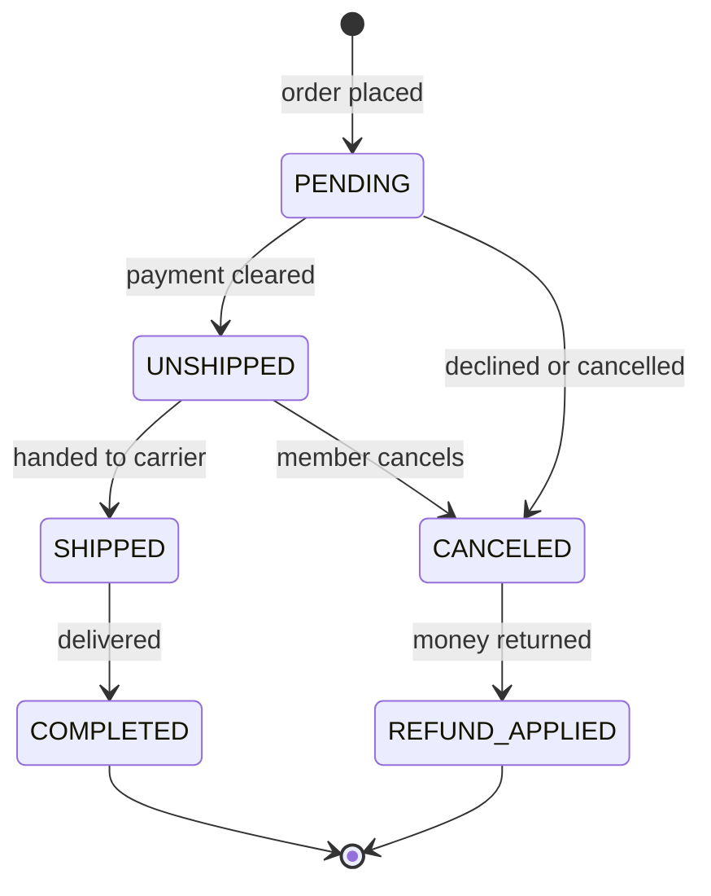

Requirement 8 ("cancel only if not shipped") is now one line: `canCancel()` returns `status.canMoveTo(CANCELED)`. There is no `SHIPPED → CANCELED` edge, so it is impossible by construction.

### Design decisions & patterns used

| Decision | Why | Alternative rejected |
|---|---|---|
| **Ordering lives on `Member`, not `Customer`** | A `Guest` *is a* `Customer`. If `Customer` had `placeOrder`, every guest would inherit an operation it has to reject — breaking the **Liskov Substitution Principle** (a subclass must be usable wherever its parent is, without surprises). | `Customer.placeOrder()` that throws for guests (the classic LSP smell). |
| **`Guest.register()` returns a new `Member` and carries the cart across** | Registration is a real-world moment where the cart must survive. | Mutating a guest into a member (Java objects cannot change class). |
| **`Order` copies the cart lines** | An order documents a *finished purchase*; it must stay fixed even if the cart is edited later. | Sharing `Item` objects — cheaper, but editing the cart would silently rewrite a finished order. |
| **Stock reserved at order time, not at payment time** | Prevents two shoppers from both getting the final unit. Cost: an abandoned order holds stock until cancelled; real systems release it on a timer. | Check stock, then pay, then decrement (a race window between check and decrement). |
| **State machine inside `OrderStatus`** | One place owns the rules. `moveTo` rejects illegal edges. | `if` checks scattered over `cancel`, `ship`, `deliver`. |
| **`Payment` is an abstract (sealed) class, one subclass per method** — a **Strategy** | The two methods *behave* differently (card clears now, transfer is pending). An **abstract class** cannot be instantiated itself — only its subclasses can — so every payment is a real card or transfer. Each subclass passes the substitution test (it can genuinely stand in for `Payment`: both really take money), and the same holds for the notification channels. A new method = a new subclass; checkout does not change (Open/Closed Principle: code should be open to extension but closed to modification). The course calls this out: it is why `Payment` is not an enum. | `enum PaymentType` + `switch` in checkout. |
| **Payment passed in as `Function<BigDecimal, Payment>`** (a function object: give it an amount, get a `Payment` back) | Checkout knows the total only after building the order, so it asks the caller's factory (a piece of code whose job is to create objects) for a payment of that amount. | Creating the payment before the total is known. |
| **Observer for notifications** | `OrderService` publishes events; `NotificationService` decides who to tell and how. Adding push notifications = a new `NotificationChannel`. | Calling email and SMS code directly inside `OrderService`. |
| **`Shipment` keeps a log** | Requirement 11 = read the last entry; the whole history stays for support and disputes. | A single `status` field (history lost). |
| **Reviews store `reviewerId`** | Avoids a two-way dependency `Product ↔ Member`; each class can be understood alone. | `ProductReview` holding a `Member` object. |
| **`OrderService` as a Facade** | One simple entry point hides stock, payment, shipment and notification steps. | Callers orchestrating five objects themselves. |

### Java implementation

Files: `Money.java` (BigDecimal helpers), `Catalog.java` (category, product, review, search, catalog), `Order.java` (address, item, cart, order status machine, order), `Payments.java` (payments, shipment), `Accounts.java` (account, customer, guest, member, admin), `OrderService.java` (listeners, notifications, service), `Main.java` (demo).

The full runnable source is in [`code/lld/ch19/amazon/`](code/lld/ch19/amazon/); below are the lines that carry the design (getters, constructors and `Main` omitted).

```java
// File: lld/ch19/amazon/Money.java - money is always BigDecimal at scale 2, never double
static BigDecimal of(String amount) { return new BigDecimal(amount).setScale(2, RoundingMode.HALF_EVEN); }

// File: lld/ch19/amazon/Catalog.java
final class Product {                                 // owns its reviews, guards its own stock
    private int availableCount;                       // guarded by this
    /** Take stock out of the pool. False means "not enough" - nothing changes. */
    synchronized boolean reserve(int quantity) {
        if (quantity <= 0 || quantity > availableCount) return false;
        availableCount -= quantity;
        return true;
    }
    synchronized void release(int quantity) { availableCount += quantity; }
}

final class Catalog implements Search {               // points to products, never owns them
    private final Map<String, Set<Product>> byNameWord = new ConcurrentHashMap<>();
    private final Map<String, List<Product>> byCategory = new ConcurrentHashMap<>();
    void addProduct(Product p) {                       // every index updated in one place
        byId.put(p.id(), p);
        for (String word : words(p.name()))
            byNameWord.computeIfAbsent(word, k -> ConcurrentHashMap.newKeySet()).add(p);
        byCategory.computeIfAbsent(key(p.category().name()), k -> new CopyOnWriteArrayList<>()).add(p);
    }
    // searchByName: intersect the sets of every query word; searchByCategory: one map read
}

// File: lld/ch19/amazon/Accounts.java
/** Ordering is deliberately NOT here: a Guest is a Customer and must not inherit it (LSP). */
abstract sealed class Customer permits Guest, Member {
    private final ShoppingCart cart = new ShoppingCart();
    void addToCart(Product p, int qty) { cart.addItem(p, qty); }
}
final class Guest extends Customer {
    Member register(String memberId, Account account) {   // the cart survives registration
        Member m = new Member(memberId, account);
        m.cart().mergeFrom(cart());
        cart().clear();
        return m;
    }
}
final class Member extends Customer {
    boolean canBuy() { return account.status() == AccountStatus.ACTIVE; }
}

// File: lld/ch19/amazon/Order.java
record Item(String productId, String name, int quantity, BigDecimal unitPrice) { }  // price copied at add time

enum OrderStatus {
    PENDING, UNSHIPPED, SHIPPED, COMPLETED, CANCELED, REFUND_APPLIED;
    private Set<OrderStatus> next() {
        return switch (this) {
            case PENDING -> EnumSet.of(UNSHIPPED, CANCELED);      // waiting for payment
            case UNSHIPPED -> EnumSet.of(SHIPPED, CANCELED);      // paid, not yet handed to carrier
            case SHIPPED -> EnumSet.of(COMPLETED);                // too late to cancel
            case CANCELED -> EnumSet.of(REFUND_APPLIED);          // money goes back if it was taken
            case COMPLETED, REFUND_APPLIED -> EnumSet.noneOf(OrderStatus.class);
        };
    }
    boolean canMoveTo(OrderStatus target) { return next().contains(target); }
}

final class Order {
    private final List<Item> items;                   // List.copyOf(cart lines), never shared
    private final List<OrderLog> log = new ArrayList<>();
    synchronized boolean canCancel() { return status.canMoveTo(OrderStatus.CANCELED); }
    synchronized void moveTo(OrderStatus target, String note) {
        if (!status.canMoveTo(target))
            throw new IllegalStateException(orderNumber + ": " + status + " -> " + target + " is not allowed");
        status = target;
        log.add(new OrderLog(target, note));
    }
}

// File: lld/ch19/amazon/Payments.java - Strategy: a card clears now, a transfer is PENDING
abstract sealed class Payment permits CreditCardPayment, BankTransferPayment {
    abstract PaymentStatus process();
    synchronized PaymentStatus refund() {
        if (status == PaymentStatus.COMPLETED) status = PaymentStatus.REFUNDED;
        else if (status == PaymentStatus.PENDING || status == PaymentStatus.UNPAID) status = PaymentStatus.CANCELLED;
        return status;
    }
}
// Shipment keeps a List<ShipmentLog>; current() = last entry, history() = all of them

// File: lld/ch19/amazon/OrderService.java - Facade; publishes to OrderEventListener (Observer)
Order placeOrder(Member member, Address address, Function<BigDecimal, Payment> paymentMethod) {
    if (!member.canBuy()) throw new IllegalStateException("account " + member.account().status());
    List<Item> items = member.cart().snapshot();
    if (items.isEmpty()) throw new IllegalStateException("cart is empty");

    List<Item> reserved = new ArrayList<>();          // all-or-nothing reservation
    for (Item i : items) {
        Product p = catalog.find(i.productId()).orElseThrow();
        if (!p.reserve(i.quantity())) {
            reserved.forEach(r -> catalog.find(r.productId()).orElseThrow().release(r.quantity()));
            throw new IllegalStateException("out of stock: " + i.name());
        }
        reserved.add(i);
    }
    Order order = new Order("ORD-" + orderSeq.incrementAndGet(), member.id(), items, address);
    orders.put(order.orderNumber(), order);

    Payment payment = paymentMethod.apply(order.total());
    order.attachPayment(payment);
    switch (payment.process()) {
        case COMPLETED -> { transition(order, OrderStatus.UNSHIPPED, "paid by " + payment.describe()); member.cart().clear(); }
        case PENDING -> { publish(order, OrderStatus.PENDING); member.cart().clear(); }
        default -> {                                  // declined: give the stock back, keep the cart
            releaseStock(order);
            transition(order, OrderStatus.CANCELED, "payment declined");
        }
    }
    return order;
}

boolean cancel(String orderNumber) {
    Order o = get(orderNumber);
    synchronized (o) {                     // check-then-act must be atomic against ship()
        if (!o.canCancel()) return false;
        releaseStock(o);
        transition(o, OrderStatus.CANCELED, "cancelled by member");
    }
    if (o.payment().refund() == PaymentStatus.REFUNDED)
        transition(o, OrderStatus.REFUND_APPLIED, "refunded " + Money.fmt(o.total()));
    return true;
}
// ship() locks the order around transition(SHIPPED); transition() = moveTo + notify every listener
```

`NotificationService implements OrderEventListener` and sends each message through every registered `NotificationChannel` (`EmailChannel`, `SmsChannel`).

Output:

```text
== 1. Search ==
name 'code'      -> [Clean Code ($32.50)]
name 'usb cable' -> [USB-C Cable ($9.99)]
category 'books' -> [Clean Code ($32.50), Refactoring ($41.00), Design Patterns (last copy) ($55.00)]

== 2. Guest fills a cart, then registers (cart carries over) ==
  cart: 1 x Clean Code = $32.50
  cart: 2 x USB-C Cable = $19.98

== 3. Checkout with a credit card ==
    [email -> alice@mail.test] Order ORD-1001 is now UNSHIPPED
    [sms   -> +1-555-0101] Order ORD-1001 is now UNSHIPPED
  ORD-1001 total $52.48, status UNSHIPPED, stock of Clean Code now 4

== 4. Ship, track, deliver ==
    [email -> alice@mail.test] Order ORD-1001 is now SHIPPED
    [sms   -> +1-555-0101] Order ORD-1001 is now SHIPPED
    [email -> alice@mail.test] Shipment for ORD-1001: SHIPPED @ sort centre
    [email -> alice@mail.test] Shipment for ORD-1001: SHIPPED @ Portland hub
    [email -> alice@mail.test] Shipment for ORD-1001: DELIVERED @ front door
    [email -> alice@mail.test] Order ORD-1001 is now COMPLETED
    [sms   -> +1-555-0101] Order ORD-1001 is now COMPLETED
  tracking now: ShipmentLog[status=DELIVERED, location=front door], order COMPLETED
  cancel after delivery? false

== 5. Bank transfer (pending) then cancel before shipping -> refund ==
    [email -> alice@mail.test] Order ORD-1002 is now PENDING
    [sms   -> +1-555-0101] Order ORD-1002 is now PENDING
  ORD-1002 status PENDING, payment PENDING
    [email -> alice@mail.test] Order ORD-1002 is now UNSHIPPED
    [sms   -> +1-555-0101] Order ORD-1002 is now UNSHIPPED
    [email -> alice@mail.test] Order ORD-1002 is now CANCELED
    [sms   -> +1-555-0101] Order ORD-1002 is now CANCELED
    [email -> alice@mail.test] Order ORD-1002 is now REFUND_APPLIED
    [sms   -> +1-555-0101] Order ORD-1002 is now REFUND_APPLIED
  cancel before shipping? true -> REFUND_APPLIED, payment REFUNDED, Refactoring stock back to 2
  order log: [PENDING, UNSHIPPED, CANCELED, REFUND_APPLIED]

== 6. Illegal transition is rejected by the state machine ==
  ORD-1002: REFUND_APPLIED -> SHIPPED is not allowed

== 7. Review ==
  Clean Code average rating = 4.5

== 8. Blocked member cannot buy ==
  rejected: account BLOCKED

== 9. Ten members race for the last copy ==
  winners=1 losers=9 stock left=0
```

**Reading the output.** Step 1 answers both searches from indexes (a name search matches every query word, so `usb cable` finds "USB-C Cable"). Step 2 shows the guest's cart surviving registration. Step 3 prints two notifications (email + SMS) because both channels are registered. Step 5 walks the full cancel path `PENDING → UNSHIPPED → CANCELED → REFUND_APPLIED`, and the stock returns to 2. Step 6 proves the state machine refuses `REFUND_APPLIED → SHIPPED`. Step 9 starts ten threads at the same instant (a `CountDownLatch` — a gate that keeps threads waiting until a counter reaches zero — releases them together) and exactly one wins the last copy.

### Concurrency & edge cases

| Risk | What could go wrong | How the code prevents it |
|---|---|---|
| Last unit, two buyers | Both see `availableCount == 1`, both decrement → stock −1 | `Product.reserve` is `synchronized`: check and decrement are one step. Step 9 proves it. |
| Multi-line cart, one line out of stock | Lines 1–2 reserved, line 3 fails → stock leaked | `placeOrder` remembers what it reserved and releases it all on failure (all-or-nothing). |
| Cancel and ship at the same time | Order shipped *and* stock released | `cancel` and `ship` both lock the `Order` object around check-then-move. |
| Payment declined | Stock stays reserved forever | Declined path releases stock and moves the order to `CANCELED`; the cart is kept so the member can retry. |
| Bank transfer never clears | Stock held forever | Mention a timeout job that cancels `PENDING` orders after N hours. |
| Price changes after adding to cart | Customer charged a price they never saw | `Item` stores the unit price at add time; production systems re-validate prices at checkout and show changes. |
| Blocked member | Places orders anyway | `Member.canBuy()` checks `AccountStatus.ACTIVE` first (step 8). |
| Deadlock (two threads each waiting forever for a lock the other holds) | Two locks taken in different orders | Each lock (product, order, cart) is held briefly and never while waiting for another object's lock in the opposite order. |

### Real-world example

On Amazon's "Your Orders" page, the *Cancel items* button is offered only while an order has not yet entered the shipping process — the same edge our state machine removes after `SHIPPED`. Amazon also treated the shopping cart as something that must *always* accept writes: its 2007 Dynamo paper (the key-value store — a database that simply maps a key to a value — behind services such as the cart) chose **availability** (staying usable even when some machines fail; see [System Design Fundamentals](../../../system-design-patterns/modules/00-system-design-fundamentals/README.md)) so that "add to cart" works even during failures, and merges conflicting cart versions later. Our in-memory design shows the object model; at Amazon's scale the cart, catalog and orders live in separate services.

### Extensions & follow-up questions

- **"Add a new payment type, e.g. gift cards or UPI (India's instant bank-to-bank mobile payment system)."** Add a `GiftCardPayment extends Payment` (and list it in `permits`). `OrderService` is untouched, because it only calls `process()`.
- **"How do you prevent two shoppers from both buying the final unit?"** Reserve at order time inside a lock (`Product.reserve`). In a distributed system (one spread over many machines): a conditional database update (`UPDATE ... SET stock = stock - 1 WHERE id = ? AND stock >= 1`) or **optimistic locking** with a version column (no lock is held; each row carries a version number, and an update succeeds only if the version is still the one you read — otherwise you retry).
- **"Abandoned orders hold stock."** Give each reservation an expiry. A scheduled job cancels `PENDING` orders older than, say, 30 minutes and releases stock.
- **"Returns after delivery."** Add `COMPLETED → RETURN_REQUESTED → RETURNED → REFUND_APPLIED` edges; the enum change is local.
- **"Multiple warehouses."** Replace `Product.availableCount` with an `Inventory` per warehouse; checkout picks a warehouse per line (a Strategy: nearest, cheapest shipping).
- **"Split shipments."** One `Order` owns many `Shipment`s, each with its own item subset and log.
- **"Search at scale."** The in-memory `Catalog` becomes a search index (for example Elasticsearch/OpenSearch, popular search-engine servers) fed by product change events; the `Search` interface stays.
- **"Seller payouts, recommendations, wish lists."** Separate modules listening to order events (Observer again).

### In the interview

**30–45 minute plan**

1. (3 min) Clarify: guest vs member, payment types, cancel rule, notifications, what is out of scope.
2. (5 min) Actors and use cases; name the four actors.
3. (10 min) Class diagram. **Say the LSP sentence out loud**: "Ordering is on `Member`, not `Customer`, otherwise every guest inherits an ordering method it is not allowed to use."
4. (5 min) The order state machine; show that "cancel after ship" has no edge.
5. (10 min) Code `placeOrder` (reserve all-or-nothing, copy items, pay, notify) and `cancel`.
6. (5 min) Concurrency: last-item race; abandoned-order timeout; extensions.

**30-second answer:** "Catalog with name and category indexes; a cart per customer; ordering only on `Member`; checkout reserves stock for every line atomically, copies the lines into an immutable order, then takes payment through a `Payment` strategy. The order moves through a state machine that forbids cancelling after shipping, and every status change is published to a notification observer."

**Follow-ups with answers**

- *Why is `Payment` abstract rather than an enum?* Because the methods behave differently (clears now vs pending). New methods are new classes — Open/Closed.
- *Why does `Order` copy items?* So later cart edits or price changes cannot rewrite history.
- *Where would you put tax and discounts?* A `PricingRule` chain (Chain of Responsibility — a pattern where a request is passed along a line of handlers, each doing its part — or a list of Strategies) applied when building the order; the order stores the final line prices.
- *How do you make checkout idempotent (safe to repeat: doing it twice has the same effect as doing it once) if the user double-clicks?* Accept a client-generated idempotency key (a unique id the browser sends with the request); if an order with that key exists, return it instead of creating a second one.

### Self-check

1. **Q:** Why can't `placeOrder` live on `Customer`? **A:** `Guest extends Customer` and guests must not order; inheriting a method you must refuse violates LSP.
2. **Q:** What does the filled diamond between `Order` and `OrderLog` mean? **A:** Composition — the order owns its log entries; they are created and destroyed with it.
3. **Q:** Name two things wrong with "check stock, take payment, then decrement stock". **A:** A race window lets two buyers pass the check; and a payment can succeed for goods that are no longer there.
4. **Q:** Which status edges allow a cancel? **A:** `PENDING → CANCELED` and `UNSHIPPED → CANCELED`.
5. **Q:** Why `compareTo` and not `equals` on `BigDecimal`? **A:** `equals` also compares scale, so `2.0` and `2.00` are "not equal".
6. **Q:** What pattern lets you add push notifications without touching `OrderService`? **A:** Observer (listener) plus a new `NotificationChannel` implementation.

### TL;DR

- Guests browse and fill carts; **only members order** (LSP).
- Checkout = **reserve all lines atomically → copy into an immutable order → pay (Strategy) → publish (Observer)**.
- `OrderStatus` is a **state machine**; "cancel after ship" is impossible because the edge does not exist.
- Money in `BigDecimal`; histories in logs; stock guarded by a lock.

---
## Design an Online Stock Brokerage System

This problem has two halves, and interviews ask both:

- **Part A — the brokerage** (what the course designs): members, money in and out, watchlists, the four order types, lots and positions, statements.
- **Part B — the exchange's matching engine** (a machine-coding problem — write a working program in about 90 minutes — originally from Geektrust, an Indian coding-assessment platform, kept in kumaransg/LLD under a project named "Navi"; we call it "the Navi statement" below): an **order book** (the list of all waiting buy and sell orders for one stock) that matches buy and sell orders by **price-time priority**, implemented and tested.

A **broker** is the company you trade *through* (it holds your cash and shares and forwards your orders). An **exchange** is the market where buy and sell orders from all brokers *meet* and are matched. Keep the two apart in your head; the design keeps them apart in code.

### Problem & clarifying questions

An online brokerage lets people buy and sell stocks without a human middleman. Members track and carry out their transactions, see charts of how the stocks they hold are performing, and get an alert when a stock moves by an amount they chose. The platform must keep those transactions secure. Because computers replace the phone call to a broker, each trade is quicker and cheaper, and members get fast access to real-time (updated the moment they change) prices, market trends and stock reports.

| Question | Assumed answer |
|---|---|
| Which order types? | Market, limit, stop-loss, stop-limit (explained in the table under Key flows). |
| Can one order fill at several prices? | Yes — an order can be filled in parts. |
| Do we track separate purchases of the same stock? | Yes — each purchase is a **lot**, because tax depends on which lot you sell. |
| How does money come in and out? | Check, wire (a direct bank-to-bank transfer), or electronic bank transfer, each with a per-transfer limit. |
| Reports? | Quarterly statements and a yearly tax statement. |
| Notifications? | When an order executes. |
| Margin, short selling, options, dividends and stock splits, real-time streaming quotes, the settlement delay, the wash-sale tax rule? | Out of scope — a deliberate decision, say so. |

For reference, those out-of-scope terms: **margin** is trading with money borrowed from the broker; **short selling** is selling borrowed shares, hoping to buy them back cheaper; **options** are contracts giving the right to buy or sell later at a fixed price; **dividends** are profits a company pays to its shareholders; a **stock split** turns each share into several cheaper ones; **settlement** is the actual swap of cash and shares, which happens a day or so after the trade; the **wash-sale rule** is a US tax rule that blocks claiming a loss if you rebuy the same stock within 30 days.

### Requirements

**Functional (brokerage)**

1. Any member can buy and sell stocks.
2. A member can have **multiple watchlists** (named lists of stocks to keep an eye on), each with multiple stock quotes (a quote is a stock's latest price).
3. Orders can be **market, limit, stop-loss, stop-limit**.
4. A member can hold **multiple lots** of the same stock; the system keeps them apart.
5. The system generates **quarterly** updates and **yearly tax** statements.
6. Money goes in and out of the account in three ways: **check, wire, or electronic bank transfer**.
7. A notification is sent whenever an order executes.

**Functional (matching engine, Navi variant)**

8. Orders arrive as `<id> <time> <symbol> <buy/sell> <price> <qty>`, e.g. `#1 09:45 BAC sell 240.12 100`. They are read from a text file whose path is given as the program's argument; trades are printed to the console.
9. On every new order, match against the opposite side. Lower sell prices and higher buy prices go first; at the same price, **earlier orders go first** (price-time priority).
10. A trade happens when buy price ≥ sell price. In the Navi statement the trade is recorded at the **sell order's price**.
11. Print each trade as `<buy_id> <price> <qty> <sell_id>`; unmatched quantity stays in the book.

**Non-functional**

- Money is never over-committed: ten $1,000 orders cannot all pass a $1,000 balance check.
- Matching is deterministic (no randomness or timing luck): same input, same trades.
- The engine is safe under concurrent submissions and conserves quantity (shares bought = shares sold).

### Use cases

Three actors:

- **Admin** — administrative jobs such as blocking or unblocking members.
- **Member** — searches the stock inventory, buys and sells, manages watchlists.
- **System** — sends order notifications and periodically fetches quotes from the exchange.

Top use cases: register / cancel membership; add, remove or edit a watchlist; search stocks by symbol; place an order; cancel an order; deposit or withdraw money.

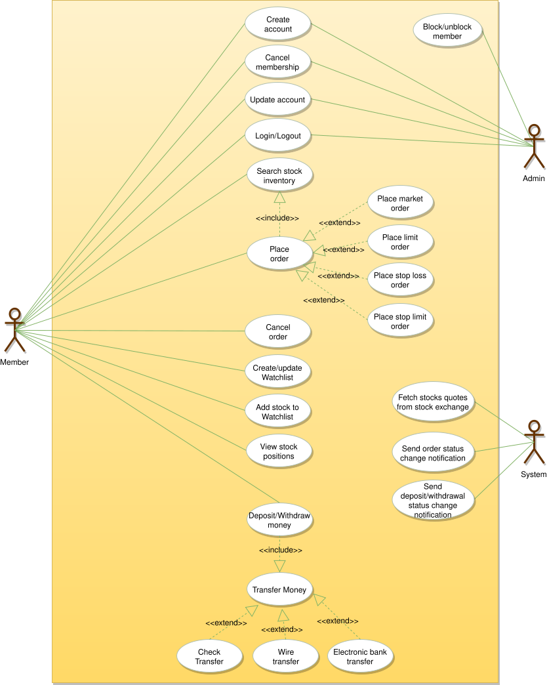
*Figure — Use-case diagram for the stock brokerage: Admin, Member and System (course diagram)*

### Core entities

| Class | Responsibility |
|---|---|
| `MoneyTransfer` → `CheckTransfer`, `WireTransfer`, `ElectronicBankTransfer` | Move money in or out. They differ only in name and clearing days (5 / 1 / 3 in our code); the per-transfer limit (100,000) is a single rule, so it lives only in the base class. |
| `Notifier` / `EmailNotifier` | Delivers "your order filled" messages. The course draws one base with two delivery ways (email and SMS); an `SmsNotifier` would be a second implementation. |
| `Order` (abstract) | Shared by all order types: member, symbol, side (buy or sell), quantity, time-in-force (how long the order stays live), status, list of fills. Declares the **two questions**. |
| `MarketOrder`, `LimitOrder`, `StopLossOrder`, `StopLimitOrder` | Each answers "may I trade now?" and "what is my worst price?". `StopLimitOrder extends StopLossOrder`. |
| `OrderPart` | One fill: quantity, price, day. A 100-share order might be filled as 70 @ 10.00 plus 30 @ 10.05. |
| `Stock`, `StockInventory` | Symbol + latest price; the inventory is the **single source of truth** (the one place whose value counts if copies disagree) for prices. |
| `StockExchange` | Holds open orders; on each new order or price tick tries to fill them; calls back through `OrderListener`. |
| `OrderListener` | Interface the exchange calls (`onFill`, `onCancelled`). The exchange never learns what a member is. |
| `StockLot` | One purchase at one price. |
| `StockPosition` | All lots of one symbol; sells from the oldest lot first (FIFO — first in, first out) unless a lot is named. Returns a `LotSale` per lot touched. |
| `LotSale` | Shares taken from one lot, buy price, sell price → realised gain (profit actually locked in by selling). |
| `Watchlist` | A named set of **symbols** (not `Stock` objects, so it never goes stale). |
| `Trade` | One fill as the member sees it (sells carry their `LotSale`s). |
| `Statement` → `QuarterlyStatement`, `TaxStatement` | Base class filters trades by day range; subclasses write their own lines. |
| `Member` | Cash, **reserved funds**, positions, watchlists, trades. Implements `OrderListener`. (The course's `Account` also stores name, address, e-mail and phone; we keep only what the demo uses.) |
| `Admin` | Blocks / unblocks members. |
| *(engine)* `OrderBook`, `MatchingEngine`, `Trade`, `ExecutionPricePolicy` | Price levels with FIFO queues per symbol; routing and locking; who sets the trade price. |

### Class diagram


*Figure — The finished class diagram of the online stock brokerage (course diagram)*

The course builds this model in six stages: money transfers and notifications → the order hierarchy → stock, inventory and exchange → lots and positions → watchlists, trades and statements → members and admins. In the figure above, `Member` extends `Account` and implements `OrderListener` (dashed arrow): the exchange reports fills through that interface and never needs the `Member` type. The filled diamonds from `Member` mean each position, watchlist and trade is owned by exactly one member; the plain arrow to `Order` says the exchange shares those orders.

The course singles out stage 2 — the order hierarchy — as the part that earns the most credit in an interview:

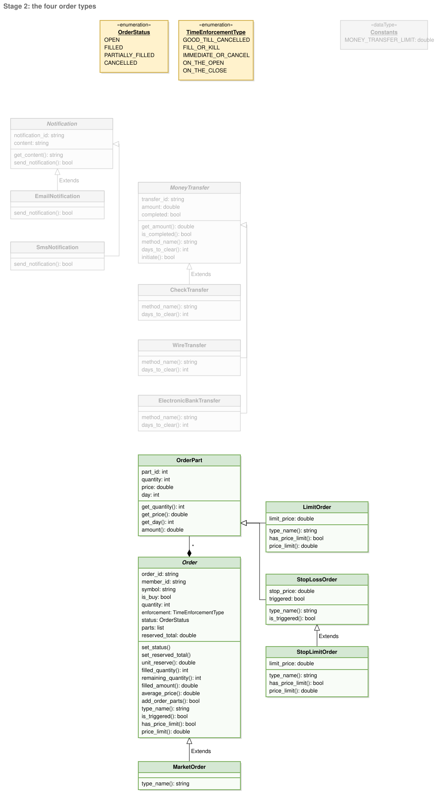
*Figure — Stage 2: one abstract Order and four small subclasses that differ only in two answers (course diagram)*

Our brokerage code:

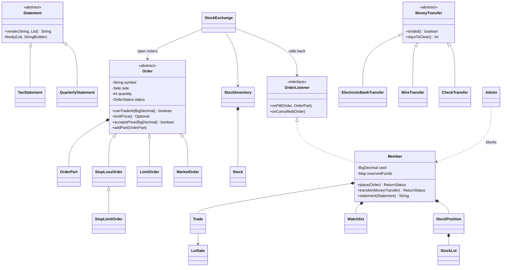

And the matching engine (Part B):

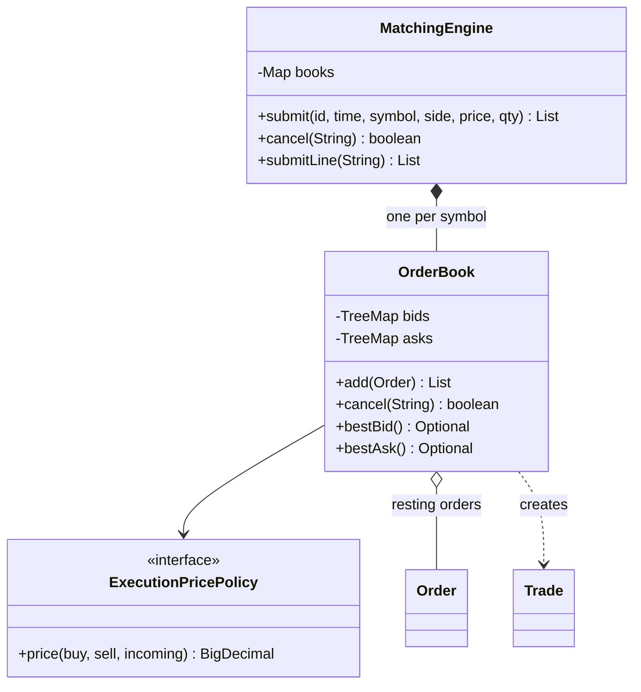

### Key flows

**Placing a buy order.** The course's activity diagram: pick a stock, pick the order type (market, limit, stop-loss, stop-limit), enter quantity, price limit and time enforcement; the system checks there is enough money, then deducts it (we *reserve* it) and sends the order to the exchange; when the exchange acknowledges, the member sees "order placed". The member can then update the order.

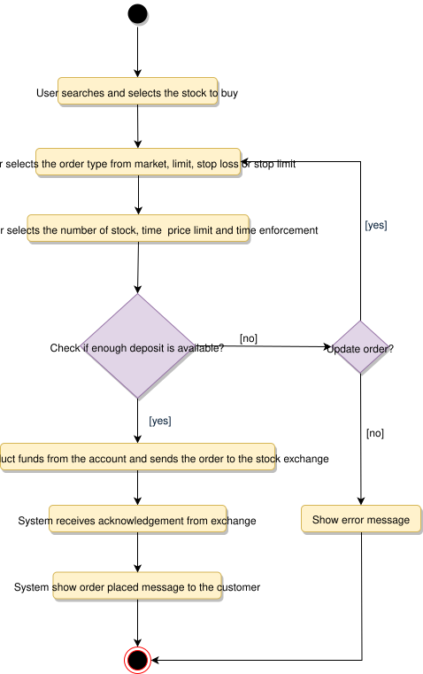
*Figure — Activity diagram for placing a buy order (course diagram)*

**Placing a sell order** is the mirror image, with one extra step: the member picks **which lots** to sell, and the check is "do I own enough shares?" rather than "do I have enough money?".

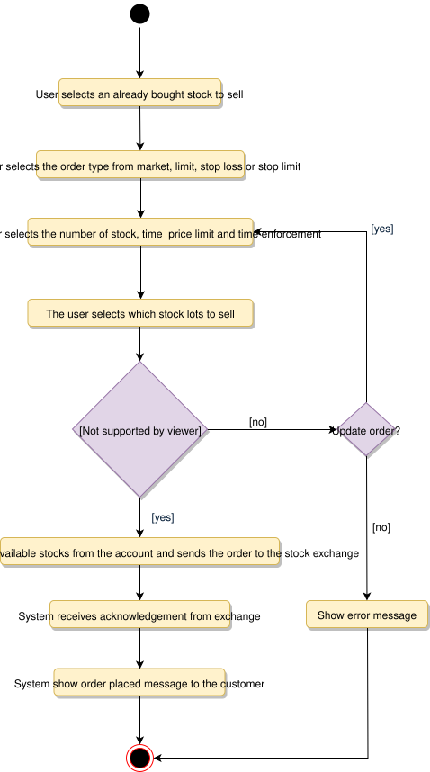
*Figure — Activity diagram for placing a sell order, including choosing lots (course diagram)*

**The four order types in one table.** They share everything except two answers:

| Type | Q1: may it trade at this market price? | Q2: worst acceptable price | Plain words |
|---|---|---|---|
| Market | Always | None | "Buy/sell now at whatever the market gives." |
| Limit | Always | The limit | "Buy at 9.50 or less / sell at 10.90 or more." |
| Stop-loss (stop) | Only after the price **reaches the stop**, then forever | None (becomes a market order) | "If it falls to 10.00, get me out." |
| Stop-limit | Only after the stop is reached | The limit | "If it rises to 305, buy — but pay no more than 306." |

A SELL stop triggers when price ≤ stop; a BUY stop triggers when price ≥ stop. Once triggered it stays triggered (the code "latches" a boolean).

**Fill → money and lots move (Observer callback).**

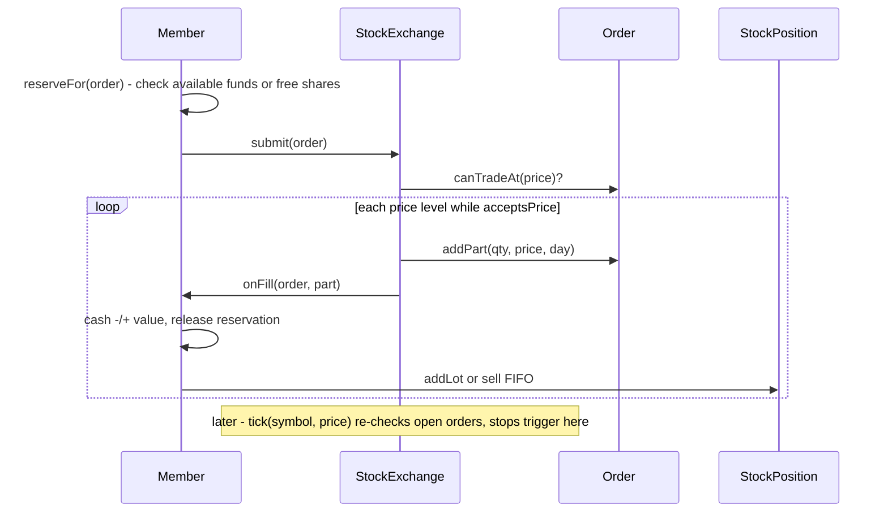

**Matching engine: price-time priority.** Each symbol has an `OrderBook` with two sides. Each side is a `TreeMap` (a map that keeps its keys sorted) from price to a FIFO queue (`ArrayDeque`, Java's fast double-ended queue). **Bids** (buy orders) are sorted highest-first, **asks** (sell orders) lowest-first. For an incoming order:

1. Look at the best price on the opposite side.
2. If it does not **cross** (buy price < best ask, or sell price > best bid), stop.
3. Otherwise fill against that level's queue, **oldest order first**, for `min(incoming remaining, resting remaining)`.
4. Remove fully filled resting orders; drop empty price levels; repeat from step 1.
5. If the incoming order still has quantity, add it to the back of its own price level's queue.

Walk-through of the sample input:

| Order | Book before (asks / bids) | What happens |
|---|---|---|
| #1 sell 240.12 × 100 | empty | rests on asks |
| #2 sell 237.45 × 90 | asks 240.12×100 | rests; best ask now 237.45 |
| #3 buy 238.10 × 110 | asks 237.45×90, 240.12×100 | crosses 237.45 → trade `#3 237.45 90 #2`; 20 left; 240.12 > 238.10 so stop; rests 20 @ 238.10 |
| #4 buy 237.80 × 10 | best ask 240.12 | no cross; rests |
| #5 buy 237.80 × 40 | same | no cross; rests **behind #4** at 237.80 |
| #6 sell 236.00 × 50 | bids 238.10×20, 237.80×(10, 40) | fills #3 for 20, then #4 for 10, then #5 for 20 — all at 236.00 (the sell price) |

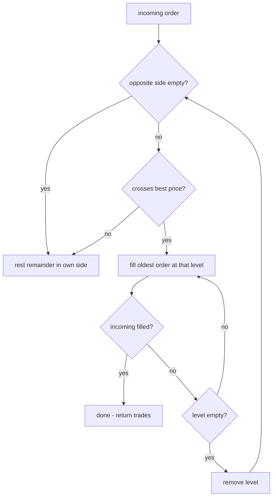

### Design decisions & patterns used

| Decision | Why | Alternative rejected |
|---|---|---|
| **One abstract `Order` + two abstract questions** | The four types differ only in "may I trade?" and "worst price?". Each subclass is a few lines. The course stresses this is just a type hierarchy (plain polymorphism — calling the same method on different subclasses and each running its own version), not a named pattern: every subclass answers for itself whether the current price lets it trade, and no order ever turns into another kind — so it is not the State pattern either. (The only named patterns the course lists are Observer and Singleton — a class that allows exactly one instance; the Template Method and Strategy labels in this table are our additions.) | Four unrelated classes with copied fields; or one class with a `type` field and `switch`es. |
| **`StopLimitOrder extends StopLossOrder`** | A stop-limit is a stop that becomes a *limit* instead of a *market* order: it inherits the trigger, overrides only `limitPrice()`. | Duplicating the trigger logic. |
| **`OrderPart` per fill** | One order can fill at several prices/days; each fill needs its own price and quantity (and becomes its own lot). | Storing only an average price (loses tax information). |
| **Observer: `OrderListener`** | The exchange tells whoever placed the order; it does not import `Member`. Exchange and account code change independently. | The exchange updating member balances directly. |
| **Reserved funds / reserved shares** | Without it, a member with $1,000 could place ten $1,000 orders and all would pass the check. Money is reserved at placement and released as fills or cancellations arrive. Money and shares actually move only in `onFill`, which the **exchange** calls (the course's `callbackStockExchange`) — so the moment an order is *placed* and the moment it is *paid for* are different. | Checking the balance only at fill time (over-commitment). |
| **Lots, FIFO by default** | Tax depends on *which* shares you sold; each `LotSale` records it. | Merging all purchases into one average-cost position. |
| **Template Method: `Statement`** | Filtering by day range is shared; only the lines differ. `render` is `final`; subclasses fill in `body`. | Two statement classes each re-implementing the filter. |
| **`MoneyTransfer` base class holds the limit rule** | One rule, three delivery methods. | Copying the limit check into each subclass. |
| **Singleton?** | The course makes `StockExchange` a Singleton (one gateway to the real exchange). We pass one instance into `Member` instead (**dependency injection**: an object is handed the things it needs from outside rather than creating or looking them up itself) — same "only one" in practice, but testable with a fake exchange. | A global `getInstance()` that tests cannot replace. |
| **Engine: `TreeMap<price, ArrayDeque>` per side** | Best price in O(log n) (Big-O notation: how the work grows with n items — here, very slowly); FIFO inside a level gives time priority for free. | One `PriorityQueue` (a structure that always hands back the smallest item first) sorted by (price, time) — works, but cancel is O(n) (time grows in step with the number of orders) and levels are not visible. |
| **Engine: lock per symbol** | Orders for different symbols match in parallel; same-symbol orders are strictly serialised (handled one at a time, in order), so "time priority" is well defined. | One global lock (slower) or no lock (corrupt book). |
| **Engine: `ExecutionPricePolicy` (Strategy)** | The Navi statement prices trades at the **sell** order's price; real continuous-trading exchanges use the **resting** (already-in-book) order's price. Both are one-line policies. | Hard-coding one rule. |

### Java implementation

#### Part A — Brokerage (`lld.ch19.brokerage`)

Files: `Orders.java` (enums, money helper, `OrderPart`, the order hierarchy), `Market.java` (stock, inventory, listener, simulated exchange), `Holdings.java` (lots, positions, watchlists, trades, statements), `Accounts.java` (transfers, notifier, member, admin), `Main.java`.

The simulated exchange offers a fixed depth of shares per price level (70 shares at each level, 5 cents apart, 3 levels) so fills come back in parts, like a real book. Part B builds a real matching engine.

The full runnable source is in [`code/lld/ch19/brokerage/`](code/lld/ch19/brokerage/); below are the lines that carry the design.

```java
// File: lld/ch19/brokerage/Orders.java
/** The four order types differ in exactly two answers. */
abstract class Order {
    /** Question 1. Market and limit orders always say yes; stop orders wait for the trigger. */
    abstract boolean canTradeAt(BigDecimal marketPrice);
    /** Question 2. Empty means "any price" (market behaviour). */
    abstract Optional<BigDecimal> limitPrice();

    /** Is a fill at this price acceptable? BUY: price <= limit. SELL: price >= limit. */
    final boolean acceptsPrice(BigDecimal price) {
        return limitPrice().map(l -> side == Side.BUY ? price.compareTo(l) <= 0 : price.compareTo(l) >= 0)
                           .orElse(true);
    }
    final synchronized void addPart(OrderPart p) {
        if (p.quantity() > remaining()) throw new IllegalStateException("overfill");
        parts.add(p);
        status = remaining() == 0 ? OrderStatus.FILLED : OrderStatus.PARTIALLY_FILLED;
    }
}

final class MarketOrder extends Order {
    @Override boolean canTradeAt(BigDecimal p) { return true; }
    @Override Optional<BigDecimal> limitPrice() { return Optional.empty(); }
}
final class LimitOrder extends Order {
    @Override boolean canTradeAt(BigDecimal p) { return true; }
    @Override Optional<BigDecimal> limitPrice() { return Optional.of(limit); }
}
class StopLossOrder extends Order {
    @Override final synchronized boolean canTradeAt(BigDecimal p) {
        if (!triggered)                                       // latches: once true, stays true
            triggered = side() == Side.SELL ? p.compareTo(stopPrice) <= 0 : p.compareTo(stopPrice) >= 0;
        return triggered;
    }
    @Override Optional<BigDecimal> limitPrice() { return Optional.empty(); }
}
final class StopLimitOrder extends StopLossOrder {           // inherits the trigger, adds a limit
    @Override Optional<BigDecimal> limitPrice() { return Optional.of(limit); }
}

// File: lld/ch19/brokerage/Market.java - simulated exchange: 70 shares per level, 5 cents apart, 3 levels
synchronized void tick(String symbol, BigDecimal newPrice) {      // stops trigger here
    inventory.find(symbol).orElseThrow().setPrice(newPrice);
    for (Order o : List.copyOf(openOrders.getOrDefault(symbol, List.of()))) tryFill(o, newPrice);
    prune(symbol);
}
private void tryFill(Order o, BigDecimal market) {
    if (!o.isOpen() || !o.canTradeAt(market)) return;
    for (int k = 0; k < levels && o.remaining() > 0; k++) {
        BigDecimal step = tickSize.multiply(BigDecimal.valueOf(k));
        BigDecimal levelPrice = o.side() == Side.BUY ? market.add(step) : market.subtract(step);
        if (!o.acceptsPrice(levelPrice)) break;          // limit reached: rest stays open
        OrderPart part = new OrderPart(Math.min(depthPerLevel, o.remaining()), levelPrice, day);
        o.addPart(part);
        listeners.get(o.memberId()).onFill(o, part);     // Observer callback
    }
}

// File: lld/ch19/brokerage/Holdings.java
List<LotSale> sell(int qty, BigDecimal price, Optional<String> preferredLot) {   // StockPosition
    // named lot first, then oldest first (FIFO); one LotSale per lot touched
    for (StockLot lot : order) {
        if (left == 0) break;
        int take = Math.min(left, lot.quantity());
        if (take == 0) continue;
        lot.take(take);
        out.add(new LotSale(lot.lotId(), take, lot.buyPrice(), price));
        left -= take;
    }
}
abstract class Statement {                                   // Template Method
    final String render(String memberName, List<Trade> all) {
        List<Trade> inRange = all.stream().filter(t -> t.day() >= fromDay && t.day() <= toDay).toList();
        StringBuilder sb = new StringBuilder(title() + " for " + memberName + " (days " + fromDay + "-" + toDay + ")\n");
        body(inRange, sb);                                   // QuarterlyStatement / TaxStatement fill this in
        return sb.toString();
    }
}

// File: lld/ch19/brokerage/Accounts.java
abstract class MoneyTransfer {                               // Check (5 days), Wire (1), ElectronicBank (3)
    static final BigDecimal TRANSFER_LIMIT = Money.of("100000");
    boolean isValid() { return amount.signum() > 0 && amount.compareTo(TRANSFER_LIMIT) <= 0; }
    abstract int daysToClear();
}

final class Member implements OrderListener {
    ReturnStatus place(Order o) {
        ReturnStatus check = reserveFor(o);                // under our lock
        if (check == ReturnStatus.SUCCESS) exchange.submit(o);   // outside our lock (lock order)
        return check;
    }
    private synchronized ReturnStatus reserveFor(Order o) {
        if (status != AccountStatus.ACTIVE) return ReturnStatus.ACCOUNT_NOT_ACTIVE;
        if (o.side() == Side.BUY) {
            BigDecimal perShare = o.limitPrice().orElse(inventory.priceOf(o.symbol()));
            BigDecimal need = Money.times(perShare, o.quantity());
            if (need.compareTo(availableFunds()) > 0) return ReturnStatus.INSUFFICIENT_FUNDS;
            reservedFunds.put(o.id(), need);           // released part by part as fills arrive
            return ReturnStatus.SUCCESS;
        }
        // SELL: shares owned minus shares already promised to other open sells
        if (o.quantity() > pos.quantity() - promised) return ReturnStatus.INSUFFICIENT_QUANTITY;
        pendingSells.put(o.id(), o);
        return ReturnStatus.SUCCESS;
    }
    /** Called by the exchange: this is where money and shares actually move. */
    @Override public synchronized void onFill(Order o, OrderPart part) {
        // BUY:  cash -= value, shrink the reservation, add a new StockLot for this part
        // SELL: cash += value, StockPosition.sell(...) FIFO -> LotSales for the tax statement
        trades.add(new Trade(part.day(), o.symbol(), o.side(), part.quantity(), part.price(), sales));
    }
}
```

Output:

```text
== 1. Fund the account ==
  wire 5,000        -> SUCCESS
  check 200,000     -> FAIL (over the 100,000 limit)
  cash = $5000.00

== 2. Watchlists and search ==
  tech: AAPL=10.00 MSFT=300.00
  retail: AMZN=120.00
  search 'A' -> [AAPL, AMZN]

== 3. Market buy 100 AAPL fills in two parts (two lots) ==
    [email alice@mail.test] filled 70 AAPL @ 10.00 (O1 PARTIALLY_FILLED)
    [email alice@mail.test] filled 30 AAPL @ 10.05 (O1 FILLED)
  place -> SUCCESS
  O1 MARKET BUY 100 AAPL [FILLED] parts=[OrderPart[quantity=70, price=10.00, day=1], OrderPart[quantity=30, price=10.05, day=1]]

== 4. Next day: limit buy 50 AAPL @ 9.50 waits, then fills when price drops ==
  place -> SUCCESS, O2 LIMIT@9.50 BUY 50 AAPL [OPEN], reserved $475.00
    [email alice@mail.test] filled 50 AAPL @ 9.40 (O2 FILLED)
  after tick 9.40: O2 LIMIT@9.50 BUY 50 AAPL [FILLED], reserved $0.00
  holdings {AAPL=[L1:70@10.00, L2:30@10.05, L3:50@9.40]}

== 5. Day 3: price rises, sell 120 AAPL (FIFO across lots) ==
    [email alice@mail.test] filled 70 AAPL @ 11.00 (O3 PARTIALLY_FILLED)
    [email alice@mail.test] filled 50 AAPL @ 10.95 (O3 FILLED)
  place -> SUCCESS, O3 LIMIT@10.90 SELL 120 AAPL [FILLED]
  holdings {AAPL=[L3:30@9.40]}

== 6. Protect the rest with a stop-loss @ 10.00, then the price falls ==
  place -> SUCCESS, O4 STOP@10.00 SELL 30 AAPL [OPEN]
  tick 10.50: O4 STOP@10.00 SELL 30 AAPL [OPEN]
    [email alice@mail.test] filled 30 AAPL @ 9.95 (O4 FILLED)
  tick 9.95: O4 STOP@10.00 SELL 30 AAPL [FILLED] parts=[OrderPart[quantity=30, price=9.95, day=4]]

== 7. Stop-limit buy triggers but its limit is not met ==
  place -> SUCCESS, O5 STOP@305.00/LIMIT@306.00 BUY 5 MSFT [OPEN]
  tick 310 (stop hit, above limit): O5 STOP@305.00/LIMIT@306.00 BUY 5 MSFT [OPEN]
    [email alice@mail.test] filled 5 MSFT @ 305.50 (O5 FILLED)
  tick 305.50 (within limit): O5 STOP@305.00/LIMIT@306.00 BUY 5 MSFT [FILLED]

== 8. Reserved funds block over-spending, cancel releases them ==
  cash $3617.00, available $3617.00
  O6 buy 20 AMZN @ 100 -> SUCCESS, available $1617.00
  O7 buy 20 AMZN @ 100 -> INSUFFICIENT_FUNDS
    [email alice@mail.test] O6 cancelled, 20 shares unfilled
  cancel O6 -> SUCCESS, available $3617.00
  sell 10 AMZN (none owned) -> NO_STOCK_POSITION

== 9. Blocked account cannot trade ==
  -> ACCOUNT_NOT_ACTIVE

== 10. Reports ==
Quarterly statement for Alice (days 1-90)
  day 1 BUY  AAPL   70 @ 10.00
  day 1 BUY  AAPL   30 @ 10.05
  day 2 BUY  AAPL   50 @ 9.40
  day 3 SELL AAPL   70 @ 11.00
  day 3 SELL AAPL   50 @ 10.95
  day 4 SELL AAPL   30 @ 9.95
  day 4 BUY  MSFT    5 @ 305.50
Tax statement for Alice (days 1-365)
  AAPL L1: 70 sh bought @ 10.00 sold @ 11.00 gain $70.00
  AAPL L2: 30 sh bought @ 10.05 sold @ 10.95 gain $27.00
  AAPL L3: 20 sh bought @ 9.40 sold @ 10.95 gain $31.00
  AAPL L3: 30 sh bought @ 9.40 sold @ 9.95 gain $16.50
  realised gain: $144.50
```

**Reading the output.** Step 1: the 200,000 check fails the 100,000 transfer limit. Step 3 reproduces the course's example: a market order for 100 fills as 70 @ 10.00 and 30 @ 10.05 and creates **two lots**. Notice the course's warning in action: the order reserved $1,000.00 (100 × last price 10.00) but cost $1,001.50 — a market order can spend more than was reserved. Step 4: a limit buy waits until the price tick to 9.40. Step 5 sells 120 shares FIFO across three lots. Step 6: the stop does nothing at 10.50 and fires at 9.95. Step 7: the stop-limit triggers at 310 but its 306 limit blocks the fill until 305.50. Step 8: the reserve blocks a second $2,000 order; cancelling returns the money. Step 10: the tax statement lists the gain **per lot**.

#### Part B — Matching engine (`lld.ch19.stockexchange`)

Files: `OrderBook.java` (side, order, trade, price policy, book), `MatchingEngine.java` (routing, per-symbol locking, line parser), `MatchingEngineTests.java` (nine tests, standard library only), `Main.java` (runs the sample — or a file given as the first argument — then the tests).

The full runnable source (including all nine tests) is in [`code/lld/ch19/stockexchange/`](code/lld/ch19/stockexchange/); below is the heart of it.

```java
// File: lld/ch19/stockexchange/OrderBook.java
/** Who sets the trade price. The Navi problem uses the SELL order's price; real exchanges use the resting order's. */
interface ExecutionPricePolicy {
    BigDecimal price(Order buy, Order sell, Order incoming);
    ExecutionPricePolicy SELL_PRICE = (buy, sell, incoming) -> sell.price();
    ExecutionPricePolicy RESTING_PRICE = (buy, sell, incoming) -> incoming == buy ? sell.price() : buy.price();
}

/** The book for ONE symbol: price level -> FIFO queue. Bids highest first, asks lowest first. */
final class OrderBook {
    private final NavigableMap<BigDecimal, Deque<Order>> bids = new TreeMap<>(Collections.reverseOrder());
    private final NavigableMap<BigDecimal, Deque<Order>> asks = new TreeMap<>();
    private final Map<String, Order> resting = new HashMap<>();      // id -> order, for cancel

    /** Match the incoming order against the other side, then rest whatever is left. */
    List<Trade> add(Order incoming) {
        List<Trade> trades = new ArrayList<>();
        NavigableMap<BigDecimal, Deque<Order>> opposite = incoming.side() == Side.BUY ? asks : bids;
        while (!incoming.isDone() && !opposite.isEmpty()) {
            Map.Entry<BigDecimal, Deque<Order>> best = opposite.firstEntry();
            if (!crosses(incoming, best.getKey())) break;          // best price does not meet ours: stop
            Deque<Order> queue = best.getValue();
            Iterator<Order> it = queue.iterator();
            while (!incoming.isDone() && it.hasNext()) {
                Order restingOrder = it.next();                      // oldest first = time priority
                int qty = Math.min(incoming.remainingQty(), restingOrder.remainingQty());
                Order buy = incoming.side() == Side.BUY ? incoming : restingOrder;
                Order sell = incoming.side() == Side.SELL ? incoming : restingOrder;
                trades.add(new Trade(buy.id(), pricePolicy.price(buy, sell, incoming), qty, sell.id()));
                incoming.fill(qty);
                restingOrder.fill(qty);
                if (restingOrder.isDone()) { it.remove(); resting.remove(restingOrder.id()); }
            }
            if (queue.isEmpty()) opposite.pollFirstEntry();
        }
        if (!incoming.isDone()) rest(incoming);                     // addLast to its own price level
        return trades;
    }

    private static boolean crosses(Order incoming, BigDecimal bestOpposite) {
        return incoming.side() == Side.BUY
                ? incoming.price().compareTo(bestOpposite) >= 0     // buy meets or beats the ask
                : incoming.price().compareTo(bestOpposite) <= 0;    // sell meets or undercuts the bid
    }
}

// File: lld/ch19/stockexchange/MatchingEngine.java - one lock per symbol
List<Trade> submit(String id, LocalTime time, String symbol, Side side, BigDecimal price, int qty) {
    if (qty <= 0 || price.signum() <= 0) throw new IllegalArgumentException("bad quantity/price: " + id);
    if (symbolOfOrder.putIfAbsent(id, symbol) != null) throw new IllegalArgumentException("duplicate order id " + id);
    OrderBook book = books.computeIfAbsent(symbol, s -> new OrderBook(s, policy));
    List<Trade> trades;
    synchronized (book) {
        // the sequence is taken inside the lock, so arrival order == matching order
        Order o = new Order(id, time, symbol, side, price, qty, sequence.incrementAndGet());
        trades = book.add(o);
    }
    trades.forEach(tradeSink);        // publish outside the lock
    return trades;
}
// cancel(orderId) takes the same per-symbol lock; submitLine parses "#1 09:45 BAC sell 240.12 100"
```

`Main` runs the six sample lines (or a file given as the first argument) twice — once with `SELL_PRICE`, once with `RESTING_PRICE` — then `MatchingEngineTests.runAll()`.

Output:

```text
== Trades (execution price = sell order's price) ==
#3 237.45 90 #2
#3 236.00 20 #6
#4 236.00 10 #6
#5 236.00 20 #6
book after: BAC bids=[237.80x20] asks=[240.12x100]

== Same input, real-exchange rule (price of the resting order) ==
#3 237.45 90 #2
#3 238.10 20 #6
#4 237.80 10 #6
#5 237.80 20 #6

== Tests ==
  PASS  sample input gives the expected four trades
  PASS  better price wins over earlier time
  PASS  same price: earlier order fills first
  PASS  no trade when prices do not cross
  PASS  partial fill leaves the remainder resting
  PASS  cancelled order is never matched
  PASS  symbols never match each other
  PASS  duplicate id and bad quantity rejected
  PASS  concurrent submits conserve quantity
  9/9 passed
```

**Reading the output.** The first block matches the expected output in the problem statement exactly. The second block runs the same orders with the real-exchange rule: #6 (the incoming sell) trades at each *resting* buyer's price (238.10, 237.80), which is how a continuous limit order book normally prices trades. The tests cover price priority, time priority, no-cross, partial fills, cancel, symbol isolation, validation, and a concurrency test (8 threads × 500 orders) that checks quantity is conserved and the book is never left crossed (best bid must stay below best ask).

### Concurrency & edge cases

| Risk | Where | Prevention |
|---|---|---|
| Over-spending with many open orders | Brokerage | `reserveFor` (synchronized on the member) subtracts all reservations from cash before accepting a new buy. |
| Selling the same shares twice | Brokerage | Open sell orders are tracked; free shares = position − remaining quantity of open sells *of that symbol*. |
| Deadlock between member and exchange | Brokerage | Lock order is fixed: the member never calls the exchange while holding its own lock (`place` reserves under the lock, then submits outside it). The exchange may call the member (exchange → member), never the reverse. |
| Market order costs more than reserved | Brokerage | Known gap (shown in step 3). Fix: reserve a buffer (e.g. +5%) or reject prices too far above the last price ("price band"). |
| Time in force not enforced | Brokerage | The enum has five values (GTC, fill-or-kill, immediate-or-cancel, on-the-open, on-the-close) and no code reads them — every order behaves as good-till-cancelled within the demo. A GTC order should survive into the next trading day; FOK must be cancelled if it cannot be filled in full; IOC cancels whatever is left after one pass. All of this belongs in the exchange, next to the fill loop. |
| Two orders at the same price arrive "together" | Engine | Whichever thread gets the book's lock first is appended to the level's queue first, so lock-acquisition order = time priority. The `sequence` number is taken inside the same lock, so it records exactly that order (useful for logs and audits). |
| Cancel racing a match | Engine | Cancel takes the same per-symbol lock; an order is either matched or cancelled, never both. |
| Duplicate id / zero quantity / negative price | Engine | Validated before the id is registered (test `validation`). |
| Trade publishing slowing matching | Engine | Trades are collected under the lock and published after releasing it. |
| Floating-point prices | Both | `BigDecimal` everywhere; `TreeMap` keys compare with `compareTo`, so `237.8` and `237.80` land on the same level. |

### Real-world example

Indian brokers such as Zerodha offer the same stop order types to retail users (individual investors): **SL** (stop-loss *limit*) and **SL-M** (stop-loss *market*) — our `StopLimitOrder` and `StopLossOrder`. (Which segments allow SL-M has changed over time, so check the broker's current rules.) Their orders go to exchanges such as NSE (National Stock Exchange of India), whose continuous-trading order book matches on price-time priority, like our `OrderBook`. At the extreme end of performance, the LMAX exchange (described in Martin Fowler's article "The LMAX Architecture") runs its business logic, including matching, on a **single thread** that reads input events from a ring buffer (a fixed-size array used as a circular queue; LMAX's version is called the Disruptor) — the same idea as our "one lock per symbol, strictly serialised", taken to its logical end. On the tax side, US rules treat shares as sold first-in-first-out unless you identify specific lots, and FIFO is a common broker default — the reason `StockPosition.sell` takes an optional lot id.

### Extensions & follow-up questions

- **"Add a trailing-stop order."** New subclass: it tracks the best price seen and moves its stop by a fixed distance. `canTradeAt` changes; nothing else does.
- **"Implement IOC and FOK."** IOC: after the fill loop, cancel any remainder. FOK: before filling, sum the quantity available at acceptable prices; if short, cancel without filling.
- **"Price alerts (the 'notify when a stock moves by X%' feature)."** A `PriceAlert` observer registered on `StockInventory`/`tick`; fires once when the move crosses the threshold.
- **"Modify an order."** On many exchanges, reducing quantity keeps time priority, but changing price (or increasing quantity) loses it — implement as cancel + new order.
- **"Make the engine faster."** Single writer thread per symbol fed by a queue (no locks on the hot path — the code that runs for every single order), pre-allocated objects, prices as `long` ticks instead of `BigDecimal`.
- **"Market orders in the engine."** Treat as a limit at +∞ (buy) or 0 (sell); never rest the remainder — cancel it.
- **"Settlement."** Trades settle later (for example T+1: one business day after the trade); add `unsettledCash` to the member so sale proceeds are not withdrawable immediately.

### In the interview

**30–45 minute plan (brokerage)**

1. Clarify order types, lots, transfers, reports (3 min).
2. Actors and use cases (3 min).
3. Say the key sentence: *"The four order types differ in exactly two things: whether they may trade yet, and the worst price they accept."* Draw `Order` + four tiny subclasses (8 min).
4. Explain **lots** and why they exist: tax depends on which shares you sold (4 min).
5. Explain **reserved funds** (3 min).
6. Code `canTradeAt` / `limitPrice` for the four types and `StockPosition.sell` (10 min).
7. Observer callback, statements, extensions (5 min).

**Machine-coding (Navi) plan, 90 minutes:** parse lines → `Order`; `OrderBook` with two `TreeMap`s of `ArrayDeque`; `add()` matching loop; print trades; then tests for the sample, price priority, time priority, partial fill and cancel. Get the sample passing first, then refactor (restructure the code without changing what it does).

**Follow-ups with answers**

- *Why not four unrelated order classes?* They share member, symbol, quantity, side, status and fills; duplicating that invites bugs. The hierarchy isolates the two real differences.
- *Why is `StockInventory` separate from `StockExchange`?* One place to read prices, so no two components disagree about a price.
- *What data structure for the book, and the complexity?* `TreeMap` of price levels (a red-black tree — a self-balancing sorted tree): finding the best level with `firstEntry` and inserting a new level are both O(log L) for L price levels; FIFO queue per level: append O(1), match O(1) per fill. Cancel: O(log L) to find the level + O(k) in that level (use a linked structure with a handle for O(1)).
- *At what price does a trade execute?* In the Navi statement: the sell order's price. In real continuous trading: the resting order's price — the incoming order may get a better price than it asked for ("price improvement").

### Self-check

1. **Q:** A SELL stop-loss at 10.00; the price goes 10.50 → 9.95 → 10.20. When does it trade? **A:** At the 9.95 tick. It stays triggered even when the price goes back up.
2. **Q:** What does a stop-limit add to a stop-loss? **A:** A worst acceptable price after triggering — it becomes a limit order, not a market order.
3. **Q:** Why does one market order create two lots in step 3? **A:** It filled at two prices, and a lot is defined by its purchase price.
4. **Q:** Two bids at 50.00 arrive, b1 then b2; a sell for 7 at 49 arrives. Trades? **A:** b1 gets 5, b2 gets 2 — time priority within the level (test `timePriority`).
5. **Q:** What does "the book is crossed" mean and why is it a bug? **A:** Best bid ≥ best ask; those two orders should already have traded.
6. **Q:** Which pattern produces the tax and quarterly statements? **A:** Template Method — shared filtering in `Statement.render`, specific lines in `body`.

### TL;DR

- **Brokerage:** one abstract `Order`, four tiny subclasses answering *may I trade now?* and *worst price?*; fills are `OrderPart`s; purchases are **lots**; money is **reserved** at placement; the exchange calls back via **Observer**; statements are a **Template Method**.
- **Matching engine:** per symbol, two `TreeMap<price, FIFO queue>`; match best price first, oldest first; rest the remainder; one lock per symbol; trade price is a pluggable policy (Navi: sell price; real exchanges: resting price).

---
## Design an Online Auction System

### Problem & clarifying questions

An online auction (think eBay auctions) lets a **seller** list an item with a starting price and an end time. **Bidders** offer higher and higher amounts. When time runs out, the highest bidder wins — if the seller's hidden minimum (the **reserve price**) was reached.

| Question | Assumed answer |
|---|---|
| What does a listing contain? | Item name, description, category, starting price, minimum bid increment, optional reserve price, duration. |
| What is a valid bid? | The first bid must be at least the starting price; later bids must beat the current highest by at least the increment. |
| Can the seller bid? Can the leader outbid themselves? | No and no. |
| When does an auction end? | At its end time. A late bid is refused even if the closing job has not run yet. |
| Who is told what? | The outbid bidder immediately; the winner and seller at close; the seller if unsold. |
| Proxy (automatic) bidding, anti-sniping (stopping last-second bids from stealing a win), payments? | Extensions — mention them. |

### Requirements

**Functional**

1. Users register and log in. (We model registration; login itself is the usual authentication (checking who a user is) service and is not coded here.)
2. Users create listings with item name, description, starting price and duration.
3. Users browse and search listings by name, category and price range.
4. Users place bids on **active** listings.
5. The system keeps the **current highest bid** up to date and notifies bidders.
6. When the duration ends, the auction closes and the **highest bidder wins** (if the reserve is met).

**Non-functional**

7. Many users bid on the same listing at the same moment; the system must stay consistent (one true highest bid).
8. Extensible: new bid rules, notification channels or search criteria without rewriting the core.

### Use cases

| Actor | Use cases |
|---|---|
| Seller | Create listing, cancel listing (only while nobody has bid), see result |
| Bidder | Search, view listing and bid history, place bid, be told when outbid or when won |
| System (scheduler) | Activate scheduled auctions, close expired ones, declare winner, send notifications |

### Core entities

| Class | Responsibility |
|---|---|
| `User` | id, name, email (a `record`). |
| `Bid` | bidder, amount (`BigDecimal`), time, sequence number. Immutable. |
| `AuctionStatus` | `SCHEDULED → ACTIVE → CLOSED`, or `CANCELLED`. |
| `AuctionListing` | Item details, seller, prices, times, bid history, highest bid. **Owns the bidding rules** and guards them with its own lock. |
| `BidOutcome` / `BidResult` | Why a bid was accepted or refused, the next minimum bid, the accepted bid, who was outbid. |
| `CloseResult` | Listing, winning bid (if any), whether the reserve was met. |
| `AuctionQuery` | Fluent (calls chained one after another) search criteria; each criterion is a `Predicate` (a function that answers true/false; Specification pattern). |
| `AuctionListener` / `ConsoleNotifier` | Observer: new high bid, outbid, won, unsold. |
| `AuctionService` | Facade: register, create, search, bid, close expired. Calls listeners **outside** listing locks. |
| `ManualClock` | An `InstantSource` (Java's "what time is it now?" interface) we can move forward in demos and tests. |

### Class diagram

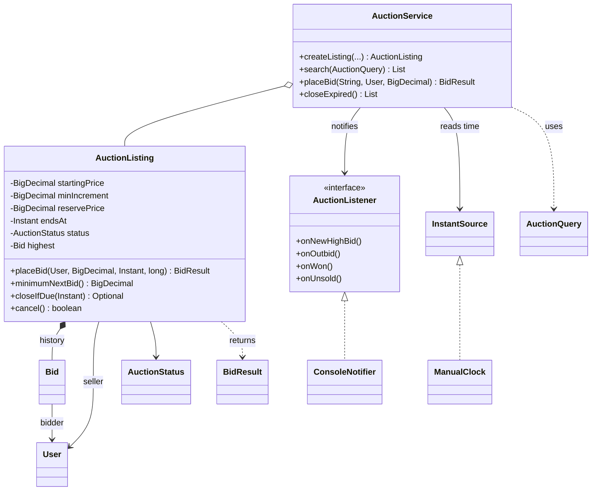

### Key flows

**Auction lifecycle**

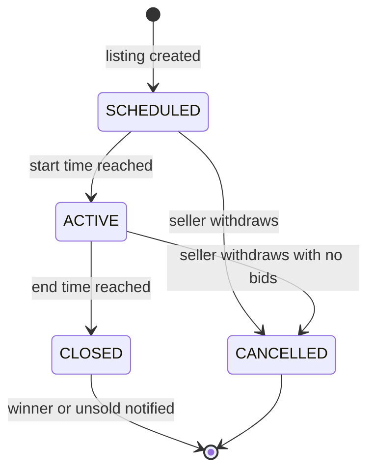

`SCHEDULED → ACTIVE` happens **lazily** (only when someone next touches the listing, not at the exact moment): every method first calls `refresh(now)`. No background thread is needed just to flip the state.

**Placing a bid (the critical section)** — a **critical section** is a piece of code that only one thread may run at a time because it reads and changes shared data.

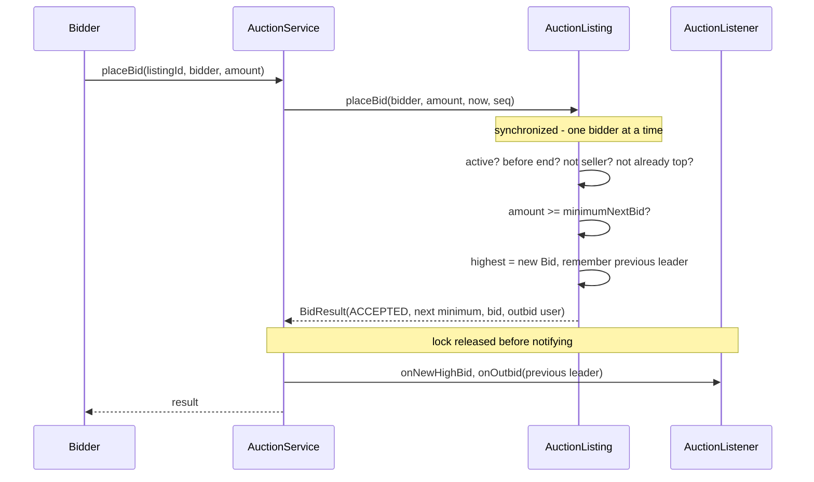

**Closing.** A scheduler (in production a `ScheduledExecutorService` — Java's built-in timer that runs a task repeatedly — running every few seconds) calls `closeExpired()`. Each listing's `closeIfDue(now)` atomically moves `ACTIVE → CLOSED` and returns the winner only if the reserve is met. Notifications go out after all locks are released.

### Design decisions & patterns used

| Decision | Why | Alternative rejected |
|---|---|---|
| **Bid rules live inside `AuctionListing` and run under its lock** (a *monitor*: an object whose methods are all `synchronized`) | "Read highest, compare, replace" must be one atomic step. The lock is per listing, so bids on different auctions never wait for each other. | A global lock in the service (all auctions serialised); or `AtomicReference<Bid>` (a reference that can be swapped atomically) + CAS loop (retry compare-and-set until it succeeds) — valid, but the rule set (seller, leader, end time, increment) is easier to get right under one lock. |
| **Refusals are returned (`BidOutcome`), not thrown** | A too-low bid is normal business, not an exceptional error (an **exception** is Java's way of aborting a method to signal that something went wrong). The caller also gets the next minimum to show in the UI. | Throwing an exception for every low bid. |
| **Observer for notifications, called outside the lock** | Slow email or push calls must not block other bidders. `BidResult` carries a **snapshot** (a copy frozen at one moment) of the accepted bid taken inside the lock, so listeners never read a newer, unrelated value. | Notifying inside `synchronized` (slow, and risks deadlock if a listener calls back). |
| **Minimum increment** | Stops 1-cent "wars" and makes the next minimum predictable. | Any higher amount accepted. |
| **Reserve price** | Lets a seller refuse to sell too cheaply; checked only at close. | Rejecting bids below the reserve (would reveal it). |
| **`InstantSource` injected** | Time-dependent code becomes testable: the demo moves a `ManualClock` forward instead of sleeping. | Calling `Instant.now()` everywhere. |
| **Specification pattern for search** | Each criterion is a `Predicate<AuctionListing>`; they combine with `and`. New criteria = one method. | One `search(name, category, min, max, ...)` method whose parameter list keeps growing. |
| **The service is not a Singleton** | awesome-low-level-design's version uses a Singleton `AuctionSystem`; we pass one instance around instead so tests can create fresh ones. | Global state shared by all tests. |

### Java implementation

Files: `Auction.java` (user, bid, status, outcome records, listing, manual clock), `AuctionService.java` (listener, notifier, query, service), `Main.java`.

The full runnable source is in [`code/lld/ch19/auction/`](code/lld/ch19/auction/); below are the lines that carry the design.

```java
// File: lld/ch19/auction/Auction.java
/** Why a bid was refused - returned, not thrown, because refusals are normal business. */
enum BidOutcome { ACCEPTED, AUCTION_NOT_ACTIVE, AUCTION_ENDED, SELLER_CANNOT_BID, TOO_LOW, ALREADY_HIGHEST }

/** One auction. Every state change is synchronized, so "read highest, compare, replace" is atomic. */
final class AuctionListing {
    private final BigDecimal reservePrice;          // hidden minimum; ZERO = no reserve
    private Bid highest;

    private void refresh(Instant now) {             // lazy SCHEDULED -> ACTIVE
        if (status == AuctionStatus.SCHEDULED && !now.isBefore(startsAt)) status = AuctionStatus.ACTIVE;
    }

    synchronized BidResult placeBid(User bidder, BigDecimal rawAmount, Instant now, long seq) {
        refresh(now);
        BigDecimal amount = money(rawAmount);
        if (status != AuctionStatus.ACTIVE) return refuse(BidOutcome.AUCTION_NOT_ACTIVE);
        if (!now.isBefore(endsAt)) return refuse(BidOutcome.AUCTION_ENDED);  // closing job may not have run yet
        if (bidder.id().equals(seller.id())) return refuse(BidOutcome.SELLER_CANNOT_BID);
        if (highest != null && highest.bidder().id().equals(bidder.id())) return refuse(BidOutcome.ALREADY_HIGHEST);
        if (amount.compareTo(minimumNextBid()) < 0) return refuse(BidOutcome.TOO_LOW);

        Optional<User> outbid = Optional.ofNullable(highest).map(Bid::bidder);
        highest = new Bid(bidder, amount, now, seq);
        bids.add(highest);
        return new BidResult(BidOutcome.ACCEPTED, minimumNextBid(), Optional.of(highest), outbid);
    }

    /** First bid must reach the starting price; later bids must beat the leader by the increment. */
    synchronized BigDecimal minimumNextBid() {
        return highest == null ? startingPrice : highest.amount().add(minIncrement);
    }

    synchronized Optional<CloseResult> closeIfDue(Instant now) {
        refresh(now);
        if (status != AuctionStatus.ACTIVE || now.isBefore(endsAt)) return Optional.empty();
        status = AuctionStatus.CLOSED;
        boolean reserveMet = highest != null && highest.amount().compareTo(reservePrice) >= 0;
        return Optional.of(new CloseResult(this, reserveMet ? Optional.of(highest) : Optional.empty(), reserveMet));
    }

    /** A seller may withdraw only while nobody has bid. */
    synchronized boolean cancel() {
        if (status == AuctionStatus.CLOSED || status == AuctionStatus.CANCELLED || highest != null) return false;
        status = AuctionStatus.CANCELLED;
        return true;
    }
}

// File: lld/ch19/auction/AuctionService.java
final class AuctionQuery {                          // Specification: each criterion is a Predicate
    AuctionQuery category(String c) { parts.add(a -> a.category().equalsIgnoreCase(c)); return this; }
    Predicate<AuctionListing> toPredicate() { return parts.stream().reduce(x -> true, Predicate::and); }
}

BidResult placeBid(String listingId, User bidder, BigDecimal amount) {    // AuctionService (facade)
    AuctionListing a = listings.get(listingId);
    BidResult r = a.placeBid(bidder, amount, clock.instant(), bidSeq.incrementAndGet());
    r.accepted().ifPresent(top -> {                 // snapshot taken inside the lock; notify outside it
        listeners.forEach(l -> l.onNewHighBid(a, top));
        r.outbid().ifPresent(u -> listeners.forEach(l -> l.onOutbid(a, u, top.amount())));
    });
    return r;
}
// closeExpired(): closeIfDue on every listing, then onWon / onUnsold after all locks are released
```

`Main` drives a `ManualClock` (an `InstantSource` it moves forward) instead of sleeping.

Output:

```text
== 1. Create listings ==
  A1 'Vintage Guitar' now 100.00, A2 'Pocket Watch' now 50.00

== 2. Search (name 'watch', price 0-100) ==
  [A2 'Pocket Watch' now 50.00]

== 3. Bidding rules ==
  Ana bids 90 (below start) -> TOO_LOW (next minimum 100.00)
  Ana bids 100 -> ACCEPTED (next minimum 110.00)
  Ana bids 120 (already top) -> ALREADY_HIGHEST (next minimum 110.00)
  Bob bids 105 (increment is 10) -> TOO_LOW (next minimum 110.00)
    [notify Ana] you were outbid on Vintage Guitar, now 110.00
  Bob bids 110 -> ACCEPTED (next minimum 120.00)
  Sam bids on own item -> SELLER_CANNOT_BID (next minimum 120.00)
    [notify Bob] you were outbid on Vintage Guitar, now 150.00
  Ana bids 150 -> ACCEPTED (next minimum 160.00)
  Bob bids 60 on the watch -> ACCEPTED (next minimum 65.00)

== 4. One hour later: the watch closes, reserve (500) not met ==
    [notify Sam] Pocket Watch unsold (reserve not met)
  closed A2 reserveMet=false

== 5. 50 threads bid on the guitar at once ==
  accepted=28 (varies run to run), highest=650.00 by bidder49, history strictly increasing by >= increment: true

== 6. Time is up: the guitar closes and the winner is told ==
  late bid -> AUCTION_ENDED (next minimum 660.00)
    [notify bidder49] you WON Vintage Guitar for 650.00
    [notify Sam] Vintage Guitar sold to bidder49
  status CLOSED, final price 650.00
```

**Reading the output.** Step 3 exercises every rule: below start, leader re-bidding, below increment, seller bidding. The outbid notices print *before* the bidder's own result line because the service notifies before returning. Step 4 closes the watch as unsold because 60 < the 500 reserve. Step 5 fires 50 concurrent bids: how many are accepted depends on thread timing (a bid that arrives after a higher one is refused as too low), but the final highest is always the maximum, 650.00, and the history is always strictly increasing by at least the increment — the invariant (a rule that must always be true) the lock protects. Step 6 refuses a bid after the end time even though the closing job has not yet run.

### Concurrency & edge cases

| Case | Handling |
|---|---|
| Two bidders submit the same amount at the same time | The first one through the lock wins; the second is now below `minimumNextBid()` and gets `TOO_LOW`. |
| Bid arrives exactly at the end time | `!now.isBefore(endsAt)` → `AUCTION_ENDED`. The end instant is exclusive. |
| Close job runs late | Bids after `endsAt` are refused anyway, so a late job cannot change the winner. |
| Close and bid race | Both are `synchronized` on the listing; the bid either lands before the close (and counts) or after (and is refused). |
| Notification listener is slow or throws | Called outside the lock; in production, publish to a queue so failures are retried without affecting bidding. |
| Seller cancels after bids | Refused (`cancel()` returns false) — protects bidders. |
| Money precision | Amounts normalised to scale 2 with `BigDecimal`; compared with `compareTo`. |
| Very hot auction (thousands of bids per second) | One lock per listing is fine for one JVM (Java Virtual Machine — one running Java process); distributed: a single-writer per auction (partition bids by auction id — split them into separate streams so all bids for one auction go to the same place, e.g. a Kafka partition, Kafka being a widely used event-streaming system), or a conditional update `UPDATE ... SET high = ? WHERE id = ? AND high < ?`. |

### Real-world example

eBay auctions use **proxy bidding**: you enter the most you are willing to pay, and eBay bids on your behalf only as much as needed to stay ahead, by the current increment. eBay also supports hidden **reserve prices**, and its auctions end at a fixed time, which is why "sniping" (bidding in the last seconds) is common there. Some other auction sites use a **soft close** — a late bid extends the end time — precisely to defeat sniping.

### Extensions & follow-up questions

- **"Add proxy (automatic) bidding."** Each bidder may register a `maxAmount`. After any accepted bid, inside the same lock, let the strongest proxy respond with `min(its max, competitor + increment)`. Ties go to the earlier proxy (use `Bid.seq`).
- **"Stop sniping."** Soft close: in `placeBid`, if an accepted bid arrives within the last N minutes, set `endsAt = endsAt + N` (make `endsAt` non-final, change under the same lock).
- **"Buy It Now."** A fixed price that closes the auction immediately if paid before the first bid.
- **"Dutch / sealed-bid / Vickrey auctions."** (Dutch: the price starts high and drops until someone accepts; sealed-bid: bidders cannot see each other's bids.) Extract an `AuctionRules` strategy: `validate(bid)`, `winner(bids)`, `price(bids)`. Vickrey (second-price sealed bid): highest bidder wins but pays the second-highest bid.
- **"Payment after winning."** Winner has 48 hours to pay (new state `AWAITING_PAYMENT`); if not, offer to the second-highest bidder.
- **"Scale the close job."** Keep a priority queue (or a sorted index) by `endsAt` so the scheduler only touches auctions that are due.

### In the interview

**30–45 minute plan**

1. Clarify the bid rules (start price, increment, reserve, seller/leader restrictions) — 4 min.
2. Entities and the lifecycle state machine — 8 min.
3. Code `placeBid` under the listing lock and **say why the lock is per listing** — 12 min.
4. Closing + notifications outside the lock — 6 min.
5. Concurrency discussion and extensions (proxy bidding, soft close) — 10 min.

**30-second answer:** "Each listing owns its bid rules and its highest bid, and `placeBid` is synchronized on the listing, so compare-and-replace is atomic and different auctions never contend. Refusals return a reason and the next minimum. The service notifies outbid users and, at close, the winner and seller, always after releasing the lock. Time comes from an injected clock, so closing and late bids are testable."

**Follow-ups with answers**

- *Why not `AtomicReference` + CAS?* Possible for the amount alone, but the rule also checks seller, leader and time. A tiny critical section under one lock is simpler and still fast because the lock is per listing.
- *How do you close auctions on time across servers?* A scheduler that owns a time-ordered index of end times; the close itself is idempotent (`closeIfDue` returns empty the second time), so running it twice is harmless.
- *How do you show a live price to thousands of viewers?* Push `onNewHighBid` events to a pub/sub channel (publish/subscribe: senders post messages to a topic and every subscriber receives them) and WebSockets (a connection the browser keeps open so the server can push data at any time); viewers read a cache (a fast saved copy of data — see [System Design Fundamentals](../../../system-design-patterns/modules/00-system-design-fundamentals/README.md)), not the lock-holding object.

### Self-check

1. **Q:** What two conditions make a bid `TOO_LOW`? **A:** Below the starting price when there is no bid, or below highest + increment otherwise.
2. **Q:** Why are listeners called after `placeBid` returns from the listing? **A:** To keep the lock short and avoid deadlock or slowdown from notification code.
3. **Q:** A bid arrives at 12:00:00.000 and the auction ends at 12:00:00.000. Accepted? **A:** No — the end time is exclusive.
4. **Q:** Where does the reserve price matter? **A:** Only at close: if the highest bid is below it, the item is unsold.
5. **Q:** What is the Specification pattern here? **A:** Search criteria as composable `Predicate`s combined with `and`.

### TL;DR

- One **lock per listing**; all bid rules inside it; refusals are values, not exceptions.
- Lifecycle `SCHEDULED → ACTIVE → CLOSED | CANCELLED`; activation is lazy, closing is idempotent.
- **Observer** notifications after the lock; **injected clock** for testable time; **Specification** for search.

---
## Design a Music Streaming Service (Spotify)

### Problem & clarifying questions

A music streaming service lets users search a huge catalog, build playlists, and play songs with the usual controls (play, pause, skip, previous, seek, shuffle, repeat). Free and paid plans behave differently. The service suggests new music.

| Question | Assumed answer |
|---|---|
| What can users search? | Songs, albums, artists. |
| Playlists? | Users create, reorder and edit their own playlists. |
| Playback controls? | Play, pause, resume, skip, previous, seek; shuffle on/off; repeat off / all / one. |
| Plans? | FREE (ads, limited skips per hour, no downloads) and PREMIUM (no ads, unlimited skips, offline). |
| Recommendations? | A stub (a simple placeholder) based on listening history; real ones are an ML (machine learning — software that learns patterns from data) system. |
| Actual audio streaming, DRM (copy protection), CDNs (content delivery networks — servers near users that hold copies of files)? | Out of scope for LLD (low-level design: classes and their code) — the player models *what* plays, not the bytes. |

### Requirements

**Functional**

1. Browse and search songs, albums and artists.
2. Create and manage playlists.
3. User accounts and authentication (we model users and plans; login itself is the usual auth service).
4. Playback controls: play, pause, skip, seek (plus previous, shuffle, repeat).
5. Recommendations based on preferences and listening history.
6. Subscriptions: FREE vs PREMIUM with different limits.

**Non-functional**

7. Many users stream at once; the shared catalog is read-mostly and thread-safe (works correctly when many threads use it at once).
8. Scales to a large catalog and user base (indexes, not scans, in production).
9. Extensible: social sharing, offline mode, new play orders, new recommenders.

### Use cases

| Actor | Use cases |
|---|---|
| Listener | Search, play/pause/skip/seek, shuffle/repeat, create and edit playlists, upgrade plan |
| Artist / label (content admin) | Add songs and albums to the catalog |
| System | Record plays (history, royalties — money owed to artists per play), insert ads for free users, recommend songs |

### Core entities

| Class | Responsibility |
|---|---|
| `Artist`, `Album`, `Song`, `Genre` | Immutable catalog records. |
| `MusicLibrary` | Thread-safe catalog with search by song title, album title, artist name. |
| `SubscriptionPlan` | Enum that **carries the rules**: monthly price, skips per hour, ads, offline downloads. |
| `User` | Name, current plan, playlists, listening history. |
| `Playlist` | Ordered, user-owned song list: add, remove, move. |
| `PlaybackOrder` → `SequentialOrder`, `ShuffleOrder` | Strategy: produces the play order (a permutation — every song exactly once, in some order) starting from the current song. |
| `RepeatMode`, `PlayerState` | `OFF / ALL / ONE`; `STOPPED / PLAYING / PAUSED`. |
| `MusicPlayer` | One user's session: queue, play order, cursor (where we are in the play order), position, state, skip window, ad counter. |
| `PlaybackListener` | Observer on "song started" (history, royalties, recommendations). |
| `Recommender` → `GenreRecommender` | Strategy: suggest unplayed songs from the user's favourite genres. |

### Class diagram

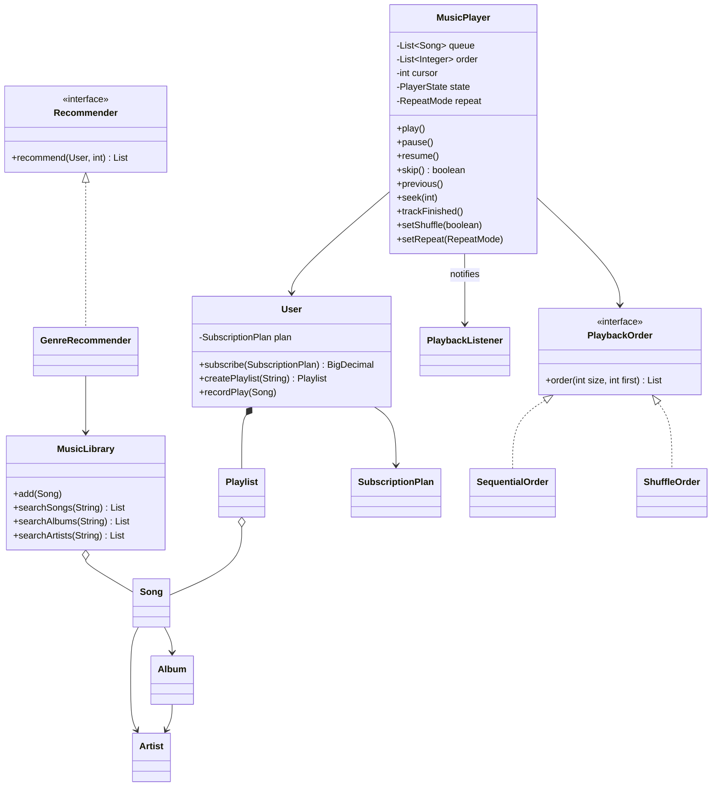

### Key flows

**Player states**

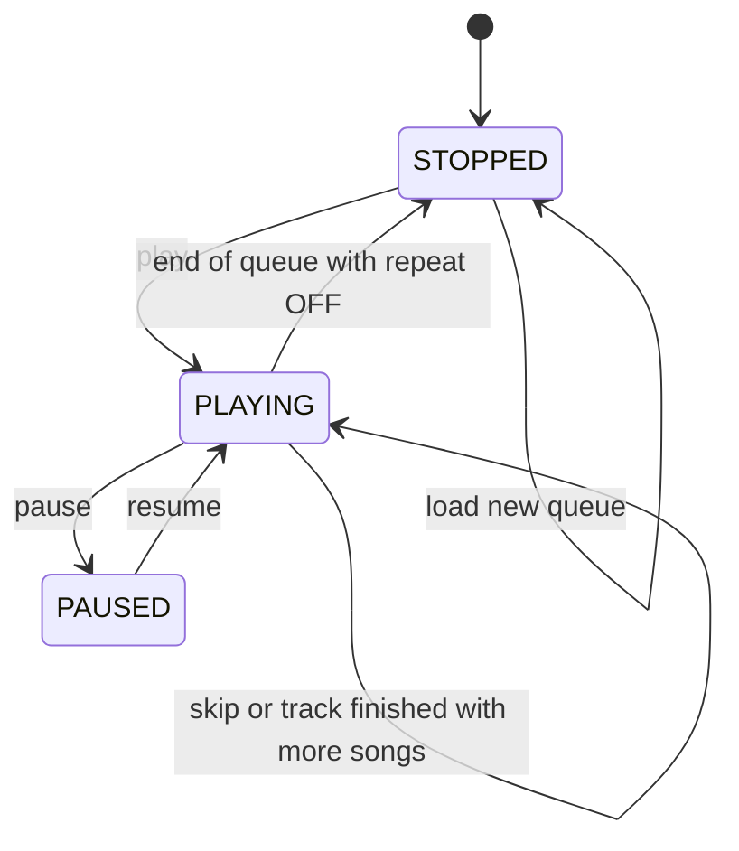

**What happens when a song ends or the user presses Next**

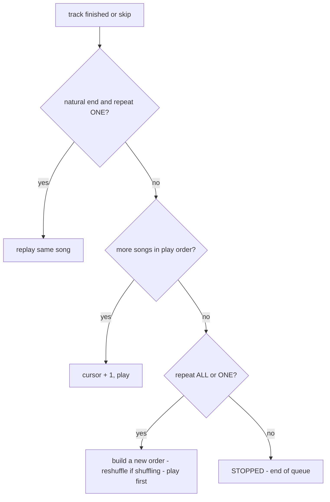

Skip first checks the plan's rolling (always the last 60 minutes, not a fixed clock hour) one-hour limit (a deque — a queue you can add to or remove from at both ends — of skip timestamps; drop those older than an hour, compare the size with `skipsPerHour`). Pressing Next on repeat-ONE moves on — like real players, repeat-one only affects songs that end naturally.

**Shuffle keeps the current song.** Turning shuffle on builds a new permutation whose first element is the song playing now, and shuffles the rest with `Collections.shuffle(list, random)`. Turning it off rebuilds the sequential order starting from the current song. The queue itself never changes — only the **order** of indexes into it — so switching back and forth loses nothing.

### Design decisions & patterns used

| Decision | Why | Alternative rejected |
|---|---|---|
| **Strategy for play order** (`PlaybackOrder`) | Shuffle, sequential, "smart shuffle" (spread the same artist apart) are interchangeable algorithms. The player just asks for an order. | `if (shuffle) ... else ...` inside `skip`, `previous`, `wrap`. |
| **Order as a list of indexes into an unchanged queue** | Turning shuffle off/on never loses the original order; `upNext` is a simple walk. | Physically shuffling the queue list (original order lost). |
| **Seeded `Random`** | Repeatable demos and tests. Production uses an unseeded (or per-session) seed. | `Math.random()` (not testable). |
| **Plan rules inside `SubscriptionPlan` enum** | `user.plan().skipsPerHour` and `.ads` — no `if (plan == FREE)` scattered around; a new plan is one enum constant (or a class if rules get complex). | Boolean flags on `User`. |
| **Observer for plays** (`PlaybackListener`) | History, royalty counting and recommendation features all react to "song started" without the player knowing them. | Player calling each subsystem directly. |
| **Strategy for recommendations** | `Recommender` can be genre-based today, collaborative filtering ("people who liked what you like also liked…") tomorrow. | Hard-coding one algorithm in `User`. |
| **One `MusicPlayer` per user session, all methods `synchronized`** | Commands can arrive from two devices (phone + desktop "connect"). The shared `MusicLibrary` uses concurrent maps. | A single shared player object. |
| **State as an enum, not the State pattern** | Three states with trivial behaviour; the GoF ("Gang of Four", the authors of the classic 1994 *Design Patterns* book) State pattern (one class per state) pays off only when each state has substantial, different behaviour. | Three state classes for four one-line methods. |
| **Singletons?** | awesome-low-level-design makes `MusicLibrary`, `UserManager` and `MusicRecommender` Singletons. We inject single instances instead — same sharing, easier tests. | Global `getInstance()`. |

### Java implementation

Files: `Catalog.java` (genre, artist, album, song, library, plans, user, playlist), `Player.java` (play-order strategies, repeat/state enums, listener, player, recommender), `Main.java`.

The full runnable source is in [`code/lld/ch19/music/`](code/lld/ch19/music/); below are the lines that carry the design.

```java
// File: lld/ch19/music/Catalog.java - the plan carries its own rules
enum SubscriptionPlan {
    FREE(new BigDecimal("0.00"), 6, true, false),
    PREMIUM(new BigDecimal("10.99"), Integer.MAX_VALUE, false, true);
    final BigDecimal monthlyPrice;
    final int skipsPerHour;
    final boolean ads;
    final boolean offlineDownloads;
}

// File: lld/ch19/music/Player.java
interface PlaybackOrder {                       // Strategy: a permutation of 0..size-1 starting with first
    List<Integer> order(int size, int first);
}
final class SequentialOrder implements PlaybackOrder {
    @Override public List<Integer> order(int size, int first) {
        List<Integer> out = new ArrayList<>(IntStream.range(0, size).boxed().toList());
        Collections.rotate(out, -first);        // start at the current track, keep the rest in order
        return out;
    }
}
final class ShuffleOrder implements PlaybackOrder {
    ShuffleOrder(long seed) { this.random = new Random(seed); }   // seeded: repeatable demo and tests
    @Override public List<Integer> order(int size, int first) {
        List<Integer> rest = new ArrayList<>(IntStream.range(0, size).filter(i -> i != first).boxed().toList());
        Collections.shuffle(rest, random);
        rest.add(0, first);                     // the song you are hearing keeps playing
        return rest;
    }
}

final class MusicPlayer {                       // one per user session; every public method synchronized
    private List<Song> queue = List.of();
    private List<Integer> order = List.of();    // indexes into the unchanged queue
    private int cursor;                         // index into order

    /** User pressed "next". Free users have a skip limit per rolling hour. */
    synchronized boolean skip() {
        if (state == PlayerState.STOPPED) return false;
        Instant now = clock.instant();
        while (!recentSkips.isEmpty() && recentSkips.peekFirst().isBefore(now.minus(Duration.ofHours(1)))) recentSkips.pollFirst();
        if (recentSkips.size() >= user.plan().skipsPerHour) {
            System.out.println("  [player] skip limit reached on " + user.plan() + " plan");
            return false;
        }
        recentSkips.addLast(now);
        advance(false);
        return true;
    }

    synchronized void trackFinished() { advance(true); }   // repeat-one honoured only on a natural end

    synchronized void setShuffle(boolean on) {
        int now = order.isEmpty() ? 0 : order.get(cursor);
        playbackOrder = on ? new ShuffleOrder(42) : new SequentialOrder();
        order = playbackOrder.order(queue.size(), now);
        cursor = 0;
    }

    private void advance(boolean natural) {
        if (natural && repeat == RepeatMode.ONE) { start(); return; }
        if (cursor + 1 < order.size()) { cursor++; start(); return; }
        if (repeat == RepeatMode.ALL || repeat == RepeatMode.ONE) {   // wrap around (reshuffle if shuffling)
            order = playbackOrder.order(queue.size(), order.get(0));
            cursor = 0;
            start();
            return;
        }
        state = PlayerState.STOPPED;
        System.out.println("  [player] end of queue");
    }

    private void start() {                      // FREE plan: an ad every few songs; then notify PlaybackListeners
        if (user.plan().ads && ++songsSinceAd > 3) {
            System.out.println("  [player] (30-second ad for FREE plan)");
            songsSinceAd = 1;
        }
        positionSec = 0;
        state = PlayerState.PLAYING;
        Song s = current();
        System.out.println("  [player] > " + s);
        listeners.forEach(l -> l.onStart(user, s));
    }
}
// previous(): restarts the song if more than 3 s in (or at the first song), else goes back one.
// GenreRecommender: count the user's history per Genre, suggest unheard songs from the top genres.
```

Output:

```text
== 1. Search ==
  songs 'blue'    -> [All Blues - Miles Davis, Blue in Green - Miles Davis]
  albums 'opera'  -> [A Night at the Opera]
  artists 'da'    -> [Miles Davis]

== 2. Playlist ==
  Road trip: [Bohemian Rhapsody - Queen, Blue in Green - Miles Davis, So What - Miles Davis, Hello - Adele, Love of My Life - Queen]

== 3. Play in order, pause, seek, repeat-one ==
  [player] > Bohemian Rhapsody - Queen
  state PAUSED at 120s
  [player] > Bohemian Rhapsody - Queen
  [player] > Blue in Green - Miles Davis

== 4. Shuffle keeps the current song, reorders the rest ==
  now Blue in Green - Miles Davis, up next [Love of My Life - Queen, So What - Miles Davis, Bohemian Rhapsody - Queen, Hello - Adele]

== 5. FREE plan: skip limit (6/hour) and ads, repeat-all wraps the shuffled queue ==
  [player] (30-second ad for FREE plan)
  [player] > Love of My Life - Queen
  [player] > So What - Miles Davis
  [player] > Bohemian Rhapsody - Queen
  [player] (30-second ad for FREE plan)
  [player] > Hello - Adele
  [player] > Blue in Green - Miles Davis
  [player] > Hello - Adele
  [player] skip limit reached on FREE plan

== 6. Upgrade to PREMIUM: no ads, unlimited skips ==
  charged $10.99
  [player] > Death on Two Legs - Queen
  [player] > Freddie Freeloader - Miles Davis
  [player] > Death on Two Legs - Queen
  [player] > Freddie Freeloader - Miles Davis
  [player] end of queue

== 7. Recommendations from listening history ==
  plays so far: 13
  recommended: [You're My Best Friend - Queen, All Blues - Miles Davis, When We Were Young - Adele]
```

**Reading the output.** Step 3: repeat-ONE replays "Bohemian Rhapsody" when it ends naturally. Step 4: shuffle keeps "Blue in Green" playing and reorders the rest. Step 5: on the FREE plan an ad plays after every three songs, repeat-ALL wraps and reshuffles the queue, and the seventh skip within the hour is refused. Step 6: PREMIUM has no ads; with repeat-ALL the second skip wraps to the start; with repeat OFF the queue ends. Step 7: the recommender suggests songs the user has **not** heard, from the genres they played most.

### Concurrency & edge cases

| Case | Handling |
|---|---|
| Two devices send "next" at the same instant | Player methods are `synchronized`; the two skips apply one after the other. |
| Catalog updated while users search | `ConcurrentHashMap` (a thread-safe hash map) for songs/albums/artists; search iterates a weakly consistent view (it may or may not show changes made during the loop, but never breaks). |
| Playlist edited while it is playing | `load` copies the playlist (`List.copyOf`), so the running queue is a snapshot; a real app would sync edits into "up next". |
| Seek past the end or before 0 | Clamped to `[0, duration]`. |
| Previous after 3 seconds | Restarts the current song (common player behaviour); within 3 seconds goes back one song. |
| Skip when stopped | Refused (and does not count against the limit). |
| Plan changes mid-session | `plan` is `volatile` (a Java keyword that makes every thread see the latest written value); the next skip or ad check sees it. |
| Empty queue | `play()` throws `IllegalStateException`. |

### Real-world example

Spotify's free tier has historically limited skips (for example, six per hour on mobile) and inserts ads between songs, while Premium removes both and allows downloads — the rules our `SubscriptionPlan` enum carries. Spotify engineers also wrote (2014) that users complained a truly random shuffle "felt" non-random when the same artist came up twice in a row, so they changed the algorithm to spread songs by the same artist across the list. That is exactly the kind of change the `PlaybackOrder` strategy absorbs: a new `ArtistSpreadShuffle` class, no player changes. Personalised playlists such as Discover Weekly are the industrial version of our `Recommender` stub.

### Extensions & follow-up questions

- **"Add 'play next' and 'add to queue'."** Keep a separate *user queue* that is consumed before the context (playlist/album) order.
- **"Offline mode."** `SubscriptionPlan.offlineDownloads`; a `DownloadManager` stores encrypted files; the player chooses a local or remote `AudioSource` (Strategy).
- **"Social sharing / collaborative playlists."** Playlist gets a collaborator set and an edit log; listeners (Observer) push changes to other users.
- **"Crossfade, gapless playback."** Player behaviour around `trackFinished`; a `TransitionStrategy`.
- **"Royalties."** A `PlaybackListener` that records a play once the user has listened for a threshold time.
- **"Search at scale."** Inverted index (a map from each word to the items containing it) / search service with prefix (typeahead — suggestions as you type) and fuzzy matching (tolerating typos); the `MusicLibrary` interface stays.
- **"Smart shuffle."** New `PlaybackOrder` that spaces out songs by the same artist.

### In the interview

**30–45 minute plan**

1. Clarify controls, plans and scope (skip audio bytes) — 4 min.
2. Catalog entities + library search — 6 min.
3. User, playlist, subscription plan — 5 min.
4. **Player**: queue + order + cursor; state machine; shuffle/repeat as strategy/enum — 15 min.
5. Observer for history; recommender strategy; concurrency; extensions — 10 min.

**30-second answer:** "Immutable catalog records in a thread-safe library. Each user has a player session holding the queue, a play order produced by a `PlaybackOrder` strategy, a cursor and a repeat mode. Shuffle rebuilds the order around the current song. Plan limits live in the plan enum. A playback listener records history, which feeds a pluggable recommender."

**Follow-ups with answers**

- *How does shuffle avoid repeating a song before all have played?* It is a permutation (each index once), not "pick a random next song".
- *Where do ads fit?* The player asks the plan whether ads apply and inserts one every N songs; in production an ad service picks which ad.
- *How would you implement "previous" in shuffle mode?* Walk back along the same order list (the cursor), so previous is the song you actually heard before.

### Self-check

1. **Q:** Why store the play order as indexes rather than reordering the queue? **A:** So switching shuffle off restores the original order and nothing is lost.
2. **Q:** What does repeat-ONE do when the user presses Next? **A:** Moves to the next song; it only replays on natural end.
3. **Q:** Which pattern lets you add a smarter shuffle without touching the player? **A:** Strategy (`PlaybackOrder`).
4. **Q:** How is "6 skips per hour" enforced? **A:** A deque of skip times; drop entries older than one hour; refuse if the size has reached the limit.
5. **Q:** Why is the player's state an enum rather than the State pattern? **A:** The states have almost no distinct behaviour; the pattern would add classes without benefit.

### TL;DR

- Catalog = immutable records in a concurrent library.
- Player = **queue + order (Strategy) + cursor + repeat mode + state**; shuffle keeps the current song.
- Plan rules in the **enum**; plays published via **Observer**; recommendations via **Strategy**.

---
## Design an Online Food Delivery Service (Swiggy) + FoodKart

This problem also comes in two shapes:

- **Part A — Swiggy-style delivery platform** (the awesome-low-level-design problem): restaurants with menus, a cart, orders with tracking states, payments, and **assigning a delivery rider** by a pluggable strategy. We add **kitchen capacity** (a restaurant can only cook so many items at once), the key twist in a commonly reported Flipkart food-ordering variant (it is not part of the FoodKart statement below).
- **Part B — FoodKart** (Flipkart machine-coding round, from kumaransg/LLD): a smaller, command-driven problem — users and pincodes (Indian postal codes), one-dish restaurants, ratings, `show_restaurant` sorted by rating or price, `place_order` — plus a **restaurant selection strategy** (highest rating / lowest price) filtered by remaining capacity.

### Problem & clarifying questions

| Question | Assumed answer |
|---|---|
| Can one cart mix restaurants? | No — one restaurant per cart (as in Swiggy/Zomato). |
| Who confirms an order? | The restaurant; it may refuse if its kitchen is full. |
| When is capacity freed? | When the food is ready (handed over), not when it is delivered. |
| How is a rider chosen? | By a strategy: nearest to the restaurant, or fair share (fewest deliveries today). |
| What if no rider is free? | The order waits in a queue; the next freed rider takes the oldest waiting order. |
| Can a customer cancel? | Only before the kitchen starts cooking (PENDING or CONFIRMED). |
| Payment types? | UPI, card, cash on delivery (COD: nothing to refund). |
| Live GPS, ETA (estimated time of arrival) prediction, batching two orders per rider, surge fees (higher fees at busy times)? | Extensions. |

### Requirements

**Functional (Part A)**

1. Customers browse restaurants, view menus and place orders.
2. Restaurants manage menus, prices and availability.
3. Delivery agents accept and fulfil orders.
4. Customers track order status and get notified of changes.
5. Several payment methods.
6. Real-time notifications to customers, restaurants and delivery agents.

**Functional (Part B — FoodKart)**

7. `register_user(name, gender, phone, pincode)` — phone is unique.
8. `login_user(phone)` — sets the context; logging in someone else logs out the previous user.
9. `register_restaurant(name, pincodes "A/B", dish, price, quantity)` — in the context of the logged-in user (the owner). A restaurant serves **one** dish to **many** pincodes.
10. `update_quantity(name, add)`, `update_location(name, pincodes)` — owner only.
11. `rate_restaurant(name, 1..5, optional comment)`; rating = average of all ratings.
12. `show_restaurant(rating|price)` — **serviceable** restaurants (deliver to my pincode **and** quantity > 0), sorted **descending** by the chosen field.
13. `place_order(name, qty)`; bonus: order history.
14. *(Variant)* place an order without naming a restaurant: pick one by a **selection strategy**, among those that deliver here **and** have capacity for the whole quantity.

**Non-functional**

- Handle many concurrent orders without double-booking kitchen capacity or riders.
- Keep data consistent (no negative stock, no rider on two orders).
- In-memory only for the machine-coding round; demoable driver (a small `Main` program that feeds in commands and prints results); graceful failures.

### Use cases

Notation (system box, include/extend arrows) as in [§3.10](../03-relationships-and-uml/README.md#310-use-case-diagrams). The **Admin** onboards restaurants and delivery agents (`addRestaurant`, `addAgent`); the **Payment gateway** is the outside service that charges UPI and cards.

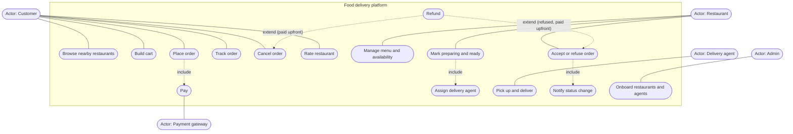

"Assign delivery agent" has no human actor: the platform runs it when food is ready or a rider becomes free. Every status change also includes "Notify status change"; only one such arrow is drawn to keep the picture readable.

### Core entities

| Class | Responsibility |
|---|---|
| `Location` | A point; `distanceTo`. |
| `Customer` | id, name, phone, address. |
| `MenuItem` | Name, price, available flag (both changeable by the restaurant). |
| `Restaurant` | Menu, open flag, **kitchen capacity** (max items cooking at once), `tryReserveKitchen` / `releaseKitchen`. |
| `Cart` | One restaurant + item quantities; refuses items from a second restaurant. |
| `OrderItem` | Snapshot of item name, **unit price at order time**, quantity. |
| `OrderStatus` | State machine: PENDING → CONFIRMED → PREPARING → READY_FOR_PICKUP → OUT_FOR_DELIVERY → DELIVERED, or CANCELLED. |
| `Order` | Customer, restaurant, items, delivery fee, payment, status history, assigned agent. |
| `PaymentMethod` → `UpiPayment`, `CardPayment`, `CashOnDelivery` | Sealed interface; COD is not paid upfront. |
| `DeliveryAgent` | Location, `AtomicBoolean available` (a true/false flag that can be checked-and-changed atomically), deliveries today; `tryClaim()` is a CAS. |
| `DeliveryAssignmentStrategy` → `NearestAgentStrategy`, `FairShareStrategy` | Ranks free riders for an order. |
| `OrderListener` / `Notifier` | Observer for status changes. |
| `FoodDeliveryService` | Facade: browse, place, accept, prepare, ready, deliver, cancel; the waiting-for-rider queue. |
| *(FoodKart)* `User`, `Restaurant`, `Review`, `FoodOrder`, `SortBy`, `RestaurantSelectionStrategy`, `FoodKartService` | The machine-coding model; `Restaurant.take(q)` is the atomic capacity check. |

### Class diagram

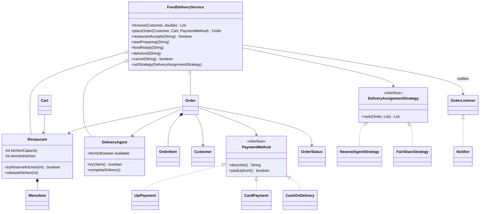

FoodKart (Part B):

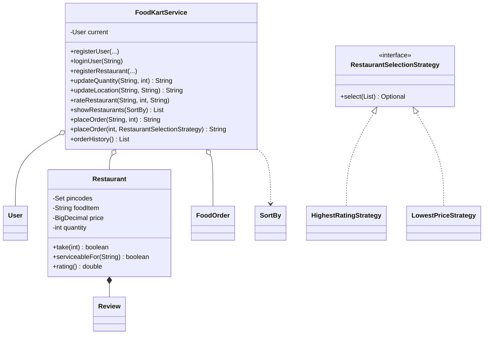

### Key flows

**Order tracking state machine**

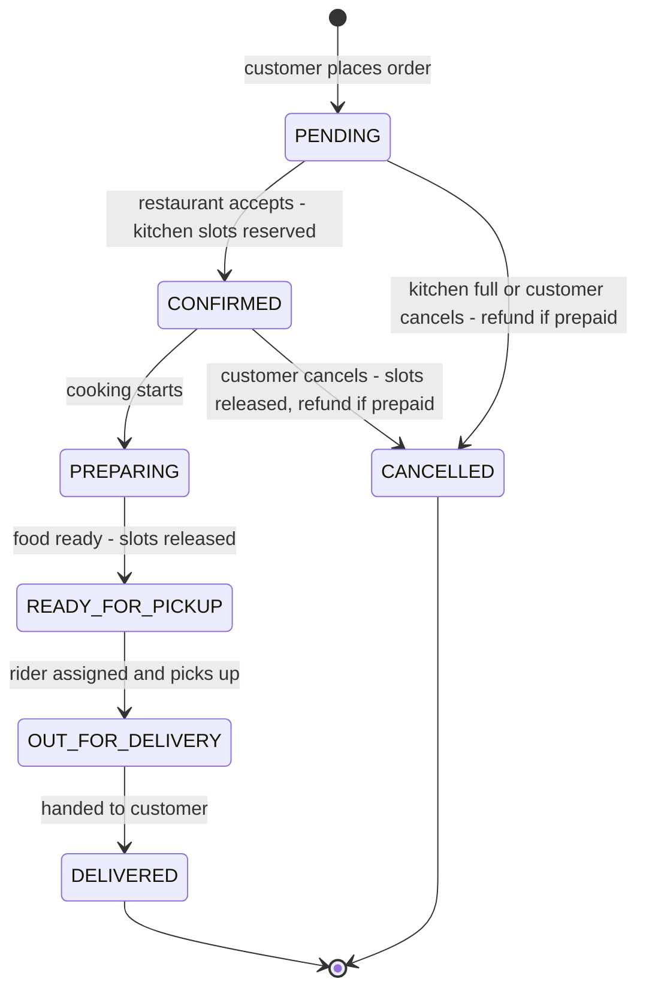

(Real apps often split `READY_FOR_PICKUP → OUT_FOR_DELIVERY` into "rider assigned", "arrived at restaurant", "picked up". Adding them is a local enum change.)

**Food ready → rider assignment**

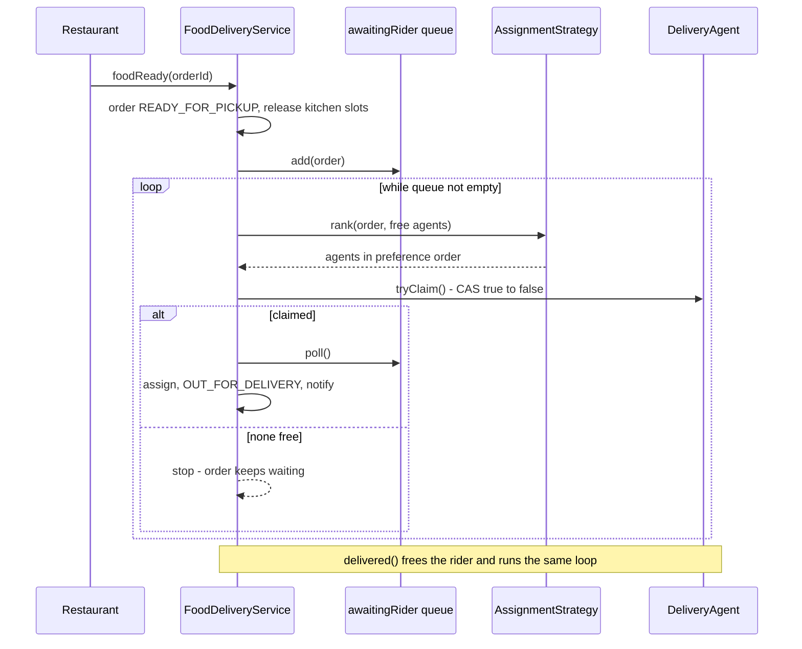

**Activity — place an order** (with the restaurant's accept or refuse; one swimlane per actor, notation as in [§3.13](../03-relationships-and-uml/README.md#313-activity-diagrams)).

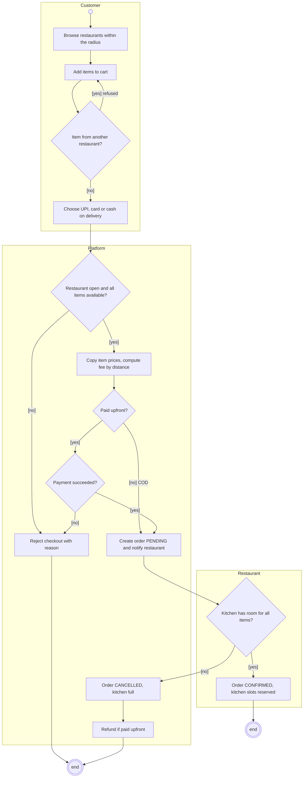

The payment-gateway call is a stub in the demo (every payment succeeds); the branch shows where a real gateway's failure goes.

**Activity — cook, assign a delivery agent and deliver.**

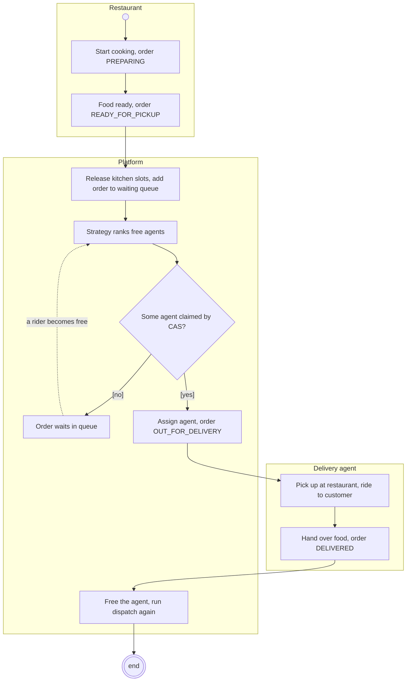

Cancelling is possible only before cooking starts (PENDING or CONFIRMED), so this second flow has no cancel branch. The sequence diagram above shows the same dispatch loop as calls between objects.

**FoodKart `place_order(name, qty)`**: user logged in? → restaurant exists? → delivers to the user's pincode? → `take(qty)` atomically (quantity ≥ qty, then subtract) → record in history → "Order Placed Successfully." Otherwise "Cannot place order".

**FoodKart selection variant**: filter restaurants that deliver to the user's pincode and have `quantity ≥ qty` → ask the strategy to pick one → `take(qty)`; if another user took the capacity in between, drop that restaurant and ask again (bounded retries).

### Design decisions & patterns used

| Decision | Why | Alternative rejected |
|---|---|---|
| **Strategy for rider assignment** (`rank` returns a preference list) | Nearest vs fair-share vs rating-based are swappable at run time (`setStrategy`, step 7). Returning a *ranked list* lets the service try the next rider if the first was just taken (the free list is read before claiming, so it can be stale). | Returning one rider (fails if that rider was claimed a moment earlier). |
| **CAS on the rider** (`AtomicBoolean.compareAndSet(true,false)`) | The rider guards itself: whoever calls `tryClaim()` — this dispatcher, a second dispatcher instance, or a future "rider accepts" button — exactly one `compareAndSet` succeeds. In this code `dispatchWaiting` is also `synchronized` (to drain the queue in FIFO order), so the CAS is the safety net that keeps working even when claims come from outside that lock. | Check `isAvailable()` then set (a race as soon as two callers exist). |
| **Kitchen capacity reserved on accept, released on ready** | Models the rule "a restaurant cannot accept more items while its kitchen is full" from the capacity-based food-ordering variant. | Unlimited orders per restaurant. |
| **Waiting queue for riders** | No free rider is normal at peak; FIFO keeps it fair; freeing a rider re-runs dispatch. | Failing the order. |
| **State machine in `OrderStatus`** | Tracking states and legal moves in one place; cancel after cooking starts is impossible. | Scattered `if`s. |
| **`OrderItem` copies the price** | A later menu price change (step 3) cannot alter a placed order. | Referencing `MenuItem` directly. |
| **Sealed `PaymentMethod` + records** | A closed, known set; COD overrides `paidUpfront()` so refunds skip it. | `String paymentType`. |
| **Observer (`OrderListener`)** | Customer app, restaurant tablet and rider app all react to the same events. | The service printing/sending messages itself. |
| **One restaurant per cart** | Matches real apps; a single kitchen, single pickup, single fee. | Multi-restaurant carts (needs split orders). |
| **FoodKart: `SortBy` enum holds its comparator** (an object that decides which of two items comes first) | `show_restaurant(rating|price)` becomes `sorted(sortBy.comparator)`; both descending as the statement says; name as tie-breaker for stable output. | `if (sort.equals("rating"))`. |
| **FoodKart: owner recorded at registration** | The statement says restaurants are registered "in the context of the logged-in user"; only that owner may update quantity or location. | Anyone updating any restaurant. |
| **FoodKart: `Restaurant.take(q)` synchronized** | "Check quantity then subtract" is atomic — two users cannot both take the last plates. | Separate `getQuantity()` + `setQuantity()`. |

### Java implementation

#### Part A — Food delivery platform (`lld.ch19.fooddelivery`)

Files: `Model.java` (location, customer, menu item, restaurant, cart, order item, status machine, payments, order, delivery agent), `FoodDeliveryService.java` (strategies, listener, notifier, service), `Main.java`.

The full runnable source is in [`code/lld/ch19/fooddelivery/`](code/lld/ch19/fooddelivery/); below are the lines that carry the design.

```java
// File: lld/ch19/fooddelivery/Model.java
synchronized boolean tryReserveKitchen(int items) {          // Restaurant: check-and-take kitchen slots
    if (itemsInKitchen + items > kitchenCapacity) return false;
    itemsInKitchen += items;
    return true;
}
synchronized void add(Restaurant r, String itemId, int qty) { // Cart: one restaurant per cart
    if (restaurant != null && !restaurant.id().equals(r.id()))
        throw new IllegalStateException("cart has items from " + restaurant.name() + " - clear it first");
    restaurant = r;
    quantities.merge(itemId, qty, Integer::sum);
}
enum OrderStatus {   // next(): PENDING -> CONFIRMED|CANCELLED, CONFIRMED -> PREPARING|CANCELLED,
                     // PREPARING -> READY_FOR_PICKUP -> OUT_FOR_DELIVERY -> DELIVERED
    boolean canMoveTo(OrderStatus t) { return next().contains(t); }
}
sealed interface PaymentMethod permits UpiPayment, CardPayment, CashOnDelivery {
    default boolean paidUpfront() { return true; }           // CashOnDelivery overrides: false
}
final class DeliveryAgent {                                   // available is an AtomicBoolean
    /** Compare-and-set: exactly one caller wins. */
    boolean tryClaim() { return available.compareAndSet(true, false); }
    void completeDelivery() { deliveriesToday.incrementAndGet(); available.set(true); }
}

// File: lld/ch19/fooddelivery/FoodDeliveryService.java
interface DeliveryAssignmentStrategy {                        // NearestAgentStrategy, FairShareStrategy
    List<DeliveryAgent> rank(Order order, List<DeliveryAgent> free);
}

Order placeOrder(Customer c, Cart cart, PaymentMethod pay) {
    // ... closed restaurant / sold-out item -> IllegalStateException
    cart.quantities().forEach((itemId, qty) -> {
        MenuItem m = r.item(itemId).orElseThrow();
        items.add(new OrderItem(itemId, m.name(), m.price(), qty));   // price copied at order time
    });
    BigDecimal km = BigDecimal.valueOf(r.location().distanceTo(c.address())).setScale(1, RoundingMode.HALF_UP);
    BigDecimal fee = BASE_FEE.add(PER_KM.multiply(km)).setScale(2, RoundingMode.HALF_EVEN);   // 20 + 8/km
    // ... new Order(...), cart.clear(), publish PENDING
}

/** The restaurant accepts only if its kitchen has room; otherwise the order is auto-cancelled and refunded. */
boolean restaurantAccepts(String orderId) {
    Order o = orders.get(orderId);
    synchronized (o) {                              // same lock as cancel(): capacity can never leak
        if (o.status() != OrderStatus.PENDING) return false;
        if (o.restaurant().tryReserveKitchen(o.itemCount())) {
            transition(o, OrderStatus.CONFIRMED);
            return true;
        }
        System.out.println("    (" + o.restaurant().name() + " kitchen full: needs " + o.itemCount()
                + " item slots, free " + o.restaurant().freeCapacity() + ")");
        transition(o, OrderStatus.CANCELLED);
    }
    refundIfPrepaid(o);                             // like cancel(): a prepaid order gets its money back
    return false;
}

/** Food is ready: kitchen capacity comes back, and we look for a rider. */
void foodReady(String orderId) {
    Order o = orders.get(orderId);
    transition(o, OrderStatus.READY_FOR_PICKUP);
    o.restaurant().releaseKitchen(o.itemCount());
    awaitingRider.add(o);
    dispatchWaiting();
}
// delivered(): DELIVERED, agent.completeDelivery(), then dispatchWaiting() so a freed rider takes the oldest waiting order

boolean cancel(String orderId) {
    Order o = orders.get(orderId);
    synchronized (o) {
        if (!o.status().canMoveTo(OrderStatus.CANCELLED)) return false;
        boolean kitchenHeld = o.status() == OrderStatus.CONFIRMED;
        transition(o, OrderStatus.CANCELLED);
        if (kitchenHeld) o.restaurant().releaseKitchen(o.itemCount());
    }
    refundIfPrepaid(o);
    return true;
}

/** Runs after the order lock is released; a real gateway call is slow and must not block the order. */
private void refundIfPrepaid(Order o) {
    if (o.payment().paidUpfront()) System.out.println("    refund " + o.total() + " to " + o.payment().describe());
}

/** Hand waiting orders (oldest first) to free riders. CAS on the rider prevents double booking. */
private synchronized void dispatchWaiting() {
    Order o;
    while ((o = awaitingRider.peek()) != null) {
        List<DeliveryAgent> free = agents.stream().filter(DeliveryAgent::isAvailable).toList();
        Optional<DeliveryAgent> got = Optional.empty();
        for (DeliveryAgent a : strategy.rank(o, free)) if (a.tryClaim()) { got = Optional.of(a); break; }
        if (got.isEmpty()) {
            System.out.println("    (" + o.id() + " waiting for a free rider)");
            return;
        }
        awaitingRider.poll();
        o.assign(got.get());
        transition(o, OrderStatus.OUT_FOR_DELIVERY);
    }
}
// transition(o, s) = o.moveTo(s) (throws on an illegal edge) + notify every OrderListener
```

Output:

```text
== 1. Browse within 10 km ==
  Dosa Corner
  Pizza Hub

== 2. One restaurant per cart ==
  cart has items from Dosa Corner - clear it first

== 3. Place, accept, prepare, ready, deliver ==
    [OD101 PENDING] -> restaurant Dosa Corner: new order
  subtotal 280.00 + delivery 31.20 = 311.20
  price changed after ordering; order still 311.20
    [OD101 CONFIRMED] -> customer Asha
    [OD101 PREPARING] -> customer Asha
    [OD101 READY_FOR_PICKUP] -> customer Asha
    [OD101 OUT_FOR_DELIVERY] -> customer Asha: Ravi is on the way
  rider: Ravi (nearest to Dosa Corner)

== 4. Kitchen capacity: 4 items max at Dosa Corner ==
    [OD102 PENDING] -> restaurant Dosa Corner: new order
    [OD102 CONFIRMED] -> customer Vikram
    [OD103 PENDING] -> restaurant Dosa Corner: new order
    (Dosa Corner kitchen full: needs 2 item slots, free 1)
    [OD103 CANCELLED] -> customer Asha
    refund 111.20 to card ****4242

== 5. Only one rider free: second ready order waits ==
    [OD102 PREPARING] -> customer Vikram
    [OD102 READY_FOR_PICKUP] -> customer Vikram
    [OD102 OUT_FOR_DELIVERY] -> customer Vikram: Meena is on the way
    [OD104 PENDING] -> restaurant Pizza Hub: new order
    [OD104 CONFIRMED] -> customer Vikram
    [OD104 PREPARING] -> customer Vikram
    [OD104 READY_FOR_PICKUP] -> customer Vikram
    (OD104 waiting for a free rider)
    [OD101 DELIVERED] -> customer Asha
    [OD104 OUT_FOR_DELIVERY] -> customer Vikram: Ravi is on the way
  o4 rider: Ravi

== 6. Cancel rules ==
  cancel o2 (out for delivery)? false
    [OD105 PENDING] -> restaurant Pizza Hub: new order
    [OD105 CONFIRMED] -> customer Asha
    [OD105 CANCELLED] -> customer Asha
    refund 651.60 to card ****4242
  cancel o5 (confirmed)? true

== 7. Swap strategy at run time: fair share ==
    [OD102 DELIVERED] -> customer Vikram
    [OD104 DELIVERED] -> customer Vikram
  deliveries today: Ravi=2, Meena=1 (both now at Vikram's address)
    [OD106 PENDING] -> restaurant Dosa Corner: new order
    [OD106 CONFIRMED] -> customer Asha
    [OD106 PREPARING] -> customer Asha
    [OD106 READY_FOR_PICKUP] -> customer Asha
    [OD106 OUT_FOR_DELIVERY] -> customer Asha: Meena is on the way
  o6 rider: Meena (fewer deliveries today)
  o1 history: [PENDING, CONFIRMED, PREPARING, READY_FOR_PICKUP, OUT_FOR_DELIVERY, DELIVERED]
```

**Reading the output.** Step 1 hides the far-away grill (outside 10 km). Step 2 refuses a second restaurant in one cart. Step 3: the delivery fee is 20 + 8 × 1.4 km = 31.20; changing the dosa price afterwards does not change the order. Step 4: Dosa Corner holds 4 item slots; an order for 3 fits, the next card order for 2 is auto-cancelled and refunded (the same refund path as a customer cancel). Step 5: Meena takes OD102; OD104 waits because Ravi is still out; as soon as OD101 is delivered, Ravi is claimed for OD104. Step 6: an order out for delivery cannot be cancelled; a confirmed card order can, and is refunded. Step 7: with both riders at the same spot, the fair-share strategy picks Meena (1 delivery) over Ravi (2).

#### Part B — FoodKart (`lld.ch19.foodkart`)

Files: `FoodKart.java` (gender, user, review, order, restaurant, sort, selection strategies, service), `Main.java` (driver replaying the problem's sample test case, then extras).

The full runnable source (including the `Main` driver) is in [`code/lld/ch19/foodkart/`](code/lld/ch19/foodkart/); below are the lines that carry the design.

```java
// File: lld/ch19/foodkart/FoodKart.java
final class Restaurant {                     // ONE dish, MANY pincodes; quantity = remaining capacity
    /** Check-and-take in one step, so two users cannot both get the last plates. */
    synchronized boolean take(int q) {
        if (q <= 0 || q > quantity) return false;
        quantity -= q;
        return true;
    }
    /** Serviceable = delivers to this pincode AND has non-zero quantity (from the problem statement). */
    boolean serviceableFor(String pincode) { return pincodes.contains(pincode) && quantity() > 0; }
}

/** show_restaurant(rating|price): both sorted in DESCENDING order, as the problem states. */
enum SortBy {
    RATING(Comparator.comparingDouble(Restaurant::rating).reversed()),
    PRICE(Comparator.comparing(Restaurant::price).reversed());
    final Comparator<Restaurant> comparator;
    SortBy(Comparator<Restaurant> c) { comparator = c.thenComparing(Restaurant::name); }
}

/** Strategy: when the user does not name a restaurant, which one should we pick? */
interface RestaurantSelectionStrategy { Optional<Restaurant> select(List<Restaurant> canFulfil); }
// HighestRatingStrategy (tie: most capacity left), LowestPriceStrategy (tie: higher rating)

final class FoodKartService {
    private volatile User current;                                // one logged-in user at a time

    String placeOrder(String name, int qty) {
        User u = requireLogin();
        Restaurant r = restaurants.get(name);
        if (r == null || !r.pincodes().contains(u.pincode()) || !r.take(qty)) return "Cannot place order";
        record(u, r, qty);
        return "Order Placed Successfully.";
    }

    /** Variant: the system picks the restaurant. Only those that deliver here AND have capacity for qty qualify. */
    String placeOrder(int qty, RestaurantSelectionStrategy strategy) {
        User u = requireLogin();
        List<Restaurant> canFulfil = restaurants.values().stream()
                .filter(r -> r.pincodes().contains(u.pincode()) && r.quantity() >= qty).toList();
        for (int attempt = 0; attempt < 3; attempt++) {           // retry if a racer took the capacity
            Optional<Restaurant> pick = strategy.select(canFulfil);
            if (pick.isEmpty()) return "Cannot place order";
            if (pick.get().take(qty)) {
                record(u, pick.get(), qty);
                return "Order Placed Successfully from " + pick.get().name() + ".";
            }
            canFulfil = canFulfil.stream().filter(r -> r != pick.get()).toList();
        }
        return "Cannot place order";
    }
    // updateQuantity / updateLocation go through ownedByCurrentUser(name): only the owner may change them
}
```

Output:

```text
== Sample test case ==
show_restaurant(price):
  Food Court-2, Burger
  Food Court-1, NI Thali
place_order(Food Court-1, 2): Order Placed Successfully.
place_order(Food Court-2, 7): Cannot place order
show_restaurant(rating):
  Food Court-1, NI Thali
  Food Court-2, Burger
update_quantity(Food Court-2, 5): Food Court-2, BTM, Burger - 8
update_location(Food Court-2, BTM/HSR): Food Court-2, BTM/HSR, Burger - 8

== Extras ==
non-owner update: only the owner can update Food Court-1
rating 6: rating must be 1..5
order from a restaurant that does not deliver to BTM: Cannot place order

== Selection strategy variant (user in BTM, wants 4 plates) ==
highest rating: Order Placed Successfully from Food Court-2.
lowest price  : Order Placed Successfully from Food Court-4.
lowest price  : Order Placed Successfully from Food Court-2.
lowest price  : Cannot place order  (no one has 4 left)

== Order history of phoneNumber-3 ==
  FoodOrder[id=1, userPhone=phoneNumber-3, restaurant=Food Court-1, item=NI Thali, quantity=2, total=200]
  FoodOrder[id=2, userPhone=phoneNumber-3, restaurant=Food Court-2, item=Burger, quantity=4, total=480]
  FoodOrder[id=3, userPhone=phoneNumber-3, restaurant=Food Court-4, item=Dosa, quantity=4, total=320]
  FoodOrder[id=4, userPhone=phoneNumber-3, restaurant=Food Court-2, item=Burger, quantity=4, total=480]
```

**Reading the output.** The "Sample test case" block reproduces every expected line from the problem statement: price-sorted list (Burger 120 before Thali 100), the successful and failed orders, the rating-sorted list, and the owner's quantity and location updates (`Burger - 8`). The extras show owner-only updates, rating validation, a rating without comment, and a restaurant that does not deliver to the user's pincode. The variant shows the two strategies choosing **different** restaurants (highest rating → Food Court-2; lowest price → Food Court-4), capacity filtering (Food Court-1 has only 3 plates, so it is never picked for 4), and a clean refusal once no one has 4 plates left.

### Concurrency & edge cases

| Case | Handling |
|---|---|
| Two claims for the same rider | `tryClaim()` CAS: only one succeeds; the loser moves to the next rider in its ranked list. (Inside one service the synchronized dispatcher already serialises claims; the CAS also covers claims made outside it.) |
| Two dispatch loops run at once | `dispatchWaiting` is `synchronized`, so the waiting queue is drained by one thread at a time (FIFO fairness preserved). |
| Kitchen over-booked | `tryReserveKitchen` is `synchronized` (check + add in one step). |
| Cancel races with accept | Both lock the `Order`; accept re-checks `PENDING`, cancel releases slots only if they were reserved (`CONFIRMED`). No leak, no double release. |
| Item sold out after it was added to the cart | `placeOrder` re-checks `available` and rejects. |
| Restaurant closes | `browse` hides it; `placeOrder` refuses. |
| COD cancelled | No refund (nothing was paid). |
| FoodKart: no user logged in | `requireLogin()` throws a clear `IllegalStateException`. |
| FoodKart: duplicate phone / restaurant name | Rejected with `putIfAbsent`. |
| FoodKart: rating outside 1–5 | The `Review` record's compact constructor (a record's short validation block that runs on creation) rejects it. |
| FoodKart: strategy picks a restaurant whose capacity was just taken | `take()` fails; that restaurant is dropped and the strategy asked again (bounded retries). |

### Real-world example

In Swiggy and Zomato the order screen walks through the same states — order placed, restaurant confirmed, food being prepared, rider assigned / picked up, delivered — and if you add a dish from a second restaurant, the app asks whether to **reset your cart**, which is our one-restaurant `Cart` rule. The rider side is a dispatch problem: these platforms assign riders using distance, rider load and fairness signals, and may batch two orders on one trip — all variations of `DeliveryAssignmentStrategy`. FoodKart itself is a Flipkart machine-coding question: a 90-minute, in-memory, driver-class exercise that rewards clean separation (service, model, strategy) over clever algorithms.

### Extensions & follow-up questions

- **"Batch two orders for one rider."** A strategy that accepts a rider already carrying one order if the second pickup is on the way; the agent then has a list of orders and a capacity (e.g. 2).
- **"ETA."** An `EtaEstimator` strategy: prep time (per restaurant load) + travel time (distance / speed, or a maps API — an online service other programs call).
- **"Surge / distance-based fees."** Extract `DeliveryFeePolicy` (Strategy): base + per-km today, add surge when waiting orders exceed free riders.
- **"Rider rejects an assignment."** Put the rider back to available, add the order back to the head of the queue, and exclude that rider for this order.
- **"Multiple dishes per restaurant in FoodKart."** Replace `foodItem/price/quantity` with a `Map<String, MenuItem>`; `take` becomes per item and all-or-nothing for multi-item orders.
- **"Order split across restaurants (Flipkart variant)."** The selection strategy returns a *set* of restaurants that together cover all items; reserve capacity in each, roll back all on any failure.
- **"Live tracking."** The rider app pushes location updates; an Observer forwards them to the customer's app (WebSocket).

### In the interview

**Design round (45 min):** clarify (5) → entities + one-restaurant cart (8) → **order state machine** (7) → **assignment strategy + CAS claim + waiting queue** (12) → payments/notifications (5) → concurrency and extensions (8).

**Machine-coding round (FoodKart, 90 min):** model classes first (User, Restaurant, Review, Order) → service with one method per command → the driver replaying the sample → sort enum → owner checks and validation → selection strategy → order history. Keep it runnable at every step; print exactly the expected lines.

**30-second answer:** "Restaurants own their menus and a kitchen capacity reserved on accept and released when food is ready. Orders copy item prices and move through a state machine from PENDING to DELIVERED. When food is ready the order joins a FIFO queue; a pluggable assignment strategy ranks free riders and we claim one with a compare-and-set, so a rider can never get two orders. Every status change is published to observers for the customer, restaurant and rider apps."

**Follow-ups with answers**

- *Why release kitchen capacity on "ready" and not on "delivered"?* The kitchen is free once the food leaves it; delivery time is the rider's constraint, not the kitchen's.
- *Why does the strategy return a list?* Because between ranking and claiming, the top rider may be claimed by someone else (another dispatcher or the rider's own app); the list lets us fall through without re-ranking.
- *How would you scale assignment across cities?* Partition by city/zone; each zone has its own dispatcher (single writer), so there is no cross-zone contention (threads or servers fighting over the same lock or data).

### Self-check

1. **Q:** Which states allow a customer cancel, and why not later? **A:** PENDING and CONFIRMED; once cooking starts the food cost is already spent.
2. **Q:** What stops two orders getting the same rider? **A:** `AtomicBoolean.compareAndSet(true, false)` in `tryClaim()`.
3. **Q:** In FoodKart, what makes a restaurant "serviceable"? **A:** It delivers to the user's pincode and has quantity > 0.
4. **Q:** Why does `show_restaurant(price)` list Burger (120) before NI Thali (100)? **A:** The statement asks for descending order.
5. **Q:** How does the selection variant avoid choosing a restaurant that cannot fulfil the order? **A:** It filters by `quantity ≥ qty` before the strategy chooses, and `take()` re-checks atomically.
6. **Q:** Which patterns appear? **A:** Strategy (assignment, selection, payment), Observer (notifications), state machine (order status), Facade (service).

### TL;DR

- One-restaurant cart; order copies prices; **state machine** PENDING → … → DELIVERED.
- **Kitchen capacity** reserved on accept, released on ready; **riders** claimed with **CAS**, chosen by a swappable **strategy**, with a FIFO queue when none are free.
- FoodKart: pincode-based serviceability, one dish per restaurant, average rating, `SortBy` enum, atomic `take`, and a **selection strategy** filtered by capacity.

---

## Design a Grocery Store (POS & Checkout)

A **point-of-sale (POS) system** is the software behind a supermarket till: the cashier (or a self-checkout kiosk) scans items, the screen shows a running total, offers are applied, the customer pays in one or more ways, a receipt is printed, and stock goes down. Amazon (§19.1) was about an online cart that becomes an order; a grocery till is different in three ways that make it a good interview question:

- **Items are weighed as well as counted.** Loose produce is priced per kilogram; the scale sends a weight and the price is computed at the till.
- **Offers interact.** "Buy 2 get 1 free", "3 for ₹80", "10% off produce" and a basket coupon can all apply to one basket — and the rules for combining them decide what the customer pays, what tax is due, and how much a return refunds.
- **The till must never block a physical sale.** If the system says milk stock is 0 but a customer is holding a carton, the *count* is wrong, not the customer.

Money in this section is Indian rupees (₹; written `Rs` in the program output) and uses `BigDecimal`, following the chapter's four rules.

### Problem & clarifying questions

| Question | Assumed answer |
|---|---|
| Who uses it? | Cashiers at several registers (lanes) in one store; a supervisor for voids and refunds. Self-checkout uses the same register API. |
| How are items identified? | Packaged goods by **barcode** (EAN-13, the standard 13-digit product barcode); loose produce by a 4-digit **PLU** (price look-up) code plus the scale's weight. |
| Are shelf prices tax-inclusive? | Yes (as in India, the UK and the EU): the receipt shows how much tax the price *contains*. A US-style store adds sales tax at the till — the design must support both. |
| Which offers? | Buy X get Y free, multi-buy ("3 for ₹80"), percent off a department, and a basket coupon ("₹50 off when you spend ₹500"). |
| Can offers stack? | Each product gets at most **one** item offer — the best for the customer. A basket coupon applies on top, to what is still owed. |
| How do people pay? | Cash (with change), card, UPI — and **split tender** (part UPI, part cash). |
| Can the customer change their mind? | Void a line while scanning; go back to scanning if nothing is paid yet; cancel the whole sale (card/UPI payments reversed). |
| Returns? | Yes, with the receipt: refund what the customer **actually paid** for that item, never more units than bought. |
| Stock? | Decrease on sale, increase on return; alert when low; never refuse a sale because of the stock count. |

### Requirements

**Functional**

1. Catalog lookup by barcode or PLU; weighed items priced by weight.
2. A **sale** collects line items; lines can be voided (kept on the receipt, marked VOID).
3. Item offers and basket coupons, with clear stacking rules.
4. Totals with tax per tax category (inclusive or exclusive policy).
5. Split payment: cash (with change), card, UPI; a declined card changes nothing.
6. Immutable **receipt** with lines, discounts, tax breakdown, tenders and change.
7. Returns against a receipt, refunding the net price paid, at most the quantity bought.
8. Stock updates and **low-stock / negative-stock alerts**.

**Non-functional**

- **Exact money**: `BigDecimal`, 2 decimal places, `HALF_UP` rounding (a 5 or more rounds up), and parts (per-product discounts, refunds) that always add up to the total.
- **Several registers at once** share the catalog, the stock and the receipts safely.
- **Deterministic pricing**: the same basket always prices the same way (a **pure function**: its result depends only on its inputs, and it changes nothing outside itself) — needed for audits and for returns.
- **Auditable**: voids stay on the receipt; prices are copied into lines at scan time.

### Use cases

| Actor | Use cases |
|---|---|
| **Cashier / self-checkout** | start sale, scan, weigh, void line, add coupon, total, take payment, cancel sale |
| **Customer** | pay by cash / card / UPI, return items with the receipt |
| **Supervisor** | approve voids and returns (not modelled), reprice products |
| **Payment network** (system) | authorise and reverse card / UPI payments |
| **Purchasing / store manager** (subscriber) | receive low-stock and negative-stock alerts |

### Core entities

| Class | Kind | Responsibility |
|---|---|---|
| `Product` | record | SKU (stock-keeping unit — the store's id for one distinct product), barcode/PLU, name, department, `PricingUnit` (EACH or PER_KG), unit price, `TaxCategory`. |
| `Catalog` | class | Lookup by code; `reprice` replaces the record (old sales keep old prices). |
| `LineItem` | record | One scan: product copy, quantity (count or kg), gross amount, voided flag. |
| `Sale` + `SaleStatus` | class + enum | OPEN → TENDERING → COMPLETED, or → CANCELLED; lines, coupons, payments, frozen price breakdown. |
| `ItemPromotion` + `BuyXGetYFree`, `MultiBuy`, `PercentOffDepartment` | interface + records | **Strategy** for item offers. |
| `BasketPromotion` + `SpendThresholdCoupon` | interface + record | **Strategy** for basket offers. |
| `TaxPolicy` + `TaxInclusive`, `TaxExclusive` | interface + classes | **Strategy** for how tax relates to the shelf price. |
| `PricingEngine` → `PriceBreakdown` | class → record | Pure function: lines + coupons → discounts, net per SKU, tax per category, total. |
| `Tender` (sealed) `Cash`, `Card`, `Upi`; `Payment` | records | How the customer pays; the part applied to the bill. |
| `PaymentGateway` | interface | Port (an interface through which the core code talks to an outside system) to the card / UPI networks (authorise, refund). |
| `Receipt`, `ReceiptStore` | record, class | Immutable proof of purchase; returns ledger per receipt and SKU. |
| `Inventory`, `StockListener` | class, interface | Shared stock; **Observer** for edge-triggered alerts (fired once when a line is crossed, not on every sale below it). |
| `Register` | class | **Facade** for one lane: the only API the till UI calls. |

### Class diagram

```mermaid
classDiagram
    class Register {
        -Sale sale
        +startSale()
        +scan(code, count) LineItem
        +weigh(plu, grams) LineItem
        +voidLine(n)
        +coupon(code)
        +total() PriceBreakdown
        +pay(Tender) Receipt
        +cancelSale()
        +refund(receiptId, sku, qty) BigDecimal
    }
    class Sale {
        -List~LineItem~ lines
        -List~Payment~ payments
        -SaleStatus status
        -PriceBreakdown frozen
        +add(Product, qty)
        +voidLine(n)
        +beginTender(PricingEngine)
        +pay(Tender, PaymentGateway) boolean
    }
    class PricingEngine {
        +price(lines, coupons) PriceBreakdown
    }
    class ItemPromotion {
        <<interface>>
        +evaluate(Product, qty) Optional~Discount~
    }
    class BasketPromotion {
        <<interface>>
        +evaluate(subtotal, coupons) Optional~Discount~
    }
    class TaxPolicy {
        <<interface>>
        +tax(net, rate) BigDecimal
        +addedOnTop() boolean
    }
    class Tender {
        <<sealed interface>>
        +amount() BigDecimal
    }
    class PaymentGateway {
        <<interface>>
        +authorize(Tender) String
        +refund(auth, amount)
    }
    class Inventory {
        +adjust(sku, delta)
    }
    class StockListener {
        <<interface>>
        +stockAlert(sku, onHand, reason)
    }
    Register --> Catalog
    Register --> PricingEngine
    Register --> Inventory
    Register --> ReceiptStore
    Register --> PaymentGateway
    Register *-- Sale : current
    Sale *-- LineItem
    Sale *-- Payment
    PricingEngine o-- ItemPromotion
    PricingEngine o-- BasketPromotion
    PricingEngine --> TaxPolicy
    ItemPromotion <|.. BuyXGetYFree
    ItemPromotion <|.. MultiBuy
    ItemPromotion <|.. PercentOffDepartment
    BasketPromotion <|.. SpendThresholdCoupon
    TaxPolicy <|.. TaxInclusive
    TaxPolicy <|.. TaxExclusive
    Tender <|.. Cash
    Tender <|.. Card
    Tender <|.. Upi
    Inventory --> StockListener : notifies
    ReceiptStore o-- Receipt
```

### Key flows

**Sale lifecycle.**

```mermaid
stateDiagram-v2
    direction LR
    [*] --> OPEN : startSale
    OPEN --> OPEN : scan / weigh / void line / coupon
    OPEN --> TENDERING : total (prices frozen)
    TENDERING --> OPEN : back to scanning (no payments yet)
    TENDERING --> TENDERING : partial payment
    TENDERING --> COMPLETED : fully paid / receipt, stock down
    OPEN --> CANCELLED : cancel
    TENDERING --> CANCELLED : cancel / reverse card and UPI
```

**How one basket is priced** (the hard method, `PricingEngine.price`):

```mermaid
flowchart TD
    A["Active lines (voids skipped)"] --> B["Group by SKU: total quantity, gross"]
    B --> C["For each SKU: evaluate every item offer, keep the BEST one"]
    C --> D["Net per SKU = gross - item discount"]
    D --> E["Best basket coupon on the sum of nets"]
    E --> F["Spread the coupon over SKUs in proportion to net, remainder to the largest"]
    F --> G["Tax per category from the discounted nets"]
    G --> H["Total = sum of nets (+ tax if added on top)"]
```

**Split payment.**

```mermaid
sequenceDiagram
    participant C as Cashier
    participant R as Register
    participant S as Sale
    participant G as PaymentGateway
    participant I as Inventory
    C->>R: total()
    R->>S: beginTender(engine)  prices frozen, due 588.23
    C->>R: pay(Card **0005, 300)
    R->>S: pay
    S->>G: authorize
    G-->>S: declined (exception, nothing recorded)
    C->>R: pay(UPI, 400)
    S->>G: authorize -> AUTH
    S-->>R: not complete, due 188.23
    C->>R: pay(Cash 500)
    S-->>R: complete, change 311.77
    R->>I: adjust(sku, -qty) for every SKU
    R-->>C: Receipt R00001
```

### Design decisions & patterns used

| Decision | Pattern | Why | Alternative rejected |
|---|---|---|---|
| Each offer is a small class behind `ItemPromotion` / `BasketPromotion` | **Strategy** | Marketing adds offers weekly; a new offer is one new class, the engine does not change | A `switch` over offer types inside the pricing code |
| **Best offer per SKU wins**; basket coupon after item offers | Explicit stacking policy | Stacking rules are business decisions that must be written down once; "best for the customer" is simple to explain at the till | Applying every offer in list order (results depend on the order; can go below zero) |
| `PricingEngine` is a **pure function** of lines and coupons | Stateless service | Same basket → same price; one engine shared by all registers (stateless: it keeps no data between calls); easy to test | Mutating discounts into the line items as they are scanned |
| Prices **frozen** when payment starts | Snapshot | A price change or an offer expiring mid-payment must not change the amount due | Re-pricing on every payment |
| Coupon **spread over SKUs**, remainder to the largest | Allocation with exact rounding | Tax is per category and returns refund per item, so every rupee of discount must belong to some item — and the parts must add up exactly | Keeping the coupon as one unallocated number |
| Tax as a `TaxPolicy` | **Strategy** | Inclusive (India/EU) vs exclusive (US) is a store-level choice | Two versions of the engine |
| Tenders as a **sealed** interface | Sealed types | The receipt printer's `switch` is checked by the compiler | `String paymentType` |
| `Register` as the only API the UI calls | **Facade** | The UI does not need to know about engines, stores and gateways | UI code calling each part directly |
| Sale status in an enum with `canMoveTo` | Enum state machine | "Scan after payment started" and "pay a cancelled sale" fail loudly | Boolean flags (`isPaying`, `isDone`) |
| Stock may go **negative**, alerts are **edge-triggered** | **Observer** | The shelf is the truth; negative stock is a signal for a recount. Each crossing alerts once | Refusing the sale; alerting on every sale below the line |
| Voided lines are kept and printed | Audit trail (a permanent record of every action) | Voids are a common way to hide theft; supervisors review them | Deleting the line |

### Java implementation

Package `lld.ch19.grocery`. Files: `Catalog.java` (products, EAN-13 check, catalog), `Promotions.java` (offer strategies), `Pricing.java` (tax policies, pricing engine), `Sale.java` (sale state machine, tenders, gateway port), `Register.java` (inventory, receipts, register facade), `Main.java`. The full runnable source is in [`code/lld/ch19/grocery/`](code/lld/ch19/grocery/); below are the lines that carry the design.

```java
// File: lld/ch19/grocery/Promotions.java - one offer = one small Strategy class
record BuyXGetYFree(String sku, int buy, int free) implements ItemPromotion {
    @Override public Optional<Discount> evaluate(Product p, BigDecimal qty) {
        if (!p.sku().equals(sku)) return Optional.empty();
        int groups = qty.intValue() / (buy + free);
        if (groups == 0) return Optional.empty();
        BigDecimal off = p.unitPrice().multiply(BigDecimal.valueOf((long) groups * free));
        return Optional.of(new Discount("Buy " + buy + " get " + free + " free: " + p.name(), sku, Money.round(off)));
    }
}
// MultiBuy ("3 for Rs 50"), PercentOffDepartment; BasketPromotion: SpendThresholdCoupon

// File: lld/ch19/grocery/Pricing.java
final class TaxInclusive implements TaxPolicy {     /** The price already contains the tax: tax = price x r / (100 + r). */
    @Override public BigDecimal tax(BigDecimal net, BigDecimal r) {
        return net.multiply(r).divide(BigDecimal.valueOf(100).add(r), 2, RoundingMode.HALF_UP);
    }
    @Override public boolean addedOnTop() { return false; }      // TaxExclusive: net x r / 100, true
}

PriceBreakdown price(List<LineItem> lines, Set<String> coupons) {  // PricingEngine: a pure function
    // group non-voided lines by SKU -> bySku (total quantity, gross)
    for (SkuTotal t : bySku.values()) {
        Optional<Discount> best = itemOffers.stream()                 // rule 1: ONE best item offer per SKU
                .map(p -> p.evaluate(t.product(), t.quantity()))
                .flatMap(Optional::stream)
                .max(Comparator.comparing(Discount::amount));
        BigDecimal off = best.map(d -> d.amount().min(t.gross())).orElse(Money.ZERO);
        best.ifPresent(d -> discounts.add(new Discount(d.description(), d.sku(), off)));
        net.put(t.product().sku(), t.gross().subtract(off));
    }
    BigDecimal subtotal = sum(net.values());
    Optional<Discount> basket = basketOffers.stream()                 // rule 2: best basket coupon on what is owed
            .map(b -> b.evaluate(subtotal, coupons))
            .flatMap(Optional::stream)
            .max(Comparator.comparing(Discount::amount));
    basket.ifPresent(d -> { discounts.add(d); spread(d.amount(), net); });   // rule 3
    // rule 4: tax per TaxCategory on the discounted nets; total = nets (+ tax if addedOnTop)
}

/** Proportional allocation; the rounding remainder goes to the largest SKU so the parts add up exactly. */
private static void spread(BigDecimal amount, Map<String, BigDecimal> net) {
    BigDecimal base = sum(net.values());
    if (base.signum() == 0) return;
    BigDecimal given = Money.ZERO;
    String largest = null;
    for (var e : net.entrySet()) {
        BigDecimal share = amount.multiply(e.getValue()).divide(base, 2, RoundingMode.HALF_UP);
        e.setValue(e.getValue().subtract(share));
        given = given.add(share);
        if (largest == null || e.getValue().compareTo(net.get(largest)) > 0) largest = e.getKey();
    }
    net.merge(largest, given.subtract(amount), BigDecimal::add);
}

// File: lld/ch19/grocery/Sale.java
boolean canMoveTo(SaleStatus next) {                           // SaleStatus
    return switch (this) {
        case OPEN -> next == TENDERING || next == CANCELLED;
        case TENDERING -> next == COMPLETED || next == OPEN || next == CANCELLED;
        case COMPLETED, CANCELLED -> false;
    };
}
/** Returns true when the bill is fully paid and the sale is complete. */
boolean pay(Tender t, PaymentGateway gateway) {
    require(SaleStatus.TENDERING, "pay");                      // beginTender() froze the breakdown
    BigDecimal due = due();
    if (t.amount().signum() <= 0) throw new PosException("Tender must be positive");
    String auth = "CASH";
    BigDecimal applied = t.amount();
    if (t instanceof Cash) {
        if (t.amount().compareTo(due) > 0) { change = t.amount().subtract(due); applied = due; }
    } else {
        if (t.amount().compareTo(due) > 0) throw new PosException("Card/UPI cannot be more than the amount due " + Money.fmt(due));
        auth = gateway.authorize(t);                 // throws if declined: nothing recorded
    }
    payments.add(new Payment(t, applied, auth));
    if (due().signum() == 0) { move(SaleStatus.COMPLETED); return true; }
    return false;
}
// cancel(gateway): reverses every non-cash payment, then CANCELLED

// File: lld/ch19/grocery/Register.java
/** delta < 0 for a sale, > 0 for a return. merge() is atomic per key, so registers never lose updates. */
void adjust(String sku, BigDecimal delta) {                    // Inventory
    BigDecimal after = onHand.merge(sku, delta, BigDecimal::add);
    BigDecimal before = after.subtract(delta);
    BigDecimal point = reorderPoint.getOrDefault(sku, BigDecimal.ZERO);
    // edge-triggered: alert only when THIS change crosses the line, so each crossing alerts exactly once
    if (before.compareTo(point) > 0 && after.compareTo(point) <= 0)
        listeners.forEach(l -> l.stockAlert(sku, after, "LOW - reorder"));
    if (before.signum() >= 0 && after.signum() < 0)
        listeners.forEach(l -> l.stockAlert(sku, after, "NEGATIVE - recount the shelf"));
}

/** Refund what the customer actually paid per unit (after offers and coupons), not the shelf price. */
BigDecimal refund(String receiptId, String sku, int qty) {     // Register
    // ... find the SKU on the receipt -> bought
    BigDecimal q = BigDecimal.valueOf(qty);
    BigDecimal after = receipts.claimReturn(r, sku, q, bought.quantity());   // ConcurrentHashMap.compute: atomic
    // refund = share(after) - share(before): the parts always add up to exactly what was paid
    BigDecimal net = r.breakdown().netBySku().get(sku);
    BigDecimal refund = share(net, after, bought.quantity()).subtract(share(net, after.subtract(q), bought.quantity()));
    inventory.adjust(sku, q);
    return refund;
}
```

**How the code works, part by part**

- **Scanning.** `Register.scan` checks the EAN-13 check digit (a last digit computed from the others, so a misread code fails the sum) first (a misread barcode is caught before lookup), then refuses weighed products; `weigh` converts grams to kilograms with `movePointLeft(3)` so 1245 g becomes exactly `1.245`. `Sale.add` copies the product — and therefore its price — into the new `LineItem`.
- **Pricing.** `PricingEngine.price` skips voided lines, groups by SKU, asks every item offer for a discount and keeps the largest (capped at the gross), applies the best basket coupon to what is left, spreads that coupon across SKUs, and computes tax per category on the discounted amounts. With `TaxInclusive`, tax = amount × r ÷ (100 + r); with `TaxExclusive`, tax = amount × r ÷ 100 and is added to the total.
- **Paying.** `beginTender` freezes the breakdown. `pay` treats cash specially: if it is more than the amount due, the extra becomes change. Card and UPI may not exceed the amount due and must be authorised; a declined authorisation throws before anything is recorded. When the amount due reaches zero, the sale completes and the register writes the receipt and reduces stock.
- **Returns.** `ReceiptStore.claimReturn` uses `ConcurrentHashMap.compute` so "check how many were already returned, then add" is atomic. The refund for a return is `share(after) − share(before)`, where `share(k)` is the net paid for the first *k* units; that way three separate one-item returns add up to exactly what was paid.
- **Stock.** `Inventory.adjust` uses `merge`, which is atomic per key; it compares the value before and after *this* change, so each crossing of the reorder point — the stock level at which more should be ordered — (or of zero) alerts exactly once, however many registers sell at the same time.

**Output:**

```text
== 1. Scan a basket ==
   error: Unknown code 8901000000095: call a supervisor
   error: Bad barcode 8901000000018: check digit wrong, rescan
   error: Bananas is sold by weight: put it on the scale

== 2. Total, then split payment: declined card, UPI, cash with change ==
   amount due Rs 588.23
   error: Cannot scan when the sale is TENDERING
   error: Card **0005 declined by issuer
   error: Card/UPI cannot be more than the amount due Rs 588.23
   UPI 400 -> receipt? null
  ---------------- RECEIPT R00001 (LANE-1) ----------------
   1 Bananas            1.245 kg @ Rs 60.00/kg       Rs 74.70
   2 Tomatoes           0.500 kg @ Rs 40.00/kg       Rs 20.00
   3 Milk 1L            1 x Rs 68.00                 Rs 68.00
   4 Milk 1L            1 x Rs 68.00                 Rs 68.00  VOID
   5 Paneer 200g        1 x Rs 90.00                 Rs 90.00
   6 Chips 50g          3 x Rs 20.00                 Rs 60.00
   7 Biscuits           4 x Rs 30.00                Rs 120.00
   8 Detergent 1kg      1 x Rs 245.00               Rs 245.00
  Gross                                             Rs 677.70
    10% off PRODUCE: Bananas                         -Rs 7.47
    10% off PRODUCE: Tomatoes                        -Rs 2.00
    Buy 2 get 1 free: Chips 50g                     -Rs 20.00
    3 for Rs 80.00: Biscuits                        -Rs 10.00
    Coupon SAVE50                                   -Rs 50.00
  TOTAL                                             Rs 588.23
    incl. tax EXEMPT @0%                              Rs 0.00
    incl. tax REDUCED @5%                             Rs 8.78
    incl. tax STANDARD @18%                          Rs 40.07
  Paid UPI asha@okbank                              Rs 400.00
  Paid cash                                         Rs 500.00
  Change                                            Rs 311.77

== 3. Returns refund what was really paid ==
   return 1 of 3 chips -> refund Rs 12.29
   return 2 more chips -> refund Rs 24.58  (all three add up to the Rs 36.87 paid)
   error: Only 0 of CHP left to return on R00001
   error: Only 1 of PNR left to return on R00001

== 4. Price change during a sale; going back to scanning; cancelling ==
   2 milk scanned around a reprice: gross Rs 140.00 = Rs 68 (old price kept) + Rs 72 (new)
   after adding paneer, due Rs 230.00
   error: Payments already taken; cancel them first
   gateway: reversed Rs 100.00 on AUTH1002
   error: Cannot pay when the sale is CANCELLED

== 5. Same basket, US-style tax added at the till ==
   inclusive total Rs 588.23 vs exclusive total Rs 644.73 (tax {EXEMPT=0.00, REDUCED=9.22, STANDARD=47.28})

== 6. Four registers sell 30 paneer each at once; stock was 100 ==
   paneer on hand: -21  (sold 120 + 1 earlier; the till never refuses a real item)
   alert: PNR LOW - reorder (on hand 20)
   alert: PNR NEGATIVE - recount the shelf (on hand -1)
```

Reading the output: the misread barcode (wrong check digit), an unknown code and scanning bananas without the scale are all refused. On the receipt, chips qualify for both "buy 2 get 1 free" (saves ₹20) and "3 for ₹50" (saves ₹10); only the better one is applied. The ₹50 coupon applied because the basket was still over ₹500 after item offers. The total ₹588.23 contains ₹8.78 + ₹40.07 of tax; the same basket under a US-style policy costs ₹644.73. The declined card and the over-large UPI amount changed nothing; UPI ₹400 plus cash ₹500 gave ₹311.77 change. Returning the chips one, then two, refunded ₹12.29 + ₹24.58 = ₹36.87 — exactly the net paid after the offer and the coupon share, not the shelf price of ₹60. The re-priced milk shows that a line keeps the price it was scanned at. Four registers selling 30 paneer each drove stock from 99 to −21 without refusing anyone, and the low and negative alerts each fired once.

### Concurrency & edge cases

| Case | Handling |
|---|---|
| Four registers sell the same product at once | `Inventory.adjust` uses `ConcurrentHashMap.merge` (atomic per key); no lost updates |
| Stock count says zero but the item is in hand | Sale goes through; stock goes negative; one "recount" alert |
| Alert spam when stock is low | Edge-triggered: alert only on the change that crosses the line |
| Two service desks refund the same receipt line at once | `ReceiptStore.claimReturn` uses `compute`: check-and-add is atomic; the second over-claim is refused |
| Price changes during a sale | Lines keep the price copied at scan; the frozen breakdown fixes the amount due |
| Offer changes during payment | Breakdown frozen at `total()`; going back to scanning re-prices |
| Card declined | Exception from the gateway before anything is recorded |
| Cancel after a card payment | `cancel` reverses every non-cash payment through the gateway |
| Rounding pennies in coupon allocation and refunds | Remainder to the largest SKU; refunds as differences of cumulative shares |
| One register used by one cashier | `Register` and `Sale` are single-threaded by design; shared objects (`Catalog`, `Inventory`, `ReceiptStore`) are the thread-safe ones |

### Real-world example

Supermarket tills identify loose produce by **PLU codes** — 4011 is the standard code for yellow bananas, and tomatoes have their own codes in the 4000 range — and read the weight from an integrated scale, exactly like `weigh(plu, grams)`. Packaged goods carry EAN-13 barcodes whose last digit is a check digit, which is why a smudged barcode is rejected rather than misread as another product. Receipts in tax-inclusive countries (for example GST — Goods and Services Tax — invoices in India or VAT — value-added tax — receipts in the UK) print how much tax the total *contains*, while US receipts add sales tax below the subtotal — our two `TaxPolicy` strategies. Retailers also run periodic "cycle counts" to fix the kind of negative stock our `Inventory` reports.

### Extensions & follow-up questions

- **"Loyalty points and member prices."** A `CustomerContext` passed to the engine; member-only offers check it. Points are earned on the *net* paid (after discounts), from the receipt.
- **"Weighed items with a pre-packed label."** In-store printed barcodes that encode the price or weight in the digits (a variable-measure barcode); the scanner decodes them into a `LineItem` directly.
- **"Offers that span products (buy pasta + sauce, save ₹20)."** A `BundlePromotion` that looks at several SKUs; the "one offer per unit" rule then needs a small optimiser (try the combinations, keep the best) instead of best-per-SKU.
- **"Refund to the original payment method."** Store tender splits on the receipt; refund card/UPI parts through the gateway first, then cash.
- **"The network is down."** Offline mode: queue card authorisations (with a floor limit — a maximum amount accepted without online approval), keep selling, reconcile (match up the records) later; the catalog and offers are cached locally in each register.
- **"End-of-day."** A `Shift` per cashier: opening float (the cash put in the drawer at the start), cash counted at close, expected cash = float + cash sales − change − cash refunds.
- **"Self-checkout."** The same `Register` facade with a weight-check step at the bagging area (weight mismatch → assistance needed).

### In the interview

**Plan for 45 minutes:** clarify offers, tax, tenders, returns (5) → entities and the Register facade (8) → sale state machine (5) → **pricing engine** with the stacking rules (12) → split payment and receipt (7) → returns, stock and concurrency (8).

**30-second answer:** "A Register facade drives one Sale through OPEN, TENDERING, COMPLETED or CANCELLED. Lines copy the price at scan time; produce is priced by weight from the scale. A pure pricing engine groups lines by SKU, gives each SKU its single best offer, applies a basket coupon, spreads it over SKUs so tax and refunds are exact, and computes tax through a pluggable inclusive or exclusive policy. The price is frozen at total; tenders are a sealed type, cash can give change, card and UPI go through a gateway. On completion an immutable receipt is stored and shared stock is reduced atomically, with edge-triggered alerts — and the till never refuses a real item."

**Follow-ups with answers**

- *Why not apply all offers that match?* Stacking can give away more than intended or even a negative price; the business has to choose a rule, and "best single offer per product, then one basket coupon" is simple and explainable.
- *Why spread the coupon over items?* Tax differs per category and returns must refund the price actually paid for that item.
- *Why is the pricing engine stateless?* So every register can share it and the same basket always gives the same answer — also what makes returns reproducible.

### Self-check

1. **Q:** Three chips qualify for "buy 2 get 1 free" and "3 for ₹50". What is applied? **A:** Only the larger discount (₹20), because each SKU gets its single best item offer.
2. **Q:** Why does a return of one chip refund ₹12.29, not ₹20? **A:** The refund is the net price paid — after the offer and the item's share of the coupon.
3. **Q:** What stops two service desks refunding the same unit? **A:** `ConcurrentHashMap.compute` makes "check already returned, add" one atomic step.
4. **Q:** Why is stock allowed to go negative? **A:** The physical item is in the customer's hand; the count is wrong, so we sell and raise a recount alert.
5. **Q:** When are prices frozen, and why? **A:** At `total()`, so price or offer changes during payment cannot change the amount due.
6. **Q:** Which patterns appear? **A:** Strategy (offers, tax, payment gateway), Observer (stock alerts), Facade (Register), enum state machine (sale), sealed types (tenders).

### TL;DR

- **Register facade** → one **Sale** state machine; lines copy prices; produce priced by **weight** (PLU + scale).
- **Pure pricing engine**: best item offer per SKU → basket coupon → spread over SKUs → tax per category via a **TaxPolicy** strategy.
- **Freeze** prices at total; **split tender** with a sealed `Tender`; declined cards change nothing; cancel reverses non-cash payments.
- Returns refund the **net paid**, claimed atomically; stock updates are atomic, may go negative, alerts are **edge-triggered**.

---

## Chapter summary

| Problem | Hard part | The move that solves it |
|---|---|---|
| Amazon | Guests vs members; last-item races; cancel rules | Ordering only on `Member` (LSP); atomic all-or-nothing stock reservation; order state machine |
| Brokerage | Four order types; tax lots; over-spending | Two abstract questions on `Order`; `StockLot` + FIFO `LotSale`; reserved funds |
| Stock exchange | Fair matching | Per-symbol `TreeMap<price, FIFO queue>`; price then time; one lock per symbol |
| Auction | Concurrent bids | All bid rules in one per-listing critical section; notify after unlocking |
| Music streaming | Shuffle/repeat without losing order | Play order as a strategy-produced permutation of indexes; plan rules in the enum |
| Food delivery / FoodKart | Capacity and riders under concurrency | Reserve kitchen slots atomically; CAS-claim riders; strategies for assignment and selection |
| Grocery POS | Weighed items, stacking offers, split tender, returns | Pure pricing engine (best offer per SKU, coupon spread, tax per category); frozen price; atomic return claims; edge-triggered stock alerts |

**Patterns that kept coming back:** Strategy (payments, play order, rider assignment, restaurant selection, trade-price policy, grocery offers and tax), Observer (notifications, fills, plays), state machines in enums (orders, auctions, player), Template Method (statements), Facade (every `*Service`), and one concurrency rule — **make check-then-act atomic** (lock, or compare-and-set).

**Sources combined in this chapter:** the DesignGurus *Grokking the Object-Oriented Design Interview* lessons on Amazon and the stock brokerage (requirements, actors, staged class design and diagrams); the awesome-low-level-design problem statements for the auction system, music streaming service and food delivery service; and the kumaransg/LLD machine-coding statements for the Navi stock exchange and Flipkart's FoodKart. All Java code is original. The grocery point-of-sale case is designed from first principles, using public retail conventions (GS1 EAN-13 check digits, IFPS PLU codes for produce, tax-inclusive vs sales-tax receipts).
