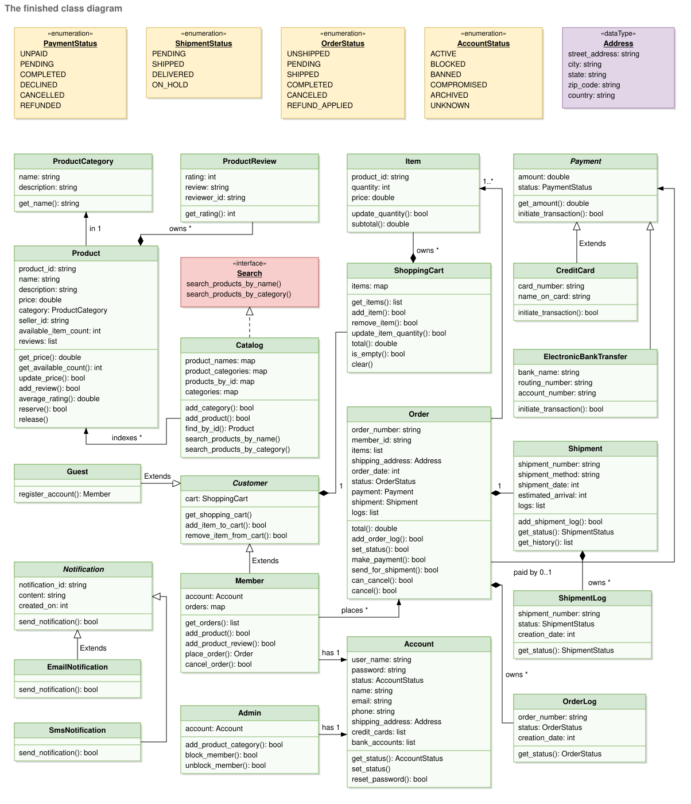
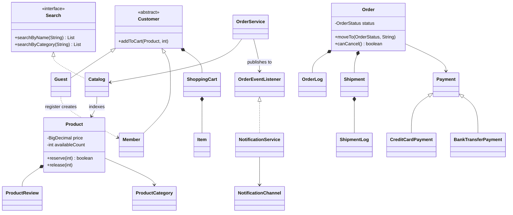
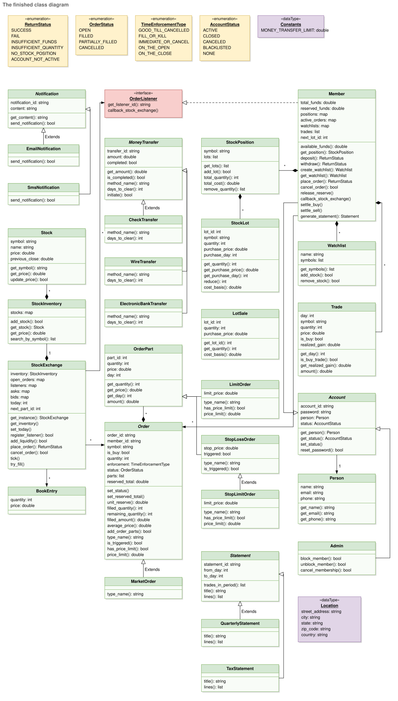
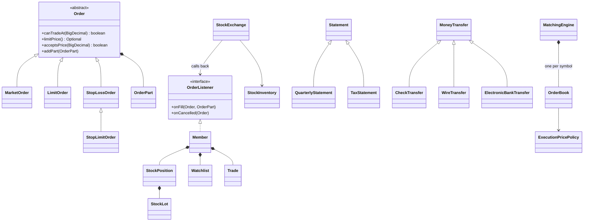
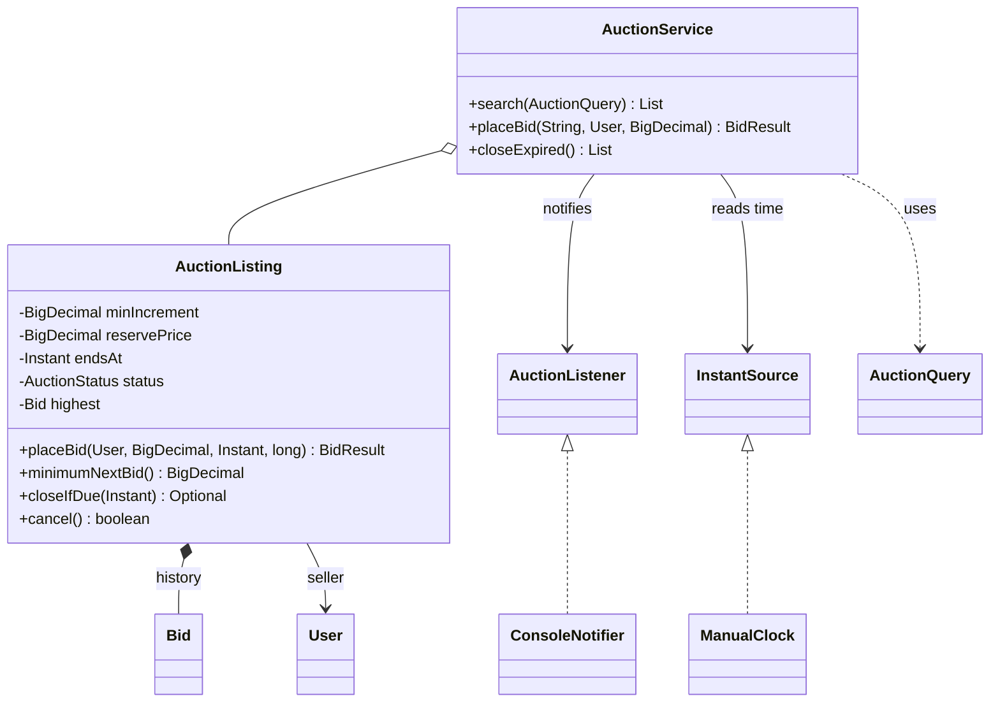
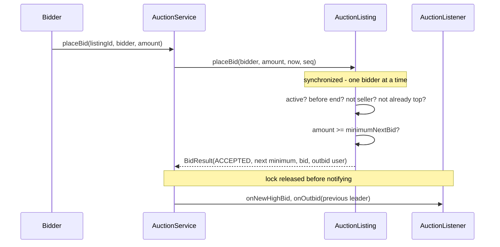
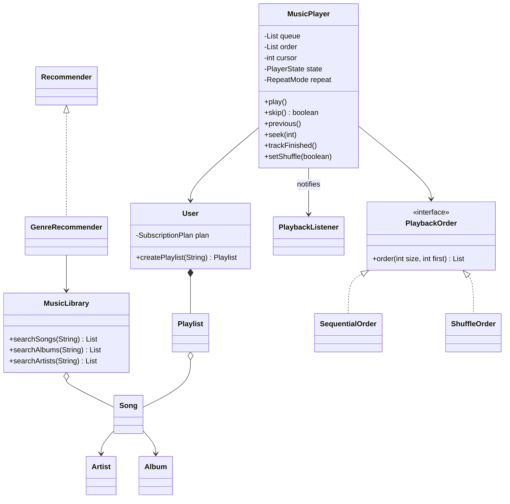
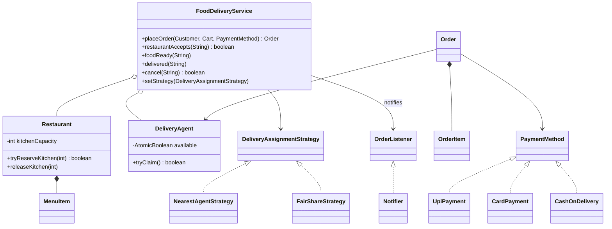
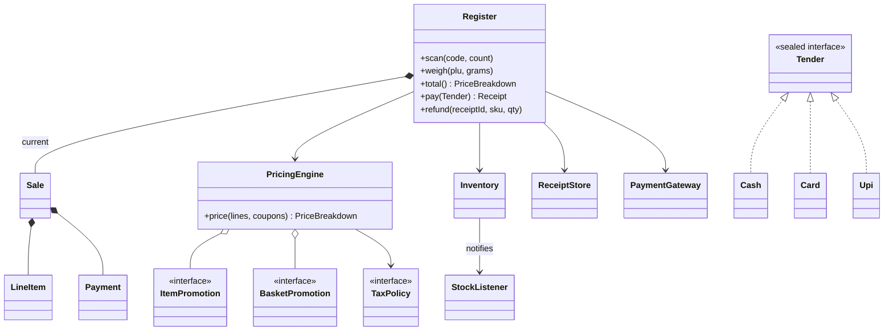
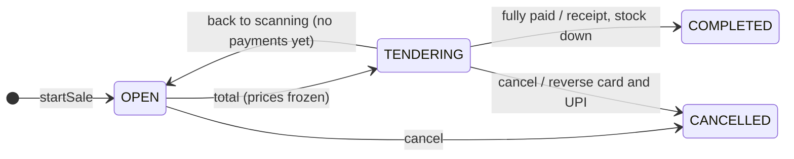

# Chapter 19 — Case Studies: Commerce & Marketplaces (Part 2 of Platforms) — Study Edition

> **Where this fits.** Chapter 18 designed platforms where people *talk*. This chapter designs platforms where people *buy, sell and trade*. Three pressures shape every design: **money must be exact, state must follow rules, and shared things must not be double-sold.** This is the study edition: every topic of the full chapter, without the padding.

| # | Problem | The one idea that makes it work | Main patterns |
|---|---|---|---|
| 19.1 | Amazon — online shopping | An order is an immutable copy of the cart, moved through a **state machine** | State machine (enum), Strategy (payment), Observer, Facade |
| 19.2 | Stock brokerage + exchange matching engine | Four order types differ in only **two questions**; a book matches by **price, then time** | Template Method, Observer, Strategy (price policy) |
| 19.3 | Online auction | "Read highest bid, compare, replace" is **one atomic step** | Monitor lock, Observer, Specification |
| 19.4 | Music streaming (Spotify) | Play order is a **pluggable strategy**; plan rules live **in the plan** | Strategy, Observer, enum-with-behaviour |
| 19.5 | Food delivery (Swiggy) + FoodKart | Capacity and riders are **claimed atomically**; selection is a **strategy** | Strategy, Observer, State machine, CAS |
| 19.6 | Grocery store (POS & checkout) | A **pure pricing engine**: best offer per product, then a coupon spread over items so tax and refunds stay exact | Strategy (offers, tax, payment), Facade, Observer, enum state machine |

**Running the code:** `cd chapters/19-case-platforms-2/code && javac --release 21 -d /tmp/lld_19 $(find . -name '*.java') && java -cp /tmp/lld_19 lld.ch19.amazon.Main` (or `brokerage`, `stockexchange`, `auction`, `music`, `fooddelivery`, `foodkart`, `grocery`). Java 21, standard library only; the stock-exchange `Main` also runs a small test suite. One file may hold several small package-private types.

### Four rules that apply to every design in this chapter

1. **Money is `BigDecimal`, never `double`.** A `double` cannot store 0.1 exactly (`0.1 + 0.2` = `0.30000000000000004`). Build it from a `String` (`new BigDecimal("0.10")`) and compare with `compareTo`, not `equals` — `new BigDecimal("2.0").equals(new BigDecimal("2.00"))` is `false` because the scales differ.
2. **Status changes follow a state machine** — a fixed list of states plus allowed moves, kept *inside the enum*, so an illegal move ("cancel a delivered order") throws at once.
3. **Check-then-act on shared stock must be atomic.** "One left? Take it" is two steps; two threads can both see "yes". Do both under one lock, or with one compare-and-set (CAS: "set to B only if it is still A").
4. **Copy prices into orders.** Later catalog or menu price changes must not change old orders.

---

## Design Amazon — Online Shopping System

### Problem & clarifying questions

We design Amazon's **online retail part**: people list products, others find them, fill a cart, pay and track the parcel.

| Question | Assumed answer |
|---|---|
| Buy without an account? | No. Browsing and carts are open; ordering needs a **registered member** |
| Who sells? | Members can list products (a marketplace) |
| Payment? | Credit card (clears at once) or bank transfer (clears later) |
| Cancel? | Yes, until shipped |
| Notifications? | On every order or shipment status change |
| Returns, wish lists, payouts, recommendations, multi-warehouse stock? | Out of scope — say so out loud |

### Requirements

**Functional:** (1) members add products to sell; (2) anyone searches by **name** or **category**; (3) anyone views, only members buy; (4) add/remove/change cart items; (5) check out the whole cart; (6) rate and review; (7) shipping address; (8) cancel an unshipped order; (9) notified on each order/shipment status change; (10) pay by card or bank transfer; (11) track shipment and order state.

**Non-functional:** two buyers never both get the last unit; exact `BigDecimal` money; orders and shipments keep a **history** of states; a new payment method or channel must not change checkout.

### Use cases

Actors: **Admin** (block/unblock accounts, manage categories), **Guest** (search, cart, register), **Member** (guest + order + sell), **System** (notifications). In the use-case diagram, "Checkout" *includes* "Make payment" and "Add shipping address"; search by name/category *extend* "Search product".

### Core entities

| Class | Responsibility |
|---|---|
| `ProductCategory` | Named group; exists without products |
| `Product` | Price, seller, stock; **owns** reviews; guards stock (`reserve` / `release`) |
| `ProductReview` | Rating 1–5 + text; stores reviewer **by id** (no `Product ↔ Member` dependency) |
| `Search` / `Catalog` | Name-word and category indexes, both updated in `addProduct`; points to, never owns, products |
| `ShoppingCart` / `Item` | Mutable cart owning its lines; `Item` is an immutable record (product id, name, qty, unit price) |
| `Order` / `OrderLog` | Immutable **copy** of cart lines + address + status on legal edges; one log entry per change |
| `Payment` (`CreditCardPayment`, `BankTransferPayment`) | Card clears now; transfer returns `PENDING` |
| `Shipment` / `ShipmentLog` | Parcel + tracking history; last entry = "where is it now" |
| Notification channel (`EmailChannel`, `SmsChannel`) | One delivery way (course: abstract `Notification` with subclasses; same idea) |
| `Account`, `Customer` → `Guest`, `Member`, `Admin` | `Customer` has only what *anyone* may do; ordering lives on `Member` |
| `OrderService` | Turns a cart into an order; drives the state machine |

### Class diagram

The course builds it in five stages (products → catalog → payment/shipment/notification → cart/order → accounts). Filled diamonds are composition (`Product` owns reviews, cart owns items, order owns log and shipment); plain arrows are associations (order only *refers to* its payment); `Guest` and `Member` extend `Customer`.


*Figure — The finished class diagram of the online shopping system (course diagram)*



### Key flows

The course's activity diagram is the shopping loop (search, view, add, update cart, "more shopping?", checkout); its sequence diagrams cover search, add-to-cart, and **checkout**: get cart items → billing/shipping info → create order → verify items → pay → create shipment → return status (with error paths).

**Checkout (`OrderService.placeOrder`)** follows that order, but stock is **reserved** during verification, not just checked: member active and cart not empty → reserve each line (any failure releases what was reserved and fails) → new `Order` copying the lines → `payment.process()`: COMPLETED → `UNSHIPPED` + notify; PENDING (transfer) → notify PENDING; DECLINED → release stock, `CANCELED`.

**Order state machine** (`OrderStatus.next()`): PENDING → UNSHIPPED (paid) or CANCELED; UNSHIPPED → SHIPPED or CANCELED; SHIPPED → COMPLETED; CANCELED → REFUND_APPLIED. Requirement 8 is one line — `canCancel()` returns `status.canMoveTo(CANCELED)`; there is no `SHIPPED → CANCELED` edge.

### Design decisions & patterns used

| Decision | Why | Alternative rejected |
|---|---|---|
| **Ordering on `Member`, not `Customer`** | A guest *is a* customer; inheriting `placeOrder` it must reject breaks **LSP** | `Customer.placeOrder()` that throws for guests |
| `Guest.register()` returns a new `Member` carrying the cart | The cart survives registration | Mutating a guest (Java objects can't change class) |
| `Order` copies cart lines | A finished purchase must not change | Shared `Item` objects |
| Stock reserved at order time | No two buyers get the last unit (abandoned orders hold stock → timer release) | Check, pay, then decrement (race window) |
| State machine inside `OrderStatus` | One owner of the rules | Scattered `if`s |
| Sealed abstract `Payment`, a subclass per method (**Strategy**) | Methods *behave* differently; new method = new subclass (OCP); that is why it is not an enum | `enum PaymentType` + `switch` |
| Payment passed as `Function<BigDecimal, Payment>` | Total known only after building the order | Creating payment before the total |
| **Observer** for notifications | New channel = new `NotificationChannel` | Email/SMS code inside `OrderService` |
| `Shipment` keeps a log; reviews store `reviewerId` | History for tracking/disputes; no two-way dependency | Single status field; review holding `Member` |
| `OrderService` as **Facade** | Hides stock, payment, shipment, notification | Callers orchestrating five objects |

### Java implementation

Package `lld.ch19.amazon`: `Money.java`, `Catalog.java`, `Order.java`, `Payments.java`, `Accounts.java`, `OrderService.java`, `Main.java`.

```java
// File: lld/ch19/amazon/Order.java (excerpt)
enum OrderStatus {
    PENDING, UNSHIPPED, SHIPPED, COMPLETED, CANCELED, REFUND_APPLIED;

    private Set<OrderStatus> next() {
        return switch (this) {
            case PENDING -> EnumSet.of(UNSHIPPED, CANCELED);      // waiting for payment
            case UNSHIPPED -> EnumSet.of(SHIPPED, CANCELED);      // paid, not yet handed to carrier
            case SHIPPED -> EnumSet.of(COMPLETED);                // too late to cancel
            case CANCELED -> EnumSet.of(REFUND_APPLIED);          // money goes back if it was taken
            case COMPLETED, REFUND_APPLIED -> EnumSet.noneOf(OrderStatus.class);
        };
    }

    boolean canMoveTo(OrderStatus target) { return next().contains(target); }
}

// File: lld/ch19/amazon/Catalog.java (excerpt, in Product)
    synchronized boolean reserve(int quantity) {
        if (quantity <= 0 || quantity > availableCount) return false;
        availableCount -= quantity;
        return true;
    }

// File: lld/ch19/amazon/OrderService.java (excerpt)
    Order placeOrder(Member member, Address address, Function<BigDecimal, Payment> paymentMethod) {
        if (!member.canBuy()) throw new IllegalStateException("account " + member.account().status());
        List<Item> items = member.cart().snapshot();
        if (items.isEmpty()) throw new IllegalStateException("cart is empty");

        List<Item> reserved = new ArrayList<>();
        for (Item i : items) {
            Product p = catalog.find(i.productId()).orElseThrow();
            if (!p.reserve(i.quantity())) {
                reserved.forEach(r -> catalog.find(r.productId()).orElseThrow().release(r.quantity()));
                throw new IllegalStateException("out of stock: " + i.name());
            }
            reserved.add(i);
        }

        Order order = new Order("ORD-" + orderSeq.incrementAndGet(), member.id(), items, address);
        orders.put(order.orderNumber(), order);

        Payment payment = paymentMethod.apply(order.total());
        order.attachPayment(payment);
        switch (payment.process()) {
            case COMPLETED -> { transition(order, OrderStatus.UNSHIPPED, "paid by " + payment.describe()); member.cart().clear(); }
            case PENDING -> { publish(order, OrderStatus.PENDING); member.cart().clear(); }
            default -> {                                  // declined: give the stock back, keep the cart
                releaseStock(order);
                transition(order, OrderStatus.CANCELED, "payment declined");
            }
        }
        return order;
    }
```

Full runnable code: code/lld/ch19/amazon/ (see the Full Edition).

```text
== 6. Illegal transition is rejected by the state machine ==
  ORD-1002: REFUND_APPLIED -> SHIPPED is not allowed
== 9. Ten members race for the last copy ==
  winners=1 losers=9 stock left=0
```

The demo also shows: name search matches every query word (`usb cable` finds "USB-C Cable"); the guest's cart survives registration; each status change goes to email + SMS; the cancel path `PENDING → UNSHIPPED → CANCELED → REFUND_APPLIED` returns stock; a blocked member is rejected; ten threads released together by a `CountDownLatch` produce exactly one winner.

### Concurrency & edge cases

| Risk | How the code prevents it |
|---|---|
| Last unit, two buyers | `Product.reserve` is `synchronized` (check + decrement in one step) |
| Multi-line cart, one line out of stock | `placeOrder` releases everything it reserved (all-or-nothing) |
| Cancel and ship at the same time | Both lock the `Order` around check-then-move |
| Payment declined | Stock released, order `CANCELED`, cart kept for retry |
| Bank transfer never clears | A timeout job cancels old `PENDING` orders |
| Price changes after adding to cart | `Item` stores unit price; production re-validates at checkout |
| Blocked member | `Member.canBuy()` checks `ACTIVE` |
| Deadlock | Each lock held briefly, never while waiting for another in opposite order |

### Real-world example

Amazon offers *Cancel items* only before the order enters shipping — our missing `SHIPPED → CANCELED` edge. Its 2007 **Dynamo** paper chose availability so "add to cart" always works during failures, merging conflicting cart versions later. At scale, cart, catalog and orders are separate services.

### Extensions & follow-up questions

- **New payment (gift card, UPI)** — `GiftCardPayment extends Payment` (add to `permits`); `OrderService` untouched.
- **Last unit, distributed** — `UPDATE ... SET stock = stock - 1 WHERE id = ? AND stock >= 1`, or optimistic locking with a version column.
- **Abandoned orders** — reservation expiry; a job cancels `PENDING` orders after ~30 minutes.
- **Returns** — `COMPLETED → RETURN_REQUESTED → RETURNED → REFUND_APPLIED` (local enum change).
- **Multiple warehouses** — `Inventory` per warehouse; a Strategy picks one per line. **Split shipments** — one order, many `Shipment`s.
- **Search at scale** — Elasticsearch/OpenSearch fed by product events behind `Search`. **Payouts, recommendations, wish lists** — modules listening to order events.

### In the interview

Plan: clarify (3 min) → actors/use cases (5) → class diagram, **saying the LSP sentence**: "Ordering is on `Member`, not `Customer`, otherwise every guest inherits a method it is not allowed to use" (10) → state machine, no cancel-after-ship edge (5) → code `placeOrder` and `cancel` (10) → concurrency and extensions (5).

**30-second answer:** "Catalog with name and category indexes; a cart per customer; ordering only on `Member`; checkout reserves stock for every line atomically, copies the lines into an immutable order, then takes payment through a `Payment` strategy. The order moves through a state machine that forbids cancelling after shipping, and every status change is published to a notification observer."

- *Tax and discounts?* — A `PricingRule` chain (Chain of Responsibility or list of Strategies) applied when building the order; the order stores final line prices.
- *Double-click checkout?* — Client idempotency key; return the existing order for a repeated key.

### Self-check

1. **Q:** Why can't `placeOrder` live on `Customer`? **A:** Guests extend `Customer` and must not order; inheriting a method you must refuse violates LSP.
2. **Q:** Two faults of "check stock, pay, then decrement"? **A:** A race lets two buyers pass the check; payment can succeed for goods no longer there.
3. **Q:** Which edges allow a cancel? **A:** `PENDING → CANCELED` and `UNSHIPPED → CANCELED`.
4. **Q:** Why `compareTo` on `BigDecimal`? **A:** `equals` also compares scale (`2.0` ≠ `2.00`).

### TL;DR

- Guests browse and fill carts; **only members order** (LSP).
- Checkout = **reserve all lines atomically → copy into an immutable order → pay (Strategy) → publish (Observer)**.
- `OrderStatus` is a **state machine**; cancel after ship has no edge. Money in `BigDecimal`; histories in logs; stock guarded by a lock.

---
## Design an Online Stock Brokerage System

Two halves, both asked in interviews:

- **Part A — the brokerage** (the course): members, money in/out, watchlists, four order types, lots and positions, statements.
- **Part B — the exchange's matching engine** (a Geektrust machine-coding problem kept in kumaransg/LLD as "Navi"): an order book matching by **price-time priority**, implemented and tested.

A **broker** holds your cash and shares and forwards orders; an **exchange** is where orders from all brokers meet and match. The code keeps them apart.

### Problem & clarifying questions

An online brokerage lets members trade without a human broker, track transactions, see charts, and get alerts when a stock moves by a chosen amount — faster and cheaper, with real-time prices.

| Question | Assumed answer |
|---|---|
| Order types? | Market, limit, stop-loss, stop-limit |
| Partial fills? | Yes, at several prices |
| Separate purchases tracked? | Yes — each is a **lot** (tax depends on which lot you sell) |
| Money in/out? | Check, wire, electronic bank transfer, each with a per-transfer limit |
| Reports? | Quarterly statements and a yearly tax statement |
| Notifications? | When an order executes |
| Margin, shorting, options, dividends/splits, streaming quotes, settlement delay, wash-sale rule? | Out of scope |

### Requirements

**Functional (brokerage):** (1) buy and sell; (2) **multiple watchlists**; (3) **market, limit, stop-loss, stop-limit** orders; (4) **multiple lots** per stock kept apart; (5) **quarterly** and **yearly tax** statements; (6) money via **check, wire, electronic transfer**; (7) notify on execution.

**Functional (matching engine, Navi):** (8) input lines `<id> <time> <symbol> <buy/sell> <price> <qty>` (e.g. `#1 09:45 BAC sell 240.12 100`) from a file given as argument, trades to console; (9) match each new order against the opposite side — lower sells and higher buys first, **earlier first** at the same price; (10) trade when buy ≥ sell, recorded at the **sell order's price**; (11) print `<buy_id> <price> <qty> <sell_id>`; unmatched quantity rests.

**Non-functional:** money never over-committed (ten $1,000 orders cannot all pass a $1,000 check); deterministic matching; engine safe under concurrency and conserves quantity.

### Use cases

**Admin** (block/unblock), **Member** (search, trade, watchlists), **System** (order notifications, fetch quotes). Top cases: register/cancel membership, manage watchlists, search by symbol, place/cancel orders, deposit/withdraw.

### Core entities

| Class | Responsibility |
|---|---|
| `MoneyTransfer` → `CheckTransfer`, `WireTransfer`, `ElectronicBankTransfer` | Differ only in name and clearing days (5/1/3); the 100,000 limit lives once in the base |
| `Notifier` / `EmailNotifier` | "Order filled" messages (an `SmsNotifier` would be a second implementation) |
| `Order` (abstract) + `MarketOrder`, `LimitOrder`, `StopLossOrder`, `StopLimitOrder` | Shared fields; each subclass answers the **two questions**; `StopLimitOrder extends StopLossOrder` |
| `OrderPart` | One fill (e.g. 70 @ 10.00 + 30 @ 10.05) |
| `Stock`, `StockInventory` | Symbol + latest price; inventory is the **single source of truth** for prices |
| `StockExchange`, `OrderListener` | Holds open orders, fills on new orders/ticks, calls back `onFill`/`onCancelled` (never knows `Member`) |
| `StockLot`, `StockPosition`, `LotSale` | One purchase; all lots of a symbol, sold FIFO unless a lot is named; per-lot realised gain |
| `Watchlist` | Named set of **symbols** (never stale) |
| `Trade`, `Statement` → `QuarterlyStatement`, `TaxStatement` | Fills as the member sees them; statements share day-range filtering |
| `Member`, `Admin` | Cash, **reserved funds**, positions, watchlists, trades; implements `OrderListener` |
| *(engine)* `OrderBook`, `MatchingEngine`, `Trade`, `ExecutionPricePolicy` | Price levels with FIFO queues; routing and locking; trade price |

### Class diagram

Course stages: transfers and notifications → **the order hierarchy** (the part that earns most credit) → stock, inventory, exchange → lots and positions → watchlists, trades, statements → members and admins. `Member` extends `Account` and implements `OrderListener`; it owns positions, watchlists and trades.


*Figure — The finished class diagram of the online stock brokerage (course diagram)*



### Key flows

**Buy order** (course activity diagram): pick stock and type, enter quantity, limit and time enforcement → check funds → reserve money → send to exchange → "order placed". **Sell order** mirrors it, choosing **which lots** and checking owned shares instead of money.

**The four order types** share everything except two answers:

| Type | Q1: may it trade at this price? | Q2: worst acceptable price | Plain words |
|---|---|---|---|
| Market | Always | None | "Now, at whatever the market gives" |
| Limit | Always | The limit | "Buy at 9.50 or less / sell at 10.90 or more" |
| Stop-loss | Only after price **reaches the stop**, then forever | None (becomes market) | "If it falls to 10.00, get me out" |
| Stop-limit | Only after the stop | The limit | "If it rises to 305, buy — but pay no more than 306" |

A SELL stop triggers when price ≤ stop; a BUY stop when price ≥ stop; once triggered it "latches".

**Fill:** member reserves (funds or free shares) → exchange checks `canTradeAt`, fills level by level while `acceptsPrice` → `onFill` moves cash, releases the reservation, adds a lot or sells FIFO. Later `tick(symbol, price)` re-checks open orders (stops trigger here).

**Matching engine — price-time priority.** Per symbol, an `OrderBook` with two sides, each a `TreeMap` price → FIFO `ArrayDeque` (bids highest-first, asks lowest-first). For an incoming order: look at the best opposite price; stop if it does not **cross**; else fill the oldest order at that level for `min(remaining, resting)`; remove filled orders and empty levels; repeat; rest any remainder at the back of its own level.

| Order | Book before | What happens |
|---|---|---|
| #1 sell 240.12 × 100 | empty | rests |
| #2 sell 237.45 × 90 | asks 240.12 | rests; best ask 237.45 |
| #3 buy 238.10 × 110 | asks 237.45×90, 240.12×100 | trade `#3 237.45 90 #2`; 20 left; 240.12 too high; rests 20 @ 238.10 |
| #4 buy 237.80 × 10 | best ask 240.12 | no cross; rests |
| #5 buy 237.80 × 40 | same | rests **behind #4** |
| #6 sell 236.00 × 50 | bids 238.10×20, 237.80×(10, 40) | fills #3 20, #4 10, #5 20 — all at 236.00 (sell price) |

### Design decisions & patterns used

| Decision | Why | Alternative rejected |
|---|---|---|
| **One abstract `Order` + two abstract questions** | Only "may I trade?" and "worst price?" differ. The course calls it plain polymorphism — not State (no order changes kind); its only named patterns are Observer and Singleton (Template Method/Strategy labels here are ours) | Four copied classes; one class with `type` + `switch` |
| `StopLimitOrder extends StopLossOrder` | Inherits the trigger, overrides only `limitPrice()` | Duplicated trigger logic |
| `OrderPart` per fill | Each fill has its own price and becomes a lot | Average price only (loses tax info) |
| **Observer** `OrderListener` | Exchange never imports `Member` | Exchange updating balances |
| **Reserved funds / shares** | Stops over-commitment; money actually moves only in `onFill`, called by the exchange (course's `callbackStockExchange`) | Balance check only at fill time |
| Lots, FIFO default | Tax depends on which shares were sold | One average-cost position |
| **Template Method** `Statement` | `render` final (shared filter); subclasses fill `body` | Two copies of the filter |
| `MoneyTransfer` base holds the limit | One rule, three methods | Limit copied per subclass |
| Singleton? | Course makes `StockExchange` a Singleton; we inject one instance (testable) | Global `getInstance()` |
| Engine: `TreeMap<price, ArrayDeque>` per side | Best price O(log n); FIFO gives time priority | One `PriorityQueue` (O(n) cancel, no visible levels) |
| Engine: lock per symbol | Symbols match in parallel; same symbol serialised | Global lock or no lock |
| Engine: `ExecutionPricePolicy` (**Strategy**) | Navi: sell price; real exchanges: resting order's price | Hard-coding one rule |

### Java implementation

#### Part A — Brokerage (`lld.ch19.brokerage`)

Files: `Orders.java`, `Market.java`, `Holdings.java`, `Accounts.java`, `Main.java`. The simulated exchange offers 70 shares per price level, 5 cents apart, 3 levels, so fills come in parts.

```java
// File: lld/ch19/brokerage/Orders.java (excerpt)
abstract class Order {
    // ... id, memberId, symbol, side, quantity, timeInForce, parts, status
    /** Question 1. Market and limit orders always say yes; stop orders wait for the trigger. */
    abstract boolean canTradeAt(BigDecimal marketPrice);

    /** Question 2. Empty means "any price" (market behaviour). */
    abstract Optional<BigDecimal> limitPrice();

    /** Is a fill at this price acceptable? BUY: price <= limit. SELL: price >= limit. */
    final boolean acceptsPrice(BigDecimal price) {
        return limitPrice().map(l -> side == Side.BUY ? price.compareTo(l) <= 0 : price.compareTo(l) >= 0)
                           .orElse(true);
    }
    // ...
}

final class MarketOrder extends Order {
    // ...
    @Override boolean canTradeAt(BigDecimal p) { return true; }
    @Override Optional<BigDecimal> limitPrice() { return Optional.empty(); }
    // ...
}
// ... LimitOrder: canTradeAt -> true, limitPrice -> Optional.of(limit)
class StopLossOrder extends Order {
    // ...
    @Override final synchronized boolean canTradeAt(BigDecimal p) {
        if (!triggered) {
            triggered = side() == Side.SELL ? p.compareTo(stopPrice) <= 0 : p.compareTo(stopPrice) >= 0;
        }
        return triggered;
    }
    @Override Optional<BigDecimal> limitPrice() { return Optional.empty(); }
    // ...
}

/** A stop order that becomes a LIMIT order (not a market order) once triggered. */
final class StopLimitOrder extends StopLossOrder {
    // ...
    @Override Optional<BigDecimal> limitPrice() { return Optional.of(limit); }
    // ...
}

// File: lld/ch19/brokerage/Accounts.java (excerpt, in Member)
    private synchronized ReturnStatus reserveFor(Order o) {
        if (status != AccountStatus.ACTIVE) return ReturnStatus.ACCOUNT_NOT_ACTIVE;
        if (o.side() == Side.BUY) {
            BigDecimal perShare = o.limitPrice().orElse(inventory.priceOf(o.symbol()));
            BigDecimal need = Money.times(perShare, o.quantity());
            if (need.compareTo(availableFunds()) > 0) return ReturnStatus.INSUFFICIENT_FUNDS;
            reservedFunds.put(o.id(), need);           // released part by part as fills arrive
            return ReturnStatus.SUCCESS;
        }
        // ... sells: free shares = position - shares promised to open sells of this symbol
    }
```

```text
== 3. Market buy 100 AAPL fills in two parts (two lots) ==
    [email alice@mail.test] filled 70 AAPL @ 10.00 (O1 PARTIALLY_FILLED)
    [email alice@mail.test] filled 30 AAPL @ 10.05 (O1 FILLED)
Tax statement for Alice (days 1-365)
  AAPL L1: 70 sh bought @ 10.00 sold @ 11.00 gain $70.00
  AAPL L2: 30 sh bought @ 10.05 sold @ 10.95 gain $27.00
  AAPL L3: 20 sh bought @ 9.40 sold @ 10.95 gain $31.00
  AAPL L3: 30 sh bought @ 9.40 sold @ 9.95 gain $16.50
  realised gain: $144.50
```

Reading the output: a 200,000 check fails the 100,000 limit. The market order reserved $1,000.00 but cost $1,001.50 — a market order can spend more than reserved (the course's warning). A limit buy waits for the 9.40 tick; a 120-share sell goes FIFO across three lots; the stop does nothing at 10.50 and fires at 9.95; the stop-limit triggers at 310 but its 306 limit blocks the fill until 305.50; a second $2,000 order is refused by the reservation and cancelling returns the money; the tax statement shows gain **per lot**.

Full runnable code: code/lld/ch19/brokerage/ (see the Full Edition).

#### Part B — Matching engine (`lld.ch19.stockexchange`)

Files: `OrderBook.java`, `MatchingEngine.java` (routing, `synchronized (book)` per symbol, sequence taken inside the lock, trades published outside it), `MatchingEngineTests.java` (nine tests), `Main.java`.

```java
// File: lld/ch19/stockexchange/OrderBook.java (excerpt)
interface ExecutionPricePolicy {
    BigDecimal price(Order buy, Order sell, Order incoming);

    ExecutionPricePolicy SELL_PRICE = (buy, sell, incoming) -> sell.price();
    ExecutionPricePolicy RESTING_PRICE = (buy, sell, incoming) -> incoming == buy ? sell.price() : buy.price();
}

final class OrderBook {
    // ...
    private final NavigableMap<BigDecimal, Deque<Order>> bids = new TreeMap<>(Collections.reverseOrder());
    private final NavigableMap<BigDecimal, Deque<Order>> asks = new TreeMap<>();
    // ...
    /** Match the incoming order against the other side, then rest whatever is left. */
    List<Trade> add(Order incoming) {
        List<Trade> trades = new ArrayList<>();
        NavigableMap<BigDecimal, Deque<Order>> opposite = incoming.side() == Side.BUY ? asks : bids;

        while (!incoming.isDone() && !opposite.isEmpty()) {
            Map.Entry<BigDecimal, Deque<Order>> best = opposite.firstEntry();
            if (!crosses(incoming, best.getKey())) break;          // best price does not meet ours: stop
            Deque<Order> queue = best.getValue();
            Iterator<Order> it = queue.iterator();
            while (!incoming.isDone() && it.hasNext()) {
                Order restingOrder = it.next();                      // oldest first = time priority
                int qty = Math.min(incoming.remainingQty(), restingOrder.remainingQty());
                Order buy = incoming.side() == Side.BUY ? incoming : restingOrder;
                Order sell = incoming.side() == Side.SELL ? incoming : restingOrder;
                trades.add(new Trade(buy.id(), pricePolicy.price(buy, sell, incoming), qty, sell.id()));
                incoming.fill(qty);
                restingOrder.fill(qty);
                if (restingOrder.isDone()) {
                    it.remove();
                    resting.remove(restingOrder.id());
                }
            }
            if (queue.isEmpty()) opposite.pollFirstEntry();
        }
        if (!incoming.isDone()) rest(incoming);
        return trades;
    }
    // ... cancel, bestBid, bestAsk, crosses, rest
}
```

```text
== Trades (execution price = sell order's price) ==
#3 237.45 90 #2
#3 236.00 20 #6
#4 236.00 10 #6
#5 236.00 20 #6
== Same input, real-exchange rule (price of the resting order) ==
#3 237.45 90 #2
#3 238.10 20 #6
#4 237.80 10 #6
#5 237.80 20 #6
  9/9 passed
```

The first block matches the problem's expected output exactly; the second prices each trade at the *resting* buyer's price. Tests cover price priority, time priority, no-cross, partial fill, cancel, symbol isolation, validation, and concurrency (8 threads × 500 orders: quantity conserved, book never crossed).

Full runnable code: code/lld/ch19/stockexchange/ (see the Full Edition).

### Concurrency & edge cases

| Risk | Where | Prevention |
|---|---|---|
| Over-spending | Brokerage | `reserveFor` (synchronized on member) subtracts all reservations first |
| Selling shares twice | Brokerage | Free shares = position − remaining open sells of that symbol |
| Member/exchange deadlock | Brokerage | Member reserves under its lock, submits outside it; only exchange → member calls |
| Market order costs more than reserved | Brokerage | Known gap; reserve a buffer (+5%) or a price band |
| Time in force not enforced | Brokerage | Enum has GTC, FOK, IOC, on-the-open, on-the-close but nothing reads it; belongs in the exchange's fill loop |
| Same-price orders "together" | Engine | Lock acquisition order = time priority; `sequence` taken inside the lock |
| Cancel racing a match | Engine | Same per-symbol lock: matched or cancelled, never both |
| Bad input (duplicate id, zero qty, negative price) | Engine | Validated before registering |
| Slow trade publishing | Engine | Published after releasing the lock |
| Floating-point prices | Both | `BigDecimal`; `TreeMap` compares with `compareTo`, so `237.8` = `237.80` |

### Real-world example

Zerodha offers **SL** (stop-loss limit) and **SL-M** (stop-loss market) — our `StopLimitOrder` and `StopLossOrder`; orders go to exchanges like NSE with price-time priority books. **LMAX** (Martin Fowler's "The LMAX Architecture") runs matching on a **single thread** fed by a ring buffer (the Disruptor) — "one serialised writer per book" taken to its end. US tax rules treat shares as sold FIFO unless you name lots, hence `StockPosition.sell`'s optional lot id.

### Extensions & follow-up questions

- **Trailing stop** — new subclass moving its stop with the best price; only `canTradeAt` changes.
- **IOC / FOK** — IOC cancels the remainder after one pass; FOK checks available quantity first and cancels if short.
- **Price alerts** — a `PriceAlert` observer on ticks, firing once past the threshold.
- **Modify order** — reducing quantity keeps priority; price change or increase = cancel + new.
- **Faster engine** — single writer per symbol via a queue, pre-allocated objects, `long` price ticks.
- **Market orders in the engine** — limit at +∞ / 0, never rest the remainder. **Settlement** (T+1) — `unsettledCash`.

### In the interview

Brokerage plan: clarify (3) → actors (3) → **key sentence**: *"The four order types differ in exactly two things: whether they may trade yet, and the worst price they accept"* (8) → lots and tax (4) → reserved funds (3) → code the two questions and `StockPosition.sell` (10) → Observer, statements, extensions (5). **Navi, 90 minutes:** parse lines → `OrderBook` with two `TreeMap`s of `ArrayDeque` → matching loop → print trades → tests (sample, price, time, partial, cancel). Pass the sample first, then refactor.

**30-second answer:** "One abstract `Order` with four tiny subclasses answering 'may I trade now?' and 'what is my worst price?'. Fills are `OrderPart`s and each purchase becomes a lot, sold FIFO. Money is reserved at placement so a member cannot over-commit; the exchange calls back through an `OrderListener`. The matching engine keeps, per symbol, two `TreeMap`s of price levels with FIFO queues — best price first, oldest first — under one lock per symbol."

- *Book data structure and complexity?* — `TreeMap` levels: best level and new level O(log L); FIFO append O(1), O(1) per fill; cancel O(log L) + O(k) in the level (O(1) with a linked handle).
- *Trade price?* — Navi: the sell price. Real continuous trading: the resting order's price (incoming may get "price improvement").

### Self-check

1. **Q:** SELL stop at 10.00; price 10.50 → 9.95 → 10.20. When does it trade? **A:** At 9.95, and it stays triggered.
2. **Q:** What does stop-limit add? **A:** A worst price after triggering — it becomes a limit order.
3. **Q:** Why did one market order create two lots? **A:** It filled at two prices; a lot is defined by its purchase price.
4. **Q:** Bids b1 then b2 at 50.00; a sell for 7 at 49. Trades? **A:** b1 gets 5, b2 gets 2 (time priority).
5. **Q:** What is a "crossed" book? **A:** Best bid ≥ best ask — those orders should already have traded.

### TL;DR

- **Brokerage:** abstract `Order`, four subclasses answering *may I trade now?* and *worst price?*; fills are `OrderPart`s; purchases are **lots**; money **reserved** at placement; **Observer** callback; statements are a **Template Method**.
- **Matching engine:** per symbol, two `TreeMap<price, FIFO queue>`; best price, then oldest; rest the remainder; one lock per symbol; trade price is a pluggable policy.

---
## Design an Online Auction System

### Problem & clarifying questions

An online auction (like eBay) lets a **seller** list an item with a starting price and end time; **bidders** outbid each other; at the end the highest bidder wins — if the hidden **reserve price** was reached.

| Question | Assumed answer |
|---|---|
| Listing contents? | Name, description, category, starting price, minimum increment, optional reserve, duration |
| Valid bid? | First ≥ starting price; later ≥ current highest + increment |
| Seller bids? Leader outbids self? | No and no |
| When does it end? | At end time; a late bid is refused even if the closing job hasn't run |
| Who is told what? | Outbid bidder immediately; winner and seller at close; seller if unsold |
| Proxy bidding, anti-sniping, payments? | Extensions |

### Requirements

**Functional:** (1) register and log in (login is the usual auth service, not coded); (2) create listings; (3) search by name, category, price range; (4) bid on **active** listings; (5) keep the **current highest bid** and notify; (6) close at end time — **highest bidder wins** if the reserve is met. **Non-functional:** (7) many simultaneous bids stay consistent (one true highest); (8) new bid rules, channels or search criteria without rewriting the core.

### Use cases

| Actor | Use cases |
|---|---|
| Seller | Create listing, cancel (only while nobody has bid), see result |
| Bidder | Search, view listing and history, bid, be told when outbid or won |
| System (scheduler) | Activate, close expired, declare winner, notify |

### Core entities

| Class | Responsibility |
|---|---|
| `User`, `Bid` | Records; bid = bidder, `BigDecimal` amount, time, sequence |
| `AuctionStatus` | `SCHEDULED → ACTIVE → CLOSED`, or `CANCELLED` |
| `AuctionListing` | Item, seller, prices, times, history, highest bid; **owns the bidding rules** under its own lock |
| `BidOutcome` / `BidResult` / `CloseResult` | Why accepted/refused, next minimum, accepted bid, who was outbid; winner and reserve met |
| `AuctionQuery` | Fluent search; each criterion a `Predicate` (**Specification**) |
| `AuctionListener` / `ConsoleNotifier` | Observer: new high bid, outbid, won, unsold |
| `AuctionService` | Facade; calls listeners **outside** listing locks |
| `ManualClock` | An `InstantSource` moved forward in demos and tests |

### Class diagram



### Key flows

**Lifecycle:** SCHEDULED → ACTIVE (start time) or CANCELLED (seller withdraws); ACTIVE → CANCELLED (withdraw with no bids) or CLOSED (end time). Activation is **lazy**: every method first calls `refresh(now)`, so no thread is needed to flip the state.

**Placing a bid** (the critical section):



**Closing:** a scheduler (a `ScheduledExecutorService` in production) calls `closeExpired()`; `closeIfDue(now)` atomically moves `ACTIVE → CLOSED` and returns a winner only if the reserve is met; notifications go out after locks are released.

### Design decisions & patterns used

| Decision | Why | Alternative rejected |
|---|---|---|
| **Bid rules inside `AuctionListing` under its lock** (a *monitor*: all methods `synchronized`) | Compare-and-replace is atomic; per-listing lock, so auctions don't wait for each other | Global lock; or `AtomicReference<Bid>` + CAS (valid, but seller/leader/time/increment rules are easier under one lock) |
| Refusals returned (`BidOutcome`), not thrown | A low bid is normal business; caller gets the next minimum | Exception per low bid |
| **Observer** called outside the lock | Slow notifications don't block bidders; `BidResult` carries a **snapshot** taken inside the lock | Notifying inside `synchronized` (slow, deadlock risk) |
| Minimum increment | No 1-cent wars; predictable next minimum | Any higher amount |
| Reserve price checked only at close | Seller protection without revealing it | Rejecting bids below reserve |
| Injected `InstantSource` | Testable time (`ManualClock`) | `Instant.now()` everywhere |
| **Specification** for search | Each criterion a `Predicate`, combined with `and` | An ever-growing `search(...)` parameter list |
| Not a Singleton | awesome-low-level-design uses a Singleton `AuctionSystem`; we pass one instance so tests get fresh ones | Global shared state |

### Java implementation

Package `lld.ch19.auction`: `Auction.java`, `AuctionService.java`, `Main.java`.

```java
// File: lld/ch19/auction/Auction.java (excerpt, in AuctionListing)
    synchronized BidResult placeBid(User bidder, BigDecimal rawAmount, Instant now, long seq) {
        refresh(now);
        BigDecimal amount = money(rawAmount);
        if (status != AuctionStatus.ACTIVE) return refuse(BidOutcome.AUCTION_NOT_ACTIVE);
        if (!now.isBefore(endsAt)) return refuse(BidOutcome.AUCTION_ENDED);  // closing job may not have run yet
        if (bidder.id().equals(seller.id())) return refuse(BidOutcome.SELLER_CANNOT_BID);
        if (highest != null && highest.bidder().id().equals(bidder.id())) return refuse(BidOutcome.ALREADY_HIGHEST);
        if (amount.compareTo(minimumNextBid()) < 0) return refuse(BidOutcome.TOO_LOW);

        Optional<User> outbid = Optional.ofNullable(highest).map(Bid::bidder);
        highest = new Bid(bidder, amount, now, seq);
        bids.add(highest);
        return new BidResult(BidOutcome.ACCEPTED, minimumNextBid(), Optional.of(highest), outbid);
    }

    /** First bid must reach the starting price; later bids must beat the leader by the increment. */
    synchronized BigDecimal minimumNextBid() {
        return highest == null ? startingPrice : highest.amount().add(minIncrement);
    }

    /** ACTIVE -> CLOSED once time is up. Returns empty if not yet due (or already closed). */
    synchronized Optional<CloseResult> closeIfDue(Instant now) {
        refresh(now);
        if (status != AuctionStatus.ACTIVE || now.isBefore(endsAt)) return Optional.empty();
        status = AuctionStatus.CLOSED;
        boolean reserveMet = highest != null && highest.amount().compareTo(reservePrice) >= 0;
        return Optional.of(new CloseResult(this, reserveMet ? Optional.of(highest) : Optional.empty(), reserveMet));
    }

// File: lld/ch19/auction/AuctionService.java (excerpt)
    BidResult placeBid(String listingId, User bidder, BigDecimal amount) {
        AuctionListing a = listings.get(listingId);
        if (a == null) throw new IllegalArgumentException("no listing " + listingId);
        BidResult r = a.placeBid(bidder, amount, clock.instant(), bidSeq.incrementAndGet());
        r.accepted().ifPresent(top -> {                 // snapshot taken inside the lock
            listeners.forEach(l -> l.onNewHighBid(a, top));
            r.outbid().ifPresent(u -> listeners.forEach(l -> l.onOutbid(a, u, top.amount())));
        });
        return r;
    }
```

Full runnable code: code/lld/ch19/auction/ (see the Full Edition).

```text
  Ana bids 90 (below start) -> TOO_LOW (next minimum 100.00)
  Ana bids 120 (already top) -> ALREADY_HIGHEST (next minimum 110.00)
  Bob bids 105 (increment is 10) -> TOO_LOW (next minimum 110.00)
  Sam bids on own item -> SELLER_CANNOT_BID (next minimum 120.00)
  accepted=28 (varies run to run), highest=650.00 by bidder49, history strictly increasing by >= increment: true
  late bid -> AUCTION_ENDED (next minimum 660.00)
```

Every refusal rule fires; outbid notices print before the bidder's own result line (the service notifies before returning). The watch closes unsold (60 < 500 reserve). Of 50 concurrent bids the accepted count varies, but the highest is always 650.00 and the history always rises by at least the increment — the invariant the lock protects.

### Concurrency & edge cases

| Case | Handling |
|---|---|
| Same amount at the same time | First through the lock wins; the second is `TOO_LOW` |
| Bid exactly at end time | `!now.isBefore(endsAt)` → `AUCTION_ENDED` (end is exclusive) |
| Close job runs late / races a bid | Late bids refused anyway; both `synchronized`, so the bid lands before or after the close |
| Slow or failing listener | Outside the lock; production publishes to a retrying queue |
| Seller cancels after bids | Refused |
| Money precision | Scale 2 `BigDecimal`, `compareTo` |
| Very hot auction | Single writer per auction (partition by id, e.g. Kafka), or `UPDATE ... SET high = ? WHERE id = ? AND high < ?` |

### Real-world example

eBay uses **proxy bidding** (it bids for you up to your maximum, by the increment), hidden **reserve prices**, and fixed end times — hence "sniping". Other sites use a **soft close** (late bids extend the end) to defeat it.

### Extensions & follow-up questions

- **Proxy bidding** — per-bidder `maxAmount`; after each accepted bid, inside the lock, the strongest proxy responds with `min(its max, competitor + increment)`; ties to the earlier proxy (`Bid.seq`).
- **Anti-sniping** — soft close: a bid in the last N minutes extends `endsAt` (non-final, same lock).
- **Buy It Now** — fixed price closes the auction if paid before the first bid.
- **Dutch / sealed / Vickrey** — an `AuctionRules` strategy (`validate`, `winner`, `price`); Vickrey: highest wins, pays second-highest.
- **Payment after winning** — `AWAITING_PAYMENT`, 48 hours, else offer to the second bidder.
- **Scale the close job** — a priority queue by `endsAt`.

### In the interview

Plan: bid rules (4 min) → entities and lifecycle (8) → code `placeBid` under the listing lock and **say why the lock is per listing** (12) → closing and notifications outside the lock (6) → concurrency and extensions (10).

**30-second answer:** "Each listing owns its bid rules and highest bid, and `placeBid` is synchronized on the listing, so compare-and-replace is atomic and different auctions never contend. Refusals return a reason and the next minimum. The service notifies outbid users and, at close, the winner and seller, always after releasing the lock. Time comes from an injected clock, so closing and late bids are testable."

- *Why not `AtomicReference` + CAS?* — The rule also checks seller, leader and time; one small lock is simpler and still fast per listing.
- *Close on time across servers?* — A scheduler with a time-ordered index; `closeIfDue` is idempotent, so running twice is harmless.
- *Live price for thousands?* — Push `onNewHighBid` to pub/sub and WebSockets; viewers read a cache.

### Self-check

1. **Q:** When is a bid `TOO_LOW`? **A:** Below the starting price with no bids, or below highest + increment.
2. **Q:** Why notify after the listing call returns? **A:** Short lock; no slowdown or deadlock from notification code.
3. **Q:** Bid at exactly the end instant? **A:** Refused — the end is exclusive.
4. **Q:** Where does the reserve matter? **A:** Only at close.
5. **Q:** What is the Specification pattern here? **A:** Search criteria as composable `Predicate`s.

### TL;DR

- One **lock per listing**; all bid rules inside it; refusals are values, not exceptions.
- `SCHEDULED → ACTIVE → CLOSED | CANCELLED`; activation lazy, closing idempotent.
- **Observer** after the lock; **injected clock**; **Specification** for search.

---
## Design a Music Streaming Service (Spotify)

### Problem & clarifying questions

Users search a big catalog, build playlists and play songs with play, pause, skip, previous, seek, shuffle and repeat. Free and paid plans differ; the service suggests music.

| Question | Assumed answer |
|---|---|
| Search? | Songs, albums, artists |
| Playlists? | Users create, reorder, edit |
| Controls? | Play, pause, resume, skip, previous, seek; shuffle; repeat off / all / one |
| Plans? | FREE (ads, limited skips/hour, no downloads), PREMIUM (no ads, unlimited skips, offline) |
| Recommendations? | A history-based stub (real ones are ML) |
| Audio bytes, DRM, CDNs? | Out of scope — the player models *what* plays |

### Requirements

**Functional:** (1) browse/search songs, albums, artists; (2) playlists; (3) accounts (auth is the usual service); (4) play, pause, skip, seek (+ previous, shuffle, repeat); (5) recommendations from history; (6) FREE vs PREMIUM limits. **Non-functional:** (7) concurrent users on a read-mostly, thread-safe catalog; (8) large scale (indexes in production); (9) extensible — sharing, offline, new play orders and recommenders.

### Use cases

| Actor | Use cases |
|---|---|
| Listener | Search, controls, shuffle/repeat, playlists, upgrade plan |
| Artist / label | Add songs and albums |
| System | Record plays (history, royalties), ads for free users, recommend |

### Core entities

| Class | Responsibility |
|---|---|
| `Artist`, `Album`, `Song`, `Genre` | Immutable catalog records |
| `MusicLibrary` | Thread-safe catalog with search by title, album, artist |
| `SubscriptionPlan` | Enum **carrying the rules**: price, skips/hour, ads, offline |
| `User`, `Playlist` | Plan, playlists, history; ordered song list (add, remove, move) |
| `PlaybackOrder` → `SequentialOrder`, `ShuffleOrder` | Strategy: a permutation starting from the current song |
| `RepeatMode`, `PlayerState` | `OFF/ALL/ONE`; `STOPPED/PLAYING/PAUSED` |
| `MusicPlayer` | One session: queue, order, cursor, position, state, skip window, ad counter |
| `PlaybackListener` | Observer on "song started" |
| `Recommender` → `GenreRecommender` | Strategy: unplayed songs from favourite genres |

### Class diagram



### Key flows

**Player states:** STOPPED → PLAYING (play) ⇄ PAUSED (pause/resume); PLAYING → PLAYING on skip or track end with more songs; PLAYING → STOPPED at end of queue with repeat OFF.

**Song ends or Next pressed:** natural end with repeat ONE → replay; else more songs in the order → cursor + 1; else repeat ALL/ONE → build a new order (reshuffle if shuffling) and play the first; else STOPPED. Pressing Next on repeat-ONE moves on (repeat-one only affects natural ends). **Skip** first checks the plan's rolling one-hour limit: a deque of skip timestamps, drop those older than an hour, compare with `skipsPerHour`.

**Shuffle keeps the current song:** a new permutation starts with the playing song and shuffles the rest (`Collections.shuffle(list, random)`); turning it off rebuilds the sequential order from the current song. The queue never changes — only the **order of indexes** — so nothing is lost.

### Design decisions & patterns used

| Decision | Why | Alternative rejected |
|---|---|---|
| **Strategy** for play order | Sequential, shuffle, "smart shuffle" interchangeable | `if (shuffle)` in skip, previous, wrap |
| Order = indexes into an unchanged queue | Shuffle off restores the original | Physically shuffling the queue |
| Seeded `Random` | Repeatable demos/tests | `Math.random()` |
| Plan rules in `SubscriptionPlan` enum | No `if (plan == FREE)`; new plan = new constant | Boolean flags on `User` |
| **Observer** for plays | History, royalties, recommendations react to "song started" | Player calling each subsystem |
| **Strategy** for recommendations | Genre today, collaborative filtering tomorrow | One algorithm in `User` |
| One `MusicPlayer` per session, all `synchronized` | Phone + desktop may send commands at once; library uses concurrent maps | One shared player |
| State as enum, not State pattern | Three trivial states; GoF State pays off only for substantial per-state behaviour | Three state classes |
| No Singletons | awesome-low-level-design makes `MusicLibrary`, `UserManager`, `MusicRecommender` Singletons; we inject | Global `getInstance()` |

### Java implementation

Package `lld.ch19.music`: `Catalog.java`, `Player.java`, `Main.java`.

```java
// File: lld/ch19/music/Catalog.java (excerpt)
enum SubscriptionPlan {
    FREE(new BigDecimal("0.00"), 6, true, false),
    PREMIUM(new BigDecimal("10.99"), Integer.MAX_VALUE, false, true);
    // ... monthlyPrice, skipsPerHour, ads, offlineDownloads
}

// File: lld/ch19/music/Player.java (excerpt)
/** Strategy: in what order should the queue be played? */
interface PlaybackOrder {
    /** A permutation of 0..size-1 that starts with {@code first}. */
    List<Integer> order(int size, int first);
}

final class ShuffleOrder implements PlaybackOrder {
    private final Random random;
    ShuffleOrder(long seed) { this.random = new Random(seed); }   // seeded: repeatable demo and tests
    @Override public List<Integer> order(int size, int first) {
        List<Integer> rest = new ArrayList<>(IntStream.range(0, size).filter(i -> i != first).boxed().toList());
        Collections.shuffle(rest, random);
        rest.add(0, first);                     // the song you are hearing keeps playing
        return rest;
    }
}
// ... in MusicPlayer:
    synchronized boolean skip() {
        if (state == PlayerState.STOPPED) return false;          // nothing to skip
        Instant now = clock.instant();
        while (!recentSkips.isEmpty() && recentSkips.peekFirst().isBefore(now.minus(Duration.ofHours(1)))) recentSkips.pollFirst();
        if (recentSkips.size() >= user.plan().skipsPerHour) {
            System.out.println("  [player] skip limit reached on " + user.plan() + " plan");
            return false;
        }
        recentSkips.addLast(now);
        advance(false);
        return true;
    }

    synchronized void setShuffle(boolean on) {
        int now = order.isEmpty() ? 0 : order.get(cursor);
        playbackOrder = on ? new ShuffleOrder(42) : new SequentialOrder();
        order = playbackOrder.order(queue.size(), now);
        cursor = 0;
    }
```

Full runnable code: code/lld/ch19/music/ (see the Full Edition).

```text
== 4. Shuffle keeps the current song, reorders the rest ==
  now Blue in Green - Miles Davis, up next [Love of My Life - Queen, So What - Miles Davis, Bohemian Rhapsody - Queen, Hello - Adele]
  [player] skip limit reached on FREE plan
  recommended: [You're My Best Friend - Queen, All Blues - Miles Davis, When We Were Young - Adele]
```

Repeat-ONE replays "Bohemian Rhapsody" on natural end; on FREE an ad plays every three songs, repeat-ALL wraps and reshuffles, and the seventh skip in the hour is refused; PREMIUM has no ads and with repeat OFF the queue ends; the recommender suggests *unheard* songs from the most-played genres.

### Concurrency & edge cases

| Case | Handling |
|---|---|
| Two devices press "next" together | `synchronized` player: applied one after the other |
| Catalog updated during search | `ConcurrentHashMap`, weakly consistent iteration |
| Playlist edited while playing | `load` copies it (`List.copyOf`) — the queue is a snapshot |
| Seek out of range | Clamped to `[0, duration]` |
| Previous after 3 seconds | Restarts the song; within 3 s goes back one |
| Skip when stopped | Refused, not counted |
| Plan change mid-session | `plan` is `volatile` |
| Empty queue | `play()` throws `IllegalStateException` |

### Real-world example

Spotify's free tier has limited skips (e.g. six per hour on mobile) and ads; Premium removes both and allows downloads — our enum's rules. In 2014 Spotify engineers wrote that truly random shuffle "felt" non-random when an artist repeated, so they spread same-artist songs apart — a new `PlaybackOrder` in our design. Discover Weekly is the industrial `Recommender`.

### Extensions & follow-up questions

- **Play next / add to queue** — a separate user queue consumed before the context order.
- **Offline** — `offlineDownloads`, a `DownloadManager`, and a local/remote `AudioSource` Strategy.
- **Collaborative playlists** — collaborators + edit log, changes pushed via Observer.
- **Crossfade / gapless** — a `TransitionStrategy` around `trackFinished`.
- **Royalties** — a `PlaybackListener` counting a play after a listening threshold.
- **Search at scale** — inverted index with prefix and fuzzy matching. **Smart shuffle** — a `PlaybackOrder` spacing out artists.

### In the interview

Plan: controls, plans, scope (4 min) → catalog + search (6) → user, playlist, plan (5) → **player**: queue + order + cursor, state machine, shuffle/repeat (15) → Observer, recommender, concurrency, extensions (10).

**30-second answer:** "Immutable catalog records in a thread-safe library. Each user has a player session holding the queue, a play order produced by a `PlaybackOrder` strategy, a cursor and a repeat mode. Shuffle rebuilds the order around the current song. Plan limits live in the plan enum. A playback listener records history, which feeds a pluggable recommender."

- *How does shuffle avoid repeats?* — It is a permutation (each index once), not "random next".
- *Previous in shuffle mode?* — Walk back along the same order list.

### Self-check

1. **Q:** Why store the order as indexes? **A:** Shuffle off restores the original order.
2. **Q:** Repeat-ONE and Next? **A:** Moves on; replay only on natural end.
3. **Q:** How is "6 skips per hour" enforced? **A:** Deque of skip times; drop entries older than an hour; refuse at the limit.
4. **Q:** Why an enum, not the State pattern? **A:** The states have almost no distinct behaviour.

### TL;DR

- Catalog = immutable records in a concurrent library.
- Player = **queue + order (Strategy) + cursor + repeat mode + state**; shuffle keeps the current song.
- Plan rules in the **enum**; plays via **Observer**; recommendations via **Strategy**.

---
## Design an Online Food Delivery Service (Swiggy) + FoodKart

Two shapes:

- **Part A — Swiggy-style platform** (awesome-low-level-design): restaurants and menus, cart, tracked orders, payments, **rider assignment** by a pluggable strategy. We add **kitchen capacity** (max items cooking at once), the twist of a reported Flipkart food-ordering variant (not part of FoodKart).
- **Part B — FoodKart** (Flipkart machine coding, kumaransg/LLD): command-driven — users and pincodes, one-dish restaurants, ratings, `show_restaurant` by rating or price, `place_order` — plus a **restaurant selection strategy** filtered by capacity.

### Problem & clarifying questions

| Question | Assumed answer |
|---|---|
| Mix restaurants in one cart? | No — one restaurant per cart |
| Who confirms? | The restaurant; it refuses if the kitchen is full |
| When is capacity freed? | When food is ready, not when delivered |
| Rider choice? | A strategy: nearest, or fair share (fewest deliveries today) |
| No rider free? | Order waits in a FIFO queue; the next freed rider takes the oldest |
| Customer cancel? | Only before cooking (PENDING or CONFIRMED) |
| Payments? | UPI, card, cash on delivery (nothing to refund) |
| GPS, ETA, batching, surge? | Extensions |

### Requirements

**Functional (Part A):** (1) browse restaurants, view menus, order; (2) restaurants manage menus, prices, availability; (3) agents accept and fulfil; (4) track status with notifications; (5) several payment methods; (6) real-time notifications to customers, restaurants, agents.

**Functional (Part B — FoodKart):** (7) `register_user(name, gender, phone, pincode)`, phone unique; (8) `login_user(phone)` switches context; (9) `register_restaurant(name, pincodes "A/B", dish, price, quantity)` by the logged-in owner — **one** dish, **many** pincodes; (10) `update_quantity`, `update_location` — owner only; (11) `rate_restaurant(name, 1..5, optional comment)`, rating = average; (12) `show_restaurant(rating|price)` — **serviceable** (my pincode **and** quantity > 0), **descending**; (13) `place_order(name, qty)`, bonus order history; (14) *variant:* order without naming a restaurant, chosen by a **selection strategy** among those delivering here **with** capacity for the whole quantity.

**Non-functional:** no double-booked kitchen capacity or riders under concurrency; no negative stock, no rider on two orders; in-memory, demoable driver, graceful failures.

### Use cases

| Actor | Use cases |
|---|---|
| Customer | Browse nearby, cart, pay, order, track, cancel, rate |
| Restaurant | Manage menu, accept/refuse, preparing, ready |
| Delivery agent | Get assigned, pick up, deliver |
| System | Fees, rider assignment, waiting queue, notifications |
| Admin | Onboard restaurants and delivery agents |
| Payment gateway | Charge UPI/card (included in "place order"); refund extends "cancel" and a kitchen-full refusal when paid upfront |

### Core entities

| Class | Responsibility |
|---|---|
| `Location`, `Customer`, `MenuItem` | Point + `distanceTo`; customer details; name, price, available flag |
| `Restaurant` | Menu, open flag, **kitchen capacity**, `tryReserveKitchen` / `releaseKitchen` |
| `Cart` | One restaurant + quantities; refuses a second restaurant |
| `OrderItem` | Snapshot of name, **unit price at order time**, quantity |
| `OrderStatus` | PENDING → CONFIRMED → PREPARING → READY_FOR_PICKUP → OUT_FOR_DELIVERY → DELIVERED, or CANCELLED |
| `Order` | Customer, restaurant, items, fee, payment, history, agent |
| `PaymentMethod` → `UpiPayment`, `CardPayment`, `CashOnDelivery` | Sealed; COD not paid upfront |
| `DeliveryAgent` | Location, `AtomicBoolean available`, deliveries today; `tryClaim()` is a CAS |
| `DeliveryAssignmentStrategy` → `NearestAgentStrategy`, `FairShareStrategy` | Ranks free riders |
| `OrderListener` / `Notifier`, `FoodDeliveryService` | Observer; facade with the waiting-for-rider queue |
| *(FoodKart)* `User`, `Restaurant`, `Review`, `FoodOrder`, `SortBy`, `RestaurantSelectionStrategy`, `FoodKartService` | `Restaurant.take(q)` is the atomic capacity check |

### Class diagram



FoodKart (Part B): `FoodKartService` (current user; `registerUser`, `loginUser`, `registerRestaurant`, `updateQuantity`, `updateLocation`, `rateRestaurant`, `showRestaurants(SortBy)`, `placeOrder(name, qty)`, `placeOrder(qty, strategy)`, `orderHistory`) holds `User`s, `Restaurant`s (pincodes, one dish, price, quantity, `take`, `serviceableFor`, `rating`; owns `Review`s) and `FoodOrder`s; `RestaurantSelectionStrategy` → `HighestRatingStrategy`, `LowestPriceStrategy`.

### Key flows

**Order states:** PENDING → CONFIRMED (accepted, kitchen slots reserved) or CANCELLED (kitchen full / customer; refund if prepaid); CONFIRMED → PREPARING or CANCELLED (slots released); PREPARING → READY_FOR_PICKUP (slots released) → OUT_FOR_DELIVERY (rider assigned) → DELIVERED. Real apps split pickup into "rider assigned / arrived / picked up" — a local enum change.

**Place order (activity):** browse within radius → cart (a second restaurant's item is refused) → choose payment → restaurant open and items available? (no → reject) → copy prices, fee by distance → if paid upfront, payment must succeed → order PENDING, restaurant notified → kitchen has room? yes → CONFIRMED (slots reserved); no → CANCELLED and refunded if prepaid.

**Food ready → rider:** `foodReady` marks READY_FOR_PICKUP, releases slots, adds the order to the queue; while the queue is not empty: the strategy ranks free agents, `tryClaim()` (CAS true → false) on each in turn; claimed → poll, assign, OUT_FOR_DELIVERY, notify; none → stop, order waits. `delivered()` frees the rider and runs the same loop.

**FoodKart `place_order(name, qty)`:** logged in? → restaurant exists? → delivers to my pincode? → `take(qty)` atomically → record history → "Order Placed Successfully." else "Cannot place order". **Selection variant:** filter by pincode and `quantity ≥ qty` → strategy picks → `take(qty)`; if a racer took it, drop that restaurant and ask again (bounded retries).

### Design decisions & patterns used

| Decision | Why | Alternative rejected |
|---|---|---|
| **Strategy** for riders; `rank` returns a list | Swappable at run time (`setStrategy`); the list lets us try the next rider if the first was just taken | Returning one rider |
| **CAS** on the rider (`compareAndSet(true,false)`) | Exactly one claimer wins, even from outside the `synchronized` dispatcher (another dispatcher, a "rider accepts" button) | `isAvailable()` then set |
| Kitchen capacity reserved on accept, released on ready | "Cannot accept while the kitchen is full" | Unlimited orders |
| FIFO waiting queue | No free rider is normal at peak; fair | Failing the order |
| State machine in `OrderStatus` | Cancel after cooking impossible | Scattered `if`s |
| `OrderItem` copies price | Later menu changes can't alter orders | Referencing `MenuItem` |
| Sealed `PaymentMethod` records | Closed set; COD overrides `paidUpfront()` | `String paymentType` |
| **Observer** `OrderListener` | Customer, restaurant, rider apps react to the same events | Service printing itself |
| One restaurant per cart | Single kitchen, pickup, fee | Split orders |
| FoodKart: `SortBy` enum holds its comparator | `sorted(sortBy.comparator)`, descending, name tie-break | `if (sort.equals("rating"))` |
| FoodKart: owner recorded; `take(q)` synchronized | Only the owner updates; two users can't take the last plates | Anyone updates; get + set |

### Java implementation

#### Part A — Food delivery platform (`lld.ch19.fooddelivery`)

Files: `Model.java`, `FoodDeliveryService.java`, `Main.java`.

```java
// File: lld/ch19/fooddelivery/Model.java (excerpt)
    synchronized boolean tryReserveKitchen(int items) {
        if (itemsInKitchen + items > kitchenCapacity) return false;
        itemsInKitchen += items;
        return true;
    }
// ... in DeliveryAgent:
    boolean tryClaim() { return available.compareAndSet(true, false); }

    void completeDelivery() { deliveriesToday.incrementAndGet(); available.set(true); }

// File: lld/ch19/fooddelivery/FoodDeliveryService.java (excerpt)
interface DeliveryAssignmentStrategy {
    List<DeliveryAgent> rank(Order order, List<DeliveryAgent> free);
}
// ...
/** Fewest deliveries today first (spreads earnings), nearest as tie-breaker. */
final class FairShareStrategy implements DeliveryAssignmentStrategy {
    @Override public List<DeliveryAgent> rank(Order o, List<DeliveryAgent> free) {
        Location r = o.restaurant().location();
        return free.stream().sorted(Comparator.comparingInt(DeliveryAgent::deliveriesToday)
                .thenComparingDouble(a -> a.location().distanceTo(r))).toList();
    }
}
// ...
    private synchronized void dispatchWaiting() {
        Order o;
        while ((o = awaitingRider.peek()) != null) {
            List<DeliveryAgent> free = agents.stream().filter(DeliveryAgent::isAvailable).toList();
            Optional<DeliveryAgent> got = Optional.empty();
            for (DeliveryAgent a : strategy.rank(o, free)) if (a.tryClaim()) { got = Optional.of(a); break; }
            if (got.isEmpty()) {
                System.out.println("    (" + o.id() + " waiting for a free rider)");
                return;
            }
            awaitingRider.poll();
            o.assign(got.get());
            transition(o, OrderStatus.OUT_FOR_DELIVERY);
        }
    }
```

Full runnable code: code/lld/ch19/fooddelivery/ (see the Full Edition).

```text
== 4. Kitchen capacity: 4 items max at Dosa Corner ==
    (Dosa Corner kitchen full: needs 2 item slots, free 1)
    [OD103 CANCELLED] -> customer Asha
    refund 111.20 to card ****4242
    (OD104 waiting for a free rider)
    [OD101 DELIVERED] -> customer Asha
    [OD104 OUT_FOR_DELIVERY] -> customer Vikram: Ravi is on the way
  o6 rider: Meena (fewer deliveries today)
```

The far grill (beyond 10 km) is hidden; a second restaurant in the cart is refused; fee = 20 + 8 × 1.4 km = 31.20 and a later dosa price change does not alter the order; a card order refused for a full kitchen is cancelled and refunded; an order out for delivery cannot be cancelled while a confirmed card order can (and is refunded); with both riders at one spot, fair share picks Meena (1 delivery) over Ravi (2).

#### Part B — FoodKart (`lld.ch19.foodkart`)

Files: `FoodKart.java`, `Main.java` (replays the sample test case, then extras).

```java
// File: lld/ch19/foodkart/FoodKart.java (excerpt)
    synchronized boolean take(int q) {
        if (q <= 0 || q > quantity) return false;
        quantity -= q;
        return true;
    }

    /** Serviceable = delivers to this pincode AND has non-zero quantity (from the problem statement). */
    boolean serviceableFor(String pincode) { return pincodes.contains(pincode) && quantity() > 0; }
// ...
enum SortBy {
    RATING(Comparator.comparingDouble(Restaurant::rating).reversed()),
    PRICE(Comparator.comparing(Restaurant::price).reversed());

    final Comparator<Restaurant> comparator;
    SortBy(Comparator<Restaurant> c) { comparator = c.thenComparing(Restaurant::name); }
}

/** Strategy: when the user does not name a restaurant, which one should we pick? */
interface RestaurantSelectionStrategy {
    Optional<Restaurant> select(List<Restaurant> canFulfil);
}
// ... HighestRatingStrategy, LowestPriceStrategy
    String placeOrder(int qty, RestaurantSelectionStrategy strategy) {
        User u = requireLogin();
        List<Restaurant> canFulfil = restaurants.values().stream()
                .filter(r -> r.pincodes().contains(u.pincode()) && r.quantity() >= qty).toList();
        for (int attempt = 0; attempt < 3; attempt++) {           // retry if a racer took the capacity
            Optional<Restaurant> pick = strategy.select(canFulfil);
            if (pick.isEmpty()) return "Cannot place order";
            if (pick.get().take(qty)) {
                record(u, pick.get(), qty);
                return "Order Placed Successfully from " + pick.get().name() + ".";
            }
            canFulfil = canFulfil.stream().filter(r -> r != pick.get()).toList();
        }
        return "Cannot place order";
    }
```

Full runnable code: code/lld/ch19/foodkart/ (see the Full Edition).

```text
show_restaurant(price):
  Food Court-2, Burger
  Food Court-1, NI Thali
place_order(Food Court-1, 2): Order Placed Successfully.
place_order(Food Court-2, 7): Cannot place order
highest rating: Order Placed Successfully from Food Court-2.
lowest price  : Order Placed Successfully from Food Court-4.
```

The sample block reproduces every expected line (price-sorted Burger 120 before Thali 100; owner updates to `Burger - 8`). Extras show owner-only updates, rating validation, a comment-less rating and a non-serviceable pincode. The variant: the two strategies choose **different** restaurants, Food Court-1 (3 plates) is never picked for 4, and once nobody has 4 left the order is cleanly refused.

### Concurrency & edge cases

| Case | Handling |
|---|---|
| Two claims for one rider | `tryClaim()` CAS: one wins, the loser tries the next ranked rider |
| Two dispatch loops | `dispatchWaiting` is `synchronized` (FIFO kept) |
| Kitchen over-booked | `tryReserveKitchen` `synchronized` |
| Cancel races accept | Both lock the `Order`; accept re-checks PENDING; slots released only if reserved |
| Item sold out after adding | `placeOrder` re-checks `available` |
| Restaurant closes | Hidden in `browse`; `placeOrder` refuses |
| COD cancelled | No refund |
| FoodKart: no login / duplicates / rating out of 1–5 | `requireLogin()` throws; `putIfAbsent` rejects; `Review` compact constructor rejects |
| FoodKart: capacity taken after selection | `take()` fails; restaurant dropped; strategy asked again |

### Real-world example

Swiggy and Zomato show the same states (placed, confirmed, preparing, rider assigned/picked up, delivered) and ask you to **reset your cart** when adding from a second restaurant. Rider dispatch uses distance, load and fairness and may batch two orders — variations of `DeliveryAssignmentStrategy`. FoodKart is a Flipkart 90-minute, in-memory, driver-class exercise rewarding clean separation over clever algorithms.

### Extensions & follow-up questions

- **Batching** — a strategy accepting a rider already carrying one order when the second pickup is on the way (agent capacity 2).
- **ETA** — an `EtaEstimator`: prep time by load + travel time.
- **Surge / distance fees** — a `DeliveryFeePolicy` Strategy.
- **Rider rejects** — rider back to available, order to the queue head, rider excluded for it.
- **Multi-dish FoodKart** — `Map<String, MenuItem>`; `take` per item, all-or-nothing.
- **Order split across restaurants** — the strategy returns a set covering all items; reserve in each, roll back on failure.
- **Live tracking** — rider location events forwarded by an Observer over WebSocket.

### In the interview

**Design round (45 min):** clarify (5) → entities + one-restaurant cart (8) → **state machine** (7) → **assignment strategy + CAS claim + waiting queue** (12) → payments/notifications (5) → concurrency and extensions (8). **FoodKart (90 min):** model classes → one service method per command → driver replaying the sample → `SortBy` → owner checks and validation → selection strategy → history; runnable at every step, exact output lines.

**30-second answer:** "Restaurants own their menus and a kitchen capacity reserved on accept and released when food is ready. Orders copy item prices and move through a state machine from PENDING to DELIVERED. When food is ready the order joins a FIFO queue; a pluggable assignment strategy ranks free riders and we claim one with a compare-and-set, so a rider can never get two orders. Every status change is published to observers for the customer, restaurant and rider apps."

- *Why release capacity on ready?* — The kitchen is free once food leaves; delivery is the rider's constraint.
- *Why does the strategy return a list?* — The top rider may be claimed between ranking and claiming; fall through without re-ranking.
- *Scale across cities?* — Partition by zone; one dispatcher (single writer) per zone.

### Self-check

1. **Q:** Which states allow a customer cancel? **A:** PENDING and CONFIRMED — after that the food cost is spent.
2. **Q:** What stops two orders getting one rider? **A:** `AtomicBoolean.compareAndSet(true, false)` in `tryClaim()`.
3. **Q:** FoodKart "serviceable"? **A:** Delivers to the user's pincode and quantity > 0.
4. **Q:** Why is Burger (120) before NI Thali (100) by price? **A:** The statement asks for descending order.
5. **Q:** Patterns used? **A:** Strategy (assignment, selection, payment), Observer, state machine, Facade.

### TL;DR

- One-restaurant cart; order copies prices; **state machine** PENDING → … → DELIVERED.
- **Kitchen capacity** reserved on accept, released on ready; **riders** claimed with **CAS**, chosen by a swappable **strategy**, FIFO queue when none are free.
- FoodKart: pincode serviceability, one dish per restaurant, average rating, `SortBy` enum, atomic `take`, capacity-filtered **selection strategy**.

---

## Design a Grocery Store (POS & Checkout)

A **point-of-sale (POS) system** runs a supermarket till: scan, running total, offers, payment in one or more ways, receipt, stock down. Three things make it different from the Amazon cart: **weighed items** (produce priced per kg from the scale), **interacting offers** (buy-2-get-1, "3 for ₹80", % off produce, a basket coupon — the combining rule decides price, tax and refunds), and **the till never blocks a physical sale** (if the system says 0 but the customer holds the carton, the count is wrong). Money: rupees in `BigDecimal` (`Rs` in the output).

### Problem & clarifying questions

| Question | Assumed answer |
|---|---|
| Item identification? | Barcode (EAN-13) for packaged goods; 4-digit **PLU** + scale weight for produce. |
| Tax? | Shelf prices tax-inclusive (India/UK/EU); support US-style tax-on-top too. |
| Offers and stacking? | One item offer per product — the **best** for the customer; then one basket coupon on what is still owed. |
| Payment? | Cash (change), card, UPI; **split tender**. |
| Changes of mind? | Void a line; back to scanning if nothing paid; cancel (reverse card/UPI). |
| Returns? | With the receipt; refund the **net paid**, never more units than bought. |
| Stock? | Down on sale, up on return; alerts; never refuse a sale because of the count. |

### Requirements

**Functional:** lookup by barcode/PLU, weighed pricing; sale with voidable lines; item offers + basket coupons with stacking rules; tax per category (inclusive/exclusive); split payment; immutable receipt; returns against a receipt; stock updates with low/negative alerts. **Non-functional:** exact money (`BigDecimal`, `HALF_UP`, parts add up); several registers share catalog/stock/receipts safely; deterministic pricing; auditable voids and scan-time prices.

### Use cases

**Cashier / self-checkout** (start, scan, weigh, void, coupon, total, pay, cancel), **Customer** (pay, return), **Supervisor** (approve voids/returns, reprice), **Payment network** (authorise, reverse), **Purchasing** (stock alerts).

### Core entities

| Class | Responsibility |
|---|---|
| `Product`, `Catalog` | SKU, code, department, EACH/PER_KG, price, `TaxCategory`; lookup; reprice replaces the record. |
| `LineItem`, `Sale` + `SaleStatus` | One scan (price copied in); OPEN → TENDERING → COMPLETED / CANCELLED. |
| `ItemPromotion` (`BuyXGetYFree`, `MultiBuy`, `PercentOffDepartment`), `BasketPromotion` (`SpendThresholdCoupon`) | **Strategy** for offers. |
| `TaxPolicy` (`TaxInclusive`, `TaxExclusive`) | **Strategy** for tax. |
| `PricingEngine` → `PriceBreakdown` | Pure function: lines + coupons → discounts, net per SKU, tax, total. |
| `Tender` (sealed: `Cash`, `Card`, `Upi`), `Payment`, `PaymentGateway` | Tenders; applied amount; port to card/UPI networks. |
| `Receipt`, `ReceiptStore` | Immutable proof; atomic returns ledger. |
| `Inventory`, `StockListener` | Shared stock; **Observer** alerts. |
| `Register` | **Facade** for one lane. |

### Class diagram



### Key flows



**Pricing one basket (the hard method):** skip voids → group by SKU → each SKU gets its **best** item offer → net per SKU → best basket coupon on the sum → **spread** the coupon over SKUs in proportion (remainder to the largest) → tax per category on discounted amounts → total (+ tax if added on top).

**Split payment:** `total()` freezes ₹588.23 → declined card throws, nothing recorded → UPI ₹400 → cash ₹500 → change ₹311.77 → receipt stored, stock reduced.

### Design decisions & patterns used

| Decision | Pattern | Why | Alternative rejected |
|---|---|---|---|
| Offers behind `ItemPromotion` / `BasketPromotion` | **Strategy** | New offer = new class | `switch` over offer types |
| Best offer per SKU, coupon after | Explicit stacking policy | Written once, explainable at the till | Apply all in list order (order-dependent, can go negative) |
| Pure `PricingEngine` | Stateless service | Same basket, same price; shared by all registers | Mutating discounts into lines while scanning |
| Freeze at `total()` | Snapshot | Price/offer changes mid-payment can't change the amount due | Re-price per payment |
| Spread the coupon over SKUs | Exact allocation | Tax per category and per-item refunds need it | One unallocated number |
| `TaxPolicy` | **Strategy** | Inclusive vs exclusive per store | Two engines |
| Sealed `Tender`, `Register` facade | Sealed types, **Facade** | Compiler-checked receipt switch; UI sees one API | Strings; UI calling every part |
| Stock may go negative; edge-triggered alerts | **Observer** | Shelf is the truth; one alert per crossing | Refusing the sale; alert spam |

### Java implementation

Package `lld.ch19.grocery`.

```java
// File: lld/ch19/grocery/Pricing.java
    PriceBreakdown price(List<LineItem> lines, Set<String> coupons) {
        // ... group non-voided lines by SKU into SkuTotal(product, quantity, gross)
        for (SkuTotal t : bySku.values()) {
            Optional<Discount> best = itemOffers.stream()
                    .map(p -> p.evaluate(t.product(), t.quantity()))
                    .flatMap(Optional::stream)
                    .max(Comparator.comparing(Discount::amount));
            BigDecimal off = best.map(d -> d.amount().min(t.gross())).orElse(Money.ZERO);
            best.ifPresent(d -> discounts.add(new Discount(d.description(), d.sku(), off)));
            net.put(t.product().sku(), t.gross().subtract(off));
        }
        BigDecimal subtotal = sum(net.values());
        Optional<Discount> basket = basketOffers.stream()
                .map(b -> b.evaluate(subtotal, coupons))
                .flatMap(Optional::stream)
                .max(Comparator.comparing(Discount::amount));
        basket.ifPresent(d -> { discounts.add(d); spread(d.amount(), net); });
        // ... tax per TaxCategory on the discounted nets via taxPolicy; total = nets (+ tax if added on top)
    }
```

```java
// File: lld/ch19/grocery/Register.java
    /** delta < 0 for a sale, > 0 for a return. merge() is atomic per key, so registers never lose updates. */
    void adjust(String sku, BigDecimal delta) {
        BigDecimal after = onHand.merge(sku, delta, BigDecimal::add);
        BigDecimal before = after.subtract(delta);
        BigDecimal point = reorderPoint.getOrDefault(sku, BigDecimal.ZERO);
        // edge-triggered: alert only when THIS change crosses the line, so each crossing alerts exactly once
        if (before.compareTo(point) > 0 && after.compareTo(point) <= 0)
            listeners.forEach(l -> l.stockAlert(sku, after, "LOW - reorder"));
        if (before.signum() >= 0 && after.signum() < 0)
            listeners.forEach(l -> l.stockAlert(sku, after, "NEGATIVE - recount the shelf"));
    }
```

Full runnable code: code/lld/ch19/grocery/ (see the Full Edition).

**How it works:** `scan` checks the EAN-13 check digit before lookup; `weigh` turns grams into exact kg (`movePointLeft(3)`). Cash above the amount due becomes change; card/UPI must be authorised and cannot exceed the amount due. Returns: `ReceiptStore.claimReturn` uses `compute` (atomic check-and-add), and the refund is `share(after) − share(before)` of the SKU's net paid, so partial returns add up exactly.

**Output (excerpt):**

```text
   error: Bad barcode 8901000000018: check digit wrong, rescan
    10% off PRODUCE: Bananas                         -Rs 7.47
    Buy 2 get 1 free: Chips 50g                     -Rs 20.00
    3 for Rs 80.00: Biscuits                        -Rs 10.00
    Coupon SAVE50                                   -Rs 50.00
  TOTAL                                             Rs 588.23
    incl. tax STANDARD @18%                          Rs 40.07
  Change                                            Rs 311.77
   return 1 of 3 chips -> refund Rs 12.29
   return 2 more chips -> refund Rs 24.58  (all three add up to the Rs 36.87 paid)
   inclusive total Rs 588.23 vs exclusive total Rs 644.73 (tax {EXEMPT=0.00, REDUCED=9.22, STANDARD=47.28})
   paneer on hand: -21  (sold 120 + 1 earlier; the till never refuses a real item)
   alert: PNR LOW - reorder (on hand 20)
   alert: PNR NEGATIVE - recount the shelf (on hand -1)
```

Chips qualified for both "buy 2 get 1" (₹20) and "3 for ₹50" (₹10): only the better applied. Returns refund the net paid, not the ₹20 shelf price. Four concurrent registers took paneer below zero without refusing a sale; each alert fired once.

### Concurrency & edge cases

| Case | Handling |
|---|---|
| Registers sell the same SKU at once | `ConcurrentHashMap.merge` (atomic per key) |
| Count says 0, item in hand | Sell; stock negative; one recount alert |
| Two desks refund the same line | `compute` in `claimReturn`; second over-claim refused |
| Price/offer change mid-sale | Line keeps scan price; breakdown frozen at `total()` |
| Card declined / cancel after card | Nothing recorded / non-cash payments reversed |
| Rounding in coupon split and refunds | Remainder to the largest SKU; refunds as differences of cumulative shares |
| One register, one cashier | `Register`/`Sale` single-threaded; shared parts are the thread-safe ones |

### Real-world example

Tills key produce by **PLU** codes (4011 = yellow bananas) and read an integrated scale; EAN-13 barcodes end in a check digit, so a smudged code is rejected instead of misread; tax-inclusive receipts (GST in India, VAT in the UK) show the tax contained, US receipts add sales tax — our two `TaxPolicy` strategies; cycle counts fix negative stock.

### Extensions & follow-up questions

- **Loyalty / member prices** → a `CustomerContext` for the engine; points on the net paid.
- **Pre-packed weighed labels** → variable-measure barcodes decoded into a line.
- **Bundles (pasta + sauce)** → multi-SKU promotion; best-per-SKU becomes a small optimiser.
- **Refund to original tender** → keep tender splits on the receipt.
- **Offline mode** → queue authorisations under a floor limit; cache catalog and offers per register.
- **End of day** → `Shift` with float and expected cash.

### In the interview

**45 minutes:** clarify (5) → entities + facade (8) → sale state machine (5) → **pricing engine and stacking** (12) → split payment + receipt (7) → returns, stock, concurrency (8).

**30-second answer:** "A Register facade drives one Sale through OPEN, TENDERING, COMPLETED or CANCELLED; lines copy the price at scan; produce is priced by weight. A pure pricing engine gives each SKU its single best offer, applies a basket coupon, spreads it over SKUs so tax and refunds are exact, and computes tax through an inclusive or exclusive policy. Prices freeze at total; tenders are sealed; cash gives change; card and UPI go through a gateway. On completion an immutable receipt is stored and shared stock drops atomically with edge-triggered alerts — the till never refuses a real item."

- *Why spread the coupon?* Tax differs per category and returns must refund what was paid for that item.
- *Why stateless pricing?* Shared by all registers; reproducible for audits and returns.

### Self-check

1. **Q:** Two offers match the chips — which applies? **A:** The larger discount only.
2. **Q:** Why is a one-chip refund ₹12.29? **A:** Net paid after the offer and the coupon share.
3. **Q:** What stops a double refund? **A:** `compute` makes check-and-add atomic.
4. **Q:** Why allow negative stock? **A:** The item is physically there; the count is wrong.

### TL;DR

- **Register facade** → **Sale** state machine; scan-time prices; produce by **weight**.
- **Pure pricing engine**: best offer per SKU → coupon → spread → tax via **TaxPolicy**.
- Freeze at total; **split tender**; returns refund the **net paid**, claimed atomically; stock atomic, may go negative, **edge-triggered** alerts.

---

## Chapter summary

| Problem | Hard part | The move that solves it |
|---|---|---|
| Amazon | Guests vs members; last-item races; cancel rules | Ordering only on `Member` (LSP); atomic all-or-nothing reservation; order state machine |
| Brokerage | Four order types; tax lots; over-spending | Two abstract questions on `Order`; `StockLot` + FIFO `LotSale`; reserved funds |
| Stock exchange | Fair matching | Per-symbol `TreeMap<price, FIFO queue>`; price then time; one lock per symbol |
| Auction | Concurrent bids | All bid rules in one per-listing critical section; notify after unlocking |
| Music streaming | Shuffle/repeat without losing order | Strategy-produced permutation of indexes; plan rules in the enum |
| Food delivery / FoodKart | Capacity and riders under concurrency | Atomic kitchen reservation; CAS-claimed riders; strategies for assignment and selection |
| Grocery POS | Weighed items, stacking offers, split tender, returns | Pure pricing engine (best offer per SKU, coupon spread, tax per category); frozen price; atomic return claims; edge-triggered stock alerts |

**Recurring patterns:** Strategy (payments, play order, rider assignment, restaurant selection, trade price, grocery offers and tax), Observer (notifications, fills, plays), state machines in enums (orders, auctions, player), Template Method (statements), Facade (every `*Service`), and one concurrency rule — **make check-then-act atomic** (lock or compare-and-set).

**Sources:** DesignGurus *Grokking the Object-Oriented Design Interview* (Amazon, stock brokerage); awesome-low-level-design (auction, music streaming, food delivery); kumaransg/LLD machine-coding statements (Navi stock exchange, Flipkart FoodKart); grocery POS designed from first principles (GS1 EAN-13, IFPS PLU codes). All Java code is original.
