# Chapter 20 — Case Studies: Pattern-Driven Components

> **Goal.** The problems in this chapter are not whole products. They are **building blocks** that almost every real system contains: a ledger that splits money, a service that sends notifications, a cache, a matcher that pairs riders with drivers, a logger, a message broker and a rate limiter. Each one is small enough to finish in an interview, and each one is **anchored on one or two design patterns**. If you can name the pattern and say what change it absorbs, you have already answered half of the question.

**Why "components" deserve their own chapter.** A component is a part that other parts of a system *use*. It has a small public surface (a few methods), and a lot of hidden rules behind it. That makes it the perfect interview question: the interviewer can keep asking "what if this rule changes?" and a good design answers with "one new class, nothing else touched".

| # | Component | Anchor pattern(s) | The change the pattern absorbs |
|---|---|---|---|
| 20.1 | Splitwise (expense sharing) | **Strategy** (split rules) | A new way to split a bill |
| 20.2 | Notification service | **Template Method** (retry loop), **Strategy** (send rules), **Observer** (outcomes), Simple Factory (channels) | A new channel, a new reason not to send, a new thing that watches results |
| 20.3 | In-memory cache (+ LRU from scratch) | **Strategy** (eviction policy), **Observer** (removal listener), Builder | A new eviction rule |
| 20.4 | Ride sharing (Uber) | **Strategy** (matching, pricing, payment), **Decorator** (surge), State machine (trip) | A new matching rule, surge on/off, a new payment method |
| 20.5 | Logging framework | **Chain of Responsibility** (logger hierarchy), **Singleton** (LogManager), Strategy (formatter), Decorator (async appender) | A new sink, a new format, async writing |
| 20.6 | Pub-Sub system | **Observer / Publish-Subscribe**, append-only log with offsets | New subscribers, replay, slow consumers |
| 20.7 | Rate limiter | **Strategy** (algorithm), Simple Factory, Composite | A new algorithm, a new tier, combined limits |

**How every case is laid out** (the case-study template used in Chapters 14–21): *Problem & clarifying questions → Requirements → Use cases → Core entities → Class diagram → Key flows → Design decisions & patterns used → Java implementation (+ real output) → Concurrency & edge cases → Extensions & follow-up questions → Real-world example → In the interview → Self-check → TL;DR.*

**Running the code.** All code is Java 21, standard library only, under `code/lld/ch20/<name>/`. Every package has a `Main`. From `chapters/20-case-components/code`:

```text
javac --release 21 -d /tmp/lld_20 $(find . -name '*.java')
java -cp /tmp/lld_20 lld.ch20.splitwise.Main      # also: notification, cache, lrucache,
                                                  # ridesharing, carpool, logging, pubsub, ratelimiter
```

**Money is always `BigDecimal`.** A `double` cannot hold 0.1 exactly, so sums drift (`0.1 + 0.2` prints `0.30000000000000004`). `BigDecimal` stores decimal digits exactly. Two rules to remember: compare amounts with `compareTo` (not `equals`, because `equals` also compares the scale, so `2.0` and `2.00` are "different"), and always say how to round when you divide (`divide(x, 2, RoundingMode.HALF_EVEN)`), or Java throws an `ArithmeticException` for results like 1/3.

**Reading the course diagrams.** The figures marked "(course diagram)" use one arrow legend throughout:


*Figure — UML conventions used in the course class diagrams: interface, class, realization (implements), generalization (inherits), dependency, association, one-way association, aggregation and composition (course diagram)*

The mermaid diagrams are drawn from **this chapter's Java code**, so they match the code line by line.

---

## 20.1 Design Splitwise

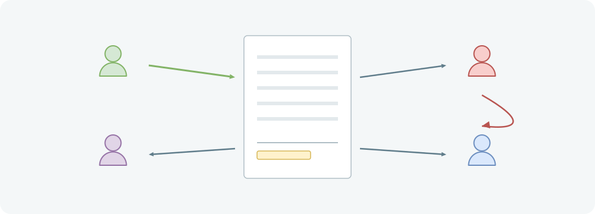
*Figure — Splitwise in one picture: people send expenses into one shared record, and the record tells each person what they owe (course diagram)*

### Problem & clarifying questions

**What it is.** Splitwise is an app that remembers who paid for what when friends share costs, and tells everyone who owes whom. Everyday analogy: a weekend away with four friends. The hotel goes on Alice's card, Bob covers dinner, Carol gets the cab. By Sunday evening no one can reconstruct the totals. Splitwise is the shared notebook that does the maths.

The hard part is **not** the UI. The real decision is *which class owns the money arithmetic*, so the books still balance after every single operation.

Questions to ask the interviewer (with the answers we assume):

| Question | Assumed answer |
|---|---|
| Which split types? | Equal, exact amounts, percentage. More may come later. |
| Must shares add up to the total exactly? | Yes. If they don't, the whole expense is rejected and no balance changes. |
| Rounding? | Amounts are money with 2 decimal places. No cent may be lost. |
| Groups, or only one-to-one? | Both. A group is just a name plus a member list (a trip, a shared flat). |
| Can a person pay for only themselves? | No. That is not shared spending: at least two people (the payer counts) must be involved. |
| Settle up? | Yes: record a real payment that reduces a debt. |
| Simplify debts? | Yes: on request, replace many small debts with a shorter list of transfers. |
| Multiple currencies, receipts, comments, undo? | Out of scope (say so explicitly). |

### Requirements

**Functional**
1. Every user is identified by a name and an email.
2. Users form groups; a group has a name and members.
3. An expense records a description, total, who paid and who shares it.
4. Split types: equal, exact, percent.
5. Shares must add up to the total; otherwise the expense is refused and **nothing changes**.
6. At least two distinct people (the payer plus the sharers) must be involved in an expense.
7. Balances between every pair of people are tracked continuously.
8. A user can query their balance with one specific person, and their overall net balance.
9. Settle up: a real payment reduces a debt.
10. A group can request a simplified settlement plan with fewer transfers.
11. Rounding never loses or creates a cent.
12. Expenses are stored permanently, so a group's history can be listed.

**Non-functional**
- Correctness of money above everything (exact decimals, no drift).
- Adding a new split type must not change existing classes (Open/Closed Principle).
- Thread-safe: two people adding expenses at the same time must not corrupt the ledger.

### Use cases

Actors:
- **Member** — adds expenses, settles up, asks what they owe.
- **Group creator** — sets up a group and invites its members.
- **System** — works out each share, checks shares add up, updates the ledger, simplifies debts.

Main use cases: *Add an expense* (which includes *Work out each share*, *Check the shares add up*, *Update the ledger*), *Settle up*, *See what I owe*, *Create a group / add people*, *Simplify the debts*.

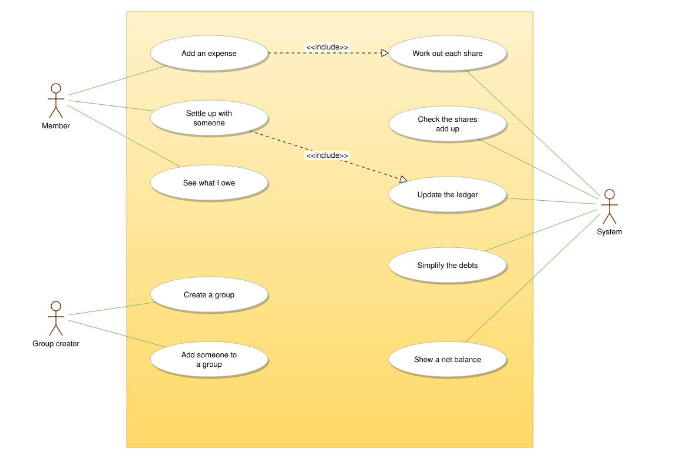
*Figure — Splitwise use cases: members add expenses and settle up; the system computes shares, validates them, updates the ledger and simplifies debts (course diagram)*

In the figure above, "Add an expense" *includes* the three system steps. "Include" in a use-case diagram means the step always happens as part of the bigger use case.

### Core entities

| Class | Responsibility |
|---|---|
| `User` (record) | Identity: id, name, email. No money. |
| `Group` | A named set of member ids + the list of its expense ids. **Holds no balances.** |
| `SplitStrategy` (interface) | Turns a total into one `Share` per person. |
| `EqualSplit`, `ExactSplit`, `PercentSplit` | The three rules. |
| `Share` (record) | A (person, amount) pair for a single expense (a value object). |
| `Expense` | Description, total, payer, shares. Validates itself once, when created. |
| `Ledger` | Who owes whom: exactly **one signed number per pair** of people. One mutator: `adjust`. |
| `DebtSimplifier` | Greedy minimum-cash-flow: turns net positions into a short list of payments. |
| `Payment` (record) | One suggested transfer (a suggestion, not a record of money moving). |
| `Splitwise` | Facade: the one class the app talks to. Orders the steps, contains no arithmetic. |
| `Money` | Tiny helper: 2-decimal `BigDecimal` values. |

**Why the group holds no money.** If each group kept its own balances, a person in two groups would have "what Bob owes Alice" stored in two places. Sooner or later the two copies disagree. One ledger, one number per pair, is the single source of truth.

**Why `Group → User` is association, not composition.** Association = one object refers to another that lives independently. Composition = the part is owned and dies with the whole. Deleting a group must not delete its people, so it is association.

### Class diagram

The course builds the model in five stages, and the order is worth copying in an interview because every stage leaves a slice that already works (run out of time and you still have something that runs, not half a diagram):

| Stage | Adds | Works afterwards |
|---|---|---|
| 1 | `User`, `Group` | You can say who shares costs |
| 2 | `SplitStrategy` + three rules, `Share` | A total becomes one amount per person |
| 3 | `Expense` (self-checking) | A bill that does not add up is rejected |
| 4 | `Ledger` | Pairwise balances are tracked |
| 5 | `Splitwise` facade + `DebtSimplifier` | A whole trip can be recorded, settled and simplified |

Here is the finished course diagram:


*Figure — The finished Splitwise class diagram: service owning users, groups, expenses and the ledger, with the split strategies and the simplifier (course diagram)*

In the figure above, the three split rules meet in one hollow triangle: they all realize the same interface. The service's filled diamonds are composition: it owns users, groups, expenses and the ledger.

Our Java code, as a class diagram:

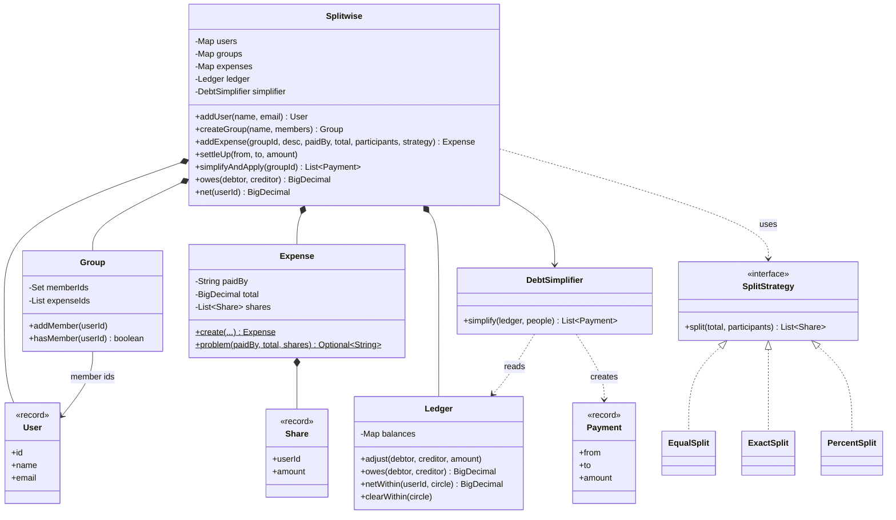

### Key flows

**Adding an expense.** Nothing touches the ledger until both checks pass.

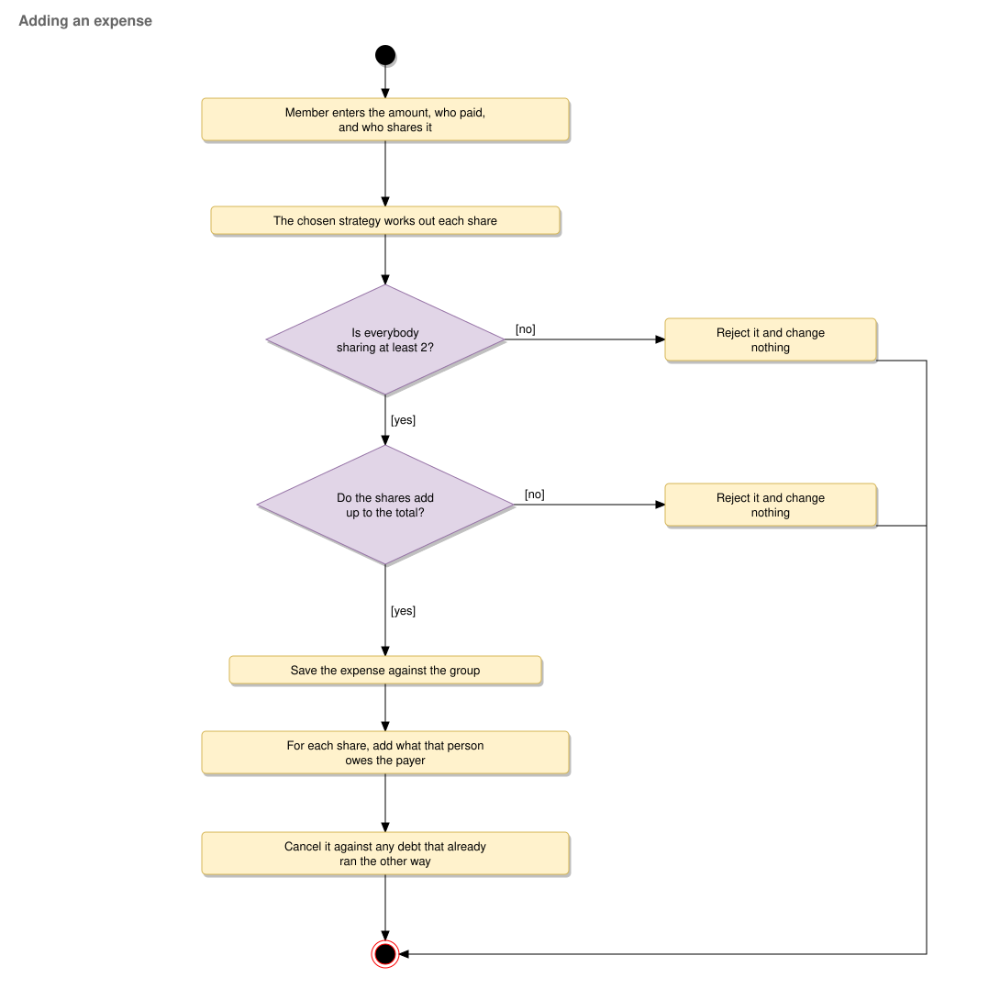
*Figure — Adding an expense: the strategy computes shares, the expense checks itself, and only then is the ledger updated (course diagram)*

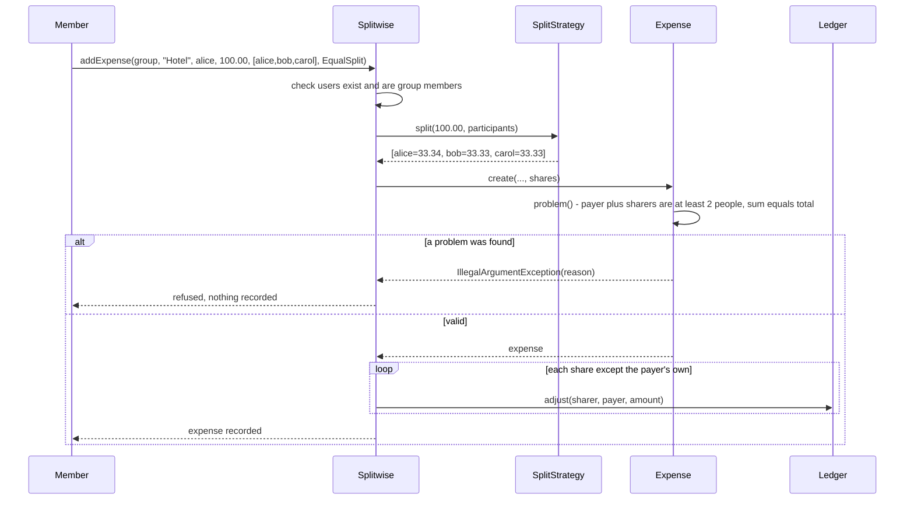

**Simplifying a group's debts (minimum cash flow, greedy).**


*Figure — Simplifying debts: compute net positions, then the largest debtor repeatedly pays the largest creditor until every balance is zero (course diagram)*

How it works, step by step:
1. For each member, compute the **net position** = (what others owe them) − (what they owe others). Positive = creditor, negative = debtor. The nets always sum to zero.
2. Put creditors in one max-heap and debtors in another (by amount; ties by name, so the output is deterministic).
3. Pop the biggest creditor C and biggest debtor D. Let x = min(C, D). Suggest "D pays C x".
4. Push back whichever side still has a remainder.
5. Stop when a heap is empty (everyone is at zero).

Each round brings at least one person to zero, and the final round brings two to zero, so there are **at most n − 1 payments** for n people. It is **not always the true minimum**: finding the minimum number of transfers is NP-hard (it is related to splitting people into as many zero-sum subgroups as possible). Say that before you are asked.

### Design decisions & patterns used

| Decision | Why | Alternative rejected |
|---|---|---|
| **Strategy** for split rules (`SplitStrategy`) | The rule arrives from outside and is interchangeable. A fourth rule (by shares, by adjustment) is a new class. Every rule returns the same `List<Share>`, so nothing downstream knows which rule ran. | `if (type == EQUAL) ... else if (type == EXACT)` in the service: every new type edits old, tested code. |
| Expense validates itself in a **static factory** (`Expense.create`) | Checked once, when created; after that every class can trust its shares. An invalid expense can never exist. | Checking in the ledger: re-checks on every read and still lets bad objects exist. |
| `problem()` returns the **reason**, not a boolean | The user sees *why* ("shares add up to 15.00 but the total is 30.00"). | `boolean isValid()`: loses the reason. |
| Ledger stores **one signed number per unordered pair** | A debt is never stored twice, so it can never disagree with itself. Money moving the other way cancels automatically. | Two maps "A owes B" and "B owes A": two places for the truth. |
| Ledger has **one mutator** (`adjust`) | Expenses, settle-ups and simplification all go through it, so the cancel rule exists in exactly one place. | Separate `addDebt`, `settle`, `reduce` methods each with their own arithmetic. |
| `DebtSimplifier` separate from `Ledger` | Single Responsibility: *keeping* balances and *planning* settlements change for different reasons. | Putting the algorithm inside the ledger. |
| `BigDecimal` with explicit rounding; spare cents handed out one at a time | 100.00 / 3 = 33.33 × 3 = 99.99 would lose a cent. Equal split gives the extra cent to the first people; percent split lets the last person absorb the remainder. | `double`: 0.1 + 0.2 ≠ 0.3. (The course keeps whole cents in a `long`; that is equally correct. We use `BigDecimal` as this book's standard.) |
| `Splitwise` is a **Facade** | One entry point; it orders the steps and decides nothing. | UI code calling ledger and strategies directly. |

**Only one named GoF pattern here (Strategy).** That is fine. Good designs do not collect patterns; they use the one that absorbs the change that is likely.

### Java implementation

```java
// File: code/lld/ch20/splitwise/Model.java
package lld.ch20.splitwise;

import java.math.BigDecimal;
import java.math.RoundingMode;
import java.util.ArrayList;
import java.util.Collections;
import java.util.LinkedHashSet;
import java.util.List;
import java.util.Objects;
import java.util.Set;

/** Money helpers: every amount is a BigDecimal with exactly 2 decimal places. */
final class Money {
    static final BigDecimal ZERO = new BigDecimal("0.00");
    static final BigDecimal CENT = new BigDecimal("0.01");
    static final BigDecimal HUNDRED = new BigDecimal("100");

    private Money() {}

    static BigDecimal of(String amount) {
        return new BigDecimal(amount).setScale(2, RoundingMode.UNNECESSARY); // refuses 10.005
    }

    static BigDecimal normalize(BigDecimal amount) {
        return amount.setScale(2, RoundingMode.HALF_EVEN);
    }
}

/** A person. Identity only - no money lives here. */
record User(String id, String name, String email) {
    User {
        Objects.requireNonNull(id);
        Objects.requireNonNull(name);
    }
}

/** A named set of people. Holds member ids and expense ids, never balances. */
final class Group {
    private final String id;
    private final String name;
    private final Set<String> memberIds = new LinkedHashSet<>();
    private final List<String> expenseIds = new ArrayList<>();

    Group(String id, String name) {
        this.id = id;
        this.name = name;
    }

    String id() { return id; }
    String name() { return name; }
    void addMember(String userId) { memberIds.add(userId); }
    boolean hasMember(String userId) { return memberIds.contains(userId); }
    Set<String> members() { return Collections.unmodifiableSet(memberIds); }
    void recordExpense(String expenseId) { expenseIds.add(expenseId); }
    List<String> expenseIds() { return Collections.unmodifiableList(expenseIds); }
}

/** One person's part of one expense (a value object). */
record Share(String userId, BigDecimal amount) {
    @Override
    public String toString() { return userId + "=" + amount; }
}

/** A suggested transfer produced by the simplifier - a suggestion, not a record. */
record Payment(String from, String to, BigDecimal amount) {
    @Override
    public String toString() {
        return from + " pays " + to + " " + amount;
    }
}
```

```java
// File: code/lld/ch20/splitwise/SplitStrategy.java
package lld.ch20.splitwise;

import java.math.BigDecimal;
import java.math.RoundingMode;
import java.util.ArrayList;
import java.util.HashSet;
import java.util.List;
import java.util.Map;

/** Strategy: turns one total into one Share per participant. */
interface SplitStrategy {
    List<Share> split(BigDecimal total, List<String> participants);
}

/** Equal split. Spare cents are handed out one at a time, in participant order. */
final class EqualSplit implements SplitStrategy {
    @Override
    public List<Share> split(BigDecimal total, List<String> participants) {
        if (participants.isEmpty()) throw new IllegalArgumentException("nobody to split between");
        BigDecimal n = BigDecimal.valueOf(participants.size());
        BigDecimal base = total.divide(n, 2, RoundingMode.DOWN);           // 100.00/3 -> 33.33
        BigDecimal leftover = total.subtract(base.multiply(n));           // 0.01
        int spareCents = leftover.divide(Money.CENT).intValueExact();     // 1
        List<Share> shares = new ArrayList<>();
        for (int i = 0; i < participants.size(); i++) {
            BigDecimal amount = i < spareCents ? base.add(Money.CENT) : base;
            shares.add(new Share(participants.get(i), amount));
        }
        return shares;
    }
}

/** Exact split: the caller states each person's amount. Expense checks the sum. */
final class ExactSplit implements SplitStrategy {
    private final Map<String, BigDecimal> amounts;

    ExactSplit(Map<String, BigDecimal> amounts) { this.amounts = Map.copyOf(amounts); }

    @Override
    public List<Share> split(BigDecimal total, List<String> participants) {
        if (!new HashSet<>(participants).equals(amounts.keySet()))
            throw new IllegalArgumentException("exact amounts must name exactly the participants");
        List<Share> shares = new ArrayList<>();
        for (String id : participants) shares.add(new Share(id, Money.normalize(amounts.get(id))));
        return shares;
    }
}

/** Percent split. Percentages must add to 100; the last person absorbs rounding. */
final class PercentSplit implements SplitStrategy {
    private final Map<String, BigDecimal> percents;

    PercentSplit(Map<String, BigDecimal> percents) { this.percents = Map.copyOf(percents); }

    @Override
    public List<Share> split(BigDecimal total, List<String> participants) {
        if (!new HashSet<>(participants).equals(percents.keySet()))
            throw new IllegalArgumentException("percentages must name exactly the participants");
        BigDecimal sum = percents.values().stream().reduce(BigDecimal.ZERO, BigDecimal::add);
        if (sum.compareTo(Money.HUNDRED) != 0)
            throw new IllegalArgumentException("percentages add up to " + sum + ", not 100");
        List<Share> shares = new ArrayList<>();
        BigDecimal given = Money.ZERO;
        for (int i = 0; i < participants.size(); i++) {
            String id = participants.get(i);
            BigDecimal amount = (i == participants.size() - 1)
                    ? total.subtract(given)                                   // absorbs the remainder
                    : total.multiply(percents.get(id)).divide(Money.HUNDRED, 2, RoundingMode.HALF_EVEN);
            given = given.add(amount);
            shares.add(new Share(id, amount));
        }
        return shares;
    }
}
```

```java
// File: code/lld/ch20/splitwise/Expense.java
package lld.ch20.splitwise;

import java.math.BigDecimal;
import java.util.HashSet;
import java.util.List;
import java.util.Optional;
import java.util.Set;

/** What was bought, what it cost, who paid, and each share. Validated once, at creation. */
final class Expense {
    private final String id;
    private final String description;
    private final String paidBy;
    private final BigDecimal total;
    private final List<Share> shares;
    private final String groupId; // null for an expense between friends outside any group

    private Expense(String id, String description, String paidBy, BigDecimal total,
                    List<Share> shares, String groupId) {
        this.id = id;
        this.description = description;
        this.paidBy = paidBy;
        this.total = total;
        this.shares = List.copyOf(shares);
        this.groupId = groupId;
    }

    /** Factory: builds a valid expense or throws with the reason it is invalid. */
    static Expense create(String id, String description, String paidBy, BigDecimal total,
                          List<Share> shares, String groupId) {
        problem(paidBy, total, shares).ifPresent(p -> { throw new IllegalArgumentException(p); });
        return new Expense(id, description, paidBy, total, shares, groupId);
    }

    /** Why these shares cannot form an expense, or empty if they can. */
    static Optional<String> problem(String paidBy, BigDecimal total, List<Share> shares) {
        if (total.signum() <= 0) return Optional.of("total must be positive");
        Set<String> sharers = new HashSet<>();
        for (Share s : shares) {
            if (s.amount().signum() < 0) return Optional.of("negative share for " + s.userId());
            if (!sharers.add(s.userId())) return Optional.of("duplicate share for " + s.userId());
        }
        Set<String> people = new HashSet<>(sharers);
        people.add(paidBy); // the payer counts as one of the two people even if they owe no share
        if (people.size() < 2) return Optional.of("an expense needs at least two people");
        BigDecimal sum = shares.stream().map(Share::amount).reduce(BigDecimal.ZERO, BigDecimal::add);
        if (sum.compareTo(total) != 0)
            return Optional.of("shares add up to " + sum + " but the total is " + total);
        return Optional.empty();
    }

    String id() { return id; }
    String description() { return description; }
    String paidBy() { return paidBy; }
    BigDecimal total() { return total; }
    List<Share> shares() { return shares; }
    String groupId() { return groupId; }
}
```

```java
// File: code/lld/ch20/splitwise/Ledger.java
package lld.ch20.splitwise;

import java.math.BigDecimal;
import java.util.Collection;
import java.util.Map;
import java.util.TreeMap;

/**
 * Who owes whom. Exactly ONE signed number per unordered pair of people.
 * Key (lo, hi) with lo < hi alphabetically; a positive value means "hi owes lo".
 */
final class Ledger {
    private record Pair(String lo, String hi) {
        static Pair of(String a, String b) { return a.compareTo(b) < 0 ? new Pair(a, b) : new Pair(b, a); }
    }

    private final Map<Pair, BigDecimal> balances = new TreeMap<>(
            (p, q) -> p.lo().equals(q.lo()) ? p.hi().compareTo(q.hi()) : p.lo().compareTo(q.lo()));

    /** The ONLY mutator: 'debtor' now owes 'creditor' 'amount' more. Opposite debts cancel. */
    void adjust(String debtor, String creditor, BigDecimal amount) {
        if (debtor.equals(creditor) || amount.signum() == 0) return;
        Pair key = Pair.of(debtor, creditor);
        BigDecimal delta = creditor.equals(key.lo()) ? amount : amount.negate();
        BigDecimal updated = balances.getOrDefault(key, Money.ZERO).add(delta);
        if (updated.signum() == 0) balances.remove(key); else balances.put(key, updated);
    }

    /** Drops every debt where both people are in 'circle' (used when a simplified plan replaces them). */
    void clearWithin(Collection<String> circle) {
        balances.keySet().removeIf(p -> circle.contains(p.lo()) && circle.contains(p.hi()));
    }

    /** How much 'debtor' owes 'creditor' (never negative). */
    BigDecimal owes(String debtor, String creditor) {
        if (debtor.equals(creditor)) return Money.ZERO;
        Pair key = Pair.of(debtor, creditor);
        BigDecimal v = balances.getOrDefault(key, Money.ZERO);
        BigDecimal debtorOwes = creditor.equals(key.lo()) ? v : v.negate();
        return debtorOwes.signum() > 0 ? debtorOwes : Money.ZERO;
    }

    /** Positive = others owe this person; negative = this person owes others. */
    BigDecimal net(String userId) { return netWithin(userId, null); }

    /** Net position counting only debts with people in 'circle' (null = everybody). */
    BigDecimal netWithin(String userId, Collection<String> circle) {
        BigDecimal net = Money.ZERO;
        for (var e : balances.entrySet()) {
            Pair p = e.getKey();
            String other = p.lo().equals(userId) ? p.hi() : p.hi().equals(userId) ? p.lo() : null;
            if (other == null || (circle != null && !circle.contains(other))) continue;
            // positive value: hi owes lo, so lo is up and hi is down
            net = p.lo().equals(userId) ? net.add(e.getValue()) : net.subtract(e.getValue());
        }
        return net;
    }

    /** Human-readable list of every open debt: "B owes A 10.00". */
    void print() {
        if (balances.isEmpty()) System.out.println("  (everyone is settled up)");
        balances.forEach((p, v) -> {
            if (v.signum() > 0) System.out.println("  " + p.hi() + " owes " + p.lo() + " " + v);
            else System.out.println("  " + p.lo() + " owes " + p.hi() + " " + v.negate());
        });
    }
}
```

```java
// File: code/lld/ch20/splitwise/DebtSimplifier.java
package lld.ch20.splitwise;

import java.math.BigDecimal;
import java.util.ArrayList;
import java.util.Collection;
import java.util.Comparator;
import java.util.List;
import java.util.PriorityQueue;

/**
 * Greedy "minimum cash flow": largest debtor pays largest creditor, repeat.
 * Uses at most (people - 1) payments. Not always the true minimum (that problem is NP-hard).
 */
final class DebtSimplifier {
    private record Position(String userId, BigDecimal amount) {}

    List<Payment> simplify(Ledger ledger, Collection<String> people) {
        // Biggest amount first; ties broken by name so results are deterministic.
        Comparator<Position> biggestFirst = Comparator.comparing(Position::amount).reversed()
                .thenComparing(Position::userId);
        PriorityQueue<Position> creditors = new PriorityQueue<>(biggestFirst);
        PriorityQueue<Position> debtors = new PriorityQueue<>(biggestFirst);
        for (String id : people) {
            BigDecimal net = ledger.netWithin(id, people);
            if (net.signum() > 0) creditors.add(new Position(id, net));
            else if (net.signum() < 0) debtors.add(new Position(id, net.negate()));
        }
        List<Payment> payments = new ArrayList<>();
        while (!creditors.isEmpty() && !debtors.isEmpty()) {
            Position c = creditors.poll();
            Position d = debtors.poll();
            BigDecimal x = c.amount().min(d.amount());
            payments.add(new Payment(d.userId(), c.userId(), x));
            if (c.amount().compareTo(x) > 0) creditors.add(new Position(c.userId(), c.amount().subtract(x)));
            if (d.amount().compareTo(x) > 0) debtors.add(new Position(d.userId(), d.amount().subtract(x)));
        }
        return payments;
    }
}
```

```java
// File: code/lld/ch20/splitwise/Splitwise.java
package lld.ch20.splitwise;

import java.math.BigDecimal;
import java.util.ArrayList;
import java.util.LinkedHashMap;
import java.util.List;
import java.util.Map;
import java.util.concurrent.atomic.AtomicInteger;

/** Facade the app talks to. Orders the steps; the arithmetic lives in the other classes. */
final class Splitwise {
    private final Map<String, User> users = new LinkedHashMap<>();
    private final Map<String, Group> groups = new LinkedHashMap<>();
    private final Map<String, Expense> expenses = new LinkedHashMap<>();
    private final Ledger ledger = new Ledger();
    private final DebtSimplifier simplifier = new DebtSimplifier();
    private final AtomicInteger ids = new AtomicInteger();

    synchronized User addUser(String name, String email) {
        User u = new User(name.toLowerCase(), name, email);
        users.put(u.id(), u);
        return u;
    }

    synchronized Group createGroup(String name, String... memberIds) {
        Group g = new Group("g" + ids.incrementAndGet(), name);
        for (String m : memberIds) g.addMember(requireUser(m));
        groups.put(g.id(), g);
        return g;
    }

    /** Build shares -> build (and validate) expense -> only then touch the ledger. */
    synchronized Expense addExpense(String groupId, String description, String paidBy, BigDecimal total,
                                    List<String> participants, SplitStrategy strategy) {
        requireUser(paidBy);
        participants.forEach(this::requireUser);
        Group group = groupId == null ? null : groups.get(groupId);
        if (group != null) {
            for (String p : participants)
                if (!group.hasMember(p)) throw new IllegalArgumentException(p + " is not in " + group.name());
            if (!group.hasMember(paidBy)) throw new IllegalArgumentException(paidBy + " is not in " + group.name());
        }
        List<Share> shares = strategy.split(total, participants);       // may throw
        Expense e = Expense.create("e" + ids.incrementAndGet(), description, paidBy, total, shares, groupId);
        for (Share s : e.shares()) ledger.adjust(s.userId(), paidBy, s.amount()); // payer's own share is a no-op
        expenses.put(e.id(), e);
        if (group != null) group.recordExpense(e.id());
        return e;
    }

    /** A real payment from 'from' to 'to'. Cannot pay more than is owed. */
    synchronized void settleUp(String from, String to, BigDecimal amount) {
        BigDecimal owed = ledger.owes(from, to);
        if (amount.signum() <= 0 || amount.compareTo(owed) > 0)
            throw new IllegalArgumentException(from + " owes " + to + " only " + owed + ", cannot pay " + amount);
        ledger.adjust(to, from, amount); // the reverse debt cancels the existing one
    }

    synchronized BigDecimal owes(String debtor, String creditor) { return ledger.owes(debtor, creditor); }
    synchronized BigDecimal net(String userId) { return ledger.net(userId); }
    synchronized List<Payment> simplify(String groupId) {
        return simplifier.simplify(ledger, groups.get(groupId).members());
    }
    /** Replaces the group's tangle of debts with the simplified plan. Every net position is unchanged. */
    synchronized List<Payment> simplifyAndApply(String groupId) {
        var members = groups.get(groupId).members();
        List<Payment> plan = simplifier.simplify(ledger, members);
        ledger.clearWithin(members);
        for (Payment p : plan) ledger.adjust(p.from(), p.to(), p.amount());
        return plan;
    }

    synchronized void printLedger() { ledger.print(); }

    synchronized List<String> history(String groupId) {
        List<String> lines = new ArrayList<>();
        for (String id : groups.get(groupId).expenseIds()) {
            Expense e = expenses.get(id);
            lines.add(e.id() + " " + e.description() + " " + e.total() + " paid by " + e.paidBy() + " " + e.shares());
        }
        return lines;
    }

    private String requireUser(String id) {
        if (!users.containsKey(id)) throw new IllegalArgumentException("unknown user " + id);
        return id;
    }
}
```

```java
// File: code/lld/ch20/splitwise/Main.java
package lld.ch20.splitwise;

import java.math.BigDecimal;
import java.util.List;
import java.util.Map;

public class Main {
    public static void main(String[] args) {
        Splitwise app = new Splitwise();
        for (String n : List.of("Alice", "Bob", "Carol", "Dave")) app.addUser(n, n.toLowerCase() + "@mail.com");
        Group trip = app.createGroup("Goa trip", "alice", "bob", "carol", "dave");

        System.out.println("== 1. Equal split with a spare cent");
        Expense hotel = app.addExpense(trip.id(), "Hotel", "alice", Money.of("100.00"),
                List.of("alice", "bob", "carol"), new EqualSplit());
        System.out.println("Hotel shares: " + hotel.shares());

        System.out.println("== 2. Exact split");
        app.addExpense(trip.id(), "Dinner", "bob", Money.of("60.00"), List.of("alice", "bob", "carol"),
                new ExactSplit(Map.of("alice", Money.of("10.00"), "bob", Money.of("20.00"), "carol", Money.of("30.00"))));

        System.out.println("== 3. Percent split");
        Expense taxi = app.addExpense(trip.id(), "Taxi", "carol", Money.of("50.00"), List.of("alice", "bob", "dave"),
                new PercentSplit(Map.of("alice", new BigDecimal("33.33"), "bob", new BigDecimal("33.33"),
                        "dave", new BigDecimal("33.34"))));
        System.out.println("Taxi shares: " + taxi.shares());

        System.out.println("== 4. Invalid expenses are refused, ledger untouched");
        tryIt(() -> app.addExpense(trip.id(), "Snacks", "dave", Money.of("30.00"), List.of("alice", "dave"),
                new ExactSplit(Map.of("alice", Money.of("10.00"), "dave", Money.of("5.00")))));
        tryIt(() -> app.addExpense(trip.id(), "Coffee", "dave", Money.of("4.00"), List.of("dave"), new EqualSplit()));
        tryIt(() -> app.addExpense(trip.id(), "Boat", "dave", Money.of("50.00"), List.of("alice", "dave"),
                new PercentSplit(Map.of("alice", new BigDecimal("60"), "dave", new BigDecimal("30")))));

        System.out.println("== 5. Who owes whom");
        app.printLedger();
        for (String u : List.of("alice", "bob", "carol", "dave")) System.out.println("  net " + u + " = " + app.net(u));
        System.out.println("  bob owes alice: " + app.owes("bob", "alice"));

        System.out.println("== 6. Simplify the group's debts (min cash flow, greedy)");
        List<Payment> plan = app.simplifyAndApply(trip.id());
        plan.forEach(p -> System.out.println("  suggested: " + p));
        app.printLedger();
        for (String u : List.of("alice", "bob", "carol", "dave")) System.out.println("  net " + u + " = " + app.net(u));

        System.out.println("== 7. Settle up");
        tryIt(() -> app.settleUp("dave", "alice", Money.of("999.00")));
        app.settleUp("bob", "alice", Money.of("5.00"));
        System.out.println("  after a partial payment of 5.00, bob owes alice: " + app.owes("bob", "alice"));
        app.settleUp("bob", "alice", app.owes("bob", "alice"));
        for (Payment p : plan) if (!p.from().equals("bob")) app.settleUp(p.from(), p.to(), p.amount());
        app.printLedger();

        System.out.println("== 8. Group history");
        app.history(trip.id()).forEach(h -> System.out.println("  " + h));
    }

    private static void tryIt(Runnable r) {
        try {
            r.run();
            System.out.println("  accepted");
        } catch (IllegalArgumentException e) {
            System.out.println("  refused: " + e.getMessage());
        }
    }
}
```

**Walking through the code.**
- `Money.of("10.005")` throws, because `RoundingMode.UNNECESSARY` refuses to silently round. Inputs with more than 2 decimals are a bug, not something to hide.
- `EqualSplit` divides with `RoundingMode.DOWN` (33.33), computes the leftover (0.01), and gives one extra cent to the first participant(s). The shares always add up exactly.
- `PercentSplit` rejects percentages that do not total 100, rounds each share with `HALF_EVEN` (banker's rounding: halves go to the even neighbour, which avoids a systematic upward bias), and lets the **last** person absorb whatever remains.
- `Ledger.Pair.of(a, b)` sorts the two ids so (alice, bob) and (bob, alice) are the same key. The sign of the stored value says who owes whom.
- `Splitwise.addExpense` builds shares, then the expense (which validates), and **only then** updates the ledger. That order is requirement 5.
- `settleUp` refuses to pay more than is owed, then calls `adjust(to, from, amount)`: a debt in the reverse direction that cancels the existing one.
- `simplifyAndApply` replaces all debts between the group's members with the simplified plan. Every net position stays the same (the output proves it).

**Output:**

```text
== 1. Equal split with a spare cent
Hotel shares: [alice=33.34, bob=33.33, carol=33.33]
== 2. Exact split
== 3. Percent split
Taxi shares: [alice=16.66, bob=16.66, dave=16.68]
== 4. Invalid expenses are refused, ledger untouched
  refused: shares add up to 15.00 but the total is 30.00
  refused: an expense needs at least two people
  refused: percentages add up to 90, not 100
== 5. Who owes whom
  bob owes alice 23.33
  carol owes alice 16.67
  carol owes bob 13.34
  dave owes carol 16.68
  net alice = 40.00
  net bob = -9.99
  net carol = -13.33
  net dave = -16.68
  bob owes alice: 23.33
== 6. Simplify the group's debts (min cash flow, greedy)
  suggested: dave pays alice 16.68
  suggested: carol pays alice 13.33
  suggested: bob pays alice 9.99
  bob owes alice 9.99
  carol owes alice 13.33
  dave owes alice 16.68
  net alice = 40.00
  net bob = -9.99
  net carol = -13.33
  net dave = -16.68
== 7. Settle up
  refused: dave owes alice only 16.68, cannot pay 999.00
  after a partial payment of 5.00, bob owes alice: 4.99
  (everyone is settled up)
== 8. Group history
  e2 Hotel 100.00 paid by alice [alice=33.34, bob=33.33, carol=33.33]
  e3 Dinner 60.00 paid by bob [alice=10.00, bob=20.00, carol=30.00]
  e4 Taxi 50.00 paid by carol [alice=16.66, bob=16.66, dave=16.68]
```

Look at step 5 and step 6: four pairwise debts became three payments, and every net (alice +40.00, bob −9.99, carol −13.33, dave −16.68) is identical before and after.

### Related machine-coding problem: The Ledger Co. (Navi)

Splitwise is not the only "ledger" question you will meet. The Geektrust / Navi machine-coding round **"Ledger Co."** also keeps money records, but for **bank loans** (simple interest, a fixed monthly instalment, lump-sum prepayments) rather than bills shared between friends. It is fully designed, coded and run in **Chapter 21, §21.6**, so it is not repeated here. The comparison is the useful part: both keep **one authoritative record** and compute every answer from it (Splitwise: one signed balance per pair of people; Ledger Co.: one loan per bank and borrower, holding its lump-sum payments), and both use `BigDecimal` with an explicitly named rounding mode. What differs is the rule set: Splitwise's rules are about *who owes whom*, Ledger Co.'s are about *how much has been repaid by a given month*.

### Concurrency & edge cases

- **Two expenses at once.** Every public method on `Splitwise` is `synchronized`, so "build → validate → adjust ledger" is atomic. Simple and correct for one process. At scale you would lock per group or per pair of users, or store balances in a database and update them in one transaction.
- **Rounding.** Covered by spare-cent distribution and "last person absorbs". Test: 100.00 / 3 must give 33.34 + 33.33 + 33.33.
- **Payer not among the sharers** (Alice pays for Bob and Carol only, or for Bob alone): allowed. Every share becomes a debt to Alice. `Expense.problem` counts the payer as one of the "at least two people", so Alice buying Bob's lunch is a valid expense, while Dave paying only for Dave is refused.
- **Payer's own share:** `adjust(alice, alice, …)` is a no-op by design.
- **Overpaying on settle-up:** refused, so a debt can never flip direction by accident.
- **Unknown user / not a group member:** refused before any computation.
- **Duplicate person in the shares list, negative share, zero total:** refused by `Expense.problem`.
- **Simplify and other groups.** Because the ledger has one number per *pair*, simplifying a group rewrites all debts *between its members*, even ones that came from another group with the same two people. That is the price of the single source of truth. If per-group simplification must not touch other groups, keep the ledger per group *and* a global view derived from them.

### Extensions & follow-up questions

- **"Add a split by shares (e.g. 2:1:1)."** A new `ShareRatioSplit implements SplitStrategy`. Nothing else changes.
- **"Delete or edit an expense."** Our ledger stores totals, not history, so undo means re-adding the inverse (`adjust(payer, sharer, amount)` for each share). Cleaner: make the ledger an **append-only list of entries** (like accounting journals / event sourcing) and compute balances on demand or in a cache. Then delete = append a reversing entry.
- **"Multiple currencies."** Add a `Currency` to every amount (a `Money(amount, currency)` value object) and keep one ledger per currency, or convert at the time of the expense and store the rate used.
- **"Is the greedy always optimal?"** No. Counter-example: nets A −6, B −5, C +2, D +4, E +5. Greedy: A pays E 5, B pays D 4, then two more small payments to C = **4 payments**. Optimal: B pays E 5 (they cancel exactly), A pays D 4 and C 2 = **3 payments**. The optimum groups people into as many zero-sum subsets as possible, which needs an exponential search; greedy is the accepted interview answer.
- **"Isn't `Splitwise` doing too much?"** A fair criticism: it holds users, groups, expenses *and* the ledger. At larger scale, give each of the four its own repository (store) and let `Splitwise` shrink to the part that orders the steps. Say this before the interviewer does.
- **"Show a user's activity feed."** Keep expenses and settle-ups as events; the feed is a query over them.
- **"Notify people when an expense is added."** Publish an `ExpenseAdded` event to an Observer / the notification service in 20.2.

### Real-world example

Splitwise really does offer a "simplify debts" option for groups: when it is on, the app shows each member a small number of payments to make instead of every pairwise debt, exactly the net-position idea above. Payment apps with "split the bill" features face the same rounding problem and solve it the same way: one person absorbs the leftover cent.

### In the interview

**30-second answer:** "Users and groups hold no money. Each split rule is a `SplitStrategy` that returns shares. An `Expense` validates itself once: at least two people, shares add to the total. The `Ledger` keeps one signed number per pair of people and has a single `adjust` method, so debts cancel automatically. Settling up is just an adjust in the other direction. Simplification uses net positions and a greedy biggest-debtor-pays-biggest-creditor loop: at most n − 1 payments, not always the true minimum."

**Tip:** reach the split rules early and say the phrase "one class per split rule" while you draw them; that is the part of the question with a pattern name. Then invest your time in the ledger, because the one-number-per-pair decision is what keeps everything else short.

**Suggested 40-minute plan:** clarify (5) → entities + the "no money in groups" decision (5) → Strategy for splits and the cents problem (8) → Expense validation (5) → Ledger with one number per pair (7) → simplify algorithm (5) → concurrency and extensions (5).

**Likely follow-ups (with answers):**
- *"What if 100 does not divide by 3?"* → Hand out spare cents one by one; the total is always exact.
- *"How do you simplify debts?"* → Net positions + greedy; mention n − 1 bound and that optimal is NP-hard.
- *"Why not store balances in the group?"* → A person in two groups would have two copies of the truth.

### Self-check

1. Why does `Group` hold no balances? → So each debt lives in exactly one place (the ledger); two copies would eventually disagree.
2. Split 10.00 equally among 3 people. → 3.34, 3.33, 3.33.
3. Why does `Expense.problem` return a `String` instead of a `boolean`? → So the caller can show the reason it was refused.
4. What is the maximum number of payments the greedy simplifier suggests for n people? → n − 1.
5. Why compare `BigDecimal` with `compareTo` rather than `equals`? → `equals` also compares scale, so `2.0` does not equal `2.00`.
6. Alice pays 20.00 for Bob's lunch and Bob owes the whole 20.00. Is that a valid expense? → Yes. Two people are involved (payer and sharer), even though only one of them has a share.

### TL;DR

- **Strategy** for split rules; every rule returns shares.
- **Expense validates itself** once; invalid expenses never exist.
- **Ledger = one signed number per pair**, one mutator; settle-up is a reverse adjust.
- **Simplify** = net positions + greedy; ≤ n − 1 payments; optimal is NP-hard.
- **BigDecimal**, explicit rounding, no lost cents.

---

## 20.2 Design a Notification Service

### Problem & clarifying questions

**What it is.** A notification service is the component of a product responsible for emails, text messages (SMS) and push alerts ("Your order has shipped", "Your login code is 482913"). Everyday analogy: a post office counter. Many departments hand it letters; the counter picks the right delivery method, respects "do not disturb" notes, retries if the courier fails, and keeps a receipt for every letter.

**Why it is a design question.** Every product grows one. It starts as one `sendEmail()` function. Then someone adds SMS. Then "don't wake me at 3 a.m.". Then marketing wants "max 2 promos per hour". Six months later one method has fourteen `if`s and nobody dares touch it. The whole exercise is: **where should each of those additions have gone instead?**

| Question | Assumed answer |
|---|---|
| Channels? | Email, SMS, push. More later (WhatsApp, Slack). |
| Who chooses the channel? | The user, **per kind** of notification (SMS for deliveries, email for newsletters), in order of preference. |
| Wording? | Templates with placeholders, e.g. `Hi {name}, it arrives {eta}.` |
| Quiet hours? | Yes, per user; they can wrap past midnight (22:00–07:00). Urgent messages (login codes) ignore them. |
| Rate limits? | At most N notifications of one kind per user per hour. |
| Failures? | Retry a channel up to a limit, then fall back to the next accepted channel; if all fail, record FAILED. |
| Audit? | Every attempt recorded: SENT, FAILED or SUPPRESSED, and why. |
| Sync or async? | The caller should not wait for a slow SMS gateway. |
| Bulk sends / translations / open tracking / unsubscribe links? | Out of scope. |

### Requirements

**Functional**
1. A user has a name, email, phone number and device token (the address a push service uses for one phone).
2. Channels: email, SMS, push.
3. Each user chooses accepted channels **per kind** of notification, in order.
4. The text for each kind comes from a template with placeholders ("holes") filled in per request.
5. Users can set quiet hours; nothing normal is sent during them.
6. Urgent notifications ignore quiet hours.
7. A user receives no more than N notifications of a given kind in any hour.
8. A channel that fails is retried, but only a bounded number of times.
9. When a channel runs out of retries, the service falls back to the user's next accepted channel.
10. When no channel succeeds, the outcome is stored as FAILED.
11. Every attempt is recorded with its outcome and reason.
12. Adding a channel, **or** a new reason to hold a message back, requires no edit to the service class.

**Non-functional:** the caller is not blocked by slow providers (async option); thread-safe under concurrent sends; testable without waiting for real time (injected clock); a broken listener must never break delivery.

### Use cases

Actors: **Product code** (asks for a notification), **Person** (chooses channels, sets quiet hours), **Operator** (adds channels, watches outcomes), **Service** (renders, checks rules, tries channels, retries, records).

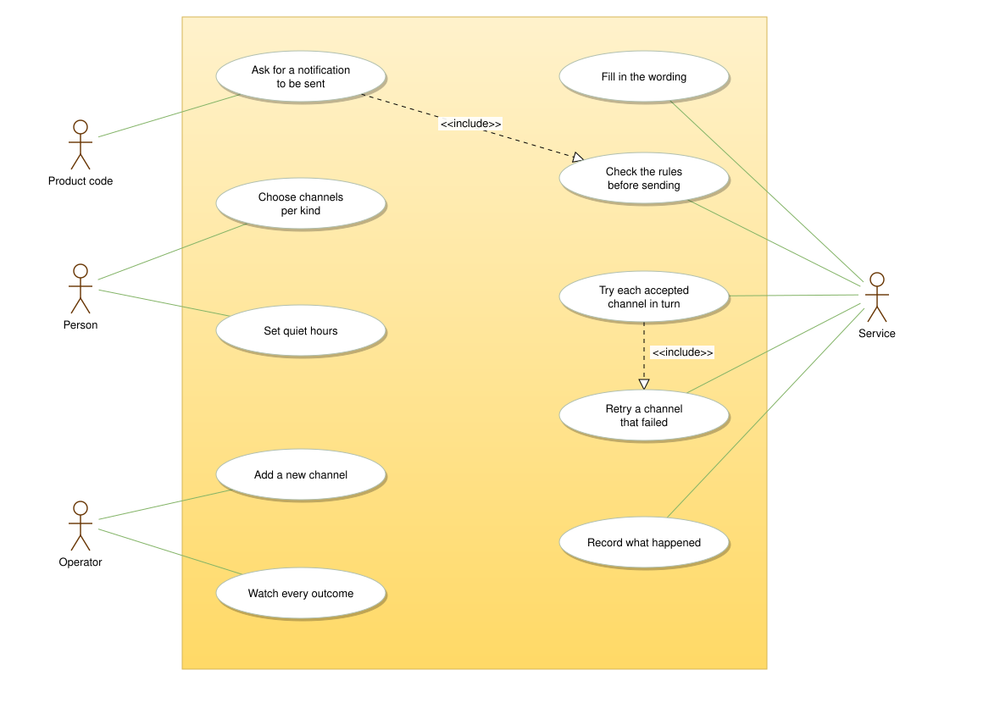
*Figure — Notification service use cases: product code asks for a notification; the service checks rules, fills in the wording, tries each channel with retries and records the outcome (course diagram)*

### Core entities

| Class | Responsibility |
|---|---|
| `User` (record) | Who someone is: id, name, email, phone, device token. |
| `Preferences` | What they accept: ordered channels per kind; quiet hours (with midnight wrap logic in **one** place). |
| `Template` (record) | Subject + body with `{holes}`; `render(values)` → `Message`. |
| `Message` (record) | The finished subject and body, identical on every channel. |
| `NotificationRequest` (record) | One ask: kind, user, values, priority (NORMAL / URGENT). |
| `Gateway` (interface) | The external provider (SMTP server, SMS gateway, push service). Swappable and fakeable. |
| `NotificationChannel` (abstract) | **Template Method**: the final `deliver()` holds the retry-with-backoff loop; subclasses supply only `addressOf(user)`. |
| `EmailChannel`, `SmsChannel`, `PushChannel` | Three tiny subclasses. |
| `ChannelFactory` | **Simple Factory**: channel type → channel object. |
| `RetryPolicy` (record) | Max attempts + initial backoff (doubles each time). |
| `SendRule` (interface) | **Strategy**: one reason not to send. Returns the reason text, or empty. |
| `QuietHoursRule`, `RateLimitRule` | Two rules. Quiet hours knows urgent bypasses it; rate limit counts only *successful* sends. |
| `DeliveryRecord` (record) | What happened: status, channel, attempts, reason. |
| `DeliveryListener` (interface) | **Observer**: told every outcome. `LoggingListener`, `MetricsListener`. |
| `TimeSource` | Where "now" comes from (a manual clock in tests). |
| `NotificationService` | Thin coordinator: rules → preferences → render → channels in order → `finish()`. Decides nothing itself. |

**Why `User` and `Preferences` are separate classes.** Who you are rarely changes; what you are willing to receive changes often. Separate reasons to change → separate classes (Single Responsibility Principle).

### Class diagram


*Figure — The finished notification service class diagram: the service in the middle, the channel hierarchy with the retry in the parent, the send rules, templates, preferences and the delivery listeners (course diagram)*

In the figure above, notice that the three channel classes are tiny: all the behaviour that makes sending reliable lives in the abstract parent.

The course reaches this diagram in five build stages, each leaving something that already works: (1) `User` + `Preferences` (you can ask what a person accepts, and when); (2) `Template` + `Message` + `NotificationRequest` (wording filled in once); (3) the channel hierarchy (delivery with retries and an outcome); (4) the `SendRule`s (a notification can be stopped before sending); (5) `NotificationService` + listeners (end-to-end sending, observable by any listener). Reuse this order when you interview.

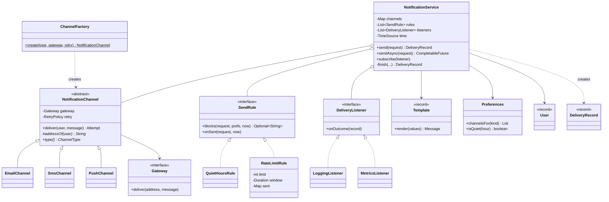

### Key flows

**Sending one notification.** A rule (or a missing channel preference) may stop it before any work is done; otherwise channels are tried in the user's order until one succeeds.


*Figure — Sending one notification: ask every rule, render once, try each accepted channel in turn, and record sent / failed / suppressed (course diagram)*

**Inside one channel** — the retry loop, which exists exactly once, in the abstract parent:

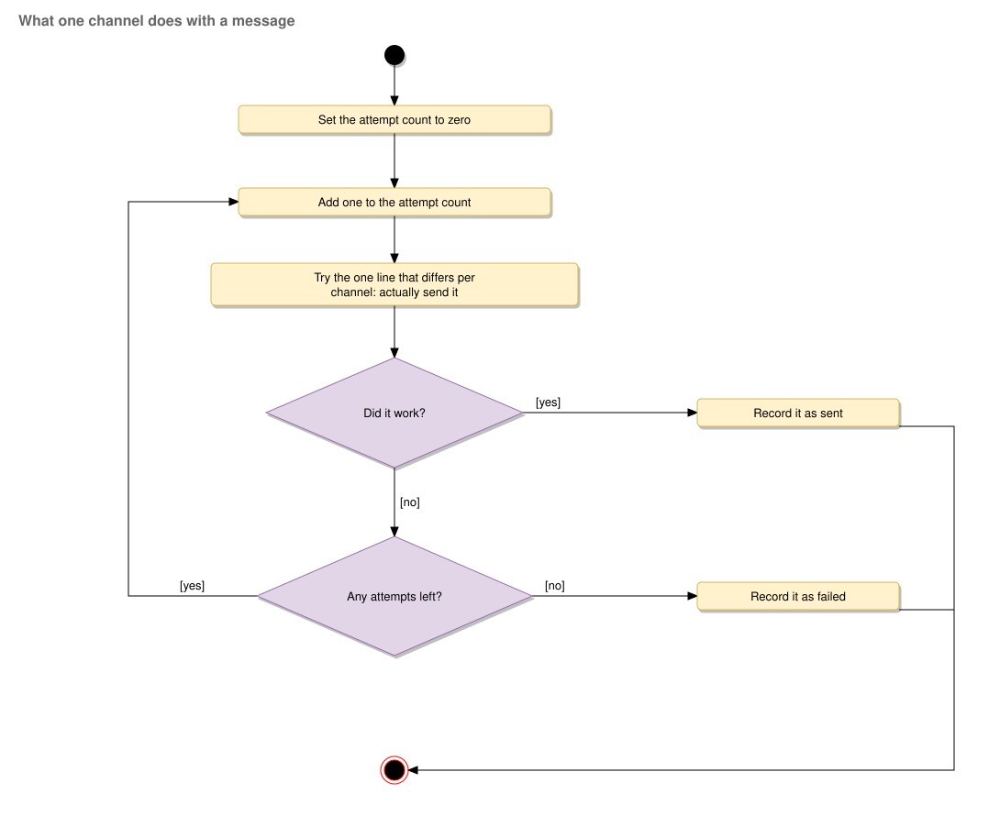
*Figure — One channel's delivery loop: attempt, and on failure retry while attempts remain; then report success or give up (course diagram)*

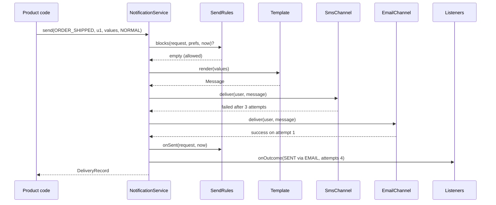

### Design decisions & patterns used

| Pattern / decision | Where | Why | Alternative rejected |
|---|---|---|---|
| **Template Method** | `NotificationChannel.deliver()` is `final`; subclasses fill `addressOf()` | The retry loop is identical for all channels. Write it once; new channels inherit reliability. Only a *step* varies, not the whole algorithm. | Copying the loop into every channel (they drift apart), or Strategy (would replace the whole method, not one step). |
| **Strategy** | `SendRule` | Every "reason not to send" is its own class. A new rule (e.g. "user unsubscribed", "duplicate within 5 minutes") is a new class plus one line in the wiring code. | `if (quiet) … if (tooMany) …` inside `send`. |
| **Observer** | `DeliveryListener` | Logs, dashboards, alerts all want outcomes. The service announces; it doesn't know who listens. | Hard-coding logging/metrics in the service; it grows forever. |
| **Simple Factory** | `ChannelFactory` | One place maps `ChannelType` → class; config can list channel names. | `new SmsChannel(...)` scattered through wiring code. |
| **Adapter** (target interface) | `Gateway` | Each real provider SDK has its own API; an adapter per provider implements `Gateway`. Also lets tests use a fake. | Channels calling vendor SDKs directly. |
| Rule returns **reason text**, not boolean | `SendRule.blocks` | The reason is recorded (requirement 11). | `boolean allowed()` loses why. |
| Urgency handled **inside** the rule | `QuietHoursRule` | The service doesn't need to know which rules urgent messages ignore. | A special case in the service. |
| Rate limit counts only **successful** sends | `onSent` hook | A suppressed/failed message shouldn't use up the user's hourly allowance. | Counting at check time. |
| **Single exit** `finish()` | Service | Every path stores a record and notifies listeners. A second exit that forgot would leave invisible gaps. | Returning from many places. |
| Template rendered **once** | Service | Every channel gets the same text; a wording change is one edit. | Wording inside each channel. |

Using three patterns here is not decoration: each one soaks up a *separate* axis of change — another channel (Template Method + Factory), another reason to hold a message back (Strategy), another party interested in outcomes (Observer).

### Java implementation

```java
// File: code/lld/ch20/notification/Model.java
package lld.ch20.notification;

import java.time.LocalDateTime;
import java.util.HashMap;
import java.util.List;
import java.util.Map;
import java.util.TreeMap;
import java.util.regex.Matcher;
import java.util.regex.Pattern;

enum ChannelType { EMAIL, SMS, PUSH }

enum Priority { NORMAL, URGENT }

enum DeliveryStatus { SENT, FAILED, SUPPRESSED }

/** Who a person is: identity and addresses. */
record User(String id, String name, String email, String phone, String deviceToken) {}

/** What a person is willing to receive, and when. Changes far more often than User. */
final class Preferences {
    private final Map<String, List<ChannelType>> channelsByKind = new HashMap<>();
    private Integer quietStart; // hour of day, inclusive
    private Integer quietEnd;   // hour of day, exclusive

    Preferences accept(String kind, ChannelType... inOrder) {
        channelsByKind.put(kind, List.of(inOrder));
        return this;
    }

    Preferences quietHours(int startHour, int endHour) {
        this.quietStart = startHour;
        this.quietEnd = endHour;
        return this;
    }

    List<ChannelType> channelsFor(String kind) { return channelsByKind.getOrDefault(kind, List.of()); }

    /** Quiet hours may wrap past midnight (22 -> 7), so the comparison lives here, once. */
    boolean isQuiet(int hour) {
        if (quietStart == null) return false;
        return quietStart <= quietEnd
                ? hour >= quietStart && hour < quietEnd
                : hour >= quietStart || hour < quietEnd;
    }
}

/** The finished wording handed to every channel. */
record Message(String subject, String body) {}

/** Wording for one kind of notification, with {holes} to fill in. */
record Template(String kind, String subject, String body) {
    private static final Pattern HOLE = Pattern.compile("\\{(\\w+)}");

    Message render(Map<String, String> values) {
        return new Message(fill(subject, values), fill(body, values));
    }

    private static String fill(String text, Map<String, String> values) {
        Matcher m = HOLE.matcher(text);
        StringBuilder out = new StringBuilder();
        while (m.find()) {
            String v = values.get(m.group(1));
            if (v == null) throw new IllegalArgumentException("missing value for {" + m.group(1) + "}");
            m.appendReplacement(out, Matcher.quoteReplacement(v));
        }
        return m.appendTail(out).toString();
    }
}

/** One ask from product code. Values are kept sorted so the same request renders the same text. */
record NotificationRequest(String kind, String userId, Map<String, String> values, Priority priority) {
    NotificationRequest {
        values = new TreeMap<>(values);
    }
}

/** What happened to one notification. */
record DeliveryRecord(String kind, String userId, DeliveryStatus status, ChannelType channel,
                      int attempts, String reason) {}

/** Where "now" comes from, so quiet hours and rate limits are testable without waiting. */
interface TimeSource { LocalDateTime now(); }

final class ManualTime implements TimeSource {
    private LocalDateTime now;
    ManualTime(LocalDateTime start) { this.now = start; }
    public synchronized LocalDateTime now() { return now; }
    synchronized void set(LocalDateTime t) { now = t; }
}
```

```java
// File: code/lld/ch20/notification/Channels.java
package lld.ch20.notification;

import java.time.Duration;

/** Adapter target: the outside provider (SMTP server, SMS gateway, FCM/APNs). */
interface Gateway {
    /** Throws on failure. */
    void deliver(String address, Message message) throws Exception;
}

/** How many times to try and how long to wait between tries (exponential backoff). */
record RetryPolicy(int maxAttempts, Duration initialBackoff) {}

/** The outcome of one channel's delivery loop. */
record Attempt(boolean success, int attempts, String error) {}

/**
 * Template Method: deliver() is the fixed algorithm (try, back off, retry) and is final.
 * Subclasses fill in only the steps that differ: which address to use.
 */
abstract class NotificationChannel {
    private final Gateway gateway;
    private final RetryPolicy retry;

    NotificationChannel(Gateway gateway, RetryPolicy retry) {
        this.gateway = gateway;
        this.retry = retry;
    }

    abstract ChannelType type();

    /** Hook: where this channel reaches the user, or null if the user has no such address. */
    protected abstract String addressOf(User user);

    final Attempt deliver(User user, Message message) {
        String address = addressOf(user);
        if (address == null || address.isBlank()) return new Attempt(false, 0, "no " + type() + " address");
        String lastError = null;
        long backoff = retry.initialBackoff().toMillis();
        for (int attempt = 1; attempt <= retry.maxAttempts(); attempt++) {
            try {
                gateway.deliver(address, message);
                return new Attempt(true, attempt, null);
            } catch (Exception e) {
                lastError = e.getMessage();
                if (attempt < retry.maxAttempts()) sleep(backoff);
                backoff *= 2;
            }
        }
        return new Attempt(false, retry.maxAttempts(), lastError);
    }

    private static void sleep(long ms) {
        try {
            Thread.sleep(ms);
        } catch (InterruptedException e) {
            Thread.currentThread().interrupt();
        }
    }
}

final class EmailChannel extends NotificationChannel {
    EmailChannel(Gateway g, RetryPolicy r) { super(g, r); }
    ChannelType type() { return ChannelType.EMAIL; }
    protected String addressOf(User u) { return u.email(); }
}

final class SmsChannel extends NotificationChannel {
    SmsChannel(Gateway g, RetryPolicy r) { super(g, r); }
    ChannelType type() { return ChannelType.SMS; }
    protected String addressOf(User u) { return u.phone(); }
}

final class PushChannel extends NotificationChannel {
    PushChannel(Gateway g, RetryPolicy r) { super(g, r); }
    ChannelType type() { return ChannelType.PUSH; }
    protected String addressOf(User u) { return u.deviceToken(); }
}

/** Factory: the one place that knows which class implements which channel type. */
final class ChannelFactory {
    private ChannelFactory() {}

    static NotificationChannel create(ChannelType type, Gateway gateway, RetryPolicy retry) {
        return switch (type) {
            case EMAIL -> new EmailChannel(gateway, retry);
            case SMS -> new SmsChannel(gateway, retry);
            case PUSH -> new PushChannel(gateway, retry);
        };
    }
}
```

```java
// File: code/lld/ch20/notification/Rules.java
package lld.ch20.notification;

import java.time.Duration;
import java.time.LocalDateTime;
import java.util.ArrayDeque;
import java.util.Deque;
import java.util.Map;
import java.util.Optional;
import java.util.concurrent.ConcurrentHashMap;

/** Strategy: one reason not to send. Returns the reason, or empty to let it through. */
interface SendRule {
    Optional<String> blocks(NotificationRequest request, Preferences prefs, LocalDateTime now);

    /** Told after a successful send (so suppressed messages do not count). */
    default void onSent(NotificationRequest request, LocalDateTime now) {}
}

/** Nothing normal during quiet hours. The rule itself knows that URGENT ignores it. */
final class QuietHoursRule implements SendRule {
    @Override
    public Optional<String> blocks(NotificationRequest r, Preferences prefs, LocalDateTime now) {
        if (r.priority() == Priority.URGENT) return Optional.empty();
        return prefs.isQuiet(now.getHour()) ? Optional.of("quiet hours") : Optional.empty();
    }
}

/** At most 'limit' notifications of one kind per user per sliding window. */
final class RateLimitRule implements SendRule {
    private final int limit;
    private final Duration window;
    private final Map<String, Deque<LocalDateTime>> sent = new ConcurrentHashMap<>();

    RateLimitRule(int limit, Duration window) {
        this.limit = limit;
        this.window = window;
    }

    private static String key(NotificationRequest r) { return r.userId() + "|" + r.kind(); }

    @Override
    public Optional<String> blocks(NotificationRequest r, Preferences prefs, LocalDateTime now) {
        Deque<LocalDateTime> times = sent.computeIfAbsent(key(r), k -> new ArrayDeque<>());
        synchronized (times) {
            prune(times, now); // old timestamps are dropped, so one key's deque never exceeds 'limit'
            return times.size() >= limit
                    ? Optional.of("rate limit " + limit + " per " + window.toMinutes() + " min")
                    : Optional.empty();
        }
    }

    @Override
    public void onSent(NotificationRequest r, LocalDateTime now) {
        Deque<LocalDateTime> times = sent.computeIfAbsent(key(r), k -> new ArrayDeque<>());
        synchronized (times) {
            times.addLast(now);
        }
    }

    private void prune(Deque<LocalDateTime> times, LocalDateTime now) {
        LocalDateTime cutoff = now.minus(window);
        while (!times.isEmpty() && !times.peekFirst().isAfter(cutoff)) times.pollFirst();
    }
}

/** Observer: told the outcome of every notification. */
interface DeliveryListener {
    void onOutcome(DeliveryRecord record);
}

final class LoggingListener implements DeliveryListener {
    @Override
    public void onOutcome(DeliveryRecord r) {
        System.out.printf("  [log] %-10s %-13s user=%s channel=%s attempts=%d%s%n", r.status(), r.kind(),
                r.userId(), r.channel() == null ? "-" : r.channel(), r.attempts(),
                r.reason() == null ? "" : " reason=" + r.reason());
    }
}

final class MetricsListener implements DeliveryListener {
    private final Map<DeliveryStatus, Integer> counts = new ConcurrentHashMap<>();

    @Override
    public void onOutcome(DeliveryRecord r) { counts.merge(r.status(), 1, Integer::sum); }

    Map<DeliveryStatus, Integer> counts() { return new java.util.TreeMap<>(counts); }
}
```

```java
// File: code/lld/ch20/notification/NotificationService.java
package lld.ch20.notification;

import java.time.LocalDateTime;
import java.util.EnumMap;
import java.util.List;
import java.util.Map;
import java.util.Optional;
import java.util.concurrent.CompletableFuture;
import java.util.concurrent.ConcurrentHashMap;
import java.util.concurrent.CopyOnWriteArrayList;
import java.util.concurrent.ExecutorService;
import java.util.concurrent.Executors;

/** The class product code calls. It orders the steps and decides nothing itself. */
final class NotificationService implements AutoCloseable {
    private final Map<ChannelType, NotificationChannel> channels = new EnumMap<>(ChannelType.class);
    private final Map<String, User> users = new ConcurrentHashMap<>();
    private final Map<String, Preferences> preferences = new ConcurrentHashMap<>();
    private final Map<String, Template> templates = new ConcurrentHashMap<>();
    private final List<SendRule> rules;
    private final List<DeliveryListener> listeners = new CopyOnWriteArrayList<>();
    private final List<DeliveryRecord> history = new CopyOnWriteArrayList<>();
    private final TimeSource time;
    private final ExecutorService workers = Executors.newFixedThreadPool(4);

    NotificationService(List<NotificationChannel> channelList, List<SendRule> rules, TimeSource time) {
        channelList.forEach(c -> channels.put(c.type(), c));
        this.rules = List.copyOf(rules);
        this.time = time;
    }

    void register(User u, Preferences p) { users.put(u.id(), u); preferences.put(u.id(), p); }
    void addTemplate(Template t) { templates.put(t.kind(), t); }
    void subscribe(DeliveryListener l) { listeners.add(l); }
    List<DeliveryRecord> history() { return List.copyOf(history); }

    /** Synchronous send: rules -> render -> try each accepted channel in the user's order. */
    DeliveryRecord send(NotificationRequest req) {
        User user = users.get(req.userId());
        if (user == null) return finish(req, DeliveryStatus.FAILED, null, 0, "unknown user");
        Preferences prefs = preferences.get(req.userId());
        LocalDateTime now = time.now();

        for (SendRule rule : rules) {
            Optional<String> reason = rule.blocks(req, prefs, now);
            if (reason.isPresent()) return finish(req, DeliveryStatus.SUPPRESSED, null, 0, reason.get());
        }
        List<ChannelType> accepted = prefs.channelsFor(req.kind());
        if (accepted.isEmpty()) return finish(req, DeliveryStatus.SUPPRESSED, null, 0, "user accepts no channel");

        Template template = templates.get(req.kind());
        if (template == null) return finish(req, DeliveryStatus.FAILED, null, 0, "no template");
        Message message;
        try {
            message = template.render(req.values()); // rendered ONCE, same text on every channel
        } catch (IllegalArgumentException e) {        // e.g. a {hole} with no value: still leave via finish()
            return finish(req, DeliveryStatus.FAILED, null, 0, "template: " + e.getMessage());
        }

        int totalAttempts = 0;
        String lastError = null;
        for (ChannelType type : accepted) {
            NotificationChannel channel = channels.get(type);
            if (channel == null) continue;
            Attempt a = channel.deliver(user, message);
            totalAttempts += a.attempts();
            if (a.success()) {
                rules.forEach(r -> r.onSent(req, now));
                return finish(req, DeliveryStatus.SENT, type, totalAttempts, null);
            }
            lastError = type + ": " + a.error();
        }
        return finish(req, DeliveryStatus.FAILED, null, totalAttempts, "all channels failed, last " + lastError);
    }

    /** Asynchronous send: the caller (e.g. checkout) is not blocked by a slow provider. */
    CompletableFuture<DeliveryRecord> sendAsync(NotificationRequest req) {
        return CompletableFuture.supplyAsync(() -> send(req), workers);
    }

    /** The single exit: every outcome is stored and announced here. */
    private DeliveryRecord finish(NotificationRequest req, DeliveryStatus status, ChannelType channel,
                                  int attempts, String reason) {
        DeliveryRecord record = new DeliveryRecord(req.kind(), req.userId(), status, channel, attempts, reason);
        history.add(record);
        for (DeliveryListener l : listeners) {
            try {
                l.onOutcome(record);
            } catch (RuntimeException e) {
                // a broken listener must not break delivery
            }
        }
        return record;
    }

    @Override
    public void close() { workers.shutdown(); }
}
```

```java
// File: code/lld/ch20/notification/Main.java
package lld.ch20.notification;

import java.time.Duration;
import java.time.LocalDateTime;
import java.util.List;
import java.util.Map;
import java.util.concurrent.atomic.AtomicInteger;

public class Main {

    /** A fake provider that fails the next N calls, then succeeds, printing what it "sent". */
    static final class FakeGateway implements Gateway {
        private final String name;
        private final AtomicInteger failuresLeft = new AtomicInteger();
        FakeGateway(String name) { this.name = name; }
        void failNext(int n) { failuresLeft.set(n); }

        @Override
        public void deliver(String address, Message m) throws Exception {
            if (failuresLeft.getAndUpdate(x -> Math.max(0, x - 1)) > 0) throw new Exception(name + " timeout");
            System.out.println("    " + name + " -> " + address + " : " + m.subject() + " | " + m.body());
        }
    }

    public static void main(String[] args) throws Exception {
        FakeGateway smtp = new FakeGateway("SMTP"), twilio = new FakeGateway("SMS-GW"), fcm = new FakeGateway("FCM");
        RetryPolicy retry = new RetryPolicy(3, Duration.ofMillis(1));
        ManualTime clock = new ManualTime(LocalDateTime.of(2026, 9, 28, 14, 0));

        MetricsListener metrics = new MetricsListener();
        try (NotificationService svc = new NotificationService(
                List.of(ChannelFactory.create(ChannelType.EMAIL, smtp, retry),
                        ChannelFactory.create(ChannelType.SMS, twilio, retry),
                        ChannelFactory.create(ChannelType.PUSH, fcm, retry)),
                List.of(new QuietHoursRule(), new RateLimitRule(2, Duration.ofHours(1))),
                clock)) {
            svc.subscribe(new LoggingListener());
            svc.subscribe(metrics);

            svc.addTemplate(new Template("ORDER_SHIPPED", "Order {orderId} shipped", "Hi {name}, it arrives {eta}."));
            svc.addTemplate(new Template("OTP", "Your code", "{code} is your login code."));
            svc.addTemplate(new Template("PROMO", "Sale!", "{name}, {pct}% off today."));

            svc.register(new User("u1", "Asha", "asha@mail.com", "+91-98450", "tok-asha"),
                    new Preferences().accept("ORDER_SHIPPED", ChannelType.SMS, ChannelType.EMAIL)
                            .accept("OTP", ChannelType.PUSH, ChannelType.SMS)
                            .accept("PROMO", ChannelType.EMAIL)
                            .quietHours(22, 7));
            svc.register(new User("u2", "Ben", "ben@mail.com", null, "tok-ben"),
                    new Preferences().accept("ORDER_SHIPPED", ChannelType.PUSH));

            Map<String, String> order = Map.of("orderId", "A-17", "name", "Asha", "eta", "Tuesday");

            System.out.println("== 1. Normal send over the first accepted channel (SMS)");
            svc.send(new NotificationRequest("ORDER_SHIPPED", "u1", order, Priority.NORMAL));

            System.out.println("== 2. SMS fails 3 times -> retried, then falls back to EMAIL");
            twilio.failNext(3);
            svc.send(new NotificationRequest("ORDER_SHIPPED", "u1", order, Priority.NORMAL));

            System.out.println("== 3. Quiet hours at 23:00: normal is suppressed, urgent goes through");
            clock.set(LocalDateTime.of(2026, 9, 28, 23, 0));
            svc.send(new NotificationRequest("PROMO", "u1", Map.of("name", "Asha", "pct", "20"), Priority.NORMAL));
            svc.send(new NotificationRequest("OTP", "u1", Map.of("code", "482913"), Priority.URGENT));

            System.out.println("== 4. Rate limit: 2 PROMO per hour, the 3rd is suppressed");
            clock.set(LocalDateTime.of(2026, 9, 29, 10, 0));
            for (int i = 0; i < 3; i++)
                svc.send(new NotificationRequest("PROMO", "u1", Map.of("name", "Asha", "pct", "" + (10 + i)), Priority.NORMAL));
            clock.set(LocalDateTime.of(2026, 9, 29, 11, 1));
            System.out.println("  ...61 minutes later the window has moved:");
            svc.send(new NotificationRequest("PROMO", "u1", Map.of("name", "Asha", "pct", "50"), Priority.NORMAL));

            System.out.println("== 5. Every channel gives up -> FAILED");
            fcm.failNext(3);
            svc.send(new NotificationRequest("ORDER_SHIPPED", "u2",
                    Map.of("orderId", "B-2", "name", "Ben", "eta", "Friday"), Priority.NORMAL));

            System.out.println("== 6. No accepted channel for this kind -> SUPPRESSED");
            svc.send(new NotificationRequest("PROMO", "u2", Map.of("name", "Ben", "pct", "5"), Priority.NORMAL));

            System.out.println("== 7. Template value missing -> FAILED, still recorded through finish()");
            svc.send(new NotificationRequest("OTP", "u1", Map.of(), Priority.URGENT));

            System.out.println("== 8. Async send (caller not blocked)");
            DeliveryRecord r = svc.sendAsync(new NotificationRequest("ORDER_SHIPPED", "u2",
                    Map.of("orderId", "B-3", "name", "Ben", "eta", "Monday"), Priority.NORMAL)).get();
            System.out.println("  future completed with " + r.status() + " via " + r.channel());

            System.out.println("== Metrics: " + metrics.counts() + ", history size = " + svc.history().size());
        }
    }
}
```

**Walking through the code.**
- `Preferences.isQuiet` handles the midnight wrap: if start ≤ end (09–17) it is a simple range; otherwise (22–07) it is "after start **or** before end".
- `Template.render` uses a regex `\{(\w+)}` and `Matcher.appendReplacement` with `Matcher.quoteReplacement`, so a value containing `$` or `\` is inserted literally. A missing value is an error, not a silent `{name}` in a customer's inbox.
- `NotificationChannel.deliver` is `final`: subclasses cannot break the retry loop. Backoff doubles after each failure (exponential backoff). The course's version retries immediately and names that as a weakness (three back-to-back tries against a server that is down are three quick failures); the waiting belongs in this one parent loop, which is exactly where we put it.
- `RateLimitRule` keeps a deque of send times per (user, kind) and **prunes** old ones on every check, so one key's deque never holds more than `limit` entries (the course's version never discarded old timestamps and flagged that as a known leak). The *map of keys* still grows with every (user, kind) pair ever seen; a production version adds a periodic sweep that drops empty or stale deques, or uses a fixed-size window counter per key.
- `NotificationService.send` has one exit, `finish()`. Even a template with a missing value is caught and recorded as FAILED (step 7 of the output) instead of escaping as an exception that no listener would ever hear about. A listener that throws is caught so it cannot break delivery.
- `NotificationRequest` copies its values into a `TreeMap`, so the values are always in the same order and the same request always renders the same text: handy when comparing test output.
- `sendAsync` runs `send` on a worker pool and returns a `CompletableFuture`; in production a durable queue (Kafka, SQS) would sit here instead.

**Output:**

```text
== 1. Normal send over the first accepted channel (SMS)
    SMS-GW -> +91-98450 : Order A-17 shipped | Hi Asha, it arrives Tuesday.
  [log] SENT       ORDER_SHIPPED user=u1 channel=SMS attempts=1
== 2. SMS fails 3 times -> retried, then falls back to EMAIL
    SMTP -> asha@mail.com : Order A-17 shipped | Hi Asha, it arrives Tuesday.
  [log] SENT       ORDER_SHIPPED user=u1 channel=EMAIL attempts=4
== 3. Quiet hours at 23:00: normal is suppressed, urgent goes through
  [log] SUPPRESSED PROMO         user=u1 channel=- attempts=0 reason=quiet hours
    FCM -> tok-asha : Your code | 482913 is your login code.
  [log] SENT       OTP           user=u1 channel=PUSH attempts=1
== 4. Rate limit: 2 PROMO per hour, the 3rd is suppressed
    SMTP -> asha@mail.com : Sale! | Asha, 10% off today.
  [log] SENT       PROMO         user=u1 channel=EMAIL attempts=1
    SMTP -> asha@mail.com : Sale! | Asha, 11% off today.
  [log] SENT       PROMO         user=u1 channel=EMAIL attempts=1
  [log] SUPPRESSED PROMO         user=u1 channel=- attempts=0 reason=rate limit 2 per 60 min
  ...61 minutes later the window has moved:
    SMTP -> asha@mail.com : Sale! | Asha, 50% off today.
  [log] SENT       PROMO         user=u1 channel=EMAIL attempts=1
== 5. Every channel gives up -> FAILED
  [log] FAILED     ORDER_SHIPPED user=u2 channel=- attempts=3 reason=all channels failed, last PUSH: FCM timeout
== 6. No accepted channel for this kind -> SUPPRESSED
  [log] SUPPRESSED PROMO         user=u2 channel=- attempts=0 reason=user accepts no channel
== 7. Template value missing -> FAILED, still recorded through finish()
  [log] FAILED     OTP           user=u1 channel=- attempts=0 reason=template: missing value for {code}
== 8. Async send (caller not blocked)
    FCM -> tok-ben : Order B-3 shipped | Hi Ben, it arrives Monday.
  [log] SENT       ORDER_SHIPPED user=u2 channel=PUSH attempts=1
  future completed with SENT via PUSH
== Metrics: {SENT=7, FAILED=2, SUPPRESSED=3}, history size = 12
```

Step 2 shows Template Method + fallback: 3 failed SMS attempts + 1 successful email = 4 attempts. Step 4 shows that the suppressed third promo did not count: an hour later the window has moved and sending works again.

### Concurrency & edge cases

- **Shared state is thread-safe:** users/preferences/templates in `ConcurrentHashMap`; listeners and history in `CopyOnWriteArrayList` (cheap reads, rare writes); the rate-limit deque is locked per key.
- **Check-then-act gap in rate limiting.** Two concurrent sends for the same user and kind can both pass `blocks()` before either calls `onSent()`, so the limit can be exceeded by the number of concurrent sends. Fixes: reserve a slot atomically at check time and release it if the send fails, or serialize sends per user (a per-user queue, which also keeps their order).
- **Retries block a worker thread.** With `Thread.sleep` backoff, a slow provider ties up threads. Real systems re-enqueue the message with a delay instead (a "retry topic" or delayed queue).
- **Idempotency.** A retry after a timeout may deliver twice (the provider may have sent it but the reply was lost). Pass an idempotency key / message id to providers that support it, and make receivers tolerate duplicates.
- **Missing address** (user has no phone): the channel returns a failed attempt with 0 tries and the next channel is used.
- **Unknown kind / no template:** FAILED with a reason; **no accepted channel:** SUPPRESSED.
- **Time zones:** quiet hours should use the *user's* time zone; store a `ZoneId` in preferences and convert `Instant` → local hour.

### Extensions & follow-up questions

- **"Add WhatsApp."** One `WhatsAppChannel extends NotificationChannel` (3 small methods), one enum value, one `Gateway` adapter. Nothing else changes.
- **"Someone is getting too many messages."** A new `SendRule` (e.g. a global daily cap, or "dedupe identical messages within 10 minutes"), not a new `if`.
- **"Send to a million users (a campaign)."** Split into a fan-out stage that expands the audience into individual requests on a queue, and many workers that each run this `send`. Rate-limit per provider too (SMS gateways have throughput limits).
- **"Priorities."** Separate queues per priority (OTP queue drained first), or a `PriorityBlockingQueue`.
- **"Localization."** Key templates by (kind, locale) and store the user's locale in preferences.
- **"Delivery receipts / opened tracking."** Providers call back via webhooks; record them as further events on the `DeliveryRecord`.
- **"Circuit breaker."** If a provider fails repeatedly, stop calling it for a while (Resilience4j-style) and go straight to the next channel.

### Real-world example

Push notifications on phones go through platform services: **Firebase Cloud Messaging (FCM)** for Android and **Apple Push Notification service (APNs)** for iOS; the app's server sends to a *device token*, exactly the `deviceToken` field above. Email is usually sent through providers such as Amazon SES or SendGrid, and SMS through gateways such as Twilio; each has its own API, which is why the `Gateway` adapter exists. **AWS SNS** is a managed pub-sub that fans one message out to email, SMS, mobile push and queues. LinkedIn's engineering blog describes **Air Traffic Controller (ATC)**, a central service that almost all LinkedIn notifications now pass through and that decides whether, when and how to notify each member, to stop excessive, repetitive notifications: the `SendRule` idea at company scale. And phone "Focus" / "Do Not Disturb" modes are quiet hours with an urgent-bypass list.

### In the interview

**30-second answer:** "Channels sit behind one abstract class whose final `deliver` method holds the retry-with-backoff loop (Template Method); each channel only supplies its address. Each "do not send" condition is its own `SendRule` (Strategy) returning a reason string, so we can record why. The user's preferences give an ordered channel list per kind; we render the template once and try channels in order, falling back on failure. Every outcome goes through one `finish` method that stores a record and notifies listeners (Observer). For scale, a queue sits in front and workers call `send`."

**Plan (35–45 min):** clarify (5) → entities, User vs Preferences (5) → Template + Message (3) → channel hierarchy + retry (8) → rules (7) → service flow + single exit + listeners (7) → async/queue, idempotency, follow-ups (5).

**Follow-ups with answers:**
- *"Add a new channel."* → One subclass + gateway adapter.
- *"What about duplicate messages on retry?"* → Idempotency keys; at-least-once delivery means receivers must tolerate duplicates.
- *"Why not Strategy for channels?"* → Channels share an algorithm and vary in one step; that is Template Method. (Composition-based alternative: inject a `RetryPolicy` object and a `Sender` Strategy; also valid, mention it.)

### Self-check

1. Which pattern puts the retry loop in one place? → Template Method (`final deliver()` in the abstract channel).
2. Why does `SendRule.blocks` return `Optional<String>`? → So the reason for suppression is recorded.
3. Why should a suppressed notification not count against the rate limit? → The user never received it; counting it would block legitimate later messages.
4. Quiet hours 22–07: is 06:00 quiet? Is 12:00? → Yes; no.
5. Where would you put a queue to avoid blocking checkout? → Between product code and `NotificationService.send` (our `sendAsync` is the in-process version).
6. What must every exit path of `send` do? → Go through `finish()`: store the record and notify listeners.

### TL;DR

- **Template Method** for channels: retry/backoff once in the parent; subclasses give the address.
- **Strategy** for send rules (quiet hours, rate limit); rules return the *reason*.
- **Observer** for outcomes; **Simple Factory** for channels; **Adapter** for providers.
- Render once, try channels in the user's order, fall back, single `finish()` exit.
- Scale with a queue in front; watch for idempotency and the rate-limit check-then-act gap.

---

## 20.3 Design an In-Memory Cache (and an LRU Cache from scratch)

### Problem & clarifying questions

**What it is.** A cache is a small, fast store that keeps recently used values close at hand, so you don't have to fetch them again from a slow place (a database, another service, the disk). Everyday analogy: the few books on your desk. The library (database) has everything, but the desk (cache) holds the ones you are using. When the desk is full and you need a new book, one must go back to the shelf. **Which one goes back** is the eviction policy, and it is the rule most likely to change.

Because the question is about **one component**, vague answers are exposed quickly. The interviewer will ask: *which data structure gives O(1) get and put?* (O(1), "constant time", means the time does not grow with the number of entries.)

| Question | Assumed answer |
|---|---|
| Capacity measured in? | Number of entries (not bytes). |
| Eviction rule? | LRU by default; must be swappable for FIFO or LFU without changing the cache. |
| Time limits? | Optional TTL (time to live) per entry. Reading an expired entry is a miss and removes it. |
| Stats? | Hits, misses, evictions, expirations. |
| Notifications? | Interested code can subscribe to removals and learn the cause. |
| Thread-safe? | Yes (the course version left it out; we add it). |
| Load from DB on miss / write-back? | Out of scope; discussed in extensions. |

### Requirements

**Functional**
1. Holds key → value pairs, never more than a fixed number.
2. `get` returns the value or reports a miss.
3. `put` inserts a new key or overwrites the value of an existing one.
4. Inserting a new key into a full cache first evicts one entry.
5. Default rule: **LRU** (least recently used — the entry whose last access is the oldest).
6. Swapping in another rule (FIFO — first in, first out; LFU — least frequently used) needs no change to the cache class.
7. `get` and `put` are O(1).
8. An entry may carry a TTL; once it has passed, a read returns a miss and deletes the entry.
9. Counts hits, misses, evictions, expirations.
10. Registered listeners hear about every removal together with its cause.
11. Callers can invalidate a single key or empty the whole cache.
12. Every entry leaves through **one** code path, whatever the reason.

**Non-functional:** O(1) operations; thread-safe; testable TTL (injected clock); listeners must not slow down or deadlock the cache.

### Use cases

Actors: **Application** (reads, stores, removes keys), **Operator** (chooses the eviction rule, reads stats), **Cache** (evicts, expires, counts, notifies).

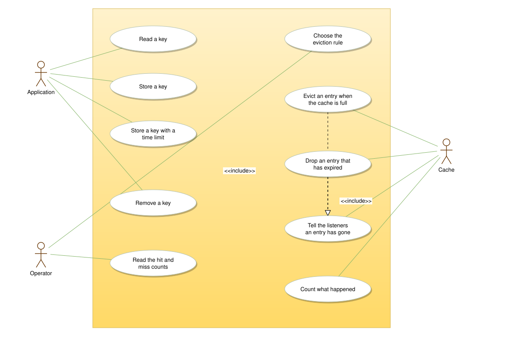
*Figure — Cache use cases: read, store (with optional time limit), remove; the cache evicts, drops expired entries and tells listeners (course diagram)*

### Core entities

| Class | Responsibility |
|---|---|
| `Node<K,V>` | One entry: key, value, `expiresAtMillis`, `frequency`, and its own `prev`/`next` links. |
| `DoublyLinkedList<K,V>` | Order of entries, newest at the front, with two **sentinel** (dummy) nodes so add/remove never need null checks. |
| `EvictionPolicy<K,V>` (interface) | **Strategy**: three events (`onInsert`, `onAccess`, `onRemove`) and one question (`victim()`). Owns the *order*. |
| `LruPolicy`, `FifoPolicy`, `LfuPolicy` | The three rules. LFU is O(1) using a chain of frequency buckets. |
| `EvictionPolicies` + `PolicyType` | **Simple Factory**: enum → policy. |
| `Cache<K,V>` | The map + policy + clock + stats + listeners. One lock. **One removal method.** |
| `Cache.Builder` | **Builder**: capacity, policy, clock with defaults, validated once. |
| `CacheStats` | Counters (`LongAdder`). |
| `RemovalReason` | EVICTED, EXPIRED, REMOVED, CLEARED. |
| `EvictionListener<K,V>` | **Observer**: told key, value and reason. |
| `ShardedCache<K,V>` | N independent caches picked by key hash, to reduce lock contention. |

**The core idea: two structures, each answering one question.**

| Question | Structure | Cost |
|---|---|---|
| "Where is key k?" | `HashMap<K, Node>` | O(1) |
| "Who should leave next?" | Doubly linked list ordered by recency | O(1) at the ends |
| "Move this entry to the front" | Node has its own `prev`/`next`, and the map hands us the node | O(1) — no search |

A map alone cannot tell you the oldest entry. A list alone cannot find a key without walking it. Together they give O(1) for everything. A **doubly** linked list is needed because removing a node from the middle requires its predecessor, and a singly linked list would have to walk to find it.

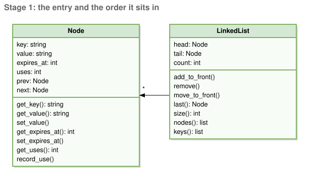
*Figure — Stage 1 of the course build: the Node (key, value, expiry, use count, prev and next links) and the linked list that orders the nodes (course diagram)*

### Class diagram


*Figure — The finished cache class diagram: Cache with its map, policy, clock, stats and listeners; the three eviction policies behind one interface (course diagram)*

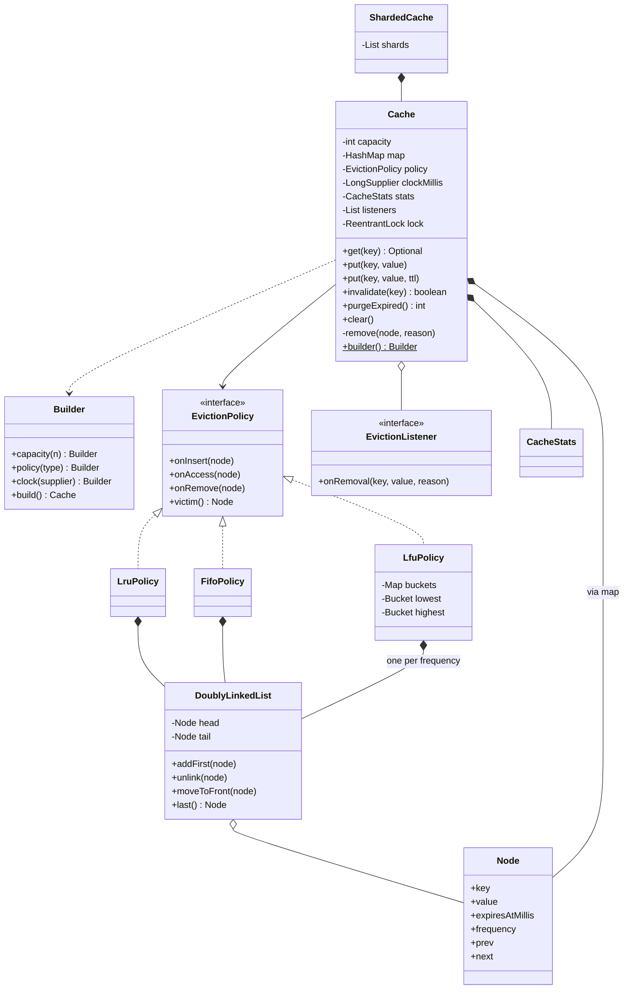

**Build order (from the course).** (1) `Node` + `DoublyLinkedList`: entries can be ordered and moved to the front; (2) `EvictionPolicy` + `LruPolicy`: you can ask who should leave; (3) `FifoPolicy` + `LfuPolicy`: the same question gets three answers with no change to the cache; (4) `Cache` with clock, stats and TTL: reads and writes work; (5) `EvictionListener`: other code can react when an entry goes. Each stage leaves something runnable; reuse this order when you interview.

**Who owns what.** The cache owns the map (and so the nodes). The policy owns the *order* of those nodes. Neither reaches into the other's structure. That split is exactly what lets us add FIFO and LFU without touching `Cache`.

### Key flows

**Reading a key** — three ways out, only one returns a value:

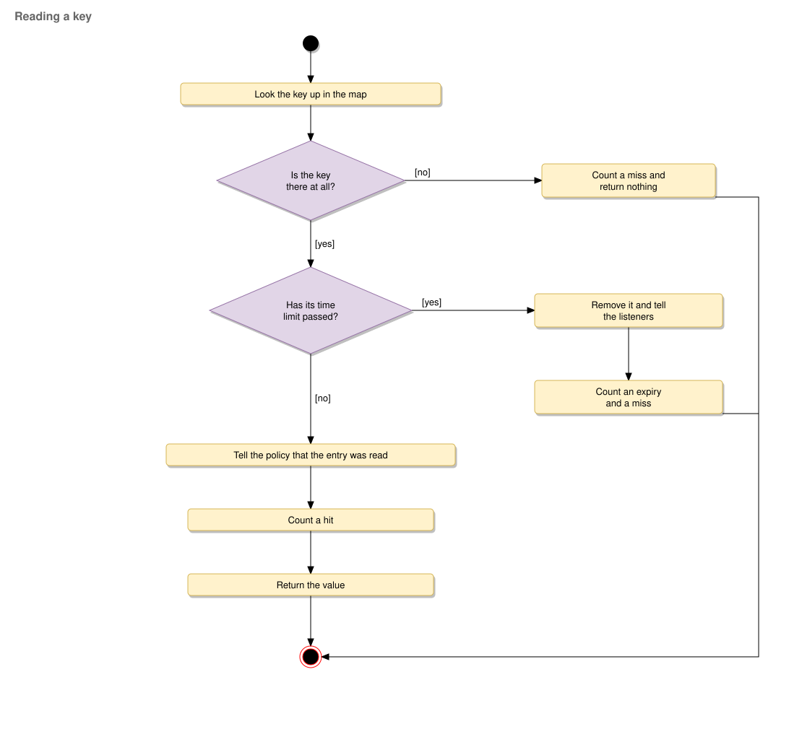
*Figure — Reading a key: not present means a miss; present but expired means a miss plus an expiry removal; otherwise a hit, the policy is told, and the value is returned (course diagram)*

**Storing a key** — eviction work happens only when the cache is already full, so a cache with free room pays nothing extra:


*Figure — Storing a key: replace if present; otherwise, if full, ask the policy for a victim and remove it through the single removal path, then insert (course diagram)*

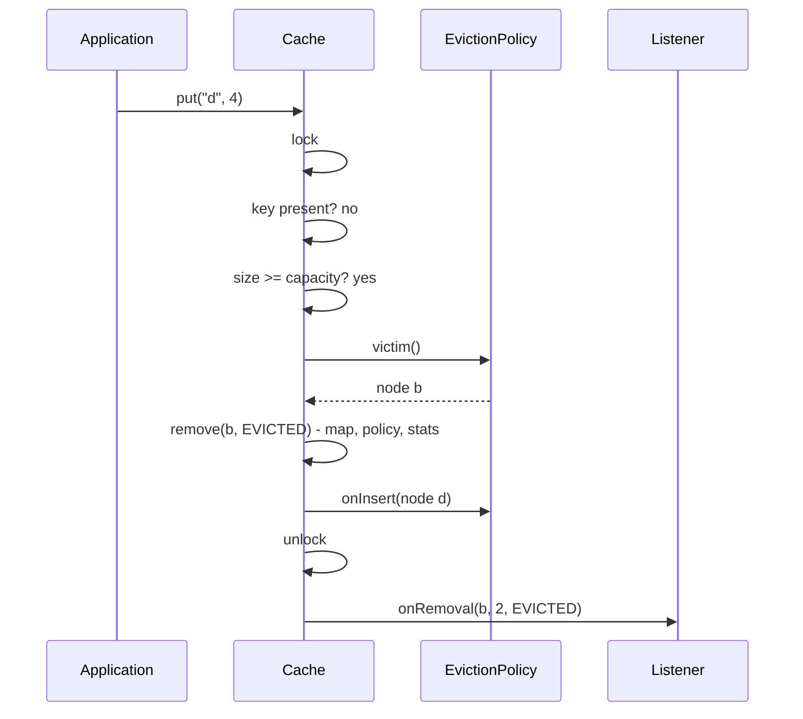

**How the three policies differ** (the only difference is what they do on each event):

| Event | LRU | FIFO | LFU (O(1) buckets) |
|---|---|---|---|
| `onInsert` | add to front | add to front | frequency = 1, add to bucket 1 (always first in the chain) |
| `onAccess` | move to front | **nothing** | move from bucket f to bucket f+1 (created right after f if missing); drop bucket f from the chain if it emptied |
| `onRemove` | unlink | unlink | unlink; drop the bucket if it emptied |
| `victim()` | back of the list | back of the list | back of the **first** bucket in the chain (least recently used among the least frequent) |

The FIFO policy is LRU with one empty method, which is good evidence that the interface boundaries are well chosen. The course's LFU scanned all entries (O(n)) and named a structure grouping entries by count as the fix; our `LfuPolicy` implements that fix. The buckets are themselves kept in a **doubly linked chain in increasing frequency order**, and a new bucket f+1 is always created right after bucket f, so the chain never needs sorting and the lowest bucket is always the first one. That makes `onInsert`, `onAccess`, `onRemove` and `victim()` all O(1), even after a manual removal or an expiry empties the lowest bucket (this is the O(1) LFU scheme of Shah, Mitra and Matani, 2010). Ties inside the lowest bucket are broken by recency (the back of the bucket), so two runs of the same test always evict the same key.

### Design decisions & patterns used

| Decision | Why | Alternative rejected |
|---|---|---|
| **Strategy** for eviction | "Who leaves" is the rule most likely to change. | A `switch (policyType)` inside `get`/`put`. |
| **Observer** for removals | Logging, metrics, deleting a temp file on eviction — none belong inside the cache. The reason is passed so one listener can handle all cases. | Callbacks hard-coded per reason. |
| **One removal method** (`remove(node, reason)`) | Eviction, expiry, manual removal and clear all update map, policy, stats and listeners the same way; nothing can be forgotten on one path. | Four copies of the clean-up code. |
| **Sentinel nodes** | Add and unlink are always the same four pointer writes; no special cases for empty list or ends. | Null checks everywhere (a classic source of bugs). |
| **Injected clock** (`LongSupplier`) | TTL tests run instantly by moving a fake clock forward. | `System.currentTimeMillis()` inside the cache: tests must `sleep`. |
| **Lazy expiry + optional sweeper** | Expired entries are dropped when read; `purgeExpired()` lets a background task reclaim memory. | Only lazy (memory held by dead entries) or a timer per entry (expensive). |
| **One `ReentrantLock`**, listeners called **after unlock** | In LRU even `get` writes (moves a node), so a read-write lock would not help. Calling listeners outside the lock means a slow or re-entrant listener cannot block or deadlock the cache. | `synchronized` around listener calls. |
| **Builder** | Optional settings with defaults; validation once in `build()`. | Telescoping constructors. |
| **Sharding** (`ShardedCache`) | N locks instead of one: threads touching different shards never wait for each other. | One global lock (every reader waits for every writer). |

### Java implementation

```java
// File: code/lld/ch20/cache/Structures.java
package lld.ch20.cache;

/** One cache entry. It carries its own links, so it can be unlinked in O(1). */
final class Node<K, V> {
    final K key;
    V value;
    long expiresAtMillis;  // 0 = never expires
    int frequency;         // used by LFU
    Node<K, V> prev, next;

    Node(K key, V value, long expiresAtMillis) {
        this.key = key;
        this.value = value;
        this.expiresAtMillis = expiresAtMillis;
    }

    boolean isExpired(long now) { return expiresAtMillis != 0 && now >= expiresAtMillis; }
}

/** Doubly linked list with two sentinel nodes: no null checks at the ends. Newest at the front. */
final class DoublyLinkedList<K, V> {
    private final Node<K, V> head = new Node<>(null, null, 0); // sentinel before the front
    private final Node<K, V> tail = new Node<>(null, null, 0); // sentinel after the back
    private int size;

    DoublyLinkedList() {
        head.next = tail;
        tail.prev = head;
    }

    void addFirst(Node<K, V> n) {
        n.prev = head;
        n.next = head.next;
        head.next.prev = n;
        head.next = n;
        size++;
    }

    void unlink(Node<K, V> n) {
        n.prev.next = n.next;
        n.next.prev = n.prev;
        n.prev = n.next = null;
        size--;
    }

    void moveToFront(Node<K, V> n) {
        unlink(n);
        addFirst(n);
    }

    /** The oldest node (at the back), or null if empty. */
    Node<K, V> last() { return size == 0 ? null : tail.prev; }

    boolean isEmpty() { return size == 0; }
}
```

```java
// File: code/lld/ch20/cache/EvictionPolicy.java
package lld.ch20.cache;

import java.util.HashMap;
import java.util.Map;

/** Strategy: owns the ORDER of entries and answers "who leaves?". The cache owns the map. */
interface EvictionPolicy<K, V> {
    void onInsert(Node<K, V> node);
    void onAccess(Node<K, V> node);
    void onRemove(Node<K, V> node);
    Node<K, V> victim();
}

/** Least recently used: a read moves the entry to the front; the back is the victim. */
final class LruPolicy<K, V> implements EvictionPolicy<K, V> {
    private final DoublyLinkedList<K, V> order = new DoublyLinkedList<>();
    public void onInsert(Node<K, V> n) { order.addFirst(n); }
    public void onAccess(Node<K, V> n) { order.moveToFront(n); }
    public void onRemove(Node<K, V> n) { order.unlink(n); }
    public Node<K, V> victim() { return order.last(); }
}

/** First in, first out: identical to LRU except that a read changes nothing. */
final class FifoPolicy<K, V> implements EvictionPolicy<K, V> {
    private final DoublyLinkedList<K, V> order = new DoublyLinkedList<>();
    public void onInsert(Node<K, V> n) { order.addFirst(n); }
    public void onAccess(Node<K, V> n) { /* insertion order only */ }
    public void onRemove(Node<K, V> n) { order.unlink(n); }
    public Node<K, V> victim() { return order.last(); }
}

/**
 * Least frequently used in O(1): one list per frequency ("bucket"), and the buckets themselves
 * chained in increasing frequency order, so the lowest non-empty bucket is always the first one.
 * Ties inside the lowest bucket go to the least recently used entry (the back of that bucket).
 */
final class LfuPolicy<K, V> implements EvictionPolicy<K, V> {
    private static final class Bucket<K, V> {
        final int frequency;
        final DoublyLinkedList<K, V> entries = new DoublyLinkedList<>();
        Bucket<K, V> lower, higher;           // neighbours in the frequency chain
        Bucket(int frequency) { this.frequency = frequency; }
    }

    private final Map<Integer, Bucket<K, V>> buckets = new HashMap<>();
    private final Bucket<K, V> lowest = new Bucket<>(0);   // sentinels of the bucket chain
    private final Bucket<K, V> highest = new Bucket<>(Integer.MAX_VALUE);

    LfuPolicy() {
        lowest.higher = highest;
        highest.lower = lowest;
    }

    public void onInsert(Node<K, V> n) {
        n.frequency = 1;
        bucketAfter(lowest, 1).entries.addFirst(n);        // frequency 1 is always the lowest
    }

    public void onAccess(Node<K, V> n) {
        Bucket<K, V> from = buckets.get(n.frequency);
        Bucket<K, V> to = bucketAfter(from, n.frequency + 1);
        from.entries.unlink(n);
        dropIfEmpty(from);
        n.frequency++;
        to.entries.addFirst(n);
    }

    public void onRemove(Node<K, V> n) {
        Bucket<K, V> b = buckets.get(n.frequency);
        b.entries.unlink(n);
        dropIfEmpty(b);                                      // the chain stays ordered: nothing to repair
    }

    public Node<K, V> victim() {
        Bucket<K, V> min = lowest.higher;                    // O(1): first bucket in the chain
        return min == highest ? null : min.entries.last();
    }

    /** The bucket for 'frequency', created right after 'prev' if it does not exist yet. */
    private Bucket<K, V> bucketAfter(Bucket<K, V> prev, int frequency) {
        Bucket<K, V> b = buckets.get(frequency);
        if (b != null) return b;
        b = new Bucket<>(frequency);
        b.lower = prev;
        b.higher = prev.higher;
        prev.higher.lower = b;
        prev.higher = b;
        buckets.put(frequency, b);
        return b;
    }

    private void dropIfEmpty(Bucket<K, V> b) {
        if (!b.entries.isEmpty()) return;
        b.lower.higher = b.higher;
        b.higher.lower = b.lower;
        buckets.remove(b.frequency);
    }
}

enum PolicyType { LRU, FIFO, LFU }

/** Factory: maps a configuration value to a policy object. */
final class EvictionPolicies {
    private EvictionPolicies() {}

    static <K, V> EvictionPolicy<K, V> create(PolicyType type) {
        return switch (type) {
            case LRU -> new LruPolicy<>();
            case FIFO -> new FifoPolicy<>();
            case LFU -> new LfuPolicy<>();
        };
    }
}
```

```java
// File: code/lld/ch20/cache/Cache.java
package lld.ch20.cache;

import java.time.Duration;
import java.util.ArrayList;
import java.util.HashMap;
import java.util.List;
import java.util.Map;
import java.util.Optional;
import java.util.concurrent.CopyOnWriteArrayList;
import java.util.concurrent.atomic.LongAdder;
import java.util.concurrent.locks.ReentrantLock;
import java.util.function.LongSupplier;

enum RemovalReason { EVICTED, EXPIRED, REMOVED, CLEARED }

/** Observer: told every time an entry leaves, and why. */
interface EvictionListener<K, V> {
    void onRemoval(K key, V value, RemovalReason reason);
}

/** Hit / miss / eviction / expiry counters. LongAdder is cheap under contention. */
final class CacheStats {
    final LongAdder hits = new LongAdder(), misses = new LongAdder(),
            evictions = new LongAdder(), expirations = new LongAdder();

    @Override
    public String toString() {
        long h = hits.sum(), m = misses.sum();
        return "hits=" + h + " misses=" + m + " evictions=" + evictions.sum() + " expirations=" + expirations.sum()
                + String.format(" hitRate=%.0f%%", h + m == 0 ? 0.0 : 100.0 * h / (h + m));
    }
}

/**
 * Fixed-capacity cache: HashMap for "where is it?", an EvictionPolicy for "who leaves?".
 * Thread-safe with one lock (a read in LRU also writes: it moves the node).
 */
final class Cache<K, V> {
    private final int capacity;
    private final Map<K, Node<K, V>> map = new HashMap<>();
    private final EvictionPolicy<K, V> policy;
    private final LongSupplier clockMillis;
    private final CacheStats stats = new CacheStats();
    private final List<EvictionListener<K, V>> listeners = new CopyOnWriteArrayList<>();
    private final ReentrantLock lock = new ReentrantLock();

    private record Removal<K, V>(K key, V value, RemovalReason reason) {}

    private Cache(Builder<K, V> b) {
        this.capacity = b.capacity;
        this.policy = EvictionPolicies.create(b.policyType);
        this.clockMillis = b.clockMillis;
    }

    static <K, V> Builder<K, V> builder() { return new Builder<>(); }

    Optional<V> get(K key) {
        List<Removal<K, V>> removed = new ArrayList<>(1);
        lock.lock();
        try {
            Node<K, V> n = map.get(key);
            if (n == null) {
                stats.misses.increment();
                return Optional.empty();
            }
            if (n.isExpired(clockMillis.getAsLong())) { // a miss, an expiry and a removal at once
                stats.misses.increment();
                removed.add(remove(n, RemovalReason.EXPIRED));
                return Optional.empty();
            }
            stats.hits.increment();
            policy.onAccess(n);
            return Optional.of(n.value);
        } finally {
            lock.unlock();
            notifyListeners(removed); // outside the lock: a slow listener cannot block the cache
        }
    }

    void put(K key, V value) { put(key, value, null); }

    void put(K key, V value, Duration ttl) {
        List<Removal<K, V>> removed = new ArrayList<>(1);
        lock.lock();
        try {
            long expiresAt = ttl == null ? 0 : clockMillis.getAsLong() + ttl.toMillis();
            Node<K, V> existing = map.get(key);
            if (existing != null) {          // replace: counts as a use
                existing.value = value;
                existing.expiresAtMillis = expiresAt;
                policy.onAccess(existing);
                return;
            }
            if (map.size() >= capacity) removed.add(remove(policy.victim(), RemovalReason.EVICTED));
            Node<K, V> n = new Node<>(key, value, expiresAt);
            map.put(key, n);
            policy.onInsert(n);
        } finally {
            lock.unlock();
            notifyListeners(removed);
        }
    }

    boolean invalidate(K key) {
        List<Removal<K, V>> removed = new ArrayList<>(1);
        lock.lock();
        try {
            Node<K, V> n = map.get(key);
            if (n != null) removed.add(remove(n, RemovalReason.REMOVED));
            return n != null;
        } finally {
            lock.unlock();
            notifyListeners(removed);
        }
    }

    /** Called by a background sweeper (e.g. a ScheduledExecutorService) to reclaim memory early. */
    int purgeExpired() {
        List<Removal<K, V>> removed = new ArrayList<>();
        lock.lock();
        try {
            long now = clockMillis.getAsLong();
            for (Node<K, V> n : new ArrayList<>(map.values()))
                if (n.isExpired(now)) removed.add(remove(n, RemovalReason.EXPIRED));
            return removed.size();
        } finally {
            lock.unlock();
            notifyListeners(removed);
        }
    }

    void clear() {
        List<Removal<K, V>> removed = new ArrayList<>();
        lock.lock();
        try {
            for (Node<K, V> n : new ArrayList<>(map.values())) removed.add(remove(n, RemovalReason.CLEARED));
        } finally {
            lock.unlock();
            notifyListeners(removed);
        }
    }

    /** THE single exit path for every entry, whatever the reason. Caller holds the lock. */
    private Removal<K, V> remove(Node<K, V> n, RemovalReason reason) {
        map.remove(n.key);
        policy.onRemove(n);
        if (reason == RemovalReason.EVICTED) stats.evictions.increment();
        if (reason == RemovalReason.EXPIRED) stats.expirations.increment();
        return new Removal<>(n.key, n.value, reason);
    }

    private void notifyListeners(List<Removal<K, V>> removed) {
        for (Removal<K, V> r : removed)
            for (EvictionListener<K, V> l : listeners) l.onRemoval(r.key(), r.value(), r.reason());
    }

    void addListener(EvictionListener<K, V> l) { listeners.add(l); }
    CacheStats stats() { return stats; }

    int size() {
        lock.lock();
        try { return map.size(); } finally { lock.unlock(); }
    }

    /** Builder: optional settings with sensible defaults, validated once. */
    static final class Builder<K, V> {
        private int capacity = 100;
        private PolicyType policyType = PolicyType.LRU;
        private LongSupplier clockMillis = System::currentTimeMillis;

        Builder<K, V> capacity(int c) { this.capacity = c; return this; }
        Builder<K, V> policy(PolicyType p) { this.policyType = p; return this; }
        Builder<K, V> clock(LongSupplier c) { this.clockMillis = c; return this; }

        Cache<K, V> build() {
            if (capacity <= 0) throw new IllegalArgumentException("capacity must be positive");
            return new Cache<>(this);
        }
    }
}

/** Sharding: N independent caches chosen by key hash, so threads rarely share a lock. */
final class ShardedCache<K, V> {
    private final List<Cache<K, V>> shards = new ArrayList<>();

    ShardedCache(int shardCount, int capacityPerShard, PolicyType type) {
        for (int i = 0; i < shardCount; i++)
            shards.add(Cache.<K, V>builder().capacity(capacityPerShard).policy(type).build());
    }

    private Cache<K, V> shard(K key) { return shards.get(Math.floorMod(key.hashCode(), shards.size())); }
    Optional<V> get(K key) { return shard(key).get(key); }
    void put(K key, V value) { shard(key).put(key, value); }
    int size() { return shards.stream().mapToInt(Cache::size).sum(); }
}
```

```java
// File: code/lld/ch20/cache/Main.java
package lld.ch20.cache;

import java.time.Duration;
import java.util.ArrayList;
import java.util.List;
import java.util.concurrent.ExecutorService;
import java.util.concurrent.Executors;
import java.util.concurrent.TimeUnit;
import java.util.concurrent.atomic.AtomicLong;

public class Main {
    public static void main(String[] args) throws Exception {
        for (PolicyType type : PolicyType.values()) {
            System.out.println("== " + type + " (capacity 3): put a,b,c; get b,b,b,c,a,a; put d");
            Cache<String, Integer> c = Cache.<String, Integer>builder().capacity(3).policy(type).build();
            c.addListener((k, v, why) -> System.out.println("  listener: " + k + "=" + v + " left, " + why));
            c.put("a", 1);
            c.put("b", 2);
            c.put("c", 3);
            for (String k : List.of("b", "b", "b", "c", "a", "a")) c.get(k);
            c.put("d", 4);
            List<String> present = new ArrayList<>();
            for (String k : List.of("a", "b", "c", "d")) if (c.get(k).isPresent()) present.add(k);
            System.out.println("  still cached: " + present);
        }

        System.out.println("== TTL with a manual clock");
        AtomicLong now = new AtomicLong(0);
        Cache<String, String> sessions = Cache.<String, String>builder().capacity(10).clock(now::get).build();
        sessions.addListener((k, v, why) -> System.out.println("  listener: " + k + " left, " + why));
        sessions.put("session:42", "alice", Duration.ofSeconds(5));
        sessions.put("session:43", "bob", Duration.ofSeconds(5));
        sessions.put("config", "v1");
        System.out.println("  t=0s  get session:42 -> " + sessions.get("session:42").orElse("MISS"));
        now.set(6_000);
        System.out.println("  t=6s  get session:42 -> " + sessions.get("session:42").orElse("MISS"));
        System.out.println("  sweeper purged " + sessions.purgeExpired() + " more expired entry");
        System.out.println("  config (no TTL) -> " + sessions.get("config").orElse("MISS"));
        sessions.invalidate("config");
        System.out.println("  stats: " + sessions.stats());

        System.out.println("== Sharded cache under 8 threads");
        ShardedCache<Integer, Integer> sharded = new ShardedCache<>(8, 1_000, PolicyType.LRU);
        ExecutorService pool = Executors.newFixedThreadPool(8);
        for (int t = 0; t < 8; t++) {
            int seed = t;
            pool.submit(() -> {
                for (int i = 0; i < 50_000; i++) {
                    int key = (i * 31 + seed) % 20_000;
                    if (sharded.get(key).isEmpty()) sharded.put(key, key * 2);
                }
            });
        }
        pool.shutdown();
        System.out.println("  finished: " + pool.awaitTermination(30, TimeUnit.SECONDS)
                + ", size <= 8000: " + (sharded.size() <= 8_000));
    }
}
```

**Walking through the code.**
- `DoublyLinkedList` never touches `null` at the ends because `head` and `tail` are dummy nodes that are never removed.
- In `Cache.get`, an expired entry counts as a miss **and** an expiration, and is removed through `remove()` — all three in one place, so the counters always add up.
- Every public method collects `Removal` events while holding the lock and calls `notifyListeners` in `finally` **after** `unlock()`.
- `put` on an existing key replaces value and TTL and counts as an access (in LRU the key moves to the front).
- `CacheStats` uses `LongAdder`, which is faster than `AtomicLong` when many threads increment.

**Output:**

```text
== LRU (capacity 3): put a,b,c; get b,b,b,c,a,a; put d
  listener: b=2 left, EVICTED
  still cached: [a, c, d]
== FIFO (capacity 3): put a,b,c; get b,b,b,c,a,a; put d
  listener: a=1 left, EVICTED
  still cached: [b, c, d]
== LFU (capacity 3): put a,b,c; get b,b,b,c,a,a; put d
  listener: c=3 left, EVICTED
  still cached: [a, b, d]
== TTL with a manual clock
  t=0s  get session:42 -> alice
  listener: session:42 left, EXPIRED
  t=6s  get session:42 -> MISS
  listener: session:43 left, EXPIRED
  sweeper purged 1 more expired entry
  config (no TTL) -> v1
  listener: config left, REMOVED
  stats: hits=2 misses=1 evictions=0 expirations=2 hitRate=67%
== Sharded cache under 8 threads
  finished: true, size <= 8000: true
```

With the same access pattern (b read 3 times, then c once, then a twice), the three policies evict three **different** keys: LRU evicts b (least recently touched), FIFO evicts a (inserted first), LFU evicts c (read only once).

### LRU Cache from scratch (the classic interview question)

Very often the interviewer skips the pluggable design and asks for exactly this: **"Implement an LRU cache with O(1) `get` and `put`"** (LeetCode 146). The answer is the same two structures, written inline:

1. A `HashMap<K, Node>` for lookup.
2. A doubly linked list with `head`/`tail` sentinels; most recent right after `head`, least recent right before `tail`.
3. `get(k)`: look up the node; if found, unlink it and add it at the front; return the value.
4. `put(k, v)`: if present, update and move to front. Otherwise, if full, remove `tail.prev` from the list **and** from the map (that is why the node stores its key); then add the new node at the front and to the map.

Java also has a shortcut: `LinkedHashMap` with `accessOrder = true` keeps entries in access order, and overriding `removeEldestEntry` evicts automatically. Mention it, but write the manual version when asked "from scratch" — that is what is being tested.

```java
// File: code/lld/ch20/lrucache/Main.java
package lld.ch20.lrucache;

import java.util.HashMap;
import java.util.LinkedHashMap;
import java.util.Map;

public class Main {

    /** The classic interview answer: HashMap + hand-written doubly linked list. get/put are O(1). */
    static final class LRUCache<K, V> {
        private final class Node {
            K key;
            V value;
            Node prev, next;
            Node(K key, V value) { this.key = key; this.value = value; }
        }

        private final int capacity;
        private final Map<K, Node> index = new HashMap<>();
        private final Node head = new Node(null, null); // sentinel: most recent side
        private final Node tail = new Node(null, null); // sentinel: least recent side

        LRUCache(int capacity) {
            if (capacity <= 0) throw new IllegalArgumentException("capacity must be positive");
            this.capacity = capacity;
            head.next = tail;
            tail.prev = head;
        }

        synchronized V get(K key) {
            Node n = index.get(key);
            if (n == null) return null;
            unlink(n);
            addFront(n);                 // now the most recently used
            return n.value;
        }

        synchronized void put(K key, V value) {
            Node n = index.get(key);
            if (n != null) {             // update + mark as recently used
                n.value = value;
                unlink(n);
                addFront(n);
                return;
            }
            if (index.size() == capacity) {
                Node lru = tail.prev;    // least recently used lives just before the tail sentinel
                unlink(lru);
                index.remove(lru.key);
            }
            n = new Node(key, value);
            addFront(n);
            index.put(key, n);
        }

        private void addFront(Node n) {
            n.prev = head;
            n.next = head.next;
            head.next.prev = n;
            head.next = n;
        }

        private void unlink(Node n) {
            n.prev.next = n.next;
            n.next.prev = n.prev;
        }

        @Override
        public synchronized String toString() {
            StringBuilder sb = new StringBuilder("[");
            for (Node n = head.next; n != tail; n = n.next) sb.append(n.key).append(n.next == tail ? "" : ", ");
            return sb.append("] (most -> least recent)").toString();
        }
    }

    /** The JDK shortcut: LinkedHashMap in access order + removeEldestEntry. Not thread-safe. */
    static <K, V> Map<K, V> jdkLru(int capacity) {
        return new LinkedHashMap<>(16, 0.75f, true) {
            @Override
            protected boolean removeEldestEntry(Map.Entry<K, V> eldest) { return size() > capacity; }
        };
    }

    public static void main(String[] args) {
        System.out.println("== Hand-written LRU (LeetCode 146 sequence, capacity 2)");
        LRUCache<Integer, Integer> c = new LRUCache<>(2);
        c.put(1, 1);
        c.put(2, 2);
        System.out.println("get(1) = " + c.get(1) + "   order " + c);
        c.put(3, 3);
        System.out.println("put(3) evicts 2        order " + c);
        System.out.println("get(2) = " + c.get(2));
        c.put(4, 4);
        System.out.println("put(4) evicts 1        order " + c);
        System.out.println("get(1) = " + c.get(1) + ", get(3) = " + c.get(3) + ", get(4) = " + c.get(4));

        System.out.println("== Same sequence with LinkedHashMap(accessOrder=true)");
        Map<Integer, Integer> j = jdkLru(2);
        j.put(1, 1);
        j.put(2, 2);
        j.get(1);
        j.put(3, 3);
        j.put(4, 4);
        System.out.println("keys (least -> most recent) = " + j.keySet());
    }
}
```

**Output:**

```text
== Hand-written LRU (LeetCode 146 sequence, capacity 2)
get(1) = 1   order [1, 2] (most -> least recent)
put(3) evicts 2        order [3, 1] (most -> least recent)
get(2) = null
put(4) evicts 1        order [4, 3] (most -> least recent)
get(1) = null, get(3) = 3, get(4) = 4
== Same sequence with LinkedHashMap(accessOrder=true)
keys (least -> most recent) = [3, 4]
```

The printed values match LeetCode 146's expected answers for this sequence (1, miss, miss, 3, 4); LeetCode's `int` version returns `-1` for a miss, while this generic version returns `null`.

| Approach | get / put | Thread-safe | When to use |
|---|---|---|---|
| HashMap + own doubly linked list | O(1) / O(1) | Only with a lock (`synchronized` here) | Interviews; when you need custom behaviour |
| `LinkedHashMap(accessOrder=true)` + `removeEldestEntry` | O(1) / O(1) | No (wrap with a lock) | Quick, small, single-threaded caches |
| Caffeine / Guava cache | amortized O(1) | Yes, highly concurrent | Production Java |

### Concurrency & edge cases

- **Why a plain read lock is not enough:** an LRU `get` moves the node (several pointer writes). Two threads doing that at once corrupt the list. So `get` needs the exclusive lock.
- **Contention:** one lock serializes everything. `ShardedCache` splits keys over 8 caches (8 locks); the demo hammers it from 8 threads and the size never exceeds the total capacity. Trade-off: eviction is per shard, so the global LRU order is approximate.
- **Listeners:** called outside the lock; a listener that calls back into the cache cannot deadlock.
- **Cache stampede** (many threads miss the same key at once and all hit the database): use a "loading" cache where the first thread computes and the others wait for its result (`ConcurrentHashMap.compute`/`computeIfAbsent`, or a `CompletableFuture` stored per key). Chapter 13 (§13.6) builds a TTL cache whose `getOrLoad` does this with `ConcurrentHashMap.compute`.
- **TTL semantics, precisely.** An entry expires *at* its deadline (`now >= expiresAt`), so a 5-second TTL written at t=0 is already a miss at t=5.000 s. Expiry is **lazy**: a dead entry still occupies a slot until it is read, swept by `purgeExpired()`, or picked as the eviction victim (in which case it is reported as `EVICTED`, not `EXPIRED`, because it left to make room). `put(key, value)` without a TTL on an existing key **clears** the old TTL (the entry becomes permanent); pass the TTL again to keep one. A production cache would also let the sweeper run on a `ScheduledExecutorService`.
- **Capacity 0 or negative:** refused by the builder.
- **Null keys/values:** not supported here; say so (Caffeine forbids nulls too).
- **Clock going backwards:** use a monotonic clock (`System.nanoTime`) for TTL in production.

### Extensions & follow-up questions

- **"Make it LFU."** One new policy class (done). Volunteer that the naive LFU (scan for the lowest count) is O(n) and the chained-bucket version is O(1).
- **"Size in bytes, not entries."** Add a `Weigher<K,V>` strategy; evict until `totalWeight <= maxWeight`.
- **"Load from the database on a miss."** *Read-through*: `get(key, loader)` calls the loader on a miss and stores the result. *Write-through*: writes go to cache and DB together. *Write-back (write-behind)*: writes go to cache and are flushed to DB later (faster, risk of loss). *Cache-aside*: the application does "check cache → on miss read DB → put in cache" itself.
- **"Distributed cache."** Consistent hashing to spread keys over nodes (Redis Cluster, Memcached clients); that is high-level design.
- **"Which policy is best?"** Depends on access patterns. Modern caches (Caffeine's *Window TinyLFU*) combine recency and frequency and beat pure LRU on many workloads.

### Real-world example

`java.util.LinkedHashMap` with access order is the JDK's built-in LRU. **Guava's `CacheBuilder`** and **Caffeine** expose exactly this chapter's knobs: `maximumSize` (capacity), `expireAfterWrite`/`expireAfterAccess` (TTL), `removalListener` (Observer, with a cause such as `EXPIRED`, `SIZE`, `EXPLICIT`, `REPLACED`), and `recordStats()` (hit rate). **Redis** supports eviction policies selected by configuration (`maxmemory-policy`: `allkeys-lru`, `allkeys-lfu`, `volatile-ttl`, `noeviction` and others) — a Strategy chosen by config — and approximates LRU by sampling a few keys rather than keeping a full list, to save memory. Browsers, CDNs and operating-system page caches all use variants of LRU.

### In the interview

**30-second answer:** "A HashMap from key to node for O(1) lookup, and a doubly linked list with sentinels for O(1) ordering; the node carries its own links so the map hands us something we can unlink directly. The eviction rule goes behind an `EvictionPolicy` interface — LRU moves on access, FIFO doesn't, LFU uses frequency buckets for O(1). Every exit goes through one `remove` method that updates stats and notifies listeners after the lock is released. For concurrency, one lock is correct; sharding by key hash reduces contention."

**Plan:** sketch the map and the list together straight away and explain what each one lacks on its own → write LRU get/put → pull the rule behind an interface unprompted → TTL + stats + listeners → thread safety and sharding → follow-ups.

**Follow-ups with answers:**
- *"Why doubly and not singly linked?"* → Removing a node needs its predecessor; with `prev` we have it in O(1).
- *"Why does the node store the key?"* → When evicting the tail we must also delete it from the map.
- *"Make it thread-safe."* → Lock around each operation; better, shard by key; production: Caffeine.

### Self-check

1. Which two structures give O(1) LRU? → HashMap (key → node) + doubly linked list (recency order).
2. What do sentinel nodes buy you? → No null checks; add/remove are always the same pointer writes.
3. How does FIFO differ from LRU in code? → `onAccess` does nothing.
4. Why call listeners after releasing the lock? → A slow or re-entrant listener cannot block or deadlock the cache.
5. Why can't a read-write lock speed up an LRU cache's `get`? → `get` modifies the list, so it is a write.
6. What is a cache stampede and one fix? → Many concurrent misses for one key hitting the DB; let one thread load while others wait on the same future.

### TL;DR

- **HashMap + doubly linked list (with sentinels)** = O(1) get/put.
- **Strategy** for eviction (LRU / FIFO / O(1) LFU); **Observer** for removals; **Builder** for config.
- **One removal path** keeps stats and listeners correct; TTL is lazy + optional sweeper; clock injected.
- Thread safety: one lock (gets are writes), listeners outside the lock, **shard** to scale.
- Know `LinkedHashMap(accessOrder=true)` + `removeEldestEntry`, and Caffeine/Guava/Redis policies.

---

## 20.4 Design a Ride Sharing Service (Uber)

### Problem & clarifying questions

**What it is.** A ride sharing service connects a rider who wants a car with a nearby driver. Everyday analogy: a taxi dispatcher with a radio. A call comes in, the dispatcher looks at the map, radios the nearest free cab; if that driver says no, the next one. At the end the meter shows the fare.

Two decisions are the whole question: **which driver is asked** (matching) and **what the trip costs** (pricing). The rest is bookkeeping. A good design lets either rule change with no edits anywhere else.

| Question | Assumed answer |
|---|---|
| Vehicle types? | Economy, premium, van. Rider asks for one type. |
| Who can get a request? | Drivers who are online, not on a trip, with the right car type, within range. |
| Offer to one driver or broadcast? | One at a time, nearest first; decline → next; nobody left → cancel. |
| Trip states? | Requested → accepted → started → ended; canceled from requested/accepted only. Illegal actions do nothing. |
| Fare? | Base + per km + per minute, never below a minimum; per vehicle type. |
| Surge? | A multiplier when the city is busy, applied to the same fare. |
| Ratings? | Rider and driver rate each other once after a finished trip; accounts show the average. |
| Payments? | Charge the rider's payment method (cash, wallet, card) at the end. |
| Map? | A grid; distance measured along streets (Manhattan distance), which keeps all distances integral. Production systems query a routing engine that gives back road distance plus an estimated duration, and pricing would take both from it. |
| Pool/shared rides, scheduled rides, live tracking, payouts? | Out of scope. |

### Requirements

**Functional**
1. Riders and drivers have a name and phone number.
2. A driver has one vehicle: plate, seats, type.
3. Drivers go online/offline; only online, free drivers get requests.
4. A rider requests a trip with pickup, drop and car type.
5. Free drivers with a matching car type are ordered by distance to the pickup, and the closest one is offered the trip first.
6. A driver accepts or declines; a decline goes to the next driver; if none are left, the request is canceled.
7. A trip moves through fixed states; an action that doesn't fit the current state does nothing.
8. Fare = base + per-km + per-minute, never below a minimum.
9. During peak demand, a surge multiplier scales that same fare.
10. Riders may cancel until the trip starts; after that, the only way out is ending it.
11. After a finished trip, rider and driver rate each other; accounts show the average.
12. Riders and drivers can see their finished trips.
13. (Added) The rider is charged through their payment method.

**Non-functional:** a driver can never be assigned to two trips at once (even with concurrent requests); rules swappable without editing the service; deterministic behaviour for tests (tie-breaks).

### Use cases

Actors: **Rider** (request, cancel, rate), **Driver** (go online, accept/decline, start/end, rate), **System** (find nearby drivers, offer, price, surge, history).

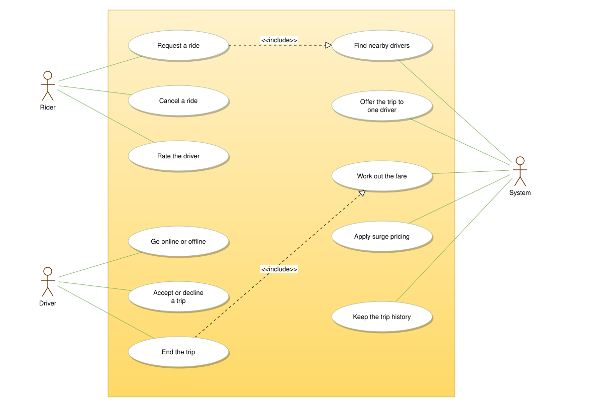
*Figure — Ride sharing use cases: rider requests, cancels and rates; driver goes online, accepts or declines and ends the trip; the system matches, offers, prices and applies surge (course diagram)*

### Core entities

| Class | Responsibility |
|---|---|
| `Location` (record) | Grid point; `distanceTo` = Manhattan distance in km. |
| `VehicleType` (enum), `Vehicle` (record) | Car type and details. |
| `Account` (abstract) | What riders and drivers share: id, name, phone, **rating as running total + count**, finished trips. |
| `Rider` | + payment method. |
| `Driver` | + vehicle, location, online flag, **atomic busy flag** (`tryClaim`). |
| `TripStatus` (enum) | The state machine: legal next states per state. |
| `Trip` | One journey: rider, pickup, drop, type, **ranked candidate list + cursor**, status, driver, minutes, fare. Every action checks state first. |
| `PricingStrategy` | **Strategy**: fare for (type, km, minutes). |
| `StandardPricing` + `RateCard` | Base + per km + per minute, with a floor, per vehicle type. |
| `SurgePricing` | **Decorator**: wraps any `PricingStrategy` and multiplies its answer. |
| `MatchingStrategy` | **Strategy**: ranks drivers. `NearestDriverMatcher`, `BestRatedMatcher`. |
| `PaymentMethod` | **Strategy**: `CashPayment`, `WalletPayment`. |
| `TripListener` | **Observer**: apps are told about trip events. |
| `RideSharingService` | Facade: owns accounts and trips; holds one pricing and one matching rule; knows only the order of steps. |

**Why the rating is a total and a count.** Only the average is ever displayed, so a sum and a count suffice, and recording a new rating is O(1) whether the account has 10 trips or 10,000.

**Why `Rider` and `Driver` extend `Account`.** They pass the "is-a" substitution test (Liskov Substitution Principle): wherever the code reads a name or records a rating, a `Rider` or a `Driver` can be passed.

### Class diagram


*Figure — The finished ride sharing class diagram: the service owning riders, drivers and trips; PricingStrategy with StandardPricing and the SurgePricing wrapper; MatchingStrategy with the nearest-driver matcher (course diagram)*

The course builds it in five stages, each leaving something runnable: (1) `Account`/`Rider`/`Driver`, `Vehicle`, `Location` (who is free and where); (2) `Trip` + `TripStatus` (the lifecycle, with illegal moves refused); (3) pricing with the surge wrapper (a finished trip has a fare); (4) matching (drivers who could take a request can be ranked); (5) `RideSharingService` (the complete flow, request through rating).

In the figure above, look for the extra arrow from `SurgePricing` back to the `PricingStrategy` interface: that "has-a of my own type" arrow is what turns it into a Decorator instead of one more Strategy.

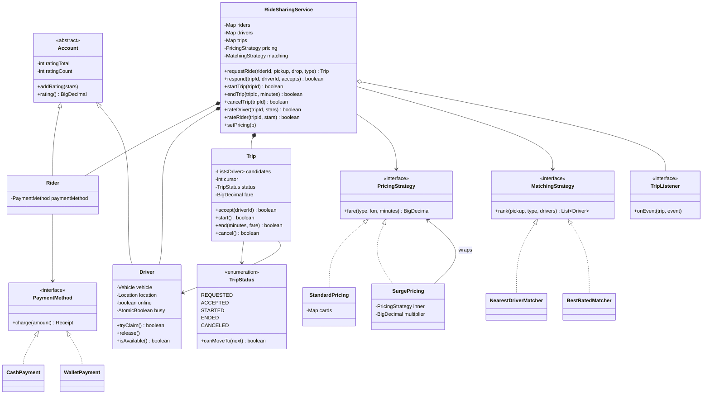

### Key flows

**Trip lifecycle (state machine).** A *state machine* is a fixed set of states plus the only moves allowed between them.

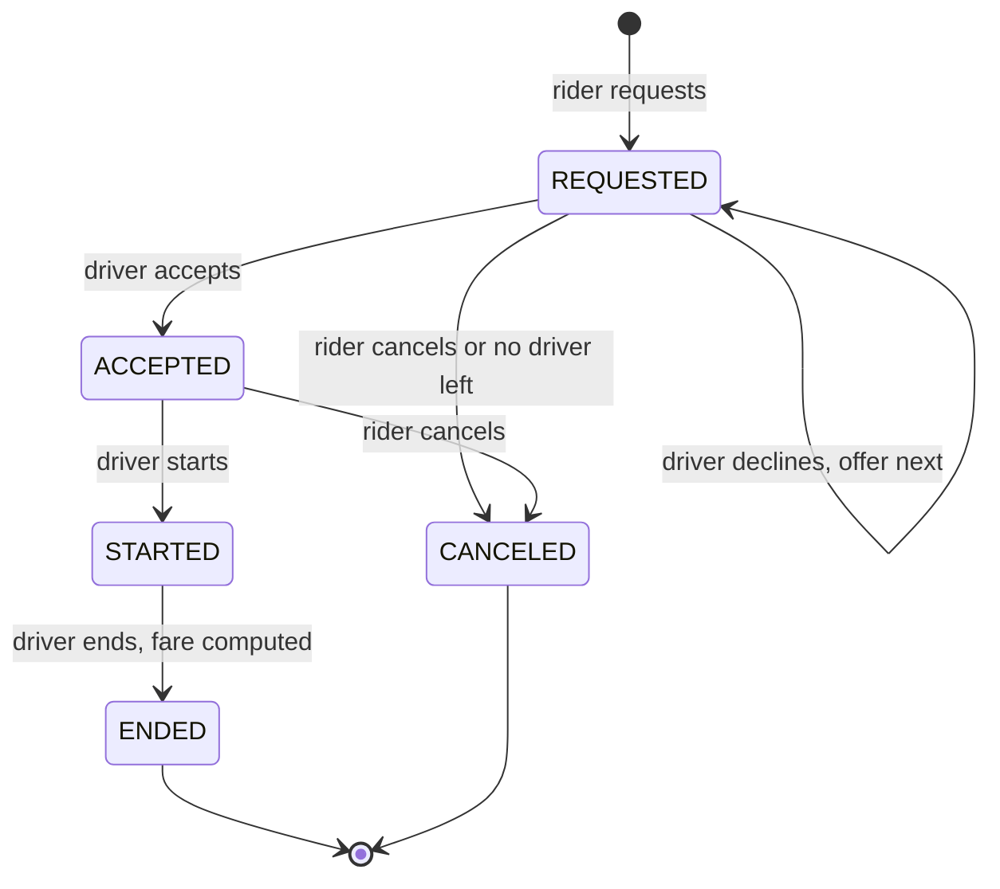

**Finding a driver** — including the case where every candidate declines:

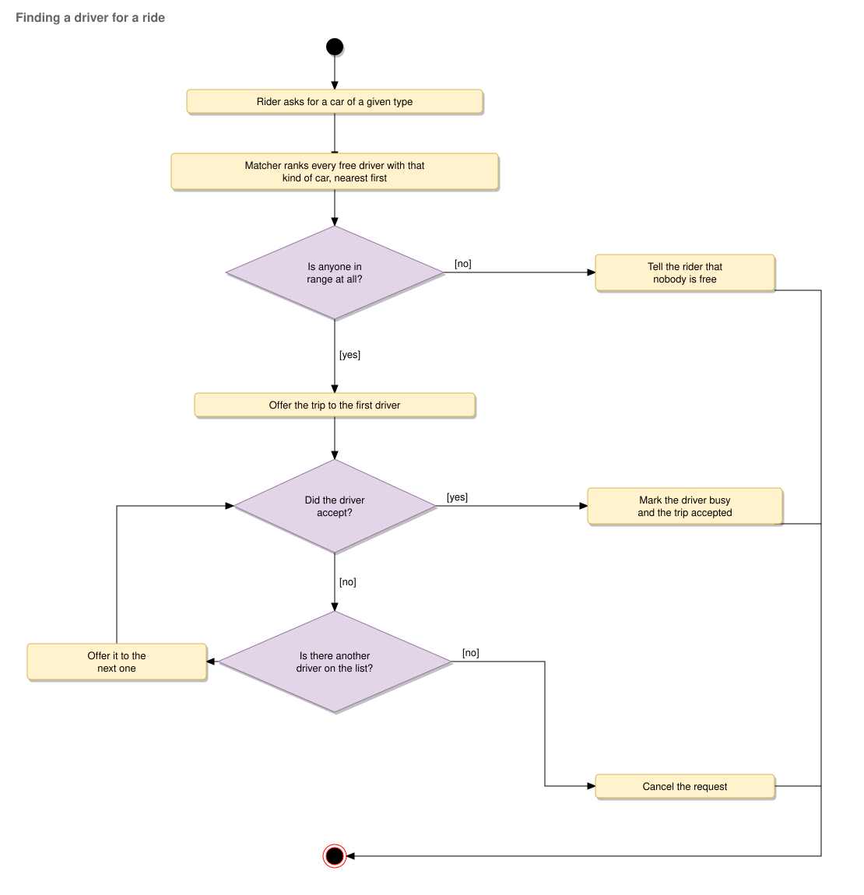
*Figure — Finding a driver: rank free drivers of the right type nearest first; offer to the first; on decline move to the next; cancel when nobody is left (course diagram)*

**Ending and charging a trip** — pricing is a single call no matter how many decorators wrap the rule:

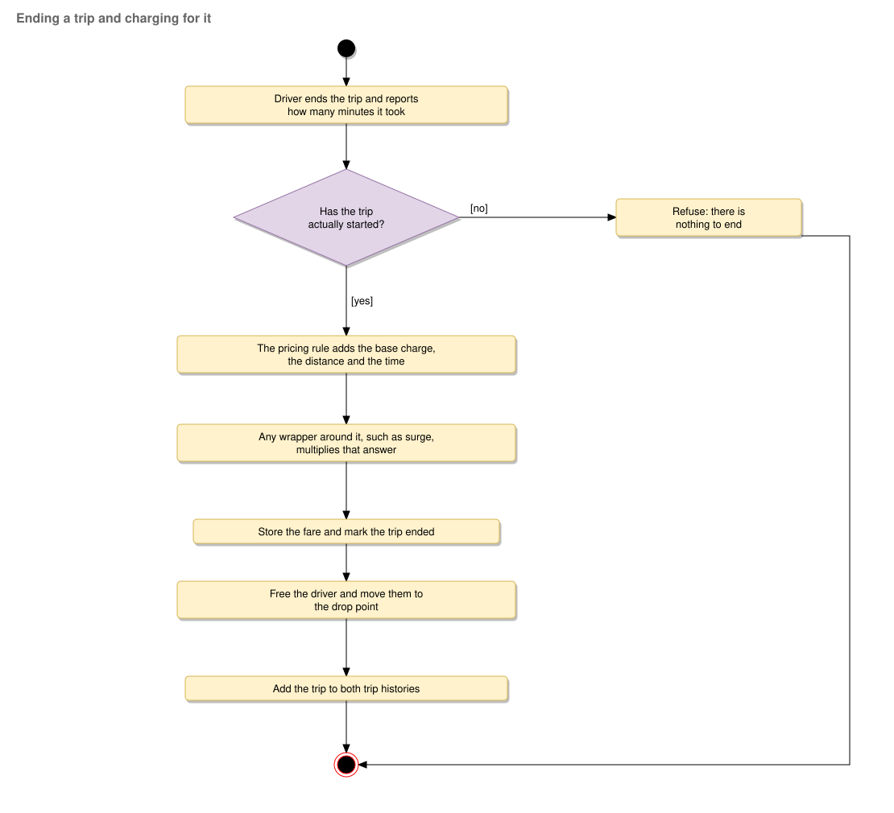
*Figure — Ending a trip: refuse if not started; otherwise the pricing rule computes base plus distance plus time, any surge wrapper multiplies it, and the trip is recorded (course diagram)*

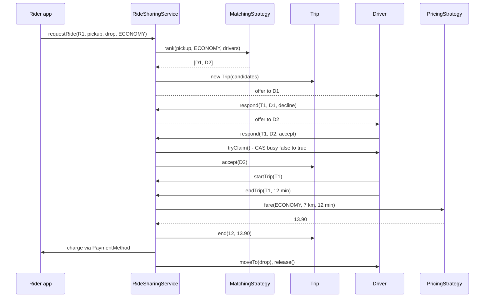

### Design decisions & patterns used

| Decision | Why | Alternative rejected |
|---|---|---|
| **Strategy** for matching | Cities rank differently (nearest, best-rated, least-earned-today). One class each. | Sorting logic inside the service. |
| Matcher returns a **ranked list**, stored on the trip | A decline just moves the cursor; no new city-wide search, and the system remembers who refused. | Returning one driver: every decline re-searches from scratch. |
| **Strategy** for pricing, **Decorator** for surge | Surge wraps *any* pricing rule (even future ones). Turning it off = removing the wrapper, not editing an `if`. Decorators stack (surge + airport fee + discount). | A `surgeMultiplier` field and `if (surge)` in the pricing code. |
| **State machine** via `TripStatus.canMoveTo` | One table says what is legal; every method checks it and returns `false` on an illegal move. No exceptions for normal refusals. | Scattered `if (status == …)` checks; or the full State pattern (one class per state). The State pattern is worth it when behaviour per state is large; here a transition table is enough. |
| **Atomic claim** of a driver (`AtomicBoolean.compareAndSet`) | Two trips racing for the same driver: exactly one wins, the other treats it as a decline. | Checking `isAvailable()` then setting busy: a check-then-act race. |
| Driver **moved to the drop point** at trip end | Otherwise the next match uses where they were this morning. | Forgetting (a real bug class). |
| **Observer** for trip events | Rider/driver apps, push notifications, analytics listen; the service doesn't know them. | Service calling the notification code directly. |
| Deterministic tie-breaks (by driver id) | Same input → same ranking → reproducible tests. | Unordered ties: flaky tests. |
| Money in **`BigDecimal`**, rounded `HALF_UP` to 2 places | Exact fares. (The course keeps money as whole cents and the surge multiplier as a whole-number percentage, 150 = ×1.5, so no floating point appears; `BigDecimal` is this book's equivalent.) | `double`. |

### Java implementation

```java
// File: code/lld/ch20/ridesharing/Model.java
package lld.ch20.ridesharing;

import java.math.BigDecimal;
import java.math.RoundingMode;
import java.util.ArrayList;
import java.util.Collections;
import java.util.List;
import java.util.concurrent.atomic.AtomicBoolean;

/** A point on a city grid. Distance is measured along streets (Manhattan distance), in km. */
record Location(int x, int y) {
    int distanceTo(Location o) { return Math.abs(x - o.x) + Math.abs(y - o.y); }
    @Override public String toString() { return "(" + x + "," + y + ")"; }
}

enum VehicleType { ECONOMY, PREMIUM, VAN }

record Vehicle(String plate, VehicleType type, int seats) {}

/** What riders and drivers share. Rating = running total + count (average is all anyone reads). */
abstract class Account {
    private final String id;
    private final String name;
    private final String phone;
    private int ratingTotal;
    private int ratingCount;
    private final List<String> finishedTrips = new ArrayList<>();

    Account(String id, String name, String phone) {
        this.id = id;
        this.name = name;
        this.phone = phone;
    }

    String id() { return id; }
    String name() { return name; }
    String phone() { return phone; }

    synchronized void addRating(int stars) {
        if (stars < 1 || stars > 5) throw new IllegalArgumentException("stars must be 1..5");
        ratingTotal += stars;
        ratingCount++;
    }

    synchronized BigDecimal rating() {
        return ratingCount == 0 ? BigDecimal.ZERO
                : BigDecimal.valueOf(ratingTotal).divide(BigDecimal.valueOf(ratingCount), 2, RoundingMode.HALF_UP);
    }

    synchronized void recordTrip(String tripId) { finishedTrips.add(tripId); }
    synchronized List<String> finishedTrips() { return Collections.unmodifiableList(new ArrayList<>(finishedTrips)); }
}

final class Rider extends Account {
    private final PaymentMethod paymentMethod;

    Rider(String id, String name, String phone, PaymentMethod paymentMethod) {
        super(id, name, phone);
        this.paymentMethod = paymentMethod;
    }

    PaymentMethod paymentMethod() { return paymentMethod; }
}

final class Driver extends Account {
    private final Vehicle vehicle;
    private volatile Location location;
    private volatile boolean online;
    private final AtomicBoolean busy = new AtomicBoolean(false);

    Driver(String id, String name, String phone, Vehicle vehicle, Location location) {
        super(id, name, phone);
        this.vehicle = vehicle;
        this.location = location;
    }

    Vehicle vehicle() { return vehicle; }
    Location location() { return location; }
    void moveTo(Location l) { this.location = l; }
    void setOnline(boolean online) { this.online = online; }
    boolean isAvailable() { return online && !busy.get(); }

    /** Atomic claim: of two trips racing for this driver, exactly one wins. */
    boolean tryClaim() { return online && busy.compareAndSet(false, true); }
    void release() { busy.set(false); }
}
```

```java
// File: code/lld/ch20/ridesharing/Trip.java
package lld.ch20.ridesharing;

import java.math.BigDecimal;
import java.util.EnumSet;
import java.util.List;
import java.util.Map;
import java.util.Set;

/** The trip lifecycle as a table of legal moves (a compact State machine). */
enum TripStatus {
    REQUESTED, ACCEPTED, STARTED, ENDED, CANCELED;

    private static final Map<TripStatus, Set<TripStatus>> NEXT = Map.of(
            REQUESTED, EnumSet.of(ACCEPTED, CANCELED),
            ACCEPTED, EnumSet.of(STARTED, CANCELED),
            STARTED, EnumSet.of(ENDED),
            ENDED, EnumSet.noneOf(TripStatus.class),
            CANCELED, EnumSet.noneOf(TripStatus.class));

    boolean canMoveTo(TripStatus next) { return NEXT.get(this).contains(next); }
}

/** One journey. Every action checks the status first; an illegal action returns false and changes nothing. */
final class Trip {
    private final String id;
    private final String riderId;
    private final Location pickup;
    private final Location drop;
    private final VehicleType type;
    private final List<Driver> candidates; // ranked once; a decline just moves the cursor
    private int cursor;
    private TripStatus status = TripStatus.REQUESTED;
    private String driverId;
    private int minutes;
    private BigDecimal fare;
    private boolean riderRated, driverRated;

    Trip(String id, String riderId, Location pickup, Location drop, VehicleType type, List<Driver> candidates) {
        this.id = id;
        this.riderId = riderId;
        this.pickup = pickup;
        this.drop = drop;
        this.type = type;
        this.candidates = List.copyOf(candidates);
    }

    private boolean move(TripStatus next) {
        if (!status.canMoveTo(next)) return false;
        status = next;
        return true;
    }

    /** The driver currently being offered this trip, or null if the list is exhausted. */
    synchronized Driver currentCandidate() { return cursor < candidates.size() ? candidates.get(cursor) : null; }
    synchronized Driver nextCandidate() { cursor++; return currentCandidate(); }

    synchronized boolean accept(String driverId) {
        if (status != TripStatus.REQUESTED) return false;
        this.driverId = driverId;
        return move(TripStatus.ACCEPTED);
    }

    synchronized boolean start() { return move(TripStatus.STARTED); }

    synchronized boolean end(int minutes, BigDecimal fare) {
        if (!move(TripStatus.ENDED)) return false;
        this.minutes = minutes;
        this.fare = fare;
        return true;
    }

    synchronized boolean cancel() { return move(TripStatus.CANCELED); }

    synchronized boolean markRiderRated() { if (status != TripStatus.ENDED || riderRated) return false; return riderRated = true; }
    synchronized boolean markDriverRated() { if (status != TripStatus.ENDED || driverRated) return false; return driverRated = true; }

    String id() { return id; }
    String riderId() { return riderId; }
    Location pickup() { return pickup; }
    Location drop() { return drop; }
    VehicleType type() { return type; }
    int distanceKm() { return pickup.distanceTo(drop); }
    synchronized TripStatus status() { return status; }
    synchronized String driverId() { return driverId; }
    synchronized int minutes() { return minutes; }
    synchronized BigDecimal fare() { return fare; }
}
```

```java
// File: code/lld/ch20/ridesharing/Strategies.java
package lld.ch20.ridesharing;

import java.math.BigDecimal;
import java.math.RoundingMode;
import java.util.Collection;
import java.util.Comparator;
import java.util.List;
import java.util.Map;

/* ---------------- Pricing: Strategy + Decorator ---------------- */

/** What a finished trip costs. */
interface PricingStrategy {
    BigDecimal fare(VehicleType type, int distanceKm, int minutes);
}

record RateCard(BigDecimal base, BigDecimal perKm, BigDecimal perMinute, BigDecimal minimum) {}

/** Base + distance + time, with a floor. One rate card per vehicle type. */
final class StandardPricing implements PricingStrategy {
    private final Map<VehicleType, RateCard> cards;

    StandardPricing(Map<VehicleType, RateCard> cards) { this.cards = Map.copyOf(cards); }

    @Override
    public BigDecimal fare(VehicleType type, int km, int minutes) {
        RateCard c = cards.get(type);
        BigDecimal raw = c.base()
                .add(c.perKm().multiply(BigDecimal.valueOf(km)))
                .add(c.perMinute().multiply(BigDecimal.valueOf(minutes)));
        return raw.max(c.minimum()).setScale(2, RoundingMode.HALF_UP);
    }
}

/** Decorator: wraps ANY pricing rule and multiplies its answer. Remove the wrapper to switch surge off. */
final class SurgePricing implements PricingStrategy {
    private final PricingStrategy inner;
    private final BigDecimal multiplier;

    SurgePricing(PricingStrategy inner, BigDecimal multiplier) {
        this.inner = inner;
        this.multiplier = multiplier;
    }

    @Override
    public BigDecimal fare(VehicleType type, int km, int minutes) {
        return inner.fare(type, km, minutes).multiply(multiplier).setScale(2, RoundingMode.HALF_UP);
    }
}

/* ---------------- Matching: Strategy ---------------- */

/** Returns a RANKED LIST (not one driver) so a decline just moves to the next name. */
interface MatchingStrategy {
    List<Driver> rank(Location pickup, VehicleType type, Collection<Driver> drivers);
}

final class NearestDriverMatcher implements MatchingStrategy {
    private final int maxRadiusKm;

    NearestDriverMatcher(int maxRadiusKm) { this.maxRadiusKm = maxRadiusKm; }

    @Override
    public List<Driver> rank(Location pickup, VehicleType type, Collection<Driver> drivers) {
        return drivers.stream()
                .filter(Driver::isAvailable)
                .filter(d -> d.vehicle().type() == type)
                .filter(d -> d.location().distanceTo(pickup) <= maxRadiusKm)
                .sorted(Comparator.comparingInt((Driver d) -> d.location().distanceTo(pickup))
                        .thenComparing(Driver::id))            // deterministic tie-break
                .toList();
    }
}

/** A second rule to show the swap: best-rated first, nearest as tie-break. */
final class BestRatedMatcher implements MatchingStrategy {
    private final NearestDriverMatcher nearby;

    BestRatedMatcher(int maxRadiusKm) { this.nearby = new NearestDriverMatcher(maxRadiusKm); }

    @Override
    public List<Driver> rank(Location pickup, VehicleType type, Collection<Driver> drivers) {
        return nearby.rank(pickup, type, drivers).stream()
                .sorted(Comparator.comparing(Driver::rating).reversed()
                        .thenComparingInt(d -> d.location().distanceTo(pickup)))
                .toList();
    }
}

/* ---------------- Payment: Strategy ---------------- */

record Receipt(boolean paid, String detail) {}

interface PaymentMethod {
    Receipt charge(BigDecimal amount);
}

final class CashPayment implements PaymentMethod {
    public Receipt charge(BigDecimal amount) { return new Receipt(true, "collect " + amount + " in cash"); }
}

final class WalletPayment implements PaymentMethod {
    private BigDecimal balance;

    WalletPayment(BigDecimal balance) { this.balance = balance; }

    public synchronized Receipt charge(BigDecimal amount) {
        if (balance.compareTo(amount) < 0) return new Receipt(false, "wallet has only " + balance);
        balance = balance.subtract(amount);
        return new Receipt(true, "wallet debited " + amount + ", left " + balance);
    }
}
```

```java
// File: code/lld/ch20/ridesharing/RideSharingService.java
package lld.ch20.ridesharing;

import java.math.BigDecimal;
import java.util.List;
import java.util.Map;
import java.util.concurrent.ConcurrentHashMap;
import java.util.concurrent.CopyOnWriteArrayList;
import java.util.concurrent.atomic.AtomicInteger;

/** Observer: rider/driver apps (push notifications) listen to trip events. */
interface TripListener {
    void onEvent(Trip trip, String event);
}

/** The class the apps talk to. Owns accounts and trips; holds the pricing and matching rules. */
final class RideSharingService {
    private final Map<String, Rider> riders = new ConcurrentHashMap<>();
    private final Map<String, Driver> drivers = new ConcurrentHashMap<>();
    private final Map<String, Trip> trips = new ConcurrentHashMap<>();
    private final List<TripListener> listeners = new CopyOnWriteArrayList<>();
    private final AtomicInteger ids = new AtomicInteger();
    private volatile PricingStrategy pricing;
    private volatile MatchingStrategy matching;

    RideSharingService(PricingStrategy pricing, MatchingStrategy matching) {
        this.pricing = pricing;
        this.matching = matching;
    }

    void setPricing(PricingStrategy p) { this.pricing = p; }   // e.g. wrap in SurgePricing at rush hour
    void setMatching(MatchingStrategy m) { this.matching = m; }
    void addListener(TripListener l) { listeners.add(l); }
    void addRider(Rider r) { riders.put(r.id(), r); }
    void addDriver(Driver d) { drivers.put(d.id(), d); }
    Driver driver(String id) { return drivers.get(id); }
    Rider rider(String id) { return riders.get(id); }

    /** Rank candidates once, then offer to the first. No candidates -> canceled immediately. */
    Trip requestRide(String riderId, Location pickup, Location drop, VehicleType type) {
        List<Driver> ranked = matching.rank(pickup, type, drivers.values());
        Trip trip = new Trip("T" + ids.incrementAndGet(), riderId, pickup, drop, type, ranked);
        trips.put(trip.id(), trip);
        publish(trip, "requested by " + riderId + ", candidates " + ranked.stream().map(Driver::id).toList());
        offerOrCancel(trip, trip.currentCandidate());
        return trip;
    }

    /** Driver answers the offer. A lost race for the driver counts as a decline. */
    boolean respond(String tripId, String driverId, boolean accepts) {
        Trip trip = trips.get(tripId);
        Driver current = trip.currentCandidate();
        if (current == null || !current.id().equals(driverId) || trip.status() != TripStatus.REQUESTED) return false;
        if (accepts && current.tryClaim()) {
            if (trip.accept(driverId)) {
                publish(trip, "accepted by " + driverId);
                return true;
            }
            current.release(); // trip was canceled meanwhile
            return false;
        }
        publish(trip, (accepts ? "could not claim " : "declined by ") + driverId);
        offerOrCancel(trip, trip.nextCandidate());
        return false;
    }

    boolean startTrip(String tripId) {
        Trip trip = trips.get(tripId);
        boolean ok = trip.start();
        publish(trip, ok ? "started" : "start refused in state " + trip.status());
        return ok;
    }

    /** Price -> store -> charge -> free the driver -> move driver to drop point -> history. */
    boolean endTrip(String tripId, int minutes) {
        Trip trip = trips.get(tripId);
        BigDecimal fare = pricing.fare(trip.type(), trip.distanceKm(), minutes);
        if (!trip.end(minutes, fare)) {
            publish(trip, "end refused in state " + trip.status());
            return false;
        }
        Rider rider = riders.get(trip.riderId());
        Receipt receipt = rider.paymentMethod().charge(fare);
        Driver d = drivers.get(trip.driverId());
        d.moveTo(trip.drop());       // easy to forget: the car is now at the drop point
        d.release();
        rider.recordTrip(trip.id());
        d.recordTrip(trip.id());
        publish(trip, "ended: " + trip.distanceKm() + " km, " + minutes + " min, fare " + fare
                + " (" + receipt.detail() + ")");
        return true;
    }

    /** Rider may cancel before the trip starts. */
    boolean cancelTrip(String tripId) {
        Trip trip = trips.get(tripId);
        if (!trip.cancel()) {
            publish(trip, "cancel refused in state " + trip.status());
            return false;
        }
        String driverId = trip.driverId(); // read AFTER cancel: no accept can happen any more
        if (driverId != null) drivers.get(driverId).release();
        publish(trip, "canceled by rider");
        return true;
    }

    boolean rateDriver(String tripId, int stars) {
        Trip t = trips.get(tripId);
        if (!t.markDriverRated()) return false;
        drivers.get(t.driverId()).addRating(stars);
        return true;
    }

    boolean rateRider(String tripId, int stars) {
        Trip t = trips.get(tripId);
        if (!t.markRiderRated()) return false;
        riders.get(t.riderId()).addRating(stars);
        return true;
    }

    private void offerOrCancel(Trip trip, Driver next) {
        if (next != null) {
            publish(trip, "offered to " + next.id());
        } else if (trip.cancel()) {
            publish(trip, "no driver left - canceled");
        }
    }

    private void publish(Trip trip, String event) {
        for (TripListener l : listeners) l.onEvent(trip, event);
    }
}
```

```java
// File: code/lld/ch20/ridesharing/Main.java
package lld.ch20.ridesharing;

import java.math.BigDecimal;
import java.util.Map;
import java.util.concurrent.CountDownLatch;
import java.util.concurrent.ExecutorService;
import java.util.concurrent.Executors;
import java.util.concurrent.TimeUnit;
import java.util.concurrent.atomic.AtomicInteger;

public class Main {
    public static void main(String[] args) throws Exception {
        StandardPricing standard = new StandardPricing(Map.of(
                VehicleType.ECONOMY, new RateCard(bd("2.50"), bd("1.20"), bd("0.25"), bd("5.00")),
                VehicleType.PREMIUM, new RateCard(bd("5.00"), bd("2.00"), bd("0.40"), bd("10.00")),
                VehicleType.VAN, new RateCard(bd("4.00"), bd("1.80"), bd("0.30"), bd("8.00"))));
        RideSharingService svc = new RideSharingService(standard, new NearestDriverMatcher(10));
        svc.addListener((trip, event) -> System.out.println("  [" + trip.id() + "] " + event));

        svc.addRider(new Rider("R1", "Riya", "+91-1", new WalletPayment(bd("50.00"))));
        svc.addRider(new Rider("R2", "Sam", "+91-2", new CashPayment()));
        Driver d1 = new Driver("D1", "Dev", "+91-3", new Vehicle("KA-01", VehicleType.ECONOMY, 4), new Location(0, 0));
        Driver d2 = new Driver("D2", "Ira", "+91-4", new Vehicle("KA-02", VehicleType.ECONOMY, 4), new Location(2, 1));
        Driver d3 = new Driver("D3", "Om", "+91-5", new Vehicle("KA-03", VehicleType.PREMIUM, 4), new Location(1, 1));
        Driver d4 = new Driver("D4", "Zoe", "+91-6", new Vehicle("KA-04", VehicleType.ECONOMY, 4), new Location(1, 0));
        for (Driver d : new Driver[]{d1, d2, d3, d4}) svc.addDriver(d);
        d1.setOnline(true);
        d2.setOnline(true);
        d3.setOnline(true); // d4 stays offline, so it is never offered anything

        System.out.println("== 1. Request, first driver declines, second accepts, full ride");
        Trip t1 = svc.requestRide("R1", new Location(1, 0), new Location(5, 3), VehicleType.ECONOMY);
        svc.respond(t1.id(), "D1", false);
        svc.respond(t1.id(), "D2", true);
        System.out.println("  D2 available while on trip? " + d2.isAvailable());
        svc.startTrip(t1.id());
        svc.startTrip(t1.id());                 // illegal: already started
        svc.endTrip(t1.id(), 12);               // 2.50 + 7*1.20 + 12*0.25 = 13.90
        System.out.println("  D2 now at " + d2.location() + ", available? " + d2.isAvailable());
        svc.rateDriver(t1.id(), 5);
        svc.rateRider(t1.id(), 4);
        System.out.println("  rate driver twice allowed? " + svc.rateDriver(t1.id(), 1)
                + "; D2 rating " + d2.rating() + ", R1 rating " + svc.rider("R1").rating());

        System.out.println("== 2. Surge: wrap the same rule in a decorator (x1.5)");
        svc.setPricing(new SurgePricing(standard, bd("1.5")));
        Trip t2 = svc.requestRide("R2", new Location(0, 1), new Location(0, 2), VehicleType.ECONOMY);
        svc.respond(t2.id(), "D1", true);
        svc.startTrip(t2.id());
        svc.endTrip(t2.id(), 3);                // max(2.50+1.20+0.75, 5.00) = 5.00, x1.5 = 7.50
        svc.setPricing(standard);

        System.out.println("== 3. Rider cancels after accept; cancel after start is refused");
        Trip t3 = svc.requestRide("R1", new Location(1, 1), new Location(3, 3), VehicleType.PREMIUM);
        svc.respond(t3.id(), "D3", true);
        svc.cancelTrip(t3.id());
        System.out.println("  D3 released? " + d3.isAvailable());
        Trip t4 = svc.requestRide("R1", new Location(1, 1), new Location(3, 3), VehicleType.PREMIUM);
        svc.respond(t4.id(), "D3", true);
        svc.startTrip(t4.id());
        svc.cancelTrip(t4.id());
        svc.endTrip(t4.id(), 10);               // 5 + 4*2 + 10*0.4 = 17.00 -> wallet has 36.10

        System.out.println("== 4. Nobody available for a VAN");
        svc.requestRide("R2", new Location(0, 0), new Location(1, 1), VehicleType.VAN);

        System.out.println("== 5. Race: 40 riders, 10 drivers, all accept at once");
        RideSharingService race = new RideSharingService(standard, new NearestDriverMatcher(100));
        for (int i = 0; i < 10; i++) {
            Driver d = new Driver("X" + i, "x", "-", new Vehicle("P" + i, VehicleType.ECONOMY, 4), new Location(i, 0));
            d.setOnline(true);
            race.addDriver(d);
        }
        for (int i = 0; i < 40; i++) race.addRider(new Rider("Q" + i, "q", "-", new CashPayment()));
        AtomicInteger accepted = new AtomicInteger();
        CountDownLatch go = new CountDownLatch(1);
        ExecutorService pool = Executors.newFixedThreadPool(16);
        for (int i = 0; i < 40; i++) {
            String rider = "Q" + i;
            pool.submit(() -> {
                go.await();
                Trip t = race.requestRide(rider, new Location(0, 0), new Location(3, 3), VehicleType.ECONOMY);
                for (Driver c = t.currentCandidate(); c != null && t.status() == TripStatus.REQUESTED;
                     c = t.currentCandidate()) {
                    if (race.respond(t.id(), c.id(), true)) { accepted.incrementAndGet(); break; }
                }
                return null;
            });
        }
        go.countDown();
        pool.shutdown();
        pool.awaitTermination(10, TimeUnit.SECONDS);
        System.out.println("  trips accepted = " + accepted.get() + " (never more than 10 drivers)");
    }

    private static BigDecimal bd(String s) { return new BigDecimal(s); }
}
```

**Walking through the code.**
- `TripStatus.NEXT` is the whole lifecycle in five lines; `Trip.move` refuses any move not in the table.
- `Trip` methods are `synchronized`: rider cancel and driver accept on the same trip cannot interleave.
- `RideSharingService.respond`: only the *current* candidate may answer. Accept first **claims the driver atomically**; if the claim fails (another trip got them), it's treated as a decline and the next candidate is offered.
- `endTrip` works in a fixed order: price, store the fare on the trip, charge the rider, relocate the driver to the drop-off point, and only then release them (so no matcher can see a free driver at the old position) — then it records history for both sides. The course lists the same steps; relocating the driver is the step most often skipped, and skipping it makes the next match use the driver's morning position.
- Ratings are allowed once per side and only for ENDED trips (`markDriverRated` / `markRiderRated`).

**Output:**

```text
== 1. Request, first driver declines, second accepts, full ride
  [T1] requested by R1, candidates [D1, D2]
  [T1] offered to D1
  [T1] declined by D1
  [T1] offered to D2
  [T1] accepted by D2
  D2 available while on trip? false
  [T1] started
  [T1] start refused in state STARTED
  [T1] ended: 7 km, 12 min, fare 13.90 (wallet debited 13.90, left 36.10)
  D2 now at (5,3), available? true
  rate driver twice allowed? false; D2 rating 5.00, R1 rating 4.00
== 2. Surge: wrap the same rule in a decorator (x1.5)
  [T2] requested by R2, candidates [D1, D2]
  [T2] offered to D1
  [T2] accepted by D1
  [T2] started
  [T2] ended: 1 km, 3 min, fare 7.50 (collect 7.50 in cash)
== 3. Rider cancels after accept; cancel after start is refused
  [T3] requested by R1, candidates [D3]
  [T3] offered to D3
  [T3] accepted by D3
  [T3] canceled by rider
  D3 released? true
  [T4] requested by R1, candidates [D3]
  [T4] offered to D3
  [T4] accepted by D3
  [T4] started
  [T4] cancel refused in state STARTED
  [T4] ended: 4 km, 10 min, fare 17.00 (wallet debited 17.00, left 19.10)
== 4. Nobody available for a VAN
  [T5] requested by R2, candidates []
  [T5] no driver left - canceled
== 5. Race: 40 riders, 10 drivers, all accept at once
  trips accepted = 10 (never more than 10 drivers)
```

Check the fares: trip 1 is 7 km and 12 min → 2.50 + 7 × 1.20 + 12 × 0.25 = **13.90**. Trip 2 is 1 km, 3 min → 4.45, below the 5.00 minimum → 5.00, then the surge decorator × 1.5 → **7.50**. The race test shows 40 concurrent requests against 10 drivers produce exactly 10 accepted trips — no driver is ever double-booked.

### Machine-coding variant: carpool / "offer and select a ride"

A different ride-sharing problem is popular in machine-coding rounds (it appears in the kumaransg/LLD collection as a Flipkart-style round). Here there is **no dispatcher**: users *offer* spare seats in their own vehicle on a route, and other users *select* a ride using a **selection strategy**.

Requirements (from the problem statement, in brief):
- `add_user`, `add_vehicle` (a user may own several vehicles).
- `offer_ride(user, origin, seats, vehicle, destination)` — **fails if that vehicle already has an active offered ride**.
- `select_ride(user, origin, destination, seats, strategy)` — seats is 1 or 2; strategy is **Most Vacant** (most free seats) or **Preferred Vehicle** (e.g. "Activa").
- `end_ride(ride)` and `print_ride_stats()` — rides *taken* and *offered* per user, counting only **ended** rides (an offered ride counts even if nobody took it).

Design: `Ride` with an atomic `book(user, seats)`; `RideSelectionStrategy` (Strategy) with `MostVacant` and `PreferredVehicle`; one `RideService` that filters active rides by route and seats, excludes the user's own offers, and lets the strategy choose. The demo replays the problem's sample test case and prints the expected answers (2(c), 2(b), none, 2(d), none; then the stats).

```java
// File: code/lld/ch20/carpool/Main.java
package lld.ch20.carpool;

import java.util.ArrayList;
import java.util.Comparator;
import java.util.LinkedHashMap;
import java.util.List;
import java.util.Map;
import java.util.Optional;

/**
 * Machine-coding variant (Flipkart-style "ride sharing / carpool"): users OFFER seats in their own
 * vehicle on a route; other users SELECT a ride with a selection strategy.
 */
public class Main {

    record User(String name, String gender, int age) {}

    record Vehicle(String owner, String model, String plate) {}

    enum RideStatus { ACTIVE, ENDED }

    static final class Ride {
        final String id;
        final User offeredBy;
        final Vehicle vehicle;
        final String origin, destination;
        private int availableSeats;
        private RideStatus status = RideStatus.ACTIVE;
        private final List<User> riders = new ArrayList<>();

        Ride(String id, User offeredBy, Vehicle vehicle, String origin, String destination, int seats) {
            this.id = id;
            this.offeredBy = offeredBy;
            this.vehicle = vehicle;
            this.origin = origin;
            this.destination = destination;
            this.availableSeats = seats;
        }

        synchronized int availableSeats() { return availableSeats; }

        /** Atomic check-and-book, so two users cannot take the last seat. */
        synchronized boolean book(User u, int seats) {
            if (status != RideStatus.ACTIVE || availableSeats < seats) return false;
            availableSeats -= seats;
            riders.add(u);
            return true;
        }

        @Override
        public String toString() {
            return id + " " + offeredBy.name() + " " + vehicle.model() + " " + origin + "->" + destination
                    + " seats=" + availableSeats;
        }
    }

    /** Strategy: pick one of the matching rides. */
    interface RideSelectionStrategy {
        Optional<Ride> select(List<Ride> candidates);
    }

    static final class MostVacant implements RideSelectionStrategy {
        public Optional<Ride> select(List<Ride> c) { return c.stream().max(Comparator.comparingInt(Ride::availableSeats)); }
    }

    record PreferredVehicle(String model) implements RideSelectionStrategy {
        public Optional<Ride> select(List<Ride> c) {
            return c.stream().filter(r -> r.vehicle.model().equalsIgnoreCase(model)).findFirst();
        }
    }

    static final class RideService {
        private final Map<String, User> users = new LinkedHashMap<>();
        private final Map<String, Vehicle> vehicles = new LinkedHashMap<>();   // plate -> vehicle
        private final Map<String, Ride> rides = new LinkedHashMap<>();
        private final Map<String, int[]> stats = new LinkedHashMap<>();        // name -> {taken, offered}
        private int nextId = 0;

        void addUser(String name, String gender, int age) {
            users.put(name, new User(name, gender, age));
            stats.put(name, new int[2]);
        }

        void addVehicle(String owner, String model, String plate) { vehicles.put(plate, new Vehicle(owner, model, plate)); }

        /** Fails if this vehicle already has an ACTIVE offered ride. */
        synchronized Optional<Ride> offerRide(String name, String origin, int seats, String plate, String destination) {
            Vehicle v = vehicles.get(plate);
            if (v == null || !v.owner().equals(name)) return Optional.empty();
            boolean busy = rides.values().stream()
                    .anyMatch(r -> r.vehicle.plate().equals(plate) && r.status == RideStatus.ACTIVE);
            if (busy) return Optional.empty();
            Ride r = new Ride("2" + (char) ('a' + nextId++), users.get(name), v, origin, destination, seats);
            rides.put(r.id, r);
            return Optional.of(r);
        }

        synchronized Optional<Ride> selectRide(String name, String origin, String destination, int seats,
                                               RideSelectionStrategy strategy) {
            if (seats < 1 || seats > 2) throw new IllegalArgumentException("a user may request 1 or 2 seats");
            List<Ride> matching = rides.values().stream()
                    .filter(r -> r.status == RideStatus.ACTIVE)
                    .filter(r -> r.origin.equals(origin) && r.destination.equals(destination))
                    .filter(r -> !r.offeredBy.name().equals(name))
                    .filter(r -> r.availableSeats() >= seats)
                    .toList();
            Optional<Ride> chosen = strategy.select(matching);
            chosen.ifPresent(r -> r.book(users.get(name), seats));
            return chosen;
        }

        synchronized void endRide(String rideId) {
            Ride r = rides.get(rideId);
            if (r == null || r.status == RideStatus.ENDED) return;
            r.status = RideStatus.ENDED;
            stats.get(r.offeredBy.name())[1]++;
            for (User u : r.riders) stats.get(u.name())[0]++;
        }

        void printRideStats() {
            stats.forEach((n, s) -> System.out.println("  " + n + ": " + s[0] + " Taken, " + s[1] + " Offered"));
        }
    }

    public static void main(String[] args) {
        RideService s = new RideService();
        s.addUser("Rohan", "M", 36);    s.addVehicle("Rohan", "Swift", "KA-01-12345");
        s.addUser("Shashank", "M", 29); s.addVehicle("Shashank", "Baleno", "TS-05-62395");
        s.addUser("Nandini", "F", 29);
        s.addUser("Shipra", "F", 27);   s.addVehicle("Shipra", "Polo", "KA-05-41491");
                                        s.addVehicle("Shipra", "Activa", "KA-12-12332");
        s.addUser("Gaurav", "M", 29);
        s.addUser("Rahul", "M", 35);    s.addVehicle("Rahul", "XUV", "KA-05-1234");

        System.out.println("== offer_ride");
        print(s.offerRide("Rohan", "Hyderabad", 1, "KA-01-12345", "Bangalore"));
        print(s.offerRide("Shipra", "Bangalore", 1, "KA-12-12332", "Mysore"));
        print(s.offerRide("Shipra", "Bangalore", 2, "KA-05-41491", "Mysore"));
        print(s.offerRide("Shashank", "Hyderabad", 2, "TS-05-62395", "Bangalore"));
        print(s.offerRide("Rahul", "Hyderabad", 5, "KA-05-1234", "Bangalore"));
        print(s.offerRide("Rohan", "Bangalore", 1, "KA-01-12345", "Pune")); // same vehicle still active

        System.out.println("== select_ride");
        print(s.selectRide("Nandini", "Bangalore", "Mysore", 1, new MostVacant()));
        print(s.selectRide("Gaurav", "Bangalore", "Mysore", 1, new PreferredVehicle("Activa")));
        print(s.selectRide("Shashank", "Mumbai", "Bangalore", 1, new MostVacant()));
        print(s.selectRide("Rohan", "Hyderabad", "Bangalore", 1, new PreferredVehicle("Baleno")));
        print(s.selectRide("Shashank", "Hyderabad", "Bangalore", 1, new PreferredVehicle("Polo")));

        System.out.println("== end_ride 2a..2d, then print_ride_stats");
        for (String id : List.of("2a", "2b", "2c", "2d")) s.endRide(id);
        s.printRideStats();
    }

    private static void print(Optional<Ride> r) {
        System.out.println("  " + r.map(Ride::toString).orElse("No rides found / request failed"));
    }
}
```

**Output:**

```text
== offer_ride
  2a Rohan Swift Hyderabad->Bangalore seats=1
  2b Shipra Activa Bangalore->Mysore seats=1
  2c Shipra Polo Bangalore->Mysore seats=2
  2d Shashank Baleno Hyderabad->Bangalore seats=2
  2e Rahul XUV Hyderabad->Bangalore seats=5
  No rides found / request failed
== select_ride
  2c Shipra Polo Bangalore->Mysore seats=1
  2b Shipra Activa Bangalore->Mysore seats=0
  No rides found / request failed
  2d Shashank Baleno Hyderabad->Bangalore seats=1
  No rides found / request failed
== end_ride 2a..2d, then print_ride_stats
  Rohan: 1 Taken, 1 Offered
  Shashank: 0 Taken, 1 Offered
  Nandini: 1 Taken, 0 Offered
  Shipra: 0 Taken, 2 Offered
  Gaurav: 1 Taken, 0 Offered
  Rahul: 0 Taken, 0 Offered
```

| | Uber-style (20.4 main design) | Carpool variant |
|---|---|---|
| Who supplies the ride | Professional drivers, online/offline | Any user, per offered ride |
| Who chooses | The system (matching strategy) offers to drivers | The rider picks with a selection strategy |
| Key pattern | Strategy + Decorator + state machine | Strategy (selection) |
| Key invariant | A driver is on at most one trip | A vehicle has at most one active offer; seats never go negative |

### Concurrency & edge cases

- **Double booking a driver:** prevented by `Driver.tryClaim()` (compare-and-set). Proven by the 40-riders/10-drivers race in the output.
- **Cancel vs accept race:** both go through `synchronized` `Trip` methods; if the rider cancels after the claim but before `accept`, `accept` fails and the driver is released.
- **Stale candidate list:** the list is computed once. A driver may go offline or be claimed later; `tryClaim` fails and we move on. A nearer driver who becomes free later is not noticed (real systems re-match periodically).
- **Offer timeouts:** a driver who never answers should be treated as a decline after N seconds (a `ScheduledExecutorService` task per offer).
- **No drivers at all:** trip canceled immediately (see trip T5).
- **Illegal transitions** (start twice, cancel after start, end before start): return `false`; state unchanged.
- **Wallet with insufficient balance:** `Receipt(paid=false)`; a real system would retry another method or record a debt on the rider's account.
- **Rating abuse:** one rating per side per trip; stars validated 1–5.

### Extensions & follow-up questions

- **"Rank by rating instead."** Swap `MatchingStrategy` (`BestRatedMatcher` is included) — one line at startup.
- **"Airport fee, promo code, tolls."** More decorators around the pricing rule: `new PromoDiscount(new AirportFee(new SurgePricing(standard, 1.5)))`.
- **"How is surge computed?"** From demand (open requests) vs supply (free drivers) per area and time window; the result feeds the multiplier. The pricing design doesn't change.
- **"Find nearby drivers fast in a real city."** A geospatial index: split the map into cells (geohash, Google S2 or Uber's H3 hexagons) and keep a map cell → drivers; search the pickup cell and its neighbours instead of all drivers.
- **"Shared rides (pool)."** Honest answer: this design assumes one rider per trip. The change starts at `Trip` (many riders, many stops) and a matcher that considers detours.
- **"Live tracking."** Drivers send location updates every few seconds; store the latest per driver and publish to the rider (pub-sub, see 20.6).
- **"Scheduled rides."** A request with a future time; a scheduler starts matching shortly before.

### Real-world example

Uber really does show riders a surge ("dynamic pricing") multiplier when demand exceeds supply in an area, and it sends a request to a nearby driver who has a short time to accept before it goes to someone else — the ranked-list-with-cursor idea. Uber open-sourced **H3**, a hierarchical hexagonal grid that its engineering blog describes as built for optimizing ride pricing and dispatch (for example, bucketing supply and demand per hexagon); the same cell idea answers "which drivers are near this point" without scanning the whole city. Ola, Lyft and Grab follow the same request → match → accept → trip → rate lifecycle.

### In the interview

**30-second answer:** "Two rules behind interfaces: `MatchingStrategy` returns a ranked list of free drivers with the right car, and `PricingStrategy` computes base + distance + time with a floor. Surge is a Decorator that wraps any pricing rule and multiplies it. The trip is a small state machine; every action checks the transition table and returns false if illegal. A decline moves a cursor along the stored ranking. Drivers are claimed with a compare-and-set so one driver can never get two trips."

**Tip:** name the two rules (matching and pricing) in your first minutes and say both go behind interfaces; that one sentence pre-answers most follow-ups. Then spend real time on surge: *wrapping* the pricing rule instead of adding a flag to it is what separates strong answers from weak ones.

**Plan (40 min):** clarify (5) → accounts, vehicle, location (5) → trip + state machine (8) → pricing + surge decorator (7) → matching list + decline flow (7) → concurrency (claim) (4) → extensions (4).

**Follow-ups with answers:**
- *"What happens when a driver declines?"* → Next driver in the stored ranked list; none left → cancel.
- *"Strategy vs Decorator here?"* → Strategy replaces the rule; Decorator wraps it and remains in the call path (it holds an `inner` of the same interface).
- *"Two riders get the same driver?"* → Impossible: atomic claim; the loser moves to its next candidate.

### Self-check

1. Why does the matcher return a list instead of one driver? → So a decline just moves to the next candidate without re-searching and remembers who refused.
2. What makes `SurgePricing` a Decorator? → It is a `PricingStrategy` that also wraps a second `PricingStrategy` and adjusts that one's result.
3. Can a rider cancel a STARTED trip? → No; `STARTED` can only move to `ENDED`.
4. Why update the driver's location to the drop-off when the trip ends? → Later matches must use their real position.
5. Which Java class makes the driver claim atomic? → `AtomicBoolean` (`compareAndSet(false, true)`).
6. In the carpool variant, when does `offer_ride` fail? → When the same vehicle already has an active offered ride.

### TL;DR

- **Strategy** ×3 (matching, pricing, payment) + **Decorator** (surge) + **state machine** (trip).
- Matcher returns a **ranked list**; the trip keeps a cursor; decline = next.
- **Atomic claim** of drivers prevents double booking; relocate the driver to the drop-off at trip end.
- Ratings = running total + count; `BigDecimal` fares with a minimum.
- Carpool variant: users offer seats; riders select with Most Vacant / Preferred Vehicle strategies.

---

## 20.5 Design a Logging Framework

### Problem & clarifying questions

**What it is.** A logging framework lets code write messages like "payment 991 authorised" with a **level** (how serious it is) and sends them to one or more **destinations** (console, file, a log server), in a chosen **format**. Everyday analogy: a company's internal mail room. Every department drops notes in; each note has an urgency stamp; the mail room decides, by department and urgency, which notes get copied to which inboxes and in what envelope.

Think Log4j 2, Logback or `java.util.logging`: this question asks you to design a small version of them.

| Question | Assumed answer |
|---|---|
| Levels? | TRACE < DEBUG < INFO < WARN < ERROR < FATAL (and OFF). |
| Per-module configuration? | Yes: loggers are named `app.payment`, `app.orders`… and form a **hierarchy** by dots. A child inherits its level from the nearest ancestor that sets one. |
| Destinations? | Console, file, in-memory (tests); pluggable. Each can have its own minimum level. |
| Formats? | Plain pattern and JSON; pluggable. |
| Propagation? | An event goes to the logger's own destinations and then **up** to its ancestors' destinations, unless that logger turns propagation (additivity) off. |
| Async? | Yes, optional: the application thread must not wait for disk I/O. |
| Thread-safe? | Yes: many threads log at once. |
| Config files, rolling files, remote shipping? | Out of scope (extensions). |

### Requirements

**Functional**
1. Log a message at a level; messages below the logger's effective level are dropped cheaply.
2. Loggers are obtained by name; the same name returns the same logger.
3. Loggers form a dot-separated hierarchy under a root; level is inherited when not set.
4. A logger has zero or more appenders (destinations). Each appender has a minimum level and a formatter.
5. Events propagate up to parent appenders unless additivity is off.
6. Formatters are pluggable (pattern, JSON).
7. Asynchronous appending is available without changing the appenders.
8. Exceptions can be attached to an event.
9. Expensive messages can be built lazily (only if the level is enabled).

**Non-functional:** very cheap when disabled; thread-safe; logging must never crash the application; testable (inject a clock).

### Use cases

Actors: **Developer code** (logs messages), **Operator** (configures levels, appenders, formats at startup or runtime), **Framework** (filters, formats, routes, writes).

Main use cases: *Log a message*, *Get a logger by name*, *Set a level for a subtree*, *Add a destination*, *Choose a format*, *Switch to async writing*, *Stop propagation for a subtree*.

### Core entities

| Class | Responsibility |
|---|---|
| `LogLevel` (enum) | Ordered severities; `isAtLeast(threshold)`. |
| `LogRecord` (record) | One immutable event: time, level, logger name, thread, message, error. |
| `Logger` | Named node in the hierarchy: parent, optional level, appenders, additivity; `log()` walks the chain upward. |
| `LogManager` | **Singleton** registry; `getLogger(name)` creates parents first and returns one instance per name; holds the clock. |
| `Appender` (interface) | A destination (sink). |
| `AbstractAppender` | **Template Method**: `append()` checks the appender's threshold and formats; subclasses only `write(line)`. |
| `ConsoleAppender`, `FileAppender`, `MemoryAppender` | Concrete sinks. |
| `AsyncAppender` | **Decorator**: wraps any appender with a bounded queue + one writer thread. |
| `Formatter` (interface) | **Strategy**: record → text. `PatternFormatter`, `JsonFormatter`. |

### Class diagram

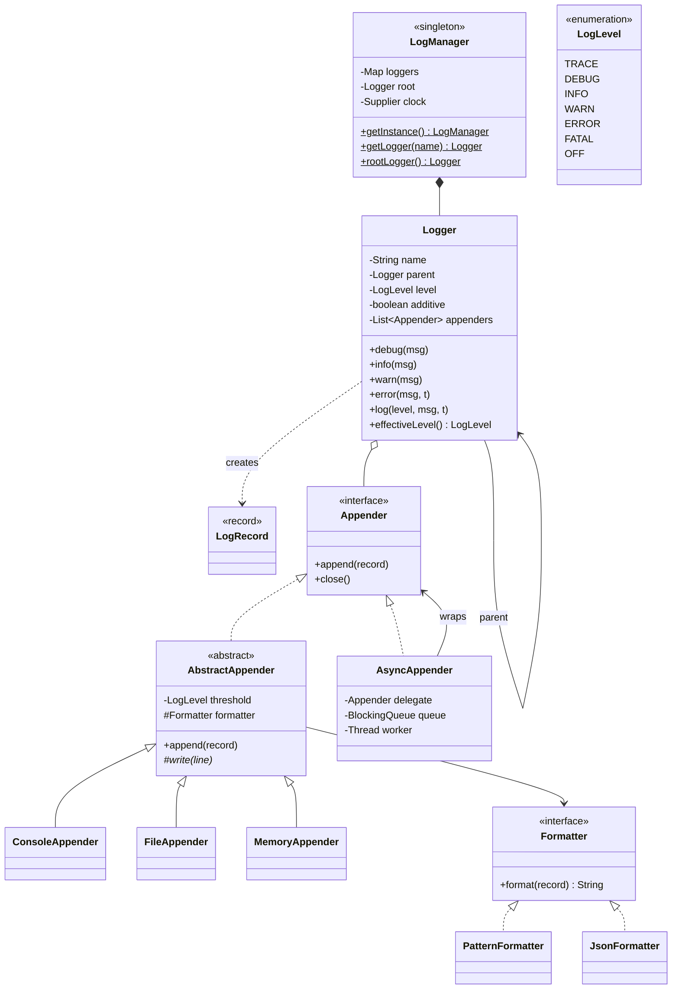

### Key flows

**Logging one event (Chain of Responsibility up the hierarchy).** *Chain of Responsibility* = a request is passed along a chain of handlers; each may handle it and/or pass it on. Here every logger in the chain hands the record to its own appenders and passes it to its parent, unless additivity is off.

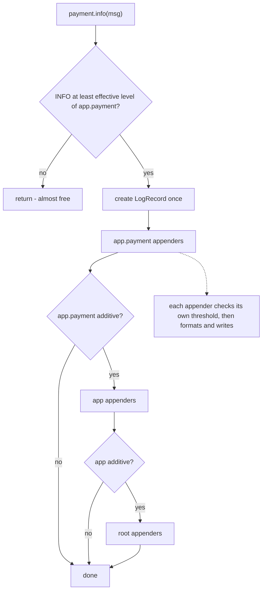

Note the Log4j/Logback rule we copy: the **level check happens once, at the logger where the call was made**. Parents' *levels* are not re-checked during propagation; only each **appender's own threshold** filters. That is why, in the demo, a DEBUG event from `app.payment` (set to DEBUG) still reaches the root console appender even though root is at INFO.

**Async appending.**

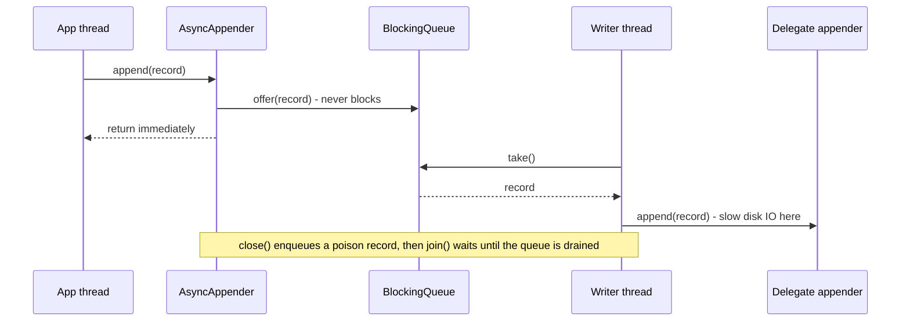

### Design decisions & patterns used

| Pattern / decision | Where | Why | Alternative rejected |
|---|---|---|---|
| **Chain of Responsibility** | `Logger.log` walks `this → parent → … → root`, stopping when `additive == false` | Configure destinations once near the root; subtrees can add or stop. | Every logger listing all its appenders explicitly. |
| **Singleton** | `LogManager` (initialization-on-demand holder) | One registry per process, so `getLogger("x")` always returns the same object. Holder idiom = lazy + thread-safe with no locking (the JVM initializes the nested class once). | Public static mutable map; double-checked locking (easy to get wrong). |
| **Static factory method** | `LogManager.getLogger(name)` | Hides creation, caches instances, creates parents first. | `new Logger(...)` by users (breaks the hierarchy). |
| **Strategy** | `Formatter` | Format is independent of destination: any sink × any format. | `JsonFileAppender`, `PatternFileAppender`, … (class explosion). |
| **Template Method** | `AbstractAppender.append` (final) → `write` | Threshold + formatting done once; sinks only write text. | Each sink re-implementing filtering. |
| **Decorator** | `AsyncAppender` wraps any `Appender` | Async becomes an add-on, not a rewrite of every sink. | `AsyncFileAppender`, `AsyncConsoleAppender`, … |
| Level check first; **lazy `Supplier<String>`** | `isEnabled`, `debug(Supplier)` | Disabled logging costs one comparison; expensive strings are never built. | Always building the message (a real performance bug). |
| Appender failures caught | `Logger.log` | Logging must never crash the app. | Letting exceptions escape. |
| Parent resolved **outside** `computeIfAbsent` | `LogManager.loggerFor` | A `ConcurrentHashMap` mapping function must not modify the same map (the JDK may throw `IllegalStateException: Recursive update`). | Recursive `computeIfAbsent`. |

**A note on another common "CoR logger" answer.** Many LLD write-ups model Chain of Responsibility as a chain of *level handlers* (`ErrorHandler → WarnHandler → InfoHandler → DebugHandler`), each writing messages of "its" level and passing others along. It works for a toy, but real frameworks put the chain on the **logger hierarchy** (as here) because that is what operators actually configure. If an interviewer expects the level-handler version, explain both and why the hierarchy is the one Log4j/Logback use.

### Java implementation

```java
// File: code/lld/ch20/logging/Core.java
package lld.ch20.logging;

import java.time.Instant;
import java.time.ZoneOffset;
import java.time.format.DateTimeFormatter;

/** Severity, lowest to highest. A logger set to WARN drops TRACE, DEBUG and INFO. */
enum LogLevel {
    TRACE, DEBUG, INFO, WARN, ERROR, FATAL, OFF;

    boolean isAtLeast(LogLevel threshold) { return this.ordinal() >= threshold.ordinal(); }
}

/** One immutable log event. Created once, passed along the chain, formatted by each appender. */
record LogRecord(Instant time, LogLevel level, String loggerName, String thread, String message, Throwable error) {}

/** Strategy: how a record becomes text. */
interface Formatter {
    String format(LogRecord r);
}

final class PatternFormatter implements Formatter {
    private static final DateTimeFormatter TIME =
            DateTimeFormatter.ofPattern("yyyy-MM-dd HH:mm:ss.SSS").withZone(ZoneOffset.UTC);

    @Override
    public String format(LogRecord r) {
        String line = String.format("%s %-5s [%s] %s - %s", TIME.format(r.time()), r.level(), r.thread(),
                r.loggerName(), r.message());
        return r.error() == null ? line : line + " | " + r.error();
    }
}

final class JsonFormatter implements Formatter {
    @Override
    public String format(LogRecord r) {
        return "{\"ts\":\"" + r.time() + "\",\"level\":\"" + r.level() + "\",\"logger\":\"" + r.loggerName()
                + "\",\"msg\":\"" + r.message().replace("\"", "\\\"") + "\"}";
    }
}
```

```java
// File: code/lld/ch20/logging/Appenders.java
package lld.ch20.logging;

import java.io.BufferedWriter;
import java.io.IOException;
import java.io.PrintStream;
import java.io.UncheckedIOException;
import java.nio.charset.StandardCharsets;
import java.nio.file.Files;
import java.nio.file.Path;
import java.nio.file.StandardOpenOption;
import java.util.ArrayList;
import java.util.List;
import java.util.concurrent.ArrayBlockingQueue;
import java.util.concurrent.BlockingQueue;
import java.util.concurrent.atomic.AtomicLong;

/** A sink (destination). Each has its own threshold and formatter. */
interface Appender extends AutoCloseable {
    void append(LogRecord r);

    @Override
    default void close() {}
}

/** Shared threshold + formatter handling, so concrete appenders only write text. */
abstract class AbstractAppender implements Appender {
    private final LogLevel threshold;
    protected final Formatter formatter;

    AbstractAppender(LogLevel threshold, Formatter formatter) {
        this.threshold = threshold;
        this.formatter = formatter;
    }

    @Override
    public final void append(LogRecord r) {
        if (r.level().isAtLeast(threshold)) write(formatter.format(r));
    }

    protected abstract void write(String line);
}

final class ConsoleAppender extends AbstractAppender {
    private final PrintStream out;

    ConsoleAppender(LogLevel threshold, Formatter f, PrintStream out) {
        super(threshold, f);
        this.out = out;
    }

    @Override
    protected synchronized void write(String line) { out.println(line); }
}

final class FileAppender extends AbstractAppender {
    private final BufferedWriter writer;

    FileAppender(LogLevel threshold, Formatter f, Path file) throws IOException {
        super(threshold, f);
        this.writer = Files.newBufferedWriter(file, StandardCharsets.UTF_8,
                StandardOpenOption.CREATE, StandardOpenOption.APPEND);
    }

    @Override
    protected synchronized void write(String line) {
        try {
            writer.write(line);
            writer.newLine();
        } catch (IOException e) {
            throw new UncheckedIOException(e);
        }
    }

    @Override
    public synchronized void close() {
        try {
            writer.close();
        } catch (IOException e) {
            throw new UncheckedIOException(e);
        }
    }
}

/** Keeps lines in memory - handy for tests. */
final class MemoryAppender extends AbstractAppender {
    private final List<String> lines = new ArrayList<>();

    MemoryAppender(LogLevel threshold, Formatter f) { super(threshold, f); }

    @Override
    protected synchronized void write(String line) { lines.add(line); }

    synchronized List<String> lines() { return List.copyOf(lines); }
}

/**
 * Decorator: makes ANY appender asynchronous. Callers only enqueue; one background thread writes.
 * Bounded queue: when full we drop and count (a common production choice), never block the app.
 */
final class AsyncAppender implements Appender {
    private static final LogRecord POISON = new LogRecord(null, LogLevel.OFF, "", "", "", null);
    private final Appender delegate;
    private final BlockingQueue<LogRecord> queue;
    private final Thread worker;
    private final AtomicLong dropped = new AtomicLong();
    private volatile boolean closed;

    AsyncAppender(Appender delegate, int capacity) {
        this.delegate = delegate;
        this.queue = new ArrayBlockingQueue<>(capacity);
        this.worker = Thread.ofPlatform().daemon().name("async-log-writer").start(this::drain);
    }

    @Override
    public void append(LogRecord r) {
        if (closed || !queue.offer(r)) dropped.incrementAndGet(); // full or closed: count it, never block
    }

    private void drain() {
        try {
            for (LogRecord r = queue.take(); r != POISON; r = queue.take()) {
                try {
                    delegate.append(r);
                } catch (RuntimeException e) {  // one bad write must not kill the writer thread
                    System.err.println("async appender: delegate failed: " + e);
                }
            }
        } catch (InterruptedException e) {
            Thread.currentThread().interrupt();
        }
    }

    long dropped() { return dropped.get(); }

    /** Flush everything already queued, then stop. Records appended after this point are counted as dropped. */
    @Override
    public void close() {
        if (closed) return;
        closed = true;
        try {
            queue.put(POISON);
            worker.join();
        } catch (InterruptedException e) {
            Thread.currentThread().interrupt();
        }
        delegate.close();
    }
}
```

```java
// File: code/lld/ch20/logging/Logger.java
package lld.ch20.logging;

import java.time.Instant;
import java.util.List;
import java.util.Map;
import java.util.concurrent.ConcurrentHashMap;
import java.util.concurrent.CopyOnWriteArrayList;
import java.util.function.Supplier;

/**
 * A named logger in a dot-separated hierarchy ("app.payment" -> "app" -> root).
 * An event is handed to this logger's appenders, then passed UP to the parent's appenders
 * (Chain of Responsibility) until a logger with additivity=false stops it.
 */
final class Logger {
    private final String name;
    private final Logger parent;
    private final LogManager manager;
    private volatile LogLevel level;                     // null = inherit from the nearest ancestor
    private volatile boolean additive = true;
    private final List<Appender> appenders = new CopyOnWriteArrayList<>();

    Logger(String name, Logger parent, LogManager manager) {
        this.name = name;
        this.parent = parent;
        this.manager = manager;
    }

    String name() { return name; }
    void setLevel(LogLevel level) { this.level = level; }
    void setAdditive(boolean additive) { this.additive = additive; }
    void addAppender(Appender a) { appenders.add(a); }

    LogLevel effectiveLevel() {
        for (Logger l = this; l != null; l = l.parent) if (l.level != null) return l.level;
        return LogLevel.INFO;
    }

    boolean isEnabled(LogLevel lvl) { return lvl != LogLevel.OFF && lvl.isAtLeast(effectiveLevel()); }

    void trace(String msg) { log(LogLevel.TRACE, msg, null); }
    void debug(String msg) { log(LogLevel.DEBUG, msg, null); }
    void info(String msg) { log(LogLevel.INFO, msg, null); }
    void warn(String msg) { log(LogLevel.WARN, msg, null); }
    void error(String msg, Throwable t) { log(LogLevel.ERROR, msg, t); }

    /** Lazy message: the (possibly expensive) string is only built if the level is enabled. */
    void debug(Supplier<String> msg) { if (isEnabled(LogLevel.DEBUG)) log(LogLevel.DEBUG, msg.get(), null); }

    void log(LogLevel lvl, String msg, Throwable t) {
        if (!isEnabled(lvl)) return;                     // cheap check first
        LogRecord r = new LogRecord(manager.now(), lvl, name, Thread.currentThread().getName(), msg, t);
        for (Logger l = this; l != null; l = l.parent) { // the chain
            for (Appender a : l.appenders) {
                try {
                    a.append(r);
                } catch (RuntimeException e) {
                    System.err.println("appender failed: " + e); // logging must never crash the app
                }
            }
            if (!l.additive) break;
        }
    }
}

/** Singleton registry of loggers (initialization-on-demand holder idiom: lazy and thread-safe). */
final class LogManager {
    private final Map<String, Logger> loggers = new ConcurrentHashMap<>();
    private final Logger root = new Logger("root", null, this);
    private volatile Supplier<Instant> clock = Instant::now;

    private LogManager() { root.setLevel(LogLevel.INFO); }

    private static final class Holder { static final LogManager INSTANCE = new LogManager(); }

    static LogManager getInstance() { return Holder.INSTANCE; }

    /** Factory method: same name -> same Logger instance; parents are created first. */
    static Logger getLogger(String name) { return getInstance().loggerFor(name); }

    static Logger rootLogger() { return getInstance().root; }

    private Logger loggerFor(String name) {
        if (name == null || name.isEmpty() || name.equals("root")) return root;
        Logger existing = loggers.get(name);
        if (existing != null) return existing;
        int dot = name.lastIndexOf('.');
        Logger parent = dot < 0 ? root : loggerFor(name.substring(0, dot)); // resolved OUTSIDE computeIfAbsent
        return loggers.computeIfAbsent(name, n -> new Logger(n, parent, this));
    }

    Instant now() { return clock.get(); }
    void setClock(Supplier<Instant> c) { this.clock = c; }
}
```

```java
// File: code/lld/ch20/logging/Main.java
package lld.ch20.logging;

import java.nio.file.Files;
import java.nio.file.Path;
import java.time.Instant;
import java.util.ArrayList;
import java.util.List;
import java.util.concurrent.atomic.AtomicInteger;

public class Main {
    public static void main(String[] args) throws Exception {
        LogManager.getInstance().setClock(() -> Instant.parse("2026-09-28T10:15:30.123Z")); // fixed for a stable demo

        Logger root = LogManager.rootLogger();
        root.setLevel(LogLevel.INFO);
        root.addAppender(new ConsoleAppender(LogLevel.TRACE, new PatternFormatter(), System.out));

        Logger payment = LogManager.getLogger("app.payment");
        Logger app = LogManager.getLogger("app");
        System.out.println("== 1. Same name -> same instance: " + (payment == LogManager.getLogger("app.payment")));

        System.out.println("== 2. Levels: 'app.payment' inherits INFO from root");
        payment.debug("hidden: DEBUG < INFO");
        payment.info("payment 991 authorised");
        payment.warn("retrying gateway call");

        System.out.println("== 3. Raise one subtree to DEBUG; extra JSON sink only for payments");
        MemoryAppender audit = new MemoryAppender(LogLevel.DEBUG, new JsonFormatter());
        payment.setLevel(LogLevel.DEBUG);
        payment.addAppender(audit);
        payment.debug(() -> "card token=" + "tok_" + 42 + " (built lazily)");
        LogManager.getLogger("app.orders").debug("still hidden: app.orders inherits INFO");
        System.out.println("  audit sink got: " + audit.lines());

        System.out.println("== 4. Additivity off: 'app.payment' events stop at its own appenders");
        payment.setAdditive(false);
        payment.error("refund failed", new IllegalStateException("gateway 503"));
        System.out.println("  (nothing printed on console above) audit sink now has " + audit.lines().size() + " lines");
        payment.setAdditive(true);

        System.out.println("== 5. File sink with its own threshold (WARN+)");
        Path file = Files.createTempFile("app", ".log");
        FileAppender fileSink = new FileAppender(LogLevel.WARN, new PatternFormatter(), file);
        app.addAppender(fileSink);
        app.info("info goes to console only");
        app.warn("disk 91% full");
        fileSink.close();
        System.out.println("  file contains: " + Files.readAllLines(file));
        Files.delete(file);

        System.out.println("== 6. Async appender: 4 threads x 1000 events, then close() flushes");
        CountingAppender counter = new CountingAppender();
        AsyncAppender async = new AsyncAppender(counter, 10_000);
        Logger worker = LogManager.getLogger("worker");
        worker.setAdditive(false);
        worker.addAppender(async);
        List<Thread> threads = new ArrayList<>();
        for (int t = 0; t < 4; t++) {
            int id = t;
            threads.add(Thread.ofPlatform().start(() -> {
                for (int i = 0; i < 1000; i++) worker.info("job " + id + "-" + i);
            }));
        }
        for (Thread t : threads) t.join();
        async.close();
        System.out.println("  written=" + counter.count.get() + " dropped=" + async.dropped()
                + " total=" + (counter.count.get() + async.dropped()));
    }

    static final class CountingAppender implements Appender {
        final AtomicInteger count = new AtomicInteger();
        public void append(LogRecord r) { count.incrementAndGet(); }
    }
}
```

**Walking through the code.**
- `Logger.effectiveLevel` walks up until a logger has a level; root always has one.
- `Logger.log` creates the `LogRecord` **once** and hands the same immutable object to every appender in the chain (safe to share across threads because it is a record with final fields).
- `AbstractAppender.append` is `final`; `ConsoleAppender` and `FileAppender` synchronize `write` so lines from different threads never interleave mid-line.
- `AsyncAppender` uses a bounded `ArrayBlockingQueue` and `offer` (non-blocking): when full, it drops and counts instead of stalling the application. `close()` puts a "poison pill" record so the writer drains everything before stopping. The no-loss promise is precise: every record appended **before** `close()` is either written or counted in `dropped` (queue full); a record appended after `close()` is counted as dropped too, so `written + dropped` always equals the number of `append` calls. A delegate that throws is caught inside the writer loop, so one bad write cannot kill the writer thread (which would otherwise leave `close()` waiting forever on a full queue).
- `LogManager` uses the holder idiom: `Holder.INSTANCE` is created the first time `getInstance()` runs, and the JVM guarantees that happens once.

**Output:**

```text
== 1. Same name -> same instance: true
== 2. Levels: 'app.payment' inherits INFO from root
2026-09-28 10:15:30.123 INFO  [main] app.payment - payment 991 authorised
2026-09-28 10:15:30.123 WARN  [main] app.payment - retrying gateway call
== 3. Raise one subtree to DEBUG; extra JSON sink only for payments
2026-09-28 10:15:30.123 DEBUG [main] app.payment - card token=tok_42 (built lazily)
  audit sink got: [{"ts":"2026-09-28T10:15:30.123Z","level":"DEBUG","logger":"app.payment","msg":"card token=tok_42 (built lazily)"}]
== 4. Additivity off: 'app.payment' events stop at its own appenders
  (nothing printed on console above) audit sink now has 2 lines
== 5. File sink with its own threshold (WARN+)
2026-09-28 10:15:30.123 INFO  [main] app - info goes to console only
2026-09-28 10:15:30.123 WARN  [main] app - disk 91% full
  file contains: [2026-09-28 10:15:30.123 WARN  [main] app - disk 91% full]
== 6. Async appender: 4 threads x 1000 events, then close() flushes
  written=4000 dropped=0 total=4000
```

Step 4: with additivity off, the ERROR went only to the JSON audit sink (2 lines now) and not to the console. Step 6: 4 threads × 1000 events all arrived (4000 written, 0 dropped), and `close()` flushed the queue.

### Concurrency & edge cases

- **Many threads logging:** appenders list is `CopyOnWriteArrayList` (reads without locking, rare writes); level and additivity are `volatile` so a runtime change is seen by all threads.
- **Interleaved output:** each sink's `write` is synchronized.
- **Async queue full:** drop-and-count (never block). Alternatives: block (back-pressure, can stall the app) or drop only low levels. Logback's `AsyncAppender`, by default, starts discarding TRACE/DEBUG/INFO events when the queue is 80% full.
- **Shutdown:** without `close()`, queued events are lost; register a JVM shutdown hook that closes appenders.
- **Recursive logging** (an appender that logs while appending) can loop forever; guard with a thread-local "already inside" flag.
- **Security:** never let log messages trigger lookups or code; Log4Shell (CVE-2021-44228, December 2021) came from Log4j 2 interpreting `${jndi:...}` inside logged strings. Treat messages as plain data.
- **Sensitive data:** mask card numbers, tokens and passwords before formatting.

### Extensions & follow-up questions

- **"Rolling files."** A `RollingFileAppender` with a `RollingPolicy` (size- or time-based) Strategy: when triggered, close, rename to `app-2026-09-28.log`, open a new file.
- **"Config file."** Parse XML/YAML/properties into calls on `LogManager` (set levels, attach appenders). Watching the file lets levels change at runtime.
- **"Filters."** A `Filter` chain per appender (e.g. only `app.payment`, only messages containing "refund") — another Chain of Responsibility.
- **"MDC / request id."** A thread-local map (Mapped Diagnostic Context) copied into each `LogRecord`, so every line of one request carries the same id.
- **"Ship logs to a server."** A network appender behind `AsyncAppender`, batching records.
- **"Structured logging."** Key-value fields in `LogRecord` rendered by `JsonFormatter` for tools like Elasticsearch/Kibana.

### Real-world example

**SLF4J** is a facade (the API your code calls); **Logback** and **Log4j 2** are implementations with exactly this model: dot-named loggers in a hierarchy, inherited levels, appenders with layouts/encoders, and *additivity*. Log4j 2's async loggers use the LMAX Disruptor (a lock-free ring buffer) to hand events to a background thread. `java.util.logging` has the same shape with different names: `Logger`, `Handler` (appender), `Formatter`, `Level`, and `setUseParentHandlers(false)` (additivity off).

### In the interview

**30-second answer:** "Loggers are named and form a dot hierarchy under a root managed by a singleton `LogManager`. A log call first checks the effective level (inherited), builds one immutable record, and passes it up the chain of loggers to their appenders — Chain of Responsibility — until additivity stops it. Each appender has its own threshold and a pluggable formatter (Strategy). `AsyncAppender` is a Decorator with a bounded queue and a writer thread, so the app never waits for disk."

**Plan (35 min):** clarify (5) → levels + record (4) → logger hierarchy + effective level (6) → appenders + formatters (6) → propagation/additivity (5) → singleton + thread safety (4) → async (5).

**Follow-ups with answers:**
- *"Why is a disabled debug call cheap?"* → One level comparison before any string is built; use `Supplier` for expensive messages.
- *"How do you make it thread-safe?"* → Immutable records, `CopyOnWriteArrayList` appenders, synchronized sinks, `ConcurrentHashMap` registry, volatile config.
- *"What happens to queued logs on crash?"* → They're lost unless flushed; close on shutdown, or accept the trade-off for speed.

### Self-check

1. `app.payment` has no level; `app` is WARN; root is INFO. What is `app.payment`'s effective level? → WARN (nearest ancestor that sets one).
2. What does additivity=false do? → Stops the event from reaching ancestor loggers' appenders.
3. Which pattern lets any appender become async? → Decorator (`AsyncAppender`).
4. Why is `Formatter` separate from `Appender`? → So formats and destinations combine freely (Strategy) without a class per combination.
5. Why resolve the parent before `computeIfAbsent`? → Modifying the same `ConcurrentHashMap` inside its mapping function is not allowed.
6. How does `close()` guarantee nothing queued is lost? → It enqueues a poison pill and joins the writer thread, which drains every record queued before the pill. (Records refused because the queue was full, or appended after `close()`, are not lost silently: they are counted as dropped.)

### TL;DR

- Named **logger hierarchy**; effective level inherited; one cheap level check up front.
- **Chain of Responsibility** up to the root, stopped by additivity; **Singleton** `LogManager`.
- **Strategy** formatters, **Template Method** appender base, **Decorator** async appender.
- Immutable `LogRecord`, thread-safe sinks, never crash the app, never block on a full queue.

---

## 20.6 Design a Pub-Sub System

### Problem & clarifying questions

**What it is.** Publish-subscribe (pub-sub) is a way for parts of a system to talk **without knowing each other**. A *publisher* sends a message to a named *topic* ("orders"); every *subscriber* of that topic receives it. Everyday analogy: a newspaper. The newspaper prints once; every subscriber gets a copy; the newspaper doesn't know or care who reads it, and new readers can sign up any time.

It is the **Observer pattern** turned into infrastructure: in Observer the subject calls its observers directly; in pub-sub a **broker** in the middle decouples them further (by topic, by time, and often by machine). We design a simplified, Kafka-like, in-process broker.

| Question | Assumed answer |
|---|---|
| Delivery to how many? | Every subscription gets every message (fan-out). |
| Order? | Messages are delivered in publish order per subscription. |
| Guarantee? | **At-least-once**: a message is only acknowledged after the subscriber processes it; failures are retried; duplicates are possible. |
| Slow subscriber? | Must not slow down the others or the publisher. |
| Keep messages after delivery? | Yes: an append-only log with **offsets**, so late subscribers can start from the beginning and anyone can replay. |
| Poison message (always fails)? | After N attempts, send to a dead-letter topic and move on. |
| Push or pull? | Push to a callback, driven by one dispatcher per subscription. |
| Partitions, consumer groups sharing work, persistence to disk, retention? | Out of scope (extensions). |

### Requirements

**Functional**
1. Create topics; publish a message (key, payload) to a topic; the broker assigns an **offset** (its position in the topic's log).
2. Subscribe to a topic with a subscription id and a callback, starting from EARLIEST (offset 0) or LATEST (only new messages).
3. Each subscription receives every message in order.
4. A message is acknowledged (offset committed) only after the callback returns normally.
5. Failures are retried with backoff; after `maxAttempts` the message goes to a dead-letter topic.
6. A subscription can **seek** to an offset to replay.
7. Unsubscribe; shut down cleanly.

**Non-functional:** thread-safe publish from many threads; subscribers isolated from each other; no busy-waiting (threads sleep until data arrives); ordering preserved.

### Use cases

Actors: **Publisher** (publishes), **Subscriber** (subscribes, processes, fails sometimes), **Operator** (creates topics, replays, inspects dead letters), **Broker** (stores, dispatches, retries).

### Core entities

| Class | Responsibility |
|---|---|
| `Message` (record) | topic, offset, key, payload. Immutable. |
| `Topic` | Append-only log (`List<Message>`), guarded by a `ReentrantLock` with a `Condition` "appended" to wake waiting dispatchers. |
| `Subscriber` (interface) | Callback `onMessage(Message)`; throwing = negative acknowledgement. |
| `Subscription` | One subscriber on one topic: committed offset (`AtomicLong`), its **own dispatcher thread**, retry and dead-letter logic, `seek`. |
| `StartFrom` (enum) | EARLIEST / LATEST. |
| `Broker` | Topic registry, `publish`, `subscribe`, `unsubscribe`, dead-letter topic, `awaitIdle` (tests), `close`. |

**The key idea: messages are not removed when consumed.** Each subscription only remembers *how far it has read* (its offset). That gives, almost for free: late subscribers from the beginning, replay (`seek`), and independent progress per subscriber. This is Kafka's model. (Classic queues such as RabbitMQ instead delete a message once it is acknowledged.)

### Class diagram

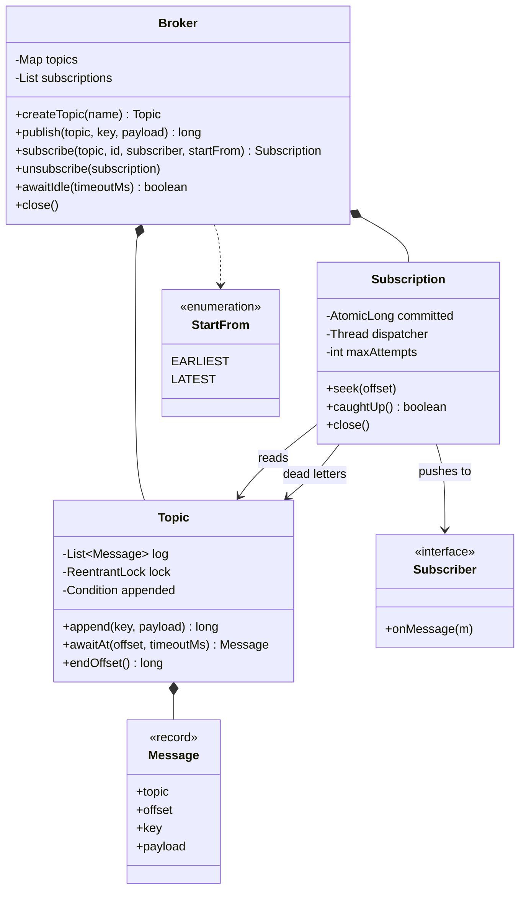

### Key flows

**Publish and fan-out.**

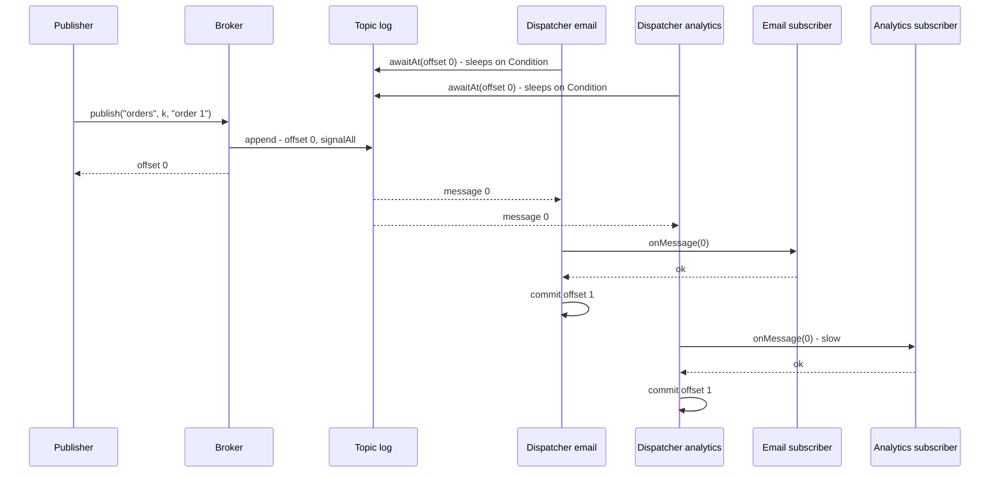

**One subscription's dispatcher loop (at-least-once with dead letters).**

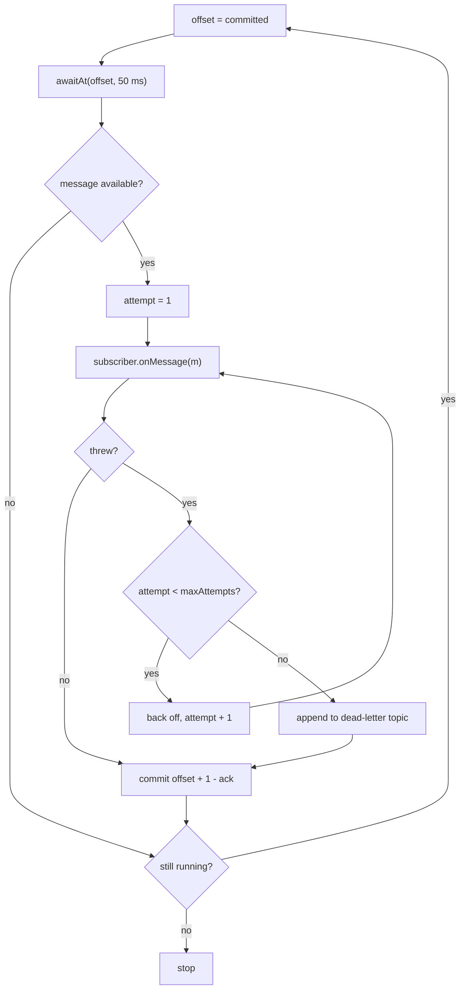

### Design decisions & patterns used

| Decision | Why | Alternative rejected |
|---|---|---|
| **Publish-Subscribe** (Observer via a broker) | Publishers and subscribers never reference each other; add a subscriber with zero publisher changes. | Publisher calling each consumer directly (tight coupling). |
| **Append-only log + offsets** | Replay, late joiners and independent progress. Ordering is the log order. | Deleting on delivery: no replay; per-subscriber copies: wasteful. |
| **One dispatcher thread per subscription** (virtual threads) | A slow subscriber only delays itself (see "analytics" in the output). Order within a subscription is kept because only one thread delivers for it. Virtual threads make one-thread-per-subscription cheap. | One shared thread delivering to all subscribers in turn (the slowest blocks everyone); a thread pool per message (loses ordering). |
| `Lock` + `Condition` wait, with timeout | No busy-waiting; the timeout lets the loop notice `close()` and `seek()`. `while` loop guards against spurious wake-ups. | `Thread.sleep` polling (wastes CPU and adds latency). |
| **Ack after processing** (commit after `onMessage`) | At-least-once: a crash mid-processing re-delivers. | Commit before processing = at-most-once (can lose messages). |
| **Dead-letter topic** | One poison message cannot block the subscription forever; operators can inspect and re-publish. | Infinite retries (the subscription is stuck). |
| `compareAndSet` when committing | If `seek()` ran during delivery, the seek wins instead of being overwritten. | Plain `set`. |

**Delivery guarantees in one table:**

| Guarantee | How | Risk |
|---|---|---|
| At-most-once | Commit offset, then process | A crash loses the message |
| **At-least-once** (ours) | Process, then commit | A crash or retry duplicates the message → make subscribers **idempotent** |
| Exactly-once | At-least-once + deduplication / transactions that commit output and offset together | Complex; Kafka offers it within its own transactions |

### Java implementation

```java
// File: code/lld/ch20/pubsub/Topic.java
package lld.ch20.pubsub;

import java.util.ArrayList;
import java.util.List;
import java.util.concurrent.TimeUnit;
import java.util.concurrent.locks.Condition;
import java.util.concurrent.locks.ReentrantLock;

/** One published message. The offset is its position in the topic's log. */
record Message(String topic, long offset, String key, String payload) {}

/**
 * An append-only log (like one Kafka partition). Messages are never removed by consumption:
 * each subscription just remembers how far it has read (its offset).
 */
final class Topic {
    private final String name;
    private final List<Message> log = new ArrayList<>();
    private final ReentrantLock lock = new ReentrantLock();
    private final Condition appended = lock.newCondition();

    Topic(String name) { this.name = name; }

    String name() { return name; }

    long append(String key, String payload) {
        lock.lock();
        try {
            long offset = log.size();
            log.add(new Message(name, offset, key, payload));
            appended.signalAll();                  // wake every waiting dispatcher
            return offset;
        } finally {
            lock.unlock();
        }
    }

    /** Returns the message at 'offset', waiting up to the timeout for it to be published. */
    Message awaitAt(long offset, long timeoutMs) throws InterruptedException {
        lock.lock();
        try {
            long nanos = TimeUnit.MILLISECONDS.toNanos(timeoutMs);
            while (offset >= log.size()) {         // loop: guards against spurious wake-ups
                if (nanos <= 0) return null;
                nanos = appended.awaitNanos(nanos);
            }
            return log.get((int) offset);
        } finally {
            lock.unlock();
        }
    }

    long endOffset() {
        lock.lock();
        try {
            return log.size();
        } finally {
            lock.unlock();
        }
    }
}
```

```java
// File: code/lld/ch20/pubsub/Broker.java
package lld.ch20.pubsub;

import java.util.List;
import java.util.Map;
import java.util.concurrent.ConcurrentHashMap;
import java.util.concurrent.CopyOnWriteArrayList;
import java.util.concurrent.atomic.AtomicLong;

/** Observer (push style): the broker calls this for every message, in order. Throw = negative ack. */
interface Subscriber {
    void onMessage(Message m) throws Exception;
}

enum StartFrom { EARLIEST, LATEST }

/**
 * One subscriber's view of one topic: its committed offset and its own dispatcher thread.
 * Delivery is at-least-once and in order. A message is acknowledged (offset committed)
 * only after onMessage returns normally. After maxAttempts failures it goes to the dead-letter topic.
 */
final class Subscription {
    private final String id;
    private final Topic topic;
    private final Subscriber subscriber;
    private final int maxAttempts;
    private final Topic deadLetters;
    private final AtomicLong committed;        // next offset to deliver
    private volatile boolean running = true;
    private final Thread dispatcher;

    Subscription(String id, Topic topic, Subscriber subscriber, long startOffset, int maxAttempts, Topic deadLetters) {
        this.id = id;
        this.topic = topic;
        this.subscriber = subscriber;
        this.maxAttempts = maxAttempts;
        this.deadLetters = deadLetters;
        this.committed = new AtomicLong(startOffset);
        this.dispatcher = Thread.ofVirtual().name("dispatch-" + id).start(this::loop);
    }

    private void loop() {
        try {
            while (running) {
                long offset = committed.get();
                Message m = topic.awaitAt(offset, 50);
                if (m == null) continue;              // timed out: re-check 'running' and any seek()
                deliver(m);
                committed.compareAndSet(offset, offset + 1); // ack; a concurrent seek() wins
            }
        } catch (InterruptedException e) {
            Thread.currentThread().interrupt();
        }
    }

    private void deliver(Message m) throws InterruptedException {
        for (int attempt = 1; attempt <= maxAttempts; attempt++) {
            try {
                subscriber.onMessage(m);
                return;
            } catch (Exception e) {
                if (attempt == maxAttempts) {
                    deadLetters.append(id, m.topic() + "@" + m.offset() + " " + m.payload() + " -> " + e.getMessage());
                    return;                           // skip it so one poison message cannot block the rest
                }
                Thread.sleep(5L * attempt);           // simple backoff
            }
        }
    }

    String id() { return id; }
    long committedOffset() { return committed.get(); }
    boolean caughtUp() { return committed.get() >= topic.endOffset(); }

    /** Replay (or skip) by moving the offset - possible because the log keeps every message. */
    void seek(long offset) { committed.set(offset); }

    void close() throws InterruptedException {
        running = false;
        dispatcher.join();
    }
}

/** Topic registry + publish + subscribe. Publishers never know who the subscribers are. */
final class Broker implements AutoCloseable {
    static final String DLQ = "__dead_letters";
    private final Map<String, Topic> topics = new ConcurrentHashMap<>();
    private final List<Subscription> subscriptions = new CopyOnWriteArrayList<>();

    Broker() { createTopic(DLQ); }

    Topic createTopic(String name) { return topics.computeIfAbsent(name, Topic::new); }

    long publish(String topic, String key, String payload) {
        Topic t = topics.get(topic);
        if (t == null) throw new IllegalArgumentException("no topic " + topic);
        return t.append(key, payload);
    }

    Subscription subscribe(String topic, String subscriptionId, Subscriber s, StartFrom from) {
        Topic t = topics.get(topic);
        if (t == null) throw new IllegalArgumentException("no topic " + topic);
        long start = from == StartFrom.EARLIEST ? 0 : t.endOffset();
        Subscription sub = new Subscription(subscriptionId, t, s, start, 3, topics.get(DLQ));
        subscriptions.add(sub);
        return sub;
    }

    void unsubscribe(Subscription s) throws InterruptedException {
        subscriptions.remove(s);
        s.close();
    }

    /** Test/shutdown helper: wait until every subscription has acknowledged everything. */
    boolean awaitIdle(long timeoutMs) throws InterruptedException {
        long deadline = System.currentTimeMillis() + timeoutMs;
        while (System.currentTimeMillis() < deadline) {
            if (subscriptions.stream().allMatch(Subscription::caughtUp)) return true;
            Thread.sleep(5);
        }
        return false;
    }

    Topic topic(String name) { return topics.get(name); }

    /** Stops every dispatcher. Declared without InterruptedException so try-with-resources stays simple. */
    @Override
    public void close() {
        try {
            for (Subscription s : subscriptions) s.close();
        } catch (InterruptedException e) {
            Thread.currentThread().interrupt();      // keep the interrupt visible to the caller
        }
    }
}
```

```java
// File: code/lld/ch20/pubsub/Main.java
package lld.ch20.pubsub;

import java.util.ArrayList;
import java.util.Collections;
import java.util.List;
import java.util.Set;
import java.util.concurrent.ConcurrentHashMap;

public class Main {

    /** Records what it received; can be told to fail some messages. */
    static final class RecordingSubscriber implements Subscriber {
        final List<String> received = Collections.synchronizedList(new ArrayList<>());
        final Set<Long> failOnceAt = ConcurrentHashMap.newKeySet();
        final String alwaysFailPayload;
        final long delayMs;

        RecordingSubscriber(long delayMs, String alwaysFailPayload) {
            this.delayMs = delayMs;
            this.alwaysFailPayload = alwaysFailPayload;
        }

        @Override
        public void onMessage(Message m) throws Exception {
            if (delayMs > 0) Thread.sleep(delayMs);
            if (m.payload().equals(alwaysFailPayload)) throw new Exception("cannot parse");
            if (failOnceAt.remove(m.offset())) throw new Exception("transient error");
            received.add(m.offset() + ":" + m.payload());
        }
    }

    public static void main(String[] args) throws Exception {
        try (Broker broker = new Broker()) {
            broker.createTopic("orders");

            RecordingSubscriber email = new RecordingSubscriber(0, null);
            RecordingSubscriber analytics = new RecordingSubscriber(20, null);       // slow consumer
            RecordingSubscriber inventory = new RecordingSubscriber(0, "BAD-JSON"); // poison message
            inventory.failOnceAt.add(1L);                                           // transient failure

            broker.subscribe("orders", "email", email, StartFrom.EARLIEST);
            broker.subscribe("orders", "analytics", analytics, StartFrom.EARLIEST);
            broker.subscribe("orders", "inventory", inventory, StartFrom.EARLIEST);

            System.out.println("== 1. Fan-out: every subscriber gets every message, in order");
            for (String p : List.of("order#1", "order#2", "BAD-JSON", "order#3"))
                broker.publish("orders", "k", p);
            System.out.println("  all acknowledged: " + broker.awaitIdle(5_000));
            System.out.println("  email     " + email.received);
            System.out.println("  analytics " + analytics.received + "  (slow, but did not slow the others)");
            System.out.println("  inventory " + inventory.received + "  (offset 1 retried, offset 2 dead-lettered)");
            Message dead = broker.topic(Broker.DLQ).awaitAt(0, 1_000);
            System.out.println("  dead letter: " + dead.payload());

            System.out.println("== 2. A late subscriber chooses where to start");
            RecordingSubscriber auditFromStart = new RecordingSubscriber(0, null);
            RecordingSubscriber onlyNew = new RecordingSubscriber(0, null);
            broker.subscribe("orders", "audit", auditFromStart, StartFrom.EARLIEST);
            Subscription latest = broker.subscribe("orders", "live", onlyNew, StartFrom.LATEST);
            broker.publish("orders", "k", "order#4");
            broker.awaitIdle(5_000);
            System.out.println("  audit (EARLIEST) " + auditFromStart.received);
            System.out.println("  live  (LATEST)   " + onlyNew.received);

            System.out.println("== 3. Replay: seek the 'live' subscription back to offset 3");
            latest.seek(3);
            broker.awaitIdle(5_000);
            System.out.println("  live after replay " + onlyNew.received + " (order#4 seen twice: at-least-once)");

            System.out.println("== 4. 4 publisher threads x 250 messages on a new topic");
            broker.createTopic("clicks");
            RecordingSubscriber clicks = new RecordingSubscriber(0, null);
            broker.subscribe("clicks", "counter", clicks, StartFrom.EARLIEST);
            List<Thread> pubs = new ArrayList<>();
            for (int t = 0; t < 4; t++) {
                int id = t;
                pubs.add(Thread.ofPlatform().start(() -> {
                    for (int i = 0; i < 250; i++) broker.publish("clicks", "user" + id, "c" + id + "-" + i);
                }));
            }
            for (Thread t : pubs) t.join();
            broker.awaitIdle(5_000);
            boolean inOrder = true;
            for (int i = 0; i < clicks.received.size(); i++)
                inOrder &= clicks.received.get(i).startsWith(i + ":");
            System.out.println("  received " + clicks.received.size() + " messages, offsets strictly in order: " + inOrder);
        }
    }
}
```

**Walking through the code.**
- `Topic.append` adds to the list and calls `signalAll()` under the lock, waking every dispatcher waiting for new data.
- `Topic.awaitAt` waits on the `Condition` in a `while` loop with `awaitNanos` (correct handling of spurious wake-ups and timeouts), then returns the message at that offset.
- `Subscription.loop` delivers one message at a time and only then commits `offset + 1` with `compareAndSet`, so a concurrent `seek()` wins.
- `deliver` retries with a small backoff and, after `maxAttempts`, writes a description to the `__dead_letters` topic and moves on.
- `Broker.awaitIdle` is a test helper: it waits until every subscription's committed offset has reached its topic's end.

**Output:**

```text
== 1. Fan-out: every subscriber gets every message, in order
  all acknowledged: true
  email     [0:order#1, 1:order#2, 2:BAD-JSON, 3:order#3]
  analytics [0:order#1, 1:order#2, 2:BAD-JSON, 3:order#3]  (slow, but did not slow the others)
  inventory [0:order#1, 1:order#2, 3:order#3]  (offset 1 retried, offset 2 dead-lettered)
  dead letter: orders@2 BAD-JSON -> cannot parse
== 2. A late subscriber chooses where to start
  audit (EARLIEST) [0:order#1, 1:order#2, 2:BAD-JSON, 3:order#3, 4:order#4]
  live  (LATEST)   [4:order#4]
== 3. Replay: seek the 'live' subscription back to offset 3
  live after replay [4:order#4, 3:order#3, 4:order#4] (order#4 seen twice: at-least-once)
== 4. 4 publisher threads x 250 messages on a new topic
  received 1000 messages, offsets strictly in order: true
```

Points to notice: the slow "analytics" subscriber still got everything, and the other subscribers were not delayed; "inventory" retried offset 1 (a transient failure) and dead-lettered offset 2 (the poison message) while still receiving offset 3; after `seek(3)`, "live" saw order#4 twice — that is what at-least-once means. The 1000 messages from 4 concurrent publishers got unique offsets and arrived strictly in order.

### Concurrency & edge cases

- **Concurrent publishers:** `append` is under a lock, so offsets are unique and gap-free.
- **Readers vs writers:** dispatchers only read under the same lock; messages are immutable records, safe to share.
- **Unbounded memory:** the log grows forever; real brokers apply **retention** (delete segments older than N days or beyond N bytes).
- **Slow subscriber falling far behind:** it is fine here (it just reads older offsets); with retention it may fall off the end — detect "offset out of range" and reset.
- **Subscriber that blocks forever:** add a processing timeout. It stalls only its own subscription, because every subscription has its own dispatcher thread. (One Java 21 caveat: a virtual thread that blocks while inside a `synchronized` block *pins* its carrier platform thread; many such subscribers could exhaust the carriers. Prefer `ReentrantLock` in subscriber code, or use platform threads.)
- **Duplicates:** at-least-once means subscribers must be idempotent (e.g. remember processed order ids).
- **Shutdown:** `close()` flips `running` and joins each dispatcher; the 50 ms wait timeout bounds how long that takes.

### Extensions & follow-up questions

- **"Consumer groups (share the work)."** Split a topic into **partitions** (several logs); messages with the same key go to the same partition (`hash(key) % n`), keeping per-key order. A group's members each own some partitions; the committed offset is per (group, partition). That is how Kafka scales consumers.
- **"Persist to disk."** Append to segment files; keep an index from offset to file position; store committed offsets in a special topic (Kafka uses `__consumer_offsets`).
- **"Pull instead of push."** Expose `poll(subscriptionId, maxMessages)` returning messages from the committed offset and a `commit(offset)` call; the client controls its pace (back-pressure for free).
- **"Message filtering."** Subscribe with a predicate (e.g. only `region = EU`); dispatcher skips non-matching messages but still commits them.
- **"Wildcard topics."** Subscribe to `orders.*`; the broker matches topic names on creation.
- **"Delayed messages / retry topics."** Re-publish failed messages to `orders.retry.5s` consumed after a delay, instead of blocking the dispatcher with sleeps.

### Real-world example

**Apache Kafka** is exactly this model at scale: topics split into partitions, each an append-only log; consumers track offsets; consumer groups share partitions; ordering is per partition; messages are retained by time/size rather than deleted on read, so services can replay history. **Google Cloud Pub/Sub** and **AWS SNS + SQS** offer managed fan-out with acknowledgements and **dead-letter** topics/queues. In Java, Spring Kafka's `DeadLetterPublishingRecoverer` publishes a record that keeps failing to a dead-letter topic after the retries are used up — the same idea as our `__dead_letters`. Inside one JVM, Guava's `EventBus` and Spring's `ApplicationEventPublisher` are simple in-process pub-sub.

### In the interview

**30-second answer:** "Each topic is an append-only log; publishing appends and returns an offset. Each subscription keeps a committed offset and has its own dispatcher thread that waits on a condition for new data, calls the subscriber, and commits only after success — at-least-once and in order. Failures retry with backoff, then go to a dead-letter topic. Because messages aren't deleted on read, late subscribers can start at the beginning and anyone can replay by seeking. To scale, split topics into partitions by key and let consumer groups share partitions."

**Plan (35–40 min):** clarify guarantees (5) → topic log + offsets (6) → subscription + dispatcher + ack (8) → retries + DLQ (5) → thread safety and ordering (6) → partitions / consumer groups / persistence (5).

**Follow-ups with answers:**
- *"How do you keep a slow consumer from slowing others?"* → One dispatcher per subscription; the log is shared, progress is not.
- *"Exactly-once?"* → Hard; at-least-once + idempotent consumers is the practical answer.
- *"How is order guaranteed?"* → One writer (the lock) assigns offsets; one dispatcher per subscription delivers in offset order. With partitions, order is per partition (per key).

### Self-check

1. What is an offset? → A message's position in a topic's log; subscribers remember the next one to read.
2. Commit before or after processing for at-least-once? → After.
3. Why a dead-letter topic? → So one poison message cannot block a subscription forever.
4. Why does replay work here but not in a delete-on-ack queue? → Messages stay in the log; seeking just moves the offset.
5. Why `while` around `Condition.await`? → Spurious wake-ups; re-check the condition every time.
6. How does Kafka let several consumers share one topic's work while keeping order per key? → Partitions by key hash; each partition consumed by one group member.

### TL;DR

- **Pub-sub = Observer through a broker**; publishers and subscribers are decoupled.
- **Append-only log + per-subscription offsets** → fan-out, late joiners, replay.
- **One dispatcher per subscription**: isolation + order; **ack after processing** = at-least-once.
- Retries with backoff, then **dead-letter**; subscribers must be **idempotent**.
- Scale: partitions by key, consumer groups, retention, persisted offsets (Kafka).

---

## 20.7 Design a Rate Limiter

### Problem & clarifying questions

**What it is.** A rate limiter decides whether a request is allowed right now, so one client can't overwhelm a service (by accident or on purpose). Everyday analogy: a turnstile that lets through at most 10 people per minute per ticket type. Over the limit, the answer is "come back in 6 seconds" — in HTTP, status **429 Too Many Requests** with a `Retry-After` header.

**Chapter 13 (§13.11) already built the concurrency core**: a thread-safe token bucket with `synchronized` and a lock-free CAS version, and compared the algorithms. This section is about the **object-oriented design around it**: pluggable algorithms, rules per API and per user tier, a factory, combined limits, and a clean decision object.

| Question | Assumed answer |
|---|---|
| Limit by what? | Per (user, API). Could also be IP or API key — same design, different key. |
| Different limits? | Yes: per API and per tier (FREE vs PREMIUM); a default for everything else. |
| Algorithms? | Token bucket, fixed window, sliding window log, sliding window counter — swappable per rule. |
| Several limits at once? | Yes, e.g. "2 per 10 s **and** 3 per minute" on `/login`. |
| Response? | Allowed / denied + remaining + retry-after. |
| Single process or distributed? | Single process here; distributed in extensions. |

### Requirements

**Functional**
1. `check(userId, api)` → `Decision(allowed, remaining, retryAfter)`.
2. Rules configured per API and tier; fallback default rule.
3. Each (user, api) gets its **own** limiter instance, created on first use.
4. Algorithms pluggable per rule.
5. Several rules can apply together (all must allow).

**Non-functional:** O(1) (or close) per check; thread-safe (exactly N allowed under any concurrency); injectable clock for tests; memory bounded (discussed).

### Use cases

Actors: **Client** (sends requests), **API gateway / filter** (calls `check` before the handler), **Operator** (configures rules and tiers).

### Core entities

| Class | Responsibility |
|---|---|
| `Limiter` (interface) | **Strategy**: `probe()` (would one more request pass? consumes nothing), `commit()` (record it), and `tryAcquire()` = both in one atomic step → `Decision`. One instance per key. |
| `TokenBucket`, `FixedWindow`, `SlidingWindowLog`, `SlidingWindowCounter` | The algorithms (each `synchronized`). |
| `CompositeLimiter` | **Composite**: allowed only if every child allows; probes all children, then commits to all, under one lock, so a denied request consumes nothing. |
| `Decision` (record) | allowed, remaining, retryAfter. |
| `LimitRule` (record) | algorithm, limit, window. |
| `Algorithm`, `Tier` (enums) | Configuration values. |
| `LimiterFactory` | **Simple Factory**: rule(s) → `Limiter` (single or composite). |
| `RateLimiterService` | **Facade**: resolves the user's tier and the API's rules, keeps one limiter per (user, api) in a `ConcurrentHashMap`. |
| `Ticker` | Injected time source (nanoseconds). |

### Class diagram

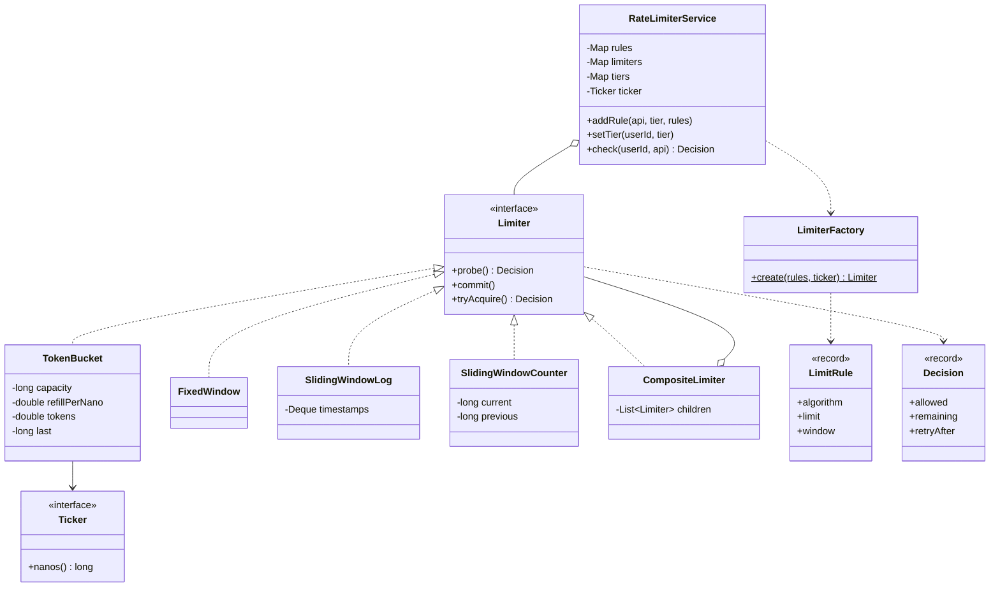

### Key flows

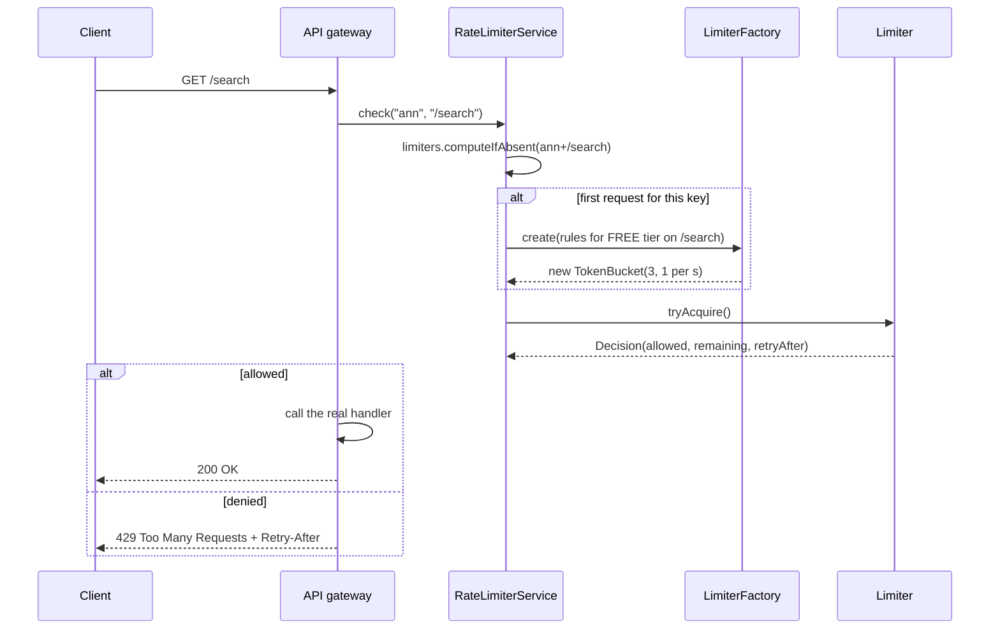

**The four algorithms side by side** (limit N per window W):

| Algorithm | State per key | Bursts | Accuracy | Notes |
|---|---|---|---|---|
| Token bucket | tokens, last refill time | Up to capacity | Good | Most common for APIs; smooth refill |
| Fixed window counter | window start, count | **Up to 2N across a boundary** | Poor at edges | Simplest |
| Sliding window log | one timestamp per allowed request | None beyond N | Exact | Memory O(N) per key |
| Sliding window counter | 2 counters | Approximate | Good | Estimate = previous × overlap + current |
| (Leaky bucket) | a queue | Smooths output to a constant rate | — | Traffic shaping; not implemented here |

### Design decisions & patterns used

| Decision | Why | Alternative rejected |
|---|---|---|
| **Strategy** (`Limiter`) | Algorithms differ in accuracy/memory; pick per rule. New algorithm = new class. | `switch` on algorithm inside `check`. |
| **Simple Factory** (`LimiterFactory`) | One place turns config into objects; service never names concrete classes. | `new TokenBucket(...)` in the service. |
| **Composite** (`CompositeLimiter`) | "10/s and 1000/day" is just a limiter made of limiters; callers don't know. **Check all, then commit all**, so a request denied by one child never uses up a slot in another. | Special-casing multiple rules in the service; or calling each child's `tryAcquire` in turn (a later denial would leave earlier children charged for a request that never ran). |
| **Facade** (`RateLimiterService`) | Gateway code asks one question. | Gateway juggling tiers, rules and limiters. |
| **One limiter per key via `computeIfAbsent`** | Exactly one limiter per (user, api), even when the first two requests race. | `get` then `put` (two limiters could be created and one's counts lost). |
| `Decision` with `remaining` and `retryAfter` | Maps directly to HTTP headers (`X-RateLimit-Remaining`, `Retry-After`). | `boolean`. |
| Injected `Ticker` | Tests move time instantly (the demo never sleeps). | `System.nanoTime()` inside algorithms. |
| Each algorithm `synchronized`; `tryAcquire` = `probe` + `commit` under the limiter's lock | Refill + check + take must be one atomic step (see §13.11 for the lock-free version). | Unsynchronized fields (two threads take the last token). |

### Java implementation

```java
// File: code/lld/ch20/ratelimiter/Limiters.java
package lld.ch20.ratelimiter;

import java.time.Duration;
import java.util.ArrayDeque;
import java.util.Deque;
import java.util.List;

/** Where time comes from (nanoseconds). Injected so tests do not sleep. */
interface Ticker { long nanos(); }

/** The answer to one request: allowed or not, what is left, and when to retry (HTTP 429 Retry-After). */
record Decision(boolean allowed, long remaining, Duration retryAfter) {
    static Decision allow(long remaining) { return new Decision(true, remaining, Duration.ZERO); }
    static Decision deny(Duration retryAfter) { return new Decision(false, 0, retryAfter); }
}

/**
 * Strategy: one algorithm, one instance per key (user, API key, IP...). Must be thread-safe.
 * Two-phase so that limits can be combined without side effects:
 * probe() answers "would one more request be allowed now?" WITHOUT using up anything,
 * commit() records the request. Both must be called while holding this object's lock.
 */
interface Limiter {
    Decision probe();

    void commit();

    /** Check and take in ONE atomic step (probe + commit under this limiter's lock). */
    default Decision tryAcquire() {
        synchronized (this) {
            Decision d = probe();
            if (d.allowed()) commit();
            return d;
        }
    }
}

/** Token bucket: bursts up to 'capacity', refills at 'perSecond'. Lazy refill, no background thread. */
final class TokenBucket implements Limiter {
    private final long capacity;
    private final double refillPerNano;
    private final Ticker ticker;
    private double tokens;
    private long last;

    TokenBucket(long capacity, double perSecond, Ticker ticker) {
        this.capacity = capacity;
        this.refillPerNano = perSecond / 1e9;
        this.ticker = ticker;
        this.tokens = capacity;
        this.last = ticker.nanos();
    }

    @Override
    public synchronized Decision probe() {
        long now = ticker.nanos();
        tokens = Math.min(capacity, tokens + (now - last) * refillPerNano); // refilling is safe to do early
        last = now;
        if (tokens >= 1) return Decision.allow((long) (tokens - 1));
        long waitNanos = refillPerNano == 0 ? Long.MAX_VALUE : (long) Math.ceil((1 - tokens) / refillPerNano);
        return Decision.deny(Duration.ofNanos(waitNanos));
    }

    @Override
    public synchronized void commit() { tokens -= 1; }
}

/** Fixed window counter: simplest; allows up to 2x the limit across a window boundary. */
final class FixedWindow implements Limiter {
    private final long limit;
    private final long windowNanos;
    private final Ticker ticker;
    private long windowStart;
    private long count;

    FixedWindow(long limit, Duration window, Ticker ticker) {
        this.limit = limit;
        this.windowNanos = window.toNanos();
        this.ticker = ticker;
    }

    @Override
    public synchronized Decision probe() {
        long now = ticker.nanos();
        long currentWindow = now - Math.floorMod(now, windowNanos);
        if (currentWindow != windowStart) {
            windowStart = currentWindow;
            count = 0;
        }
        if (count < limit) return Decision.allow(limit - count - 1);
        return Decision.deny(Duration.ofNanos(windowStart + windowNanos - now));
    }

    @Override
    public synchronized void commit() { count++; }
}

/** Sliding window log: exact, but stores one timestamp per allowed request. */
final class SlidingWindowLog implements Limiter {
    private final long limit;
    private final long windowNanos;
    private final Ticker ticker;
    private final Deque<Long> log = new ArrayDeque<>();
    private long probedAt;                        // commit() records the time the probe saw

    SlidingWindowLog(long limit, Duration window, Ticker ticker) {
        this.limit = limit;
        this.windowNanos = window.toNanos();
        this.ticker = ticker;
    }

    @Override
    public synchronized Decision probe() {
        long now = ticker.nanos();
        probedAt = now;
        while (!log.isEmpty() && log.peekFirst() <= now - windowNanos) log.pollFirst();
        if (log.size() < limit) return Decision.allow(limit - log.size() - 1);
        return Decision.deny(Duration.ofNanos(log.peekFirst() + windowNanos - now));
    }

    @Override
    public synchronized void commit() { log.addLast(probedAt); }
}

/** Sliding window counter: two counters, weights the previous window by how much of it still overlaps. */
final class SlidingWindowCounter implements Limiter {
    private final long limit;
    private final long windowNanos;
    private final Ticker ticker;
    private long currentStart;
    private long current, previous;

    SlidingWindowCounter(long limit, Duration window, Ticker ticker) {
        this.limit = limit;
        this.windowNanos = window.toNanos();
        this.ticker = ticker;
    }

    @Override
    public synchronized Decision probe() {
        long now = ticker.nanos();
        long start = now - Math.floorMod(now, windowNanos);
        if (start != currentStart) {
            previous = (start - currentStart == windowNanos) ? current : 0; // older than one window: forget it
            current = 0;
            currentStart = start;
        }
        double overlap = 1.0 - (double) (now - currentStart) / windowNanos;
        double estimate = previous * overlap + current;
        if (estimate + 1 <= limit) return Decision.allow((long) (limit - estimate - 1));
        return Decision.deny(Duration.ofNanos(currentStart + windowNanos - now));
    }

    @Override
    public synchronized void commit() { current++; }
}

/**
 * Composite: allowed only if EVERY child allows (e.g. 10/second AND 1000/day).
 * Check-all-then-commit under one lock: a request that ANY child denies uses up NOTHING,
 * so a denied request can never eat a slot in an earlier child.
 * The children are created for this composite only (by LimiterFactory) and never shared,
 * so holding the composite's lock is enough to make probe-all + commit-all atomic.
 */
final class CompositeLimiter implements Limiter {
    private final List<Limiter> children;

    CompositeLimiter(List<Limiter> children) { this.children = List.copyOf(children); }

    @Override
    public synchronized Decision probe() {
        long remaining = Long.MAX_VALUE;
        for (Limiter l : children) {
            Decision d;
            synchronized (l) { d = l.probe(); }
            if (!d.allowed()) return d;           // first denial wins; nothing has been consumed
            remaining = Math.min(remaining, d.remaining());
        }
        return Decision.allow(remaining);
    }

    @Override
    public synchronized void commit() {
        for (Limiter l : children) synchronized (l) { l.commit(); }
    }
}
```

```java
// File: code/lld/ch20/ratelimiter/RateLimiterService.java
package lld.ch20.ratelimiter;

import java.time.Duration;
import java.util.List;
import java.util.Map;
import java.util.concurrent.ConcurrentHashMap;

enum Tier { FREE, PREMIUM }

enum Algorithm { TOKEN_BUCKET, FIXED_WINDOW, SLIDING_LOG, SLIDING_COUNTER }

/** Configuration: which algorithm and how many requests per window (token bucket: burst = limit). */
record LimitRule(Algorithm algorithm, long limit, Duration window) {}

/** Factory: turns a rule into a fresh Limiter object. The only place that knows the concrete classes. */
final class LimiterFactory {
    private LimiterFactory() {}

    static Limiter create(List<LimitRule> rules, Ticker ticker) {
        if (rules.size() == 1) return create(rules.get(0), ticker);
        return new CompositeLimiter(rules.stream().map(r -> create(r, ticker)).toList());
    }

    static Limiter create(LimitRule r, Ticker ticker) {
        return switch (r.algorithm()) {
            case TOKEN_BUCKET -> new TokenBucket(r.limit(), r.limit() / (r.window().toNanos() / 1e9), ticker);
            case FIXED_WINDOW -> new FixedWindow(r.limit(), r.window(), ticker);
            case SLIDING_LOG -> new SlidingWindowLog(r.limit(), r.window(), ticker);
            case SLIDING_COUNTER -> new SlidingWindowCounter(r.limit(), r.window(), ticker);
        };
    }
}

/** Facade used by an API gateway / servlet filter: "may user U call API A right now?" */
final class RateLimiterService {
    private record Key(String userId, String api) {}

    private final Map<String, Map<Tier, List<LimitRule>>> rules = new ConcurrentHashMap<>();
    private final List<LimitRule> defaultRules;
    private final Map<Key, Limiter> limiters = new ConcurrentHashMap<>();
    private final Map<String, Tier> tiers = new ConcurrentHashMap<>();
    private final Ticker ticker;

    RateLimiterService(List<LimitRule> defaultRules, Ticker ticker) {
        this.defaultRules = List.copyOf(defaultRules);
        this.ticker = ticker;
    }

    void addRule(String api, Tier tier, LimitRule... r) {
        rules.computeIfAbsent(api, a -> new ConcurrentHashMap<>()).put(tier, List.of(r));
    }

    void setTier(String userId, Tier tier) { tiers.put(userId, tier); }

    Decision check(String userId, String api) {
        // computeIfAbsent creates exactly ONE limiter per (user, api), even under a race
        Limiter limiter = limiters.computeIfAbsent(new Key(userId, api), k -> {
            Tier tier = tiers.getOrDefault(userId, Tier.FREE);
            List<LimitRule> r = rules.getOrDefault(api, Map.of()).getOrDefault(tier, defaultRules);
            return LimiterFactory.create(r, ticker);
        });
        return limiter.tryAcquire();
    }
}
```

```java
// File: code/lld/ch20/ratelimiter/Main.java
package lld.ch20.ratelimiter;

import java.time.Duration;
import java.util.ArrayList;
import java.util.List;
import java.util.concurrent.CountDownLatch;
import java.util.concurrent.ExecutorService;
import java.util.concurrent.Executors;
import java.util.concurrent.TimeUnit;
import java.util.concurrent.atomic.AtomicInteger;
import java.util.concurrent.atomic.AtomicLong;

public class Main {
    static final AtomicLong NOW = new AtomicLong();          // manual clock in nanoseconds
    static final Ticker TICKER = NOW::get;

    static void at(double seconds) { NOW.set((long) (seconds * 1e9)); }

    public static void main(String[] args) throws Exception {
        RateLimiterService svc = new RateLimiterService(
                List.of(new LimitRule(Algorithm.FIXED_WINDOW, 100, Duration.ofMinutes(1))), TICKER);
        svc.addRule("/search", Tier.FREE, new LimitRule(Algorithm.TOKEN_BUCKET, 3, Duration.ofSeconds(3))); // 1/s, burst 3
        svc.addRule("/search", Tier.PREMIUM, new LimitRule(Algorithm.TOKEN_BUCKET, 10, Duration.ofSeconds(1)));
        svc.addRule("/login", Tier.FREE,
                new LimitRule(Algorithm.SLIDING_LOG, 2, Duration.ofSeconds(10)),
                new LimitRule(Algorithm.SLIDING_LOG, 3, Duration.ofMinutes(1)));    // composite
        svc.setTier("pat", Tier.PREMIUM);

        System.out.println("== 1. Per-user, per-API token bucket (FREE: burst 3, 1 token/s)");
        at(0);
        for (int i = 1; i <= 5; i++) System.out.println("  t=0.0 ann /search #" + i + " -> " + show(svc.check("ann", "/search")));
        at(1.0);
        System.out.println("  t=1.0 ann /search    -> " + show(svc.check("ann", "/search")));
        System.out.println("  t=1.0 bob /search    -> " + show(svc.check("bob", "/search")) + "  (own bucket)");
        int premium = 0;
        for (int i = 0; i < 12; i++) if (svc.check("pat", "/search").allowed()) premium++;
        System.out.println("  t=1.0 pat (PREMIUM) 12 calls -> " + premium + " allowed");
        System.out.println("  t=1.0 ann /orders (default rule) -> " + show(svc.check("ann", "/orders")));

        System.out.println("== 2. Composite rule on /login: 2 per 10 s AND 3 per minute");
        double[] times = {0, 1, 2, 11, 12, 61};
        at(100);
        for (double t : times) {
            at(100 + t);
            System.out.println("  t=+" + (int) t + "s ann /login -> " + show(svc.check("ann", "/login")));
        }

        System.out.println("== 3. A denied request uses up nothing: 3 per minute AND 2 per 10 s (minute rule first)");
        Limiter login = LimiterFactory.create(List.of(
                new LimitRule(Algorithm.SLIDING_LOG, 3, Duration.ofMinutes(1)),
                new LimitRule(Algorithm.SLIDING_LOG, 2, Duration.ofSeconds(10))), TICKER);
        for (double t : new double[]{0, 1, 2, 11}) {
            at(200 + t);
            System.out.println("  t=+" + (int) t + "s -> " + show(login.tryAcquire()));
        }

        System.out.println("== 4. Boundary burst: limit 5 per 10 s, 5 calls at t=9.9 and 5 at t=10.1");
        for (Algorithm a : List.of(Algorithm.FIXED_WINDOW, Algorithm.SLIDING_LOG, Algorithm.SLIDING_COUNTER)) {
            Limiter l = LimiterFactory.create(new LimitRule(a, 5, Duration.ofSeconds(10)), TICKER);
            int allowed = 0;
            at(1009.9);
            for (int i = 0; i < 5; i++) if (l.tryAcquire().allowed()) allowed++;
            at(1010.1);
            for (int i = 0; i < 5; i++) if (l.tryAcquire().allowed()) allowed++;
            System.out.printf("  %-16s allowed %d of 10 within 0.2 s%n", a, allowed);
        }

        System.out.println("== 5. 64 threads x 10 calls on one bucket (capacity 50, no refill)");
        Limiter bucket = new TokenBucket(50, 0, TICKER);
        AtomicInteger ok = new AtomicInteger();
        CountDownLatch start = new CountDownLatch(1);
        ExecutorService pool = Executors.newFixedThreadPool(64);
        List<java.util.concurrent.Future<?>> fs = new ArrayList<>();
        for (int t = 0; t < 64; t++)
            fs.add(pool.submit(() -> {
                start.await();
                for (int i = 0; i < 10; i++) if (bucket.tryAcquire().allowed()) ok.incrementAndGet();
                return null;
            }));
        start.countDown();
        for (var f : fs) f.get();
        pool.shutdown();
        pool.awaitTermination(5, TimeUnit.SECONDS);
        System.out.println("  allowed = " + ok.get() + " (exactly 50, never more)");
    }

    private static String show(Decision d) {
        return d.allowed() ? "200 OK (remaining " + d.remaining() + ")"
                : "429 Too Many Requests (retry after " + d.retryAfter().toMillis() + " ms)";
    }
}
```

**Walking through the code.**
- `TokenBucket` refills **lazily**: on each call it adds `elapsed × rate` tokens (capped at capacity). No background thread. When empty, `retryAfter` is the time until one whole token exists.
- `FixedWindow` computes the current window start with `now − (now mod W)` and resets the count when the window changes.
- `SlidingWindowLog` drops timestamps older than `now − W` and allows if fewer than N remain.
- `SlidingWindowCounter` estimates the count in the sliding window as `previous × (portion of previous window still inside) + current`.
- `Limiter` is split into `probe()` (answer only) and `commit()` (record); the default `tryAcquire()` runs both inside `synchronized (this)`, and every algorithm's own methods are `synchronized` on the same object, so check-and-take stays one atomic step.
- `CompositeLimiter` probes **every** child first and returns the first denial without committing anything; only if all allow does it commit to all of them. Its children are created for it alone by the factory and never shared, so the composite's lock makes the whole probe-then-commit atomic. `remaining` is the smallest of the children's.
- `RateLimiterService.check` builds the limiter inside `computeIfAbsent`, so the tier and rule are resolved once per key.

**Output:**

```text
== 1. Per-user, per-API token bucket (FREE: burst 3, 1 token/s)
  t=0.0 ann /search #1 -> 200 OK (remaining 2)
  t=0.0 ann /search #2 -> 200 OK (remaining 1)
  t=0.0 ann /search #3 -> 200 OK (remaining 0)
  t=0.0 ann /search #4 -> 429 Too Many Requests (retry after 1000 ms)
  t=0.0 ann /search #5 -> 429 Too Many Requests (retry after 1000 ms)
  t=1.0 ann /search    -> 200 OK (remaining 0)
  t=1.0 bob /search    -> 200 OK (remaining 2)  (own bucket)
  t=1.0 pat (PREMIUM) 12 calls -> 10 allowed
  t=1.0 ann /orders (default rule) -> 200 OK (remaining 99)
== 2. Composite rule on /login: 2 per 10 s AND 3 per minute
  t=+0s ann /login -> 200 OK (remaining 1)
  t=+1s ann /login -> 200 OK (remaining 0)
  t=+2s ann /login -> 429 Too Many Requests (retry after 8000 ms)
  t=+11s ann /login -> 200 OK (remaining 0)
  t=+12s ann /login -> 429 Too Many Requests (retry after 48000 ms)
  t=+61s ann /login -> 200 OK (remaining 1)
== 3. A denied request uses up nothing: 3 per minute AND 2 per 10 s (minute rule first)
  t=+0s -> 200 OK (remaining 1)
  t=+1s -> 200 OK (remaining 0)
  t=+2s -> 429 Too Many Requests (retry after 8000 ms)
  t=+11s -> 200 OK (remaining 0)
== 4. Boundary burst: limit 5 per 10 s, 5 calls at t=9.9 and 5 at t=10.1
  FIXED_WINDOW     allowed 10 of 10 within 0.2 s
  SLIDING_LOG      allowed 5 of 10 within 0.2 s
  SLIDING_COUNTER  allowed 5 of 10 within 0.2 s
== 5. 64 threads x 10 calls on one bucket (capacity 50, no refill)
  allowed = 50 (exactly 50, never more)
```

Step 1: ann's burst of 3 is allowed, then 429 with "retry after 1000 ms"; a second later exactly one more is allowed; bob and the PREMIUM user have their own buckets. Step 2: the /login composite denies at +2s (10-second rule) and at +12s (1-minute rule, retry when the +0s call leaves the minute window). Step 3: the denied +2s call consumed nothing, so the +11s call passes both rules. Step 4 is the classic interview point: **fixed window lets 10 requests through in 0.2 seconds** across the boundary, while both sliding algorithms hold the line at 5. Step 5 proves thread safety: 640 concurrent attempts, exactly 50 allowed.

### Concurrency & edge cases

- **Atomicity:** each limiter's `tryAcquire` is `synchronized`; the service map is a `ConcurrentHashMap`. Contention is per key, so different users never block each other.
- **Composite and denied requests.** The naive composite calls each child's `tryAcquire()` in turn. If child 1 allows (and consumes) and child 2 then denies, the request never runs but child 1 has been charged for it. Step 3 of the demo is built to expose that: with "3 per minute" first, the denied call at +2s would have used up the third per-minute slot, and the legitimate call at +11s would be refused for about 49 s. Our composite probes all children and commits only if all allow, so +11s is correctly allowed. (An alternative is *acquire, and refund on denial*, which needs a `release()` in every algorithm and is easy to get wrong when a window rolls over in between.)
- **Memory growth:** one limiter per (user, api) forever. Evict idle limiters (e.g. store them in a cache with expire-after-access, like 20.3). Set the idle timeout to at least the longest window (or the full-refill time of a bucket): after that much idle time the old limiter would allow a full burst anyway, so replacing it with a fresh one changes nothing.
- **Clock:** use a monotonic clock (`System.nanoTime`) — wall-clock time can jump backwards.
- **Rule changes at runtime:** existing limiters keep old settings; clear the map (or version the rules) when config changes.

### Extensions & follow-up questions

- **"Distributed (many gateway servers)."** Keep counters in a shared store: Redis with an atomic Lua script (or `INCR` + `EXPIRE` for fixed windows). Trade-off: a network hop per request; mitigate with local pre-allocation of tokens. Or use sticky routing so each user always hits the same node.
- **"Leaky bucket."** A bounded queue drained at a constant rate by a worker: smooths bursts into a steady output (good for protecting a fragile downstream).
- **"Different cost per request."** `tryAcquire(permits)`: an expensive export costs 10 tokens.
- **"Soft limits / warnings."** Return `remaining` and warn the client at 80%.
- **"Rate limit by IP when not logged in."** The key is just a string; the rule resolver decides which key to use.
- **"Where does the limiter run?"** In an API gateway or a servlet filter / Spring `HandlerInterceptor` before the controller.

### Real-world example

**Stripe** has written publicly about using several limiters together ("Scaling your API with rate limiters": a request-rate limiter based on the token bucket, a concurrent-requests limiter, and load shedders, implemented with Redis) — several independent checks on one request, the composite idea. **GitHub's API** returns `X-RateLimit-Limit`, `X-RateLimit-Remaining` and `X-RateLimit-Reset` headers, which is our `Decision`. HTTP 429 is defined in RFC 6585. **NGINX** `limit_req` uses the leaky-bucket method. In Java, **Guava's `RateLimiter`**, **Resilience4j's `RateLimiter`** and **Bucket4j** (token bucket) are common libraries. Cloudflare has described using the sliding-window-counter approximation (weighting the previous window) to rate limit at the edge cheaply.

### In the interview

**30-second answer:** "A `Limiter` interface with interchangeable algorithms — token bucket by default, sliding window when exactness matters. A factory builds limiters from rules; rules are chosen by API and user tier; a composite limiter combines rules like '10 per second and 1000 per day'. The service keeps one limiter per (user, api) in a `ConcurrentHashMap` via `computeIfAbsent`, and returns a decision with remaining and retry-after for the 429 response. Each limiter makes refill-check-take atomic; for multiple servers, move the state into Redis with an atomic script."

**Plan (30–40 min):** clarify key/limits (4) → algorithms table and choice (8) → OO design: interface, factory, service, composite (10) → thread safety (5, point to §13.11) → distributed + memory (5).

**Follow-ups with answers:**
- *"Why is fixed window risky?"* → Up to 2N requests across a window boundary (shown in the output).
- *"Token bucket vs sliding log?"* → Bucket allows bursts, O(1) memory; log is exact but stores every timestamp.
- *"How do you avoid creating two limiters for the same user?"* → `ConcurrentHashMap.computeIfAbsent`.

### Self-check

1. Which algorithm allows a burst up to its capacity and then a steady rate? → Token bucket.
2. How many requests can a fixed window of limit 5 let through in 0.2 s across a boundary? → Up to 10.
3. Which pattern lets "2 per 10 s AND 3 per minute" look like one limiter? → Composite.
4. What HTTP status and header go with a denial? → 429 and `Retry-After`.
5. Why must refill + check + take be atomic? → Otherwise two threads can both see the last token and both take it.
6. How do you keep memory bounded with millions of users? → Evict limiters idle for at least the longest window (expire-after-access cache); by then a fresh limiter behaves exactly like the old one.
7. Why does `CompositeLimiter` probe every child before committing to any? → So a request denied by one rule does not use up a slot in another rule.

### TL;DR

- **Strategy** for algorithms, **Simple Factory** from rules, **Composite** for combined limits (probe all, then commit all), **Facade** service.
- One limiter per (user, api) via `computeIfAbsent`; `Decision` → 200 or 429 + Retry-After.
- Token bucket (bursty, O(1)), fixed window (2× edge burst), sliding log (exact, O(N)), sliding counter (approximate, O(1)).
- Atomic refill-check-take (§13.11); Redis + Lua for distributed limits.

---

## 20.8 Chapter summary

| Component | Anchor pattern(s) | The one sentence to remember |
|---|---|---|
| Splitwise | Strategy | Split rules return shares; the ledger stores one signed number per pair; simplify with net positions + greedy (≤ n − 1 payments). |
| Ledger Co. (full case in Ch 21 §21.6) | — | A loan ledger, not a bill-splitting ledger: same "one authoritative record + `BigDecimal`" idea, different rules. |
| Notification service | Template Method + Strategy + Observer | Retry once in the parent, one class per reason not to send, one exit that tells the listeners. |
| In-memory cache | Strategy + Observer | HashMap + doubly linked list; eviction policy owns the order; one removal path. |
| LRU cache | — (data structure) | Map to node, move to front on use, evict before tail; or `LinkedHashMap(accessOrder=true)`. |
| Ride sharing | Strategy + Decorator + state machine | Ranked list for declines, surge wraps pricing, atomic driver claim. |
| Carpool variant | Strategy | Offer seats per vehicle; select with Most Vacant / Preferred Vehicle. |
| Logging framework | Chain of Responsibility + Singleton + Decorator | Hierarchy with inherited levels; propagate up until additivity stops; async is a wrapper. |
| Pub-sub | Observer via broker | Append-only log + per-subscription offsets; ack after processing; dead letters. |
| Rate limiter | Strategy + Factory + Composite | One limiter per key; algorithms swappable; 429 with Retry-After. |

**The common thread.** In every design, the part most likely to change sits behind an interface, and the "service" class only orders the steps. When the interviewer says "now add X", the best answer is a new class and a one-line change where objects are wired together.

## 20.9 Chapter self-check

1. Which two patterns appear in more than half of this chapter's designs? → Strategy and Observer.
2. Strategy vs Decorator in one line each? → Strategy *replaces* a rule; Decorator *wraps* one and adds to its result.
3. Strategy vs Template Method? → Strategy swaps the whole algorithm (composition); Template Method fixes the algorithm and lets subclasses fill steps (inheritance).
4. Which designs used a "single exit" method, and why? → Notification (`finish`) and cache (`remove`): so records, stats and listeners can never be skipped on one path.
5. Where did we call listeners outside a lock, and why? → The cache: a slow or re-entrant listener must not block or deadlock it.
6. What does at-least-once delivery require from consumers? → Idempotency.
7. Name three places this chapter used compare-and-set or `computeIfAbsent` for correctness. → Driver claim (`AtomicBoolean`), subscription commit (`AtomicLong.compareAndSet`), limiter creation (`computeIfAbsent`).

## 20.10 Chapter TL;DR

- Components are small, so interviews probe the **rule most likely to change** — put it behind an interface.
- **Strategy** everywhere (splits, eviction, matching, pricing, send rules, formatters, rate-limit algorithms); **Observer** for "tell someone when it happens"; **Decorator** to add behaviour without editing (surge, async); **Template Method** for a shared algorithm with one varying step; **Chain of Responsibility** for the logger hierarchy; **Composite** for combined limits.
- Money in `BigDecimal`; time from an injected clock; thread safety with the smallest correct tool (one lock, CAS, `computeIfAbsent`, per-key locks, sharding).
- Always volunteer the honest limits: greedy is not optimal, LRU needs a write lock, at-least-once duplicates, fixed windows burst at edges.
