# Chapter 20 — Case Studies: Pattern-Driven Components (Study Edition)

> **Goal.** These problems are not whole products but **building blocks** most systems contain: a ledger that splits money, a notification sender, a cache, a rider–driver matcher, a logger, a message broker and a rate limiter. Each is small enough to finish in an interview and each is **anchored on one or two design patterns**. Name the pattern and the change it absorbs, and half the question is answered.

**Why components get their own chapter.** A component has a small public surface (a few methods) and many hidden rules. The interviewer keeps asking "what if this rule changes?"; a good design answers "one new class, nothing else touched".

| # | Component | Anchor pattern(s) | The change the pattern absorbs |
|---|---|---|---|
| 20.1 | Splitwise (expense sharing) | **Strategy** (split rules) | A new way to split a bill |
| 20.2 | Notification service | **Template Method** (retry loop), **Strategy** (send rules), **Observer** (outcomes), Simple Factory (channels) | A new channel, a new reason not to send, a new watcher of results |
| 20.3 | In-memory cache (+ LRU from scratch) | **Strategy** (eviction), **Observer** (removal listener), Builder | A new eviction rule |
| 20.4 | Ride sharing (Uber) | **Strategy** (matching, pricing, payment), **Decorator** (surge), State machine (trip) | A new matching rule, surge on/off, a new payment method |
| 20.5 | Logging framework | **Chain of Responsibility** (logger hierarchy), **Singleton** (LogManager), Strategy (formatter), Decorator (async appender) | A new sink, a new format, async writing |
| 20.6 | Pub-Sub system | **Observer / Publish-Subscribe**, append-only log with offsets | New subscribers, replay, slow consumers |
| 20.7 | Rate limiter | **Strategy** (algorithm), Simple Factory, Composite | A new algorithm, a new tier, combined limits |

Each case follows the Chapters 14–21 template (problem → requirements → entities → diagrams → flows → decisions → code → edge cases → interview).

**Running the code.** Java 21, standard library only, under `code/lld/ch20/<name>/`, each package with a `Main`. From `chapters/20-case-components/code`:

```text
javac --release 21 -d /tmp/lld_20 $(find . -name '*.java')
java -cp /tmp/lld_20 lld.ch20.splitwise.Main      # also: notification, cache, lrucache,
                                                  # ridesharing, carpool, logging, pubsub, ratelimiter
```

**Money is always `BigDecimal`.** A `double` cannot hold 0.1 exactly (`0.1 + 0.2` prints `0.30000000000000004`). Two rules: compare with `compareTo` (not `equals`, which also compares scale, so `2.0` ≠ `2.00`), and always give a rounding mode when dividing (`divide(x, 2, RoundingMode.HALF_EVEN)`), or 1/3 throws `ArithmeticException`.

**Reading the course diagrams.** Figures marked "(course diagram)" use one arrow legend throughout:


*Figure — UML conventions used in the course class diagrams: interface, class, realization (implements), generalization (inherits), dependency, association, one-way association, aggregation and composition (course diagram)*

The mermaid diagrams are drawn from **this chapter's Java code**.

---

## 20.1 Design Splitwise

### Problem & clarifying questions

**What it is.** Splitwise remembers who paid for what when friends share costs and tells everyone who owes whom — the shared notebook for a weekend trip where Alice paid the hotel, Bob dinner, Carol the cab. The hard part is **not** the UI: it is deciding *which class owns the money arithmetic*, so the books balance after every operation.

| Question | Assumed answer |
|---|---|
| Which split types? | Equal, exact, percentage. More later. |
| Must shares add up exactly? | Yes; otherwise the expense is rejected and no balance changes. |
| Rounding? | 2-decimal money; no cent may be lost. |
| Pay only for yourself? | No: at least two people (payer counts) must be involved. |
| Settle up / simplify debts? | Yes / yes (on request, fewer transfers). |
| Currencies, receipts, undo? | Out of scope (say so). |

### Requirements

**Functional:** everything in the table, plus: users (name, email), groups, expense history per group, balance with one person and overall net. Invalid expense → **nothing changes**.

**Non-functional:** money correctness above all; a new split type changes no existing class (OCP); thread-safe.

### Use cases

Actors: **Member** (adds expenses, settles up, asks what they owe), **Group creator**, **System** (computes shares, validates, updates the ledger, simplifies). *Add an expense* **includes** (always performs) *work out each share*, *check the shares add up*, *update the ledger*.


### Core entities

| Class | Responsibility |
|---|---|
| `User` (record) | Identity only: id, name, email. |
| `Group` | Name + member ids + expense ids. **Holds no balances.** |
| `SplitStrategy` + `EqualSplit`, `ExactSplit`, `PercentSplit` | Turn a total into one `Share` per person. |
| `Share` (record) | (person, amount) value object. |
| `Expense` | Description, total, payer, shares; **validates itself once** at creation. |
| `Ledger` | **One signed number per pair** of people; one mutator `adjust`. |
| `DebtSimplifier` / `Payment` | Greedy minimum-cash-flow → list of suggested transfers. |
| `Splitwise` | Facade; orders the steps, contains no arithmetic. |
| `Money` | 2-decimal `BigDecimal` helpers. |

**Why the group holds no money:** a person in two groups would have "Bob owes Alice" stored twice, and the copies would drift. One ledger = single source of truth. **`Group → User` is association, not composition:** deleting a group must not delete its people.

### Class diagram

The course builds it in five stages, each leaving a working slice (copy this order in an interview): (1) `User`, `Group`; (2) `SplitStrategy` + rules + `Share`; (3) self-checking `Expense`; (4) `Ledger`; (5) `Splitwise` facade + `DebtSimplifier`.

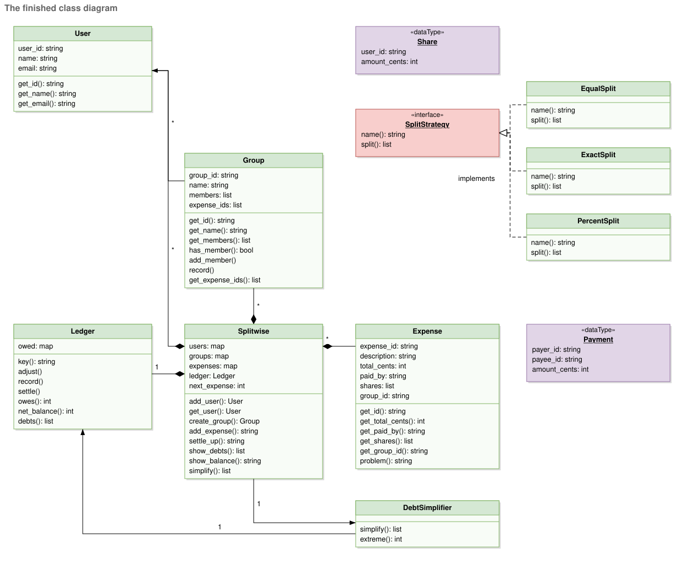
*Figure — The finished Splitwise class diagram: service owning users, groups, expenses and the ledger, with the split strategies and the simplifier (course diagram)*

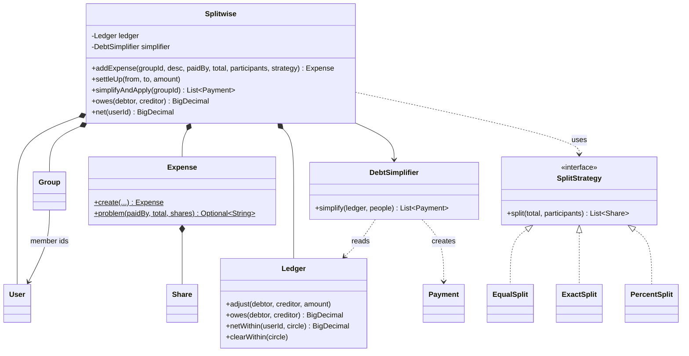

### Key flows

**Adding an expense:** strategy computes shares → `Expense.create` validates (≥ 2 people, sum = total) → only then, for each share, `ledger.adjust(sharer, payer, amount)`. If validation fails, an `IllegalArgumentException` with the reason is thrown and nothing is recorded.

**Simplifying debts (greedy minimum cash flow):**

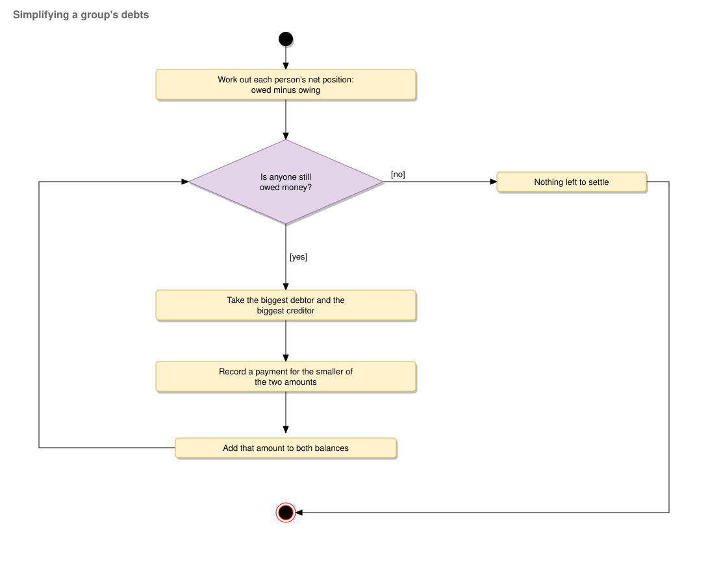
*Figure — Simplifying debts: compute net positions, then the largest debtor repeatedly pays the largest creditor until every balance is zero (course diagram)*

1. Net position per member = owed to them − they owe. Positive = creditor; nets sum to zero.
2. Creditors in one max-heap, debtors in another (ties by name → deterministic).
3. Pop biggest creditor C and debtor D; x = min(C, D); suggest "D pays C x".
4. Push back whichever side has a remainder; stop when a heap is empty.

Each round zeroes at least one person → **at most n − 1 payments**. It is **not always the true minimum** (that is NP-hard — it means finding the most zero-sum subgroups). Say so before you are asked.

### Design decisions & patterns used

| Decision | Why | Alternative rejected |
|---|---|---|
| **Strategy** for split rules | A new rule = a new class; all return `List<Share>`, so nothing downstream knows which ran. | `if (type == EQUAL) … else if …` in the service. |
| Expense validates in a **static factory** | Checked once; an invalid expense can never exist. | Checking in the ledger on every read. |
| `problem()` returns the **reason** | User sees *why* ("shares add up to 15.00 but the total is 30.00"). | `boolean isValid()`. |
| **One signed number per unordered pair** | A debt can't disagree with itself; reverse debts cancel automatically. | Two maps "A owes B" / "B owes A". |
| **One mutator** `adjust` | Expenses, settle-ups, simplification share one cancel rule. | Separate `addDebt`, `settle`, `reduce`. |
| `DebtSimplifier` separate | SRP: keeping balances vs planning settlements. | Algorithm inside the ledger. |
| `BigDecimal`, spare cents handed out | 100.00/3 → 33.34 + 33.33 + 33.33; percent split: last person absorbs remainder. | `double` (the course's whole-cents `long` is equally correct). |
| `Splitwise` is a **Facade** | One entry point that orders steps and decides nothing. | UI calling ledger/strategies directly. |

Only one GoF pattern (Strategy) — fine: good designs use the pattern that absorbs the likely change, not a collection.

### Java implementation

Key excerpts (the split strategy, the self-validating expense, the ledger's single mutator, and the facade's ordering):

```java
// File: code/lld/ch20/splitwise/SplitStrategy.java
interface SplitStrategy {
    List<Share> split(BigDecimal total, List<String> participants);
}

/** Equal split. Spare cents are handed out one at a time, in participant order. */
final class EqualSplit implements SplitStrategy {
    @Override
    public List<Share> split(BigDecimal total, List<String> participants) {
        if (participants.isEmpty()) throw new IllegalArgumentException("nobody to split between");
        BigDecimal n = BigDecimal.valueOf(participants.size());
        BigDecimal base = total.divide(n, 2, RoundingMode.DOWN);           // 100.00/3 -> 33.33
        BigDecimal leftover = total.subtract(base.multiply(n));           // 0.01
        int spareCents = leftover.divide(Money.CENT).intValueExact();     // 1
        List<Share> shares = new ArrayList<>();
        for (int i = 0; i < participants.size(); i++) {
            BigDecimal amount = i < spareCents ? base.add(Money.CENT) : base;
            shares.add(new Share(participants.get(i), amount));
        }
        return shares;
    }
}
// ... ExactSplit, PercentSplit (last person absorbs the remainder)

// File: code/lld/ch20/splitwise/Expense.java
    static Optional<String> problem(String paidBy, BigDecimal total, List<Share> shares) {
        if (total.signum() <= 0) return Optional.of("total must be positive");
        // ... negative / duplicate share checks
        Set<String> people = new HashSet<>(sharers);
        people.add(paidBy); // the payer counts as one of the two people even if they owe no share
        if (people.size() < 2) return Optional.of("an expense needs at least two people");
        BigDecimal sum = shares.stream().map(Share::amount).reduce(BigDecimal.ZERO, BigDecimal::add);
        if (sum.compareTo(total) != 0)
            return Optional.of("shares add up to " + sum + " but the total is " + total);
        return Optional.empty();
    }

// File: code/lld/ch20/splitwise/Ledger.java  (key (lo, hi), lo < hi; positive = "hi owes lo")
    /** The ONLY mutator: 'debtor' now owes 'creditor' 'amount' more. Opposite debts cancel. */
    void adjust(String debtor, String creditor, BigDecimal amount) {
        if (debtor.equals(creditor) || amount.signum() == 0) return;
        Pair key = Pair.of(debtor, creditor);
        BigDecimal delta = creditor.equals(key.lo()) ? amount : amount.negate();
        BigDecimal updated = balances.getOrDefault(key, Money.ZERO).add(delta);
        if (updated.signum() == 0) balances.remove(key); else balances.put(key, updated);
    }

// File: code/lld/ch20/splitwise/Splitwise.java
        List<Share> shares = strategy.split(total, participants);       // may throw
        Expense e = Expense.create("e" + ids.incrementAndGet(), description, paidBy, total, shares, groupId);
        for (Share s : e.shares()) ledger.adjust(s.userId(), paidBy, s.amount()); // payer's own share is a no-op
    // ... settleUp: refuse paying more than is owed, then ledger.adjust(to, from, amount) - the reverse debt cancels
```

Full runnable code: code/lld/ch20/splitwise/ (see the Full Edition).

Notes: `Money.of("10.005")` throws (`RoundingMode.UNNECESSARY` refuses silent rounding); `PercentSplit` rounds with `HALF_EVEN` (banker's rounding); `DebtSimplifier` uses two `PriorityQueue`s.

**Output (excerpt):**

```text
Hotel shares: [alice=33.34, bob=33.33, carol=33.33]
  refused: shares add up to 15.00 but the total is 30.00
  suggested: dave pays alice 16.68
  suggested: carol pays alice 13.33
  suggested: bob pays alice 9.99
```

Four pairwise debts became three payments; every net (alice +40.00, bob −9.99, carol −13.33, dave −16.68) is unchanged.

### Related machine-coding problem: The Ledger Co. (Navi)

The Geektrust/Navi round "Ledger Co." also keeps money records, but for **bank loans** (simple interest, monthly EMI, lump-sum prepayments). It is built in **Chapter 21 (The Ledger Co.)**. Both keep **one authoritative record** and compute every answer from it, and both use `BigDecimal` with a named rounding mode; the rules differ (*who owes whom* vs *how much is repaid by month N*).

### Concurrency & edge cases

- **Concurrent expenses:** every public `Splitwise` method is `synchronized` (build → validate → adjust is atomic); at scale lock per group/pair or use a DB transaction.
- **Payer not a sharer** (Alice buys Bob's lunch) is valid; the payer's own share is a no-op `adjust`.
- **Overpaying on settle-up**, unknown users, duplicate/negative shares, zero totals: refused before anything changes.
- **Simplify touches other groups:** one number per *pair* means simplifying a group rewrites all debts between its members, even ones from another group. If that is unacceptable, keep per-group ledgers plus a derived global view.

### Extensions & follow-up questions

- **Split by shares (2:1:1)?** New `ShareRatioSplit`; nothing else changes.
- **Delete/edit an expense?** Re-add the inverse, or better make the ledger an **append-only journal** (event sourcing): delete = append a reversing entry.
- **Is greedy optimal?** No. Nets A −6, B −5, C +2, D +4, E +5: greedy needs 4 payments; optimal 3 (B→E 5, A→D 4, A→C 2).
- **Is `Splitwise` doing too much?** At scale, yes: give users, groups, expenses and ledger their own repositories. Multiple currencies: `Money(amount, currency)` + one ledger per currency.

### Real-world example

Splitwise really offers "simplify debts" for groups (the net-position idea). Bill-splitting in payment apps solves rounding the same way: one person absorbs the leftover cent.

### In the interview

**30-second answer:** "Users and groups hold no money. Each split rule is a `SplitStrategy` returning shares. An `Expense` validates itself once: at least two people, shares add to the total. The `Ledger` keeps one signed number per pair and has a single `adjust`, so debts cancel automatically; settling up is an adjust the other way. Simplification: net positions + greedy biggest-debtor-pays-biggest-creditor, at most n − 1 payments, not always optimal."

**Tip:** say "one class per split rule" early; spend your time on the ledger.

### Self-check

1. Why does `Group` hold no balances? → Each debt must live in one place; two copies drift.
2. Split 10.00 equally among 3. → 3.34, 3.33, 3.33.
3. Max payments from the greedy simplifier for n people? → n − 1.
4. Why `compareTo` for `BigDecimal`? → `equals` compares scale: `2.0` ≠ `2.00`.
5. Alice pays 20.00, Bob owes all of it — valid? → Yes, two people are involved.

### TL;DR

- **Strategy** for split rules; **Expense validates itself** once.
- **Ledger = one signed number per pair**, one mutator; settle-up = reverse adjust.
- **Simplify** = net positions + greedy; ≤ n − 1 payments; optimal is NP-hard.
- **BigDecimal**, explicit rounding, no lost cents.

---

## 20.2 Design a Notification Service

### Problem & clarifying questions

**What it is.** The component that sends emails, SMS and push alerts ("Your order has shipped", "482913 is your login code"). Analogy: a post-office counter that picks the delivery method, respects "do not disturb", retries if the courier fails, and keeps a receipt. **Why it is a design question:** it starts as one `sendEmail()` and grows fourteen `if`s (SMS, quiet hours, promo limits…). The exercise is *where each addition should have gone instead*.

| Question | Assumed answer |
|---|---|
| Channels? | Email, SMS, push; more later. |
| Who picks the channel? | The user, **per kind** of notification, in preference order. |
| Wording? | Templates with placeholders: `Hi {name}, it arrives {eta}.` |
| Quiet hours? | Per user, may wrap midnight (22–07); urgent (OTP) ignores them. |
| Rate limits? | ≤ N per user per kind per hour. |
| Failures? | Retry a channel a bounded number of times, then fall back to the next channel; all fail → FAILED. |
| Audit? | Every attempt recorded: SENT / FAILED / SUPPRESSED + reason. |
| Sync or async? | Caller must not wait for a slow gateway. |

### Requirements

**Functional:** the table above, plus: user has email, phone, device token; FAILED when no channel succeeds; **a new channel or a new reason to hold back needs no edit to the service.**

**Non-functional:** caller not blocked (async); thread-safe; testable without real time (injected clock); a broken listener never breaks delivery.

### Use cases

Actors: **Product code** (asks), **Person** (channels, quiet hours), **Operator** (adds channels, watches outcomes), **Service** (renders, checks rules, tries channels, retries, records).


### Core entities

| Class | Responsibility |
|---|---|
| `User` / `Preferences` | Who someone is vs what they accept (ordered channels per kind, quiet hours with wrap logic in **one** place). Separate because they change for different reasons (SRP). |
| `Template` / `Message` | Subject + body with `{holes}`; `render(values)` → identical `Message` for every channel. |
| `NotificationRequest` | kind, user, values, priority (NORMAL / URGENT). |
| `Gateway` | External provider (SMTP, SMS gateway, push service); swappable and fakeable. |
| `NotificationChannel` (abstract) + Email/Sms/Push | **Template Method**: final `deliver()` has the retry-with-backoff loop; subclasses give `addressOf(user)`. |
| `ChannelFactory` | **Simple Factory**: type → channel. |
| `RetryPolicy` | Max attempts + initial backoff (doubles). |
| `SendRule` + `QuietHoursRule`, `RateLimitRule` | **Strategy**: one reason not to send, returned as text. |
| `DeliveryRecord` / `DeliveryListener` | Outcome record; **Observer** (`LoggingListener`, `MetricsListener`). |
| `TimeSource` | Where "now" comes from (manual clock in tests). |
| `NotificationService` | Thin coordinator: rules → preferences → render → channels in order → `finish()`. |

### Class diagram

Course build stages: (1) `User` + `Preferences`; (2) `Template` + `Message` + request; (3) channel hierarchy; (4) `SendRule`s; (5) service + listeners.

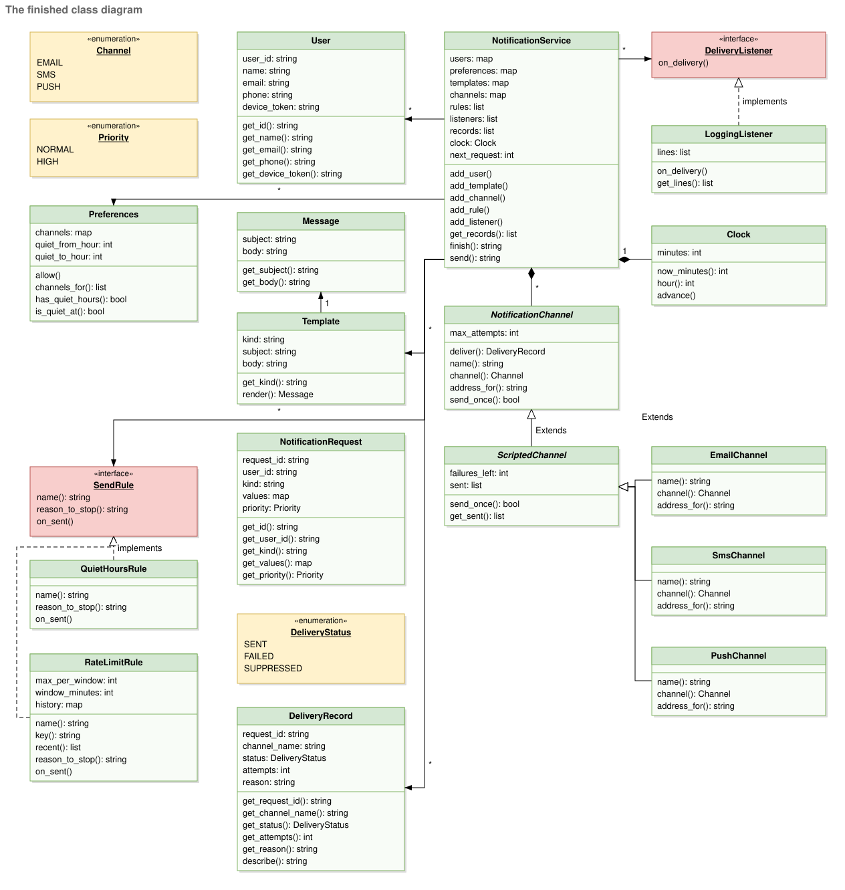
*Figure — The finished notification service class diagram: the service in the middle, the channel hierarchy with the retry in the parent, the send rules, templates, preferences and the delivery listeners (course diagram)*

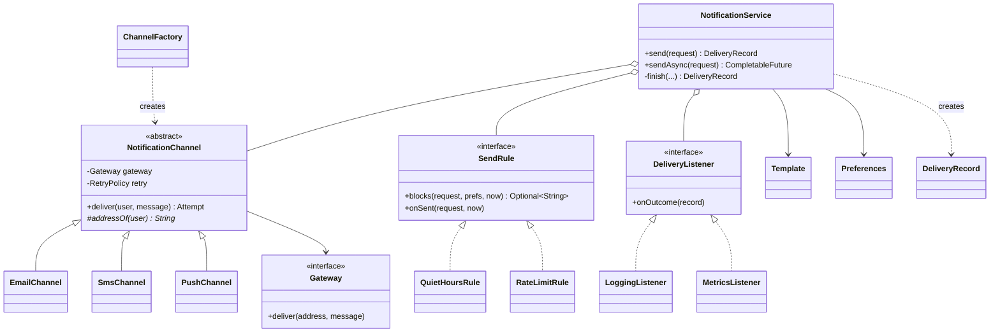

### Key flows

**Sending one notification:** ask every rule (any reason → SUPPRESSED); no accepted channel → SUPPRESSED; render the template **once**; try each accepted channel in the user's order (each with its own retry loop); first success → `onSent` to rules, SENT; all fail → FAILED. Every path exits through `finish()`.

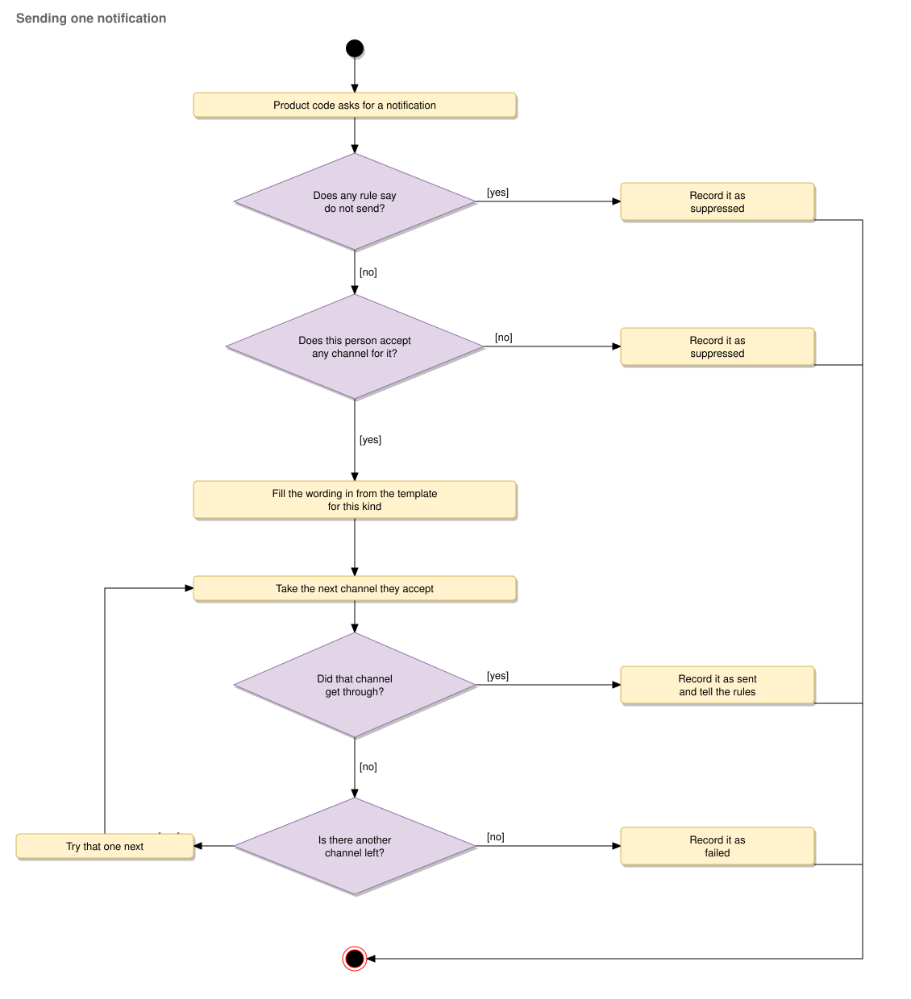
*Figure — Sending one notification: ask every rule, render once, try each accepted channel in turn, and record sent / failed / suppressed (course diagram)*

### Design decisions & patterns used

| Pattern / decision | Where | Why |
|---|---|---|
| **Template Method** | `final deliver()`; subclasses fill `addressOf()` | Retry loop is identical for all channels; only a *step* varies. Strategy would replace the whole method. |
| **Strategy** | `SendRule` | Each "reason not to send" is a class; a new rule (unsubscribed, dedupe) = new class + one wiring line. |
| **Observer** | `DeliveryListener` | Logs, dashboards, alerts want outcomes; the service doesn't know who listens. |
| **Simple Factory** | `ChannelFactory` | One place maps type → class. |
| **Adapter** (target) | `Gateway` | One adapter per vendor SDK; tests use a fake. |
| Rule returns **reason text** | `SendRule.blocks` | Reason is recorded. |
| Urgency handled **inside** the rule | `QuietHoursRule` | Service needn't know which rules urgent ignores. |
| Rate limit counts only **successful** sends | `onSent` hook | Suppressed/failed messages don't use up the allowance. |
| **Single exit** `finish()` | Service | Every path stores a record and notifies listeners. |
| Render **once** | Service | Same text everywhere; wording change = one edit. |

Three patterns, three *separate* axes of change: another channel (Template Method + Factory), another reason to hold back (Strategy), another interested party (Observer).

### Java implementation

```java
// File: code/lld/ch20/notification/Channels.java
abstract class NotificationChannel {
    private final Gateway gateway;
    private final RetryPolicy retry;
    // ... constructor
    abstract ChannelType type();

    /** Hook: where this channel reaches the user, or null if the user has no such address. */
    protected abstract String addressOf(User user);

    final Attempt deliver(User user, Message message) {
        String address = addressOf(user);
        if (address == null || address.isBlank()) return new Attempt(false, 0, "no " + type() + " address");
        String lastError = null;
        long backoff = retry.initialBackoff().toMillis();
        for (int attempt = 1; attempt <= retry.maxAttempts(); attempt++) {
            try {
                gateway.deliver(address, message);
                return new Attempt(true, attempt, null);
            } catch (Exception e) {
                lastError = e.getMessage();
                if (attempt < retry.maxAttempts()) sleep(backoff);
                backoff *= 2;
            }
        }
        return new Attempt(false, retry.maxAttempts(), lastError);
    }
    // ...
}

final class SmsChannel extends NotificationChannel {
    SmsChannel(Gateway g, RetryPolicy r) { super(g, r); }
    ChannelType type() { return ChannelType.SMS; }
    protected String addressOf(User u) { return u.phone(); }
}

// File: code/lld/ch20/notification/NotificationService.java  (inside send)
        for (SendRule rule : rules) {
            Optional<String> reason = rule.blocks(req, prefs, now);
            if (reason.isPresent()) return finish(req, DeliveryStatus.SUPPRESSED, null, 0, reason.get());
        }
        // ... no accepted channel -> SUPPRESSED; render the template ONCE (missing value -> FAILED via finish)
        for (ChannelType type : accepted) {
            NotificationChannel channel = channels.get(type);
            if (channel == null) continue;
            Attempt a = channel.deliver(user, message);
            totalAttempts += a.attempts();
            if (a.success()) {
                rules.forEach(r -> r.onSent(req, now));
                return finish(req, DeliveryStatus.SENT, type, totalAttempts, null);
            }
            lastError = type + ": " + a.error();
        }
        return finish(req, DeliveryStatus.FAILED, null, totalAttempts, "all channels failed, last " + lastError);
```

Full runnable code: code/lld/ch20/notification/ (see the Full Edition).

Notes: `Preferences.isQuiet` handles wrap-around (start ≤ end → range; else "after start **or** before end"). A missing template value is an error, not a raw `{name}` in an inbox. Backoff doubles (the course retried immediately — a named weakness). `RateLimitRule` prunes old timestamps (the course's version leaked them). A throwing listener is caught in `finish()`. `sendAsync` uses a pool; production uses a durable queue.

**Output (excerpt):**

```text
== 2. SMS fails 3 times -> retried, then falls back to EMAIL
    SMTP -> asha@mail.com : Order A-17 shipped | Hi Asha, it arrives Tuesday.
  [log] SENT       ORDER_SHIPPED user=u1 channel=EMAIL attempts=4
  [log] SUPPRESSED PROMO         user=u1 channel=- attempts=0 reason=quiet hours
  [log] SUPPRESSED PROMO         user=u1 channel=- attempts=0 reason=rate limit 2 per 60 min
```

### Concurrency & edge cases

- Shared state: `ConcurrentHashMap` for users/prefs/templates, `CopyOnWriteArrayList` for listeners/history, rate-limit deque locked per key.
- **Check-then-act gap:** two concurrent sends can both pass `blocks()` before `onSent()`. Fix: reserve a slot atomically at check time (release on failure) or serialize per user.
- **Retries block worker threads** with `sleep`; real systems re-enqueue with a delay (retry topic).
- **Idempotency:** a retry after a timeout may deliver twice → pass an idempotency key; receivers tolerate duplicates.
- Missing address → 0-attempt failure, next channel. No template → FAILED; no accepted channel → SUPPRESSED.
- **Time zones:** quiet hours in the *user's* zone (`ZoneId` in preferences).

### Extensions & follow-up questions

- **Add WhatsApp:** one subclass, one enum value, one `Gateway` adapter.
- **Too many messages:** a new `SendRule` (daily cap, dedupe), not a new `if`.
- **Campaign to a million users:** fan-out stage onto a queue + many workers calling `send`; rate-limit per provider.
- Priorities (separate queues), localization (templates by kind + locale), webhooks for receipts, a **circuit breaker** per provider.

### Real-world example

Push goes through **FCM** (Android) and **APNs** (iOS) to a *device token*; email via SES/SendGrid, SMS via Twilio — each its own API, hence `Gateway`. **AWS SNS** fans one message out to many channels. LinkedIn's **Air Traffic Controller** decides whether/when/how to notify each member — `SendRule` at company scale. Phone "Do Not Disturb" = quiet hours with an urgent bypass.

### In the interview

**30-second answer:** "Channels sit behind an abstract class whose final `deliver` holds retry-with-backoff (Template Method); each channel supplies only its address. Each do-not-send condition is a `SendRule` (Strategy) returning a reason. Preferences give an ordered channel list per kind; we render once and try channels in order, falling back on failure. Every outcome goes through one `finish` that records and notifies listeners (Observer). For scale, a queue sits in front."

**Follow-ups:** *Why not Strategy for channels?* → Channels share an algorithm and vary in one step: Template Method (injecting `RetryPolicy` + a `Sender` strategy is a valid composition alternative). *Duplicates on retry?* → Idempotency keys; at-least-once delivery.

### Self-check

1. Which pattern puts the retry loop in one place? → Template Method (`final deliver()`).
2. Why `Optional<String>` from `blocks`? → The suppression reason is recorded.
3. Why not count suppressed sends against the rate limit? → The user never got them.
4. Quiet hours 22–07: is 06:00 quiet? 12:00? → Yes; no.
5. What must every exit of `send` do? → Go through `finish()`.

### TL;DR

- **Template Method** channels (retry once in the parent); **Strategy** send rules returning reasons; **Observer** outcomes; **Factory** channels; **Adapter** providers.
- Render once, try channels in order, fall back, single `finish()` exit.
- Scale with a queue; watch idempotency and the rate-limit check-then-act gap.

---

## 20.3 Design an In-Memory Cache (and an LRU Cache from scratch)

### Problem & clarifying questions

**What it is.** A small, fast store of recently used values, so you don't re-fetch them from a slow place (DB, another service). Analogy: the few books on your desk vs the library. When the desk is full, one book must go back — **which one** is the eviction policy, the rule most likely to change. Expect the question: *which data structure gives O(1) get and put?* (O(1) = time doesn't grow with the number of entries.)

| Question | Assumed answer |
|---|---|
| Capacity in? | Number of entries. |
| Eviction? | LRU by default; swappable for FIFO or LFU without changing the cache. |
| TTL? | Optional per entry; an expired read is a miss and removes it. |
| Stats / notifications? | Hits, misses, evictions, expirations; subscribers learn about removals and the cause. |
| Thread-safe? | Yes (the course left it out; we add it). |
| Load on miss / write-back? | Out of scope (extensions). |

### Requirements

**Functional:** the table above, plus: `put` overwrites; a full cache evicts before inserting; O(1) get/put; invalidate one key or clear all; **every entry leaves through one code path**.

**Non-functional:** O(1); thread-safe; testable TTL (injected clock); listeners can't slow down or deadlock the cache.

### Use cases

Actors: **Application** (read, store, remove), **Operator** (chooses rule, reads stats), **Cache** (evicts, expires, counts, notifies).


### Core entities

| Class | Responsibility |
|---|---|
| `Node<K,V>` | key, value, `expiresAtMillis`, `frequency`, own `prev`/`next`. |
| `DoublyLinkedList<K,V>` | Order, newest at front, two **sentinel** nodes (no null checks). |
| `EvictionPolicy<K,V>` | **Strategy**: `onInsert`, `onAccess`, `onRemove`, `victim()`. Owns the *order*. |
| `LruPolicy`, `FifoPolicy`, `LfuPolicy` | The three rules; LFU is O(1) with chained frequency buckets. |
| `EvictionPolicies` + `PolicyType` | **Simple Factory**. |
| `Cache<K,V>` + `Cache.Builder` | Map + policy + clock + stats + listeners; one lock; **one removal method**. **Builder** for config. |
| `CacheStats`, `RemovalReason`, `EvictionListener` | `LongAdder` counters; EVICTED/EXPIRED/REMOVED/CLEARED; **Observer**. |
| `ShardedCache<K,V>` | N caches chosen by key hash → less lock contention. |

**The core idea: two structures, each answering one question.**

| Question | Structure | Cost |
|---|---|---|
| "Where is key k?" | `HashMap<K, Node>` | O(1) |
| "Who leaves next?" | Doubly linked list by recency | O(1) at the ends |
| "Move this entry to the front" | Node has own links; the map hands it over | O(1), no search |

A map can't name the oldest entry; a list can't find a key without walking. **Doubly** linked because unlinking a middle node needs its predecessor.

### Class diagram

Course build order: (1) `Node` + list; (2) `EvictionPolicy` + LRU; (3) FIFO + LFU with no cache change; (4) `Cache` with clock, stats, TTL; (5) listeners. **Who owns what:** the cache owns the map (and nodes); the policy owns the *order*. Neither reaches into the other — that is why FIFO/LFU need no `Cache` change.

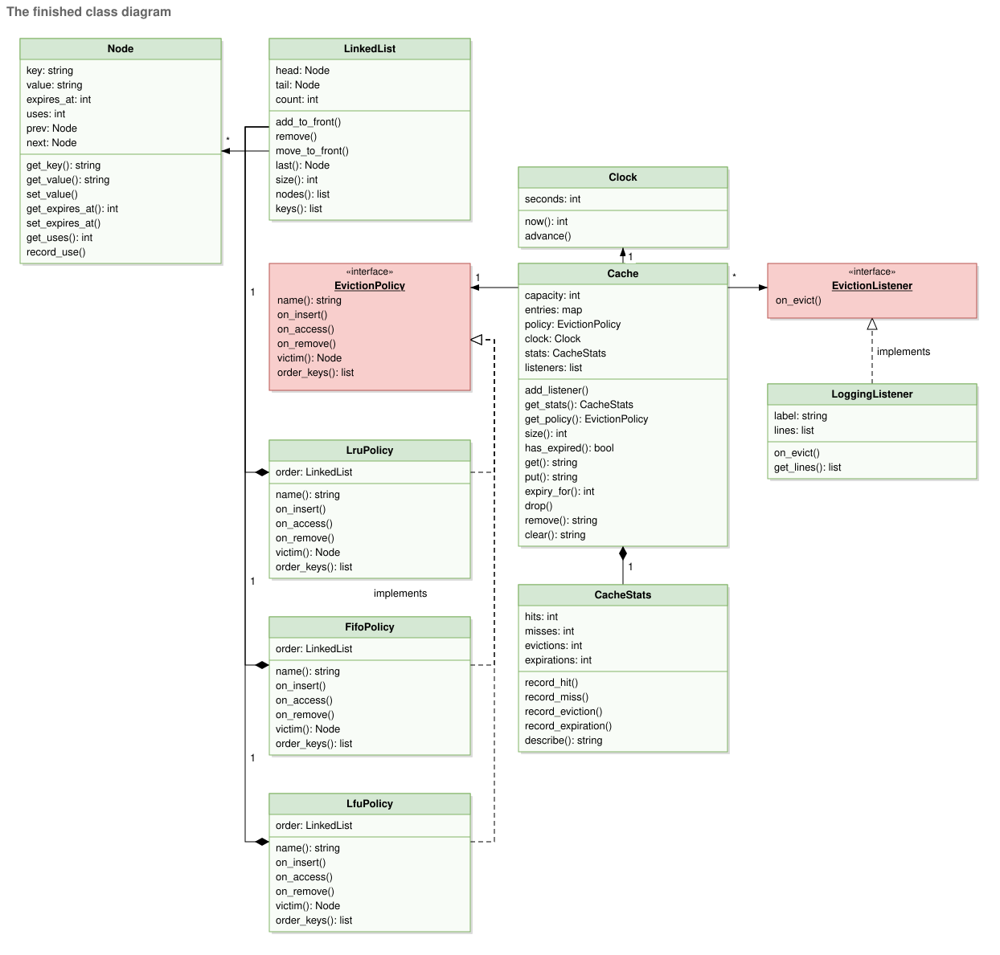
*Figure — The finished cache class diagram: Cache with its map, policy, clock, stats and listeners; the three eviction policies behind one interface (course diagram)*

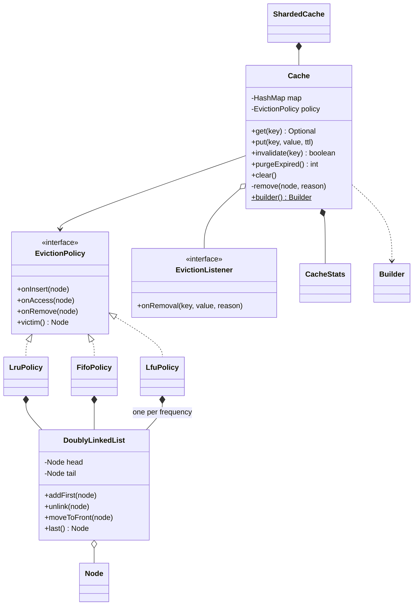

### Key flows

**Read:** absent → miss; present but expired → miss + removal (EXPIRED); else hit, `policy.onAccess`, return. **Store:** replace if present (counts as a use); otherwise, only if full, ask `policy.victim()` and remove it through the single removal path, then insert. Listeners are called after the lock is released.

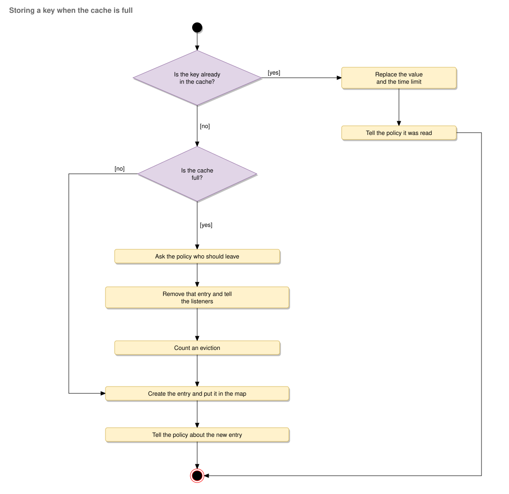
*Figure — Storing a key: replace if present; otherwise, if full, ask the policy for a victim and remove it through the single removal path, then insert (course diagram)*

**How the three policies differ:**

| Event | LRU | FIFO | LFU (O(1) buckets) |
|---|---|---|---|
| `onInsert` | add to front | add to front | frequency = 1, bucket 1 (always first in chain) |
| `onAccess` | move to front | **nothing** | move bucket f → f+1 (created right after f); drop f if empty |
| `onRemove` | unlink | unlink | unlink; drop bucket if empty |
| `victim()` | back of list | back of list | back of the **first** bucket (LRU among least frequent) |

FIFO is LRU with one empty method — evidence of good interface boundaries. The course's LFU scanned all entries (O(n)); ours keeps buckets in a **doubly linked chain in increasing frequency**, so the lowest bucket is always first and every operation is O(1) (Shah, Mitra & Matani, 2010).

### Design decisions & patterns used

| Decision | Why | Alternative rejected |
|---|---|---|
| **Strategy** for eviction | The rule most likely to change. | `switch (policyType)` in get/put. |
| **Observer** for removals, with reason | Logging, metrics, cleanup don't belong in the cache. | Hard-coded callbacks. |
| **One removal method** `remove(node, reason)` | Eviction, expiry, removal, clear all update map, policy, stats alike. | Four copies of clean-up code. |
| **Sentinel nodes** | Add/unlink are always the same pointer writes. | Null checks everywhere. |
| **Injected clock** (`LongSupplier`) | TTL tests run instantly. | `System.currentTimeMillis()` → tests must sleep. |
| **Lazy expiry + optional sweeper** | Dropped on read; `purgeExpired()` reclaims memory. | Timer per entry. |
| **One `ReentrantLock`**, listeners **after unlock** | LRU `get` writes (moves a node), so a read-write lock doesn't help; slow/re-entrant listeners can't block or deadlock. | `synchronized` around listener calls. |
| **Builder** | Defaults + validation once. | Telescoping constructors. |
| **Sharding** | N locks; threads on different shards never wait. | One global lock. |

### Java implementation

```java
// File: code/lld/ch20/cache/EvictionPolicy.java
interface EvictionPolicy<K, V> {
    void onInsert(Node<K, V> node);
    void onAccess(Node<K, V> node);
    void onRemove(Node<K, V> node);
    Node<K, V> victim();
}

final class LruPolicy<K, V> implements EvictionPolicy<K, V> {
    private final DoublyLinkedList<K, V> order = new DoublyLinkedList<>();
    public void onInsert(Node<K, V> n) { order.addFirst(n); }
    public void onAccess(Node<K, V> n) { order.moveToFront(n); }
    public void onRemove(Node<K, V> n) { order.unlink(n); }
    public Node<K, V> victim() { return order.last(); }
}
// ... FifoPolicy (onAccess does nothing), LfuPolicy (chained frequency buckets)

// File: code/lld/ch20/cache/Cache.java
    void put(K key, V value, Duration ttl) {
        List<Removal<K, V>> removed = new ArrayList<>(1);
        lock.lock();
        try {
            long expiresAt = ttl == null ? 0 : clockMillis.getAsLong() + ttl.toMillis();
            Node<K, V> existing = map.get(key);
            if (existing != null) {          // replace: counts as a use
                existing.value = value;
                existing.expiresAtMillis = expiresAt;
                policy.onAccess(existing);
                return;
            }
            if (map.size() >= capacity) removed.add(remove(policy.victim(), RemovalReason.EVICTED));
            Node<K, V> n = new Node<>(key, value, expiresAt);
            map.put(key, n);
            policy.onInsert(n);
        } finally {
            lock.unlock();
            notifyListeners(removed);
        }
    }
    // ... get, invalidate, purgeExpired, clear follow the same lock / collect / notify-after-unlock shape

    /** THE single exit path for every entry, whatever the reason. Caller holds the lock. */
    private Removal<K, V> remove(Node<K, V> n, RemovalReason reason) {
        map.remove(n.key);
        policy.onRemove(n);
        if (reason == RemovalReason.EVICTED) stats.evictions.increment();
        if (reason == RemovalReason.EXPIRED) stats.expirations.increment();
        return new Removal<>(n.key, n.value, reason);
    }
```

Full runnable code: code/lld/ch20/cache/ (see the Full Edition).

**Output (excerpt)** — same accesses (b read 3×, c once, a twice), three different victims:

```text
== LRU (capacity 3): put a,b,c; get b,b,b,c,a,a; put d
  listener: b=2 left, EVICTED
== FIFO (capacity 3): put a,b,c; get b,b,b,c,a,a; put d
  listener: a=1 left, EVICTED
== LFU (capacity 3): put a,b,c; get b,b,b,c,a,a; put d
  listener: c=3 left, EVICTED
  stats: hits=2 misses=1 evictions=0 expirations=2 hitRate=67%
```

### LRU Cache from scratch (the classic interview question)

Often asked directly: **"Implement an LRU cache with O(1) get and put"** (LeetCode 146). Same two structures, inline: HashMap for lookup; doubly linked list with `head`/`tail` sentinels (most recent after `head`). `get`: unlink + add at front. `put`: if present update + move to front; else if full remove `tail.prev` from list **and** map (why the node stores its key), then add. Java shortcut: `LinkedHashMap(accessOrder = true)` + `removeEldestEntry` — mention it, but write the manual version when asked "from scratch".

```java
// File: code/lld/ch20/lrucache/Main.java
        synchronized V get(K key) {
            Node n = index.get(key);
            if (n == null) return null;
            unlink(n);
            addFront(n);                 // now the most recently used
            return n.value;
        }

        synchronized void put(K key, V value) {
            Node n = index.get(key);
            if (n != null) {             // update + mark as recently used
                n.value = value;
                unlink(n);
                addFront(n);
                return;
            }
            if (index.size() == capacity) {
                Node lru = tail.prev;    // least recently used lives just before the tail sentinel
                unlink(lru);
                index.remove(lru.key);
            }
            n = new Node(key, value);
            addFront(n);
            index.put(key, n);
        }
        // ... addFront / unlink: four and two pointer writes
    // ... jdkLru(capacity): new LinkedHashMap<>(16, 0.75f, true) overriding removeEldestEntry -> size() > capacity
```

Full runnable code: code/lld/ch20/lrucache/ (see the Full Edition). The demo prints LeetCode 146's expected values (1, miss, miss, 3, 4); this generic version returns `null` for a miss instead of `-1`.

| Approach | get / put | Thread-safe | When to use |
|---|---|---|---|
| HashMap + own doubly linked list | O(1) / O(1) | Only with a lock | Interviews; custom behaviour |
| `LinkedHashMap(accessOrder=true)` + `removeEldestEntry` | O(1) / O(1) | No | Quick single-threaded caches |
| Caffeine / Guava | amortized O(1) | Yes | Production Java |

### Concurrency & edge cases

- **A read lock is not enough:** LRU `get` rewrites pointers, so it needs the exclusive lock.
- **Contention:** `ShardedCache` = 8 locks; trade-off: LRU order is only per shard.
- **Cache stampede** (many misses for one key all hit the DB): let the first thread load and others wait on its result (`computeIfAbsent` / a `CompletableFuture` per key) — Chapter 13's TTL cache does this with `ConcurrentHashMap.compute`.
- **TTL precisely:** expires *at* the deadline (`now >= expiresAt`); lazy — a dead entry holds a slot until read, swept, or evicted (then reported `EVICTED`). `put` without TTL on an existing key **clears** the old TTL.
- Capacity ≤ 0 refused by the builder; nulls unsupported (Caffeine too); use a monotonic clock (`nanoTime`) in production.

### Extensions & follow-up questions

- **LFU:** one new policy; naive LFU is O(n), chained buckets O(1).
- **Size in bytes:** a `Weigher` strategy; evict until under max weight.
- **Load on miss:** *read-through* (`get(key, loader)`), *write-through* (cache + DB together), *write-back* (flush later; faster, may lose data), *cache-aside* (app does check → DB → put).
- **Distributed:** consistent hashing (high-level design). **Best policy?** Workload-dependent; Caffeine's *Window TinyLFU* mixes recency and frequency.

### Real-world example

`LinkedHashMap` access order is the JDK's LRU. **Guava/Caffeine** expose the same knobs: `maximumSize`, `expireAfterWrite`/`expireAfterAccess`, `removalListener` (with causes like `EXPIRED`, `SIZE`, `EXPLICIT`, `REPLACED`), `recordStats()`. **Redis** picks eviction by config (`maxmemory-policy`: `allkeys-lru`, `allkeys-lfu`, `volatile-ttl`, `noeviction`…) and approximates LRU by sampling keys.

### In the interview

**30-second answer:** "A HashMap key → node for O(1) lookup, and a doubly linked list with sentinels for O(1) ordering; the node carries its own links so we can unlink it directly. The eviction rule sits behind `EvictionPolicy` — LRU moves on access, FIFO doesn't, LFU uses frequency buckets for O(1). Every exit goes through one `remove` that updates stats; listeners are notified after the lock is released. One lock is correct; sharding reduces contention."

**Follow-up:** *Why does the node store the key?* → To delete it from the map on eviction.

### Self-check

1. Which two structures give O(1) LRU? → HashMap (key → node) + doubly linked list.
2. What do sentinels buy? → No null checks; add/remove always the same writes.
3. FIFO vs LRU in code? → `onAccess` does nothing.
4. Why can't a read-write lock speed up LRU `get`? → `get` modifies the list.
5. Cache stampede fix? → One thread loads; others wait on the same future.

### TL;DR

- **HashMap + doubly linked list (sentinels)** = O(1) get/put.
- **Strategy** eviction (LRU / FIFO / O(1) LFU); **Observer** removals; **Builder** config.
- **One removal path**; lazy TTL + sweeper; injected clock.
- One lock (gets are writes), listeners outside it, **shard** to scale; know `LinkedHashMap`, Caffeine, Redis policies.

---

## 20.4 Design a Ride Sharing Service (Uber)

### Problem & clarifying questions

**What it is.** Connects a rider with a nearby driver — a radio taxi dispatcher who calls the nearest free cab, then the next if refused, and the meter shows the fare. Two decisions are the whole question: **which driver is asked** (matching) and **what the trip costs** (pricing). Either should change with no edits elsewhere.

| Question | Assumed answer |
|---|---|
| Vehicle types? | Economy, premium, van; rider asks for one. |
| Who gets a request? | Online, free drivers of the right type within range. |
| Offer one at a time or broadcast? | One at a time, nearest first; decline → next; none left → cancel. |
| Trip states? | Requested → accepted → started → ended; cancel only from requested/accepted. Illegal actions do nothing. |
| Fare / surge? | Base + per km + per minute, with a minimum, per type; surge multiplies the same fare. |
| Ratings / payment? | Each side rates once after a finished trip (average shown); charge rider's method (cash, wallet, card). |
| Map? | Grid with Manhattan distance (production: a routing engine giving road distance + duration). |
| Pool, scheduled rides, tracking, payouts? | Out of scope. |

### Requirements

**Functional:** the table above, plus: driver has one vehicle (plate, seats, type) and goes online/offline; rider cancels only before start; trip history for both sides.

**Non-functional:** a driver can **never** be on two trips (even under concurrency); rules swappable; deterministic tie-breaks.

### Use cases

Actors: **Rider** (request, cancel, rate), **Driver** (online, accept/decline, start/end, rate), **System** (find, offer, price, surge, history).


### Core entities

| Class | Responsibility |
|---|---|
| `Location`, `VehicleType`, `Vehicle` | Grid point (Manhattan `distanceTo`), car type and details. |
| `Account` (abstract) → `Rider`, `Driver` | Shared id/name/phone, **rating as total + count**, finished trips. Rider + payment method; Driver + vehicle, location, online, **atomic busy flag** (`tryClaim`). |
| `TripStatus` / `Trip` | State machine table; trip holds **ranked candidate list + cursor**; every action checks state. |
| `PricingStrategy`, `StandardPricing` + `RateCard` | **Strategy**: base + km + min with floor, per type. |
| `SurgePricing` | **Decorator** wrapping any `PricingStrategy`. |
| `MatchingStrategy` | **Strategy**: `NearestDriverMatcher`, `BestRatedMatcher`. |
| `PaymentMethod` | **Strategy**: `CashPayment`, `WalletPayment`. |
| `TripListener` | **Observer** of trip events. |
| `RideSharingService` | Facade; owns accounts and trips; knows only the order of steps. |

Rating as total + count: only the average is shown, and adding a rating is O(1). `Rider`/`Driver` extend `Account` because they pass the LSP "is-a" test.

### Class diagram

Course stages: (1) accounts, vehicle, location; (2) `Trip` + `TripStatus`; (3) pricing + surge wrapper; (4) matching; (5) the service. In the course figure, the arrow from `SurgePricing` back to `PricingStrategy` ("has-a of my own type") is what makes it a Decorator rather than another Strategy.

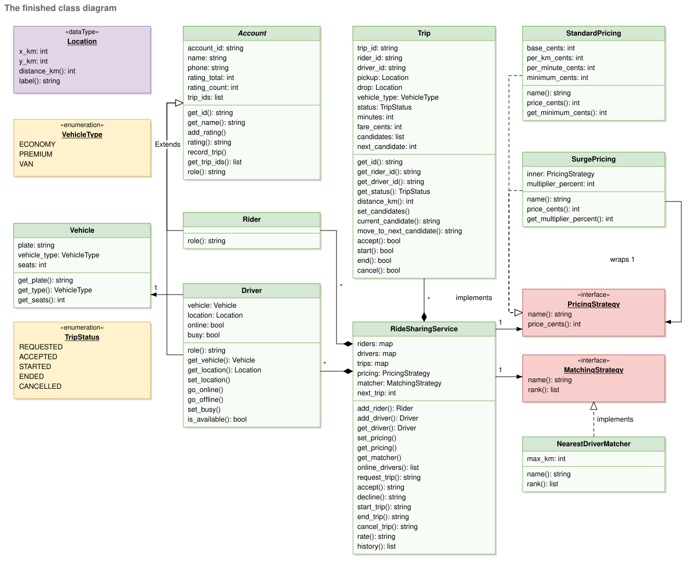
*Figure — The finished ride sharing class diagram: the service owning riders, drivers and trips; PricingStrategy with StandardPricing and the SurgePricing wrapper; MatchingStrategy with the nearest-driver matcher (course diagram)*

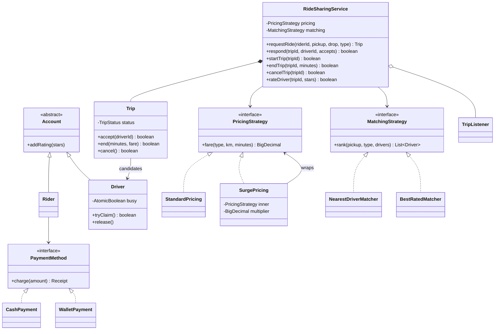

### Key flows

**Trip lifecycle** (a state machine = fixed states + the only legal moves):

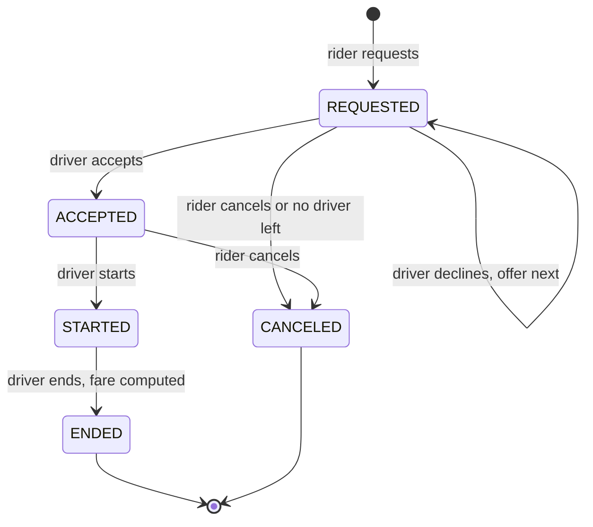

**Finding a driver:** rank free drivers of the right type nearest first; offer to the first; decline → move the cursor; nobody left → cancel. **Ending:** refuse if not started; else one `pricing.fare(...)` call (however many decorators wrap it), charge the rider, move the driver to the drop point, release.


### Design decisions & patterns used

| Decision | Why | Alternative rejected |
|---|---|---|
| **Strategy** for matching | Cities rank differently (nearest, best-rated…). | Sorting inside the service. |
| Matcher returns a **ranked list** stored on the trip | Decline = move cursor; no re-search; remembers who refused. | Returning one driver. |
| **Strategy** pricing + **Decorator** surge | Surge wraps *any* rule; off = remove the wrapper; decorators stack (surge + airport fee + discount). | `if (surge)` in pricing. |
| **State machine** via `TripStatus.canMoveTo` | One table; illegal moves return `false`. Full State pattern only pays when per-state behaviour is large. | Scattered `if (status == …)`. |
| **Atomic claim** (`AtomicBoolean.compareAndSet`) | Two trips racing for a driver: exactly one wins; loser treats it as decline. | Check `isAvailable()` then set: race. |
| Move driver to **drop point** at end | Next match must use the real position. | Forgetting (real bug class). |
| **Observer** for trip events | Apps, push, analytics listen. | Service calling them directly. |
| Tie-break by driver id; `BigDecimal` `HALF_UP` | Reproducible tests; exact fares (course uses whole cents and surge as a percentage, 150 = ×1.5). | `double`. |

### Java implementation

```java
// File: code/lld/ch20/ridesharing/Trip.java
enum TripStatus {
    REQUESTED, ACCEPTED, STARTED, ENDED, CANCELED;

    private static final Map<TripStatus, Set<TripStatus>> NEXT = Map.of(
            REQUESTED, EnumSet.of(ACCEPTED, CANCELED),
            ACCEPTED, EnumSet.of(STARTED, CANCELED),
            STARTED, EnumSet.of(ENDED),
            ENDED, EnumSet.noneOf(TripStatus.class),
            CANCELED, EnumSet.noneOf(TripStatus.class));

    boolean canMoveTo(TripStatus next) { return NEXT.get(this).contains(next); }
}

// File: code/lld/ch20/ridesharing/Strategies.java
/** Decorator: wraps ANY pricing rule and multiplies its answer. Remove the wrapper to switch surge off. */
final class SurgePricing implements PricingStrategy {
    private final PricingStrategy inner;
    private final BigDecimal multiplier;
    // ... constructor
    @Override
    public BigDecimal fare(VehicleType type, int km, int minutes) {
        return inner.fare(type, km, minutes).multiply(multiplier).setScale(2, RoundingMode.HALF_UP);
    }
}

// File: code/lld/ch20/ridesharing/Model.java  (Driver)
    boolean tryClaim() { return online && busy.compareAndSet(false, true); }

// File: code/lld/ch20/ridesharing/RideSharingService.java
    /** Driver answers the offer. A lost race for the driver counts as a decline. */
    boolean respond(String tripId, String driverId, boolean accepts) {
        Trip trip = trips.get(tripId);
        Driver current = trip.currentCandidate();
        if (current == null || !current.id().equals(driverId) || trip.status() != TripStatus.REQUESTED) return false;
        if (accepts && current.tryClaim()) {
            if (trip.accept(driverId)) {
                publish(trip, "accepted by " + driverId);
                return true;
            }
            current.release(); // trip was canceled meanwhile
            return false;
        }
        publish(trip, (accepts ? "could not claim " : "declined by ") + driverId);
        offerOrCancel(trip, trip.nextCandidate());
        return false;
    }
    // ... endTrip: price -> trip.end -> charge rider -> d.moveTo(drop) -> d.release() -> history
```

Full runnable code: code/lld/ch20/ridesharing/ (see the Full Edition).

`Trip` methods are `synchronized`, so a rider's cancel and a driver's accept can't interleave. `endTrip` relocates the driver **before** releasing them, so no matcher ever sees a free driver at the old spot.

**Output (excerpt):**

```text
  [T1] declined by D1
  [T1] accepted by D2
  [T1] ended: 7 km, 12 min, fare 13.90 (wallet debited 13.90, left 36.10)
  [T2] ended: 1 km, 3 min, fare 7.50 (collect 7.50 in cash)
  [T4] cancel refused in state STARTED
  [T5] no driver left - canceled
  trips accepted = 10 (never more than 10 drivers)
```

Trip 1: 2.50 + 7 × 1.20 + 12 × 0.25 = **13.90**. Trip 2: 4.45 → minimum 5.00 → surge × 1.5 = **7.50**. 40 concurrent requests vs 10 drivers → exactly 10 accepted.

### Machine-coding variant: carpool / "offer and select a ride"

A Flipkart-style round (kumaransg/LLD collection) with **no dispatcher**: users *offer* spare seats on a route and others *select* a ride with a **selection strategy**.
- `add_user`, `add_vehicle` (several per user); `offer_ride(user, origin, seats, vehicle, destination)` **fails if that vehicle already has an active offer**.
- `select_ride(user, origin, destination, seats, strategy)` — seats 1 or 2; **Most Vacant** or **Preferred Vehicle** ("Activa").
- `end_ride`, `print_ride_stats` — taken/offered per user, counting only **ended** rides.

Design: `Ride` with an atomic `book`; `RideSelectionStrategy` (`MostVacant`, `PreferredVehicle`); `RideService` filters active rides by route and seats, excludes the user's own offers, and lets the strategy choose.

```java
// File: code/lld/ch20/carpool/Main.java
    interface RideSelectionStrategy {
        Optional<Ride> select(List<Ride> candidates);
    }

    static final class MostVacant implements RideSelectionStrategy {
        public Optional<Ride> select(List<Ride> c) { return c.stream().max(Comparator.comparingInt(Ride::availableSeats)); }
    }
    // ... PreferredVehicle(model): first ride whose vehicle model matches
    // ... selectRide: filter ACTIVE rides on the same route, not offered by this user, with enough seats;
    // ... strategy.select(matching), then ride.book(user, seats) (synchronized check-and-book)
```

Full runnable code: code/lld/ch20/carpool/ (see the Full Edition). The demo replays the problem's sample (answers 2(c), 2(b), none, 2(d), none; then the stats).

| | Uber-style (main design) | Carpool variant |
|---|---|---|
| Who supplies the ride | Professional drivers | Any user, per offered ride |
| Who chooses | System offers to drivers | Rider picks with a selection strategy |
| Key pattern | Strategy + Decorator + state machine | Strategy (selection) |
| Key invariant | A driver on ≤ 1 trip | A vehicle has ≤ 1 active offer; seats never negative |

### Concurrency & edge cases

- **Double booking:** prevented by `tryClaim()` CAS (the 40/10 race proves it).
- **Cancel vs accept:** both via `synchronized` `Trip` methods; if cancel wins, `accept` fails and the driver is released.
- **Stale candidate list:** computed once; a claimed/offline driver fails `tryClaim` → next. A nearer driver freed later isn't noticed (real systems re-match).
- **Offer timeouts:** no answer in N seconds = decline (scheduled task per offer).
- No drivers → canceled immediately. Illegal transitions → `false`, state unchanged. Wallet too low → `Receipt(paid=false)`. One rating per side, 1–5 stars.

### Extensions & follow-up questions

- **Rank by rating:** swap in `BestRatedMatcher`.
- **Airport fee, promo, tolls:** more decorators: `new PromoDiscount(new AirportFee(new SurgePricing(standard, 1.5)))`.
- **How is surge computed?** Demand (open requests) vs supply (free drivers) per area and window → multiplier; the pricing design doesn't change.
- **Nearby drivers fast:** geospatial index — cells (geohash, S2, Uber's H3 hexagons) → map cell → drivers; search pickup cell + neighbours.
- **Pool rides:** honest answer: `Trip` becomes many riders/stops and the matcher considers detours. Live tracking: latest location per driver, published via pub-sub (20.6). Scheduled rides: a scheduler starts matching shortly before.

### Real-world example

Uber shows surge ("dynamic pricing") when demand exceeds supply and gives a driver a short window to accept before the next — the ranked-list-with-cursor idea. Uber open-sourced **H3**, a hexagonal grid used for pricing and dispatch. Ola, Lyft and Grab follow the same request → match → accept → trip → rate lifecycle.

### In the interview

**30-second answer:** "Two rules behind interfaces: `MatchingStrategy` returns a ranked list of free drivers with the right car; `PricingStrategy` computes base + distance + time with a floor. Surge is a Decorator wrapping any pricing rule. The trip is a small state machine; every action checks the transition table and returns false if illegal. A decline moves a cursor along the stored ranking. Drivers are claimed with compare-and-set, so one driver never gets two trips."

**Tip:** name matching and pricing in the first minutes; spend real time on surge — *wrapping* the rule instead of adding a flag separates strong answers. *Strategy vs Decorator?* → Strategy replaces the rule; Decorator wraps it and stays in the call path (holds an `inner` of the same interface).

### Self-check

1. Why a ranked list, not one driver? → Decline = next candidate, no re-search.
2. What makes `SurgePricing` a Decorator? → It is a `PricingStrategy` wrapping another and adjusting its result.
3. Can a rider cancel a STARTED trip? → No; `STARTED` only → `ENDED`.
4. Which Java class makes the claim atomic? → `AtomicBoolean.compareAndSet(false, true)`.
5. Carpool: when does `offer_ride` fail? → The vehicle already has an active offer.

### TL;DR

- **Strategy** ×3 (matching, pricing, payment) + **Decorator** (surge) + **state machine** (trip).
- Ranked list + cursor; decline = next. **Atomic claim** prevents double booking; relocate driver at trip end.
- Ratings = total + count; `BigDecimal` fares with a minimum.
- Carpool: users offer seats; riders select with Most Vacant / Preferred Vehicle.

---

## 20.5 Design a Logging Framework

### Problem & clarifying questions

**What it is.** Code writes messages ("payment 991 authorised") with a **level** (severity), and the framework sends them to **destinations** (console, file, log server) in a chosen **format** — a mini Log4j 2 / Logback / `java.util.logging`. Analogy: a company mail room that routes notes by department and urgency stamp to inboxes, in the right envelope.

| Question | Assumed answer |
|---|---|
| Levels? | TRACE < DEBUG < INFO < WARN < ERROR < FATAL (and OFF). |
| Per-module config? | Loggers named `app.payment`, `app.orders` form a **dot hierarchy**; a child inherits the nearest ancestor's level. |
| Destinations / formats? | Console, file, in-memory; pattern and JSON; both pluggable; each destination has its own minimum level. |
| Propagation? | Event goes to the logger's destinations then **up** to ancestors', unless additivity is off. |
| Async / thread-safe? | Optional async (app never waits for disk); yes. |
| Config files, rolling files, shipping? | Out of scope. |

### Requirements

**Functional:** the table above, plus: same name → same logger; exceptions attachable; lazy messages; async without changing appenders.

**Non-functional:** very cheap when disabled; thread-safe; logging never crashes the app; testable (injected clock).

### Use cases

Actors: **Developer code** (logs), **Operator** (configures levels, appenders, formats), **Framework** (filters, formats, routes, writes). Use cases: log a message, get a logger by name, set a level for a subtree, add a destination, choose a format, switch to async, stop propagation for a subtree.

### Core entities

| Class | Responsibility |
|---|---|
| `LogLevel` | Ordered severities; `isAtLeast(threshold)`. |
| `LogRecord` | One immutable event: time, level, logger, thread, message, error. |
| `Logger` | Named node: parent, optional level, appenders, additivity; `log()` walks up. |
| `LogManager` | **Singleton** registry; `getLogger(name)` creates parents first, one instance per name; holds the clock. |
| `Appender` / `AbstractAppender` | A sink; **Template Method** base checks threshold + formats, subclasses only `write(line)`. |
| `ConsoleAppender`, `FileAppender`, `MemoryAppender` | Concrete sinks. |
| `AsyncAppender` | **Decorator**: bounded queue + one writer thread around any appender. |
| `Formatter` | **Strategy**: `PatternFormatter`, `JsonFormatter`. |

### Class diagram

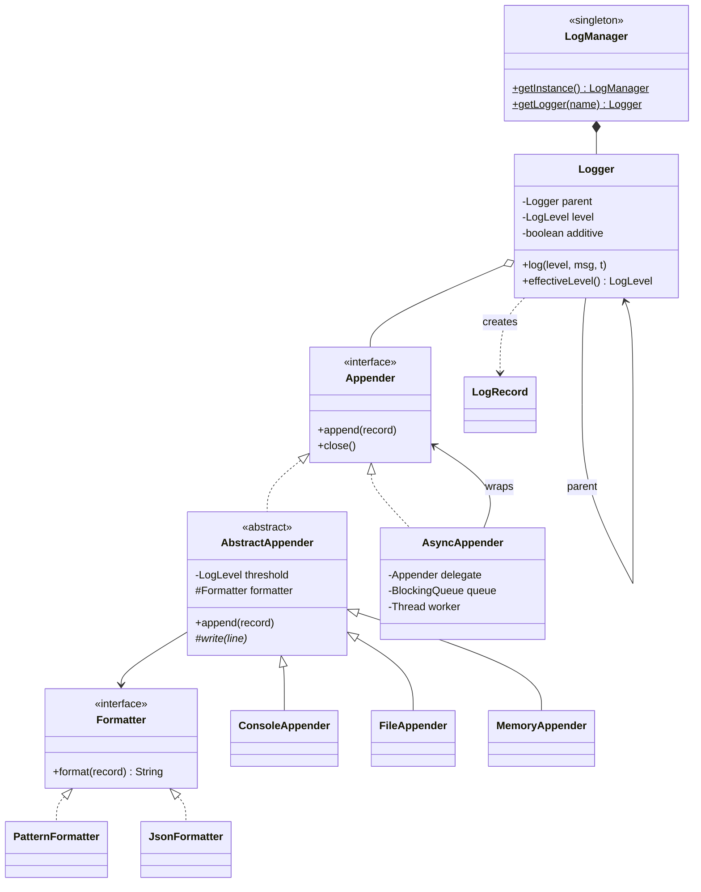

### Key flows

**Logging one event = Chain of Responsibility up the hierarchy** (a request passes along a chain of handlers; each may handle it and/or pass it on):

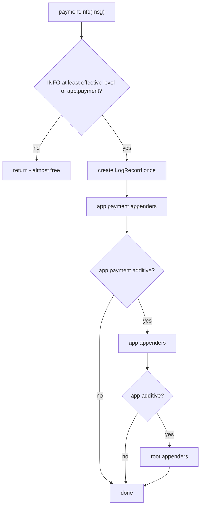

The Log4j/Logback rule we copy: the **level check happens once, at the logger where the call was made**; parents' levels are not re-checked, only each **appender's own threshold** filters. So a DEBUG event from `app.payment` (set to DEBUG) still reaches root's console even though root is INFO.

**Async:** the app thread calls `append` → `queue.offer` (never blocks) → returns; a writer thread `take()`s and calls the slow delegate. `close()` enqueues a poison record, then `join()`s until the queue is drained.

### Design decisions & patterns used

| Pattern / decision | Where | Why |
|---|---|---|
| **Chain of Responsibility** | `Logger.log`: this → parent → … → root, stops at `additive == false` | Configure sinks once near the root; subtrees add or stop. |
| **Singleton** (holder idiom) | `LogManager` | One registry → same logger per name; lazy + thread-safe with no locking (JVM initializes the nested class once). Double-checked locking is easy to get wrong. |
| **Static factory** | `getLogger(name)` | Caches instances, creates parents first; `new Logger` would break the hierarchy. |
| **Strategy** | `Formatter` | Any sink × any format; no `JsonFileAppender` class explosion. |
| **Template Method** | final `append` → `write` | Threshold + formatting once. |
| **Decorator** | `AsyncAppender` | Async is an add-on, not `AsyncFileAppender`, `AsyncConsoleAppender`… |
| Level check first; lazy `Supplier<String>` | `isEnabled`, `debug(Supplier)` | Disabled logging = one comparison. |
| Appender failures caught | `Logger.log` | Logging never crashes the app. |
| Parent resolved **outside** `computeIfAbsent` | `LogManager.loggerFor` | A `ConcurrentHashMap` mapping function must not modify the same map (`IllegalStateException: Recursive update`). |

**Another common "CoR logger" answer** chains *level handlers* (`ErrorHandler → WarnHandler → InfoHandler`). It works as a toy, but real frameworks put the chain on the **logger hierarchy**, because that is what operators configure. If the interviewer expects the level-handler version, explain both.

### Java implementation

```java
// File: code/lld/ch20/logging/Logger.java
    // ... effectiveLevel() walks up to the nearest logger with a level; isEnabled(); debug(Supplier) for lazy messages
    void log(LogLevel lvl, String msg, Throwable t) {
        if (!isEnabled(lvl)) return;                     // cheap check first
        LogRecord r = new LogRecord(manager.now(), lvl, name, Thread.currentThread().getName(), msg, t);
        for (Logger l = this; l != null; l = l.parent) { // the chain
            for (Appender a : l.appenders) {
                try {
                    a.append(r);
                } catch (RuntimeException e) {
                    System.err.println("appender failed: " + e); // logging must never crash the app
                }
            }
            if (!l.additive) break;
        }
    }

/** Singleton registry of loggers (initialization-on-demand holder idiom: lazy and thread-safe). */
final class LogManager {
    // ...
    private static final class Holder { static final LogManager INSTANCE = new LogManager(); }

    static LogManager getInstance() { return Holder.INSTANCE; }

    private Logger loggerFor(String name) {
        if (name == null || name.isEmpty() || name.equals("root")) return root;
        Logger existing = loggers.get(name);
        if (existing != null) return existing;
        int dot = name.lastIndexOf('.');
        Logger parent = dot < 0 ? root : loggerFor(name.substring(0, dot)); // resolved OUTSIDE computeIfAbsent
        return loggers.computeIfAbsent(name, n -> new Logger(n, parent, this));
    }
    // ...
}

// File: code/lld/ch20/logging/Appenders.java
    @Override
    public final void append(LogRecord r) {
        if (r.level().isAtLeast(threshold)) write(formatter.format(r));
    }
    // ...
    @Override
    public void append(LogRecord r) {
        if (closed || !queue.offer(r)) dropped.incrementAndGet(); // full or closed: count it, never block
    }
```

Full runnable code: code/lld/ch20/logging/ (see the Full Edition).

`LogRecord` is created once and shared (immutable, thread-safe). Sinks synchronize `write` so lines never interleave. `AsyncAppender`'s promise is precise: `written + dropped` always equals the number of `append` calls; a throwing delegate is caught inside the writer loop so the writer never dies (which would leave `close()` waiting forever).

**Output (excerpt):**

```text
2026-09-28 10:15:30.123 DEBUG [main] app.payment - card token=tok_42 (built lazily)
== 4. Additivity off: 'app.payment' events stop at its own appenders
  (nothing printed on console above) audit sink now has 2 lines
== 6. Async appender: 4 threads x 1000 events, then close() flushes
  written=4000 dropped=0 total=4000
```

### Concurrency & edge cases

- Appenders in `CopyOnWriteArrayList`; level and additivity `volatile`; each sink's `write` synchronized.
- **Async queue full:** drop-and-count (never block). Alternatives: block (back-pressure, may stall the app) or drop low levels only — Logback's `AsyncAppender` by default discards TRACE/DEBUG/INFO at 80% full.
- **Shutdown:** without `close()` queued events are lost → JVM shutdown hook.
- **Recursive logging** from an appender can loop forever → thread-local guard.
- **Security:** never interpret messages — Log4Shell (CVE-2021-44228, Dec 2021) came from Log4j 2 evaluating `${jndi:...}` in logged strings. Mask card numbers, tokens, passwords.

### Extensions & follow-up questions

- **Rolling files:** `RollingFileAppender` + `RollingPolicy` (size/time) Strategy.
- **Config file:** parse into `LogManager` calls; watch it for runtime changes.
- **Filters:** a `Filter` chain per appender — another Chain of Responsibility.
- **MDC / request id:** thread-local map copied into each record. Ship logs: network appender behind `AsyncAppender`, batching. Structured logging: key-value fields rendered as JSON.

### Real-world example

**SLF4J** is the facade; **Logback** and **Log4j 2** implement exactly this model (dot-named hierarchy, inherited levels, appenders with layouts, *additivity*). Log4j 2 async loggers use the LMAX Disruptor ring buffer. `java.util.logging`: `Logger`, `Handler` (appender), `Formatter`, `Level`, `setUseParentHandlers(false)` (additivity off).

### In the interview

**30-second answer:** "Loggers form a dot hierarchy under a root managed by a singleton `LogManager`. A log call checks the inherited effective level, builds one immutable record, and passes it up the chain of loggers to their appenders — Chain of Responsibility — until additivity stops it. Each appender has its own threshold and a pluggable formatter (Strategy). `AsyncAppender` is a Decorator with a bounded queue and a writer thread."

**Follow-ups:** *Why is a disabled debug call cheap?* → One comparison before any string; `Supplier` for expensive ones. *Queued logs on crash?* → Lost unless flushed; close on shutdown.

### Self-check

1. `app.payment` unset, `app` WARN, root INFO → effective level? → WARN.
2. Additivity=false? → Stops the event reaching ancestors' appenders.
3. Pattern making any appender async? → Decorator.
4. Why is `Formatter` separate from `Appender`? → Formats and sinks combine freely (Strategy).
5. How does `close()` lose nothing queued? → Poison pill + `join()`; refused records are counted as dropped.

### TL;DR

- Named **logger hierarchy**, inherited level, one cheap check up front.
- **Chain of Responsibility** to the root (additivity stops it); **Singleton** `LogManager`.
- **Strategy** formatters, **Template Method** appender base, **Decorator** async.
- Immutable record, thread-safe sinks, never crash, never block on a full queue.

---

## 20.6 Design a Pub-Sub System

### Problem & clarifying questions

**What it is.** Parts of a system talk **without knowing each other**: a *publisher* sends to a named *topic*; every *subscriber* of it receives the message. Analogy: a newspaper printed once, delivered to every subscriber, new readers welcome any time. It is the **Observer pattern as infrastructure**: a **broker** in the middle decouples by topic, time and often machine. We design a simplified, Kafka-like, in-process broker.

| Question | Assumed answer |
|---|---|
| Delivery to how many? | Every subscription gets every message (fan-out), in publish order. |
| Guarantee? | **At-least-once**: ack only after processing; failures retried; duplicates possible. |
| Slow subscriber? | Must not slow others or the publisher. |
| Keep messages? | Yes: append-only log with **offsets** → late subscribers and replay. |
| Poison message? | After N attempts → dead-letter topic. |
| Push or pull? | Push, one dispatcher per subscription. |
| Partitions, consumer groups, disk, retention? | Out of scope. |

### Requirements

**Functional:** create topics; publish (key, payload) → an **offset** (position in the log); subscribe from EARLIEST or LATEST; in-order delivery; commit only after the callback returns; retry, then dead-letter; **seek** to replay; unsubscribe; clean shutdown.

**Non-functional:** thread-safe publish; subscribers isolated; no busy-waiting; order preserved.

### Use cases

Actors: **Publisher**, **Subscriber** (sometimes fails), **Operator** (creates topics, replays, inspects dead letters), **Broker** (stores, dispatches, retries).

### Core entities

| Class | Responsibility |
|---|---|
| `Message` | topic, offset, key, payload; immutable. |
| `Topic` | Append-only `List<Message>` guarded by a `ReentrantLock` + `Condition` "appended". |
| `Subscriber` | Callback `onMessage`; throwing = negative ack. |
| `Subscription` | Committed offset (`AtomicLong`), **own dispatcher thread**, retry + dead-letter, `seek`. |
| `StartFrom` | EARLIEST / LATEST. |
| `Broker` | Registry, publish, subscribe, unsubscribe, DLQ, `awaitIdle` (tests), close. |

**Key idea: messages are not removed when consumed.** Each subscription only remembers *how far it has read*. That gives late joiners, replay (`seek`) and independent progress for free — Kafka's model. (RabbitMQ-style queues delete on ack.)

### Class diagram

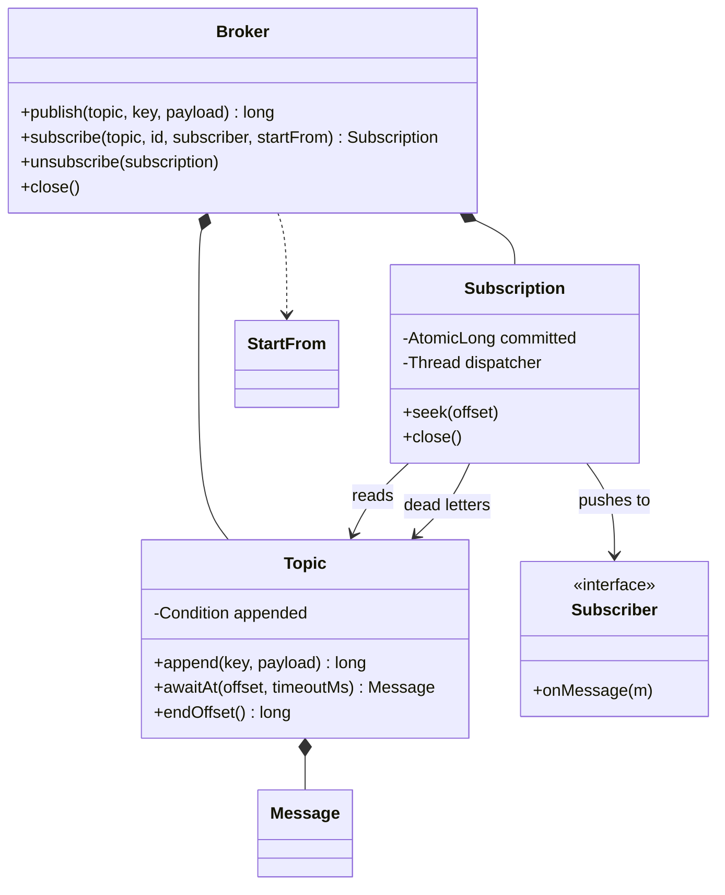

### Key flows

**Publish and fan-out:** dispatchers sleep on the topic's `Condition`; `publish` appends (offset N) and `signalAll()`s; each dispatcher independently delivers message N and commits N+1 — a slow one delays only itself.

**One subscription's dispatcher loop (at-least-once with dead letters):**

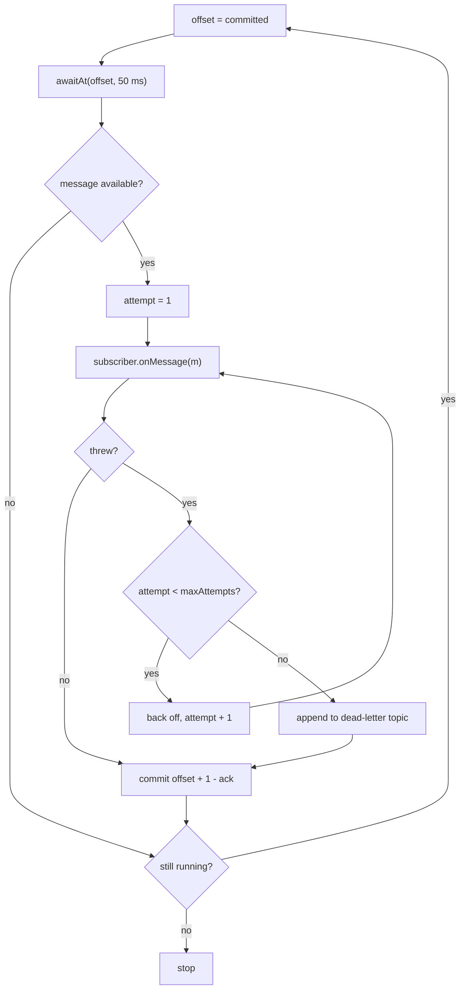

### Design decisions & patterns used

| Decision | Why | Alternative rejected |
|---|---|---|
| **Publish-Subscribe** (Observer via broker) | Add subscribers with zero publisher changes. | Publisher calling consumers directly. |
| **Append-only log + offsets** | Replay, late joiners, independent progress; order = log order. | Delete on delivery; per-subscriber copies. |
| **One dispatcher per subscription** (virtual threads) | Slow subscriber delays only itself; one deliverer keeps order; virtual threads make it cheap. | One shared thread (slowest blocks all); pool per message (loses order). |
| `Lock` + `Condition` with timeout, in a `while` | No busy-waiting; timeout notices `close()`/`seek()`; `while` handles spurious wake-ups. | `Thread.sleep` polling. |
| **Ack after processing** | At-least-once: a crash re-delivers. | Commit first = at-most-once. |
| **Dead-letter topic** | A poison message can't block forever. | Infinite retries. |
| `compareAndSet` on commit | A concurrent `seek()` wins. | Plain `set`. |

**Delivery guarantees:**

| Guarantee | How | Risk |
|---|---|---|
| At-most-once | Commit, then process | Crash loses the message |
| **At-least-once** (ours) | Process, then commit | Duplicates → subscribers must be **idempotent** |
| Exactly-once | At-least-once + dedup / transactions committing output and offset together | Complex; Kafka offers it within its own transactions |

### Java implementation

```java
// File: code/lld/ch20/pubsub/Topic.java
    // ... append(): under the lock, add to the log and appended.signalAll()
    /** Returns the message at 'offset', waiting up to the timeout for it to be published. */
    Message awaitAt(long offset, long timeoutMs) throws InterruptedException {
        lock.lock();
        try {
            long nanos = TimeUnit.MILLISECONDS.toNanos(timeoutMs);
            while (offset >= log.size()) {         // loop: guards against spurious wake-ups
                if (nanos <= 0) return null;
                nanos = appended.awaitNanos(nanos);
            }
            return log.get((int) offset);
        } finally {
            lock.unlock();
        }
    }

// File: code/lld/ch20/pubsub/Broker.java  (Subscription)
    private void loop() {
        try {
            while (running) {
                long offset = committed.get();
                Message m = topic.awaitAt(offset, 50);
                if (m == null) continue;              // timed out: re-check 'running' and any seek()
                deliver(m);
                committed.compareAndSet(offset, offset + 1); // ack; a concurrent seek() wins
            }
        } catch (InterruptedException e) {
            Thread.currentThread().interrupt();
        }
    }

    private void deliver(Message m) throws InterruptedException {
        for (int attempt = 1; attempt <= maxAttempts; attempt++) {
            try {
                subscriber.onMessage(m);
                return;
            } catch (Exception e) {
                if (attempt == maxAttempts) {
                    deadLetters.append(id, m.topic() + "@" + m.offset() + " " + m.payload() + " -> " + e.getMessage());
                    return;                           // skip it so one poison message cannot block the rest
                }
                Thread.sleep(5L * attempt);           // simple backoff
            }
        }
    }
    // ...
    void seek(long offset) { committed.set(offset); }
```

Full runnable code: code/lld/ch20/pubsub/ (see the Full Edition).

**Output (excerpt):**

```text
  inventory [0:order#1, 1:order#2, 3:order#3]  (offset 1 retried, offset 2 dead-lettered)
  dead letter: orders@2 BAD-JSON -> cannot parse
  live after replay [4:order#4, 3:order#3, 4:order#4] (order#4 seen twice: at-least-once)
```

### Concurrency & edge cases

- Publishers: `append` under a lock → unique, gap-free offsets; messages immutable.
- **Unbounded log:** real brokers apply **retention** (by age/size); a lagging subscriber may then fall off the end → detect "offset out of range" and reset.
- **Subscriber blocks forever:** stalls only its own subscription; add a processing timeout. Java 21 caveat: a virtual thread blocking inside `synchronized` *pins* its carrier thread — prefer `ReentrantLock` in subscriber code, or platform threads.
- **Duplicates:** subscribers must be idempotent (remember processed ids).
- **Shutdown:** `close()` flips `running` and joins; the 50 ms timeout bounds it.

### Extensions & follow-up questions

- **Consumer groups:** split a topic into **partitions**; same key → same partition (`hash(key) % n`) keeps per-key order; each group member owns partitions; offset per (group, partition). That is how Kafka scales.
- **Persist:** segment files + offset index; committed offsets in a special topic (`__consumer_offsets`).
- **Pull:** `poll(id, max)` + `commit(offset)` → back-pressure for free.
- Filtering by predicate, wildcard topics (`orders.*`), delayed retry topics (`orders.retry.5s`) instead of sleeping.

### Real-world example

**Apache Kafka** is this model at scale (partitioned append-only logs, consumer offsets, consumer groups, per-partition order, retention by time/size). **Google Cloud Pub/Sub** and **AWS SNS + SQS** offer managed fan-out with acks and **dead-letter** queues; Spring Kafka's `DeadLetterPublishingRecoverer` is our `__dead_letters`. In-JVM: Guava `EventBus`, Spring `ApplicationEventPublisher`.

### In the interview

**30-second answer:** "Each topic is an append-only log; publishing appends and returns an offset. Each subscription keeps a committed offset and its own dispatcher thread that waits on a condition, calls the subscriber, and commits only after success — at-least-once, in order. Failures retry with backoff, then go to a dead-letter topic. Messages aren't deleted on read, so late subscribers start at the beginning and anyone can replay. To scale: partitions by key, consumer groups."

**Follow-ups:** *Slow consumer?* → One dispatcher per subscription; the log is shared, progress isn't. *Exactly-once?* → Hard; at-least-once + idempotent consumers. *Order?* → One writer assigns offsets, one dispatcher per subscription; with partitions, order is per key.

### Self-check

1. What is an offset? → A message's position in the log; subscribers remember the next one.
2. Commit before or after processing for at-least-once? → After.
3. Why a dead-letter topic? → One poison message can't block a subscription forever.
4. Why does replay work here but not in a delete-on-ack queue? → Messages stay; seek moves the offset.
5. Why `while` around `Condition.await`? → Spurious wake-ups.

### TL;DR

- **Pub-sub = Observer through a broker.**
- **Append-only log + per-subscription offsets** → fan-out, late joiners, replay.
- **One dispatcher per subscription** (isolation + order); **ack after processing** = at-least-once.
- Retry, then **dead-letter**; subscribers **idempotent**; scale with partitions and consumer groups.

---

## 20.7 Design a Rate Limiter

### Problem & clarifying questions

**What it is.** Decides whether a request is allowed now, so one client can't overwhelm a service. Analogy: a turnstile allowing 10 people per minute per ticket type; over the limit: "come back in 6 seconds" — HTTP **429 Too Many Requests** with `Retry-After`. **Chapter 13 (the rate-limiter / token-bucket problem) already built the concurrency core** (a `synchronized` and a lock-free CAS token bucket, algorithm comparison). Here we design the **objects around it**: pluggable algorithms, rules per API and tier, a factory, combined limits, a decision object.

| Question | Assumed answer |
|---|---|
| Limit by? | (user, API); IP or API key is the same design, different key. |
| Different limits? | Per API and tier (FREE / PREMIUM), plus a default. |
| Algorithms? | Token bucket, fixed window, sliding log, sliding counter — per rule. |
| Several at once? | Yes: "2 per 10 s **and** 3 per minute" on `/login`. |
| Response? | allowed + remaining + retry-after. |
| Distributed? | Single process here; distributed in extensions. |

### Requirements

**Functional:** `check(userId, api)` → `Decision(allowed, remaining, retryAfter)`; rules per API + tier with a default; **one limiter per (user, api)**, created on first use; pluggable algorithms; combined rules must all allow.

**Non-functional:** ~O(1) per check; exactly N allowed under any concurrency; injectable clock; bounded memory.

### Use cases

Actors: **Client** (sends requests), **API gateway / filter** (calls `check` before the handler), **Operator** (configures rules and tiers).

### Core entities

| Class | Responsibility |
|---|---|
| `Limiter` | **Strategy**: `probe()` (would one more pass? consumes nothing), `commit()`, `tryAcquire()` = both atomically. One per key. |
| `TokenBucket`, `FixedWindow`, `SlidingWindowLog`, `SlidingWindowCounter` | The algorithms (`synchronized`). |
| `CompositeLimiter` | **Composite**: all children must allow; probe all, then commit all, under one lock. |
| `Decision`, `LimitRule`, `Algorithm`, `Tier` | Result; config (algorithm, limit, window); enums. |
| `LimiterFactory` | **Simple Factory**: rule(s) → limiter (single or composite). |
| `RateLimiterService` | **Facade**: resolves tier + rules, one limiter per (user, api) in a `ConcurrentHashMap`. |
| `Ticker` | Injected nanosecond clock. |

### Class diagram

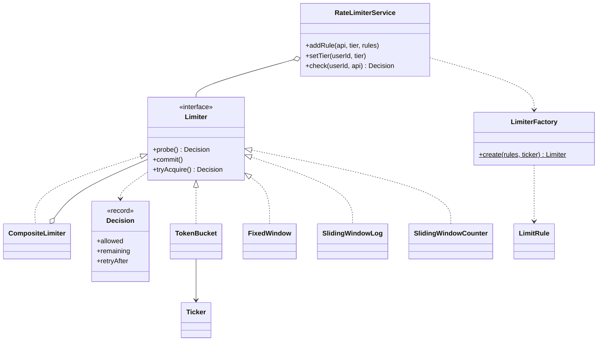

### Key flows

Gateway → `check("ann", "/search")` → `limiters.computeIfAbsent(key)` (first time: factory builds the limiter from the FREE-tier rules) → `tryAcquire()` → allowed: call the handler, 200; denied: **429 + Retry-After**.

**The four algorithms** (limit N per window W):

| Algorithm | State per key | Bursts | Accuracy | Notes |
|---|---|---|---|---|
| Token bucket | tokens, last refill | Up to capacity | Good | Most common for APIs |
| Fixed window counter | window start, count | **Up to 2N across a boundary** | Poor at edges | Simplest |
| Sliding window log | one timestamp per request | None beyond N | Exact | O(N) memory per key |
| Sliding window counter | 2 counters | Approximate | Good | previous × overlap + current |
| (Leaky bucket) | a queue | Constant output rate | — | Traffic shaping; not implemented |

### Design decisions & patterns used

| Decision | Why | Alternative rejected |
|---|---|---|
| **Strategy** (`Limiter`) | Algorithms differ in accuracy/memory; new one = new class. | `switch` in `check`. |
| **Simple Factory** | One place turns config into objects. | `new TokenBucket` in the service. |
| **Composite**, **probe all then commit all** | "10/s and 1000/day" looks like one limiter; a request denied by one child uses up nothing in another. | Calling each child's `tryAcquire` in turn (a later denial leaves earlier children charged). |
| **Facade** service | Gateway asks one question. | Gateway juggling tiers/rules. |
| `computeIfAbsent` per key | Exactly one limiter even if the first two requests race. | `get` then `put`. |
| `Decision` with remaining/retryAfter | Maps to `X-RateLimit-Remaining`, `Retry-After`. | `boolean`. |
| Injected `Ticker`; `synchronized` probe+commit | Tests never sleep; refill + check + take is one atomic step. | `nanoTime()` inside; unsynchronized fields. |

### Java implementation

```java
// File: code/lld/ch20/ratelimiter/Limiters.java
interface Limiter {
    Decision probe();

    void commit();

    /** Check and take in ONE atomic step (probe + commit under this limiter's lock). */
    default Decision tryAcquire() {
        synchronized (this) {
            Decision d = probe();
            if (d.allowed()) commit();
            return d;
        }
    }
}

/** Token bucket: bursts up to 'capacity', refills at 'perSecond'. Lazy refill, no background thread. */
final class TokenBucket implements Limiter {
    // ... capacity, refillPerNano, ticker, tokens, last
    @Override
    public synchronized Decision probe() {
        long now = ticker.nanos();
        tokens = Math.min(capacity, tokens + (now - last) * refillPerNano); // refilling is safe to do early
        last = now;
        if (tokens >= 1) return Decision.allow((long) (tokens - 1));
        long waitNanos = refillPerNano == 0 ? Long.MAX_VALUE : (long) Math.ceil((1 - tokens) / refillPerNano);
        return Decision.deny(Duration.ofNanos(waitNanos));
    }

    @Override
    public synchronized void commit() { tokens -= 1; }
}
// ... FixedWindow, SlidingWindowLog, SlidingWindowCounter

final class CompositeLimiter implements Limiter {
    private final List<Limiter> children;
    // ...
    @Override
    public synchronized Decision probe() {
        long remaining = Long.MAX_VALUE;
        for (Limiter l : children) {
            Decision d;
            synchronized (l) { d = l.probe(); }
            if (!d.allowed()) return d;           // first denial wins; nothing has been consumed
            remaining = Math.min(remaining, d.remaining());
        }
        return Decision.allow(remaining);
    }

    @Override
    public synchronized void commit() {
        for (Limiter l : children) synchronized (l) { l.commit(); }
    }
}

// File: code/lld/ch20/ratelimiter/RateLimiterService.java
    Decision check(String userId, String api) {
        // computeIfAbsent creates exactly ONE limiter per (user, api), even under a race
        Limiter limiter = limiters.computeIfAbsent(new Key(userId, api), k -> {
            Tier tier = tiers.getOrDefault(userId, Tier.FREE);
            List<LimitRule> r = rules.getOrDefault(api, Map.of()).getOrDefault(tier, defaultRules);
            return LimiterFactory.create(r, ticker);
        });
        return limiter.tryAcquire();
    }
```

Full runnable code: code/lld/ch20/ratelimiter/ (see the Full Edition).

Composite children are created for it alone by the factory and never shared, so the composite's lock makes probe-all + commit-all atomic.

**Output (excerpt):**

```text
  t=0.0 ann /search #4 -> 429 Too Many Requests (retry after 1000 ms)
== 4. Boundary burst: limit 5 per 10 s, 5 calls at t=9.9 and 5 at t=10.1
  FIXED_WINDOW     allowed 10 of 10 within 0.2 s
  SLIDING_LOG      allowed 5 of 10 within 0.2 s
  SLIDING_COUNTER  allowed 5 of 10 within 0.2 s
  allowed = 50 (exactly 50, never more)
```

The classic point: **fixed window lets 10 through in 0.2 s** across a boundary; both sliding algorithms hold at 5. 640 concurrent attempts on a 50-token bucket → exactly 50.

### Concurrency & edge cases

- Contention is per key (each limiter `synchronized`; map is `ConcurrentHashMap`), so different users never block each other.
- **Naive composite bug:** child 1 allows (and consumes), child 2 denies → child 1 is charged for a request that never ran. The demo's "3 per minute first" case shows the +11s call would wrongly be refused for ~49 s. Probe-then-commit fixes it (acquire-and-refund is the harder alternative).
- **Memory:** one limiter per key forever → evict idle limiters (expire-after-access cache, as in 20.3) with idle timeout ≥ the longest window — a fresh limiter then behaves identically.
- Monotonic clock; rule changes at runtime need clearing or versioning the limiter map.

### Extensions & follow-up questions

- **Distributed:** shared state in Redis with an atomic Lua script (or `INCR` + `EXPIRE` for fixed windows); costs a network hop — mitigate with local token pre-allocation or sticky routing.
- **Leaky bucket:** bounded queue drained at a constant rate (protects fragile downstreams).
- Cost per request (`tryAcquire(permits)`), soft limits (warn at 80%), key by IP when logged out; runs in an API gateway or servlet filter / Spring `HandlerInterceptor`.

### Real-world example

**Stripe** described combining a token-bucket request limiter, a concurrent-requests limiter and load shedders on Redis — the composite idea. **GitHub** returns `X-RateLimit-Limit/Remaining/Reset` (our `Decision`). HTTP 429 is RFC 6585. **NGINX** `limit_req` uses leaky bucket. Java: Guava `RateLimiter`, Resilience4j, **Bucket4j**. Cloudflare uses the sliding-window-counter approximation at the edge.

### In the interview

**30-second answer:** "A `Limiter` interface with interchangeable algorithms — token bucket by default, sliding window when exactness matters. A factory builds limiters from rules chosen by API and tier; a composite combines '10 per second and 1000 per day'. The service keeps one limiter per (user, api) via `computeIfAbsent` and returns remaining and retry-after for the 429. Each limiter makes refill-check-take atomic; for many servers, move state into Redis with an atomic script."

**Follow-ups:** *Why is fixed window risky?* → Up to 2N across a boundary. *Token bucket vs sliding log?* → Bucket: bursts, O(1) memory; log: exact, stores every timestamp.

### Self-check

1. Burst up to capacity, then a steady rate? → Token bucket.
2. Fixed window of 5 across a boundary in 0.2 s? → Up to 10.
3. Pattern making two rules look like one limiter? → Composite.
4. Why must refill + check + take be atomic? → Two threads could both take the last token.
5. Why probe every child before committing? → A request denied by one rule must not use a slot in another.

### TL;DR

- **Strategy** algorithms, **Factory** from rules, **Composite** (probe all, commit all), **Facade** service.
- One limiter per (user, api) via `computeIfAbsent`; `Decision` → 200 or 429 + Retry-After.
- Token bucket (bursty, O(1)), fixed window (2× edge burst), sliding log (exact, O(N)), sliding counter (approx, O(1)).
- Atomic refill-check-take (Chapter 13); Redis + Lua when distributed.

---

## 20.8 Chapter summary

| Component | Anchor pattern(s) | The one sentence to remember |
|---|---|---|
| Splitwise | Strategy | Split rules return shares; ledger = one signed number per pair; simplify with net positions + greedy (≤ n − 1). |
| Ledger Co. (full case in Chapter 21) | — | A loan ledger: same "one authoritative record + `BigDecimal`" idea, different rules. |
| Notification service | Template Method + Strategy + Observer | Retry once in the parent, one class per reason not to send, one exit that tells listeners. |
| In-memory cache | Strategy + Observer | HashMap + doubly linked list; policy owns the order; one removal path. |
| LRU cache | — (data structure) | Map to node, move to front on use, evict before tail; or `LinkedHashMap(accessOrder=true)`. |
| Ride sharing | Strategy + Decorator + state machine | Ranked list for declines, surge wraps pricing, atomic driver claim. |
| Carpool variant | Strategy | Offer seats per vehicle; select with Most Vacant / Preferred Vehicle. |
| Logging framework | Chain of Responsibility + Singleton + Decorator | Hierarchy with inherited levels; propagate up until additivity stops; async is a wrapper. |
| Pub-sub | Observer via broker | Append-only log + offsets; ack after processing; dead letters. |
| Rate limiter | Strategy + Factory + Composite | One limiter per key; swappable algorithms; 429 + Retry-After. |

**Common thread:** the part most likely to change sits behind an interface, and the service only orders the steps. "Now add X" → a new class plus a one-line wiring change.

## 20.9 Chapter self-check

1. Two patterns in more than half the designs? → Strategy and Observer.
2. Strategy vs Decorator? → Strategy *replaces* a rule; Decorator *wraps* one and adds to its result.
3. Strategy vs Template Method? → Strategy swaps the whole algorithm (composition); Template Method fixes it and lets subclasses fill steps (inheritance).
4. Which designs used a "single exit", and why? → Notification (`finish`) and cache (`remove`): records, stats and listeners can't be skipped.
5. Three uses of CAS / `computeIfAbsent` for correctness? → Driver claim (`AtomicBoolean`), subscription commit (`AtomicLong.compareAndSet`), limiter creation (`computeIfAbsent`).

## 20.10 Chapter TL;DR

- Interviews probe the **rule most likely to change** — put it behind an interface.
- **Strategy** everywhere; **Observer** for "tell someone"; **Decorator** to add behaviour (surge, async); **Template Method** for a shared algorithm with one varying step; **Chain of Responsibility** for the logger hierarchy; **Composite** for combined limits.
- `BigDecimal` money; injected clocks; the smallest correct concurrency tool (one lock, CAS, `computeIfAbsent`, per-key locks, sharding).
- Volunteer the honest limits: greedy isn't optimal, LRU needs a write lock, at-least-once duplicates, fixed windows burst at edges.
