# Chapter 21 — Case Studies: Machine-Coding Round Problems

> **Goal.** Chapters 14–20 taught you to *design* a system on a whiteboard. This chapter trains the harder cousin of that interview: the **machine-coding round**, where you get a written problem statement, 90–120 minutes, and must hand over **running code** that the interviewer will feed their own inputs into. You will learn how the round is scored, a project skeleton you can type from memory, a minute-by-minute time plan, and then eight real problems — each solved end to end with a working, demo-able Java program.

**How each problem is laid out:** *Problem & clarifying questions → Requirements → Use cases → Core entities → Class diagram → Key flows → Design decisions & patterns → Java implementation (+ real output) → Concurrency & edge cases → Extensions → In the interview → Self-check → TL;DR.*

All code is Java 21, standard library only, one package per problem under `code/lld/ch21/<name>/`. Run from `chapters/21-case-machine-coding/code`:

```text
javac --release 21 -d /tmp/lld_21 $(find . -name '*.java')
java -cp /tmp/lld_21 lld.ch21.taskmgmt.Main       # or wallet, calendar, codingblox, propertyhunt, ledger, inventory, filesearch
```

Every demo uses a fixed clock, a seeded random generator, or sorted output, so what you see below is exactly what you get on every run.

**Problem map**

| # | Problem | Where it is asked (source) | The one idea that makes it work | Patterns |
|---|---|---|---|---|
| 21.1 | Task Management System | awesome-low-level-design | Status *state machine* + composable filters | State (enum), Specification, Strategy, Observer |
| 21.2 | Digital Wallet Service | awesome-low-level-design | `BigDecimal` money, idempotency keys, lock ordering | Strategy (offers), Facade |
| 21.3 | Event Calendar | Flipkart (kumaransg/LLD) | Half-open intervals + a boundary *sweep* to find free slots | Strategy (representative choice), Repository |
| 21.4 | Coding Blox (LeetCode-like platform) | Flipkart (kumaransg/LLD) | Command dispatcher + level-based scoring rule | Command, Strategy, Repository |
| 21.5 | PropertyHunt | ClearTrip (kumaransg/LLD) | Optional search criteria → list of predicates; unit normalisation | Builder, Specification, Strategy |
| 21.6 | Ledger Co (loans & EMIs) | Navi (kumaransg/LLD, Geektrust) | Derive balances from facts instead of storing them | Strategy (interest), Command |
| 21.7 | Inventory Management System | Common (Amazon/Flipkart-style) | Append-only movement ledger + per-SKU lock | Strategy (allocation), Observer (reorder) |
| 21.8 | Unix File Search (`find`) | Common OOD/machine-coding question | Filters as Specifications combined by Composite AND/OR/NOT; Builder for criteria; a parser for `find` syntax | Specification, Composite (×2), Builder, Interpreter-style parser |

(Food ordering "FoodKart", another kumaransg/LLD problem, is solved in Chapter 19.)

---

## 21.0 How the machine-coding round works

### What it is

A **machine-coding round** (also called an *LLD coding round*) is an object-oriented design interview in which **working code is the answer**. The same round is called *object-oriented design* or *low-level design* at other companies; machine coding simply adds the rule that the code must compile and run at the end. You get a one- or two-page problem statement (usually a PDF), a laptop with your own IDE, and 90–120 minutes. Internet use is limited to looking up syntax. There is **no database, no UI and no web framework**: all data lives in memory (maps and lists), and the program is driven by a `main` method, a list of commands, a file, or unit tests.

Do not confuse it with the **system design** interview. That round is about keeping a product alive under millions of users, so the conversation is about servers, databases, caches and message queues. This round never leaves a single program: its vocabulary is **classes** (a *class* is a named code type that bundles some data with the methods that act on that data), their fields and methods, and how the classes relate. Same product, very different zoom level — and practising for one leaves you unready for the other.

Everyday analogy: a whiteboard design interview is an architect *describing* a house. A machine-coding round is being asked to *build a small shed* while the inspector watches — then the inspector leans on every wall.

The format is especially common at Indian product companies such as Flipkart, Swiggy, PhonePe, Navi, Razorpay, CRED, Meesho and Cleartrip; several of this chapter's problems are statements candidates have shared from those rounds.

### How it is judged

Interviewers use a rubric. The exact wording differs by company, but it always covers the same things. Read the "Expectations" section of any statement in this chapter (Coding Blox, PropertyHunt and Event Calendar all have one) and you will see these repeated almost word for word.

| # | Criterion | What the interviewer checks | How to score well |
|---|---|---|---|
| 1 | **Working, demo-able code** | Does it compile? Does the driver run the sample input and print the expected output? Does it survive *their* inputs? | Get a thin end-to-end path working in the first hour. Never finish with code that does not compile. |
| 2 | **Functional completeness** | Every *mandatory* requirement done; bonus only after that. | Implement requirements in the statement's order; tick them off. |
| 3 | **Clean models** | Entities have one job, fields are private, invariants live inside the entity (for example a task refuses an illegal status change). | Use enums for fixed sets, records for values, classes for things that change. |
| 4 | **Service interfaces / separation of concerns** | Parsing, business logic and storage are in different classes. No `System.out` inside services. | Driver → Service → Repository layers (skeleton below). |
| 5 | **Extensibility** | "Add a new offer / sort order / scoring rule" should mean *adding a class*, not editing `if` chains. | Strategy and Specification for things the statement says "can be X or Y". |
| 6 | **Edge cases & failure handling** | Unknown IDs, duplicates, invalid input, wrong user, double-run. The program prints a clear error and **keeps going**. | Custom exceptions with good messages; the driver catches them per command. |
| 7 | **Readability** | Intuitive names, small methods, no copy-paste. | Name classes after nouns in the statement; name methods after verbs in it. |
| 8 | **Concurrency (when asked)** | Wallets, inventory, booking: can two threads corrupt state? | Say where the lock is and why; demo it with a thread pool if time allows. |
| 9 | **Tests (bonus)** | Some companies give extra credit for unit tests. | A tiny `assert`-style self-check in `main` is enough if there is no JUnit. |

### The five-step method, and how the clock changes it

The whiteboard version of this round (Chapter 1) always follows five steps in a fixed order:

1. **Requirements** — turn the one-line prompt into a short written list of what the system must do.
2. **Actors and use cases** — name *who* uses the system (actors) and *what* each of them does with it (use cases).
3. **Classes** — derive classes from the requirements and give each one responsibility.
4. **Relationships** — decide how each pair of classes is connected and draw it as a class diagram.
5. **Code** — implement the key classes, plus the two or three methods that make the main flows work.

Getting the order right beats going fast: each step is the input of the next, so if you skip requirements, you end up inventing classes nobody asked for. Every problem in this chapter is laid out in that same order.

A whiteboard round usually lasts 45 minutes to an hour. A budget for the 45-minute version:

| Step | Minutes | Finished artefact |
|---|---|---|
| Requirements | 5–8 | 8–12 written requirements |
| Actors & use cases | 3–5 | 2–4 actors, 6–10 use cases |
| Classes | 8–10 | Class list, one responsibility each |
| Relationships | 8–10 | Class diagram with relationships and multiplicity |
| Code | 12–15 | 2–3 methods for the main flows |

Two things in that table catch people off guard. The first two steps — which name no class at all — may take as much as a quarter of the time. And coding gets the biggest single slot yet still covers only two or three methods: nobody finishes the whole product, and you are graded on the slice you chose to build well, not on how much ground you covered. **Machine coding keeps the five steps but flips the proportions:** steps 1–4 shrink to about 20 minutes (see the time plan below) and code fills the rest, because now every mandatory feature must actually run.

**How big is a complete answer?** For a parking lot, roughly twelve requirements lead to about twelve classes joined by some fifteen relationships. Only three of them carry the main flows — issuing a ticket, holding a vehicle, pricing the stay. On a whiteboard you write those three properly and describe each of the other nine in one sentence. The costliest mistake is detailing all twelve equally: it looks thorough but leaves no time to demonstrate one complete flow. In machine coding the same instinct applies — make one thin path run end to end first, then widen.

Beyond "does it run", the interviewer is watching five things:

- **Scope** — did you pin down a bounded list of what you will build? A well-bounded design outranks a sprawling, open-ended one.
- **One job per class** — can you describe every class in a single sentence? A class that needs two sentences is usually two classes.
- **Relationships** — does a class *hold* another, *own* it, or *extend* it? These are different designs, and picking the wrong one is spotted immediately.
- **Code and model agree** — if the code contains a method your model has no place for, either the model or the code needs fixing.
- **A trade-off** — the option you took *and* the one you turned down, both said out loud.

Notice what is missing: nobody grades your UML notation or counts how many diagram types you drew. The model is what gets marked; a diagram is just one way of displaying it.

The single most common failure is **running out of time with nothing that runs**. The second is a "god class": one `Manager` with every map and every method. Both are avoidable with the skeleton and time plan below.

### A reusable project skeleton

Type this structure from memory in the first five minutes. It is the same for every problem, which is exactly why it saves time.

```text
src/
  model/          entities & value objects      (Task, Wallet, Loan, Property ...)   - enums, records, small classes
  repository/     storage contracts + in-memory (TaskRepository, InMemoryTaskRepository)
  service/        business rules, one per area  (TaskService, WalletService)          - no printing, no parsing
  strategy/       pluggable rules               (Offer, AllocationStrategy, SortBy)
  exception/      domain exceptions             (NotFoundException, InsufficientFundsException)
  driver/         Main + CommandProcessor       (parses input, calls services, prints output)
```

| Layer | Knows about | Must NOT know about | Why |
|---|---|---|---|
| **model** | nothing but itself (and other models) | services, storage, console | Entities guard their own invariants (e.g. `Task.changeStatus` rejects `TODO → DONE`). |
| **repository** | model | services, console | Swapping `HashMap` for a DB later touches only this layer (Dependency Inversion, Chapter 4). |
| **service** | model, repository *interfaces*, strategy *interfaces* | concrete repositories (injected), console | This is the part the interviewer reads most carefully. |
| **strategy** | model | services | Each "X or Y" rule in the statement becomes one interface + small classes (Open/Closed). |
| **exception** | — | — | One class per failure *kind*, with a message a user could read. |
| **driver** | services | repositories' internals | Parsing and printing are replaceable; business logic is not. |

In this book each problem lives in **one Java package** (for example `lld.ch21.wallet`) so the full listing stays short and readable. In the real round, create the sub-packages above — it costs nothing and the interviewer notices. Three reusable building blocks appear again and again:

1. **A generic in-memory repository** — a `ConcurrentHashMap<K, V>` behind an interface with `save / findById / findAll / delete` (see `Repository<K,V>` in Coding Blox, 21.4).
2. **An ID generator** — an `AtomicInteger` per entity type (`"T" + seq.incrementAndGet()`), thread-safe and predictable, which matches statements that say "auto-increment id starting with 1".
3. **A command processor** — a `Map<String, Consumer<String[]>>` from command name to handler, fed by a built-in `List<String>` of sample commands (Coding Blox, PropertyHunt, Ledger). Adding a command = adding one map entry (Command pattern, Chapter 10).

### The 90-minute time plan

| Minutes | Activity | Output you should have |
|---|---|---|
| 0–10 | Read the statement twice. Ask clarifying questions. Mark mandatory vs bonus. Write the sample input as your driver's input list. | A numbered requirement list, a list of questions answered. |
| 10–20 | Nouns → entities, verbs → service methods. Pick the 1–2 patterns the statement is begging for ("can be sorted by X or Y" → Strategy). | Skeleton packages created, enums and records typed. |
| 20–60 | Implement mandatory requirements **in order**, running the driver after each one. | Sample input produces the sample output. |
| 60–75 | Edge cases and validation: unknown ids, duplicates, wrong owner, invalid numbers. Custom exceptions. | Driver prints errors and continues. |
| 75–85 | Bonus features (only if all mandatory ones work). Thread-safety where money or stock is involved. | Bonus commands in the driver. |
| 85–90 | Clean up names, delete dead code, run everything one last time. Prepare a 2-minute walkthrough. | Code that compiles, a demo, a story. |

A good rule: **run the program at least every 15 minutes**. A compile error found at minute 88 is a disaster; the same error found at minute 30 is a 20-second fix.

### What to say in the first two minutes

1. "I'll keep everything in memory with a repository interface, so a DB can be added later without touching services."
2. "I'll drive it from `main` with the sample commands from the statement, and print errors without crashing."
3. "The mandatory list is A, B, C; the bonus is D, E. I'll do A–C first."
4. "Where does it need to be thread-safe?" (Ask. For wallets and inventory the answer is always yes.)

### Common mistakes in this round

| Mistake | Why it hurts | Do this instead |
|---|---|---|
| Starting with a perfect class diagram for 20 minutes | No time left for code | Enums/records first; the diagram lives in your head and in names |
| One `Manager` class with 15 maps | Fails "separation of concerns" | One service per area + repositories |
| `System.out.println` inside the service | Service cannot be reused or tested | Services return data; the driver prints |
| `double` for money | `0.1 + 0.2 != 0.3` — interviewers test this | `BigDecimal` with a fixed scale (21.2) or whole units (`long` paise) |
| Crashing on the first bad command | "Fails gracefully" is an explicit criterion | Catch domain exceptions in the driver loop, print, continue |
| Implementing bonus before mandatory | Partial credit on the mandatory part | Mandatory in order; bonus last |
| Writing every class in full detail | Nothing works end to end when time runs out | Make the core flow run first; stub or name the rest |
| `Random` without a seed | Output changes every run; hard to demo | Seed it, or put randomness behind a Strategy (21.4) |
| Hard-coding "today" with `LocalDate.now()` | Demo changes daily | Inject a `java.time.Clock` (21.1, 21.2) |

### Real-world examples

The skeleton above is the standard layering of real Java back ends: in a Spring Boot service, controllers play the "driver" role, `@Service` classes hold business rules, and `@Repository` interfaces (Spring Data) hide storage. The in-memory repository you write in the round is exactly the kind of fake that teams use in unit tests for those services.

### In the interview

**30-second answer — "How do you approach a machine-coding problem?"** "I read the statement twice, list mandatory and bonus requirements and ask about anything ambiguous. I set up model / repository / service / strategy / exception / driver packages, put the sample input into the driver, and implement requirements one by one, running after each. Services return data and throw domain exceptions; the driver prints and keeps going. I finish with edge cases, thread-safety where state is shared, and bonus features if time allows."

**Follow-ups**
- *"Why an interface for an in-memory repository?"* — So services depend on an abstraction; a JDBC or Redis implementation can replace it with no change to business code, and tests can use the in-memory one.
- *"How do you make random behaviour testable?"* — Put it behind an interface (a Strategy) and inject a seeded or scripted implementation for demos and tests.
- *"How much do you test?"* — At minimum, the driver replays the statement's samples and prints results I can compare with the expected output. With time, a few JUnit tests on the service layer.

### Self-check

- **Q:** Name the six packages of the skeleton. → **A:** model, repository, service, strategy, exception, driver.
- **Q:** Where should `System.out.println` live? → **A:** Only in the driver (command processor / `Main`).
- **Q:** What do you do at minute 60 if the bonus is tempting but one mandatory requirement is missing? → **A:** Finish the mandatory one; bonus only after all mandatory ones run.
- **Q:** Why inject a `Clock`? → **A:** So time-based logic (due dates, reminders) gives the same output on every run and can be tested.

### TL;DR

Working code first, clean layering second, patterns where the statement asks for variation, graceful errors everywhere. Skeleton: **model → repository → service → strategy → exception → driver**. Run often.

---

## 21.1 Design a Task Management System

### Problem & clarifying questions

Build the core of a tool like Jira, Asana or Trello: users create tasks, assign them to people, move them through statuses, comment on them, and search/filter them; the system reminds people about tasks that are due. The awesome-low-level-design version asks for create / update / delete, title + description + due date + priority + status, assignment, reminders, search and filtering (by priority, due date, assignee), marking tasks complete, task history, and safe concurrent access.

Questions to ask (with the answers this solution assumes):

| Question | Assumed answer |
|---|---|
| Which statuses exist, and can any status go to any other? | TODO, IN_PROGRESS, BLOCKED, DONE, CANCELLED. Only listed transitions are legal (e.g. TODO cannot jump straight to DONE; CANCELLED is final; DONE can be re-opened). |
| One assignee or many? | One assignee (nullable). A list is an easy extension. |
| What does "reminder" mean in a console app? | A method a scheduler would call: "notify owners of open tasks due within N days or overdue". |
| Should due dates in the past be allowed? | No, not on creation. |
| How are notifications delivered? | Through a listener interface; the demo prints them. |
| "View task history" — history of what? | Two readings: each task's audit log (who changed what, when) — built here — and a user's list of finished tasks, which is just a search: `assignedTo(u).and(withStatus(DONE))`. |
| "Set reminders" — per task, or a sweep? | A sweep over due dates is built here; a per-task reminder time is an extension (below). |

### Requirements

**Functional**
1. Register users.
2. Create a task (title, description, priority, due date); update title / priority / due date; delete a task.
3. Assign / reassign a task to a user.
4. Change status following the allowed transitions; mark done.
5. Comment on a task.
6. Search with any combination of filters (assignee, status, minimum priority, due before, open only, title contains) and a sort order (due date, priority, id).
7. Reminders for open tasks due soon or overdue.
8. Per-task activity history.

**Non-functional**
- Thread-safe: two people editing the same task must not corrupt it.
- Extensible: new filters, sort orders and notification channels without editing existing code.
- Deterministic demo (injected `Clock`).

### Use cases

| Actor | Use cases |
|---|---|
| **Task creator** (any user) | create task, update, delete, assign, comment, search |
| **Assignee** | change status, comment, see own tasks |
| **Scheduler** (system actor) | send due-date reminders |
| **Notification channel** (external) | receives events (assigned, status changed, commented, reminder) |

### Core entities

| Class | Kind | Responsibility |
|---|---|---|
| `Task` | class | Holds task data; enforces legal status changes; records its own history. All mutators `synchronized`. |
| `TaskStatus` | enum | Lists statuses and, for each, which statuses it may move to (a tiny state machine). |
| `Priority` | enum | LOW < MEDIUM < HIGH < CRITICAL (enum order is used for comparison). |
| `User`, `Comment`, `Activity` | records | Immutable values. |
| `TaskRepository` / `InMemoryTaskRepository` | interface / class | Storage contract and a `ConcurrentHashMap` implementation. |
| `TaskFilter` | functional interface | Composable predicate (Specification pattern) with factory methods and `and` / `or`. |
| `TaskSort` | enum | Named comparators (Strategy). `BY_ID` compares the number inside the id, so `T2` sorts before `T10`. |
| `TaskEventListener` / `ConsoleNotifier` | interface / class | Observer for notifications. |
| `TaskService` | class | Facade with every use case; validates input, uses the clock, fires events. |
| `NotFoundException`, `InvalidTransitionException` | exceptions | Clear failure messages. |

### Class diagram

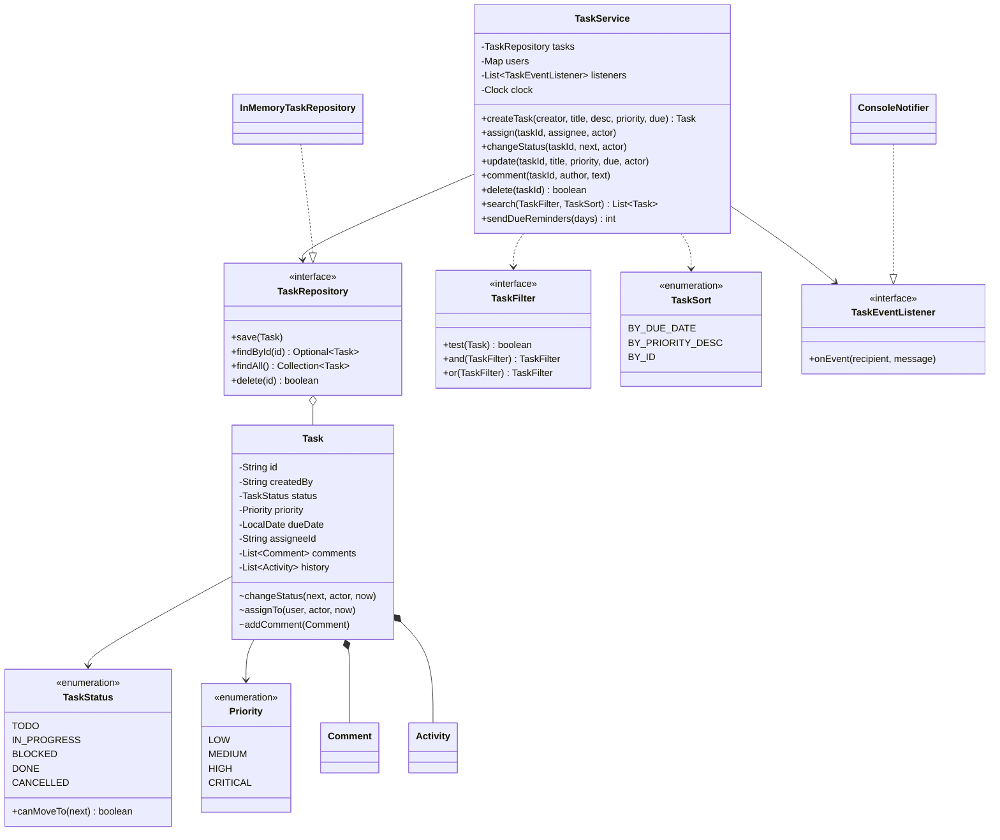

### Key flows

**Task status life cycle** — the rules live in `TaskStatus.allowedNext()`:

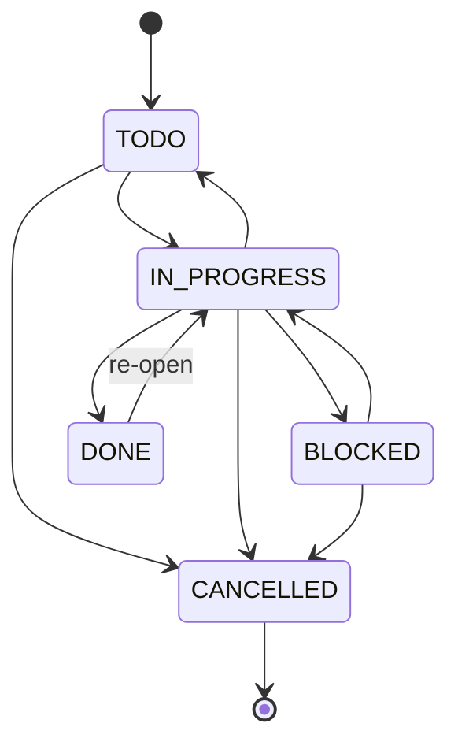

**Change status and notify:**

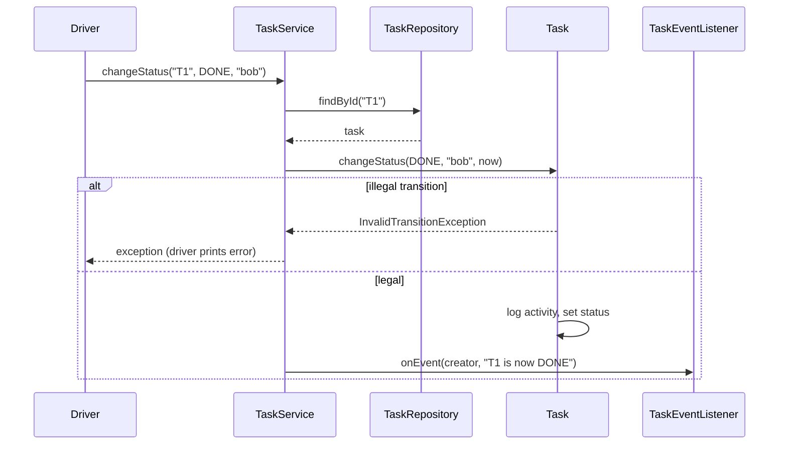

### Design decisions & patterns used

| Decision | Pattern | Why | Alternative rejected |
|---|---|---|---|
| Transitions stored in the `TaskStatus` enum | State (enum-based) | All rules in one place; `Task` just asks `canMoveTo`. | Full State pattern with one class per status — overkill when states carry no behaviour besides transitions. |
| `TaskFilter extends Predicate<Task>` with `and/or` | Specification | Any combination of filters without a method per combination; a new filter is one factory method. | `search(String assignee, Status s, Priority p, ...)` with many nullable parameters — grows forever. |
| `TaskSort` enum of comparators | Strategy | Sort order is data the caller picks. | `switch` on a sort string inside the service. |
| `TaskEventListener` list | Observer | Email/Slack/push can be added without touching the service. | Calling `System.out` from the service. |
| `TaskService` as the only entry point | Facade | Driver sees one simple API. | Driver talking to repositories directly. |
| `Clock` injected | Dependency injection | Deterministic reminders and tests. | `LocalDate.now()` scattered in code. |
| `synchronized` on `Task` mutators | Monitor per entity | Fine-grained: two different tasks never block each other. | One global lock on the service — simpler but serialises everything. |

### Java implementation

```java
// File: lld/ch21/taskmgmt/Priority.java
package lld.ch21.taskmgmt;

/** Ordered from least to most urgent, so natural enum order can be used for sorting. */
public enum Priority { LOW, MEDIUM, HIGH, CRITICAL }
```

```java
// File: lld/ch21/taskmgmt/TaskStatus.java
package lld.ch21.taskmgmt;

import java.util.EnumSet;
import java.util.Set;

/** Task lifecycle. Each status knows which statuses it may move to (a tiny state machine). */
public enum TaskStatus {
    TODO, IN_PROGRESS, BLOCKED, DONE, CANCELLED;

    public Set<TaskStatus> allowedNext() {
        return switch (this) {
            case TODO -> EnumSet.of(IN_PROGRESS, CANCELLED);
            case IN_PROGRESS -> EnumSet.of(BLOCKED, DONE, TODO, CANCELLED);
            case BLOCKED -> EnumSet.of(IN_PROGRESS, CANCELLED);
            case DONE -> EnumSet.of(IN_PROGRESS);          // re-open
            case CANCELLED -> EnumSet.noneOf(TaskStatus.class);
        };
    }

    public boolean canMoveTo(TaskStatus next) { return allowedNext().contains(next); }

    public boolean isOpen() { return this != DONE && this != CANCELLED; }
}
```

```java
// File: lld/ch21/taskmgmt/User.java
package lld.ch21.taskmgmt;

public record User(String id, String name) { }
```

```java
// File: lld/ch21/taskmgmt/Comment.java
package lld.ch21.taskmgmt;

import java.time.LocalDateTime;

public record Comment(String authorId, String text, LocalDateTime at) { }
```

```java
// File: lld/ch21/taskmgmt/Activity.java
package lld.ch21.taskmgmt;

import java.time.LocalDateTime;

/** One line of a task's audit history ("who did what, when"). */
public record Activity(LocalDateTime at, String actorId, String description) {
    @Override public String toString() { return at.toLocalTime() + " " + actorId + ": " + description; }
}
```

```java
// File: lld/ch21/taskmgmt/Task.java
package lld.ch21.taskmgmt;

import java.time.LocalDate;
import java.time.LocalDateTime;
import java.util.ArrayList;
import java.util.List;

/**
 * The central entity. All mutators are synchronized so two threads editing
 * the same task cannot interleave (e.g. a status change racing a reassignment).
 */
public class Task {
    private final String id;
    private final String createdBy;
    private String title;
    private String description;
    private Priority priority;
    private LocalDate dueDate;
    private TaskStatus status = TaskStatus.TODO;
    private String assigneeId;                 // null = unassigned
    private final List<Comment> comments = new ArrayList<>();
    private final List<Activity> history = new ArrayList<>();

    Task(String id, String createdBy, String title, String description, Priority priority, LocalDate dueDate) {
        this.id = id;
        this.createdBy = createdBy;
        this.title = title;
        this.description = description;
        this.priority = priority;
        this.dueDate = dueDate;
    }

    public String id() { return id; }
    public String createdBy() { return createdBy; }
    public synchronized String title() { return title; }
    public synchronized String description() { return description; }
    public synchronized Priority priority() { return priority; }
    public synchronized LocalDate dueDate() { return dueDate; }
    public synchronized TaskStatus status() { return status; }
    public synchronized String assigneeId() { return assigneeId; }
    public synchronized List<Comment> comments() { return List.copyOf(comments); }
    public synchronized List<Activity> history() { return List.copyOf(history); }

    synchronized void changeStatus(TaskStatus next, String actor, LocalDateTime now) {
        if (!status.canMoveTo(next)) throw new InvalidTransitionException(id, status, next);
        log(now, actor, "status " + status + " -> " + next);
        status = next;
    }

    synchronized void assignTo(String userId, String actor, LocalDateTime now) {
        if (!status.isOpen()) throw new IllegalStateException("Cannot assign a " + status + " task " + id);
        log(now, actor, "assigned to " + userId);
        assigneeId = userId;
    }

    synchronized void update(String newTitle, Priority newPriority, LocalDate newDue, String actor, LocalDateTime now) {
        if (newTitle != null) { title = newTitle; }
        if (newPriority != null) { priority = newPriority; }
        if (newDue != null) { dueDate = newDue; }
        log(now, actor, "updated title/priority/due -> " + title + "/" + priority + "/" + dueDate);
    }

    synchronized void addComment(Comment c) {
        comments.add(c);
        log(c.at(), c.authorId(), "commented \"" + c.text() + "\"");
    }

    private void log(LocalDateTime at, String actor, String what) { history.add(new Activity(at, actor, what)); }

    @Override public synchronized String toString() {
        return "%s %-22s %-8s %-11s due=%s assignee=%s".formatted(id, title, priority, status, dueDate,
                assigneeId == null ? "-" : assigneeId);
    }
}
```

```java
// File: lld/ch21/taskmgmt/InvalidTransitionException.java
package lld.ch21.taskmgmt;

public class InvalidTransitionException extends RuntimeException {
    public InvalidTransitionException(String taskId, TaskStatus from, TaskStatus to) {
        super("Task " + taskId + " cannot move from " + from + " to " + to);
    }
}
```

```java
// File: lld/ch21/taskmgmt/NotFoundException.java
package lld.ch21.taskmgmt;

public class NotFoundException extends RuntimeException {
    public NotFoundException(String what, String id) { super(what + " not found: " + id); }
}
```

```java
// File: lld/ch21/taskmgmt/TaskRepository.java
package lld.ch21.taskmgmt;

import java.util.Collection;
import java.util.Optional;

/** Storage contract. The service depends on this, not on a HashMap (Dependency Inversion). */
public interface TaskRepository {
    void save(Task task);
    Optional<Task> findById(String id);
    Collection<Task> findAll();
    boolean delete(String id);
}
```

```java
// File: lld/ch21/taskmgmt/InMemoryTaskRepository.java
package lld.ch21.taskmgmt;

import java.util.Collection;
import java.util.List;
import java.util.Optional;
import java.util.concurrent.ConcurrentHashMap;

public class InMemoryTaskRepository implements TaskRepository {
    private final ConcurrentHashMap<String, Task> tasks = new ConcurrentHashMap<>();

    @Override public void save(Task task) { tasks.put(task.id(), task); }
    @Override public Optional<Task> findById(String id) { return Optional.ofNullable(tasks.get(id)); }
    @Override public Collection<Task> findAll() { return List.copyOf(tasks.values()); }
    @Override public boolean delete(String id) { return tasks.remove(id) != null; }
}
```

```java
// File: lld/ch21/taskmgmt/TaskFilter.java
package lld.ch21.taskmgmt;

import java.time.LocalDate;
import java.util.function.Predicate;

/**
 * Specification pattern: small, named predicates that combine with and()/or().
 * Adding a new filter = adding one factory method; the search code never changes (Open/Closed).
 */
@FunctionalInterface
public interface TaskFilter extends Predicate<Task> {

    static TaskFilter all() { return t -> true; }
    static TaskFilter assignedTo(String userId) { return t -> userId.equals(t.assigneeId()); }
    static TaskFilter withStatus(TaskStatus s) { return t -> t.status() == s; }
    static TaskFilter atLeast(Priority p) { return t -> t.priority().compareTo(p) >= 0; }
    static TaskFilter dueOnOrBefore(LocalDate d) { return t -> t.dueDate() != null && !t.dueDate().isAfter(d); }
    static TaskFilter open() { return t -> t.status().isOpen(); }
    static TaskFilter titleContains(String word) {
        return t -> t.title().toLowerCase().contains(word.toLowerCase());
    }

    default TaskFilter and(TaskFilter other) { return t -> test(t) && other.test(t); }
    default TaskFilter or(TaskFilter other) { return t -> test(t) || other.test(t); }
}
```

```java
// File: lld/ch21/taskmgmt/TaskSort.java
package lld.ch21.taskmgmt;

import java.time.LocalDate;
import java.util.Comparator;

/** Sorting strategies; each constant wraps a Comparator (Strategy pattern). */
public enum TaskSort {
    BY_DUE_DATE(Comparator.comparing(Task::dueDate, Comparator.nullsLast(Comparator.<LocalDate>naturalOrder()))),
    BY_PRIORITY_DESC(Comparator.comparing(Task::priority).reversed()),
    BY_ID(Comparator.comparingInt((Task t) -> Integer.parseInt(t.id().substring(1))));   // numeric: T2 before T10

    private final Comparator<Task> comparator;
    TaskSort(Comparator<Task> c) { this.comparator = c.thenComparing(Task::id); }
    public Comparator<Task> comparator() { return comparator; }
}
```

```java
// File: lld/ch21/taskmgmt/TaskEventListener.java
package lld.ch21.taskmgmt;

/** Observer: anything that wants to hear about task events (email, Slack, push...). */
public interface TaskEventListener {
    void onEvent(String recipientId, String message);
}
```

```java
// File: lld/ch21/taskmgmt/ConsoleNotifier.java
package lld.ch21.taskmgmt;

public class ConsoleNotifier implements TaskEventListener {
    @Override public void onEvent(String recipientId, String message) {
        System.out.println("  [notify " + recipientId + "] " + message);
    }
}
```

```java
// File: lld/ch21/taskmgmt/TaskService.java
package lld.ch21.taskmgmt;

import java.time.Clock;
import java.time.LocalDate;
import java.time.LocalDateTime;
import java.util.List;
import java.util.Map;
import java.util.concurrent.ConcurrentHashMap;
import java.util.concurrent.CopyOnWriteArrayList;
import java.util.concurrent.atomic.AtomicInteger;

/** Facade for every use case. Holds no storage details and no printing. */
public class TaskService {
    private final TaskRepository tasks;
    private final Map<String, User> users = new ConcurrentHashMap<>();
    private final List<TaskEventListener> listeners = new CopyOnWriteArrayList<>();
    private final AtomicInteger seq = new AtomicInteger();
    private final Clock clock;

    public TaskService(TaskRepository tasks, Clock clock) {
        this.tasks = tasks;
        this.clock = clock;
    }

    public void addListener(TaskEventListener l) { listeners.add(l); }

    public User addUser(String id, String name) {
        User u = new User(id, name);
        if (users.putIfAbsent(id, u) != null) throw new IllegalArgumentException("User exists: " + id);
        return u;
    }

    public Task createTask(String creatorId, String title, String description, Priority priority, LocalDate due) {
        requireUser(creatorId);
        if (title == null || title.isBlank()) throw new IllegalArgumentException("Title is required");
        if (due != null && due.isBefore(today())) throw new IllegalArgumentException("Due date is in the past: " + due);
        Task t = new Task("T" + seq.incrementAndGet(), creatorId, title, description, priority, due);
        tasks.save(t);
        return t;
    }

    public void assign(String taskId, String assigneeId, String actorId) {
        requireUser(actorId);
        requireUser(assigneeId);
        Task t = get(taskId);
        t.assignTo(assigneeId, actorId, now());
        if (!assigneeId.equals(actorId)) fire(assigneeId, actorId + " assigned you " + t.id() + " '" + t.title() + "'");
    }

    public void changeStatus(String taskId, TaskStatus next, String actorId) {
        requireUser(actorId);
        Task t = get(taskId);
        t.changeStatus(next, actorId, now());
        if (!t.createdBy().equals(actorId)) fire(t.createdBy(), t.id() + " is now " + next);
    }

    public void update(String taskId, String title, Priority priority, LocalDate due, String actorId) {
        requireUser(actorId);
        if (title != null && title.isBlank()) throw new IllegalArgumentException("Title cannot be blank");
        if (due != null && due.isBefore(today())) throw new IllegalArgumentException("Due date is in the past: " + due);
        get(taskId).update(title, priority, due, actorId, now());
    }

    public void comment(String taskId, String authorId, String text) {
        requireUser(authorId);
        Task t = get(taskId);
        t.addComment(new Comment(authorId, text, now()));
        String other = authorId.equals(t.assigneeId()) ? t.createdBy() : t.assigneeId();
        if (other != null && !other.equals(authorId)) fire(other, authorId + " commented on " + t.id());
    }

    public boolean delete(String taskId) { return tasks.delete(taskId); }

    public List<Task> search(TaskFilter filter, TaskSort sort) {
        return tasks.findAll().stream().filter(filter).sorted(sort.comparator()).toList();
    }

    /** Reminder sweep: open tasks due within `days` days (or overdue). A scheduler would call this. */
    public int sendDueReminders(int days) {
        LocalDate limit = today().plusDays(days);
        List<Task> due = search(TaskFilter.open().and(TaskFilter.dueOnOrBefore(limit)), TaskSort.BY_DUE_DATE);
        for (Task t : due) {
            String who = t.assigneeId() != null ? t.assigneeId() : t.createdBy();
            String when = t.dueDate().isBefore(today()) ? "OVERDUE since " + t.dueDate() : "due " + t.dueDate();
            fire(who, "Reminder: " + t.id() + " '" + t.title() + "' is " + when);
        }
        return due.size();
    }

    public Task get(String taskId) {
        return tasks.findById(taskId).orElseThrow(() -> new NotFoundException("Task", taskId));
    }

    private void requireUser(String id) { if (!users.containsKey(id)) throw new NotFoundException("User", id); }
    private void fire(String to, String msg) { listeners.forEach(l -> l.onEvent(to, msg)); }
    private LocalDate today() { return LocalDate.now(clock); }
    private LocalDateTime now() { return LocalDateTime.now(clock); }
}
```

```java
// File: lld/ch21/taskmgmt/Main.java
package lld.ch21.taskmgmt;

import java.time.Clock;
import java.time.Instant;
import java.time.LocalDate;
import java.time.ZoneOffset;

public class Main {
    public static void main(String[] args) {
        // Fixed clock => the demo prints the same thing on every run.
        Clock clock = Clock.fixed(Instant.parse("2026-09-28T09:00:00Z"), ZoneOffset.UTC);
        LocalDate today = LocalDate.now(clock);
        TaskService svc = new TaskService(new InMemoryTaskRepository(), clock);
        svc.addListener(new ConsoleNotifier());

        svc.addUser("alice", "Alice");
        svc.addUser("bob", "Bob");
        svc.addUser("carol", "Carol");

        System.out.println("== create & assign");
        Task t1 = svc.createTask("alice", "Fix login bug", "NPE on empty password", Priority.CRITICAL, today.plusDays(1));
        Task t2 = svc.createTask("alice", "Write release notes", "", Priority.LOW, today.plusDays(7));
        Task t3 = svc.createTask("bob", "Upgrade to Java 21", "", Priority.HIGH, today.plusDays(3));
        Task t4 = svc.createTask("carol", "Review PR #42", "", Priority.MEDIUM, today);
        svc.assign(t1.id(), "bob", "alice");
        svc.assign(t2.id(), "carol", "alice");
        svc.assign(t3.id(), "bob", "bob");

        System.out.println("== work on tasks");
        svc.changeStatus(t1.id(), TaskStatus.IN_PROGRESS, "bob");
        svc.comment(t1.id(), "bob", "Root cause found in PasswordValidator");
        svc.changeStatus(t1.id(), TaskStatus.DONE, "bob");
        svc.update(t3.id(), null, Priority.CRITICAL, null, "bob");

        System.out.println("== search: bob's open tasks, by priority");
        svc.search(TaskFilter.assignedTo("bob").and(TaskFilter.open()), TaskSort.BY_PRIORITY_DESC)
           .forEach(t -> System.out.println("  " + t));
        System.out.println("== search: priority >= MEDIUM due within 3 days, by due date");
        svc.search(TaskFilter.atLeast(Priority.MEDIUM).and(TaskFilter.dueOnOrBefore(today.plusDays(3))),
                   TaskSort.BY_DUE_DATE).forEach(t -> System.out.println("  " + t));

        System.out.println("== reminders (due within 3 days)");
        System.out.println("  reminders sent: " + svc.sendDueReminders(3));

        System.out.println("== history of " + t1.id());
        svc.get(t1.id()).history().forEach(a -> System.out.println("  " + a));

        System.out.println("== edge cases");
        attempt(() -> svc.changeStatus(t2.id(), TaskStatus.DONE, "carol"));   // TODO -> DONE skips IN_PROGRESS
        attempt(() -> svc.assign("T99", "bob", "alice"));
        attempt(() -> svc.assign(t2.id(), "dave", "alice"));
        attempt(() -> svc.createTask("alice", "Past task", "", Priority.LOW, today.minusDays(1)));
        svc.changeStatus(t4.id(), TaskStatus.CANCELLED, "carol");
        attempt(() -> svc.assign(t4.id(), "bob", "carol"));
        System.out.println("  deleted T2? " + svc.delete(t2.id()) + ", remaining=" + svc.search(TaskFilter.all(), TaskSort.BY_ID).size());
    }

    private static void attempt(Runnable r) {
        try { r.run(); System.out.println("  ok"); }
        catch (RuntimeException e) { System.out.println("  error: " + e.getMessage()); }
    }
}
```

**Output:**

```text
== create & assign
  [notify bob] alice assigned you T1 'Fix login bug'
  [notify carol] alice assigned you T2 'Write release notes'
== work on tasks
  [notify alice] T1 is now IN_PROGRESS
  [notify alice] bob commented on T1
  [notify alice] T1 is now DONE
== search: bob's open tasks, by priority
  T3 Upgrade to Java 21     CRITICAL TODO        due=2026-10-01 assignee=bob
== search: priority >= MEDIUM due within 3 days, by due date
  T4 Review PR #42          MEDIUM   TODO        due=2026-09-28 assignee=-
  T1 Fix login bug          CRITICAL DONE        due=2026-09-29 assignee=bob
  T3 Upgrade to Java 21     CRITICAL TODO        due=2026-10-01 assignee=bob
== reminders (due within 3 days)
  [notify carol] Reminder: T4 'Review PR #42' is due 2026-09-28
  [notify bob] Reminder: T3 'Upgrade to Java 21' is due 2026-10-01
  reminders sent: 2
== history of T1
  09:00 alice: assigned to bob
  09:00 bob: status TODO -> IN_PROGRESS
  09:00 bob: commented "Root cause found in PasswordValidator"
  09:00 bob: status IN_PROGRESS -> DONE
== edge cases
  error: Task T2 cannot move from TODO to DONE
  error: Task not found: T99
  error: User not found: dave
  error: Due date is in the past: 2026-09-27
  error: Cannot assign a CANCELLED task T4
  deleted T2? true, remaining=3
```

What to notice in the output: self-assignment (`bob` assigning T3 to himself) sends no notification; `T1` shows up in the priority/due search even though it is DONE (that search did not ask for `open()`), but it is **not** in the reminders, which only consider open tasks; the illegal `TODO → DONE` jump is rejected with a clear message; and the history of T1 is a complete audit trail.

### Concurrency & edge cases

- **Two users update the same task at once.** Each mutator of `Task` is `synchronized`, so a status change and a reassignment cannot interleave; getters are synchronized too so readers see a consistent value.
- **Storage.** `ConcurrentHashMap` for tasks and users; `findAll()` returns a copy so a search is never disturbed by a concurrent insert.
- **Listeners** are in a `CopyOnWriteArrayList` — registering a listener while events fire is safe.
- **IDs** from an `AtomicInteger` — no duplicates under concurrency.
- **Edge cases handled:** unknown task / user / actor, blank title, past due date (on create and on update), illegal transition, assigning a closed (DONE/CANCELLED) task, self-assignment (no noise), comment notifications go to "the other party".
- **Not handled (say so):** lost updates between two *editors of the text fields* (last writer wins). Fix: optimistic locking with a `version` field — reject an update whose version is stale.

### Extensions & follow-up questions

- **Sub-tasks / dependencies?** Add `parentId` and a `Set<String> blockedBy`; forbid DONE while a blocker is open (a check inside `changeStatus`).
- **Multiple assignees or watchers?** Replace `assigneeId` with `Set<String>`; notify all watchers through the same listener.
- **Recurring tasks?** A `RecurrenceRule` (daily/weekly) that creates the next task when one is marked DONE.
- **Custom workflows per project (like Jira)?** Move the transition table from the enum into a `Workflow` object (a `Map<Status, Set<Status>>`) injected per project.
- **A reminder time chosen by the user?** Store `remindAt` on the task; the scheduler's sweep fires every reminder whose time has passed and clears it.
- **Real reminders?** A `ScheduledExecutorService` calling `sendDueReminders(1)` every hour; store "already reminded" per task to avoid spam.
- **Search at scale?** Secondary indexes (`Map<String, Set<Task>>` by assignee, `TreeMap<LocalDate, Set<Task>>` by due date) or a search engine such as Elasticsearch.

### Real-world example

In Jira, each project has a *workflow*: a set of statuses and the transitions allowed between them, and a transition can fire notifications to watchers. Search is done with JQL, a query language that combines conditions like `assignee = currentUser() AND status != Done ORDER BY priority DESC` — the same "compose filters, then sort" idea as `TaskFilter` + `TaskSort`, just with a text syntax on top.

### In the interview

Present in this order (30–45 min version): (1) statuses and transitions on the whiteboard — it shows you think about invariants; (2) `Task` and `TaskService` API; (3) filters as composable predicates — the pattern interviewers love here; (4) the observer for notifications; (5) run the demo. If asked "why not the full State pattern?", answer: statuses have no behaviour except which transitions are legal, so an enum with a transition table is simpler and still closed to illegal moves.

### Self-check

- **Q:** Where is the rule "TODO cannot go to DONE" coded? → **A:** In `TaskStatus.allowedNext()`; `Task.changeStatus` enforces it.
- **Q:** How do you add a "created by user X" filter? → **A:** Add `static TaskFilter createdBy(String u) { return t -> u.equals(t.createdBy()); }` — nothing else changes.
- **Q:** Why does the service take a `Clock`? → **A:** So "today" is controllable in demos and tests.
- **Q:** Why is `Task` synchronized per instance instead of a lock in the service? → **A:** Finer-grained: edits to different tasks never contend.

### TL;DR

Task = entity that guards its own state machine and history. Service = facade. Filters = Specification, sorts = Strategy, notifications = Observer. Thread-safety per task.

---

## 21.2 Design a Digital Wallet Service

### Problem & clarifying questions

Build the core of a wallet like Paytm, PhonePe or PayPal balance: users hold wallets, add money, transfer to other users and see a statement. The awesome-low-level-design statement also lists account and personal-info management, adding and removing payment methods (cards, bank accounts), transfers to *external* accounts, multiple currencies with conversion, security, **concurrent transactions with data consistency**, and scale. Promotional **cashback** is not in that statement; it is added here because wallet machine-coding variants often ask for it, and it is a clean place to show the Strategy pattern and double-entry thinking. In a machine-coding round the interviewer focuses on three things: **money arithmetic**, **no double-spending under concurrency**, and **no double-charging on retries** (idempotency).

| Question | Assumed answer |
|---|---|
| Money type? | `BigDecimal` with scale 2 (paise/cents). Inputs with more than 2 decimals are rejected, not silently rounded. |
| Can a balance go negative? | No. |
| What if a client retries a request (network timeout)? | Each request carries an **idempotency key**; a repeated key returns the original result and moves no money. |
| Offers? | Cashback strategies: "10% on first transfer, max 50" and "flat 25 on transfers ≥ 1000". Offers do not stack — the best one wins. |
| Where does cashback money come from? | From a **promotions wallet** (`PROMO`) that marketing tops up. Cashback is an ordinary transfer PROMO → sender, so money is never created from nothing. If the budget is used up, no cashback is paid and the transfer still stands. |
| Top-up source? | An external bank/card; modelled as a credit with a reference. |
| Multi-currency? | Out of scope for the 90-minute version; discussed in extensions. |

### Requirements

**Functional**
1. Create a wallet for a user.
2. Top up a wallet.
3. Transfer between two wallets (atomic: both sides or neither).
4. Transaction history (statement) per wallet, with running balance.
5. Apply the best eligible cashback offer after a transfer, paid out of the funded promotions wallet.
6. Idempotent top-up and transfer.

**Non-functional**
- **Correctness under concurrency:** no lost updates, no negative balances, no deadlocks, total money conserved (only top-ups add money; transfers and cashback only move it).
- Exact decimal arithmetic.
- New offers added without touching the transfer code.

### Use cases

| Actor | Use cases |
|---|---|
| **User** | create wallet, top up, transfer, view statement |
| **Bank / card gateway** (external) | source of top-ups |
| **Marketing** (configures) | defines offers, funds the promotions wallet |
| **Client app** (retrying) | re-sends the same request with the same idempotency key |

### Core entities

| Class | Kind | Responsibility |
|---|---|---|
| `Wallet` | class | Balance + own statement + its `ReentrantLock`. `debit` refuses to go below zero. The service owns one special wallet, `PROMO`, that funds cashback. |
| `Transaction` | record | Immutable ledger line: type, amount, balance after, counterparty, reference. |
| `TxnType` | enum | TOP_UP, TRANSFER_OUT, TRANSFER_IN, CASHBACK_OUT (on PROMO), CASHBACK_IN (on the user). |
| `TransferResult` | record | What the caller gets (stored for idempotent replays). |
| `Money` | utility | Normalises and validates `BigDecimal` amounts. |
| `Offer` + `FirstTransferOffer`, `BigTransferOffer` | interface + strategies | Compute cashback for a completed transfer. |
| `WalletService` | class | Facade: creates wallets, orchestrates locking, idempotency, offers. |
| `InsufficientFundsException`, `WalletNotFoundException` | exceptions | Failure reasons. |

### Class diagram

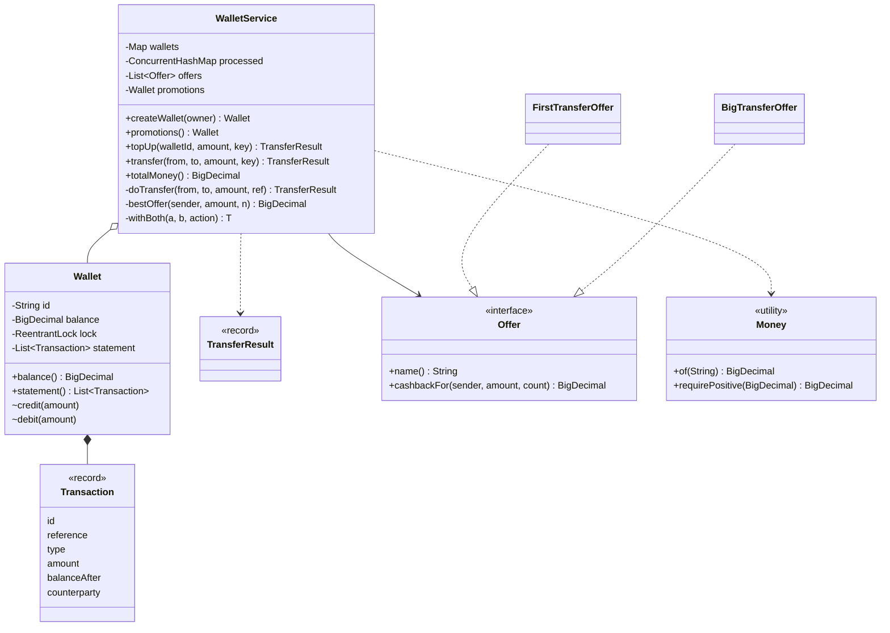

### Key flows

**Transfer with idempotency and lock ordering:**

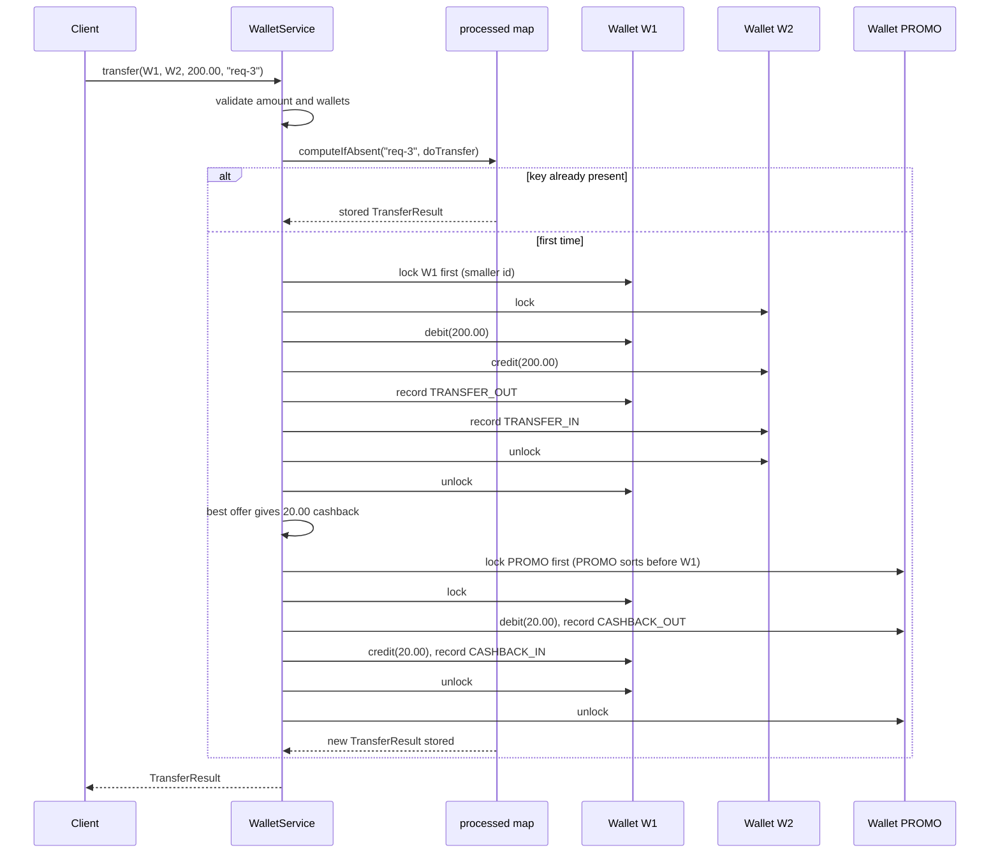

### Design decisions & patterns used

| Decision | Why | Alternative rejected |
|---|---|---|
| **`BigDecimal`, scale 2, reject > 2 decimals** | `double` cannot represent 0.1 exactly; money must be exact. Rejecting `1.005` avoids silent rounding surprises. | `double` (wrong), `long` paise (also correct, and a fine choice — say so). |
| **Lock per wallet, acquired in id order** | Two opposite transfers (A→B and B→A) would deadlock if each locked its own source first. A global order (smaller id first) makes a cycle impossible. | One global lock — correct but every transfer in the system serialises. |
| **Debit before credit, both under both locks** | `debit` throws before any state changes, so a failed transfer leaves both wallets untouched (atomicity). | Credit then debit — would need a compensating action on failure. |
| **Idempotency via `ConcurrentHashMap.computeIfAbsent`** | The check "seen this key?" and the execution are one atomic step per key, so two concurrent retries cannot both run. If the transfer throws, nothing is stored and the client can retry. | `if (!map.containsKey(k)) { run; put }` — check-then-act race. |
| **Cashback paid from a funded `PROMO` wallet** | Double-entry: every credit has a matching debit, so the sum of all wallets changes only on top-ups — which is exactly what the demo checks. A campaign cannot overspend its budget. | Crediting the user out of thin air — the books no longer balance and nobody can say what a campaign cost. |
| **Cashback as a second step, after the transfer locks are released** | Only two wallets are ever locked at once, and ordinary transfers never wait on the busy `PROMO` lock. | Locking sender, receiver and PROMO together for every transfer — correct, but every transfer in the system would queue on PROMO. |
| **`Offer` interface, best one wins** | Strategy: new promotions are new classes; the "no stacking" policy lives in one method. | `if/else` on promotion codes inside `transfer`. |
| **Statement stored in the wallet** | Reading a wallet's history needs no global scan. | One global transaction list filtered on read — fine for small data, slow at scale. |

`computeIfAbsent` detail worth knowing: the JDK documents that the whole call is atomic, that the mapping function runs only when the key is absent, that an exception from the function is rethrown with no mapping recorded, and that other threads updating the *same map* may block while it runs — so the function should be short and must not update the map itself. Our function only touches wallets, never `processed`, so it is safe. At higher scale, store a `CompletableFuture` with `putIfAbsent` and run the transfer outside the map (extension below).

### Java implementation

```java
// File: lld/ch21/wallet/Money.java
package lld.ch21.wallet;

import java.math.BigDecimal;
import java.math.RoundingMode;

/** Helpers that keep every amount at 2 decimal places. Never use double for money. */
public final class Money {
    public static final int SCALE = 2;
    private Money() { }

    public static BigDecimal of(String amount) { return normalize(new BigDecimal(amount)); }

    public static BigDecimal normalize(BigDecimal amount) { return amount.setScale(SCALE, RoundingMode.HALF_EVEN); }

    public static BigDecimal requirePositive(BigDecimal amount) {
        if (amount == null || amount.signum() <= 0) throw new IllegalArgumentException("Amount must be positive: " + amount);
        if (amount.stripTrailingZeros().scale() > SCALE)
            throw new IllegalArgumentException("At most " + SCALE + " decimal places: " + amount);
        return normalize(amount);
    }
}
```

```java
// File: lld/ch21/wallet/TxnType.java
package lld.ch21.wallet;

/** CASHBACK_OUT is written on the promotions wallet, CASHBACK_IN on the user who receives it. */
public enum TxnType { TOP_UP, TRANSFER_OUT, TRANSFER_IN, CASHBACK_OUT, CASHBACK_IN }
```

```java
// File: lld/ch21/wallet/Transaction.java
package lld.ch21.wallet;

import java.math.BigDecimal;
import java.time.Instant;

/** Immutable ledger entry. Each transfer writes two entries (out + in) sharing one reference. */
public record Transaction(String id, String reference, String walletId, TxnType type, BigDecimal amount,
                          BigDecimal balanceAfter, String counterparty, Instant at) {
    @Override public String toString() {
        return "%-5s %-12s %8s  bal=%8s  ref=%s%s".formatted(id, type, amount, balanceAfter, reference,
                counterparty == null ? "" : " with " + counterparty);
    }
}
```

```java
// File: lld/ch21/wallet/TransferResult.java
package lld.ch21.wallet;

import java.math.BigDecimal;

/** What the caller gets back. A replayed (duplicate) request returns the stored result. */
public record TransferResult(String reference, String from, String to, BigDecimal amount, BigDecimal cashback) { }
```

```java
// File: lld/ch21/wallet/Wallet.java
package lld.ch21.wallet;

import java.math.BigDecimal;
import java.util.ArrayList;
import java.util.List;
import java.util.concurrent.locks.ReentrantLock;

/**
 * Holds a balance and its own statement. The balance is only changed while `lock` is held;
 * the service decides lock order when two wallets are involved.
 */
public class Wallet {
    private final String id;
    private final String ownerName;
    private final ReentrantLock lock = new ReentrantLock();
    private BigDecimal balance = Money.normalize(BigDecimal.ZERO);
    private final List<Transaction> statement = new ArrayList<>();

    Wallet(String id, String ownerName) { this.id = id; this.ownerName = ownerName; }

    public String id() { return id; }
    public String ownerName() { return ownerName; }
    ReentrantLock lock() { return lock; }

    public BigDecimal balance() {
        lock.lock();
        try { return balance; } finally { lock.unlock(); }
    }

    public List<Transaction> statement() {
        lock.lock();
        try { return List.copyOf(statement); } finally { lock.unlock(); }
    }

    // --- called only with lock held ---
    void credit(BigDecimal amt) { balance = balance.add(amt); }

    void debit(BigDecimal amt) {
        if (balance.compareTo(amt) < 0) throw new InsufficientFundsException(id, balance, amt);
        balance = balance.subtract(amt);
    }

    BigDecimal rawBalance() { return balance; }
    void record(Transaction t) { statement.add(t); }
}
```

```java
// File: lld/ch21/wallet/InsufficientFundsException.java
package lld.ch21.wallet;

import java.math.BigDecimal;

public class InsufficientFundsException extends RuntimeException {
    public InsufficientFundsException(String walletId, BigDecimal balance, BigDecimal needed) {
        super("Insufficient funds in " + walletId + ": balance " + balance + ", needed " + needed);
    }
}
```

```java
// File: lld/ch21/wallet/WalletNotFoundException.java
package lld.ch21.wallet;

public class WalletNotFoundException extends RuntimeException {
    public WalletNotFoundException(String id) { super("Wallet not found: " + id); }
}
```

```java
// File: lld/ch21/wallet/Offer.java
package lld.ch21.wallet;

import java.math.BigDecimal;

/** Strategy: an offer looks at a completed transfer and returns the cashback (zero if not eligible). */
public interface Offer {
    String name();
    BigDecimal cashbackFor(Wallet sender, BigDecimal amount, int senderTransferCount);
}
```

```java
// File: lld/ch21/wallet/FirstTransferOffer.java
package lld.ch21.wallet;

import java.math.BigDecimal;
import java.math.RoundingMode;

/** 10% cashback on a user's first transfer, capped. */
public class FirstTransferOffer implements Offer {
    private final BigDecimal percent;
    private final BigDecimal cap;

    public FirstTransferOffer(String percent, String cap) {
        this.percent = new BigDecimal(percent);
        this.cap = Money.of(cap);
    }

    @Override public String name() { return "FIRST_TRANSFER"; }

    @Override public BigDecimal cashbackFor(Wallet sender, BigDecimal amount, int count) {
        if (count != 1) return BigDecimal.ZERO;
        BigDecimal raw = amount.multiply(percent).divide(BigDecimal.valueOf(100), Money.SCALE, RoundingMode.HALF_EVEN);
        return raw.min(cap);
    }
}
```

```java
// File: lld/ch21/wallet/BigTransferOffer.java
package lld.ch21.wallet;

import java.math.BigDecimal;

/** Flat cashback for any transfer at or above a threshold. */
public class BigTransferOffer implements Offer {
    private final BigDecimal threshold;
    private final BigDecimal flat;

    public BigTransferOffer(String threshold, String flat) {
        this.threshold = Money.of(threshold);
        this.flat = Money.of(flat);
    }

    @Override public String name() { return "BIG_TRANSFER"; }

    @Override public BigDecimal cashbackFor(Wallet sender, BigDecimal amount, int count) {
        return amount.compareTo(threshold) >= 0 ? flat : BigDecimal.ZERO;
    }
}
```

```java
// File: lld/ch21/wallet/WalletService.java
package lld.ch21.wallet;

import java.math.BigDecimal;
import java.time.Clock;
import java.util.Comparator;
import java.util.List;
import java.util.Map;
import java.util.concurrent.ConcurrentHashMap;
import java.util.concurrent.atomic.AtomicInteger;
import java.util.function.Supplier;

public class WalletService {
    public static final String PROMOTIONS_ID = "PROMO";
    private final Map<String, Wallet> wallets = new ConcurrentHashMap<>();
    /** Idempotency store: request key -> result of the first successful execution. */
    private final ConcurrentHashMap<String, TransferResult> processed = new ConcurrentHashMap<>();
    private final Map<String, AtomicInteger> transferCounts = new ConcurrentHashMap<>();
    private final List<Offer> offers;
    private final AtomicInteger txnSeq = new AtomicInteger();
    private final AtomicInteger walletSeq = new AtomicInteger();
    private final Clock clock;
    /** Marketing's budget. Cashback is a real transfer out of this wallet, so no money is created. */
    private final Wallet promotions = new Wallet(PROMOTIONS_ID, "Promotions");

    public WalletService(List<Offer> offers, Clock clock) {
        this.offers = List.copyOf(offers);
        this.clock = clock;
        wallets.put(promotions.id(), promotions);
    }

    public Wallet promotions() { return promotions; }

    public Wallet createWallet(String ownerName) {
        Wallet w = new Wallet("W" + walletSeq.incrementAndGet(), ownerName);
        wallets.put(w.id(), w);
        return w;
    }

    public TransferResult topUp(String walletId, BigDecimal amount, String idempotencyKey) {
        BigDecimal amt = Money.requirePositive(amount);
        Wallet w = get(walletId);
        return processed.computeIfAbsent(idempotencyKey, key -> {
            w.lock().lock();
            try {
                w.credit(amt);
                w.record(txn(key, w, TxnType.TOP_UP, amt, null));
            } finally { w.lock().unlock(); }
            return new TransferResult(key, "BANK", walletId, amt, BigDecimal.ZERO);
        });
    }

    /**
     * Moves money atomically. computeIfAbsent makes the key check-and-run atomic, so a retried
     * request never debits twice. If the lambda throws, nothing is stored and the client may retry.
     */
    public TransferResult transfer(String fromId, String toId, BigDecimal amount, String idempotencyKey) {
        if (fromId.equals(toId)) throw new IllegalArgumentException("Cannot transfer to the same wallet");
        BigDecimal amt = Money.requirePositive(amount);
        Wallet from = get(fromId), to = get(toId);
        return processed.computeIfAbsent(idempotencyKey, key -> doTransfer(from, to, amt, key));
    }

    private TransferResult doTransfer(Wallet from, Wallet to, BigDecimal amt, String ref) {
        // Step 1: the transfer itself, under both wallet locks.
        int n = withBoth(from, to, () -> {
            from.debit(amt);                        // throws before any change if funds are short
            to.credit(amt);
            from.record(txn(ref, from, TxnType.TRANSFER_OUT, amt, to.id()));
            to.record(txn(ref, to, TxnType.TRANSFER_IN, amt, from.id()));
            return transferCounts.computeIfAbsent(from.id(), k -> new AtomicInteger()).incrementAndGet();
        });
        // Step 2: cashback is a second, ordinary transfer PROMO -> sender (same lock-ordering rule).
        BigDecimal offered = bestOffer(from, amt, n);
        BigDecimal cashback = offered.signum() == 0 || from == promotions ? BigDecimal.ZERO
                : withBoth(promotions, from, () -> {
                    if (promotions.rawBalance().compareTo(offered) < 0) return BigDecimal.ZERO;   // budget used up
                    promotions.debit(offered);
                    from.credit(offered);
                    promotions.record(txn(ref, promotions, TxnType.CASHBACK_OUT, offered, from.id()));
                    from.record(txn(ref, from, TxnType.CASHBACK_IN, offered, promotions.id()));
                    return offered;
                });
        return new TransferResult(ref, from.id(), to.id(), amt, cashback);
    }

    /** Locks two wallets, always the smaller id first, so two opposite operations can never deadlock. */
    private static <T> T withBoth(Wallet a, Wallet b, Supplier<T> action) {
        Wallet first = a.id().compareTo(b.id()) < 0 ? a : b;
        Wallet second = first == a ? b : a;
        first.lock().lock();
        try {
            second.lock().lock();
            try { return action.get(); } finally { second.lock().unlock(); }
        } finally { first.lock().unlock(); }
    }

    /** Offers do not stack: the single most generous one wins. */
    private BigDecimal bestOffer(Wallet sender, BigDecimal amt, int n) {
        return offers.stream().map(o -> o.cashbackFor(sender, amt, n))
                .max(Comparator.naturalOrder()).orElse(BigDecimal.ZERO);
    }

    public Wallet get(String id) {
        Wallet w = wallets.get(id);
        if (w == null) throw new WalletNotFoundException(id);
        return w;
    }

    /** Sum of every wallet, promotions included: only top-ups change it (cashback just moves money). */
    public BigDecimal totalMoney() {
        return wallets.values().stream().map(Wallet::balance).reduce(BigDecimal.ZERO, BigDecimal::add);
    }

    private Transaction txn(String ref, Wallet w, TxnType type, BigDecimal amt, String counterparty) {
        return new Transaction("TX" + txnSeq.incrementAndGet(), ref, w.id(), type, amt, w.rawBalance(),
                counterparty, clock.instant());
    }
}
```

```java
// File: lld/ch21/wallet/Main.java
package lld.ch21.wallet;

import java.math.BigDecimal;
import java.time.Clock;
import java.time.Instant;
import java.time.ZoneOffset;
import java.util.List;
import java.util.concurrent.ExecutorService;
import java.util.concurrent.Executors;
import java.util.concurrent.TimeUnit;

public class Main {
    public static void main(String[] args) throws InterruptedException {
        Clock clock = Clock.fixed(Instant.parse("2026-09-28T10:00:00Z"), ZoneOffset.UTC);
        WalletService svc = new WalletService(
                List.of(new FirstTransferOffer("10", "50.00"), new BigTransferOffer("1000.00", "25.00")), clock);

        svc.topUp(svc.promotions().id(), Money.of("100.00"), "budget-1");   // marketing funds the campaign
        Wallet alice = svc.createWallet("Alice");
        Wallet bob = svc.createWallet("Bob");

        System.out.println("== top-ups");
        svc.topUp(alice.id(), Money.of("2000.00"), "req-1");
        svc.topUp(bob.id(), Money.of("300.50"), "req-2");
        svc.topUp(alice.id(), Money.of("2000.00"), "req-1");       // client retry: same key, no double credit
        System.out.println("  Alice=" + alice.balance() + "  Bob=" + bob.balance());

        System.out.println("== transfers");
        TransferResult r1 = svc.transfer(alice.id(), bob.id(), Money.of("200.00"), "req-3");
        System.out.println("  " + r1);
        TransferResult r1again = svc.transfer(alice.id(), bob.id(), Money.of("200.00"), "req-3");
        System.out.println("  retry returns same result? " + (r1 == r1again));
        System.out.println("  " + svc.transfer(alice.id(), bob.id(), Money.of("1200.00"), "req-4"));
        System.out.println("  Alice=" + alice.balance() + "  Bob=" + bob.balance() + "  PROMO=" + svc.promotions().balance());

        System.out.println("== edge cases");
        attempt(() -> svc.transfer(bob.id(), alice.id(), Money.of("99999.00"), "req-5"));
        attempt(() -> svc.transfer(bob.id(), alice.id(), new BigDecimal("-5"), "req-6"));
        attempt(() -> svc.transfer(bob.id(), alice.id(), new BigDecimal("1.005"), "req-7"));
        attempt(() -> svc.transfer(bob.id(), bob.id(), Money.of("1.00"), "req-8"));
        attempt(() -> svc.transfer(bob.id(), "W99", Money.of("1.00"), "req-9"));
        System.out.println("  failed req-5 can be retried later: " + svc.transfer(bob.id(), alice.id(), Money.of("10.00"), "req-5").amount());

        System.out.println("== statement for Alice");
        alice.statement().forEach(t -> System.out.println("  " + t));
        System.out.println("== statement for PROMO");
        svc.promotions().statement().forEach(t -> System.out.println("  " + t));

        System.out.println("== concurrency: 1000 opposite transfers on 8 threads");
        BigDecimal before = svc.totalMoney();
        ExecutorService pool = Executors.newFixedThreadPool(8);
        for (int i = 0; i < 1000; i++) {
            final int n = i;
            pool.submit(() -> {
                try {
                    if (n % 2 == 0) svc.transfer(alice.id(), bob.id(), Money.of("1.00"), "c-" + n);
                    else svc.transfer(bob.id(), alice.id(), Money.of("1.00"), "c-" + n);
                } catch (InsufficientFundsException ignored) { }
            });
        }
        pool.shutdown();
        pool.awaitTermination(10, TimeUnit.SECONDS);
        System.out.println("  total before=" + before + " after=" + svc.totalMoney()
                + " conserved=" + (before.compareTo(svc.totalMoney()) == 0));
        System.out.println("  Alice=" + alice.balance() + "  Bob=" + bob.balance() + "  PROMO=" + svc.promotions().balance());
    }

    private static void attempt(Runnable r) {
        try { r.run(); System.out.println("  ok"); }
        catch (RuntimeException e) { System.out.println("  error: " + e.getMessage()); }
    }
}
```

**Output:**

```text
== top-ups
  Alice=2000.00  Bob=300.50
== transfers
  TransferResult[reference=req-3, from=W1, to=W2, amount=200.00, cashback=20.00]
  retry returns same result? true
  TransferResult[reference=req-4, from=W1, to=W2, amount=1200.00, cashback=25.00]
  Alice=645.00  Bob=1700.50  PROMO=55.00
== edge cases
  error: Insufficient funds in W2: balance 1700.50, needed 99999.00
  error: Amount must be positive: -5
  error: At most 2 decimal places: 1.005
  error: Cannot transfer to the same wallet
  error: Wallet not found: W99
  failed req-5 can be retried later: 10.00
== statement for Alice
  TX2   TOP_UP        2000.00  bal= 2000.00  ref=req-1
  TX4   TRANSFER_OUT   200.00  bal= 1800.00  ref=req-3 with W2
  TX7   CASHBACK_IN     20.00  bal= 1820.00  ref=req-3 with PROMO
  TX8   TRANSFER_OUT  1200.00  bal=  620.00  ref=req-4 with W2
  TX11  CASHBACK_IN     25.00  bal=  645.00  ref=req-4 with PROMO
  TX13  TRANSFER_IN     10.00  bal=  655.00  ref=req-5 with W2
== statement for PROMO
  TX1   TOP_UP         100.00  bal=  100.00  ref=budget-1
  TX6   CASHBACK_OUT    20.00  bal=   80.00  ref=req-3 with W1
  TX10  CASHBACK_OUT    25.00  bal=   55.00  ref=req-4 with W1
  TX14  CASHBACK_OUT     1.00  bal=   54.00  ref=req-5 with W2
== concurrency: 1000 opposite transfers on 8 threads
  total before=2400.50 after=2400.50 conserved=true
  Alice=655.00  Bob=1691.50  PROMO=54.00
```

Reading the output: marketing first funds `PROMO` with 100.00; the retried top-up `req-1` did not add another 2000; the retried transfer `req-3` returned the *same object* and moved no money; Alice's first transfer earned 10% (20.00), her 1200.00 transfer earned the flat 25.00 (the first-transfer offer no longer applies); the failed `req-5` stored nothing, so re-using that key later succeeded (and, being Bob's first successful transfer, earned him 1.00). Every cashback appears twice — `CASHBACK_OUT` on PROMO (100.00 → 80.00 → 55.00 → 54.00) and `CASHBACK_IN` on the receiver. Finally 1000 concurrent opposite transfers kept the total (PROMO included) exactly constant — no lost updates, no deadlock. (Each side starts with more than 500.00, so no transfer in that race can fail, and the final balances are the same on every run.)

### Concurrency & edge cases

- **Race on one wallet:** every read-modify-write of `balance` happens with the wallet's lock held.
- **Deadlock:** avoided by a global lock order (lexicographic wallet id; `"PROMO"` sorts before `"W1"`). Every two-lock path goes through one helper, `withBoth`, so the order cannot be forgotten. The program never holds more than two wallet locks at a time.
- **Double submit:** idempotency key → at most one execution per key.
- **Same key, different body** (client bug): today the stored result is returned. Production systems also store a hash of the request and reject a mismatch with an error.
- **Validation:** non-positive amounts, more than 2 decimals, same source and target, unknown wallet, insufficient funds.
- **Cashback money source:** a transfer from the `PROMO` wallet, so the books balance (double-entry: every credit has a matching debit). The cashback step runs after the transfer's locks are released, so for a moment the transfer is visible without its cashback — fine for a reward. If the budget cannot cover the offer, the result reports a cashback of zero and the transfer is kept.

### Extensions & follow-up questions

- **Multi-currency?** Each wallet has a `Currency`; transfers across currencies go through a `FxRateProvider` interface; store both amounts and the rate used in the transaction. Use `java.util.Currency` for codes and decimal places.
- **Payment methods (card, bank, UPI)?** A `PaymentMethod` interface with `charge(amount)`; top-up calls it first, and only credits the wallet on success (or uses a pending → confirmed state if the gateway is asynchronous). Users add and remove methods on their account.
- **Transfers to external accounts (withdraw to bank)?** Debit the wallet into a `PENDING_PAYOUT` state, call the bank through a `PayoutGateway` interface, and either confirm, or post a compensating credit if the bank rejects it.
- **Reversal / refund?** Never edit a past transaction; post a new compensating transaction referencing the original.
- **Distributed system?** Wallet balances in a database with row locks (`SELECT ... FOR UPDATE`) or optimistic versioning; idempotency keys in a table with a unique constraint; ledgers as double-entry journals.
- **Long transfers blocking the idempotency map?** Use `putIfAbsent(key, new CompletableFuture<>())`: the winner runs the transfer outside the map and completes the future; duplicates just wait on `future.join()`. On failure, remove the key so a retry can run.
- **Limits (daily cap, KYC tier)?** A chain of validators (Chain of Responsibility) run before `doTransfer`.
- **Why not `AtomicReference<BigDecimal>` + CAS?** Works for a single wallet, but a transfer touches two balances that must change together; CAS on two variables is not atomic, so locks are simpler.

### Real-world example

Stripe's API accepts an `Idempotency-Key` header: if a request times out and the client retries with the same key, Stripe returns the saved result of the first attempt instead of charging twice. Wallets such as Paytm and PhonePe run cashback campaigns with rules like "X% up to a cap on your first transaction" — exactly the shape of `FirstTransferOffer`.

### In the interview

Lead with the three risks: exact money, concurrency, retries (and, if offers come up, "cashback must come out of a budget wallet"). Show `Money`, then `doTransfer` with the lock ordering (draw the A→B / B→A deadlock and how ordering breaks the cycle), then idempotency. Run the concurrent demo and point at `conserved=true`. Offers are a 2-minute Strategy mention. If time is short, cut multi-currency and payment methods — say you would add them behind interfaces.

### Self-check

- **Q:** Why is `new BigDecimal("0.1")` preferred over `new BigDecimal(0.1)`? → **A:** The double constructor captures the binary approximation of 0.1 (a long, inexact decimal); the String constructor is exact.
- **Q:** Two threads transfer W1→W2 and W2→W1 at once. Why no deadlock? → **A:** Both lock W1 first (smaller id), so one waits for the other instead of each holding what the other needs.
- **Q:** A transfer fails for insufficient funds. Can the same idempotency key be reused? → **A:** Yes — `computeIfAbsent` stores nothing when the function throws.
- **Q:** Where would a "max 3 transfers per minute" rule go? → **A:** A validator run before `doTransfer`, not inside the wallet.

### TL;DR

`BigDecimal` money, lock both wallets in a global order, debit before credit, idempotency key → run at most once, offers as Strategies paid out of a funded promotions wallet. Prove it with a concurrent demo where the total is conserved.

---

## 21.3 Design an Event Calendar (Flipkart)

### Problem & clarifying questions

This is a Flipkart machine-coding statement (kumaransg/LLD, `Event_calendar_flipkart`). In short: onboard users with **working hours**; group users into **teams** (a user belongs to at most one team); create **events** on one day with a start and end time, whose participants are users, teams, or both. A user can be in **only one event at a time**. For team participants the event creator says how many **representatives (N)** each team must send; the system blocks the event against N *available* members of each team, and if any team cannot supply N the event is not created. Required features: create user, create team, create event, **get a user's events in a time range** (including events they were blocked for as a team representative), and **suggest free slots** for a list of users/teams on a day. Bonus: **update event time** (report failure if impossible) and **recurring events** (time, start date, end date, frequency). The statement says: no DB, no UI, no CLI needed — a `main` or tests is enough — and "do not make assumptions, ask".

Clarifying questions (and the answers this solution uses):

| Question | Answer used |
|---|---|
| Is an event that ends at 15:00 in conflict with one that starts at 15:00? | No. Slots are **half-open** `[start, end)`. |
| Must an event lie inside every attendee's working hours? | Yes (the statement's Event5 fails because F starts at 11:00). |
| Which team members become representatives? | The first N free members in team order (a pluggable strategy). |
| If a user is invited directly *and* is in an invited team, do they count as a representative? | No — a direct attendee is not picked again as a representative. |
| Free slots for a team with N representatives: what counts as "free"? | A moment is free for the team if at least N members are working and not busy then. |
| Recurring event: if one occurrence clashes? | Reject the whole series (all-or-nothing). |

**A note on the statement's sample.** For "free slots for user A and team T1 with 1 representative today" the sample answer says *10AM to 3PM and 4PM to 7PM*. But T1 = {C, E} and neither works before 11:00 (C starts 11:30, E 11:00), so by the statement's own rules the first slot should start at **11:00**. Our program prints `11:00-15:00, 16:00-19:00`. Pointing out such an inconsistency politely ("I think the sample means 11AM; shall I go with the rules?") is exactly what "do not make assumptions, ask" is testing. (A smaller slip in the same sample: its step 1 says "Onboard 5 Users" but then lists six, A to F. The demo creates all six.)

### Requirements

**Functional**
1. Create user with working hours.
2. Create team of existing users (one team per user).
3. Create event for users and/or teams with N representatives; reject if any attendee is outside working hours, already busy, or a team lacks N free members.
4. Events of a user between two date-times (direct + as representative).
5. Free slots for users/teams on a day.
6. Bonus: update event time (atomic: old booking kept on failure).
7. Bonus: recurring events (daily/weekly between two dates).

**Non-functional**
- The check "is everyone free?" and the booking must be **atomic**, or two concurrent creations could book the same person twice.
- Representative choice should be replaceable (fairness, least-busy, random).

### Use cases

| Actor | Use cases |
|---|---|
| **Admin** | onboard user, create team |
| **Organiser** | create event, create recurring event, move event, find free slots |
| **Attendee** | view own events in a range |

### Core entities

| Class | Kind | Responsibility |
|---|---|---|
| `TimeSlot` | record | Half-open `[start, end)` on one day; `overlaps`, `contains`; validates start < end. |
| `User` | record | Name + working hours. |
| `Team` | record | Name + ordered members. |
| `Event` | record | One concrete occurrence: date, slot, what was requested (users, teams, N) and who is actually blocked (`attendees`), optional `seriesId`. |
| `Frequency` | enum | DAILY / WEEKLY — knows the next date. |
| `EventStore` | class | Repository + index `user → date → events` for fast conflict checks and range queries (`TreeMap.subMap`). |
| `RepresentativeSelector` | interface | Strategy: pick N free members of a team. |
| `CalendarService` | class | All use cases; planning (validation + representative choice) separated from saving. |
| `CalendarException` | exception | Readable reason for every rejection. |

### Class diagram

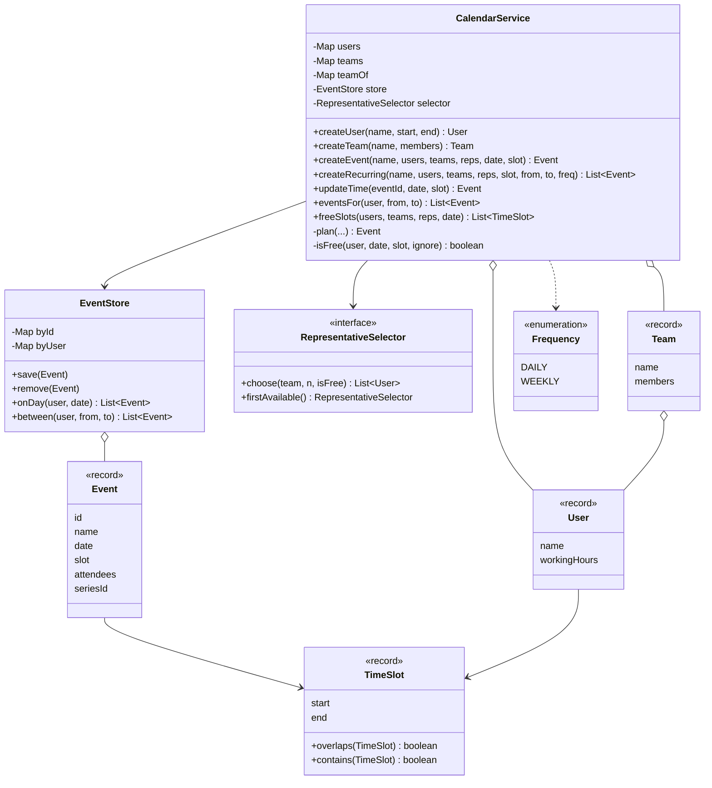

### Key flows

**Create an event (plan, then save):**

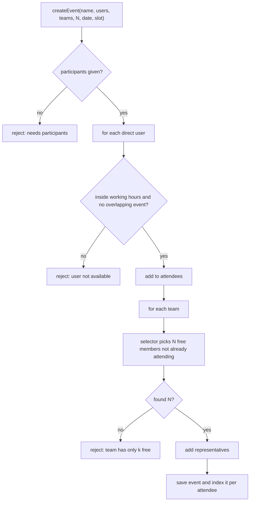

**Free-slot sweep.** Collect every "interesting" time on that day: each involved person's working-hour start and end, and the start and end of each of their events. Sort them. Between two consecutive points nothing changes, so test each small piece once: all direct users free, and each team has at least N free members. Merge neighbouring good pieces. For the statement's example (A + T1, N = 1, today) the cut points are 10:00, 11:00, 11:30, 15:00, 16:00, 18:30, 19:00, 19:30, and the good pieces merge into 11:00–15:00 and 16:00–19:00.

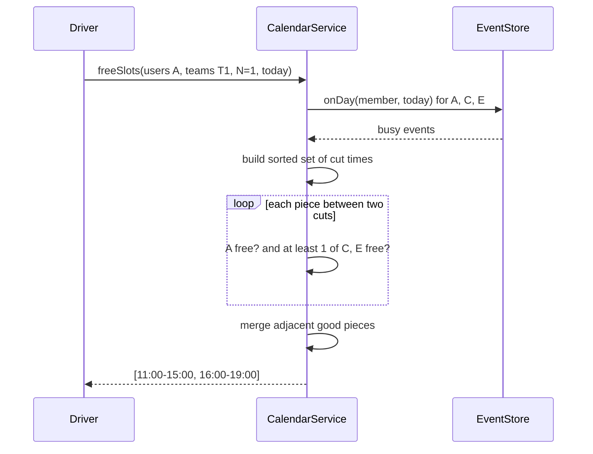

### Design decisions & patterns used

| Decision | Why | Alternative rejected |
|---|---|---|
| **Half-open intervals** | Back-to-back meetings do not conflict; `overlaps` is one line: `a.start < b.end && b.start < a.end`. | Closed intervals — 14:00–15:00 would clash with 15:00–16:00. |
| **`plan()` separate from `save()`** | Validation + representative choice produce an `Event` without side effects. `createEvent`, `createRecurring` (plan all, then save all) and `updateTime` (plan while ignoring the old event, then swap) all reuse it — all-or-nothing for free. | Saving as you go and rolling back on failure. |
| **`RepresentativeSelector` strategy** | "Which N members?" is a policy; fairness or least-busy can be plugged in. | Hard-coded loop in the service. |
| **Index `user → TreeMap<date, events>`** | Conflict checks read only one user's one day; range queries use `subMap`. | Scanning all events each time. |
| **Sweep over boundaries for free slots** | Exact, simple, no minute-by-minute loops; works for any N. | Checking every 15 or 30 minutes — misses odd times like 11:30 and is slower. |
| **Service methods `synchronized`** | Check-then-book must be atomic; the store's lists are not thread-safe on their own. | Per-user locks — faster, but an event locks many users, so you need lock ordering; mention it as a scale-up. |

### Java implementation

```java
// File: lld/ch21/calendar/TimeSlot.java
package lld.ch21.calendar;

import java.time.LocalTime;

/** Half-open interval [start, end) inside one day. 14:00-15:00 and 15:00-16:00 do not overlap. */
public record TimeSlot(LocalTime start, LocalTime end) {
    public TimeSlot {
        if (!start.isBefore(end)) throw new IllegalArgumentException("start must be before end: " + start + "-" + end);
    }
    public boolean overlaps(TimeSlot o) { return start.isBefore(o.end) && o.start.isBefore(end); }
    public boolean contains(TimeSlot o) { return !o.start.isBefore(start) && !o.end.isAfter(end); }
    @Override public String toString() { return start + "-" + end; }
}
```

```java
// File: lld/ch21/calendar/User.java
package lld.ch21.calendar;

public record User(String name, TimeSlot workingHours) { }
```

```java
// File: lld/ch21/calendar/Team.java
package lld.ch21.calendar;

import java.util.List;

/** Members are kept in onboarding order; representative selection walks this order. */
public record Team(String name, List<User> members) {
    public Team { members = List.copyOf(members); }
}
```

```java
// File: lld/ch21/calendar/Event.java
package lld.ch21.calendar;

import java.time.LocalDate;
import java.util.List;
import java.util.Set;

/**
 * One concrete occurrence. `attendees` is the resolved list of users that the event blocks
 * (direct users + the representatives chosen from each team).
 */
public record Event(String id, String name, LocalDate date, TimeSlot slot, Set<String> directUsers,
                    Set<String> teams, int representativesPerTeam, List<String> attendees, String seriesId) {
    public Event { attendees = List.copyOf(attendees); }
    public boolean blocks(String user) { return attendees.contains(user); }
    @Override public String toString() { return name + " " + date + " " + slot + " " + attendees; }
}
```

```java
// File: lld/ch21/calendar/Frequency.java
package lld.ch21.calendar;

import java.time.LocalDate;

public enum Frequency {
    DAILY { LocalDate next(LocalDate d) { return d.plusDays(1); } },
    WEEKLY { LocalDate next(LocalDate d) { return d.plusWeeks(1); } };

    abstract LocalDate next(LocalDate d);
}
```

```java
// File: lld/ch21/calendar/CalendarException.java
package lld.ch21.calendar;

public class CalendarException extends RuntimeException {
    public CalendarException(String message) { super(message); }
}
```

```java
// File: lld/ch21/calendar/EventStore.java
package lld.ch21.calendar;

import java.time.LocalDate;
import java.util.ArrayList;
import java.util.Collection;
import java.util.List;
import java.util.Map;
import java.util.Optional;
import java.util.TreeMap;
import java.util.concurrent.ConcurrentHashMap;

/** Repository: events by id and an index user -> date -> events. Not thread-safe on its own: CalendarService guards it. */
public class EventStore {
    private final Map<String, Event> byId = new ConcurrentHashMap<>();
    private final Map<String, TreeMap<LocalDate, List<Event>>> byUser = new ConcurrentHashMap<>();

    public void save(Event e) {
        byId.put(e.id(), e);
        for (String u : e.attendees())
            byUser.computeIfAbsent(u, k -> new TreeMap<>()).computeIfAbsent(e.date(), d -> new ArrayList<>()).add(e);
    }

    public void remove(Event e) {
        byId.remove(e.id());
        for (String u : e.attendees()) {
            List<Event> day = byUser.getOrDefault(u, new TreeMap<>()).get(e.date());
            if (day != null) day.removeIf(x -> x.id().equals(e.id()));
        }
    }

    public Optional<Event> find(String id) { return Optional.ofNullable(byId.get(id)); }

    public List<Event> onDay(String user, LocalDate date) {
        return List.copyOf(byUser.getOrDefault(user, new TreeMap<>()).getOrDefault(date, List.of()));
    }

    public List<Event> between(String user, LocalDate from, LocalDate to) {
        List<Event> out = new ArrayList<>();
        byUser.getOrDefault(user, new TreeMap<>()).subMap(from, true, to, true).values().forEach(out::addAll);
        return out;
    }

    public Collection<Event> all() { return List.copyOf(byId.values()); }
}
```

```java
// File: lld/ch21/calendar/RepresentativeSelector.java
package lld.ch21.calendar;

import java.util.List;
import java.util.function.Predicate;

/** Strategy: which N free members represent a team. */
public interface RepresentativeSelector {
    List<User> choose(Team team, int n, Predicate<User> isFree);

    /** Default: first N free members in team order (deterministic, easy to explain). */
    static RepresentativeSelector firstAvailable() {
        return (team, n, isFree) -> team.members().stream().filter(isFree).limit(n).toList();
    }
}
```

```java
// File: lld/ch21/calendar/CalendarService.java
package lld.ch21.calendar;

import java.time.LocalDate;
import java.time.LocalDateTime;
import java.time.LocalTime;
import java.util.ArrayList;
import java.util.Collection;
import java.util.Comparator;
import java.util.LinkedHashSet;
import java.util.List;
import java.util.Map;
import java.util.Set;
import java.util.TreeSet;
import java.util.concurrent.ConcurrentHashMap;
import java.util.concurrent.atomic.AtomicInteger;

public class CalendarService {
    private final Map<String, User> users = new ConcurrentHashMap<>();
    private final Map<String, Team> teams = new ConcurrentHashMap<>();
    private final Map<String, String> teamOf = new ConcurrentHashMap<>();   // user -> team
    private final EventStore store = new EventStore();
    private final RepresentativeSelector selector;
    private final AtomicInteger seq = new AtomicInteger();

    public CalendarService(RepresentativeSelector selector) { this.selector = selector; }

    public User createUser(String name, LocalTime workStart, LocalTime workEnd) {
        User u = new User(name, new TimeSlot(workStart, workEnd));
        if (users.putIfAbsent(name, u) != null) throw new CalendarException("User already exists: " + name);
        return u;
    }

    public synchronized Team createTeam(String name, String... memberNames) {
        if (teams.containsKey(name)) throw new CalendarException("Team already exists: " + name);
        List<User> members = new ArrayList<>();
        for (String m : memberNames) {
            User u = user(m);
            if (teamOf.containsKey(m)) throw new CalendarException(m + " already belongs to team " + teamOf.get(m));
            members.add(u);
        }
        members.forEach(u -> teamOf.put(u.name(), name));
        Team t = new Team(name, members);
        teams.put(name, t);
        return t;
    }

    /** synchronized: the check-then-book sequence must be atomic or two events could grab the same person. */
    public synchronized Event createEvent(String name, Set<String> userNames, Set<String> teamNames,
                                          int reps, LocalDate date, TimeSlot slot) {
        Event e = plan(name, userNames, teamNames, reps, date, slot, null, null);
        store.save(e);
        return e;
    }

    /** Bonus: recurring event. All occurrences are validated first; nothing is saved unless all fit. */
    public synchronized List<Event> createRecurring(String name, Set<String> userNames, Set<String> teamNames, int reps,
                                                    TimeSlot slot, LocalDate from, LocalDate to, Frequency freq) {
        String series = "S" + seq.incrementAndGet();
        List<Event> planned = new ArrayList<>();
        for (LocalDate d = from; !d.isAfter(to); d = freq.next(d)) {
            planned.add(plan(name + "@" + d, userNames, teamNames, reps, d, slot, series, null));
        }
        planned.forEach(store::save);
        return planned;
    }

    /** Bonus: move an event. We try the new time ignoring the event itself; on failure nothing changes. */
    public synchronized Event updateTime(String eventId, LocalDate date, TimeSlot slot) {
        Event old = store.find(eventId).orElseThrow(() -> new CalendarException("No such event " + eventId));
        Event moved = plan(old.name(), old.directUsers(), old.teams(), old.representativesPerTeam(),
                date, slot, old.seriesId(), old);          // keeps old.id(); throws if the new time does not fit
        store.remove(old);
        store.save(moved);
        return moved;
    }

    /** Events a user is blocked for between two date-times (includes team-representative bookings). */
    public synchronized List<Event> eventsFor(String userName, LocalDateTime from, LocalDateTime to) {
        user(userName);
        return store.between(userName, from.toLocalDate(), to.toLocalDate()).stream()
                .filter(e -> LocalDateTime.of(e.date(), e.slot().end()).isAfter(from)
                          && LocalDateTime.of(e.date(), e.slot().start()).isBefore(to))
                .sorted(Comparator.comparing(Event::date).thenComparing(e -> e.slot().start()))
                .toList();
    }

    /**
     * Free slots on a day where every listed user is free AND each listed team has at least `reps`
     * free members. Sweep: cut the day at every boundary (working-hour edges, event edges),
     * test each small piece, then merge adjacent good pieces.
     */
    public synchronized List<TimeSlot> freeSlots(Set<String> userNames, Set<String> teamNames, int reps, LocalDate date) {
        List<User> direct = userNames.stream().map(this::user).toList();
        List<Team> tms = teamNames.stream().map(this::team).toList();
        List<User> everyone = new ArrayList<>(direct);
        tms.forEach(t -> everyone.addAll(t.members()));

        TreeSet<LocalTime> cuts = new TreeSet<>();
        for (User u : everyone) {
            cuts.add(u.workingHours().start());
            cuts.add(u.workingHours().end());
            for (Event e : store.onDay(u.name(), date)) { cuts.add(e.slot().start()); cuts.add(e.slot().end()); }
        }
        List<TimeSlot> result = new ArrayList<>();
        LocalTime prev = null;
        for (LocalTime cut : cuts) {
            if (prev != null) {
                TimeSlot piece = new TimeSlot(prev, cut);
                boolean ok = direct.stream().allMatch(u -> isFree(u, date, piece, null))
                        && tms.stream().allMatch(t -> t.members().stream()
                               .filter(m -> isFree(m, date, piece, null)).count() >= reps);
                if (ok) {
                    int last = result.size() - 1;
                    if (last >= 0 && result.get(last).end().equals(piece.start()))
                        result.set(last, new TimeSlot(result.get(last).start(), piece.end()));
                    else result.add(piece);
                }
            }
            prev = cut;
        }
        return result;
    }

    // ---------------------------------------------------------------- helpers

    private Event plan(String name, Set<String> userNames, Set<String> teamNames, int reps,
                       LocalDate date, TimeSlot slot, String series, Event ignore) {
        if (userNames.isEmpty() && teamNames.isEmpty()) throw new CalendarException("Event needs participants");
        if (!teamNames.isEmpty() && reps < 1) throw new CalendarException("Representatives must be >= 1");
        Set<String> attendees = new LinkedHashSet<>();
        for (String n : new TreeSet<>(userNames)) {          // sorted => deterministic order
            User u = user(n);
            if (!isFree(u, date, slot, ignore))
                throw new CalendarException(name + ": " + n + " is not available " + date + " " + slot);
            attendees.add(n);
        }
        for (String tn : new TreeSet<>(teamNames)) {
            Team t = team(tn);
            List<User> chosen = selector.choose(t, reps,
                    m -> !attendees.contains(m.name()) && isFree(m, date, slot, ignore));
            if (chosen.size() < reps)
                throw new CalendarException(name + ": team " + tn + " has only " + chosen.size()
                        + " free member(s), needs " + reps);
            chosen.forEach(m -> attendees.add(m.name()));
        }
        String id = ignore != null ? ignore.id() : "E" + seq.incrementAndGet();
        return new Event(id, name, date, slot, Set.copyOf(userNames), Set.copyOf(teamNames), reps,
                List.copyOf(attendees), series);
    }

    private boolean isFree(User u, LocalDate date, TimeSlot slot, Event ignore) {
        if (!u.workingHours().contains(slot)) return false;
        return store.onDay(u.name(), date).stream()
                .filter(e -> ignore == null || !e.id().equals(ignore.id()))
                .noneMatch(e -> e.slot().overlaps(slot));
    }

    private User user(String n) {
        User u = users.get(n);
        if (u == null) throw new CalendarException("Unknown user " + n);
        return u;
    }

    private Team team(String n) {
        Team t = teams.get(n);
        if (t == null) throw new CalendarException("Unknown team " + n);
        return t;
    }

    public synchronized Collection<Event> allEvents() { return store.all(); }
}
```

```java
// File: lld/ch21/calendar/Main.java
package lld.ch21.calendar;

import java.time.LocalDate;
import java.time.LocalDateTime;
import java.time.LocalTime;
import java.util.List;
import java.util.Set;
import java.util.function.Supplier;

/** Replays the sample test cases from the problem statement, then the bonus features. */
public class Main {
    public static void main(String[] args) {
        CalendarService cal = new CalendarService(RepresentativeSelector.firstAvailable());
        LocalDate today = LocalDate.of(2026, 9, 28), tomorrow = today.plusDays(1);

        System.out.println("== 1. onboard users");
        cal.createUser("A", t("10:00"), t("19:00"));
        cal.createUser("B", t("09:30"), t("17:30"));
        cal.createUser("C", t("11:30"), t("18:30"));
        cal.createUser("D", t("10:00"), t("18:00"));
        cal.createUser("E", t("11:00"), t("19:30"));
        cal.createUser("F", t("11:00"), t("18:30"));
        System.out.println("  6 users created");

        System.out.println("== 2. teams");
        cal.createTeam("T1", "C", "E");
        cal.createTeam("T2", "B", "D", "F");
        System.out.println("  T1=[C,E] T2=[B,D,F]");
        attempt(() -> cal.createTeam("T3", "A", "C"));

        System.out.println("== 3. events");
        attempt(() -> cal.createEvent("Event1", Set.of("A"), Set.of("T1"), 2, tomorrow, slot("14:00", "15:00")));
        attempt(() -> cal.createEvent("Event2", Set.of("C"), Set.of(), 0, tomorrow, slot("14:00", "15:00")));
        attempt(() -> cal.createEvent("Event3", Set.of(), Set.of("T1", "T2"), 2, today, slot("15:00", "16:00")));
        attempt(() -> cal.createEvent("Event4", Set.of("A"), Set.of("T2"), 1, today, slot("15:00", "16:00")));
        attempt(() -> cal.createEvent("Event5", Set.of("A", "F"), Set.of(), 0, today, slot("10:00", "11:00")));

        System.out.println("== 4. events in a time range (today 10:00 .. tomorrow 17:00)");
        LocalDateTime from = LocalDateTime.of(today, t("10:00")), to = LocalDateTime.of(tomorrow, t("17:00"));
        for (String u : List.of("A", "B", "F"))
            System.out.println("  " + u + ": " + cal.eventsFor(u, from, to).stream().map(Event::name).toList());

        System.out.println("== 5. free slots today for A + T1 (1 representative)");
        System.out.println("  " + cal.freeSlots(Set.of("A"), Set.of("T1"), 1, today));
        System.out.println("  free slots today for B + D: " + cal.freeSlots(Set.of("B", "D"), Set.of(), 0, today));

        System.out.println("== bonus: update event time");
        Event e1 = cal.allEvents().stream().filter(e -> e.name().equals("Event1")).findFirst().orElseThrow();
        attempt(() -> cal.updateTime(e1.id(), tomorrow, slot("18:30", "19:00")));   // needs 2 of T1, but C stops at 18:30
        attempt(() -> cal.updateTime(e1.id(), tomorrow, slot("16:00", "17:00")));

        System.out.println("== bonus: recurring daily stand-up (A + D), 3 days");
        attempt(() -> cal.createRecurring("Standup", Set.of("A", "D"), Set.of(), 0, slot("10:00", "10:15"),
                today, today.plusDays(2), Frequency.DAILY));
        attempt(() -> cal.createRecurring("Sync", Set.of("A"), Set.of(), 0, slot("15:30", "16:30"),
                today, today.plusDays(2), Frequency.DAILY));   // clashes with Event4 today -> whole series rejected
        System.out.println("  A today..+2: " + cal.eventsFor("A", LocalDateTime.of(today, t("00:00")),
                LocalDateTime.of(today.plusDays(2), t("23:59"))).stream().map(Event::name).toList());
    }

    static LocalTime t(String s) { return LocalTime.parse(s); }
    static TimeSlot slot(String a, String b) { return new TimeSlot(t(a), t(b)); }

    static void attempt(Supplier<?> s) {
        try { System.out.println("  ok: " + s.get()); }
        catch (RuntimeException e) { System.out.println("  FAILED: " + e.getMessage()); }
    }
}
```

**Output:**

```text
== 1. onboard users
  6 users created
== 2. teams
  T1=[C,E] T2=[B,D,F]
  FAILED: C already belongs to team T1
== 3. events
  ok: Event1 2026-09-29 14:00-15:00 [A, C, E]
  FAILED: Event2: C is not available 2026-09-29 14:00-15:00
  ok: Event3 2026-09-28 15:00-16:00 [C, E, B, D]
  ok: Event4 2026-09-28 15:00-16:00 [A, F]
  FAILED: Event5: F is not available 2026-09-28 10:00-11:00
== 4. events in a time range (today 10:00 .. tomorrow 17:00)
  A: [Event4, Event1]
  B: [Event3]
  F: [Event4]
== 5. free slots today for A + T1 (1 representative)
  [11:00-15:00, 16:00-19:00]
  free slots today for B + D: [10:00-15:00, 16:00-17:30]
== bonus: update event time
  FAILED: Event1: team T1 has only 1 free member(s), needs 2
  ok: Event1 2026-09-29 16:00-17:00 [A, C, E]
== bonus: recurring daily stand-up (A + D), 3 days
  ok: [Standup@2026-09-28 2026-09-28 10:00-10:15 [A, D], Standup@2026-09-29 2026-09-29 10:00-10:15 [A, D], Standup@2026-09-30 2026-09-30 10:00-10:15 [A, D]]
  FAILED: Sync@2026-09-28: A is not available 2026-09-28 15:30-16:30
  A today..+2: [Standup@2026-09-28, Event4, Standup@2026-09-29, Event1, Standup@2026-09-30]
```

Checking against the statement: Event2 fails (C is in Event1), Event5 fails (F starts at 11:00), user A sees Event4 and Event1, and user B sees Event3 — because T2's first two free members (B, D) represented it in Event3, which left F as the only free T2 member for Event4. The update to 18:30–19:00 is refused because Event1 needs both T1 members and C stops at 18:30; the old booking stays. The "Sync" series is rejected as a whole because its first day clashes with Event4.

### Concurrency & edge cases

- **Double booking under concurrency:** all mutating and reading methods are `synchronized` on the service, so the "is free?" check and the save are one atomic step.
- **Edge cases handled:** start ≥ end, unknown user/team, user already in a team, empty participant list, N < 1 with teams, direct attendee also in an invited team (not double-counted), event outside working hours, recurring series with any clash (nothing saved), moving an event onto a slot where it would conflict with *itself* (we ignore the event being moved).
- **Time zones:** out of scope; everything is local time on one day. Real calendars store instants (UTC) plus the user's zone.
- **Multi-day events:** the statement fixes start and end on the same day; extension would split an event into per-day `TimeSlot`s.

### Extensions & follow-up questions

- **Invites with accept/decline?** Add `InviteStatus {PENDING, ACCEPTED, DECLINED}` per attendee; a declined attendee no longer blocks the slot.
- **Fair representative choice?** A `LeastBusySelector` that sorts free members by number of events this week.
- **Recurring events at scale?** Store one *rule* (like the iCalendar RRULE) and expand occurrences lazily for the queried range instead of materialising every occurrence.
- **Rooms?** Treat a room like a user with "working hours" = building hours; the same availability logic applies.
- **Faster free-slot search for big teams?** For each team, a sweep counting free members per piece is O(members × events); with many members, use a count array or segment tree over minutes.

### Real-world example

Google Calendar's "Find a time" and Outlook's Scheduling Assistant lay attendees' busy blocks side by side and highlight times when everyone is free — the same intersection this sweep computes. Both products store recurring meetings as a rule plus exceptions (following the iCalendar RRULE standard) instead of thousands of copies.

### In the interview

Start by drawing a timeline with two users' working hours and events, and show that free time is "working time minus busy time, intersected". Explain half-open intervals in one sentence. Code `TimeSlot`, `plan()` and `createEvent` first — that satisfies the first three requirements. Then `eventsFor`, then the sweep. Mention the sample inconsistency. Bonus features fall out of `plan()` almost for free, which is the design win to point at.

### Self-check

- **Q:** Why does `plan()` take an `ignore` event? → **A:** When moving an event, its current booking must not count as a conflict with its new time.
- **Q:** Why is the recurring series all-or-nothing easy here? → **A:** We plan every occurrence first (no side effects) and save only if all plans succeed.
- **Q:** What is the overlap test for half-open intervals? → **A:** `a.start < b.end && b.start < a.end`.
- **Q:** Why a `TreeMap` per user? → **A:** Dates are ordered, so a range query is `subMap(from, to)` instead of a full scan.

### TL;DR

Half-open `TimeSlot`s, per-user day index, a side-effect-free `plan()` reused by create/recurring/update, a pluggable representative selector, and a boundary sweep for free slots. Ask about the sample that contradicts the rules.

---

## 21.4 Design a LeetCode-like Coding Platform — "Coding Blox" (Flipkart)

### Problem & clarifying questions

A Flipkart SDE-2 machine-coding statement (kumaransg/LLD, `leetcode-lld-flipkart-coding-blox`). Coding Blox lets users sign up, create contests, and take part in contests hosted by others. Questions and contests each have a level — LOW, MEDIUM or HIGH — and a contest of a level uses **all questions of that level** (the question list is independent of the contest). The platform is driven by commands:

| Command | Meaning |
|---|---|
| `CreateUser <name>` | Register a user with a default score of **1500**. |
| `CreateQuestion <level> <score>` | Add a question; ids auto-increment from 1. |
| `ListQuestion [level]` | All questions, or only that level. |
| `CreateContest <name> <level> <creator>` | Creator automatically attends; contest ids auto-increment from 1. |
| `ListContest [level]` | All contests, or only that level. |
| `AttendContest <contestId> <user>` | Register for a contest. |
| `RunContest <contestId> <creator>` | Only the creator may run it. Simulate which questions each participant solved (random), sum their scores (`contestPoints`), then update ratings: LOW → `score + (points − 50)`, MEDIUM → `score + (points − 30)`, HIGH → `score + points`. |
| `LeaderBoard <asc/desc>` | Users with scores, sorted. |
| Bonus `ContestHistory <contestId>` | Per-contest leaderboard: user, points, solved question ids. |
| Bonus `WithdrawContest <contestId> <user>` | Leave before the contest runs; the creator cannot withdraw. |

Expectations in the statement: create the sample data yourself, demo through a driver or tests, modular OO design with interfaces, extensible, graceful edge-case handling, DRY.

| Question | Answer used |
|---|---|
| How many questions does a user "solve" in a run? | Random 1..all questions of the contest level. The randomness sits behind a `SolveSimulator` interface and is **seeded** for a reproducible demo. |
| Can a contest run twice? | No — second run is an error, so ratings are never applied twice. |
| Can someone attend after the run? | No. |
| Leaderboard tie-break? | By name. |
| Can a contest be created if no question of that level exists? | No (it would be empty). |

### Requirements

**Functional:** all commands above, including both bonus commands.
**Non-functional:** commands from a built-in input list; errors printed, processing continues; scoring rule and solving logic replaceable; rating update safe if two contests finish at once.

### Use cases

| Actor | Use cases |
|---|---|
| **User** | sign up, attend/withdraw, view leaderboard, view contest history |
| **Contest creator** (a user) | create contest, run contest |
| **Admin / problem setter** | create and list questions |
| **Judge** (system actor, simulated) | decides which questions each participant solved |

### Core entities

| Class | Kind | Responsibility |
|---|---|---|
| `Level` | enum | LOW/MEDIUM/HIGH, each with its penalty; `newScore(current, points)` implements the rating rule. |
| `User` | class | Name + score; `applyContest` updates the score atomically. |
| `Question` | record | id, level, score. |
| `Contest` | class | id, name, level, creator, participants, status, results; guards "open only" rules. |
| `ContestStatus` | enum | OPEN, COMPLETED. |
| `ContestResult` | record | user, points, solved ids. |
| `SolveSimulator` / `RandomSolveSimulator` | interface / class | Strategy for "who solved what". |
| `Repository<K,V>` | generic class | In-memory storage reused for users, questions and contests. |
| `CodingBloxService` | class | Business rules for every command. |
| `CommandProcessor` | class | Parses a line, dispatches to a handler from a map, prints output/errors. |
| `BloxException` | exception | Readable failure. |

### Class diagram

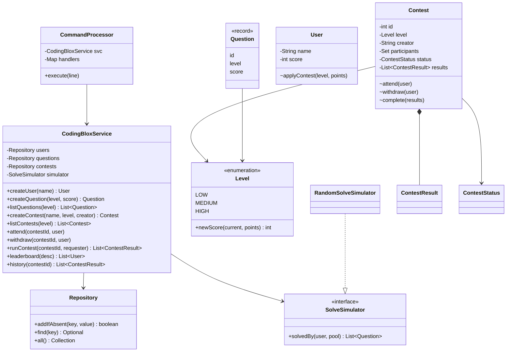

### Key flows

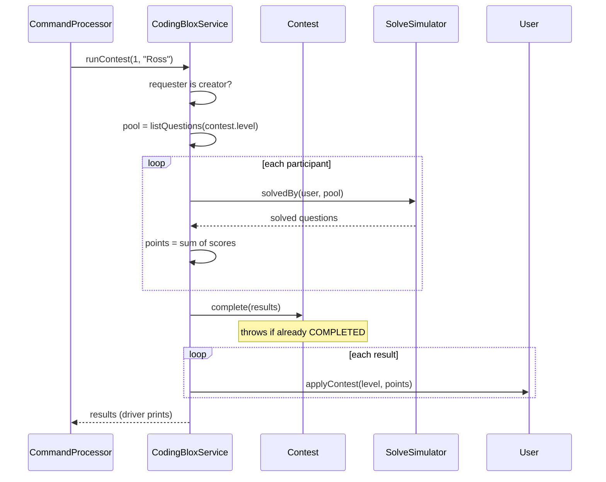

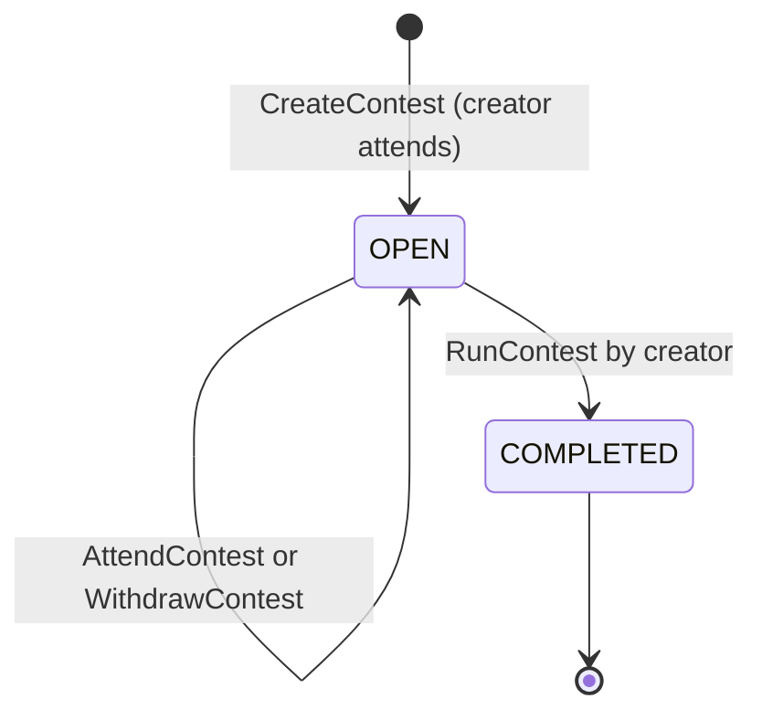

### Design decisions & patterns used

| Decision | Pattern | Why | Alternative rejected |
|---|---|---|---|
| Command name → handler map | Command | Adding a command is one `put`; no giant `switch`. Parsing and printing stay out of the service. | Parsing inside the service. |
| Scoring rule inside `Level` enum | Strategy (enum-per-constant data) | The rule depends only on the level; a new level brings its own rule. | `if (level == LOW) ... else if ...` in `runContest`. |
| `SolveSimulator` interface | Strategy | Randomness is replaceable: seeded for demo, scripted for tests, a real judge later. | `new Random()` inside the service — untestable. |
| `Contest.complete` checks status | Entity guards invariant | "Run once" enforced where the state lives, so scores are never applied twice. | Checking in the driver. |
| Generic `Repository<K,V>` | Repository | Three stores, one class (DRY — the statement asks for it). | Three copy-pasted maps with lookup code. |
| Results computed, then `complete`, then ratings | Ordering for safety | If `complete` throws (already run), no rating has changed yet. | Updating ratings inside the loop. |

### Java implementation

```java
// File: lld/ch21/codingblox/Level.java
package lld.ch21.codingblox;

/** Difficulty of a question or a contest. Each contest level carries its own scoring rule. */
public enum Level {
    LOW(50), MEDIUM(30), HIGH(0);

    private final int penalty;
    Level(int penalty) { this.penalty = penalty; }

    /** newScore = currentScore + (contestPoints - penalty), exactly as the statement defines. */
    public int newScore(int current, int contestPoints) { return current + contestPoints - penalty; }

    public static Level parse(String s) {
        try { return valueOf(s.toUpperCase()); }
        catch (IllegalArgumentException e) { throw new BloxException("Unknown level: " + s); }
    }
}
```

```java
// File: lld/ch21/codingblox/User.java
package lld.ch21.codingblox;

public class User {
    public static final int DEFAULT_SCORE = 1500;
    private final String name;
    private int score = DEFAULT_SCORE;

    public User(String name) { this.name = name; }
    public String name() { return name; }
    public synchronized int score() { return score; }
    /** Read-modify-write under one lock, so two contests finishing together cannot lose an update. */
    synchronized void applyContest(Level level, int points) { score = level.newScore(score, points); }
}
```

```java
// File: lld/ch21/codingblox/Question.java
package lld.ch21.codingblox;

public record Question(int id, Level level, int score) {
    @Override public String toString() { return "Q" + id + "(" + level + "," + score + ")"; }
}
```

```java
// File: lld/ch21/codingblox/Contest.java
package lld.ch21.codingblox;

import java.util.ArrayList;
import java.util.LinkedHashSet;
import java.util.List;
import java.util.Set;

public class Contest {
    private final int id;
    private final String name;
    private final Level level;
    private final String creator;
    private final Set<String> participants = new LinkedHashSet<>();
    private final List<ContestResult> results = new ArrayList<>();
    private ContestStatus status = ContestStatus.OPEN;

    Contest(int id, String name, Level level, String creator) {
        this.id = id; this.name = name; this.level = level; this.creator = creator;
        participants.add(creator);                       // the creator always attends
    }

    public int id() { return id; }
    public String name() { return name; }
    public Level level() { return level; }
    public String creator() { return creator; }
    public synchronized ContestStatus status() { return status; }
    public synchronized List<String> participants() { return List.copyOf(participants); }
    public synchronized List<ContestResult> results() { return List.copyOf(results); }

    synchronized void attend(String user) {
        requireOpen();
        if (!participants.add(user)) throw new BloxException(user + " already registered for contest " + id);
    }

    synchronized void withdraw(String user) {
        requireOpen();
        if (user.equals(creator)) throw new BloxException("Creator cannot withdraw from contest " + id);
        if (!participants.remove(user)) throw new BloxException(user + " is not in contest " + id);
    }

    synchronized void complete(List<ContestResult> r) {
        requireOpen();
        results.addAll(r);
        status = ContestStatus.COMPLETED;
    }

    private void requireOpen() {
        if (status != ContestStatus.OPEN) throw new BloxException("Contest " + id + " has already run");
    }

    @Override public String toString() { return id + " " + name + " " + level + " by " + creator + " [" + status() + "]"; }
}
```

```java
// File: lld/ch21/codingblox/ContestStatus.java
package lld.ch21.codingblox;

public enum ContestStatus { OPEN, COMPLETED }
```

```java
// File: lld/ch21/codingblox/ContestResult.java
package lld.ch21.codingblox;

import java.util.List;

public record ContestResult(String user, int points, List<Integer> solvedIds) { }
```

```java
// File: lld/ch21/codingblox/BloxException.java
package lld.ch21.codingblox;

public class BloxException extends RuntimeException {
    public BloxException(String message) { super(message); }
}
```

```java
// File: lld/ch21/codingblox/Repository.java
package lld.ch21.codingblox;

import java.util.Collection;
import java.util.List;
import java.util.Map;
import java.util.Optional;
import java.util.concurrent.ConcurrentHashMap;

/** Tiny generic in-memory repository reused for users, questions and contests. */
public class Repository<K, V> {
    private final Map<K, V> items = new ConcurrentHashMap<>();
    public boolean addIfAbsent(K key, V value) { return items.putIfAbsent(key, value) == null; }
    public Optional<V> find(K key) { return Optional.ofNullable(items.get(key)); }
    public Collection<V> all() { return List.copyOf(items.values()); }
}
```

```java
// File: lld/ch21/codingblox/SolveSimulator.java
package lld.ch21.codingblox;

import java.util.List;

/** Strategy: decides which questions a user solved. Real system = judge results; demo = seeded random. */
public interface SolveSimulator {
    List<Question> solvedBy(String user, List<Question> pool);
}
```

```java
// File: lld/ch21/codingblox/RandomSolveSimulator.java
package lld.ch21.codingblox;

import java.util.ArrayList;
import java.util.Collections;
import java.util.Comparator;
import java.util.List;
import java.util.Random;

public class RandomSolveSimulator implements SolveSimulator {
    private final Random random;
    public RandomSolveSimulator(long seed) { this.random = new Random(seed); }

    @Override public List<Question> solvedBy(String user, List<Question> pool) {
        if (pool.isEmpty()) return List.of();
        List<Question> copy = new ArrayList<>(pool);
        Collections.shuffle(copy, random);
        int k = 1 + random.nextInt(copy.size());          // solves between 1 and all questions
        List<Question> picked = new ArrayList<>(copy.subList(0, k));
        picked.sort(Comparator.comparingInt(Question::id));
        return picked;
    }
}
```

```java
// File: lld/ch21/codingblox/CodingBloxService.java
package lld.ch21.codingblox;

import java.util.ArrayList;
import java.util.Comparator;
import java.util.List;
import java.util.concurrent.atomic.AtomicInteger;

public class CodingBloxService {
    private final Repository<String, User> users = new Repository<>();
    private final Repository<Integer, Question> questions = new Repository<>();
    private final Repository<Integer, Contest> contests = new Repository<>();
    private final AtomicInteger questionSeq = new AtomicInteger();
    private final AtomicInteger contestSeq = new AtomicInteger();
    private final SolveSimulator simulator;

    public CodingBloxService(SolveSimulator simulator) { this.simulator = simulator; }

    public User createUser(String name) {
        User u = new User(name);
        if (!users.addIfAbsent(name, u)) throw new BloxException("User already exists: " + name);
        return u;
    }

    public Question createQuestion(Level level, int score) {
        if (score <= 0) throw new BloxException("Score must be positive");
        Question q = new Question(questionSeq.incrementAndGet(), level, score);
        questions.addIfAbsent(q.id(), q);
        return q;
    }

    public List<Question> listQuestions(Level levelOrNull) {
        return questions.all().stream().filter(q -> levelOrNull == null || q.level() == levelOrNull)
                .sorted(Comparator.comparingInt(Question::id)).toList();
    }

    public Contest createContest(String name, Level level, String creator) {
        user(creator);
        if (listQuestions(level).isEmpty()) throw new BloxException("No " + level + " questions to build a contest");
        Contest c = new Contest(contestSeq.incrementAndGet(), name, level, creator);
        contests.addIfAbsent(c.id(), c);
        return c;
    }

    public List<Contest> listContests(Level levelOrNull) {
        return contests.all().stream().filter(c -> levelOrNull == null || c.level() == levelOrNull)
                .sorted(Comparator.comparingInt(Contest::id)).toList();
    }

    public void attend(int contestId, String userName) { user(userName); contest(contestId).attend(userName); }

    public void withdraw(int contestId, String userName) { user(userName); contest(contestId).withdraw(userName); }

    /** Only the creator may run. Every participant gets random solved questions, then scores update. */
    public List<ContestResult> runContest(int contestId, String requester) {
        Contest c = contest(contestId);
        if (!c.creator().equals(requester)) throw new BloxException(requester + " did not create contest " + contestId);
        List<Question> pool = listQuestions(c.level());
        List<ContestResult> results = new ArrayList<>();
        for (String name : c.participants()) {
            List<Question> solved = simulator.solvedBy(name, pool);
            int points = solved.stream().mapToInt(Question::score).sum();
            results.add(new ContestResult(name, points, solved.stream().map(Question::id).toList()));
        }
        c.complete(results);                               // throws if already run: scores never double-apply
        for (ContestResult r : results) user(r.user()).applyContest(c.level(), r.points());
        return results;
    }

    public List<User> leaderboard(boolean descending) {
        Comparator<User> byScore = Comparator.comparingInt(User::score);
        if (descending) byScore = byScore.reversed();
        return users.all().stream().sorted(byScore.thenComparing(User::name)).toList();
    }

    public List<ContestResult> history(int contestId) {
        Contest c = contest(contestId);
        if (c.status() != ContestStatus.COMPLETED) throw new BloxException("Contest " + contestId + " has not run yet");
        return c.results().stream().sorted(Comparator.comparingInt(ContestResult::points).reversed()
                .thenComparing(ContestResult::user)).toList();
    }

    private User user(String n) { return users.find(n).orElseThrow(() -> new BloxException("No such user: " + n)); }
    private Contest contest(int id) { return contests.find(id).orElseThrow(() -> new BloxException("No such contest: " + id)); }
}
```

```java
// File: lld/ch21/codingblox/CommandProcessor.java
package lld.ch21.codingblox;

import java.util.Arrays;
import java.util.LinkedHashMap;
import java.util.Map;
import java.util.function.Consumer;

/**
 * Driver layer. Parses one text line and dispatches to a handler (Command pattern: name -> action).
 * All printing lives here; the service returns data only.
 */
public class CommandProcessor {
    private final CodingBloxService svc;
    private final Map<String, Consumer<String[]>> handlers = new LinkedHashMap<>();

    public CommandProcessor(CodingBloxService svc) {
        this.svc = svc;
        handlers.put("createuser", a -> out("User " + svc.createUser(arg(a, 1)).name() + " created with score 1500"));
        handlers.put("createquestion", a -> out("Question created: " + svc.createQuestion(Level.parse(arg(a, 1)), Integer.parseInt(arg(a, 2)))));
        handlers.put("listquestion", a -> svc.listQuestions(a.length > 1 ? Level.parse(a[1]) : null).forEach(q -> out("  " + q)));
        handlers.put("createcontest", a -> out("Contest created: " + svc.createContest(arg(a, 1), Level.parse(arg(a, 2)), arg(a, 3))));
        handlers.put("listcontest", a -> svc.listContests(a.length > 1 ? Level.parse(a[1]) : null).forEach(c -> out("  " + c)));
        handlers.put("attendcontest", a -> { svc.attend(Integer.parseInt(arg(a, 1)), arg(a, 2)); out(a[2] + " registered for contest " + a[1]); });
        handlers.put("withdrawcontest", a -> { svc.withdraw(Integer.parseInt(arg(a, 1)), arg(a, 2)); out(a[2] + " withdrew from contest " + a[1]); });
        handlers.put("runcontest", a -> svc.runContest(Integer.parseInt(arg(a, 1)), arg(a, 2))
                .forEach(r -> out("  " + r.user() + " solved " + r.solvedIds() + " -> " + r.points() + " pts")));
        handlers.put("leaderboard", a -> svc.leaderboard(!a[a.length - 1].equalsIgnoreCase("asc"))
                .forEach(u -> out("  " + u.name() + " : " + u.score())));
        handlers.put("contesthistory", a -> svc.history(Integer.parseInt(arg(a, 1)))
                .forEach(r -> out("  " + r.user() + " : " + r.points() + " " + r.solvedIds())));
    }

    public void execute(String line) {
        System.out.println("> " + line);
        String[] a = Arrays.stream(line.trim().split("\\s+")).map(s -> s.replace("\"", "")).toArray(String[]::new);
        Consumer<String[]> h = handlers.get(a[0].toLowerCase());
        try {
            if (h == null) throw new BloxException("Unknown command: " + a[0]);
            h.accept(a);
        } catch (BloxException | NumberFormatException e) {
            out("ERROR: " + e.getMessage());
        }
    }

    private static String arg(String[] a, int i) {
        if (i >= a.length) throw new BloxException("Missing argument #" + i + " for " + a[0]);
        return a[i];
    }

    private static void out(String s) { System.out.println(s); }
}
```

```java
// File: lld/ch21/codingblox/Main.java
package lld.ch21.codingblox;

import java.util.List;

public class Main {
    static final List<String> SAMPLE_INPUT = List.of(
            "CreateUser Ross", "CreateUser Monica", "CreateUser Joey", "CreateUser Chandler",
            "CreateQuestion \"LOW\" 10", "CreateQuestion LOW 20", "CreateQuestion LOW 30",
            "CreateQuestion MEDIUM 40", "CreateQuestion MEDIUM 50", "CreateQuestion HIGH 100",
            "ListQuestion LOW",
            "CreateContest \"diwali_contest\" LOW \"Ross\"",
            "CreateContest holi_contest MEDIUM Monica",
            "ListContest",
            "AttendContest 1 Monica", "AttendContest 1 Joey", "AttendContest 1 Chandler",
            "AttendContest 1 Joey",                  // duplicate
            "WithdrawContest 1 Chandler",
            "WithdrawContest 1 Ross",                // creator cannot withdraw
            "RunContest 1 Monica",                   // not the creator
            "RunContest 1 Ross",
            "RunContest 1 Ross",                     // already run
            "AttendContest 1 Chandler",              // too late
            "ContestHistory 1",
            "AttendContest 2 Chandler",
            "RunContest 2 Monica",
            "LeaderBoard score desc",
            "LeaderBoard asc",
            "CreateContest x HIGH Rachel",           // unknown user
            "Dance 1");                              // unknown command

    public static void main(String[] args) {
        CommandProcessor cli = new CommandProcessor(new CodingBloxService(new RandomSolveSimulator(42)));
        SAMPLE_INPUT.forEach(cli::execute);
    }
}
```

**Output:**

```text
> CreateUser Ross
User Ross created with score 1500
> CreateUser Monica
User Monica created with score 1500
> CreateUser Joey
User Joey created with score 1500
> CreateUser Chandler
User Chandler created with score 1500
> CreateQuestion "LOW" 10
Question created: Q1(LOW,10)
> CreateQuestion LOW 20
Question created: Q2(LOW,20)
> CreateQuestion LOW 30
Question created: Q3(LOW,30)
> CreateQuestion MEDIUM 40
Question created: Q4(MEDIUM,40)
> CreateQuestion MEDIUM 50
Question created: Q5(MEDIUM,50)
> CreateQuestion HIGH 100
Question created: Q6(HIGH,100)
> ListQuestion LOW
  Q1(LOW,10)
  Q2(LOW,20)
  Q3(LOW,30)
> CreateContest "diwali_contest" LOW "Ross"
Contest created: 1 diwali_contest LOW by Ross [OPEN]
> CreateContest holi_contest MEDIUM Monica
Contest created: 2 holi_contest MEDIUM by Monica [OPEN]
> ListContest
  1 diwali_contest LOW by Ross [OPEN]
  2 holi_contest MEDIUM by Monica [OPEN]
> AttendContest 1 Monica
Monica registered for contest 1
> AttendContest 1 Joey
Joey registered for contest 1
> AttendContest 1 Chandler
Chandler registered for contest 1
> AttendContest 1 Joey
ERROR: Joey already registered for contest 1
> WithdrawContest 1 Chandler
Chandler withdrew from contest 1
> WithdrawContest 1 Ross
ERROR: Creator cannot withdraw from contest 1
> RunContest 1 Monica
ERROR: Monica did not create contest 1
> RunContest 1 Ross
  Ross solved [2] -> 20 pts
  Monica solved [1, 2] -> 30 pts
  Joey solved [1, 2] -> 30 pts
> RunContest 1 Ross
ERROR: Contest 1 has already run
> AttendContest 1 Chandler
ERROR: Contest 1 has already run
> ContestHistory 1
  Joey : 30 [1, 2]
  Monica : 30 [1, 2]
  Ross : 20 [2]
> AttendContest 2 Chandler
Chandler registered for contest 2
> RunContest 2 Monica
  Monica solved [4, 5] -> 90 pts
  Chandler solved [4] -> 40 pts
> LeaderBoard score desc
  Monica : 1540
  Chandler : 1510
  Joey : 1480
  Ross : 1470
> LeaderBoard asc
  Ross : 1470
  Joey : 1480
  Chandler : 1510
  Monica : 1540
> CreateContest x HIGH Rachel
ERROR: No such user: Rachel
> Dance 1
ERROR: Unknown command: Dance
```

Checking the arithmetic: contest 1 is LOW, so each participant gets `points − 50`: Ross 1500 + (20 − 50) = 1470, Joey and Monica 1500 + (30 − 50) = 1480. Contest 2 is MEDIUM (`points − 30`): Monica 1480 + (90 − 30) = 1540, Chandler 1500 + (40 − 30) = 1510. The leaderboard matches. (Which questions are "solved" comes from the seeded simulator — change the seed and you get different but equally valid results.)

### Concurrency & edge cases

- **Concurrent commands:** repositories are `ConcurrentHashMap`s; `Contest` methods are `synchronized`; `User.applyContest` does its read-modify-write under the user's lock, so two contests finishing together cannot lose a rating update.
- **Double run:** `Contest.complete` throws if already completed; ratings are updated *after* it succeeds.
- **Known gap (say it):** `runContest` copies the participant list, simulates, then calls `complete`. A user who attends in that short window is registered but gets no result. Fix: add a `RUNNING` status and have `Contest` switch to it and hand back the participant list in one `synchronized` step, so no one can attend or withdraw once the run has started.
- **Edge cases handled:** duplicate user, unknown user/contest/level, non-positive question score, contest with no questions of its level, duplicate attend, attend/withdraw after the run, creator withdraw, non-creator run, missing arguments, non-numeric ids, unknown command.

### Extensions & follow-up questions

- **Pick a fixed number of questions per contest?** A `QuestionSelectionStrategy` (random k of level, or by tags) called at contest creation; store the chosen ids in the contest.
- **Real submissions?** Replace `SolveSimulator` with a judge that returns verdicts per submission; add `Submission(user, question, verdict, time)` and score by time/penalty like ICPC.
- **Elo-style ratings?** A `RatingStrategy` interface taking all participants' results (ratings depend on opponents), selected per contest type.
- **Scheduled contests?** Add `startTime/endTime`, a `SCHEDULED → RUNNING → COMPLETED` state machine, and a scheduler that triggers `run`.
- **Leaderboard at scale?** Keep a `TreeSet` sorted by (score, name) or a Redis sorted set; update on each rating change instead of sorting on every query.

### Real-world example

LeetCode's weekly contests publish a live ranking during the contest, and afterwards each participant's contest rating is recalculated from their rank relative to others — a more elaborate version of the per-level rule in this statement. HackerRank and Codeforces follow the same shape: contests reference a pool of problems, participants register, and ratings change only after the contest is finalised.

### In the interview

Paste the sample commands into the driver list first. Build `CreateUser`, `CreateQuestion`, `CreateContest`, `AttendContest`, `RunContest`, `LeaderBoard` in that order, running after each. Point out the three design moves: command map, scoring rule on the enum, and randomness behind an interface (with a seed). Then bonus commands — both are tiny because `Contest` already stores results and guards its status.

### Self-check

- **Q:** Why must `RunContest` update ratings only after marking the contest complete? → **A:** If the contest had already run, `complete` throws before any rating changes — no double application.
- **Q:** How would you add a `VERY_HIGH` level with bonus +20? → **A:** Add an enum constant with its own rule (e.g. a negative penalty); nothing else changes.
- **Q:** How do you make `RunContest` deterministic in tests? → **A:** Inject a scripted `SolveSimulator` (or a seeded random one).
- **Q:** Where is "creator always attends" enforced? → **A:** In the `Contest` constructor.

### TL;DR

Command map in the driver, rules in the service, invariants in `Contest`, scoring on the `Level` enum, randomness behind a seeded `SolveSimulator`. Complete first, then update ratings.

---

## 21.5 Design a Property Listing Site — "PropertyHunt" (ClearTrip)

### Problem & clarifying questions

A ClearTrip machine-coding statement (kumaransg/LLD, `PropertyHunt`). The folder holds two versions: a text `readme.md` and a longer version as screenshots in `Question Image/`; the summary below follows the longer one, which adds ViewSold, the range rules and the "shortlist *other users'* property" wording. Build a console application for a property platform where users can: **register**; **list a property** they want to sell or rent; **view their own listings**; **shortlist** other users' properties; **view shortlisted** properties (sold ones still appear, with status SOLD); **search** available properties with any combination of **location** (case-insensitive exact match), **price range**, **listing type** (sell/rent), **size range**, **number of rooms** (1BHK/2BHK/3BHK), and **sort by** price or size (ascending); **mark sold** (only the owner); and **view sold** properties. Ranges: `X-Y` inclusive; a single `X` means "at least X" for size and "at most X" for price. **Bonus:** sizes in sq ft / sq m / sq yd (buyer and seller may use different units); **nearby locations** on a listing, with nearby matches shown last; prices like `40000`, `40k`, `60L`, `2Cr`; comma-separated values for location and rooms in search. The statement asks for in-memory storage, graceful errors ("Property does not exist"), and a clean, extensible OO design.

| Question | Answer used |
|---|---|
| Input format? | One command per line, fields separated by `|` (so commas are free for multi-values). `null` or empty = not given. |
| Can I shortlist my own property? | No — the screenshot version says users shortlist *others'* properties. (The text readme's sample has Jack shortlisting his own listing; that is exactly the kind of conflict to ask about.) |
| Can I shortlist a sold property? | No; but a property sold *after* I shortlisted it stays in my list with status SOLD. |
| Units internally? | Price in whole rupees (`long`), size in square feet (`double`). |
| Sort with location? | Exact location matches first, nearby matches after, then the chosen sort. |
| Mark sold — record buyer and price? | The screenshot sample writes `marksold - 2, xyz, 50000` (property, buyer, price). We store only the status; keeping buyer and sale price is a small extension (a `Sale` record). |

The sample search (`bellandur, 30000-50000, rent, ...`) returns a *sarjapur* property. In the screenshot version that is consistent: the sarjapur listing declares `nearby bellandur|kadubeesanahalli|marathahalli`, so it is a nearby match. The text readme's sample drops the `nearby` field, and there the result only makes sense if you know about the bonus. Our demo lists sarjapur with the same three nearby localities, and the search returns it.

### Requirements

**Functional:** RegisterUser, ListProperty, Search, Shortlist, ViewShortlisted, ViewListed, MarkSold, ViewSold — plus all four bonus items.
**Non-functional:** search filters combine freely; new filters or units without rewriting search; clear errors; safe under concurrent use.

### Use cases

| Actor | Use cases |
|---|---|
| **Seller / landlord** | list property, view listed, mark sold, view sold |
| **Buyer / tenant** | search, shortlist, view shortlisted |
| (Any user can be both — roles are per property, not per account: the owner of a property is its seller.) | |

### Core entities

| Class | Kind | Responsibility |
|---|---|---|
| `Property` | class | Listing data, owner, nearby locations, status; `markSold` guards double sale. |
| `ListingType`, `PropertyStatus`, `SortBy` | enums | SELL/RENT, AVAILABLE/SOLD, sort comparators. |
| `Price` | utility | Parse `40k/60L/2Cr/1.5Cr` → rupees; format back. |
| `AreaUnit` | enum | SQFT/SQM/SQYD with conversion to square feet; parses "1500 sq ft", "70 sqm". |
| `SearchCriteria` (+ `Builder`) | record | All-optional search parameters. |
| `PropertyService` | class | Register, list, search, shortlist, mark sold, views; owner-vs-buyer rules. |
| `CommandProcessor` | class | Parses `|`-separated commands, builds criteria, prints tables. |
| `HuntException` | exception | Readable errors. |

### Class diagram

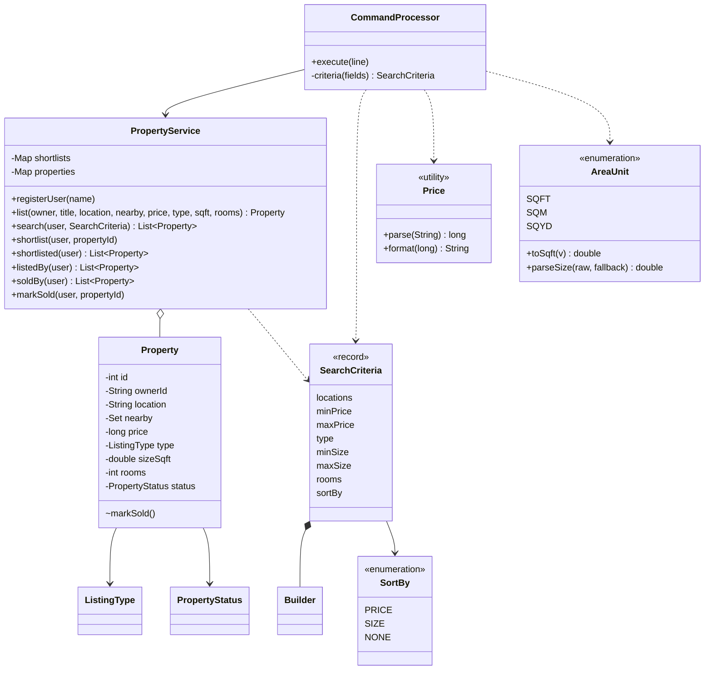

### Key flows

**Search = build criteria → list of predicates → one combined predicate → sort:**

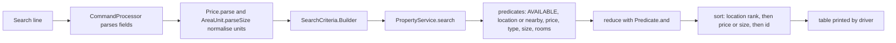

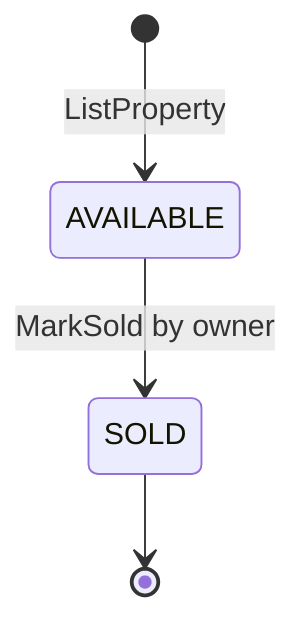

### Design decisions & patterns used

| Decision | Pattern | Why | Alternative rejected |
|---|---|---|---|
| All-optional `SearchCriteria` with a Builder | Builder | Eight optional fields; a constructor call with eight nulls is unreadable. | Telescoping constructors / overloads. |
| Each criterion becomes a `Predicate<Property>`, reduced with `and` | Specification | Any combination works; a new filter is one line; no nested `if` pyramid. | One `if` per combination. |
| `SortBy` enum of comparators | Strategy | Adding "sort by rooms" is one constant. | `switch` inside search. |
| Normalise at the boundary (rupees, sq ft) | — | Business code compares plain numbers; units only matter while parsing. | Storing strings like "90L" and comparing them. |
| Location rank 0/1/2 | — | Exact matches first, nearby second, others filtered out — one small function serves filtering *and* ordering. | Two separate searches merged. |
| Shortlist stored per user as a set of ids | — | View shortlisted shows current status (SOLD appears automatically). | Copying property objects into the shortlist — they would go stale. |

### Java implementation

```java
// File: lld/ch21/propertyhunt/Price.java
package lld.ch21.propertyhunt;

import java.math.BigDecimal;
import java.util.Locale;

/** Parses and prints Indian-style prices: 40000, 40k, 60L, 2Cr, 1.5Cr. Stored as whole rupees. */
public final class Price {
    private Price() { }

    public static long parse(String raw) {
        String s = raw.trim().toLowerCase(Locale.ROOT).replace(",", "").replace(" ", "");
        long mult = 1;
        if (s.endsWith("cr")) { mult = 10_000_000L; s = s.substring(0, s.length() - 2); }
        else if (s.endsWith("l")) { mult = 100_000L; s = s.substring(0, s.length() - 1); }
        else if (s.endsWith("k")) { mult = 1_000L; s = s.substring(0, s.length() - 1); }
        try {
            return new BigDecimal(s).multiply(BigDecimal.valueOf(mult)).longValueExact();
        } catch (ArithmeticException | NumberFormatException e) {
            throw new HuntException("Bad price: " + raw);
        }
    }

    public static String format(long rupees) {
        if (rupees >= 10_000_000L) return shift(rupees, 7) + "Cr";
        if (rupees >= 100_000L) return shift(rupees, 5) + "L";
        if (rupees >= 1_000L) return shift(rupees, 3) + "k";
        return Long.toString(rupees);
    }

    /** Exact decimal shift, e.g. shift(25000000, 7) = "2.5" - no double rounding. */
    private static String shift(long rupees, int places) {
        return BigDecimal.valueOf(rupees).movePointLeft(places).stripTrailingZeros().toPlainString();
    }
}
```

```java
// File: lld/ch21/propertyhunt/AreaUnit.java
package lld.ch21.propertyhunt;

import java.util.Locale;

/** Every size is converted to square feet internally so buyer and seller units can differ. */
public enum AreaUnit {
    SQFT(1.0), SQM(10.7639), SQYD(9.0);

    private final double sqftPerUnit;
    AreaUnit(double f) { this.sqftPerUnit = f; }

    public double toSqft(double v) { return v * sqftPerUnit; }

    /** Accepts "sqft", "sq ft", "sqm", "sq meter", "sqyd", "sq yard" ... (spaces ignored). */
    public static AreaUnit parse(String raw) {
        String s = raw.toLowerCase(Locale.ROOT).replace(" ", "").replace(".", "");
        if (s.isEmpty() || s.startsWith("sqf") || s.equals("ft")) return SQFT;
        if (s.startsWith("sqm")) return SQM;
        if (s.startsWith("sqy")) return SQYD;
        throw new HuntException("Unknown size unit: " + raw);
    }

    /** "1800 sqft" -> 1800.0 ; "200 sqyd" -> 1800.0 ; a bare number uses `fallback`. */
    public static double parseSize(String raw, AreaUnit fallback) {
        String s = raw.trim();
        int i = 0;
        while (i < s.length() && (Character.isDigit(s.charAt(i)) || s.charAt(i) == '.')) i++;
        if (i == 0) throw new HuntException("Bad size: " + raw);
        double value = Double.parseDouble(s.substring(0, i));
        String unit = s.substring(i).trim();
        return (unit.isEmpty() ? fallback : parse(unit)).toSqft(value);
    }
}
```

```java
// File: lld/ch21/propertyhunt/ListingType.java
package lld.ch21.propertyhunt;

public enum ListingType {
    SELL, RENT;

    public static ListingType parse(String s) {
        return switch (s.trim().toLowerCase()) {
            case "sell", "sale" -> SELL;
            case "rent" -> RENT;
            default -> throw new HuntException("Listing type must be sell or rent: " + s);
        };
    }
}
```

```java
// File: lld/ch21/propertyhunt/PropertyStatus.java
package lld.ch21.propertyhunt;

public enum PropertyStatus { AVAILABLE, SOLD }
```

```java
// File: lld/ch21/propertyhunt/Property.java
package lld.ch21.propertyhunt;

import java.util.Set;

public class Property {
    private final int id;
    private final String ownerId;
    private final String title;
    private final String location;          // stored lower-case for case-insensitive match
    private final Set<String> nearby;       // bonus: nearby locations, lower-case
    private final long price;
    private final ListingType type;
    private final double sizeSqft;
    private final int rooms;
    private PropertyStatus status = PropertyStatus.AVAILABLE;

    Property(int id, String ownerId, String title, String location, Set<String> nearby, long price,
             ListingType type, double sizeSqft, int rooms) {
        this.id = id; this.ownerId = ownerId; this.title = title; this.location = location;
        this.nearby = Set.copyOf(nearby); this.price = price; this.type = type;
        this.sizeSqft = sizeSqft; this.rooms = rooms;
    }

    public int id() { return id; }
    public String ownerId() { return ownerId; }
    public String title() { return title; }
    public String location() { return location; }
    public Set<String> nearby() { return nearby; }
    public long price() { return price; }
    public ListingType type() { return type; }
    public double sizeSqft() { return sizeSqft; }
    public int rooms() { return rooms; }
    public synchronized PropertyStatus status() { return status; }

    synchronized void markSold() {
        if (status == PropertyStatus.SOLD) throw new HuntException("Property " + id + " is already sold");
        status = PropertyStatus.SOLD;
    }
}
```

```java
// File: lld/ch21/propertyhunt/SortBy.java
package lld.ch21.propertyhunt;

import java.util.Comparator;

public enum SortBy {
    PRICE(Comparator.comparingLong(Property::price)),
    SIZE(Comparator.comparingDouble(Property::sizeSqft)),
    NONE(Comparator.comparingInt(Property::id));

    final Comparator<Property> comparator;
    SortBy(Comparator<Property> c) { this.comparator = c.thenComparingInt(Property::id); }

    public static SortBy parse(String s) { return s == null ? NONE : valueOf(s.trim().toUpperCase()); }
}
```

```java
// File: lld/ch21/propertyhunt/SearchCriteria.java
package lld.ch21.propertyhunt;

import java.util.Set;

/** Every field is optional (null = "don't care"). Built with the nested Builder. */
public record SearchCriteria(Set<String> locations, Long minPrice, Long maxPrice, ListingType type,
                             Double minSize, Double maxSize, Set<Integer> rooms, SortBy sortBy) {

    public static Builder builder() { return new Builder(); }

    public static final class Builder {
        private Set<String> locations; private Long minPrice, maxPrice; private ListingType type;
        private Double minSize, maxSize; private Set<Integer> rooms; private SortBy sortBy = SortBy.NONE;

        public Builder locations(Set<String> l) { locations = l; return this; }
        public Builder price(Long min, Long max) { minPrice = min; maxPrice = max; return this; }
        public Builder type(ListingType t) { type = t; return this; }
        public Builder size(Double min, Double max) { minSize = min; maxSize = max; return this; }
        public Builder rooms(Set<Integer> r) { rooms = r; return this; }
        public Builder sortBy(SortBy s) { sortBy = s; return this; }
        public SearchCriteria build() {
            return new SearchCriteria(locations, minPrice, maxPrice, type, minSize, maxSize, rooms, sortBy);
        }
    }
}
```

```java
// File: lld/ch21/propertyhunt/HuntException.java
package lld.ch21.propertyhunt;

public class HuntException extends RuntimeException {
    public HuntException(String message) { super(message); }
}
```

```java
// File: lld/ch21/propertyhunt/PropertyService.java
package lld.ch21.propertyhunt;

import java.util.ArrayList;
import java.util.Comparator;
import java.util.LinkedHashSet;
import java.util.List;
import java.util.Map;
import java.util.Set;
import java.util.concurrent.ConcurrentHashMap;
import java.util.concurrent.atomic.AtomicInteger;
import java.util.function.Predicate;

public class PropertyService {
    private final Map<String, Set<Integer>> shortlists = new ConcurrentHashMap<>();  // user -> ids (the user registry)
    private final Map<Integer, Property> properties = new ConcurrentHashMap<>();
    private final AtomicInteger seq = new AtomicInteger();

    public void registerUser(String name) {
        if (shortlists.putIfAbsent(name, ConcurrentHashMap.newKeySet()) != null)
            throw new HuntException("User already registered: " + name);
    }

    public Property list(String owner, String title, String location, Set<String> nearby, long price,
                         ListingType type, double sizeSqft, int rooms) {
        requireUser(owner);
        if (price <= 0 || sizeSqft <= 0 || rooms <= 0) throw new HuntException("Price, size and rooms must be positive");
        Property p = new Property(seq.incrementAndGet(), owner, title, location.trim().toLowerCase(),
                lower(nearby), price, type, sizeSqft, rooms);
        properties.put(p.id(), p);
        return p;
    }

    /** Only AVAILABLE properties. Exact location matches first, nearby matches last, then the chosen sort. */
    public List<Property> search(String user, SearchCriteria c) {
        requireUser(user);
        Set<String> locs = c.locations() == null ? null : lower(c.locations());
        List<Predicate<Property>> filters = new ArrayList<>();
        filters.add(p -> p.status() == PropertyStatus.AVAILABLE);
        if (locs != null) filters.add(p -> locationRank(p, locs) < 2);
        if (c.minPrice() != null) filters.add(p -> p.price() >= c.minPrice());
        if (c.maxPrice() != null) filters.add(p -> p.price() <= c.maxPrice());
        if (c.type() != null) filters.add(p -> p.type() == c.type());
        if (c.minSize() != null) filters.add(p -> p.sizeSqft() >= c.minSize());
        if (c.maxSize() != null) filters.add(p -> p.sizeSqft() <= c.maxSize());
        if (c.rooms() != null) filters.add(p -> c.rooms().contains(p.rooms()));
        Predicate<Property> all = filters.stream().reduce(x -> true, Predicate::and);

        Comparator<Property> order = locs == null ? c.sortBy().comparator
                : Comparator.<Property>comparingInt(p -> locationRank(p, locs)).thenComparing(c.sortBy().comparator);
        return properties.values().stream().filter(all).sorted(order).toList();
    }

    public void shortlist(String user, int propertyId) {
        requireUser(user);
        Property p = get(propertyId);
        if (p.ownerId().equals(user)) throw new HuntException("You cannot shortlist your own property");
        if (p.status() == PropertyStatus.SOLD) throw new HuntException("Property " + propertyId + " is already sold");
        if (!shortlists.get(user).add(propertyId)) throw new HuntException("Property " + propertyId + " already shortlisted");
    }

    /** Includes sold ones; the caller prints status so the buyer sees "SOLD". */
    public List<Property> shortlisted(String user) {
        requireUser(user);
        return shortlists.get(user).stream().map(properties::get).sorted(Comparator.comparingInt(Property::id)).toList();
    }

    public List<Property> listedBy(String user) {
        requireUser(user);
        return properties.values().stream().filter(p -> p.ownerId().equals(user))
                .sorted(Comparator.comparingInt(Property::id)).toList();
    }

    public List<Property> soldBy(String user) {
        return listedBy(user).stream().filter(p -> p.status() == PropertyStatus.SOLD).toList();
    }

    public void markSold(String user, int propertyId) {
        requireUser(user);
        Property p = get(propertyId);
        if (!p.ownerId().equals(user)) throw new HuntException("Only the owner can mark property " + propertyId + " sold");
        p.markSold();
    }

    /** 0 = exact location match, 1 = nearby match, 2 = no match. */
    private static int locationRank(Property p, Set<String> locs) {
        if (locs.contains(p.location())) return 0;
        return p.nearby().stream().anyMatch(locs::contains) ? 1 : 2;
    }

    private Property get(int id) {
        Property p = properties.get(id);
        if (p == null) throw new HuntException("Property does not exist: " + id);
        return p;
    }

    private void requireUser(String u) { if (!shortlists.containsKey(u)) throw new HuntException("User not registered: " + u); }

    private static Set<String> lower(Set<String> s) {
        Set<String> out = new LinkedHashSet<>();
        s.forEach(x -> out.add(x.trim().toLowerCase()));
        return out;
    }
}
```

```java
// File: lld/ch21/propertyhunt/CommandProcessor.java
package lld.ch21.propertyhunt;

import java.util.Arrays;
import java.util.List;
import java.util.Set;
import java.util.stream.Collectors;

/**
 * Parses '|'-separated commands. Inside a field, ',' separates multiple values (bonus requirement).
 * "null" or an empty field means "not given".
 */
public class CommandProcessor {
    private final PropertyService svc;
    public CommandProcessor(PropertyService svc) { this.svc = svc; }

    public void execute(String line) {
        System.out.println("-> " + line);
        String[] f = Arrays.stream(line.split("\\|", -1)).map(String::trim).toArray(String[]::new);
        try {
            switch (f[0].toLowerCase()) {
                case "registeruser" -> { svc.registerUser(f[1]); out("User registered successfully."); }
                case "listproperty" -> {
                    Set<String> nearby = f.length > 8 && given(f[8]) ? csv(f[8]) : Set.of();
                    Property p = svc.list(f[1], f[2], f[3], nearby, Price.parse(f[4]), ListingType.parse(f[5]),
                            AreaUnit.parseSize(f[6], AreaUnit.SQFT), rooms(f[7]));
                    out("Property listed successfully. id=" + p.id());
                }
                case "search" -> printTable(svc.search(f[1], criteria(f)), false);
                case "shortlist" -> { svc.shortlist(f[1], Integer.parseInt(f[2])); out("Shortlisted property"); }
                case "viewshortlisted" -> printTable(svc.shortlisted(f[1]), true);
                case "viewlisted" -> printTable(svc.listedBy(f[1]), true);
                case "viewsold" -> printTable(svc.soldBy(f[1]), true);
                case "marksold" -> { svc.markSold(f[1], Integer.parseInt(f[2])); out("Property marked SOLD"); }
                default -> out("ERROR: unknown command " + f[0]);
            }
        } catch (HuntException | IllegalArgumentException | ArrayIndexOutOfBoundsException e) {
            out("ERROR: " + e.getMessage());
        }
    }

    /** Search|user|locations|priceRange|type|sizeRange|rooms|sortBy */
    private SearchCriteria criteria(String[] f) {
        SearchCriteria.Builder b = SearchCriteria.builder();
        if (given(f[2])) b.locations(csv(f[2]));
        if (given(f[3])) {
            String[] r = f[3].split("-");                       // "X-Y" inclusive, "X" = at most X
            if (r.length == 2) b.price(Price.parse(r[0]), Price.parse(r[1]));
            else b.price(null, Price.parse(r[0]));
        }
        if (given(f[4])) b.type(ListingType.parse(f[4]));
        if (given(f[5])) {
            String[] r = f[5].split("-");                       // "X-Y" inclusive, "X" = at least X
            if (r.length == 2) {
                AreaUnit unit = unitOf(r[1]);                   // "1000-2000 sqft": unit written once
                b.size(AreaUnit.parseSize(r[0], unit), AreaUnit.parseSize(r[1], unit));
            } else b.size(AreaUnit.parseSize(r[0], AreaUnit.SQFT), null);
        }
        if (given(f[6])) b.rooms(csv(f[6]).stream().map(CommandProcessor::rooms).collect(Collectors.toSet()));
        if (f.length > 7 && given(f[7])) b.sortBy(SortBy.parse(f[7]));
        return b.build();
    }

    private static AreaUnit unitOf(String s) {
        String unit = s.replaceAll("[0-9.\\s]", "");
        return unit.isEmpty() ? AreaUnit.SQFT : AreaUnit.parse(unit);
    }

    private static int rooms(String s) { return Integer.parseInt(s.toUpperCase().replace("BHK", "").trim()); }
    private static boolean given(String s) { return !s.isEmpty() && !s.equalsIgnoreCase("null"); }
    private static Set<String> csv(String s) {
        return Arrays.stream(s.split(",")).map(String::trim).filter(x -> !x.isEmpty()).collect(Collectors.toSet());
    }

    private static void printTable(List<Property> ps, boolean withStatus) {
        if (ps.isEmpty()) { out("<- (no properties)"); return; }
        out("<- %-3s %-20s %-10s %-6s %-9s %-5s %-5s%s".formatted("Id", "Title", "Location", "Price", "Size",
                "Rooms", "For", withStatus ? " Status" : ""));
        for (Property p : ps)
            out("<- %-3d %-20s %-10s %-6s %-9s %-5s %-5s%s".formatted(p.id(), p.title(), p.location(),
                    Price.format(p.price()), Math.round(p.sizeSqft()) + "sqft", p.rooms() + "BHK",
                    p.type() == ListingType.SELL ? "Sale" : "Rent", withStatus ? " " + p.status() : ""));
    }

    private static void out(String s) { System.out.println(s); }
}
```

```java
// File: lld/ch21/propertyhunt/Main.java
package lld.ch21.propertyhunt;

import java.util.List;

public class Main {
    static final List<String> SAMPLE_INPUT = List.of(
            "RegisterUser|Jack",
            "RegisterUser|Jill",
            "RegisterUser|Jack",
            "ListProperty|Jack|A 3BHK for sale|bellandur|90L|sell|1800 sqft|3",
            "ListProperty|Jack|A 2BHK for rent|sarjapur|40k|rent|1500 sq ft|2|bellandur,kadubeesanahalli,marathahalli",
            "ListProperty|Jill|Cosy 1BHK|HSR|25k|rent|70 sqm|1BHK",
            "ListProperty|Jill|Villa|whitefield|2.5Cr|sell|400 sqyd|4",
            "Search|Jack|null|null|null|null|null|null",
            "Search|Jack|bellandur|30000-50000|rent|150sqft|2|price",
            "Search|Jack|bellandur|null|null|null|null|price",
            "Search|Jill|null|1Cr|null|1000-2000 sqft|2,3|size",
            "Search|Jill|hsr,sarjapur|null|rent|null|1BHK,2BHK|price",
            "Shortlist|Jill|1",
            "Shortlist|Jill|2",
            "Shortlist|Jill|9",
            "Shortlist|Jack|1",
            "MarkSold|Jill|1",
            "MarkSold|Jack|1",
            "ViewShortlisted|Jill",
            "ViewListed|Jack",
            "ViewSold|Jack",
            "Search|Jill|null|null|sell|null|null|price",
            "ListProperty|Jill|Bad|x|abc|sell|100 sqft|1",
            "Search|Bob|null|null|null|null|null|null");

    public static void main(String[] args) {
        CommandProcessor cli = new CommandProcessor(new PropertyService());
        SAMPLE_INPUT.forEach(cli::execute);
    }
}
```

**Output:**

```text
-> RegisterUser|Jack
User registered successfully.
-> RegisterUser|Jill
User registered successfully.
-> RegisterUser|Jack
ERROR: User already registered: Jack
-> ListProperty|Jack|A 3BHK for sale|bellandur|90L|sell|1800 sqft|3
Property listed successfully. id=1
-> ListProperty|Jack|A 2BHK for rent|sarjapur|40k|rent|1500 sq ft|2|bellandur,kadubeesanahalli,marathahalli
Property listed successfully. id=2
-> ListProperty|Jill|Cosy 1BHK|HSR|25k|rent|70 sqm|1BHK
Property listed successfully. id=3
-> ListProperty|Jill|Villa|whitefield|2.5Cr|sell|400 sqyd|4
Property listed successfully. id=4
-> Search|Jack|null|null|null|null|null|null
<- Id  Title                Location   Price  Size      Rooms For
<- 1   A 3BHK for sale      bellandur  90L    1800sqft  3BHK  Sale
<- 2   A 2BHK for rent      sarjapur   40k    1500sqft  2BHK  Rent
<- 3   Cosy 1BHK            hsr        25k    753sqft   1BHK  Rent
<- 4   Villa                whitefield 2.5Cr  3600sqft  4BHK  Sale
-> Search|Jack|bellandur|30000-50000|rent|150sqft|2|price
<- Id  Title                Location   Price  Size      Rooms For
<- 2   A 2BHK for rent      sarjapur   40k    1500sqft  2BHK  Rent
-> Search|Jack|bellandur|null|null|null|null|price
<- Id  Title                Location   Price  Size      Rooms For
<- 1   A 3BHK for sale      bellandur  90L    1800sqft  3BHK  Sale
<- 2   A 2BHK for rent      sarjapur   40k    1500sqft  2BHK  Rent
-> Search|Jill|null|1Cr|null|1000-2000 sqft|2,3|size
<- Id  Title                Location   Price  Size      Rooms For
<- 2   A 2BHK for rent      sarjapur   40k    1500sqft  2BHK  Rent
<- 1   A 3BHK for sale      bellandur  90L    1800sqft  3BHK  Sale
-> Search|Jill|hsr,sarjapur|null|rent|null|1BHK,2BHK|price
<- Id  Title                Location   Price  Size      Rooms For
<- 3   Cosy 1BHK            hsr        25k    753sqft   1BHK  Rent
<- 2   A 2BHK for rent      sarjapur   40k    1500sqft  2BHK  Rent
-> Shortlist|Jill|1
Shortlisted property
-> Shortlist|Jill|2
Shortlisted property
-> Shortlist|Jill|9
ERROR: Property does not exist: 9
-> Shortlist|Jack|1
ERROR: You cannot shortlist your own property
-> MarkSold|Jill|1
ERROR: Only the owner can mark property 1 sold
-> MarkSold|Jack|1
Property marked SOLD
-> ViewShortlisted|Jill
<- Id  Title                Location   Price  Size      Rooms For   Status
<- 1   A 3BHK for sale      bellandur  90L    1800sqft  3BHK  Sale  SOLD
<- 2   A 2BHK for rent      sarjapur   40k    1500sqft  2BHK  Rent  AVAILABLE
-> ViewListed|Jack
<- Id  Title                Location   Price  Size      Rooms For   Status
<- 1   A 3BHK for sale      bellandur  90L    1800sqft  3BHK  Sale  SOLD
<- 2   A 2BHK for rent      sarjapur   40k    1500sqft  2BHK  Rent  AVAILABLE
-> ViewSold|Jack
<- Id  Title                Location   Price  Size      Rooms For   Status
<- 1   A 3BHK for sale      bellandur  90L    1800sqft  3BHK  Sale  SOLD
-> Search|Jill|null|null|sell|null|null|price
<- Id  Title                Location   Price  Size      Rooms For
<- 4   Villa                whitefield 2.5Cr  3600sqft  4BHK  Sale
-> ListProperty|Jill|Bad|x|abc|sell|100 sqft|1
ERROR: Bad price: abc
-> Search|Bob|null|null|null|null|null|null
ERROR: User not registered: Bob
```

Things to notice: 70 sq m was stored as 753 sq ft and 400 sq yd as 3600 sq ft; the `bellandur` search returns the bellandur listing first and the sarjapur listing (nearby) last; after `MarkSold`, property 1 disappears from searches but still shows as SOLD in Jill's shortlist; bad input produces an error line and the program continues.

### Concurrency & edge cases

- **Storage:** `ConcurrentHashMap`s; each user's shortlist is a concurrent set; `Property.markSold` is `synchronized` so two "mark sold" calls cannot both succeed.
- **A search racing a sale** may still show a property that is being sold at that instant — acceptable for listings (eventual consistency); a purchase flow would re-check status under a lock.
- **Edge cases handled:** duplicate registration, unregistered user, unknown property, own-property shortlist, duplicate shortlist, shortlisting a sold property, non-owner mark sold, double sale, bad price/size/unit/type, non-positive values, missing fields.

### Extensions & follow-up questions

- **Descending sort / multiple sort keys?** `SortBy` holds a comparator; add a direction flag and `.reversed()`, or accept a list of keys and chain `thenComparing`.
- **Fuzzy location ("Bellandur Road")?** Normalise locations to ids through a `LocationResolver` interface (gazetteer / geocoding).
- **"Within 5 km"?** Store latitude/longitude and filter by haversine distance; at scale use a geo-index (geohash, R-tree) or a search engine with geo queries.
- **Fast search over millions?** Secondary indexes (by location, type, rooms) or Elasticsearch/OpenSearch; price and size as numeric range fields.
- **Notifications on price drop for shortlisted items?** Observer on `Property` price changes → notify users who shortlisted it.

### Real-world example

Property portals like 99acres, MagicBricks and NoBroker let you filter by locality, budget, BHK count, buy/rent and area, and often suggest nearby localities when results are few; Indian listings commonly quote prices in lakhs and crores — exactly why the statement asks you to parse `60L` and `2Cr`.

### In the interview

Start with the model and units (show `Price.parse` handling `90L`, and `AreaUnit`). Then implement register → list → search with *one* filter → add filters as predicates → sort. Shortlist, mark sold and the views are small after that. Call out the Builder and predicate list as your extensibility story, and the "normalise at the boundary" principle.

### Self-check

- **Q:** How does a buyer searching in sq m match a seller who listed in sq yd? → **A:** Both are converted to sq ft at parse time; search compares sq ft.
- **Q:** Why store shortlists as ids rather than objects? → **A:** Status is read live from the property, so SOLD shows without extra updates.
- **Q:** What does a single number mean in the price field? → **A:** "At most X" (for size it means "at least X").
- **Q:** How do you add a "furnished" filter? → **A:** A field on `Property`, an optional field in `SearchCriteria`, and one predicate line in `search`.

### TL;DR

Normalise price and size at the edges, turn every optional criterion into a predicate and AND them together, sort by (location rank, chosen key, id), and keep shortlists as ids so status stays live.

---

## 21.6 Design a Loan Ledger — "Ledger Co" (Navi)

### Problem & clarifying questions

This problem (kumaransg/LLD, `ledger_company_navi`) is the Geektrust "Ledger Co" backend challenge; the repository files it under Navi, which has used it as a hiring exercise. Banks lend money to borrowers; borrowers repay in **EMIs** (Equated Monthly Instalments — the same amount every month) and may also pay a **lump sum** at any point. The program reads commands and answers balance questions:

| Command | Meaning |
|---|---|
| `LOAN BANK BORROWER P N R` | Borrower takes principal `P` for `N` years at `R`% simple interest per year. |
| `PAYMENT BANK BORROWER LUMP_SUM EMI_NO` | A lump sum paid right after EMI number `EMI_NO`. |
| `BALANCE BANK BORROWER EMI_NO` | Print `BANK BORROWER AMOUNT_PAID EMIS_LEFT` as of (after) EMI number `EMI_NO`. |

Rules from the statement: interest `I = P × N × R / 100` (R is a percentage); total repayable `A = P + I`; monthly EMI = `A / (N × 12)` **rounded up** to a whole number (86.67 → 87, and even 100.10 → 101); amount paid as of EMI *k* = `k × EMI` + every lump sum whose EMI number is *k* or less (a lump sum "after EMI 10" *is* included in `BALANCE ... 10`); EMIs left = remaining amount ÷ EMI, **rounded up** (23.1 → 24); and if the last EMI is more than what is still owed, it shrinks to exactly that amount. A lump sum therefore reduces the *number* of EMIs, never the EMI amount. Only `BALANCE` produces output, in the form `BANK_NAME BORROWER_NAME AMOUNT_PAID NO_OF_EMIS_LEFT`.

| Question | Answer used |
|---|---|
| Can amount paid exceed `A`? | No — capped at `A` (then EMIs left = 0). This is also the "last EMI shrinks" rule: the final payment is only what is left. |
| Is interest a whole number? | The statement defines rounding only for the EMI and the EMI count. We *assume* interest is also rounded up to a whole unit (say so to the interviewer); every official sample has whole-number interest, so both samples come out the same either way. |
| One loan per bank-borrower pair? | Yes — the pair identifies the loan; a second `LOAN` for the same pair is an error. |
| `EMI_NO` beyond the tenure? | Error. `EMI_NO = 0` is valid (before any EMI). |

### Requirements

**Functional:** LOAN, PAYMENT, BALANCE exactly as above; reproduce the official sample outputs.
**Non-functional:** input from a list/file; one bad line must not stop the rest; interest rule replaceable; exact arithmetic (`BigDecimal`).

### Use cases

| Actor | Use cases |
|---|---|
| **Bank** | records a loan |
| **Borrower** | pays lump sums |
| **Anyone (support agent, borrower app)** | asks for the balance after EMI *k* |

### Core entities

| Class | Kind | Responsibility |
|---|---|---|
| `LoanKey` | record | (bank, borrower) — the loan's identity; a perfect `Map` key because records implement `equals/hashCode`. |
| `Loan` | class | Computes `A` and EMI once; stores lump sums; derives a `Balance` for any EMI number. |
| `LumpSum` | record | amount + "after EMI number". |
| `Balance` | record | Output line: bank, borrower, amount paid, EMIs left. |
| `InterestPolicy` / `SimpleInterest` | interface / class | Strategy for total interest. |
| `LedgerService` | class | Store of loans; the three operations. |
| `CommandProcessor` | class | Parses lines, validates argument counts and numbers, collects output. |
| `LedgerException` | exception | Readable failure. |

### Class diagram

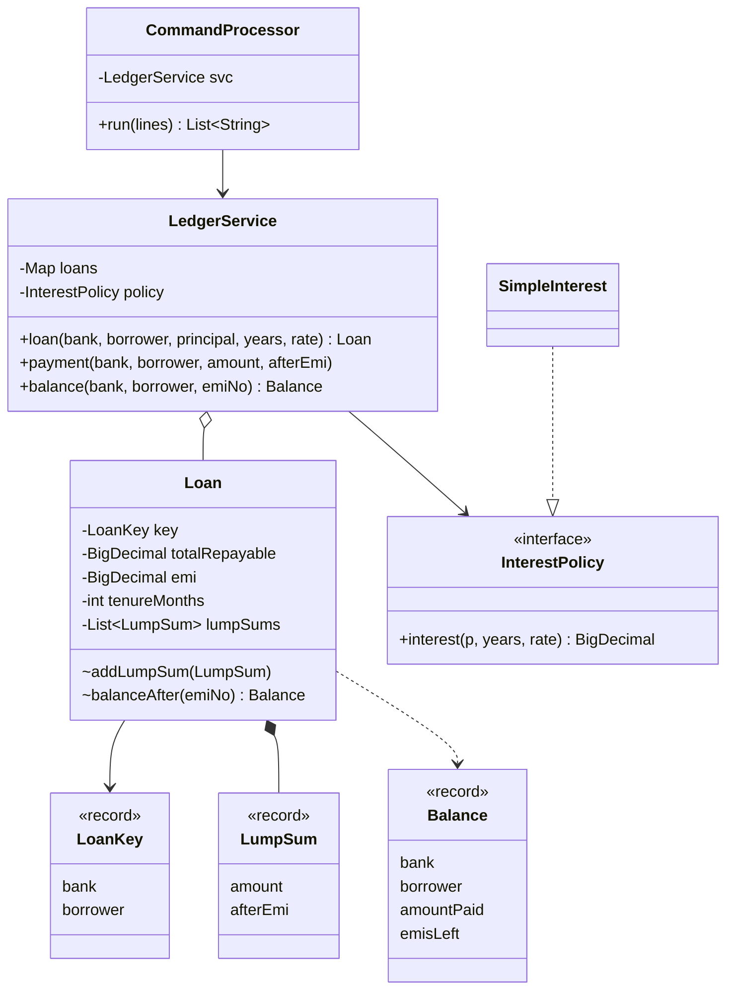

### Key flows

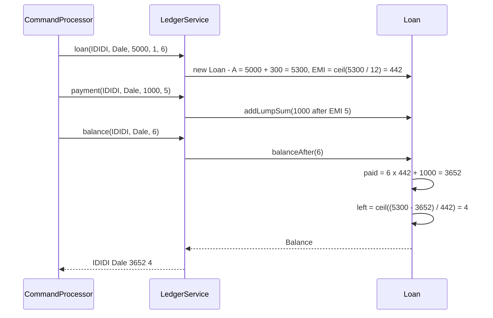

**Worked example (Sample 2, Shelly):** P = 15000, N = 2, R = 9 → I = 2700, A = 17700, EMI = ⌈17700 / 24⌉ = ⌈737.5⌉ = 738. After 12 EMIs plus a 7000 lump sum: paid = 12 × 738 + 7000 = 15856; remaining = 1844; EMIs left = ⌈1844 / 738⌉ = ⌈2.499⌉ = 3. Output `UON Shelly 15856 3`.

### Design decisions & patterns used

| Decision | Why | Alternative rejected |
|---|---|---|
| **Derive balance from facts** (A, EMI, lump sums) on every query | Queries can ask about *any* EMI number, even one before a later payment. Storing a running balance would need replays. | Mutable `remaining` field updated per command — breaks when a BALANCE asks about an earlier EMI. |
| `InterestPolicy` Strategy | Simple interest today; reducing-balance or compound tomorrow without touching `Loan`. | Formula hard-coded in `Loan`. |
| `LoanKey` record as map key | Value semantics for free (`equals/hashCode`). | Concatenated string `"IDIDI#Dale"` — fragile. |
| `BigDecimal` + explicit `RoundingMode.CEILING` | The statement's rounding is "always up"; ceiling on integers is exact. | `Math.ceil` on doubles — fine for small numbers but floating error can bite (e.g. a value like 4.000000001 ceils to 5). |
| Driver returns `List<String>` | Easy to compare with the expected output in a test. | Printing inside the service. |

### Java implementation

```java
// File: lld/ch21/ledger/LoanKey.java
package lld.ch21.ledger;

/** A borrower can hold one loan per bank; (bank, borrower) identifies it. */
public record LoanKey(String bank, String borrower) { }
```

```java
// File: lld/ch21/ledger/LumpSum.java
package lld.ch21.ledger;

import java.math.BigDecimal;

/** Extra payment made right after EMI number `afterEmi`. */
public record LumpSum(BigDecimal amount, int afterEmi) { }
```

```java
// File: lld/ch21/ledger/Balance.java
package lld.ch21.ledger;

import java.math.BigDecimal;

public record Balance(String bank, String borrower, BigDecimal amountPaid, int emisLeft) {
    @Override public String toString() { return bank + " " + borrower + " " + amountPaid.toPlainString() + " " + emisLeft; }
}
```

```java
// File: lld/ch21/ledger/InterestPolicy.java
package lld.ch21.ledger;

import java.math.BigDecimal;

/** Strategy for total interest. The problem uses simple interest; a bank could plug in another rule. */
public interface InterestPolicy {
    BigDecimal interest(BigDecimal principal, BigDecimal years, BigDecimal ratePercent);
}
```

```java
// File: lld/ch21/ledger/SimpleInterest.java
package lld.ch21.ledger;

import java.math.BigDecimal;
import java.math.RoundingMode;

/** I = P * N * R / 100, rounded UP to a whole unit (the statement rounds amounts up). */
public class SimpleInterest implements InterestPolicy {
    @Override public BigDecimal interest(BigDecimal p, BigDecimal n, BigDecimal r) {
        return p.multiply(n).multiply(r).divide(BigDecimal.valueOf(100), 0, RoundingMode.CEILING);
    }
}
```

```java
// File: lld/ch21/ledger/Loan.java
package lld.ch21.ledger;

import java.math.BigDecimal;
import java.math.RoundingMode;
import java.util.ArrayList;
import java.util.List;

/**
 * Loan with fixed EMI. Amount repaid A = P + I. EMI = ceil(A / (N*12)).
 * Lump sums shorten the loan (fewer EMIs) but never change the EMI amount.
 */
public class Loan {
    private final LoanKey key;
    private final BigDecimal totalRepayable;
    private final BigDecimal emi;
    private final int tenureMonths;
    private final List<LumpSum> lumpSums = new ArrayList<>();

    Loan(LoanKey key, BigDecimal principal, int years, BigDecimal rate, InterestPolicy policy) {
        if (principal.signum() <= 0 || years <= 0 || rate.signum() < 0)
            throw new LedgerException("Invalid loan terms for " + key);
        this.key = key;
        this.tenureMonths = years * 12;
        this.totalRepayable = principal.add(policy.interest(principal, BigDecimal.valueOf(years), rate));
        this.emi = totalRepayable.divide(BigDecimal.valueOf(tenureMonths), 0, RoundingMode.CEILING);
    }

    public BigDecimal emi() { return emi; }
    public BigDecimal totalRepayable() { return totalRepayable; }

    synchronized void addLumpSum(LumpSum l) {
        if (l.amount().signum() <= 0) throw new LedgerException("Lump sum must be positive");
        if (l.afterEmi() < 0 || l.afterEmi() > tenureMonths) throw new LedgerException("EMI number out of range: " + l.afterEmi());
        lumpSums.add(l);
    }

    /** Amount paid after `emiNo` EMIs (lump sums made at or before that EMI count), capped at A. */
    synchronized Balance balanceAfter(int emiNo) {
        if (emiNo < 0 || emiNo > tenureMonths) throw new LedgerException("EMI number out of range: " + emiNo);
        BigDecimal lumps = lumpSums.stream().filter(l -> l.afterEmi() <= emiNo)
                .map(LumpSum::amount).reduce(BigDecimal.ZERO, BigDecimal::add);
        BigDecimal paid = emi.multiply(BigDecimal.valueOf(emiNo)).add(lumps).min(totalRepayable);
        BigDecimal remaining = totalRepayable.subtract(paid);
        int left = remaining.divide(emi, 0, RoundingMode.CEILING).intValueExact();
        return new Balance(key.bank(), key.borrower(), paid, left);
    }
}
```

```java
// File: lld/ch21/ledger/LedgerException.java
package lld.ch21.ledger;

public class LedgerException extends RuntimeException {
    public LedgerException(String message) { super(message); }
}
```

```java
// File: lld/ch21/ledger/LedgerService.java
package lld.ch21.ledger;

import java.math.BigDecimal;
import java.util.Map;
import java.util.concurrent.ConcurrentHashMap;

public class LedgerService {
    private final Map<LoanKey, Loan> loans = new ConcurrentHashMap<>();
    private final InterestPolicy policy;

    public LedgerService(InterestPolicy policy) { this.policy = policy; }

    public Loan loan(String bank, String borrower, BigDecimal principal, int years, BigDecimal rate) {
        LoanKey key = new LoanKey(bank, borrower);
        Loan loan = new Loan(key, principal, years, rate, policy);
        if (loans.putIfAbsent(key, loan) != null) throw new LedgerException("Loan already exists for " + bank + " " + borrower);
        return loan;
    }

    public void payment(String bank, String borrower, BigDecimal amount, int afterEmi) {
        find(bank, borrower).addLumpSum(new LumpSum(amount, afterEmi));
    }

    public Balance balance(String bank, String borrower, int emiNo) { return find(bank, borrower).balanceAfter(emiNo); }

    private Loan find(String bank, String borrower) {
        Loan l = loans.get(new LoanKey(bank, borrower));
        if (l == null) throw new LedgerException("No loan for " + bank + " " + borrower);
        return l;
    }
}
```

```java
// File: lld/ch21/ledger/CommandProcessor.java
package lld.ch21.ledger;

import java.math.BigDecimal;
import java.util.ArrayList;
import java.util.List;

/**
 * LOAN BANK BORROWER PRINCIPAL YEARS RATE
 * PAYMENT BANK BORROWER LUMP_SUM EMI_NO
 * BALANCE BANK BORROWER EMI_NO      -> prints "BANK BORROWER AMOUNT_PAID EMIS_LEFT"
 * Only BALANCE produces output (as in the original statement); errors are printed with "ERROR".
 */
public class CommandProcessor {
    private final LedgerService svc;
    public CommandProcessor(LedgerService svc) { this.svc = svc; }

    public List<String> run(List<String> lines) {
        List<String> output = new ArrayList<>();
        for (String line : lines) {
            if (line.isBlank()) continue;
            String[] t = line.trim().split("\\s+");
            try {
                switch (t[0]) {
                    case "LOAN" -> { need(t, 6); svc.loan(t[1], t[2], num(t[3]), Integer.parseInt(t[4]), num(t[5])); }
                    case "PAYMENT" -> { need(t, 5); svc.payment(t[1], t[2], num(t[3]), Integer.parseInt(t[4])); }
                    case "BALANCE" -> { need(t, 4); output.add(svc.balance(t[1], t[2], Integer.parseInt(t[3])).toString()); }
                    default -> throw new LedgerException("Unknown command " + t[0]);
                }
            } catch (LedgerException | NumberFormatException e) {
                output.add("ERROR " + e.getMessage() + "  [" + line + "]");
            }
        }
        return output;
    }

    private static BigDecimal num(String s) {
        try { return new BigDecimal(s); } catch (NumberFormatException e) { throw new LedgerException("Not a number: " + s); }
    }

    private static void need(String[] t, int n) {
        if (t.length != n) throw new LedgerException(t[0] + " expects " + (n - 1) + " arguments");
    }
}
```

```java
// File: lld/ch21/ledger/Main.java
package lld.ch21.ledger;

import java.util.List;

public class Main {
    static final List<String> SAMPLE_1 = List.of(
            "LOAN IDIDI Dale 10000 5 4",
            "LOAN MBI Harry 2000 2 2",
            "BALANCE IDIDI Dale 5",
            "BALANCE IDIDI Dale 40",
            "BALANCE MBI Harry 12",
            "BALANCE MBI Harry 0");

    static final List<String> SAMPLE_2 = List.of(
            "LOAN IDIDI Dale 5000 1 6",
            "LOAN MBI Harry 10000 3 7",
            "LOAN UON Shelly 15000 2 9",
            "PAYMENT IDIDI Dale 1000 5",
            "PAYMENT MBI Harry 5000 10",
            "PAYMENT UON Shelly 7000 12",
            "BALANCE IDIDI Dale 3",
            "BALANCE IDIDI Dale 6",
            "BALANCE UON Shelly 12",
            "BALANCE MBI Harry 12");

    static final List<String> EDGE_CASES = List.of(
            "LOAN SBI Asha 1000 1 12",
            "PAYMENT SBI Asha 2000 1",            // lump sum bigger than the rest of the loan
            "BALANCE SBI Asha 2",
            "LOAN SBI Asha 5 1 1",                // duplicate loan
            "BALANCE HDFC Nobody 1",              // unknown loan
            "BALANCE SBI Asha 13",                // beyond tenure
            "PAYMENT SBI Asha ten 1",             // bad number
            "REFUND SBI Asha 1");                 // unknown command

    public static void main(String[] args) {
        run("Sample 1", SAMPLE_1);
        run("Sample 2", SAMPLE_2);
        run("Edge cases", EDGE_CASES);
    }

    private static void run(String title, List<String> input) {
        System.out.println("== " + title);
        new CommandProcessor(new LedgerService(new SimpleInterest())).run(input).forEach(System.out::println);
    }
}
```

**Output:**

```text
== Sample 1
IDIDI Dale 1000 55
IDIDI Dale 8000 20
MBI Harry 1044 12
MBI Harry 0 24
== Sample 2
IDIDI Dale 1326 9
IDIDI Dale 3652 4
UON Shelly 15856 3
MBI Harry 9044 10
== Edge cases
SBI Asha 1120 0
ERROR Loan already exists for SBI Asha  [LOAN SBI Asha 5 1 1]
ERROR No loan for HDFC Nobody  [BALANCE HDFC Nobody 1]
ERROR EMI number out of range: 13  [BALANCE SBI Asha 13]
ERROR Not a number: ten  [PAYMENT SBI Asha ten 1]
ERROR Unknown command REFUND  [REFUND SBI Asha 1]
```

The first two blocks are exactly the expected outputs of the two official Geektrust samples. In the edge-case block, Asha's 2000 lump sum after EMI 1 overpays a 1120 loan, so the amount paid is capped at 1120 and 0 EMIs remain.

### Concurrency & edge cases

- **Concurrency:** loans live in a `ConcurrentHashMap` (`putIfAbsent` makes "one loan per pair" atomic); `Loan`'s lump-sum list is guarded by `synchronized` methods, so a `PAYMENT` and a `BALANCE` on the same loan do not interfere.
- **Edge cases handled:** duplicate loan, unknown loan, EMI number < 0 or > tenure, non-positive principal/years, negative rate, non-positive lump sum, overpayment (capped), wrong argument count, non-numeric values, unknown command, blank lines.

### Extensions & follow-up questions

- **Reducing-balance (amortised) EMI like real banks?** New `InterestPolicy`/`EmiCalculator`: `EMI = P·r·(1+r)^n / ((1+r)^n − 1)` with monthly rate `r`; balance after k months uses the amortisation schedule. The `Loan` API stays the same.
- **Lump sum that should reduce the EMI instead of the tenure?** Make that a `PrepaymentPolicy` (REDUCE_TENURE / REDUCE_EMI) chosen per loan.
- **Late payments and penalties?** Record actual payment events with dates instead of assuming EMIs are paid on time; derive "EMIs paid" from them.
- **Read from a file?** `Files.readAllLines(Path.of(args[0]))` fed into the same `run` method — the driver's job, no core change.

### Real-world example

Indian lenders such as Navi, banks and NBFCs show borrowers an EMI schedule and let them "part-prepay" a loan; most offer a choice between reducing the tenure (fewer EMIs, the Ledger Co rule) or reducing the EMI amount. Real loans use reducing-balance interest rather than the flat simple interest in this puzzle — a good point to raise when asked about extensions.

### In the interview

Show the three formulas first and compute one sample by hand — it proves you understood the rounding. Then code `Loan.balanceAfter` (the heart), the service, and the command loop. Run both samples. Emphasise "state = facts, balances = derived", and the interest Strategy.

### Self-check

- **Q:** Why ceil the EMI? → **A:** A floor would leave a shortfall at the end; rounding up guarantees N × 12 EMIs cover `A` (the final instalment may be smaller).
- **Q:** A `PAYMENT` after EMI 10 — does `BALANCE ... 5` include it? → **A:** No; only lump sums with `afterEmi ≤ 5` count.
- **Q:** Why is the balance computed rather than stored? → **A:** Queries may ask about any EMI number in any order; derivation is always consistent.
- **Q:** Where do you add compound interest? → **A:** A new `InterestPolicy` implementation injected into `LedgerService`.

### TL;DR

EMI = ⌈(P + PNR/100) / 12N⌉. Store loan facts and lump sums; derive paid and EMIs-left on demand with ceiling rounding. Interest rule is a Strategy; the driver is a tiny command loop.

---

## 21.7 Design an Inventory Management System

### Problem & clarifying questions

A very common machine-coding and OOD question (asked in e-commerce and quick-commerce interviews): track **products** (SKUs — stock keeping units, one id per sellable item) stored in several **warehouses**; record every **stock movement** (goods received, shipped, transferred between warehouses, adjusted after a physical count); fulfil orders by choosing warehouses; and raise **reorder alerts** when stock runs low.

| Question | Answer used |
|---|---|
| Is stock tracked per warehouse? | Yes: (SKU, warehouse) → quantity. |
| Can an order be split across warehouses? | Yes; the choice of warehouses is a pluggable strategy (nearest city first, or most stock first). |
| Partial shipments if stock is short? | No — all-or-nothing. |
| When is a reorder alert raised? | When *total* stock of a SKU drops to or below its reorder point. Once per dip (no alert spam); re-armed when stock recovers. |
| How much to reorder? | Up to the product's max level (`max − current`). |
| Negative stock? | Never. |

### Requirements

**Functional**
1. Add products (with reorder point and max level) and warehouses.
2. Receive stock (inbound) into a warehouse.
3. Ship an order quantity, allocating across warehouses by a strategy.
4. Transfer stock between warehouses.
5. Adjust stock after a physical count (cycle count).
6. Query stock per warehouse and total; list the movement history of a SKU.
7. Reorder alerts to subscribers.

**Non-functional**
- **No overselling** under concurrent orders.
- Operations on different products run in parallel.
- Full audit trail (every change is a movement).

### Use cases

| Actor | Use cases |
|---|---|
| **Warehouse staff** | receive stock, transfer, cycle-count adjust |
| **Order service** (system) | ship / allocate order |
| **Purchasing team** (subscriber) | receives reorder alerts |
| **Manager** | views stock and movement history |

### Core entities

| Class | Kind | Responsibility |
|---|---|---|
| `Product` | record | SKU, name, reorder point, max level (validated). |
| `Warehouse` | record | id, city. |
| `StockMovement` | record | Append-only ledger line (type, sku, from, to, qty, reference). |
| `MovementType` | enum | INBOUND, OUTBOUND, TRANSFER, ADJUSTMENT. |
| `Allocation` | record | "take q from warehouse w" — part of a shipment plan. |
| `AllocationStrategy` + `NearestCityFirst`, `MostStockFirst` | interface + strategies | Order in which warehouses are drained. |
| `ReorderListener` | interface | Observer for low-stock alerts. |
| `InventoryService` | class | Stock levels, per-SKU locking, movements, alerts. |
| `InventoryException` | exception | Readable failure. |

### Class diagram

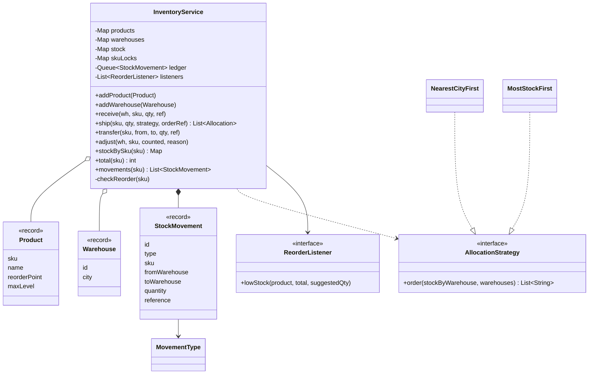

### Key flows

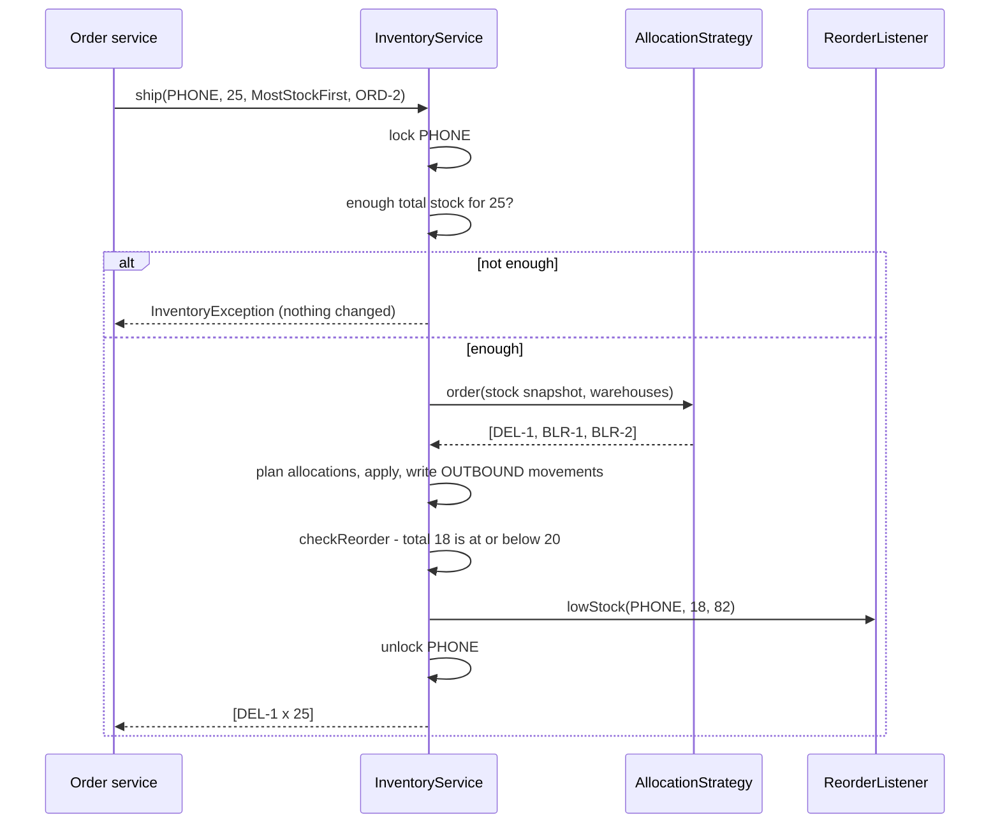

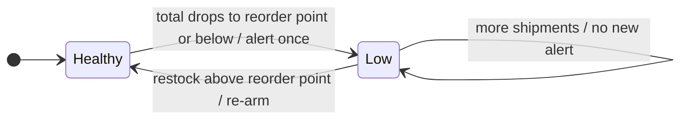

### Design decisions & patterns used

| Decision | Pattern | Why | Alternative rejected |
|---|---|---|---|
| **One lock per SKU** | Lock striping by key | An order for one SKU touches several warehouses; a per-SKU lock covers all of them with no lock-ordering puzzle, while different SKUs never contend. | One lock per (SKU, warehouse) — needs lock ordering for multi-warehouse orders; one global lock — no parallelism. |
| **Plan, then apply** in `ship` | — | Check total first and build the full plan before changing anything → all-or-nothing. | Deduct warehouse by warehouse and roll back on shortage. |
| **`AllocationStrategy`** | Strategy | Business wants different policies (speed vs fewer split parcels); each is a small class. | `if (mode == ...)` in `ship`. |
| **Append-only `StockMovement` ledger** | Event log / audit | Every change is explainable; levels can be rebuilt by replaying; adjustments record the delta, not just the new number. | Updating quantities with no history. |
| **`ReorderListener` with once-per-dip** | Observer + edge-triggering | Purchasing is notified once when stock crosses the threshold, not on every sale. | Level-triggered alerts on every movement — spam. |
| **Strategy gets a snapshot copy** | Defensive copy | A strategy cannot accidentally modify live stock. | Passing the live map. |

### Java implementation

```java
// File: lld/ch21/inventory/Product.java
package lld.ch21.inventory;

/** reorderPoint: raise an alert when total stock falls to this level or below. */
public record Product(String sku, String name, int reorderPoint, int maxLevel) {
    public Product {
        if (reorderPoint < 0 || maxLevel <= reorderPoint) throw new InventoryException("Need 0 <= reorderPoint < maxLevel");
    }
}
```

```java
// File: lld/ch21/inventory/Warehouse.java
package lld.ch21.inventory;

public record Warehouse(String id, String city) { }
```

```java
// File: lld/ch21/inventory/MovementType.java
package lld.ch21.inventory;

public enum MovementType { INBOUND, OUTBOUND, TRANSFER, ADJUSTMENT }
```

```java
// File: lld/ch21/inventory/StockMovement.java
package lld.ch21.inventory;

/** Append-only ledger line. Stock levels can always be rebuilt by replaying these. */
public record StockMovement(int id, MovementType type, String sku, String fromWarehouse, String toWarehouse,
                            int quantity, String reference) {
    @Override public String toString() {
        return "#%d %-10s %s qty=%+d %s->%s (%s)".formatted(id, type, sku, quantity,
                fromWarehouse == null ? "-" : fromWarehouse, toWarehouse == null ? "-" : toWarehouse, reference);
    }
}
```

```java
// File: lld/ch21/inventory/Allocation.java
package lld.ch21.inventory;

public record Allocation(String warehouseId, int quantity) { }
```

```java
// File: lld/ch21/inventory/AllocationStrategy.java
package lld.ch21.inventory;

import java.util.List;
import java.util.Map;

/** Strategy: in which order should warehouses be drained to fulfil an order? */
public interface AllocationStrategy {
    List<String> order(Map<String, Integer> stockByWarehouse, Map<String, Warehouse> warehouses);
}
```

```java
// File: lld/ch21/inventory/MostStockFirst.java
package lld.ch21.inventory;

import java.util.Comparator;
import java.util.List;
import java.util.Map;

/** Fewest split shipments: take from the fullest warehouse first. */
public class MostStockFirst implements AllocationStrategy {
    @Override public List<String> order(Map<String, Integer> stock, Map<String, Warehouse> warehouses) {
        return stock.keySet().stream()
                .sorted(Comparator.comparing((String w) -> stock.get(w)).reversed().thenComparing(w -> w))
                .toList();
    }
}
```

```java
// File: lld/ch21/inventory/NearestCityFirst.java
package lld.ch21.inventory;

import java.util.Comparator;
import java.util.List;
import java.util.Map;

/** Ship from warehouses in the customer's city first (faster delivery), then the rest by stock. */
public class NearestCityFirst implements AllocationStrategy {
    private final String city;
    public NearestCityFirst(String city) { this.city = city; }

    @Override public List<String> order(Map<String, Integer> stock, Map<String, Warehouse> warehouses) {
        return stock.keySet().stream()
                .sorted(Comparator.comparing((String w) -> !warehouses.get(w).city().equalsIgnoreCase(city))
                        .thenComparing(w -> -stock.get(w)).thenComparing(w -> w))
                .toList();
    }
}
```

```java
// File: lld/ch21/inventory/ReorderListener.java
package lld.ch21.inventory;

/** Observer: purchasing, email, dashboards... anyone who reacts to low stock. */
public interface ReorderListener {
    void lowStock(Product product, int totalOnHand, int suggestedOrderQty);
}
```

```java
// File: lld/ch21/inventory/InventoryException.java
package lld.ch21.inventory;

public class InventoryException extends RuntimeException {
    public InventoryException(String message) { super(message); }
}
```

```java
// File: lld/ch21/inventory/InventoryService.java
package lld.ch21.inventory;

import java.util.ArrayList;
import java.util.LinkedHashMap;
import java.util.List;
import java.util.Map;
import java.util.Queue;
import java.util.Set;
import java.util.concurrent.ConcurrentHashMap;
import java.util.concurrent.ConcurrentLinkedQueue;
import java.util.concurrent.CopyOnWriteArrayList;
import java.util.concurrent.atomic.AtomicInteger;
import java.util.concurrent.locks.ReentrantLock;

/**
 * Stock is kept per (sku, warehouse). Locking is per SKU: every operation on one product
 * (even across warehouses) is serialized, while different products proceed in parallel.
 */
public class InventoryService {
    private final Map<String, Product> products = new ConcurrentHashMap<>();
    private final Map<String, Warehouse> warehouses = new ConcurrentHashMap<>();
    private final Map<String, Map<String, Integer>> stock = new ConcurrentHashMap<>();   // sku -> (wh -> qty)
    private final Map<String, ReentrantLock> skuLocks = new ConcurrentHashMap<>();
    private final Set<String> alerted = ConcurrentHashMap.newKeySet();                   // SKUs already flagged low
    private final Queue<StockMovement> ledger = new ConcurrentLinkedQueue<>();              // append-heavy, lock-free
    private final List<ReorderListener> listeners = new CopyOnWriteArrayList<>();
    private final AtomicInteger movementSeq = new AtomicInteger();

    public void addListener(ReorderListener l) { listeners.add(l); }

    public void addProduct(Product p) {
        if (products.putIfAbsent(p.sku(), p) != null) throw new InventoryException("Duplicate SKU " + p.sku());
        stock.put(p.sku(), new LinkedHashMap<>());
        skuLocks.put(p.sku(), new ReentrantLock());
    }

    public void addWarehouse(Warehouse w) {
        if (warehouses.putIfAbsent(w.id(), w) != null) throw new InventoryException("Duplicate warehouse " + w.id());
    }

    public void receive(String warehouseId, String sku, int qty, String ref) {
        positive(qty);
        warehouse(warehouseId);
        withSku(sku, () -> {
            change(sku, warehouseId, qty);
            record(MovementType.INBOUND, sku, null, warehouseId, qty, ref);
        });
    }

    /** All-or-nothing: either the whole quantity is allocated across warehouses, or nothing moves. */
    public List<Allocation> ship(String sku, int qty, AllocationStrategy strategy, String orderRef) {
        positive(qty);
        return withSku(sku, () -> {
            Map<String, Integer> levels = stock.get(sku);
            int total = levels.values().stream().mapToInt(Integer::intValue).sum();
            if (total < qty) throw new InventoryException("Only " + total + " of " + sku + " available, order needs " + qty);
            List<Allocation> plan = new ArrayList<>();
            int remaining = qty;
            for (String wh : strategy.order(Map.copyOf(levels), warehouses)) {
                int take = Math.min(remaining, levels.get(wh));
                if (take > 0) { plan.add(new Allocation(wh, take)); remaining -= take; }
                if (remaining == 0) break;
            }
            for (Allocation a : plan) {
                change(sku, a.warehouseId(), -a.quantity());
                record(MovementType.OUTBOUND, sku, a.warehouseId(), null, -a.quantity(), orderRef);
            }
            return plan;
        });
    }

    public void transfer(String sku, String fromWh, String toWh, int qty, String ref) {
        positive(qty);
        warehouse(fromWh); warehouse(toWh);
        if (fromWh.equals(toWh)) throw new InventoryException("Source and target warehouse are the same");
        withSku(sku, () -> {
            int have = level(sku, fromWh);
            if (have < qty) throw new InventoryException(fromWh + " has only " + have + " of " + sku);
            change(sku, fromWh, -qty);
            change(sku, toWh, qty);
            record(MovementType.TRANSFER, sku, fromWh, toWh, qty, ref);
        });
    }

    /** Cycle count: set the level to what was physically counted and log the difference. */
    public void adjust(String warehouseId, String sku, int countedQty, String reason) {
        if (countedQty < 0) throw new InventoryException("Counted quantity cannot be negative");
        warehouse(warehouseId);
        withSku(sku, () -> {
            int delta = countedQty - level(sku, warehouseId);
            if (delta == 0) return;
            change(sku, warehouseId, delta);
            record(MovementType.ADJUSTMENT, sku, null, warehouseId, delta, reason);
        });
    }

    /** Sorted by warehouse id so output is stable. */
    public Map<String, Integer> stockBySku(String sku) {
        return withSku(sku, () -> java.util.Collections.unmodifiableMap(new java.util.TreeMap<>(stock.get(sku))));
    }

    public int total(String sku) { return withSku(sku, () -> totalUnlocked(sku)); }

    public List<StockMovement> movements(String sku) {
        return ledger.stream().filter(m -> m.sku().equals(sku)).toList();
    }

    // ------------------------------------------------------------ internals (called with the SKU lock held)

    private void change(String sku, String wh, int delta) {
        stock.get(sku).merge(wh, delta, Integer::sum);
    }

    private void record(MovementType type, String sku, String from, String to, int qty, String ref) {
        ledger.add(new StockMovement(movementSeq.incrementAndGet(), type, sku, from, to, qty, ref));
        checkReorder(sku);
    }

    /** Fires once when stock crosses down to the reorder point; re-arms when stock recovers. */
    private void checkReorder(String sku) {
        Product p = products.get(sku);
        int total = totalUnlocked(sku);
        if (total <= p.reorderPoint()) {
            if (alerted.add(sku)) listeners.forEach(l -> l.lowStock(p, total, p.maxLevel() - total));
        } else {
            alerted.remove(sku);
        }
    }

    private int totalUnlocked(String sku) { return stock.get(sku).values().stream().mapToInt(Integer::intValue).sum(); }
    private int level(String sku, String wh) { return stock.get(sku).getOrDefault(wh, 0); }

    private <T> T withSku(String sku, java.util.function.Supplier<T> action) {
        ReentrantLock lock = skuLocks.get(sku);
        if (lock == null) throw new InventoryException("Unknown SKU " + sku);
        lock.lock();
        try { return action.get(); } finally { lock.unlock(); }
    }

    private void withSku(String sku, Runnable action) { withSku(sku, () -> { action.run(); return null; }); }

    private void warehouse(String id) { if (!warehouses.containsKey(id)) throw new InventoryException("Unknown warehouse " + id); }
    private static void positive(int q) { if (q <= 0) throw new InventoryException("Quantity must be positive: " + q); }
}
```

```java
// File: lld/ch21/inventory/Main.java
package lld.ch21.inventory;

import java.util.concurrent.ExecutorService;
import java.util.concurrent.Executors;
import java.util.concurrent.TimeUnit;
import java.util.concurrent.atomic.AtomicInteger;

public class Main {
    public static void main(String[] args) throws InterruptedException {
        InventoryService inv = new InventoryService();
        inv.addListener((p, total, suggest) ->
                System.out.println("  [ALERT] " + p.sku() + " low: " + total + " left, reorder " + suggest + " to reach " + p.maxLevel()));

        inv.addWarehouse(new Warehouse("BLR-1", "Bengaluru"));
        inv.addWarehouse(new Warehouse("BLR-2", "Bengaluru"));
        inv.addWarehouse(new Warehouse("DEL-1", "Delhi"));
        inv.addProduct(new Product("PHONE", "Phone X", 20, 100));
        inv.addProduct(new Product("CASE", "Phone case", 10, 200));

        System.out.println("== receive stock");
        inv.receive("BLR-1", "PHONE", 30, "PO-1");
        inv.receive("DEL-1", "PHONE", 40, "PO-2");
        inv.receive("BLR-2", "PHONE", 5, "PO-3");
        System.out.println("  PHONE: " + inv.stockBySku("PHONE") + " total=" + inv.total("PHONE"));

        System.out.println("== ship 32 phones to a Bengaluru customer (nearest city first)");
        System.out.println("  " + inv.ship("PHONE", 32, new NearestCityFirst("Bengaluru"), "ORD-1"));
        System.out.println("  PHONE: " + inv.stockBySku("PHONE"));

        System.out.println("== transfer 15 phones DEL-1 -> BLR-1");
        inv.transfer("PHONE", "DEL-1", "BLR-1", 15, "TR-1");
        System.out.println("  PHONE: " + inv.stockBySku("PHONE"));

        System.out.println("== ship 25 more (most stock first) -> crosses reorder point");
        System.out.println("  " + inv.ship("PHONE", 25, new MostStockFirst(), "ORD-2"));
        System.out.println("  ship 1 more (no duplicate alert): " + inv.ship("PHONE", 1, new MostStockFirst(), "ORD-3"));

        System.out.println("== cycle count finds 2 damaged units in BLR-1");
        inv.adjust("BLR-1", "PHONE", inv.stockBySku("PHONE").get("BLR-1") - 2, "damaged");
        System.out.println("  PHONE: " + inv.stockBySku("PHONE") + " total=" + inv.total("PHONE"));

        System.out.println("== restock re-arms the alert");
        inv.receive("BLR-1", "PHONE", 90, "PO-4");
        inv.ship("PHONE", 90, new MostStockFirst(), "ORD-4");

        System.out.println("== edge cases");
        attempt(() -> inv.ship("PHONE", 999, new MostStockFirst(), "ORD-X"));
        attempt(() -> inv.transfer("PHONE", "BLR-2", "BLR-2", 1, "TR-X"));
        attempt(() -> inv.receive("MUM-1", "PHONE", 5, "PO-X"));
        attempt(() -> inv.receive("BLR-1", "TABLET", 5, "PO-X"));
        attempt(() -> inv.receive("BLR-1", "PHONE", 0, "PO-X"));

        System.out.println("== movement ledger for PHONE");
        inv.movements("PHONE").forEach(m -> System.out.println("  " + m));

        System.out.println("== concurrency: 200 one-unit orders race for 50 cases");
        inv.receive("BLR-1", "CASE", 50, "PO-5");
        AtomicInteger ok = new AtomicInteger(), rejected = new AtomicInteger();
        ExecutorService pool = Executors.newFixedThreadPool(8);
        for (int i = 0; i < 200; i++) {
            pool.submit(() -> {
                try { inv.ship("CASE", 1, new MostStockFirst(), "web"); ok.incrementAndGet(); }
                catch (InventoryException e) { rejected.incrementAndGet(); }
            });
        }
        pool.shutdown();
        pool.awaitTermination(10, TimeUnit.SECONDS);
        System.out.println("  shipped=" + ok + " rejected=" + rejected + " left=" + inv.total("CASE"));
    }

    private static void attempt(Runnable r) {
        try { r.run(); System.out.println("  ok"); }
        catch (InventoryException e) { System.out.println("  error: " + e.getMessage()); }
    }
}
```

**Output:**

```text
== receive stock
  PHONE: {BLR-1=30, BLR-2=5, DEL-1=40} total=75
== ship 32 phones to a Bengaluru customer (nearest city first)
  [Allocation[warehouseId=BLR-1, quantity=30], Allocation[warehouseId=BLR-2, quantity=2]]
  PHONE: {BLR-1=0, BLR-2=3, DEL-1=40}
== transfer 15 phones DEL-1 -> BLR-1
  PHONE: {BLR-1=15, BLR-2=3, DEL-1=25}
== ship 25 more (most stock first) -> crosses reorder point
  [ALERT] PHONE low: 18 left, reorder 82 to reach 100
  [Allocation[warehouseId=DEL-1, quantity=25]]
  ship 1 more (no duplicate alert): [Allocation[warehouseId=BLR-1, quantity=1]]
== cycle count finds 2 damaged units in BLR-1
  PHONE: {BLR-1=12, BLR-2=3, DEL-1=0} total=15
== restock re-arms the alert
  [ALERT] PHONE low: 15 left, reorder 85 to reach 100
== edge cases
  error: Only 15 of PHONE available, order needs 999
  error: Source and target warehouse are the same
  error: Unknown warehouse MUM-1
  error: Unknown SKU TABLET
  error: Quantity must be positive: 0
== movement ledger for PHONE
  #1 INBOUND    PHONE qty=+30 -->BLR-1 (PO-1)
  #2 INBOUND    PHONE qty=+40 -->DEL-1 (PO-2)
  #3 INBOUND    PHONE qty=+5 -->BLR-2 (PO-3)
  #4 OUTBOUND   PHONE qty=-30 BLR-1->- (ORD-1)
  #5 OUTBOUND   PHONE qty=-2 BLR-2->- (ORD-1)
  #6 TRANSFER   PHONE qty=+15 DEL-1->BLR-1 (TR-1)
  #7 OUTBOUND   PHONE qty=-25 DEL-1->- (ORD-2)
  #8 OUTBOUND   PHONE qty=-1 BLR-1->- (ORD-3)
  #9 ADJUSTMENT PHONE qty=-2 -->BLR-1 (damaged)
  #10 INBOUND    PHONE qty=+90 -->BLR-1 (PO-4)
  #11 OUTBOUND   PHONE qty=-90 BLR-1->- (ORD-4)
== concurrency: 200 one-unit orders race for 50 cases
  [ALERT] CASE low: 10 left, reorder 190 to reach 200
  shipped=50 rejected=150 left=0
```

Reading the output: the Bengaluru order drained BLR-1 then BLR-2 before touching Delhi; the reorder alert fired once when total PHONE stock fell to 18 (≤ 20) and not again at 17; after a restock pushed the total above 20 the alert re-armed and fired again when stock fell back; the ledger explains every unit; and with 200 concurrent one-unit orders for 50 cases, exactly 50 shipped — no overselling.

### Concurrency & edge cases

- **Overselling:** check-total → plan → apply runs under the SKU's `ReentrantLock`; concurrent orders for the same SKU are serialised.
- **Parallelism:** different SKUs use different locks.
- **Ledger:** a `ConcurrentLinkedQueue` — lock-free appends from many SKU threads at once, insertion order kept, and iteration never throws `ConcurrentModificationException`. (A `CopyOnWriteArrayList` would copy the whole ledger on every movement — right for rarely-changing lists, wrong for an append-heavy log.)
- **Listeners:** `CopyOnWriteArrayList` — read on every alert, changed almost never, which is exactly its use case. Listener calls happen while holding the SKU lock — fine for quick callbacks; for slow ones (email), hand off to an executor so the lock is not held during I/O.
- **Edge cases handled:** unknown SKU/warehouse, non-positive quantities, negative counted quantity, transfer to the same warehouse, transfer or order larger than stock, invalid product thresholds, duplicate SKU/warehouse, "no change" adjustments (not logged).

### Extensions & follow-up questions

- **Reservations (cart holds)?** Track `onHand` and `reserved` per (SKU, warehouse); available = onHand − reserved; reservations expire after a timeout; shipping converts a reservation into an OUTBOUND.
- **Batches / expiry dates (groceries, medicines)?** Stock per batch with expiry; allocate FEFO (first-expiry-first-out) — just another `AllocationStrategy`.
- **Distances instead of cities?** `NearestFirst` sorting by a `DistanceService` result.
- **Automatic purchase orders?** A `ReorderListener` that creates a PO for `max − current` and marks it pending so a second alert does not create a duplicate.
- **Multiple services / database?** Stock rows with optimistic versioning (`UPDATE ... SET qty = qty - ? WHERE qty >= ? AND version = ?`), and the movement ledger as an event stream (e.g. Kafka) consumed by analytics.

### Real-world example

Amazon's fulfilment network and Flipkart's warehouses decide which fulfilment centre ships each order based on factors like proximity and stock, and may split an order across centres — the job of `AllocationStrategy`. Shopify lets merchants hold inventory at multiple locations and set a fulfilment priority order among them. Quick-commerce apps (Blinkit, Zepto, Swiggy Instamart) run many small "dark stores", where accurate per-store stock and fast reorder alerts are essential.

### In the interview

Start with the data shape: `stock[sku][warehouse] = qty` plus an append-only movement list. Code receive and ship (with the plan-then-apply and the per-SKU lock) first; they carry most of the marks. Then transfer and adjust (both tiny), then the reorder observer with once-per-dip, then allocation strategies. Run the 200-thread demo to prove "no overselling".

### Self-check

- **Q:** Why does `ship` check the total before building the plan? → **A:** To reject short orders before any warehouse is touched (all-or-nothing).
- **Q:** Why is a per-SKU lock enough for a multi-warehouse order? → **A:** An order involves exactly one SKU, and all of that SKU's warehouses are covered by its one lock.
- **Q:** How do you add FEFO? → **A:** Add batch-level stock and a new `AllocationStrategy`; `ship` does not change.
- **Q:** Why record adjustments as movements? → **A:** So shrinkage/damage is auditable and levels can be rebuilt from the ledger.

### TL;DR

Stock per (SKU, warehouse), every change is a ledger movement, a lock per SKU prevents overselling, allocation is a Strategy, and low-stock alerts are an edge-triggered Observer.

---

## 21.8 Design a Unix File Search (`find`)

### Problem & clarifying questions

The Unix `find` command walks a directory tree and prints every entry that passes a set of tests, for example `find /var/log -type f -size +10M -mtime +7` ("regular files under /var/log bigger than 10 MiB, last changed more than 7 days ago"). The machine-coding version asks you to build a small `find`: a file-system model, a set of **filters**, a way to **combine** them with AND / OR / NOT, and a clean API for the search options. It is a favourite because the obvious solution (one method with ten optional parameters and a pile of `if`s) is exactly what the interviewer wants you to avoid.

Three words used below: a **predicate** (or *test*) is a yes/no question about one entry ("is its name `*.log`?"); a **glob** is a filename pattern with wildcards (`*` = any characters, `?` = one character, `[0-9]` = one character from a set); **depth** is how many levels below the start directory an entry sits (the start itself is depth 0).

| Question | Answer used |
|---|---|
| Real disk or in-memory? | In-memory tree, so runs are identical; a `java.nio` adapter is an extension. |
| Which tests? | Name glob (case-sensitive and insensitive), type (file / directory), size, modification age, owner, empty. |
| How are tests combined? | AND, OR, NOT and parentheses, with `find`'s precedence: NOT binds tightest, then AND, then OR. Two tests side by side mean AND. |
| Size semantics? | Like GNU `find`: the size is **rounded up** to the unit before comparing, so `-size -1M` matches only empty files. Size tests apply to files only. |
| Other options? | `mindepth`, `maxdepth`, a result limit, and **pruning** (skip whole directories such as `node_modules`). |
| API or command line? | Both: a fluent **Builder** API for code, and a parser for `find`-style command lines. |
| Output order? | Pre-order depth-first (a directory before its contents), children in name order. |
| Huge trees? | Stream results as they are found; no recursion (deep trees must not overflow the stack); a parallel variant as an extension. |

### Requirements

**Functional**
1. Model files and directories (name, owner, modification time, size).
2. Search from a start path with any combination of tests joined by AND / OR / NOT.
3. Options: min/max depth, result limit, pruned directory names.
4. Parse `find` command lines into the same search criteria.
5. Clear errors for bad paths, unknown tests, malformed sizes and unbalanced parentheses.

**Non-functional**
- **Open/Closed**: a new test = one new class, no change to the search loop or the parser's structure.
- Memory: stream results; handle very deep trees.
- Thread safety: searching while files are being added must not throw.

### Use cases

| Actor | Use cases |
|---|---|
| **Developer (API user)** | build criteria with the Builder, run a search, stream results |
| **Shell user** | type a `find` command line, see matching paths or a clear error |
| **Ops script** | find big old logs (`-size +10M -mtime +7`) to archive, find empty directories to clean |

### Core entities

| Class | Kind | Responsibility |
|---|---|---|
| `Node` | abstract sealed class | **Composite** component: name, parent, owner, modified time, `path()`, `size()`, `totalSize()`. |
| `FileNode` / `DirectoryNode` | classes | Leaf and container; a directory keeps its children sorted in a `ConcurrentSkipListMap`. |
| `FileSystem` | class | Root, `mkdirs`, `createFile`, `resolve(path)`. |
| `FileFilter` | interface | **Specification**: `matches(node)`, `describe()`, and default `and` / `or` / `negate`. |
| `AndFilter`, `OrFilter`, `NotFilter` | records | **Composite** filters: a tree of filters that is itself a filter. |
| `Filters` | factory | Leaf tests: name/iname glob, type, size, mtime, owner, empty, match-all. |
| `SearchCriteria` + `Builder` | class | Immutable search description (start, filter, depths, limit, prune set), built fluently and validated once. |
| `FileSearcher` | class | Iterative DFS with an explicit stack; streams results to a `Consumer`; optional fork/join version. |
| `FindCommandParser` | class | Recursive-descent parser for `find` expressions → `SearchCriteria`. |
| `SearchException` | exception | Readable failure. |

### Class diagram

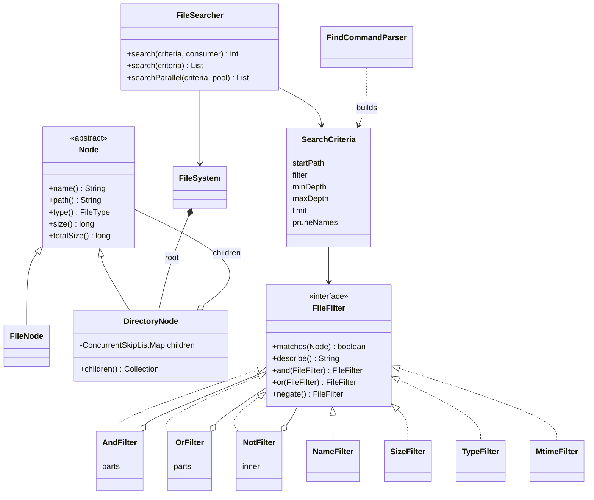

Two Composites sit side by side: the **file tree** (a directory is a node that contains nodes) and the **filter tree** (an AND is a filter that contains filters). The searcher walks the first and asks the second one question per entry.

### Key flows

**Parsing `find /home ( -name '*.jpg' -o -name '*.png' ) ! -size +1M`** produces this filter tree:

```mermaid
flowchart TD
    A["AND"] --> O["OR"]
    A --> N["NOT"]
    O --> J["name = '*.jpg'"]
    O --> P["name = '*.png'"]
    N --> S["size > 1 MiB"]
```

**The search loop** (explicit stack, pre-order):

```mermaid
flowchart TD
    Start["push (start, depth 0)"] --> Pop{"stack empty or limit reached?"}
    Pop -- yes --> Done["return count"]
    Pop -- no --> Take["pop (node, depth)"]
    Take --> Test{"depth >= minDepth and filter matches?"}
    Test -- yes --> Emit["send node to consumer"]
    Test -- no --> Dir
    Emit --> Dir{"directory, depth < maxDepth, not pruned?"}
    Dir -- yes --> Push["push children in reverse name order"]
    Dir -- no --> Pop
    Push --> Pop
```

**Operator precedence** (from lowest to highest): `-o` (OR) < `-a` or nothing (AND) < `!` (NOT) < `( … )`. So `-name a -o -name b -type f` means `a OR (b AND file)` — a classic surprise, and the reason `find` users write parentheses.

### Design decisions & patterns used

| Decision | Pattern | Why | Alternative rejected |
|---|---|---|---|
| Each test is a small class with `matches(node)` | **Specification** | A new test is one record; the search loop never changes (Open/Closed) | `search(name, ext, minSize, maxSize, type, …)` with a growing list of `if`s |
| `AndFilter` / `OrFilter` / `NotFilter` hold other filters | **Composite** | Arbitrary nesting (`(a OR b) AND NOT c`) with one interface; the parser's output *is* this tree; `describe()` prints it | Lambdas only (`a.and(b)`) — work, but cannot be printed or inspected (compare §21.1's `TaskFilter`) |
| `Node` / `FileNode` / `DirectoryNode` | **Composite** | The searcher and `totalSize()` treat files and directories uniformly | `instanceof` checks everywhere, or separate file and directory lists |
| `SearchCriteria.Builder` | **Builder** | Many optional settings; named calls; validation (`mindepth ≤ maxdepth`) once in `build()`; immutable result | Telescoping constructors or a mutable settings bag |
| Recursive-descent `FindCommandParser` | Interpreter-style parser | One method per precedence level makes precedence explicit and testable | Splitting on `-o` with string hacks |
| Iterative DFS with an explicit `ArrayDeque` | — | No `StackOverflowError` on very deep trees; easy to add a limit | Recursion |
| Results go to a `Consumer<Node>` | Streaming / callback | Prints as it finds, like `find`; memory does not grow with the result count | Always building a full `List` |
| AND / OR short-circuit | — | Put cheap tests first (`-name` before a size lookup on a real disk) | Evaluating every test |
| `ConcurrentSkipListMap` for children | Concurrent collection | Sorted (deterministic output) and safe to iterate while files are added | `TreeMap` (throws `ConcurrentModificationException`) |

### Java implementation

The file-system model:

```java
// File: lld/ch21/filesearch/FileType.java
package lld.ch21.filesearch;

public enum FileType { FILE, DIRECTORY }
```

```java
// File: lld/ch21/filesearch/SearchException.java
package lld.ch21.filesearch;

/** Bad path, bad option or bad expression: a readable message, never a stack trace for the user. */
public class SearchException extends RuntimeException {
    public SearchException(String message) { super(message); }
}
```

```java
// File: lld/ch21/filesearch/Node.java
package lld.ch21.filesearch;

import java.time.Instant;

/**
 * Composite pattern: a file-system entry is either a leaf (FileNode) or a container
 * (DirectoryNode) that holds more entries. Callers treat both through this one type.
 */
public abstract sealed class Node permits FileNode, DirectoryNode {
    private final String name;
    private final DirectoryNode parent;
    private final String owner;
    private final Instant modified;

    protected Node(String name, DirectoryNode parent, String owner, Instant modified) {
        this.name = name; this.parent = parent; this.owner = owner; this.modified = modified;
    }

    public String name() { return name; }
    public DirectoryNode parent() { return parent; }
    public String owner() { return owner; }
    public Instant modified() { return modified; }

    public abstract FileType type();

    /** Size in bytes of this entry alone (0 for a directory, as far as our filters care). */
    public abstract long size();

    /** du-style size: a file's own size; a directory's is the sum over everything inside it (Composite recursion). */
    public abstract long totalSize();

    public String path() {
        if (parent == null) return "/";
        String p = parent.path();
        return (p.equals("/") ? "" : p) + "/" + name;
    }

    @Override public String toString() { return path(); }
}
```

```java
// File: lld/ch21/filesearch/FileNode.java
package lld.ch21.filesearch;

import java.time.Instant;

public final class FileNode extends Node {
    private final long size;

    FileNode(String name, DirectoryNode parent, String owner, Instant modified, long size) {
        super(name, parent, owner, modified);
        if (size < 0) throw new SearchException("Negative size for " + name);
        this.size = size;
    }

    @Override public FileType type() { return FileType.FILE; }
    @Override public long size() { return size; }
    @Override public long totalSize() { return size; }
}
```

```java
// File: lld/ch21/filesearch/DirectoryNode.java
package lld.ch21.filesearch;

import java.time.Instant;
import java.util.Collection;
import java.util.concurrent.ConcurrentSkipListMap;

public final class DirectoryNode extends Node {
    /** Sorted by name (deterministic output) and safe to read while another thread adds files. */
    private final ConcurrentSkipListMap<String, Node> children = new ConcurrentSkipListMap<>();

    DirectoryNode(String name, DirectoryNode parent, String owner, Instant modified) {
        super(name, parent, owner, modified);
    }

    @Override public FileType type() { return FileType.DIRECTORY; }
    @Override public long size() { return 0; }
    @Override public long totalSize() { return children.values().stream().mapToLong(Node::totalSize).sum(); }

    public Collection<Node> children() { return children.values(); }
    public Node child(String name) { return children.get(name); }
    public boolean isEmpty() { return children.isEmpty(); }

    void add(Node n) {
        if (children.putIfAbsent(n.name(), n) != null)
            throw new SearchException(n.path() + " already exists");
    }
}
```

```java
// File: lld/ch21/filesearch/FileSystem.java
package lld.ch21.filesearch;

import java.time.Instant;

/** A small in-memory file system, so every demo run is identical. A java.nio adapter is an extension. */
public final class FileSystem {
    private final DirectoryNode root;

    public FileSystem(Instant created) { root = new DirectoryNode("", null, "root", created); }

    public DirectoryNode root() { return root; }

    /** Creates missing directories along the way, like mkdir -p. */
    public synchronized DirectoryNode mkdirs(String path, String owner, Instant modified) {
        DirectoryNode dir = root;
        for (String part : split(path)) {
            Node next = dir.child(part);
            if (next == null) { next = new DirectoryNode(part, dir, owner, modified); dir.add(next); }
            if (!(next instanceof DirectoryNode d)) throw new SearchException(next.path() + " is a file, not a directory");
            dir = d;
        }
        return dir;
    }

    public synchronized FileNode createFile(String path, long size, String owner, Instant modified) {
        int slash = path.lastIndexOf('/');
        DirectoryNode dir = mkdirs(path.substring(0, Math.max(slash, 0)), owner, modified);
        FileNode f = new FileNode(path.substring(slash + 1), dir, owner, modified, size);
        dir.add(f);
        return f;
    }

    public Node resolve(String path) {
        Node n = root;
        for (String part : split(path)) {
            if (!(n instanceof DirectoryNode d) || (n = d.child(part)) == null)
                throw new SearchException("No such file or directory: " + path);
        }
        return n;
    }

    private static String[] split(String path) {
        String p = path.replaceAll("^/+|/+$", "");
        return p.isEmpty() ? new String[0] : p.split("/+");
    }
}
```

The filters — Specification leaves and Composite nodes:

```java
// File: lld/ch21/filesearch/FileFilter.java
package lld.ch21.filesearch;

/**
 * Specification pattern: one question, "does this entry match?". Leaf filters test one attribute;
 * AndFilter / OrFilter / NotFilter are Composite nodes that combine other filters into a tree.
 */
public interface FileFilter {
    boolean matches(Node n);

    /** Human-readable form of the expression tree, e.g. (name='*.log' AND size>+10M). */
    String describe();

    default FileFilter and(FileFilter other) { return AndFilter.of(this, other); }
    default FileFilter or(FileFilter other) { return OrFilter.of(this, other); }
    default FileFilter negate() { return new NotFilter(this); }
}
```

```java
// File: lld/ch21/filesearch/AndFilter.java
package lld.ch21.filesearch;

import java.util.ArrayList;
import java.util.List;
import java.util.stream.Collectors;

/** Composite: matches when every child matches. Short-circuits like find's -a. */
public record AndFilter(List<FileFilter> parts) implements FileFilter {
    public AndFilter { parts = List.copyOf(parts); }

    /** Flattens nested ANDs so (a AND (b AND c)) is stored as (a AND b AND c). */
    static FileFilter of(FileFilter a, FileFilter b) {
        List<FileFilter> all = new ArrayList<>();
        for (FileFilter f : List.of(a, b)) if (f instanceof AndFilter and) all.addAll(and.parts()); else all.add(f);
        return new AndFilter(all);
    }

    @Override public boolean matches(Node n) {
        for (FileFilter f : parts) if (!f.matches(n)) return false;
        return true;
    }

    @Override public String describe() {
        return parts.stream().map(FileFilter::describe).collect(Collectors.joining(" AND ", "(", ")"));
    }
}
```

```java
// File: lld/ch21/filesearch/OrFilter.java
package lld.ch21.filesearch;

import java.util.ArrayList;
import java.util.List;
import java.util.stream.Collectors;

/** Composite: matches when any child matches. Short-circuits like find's -o. */
public record OrFilter(List<FileFilter> parts) implements FileFilter {
    public OrFilter { parts = List.copyOf(parts); }

    static FileFilter of(FileFilter a, FileFilter b) {
        List<FileFilter> all = new ArrayList<>();
        for (FileFilter f : List.of(a, b)) if (f instanceof OrFilter or) all.addAll(or.parts()); else all.add(f);
        return new OrFilter(all);
    }

    @Override public boolean matches(Node n) {
        for (FileFilter f : parts) if (f.matches(n)) return true;
        return false;
    }

    @Override public String describe() {
        return parts.stream().map(FileFilter::describe).collect(Collectors.joining(" OR ", "(", ")"));
    }
}
```

```java
// File: lld/ch21/filesearch/NotFilter.java
package lld.ch21.filesearch;

/** Composite with one child: find's ! / -not. */
public record NotFilter(FileFilter inner) implements FileFilter {
    @Override public boolean matches(Node n) { return !inner.matches(n); }
    @Override public String describe() { return "NOT " + inner.describe(); }
}
```

```java
// File: lld/ch21/filesearch/Filters.java
package lld.ch21.filesearch;

import java.time.Duration;
import java.time.Instant;
import java.util.regex.Pattern;

/** Static factories for the leaf filters (one per find test). New test = one new record here; nothing else changes. */
public final class Filters {
    private Filters() { }

    public static FileFilter all() { return new MatchAll(); }
    public static FileFilter name(String glob) { return new NameFilter(glob, false); }
    public static FileFilter iname(String glob) { return new NameFilter(glob, true); }
    public static FileFilter type(FileType t) { return new TypeFilter(t); }
    public static FileFilter owner(String user) { return new OwnerFilter(user); }
    public static FileFilter empty() { return new EmptyFilter(); }
    /** spec like find's -size: "+10M", "-1k", "0c", "20" (no suffix = 512-byte blocks). */
    public static FileFilter size(String spec) { return SizeFilter.parse(spec); }
    /** spec like find's -mtime: "+7" (more than 7 whole days ago), "-1", "0". */
    public static FileFilter mtime(String spec, Instant now) { return MtimeFilter.parse(spec, now); }

    record MatchAll() implements FileFilter {
        @Override public boolean matches(Node n) { return true; }
        @Override public String describe() { return "true"; }
    }

    /** Glob on the last path component only, like find -name: * ? [abc] [!abc], and \ to escape. */
    record NameFilter(String glob, boolean ignoreCase, Pattern regex) implements FileFilter {
        NameFilter(String glob, boolean ignoreCase) {
            this(glob, ignoreCase, Pattern.compile(toRegex(glob), ignoreCase ? Pattern.CASE_INSENSITIVE | Pattern.UNICODE_CASE : 0));
        }
        @Override public boolean matches(Node n) { return regex.matcher(n.name()).matches(); }
        @Override public String describe() { return (ignoreCase ? "iname='" : "name='") + glob + "'"; }

        static String toRegex(String glob) {
            StringBuilder re = new StringBuilder();
            for (int i = 0; i < glob.length(); i++) {
                char c = glob.charAt(i);
                switch (c) {
                    case '*' -> re.append(".*");
                    case '?' -> re.append('.');
                    case '\\' -> { if (++i < glob.length()) re.append(Pattern.quote(String.valueOf(glob.charAt(i)))); }
                    case '[' -> {
                        int end = glob.indexOf(']', i + 2);
                        if (end < 0) { re.append("\\["); break; }          // no closing ]: a literal [
                        String body = glob.substring(i + 1, end);
                        if (body.startsWith("!")) body = "^" + body.substring(1);
                        re.append('[').append(body.replace("\\", "\\\\")).append(']');
                        i = end;
                    }
                    default -> re.append(Pattern.quote(String.valueOf(c)));
                }
            }
            return re.toString();
        }
    }

    record TypeFilter(FileType type) implements FileFilter {
        @Override public boolean matches(Node n) { return n.type() == type; }
        @Override public String describe() { return "type=" + (type == FileType.FILE ? "f" : "d"); }
    }

    record OwnerFilter(String user) implements FileFilter {
        @Override public boolean matches(Node n) { return n.owner().equals(user); }
        @Override public String describe() { return "user=" + user; }
    }

    record EmptyFilter() implements FileFilter {
        @Override public boolean matches(Node n) {
            return n instanceof DirectoryNode d ? d.isEmpty() : n.size() == 0;
        }
        @Override public String describe() { return "empty"; }
    }

    /**
     * GNU find semantics: the file size is rounded UP to whole units, then compared.
     * So "-size -1M" means "fewer than 1 whole MiB after rounding up" = only empty files. A famous gotcha.
     * Size tests apply to files only in this model.
     */
    record SizeFilter(char cmp, long n, char unit, String spec) implements FileFilter {
        static SizeFilter parse(String spec) {
            var m = Pattern.compile("([+-]?)(\\d+)([cbkMG]?)").matcher(spec);
            if (!m.matches()) throw new SearchException("Invalid -size '" + spec + "' (use e.g. +10M, -1k, 100c)");
            char cmp = m.group(1).isEmpty() ? '=' : m.group(1).charAt(0);
            char unit = m.group(3).isEmpty() ? 'b' : m.group(3).charAt(0);
            return new SizeFilter(cmp, Long.parseLong(m.group(2)), unit, spec);
        }
        long unitBytes() {
            return switch (unit) { case 'c' -> 1; case 'b' -> 512; case 'k' -> 1024; case 'M' -> 1024L * 1024; default -> 1024L * 1024 * 1024; };
        }
        @Override public boolean matches(Node node) {
            if (node.type() != FileType.FILE) return false;
            long units = (node.size() + unitBytes() - 1) / unitBytes();      // round up
            return switch (cmp) { case '+' -> units > n; case '-' -> units < n; default -> units == n; };
        }
        @Override public String describe() { return "size" + (cmp == '=' ? "=" : "") + spec; }
    }

    /** -mtime n: age in whole days (fraction dropped); +n = older than n days, -n = newer than n days. */
    record MtimeFilter(char cmp, long days, Instant now, String spec) implements FileFilter {
        static MtimeFilter parse(String spec, Instant now) {
            var m = Pattern.compile("([+-]?)(\\d+)").matcher(spec);
            if (!m.matches()) throw new SearchException("Invalid -mtime '" + spec + "' (use e.g. +7, -1, 0)");
            char cmp = m.group(1).isEmpty() ? '=' : m.group(1).charAt(0);
            return new MtimeFilter(cmp, Long.parseLong(m.group(2)), now, spec);
        }
        @Override public boolean matches(Node node) {
            long age = Duration.between(node.modified(), now).toDays();
            return switch (cmp) { case '+' -> age > days; case '-' -> age < days; default -> age == days; };
        }
        @Override public String describe() { return "mtime" + (cmp == '=' ? "=" : "") + spec; }
    }
}
```

Criteria, search and parser:

```java
// File: lld/ch21/filesearch/SearchCriteria.java
package lld.ch21.filesearch;

import java.util.LinkedHashSet;
import java.util.Set;

/**
 * Everything one search needs, immutable once built. Builder pattern: most options are optional,
 * so named builder calls replace a constructor with eight positional parameters.
 */
public final class SearchCriteria {
    private final String startPath;
    private final FileFilter filter;
    private final int minDepth, maxDepth, limit;
    private final Set<String> pruneNames;

    private SearchCriteria(Builder b) {
        startPath = b.startPath; filter = b.filter; minDepth = b.minDepth; maxDepth = b.maxDepth;
        limit = b.limit; pruneNames = Set.copyOf(b.pruneNames);
    }

    public static Builder from(String startPath) { return new Builder(startPath); }

    public String startPath() { return startPath; }
    public FileFilter filter() { return filter; }
    public int minDepth() { return minDepth; }
    public int maxDepth() { return maxDepth; }
    public int limit() { return limit; }
    public Set<String> pruneNames() { return pruneNames; }

    @Override public String toString() {
        return "from " + startPath + " where " + filter.describe()
                + (minDepth > 0 ? " mindepth=" + minDepth : "")
                + (maxDepth < Integer.MAX_VALUE ? " maxdepth=" + maxDepth : "")
                + (pruneNames.isEmpty() ? "" : " prune=" + pruneNames)
                + (limit < Integer.MAX_VALUE ? " limit=" + limit : "");
    }

    public static final class Builder {
        private final String startPath;
        private FileFilter filter = Filters.all();
        private boolean filterSet;
        private int minDepth = 0, maxDepth = Integer.MAX_VALUE, limit = Integer.MAX_VALUE;
        private final Set<String> pruneNames = new LinkedHashSet<>();

        private Builder(String startPath) {
            if (startPath == null || startPath.isBlank()) throw new SearchException("Start path is required");
            this.startPath = startPath;
        }

        /** Each call is ANDed with the previous ones, like consecutive tests on a find command line. */
        public Builder where(FileFilter f) { filter = filterSet ? filter.and(f) : f; filterSet = true; return this; }
        public Builder name(String glob) { return where(Filters.name(glob)); }
        public Builder type(FileType t) { return where(Filters.type(t)); }
        public Builder size(String spec) { return where(Filters.size(spec)); }
        public Builder minDepth(int d) { minDepth = d; return this; }
        public Builder maxDepth(int d) { maxDepth = d; return this; }
        public Builder limit(int n) { limit = n; return this; }
        /** Do not descend into directories with this name (like: -name node_modules -prune -o ...). */
        public Builder prune(String dirName) { pruneNames.add(dirName); return this; }

        public SearchCriteria build() {
            if (minDepth < 0 || maxDepth < 0) throw new SearchException("Depths must be >= 0");
            if (minDepth > maxDepth) throw new SearchException("mindepth " + minDepth + " > maxdepth " + maxDepth);
            if (limit <= 0) throw new SearchException("Limit must be positive");
            return new SearchCriteria(this);
        }
    }
}
```

```java
// File: lld/ch21/filesearch/FileSearcher.java
package lld.ch21.filesearch;

import java.util.ArrayDeque;
import java.util.ArrayList;
import java.util.Collections;
import java.util.Deque;
import java.util.List;
import java.util.concurrent.ForkJoinPool;
import java.util.concurrent.RecursiveTask;
import java.util.function.Consumer;

/** Walks the tree and reports every entry that passes the filter. */
public final class FileSearcher {
    private final FileSystem fs;

    public FileSearcher(FileSystem fs) { this.fs = fs; }

    private record Frame(Node node, int depth) { }

    /**
     * Pre-order depth-first walk with an explicit stack (no recursion, so a very deep tree cannot
     * overflow the call stack). Results are streamed to the consumer as they are found, like find
     * printing line by line; nothing forces the whole result list into memory.
     */
    public int search(SearchCriteria c, Consumer<Node> out) {
        Deque<Frame> stack = new ArrayDeque<>();
        stack.push(new Frame(fs.resolve(c.startPath()), 0));
        int found = 0;
        while (!stack.isEmpty() && found < c.limit()) {
            Frame f = stack.pop();
            Node n = f.node();
            if (f.depth() >= c.minDepth() && c.filter().matches(n)) { out.accept(n); found++; }
            if (n instanceof DirectoryNode d && f.depth() < c.maxDepth() && !c.pruneNames().contains(d.name())) {
                List<Node> kids = new ArrayList<>(d.children());
                Collections.reverse(kids);                     // push in reverse so we pop in name order
                for (Node k : kids) stack.push(new Frame(k, f.depth() + 1));
            }
        }
        return found;
    }

    public List<Node> search(SearchCriteria c) {
        List<Node> out = new ArrayList<>();
        search(c, out::add);
        return out;
    }

    /** Extension: one fork/join task per directory. Same results in the same order; no limit support. */
    public List<Node> searchParallel(SearchCriteria c, ForkJoinPool pool) {
        return pool.invoke(new Walk(fs.resolve(c.startPath()), 0, c));
    }

    private static final class Walk extends RecursiveTask<List<Node>> {
        private final Node node; private final int depth; private final SearchCriteria c;
        Walk(Node node, int depth, SearchCriteria c) { this.node = node; this.depth = depth; this.c = c; }

        @Override protected List<Node> compute() {
            List<Node> out = new ArrayList<>();
            if (depth >= c.minDepth() && c.filter().matches(node)) out.add(node);
            if (node instanceof DirectoryNode d && depth < c.maxDepth() && !c.pruneNames().contains(d.name())) {
                List<Walk> tasks = new ArrayList<>();
                List<Object> slots = new ArrayList<>();         // files tested inline, sub-directories forked
                for (Node k : d.children()) {
                    if (k instanceof DirectoryNode) { Walk w = new Walk(k, depth + 1, c); tasks.add(w); slots.add(w); }
                    else slots.add(k);
                }
                invokeAll(tasks);                               // fork all sub-directories, wait for all
                for (Object s : slots) {                        // collect in name order: same order as search()
                    if (s instanceof Walk w) out.addAll(w.join());
                    else if (depth + 1 >= c.minDepth() && c.filter().matches((Node) s)) out.add((Node) s);
                }
            }
            return out;
        }
    }
}
```

```java
// File: lld/ch21/filesearch/FindCommandParser.java
package lld.ch21.filesearch;

import java.time.Instant;
import java.util.ArrayList;
import java.util.List;
import java.util.regex.Pattern;

/**
 * Turns a find-style command line into SearchCriteria, with find's precedence:
 *   expr   := or
 *   or     := and ( ("-o" | "-or") and )*
 *   and    := unary ( ["-a" | "-and"] unary )*      -- two tests side by side mean AND
 *   unary  := ("!" | "-not") unary | "(" expr ")" | test
 *   test   := -name G | -iname G | -type f|d | -size N | -mtime N | -user U | -empty | -true
 * Global options -maxdepth N / -mindepth N may appear anywhere. This is recursive descent:
 * one method per grammar rule, each returning a FileFilter (the Composite tree).
 */
public final class FindCommandParser {
    private final Instant now;
    private List<String> tokens;
    private int pos;
    private SearchCriteria.Builder builder;

    public FindCommandParser(Instant now) { this.now = now; }

    /** tokens as the shell would pass them, e.g. ["find", "/home", "-name", "*.java", "-o", "-name", "*.md"]. */
    public SearchCriteria parse(List<String> args) {
        if (args.isEmpty() || !args.get(0).equals("find")) throw new SearchException("Command must start with 'find'");
        tokens = args; pos = 1;
        String start = pos < tokens.size() && !isOperatorOrTest(tokens.get(pos)) ? tokens.get(pos++) : ".";
        builder = SearchCriteria.from(start.equals(".") ? "/" : start);
        skipGlobalOptions();
        if (pos < tokens.size()) {                     // no tests at all = match everything
            builder.where(parseOr());
            if (pos < tokens.size()) throw new SearchException("Unexpected '" + tokens.get(pos) + "'");
        }
        return builder.build();
    }

    /** Convenience: split on spaces; quotes group words and are removed (enough for the demo). */
    public SearchCriteria parse(String commandLine) {
        List<String> out = new ArrayList<>();
        var m = Pattern.compile("'([^']*)'|\"([^\"]*)\"|(\\S+)").matcher(commandLine);
        while (m.find()) out.add(m.group(1) != null ? m.group(1) : m.group(2) != null ? m.group(2) : m.group(3));
        return parse(out);
    }

    private FileFilter parseOr() {
        FileFilter left = parseAnd();
        while (peekIs("-o", "-or")) { pos++; left = left.or(parseAnd()); }
        return left;
    }

    private FileFilter parseAnd() {
        FileFilter left = parseUnary();
        while (true) {
            skipGlobalOptions();
            if (pos >= tokens.size() || peekIs("-o", "-or", ")")) return left;
            if (peekIs("-a", "-and")) pos++;
            left = left.and(parseUnary());
        }
    }

    private FileFilter parseUnary() {
        skipGlobalOptions();
        if (pos >= tokens.size()) throw new SearchException("Expression ends too early");
        String t = tokens.get(pos++);
        switch (t) {
            case "!", "-not" -> { return parseUnary().negate(); }
            case "(" -> {
                FileFilter inner = parseOr();
                if (!peekIs(")")) throw new SearchException("Missing ')'");
                pos++;
                return inner;
            }
            case ")" -> throw new SearchException("Unexpected ')'");
            case "-empty" -> { return Filters.empty(); }
            case "-true" -> { return Filters.all(); }
            case "-name" -> { return Filters.name(arg(t)); }
            case "-iname" -> { return Filters.iname(arg(t)); }
            case "-user" -> { return Filters.owner(arg(t)); }
            case "-size" -> { return Filters.size(arg(t)); }
            case "-mtime" -> { return Filters.mtime(arg(t), now); }
            case "-type" -> {
                String v = arg(t);
                return switch (v) {
                    case "f" -> Filters.type(FileType.FILE);
                    case "d" -> Filters.type(FileType.DIRECTORY);
                    default -> throw new SearchException("-type takes f or d, not '" + v + "'");
                };
            }
            default -> throw new SearchException("Unknown predicate '" + t + "'");
        }
    }

    /** -maxdepth/-mindepth are options, not tests: record them and keep parsing the expression. */
    private void skipGlobalOptions() {
        while (peekIs("-maxdepth", "-mindepth")) {
            String opt = tokens.get(pos++);
            int n;
            try { n = Integer.parseInt(arg(opt)); } catch (NumberFormatException e) { throw new SearchException(opt + " needs a number"); }
            if (opt.equals("-maxdepth")) builder.maxDepth(n); else builder.minDepth(n);
        }
    }

    private String arg(String option) {
        if (pos >= tokens.size()) throw new SearchException(option + " needs an argument");
        return tokens.get(pos++);
    }

    private boolean peekIs(String... options) {
        if (pos >= tokens.size()) return false;
        for (String o : options) if (tokens.get(pos).equals(o)) return true;
        return false;
    }

    private static boolean isOperatorOrTest(String t) { return t.startsWith("-") || t.equals("!") || t.equals("(") || t.equals(")"); }
}
```

```java
// File: lld/ch21/filesearch/Main.java
package lld.ch21.filesearch;

import java.time.Duration;
import java.time.Instant;
import java.util.List;
import java.util.concurrent.ForkJoinPool;

public class Main {
    static final Instant NOW = Instant.parse("2026-10-01T12:00:00Z");
    static final long KB = 1024, MB = 1024 * KB;

    public static void main(String[] args) {
        FileSystem fs = sampleTree();
        FileSearcher finder = new FileSearcher(fs);
        FindCommandParser parser = new FindCommandParser(NOW);

        System.out.println("== Builder API ==");
        show(finder, SearchCriteria.from("/").name("*.log").type(FileType.FILE).build());
        show(finder, SearchCriteria.from("/home").where(Filters.iname("*.jpg").and(Filters.size("+1M"))).build());
        show(finder, SearchCriteria.from("/").type(FileType.DIRECTORY).where(Filters.empty()).build());
        show(finder, SearchCriteria.from("/home").maxDepth(2).build());
        show(finder, SearchCriteria.from("/home/asha/projects")
                .where(Filters.name("*.java").or(Filters.name("*.js"))).prune("node_modules").build());
        show(finder, SearchCriteria.from("/").type(FileType.FILE).limit(3).build());

        System.out.println("\n== find command lines ==");
        for (String cmd : List.of(
                "find /var/log -type f -size +10M -mtime +7",
                "find /home -name '*.java' -o -name '*.md'",
                "find /home ( -name '*.jpg' -o -name '*.png' ) ! -size +1M",
                "find /home -size -1M",
                "find / -user ravi -type f",
                "find /home/asha -mindepth 2 -maxdepth 2 -type d",
                "find /home -iname 'b*'",
                "find /var/log -name 'app.log.[0-9]'"))
            show(finder, parser.parse(cmd), cmd);

        System.out.println("\n== bad input gives a clear message ==");
        for (String cmd : List.of("find / -size 10X", "find / ( -name a", "find /nope -name x",
                "find / -frobnicate", "find / -type x", "find / -maxdepth 1 -mindepth 3", "find / -name"))
            try { finder.search(parser.parse(cmd)); System.out.println("   (no error?) " + cmd); }
            catch (SearchException e) { System.out.printf("   %-34s -> %s%n", cmd, e.getMessage()); }

        System.out.println("\n== Composite sizes (du -s) ==");
        for (String p : List.of("/home/asha", "/home/asha/projects/app/node_modules", "/var/log"))
            System.out.printf("   %-40s %,d bytes%n", p, fs.resolve(p).totalSize());

        System.out.println("\n== Parallel search on a big generated tree ==");
        FileSystem big = new FileSystem(NOW);
        for (int d = 0; d < 200; d++)
            for (int f = 0; f < 100; f++)
                big.createFile("/data/d%03d/sub%d/f%03d.%s".formatted(d, f % 5, f, f % 3 == 0 ? "csv" : "txt"),
                        (long) f * 10 * KB, "etl", NOW.minus(Duration.ofDays(f % 30)));
        SearchCriteria q = new FindCommandParser(NOW).parse("find /data -name '*.csv' -size +500k -mtime -10");
        FileSearcher bigFinder = new FileSearcher(big);
        List<Node> seq = bigFinder.search(q);
        List<Node> par = bigFinder.searchParallel(q, ForkJoinPool.commonPool());
        System.out.println("   " + q);
        System.out.println("   sequential=" + seq.size() + " parallel=" + par.size() + " same order=" + seq.equals(par)
                + " first=" + seq.get(0) + " last=" + seq.get(seq.size() - 1));
    }

    static void show(FileSearcher finder, SearchCriteria c) { show(finder, c, c.toString()); }

    static void show(FileSearcher finder, SearchCriteria c, String title) {
        System.out.println("$ " + title);
        if (!title.equals(c.toString())) System.out.println("  parsed: " + c);
        int n = finder.search(c, node -> System.out.println("   " + node + (node instanceof DirectoryNode ? "/" : "")));
        if (n == 0) System.out.println("   (no matches)");
    }

    static FileSystem sampleTree() {
        FileSystem fs = new FileSystem(NOW);
        Instant today = NOW.minus(Duration.ofHours(3)), lastWeek = NOW.minus(Duration.ofDays(8)), old = NOW.minus(Duration.ofDays(40));
        fs.createFile("/home/asha/notes.txt", 2 * KB, "asha", today);
        fs.createFile("/home/asha/photos/a.jpg", 3 * MB, "asha", lastWeek);
        fs.createFile("/home/asha/photos/b.JPG", 5 * MB, "asha", lastWeek);
        fs.createFile("/home/asha/photos/c.png", 800 * KB, "asha", old);
        fs.createFile("/home/asha/photos/d.jpg", 900 * KB, "asha", old);
        fs.createFile("/home/asha/projects/app/Main.java", 12 * KB, "asha", today);
        fs.createFile("/home/asha/projects/app/Util.java", 4 * KB, "asha", today);
        fs.createFile("/home/asha/projects/app/build.log", 3 * MB / 2, "asha", today);
        fs.createFile("/home/asha/projects/app/node_modules/lodash.js", 500 * KB, "asha", old);
        fs.createFile("/home/asha/projects/app/node_modules/react.js", MB, "asha", old);
        fs.mkdirs("/home/asha/projects/empty-dir", "asha", old);
        fs.createFile("/home/ravi/todo.md", 0, "ravi", today);
        fs.createFile("/home/ravi/report.pdf", 2 * MB, "ravi", lastWeek);
        fs.createFile("/var/log/syslog", 40 * MB, "root", old);
        fs.createFile("/var/log/app.log", 3 * MB, "root", today);
        fs.createFile("/var/log/app.log.1", 20 * MB, "root", lastWeek);
        fs.mkdirs("/tmp", "root", today);
        return fs;
    }
}
```

**How the code works, part by part**

- **Globs.** `NameFilter.toRegex` turns `*` into `.*`, `?` into `.`, keeps `[...]` sets (turning `[!...]` into `[^...]`) and quotes every other character, then compiles the regex once, when the filter is built. Like `find -name`, it matches only the last path component, and `*` also matches names that start with a dot.
- **Size.** `SizeFilter` parses `[+-]N[cbkMG]` (no suffix = 512-byte blocks, as in `find`), rounds the file size **up** to whole units, then compares: `+` means more than N units, `-` fewer, no sign exactly N.
- **Age.** `MtimeFilter` computes the age in whole days (the fraction is dropped) against an injected `now`, so the demo is repeatable.
- **Builder.** Each `where(...)` call is ANDed with earlier ones; `build()` checks depths and the limit and freezes everything into an immutable `SearchCriteria`.
- **Search.** `FileSearcher.search` pushes the start node, then pops, tests, emits and pushes children in reverse name order so they come off the stack in name order. It stops descending at `maxDepth` and at pruned directory names, and stops entirely at the limit.
- **Parser.** `parseOr` → `parseAnd` → `parseUnary`: one method per precedence level. `parseAnd` treats two tests side by side as AND; `-maxdepth`/`-mindepth` are options that can appear anywhere, so every level skips them first.
- **Parallel.** `searchParallel` forks one task per sub-directory (files are tested inline), waits for all, then joins results in name order — the same list, in the same order, as the sequential search.

**Output:**

```text
== Builder API ==
$ from / where (name='*.log' AND type=f)
   /home/asha/projects/app/build.log
   /var/log/app.log
$ from /home where (iname='*.jpg' AND size+1M)
   /home/asha/photos/a.jpg
   /home/asha/photos/b.JPG
$ from / where (type=d AND empty)
   /home/asha/projects/empty-dir/
   /tmp/
$ from /home where true maxdepth=2
   /home/
   /home/asha/
   /home/asha/notes.txt
   /home/asha/photos/
   /home/asha/projects/
   /home/ravi/
   /home/ravi/report.pdf
   /home/ravi/todo.md
$ from /home/asha/projects where (name='*.java' OR name='*.js') prune=[node_modules]
   /home/asha/projects/app/Main.java
   /home/asha/projects/app/Util.java
$ from / where type=f limit=3
   /home/asha/notes.txt
   /home/asha/photos/a.jpg
   /home/asha/photos/b.JPG

== find command lines ==
$ find /var/log -type f -size +10M -mtime +7
  parsed: from /var/log where (type=f AND size+10M AND mtime+7)
   /var/log/app.log.1
   /var/log/syslog
$ find /home -name '*.java' -o -name '*.md'
  parsed: from /home where (name='*.java' OR name='*.md')
   /home/asha/projects/app/Main.java
   /home/asha/projects/app/Util.java
   /home/ravi/todo.md
$ find /home ( -name '*.jpg' -o -name '*.png' ) ! -size +1M
  parsed: from /home where ((name='*.jpg' OR name='*.png') AND NOT size+1M)
   /home/asha/photos/c.png
   /home/asha/photos/d.jpg
$ find /home -size -1M
  parsed: from /home where size-1M
   /home/ravi/todo.md
$ find / -user ravi -type f
  parsed: from / where (user=ravi AND type=f)
   /home/ravi/report.pdf
   /home/ravi/todo.md
$ find /home/asha -mindepth 2 -maxdepth 2 -type d
  parsed: from /home/asha where type=d mindepth=2 maxdepth=2
   /home/asha/projects/app/
   /home/asha/projects/empty-dir/
$ find /home -iname 'b*'
  parsed: from /home where iname='b*'
   /home/asha/photos/b.JPG
   /home/asha/projects/app/build.log
$ find /var/log -name 'app.log.[0-9]'
  parsed: from /var/log where name='app.log.[0-9]'
   /var/log/app.log.1

== bad input gives a clear message ==
   find / -size 10X                   -> Invalid -size '10X' (use e.g. +10M, -1k, 100c)
   find / ( -name a                   -> Missing ')'
   find /nope -name x                 -> No such file or directory: /nope
   find / -frobnicate                 -> Unknown predicate '-frobnicate'
   find / -type x                     -> -type takes f or d, not 'x'
   find / -maxdepth 1 -mindepth 3     -> mindepth 3 > maxdepth 1
   find / -name                       -> -name needs an argument

== Composite sizes (du -s) ==
   /home/asha                               13,281,280 bytes
   /home/asha/projects/app/node_modules     1,560,576 bytes
   /var/log                                 66,060,288 bytes

== Parallel search on a big generated tree ==
   from /data where (name='*.csv' AND size+500k AND mtime-10)
   sequential=1600 parallel=1600 same order=true first=/data/d000/sub0/f060.csv last=/data/d199/sub4/f099.csv
```

Reading the output: `-size +1M` kept the two large photos and dropped the 900 KB one; the prune option skipped `node_modules`, so only the two Java files match `*.java OR *.js`; `-size -1M` found only the empty `todo.md` — the rounding gotcha, even though `notes.txt` is only 2 KB; `-mindepth 2 -maxdepth 2 -type d` lists directories exactly two levels below `/home/asha`; the bracket glob `app.log.[0-9]` matches the rotated log but not `app.log`. Every bad input produced a one-line message. The composite `totalSize()` gives `du`-style totals, and on a generated tree of 20,000 files the sequential and parallel searches returned the same 1,600 paths in the same order.

### Concurrency & edge cases

- **Adding files during a search:** children live in a `ConcurrentSkipListMap`, whose iterators are *weakly consistent* — they never throw, and may or may not show an entry added after the iteration started (like `find` on a live disk).
- **Parallel search:** tasks only read the tree and each builds its own list; there is no shared mutable state, so no locks are needed.
- **Deep trees:** the sequential walk uses a heap-allocated stack. (The fork/join version recurses one task per directory; fine for normal depths.)
- **Symbolic links / cycles** (real file systems): track visited `(device, inode)` pairs or do not follow links by default — GNU `find` does not follow symbolic links unless asked (`-L`).
- **Edge cases handled:** start path missing or a file; `mindepth > maxdepth`; unknown predicate; missing argument; bad `-size`/`-mtime`/`-type` values; unbalanced parentheses; an unclosed `[` in a glob is treated as a literal; limit reached mid-walk.

### Extensions & follow-up questions

- **Search a real disk?** An adapter that wraps `java.nio.file.Path` + `BasicFileAttributes` as `Node`s, or use `Files.walkFileTree` with a `FileVisitor` that returns `SKIP_SUBTREE` for pruned directories.
- **Actions (`-delete`, `-exec`)?** A `Consumer<Node>` per action (Command pattern); `-delete` must walk depth-first *post-order* so children go before their directory.
- **Content search (`grep -r`)?** A `ContainsTextFilter` — put it last in the AND so cheap name/size tests reject most files first.
- **Faster repeated searches?** Build an index (name → paths, like `locate`/`updatedb`) and accept that it can be stale.
- **More tests (`-newer file`, `-perm`, `-regex`)?** One record each in `Filters` plus one `case` in the parser.
- **Sort by size or date?** Collect, then sort with a `Comparator` — a Strategy, as in PropertyHunt (§21.5).

### Real-world example

GNU `find` (from GNU findutils) evaluates its expression left to right with exactly this precedence (`!`, then implicit or explicit `-a`, then `-o`) and short-circuits; its manual documents the "`-size -1M` only matches empty files" rounding and the default of not following symbolic links. Java's own `Files.find(start, maxDepth, BiPredicate)` and `Files.walk` take a depth limit and a predicate — the same split between *walking* and *testing* used here. IDE "Find in files" dialogs and desktop search boxes build the same kind of filter tree from checkboxes instead of a command line.

### In the interview

Spend the first 10 minutes on the model (`Node`, `FileNode`, `DirectoryNode`) and the `FileFilter` interface with two leaves (name, size) — that alone lets you demo a search. Then add `AndFilter`/`OrFilter`/`NotFilter`, the Builder with depth options, and the iterative walk. Add the parser last, and only if time allows: interviewers mostly score the filter design and extensibility. Say the Open/Closed point out loud: "a new filter is one class; the searcher never changes".

### Self-check

- **Q:** What does `find -name a -o -name b -type f` mean? → **A:** `a OR (b AND file)`, because AND binds tighter than OR.
- **Q:** Why does `-size -1M` match only empty files? → **A:** Sizes are rounded up to whole MiB, so any non-empty file is at least 1 unit, which is not less than 1.
- **Q:** Why are the AND/OR/NOT filters records rather than lambdas? → **A:** They can be printed (`describe()`), inspected and built by the parser as a visible tree.
- **Q:** How does pruning differ from filtering out a directory? → **A:** Pruning stops the walk from entering it (nothing inside is visited); a filter only hides the directory entry itself.
- **Q:** Why an explicit stack instead of recursion? → **A:** Very deep trees would overflow the call stack; an explicit stack also makes the limit easy.

### TL;DR

Two Composites — the file tree and the filter tree. Filters are Specifications (`matches`) combined with AND / OR / NOT; the Builder describes the search once and validates it; an iterative DFS streams matches; a recursive-descent parser turns `find` command lines into the same criteria, with `!` > AND > OR precedence and GNU's rounded-up `-size`.

---

## Chapter summary

| Problem | Core entities | Key pattern(s) | Concurrency point | Trap to avoid |
|---|---|---|---|---|
| Task Management | Task, TaskStatus, TaskService | Specification filters, enum state machine, Observer | per-task `synchronized` | TODO → DONE jumps; filters as many parameters |
| Digital Wallet | Wallet, Transaction, Offer | Strategy offers, idempotency, funded cashback | lock both wallets in id order | `double` money; check-then-act on keys; cashback created from nothing |
| Event Calendar | TimeSlot, Event, EventStore | Strategy for representatives, plan-then-save | atomic check-and-book | closed intervals; trusting the sample blindly |
| Coding Blox | Contest, Level, User | Command map, Strategy (solver, scoring) | atomic rating update | unseeded randomness; running a contest twice |
| PropertyHunt | Property, SearchCriteria | Builder + predicate list, Strategy sort | synchronized mark-sold | comparing "90L" strings; stale shortlist copies |
| Ledger Co | Loan, LumpSum, Balance | Strategy interest, derived state | synchronized lump sums | storing a running balance; floor instead of ceil |
| Inventory | StockMovement, AllocationStrategy | Strategy allocation, Observer alerts | per-SKU lock | partial shipments; alert spam |
| Unix find | Node (Composite), FileFilter, SearchCriteria | Specification + Composite filters, Builder, recursive-descent parser | weakly consistent children map; read-only parallel walk | parameter-list search methods; `-o` vs AND precedence |

**The pattern behind all eight:** entities guard their own rules, services orchestrate, strategies hold the "X or Y" rules, repositories hide storage, the driver parses and prints, and every error is a clear message — not a crash.
