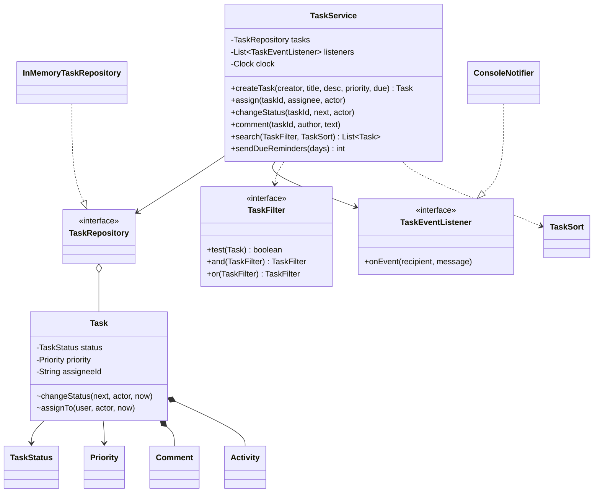
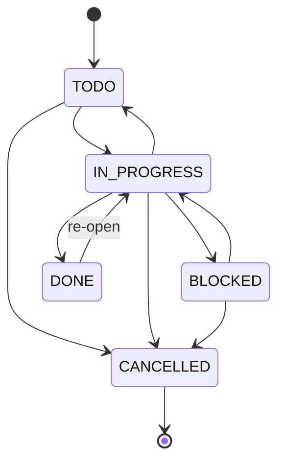
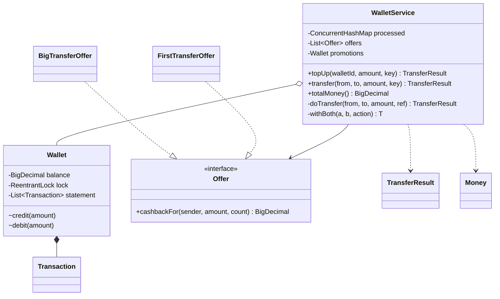
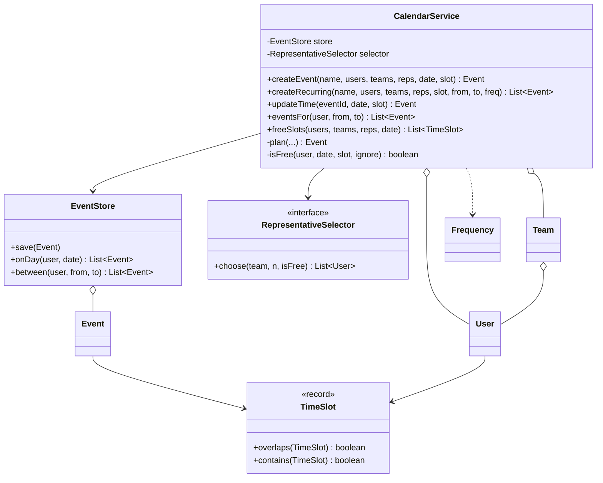
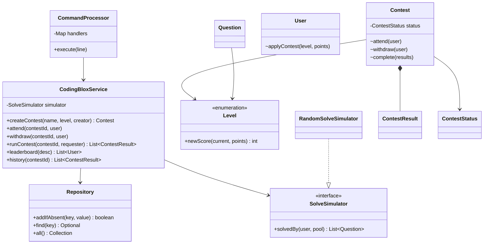
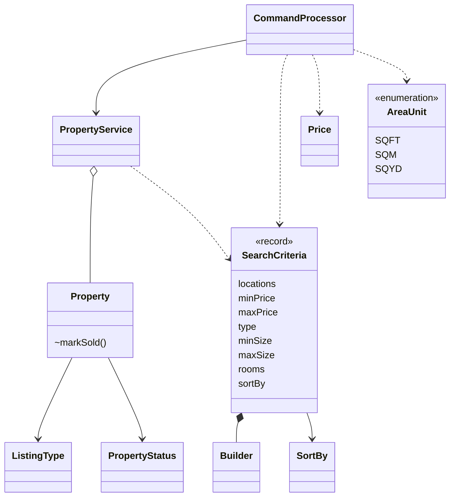
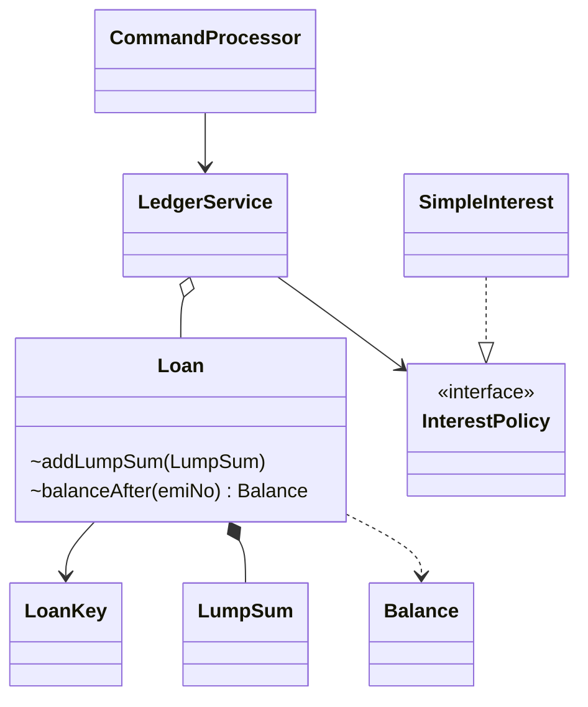
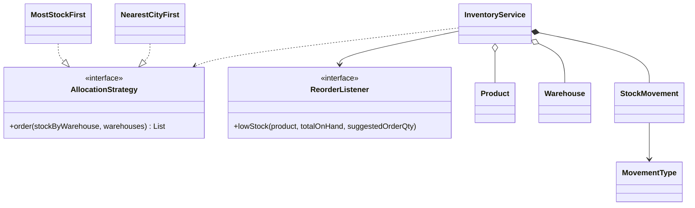
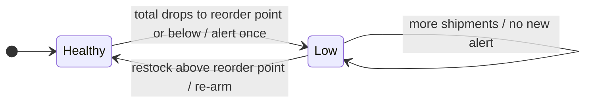
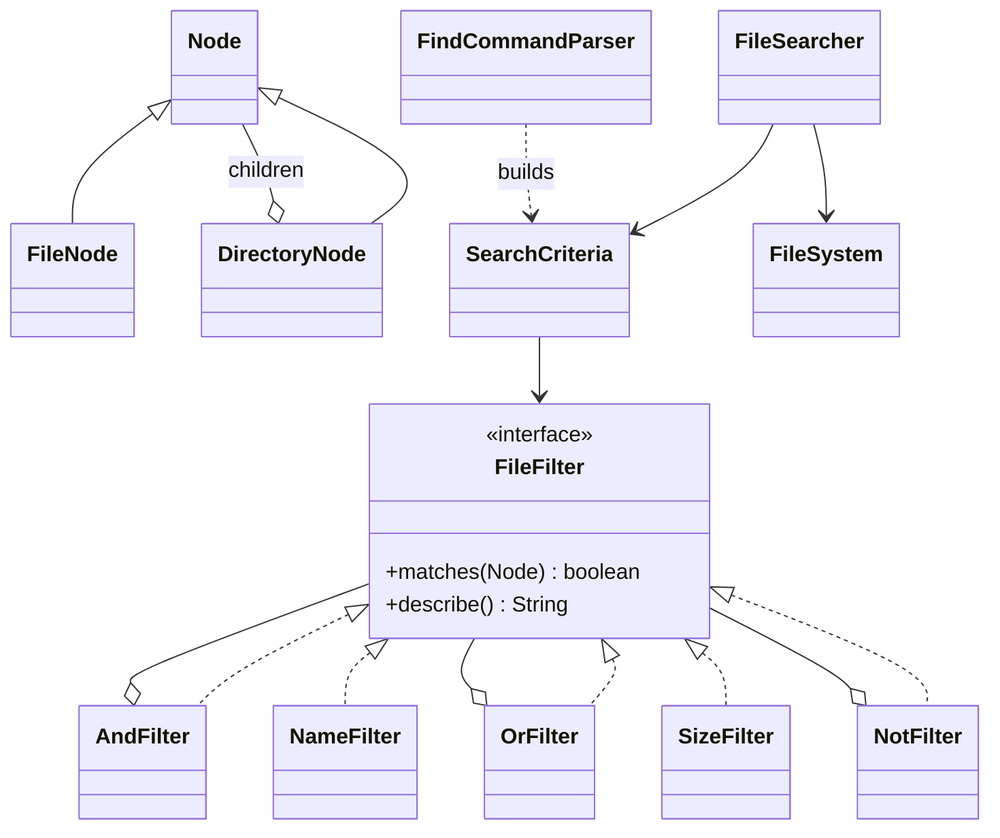

# Chapter 21 — Case Studies: Machine-Coding Round Problems (Study Edition)

> **Goal.** Chapters 14–20 taught whiteboard design. This chapter trains the **machine-coding round**: a written problem, 90–120 minutes, and **running code** the interviewer feeds their own inputs into. You get the scoring rubric, a skeleton to type from memory, a time plan, and eight real problems solved end to end in Java.

Each problem follows the usual template (problem → requirements → use cases → entities → diagram → flows → decisions → code → edge cases → extensions → interview → self-check → TL;DR). Code is Java 21, standard library only, one package per problem under `code/lld/ch21/<name>/`. From `chapters/21-case-machine-coding/code`:

```text
javac --release 21 -d /tmp/lld_21 $(find . -name '*.java')
java -cp /tmp/lld_21 lld.ch21.taskmgmt.Main       # or wallet, calendar, codingblox, propertyhunt, ledger, inventory, filesearch
```

| # | Problem | Source | The one idea that makes it work | Patterns |
|---|---|---|---|---|
| 21.1 | Task Management System | awesome-low-level-design | Status *state machine* + composable filters | State (enum), Specification, Strategy, Observer |
| 21.2 | Digital Wallet Service | awesome-low-level-design | `BigDecimal` money, idempotency keys, lock ordering | Strategy (offers), Facade |
| 21.3 | Event Calendar | Flipkart (kumaransg/LLD) | Half-open intervals + a boundary *sweep* for free slots | Strategy, Repository |
| 21.4 | Coding Blox | Flipkart (kumaransg/LLD) | Command dispatcher + level-based scoring | Command, Strategy, Repository |
| 21.5 | PropertyHunt | ClearTrip (kumaransg/LLD) | Optional criteria → list of predicates; unit normalisation | Builder, Specification, Strategy |
| 21.6 | Ledger Co (loans & EMIs) | Navi (kumaransg/LLD, Geektrust) | Derive balances from facts, don't store them | Strategy (interest), Command |
| 21.7 | Inventory Management | Common (Amazon/Flipkart-style) | Append-only movement ledger + per-SKU lock | Strategy (allocation), Observer (reorder) |
| 21.8 | Unix File Search (`find`) | Common OOD/machine-coding question | Specification filters + Composite AND/OR/NOT; Builder for criteria | Specification, Composite, Builder |

(Food ordering "FoodKart" is solved in Chapter 19.)

---

## 21.0 How the machine-coding round works

### What it is

An OO design interview where **working code is the answer**: a 1–2 page statement, your IDE, 90–120 minutes, no database/UI/framework — data in maps and lists, driven by `main`, a command list or tests. Unlike system design (servers, databases, queues) it never leaves one program; its vocabulary is **classes**. Analogy: whiteboard design *describes* a house; machine coding *builds a shed* while the inspector leans on every wall. Common at Flipkart, Swiggy, PhonePe, Navi, Razorpay, CRED, Meesho, Cleartrip.

### How it is judged

| Criterion | What is checked → how to score well |
|---|---|
| **Working, demo-able code** | Compiles, runs the sample, survives *their* inputs → Thin end-to-end path in the first hour; never finish with non-compiling code |
| **Functional completeness** | Every mandatory requirement; bonus after → Implement in the statement's order |
| **Clean models** | One job per entity, private fields, invariants inside the entity → Enums for fixed sets, records for values, classes for changing things |
| **Separation of concerns** | Parsing, logic, storage apart; no `System.out` in services → Driver → Service → Repository |
| **Extensibility** | "Add a new offer/sort/rule" = add a class → Strategy / Specification for "can be X or Y" |
| **Edge cases** | Unknown ids, duplicates, invalid input, wrong user → Custom exceptions; driver catches per command and **keeps going** |
| **Readability** | Names, small methods, no copy-paste → Nouns → classes, verbs → methods |
| **Concurrency (when asked)** | Wallets, inventory, booking → Say where the lock is and why; demo with a pool |
| **Tests (bonus)** | Extra credit → An `assert`-style self-check in `main` suffices |

### The five-step method, and how the clock changes it

Whiteboard method (Chapter 1): **Requirements → Actors & use cases → Classes → Relationships → Code** (roughly 5–8 / 3–5 / 8–10 / 8–10 / 12–15 min in a 45-minute round, code covering only 2–3 key methods). **Machine coding flips the proportions:** steps 1–4 take ~20 minutes, code the rest. A parking lot has ~12 classes but only 3 carry the main flows — build those, name the rest. Also judged: **scope**, **one job per class**, **relationships** (hold/own/extend), **code and model agree**, **a stated trade-off** — never UML notation. Top failures: **nothing runs at the end**, and a **god class** `Manager`.

### A reusable project skeleton

```text
src/
  model/          entities & value objects      (Task, Wallet, Loan, Property ...)   - enums, records, small classes
  repository/     storage contracts + in-memory (TaskRepository, InMemoryTaskRepository)
  service/        business rules, one per area  (TaskService, WalletService)          - no printing, no parsing
  strategy/       pluggable rules               (Offer, AllocationStrategy, SortBy)
  exception/      domain exceptions             (NotFoundException, InsufficientFundsException)
  driver/         Main + CommandProcessor       (parses input, calls services, prints output)
```

| Layer | Knows about | Must NOT know about | Why |
|---|---|---|---|
| **model** | itself, other models | services, storage, console | Entities guard invariants (`Task.changeStatus` rejects `TODO → DONE`). |
| **repository** | model | services, console | Swap `HashMap` for a DB touching only this layer (DIP). |
| **service** | model, repository & strategy *interfaces* | concrete repositories, console | The part the interviewer reads most carefully. |
| **strategy** | model | services | Each "X or Y" rule → interface + small classes (OCP). |
| **exception** | — | — | One class per failure kind, readable message. |
| **driver** | services | repository internals | Parsing/printing replaceable; logic isn't. |

(This book uses one package per problem; in the round, create the sub-packages.) Reusable blocks: a **generic in-memory repository** (Coding Blox), an **`AtomicInteger` ID generator**, and a **command processor** `Map<String, Consumer<String[]>>` (Command pattern, Chapter 10).

### The 90-minute time plan

| Minutes | Activity | Output |
|---|---|---|
| 0–10 | Read twice, ask questions, mark mandatory vs bonus, paste sample input into the driver | Numbered requirement list |
| 10–20 | Nouns → entities, verbs → methods; pick the 1–2 patterns the statement begs for | Packages, enums, records |
| 20–60 | Mandatory requirements **in order**, running after each | Sample input → sample output |
| 60–75 | Edge cases, validation, custom exceptions | Driver prints errors and continues |
| 75–85 | Bonus (only if all mandatory work); thread-safety for money/stock | Bonus commands |
| 85–90 | Clean names, delete dead code, final run, 2-minute walkthrough | Compiling code, demo, story |

**Run the program at least every 15 minutes** — a compile error at minute 88 is a disaster, at minute 30 a 20-second fix.

### What to say in the first two minutes

1. "Everything in memory behind a repository interface, so a DB can be added later."
2. "I'll drive it from `main` with the sample commands and print errors without crashing."
3. "Mandatory is A, B, C; bonus D, E. A–C first."
4. "Where does it need to be thread-safe?" (Wallets and inventory: always.)

### Common mistakes in this round

| Mistake | Do this instead |
|---|---|
| 20 minutes on a perfect class diagram | Enums/records first; the diagram lives in names |
| One `Manager` with 15 maps | One service per area + repositories |
| `System.out` inside services | Services return data; the driver prints |
| `double` for money (`0.1 + 0.2 != 0.3`) | `BigDecimal` with fixed scale (21.2) or whole units (`long` paise) |
| Crashing on the first bad command | Catch domain exceptions in the driver loop |
| Bonus before mandatory | Mandatory in order; bonus last |
| Every class in full detail | Core flow first; stub or name the rest |
| Unseeded `Random`; `LocalDate.now()` | Seed it / Strategy (21.4); inject a `Clock` (21.1, 21.2) |

### Real-world examples

Standard Spring Boot layering: controllers = driver, `@Service` = rules, `@Repository` = storage; in-memory repositories are the usual unit-test fakes.

### In the interview

**30-second answer:** "I read the statement twice, list mandatory and bonus requirements and clarify ambiguities. I set up model / repository / service / strategy / exception / driver packages, put the sample input in the driver, and implement requirements one by one, running after each. Services return data and throw domain exceptions; the driver prints and continues. Then edge cases, thread-safety where state is shared, and bonus features."

*Why an interface for an in-memory repository?* → Services depend on an abstraction; JDBC/Redis can replace it.

### Self-check

- **Q:** The six packages? → **A:** model, repository, service, strategy, exception, driver.
- **Q:** Where does `System.out.println` live? → **A:** Only in the driver.
- **Q:** Minute 60, one mandatory requirement missing, bonus tempting? → **A:** Finish the mandatory one.
- **Q:** Why inject a `Clock`? → **A:** Time-based logic gives the same output every run.

### TL;DR

Working code first, clean layering second, patterns where the statement asks for variation, graceful errors everywhere. **model → repository → service → strategy → exception → driver**. Run often.

---

## 21.1 Design a Task Management System

### Problem & clarifying questions

The core of Jira/Asana/Trello: create, update, delete tasks (title, description, due date, priority, status), assign, move through statuses, comment, search/filter (priority, due date, assignee), reminders, task history, safe concurrent access.

| Question | Assumed answer |
|---|---|
| Statuses and transitions? | TODO, IN_PROGRESS, BLOCKED, DONE, CANCELLED; only listed transitions (TODO can't jump to DONE; CANCELLED final; DONE can re-open). |
| Assignees? | One (nullable). |
| "Reminder" in a console app? | A method a scheduler calls: notify owners of open tasks due within N days or overdue. |
| Past due dates? | Not on creation. |
| Notifications? | A listener interface; the demo prints. |
| "Task history"? | Per-task audit log (built); a user's finished tasks is just a search: `assignedTo(u).and(withStatus(DONE))`. |

### Requirements

**Functional:** register users; create/update/delete tasks; assign; change status via allowed transitions; comment; search with any filter combination (assignee, status, min priority, due before, open only, title contains) + sort (due date, priority, id); reminders; per-task history. **Non-functional:** thread-safe; new filters/sorts/channels without editing code; deterministic (injected `Clock`).

### Use cases

**Task creator** (create, update, delete, assign, comment, search), **Assignee** (change status, comment, see own tasks), **Scheduler** (due-date reminders), **Notification channel** (receives events).

### Core entities

| Class | Responsibility |
|---|---|
| `Task` | Data; enforces legal status changes; records its own history; mutators `synchronized`. |
| `TaskStatus` (enum) | Statuses + allowed next statuses (tiny state machine). |
| `Priority` (enum) | LOW < MEDIUM < HIGH < CRITICAL (enum order compares). |
| `User`, `Comment`, `Activity` | Immutable records. |
| `TaskRepository` / `InMemoryTaskRepository` | Storage contract + `ConcurrentHashMap`. |
| `TaskFilter` | Composable predicate (**Specification**) with factories and `and`/`or`. |
| `TaskSort` (enum) | Named comparators (**Strategy**); `BY_ID` sorts `T2` before `T10`. |
| `TaskEventListener` / `ConsoleNotifier` | **Observer**. |
| `TaskService` | **Facade**: every use case, validation, clock, events. |
| `NotFoundException`, `InvalidTransitionException` | Clear failures. |

### Class diagram



### Key flows



**Change status:** service finds the task → `task.changeStatus(next, actor, now)` → illegal: `InvalidTransitionException` (driver prints it); legal: log activity, set status, notify the creator.

### Design decisions & patterns used

| Decision | Pattern | Why | Alternative rejected |
|---|---|---|---|
| Transitions in the `TaskStatus` enum | State (enum) | One place for rules; `Task` asks `canMoveTo`. | Class per status — overkill with no per-state behaviour. |
| `TaskFilter extends Predicate<Task>` + `and/or` | Specification | Any combination; new filter = one factory method. | `search(assignee, status, priority, …)` with nullable params. |
| `TaskSort` enum of comparators | Strategy | Sort order is data. | `switch` on a string. |
| Listener list | Observer | Email/Slack/push without touching the service. | `System.out` in the service. |
| `TaskService` single entry | Facade | Simple driver API. | Driver using repositories. |
| Injected `Clock` | DI | Deterministic reminders/tests. | `LocalDate.now()` scattered. |
| `synchronized` `Task` mutators | Monitor per entity | Different tasks never block each other. | One global service lock. |

### Java implementation

```java
// File: lld/ch21/taskmgmt/TaskStatus.java
public enum TaskStatus {
    TODO, IN_PROGRESS, BLOCKED, DONE, CANCELLED;

    public Set<TaskStatus> allowedNext() {
        return switch (this) {
            case TODO -> EnumSet.of(IN_PROGRESS, CANCELLED);
            case IN_PROGRESS -> EnumSet.of(BLOCKED, DONE, TODO, CANCELLED);
            case BLOCKED -> EnumSet.of(IN_PROGRESS, CANCELLED);
            case DONE -> EnumSet.of(IN_PROGRESS);          // re-open
            case CANCELLED -> EnumSet.noneOf(TaskStatus.class);
        };
    }

    public boolean canMoveTo(TaskStatus next) { return allowedNext().contains(next); }

    public boolean isOpen() { return this != DONE && this != CANCELLED; }
}

// File: lld/ch21/taskmgmt/Task.java
    synchronized void changeStatus(TaskStatus next, String actor, LocalDateTime now) {
        if (!status.canMoveTo(next)) throw new InvalidTransitionException(id, status, next);
        log(now, actor, "status " + status + " -> " + next);
        status = next;
    }

// File: lld/ch21/taskmgmt/TaskFilter.java
@FunctionalInterface
public interface TaskFilter extends Predicate<Task> {

    static TaskFilter all() { return t -> true; }
    static TaskFilter assignedTo(String userId) { return t -> userId.equals(t.assigneeId()); }
    static TaskFilter withStatus(TaskStatus s) { return t -> t.status() == s; }
    static TaskFilter atLeast(Priority p) { return t -> t.priority().compareTo(p) >= 0; }
    // ... dueOnOrBefore, open, titleContains

    default TaskFilter and(TaskFilter other) { return t -> test(t) && other.test(t); }
    default TaskFilter or(TaskFilter other) { return t -> test(t) || other.test(t); }
}
```

Full runnable code: code/lld/ch21/taskmgmt/ (see the Full Edition).

**Output (excerpt):**

```text
== reminders (due within 3 days)
  [notify carol] Reminder: T4 'Review PR #42' is due 2026-09-28
  [notify bob] Reminder: T3 'Upgrade to Java 21' is due 2026-10-01
== edge cases
  error: Task T2 cannot move from TODO to DONE
  error: Due date is in the past: 2026-09-27
  error: Cannot assign a CANCELLED task T4
```

Self-assignment sends no notification; reminders consider only open tasks; the illegal jump is rejected with a clear message.

### Concurrency & edge cases

- Per-task `synchronized` mutators and getters; `ConcurrentHashMap` storage with `findAll()` returning a copy; listeners in `CopyOnWriteArrayList`; ids from `AtomicInteger`.
- Handled: unknown ids, blank title, past due date, illegal transition, assigning a closed task.
- **Not handled (say so):** lost updates on text fields (last writer wins) → optimistic locking with a `version` field.

### Extensions & follow-up questions

- **Sub-tasks / dependencies:** `parentId` + `blockedBy`; forbid DONE while a blocker is open.
- **Custom workflows (Jira):** move the transition table into an injected `Workflow` (`Map<Status, Set<Status>>`) per project.
- Also: watchers (`Set<String>`), recurring tasks, `remindAt` + a `ScheduledExecutorService`, secondary indexes or Elasticsearch for search at scale.

### Real-world example

Jira projects have *workflows* (statuses + allowed transitions that notify watchers) and JQL search like `assignee = currentUser() AND status != Done ORDER BY priority DESC` — compose filters, then sort, as `TaskFilter` + `TaskSort` do.

### In the interview

Present: (1) statuses and transitions — shows you think in invariants; (2) `Task` and `TaskService` API; (3) filters as composable predicates; (4) observer; (5) run the demo. *Why not the full State pattern?* → Statuses have no behaviour besides legal transitions, so an enum table is simpler and still closed to illegal moves.

### Self-check

- **Q:** Where is "TODO cannot go to DONE" coded? → **A:** `TaskStatus.allowedNext()`, enforced by `Task.changeStatus`.
- **Q:** Add a "created by X" filter? → **A:** `static TaskFilter createdBy(String u) { return t -> u.equals(t.createdBy()); }` — nothing else changes.
- **Q:** Why a lock per `Task`, not in the service? → **A:** Edits to different tasks never contend.

### TL;DR

Task guards its own state machine and history; service = facade; filters = Specification, sorts = Strategy, notifications = Observer; thread-safety per task.

---

## 21.2 Design a Digital Wallet Service

### Problem & clarifying questions

A wallet like Paytm, PhonePe or a PayPal balance: wallets, top-up, transfer, statement. The awesome-low-level-design statement also lists accounts, payment methods, external transfers, multi-currency, security and **concurrent transactions with consistency**. **Cashback** is added here (common in variants; shows Strategy and double-entry). The interviewer focuses on **money arithmetic**, **no double-spending under concurrency**, and **no double-charging on retries** (idempotency).

| Question | Assumed answer |
|---|---|
| Money type? | `BigDecimal`, scale 2; > 2 decimals rejected, not rounded. |
| Negative balance? | No. |
| Client retries after a timeout? | Each request has an **idempotency key**; a repeat returns the original result and moves no money. |
| Offers? | "10% on first transfer, max 50" and "flat 25 on transfers ≥ 1000"; no stacking — best wins. |
| Cashback source? | A funded **`PROMO` wallet**; cashback = ordinary transfer PROMO → sender, so money is never created. Budget gone → no cashback, transfer stands. |
| Multi-currency? | Out of scope (extensions). |

### Requirements

**Functional:** create wallet; top up; atomic transfer; statement with running balance; best cashback from the PROMO wallet; idempotent top-up and transfer. **Non-functional:** no lost updates, negative balances or deadlocks; **total money conserved** (only top-ups add money); exact decimals; new offers without touching transfer code.

### Use cases

**User** (create wallet, top up, transfer, statement), **Bank/card gateway** (top-up source), **Marketing** (defines offers, funds PROMO), **Client app** (retries with the same key).

### Core entities

| Class | Responsibility |
|---|---|
| `Wallet` | Balance + own statement + its `ReentrantLock`; `debit` refuses to go below zero. |
| `Transaction` (record) | Immutable line: type, amount, balance after, counterparty, reference. |
| `TxnType` | TOP_UP, TRANSFER_OUT/IN, CASHBACK_OUT (on PROMO)/IN. |
| `TransferResult` (record) | Stored for idempotent replays. |
| `Money` | Validates/normalises amounts. |
| `Offer` + `FirstTransferOffer`, `BigTransferOffer` | **Strategy**: cashback for a completed transfer. |
| `WalletService` | **Facade**: wallets, lock ordering, idempotency, offers. |
| `InsufficientFundsException`, `WalletNotFoundException` | Failures. |

### Class diagram



### Key flows

**Transfer:** validate → `processed.computeIfAbsent(key, doTransfer)` (a known key returns the stored result) → lock both wallets **in id order** → debit, credit, record TRANSFER_OUT/IN → unlock → best offer → second locked step PROMO → sender (PROMO sorts before W1), recording CASHBACK_OUT/IN → store result.

### Design decisions & patterns used

| Decision | Why | Alternative rejected |
|---|---|---|
| **`BigDecimal` scale 2, reject > 2 decimals** | Exact money; no silent rounding of `1.005`. | `double` (wrong); `long` paise is also fine — say so. |
| **Lock per wallet, acquired in id order** | A→B and B→A would deadlock if each locked its source first; a global order makes a cycle impossible. | One global lock (serialises every transfer). |
| **Debit before credit, under both locks** | `debit` throws before any change → atomic. | Credit first + compensation. |
| **Idempotency via `computeIfAbsent`** | Check + run is one atomic step per key; if it throws, nothing is stored and the client may retry. | `containsKey` then `put` (race). |
| **Cashback from a funded `PROMO` wallet** | Double-entry: every credit has a debit; total changes only on top-ups; campaigns can't overspend. | Crediting from thin air. |
| **Cashback as a second step, after the transfer locks** | At most two locks at once; transfers don't queue on PROMO. | Locking three wallets per transfer. |
| **`Offer` interface, best wins** | New promotions = new classes; no-stacking in one method. | `if/else` on codes. |

**`computeIfAbsent` detail:** the call is atomic, the function runs only if absent, an exception records nothing, and other updates to the *same map* may block while it runs — so keep the function short and never update the map inside it (ours only touches wallets).

### Java implementation

```java
// File: lld/ch21/wallet/WalletService.java
    public TransferResult transfer(String fromId, String toId, BigDecimal amount, String idempotencyKey) {
        if (fromId.equals(toId)) throw new IllegalArgumentException("Cannot transfer to the same wallet");
        BigDecimal amt = Money.requirePositive(amount);
        Wallet from = get(fromId), to = get(toId);
        return processed.computeIfAbsent(idempotencyKey, key -> doTransfer(from, to, amt, key));
    }

    private TransferResult doTransfer(Wallet from, Wallet to, BigDecimal amt, String ref) {
        // Step 1: the transfer itself, under both wallet locks.
        int n = withBoth(from, to, () -> {
            from.debit(amt);                        // throws before any change if funds are short
            to.credit(amt);
            from.record(txn(ref, from, TxnType.TRANSFER_OUT, amt, to.id()));
            to.record(txn(ref, to, TxnType.TRANSFER_IN, amt, from.id()));
            return transferCounts.computeIfAbsent(from.id(), k -> new AtomicInteger()).incrementAndGet();
        });
        // Step 2: cashback is a second, ordinary transfer PROMO -> sender (same lock-ordering rule).
        BigDecimal offered = bestOffer(from, amt, n);
        // ... withBoth(promotions, from, ...): if the budget covers it, debit PROMO, credit sender,
        // ... record CASHBACK_OUT / CASHBACK_IN; otherwise cashback = 0
        return new TransferResult(ref, from.id(), to.id(), amt, cashback);
    }

    /** Locks two wallets, always the smaller id first, so two opposite operations can never deadlock. */
    private static <T> T withBoth(Wallet a, Wallet b, Supplier<T> action) {
        Wallet first = a.id().compareTo(b.id()) < 0 ? a : b;
        Wallet second = first == a ? b : a;
        first.lock().lock();
        try {
            second.lock().lock();
            try { return action.get(); } finally { second.lock().unlock(); }
        } finally { first.lock().unlock(); }
    }
```

Full runnable code: code/lld/ch21/wallet/ (see the Full Edition).

**Output (excerpt):**

```text
  TransferResult[reference=req-3, from=W1, to=W2, amount=200.00, cashback=20.00]
  retry returns same result? true
  error: At most 2 decimal places: 1.005
  failed req-5 can be retried later: 10.00
== concurrency: 1000 opposite transfers on 8 threads
  total before=2400.50 after=2400.50 conserved=true
```

Retried `req-3` moved no money; failed `req-5` stored nothing, so its key worked later; the total was conserved with no deadlock.

### Concurrency & edge cases

- Every read-modify-write of a balance holds the wallet's lock; all two-lock paths go through `withBoth`, so the order can't be forgotten; never more than two locks held.
- **Same key, different body** (client bug): today the stored result is returned; production also stores a request hash and rejects mismatches.
- Cashback runs after the transfer's locks are released, so briefly a transfer is visible without its cashback — fine for a reward.

### Extensions & follow-up questions

- **Multi-currency:** `Currency` per wallet + `FxRateProvider`; store both amounts and the rate. **Payment methods / payouts:** `PaymentMethod.charge` before crediting; `PENDING_PAYOUT` + `PayoutGateway`. **Refunds:** post a compensating transaction, never edit history.
- **Distributed:** row locks (`SELECT ... FOR UPDATE`) or optimistic versions; idempotency keys under a unique constraint.
- **Slow transfers blocking the map:** `putIfAbsent(key, new CompletableFuture<>())`; winner runs outside the map, duplicates `join()`; remove the key on failure.
- **Limits (daily cap, KYC):** validators in a Chain of Responsibility before `doTransfer`.
- **Why not `AtomicReference<BigDecimal>` CAS?** A transfer changes two balances together; CAS on two variables isn't atomic.

### Real-world example

Stripe's `Idempotency-Key` header returns the saved result of the first attempt on a retry instead of charging twice. Paytm/PhonePe cashback rules ("X% up to a cap on your first transaction") are `FirstTransferOffer`.

### In the interview

Lead with the three risks (exact money, concurrency, retries — and "cashback comes out of a budget wallet"). Show `Money`, then `doTransfer` with lock ordering (draw the A→B / B→A deadlock), then idempotency; run the concurrent demo and point at `conserved=true`. Offers are a 2-minute Strategy mention.

### Self-check

- **Q:** Why `new BigDecimal("0.1")` over `new BigDecimal(0.1)`? → **A:** The double constructor captures the binary approximation; the String one is exact.
- **Q:** W1→W2 and W2→W1 at once — why no deadlock? → **A:** Both lock W1 first.
- **Q:** A transfer fails for insufficient funds; reuse the key? → **A:** Yes — `computeIfAbsent` stores nothing when the function throws.
- **Q:** Where does "max 3 transfers per minute" go? → **A:** A validator before `doTransfer`.

### TL;DR

`BigDecimal` money, lock both wallets in a global order, debit before credit, idempotency key → at most once, Strategy offers paid from a funded promotions wallet; prove it with a conserved-total concurrent demo.

---

## 21.3 Design an Event Calendar (Flipkart)

### Problem & clarifying questions

Flipkart statement (kumaransg/LLD `Event_calendar_flipkart`): users with **working hours**; **teams** (a user in at most one); one-day **events** whose participants are users and/or teams; a user can be in **one event at a time**. For teams the creator says how many **representatives (N)** each must send; the system blocks N *available* members, else the event isn't created. Required: create user, team, event; **a user's events in a time range** (including as representative); **suggest free slots** for users/teams on a day. Bonus: **update event time**, **recurring events**. No DB/UI; "do not make assumptions, ask".

| Question | Answer used |
|---|---|
| Does 14:00–15:00 clash with 15:00–16:00? | No: **half-open** `[start, end)`. |
| Must events fit every attendee's working hours? | Yes. |
| Which members represent a team? | First N free members in team order (pluggable strategy). |
| Direct attendee also in an invited team? | Not picked again as representative. |
| Free for a team with N? | At least N members working and not busy. |
| Recurring series with one clash? | Reject the whole series. |

**The sample is inconsistent.** It says A + T1 (N = 1) are free "10AM to 3PM and 4PM to 7PM", but T1's members start at 11:00 and 11:30, so by the rules the answer is `11:00-15:00, 16:00-19:00` (what our program prints). Pointing this out politely is exactly what "ask, don't assume" tests. (It also says "Onboard 5 Users" but lists six.)

### Requirements

**Functional:** create user (working hours); create team (one team per user); create event, rejected if anyone is outside hours, busy, or a team lacks N free members; a user's events in a range; free slots; bonus: atomic update time; recurring daily/weekly. **Non-functional:** "is everyone free?" + booking must be **atomic**; representative choice replaceable.

### Use cases

**Admin** (onboard user, create team), **Organiser** (create/recurring/move event, find free slots), **Attendee** (own events in a range).

### Core entities

| Class | Responsibility |
|---|---|
| `TimeSlot` (record) | Half-open `[start, end)`; `overlaps`, `contains`; validates start < end. |
| `User`, `Team` (records) | Name + working hours; name + ordered members. |
| `Event` (record) | One occurrence: date, slot, request (users, teams, N), actual `attendees`, optional `seriesId`. |
| `Frequency` | DAILY / WEEKLY, knows the next date. |
| `EventStore` | Repository + index `user → date → events` (`TreeMap.subMap` range queries). |
| `RepresentativeSelector` | **Strategy**: pick N free members. |
| `CalendarService` | Use cases; planning separated from saving. |
| `CalendarException` | Readable rejection reason. |

### Class diagram



### Key flows

**Create event = plan, then save:** reject if no participants; each direct user must be inside working hours with no overlapping event; for each team the selector picks N free members not already attending (fewer → reject "team has only k free"); then save and index per attendee.

**Free-slot sweep:** collect every interesting time that day — each person's working-hour start/end and each of their events' start/end — and sort. Nothing changes between two consecutive cuts, so test each piece once (all direct users free, each team has ≥ N free) and merge neighbouring good pieces. For A + T1 the cuts are 10:00, 11:00, 11:30, 15:00, 16:00, 18:30, 19:00, 19:30 → 11:00–15:00 and 16:00–19:00.

### Design decisions & patterns used

| Decision | Why | Alternative rejected |
|---|---|---|
| **Half-open intervals** | Back-to-back meetings don't clash; `overlaps` = `a.start < b.end && b.start < a.end`. | Closed intervals. |
| **`plan()` separate from `save()`** | Side-effect-free plan reused by create, recurring (plan all, then save all) and update (plan ignoring the old event, then swap) → all-or-nothing for free. | Save as you go + rollback. |
| **`RepresentativeSelector`** | Fairness / least-busy pluggable. | Hard-coded loop. |
| **Index `user → TreeMap<date, events>`** | Conflict checks read one user's one day; ranges use `subMap`. | Scanning all events. |
| **Boundary sweep** | Exact, any N, no minute loops. | Checking every 15/30 min (misses 11:30). |
| **`synchronized` service methods** | Check-then-book atomic. | Per-user locks (needs lock ordering; a scale-up). |

### Java implementation

```java
// File: lld/ch21/calendar/TimeSlot.java
/** Half-open interval [start, end) inside one day. 14:00-15:00 and 15:00-16:00 do not overlap. */
public record TimeSlot(LocalTime start, LocalTime end) {
    // ... compact constructor rejects start >= end
    public boolean overlaps(TimeSlot o) { return start.isBefore(o.end) && o.start.isBefore(end); }
    public boolean contains(TimeSlot o) { return !o.start.isBefore(start) && !o.end.isAfter(end); }
    // ...
}

// File: lld/ch21/calendar/CalendarService.java  (freeSlots: the sweep)
        TreeSet<LocalTime> cuts = new TreeSet<>();
        for (User u : everyone) {
            cuts.add(u.workingHours().start());
            cuts.add(u.workingHours().end());
            for (Event e : store.onDay(u.name(), date)) { cuts.add(e.slot().start()); cuts.add(e.slot().end()); }
        }
        List<TimeSlot> result = new ArrayList<>();
        LocalTime prev = null;
        for (LocalTime cut : cuts) {
            if (prev != null) {
                TimeSlot piece = new TimeSlot(prev, cut);
                boolean ok = direct.stream().allMatch(u -> isFree(u, date, piece, null))
                        && tms.stream().allMatch(t -> t.members().stream()
                               .filter(m -> isFree(m, date, piece, null)).count() >= reps);
                if (ok) {
                    int last = result.size() - 1;
                    if (last >= 0 && result.get(last).end().equals(piece.start()))
                        result.set(last, new TimeSlot(result.get(last).start(), piece.end()));
                    else result.add(piece);
                }
            }
            prev = cut;
        }
        return result;
    // ...
    private boolean isFree(User u, LocalDate date, TimeSlot slot, Event ignore) {
        if (!u.workingHours().contains(slot)) return false;
        return store.onDay(u.name(), date).stream()
                .filter(e -> ignore == null || !e.id().equals(ignore.id()))
                .noneMatch(e -> e.slot().overlaps(slot));
    }
```

Full runnable code: code/lld/ch21/calendar/ (see the Full Edition).

**Output (excerpt):**

```text
  FAILED: Event2: C is not available 2026-09-29 14:00-15:00
  ok: Event3 2026-09-28 15:00-16:00 [C, E, B, D]
  FAILED: Event5: F is not available 2026-09-28 10:00-11:00
== 5. free slots today for A + T1 (1 representative)
  [11:00-15:00, 16:00-19:00]
== bonus: update event time
  FAILED: Event1: team T1 has only 1 free member(s), needs 2
  FAILED: Sync@2026-09-28: A is not available 2026-09-28 15:30-16:30
```

The refused update keeps the old booking; the "Sync" series is rejected as a whole.

### Concurrency & edge cases

- All service methods `synchronized` → "is free?" + save is atomic.
- Handled: start ≥ end, unknown user/team, user already in a team, no participants, N < 1, any clash in a series, moving an event onto a slot overlapping *itself* (ignored).
- Out of scope: time zones (real calendars store UTC instants + the user's zone), multi-day events (split into per-day slots).

### Extensions & follow-up questions

- **Invites:** `InviteStatus {PENDING, ACCEPTED, DECLINED}`; declined attendees don't block.
- **Fair representatives:** `LeastBusySelector`.
- **Recurring at scale:** store one rule (iCalendar RRULE) and expand lazily per query.
- **Rooms:** a room is a "user" with building hours. **Big teams:** count arrays or a segment tree over minutes.

### Real-world example

Google Calendar's "Find a time" and Outlook's Scheduling Assistant intersect attendees' busy blocks the same way, and store recurring meetings as an RRULE plus exceptions.

### In the interview

Draw a timeline: free time = working time minus busy time, intersected. One sentence on half-open intervals. Code `TimeSlot`, `plan()`, `createEvent` first (first three requirements), then `eventsFor`, then the sweep. Mention the sample inconsistency. Point out that the bonus features fall out of `plan()`.

### Self-check

- **Q:** Why does `plan()` take an `ignore` event? → **A:** When moving an event, its own booking mustn't conflict with the new time.
- **Q:** Why is all-or-nothing recurrence easy? → **A:** Plan every occurrence first, save only if all succeed.
- **Q:** Half-open overlap test? → **A:** `a.start < b.end && b.start < a.end`.
- **Q:** Why a `TreeMap` per user? → **A:** Range query = `subMap(from, to)`.

### TL;DR

Half-open `TimeSlot`s, per-user day index, side-effect-free `plan()` reused by create/recurring/update, pluggable representative selector, boundary sweep for free slots — and ask about the contradictory sample.

---

## 21.4 Design a LeetCode-like Coding Platform — "Coding Blox" (Flipkart)

### Problem & clarifying questions

Flipkart SDE-2 statement (kumaransg/LLD `leetcode-lld-flipkart-coding-blox`). Users sign up, create contests and attend others'. Questions and contests have a level (LOW/MEDIUM/HIGH); a contest uses **all questions of its level**. Command-driven:

| Command | Meaning |
|---|---|
| `CreateUser <name>` | Default score **1500**. |
| `CreateQuestion <level> <score>` / `ListQuestion [level]` | Ids auto-increment from 1. |
| `CreateContest <name> <level> <creator>` / `ListContest [level]` | Creator auto-attends. |
| `AttendContest <contestId> <user>` | Register. |
| `RunContest <contestId> <creator>` | Creator only. Simulate solved questions (random), sum `contestPoints`, then: LOW → `score + (points − 50)`, MEDIUM → `score + (points − 30)`, HIGH → `score + points`. |
| `LeaderBoard <asc/desc>` | Users sorted by score. |
| Bonus `ContestHistory` / `WithdrawContest` | Per-contest results; leave before the run (not the creator). |

Expectations: your own sample data, driver or tests, modular OO with interfaces, graceful edge cases, DRY.

| Question | Answer used |
|---|---|
| How many questions solved? | Random 1..all, behind a **seeded** `SolveSimulator`. |
| Run twice / attend after run? | No (errors) — ratings never applied twice. |
| Tie-break / empty level? | By name / can't create a contest with no questions of its level. |

### Requirements

**Functional:** all commands above including both bonus ones. **Non-functional:** commands from a built-in list; errors printed, processing continues; scoring rule and solving logic replaceable; rating updates safe if two contests finish at once.

### Use cases

**User** (sign up, attend/withdraw, leaderboard, history), **Contest creator** (create, run), **Admin / problem setter** (questions), **Judge** (simulated: who solved what).

### Core entities

| Class | Responsibility |
|---|---|
| `Level` (enum) | LOW/MEDIUM/HIGH with penalty; `newScore(current, points)` is the rating rule. |
| `User` | Name + score; `applyContest` updates atomically. |
| `Question`, `ContestResult` (records) | id/level/score; user/points/solved ids. |
| `Contest` + `ContestStatus` | Participants, OPEN/COMPLETED, results; guards "open only" rules. |
| `SolveSimulator` / `RandomSolveSimulator` | **Strategy** for "who solved what". |
| `Repository<K,V>` | Generic in-memory store reused three times. |
| `CodingBloxService` | Business rules per command. |
| `CommandProcessor` | Parses a line, dispatches via a map, prints. |
| `BloxException` | Readable failure. |

### Class diagram



### Key flows

**RunContest:** requester must be the creator → pool = questions of the contest level → for each participant, `simulator.solvedBy` and sum points → `contest.complete(results)` (throws if already COMPLETED) → only then apply ratings. Contest lifecycle: **OPEN** (attend/withdraw allowed) → **COMPLETED** on `RunContest` by the creator.

### Design decisions & patterns used

| Decision | Pattern | Why | Alternative rejected |
|---|---|---|---|
| Command name → handler map | Command | New command = one `put`; parsing/printing out of the service. | Parsing in the service / giant `switch`. |
| Scoring rule on `Level` | Strategy (per-constant data) | A new level brings its own rule. | `if (level == LOW)…` in `runContest`. |
| `SolveSimulator` interface | Strategy | Seeded for demo, scripted for tests, real judge later. | `new Random()` in the service. |
| `Contest.complete` checks status | Entity guards invariant | "Run once" enforced where state lives. | Check in the driver. |
| Generic `Repository<K,V>` | Repository | Three stores, one class (DRY). | Three copy-pasted maps. |
| Results → `complete` → ratings | Safe ordering | If `complete` throws, no rating changed. | Updating ratings in the loop. |

### Java implementation

```java
// File: lld/ch21/codingblox/Level.java
public enum Level {
    LOW(50), MEDIUM(30), HIGH(0);

    private final int penalty;
    Level(int penalty) { this.penalty = penalty; }

    /** newScore = currentScore + (contestPoints - penalty), exactly as the statement defines. */
    public int newScore(int current, int contestPoints) { return current + contestPoints - penalty; }
    // ... parse(String)
}

// File: lld/ch21/codingblox/CodingBloxService.java
    public List<ContestResult> runContest(int contestId, String requester) {
        Contest c = contest(contestId);
        if (!c.creator().equals(requester)) throw new BloxException(requester + " did not create contest " + contestId);
        List<Question> pool = listQuestions(c.level());
        List<ContestResult> results = new ArrayList<>();
        for (String name : c.participants()) {
            List<Question> solved = simulator.solvedBy(name, pool);
            int points = solved.stream().mapToInt(Question::score).sum();
            results.add(new ContestResult(name, points, solved.stream().map(Question::id).toList()));
        }
        c.complete(results);                               // throws if already run: scores never double-apply
        for (ContestResult r : results) user(r.user()).applyContest(c.level(), r.points());
        return results;
    }

// File: lld/ch21/codingblox/CommandProcessor.java
        handlers.put("runcontest", a -> svc.runContest(Integer.parseInt(arg(a, 1)), arg(a, 2))
                .forEach(r -> out("  " + r.user() + " solved " + r.solvedIds() + " -> " + r.points() + " pts")));
        // ... one entry per command
```

Full runnable code: code/lld/ch21/codingblox/ (see the Full Edition).

**Output (excerpt):**

```text
> RunContest 1 Ross
  Ross solved [2] -> 20 pts
  Monica solved [1, 2] -> 30 pts
  Joey solved [1, 2] -> 30 pts
> RunContest 1 Ross
ERROR: Contest 1 has already run
> LeaderBoard score desc
  Monica : 1540
  Chandler : 1510
  Joey : 1480
  Ross : 1470
```

Contest 1 is LOW: Ross 1500 + (20 − 50) = 1470; Joey/Monica 1480. Contest 2 is MEDIUM: Monica 1480 + (90 − 30) = 1540, Chandler 1500 + (40 − 30) = 1510.

### Concurrency & edge cases

- `ConcurrentHashMap` repositories; `synchronized` `Contest` methods; `User.applyContest` under the user's lock, so two contests finishing together can't lose an update.
- **Known gap (say it):** a user attending between the participant copy and `complete` gets no result → add a `RUNNING` status switched atomically with handing back the participant list.
- Handled: duplicates, unknown ids/levels, attend/withdraw after the run, creator withdraw, non-creator run, bad args, unknown command.

### Extensions & follow-up questions

- Fixed number of questions: a `QuestionSelectionStrategy` at creation. Real submissions: a judge + `Submission(user, question, verdict, time)`, ICPC-style scoring.
- Elo-style ratings: a `RatingStrategy` over all participants' results. Scheduled contests: `SCHEDULED → RUNNING → COMPLETED` + scheduler.
- Leaderboard at scale: `TreeSet` by (score, name) or a Redis sorted set updated on each change.

### Real-world example

LeetCode weekly contests recompute each participant's rating from their relative rank after the contest; HackerRank and Codeforces share the shape: a problem pool, registration, ratings only after finalisation.

### In the interview

Paste the sample commands first; build CreateUser → CreateQuestion → CreateContest → AttendContest → RunContest → LeaderBoard, running after each. Name the three moves: command map, scoring on the enum, seeded randomness behind an interface. Bonus commands are tiny because `Contest` stores results and guards status.

### Self-check

- **Q:** Why update ratings only after `complete`? → **A:** A second run throws before any rating changes.
- **Q:** Add `VERY_HIGH` with +20 bonus? → **A:** An enum constant with its own rule (e.g. negative penalty).
- **Q:** Deterministic `RunContest` in tests? → **A:** Inject a scripted or seeded `SolveSimulator`.
- **Q:** Where is "creator always attends" enforced? → **A:** The `Contest` constructor.

### TL;DR

Command map in the driver, rules in the service, invariants in `Contest`, scoring on `Level`, randomness behind a seeded `SolveSimulator`; complete first, then update ratings.

---

## 21.5 Design a Property Listing Site — "PropertyHunt" (ClearTrip)

### Problem & clarifying questions

ClearTrip statement (kumaransg/LLD `PropertyHunt`; the longer screenshot version is followed). Users **register**, **list** properties to sell or rent, **view own listings**, **shortlist** others' properties, **view shortlisted** (sold ones show as SOLD), **search** available properties by any combination of **location** (case-insensitive), **price range**, **type** (sell/rent), **size range**, **rooms** (1/2/3BHK), **sort by** price or size; **mark sold** (owner only); **view sold**. Ranges `X-Y` are inclusive; a single `X` means "at least X" for size and "at most X" for price. **Bonus:** sq ft / sq m / sq yd; **nearby** locations shown last; prices like `40k`, `60L`, `2Cr`; comma-separated values for location and rooms.

| Question | Answer used |
|---|---|
| Input format? | One command per line, fields split by `|` (commas free for multi-values); `null`/empty = not given. |
| Shortlist my own property? | No (the text readme's sample does it — a conflict to ask about). |
| Shortlist a sold property? | No; but one sold *after* shortlisting stays, shown as SOLD. |
| Internal units? | Price in whole rupees (`long`), size in sq ft (`double`). |
| Ordering with a location? | Exact matches, then nearby, then the chosen sort. |
| Mark sold records buyer/price? | Status only; a `Sale` record is an extension. |

The sample `bellandur` search returns a *sarjapur* property — consistent only because sarjapur declares `nearby bellandur|…` (the text readme drops that field).

### Requirements

**Functional:** RegisterUser, ListProperty, Search, Shortlist, ViewShortlisted, ViewListed, MarkSold, ViewSold + all four bonus items. **Non-functional:** filters combine freely; new filters/units without rewriting search; clear errors; concurrent-safe.

### Use cases

**Seller / landlord** (list, view listed, mark sold, view sold), **Buyer / tenant** (search, shortlist, view shortlisted). Roles are per property, not per account.

### Core entities

| Class | Responsibility |
|---|---|
| `Property` | Listing data, owner, nearby locations, status; `markSold` guards double sale. |
| `ListingType`, `PropertyStatus`, `SortBy` | SELL/RENT, AVAILABLE/SOLD, sort comparators (**Strategy**). |
| `Price` | Parse `40k/60L/2Cr/1.5Cr` ↔ rupees. |
| `AreaUnit` | SQFT/SQM/SQYD → sq ft; parses "70 sqm". |
| `SearchCriteria` + `Builder` | All-optional search parameters (**Builder**). |
| `PropertyService` | Use cases; owner-vs-buyer rules. |
| `CommandProcessor`, `HuntException` | Parses `|` commands, prints tables; readable errors. |

### Class diagram



### Key flows

**Search:** parse fields → normalise with `Price.parse` / `AreaUnit.parseSize` → `SearchCriteria.Builder` → service builds a **list of predicates** (AVAILABLE, location or nearby, price, type, size, rooms) → reduce with `Predicate.and` → sort by (location rank, price or size, id) → driver prints the table. Property lifecycle: AVAILABLE → SOLD (owner only).

### Design decisions & patterns used

| Decision | Pattern | Why | Alternative rejected |
|---|---|---|---|
| All-optional criteria with a Builder | Builder | Eight optional fields; eight nulls are unreadable. | Telescoping constructors. |
| Each criterion → `Predicate`, reduced with `and` | Specification | Any combination; new filter = one line. | `if` per combination. |
| `SortBy` enum of comparators | Strategy | "Sort by rooms" = one constant. | `switch` in search. |
| **Normalise at the boundary** (rupees, sq ft) | — | Business code compares plain numbers. | Comparing strings like "90L". |
| Location rank 0/1/2 | — | One function filters *and* orders (exact, nearby, excluded). | Two searches merged. |
| Shortlist = set of ids per user | — | Status read live, so SOLD appears automatically. | Copied objects go stale. |

### Java implementation

```java
// File: lld/ch21/propertyhunt/PropertyService.java
    public List<Property> search(String user, SearchCriteria c) {
        requireUser(user);
        Set<String> locs = c.locations() == null ? null : lower(c.locations());
        List<Predicate<Property>> filters = new ArrayList<>();
        filters.add(p -> p.status() == PropertyStatus.AVAILABLE);
        if (locs != null) filters.add(p -> locationRank(p, locs) < 2);
        if (c.minPrice() != null) filters.add(p -> p.price() >= c.minPrice());
        if (c.maxPrice() != null) filters.add(p -> p.price() <= c.maxPrice());
        if (c.type() != null) filters.add(p -> p.type() == c.type());
        if (c.minSize() != null) filters.add(p -> p.sizeSqft() >= c.minSize());
        if (c.maxSize() != null) filters.add(p -> p.sizeSqft() <= c.maxSize());
        if (c.rooms() != null) filters.add(p -> c.rooms().contains(p.rooms()));
        Predicate<Property> all = filters.stream().reduce(x -> true, Predicate::and);

        Comparator<Property> order = locs == null ? c.sortBy().comparator
                : Comparator.<Property>comparingInt(p -> locationRank(p, locs)).thenComparing(c.sortBy().comparator);
        return properties.values().stream().filter(all).sorted(order).toList();
    }
    // ... shortlist(): rejects own, sold and duplicate properties; stores only the id
```

Full runnable code: code/lld/ch21/propertyhunt/ (see the Full Edition).

**Output (excerpt):**

```text
-> Search|Jack|bellandur|null|null|null|null|price
<- 1   A 3BHK for sale      bellandur  90L    1800sqft  3BHK  Sale
<- 2   A 2BHK for rent      sarjapur   40k    1500sqft  2BHK  Rent
-> ViewShortlisted|Jill
<- 1   A 3BHK for sale      bellandur  90L    1800sqft  3BHK  Sale  SOLD
<- 2   A 2BHK for rent      sarjapur   40k    1500sqft  2BHK  Rent  AVAILABLE
-> ListProperty|Jill|Bad|x|abc|sell|100 sqft|1
ERROR: Bad price: abc
```

Nearby sarjapur comes after exact bellandur; a sold property leaves searches but stays (SOLD) in shortlists.

### Concurrency & edge cases

- `ConcurrentHashMap`s, concurrent shortlist sets, `synchronized` `markSold` (no double sale).
- A search racing a sale may still show it — fine for listings; a purchase flow re-checks under a lock.
- Handled: unregistered user, unknown property, own/duplicate/sold shortlist, non-owner mark sold, bad price/size/unit/type.

### Extensions & follow-up questions

- Descending / multi-key sort: direction flag + `.reversed()`, or chained `thenComparing`.
- Fuzzy locations: a `LocationResolver`. "Within 5 km": lat/long + haversine; at scale a geo-index (geohash, R-tree) or a search engine.
- Millions of listings: secondary indexes or Elasticsearch/OpenSearch. Price-drop alerts: Observer on `Property`.

### Real-world example

99acres, MagicBricks and NoBroker filter by locality, budget, BHK, buy/rent and area, suggest nearby localities, and quote prices in lakhs and crores — hence parsing `60L` and `2Cr`.

### In the interview

Start with model and units (`Price.parse("90L")`, `AreaUnit`), then register → list → search with *one* filter → add predicates → sort. Call out the Builder + predicate list as the extensibility story and "normalise at the boundary".

### Self-check

- **Q:** Buyer searches in sq m, seller listed in sq yd? → **A:** Both converted to sq ft at parse time.
- **Q:** Why shortlist ids, not objects? → **A:** Status is read live.
- **Q:** A single number in the price field means? → **A:** "At most X" (size: "at least X").
- **Q:** Add a "furnished" filter? → **A:** A `Property` field, an optional criterion, one predicate line.

### TL;DR

Normalise price and size at the edges, turn each optional criterion into a predicate and AND them, sort by (location rank, key, id), keep shortlists as ids.

---

## 21.6 Design a Loan Ledger — "Ledger Co" (Navi)

### Problem & clarifying questions

The Geektrust "Ledger Co" challenge (kumaransg/LLD `ledger_company_navi`, used by Navi). Banks lend; borrowers repay in **EMIs** (Equated Monthly Instalments, same amount each month) and may pay a **lump sum** any time.

| Command | Meaning |
|---|---|
| `LOAN BANK BORROWER P N R` | Principal `P`, `N` years, `R`% simple interest per year. |
| `PAYMENT BANK BORROWER LUMP_SUM EMI_NO` | Lump sum paid right after EMI number `EMI_NO`. |
| `BALANCE BANK BORROWER EMI_NO` | Print `BANK BORROWER AMOUNT_PAID EMIS_LEFT` after EMI `EMI_NO`. |

**Rules:** `I = P × N × R / 100`; `A = P + I`; EMI = `A / (N × 12)` **rounded up** (86.67 → 87, 100.10 → 101); paid after EMI *k* = `k × EMI` + every lump sum with EMI number ≤ *k*; EMIs left = remaining ÷ EMI **rounded up**; the last EMI shrinks to what is owed. A lump sum reduces the *number* of EMIs, never the amount. Only `BALANCE` prints.

| Question | Answer used |
|---|---|
| Paid can exceed `A`? | No — capped at `A` (EMIs left = 0). |
| Whole-number interest? | Assumed rounded up (say so); official samples are whole either way. |
| One loan per bank-borrower? | Yes; a second `LOAN` is an error. |
| `EMI_NO` beyond tenure? | Error; `0` is valid. |

### Requirements

**Functional:** LOAN, PAYMENT, BALANCE as above; reproduce the official samples. **Non-functional:** input from a list/file; a bad line doesn't stop the rest; interest rule replaceable; exact `BigDecimal` arithmetic.

### Use cases

**Bank** (records a loan), **Borrower** (pays lump sums), **Anyone** (balance after EMI *k*).

### Core entities

| Class | Responsibility |
|---|---|
| `LoanKey` (record) | (bank, borrower) — a perfect map key (records give `equals/hashCode`). |
| `Loan` | Computes `A` and EMI once; stores lump sums; derives a `Balance` for any EMI. |
| `LumpSum`, `Balance` (records) | amount + after-EMI; output line. |
| `InterestPolicy` / `SimpleInterest` | **Strategy** for total interest. |
| `LedgerService`, `CommandProcessor`, `LedgerException` | Loans store; parsing and validation; readable errors. |

### Class diagram



### Key flows

**Worked example (Sample 2, Shelly):** P = 15000, N = 2, R = 9 → I = 2700, A = 17700, EMI = ⌈737.5⌉ = 738. After 12 EMIs + a 7000 lump sum: paid 15856, remaining 1844, EMIs left ⌈2.499⌉ = 3 → `UON Shelly 15856 3`.

### Design decisions & patterns used

| Decision | Why | Alternative rejected |
|---|---|---|
| **Derive balance from facts** (A, EMI, lump sums) per query | Queries may ask about *any* EMI, even before a later payment. | A mutable `remaining` field — wrong for earlier EMIs. |
| `InterestPolicy` Strategy | Reducing-balance or compound later without touching `Loan`. | Formula hard-coded. |
| `LoanKey` record as key | Value semantics for free. | `"IDIDI#Dale"` strings. |
| `BigDecimal` + `RoundingMode.CEILING` | Exact "always up". | `Math.ceil` on doubles (4.000000001 → 5). |
| Driver returns `List<String>` | Easy to compare with expected output. | Printing in the service. |

### Java implementation

```java
// File: lld/ch21/ledger/Loan.java
    Loan(LoanKey key, BigDecimal principal, int years, BigDecimal rate, InterestPolicy policy) {
        if (principal.signum() <= 0 || years <= 0 || rate.signum() < 0)
            throw new LedgerException("Invalid loan terms for " + key);
        this.key = key;
        this.tenureMonths = years * 12;
        this.totalRepayable = principal.add(policy.interest(principal, BigDecimal.valueOf(years), rate));
        this.emi = totalRepayable.divide(BigDecimal.valueOf(tenureMonths), 0, RoundingMode.CEILING);
    }
    // ... addLumpSum validates amount > 0 and EMI number in range

    /** Amount paid after `emiNo` EMIs (lump sums made at or before that EMI count), capped at A. */
    synchronized Balance balanceAfter(int emiNo) {
        if (emiNo < 0 || emiNo > tenureMonths) throw new LedgerException("EMI number out of range: " + emiNo);
        BigDecimal lumps = lumpSums.stream().filter(l -> l.afterEmi() <= emiNo)
                .map(LumpSum::amount).reduce(BigDecimal.ZERO, BigDecimal::add);
        BigDecimal paid = emi.multiply(BigDecimal.valueOf(emiNo)).add(lumps).min(totalRepayable);
        BigDecimal remaining = totalRepayable.subtract(paid);
        int left = remaining.divide(emi, 0, RoundingMode.CEILING).intValueExact();
        return new Balance(key.bank(), key.borrower(), paid, left);
    }
```

Full runnable code: code/lld/ch21/ledger/ (see the Full Edition).

**Output (excerpt)** — the Sample 1 and 2 blocks match the official Geektrust expected outputs:

```text
== Sample 2
IDIDI Dale 1326 9
IDIDI Dale 3652 4
UON Shelly 15856 3
MBI Harry 9044 10
== Edge cases
SBI Asha 1120 0
ERROR EMI number out of range: 13  [BALANCE SBI Asha 13]
ERROR Not a number: ten  [PAYMENT SBI Asha ten 1]
```

Asha's 2000 lump sum overpays a 1120 loan, so paid is capped at 1120 and 0 EMIs remain.

### Concurrency & edge cases

- `ConcurrentHashMap` + `putIfAbsent` makes "one loan per pair" atomic; `synchronized` `Loan` methods keep PAYMENT and BALANCE apart.
- Handled: duplicate/unknown loan, EMI out of range, invalid terms, overpayment (capped), bad arguments, unknown command.

### Extensions & follow-up questions

- **Reducing-balance EMI:** new policy, `EMI = P·r·(1+r)^n / ((1+r)^n − 1)`; `Loan` API unchanged.
- **Lump sum that reduces the EMI instead:** a `PrepaymentPolicy` (REDUCE_TENURE / REDUCE_EMI).
- **Late payments:** record dated payment events and derive EMIs paid. **File input:** `Files.readAllLines` into the same `run`.

### Real-world example

Navi, banks and NBFCs show an EMI schedule and allow part-prepayment, usually choosing between fewer EMIs (this puzzle's rule) or a smaller EMI. Real loans use reducing-balance interest, not flat simple interest — worth raising.

### In the interview

Show the three formulas and compute one sample by hand (proves you understood the rounding); code `Loan.balanceAfter` (the heart), the service, the command loop; run both samples. Emphasise "state = facts, balances = derived".

### Self-check

- **Q:** Why ceil the EMI? → **A:** A floor leaves a shortfall; rounding up guarantees the EMIs cover `A`.
- **Q:** Does `BALANCE … 5` include a PAYMENT after EMI 10? → **A:** No; only `afterEmi ≤ 5`.
- **Q:** Why compute the balance rather than store it? → **A:** Queries arrive for any EMI in any order.
- **Q:** Compound interest? → **A:** A new `InterestPolicy` injected into `LedgerService`.

### TL;DR

EMI = ⌈(P + PNR/100) / 12N⌉. Store loan facts and lump sums; derive paid and EMIs-left on demand with ceiling rounding; interest is a Strategy; the driver is a tiny command loop.

---

## 21.7 Design an Inventory Management System

### Problem & clarifying questions

A common e-commerce / quick-commerce question: track **SKUs** (stock keeping units — one id per sellable item) across **warehouses**, record every **stock movement** (received, shipped, transferred, adjusted after a physical count), fulfil orders by choosing warehouses, and raise **reorder alerts**.

| Question | Answer used |
|---|---|
| Stock per warehouse? | Yes: (SKU, warehouse) → quantity. |
| Split orders? | Yes; warehouse order is a strategy (nearest city first / most stock first). |
| Partial shipments? | No — all-or-nothing. |
| Reorder alert when? | *Total* stock ≤ reorder point; once per dip, re-armed on recovery. |
| Reorder how much? | `max − current`. |
| Negative stock? | Never. |

### Requirements

**Functional:** add products (reorder point, max level) and warehouses; receive; ship by strategy; transfer; cycle-count adjust; stock per warehouse and total; SKU movement history; reorder alerts. **Non-functional:** **no overselling** under concurrency; different products in parallel; full audit trail.

### Use cases

**Warehouse staff** (receive, transfer, adjust), **Order service** (ship), **Purchasing** (reorder alerts), **Manager** (stock and history).

### Core entities

| Class | Responsibility |
|---|---|
| `Product`, `Warehouse` (records) | SKU, name, reorder point, max level; id, city. |
| `StockMovement` + `MovementType` | Append-only ledger line: INBOUND, OUTBOUND, TRANSFER, ADJUSTMENT. |
| `Allocation` (record) | "take q from warehouse w". |
| `AllocationStrategy` + `NearestCityFirst`, `MostStockFirst` | **Strategy**: order to drain warehouses. |
| `ReorderListener` | **Observer** for low stock. |
| `InventoryService`, `InventoryException` | Levels, per-SKU locks, movements, alerts; readable errors. |

### Class diagram



### Key flows

**Ship:** lock the SKU → total < qty? reject, nothing changed → strategy orders a *snapshot* of the levels → build the full plan → apply it, writing OUTBOUND movements → `checkReorder` → unlock.



### Design decisions & patterns used

| Decision | Pattern | Why | Alternative rejected |
|---|---|---|---|
| **One lock per SKU** | Lock striping by key | Covers all of a SKU's warehouses with no lock-ordering puzzle; different SKUs never contend. | Lock per (SKU, warehouse) — needs ordering; one global lock. |
| **Plan, then apply** | — | Check total and build the full plan before changing anything → all-or-nothing. | Deduct and roll back. |
| `AllocationStrategy` | Strategy | Speed vs fewer split parcels as small classes. | `if (mode == …)`. |
| **Append-only movement ledger** | Event log / audit | Every change explainable; levels rebuildable; adjustments record the delta. | Quantities with no history. |
| Once-per-dip `ReorderListener` | Observer + edge-triggering | Notified once on crossing, not every sale. | Alert on every movement (spam). |
| Strategy gets a snapshot | Defensive copy | Can't modify live stock. | Passing the live map. |

### Java implementation

```java
// File: lld/ch21/inventory/InventoryService.java
    /** All-or-nothing: either the whole quantity is allocated across warehouses, or nothing moves. */
    public List<Allocation> ship(String sku, int qty, AllocationStrategy strategy, String orderRef) {
        positive(qty);
        return withSku(sku, () -> {
            Map<String, Integer> levels = stock.get(sku);
            int total = levels.values().stream().mapToInt(Integer::intValue).sum();
            if (total < qty) throw new InventoryException("Only " + total + " of " + sku + " available, order needs " + qty);
            List<Allocation> plan = new ArrayList<>();
            int remaining = qty;
            for (String wh : strategy.order(Map.copyOf(levels), warehouses)) {
                int take = Math.min(remaining, levels.get(wh));
                if (take > 0) { plan.add(new Allocation(wh, take)); remaining -= take; }
                if (remaining == 0) break;
            }
            for (Allocation a : plan) {
                change(sku, a.warehouseId(), -a.quantity());
                record(MovementType.OUTBOUND, sku, a.warehouseId(), null, -a.quantity(), orderRef);
            }
            return plan;
        });
    }
    // ...
    /** Fires once when stock crosses down to the reorder point; re-arms when stock recovers. */
    private void checkReorder(String sku) {
        Product p = products.get(sku);
        int total = totalUnlocked(sku);
        if (total <= p.reorderPoint()) {
            if (alerted.add(sku)) listeners.forEach(l -> l.lowStock(p, total, p.maxLevel() - total));
        } else {
            alerted.remove(sku);
        }
    }
    // ... withSku(sku, action): look up the SKU's ReentrantLock, lock, run, unlock
```

Full runnable code: code/lld/ch21/inventory/ (see the Full Edition).

**Output (excerpt):**

```text
== ship 32 phones to a Bengaluru customer (nearest city first)
  [Allocation[warehouseId=BLR-1, quantity=30], Allocation[warehouseId=BLR-2, quantity=2]]
== ship 25 more (most stock first) -> crosses reorder point
  [ALERT] PHONE low: 18 left, reorder 82 to reach 100
  ship 1 more (no duplicate alert): [Allocation[warehouseId=BLR-1, quantity=1]]
== concurrency: 200 one-unit orders race for 50 cases
  shipped=50 rejected=150 left=0
```

The alert fires once at 18 (≤ 20), not again at 17; exactly 50 of 200 concurrent orders ship — no overselling.

### Concurrency & edge cases

- Check → plan → apply under the SKU's `ReentrantLock`; different SKUs in parallel.
- **Ledger** = `ConcurrentLinkedQueue` (lock-free appends, order kept, no `ConcurrentModificationException`); a `CopyOnWriteArrayList` would copy the whole log on every movement. **Listeners** = `CopyOnWriteArrayList` (read often, changed rarely); they run under the SKU lock — hand slow ones (email) to an executor.
- Handled: unknown SKU/warehouse, bad quantities, same-warehouse transfer, orders larger than stock, zero-change adjustments (not logged).

### Extensions & follow-up questions

- **Reservations (cart holds):** `onHand` and `reserved`; available = onHand − reserved; holds expire; shipping converts a reservation.
- **Batches / expiry:** FEFO (first-expiry-first-out) is just another `AllocationStrategy`.
- **Auto purchase orders:** a listener creating a pending PO for `max − current`.
- **Database / many services:** optimistic updates (`UPDATE ... SET qty = qty - ? WHERE qty >= ? AND version = ?`); ledger as an event stream (Kafka).

### Real-world example

Amazon and Flipkart choose the fulfilment centre by proximity and stock and may split an order (`AllocationStrategy`); Shopify has multi-location fulfilment priorities; quick-commerce dark stores (Blinkit, Zepto, Instamart) depend on accurate per-store stock and fast reorder alerts.

### In the interview

Start with the data shape: `stock[sku][warehouse] = qty` + an append-only movement list. Code receive and ship (plan-then-apply, per-SKU lock) first — most of the marks; then transfer/adjust, the once-per-dip observer, allocation strategies; run the 200-thread demo.

### Self-check

- **Q:** Why check the total before planning? → **A:** Reject short orders before touching any warehouse.
- **Q:** Why is a per-SKU lock enough for multi-warehouse orders? → **A:** An order has one SKU; its lock covers all its warehouses.
- **Q:** Add FEFO? → **A:** Batch-level stock + a new `AllocationStrategy`; `ship` unchanged.
- **Q:** Why log adjustments as movements? → **A:** Shrinkage is auditable and levels rebuildable.

### TL;DR

Stock per (SKU, warehouse), every change a ledger movement, a lock per SKU prevents overselling, allocation is a Strategy, low-stock alerts are an edge-triggered Observer.

---

## 21.8 Design a Unix File Search (`find`)

### Problem & clarifying questions

Build a small `find` (e.g. `find /var/log -type f -size +10M -mtime +7`): a file-system model, **filters**, a way to **combine** them with AND / OR / NOT, and a clean API for search options. The trap to avoid: one method with ten optional parameters. Terms: a **predicate** is a yes/no test on one entry; a **glob** is a wildcard name pattern (`*`, `?`, `[0-9]`); **depth** = levels below the start (start = 0).

| Question | Answer used |
|---|---|
| Real disk? | In-memory tree (deterministic); `java.nio` adapter is an extension. |
| Tests? | name / iname glob, type, size, mtime, owner, empty. |
| Combining? | AND, OR, NOT, parentheses; precedence NOT > AND > OR; side-by-side tests = AND. |
| Size semantics? | GNU: round **up** to the unit, then compare — `-size -1M` matches only empty files. Files only. |
| Options? | min/max depth, limit, **prune** (skip e.g. `node_modules`). |
| API? | Fluent **Builder** + a `find` command-line parser. |
| Order / huge trees? | Pre-order DFS, children by name; stream results; no recursion; parallel variant. |

### Requirements

**Functional:** model files/dirs (name, owner, mtime, size); search with any AND/OR/NOT combination; depth, limit, prune; parse `find` lines; clear errors. **Non-functional:** Open/Closed (new test = one class); streaming, deep trees; searching while files are added must not throw.

### Use cases

**Developer** (Builder, search, stream), **Shell user** (type a command, get paths or an error), **Ops script** (big old logs, empty directories).

### Core entities

| Class | Responsibility |
|---|---|
| `Node` (sealed) → `FileNode`, `DirectoryNode` | **Composite** file tree; `path()`, `size()`, `totalSize()`; children in a sorted `ConcurrentSkipListMap`. |
| `FileSystem` | Root, `mkdirs`, `createFile`, `resolve`. |
| `FileFilter` | **Specification**: `matches`, `describe`, default `and` / `or` / `negate`. |
| `AndFilter`, `OrFilter`, `NotFilter` | **Composite** filter tree. |
| `Filters` | Leaf tests (name, iname, type, size, mtime, owner, empty, all). |
| `SearchCriteria` + `Builder` | Immutable, validated search description. |
| `FileSearcher` | Iterative DFS, streams to a `Consumer`; fork/join variant. |
| `FindCommandParser` | Recursive descent → `SearchCriteria`. |

### Class diagram



Two Composites: the **file tree** and the **filter tree**; the searcher walks one and asks the other one question per entry.

### Key flows

`find /home ( -name '*.jpg' -o -name '*.png' ) ! -size +1M` parses to **AND( OR(name *.jpg, name *.png), NOT(size > 1M) )**.

**Search loop:** push (start, 0) → pop → if depth ≥ minDepth and filter matches, emit → if directory, depth < maxDepth and not pruned, push children in reverse name order → repeat until empty or limit.

**Precedence:** `-o` < AND (`-a` or nothing) < `!` < `( )`. So `-name a -o -name b -type f` = `a OR (b AND file)`.

### Design decisions & patterns used

| Decision | Pattern | Why | Alternative rejected |
|---|---|---|---|
| One small class per test | **Specification** | New test = one record; loop unchanged | `search(name, ext, minSize, …)` with `if`s |
| And/Or/Not hold filters | **Composite** | Arbitrary nesting; printable, inspectable, parser output | Lambdas only (can't print; cf. §21.1) |
| `Node` / `FileNode` / `DirectoryNode` | **Composite** | Uniform walk and `totalSize()` | `instanceof` everywhere |
| `SearchCriteria.Builder` | **Builder** | Named optional settings, validated once, immutable | Telescoping constructors |
| Recursive-descent parser | Interpreter-style | One method per precedence level | String splitting |
| Explicit stack, `Consumer` output | Streaming | No stack overflow; constant memory | Recursion; always a full list |
| Short-circuit AND/OR | — | Cheap tests first | Evaluate every test |
| `ConcurrentSkipListMap` children | Concurrent collection | Sorted, safe to iterate during writes | `TreeMap` (CME) |

### Java implementation

```java
// File: lld/ch21/filesearch/FileFilter.java
public interface FileFilter {
    boolean matches(Node n);
    String describe();
    default FileFilter and(FileFilter other) { return AndFilter.of(this, other); }
    default FileFilter or(FileFilter other) { return OrFilter.of(this, other); }
    default FileFilter negate() { return new NotFilter(this); }
}
```

```java
// File: lld/ch21/filesearch/Filters.java  (SizeFilter.matches)
            if (node.type() != FileType.FILE) return false;
            long units = (node.size() + unitBytes() - 1) / unitBytes();      // round up
            return switch (cmp) { case '+' -> units > n; case '-' -> units < n; default -> units == n; };
```

```java
// File: lld/ch21/filesearch/FileSearcher.java
    public int search(SearchCriteria c, Consumer<Node> out) {
        Deque<Frame> stack = new ArrayDeque<>();
        stack.push(new Frame(fs.resolve(c.startPath()), 0));
        int found = 0;
        while (!stack.isEmpty() && found < c.limit()) {
            Frame f = stack.pop();
            Node n = f.node();
            if (f.depth() >= c.minDepth() && c.filter().matches(n)) { out.accept(n); found++; }
            if (n instanceof DirectoryNode d && f.depth() < c.maxDepth() && !c.pruneNames().contains(d.name())) {
                List<Node> kids = new ArrayList<>(d.children());
                Collections.reverse(kids);                     // push in reverse so we pop in name order
                for (Node k : kids) stack.push(new Frame(k, f.depth() + 1));
            }
        }
        return found;
    }
```

```java
// File: lld/ch21/filesearch/FindCommandParser.java
    private FileFilter parseOr() {
        FileFilter left = parseAnd();
        while (peekIs("-o", "-or")) { pos++; left = left.or(parseAnd()); }
        return left;
    }
    // parseAnd: unary ( [-a] unary )* ; parseUnary: ! unary | ( expr ) | -name G | -size N | ...
```

Full runnable code: code/lld/ch21/filesearch/ (see the Full Edition).

**How it works:** globs compile once to a regex on the last path component; `-size` accepts `[+-]N[cbkMG]` (no suffix = 512-byte blocks); `-mtime` counts whole days against an injected `now`; each Builder `where` is ANDed; the parser skips `-maxdepth`/`-mindepth` at every level; `searchParallel` forks one task per sub-directory and joins in name order — identical results.

**Output (excerpt):**

```text
$ find /home ( -name '*.jpg' -o -name '*.png' ) ! -size +1M
  parsed: from /home where ((name='*.jpg' OR name='*.png') AND NOT size+1M)
   /home/asha/photos/c.png
   /home/asha/photos/d.jpg
$ find /home -size -1M
  parsed: from /home where size-1M
   /home/ravi/todo.md
$ from /home/asha/projects where (name='*.java' OR name='*.js') prune=[node_modules]
   /home/asha/projects/app/Main.java
   /home/asha/projects/app/Util.java
   find / ( -name a                   -> Missing ')'
   find / -maxdepth 1 -mindepth 3     -> mindepth 3 > maxdepth 1
   sequential=1600 parallel=1600 same order=true first=/data/d000/sub0/f060.csv last=/data/d199/sub4/f099.csv
```

`-size -1M` found only the empty file (the rounding gotcha); pruning skipped `node_modules`; 20,000 generated files gave the same 1,600 matches sequentially and in parallel.

### Concurrency & edge cases

- Weakly consistent `ConcurrentSkipListMap` iterators: no exception when files are added mid-search.
- Parallel walk only reads; each task builds its own list — no locks.
- Real disks: don't follow symlinks by default (GNU `find` needs `-L`), or track visited inodes.
- Handled: missing start path, `mindepth > maxdepth`, unknown predicate, missing argument, bad `-size`/`-mtime`/`-type`, unbalanced `(`, unclosed `[` in a glob, limit mid-walk.

### Extensions & follow-up questions

- **Real disk** → adapter over `java.nio` / `Files.walkFileTree` (`SKIP_SUBTREE` for prune).
- **Actions** (`-delete`, `-exec`) → a `Consumer` per action; delete in post-order.
- **Content search** → `ContainsTextFilter`, placed last in the AND.
- **Repeated searches** → an index like `locate`, possibly stale.
- **More tests** → one record + one parser `case`.

### Real-world example

GNU findutils' `find` uses this precedence, short-circuits, rounds `-size` up and does not follow symlinks by default; Java's `Files.find(start, maxDepth, predicate)` splits walking from testing the same way; IDE "Find in files" builds the same filter tree from checkboxes.

### In the interview

First 10 minutes: `Node` model + `FileFilter` with two leaves → demo. Then And/Or/Not, the Builder with depths, the iterative walk; the parser last. Say it: "a new filter is one class; the searcher never changes."

### Self-check

- **Q:** `-name a -o -name b -type f`? → **A:** `a OR (b AND file)`.
- **Q:** Why does `-size -1M` match only empty files? → **A:** Rounded up, any non-empty file is ≥ 1 MiB unit.
- **Q:** Prune vs filtering a directory out? → **A:** Prune never enters it; a filter only hides the entry.
- **Q:** Why records instead of lambdas for And/Or/Not? → **A:** Printable, inspectable, what the parser builds.

### TL;DR

Two Composites (files, filters); Specification leaves combined by AND/OR/NOT; a Builder for criteria; an iterative streaming DFS; a recursive-descent parser with `!` > AND > OR and GNU's rounded-up `-size`.

---

## Chapter summary

| Problem | Core entities | Key pattern(s) | Concurrency point | Trap to avoid |
|---|---|---|---|---|
| Task Management | Task, TaskStatus, TaskService | Specification filters, enum state machine, Observer | per-task `synchronized` | TODO → DONE jumps; filters as many parameters |
| Digital Wallet | Wallet, Transaction, Offer | Strategy offers, idempotency, funded cashback | lock both wallets in id order | `double` money; check-then-act on keys; cashback from nothing |
| Event Calendar | TimeSlot, Event, EventStore | Strategy for representatives, plan-then-save | atomic check-and-book | closed intervals; trusting the sample blindly |
| Coding Blox | Contest, Level, User | Command map, Strategy (solver, scoring) | atomic rating update | unseeded randomness; running a contest twice |
| PropertyHunt | Property, SearchCriteria | Builder + predicate list, Strategy sort | synchronized mark-sold | comparing "90L" strings; stale shortlist copies |
| Ledger Co | Loan, LumpSum, Balance | Strategy interest, derived state | synchronized lump sums | storing a running balance; floor instead of ceil |
| Inventory | StockMovement, AllocationStrategy | Strategy allocation, Observer alerts | per-SKU lock | partial shipments; alert spam |
| Unix find | Node (Composite), FileFilter, SearchCriteria | Specification + Composite filters, Builder, recursive-descent parser | weakly consistent children map; read-only parallel walk | parameter-list search methods; `-o` vs AND precedence |

**The pattern behind all eight:** entities guard their own rules, services orchestrate, strategies hold the "X or Y" rules, repositories hide storage, the driver parses and prints, and every error is a clear message — not a crash.
