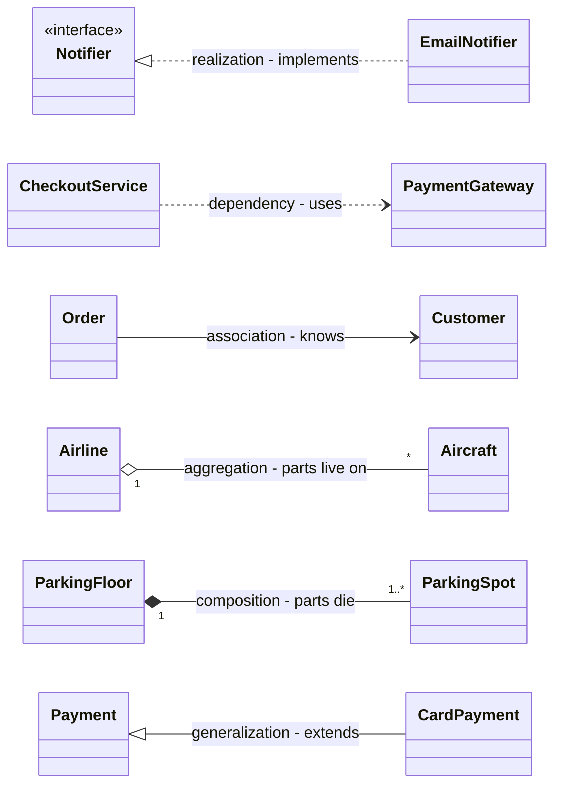

# Chapter 22 — Revision: Cheat Sheets & Glossary

> **What you will learn in this chapter**
> - How to revise the whole handbook in 15 minutes, or in one evening the night before.
> - The LLD (low-level design: the classes and code inside one program) answer framework on one page (Chapter 1).
> - OOP, relationships and UML arrows on one page (Chapters 2–3).
> - SOLID, the other design principles, and the clean-code rules as tables (Chapters 4–6).
> - All 24 code smells with the refactorings that cure them (Chapter 7).
> - All 23 GoF patterns (the classic catalogue by the "Gang of Four" authors) plus the extras, and a "which pattern?" table sorted by symptom (Chapters 8–11).
> - The concurrency toolbox, a deadlock checklist and a "which `java.util.concurrent` class?" table (`java.util.concurrent` is Java's standard package of thread-safety tools) (Chapters 12–13).
> - A map of every case study: entities, patterns, concurrency concern, and where to find it (Chapters 14–21).
> - A machine-coding checklist, an edge-case checklist, and a glossary of about 200 terms.
>
> Nothing in this chapter is new. Every row is a summary of a section in Chapters 1–21, and the right-hand column tells you where to go for the full explanation. This chapter has no code.

**How to read the references.** "§12.17" means section 12.17. Chapters 5 and 6 number their sections from 1 inside the chapter, so "Ch 5 §13" means section 13 of Chapter 5 (Fail Fast). Chapters 16, 17 and 19 have unnumbered case studies, so they are referenced by name, for example "Ch 16 · Car Rental".

**New to a term?** Every technical word in the tables below, from `API` and `JVM` to `TTL` and `SKU`, has a one-line definition in the glossary (22.11). A **TL;DR** ("too long; didn't read") heading marks a short summary.

---

## 22.1 How to revise

### In 15 minutes (the morning of the interview)

| Minutes | Read | Why |
|---|---|---|
| 0–3 | 22.2 (the framework) | You will use it in the first minute of the interview |
| 3–6 | 22.4 (SOLID one-pager) and the relationship table in 22.3 | The two things asked about most often by name |
| 6–10 | "Which pattern?" table in 22.7 | Patterns should come from a signal, not from memory |
| 10–13 | Concurrency cheat sheet and deadlock checklist in 22.8 | Every booking/inventory problem has a race |
| 13–15 | The row(s) of 22.9 for the problems you expect | One sentence per problem: entities, pattern, the atomic step |

### The night before (about 2 hours)

1. **Read 22.2–22.8 slowly** (45 min). For each table row, say out loud *one example from the handbook*. If you cannot, open the referenced section.
2. **Pick three case studies** from 22.9 you have not practised recently (45 min). For each: write requirements, list classes, draw the class diagram, and name the one hard method, without looking. Then compare with the chapter's TL;DR.
3. **Scan the glossary** (22.11) and mark any term you cannot explain in one sentence (20 min). Read those sections only.
4. **Stop.** Sleep matters more than one more pattern.

### Common mistakes when revising

- Re-reading chapters instead of **recalling** first and then checking. Recall is what the interview tests.
- Memorising all 23 patterns equally. Six come up in almost every round (22.7): Strategy, Factory, Observer, State, Singleton, Builder.
- Skipping the "when *not* to use it" column. Interviewers ask "would you always do that?" (§4.13).

---

## 22.2 The LLD interview answer framework (one page)

*Source: Chapter 1 (§1.2, §1.4–§1.10, §1.12, §1.14).*

### TL;DR

**Clarify → requirements → use cases → entities → relationships → class diagram → key flows → patterns/SOLID → code → edge cases/concurrency → extensions.** Say each step out loud as you enter it.

### The eleven steps

| # | Step | Ask yourself | Output |
|---|---|---|---|
| 1 | Clarify | Who uses it? Single site or many? | Shared understanding |
| 2 | Requirements | Functional? Non-functional (thread-safe, extensible, in-memory)? **Out of scope?** | 8–12 numbered lines + out-of-scope list |
| 3 | Use cases | What can each actor do? | Actor → use-case list |
| 4 | Entities | Which nouns hold state or behaviour? Which are just values? | Classes, one sentence each |
| 5 | Relationships | Uses / knows / has / owns / is-a? How many? | Typed lines with multiplicity |
| 6 | Class diagram | Fields, key methods, interfaces, enums | UML class diagram |
| 7 | Key flows | Steps of the 2–3 main use cases; lifecycle of the core object | Sequence / activity / state diagram |
| 8 | Patterns & SOLID | A rule that varies? A lifecycle? Many listeners? Two reasons to change? | 1–2 named patterns + one rejected |
| 9 | Code | Interfaces, enums, models, services, driver | Running code for the main flows |
| 10 | Edge cases & concurrency | Bad input? Full? Two users, one seat? | Validation, exceptions, locks |
| 11 | Extensions | "What if X is added?" | Short answers, maybe one class |

### Time budgets

| 45-minute OOD (object-oriented design) round | | 90-minute machine-coding round (write runnable code) | |
|---|---|---|---|
| Clarify requirements | 5–8 min | Read, requirements, assumptions | 5–10 min |
| Actors and use cases | 3–5 min | Model: entities, enums, service interfaces | 10–15 min |
| Find the classes | 8–10 min | Core flow end to end | 30–40 min |
| Connect the classes | 8–10 min | Remaining features, validation, edge cases | 15–20 min |
| Write the code | 12–15 min | Polish, one extension point, demo | 5–10 min |
| | | Buffer | 5 min (never zero) |

Rule of thumb: roughly **a quarter of the hour goes before you name a class**, and in machine coding you **get something running by the halfway mark** (§1.2).

### Finding classes (§1.6)

- **Nouns → candidate classes; verbs → methods.** A verb with no class to live on means a class is missing.
- Cut candidates with five tests: is it a **value**? the **same thing** under another name? does it have **changing state**? does anything **call** it? does it differ in **behaviour or only data**?
- **Different data → field or enum. Different behaviour → class.**
- One sentence per class, **no "and"**. Put each method where its data is (Information Expert).
- Beginners most often forget the **record-keeping class** (ticket, loan, booking) and the **rule class** (rate, strategy).

### What the interviewer judges (§1.2)

1. Did you **bound** the problem? 2. Does each class have **one job** you can say in a sentence? 3. Are the **relationships** right? 4. Does the **code match the diagram**? 5. Can you explain a **trade-off** (the choice and the rejected option)?

Machine coding adds: does it **run**, is it **modular**, **readable**, does it **handle bad input**, and (senior roles) is shared state **thread-safe**.

### Code habits interviewers notice (§1.10)

| Habit | Instead of |
|---|---|
| Pass time in (`long nowMinute`, `Instant now`, injected `Clock`) | Reading the clock inside logic |
| Money as `BigDecimal` from strings, or whole cents in a `long` | `double` (0.1 + 0.2 ≠ 0.3) |
| `IllegalArgumentException` / `IllegalStateException` / a custom exception | Silent failure or error codes |
| `Optional` when "not found" is normal | Returning `null` |
| `private final` fields | Public mutable fields |
| Domain names (`ParkingTicket`) | `Manager`, `Helper`, `Data2` |

Skeleton: **Models → Repositories → Strategies → Services → Driver** (§1.10). The driver is the `main` class that feeds sample commands to the services and prints the results.

### In the interview

**30-second answer** (from §1.14): "I clarify and write 8 to 12 requirements with an out-of-scope list, list actors and use cases, pick classes from the nouns and give each one responsibility, connect them and draw a class diagram, sketch the key flow, run a quick SOLID check and pick one or two patterns where the signal is clear, then code the two or three core flows, handle edge cases and concurrency, and finish with extensions and trade-offs."

### Common mistakes (§1.14)

| Mistake | Fix |
|---|---|
| Coding in minute two | 8–13 minutes on requirements and actors first |
| No out-of-scope list | Write it down and agree it |
| One subclass per value (`CompactSpot`, `LargeSpot`) | Different data → field/enum |
| God class (`ParkingLotManager`) | One sentence per class; split on "and" |
| Inheritance for reuse ("Car extends Engine") | Composition |
| Pattern stuffing | One or two patterns, each with its signal |
| All twelve classes at equal depth | Two or three flows fully |
| Ignoring two users on one resource | Lock or atomic operation on the shared state |
| Non-running code in machine coding | Thin end-to-end path running by halfway |

---

## 22.3 OOP & relationships cheat sheet

*Source: Chapter 2 (OOP) and Chapter 3 (relationships and UML).*

### The four pillars (§2.3–§2.6)

| Pillar | One line | Java tools | Smell when missing |
|---|---|---|---|
| **Encapsulation** (§2.3) | Data is private; only the owning class's methods change it, and they enforce the rules (the *invariants*: facts that must always hold) | `private` fields, no setters, validation in constructors | Public fields; setters that break invariants |
| **Abstraction** (§2.4) | Expose only what callers need; hide how | Interfaces, abstract classes, small public API | Callers reach into internals |
| **Inheritance** (§2.5) | Child reuses and specialises parent — **only when "child is a parent" is truly correct** | `extends`, `super`, `@Override` | Subclass refuses or throws on parent methods |
| **Polymorphism** (§2.6) | One call, different behaviour per object; removes type switches | Overriding + dynamic dispatch (the method is picked from the object's real class at run time) | `switch` / `instanceof` chains on type |

**Encapsulation vs abstraction:** hiding *data* behind rule-enforcing methods vs hiding *complexity* behind a minimal set of operations (Ch 2 self-check).

### Other OOP facts worth one line each

| Topic | Remember | Where |
|---|---|---|
| Overloading vs overriding | Compile time, by declared parameter types vs run time, by the actual object. Fields and `static` methods are not polymorphic (statics are hidden, not overridden) | §2.7 |
| `this`, `static`, `final` | Current object; one per class; cannot be reassigned/overridden/extended | §2.2 |
| Interfaces | Contracts; can have `default`, `static`, `private` methods; a functional interface has one abstract method (lambdas: short inline functions such as `x -> x * 2`) | §2.8 |
| Enums | Fixed sets with fields and behaviour ("which spot types fit a truck" lives on `VehicleType`) | §2.10 |
| Composition over inheritance | Avoids fragile base classes; allows run-time swapping | §2.11, Ch 5 §6 |
| `equals`/`hashCode` | Equal objects must have equal hash codes; override both or hash collections break | §2.12 |
| Immutability & records | Final class, private final fields, no setters, defensive copies. Records are only **shallowly** immutable — copy collections in the compact constructor | §2.13 |
| Access modifiers | Default to `private`; package-private = same package only | §2.14 |
| Generics | Type-safe reusable infrastructure; **PECS**: producer `extends`, consumer `super` | §2.15 |
| Coupling & cohesion | Low coupling (between classes), high cohesion (inside a class) | §2.16 |
| OOA → OOD → OOP | What the problem is → how, with objects → code. Connections that carry data become objects | §2.17 |

### Abstract class vs interface (§2.9)

| | Abstract class | Interface |
|---|---|---|
| Instantiable? | No | No |
| Instance fields (state) | Yes | No (only `public static final` constants) |
| Constructors | Yes | No |
| Method bodies | Any | `default`, `static`, `private` only |
| How many per class | **One** (`extends`) | **Many** (`implements`) |
| Relationship expressed | "is a" (shared identity and state) | "can do" (capability / role) |
| Typical use | Shared state + partial implementation for a close family (Template Method) | Contracts, roles, strategies, test seams |

**Rule of thumb:** start with an interface; add an abstract class underneath when implementations share real state or a fixed algorithm (JDK, the Java Development Kit's standard library: `List` + `AbstractList` + `ArrayList`).

### The six relationships (§3.2–§3.8)

Weakest to strongest coupling: **dependency, association, aggregation, composition, realization, generalization** (§3.16).

| Relationship | Phrase | UML line | Java shape | Lifetime | Example |
|---|---|---|---|---|---|
| Dependency (§3.5) | A *uses* B | dashed, open arrow → B | B as parameter / local / return / static call | none | `CheckoutService` uses `PaymentGateway` |
| Association (§3.2) | A *knows* B | solid line (arrow for one-way) | field of type B, created elsewhere | independent | `Order` → `Customer` |
| Aggregation (§3.3) | A *has* B, parts live on | solid, hollow ◇ at A (the whole) | field/collection, parts passed in | B outlives A | `Airline` ◇— `Aircraft` |
| Composition (§3.4) | A *owns* B | solid, filled ◆ at A (the whole) | A creates B, hides it, B not shared | B dies with A | `ParkingFloor` ◆— `ParkingSpot` |
| Realization (§3.7) | A *implements* B | dashed, hollow △ at B | `implements` | — | `EmailNotifier` ⇢ `Notifier` |
| Generalization (§3.6) | A *is a* B | solid, hollow △ at B | `extends` | — | `CardPayment` → `Payment` |

**Choosing, in order (§3.8):** interface A promises to fulfil → realization. Substitutable with no refused methods → generalization. Not kept in a field → dependency. Part that dies with the whole → composition. Part that outlives it → aggregation. Otherwise → association.

### UML arrow legend (Mermaid)

| Mermaid | Meaning |
|---|---|
| `A ..> B` | A depends on B |
| `A --> B` | A associated with B, navigable A to B |
| `A -- B` | association (both ways / unspecified) |
| `A o-- B` | aggregation, A is the whole |
| `A *-- B` | composition, A is the whole |
| `B <\|.. A` | A realizes interface B |
| `B <\|-- A` | A extends B |
| `A "1" *-- "1..*" B` | with multiplicities |

**Multiplicity → code (§3.17):** `1` required field; `0..1` `Optional`/nullable; `1..*` non-empty collection checked in the constructor; exact numbers checked in constructors. Visibility: `+` public, `-` private, `#` protected, `~` package.

### UML diagrams in the interview (§3.9–§3.15)

| Diagram | Use it for | Budget in 45 min |
|---|---|---|
| Use case (§3.10) | Scope: actors + what each does. «include» = always; «extend» = sometimes | Usually spoken, 3–5 min |
| **Class (§3.11)** | **The answer.** 10–15 boxes, every line typed, with multiplicity | Always drawn, 10–15 min |
| Sequence (§3.12) | Call order between objects (3–4 objects, 6–8 messages) | One behaviour diagram only |
| Activity (§3.13) | A flow that branches; fork/join for parallel steps | ″ |
| State machine (§3.14) | One object's lifecycle; transition label `event [guard] / action` | ″ |

UML has 14 diagram types: 7 structural, 7 behavioural (§3.9).

### Common mistakes

- Diamond at the wrong end (it goes at the **whole**); triangle at the wrong end (it goes at the **parent/interface**) (§3.8).
- Lines without type or multiplicity (§3.8).
- Inheritance used to share data; subclasses that only pass a constant to `super` → one class with an enum field (§3.16).

---

## 22.4 SOLID one-pager

*Source: Chapter 4 (§4.2, §4.7–§4.10, §4.12–§4.15), smells from Chapter 7 (§7.4).*

### TL;DR

SOLID = five names for the ways code becomes painful to change. **Use them to diagnose, not as a checklist**, apply a fix when a real change asks for it, and always say what the fix costs.

| Principle | One-line rule | Smell that signals a violation | Fix | Patterns that help |
|---|---|---|---|---|
| **S** — Single Responsibility (§4.2) | A class should have one reason to change (one actor asks for its changes) | The responsibility sentence needs an "and"; *Divergent Change*, *Large Class* | Split by actor (Extract Class); each new class needs a name that stands alone | Command, Proxy, Decorator (each concern in its own class) |
| **O** — Open/Closed (§4.7) | Add new behaviour by adding code, not by editing working code | A `switch`/`if` chain over a type; *Repeated Switches*, *Shotgun Surgery* | Put the part that *has* varied behind an interface; add variants as classes (Replace Conditional with Polymorphism) | Strategy, Template Method, Decorator, Factory Method, Observer, Command, Visitor |
| **L** — Liskov Substitution (§4.8) | A subtype must be usable anywhere its parent is expected | Subclass throws, does nothing, or refuses a parent method; *Refused Bequest* | Better parent, a narrower interface, or composition (Replace Subclass with Delegate) | Composite, Null Object |
| **I** — Interface Segregation (§4.9) | No client should depend on methods it does not use | Empty method bodies or `UnsupportedOperationException` in implementers; fat interfaces | Split into **role interfaces**, one per kind of caller | Adapter |
| **D** — Dependency Inversion (§4.10) | Depend on abstractions, not concrete details; the policy owns the abstraction | A high-level class does `new` of (or names) a low-level one; cannot test without the real DB (database)/provider | Inject an interface owned by the high-level class; `main` wires the details | Strategy, Factory Method / Abstract Factory, Adapter, Observer |

**LSP in detail (§4.8, TL;DR):** a subclass must accept at least as much, promise at least as much, keep invariants and history, and throw nothing new. Square/Rectangle is worse than `Penguin.fly()` throwing because it fails **silently** (wrong area, no error).

### Five-minute pass over your diagram (§4.13, §1.8)

Run S → O → L → I → D over the diagram you just drew. **Two findings is a good pass; five means rework; zero means you did not look.** S and O earn the most credit: O is what interviewers probe with a late requirement ("what if trucks are charged differently?" → "add a class").

### Related ideas (§4.3–§4.6, §4.14)

| Idea | Question it asks |
|---|---|
| SRP | How many actors can ask this class to change? |
| Cohesion | Do the parts of this class belong together? |
| Coupling | How much does A depend on B? |
| Separation of Concerns | Is each area of work in its own module? |
| SRP vs ISP | SRP splits **classes** (guards the worker); ISP splits **interfaces** (guards the caller) |
| DIP vs DI vs IoC | DIP = principle (depend on abstractions); DI = technique (pass dependencies in); IoC = the broader idea that a framework calls your code; IoC containers (libraries such as Spring that create and wire objects for you) perform DI |

### Common mistakes: over-engineering (§4.15)

| Warning sign | Principle misapplied | Do instead |
|---|---|---|
| `XHelper`, `XUtils`, `XManager2` after a split | SRP | Split by actor; names must stand alone |
| Six small classes that always change in the same commit | SRP over-split | Merge them back |
| Interface + factory + registry for one implementation | OCP (*Speculative Generality*) | Write the `if`; refactor at the second or third case (rule of three) |
| A subclass that "works" by silently doing nothing | LSP | Better parent or composition |
| One interface per method | ISP over-split | Group by caller into role interfaces |
| An interface in front of stable `String`-like classes | DIP | Invert only volatile dependencies |
| A DI container for a 200-line program | DIP | Wire by hand in `main` |

**YAGNI** is the counterweight: SOLID says *what* a good seam looks like; YAGNI says *when* to cut it.

### In the interview

Say **observation → cost → fix → price of the fix**, and describe before you label: "`Reporting` implements nine methods but calls two — an interface segregation problem" (§4.13).

---

## 22.5 Other design principles and Clean Code rules

### Other principles (Chapter 5)

| Principle | One-line idea | Smell it fixes | Key Java tool | Where |
|---|---|---|---|---|
| DRY | Each piece of knowledge has one authoritative home | Duplicated rules drifting apart | Value objects, constants, methods | Ch 5 §1 |
| KISS | Choose the simplest design that works | Over-engineering | Plain code, `switch` expressions | Ch 5 §2 |
| YAGNI | Don't build features before they are needed | Speculative Generality | Delete unused code | Ch 5 §3 |
| Law of Demeter | Only talk to your immediate friends | Train wrecks `a.getB().getC().do()` | Intent-revealing delegate methods | Ch 5 §4 |
| Tell, Don't Ask | Tell objects what to do; don't pull their data out and decide for them | Anemic model, Feature Envy | Command methods on the owner | Ch 5 §5 |
| Composition over inheritance | Prefer "has-a" to "is-a" for reuse | Fragile base class | Forwarding / decorators | Ch 5 §6 |
| Program to an interface | Depend on supertypes, choose the concrete class once at the edge | Hard-wired concrete dependencies | Interfaces + DI | Ch 5 §7 |
| Encapsulate what varies | Isolate the part that changes behind an interface | Growing type switches | Strategy, lambdas | Ch 5 §8 |
| Loose coupling | Interacting objects know little about each other | God orchestrators | Observer, events, DI | Ch 5 §9 |
| Hollywood Principle / IoC | "Don't call us, we'll call you" — the framework owns the flow | Duplicated skeletons | Template Method, callbacks, DI | Ch 5 §10 |
| Separation of Concerns | Each part handles one concern | Spaghetti code | Layers, MVC | Ch 5 §11, §4.5 |
| Least Astonishment | Do what the name promises and nothing more | Hidden side effects | Honest names, `Optional` | Ch 5 §12 |
| Fail fast | Detect problems early and loudly | Distant `NullPointerException`s | Guard clauses, `requireNonNull` | Ch 5 §13 |
| Immutability | Objects never change after creation | Aliasing, races | Records, `List.copyOf` | Ch 5 §14 |
| Design by Contract | Preconditions (caller), postconditions (method), invariants (always) | Magic error values | Checks at method entry/exit | Ch 5 §15 |
| GRASP | Nine guidelines for "which class should do this?" | God classes | Expert, Creator, Controller… | Ch 5 §16 |
| Domain-Driven Design | Model the business: bounded contexts, entities vs value objects, small aggregates, domain events, repositories per root | Anemic model, big ball of mud, primitive obsession | Records as value objects, aggregate roots, events + outbox (events saved in the same transaction as the data, published afterwards) | Ch 5 §17 |

**GRASP in one line each (Ch 5 §16.1–§16.9):**

| Guideline | Rule |
|---|---|
| Information Expert | The class with the data does the work |
| Creator | The container (or the one with the initial data) creates |
| Controller | A thin non-UI object receives each system event and delegates |
| Low Coupling | Choose the design with fewer, more stable dependencies |
| High Cohesion | Each class does one related set of things |
| Polymorphism | Let each type implement the varying behaviour; don't switch on types |
| Pure Fabrication | Invent a helper class (e.g. a repository) when no domain class is a clean home |
| Indirection | Put a middleman between things that shouldn't know each other |
| Protected Variations | Wrap what's unstable behind a stable interface |

**Tensions to mention (Ch 5 summary):** DRY vs loose coupling (sharing code couples its users); YAGNI vs encapsulate-what-varies (abstract only real or clearly predicted variation); Law of Demeter vs cohesion (too many delegates → Middle Man); Information Expert vs SoC (domain objects compute, fabrications persist).

### Clean Code rules checklist (Chapter 6)

| Area | Rule of thumb | Where |
|---|---|---|
| Names | Reveal intent; pronounceable; searchable; one word per concept; code reads like the requirement | Ch 6 §1 |
| Functions | Small; do one thing; one level of abstraction; top-down (stepdown); ≤ 2–3 arguments; **no flag arguments**; no hidden side effects; commands *or* queries (CQS); exceptions, not error codes | Ch 6 §2 |
| Comments | Say it in code; comment only the *why*, warnings, legal text, public contracts; delete commented-out code | Ch 6 §3 |
| Formatting | Newspaper order (headline first); related things close; one automated team style | Ch 6 §4 |
| Objects vs data structures | Objects hide data and expose behaviour; data structures expose data; no hybrids; no train wrecks | Ch 6 §5 |
| Error handling | Unchecked exceptions with context; wrap vendor exceptions; empty collections / `Optional` / special case instead of `null`; never pass `null`; always clean up | Ch 6 §6 |
| Boundaries | Keep third-party code behind your own interfaces; learn it with tests | Ch 6 §7 |
| Unit tests | Three laws of TDD (Test-Driven Development: write a failing test first); one concept per test; Given–When–Then; **F.I.R.S.T.** (Fast, Independent, Repeatable, Self-validating, Timely) | Ch 6 §8 |
| Classes | Small by responsibility; cohesive; open for extension; depend on abstractions | Ch 6 §9 |
| Systems | Build objects in one place (composition root) and inject them; cross-cutting concerns in proxies/aspects | Ch 6 §10 |
| Simple design | Beck: passes the tests → reveals intention → no duplication → fewest elements (*Clean Code* swaps the middle two) | Ch 6 §11 |
| Concurrency | Separate concurrency code; share as little as possible; use the library; keep locks small; plan shutdown | Ch 6 §12 |
| Smells | The C/E/F/G/J/N/T heuristics catalogue as a review vocabulary | Ch 6 §14 |
| Code review | Correctness → design → readability → tests → security → performance → operability; automate style; small PRs (pull requests: proposed changes sent for review) | Ch 6 §15 |
| Error strategy | Classify, translate at boundaries, retry only transient + idempotent (safe to repeat) with backoff (waiting longer between attempts), one global handler that logs once | Ch 6 §16 |
| Testing strategy | Many unit, some integration, few E2E (end-to-end, whole-system); right test double (a stand-in such as a mock or fake); verify state over interactions; don't mock what you don't own | Ch 6 §17 |

**Boy Scout Rule:** leave the code a little cleaner than you found it (Ch 6 intro).

---

## 22.6 Code smells → refactorings (all 24)

*Source: Chapter 7 (§7.2 smells, §7.3 catalogue, §7.4 lookup table). **Bold** = the usual first move.*

| # | Smell | Signal (one line) | Group | Refactorings that cure it |
|---|---|---|---|---|
| 1 | Mysterious Name (§7.2.1) | Name doesn't say what it does/holds (`data`, `proc()`, `Manager`) | 2nd-ed extra | **Change Function Declaration**, Rename Variable, Rename Field |
| 2 | Duplicated Code (§7.2.2) | Same structure in more than one place | Dispensables | **Extract Function**, Slide Statements, Pull Up Method |
| 3 | Long Function (§7.2.3) | You want a comment to explain a block | Bloaters | **Extract Function**, Replace Temp with Query, Introduce Parameter Object, Preserve Whole Object, Replace Function with Command, Decompose Conditional, Replace Conditional with Polymorphism, Split Loop |
| 4 | Long Parameter List (§7.2.4) | Many parameters, same types, boolean flags | Bloaters | Replace Parameter with Query, **Preserve Whole Object**, **Introduce Parameter Object**, Remove Flag Argument, Combine Functions into Class |
| 5 | Global Data (§7.2.5) | Readable and writable from anywhere (incl. mutable singletons) | 2nd-ed extra | **Encapsulate Variable** (then shrink its scope) |
| 6 | Mutable Data (§7.2.6) | Shared data changed after creation | 2nd-ed extra | **Encapsulate Variable**, Split Variable, Slide Statements, Extract Function, Separate Query from Modifier, Remove Setting Method, Replace Derived Variable with Query, Combine Functions into Class/Transform, Change Reference to Value |
| 7 | Divergent Change (§7.2.7) | One class changed for many different reasons (SRP) | Change Preventers | **Split Phase**, Move Function, Extract Function, **Extract Class** |
| 8 | Shotgun Surgery (§7.2.8) | One change forces many small edits in many classes | Change Preventers | **Move Function**, **Move Field**, Combine Functions into Class/Transform, Split Phase, Inline Function, Inline Class |
| 9 | Feature Envy (§7.2.9) | Method uses another class's data more than its own | Couplers | **Move Function**, Extract Function |
| 10 | Data Clumps (§7.2.10) | Same group of values always travel together (`startDate, endDate`) | Bloaters | **Extract Class**, **Introduce Parameter Object**, Preserve Whole Object |
| 11 | Primitive Obsession (§7.2.11) | Money as `double`, status as `String` | Bloaters | **Replace Primitive with Object**, Replace Type Code with Subclasses, Replace Conditional with Polymorphism, Extract Class, Introduce Parameter Object |
| 12 | Repeated Switches (§7.2.12) | The *same* switch on a type code in several places | OO Abusers | **Replace Conditional with Polymorphism** |
| 13 | Loops (§7.2.13) | Classic loop that filters/maps/aggregates | 2nd-ed extra | **Replace Loop with Pipeline** |
| 14 | Lazy Element (§7.2.14) | A class/function that doesn't pull its weight | Dispensables | **Inline Function**, **Inline Class**, Collapse Hierarchy |
| 15 | Speculative Generality (§7.2.15) | Hooks "we might need someday"; abstract class with one subclass | Dispensables | Collapse Hierarchy, Inline Function, Inline Class, Change Function Declaration, Remove Dead Code |
| 16 | Temporary Field (§7.2.16) | Field set only in some situations, `null` otherwise | OO Abusers | **Extract Class**, Move Function, Introduce Special Case |
| 17 | Message Chains (§7.2.17) | `order.getCustomer().getAddress().getCity()` | Couplers | **Hide Delegate**, Extract Function, Move Function |
| 18 | Middle Man (§7.2.18) | Most methods just forward to another class | Couplers | **Remove Middle Man**, Inline Function, Replace Superclass/Subclass with Delegate |
| 19 | Insider Trading (§7.2.19) | Two modules poke at each other's internals | Couplers | **Move Function**, **Move Field**, Hide Delegate, Replace Subclass/Superclass with Delegate |
| 20 | Large Class (§7.2.20) | Too many fields/methods — a God Class | Bloaters | **Extract Class**, Extract Superclass, Replace Type Code with Subclasses |
| 21 | Alternative Classes with Different Interfaces (§7.2.21) | Same job, different method names (`sendMail` vs `dispatch`) | OO Abusers | **Change Function Declaration**, Move Function, Extract Superclass |
| 22 | Data Class (§7.2.22) | Only fields and getters/setters; others manipulate it | Dispensables | **Encapsulate Record**, Remove Setting Method, Move Function, Extract Function, Split Phase |
| 23 | Refused Bequest (§7.2.23) | Subclass doesn't want inherited methods, or throws on them (LSP) | OO Abusers | Push Down Method/Field, **Replace Subclass with Delegate**, **Replace Superclass with Delegate** |
| 24 | Comments (§7.2.24) | Comment used as deodorant for unclear code | Dispensables | **Extract Function**, Change Function Declaration, Introduce Assertion |

### Smell family → principle violated (§7.4)

| Smell family | Principle |
|---|---|
| Divergent Change, Large Class | SRP |
| Repeated Switches, Shotgun Surgery | OCP |
| Refused Bequest | LSP |
| Long Parameter List with flags, fat interfaces | ISP / clean function design |
| Global Data, Mutable Data | Encapsulation |
| Hard-wired `new` of concrete dependencies | DIP |
| Duplicated Code | DRY |
| Speculative Generality | YAGNI |
| Message Chains, Insider Trading | Law of Demeter |
| Feature Envy, Data Class | Tell, Don't Ask |

### Refactoring toward patterns (§7.6)

| Smell | Refactor toward |
|---|---|
| Switch/if-chain choosing an algorithm | Strategy |
| Methods that check and change a status field | State |
| `if (x == null)` at many call sites | Null Object / Special Case |
| Sibling subclasses with the same skeleton | Template Method |
| Many confusing constructors | Factory Method / creation methods |
| Complex object built by many ordered calls | Builder |
| Undo/queueing needed; huge function with shared locals | Command |
| Logging/caching mixed into a core class | Decorator |
| Objects polling for changes; hard-coded notification | Observer |
| Two classes, same job, different interfaces | Adapter |
| Subclass explosion from feature combinations | Strategy / Decorator / Bridge |
| A pattern that no longer earns its keep | Remove it (Inline Class, Collapse Hierarchy) |

**Refactoring** = changing structure without changing behaviour, in small steps, with tests as the safety net. Wear one of **two hats** at a time: adding function or refactoring (§7.1.1).

---

## 22.7 Design patterns: all 23 GoF + extras

*Source: Chapters 8–11. Catalogue in §8.3; comparisons in §8.15, §9.8, §10.7, §11.6, §11.8.*

**Count:** 5 creational + 7 structural + 11 behavioral = **23**. **Class-scoped** (inheritance) patterns: Factory Method, class Adapter, Template Method, Interpreter; almost everything else is object-scoped (composition) (§8.3).

### Creational (Chapter 8)

| Pattern | Intent (one line) | Use when | Java / JDK example | Commonly confused with | Where |
|---|---|---|---|---|---|
| **Singleton** | Exactly one instance with a global access point | There really must be exactly one (config, pool, registry) | `Runtime.getRuntime()`; Spring (a popular Java framework) singleton-scoped beans | A global variable; a DI singleton scope (preferred for testing) | §8.8 |
| **Factory Method** | Subclasses decide which concrete class to create via an overridable method | Shared procedure, varying product; others will add types | `Collection.iterator()` | Simple Factory (one method with a switch) | §8.10 |
| **Abstract Factory** | Create *families* of related objects without naming concrete classes | Products must match; swap a whole set at once | `DocumentBuilderFactory`; JDBC (Java's database API) `Connection` | Factory Method (one product by inheritance vs a family by composition) | §8.11 |
| **Builder** | Build a complex object step by step; one validating `build()` | Many optional fields, cross-field validation, immutable result | `StringBuilder`, `HttpClient.newBuilder()` | A plain constructor (fine for a handful of required fields); telescoping constructors | §8.12 |
| **Prototype** | Create new objects by copying a configured instance | Setup is expensive, or only the interface is known | Copy constructors, `ArrayList.clone()` | Memento (a snapshot to restore, not a copy to use) | §8.13 |

Singleton notes (§8.8, §8.17): eager, holder-class or **`enum`** (most robust: blocks duplicates made through reflection, i.e. code calling private constructors by name, or through serialization, i.e. saving to bytes and reading back); double-checked locking needs a **`volatile`** field. It is global state that hurts testing — prefer injecting one shared instance. Many case studies reject it (Ch 14 self-check).

### Structural (Chapter 9)

| Pattern | Intent (one line) | Use when | Java / JDK example | Commonly confused with | Where |
|---|---|---|---|---|---|
| **Adapter** | Convert one interface into another that clients expect | "The vendor API doesn't match ours" (after the fact) | `Arrays.asList`, `InputStreamReader` | Bridge (same shape, but Bridge is designed up front); Facade | §9.1 |
| **Bridge** | Split abstraction from implementation so both vary independently | Class names with two nouns; two dimensions multiplying classes | JDBC `Connection` + drivers | Adapter; Strategy (same shape) | §9.2 |
| **Composite** | Treat single objects and trees uniformly | Part-whole trees (files, menus, UI) | `java.awt.Container` is a `Component` holding `Component`s | Decorator (also wraps a component, but adds behaviour to one) | §9.3 |
| **Decorator** | Add responsibilities dynamically by wrapping; same interface, stackable | "Sometimes logging, sometimes caching, sometimes both" | `BufferedInputStream`, `Collections.synchronizedList` | Proxy (same shape; Proxy *controls access*); Chain of Responsibility (in CoR someone can stop the flow) | §9.4 |
| **Facade** | One simple entry point to a complex subsystem | Every caller repeats the same multi-step sequence | SLF4J (a logging facade library) `LoggerFactory`, service layers | Adapter (converts one object's interface); Mediator | §9.5 |
| **Flyweight** | Share intrinsic (immutable) state across huge numbers of objects | Millions of near-identical objects | `Integer.valueOf`, `String.intern()` | Object Pool (reuses objects one borrower at a time; flyweights are shared at once) | §9.6 |
| **Proxy** | A stand-in that controls access (lazy, remote, protective, caching) | It's expensive, remote or restricted | `java.lang.reflect.Proxy`, Spring `@Transactional`, Hibernate (maps objects to database tables) lazy load | Decorator | §9.7 |

Memory hooks (§9.8): Adapter *make it fit* · Decorator *add to it* · Proxy *guard it* · Facade *simplify it* · Bridge *split it* · Composite *nest it* · Flyweight *share it*.

### Behavioral (Chapters 10–11)

| Pattern | Intent (one line) | Use when | Java / JDK example | Commonly confused with | Where |
|---|---|---|---|---|---|
| **Chain of Responsibility** | Pass a request along handlers until one handles (or stops) it | Several checks, any may reject; handler not known in advance | Servlet `Filter` chain; `java.util.logging` handlers | Decorator (every layer always runs) | §10.1 |
| **Command** | Turn a request into an object: queue, log, retry, undo | Undo/redo, job queues, scheduling | `Runnable`/`Callable`; Swing `UndoManager` | Strategy (Strategy = *how*; Command = *what*) | §10.2 |
| **Iterator** | Traverse a collection without exposing how it is stored | Walk a collection/tree/paged API | `Iterator`, `Spliterator`, JDBC `ResultSet` | Visitor (what to do at each node) | §10.3 |
| **Mediator** | Centralise communication between peers in one coordinator | Many objects interact in tangled ways; order of reactions matters | Chat servers, UI controllers; `Executor`/`Timer` are a loose fit (§10.4) | Observer (broadcast, no coordination); Facade | §10.4 |
| **Memento** | Capture and restore state without breaking encapsulation | Undo, checkpoints, rollback | A `record` snapshot; DB `ROLLBACK`, Git commits (real-world) | Command undo (store actions, not states); Prototype | §10.5 |
| **Interpreter** | One class per grammar rule; evaluate sentences of a small language | User-written rules/expressions | `java.util.regex.Pattern`, SpEL (Spring's expression language) | Composite (same tree); Visitor (many operations over the AST, the abstract syntax tree a parser builds) | §10.6 |
| **Observer** | Notify many dependents automatically when one object changes | An open-ended set of independent listeners | `PropertyChangeListener`, `java.util.concurrent.Flow`, Spring `@EventListener` | Mediator; pub-sub (Observer through a broker, §20.6) | §11.1 |
| **State** | Behaviour changes with internal state, as if the class changed | Many states/transitions; methods repeat a `switch` on status | TCP connection (GoF's example), order lifecycles. `Thread.State` is only an enum of states, not the pattern | Strategy (same diagram; states know each other and advance themselves) | §11.2 |
| **Strategy** | Make a family of algorithms interchangeable behind one interface | Several ways to do one job, chosen at run time | `Comparator`; `RejectedExecutionHandler` policies | State; Template Method; Decorator (Strategy *replaces* a rule, Decorator *wraps* one) | §11.3 |
| **Template Method** | Fixed algorithm skeleton in a base class; subclasses fill in steps | Long fixed flow, a few varying steps | `AbstractList`, `InputStream.read(byte[],…)`, `HttpServlet.service()` | Strategy (Template = inheritance, one step varies; Strategy = composition, whole algorithm varies) | §11.4 |
| **Visitor** | Add operations to a stable set of classes without changing them (double dispatch) | Many new operations over a fixed type set (ASTs) | `javax.lang.model.element.ElementVisitor`; `FileVisitor` is named after it but is really a tree-walk callback | Iterator; in Java 21, **sealed types + pattern-matching `switch`** usually replace it | §11.5 |

### Beyond GoF: extras you will meet

| Pattern | Intent (one line) | Use when | Java / real example | Commonly confused with | Where |
|---|---|---|---|---|---|
| **Simple Factory** (idiom) | One `create(type)` method maps a type value to a class | Small, stable set of types chosen by config | `Calendar.getInstance()`, `EnumSet.noneOf` | Factory Method | §8.9 |
| **Object Pool** | Borrow and return a bounded set of expensive objects | DB connections, limited resources | HikariCP (a database connection pool), `ThreadPoolExecutor` | Flyweight | §8.14 |
| **Null Object** | A do-nothing implementation instead of `null` | `null` checks everywhere for an optional collaborator | `Collections.emptyList()`, `OutputStream.nullOutputStream()` | `Optional` (for lookups) | §11.7.1 |
| **Dependency Injection** | Receive collaborators (as interfaces) through the constructor | Classes create their own collaborators; hard to test | Spring constructor injection; a hand-wired `main` | Service Locator (anti-pattern: the class asks for its dependencies) | §11.7.2 |
| **Repository** | Collection-like interface over storage | Business logic mixed with storage code | Spring Data `CrudRepository` | DAO (table-oriented) | §11.7.3 |
| **Specification** | A named, combinable business rule (`isSatisfiedBy`, and/or/not) | Same rule in queries and validation; finder-method explosion | `Predicate`; Spring Data JPA `Specification` | — | §11.7.4 |
| **MVC** | Separate model, view and controller (Observer + Strategy + Composite) | UI, input handling and rules tangled | Spring MVC; Swing `JTable` + `TableModel` | MVP, MVVM (relatives) | §11.7.5 |
| **Event Sourcing** (lite) | Store the events; derive current state by replaying them | Full history, audit, time travel | Append-only logs | Plain audit log | §11.7.6 |

### "Which pattern?" by problem symptom

*Combined from §8.5, §8.15, §9.8, §11.8 and §7.6.*

| If you see / need… | Use | Not to be confused with |
|---|---|---|
| One operation, several interchangeable rules chosen at run time (pricing, matching, routing) | **Strategy** | State, Template Method |
| The class to create depends on a type value; caller shouldn't know the concrete class | **Factory** (Simple Factory / Factory Method) | Abstract Factory |
| Products must always match as a family | **Abstract Factory** | Factory Method |
| Constructor has ~6+ arguments, many optional | **Builder** | — |
| Another one of *this*, cheaply or without knowing its class | **Prototype** | Memento |
| Exactly one instance must exist | **Singleton** (or DI singleton scope) | A convenient global handle |
| Expensive objects created and destroyed repeatedly | **Object Pool** | Flyweight |
| Existing class has the wrong interface | **Adapter** | Facade, Bridge |
| Two dimensions multiplying classes (`WindowsButton`, `MacButton`, …) | **Bridge** | Adapter |
| Tree of part-whole objects treated the same | **Composite** | Decorator |
| Add behaviour in combinations without editing the class | **Decorator** | Proxy |
| Every caller repeats the same five steps into a subsystem | **Facade** | Mediator |
| Millions of near-identical objects | **Flyweight** | Object Pool |
| Lazy load, access control, remote, caching (same interface) | **Proxy** | Decorator |
| A request must pass several checks; any may reject it | **Chain of Responsibility** | Decorator (all layers run) |
| Undo/redo, queue, schedule, retry or log *requested actions* | **Command** | Strategy |
| Evaluate user-written rules in a small language | **Interpreter** (+ Specification) | Visitor |
| Walk a collection/tree/paged API without exposing structure | **Iterator** | Visitor |
| Many objects depend on each other and the **order** of reactions matters | **Mediator** | Observer |
| Roll back to an earlier state without exposing internals | **Memento** | Command undo |
| One change must reach an open-ended set of listeners | **Observer** (or a broker) | Mediator |
| Three or more methods repeat one `switch` over a status; legal actions depend on it | **State** (or enum + guarded method for 3–4 states) | Strategy |
| Several classes share a long fixed flow, differ in a few steps | **Template Method** | Strategy |
| Many new operations over a stable set of types | **Visitor**, or sealed types + pattern matching | Iterator |
| `null` checks everywhere | **Null Object** / `Optional` | — |
| Classes create their own collaborators | **Dependency Injection** | Service Locator |
| Business logic mixed with storage | **Repository** | DAO |
| Same rule duplicated in queries and validation | **Specification** | — |

**Three questions for the famous look-alikes (§11.8):**
1. Do the alternatives reference each other? Yes → **State**. No → **Strategy** (or Bridge if chosen once at wiring).
2. Can one participant stop the flow? Yes → **Chain of Responsibility**. Everyone always runs → **Decorator**. Everyone is told, nobody stops anyone → **Observer**.
3. Does a central object decide what happens next? Yes → **Mediator**. Each listener decides for itself → **Observer**.

### The six that come up in almost every round (§1.9, §8.5)

| Pattern | Signal | Do **not** use when |
|---|---|---|
| Strategy | One operation, several swappable rules | Only one rule exists and nothing hints at a second |
| Factory | Creation depends on a type value | Only one concrete class exists |
| Observer | Several listeners the source should not know | A single listener the source already references |
| State | Behaviour depends on status; many transitions | 3–4 states handled by one guarded method |
| Singleton | Genuinely exactly one | You just want a global handle |
| Builder | Many optional fields; long constructor | A handful of required fields |

### Common mistakes (§8.6)

| Anti-pattern | Fix |
|---|---|
| God Object (one class does everything) | Split by responsibility; push behaviour to the data owners |
| Golden Hammer (favourite pattern everywhere) | Start from the problem's signal |
| Pattern overuse ("patternitis") — factories for one class, single-implementation interfaces | YAGNI: add the pattern when the second variant arrives |
| Singletonitis (singletons as globals) | Dependency injection |
| Cargo-cult patterns (structure without intent) | Name the property the pattern gives you, or drop it |

### In the interview

Use **one or two** patterns in a 45-minute design, placed where their signal appears, and **name one you rejected** and why (§8.5, §8.16).

---

## 22.8 Concurrency cheat sheet

*Source: Chapter 12 (concepts) and Chapter 13 (classic problems).*

### TL;DR (§12.28)

Races come from **shared mutable state**. Make the critical section atomic, or remove sharing/mutability. Visibility needs **happens-before** edges. Prevent deadlock with **lock ordering** or **tryLock + back-off**. In LLD: name the contended resource, keep **check + claim atomic**, lock fine-grained and in order, and say what changes with many servers.

### Primitive | use for | gotcha

| Primitive | Use for | Gotcha | Where |
|---|---|---|---|
| `synchronized` | Making a multi-step update atomic (mutex + visibility) | Don't lock on a changing reference, a boxed value or a string literal; no slow I/O while holding it; readers must use the same lock | §12.7 |
| `ReentrantLock` | Same as `synchronized` plus try/timed/fair locking and `Condition`s | Call `lock()` **just before** `try`, `unlock()` in `finally`; fairness is noticeably slower | §12.8 |
| `tryLock(timeout)` | Give up if the lock is busy; deadlock prevention with back-off | Never `unlock()` when `tryLock` returned `false`; don't retry in a tight loop (livelock) | §12.9 |
| `ReentrantReadWriteLock` | Many readers, few writers | Cannot upgrade read → write (self-deadlock); don't modify under the read lock; writer starvation in non-fair mode | §12.10 |
| `StampedLock` | Read-mostly data with optimistic reads | **Not reentrant**; `validate` the stamp before using values read optimistically | §12.10 |
| `volatile` | Visibility of a flag or a published immutable snapshot | Gives visibility, **not** atomicity: `count++` is still a race | §12.6 |
| `AtomicInteger` / `AtomicLong` / CAS | Lock-free counters and single-variable claims | Separate `get()` then `set()` is still a race — use `compareAndSet`/`updateAndGet`; no side effects in the lambda (may run several times); ABA → `AtomicStampedReference` | §12.15 |
| `LongAdder` | Very hot counters (metrics) | Use instead of `AtomicLong` when contention is high | §12.15 |
| `Semaphore(N)` | Limit concurrent access to N; signalling between threads | Release in `finally`; don't release when `acquire` never succeeded | §12.12 |
| `wait/notifyAll`, `Condition` | Waiting for a condition on shared state | Always `while`, never `if` (spurious wakeups); hold the monitor; `notify()` can wake the wrong thread; state change without notify = lost wakeup | §12.13 |
| `CountDownLatch` | Wait for N events once | One-shot; `countDown()` in `finally`, `await(timeout)` | §12.14 |
| `CyclicBarrier` / `Phaser` | N threads meet at each phase (reusable) | Fewer threads than parties → everyone waits forever | §12.14 |
| `ConcurrentHashMap` | Shared map | `containsKey` then `put` is a race — use `putIfAbsent`/`computeIfAbsent`/`merge`; no slow work or recursive updates inside `compute`; no `null` keys/values | §12.16 |
| `CopyOnWriteArrayList` | Read-mostly lists (listener lists) | Every write copies the array | §12.16 |
| `BlockingQueue` (bounded) | Handing work between threads (producer–consumer) | Unbounded queue → no back-pressure → memory blow-up; one poison pill per consumer | §12.22 |
| `ExecutorService` / `ThreadPoolExecutor` | Running tasks on a bounded pool | Call `shutdown()`; `newFixedThreadPool` has an **unbounded** queue; exceptions in `submit`ted tasks are lost unless you call `get()`; tasks waiting on tasks in the same pool → thread-starvation deadlock | §12.4, §12.21 |
| Virtual threads | Many blocking I/O tasks | Pinning (Java 21–23: blocking inside `synchronized`); heavy `ThreadLocal`s waste memory | §12.4, §12.24 |
| `ForkJoinPool` / parallel streams | Splitting CPU work | Use a threshold: tiny tasks cost more to schedule than to run; subtasks must touch disjoint data | §12.26, §13.10 |
| `CompletableFuture` | Combining async results (`thenApply`, `thenCombine`, `allOf`) | Handle errors with `exceptionally` rather than calling `get()` at every step | §12.4 |
| `ThreadLocal` | Per-thread state (thread confinement) | Clear it (`remove()`) in pooled threads, or values leak into the next task | §12.24 |
| Immutability / confinement | Avoiding synchronization entirely | `final List` is not immutable if the list is mutable and exposed | §12.24 |

### Which `java.util.concurrent` class for which job (§12.26)

| I need to… | Use |
|---|---|
| Increment a shared counter | `AtomicInteger`/`AtomicLong`; `LongAdder` if very hot |
| Stop a loop from another thread | `volatile boolean` flag or `interrupt()` |
| Make a multi-step update atomic | `synchronized` or `ReentrantLock` |
| Give up if the lock is busy | `tryLock(timeout)` |
| Many readers, few writers | `ReentrantReadWriteLock`, `StampedLock`, or an immutable snapshot in a `volatile` field |
| Limit concurrent access to N | `Semaphore(N)` |
| Wait for a condition on shared state | `Lock` + `Condition` (or `wait/notifyAll`) in a `while` loop |
| Wait for N events once | `CountDownLatch` |
| N threads meet each phase | `CyclicBarrier` / `Phaser` |
| Hand work between threads | Bounded `BlockingQueue` |
| Shared map | `ConcurrentHashMap` with `putIfAbsent`/`compute`/`merge` |
| Read-mostly list | `CopyOnWriteArrayList` |
| Run tasks | `ExecutorService` (bounded); virtual threads for blocking I/O |
| Split CPU work | `ForkJoinPool` / parallel streams |
| Combine async results | `CompletableFuture` |
| Avoid synchronization entirely | Immutability, thread confinement |

### Deadlock checklist (§12.17–§12.19)

A deadlock needs **all four Coffman conditions**; break any one and it cannot happen.

| # | Condition | How to break it |
|---|---|---|
| 1 | Mutual exclusion | Lock-free/immutable data, shareable resources (read locks) |
| 2 | Hold and wait | Acquire everything at once, or `tryLock` and release everything on failure |
| 3 | No preemption | Timeouts (`tryLock(timeout)`), leases that expire |
| 4 | Circular wait | **Global lock ordering** (always lock the lower id first) |

- [ ] Do I ever hold two locks? If yes, is there **one global order** (account id, seat id), with a tie-breaker for equal keys?
- [ ] Do I call a **listener, callback or another object's synchronized method while holding my lock**? Move it outside the lock.
- [ ] Do tasks in a bounded pool **wait for other tasks in the same pool**? (thread-starvation deadlock)
- [ ] Are retries randomised (**jitter**) so two threads don't back off in lockstep? (livelock, §12.18)
- [ ] Could one thread wait forever while others progress? Consider fairness (§12.19).
- [ ] Detection: a thread dump (`jstack`/`jcmd`) prints "Found one Java-level deadlock"; `ThreadMXBean.findDeadlockedThreads()`.

**Deadlock vs livelock vs starvation:** nobody progresses and all wait / everybody runs but nobody progresses / some progress while one never does (§12.27).

### The LLD concurrency recipe (§12.25)

1. **Name the shared mutable state** (free spots, seat → owner, stock).
2. **State the invariant** ("a seat has at most one booking", "stock ≥ 0").
3. **Find the critical operation** — usually a check-then-act (*find free → assign*).
4. **Pick the smallest tool that makes it atomic:** one item → `queue.poll()`, `putIfAbsent`, `compareAndSet`; several items all-or-nothing → per-item locks **in sorted order**; across servers → DB constraints/transactions, optimistic versioning, or a distributed lock.
5. **Choose granularity:** per floor / show / SKU, not one global lock.
6. **Handle time:** holds with expiry, timeouts, idempotent retries.

### Classic problems (§13.12)

| Problem | Key primitive | Invariant to state |
|---|---|---|
| FooBar (§13.1) | 2 semaphores | Exactly one permit exists across both |
| Zero Even Odd (§13.2) | 3 semaphores | Zero dispatches; one permit circulates |
| FizzBuzz (§13.3) | monitor + `notifyAll` | Predicates partition 1..n |
| H2O (§13.4) | 2 semaphores + barrier | ≤ 2 H and ≤ 1 O per round |
| Dining Philosophers (§13.5) | ordered locks / n−1 semaphore | No circular wait |
| TTL (time to live) cache (§13.6) | `ConcurrentHashMap` + `compute` + conditional remove | Never return or keep expired data |
| Striped map (§13.7) | lock array | Each bucket belongs to exactly one stripe |
| Blocking queue (§13.8) | lock + 2 conditions | 0 ≤ count ≤ capacity; wait in loops |
| Bloom filter (§13.9) | atomic OR | Bits only go 0 → 1; no false negatives |
| Merge sort (§13.10) | Fork/Join | Subtasks touch disjoint ranges |
| Token-bucket rate limiter (§13.11) | lock or CAS on immutable state | Refill + take is one atomic step |

### Common mistakes (§12.25 and throughout Chapter 12)

- A global `synchronized` on `ParkingLot.park()` — correct, but serialises every gate.
- Checking availability with one call and booking with another (check-then-act).
- Locking seats in the order the user clicked them (deadlock between two multi-seat bookings).
- Forgetting that in-memory locks don't work across multiple app servers.
- Swallowing `InterruptedException` — rethrow, or restore the flag with `Thread.currentThread().interrupt()` (§12.3).
- Calling `run()` instead of `start()` (§12.3).

---

## 22.9 Case-study map

*Source: Chapters 14–21. "Concurrency concern" is the race each chapter guards against, and "atomic step" is how.*

### Everyday objects (Chapter 14)

| Problem | Key entities | Patterns used | Concurrency concern | Where |
|---|---|---|---|---|
| Parking lot | `ParkingLot`, `ParkingFloor`, `ParkingSpot`, `Vehicle`, `Ticket`, `DisplayBoard`, `SpotType`/`VehicleType` enums | Strategy (pricing, spot-finding), Factory (electric spots), Observer (boards); Singleton rejected | Two gates take one spot → atomic `pollFirst` + CAS; per-ticket lock for payment; `putIfAbsent` for plates | §14.1 |
| Vending machine | `VendingMachine`, `Slot`, `Inventory`, `CashBox`, `Denomination`, `VendingState` + 5 states | **State** (the whole design) | `synchronized` machine; change-making by bounded coin-change DP (dynamic programming: build the answer from smaller amounts), not greedy (always take the biggest coin) | §14.2 |
| Coffee machine | `CoffeeMachine`, `Recipe`, `RecipeBook`, `IngredientStore`, `OrderResult` (sealed) | Observer (low stock), recipes as data | Two orders take the last milk → one `ReentrantLock` around check + deduct; notify outside the lock | §14.3 |
| ATM | `Atm`, `AtmState` + 4 states, `Transaction` (sealed), `NoteHandler`, `CashDispenser`, `BankService`, `Account` | State (session), Command (transactions), Chain of Responsibility (note cassettes) | Overdraw from two ATMs → per-account lock; transfers lock in id order | §14.4 |
| Elevator | `Elevator`, `StopList` (two sorted sets), `Door`, `Dispatcher`, `DispatchStrategy`, `Building` | Strategy (dispatch) + modes; LOOK scheduling | Per-car lock, synchronized dispatcher; tick-driven `step()` | §14.5 |
| Traffic signal | `Intersection`, `TrafficLight`, `Phase`, `SignalState` + 5 states, `TimingPolicy`, `SafetyMonitor` | State (timed), Strategy (timing), Observer (lights) | Synchronized tick; safe with a timer thread plus emergency threads | §14.6 |
| Shipping locker | `LockerStation`, `Compartment`, `Booking`, `CompartmentSelector`, `PickupResult` (sealed), `LockerListener`, `LockerNetwork` | Strategy (door choice), Observer (SMS text messages), enum state machines, sealed results | Two carriers, one door → station lock around choose-and-mark; lazy expiry of holds and pickup windows; hashed single-use codes, keypad lockout | §14.7 |

### Booking & inventory (Chapters 15–16)

| Problem | Key entities | Patterns used | Concurrency concern | Where |
|---|---|---|---|---|
| Library | `Book` (title) vs `BookItem` (copy), `Member`, `BookLending`, `LendingService`, `Catalog` | Strategy (fines), notifier interface; FIFO (first in, first out) reservation queue per title | Last copy lent twice → lock member then copy (fixed order) | §15.1 |
| Movie tickets (BookMyShow) | `Show`, `ShowSeat`, `Booking`, `SeatLockProvider`, `BookingService`, `CancellationPolicy` | Strategy (refund rule), gateway behind an interface | Book `ShowSeat`s; all-or-nothing hold with TTL → pay → atomic commit; refund if hold lost | §15.2 |
| Concert tickets | `SeatedInventory`, `GaPool`, `SeatState` (sealed), `Hold`, `VirtualWaitingRoom`, `PurchaseLimiter` | Sealed seat states, waitlist | Extreme contention → CAS per seat, CAS counter for GA (general admission, unseated), FIFO waiting room, per-user limits, TTL holds with a reaper | §15.3 |
| Hotel | `Hotel`, `Room`, `RoomBooking`, `Invoice`, `RoomCharge`, `Payment` subclasses, `FrontDesk` | Template Method (`RoomCharge`) | Room × night reserved atomically in `synchronized Room.tryReserve` | §15.4 |
| Car rental | `Vehicle`, `DateRange`, `Reservation`, `Bill`/`BillItem`, `ReservationAddOn`, `PricingStrategy` | Template Method (add-ons), Strategy + Decorator (pricing), state machine | Availability is about **dates** → `Vehicle.tryBook(range)` synchronized | Ch 16 · Car Rental |
| Restaurant | `Menu`/`MenuSection`/`MenuItem`, `Table`, `Reservation`, `Order`, `Meal`/`MealItem`, `Kitchen`, `Check` | Observer (order ready), Strategy (chef assignment, payment), state machine | Two receptionists, one table → `Table.tryHold(time)` synchronized; listeners after the lock | Ch 16 · Restaurant |
| Airline | `Flight` vs `FlightInstance`, `Seat` vs `FlightSeat`, `FlightReservation`, `Itinerary`, `FareStrategy` | Strategy + Decorator (fares), Facade | Selling one seat twice → `FlightInstance.holdSeats` all-or-nothing under the instance lock | Ch 16 · Airline |
| Course registration | `Course` vs `Section`, `Student`, `RegistrationRule`s, `Registrar` | Chain of rules / Specification | Overselling a section → section lock inside a student lock (fixed order) | Ch 16 · Course Registration |

### Games (Chapter 17)

| Problem | Key entities | Patterns used | Concurrency concern | Where |
|---|---|---|---|---|
| Blackjack + deck | `Card`, `Deck<T>`, `Shoe`, `Hand`, `BlackjackScoring`, `PlayerStrategy`, `DealerPolicy` | Strategy (player, dealer); injected randomness | One table = one thread; shared balances need an atomic wallet service | Ch 17 · Blackjack |
| Chess | `Piece` (sealed) + subclasses, `SlidingPiece`, `Board`, `Move`, `Rules`, `Game` | Polymorphic pieces, Factory Method, Command + Memento (undo) | `synchronized` game so a move and a resignation don't interleave | Ch 17 · Chess |
| Tic-tac-toe | `Board` (row/col/diagonal counters), `Game`, `Player`, `MoveStrategy` | Strategy (players) | Many games in a `ConcurrentHashMap`; per-game lock | Ch 17 · Tic-Tac-Toe |
| Snake & ladder | `Board`, `Jump`, `Dice`, `Rules`, `OverflowRule`, `WinStrategy`, `Game` | Strategy (dice, overflow, win) | Each game its own `Random` and its own thread of turns | Ch 17 · Snake and Ladder |
| 2048 | `LineMerger`, `Board`, `TileSpawner`, `Game`, `Direction` | Strategy (spawner); one pure merge function | Single-threaded; `synchronized move` if UI and input threads both call it | Ch 17 · 2048 |

### Platforms (Chapters 18–19)

| Problem | Key entities | Patterns used | Concurrency concern | Where |
|---|---|---|---|---|
| Stack Overflow | `Post` (sealed) → `Question`/`Answer`/`Comment`, `Member`, `Tag`, `Bounty`, `QuestionIndex` | Strategy (reputation), Observer (badges), Facade; inverted index | Two votes at once → `synchronized` post; `AtomicInteger` reputation | §18.1 |
| Cricinfo | `Match` → `Innings` → `Over` → `Ball`, `Team`, `Playing11`, `StatQuery` | Template Method (stat queries), Observer (live pages) | Two scorers → `synchronized` match; observers in `CopyOnWriteArrayList` | §18.2 |
| LinkedIn | `Member`, `Profile`, `SocialContent`, `ConnectionInvitation`, `ConnectionService`, `SearchIndex`, `FeedService` | State (invitation), Strategy (feed ranking, notifications), Facade | Symmetric connections → all graph changes synchronized on the service | §18.3 |
| Facebook | `Member`, `Audience` (sealed), `PrivacyList`, `FriendService`, `VisibilityService`, `NewsFeedService` | Strategy (feed ranker), Observer (notifications) | Accept can't leave a one-way friendship → synchronized service, concurrent adjacency sets | §18.4 |
| Amazon | `Product`, `ShoppingCart`, `Order`, `OrderLog`, `Payment`, `Shipment`, `Customer` → `Guest`/`Member` | Strategy (payment), Observer (notifications), order state machine, Facade | Last unit, two buyers → `synchronized Product.reserve`; all-or-nothing multi-line reservation | Ch 19 · Amazon |
| Stock brokerage + exchange | `Order` → Market/Limit/StopLoss/StopLimit, `OrderPart`, `StockLot`, `OrderBook`, `MatchingEngine` | Observer (fills), Template Method (statements), trade-price policy | Over-spending → reserved funds; one lock per symbol; price-then-time matching | Ch 19 · Stock Brokerage |
| Auction | `AuctionListing`, `Bid`, `BidResult`, `AuctionService`, `AuctionListener` | Observer, Specification (search), status state machine | Concurrent bids → all bid rules in one per-listing critical section; notify after unlocking | Ch 19 · Auction |
| Music streaming (Spotify) | `Song`/`Album`/`Artist`, `MusicLibrary`, `Playlist`, `MusicPlayer`, `PlaybackOrder`, `Recommender` | Strategy (play order, recommendations), Observer (plays), plan rules in an enum | Two devices press "next" → `synchronized` player methods | Ch 19 · Music Streaming |
| Food delivery (Swiggy) + FoodKart | `Restaurant`, `Cart`, `Order`, `DeliveryAgent`, `DeliveryAssignmentStrategy`, `RestaurantSelectionStrategy` | Strategy (assignment, selection, payment), Observer, order state machine | Kitchen capacity reserved atomically; riders claimed with CAS | Ch 19 · Food Delivery |
| Grocery store (POS, point of sale) | `Register`, `Sale`, `LineItem`, `PricingEngine`, `ItemPromotion`/`BasketPromotion`, `TaxPolicy`, `Tender` (sealed), `Receipt`, `Inventory` | Strategy (offers, tax, payment gateway), Facade (register), Observer (stock), sale state machine | Registers share stock → atomic `merge`, may go negative, edge-triggered alerts; returns claimed with `compute` | Ch 19 · Grocery Store |

### Pattern-driven components (Chapter 20)

| Problem | Key entities | Patterns used | Concurrency concern | Where |
|---|---|---|---|---|
| Splitwise | `Expense`, `SplitStrategy` (Equal/Exact/Percent), `Share`, `Ledger`, `DebtSimplifier` | Strategy (splits) | One signed number per pair, one mutator; `BigDecimal`, no lost cents | §20.1 |
| Notification service | `NotificationChannel` (abstract), channels, `SendRule`, `ChannelFactory`, `DeliveryListener` | Template Method (channels), Strategy (send rules), Observer, Simple Factory, Adapter | Rate-limit check-then-act gap; idempotency | §20.2 |
| In-memory cache / LRU | `Cache<K,V>`, `Node`, `DoublyLinkedList`, `EvictionPolicy`, `Cache.Builder`, `ShardedCache` | Strategy (eviction), Observer (removals), Builder | One lock (a `get` is a write in LRU); listeners outside the lock; shard to scale | §20.3 |
| Ride sharing (Uber) | `Rider`, `Driver`, `Trip`, `MatchingStrategy`, `PricingStrategy`, `SurgePricing` | Strategy ×3, Decorator (surge), trip state machine | Double-booking a driver → atomic claim (`AtomicBoolean`) | §20.4 |
| Logging framework | `Logger`, `LogManager`, `LogRecord`, `Appender`, `AsyncAppender`, `Formatter` | Chain of Responsibility (hierarchy), Singleton (`LogManager`), Strategy (formatters), Template Method (appender), Decorator (async) | Thread-safe sinks; never block on a full queue; never crash the app | §20.5 |
| Pub-sub | `Broker`, `Topic`, `Subscription`, `Subscriber`, `Message` | Observer through a broker | One dispatcher per subscription; ack after processing (at-least-once) → idempotent subscribers | §20.6 |
| Rate limiter | `Limiter` (TokenBucket, FixedWindow, SlidingWindowLog/Counter), `CompositeLimiter`, `LimiterFactory` | Strategy, Simple Factory, Composite, Facade | Atomic refill-check-take; one limiter per key via `computeIfAbsent`; Redis (a shared in-memory store) + Lua (a script Redis runs atomically) across servers | §20.7 |

### Machine-coding problems (Chapter 21)

| Problem | Key entities | Patterns used | Concurrency concern | Where |
|---|---|---|---|---|
| Task management | `Task`, `TaskStatus`, `TaskService`, `TaskRepository`, `TaskFilter` | Specification (filters), Strategy (sorts), Observer, enum state machine | Per-task `synchronized` | §21.1 |
| Digital wallet | `Wallet`, `Transaction`, `Money`, `Offer`, `WalletService` | Strategy (offers), idempotency key | Lock both wallets in a global (id) order; debit before credit; total conserved | §21.2 |
| Event calendar (Flipkart) | `TimeSlot` (half-open), `Event`, `EventStore`, `RepresentativeSelector`, `CalendarService` | Strategy (representative), plan-then-save | Atomic check-and-book | §21.3 |
| Coding Blox (Flipkart) | `Contest`, `Level`, `User`, `Question`, `SolveSimulator`, `CommandProcessor` | Command map, Strategy (solver, scoring) | Atomic rating update; don't run a contest twice | §21.4 |
| PropertyHunt (ClearTrip) | `Property`, `SearchCriteria` (+ Builder), `PropertyService` | Builder + predicate list, Strategy (sort) | Synchronized mark-sold | §21.5 |
| Ledger Co (Navi) | `Loan`, `LumpSum`, `Balance`, `InterestPolicy`, `LedgerService` | Strategy (interest), derived state, command loop | Synchronized lump sums | §21.6 |
| Inventory management | `Product`, `Warehouse`, `StockMovement`, `AllocationStrategy`, `ReorderListener` | Strategy (allocation), Observer (edge-triggered alerts) | Overselling → lock per SKU (stock-keeping unit: one product variant) | §21.7 |
| Unix file search (`find`) | `Node` → `FileNode`/`DirectoryNode`, `FileFilter`, `AndFilter`/`OrFilter`/`NotFilter`, `SearchCriteria` (+ Builder), `FileSearcher`, `FindCommandParser` | Specification + Composite (filters and file tree), Builder, recursive-descent parser | Weakly consistent children map; read-only fork/join walk | §21.8 |

### TL;DR — what every case study teaches

- **Name the real unit of inventory** (copy, show seat, room-night, vehicle-day) (Ch 15 summary).
- **Every "if free then take" is one atomic step** — a monitor, a CAS, or a conditional `UPDATE` (Ch 15 summary).
- **Put rules on the object that owns the data**; the service only orders the steps (Ch 16, Ch 20 summaries).
- **Strategy** for the rule most likely to change; **Observer** for "tell someone when it happens"; **State** (or an enum state machine) for lifecycles.
- **Inject** time and randomness; money in `BigDecimal` or integer cents; call listeners **outside** locks.

---

## 22.10 Machine-coding and edge-case checklists

*Source: §21.0 (and §1.10).*

### Machine-coding checklist

**Before coding (0–20 min)**
- [ ] Read the statement twice; mark **mandatory vs bonus**; ask clarifying questions.
- [ ] Put the statement's sample input into the driver as a `List<String>` of commands.
- [ ] Ask: "Where does it need to be thread-safe?" (wallets and inventory: always yes).
- [ ] Nouns → entities, verbs → service methods. Pick the 1–2 patterns the statement begs for ("can be sorted by X or Y" → Strategy).
- [ ] Create the six packages: **model, repository, service, strategy, exception, driver**.

**While coding (20–75 min)**
- [ ] Implement mandatory requirements **in the statement's order**; run the driver after each one (at least every 15 minutes).
- [ ] Entities guard their own invariants (e.g. `Task.changeStatus` rejects `TODO → DONE`).
- [ ] Services return data and throw domain exceptions; **no `System.out` in services**.
- [ ] Repository = interface + `ConcurrentHashMap` implementation; IDs from an `AtomicInteger`.
- [ ] Driver = `Map<String, Consumer<String[]>>` command processor; catch domain exceptions per command, **print and continue**.

**Before you stop (75–90 min)**
- [ ] Edge cases and validation done (see below); custom exceptions with readable messages.
- [ ] Thread-safety where money or stock is shared; say where the lock is and why.
- [ ] Bonus only after every mandatory feature runs.
- [ ] Clean names, delete dead code, run everything once more, prepare a 2-minute walkthrough.

### Rubric the interviewer uses (§21.0)

| # | Criterion | How to score well |
|---|---|---|
| 1 | Working, demo-able code | Thin end-to-end path in the first hour; never finish with code that doesn't compile |
| 2 | Functional completeness | Mandatory first, in order |
| 3 | Clean models | Enums for fixed sets, records for values, classes for things that change |
| 4 | Separation of concerns | Driver → Service → Repository |
| 5 | Extensibility | New rule = new class (Strategy, Specification) |
| 6 | Edge cases & failure handling | Custom exceptions; the driver keeps going |
| 7 | Readability | Names from the statement's nouns and verbs |
| 8 | Concurrency (when asked) | Say where the lock is; demo with a thread pool if time allows |
| 9 | Tests (bonus) | A tiny `assert`-style self-check in `main` is enough |

### Edge-case checklist (§1.10, §21.0, case studies)

| Category | Questions to ask your code |
|---|---|
| Input | `null`, empty, negative, zero, duplicate IDs, unknown IDs, invalid numbers |
| Ownership | Wrong user acting on someone else's object; a player moving out of turn |
| Capacity | Full lot, zero seats left, empty playlist, max loans reached, party larger than any table |
| State | Paying twice, exiting without entering, cancelling a delivered order, moving after game over, running a contest twice |
| Time | Exit before entry, holds/bookings expiring, part hours (round up?), an event exactly at the end instant (half-open intervals), late returns |
| Money | `BigDecimal` scale and rounding; no lost cents in splits; compare with `compareTo`, not `equals` (Ch 4 money note) |
| Concurrency | Two threads booking the same seat/spot/rider; multi-item bookings locking in sorted order; retries that must be idempotent |
| Failure | Payment declined after a hold; hold lost before payment → compensating refund; listener throws |
| Randomness | Seeded `Random` or a scripted strategy so the demo is repeatable |

### Common mistakes (§21.0)

| Mistake | Instead |
|---|---|
| 20 minutes on a perfect class diagram | Enums/records first; the diagram lives in names |
| One `Manager` with 15 maps | One service per area + repositories |
| `System.out.println` inside a service | Services return data; the driver prints |
| `double` for money | `BigDecimal` with a fixed scale, or whole units in a `long` |
| Crashing on the first bad command | Catch domain exceptions in the driver loop |
| Bonus before mandatory | Mandatory in order; bonus last |
| `Random` without a seed | Seed it, or put randomness behind a Strategy |
| `LocalDate.now()` in logic | Inject a `java.time.Clock` |

---

## 22.11 Glossary

Alphabetical. "Where" gives the chapter (and section) where the term is explained in full. Besides the design vocabulary, the list covers the everyday Java, tooling and domain words the case studies use (`JVM`, `Redis`, `SKU`, `UPI` …), so a newcomer can look up anything a chapter takes for granted. System-design terms such as latency, throughput, caching, message brokers and eventual consistency are explained in more depth in [System Design Fundamentals](../../../system-design-patterns/modules/00-system-design-fundamentals/README.md).

| Term | Plain meaning | Where |
|---|---|---|
| ABA problem | A value changes A → B → A, so a compare-and-swap cannot notice the change; fix with a version stamp (`AtomicStampedReference`) | Ch 12 §12.15 |
| Abstract class | A class that cannot be instantiated; may hold state, constructors, finished and abstract methods | Ch 2 §2.9 |
| Abstract Factory | Creational pattern that creates families of matching objects without naming their classes | Ch 8 §8.11 |
| Abstraction | Exposing only what callers need and hiding how it is done (interface or abstract class) | Ch 2 §2.4 |
| Access modifiers | `public`, `protected`, package-private, `private`: who can see a member | Ch 2 §2.14 |
| Activity diagram | UML flowchart of a process, with decisions, swimlanes and fork/join | Ch 3 §3.13 |
| Actor | Someone or something that uses the system (customer, admin, the system itself) | Ch 1 §1.5 |
| Adapter | Structural pattern that converts one interface into the one the client expects | Ch 9 §9.1 |
| Aggregate (DDD) | A cluster of objects changed as one unit; only its root is reachable from outside, and the root guards the invariants | Ch 5 §17 |
| Aggregation | "Has-a" where the part can outlive the whole; hollow diamond at the whole | Ch 3 §3.3 |
| Anemic domain model | Classes with data but no behaviour; the logic lives in services that pull the data out | Ch 5 §5 |
| Anti-corruption layer | Translation layer at a bounded context's border that keeps a foreign or legacy model out of yours | Ch 5 §17 |
| Anti-pattern | A common "solution" that reliably causes more problems than it solves | Ch 8 §8.6 |
| AOP (aspect-oriented programming) | Adding cross-cutting behaviour (logging, transactions) around many methods without editing them, usually via generated proxies | Ch 5 §11, Ch 9 §9.7 |
| API | Application Programming Interface: the set of public methods (or endpoints) other code is allowed to call | Ch 2 §2.6, §2.14 |
| Appender / formatter | Logging roles: an appender writes a log record somewhere (console, file); a formatter turns it into text | Ch 20 §20.5 |
| Append-only log | Messages are only ever added at the end; readers track their own offset | Ch 20 §20.6 |
| Assertion | A check in code or a test that a condition is true, failing loudly if it is not | Ch 6 §8 |
| Association | A class keeps a reference to another it does not own; solid line | Ch 3 §3.2 |
| Association class | A class that holds data about a link itself (e.g. `Enrollment{grade}`) | Ch 3 §3.11 |
| AST (abstract syntax tree) | The tree a parser builds from an expression or program, one node per piece of grammar | Ch 10 §10.6 |
| Asynchronous vs synchronous | The caller carries on and gets the result later vs the caller waits until the work finishes | Ch 3 §3.12, Ch 20 §20.5 |
| At-least-once delivery | A message may be delivered more than once, never lost; consumers must be idempotent | Ch 20 §20.6 |
| Atomic variable | `AtomicInteger`/`AtomicLong`/`AtomicReference`: lock-free single-variable updates using CAS | Ch 12 §12.15 |
| Atomicity / atomic operation | An operation that happens completely or not at all, with no other thread able to see it half-done | Ch 12 §12.5 |
| Audit log | An append-only record of who did what and when, kept for checking later | Ch 10 §10.2, Ch 21 |
| Authentication vs authorization | Proving who you are (login, PIN) vs checking what you are allowed to do | Ch 6 §10, Ch 14 §14.4 |
| Back-pressure | Slowing producers when consumers can't keep up, e.g. with a bounded queue | Ch 12 §12.22 |
| BFS / DFS | Breadth-first search (visit neighbours level by level) vs depth-first search (go deep down one path, then back up) | Ch 18 §18.3, Ch 21 §21.8 |
| `BigDecimal` | Exact decimal type used for money; build from strings, compare with `compareTo` | Ch 1 §1.10, Ch 4 (money note) |
| Big-O notation | Shorthand for how running time or memory grows with input size: `O(1)` constant, `O(log n)`, `O(n)` linear | Ch 20 §20.3 |
| Blocking call | A call that makes the thread wait (for I/O, a lock or a queue) before it can continue | Ch 12 §12.4 |
| Bloom filter | Probabilistic set: may say "maybe present" wrongly, never says "absent" wrongly | Ch 13 §13.9 |
| Boilerplate | Repetitive code that must be written but carries no real logic (getters, `equals`, `hashCode`) | Ch 2 §2.13 |
| Bounded context | Boundary inside which one domain model and one vocabulary apply consistently (often one team or service) | Ch 5 §17 |
| Bounded queue | A queue with a fixed capacity; producers wait or are refused when it is full | Ch 12 §12.22 |
| Boy Scout Rule | Leave the code a little cleaner than you found it | Ch 6 (intro) |
| Bridge | Structural pattern splitting an abstraction from its implementation so both vary independently | Ch 9 §9.2 |
| Broker | A middleman service that receives messages from publishers and delivers them to subscribers | Ch 20 §20.6 |
| Build tool | A program (Maven, Gradle) that downloads dependencies, compiles, tests and packages the code | Ch 3 §3.5 |
| Builder | Creational pattern that builds a complex object step by step, validated in `build()` | Ch 8 §8.12 |
| Busy waiting (spinning) | A thread repeatedly checking a condition in a loop instead of sleeping; wastes CPU | Ch 12 §12.6 |
| Bytecode | The compact instruction format `javac` produces and the JVM runs | Ch 12 |
| Callback | A function you hand to other code so it can call you back when something happens | Ch 5 §10 |
| Caretaker / Originator | Memento roles: the originator makes and restores snapshots; the caretaker stores them without looking inside | Ch 10 §10.5 |
| Carrier thread | The real OS thread that a virtual thread runs on while it is not blocked | Ch 12 §12.4 |
| CAS (compare-and-swap) | Atomic "set to new value only if it still equals the expected value" | Ch 12 §12.15 |
| Chain of Responsibility | Behavioral pattern passing a request along handlers until one handles or stops it | Ch 10 §10.1 |
| Characterisation test | A test that records what existing code does now, before you refactor it | Ch 7 §7.8 |
| Checked vs unchecked exception | Checked exceptions must be declared or caught (compiler-enforced); unchecked ones (`RuntimeException` subclasses) need not be | Ch 2 §2.5, Ch 6 §6 |
| Check-then-act | Read a condition, then act on it, as two steps: a race unless made atomic | Ch 12 §12.5, §12.25 |
| Circuit breaker | Stops calling a failing dependency for a while after repeated errors, then tries again carefully | Ch 5 §13 |
| Circular wait | T1 waits for T2's lock while T2 waits for T1's; one of the four deadlock conditions | Ch 12 §12.17 |
| Class | A blueprint for objects: fields plus methods | Ch 2 §2.2 |
| Class diagram | UML diagram of classes, fields, methods and relationships — "the answer" in an LLD round | Ch 3 §3.11 |
| Class explosion | Subclasses multiplying across two dimensions (`WindowsButton`, `MacButton`, …) | Ch 9 §9.2 |
| Classpath | The list of folders and JAR files where the JVM looks for classes | Ch 1 §1.3 |
| Clean code | Code whose intent is obvious to the next reader and which is easy to change safely | Ch 6 (intro) |
| Coarse- vs fine-grained locking | One big lock for everything (simple, slow under load) vs many small locks per item (faster, harder to get right) | Ch 12 §12.11 |
| Code review | A peer reads a change before merge: correctness first, then design, readability, tests, security, performance | Ch 6 §15 |
| Code smell | A surface symptom that usually signals a deeper design problem; not a bug by itself | Ch 7 §7.2 |
| Coffman conditions | Mutual exclusion, hold and wait, no preemption, circular wait: all four needed for deadlock | Ch 12 §12.17 |
| Cohesion | How closely the things inside one class belong together; high is good | Ch 2 §2.16, Ch 4 §4.3 |
| Coin-change DP | Finding the fewest coins (or whether change is possible) by building answers for smaller amounts first | Ch 14 §14.2 |
| Collections framework | Java's built-in data structures (`List`, `Set`, `Map`, `Queue`) and their implementations | Ch 2 |
| Command | Behavioral pattern turning a request into an object so it can be queued, logged or undone | Ch 10 §10.2 |
| Command–Query Separation (CQS) | A method either changes state or returns a value, not both | Ch 6 §2 |
| Commit / rollback | Make a transaction's changes permanent vs throw all of them away | Ch 10 §10.5, Ch 15 §15.2 |
| `Comparator` / `Comparable` | An object that orders two values from outside vs a class's own natural order (`compareTo`) | Ch 1 §1.9, Ch 11 §11.3 |
| Compensation | Undoing a completed step with a new action (e.g. a refund) because money can't be rolled back | Ch 15 §15.2 |
| Compile time vs run time | When `javac` checks and translates the code vs when the program is actually executing | Ch 2 §2.7 |
| `CompletableFuture` | A future you can chain (`thenApply`, `thenCombine`) to combine asynchronous results | Ch 12 §12.4 |
| Composite | Structural pattern that lets clients treat single objects and trees the same way | Ch 9 §9.3 |
| Composition | "Owns" relationship: the part is created and hidden by the whole and dies with it; filled diamond | Ch 3 §3.4 |
| Composition over inheritance | Reuse behaviour by holding and delegating rather than subclassing | Ch 2 §2.11, Ch 5 §6 |
| Composition root | The one place (usually `main`) where objects are created and wired together | Ch 6 §10 |
| Compound interest | Interest charged on the principal plus interest already added | Ch 21 §21.6 |
| Concurrency | Several tasks in progress at once, possibly sharing data | Ch 12 §12.1 |
| Concurrency vs parallelism | Many tasks in progress (structure) vs many executing at the same instant (hardware) | Ch 12 §12.1 |
| `ConcurrentHashMap` | Thread-safe map with atomic compound operations (`putIfAbsent`, `compute`, `merge`) | Ch 12 §12.16 |
| Condition variable | Lets a thread wait until shared state meets a condition (`wait/notify`, `Condition`) | Ch 12 §12.13 |
| Constructor | Special method that runs when an object is created and sets up its fields | Ch 2 §2.2 |
| Constructor chaining | One constructor calling another with `this(...)` | Ch 2 §2.2 |
| Contention | Many threads competing for the same lock or variable at once, making them wait | Ch 12 §12.7, §12.11 |
| Context switch | The OS pausing one thread and resuming another on a CPU core; costs time | Ch 12 §12.1 |
| Controller (GRASP) | A thin non-UI object that receives each system event and delegates | Ch 5 §16.3 |
| `CopyOnWriteArrayList` | Thread-safe list that copies on every write; good for read-mostly listener lists | Ch 12 §12.16 |
| `CountDownLatch` | One-shot gate that opens after N `countDown()` calls | Ch 12 §12.14 |
| Coupling | How much one class depends on another's details; low is good | Ch 2 §2.16, Ch 4 §4.4 |
| CPU | The processor; each core runs one thread at a time | Ch 12 §12.1 |
| CQRS | Command Query Responsibility Segregation: separate models for writing data and for reading it | Ch 5 §17 |
| Creator (GRASP) | The class that contains, records or has the data for A should create A | Ch 5 §16.2 |
| Critical section | Code that touches shared state and must run in one thread at a time | Ch 12 §12.5 |
| Cron | A schedule format (minute, hour, day…) for running a job at fixed times | Ch 10 §10.6 |
| Cross-cutting concern | Behaviour needed in many places (logging, security, transactions) that doesn't belong to one class | Ch 4 §4.5, Ch 6 §10 |
| CRUD | Create, Read, Update, Delete: the four basic storage operations | Ch 5 §17 |
| CSV | Comma-separated values: a plain-text table, one row per line | Ch 5 §3 |
| `CyclicBarrier` | Reusable meeting point where N threads wait for each other | Ch 12 §12.14 |
| Daemon thread | A background thread that does not keep the JVM alive once all normal threads end | Ch 12 §12.4 |
| DAO (Data Access Object) | A class that wraps the SQL for one table; closer to the database than a Repository | Ch 11 §11.7.3 |
| Data Class (smell) | A class with only fields and getters/setters, manipulated by others | Ch 7 §7.2.22 |
| Data Clumps (smell) | The same group of values always travelling together | Ch 7 §7.2.10 |
| Database transaction | A group of database changes that succeed or fail together | Ch 12 §12.25, Ch 15 |
| Dead code | Code that is never run or whose result is never used; delete it | Ch 6 §13, Ch 7 |
| Dead-letter queue | Where messages go after retries are exhausted, for later inspection | Ch 20 §20.6 |
| Deadlock | Two or more threads each wait forever for a resource another holds | Ch 12 §12.17 |
| Debit / credit | Taking money out of an account vs putting money in | Ch 14 §14.4, Ch 21 §21.2 |
| Decorator | Structural pattern adding behaviour by wrapping an object behind the same interface | Ch 9 §9.4 |
| Deep vs shallow copy | Copying nested objects too vs sharing them with the original | Ch 8 §8.13 |
| Defensive copy | Copying a mutable object passed in or handed out so outsiders can't change your internals | Ch 2 §2.13 |
| Delegation | An object handing a job to another object it holds, instead of doing it itself | Ch 2 §2.11, Ch 5 §6 |
| Dependency | "Uses" relationship: B appears only as a parameter, local, return type or static call; dashed arrow | Ch 3 §3.5 |
| Dependency injection (DI) | Supplying a class's collaborators from outside (usually via the constructor) | Ch 4 §4.10, Ch 11 §11.7.2 |
| Dependency Inversion Principle | High- and low-level code both depend on abstractions owned by the high-level policy | Ch 4 §4.10 |
| `Deque` / `ArrayDeque` | Double-ended queue: add and remove at both ends; the usual Java stack and queue | Ch 7 §7.7 |
| Derive, don't store | Compute counts and totals from the underlying records so they can't drift | Ch 18 §18.5 |
| Design by Contract | Preconditions (caller's duty), postconditions (method's promise), invariants (always true) | Ch 5 §15 |
| Design pattern | A named, reusable solution to a recurring design problem | Ch 8 §8.1 |
| Director | Optional Builder role that runs a fixed sequence of building steps | Ch 8 §8.12 |
| Distributed lock | A lock shared by several servers, kept in an external store (database, Redis) | Ch 12 §12.25 |
| Divergent Change (smell) | One class changed for many different reasons | Ch 7 §7.2.7 |
| Domain event | Past-tense record of a business fact (`OrderPlaced`) that other parts of the system react to | Ch 5 §17 |
| Domain exception | A custom exception named after a business rule (`InsufficientBalanceException`) | Ch 21 §21.0 |
| Domain-Driven Design (DDD) | Modelling software on the business: bounded contexts, entities, value objects, aggregates, domain events, repositories | Ch 5 §17 |
| Double dispatch | Choosing a method by both the element's and the visitor's type (Visitor's `accept`) | Ch 11 §11.5 |
| Double-checked locking | Lazy singleton that checks, locks, checks again; the field must be `volatile` | Ch 8 §8.8 |
| Driver (machine coding) | The `main` class that feeds commands to the services and prints results | Ch 1 §1.10, Ch 21 §21.0 |
| DRY | Don't Repeat Yourself: each piece of knowledge has one authoritative home | Ch 5 §1 |
| DTO (Data Transfer Object) | A plain data holder used only to carry values across a boundary (API, layer) | Ch 2 §2.3 |
| Dynamic dispatch | The JVM picks an overridden method from the object's actual class at run time | Ch 2 §2.6–§2.7 |
| Dynamic programming (DP) | Solving a problem by combining saved answers to smaller sub-problems | Ch 14 §14.2 |
| Edge-triggered alert | Fires once when a value crosses a threshold, not on every update while it stays past it | Ch 19 · Grocery Store, Ch 21 §21.7 |
| EMI | Equated monthly instalment: the fixed amount repaid each month on a loan | Ch 21 §21.6 |
| Encapsulate what varies | Isolate the part that changes behind an interface | Ch 5 §8 |
| Encapsulation | Data kept private; only the owning class's methods change it and enforce its rules | Ch 2 §2.3 |
| Entity (DDD) | Object defined by an identity that survives changes; two entities are equal when their ids are equal | Ch 5 §17 |
| Enum (with behaviour) | A fixed set of named constants that can carry fields and methods | Ch 2 §2.10 |
| `EnumMap` / `EnumSet` | Very fast map and set implementations whose keys are the constants of one enum | Ch 2 §2.10 |
| `equals`/`hashCode` contract | Equal objects must have equal hash codes | Ch 2 §2.12 |
| Event Sourcing | Store the stream of changes (events); rebuild state by replaying them | Ch 11 §11.7.6 |
| Event-driven | Parts of the system react to published events instead of calling each other directly | Ch 5 §9 |
| Eventual consistency | Copies of data may disagree for a short time but converge once updates stop | Ch 5 §17 |
| Eviction | Removing entries from a cache to make room (LRU, LFU, FIFO) | Ch 20 §20.3 |
| Exception | An object thrown to signal an error, which unwinds the call stack until something catches it | Ch 6 §6 |
| `ExecutorService` | Runs submitted tasks on a pool of threads; separates what to run from how | Ch 12 §12.4 |
| Exponential backoff | Waiting longer after each failed retry (1 s, 2 s, 4 s…), usually with jitter | Ch 6 §16 |
| Expression problem | Visitor makes adding operations cheap but adding types expensive (and the reverse for plain polymorphism) | Ch 11 §11.5 |
| Facade | Structural pattern giving one simple entry point to a complex subsystem | Ch 9 §9.5 |
| Factory Method | Creational pattern where subclasses decide which product to create | Ch 8 §8.10 |
| Fail fast | Detect problems early and loudly (guard clauses, `requireNonNull`) | Ch 5 §13 |
| Fairness | Serving waiting threads roughly in order so none starves; costs throughput | Ch 12 §12.19 |
| Fan-out | One event or post copied to many receivers (followers' feeds, subscribers) | Ch 18 §18.4, Ch 20 §20.6 |
| Feature Envy (smell) | A method more interested in another class's data than its own | Ch 7 §7.2.9 |
| Field | A variable that belongs to an object (instance field) or to the class (`static` field) | Ch 2 §2.2 |
| FIFO / LIFO | First in, first out (a queue) vs last in, first out (a stack) | Ch 12 §12.8, Ch 15 |
| F.I.R.S.T. | Clean tests are Fast, Independent, Repeatable, Self-validating, Timely | Ch 6 §8 |
| Flag argument | A boolean parameter that makes a function do two things; split it instead | Ch 6 §2 |
| Flyweight | Structural pattern sharing intrinsic state among many fine-grained objects | Ch 9 §9.6 |
| Fork/Join | Split a task recursively into subtasks run in parallel, then combine results | Ch 12 §12.26, Ch 13 §13.10 |
| Fragile base class | A change in a parent class silently breaks subclasses | Ch 5 §6 |
| Framework | A library that owns the program's flow and calls your code at set points (Spring, JUnit) | Ch 5 §10 |
| Functional interface | An interface with one abstract method, usable with lambdas | Ch 2 §2.8 |
| Functional requirement | A behaviour the system must have ("a customer takes a ticket") | Ch 1 §1.5 |
| GA (general admission) | Unnumbered standing or seating tickets sold as a count, not as named seats | Ch 15 §15.3 |
| Garbage collection (GC) | The JVM automatically freeing memory of objects nothing refers to any more | Ch 12 |
| Generalization | "Is-a" (inheritance) relationship; solid line, hollow triangle at the parent | Ch 3 §3.6 |
| Generics | Type parameters (`List<T>`) for type-safe reusable code | Ch 2 §2.15 |
| Geohash | Encodes a latitude/longitude as a short string; nearby places share a prefix, so it works as a search key | Ch 20 §20.4 |
| Getter / setter | Methods that read (`getX`) or change (`setX`) a field | Ch 2 §2.3 |
| Git | The version-control tool that records every change to the code as commits | Ch 4 §4.2 |
| Glob | Filename wildcard pattern: `*` any characters, `?` one character, `[0-9]` one character from a set | §21.8 |
| Global Data (smell) | Data readable and writable from anywhere, including mutable singletons | Ch 7 §7.2.5 |
| God class / God Object | One class that knows and does almost everything | Ch 8 §8.6, Ch 7 §7.2.20 |
| GoF | "Gang of Four": the four authors of the 1994 book that catalogued the 23 classic design patterns | Ch 8 §8.2 |
| Golden Hammer | Applying a favourite tool or pattern to every problem | Ch 8 §8.6 |
| Graph | Nodes joined by edges (people and connections, stops and routes) | Ch 18 §18.3 |
| GRASP | Larman's nine guidelines for assigning responsibilities to classes | Ch 5 §16 |
| Greedy algorithm | Always take the best-looking choice right now; fast, but not always correct (e.g. coin change) | Ch 14 §14.2 |
| GST | Goods and Services Tax, India's sales tax | Ch 19 · Grocery Store |
| Guard clause | An early check-and-return/throw at the top of a method instead of nested `if`s | Ch 7 §7.3.5, Ch 5 §13 |
| Half-open interval | A time range `[start, end)` that includes the start but not the end, so back-to-back bookings don't clash | Ch 15 §15.4, Ch 21 §21.3 |
| Happens-before | Java Memory Model rule guaranteeing one action's effects are visible to another | Ch 12 §12.6 |
| Hash function / hash code | Turns a value into a number used to pick a bucket; equal values must give equal hashes | Ch 2 §2.12 |
| Hash table / `HashMap` | Key-value store that finds an entry in about constant time by hashing the key | Ch 2 §2.12 |
| Heap vs stack (memory) | Where objects live (shared by all threads) vs each thread's own area for local variables and calls | Ch 12 §12.2 |
| Heuristic | A rule of thumb that is usually right and cheap to apply, not a guarantee | Ch 6 §14 |
| Hexagonal architecture | Ports and adapters: the domain core defines interfaces; databases, UIs and vendors plug in from outside | Ch 20 §20.4 |
| High Cohesion (GRASP) | Assign responsibilities so each class does related work | Ch 5 §16.5 |
| HLD vs LLD | Many services and machines vs classes inside one application | Ch 1 §1.2 |
| Hold with TTL | A temporary claim (e.g. seats during payment) that expires automatically | Ch 15 §15.2 |
| Holder-class idiom | Lazy singleton created inside a nested static class; the JVM's class loading makes it thread-safe | Ch 8 §8.8 |
| Hollywood Principle | "Don't call us, we'll call you": the framework calls your hooks | Ch 5 §10 |
| HTTP | The request/response protocol browsers and web services use | Ch 3 §3.12 |
| IDE | Integrated development environment (IntelliJ, Eclipse): editor plus compiler, debugger and refactoring tools | Ch 7 |
| Idempotency | Running an operation twice has the same effect as once; an idempotency key enforces it | Ch 21 §21.2, Ch 20 §20.6 |
| Identity vs equality | Same object in memory (`==`) vs same value (`equals`) | Ch 2 §2.12 |
| Immutability | Objects that never change after creation; safe to share between threads | Ch 2 §2.13, Ch 5 §14 |
| Indirection (GRASP) | Put an intermediate object between two things that shouldn't know each other | Ch 5 §16.8 |
| Information Expert (GRASP) | The class that has the data does the work | Ch 5 §16.1 |
| Inheritance | A child class reuses and specialises a parent (`extends`); only for true is-a | Ch 2 §2.5 |
| In-memory | Data kept only in the program's RAM, lost when it stops; the default in LLD rounds | Ch 1 §1.4 |
| Insider Trading (smell) | Two modules exchanging too much private information | Ch 7 §7.2.19 |
| Instance | One object created from a class | Ch 2 §2.2 |
| Integration test | Tests several real parts together (e.g. service plus database), slower than a unit test | Ch 6 §17 |
| Interface | A contract of methods; a class can implement many | Ch 2 §2.8 |
| Interface Segregation Principle | No client should depend on methods it does not use | Ch 4 §4.9 |
| Interning | Keeping one shared copy of each equal value (`String.intern()`) | Ch 9 §9.6 |
| Interpreter | Behavioral pattern with one class per grammar rule, evaluating sentences of a small language | Ch 10 §10.6 |
| Interrupt | A polite request to a thread to stop what it is doing; blocking calls react by throwing `InterruptedException` | Ch 12 §12.3 |
| Intrinsic vs extrinsic state | Flyweight's shared, immutable part vs the per-use part passed in by the caller | Ch 9 §9.6 |
| Invariant | A fact about an object that must always be true ("balance is never negative") | Ch 5 (key terms), §15 |
| Inversion of Control (IoC) | The framework controls the flow and calls your code; DI is one way to achieve it | Ch 5 §10, Ch 4 §4.14 |
| Inverted index | A map from each word/tag to the list of items containing it, for search | Ch 18 §18.1 |
| Invoker / Receiver | Command roles: the invoker triggers commands; the receiver does the real work | Ch 10 §10.2 |
| I/O | Input/output: reading or writing files, network or database; slow compared with CPU work | Ch 12 §12.4 |
| Iterator | Behavioral pattern for traversing a collection without exposing its storage | Ch 10 §10.3 |
| JAR | Java archive: a zip file of compiled classes and resources | Ch 4 §4.7 |
| Java Memory Model (JMM) | Rules for when one thread's writes become visible to another | Ch 12 §12.6 |
| `java.time` | Java's date-time API: `Instant` (a moment), `Duration`, `LocalDate`, and `Clock` (injectable "now") | Ch 1 §1.10 |
| JDBC | Java's standard API for talking to relational databases | Ch 8 §8.11 |
| JDK | Java Development Kit: compiler, tools and the standard library | Ch 2 |
| JIT compiler | Part of the JVM that turns hot bytecode into fast machine code while the program runs | Ch 12 |
| Jitter | Random extra delay added to retries so many clients don't retry at the same instant | Ch 6 §16, Ch 12 §12.18 |
| JPA / Hibernate | Java's standard for mapping objects to database tables, and its most popular implementation | Ch 9 §9.7 |
| JSON | A text format for structured data: objects in `{}`, lists in `[]` | Ch 3 §3.2 |
| JUnit | The standard Java unit-testing framework | Ch 6 §8 |
| JVM | Java Virtual Machine: runs compiled Java bytecode and manages memory and threads | Ch 2, Ch 12 |
| Kafka | A distributed append-only log used as a durable message broker | Ch 20 §20.6 |
| KISS | Keep It Simple: choose the simplest design that works | Ch 5 §2 |
| KYC | Know Your Customer: identity checks a financial app must do before allowing higher limits | Ch 21 §21.2 |
| Lambda | A short anonymous function, e.g. `x -> x * 2`, usable wherever a functional interface is expected | Ch 2 §2.8 |
| Large Class (smell) | A class trying to do too much; a God Class | Ch 7 §7.2.20 |
| Latency | How long one operation takes from start to finish | Ch 1 §1.4 |
| Law of Demeter | Only talk to your immediate friends; avoid `a.getB().getC()` chains | Ch 5 §4 |
| Lazy Element (smell) | A class or function that doesn't pull its weight | Ch 7 §7.2.14 |
| Lazy expiry | Deleting an expired entry only when someone next touches it, instead of by a timer | Ch 13 §13.6, Ch 14 §14.7 |
| Lazy initialization | Creating an object only when it is first needed | Ch 8 §8.8 |
| Lease | A lock or hold that expires automatically after a set time unless renewed | Ch 12 §12.9 |
| Least Astonishment | Code should do what its name promises and nothing more | Ch 5 §12 |
| Ledger | An append-only list of money movements from which balances are derived | Ch 20 §20.1, Ch 21 |
| Legacy code | Existing code, often without tests, that is risky to change | Ch 7 §7.8 |
| LFU / MRU | Cache eviction that removes the least frequently used vs the most recently used entry | Ch 20 §20.3 |
| Linked list | A chain of nodes where each points to the next (doubly linked: also the previous) | Ch 20 §20.3 |
| `LinkedHashMap` | A `HashMap` that also remembers insertion or access order; the shortcut for an LRU cache | Ch 20 §20.3 |
| Linter / static analysis | Tools that read code without running it and flag likely bugs or style issues | Ch 6 §15 |
| Liskov Substitution Principle | A subtype must be usable anywhere its parent is expected, with no surprises | Ch 4 §4.8 |
| Listener | An object registered to be told when an event happens (the observer in Observer) | Ch 11 §11.1 |
| Livelock | Threads keep reacting to each other and running, but none makes progress | Ch 12 §12.18 |
| Lock ordering | Always acquire locks in one global order to prevent circular wait | Ch 12 §12.17 |
| Lock striping | Guarding a map with an array of locks, each covering some buckets | Ch 13 §13.7 |
| Lombok | A library that generates boilerplate (getters, builders) from annotations at compile time | Ch 8 §8.12 |
| Long Function (smell) | A function too long to understand at a glance | Ch 7 §7.2.3 |
| Long Parameter List (smell) | Many parameters, often of the same type or boolean flags | Ch 7 §7.2.4 |
| `LongAdder` | Counter that scales better than `AtomicLong` under heavy contention | Ch 12 §12.15 |
| LOOK scheduling | Elevator keeps moving in one direction while stops remain ahead, then reverses | Ch 14 §14.5 |
| Loops (smell) | A classic loop where a stream pipeline would state the intent more clearly | Ch 7 §7.2.13 |
| Loose coupling | Interacting objects know as little about each other as possible | Ch 5 §9 |
| Lost wakeup | A signal sent before the waiter started waiting, so the waiter sleeps forever | Ch 12 §12.13 |
| Low Coupling (GRASP) | Assign responsibilities to keep dependencies few and stable | Ch 5 §16.4 |
| LRU cache | Evicts the least recently used entry; hash map + doubly linked list gives O(1) | Ch 20 §20.3 |
| Lua | A small scripting language; Redis runs a Lua script as one atomic step | Ch 20 §20.7 |
| Machine-coding round | LLD round where working, runnable in-memory code is the answer (90–120 min) | Ch 1 §1.2, Ch 21 §21.0 |
| Market vs limit order | Buy or sell now at the best available price vs only at a given price or better | Ch 19 · Stock Brokerage |
| Matching engine | Per-symbol order book matching buy and sell orders by best price, then oldest first | Ch 19 · Stock Brokerage |
| MDC | Mapped Diagnostic Context: per-thread key-values (request id, user) automatically added to log lines | Ch 20 §20.5 |
| Mediator | Behavioral pattern centralising communication between peers in one coordinator | Ch 10 §10.4 |
| Memento | Behavioral pattern capturing and restoring state without exposing internals | Ch 10 §10.5 |
| Memory leak | Memory that is never freed because something still holds references to objects no longer needed | Ch 11 §11.1, Ch 12 §12.24 |
| Message Chains (smell) | `a.getB().getC().getD()` navigation | Ch 7 §7.2.17 |
| Message queue | A buffer service where producers leave messages for consumers to process later | Ch 20 §20.6 |
| Method | A function that belongs to a class | Ch 2 §2.2 |
| Method reference | Shorthand for a lambda that just calls a method, e.g. `String::length` | Ch 2 §2.8 |
| Microservice vs monolith | Many small independently deployed services vs one deployable application | Ch 5 §17 |
| Middle Man (smell) | A class whose methods mostly forward to another class | Ch 7 §7.2.18 |
| Mixin | A small interface with `default` methods that adds a capability to many classes | Ch 4 §4.3 |
| Mock / stub / fake | Test doubles: a mock checks calls were made, a stub returns canned answers, a fake is a simple working version | Ch 6 §17 |
| Mockito | The most common Java library for creating mocks in tests | Ch 6 §8 |
| Module / package | A group of related classes; in Java a package is a folder-level namespace | Ch 2 §2.14 |
| Monitor | The lock built into every Java object, used by `synchronized` and `wait/notify` | Ch 12 §12.7 |
| Multiplicity | How many objects take part at each end of a relationship (`1`, `0..1`, `*`, `1..*`) | Ch 3 §3.2 |
| Mutable Data (smell) | Shared data changed after creation, causing surprises elsewhere | Ch 7 §7.2.6 |
| Mutation testing | Deliberately breaking the code in small ways to check the tests notice | Ch 6 §17 |
| Mutex | A lock that lets only one thread into a critical section | Ch 12 §12.7 |
| MVC | Model–View–Controller; a compound of Observer, Strategy and Composite | Ch 11 §11.7.5 |
| Mysterious Name (smell) | A name that doesn't say what the thing does or holds | Ch 7 §7.2.1 |
| Non-functional requirement | A quality: thread safety, extensibility, in-memory storage, latency | Ch 1 §1.5 |
| Null Object | A do-nothing implementation used instead of `null` | Ch 11 §11.7.1 |
| `NullPointerException` (NPE) | Thrown when you call a method or read a field through a `null` reference | Ch 5 §13 |
| Object | One instance of a class with real values | Ch 2 §2.2 |
| Object Pool | Borrow and return a bounded set of expensive objects | Ch 8 §8.14 |
| Observer | Behavioral pattern notifying many dependents when one object changes | Ch 11 §11.1 |
| Offset | A position number in a log or list; each reader remembers its own | Ch 20 §20.6 |
| OOA / OOD / OOP | Analysis (what) → design (how, with objects) → programming (code) | Ch 2 §2.17 |
| Open/Closed Principle | Open for extension, closed for modification: add code, don't edit working code | Ch 4 §4.7 |
| Optimistic locking | Read with a version; the write succeeds only if the version is unchanged | Ch 12 §12.10, §12.25 |
| `Optional` | A container that may be empty; return it when "not found" is normal | Ch 1 §1.10 |
| Order book | Per-stock lists of waiting buy and sell orders, sorted by price then time | Ch 19 · Stock Brokerage |
| OTP | One-time password: a short code valid for a single use, usually sent by SMS | Ch 5 §13, Ch 20 §20.2 |
| Outbox (transactional) | Save events in a table in the same transaction as the data, and publish them afterwards, so neither is lost | Ch 5 §17 |
| `OutOfMemoryError` | Thrown when the JVM cannot find memory for a new object | Ch 12 §12.2 |
| Out-of-scope list | Written list of what you will not build; shrinks the problem | Ch 1 §1.5 |
| Overloading | Same method name, different parameters; chosen at compile time | Ch 2 §2.7 |
| Overriding | Subclass replaces a parent's method; chosen at run time | Ch 2 §2.7 |
| Payment gateway | An external service that actually charges cards or UPI; hidden behind your own interface | Ch 15 §15.2, Ch 19 |
| PECS | Producer `extends`, consumer `super` — the rule for generic wildcards | Ch 2 §2.15 |
| Pessimistic locking | Lock a row before changing it (e.g. `SELECT … FOR UPDATE`) so nobody else can touch it meanwhile | Ch 12 §12.5, Ch 15 §15.2 |
| Phaser | A reusable, flexible barrier for threads meeting in phases | Ch 12 §12.14, §12.26 |
| PII | Personally identifiable information (names, phone numbers) that must not leak into logs | Ch 6 §15 |
| Pinning | A virtual thread stuck on its carrier thread while it blocks | Ch 12 §12.4 |
| Pipeline | Data flowing through a sequence of steps, each feeding the next (streams, filters, middleware) | Ch 7 §7.2.13 |
| PLU code | Four-digit price look-up code for loose produce, keyed at the till together with the scale weight | Ch 19 · Grocery Store |
| Plugin | A piece of code added to a system through a known interface without editing the system | Ch 4 §4.7 |
| PNR | Passenger name record: the booking reference for an airline reservation | Ch 16 · Airline |
| Poison pill | A special message telling a consumer to stop; one per consumer | Ch 12 §12.22 |
| Polymorphism | One call behaves differently depending on the object; removes type switches | Ch 2 §2.6, Ch 5 §16.6 |
| POS | Point of sale: the till where a sale is rung up and paid | Ch 19 · Grocery Store |
| Precondition / postcondition | What must be true before a call (caller's duty) / what the method promises after it | Ch 4 §4.8, Ch 5 §15 |
| Primitive Obsession (smell) | Using `double`, `String`, `int` for domain concepts like money or status | Ch 7 §7.2.11 |
| `PriorityQueue` | A queue that always hands out the smallest (or highest-priority) element first; a binary heap inside | Ch 16 · Course Registration |
| Process | A running program with its own memory; it contains one or more threads | Ch 12 §12.2 |
| Producer–consumer | Threads hand work through a (bounded) queue | Ch 12 §12.22 |
| Program to an interface | Depend on supertypes; pick the concrete class once, at the edge | Ch 5 §7 |
| Protected Variations (GRASP) | Wrap points of instability behind a stable interface | Ch 5 §16.9 |
| Prototype | Creational pattern creating new objects by copying a configured one | Ch 8 §8.13 |
| Proxy | Structural pattern: a stand-in controlling access to another object | Ch 9 §9.7 |
| Pub-sub | Observer through a broker: publishers and subscribers don't know each other | Ch 20 §20.6 |
| Pure Fabrication (GRASP) | An invented helper class (e.g. a repository) when no domain class fits | Ch 5 §16.7 |
| Pure function | A function whose result depends only on its inputs and which changes nothing else | Ch 11 §11.7.6, Ch 17 · 2048 |
| Qualified association | An association looked up by a key (`Library [isbn] → Book`, i.e. a `Map`) | Ch 3 §3.11 |
| Race condition | The result depends on the timing of threads touching shared mutable state | Ch 12 §12.5 |
| Rate limiter | Caps how many requests a key may make per time window (token bucket, windows) | Ch 13 §13.11, Ch 20 §20.7 |
| Read-write lock | Many readers at once, or one writer | Ch 12 §12.10 |
| Realization | A class implements an interface; dashed line, hollow triangle at the interface | Ch 3 §3.7 |
| Record | Compact Java class for immutable data; only shallowly immutable | Ch 2 §2.13 |
| Recursion | A function that solves a problem by calling itself on a smaller part | Ch 9 §9.3 |
| Recursive-descent parser | A parser with one method per grammar rule, each calling the others | Ch 10 §10.6, Ch 21 §21.8 |
| Redis | A fast shared in-memory key-value store, often used for caches, counters and distributed locks | Ch 20 §20.7 |
| Reentrancy | A thread may re-acquire a lock it already holds | Ch 12 §12.8 |
| `ReentrantLock` | Explicit lock with try/timed/fair locking and conditions | Ch 12 §12.8 |
| Refactoring | Changing internal structure without changing observable behaviour | Ch 7 §7.1 |
| Reflection | Code inspecting or calling classes, fields and methods at run time by name | Ch 8 §8.8 |
| Refused Bequest (smell) | A subclass that doesn't want, or throws on, inherited methods | Ch 7 §7.2.23 |
| Regex | Regular expression: a pattern language for matching text | Ch 10 §10.6 |
| Repeated Switches (smell) | The same `switch` on a type code in several places | Ch 7 §7.2.12 |
| Repository | Collection-like interface that hides storage from business logic | Ch 11 §11.7.3 |
| Requirement | One thing the system must do, written so you can check it | Ch 1 §1.5 |
| REST | A style of HTTP API built around resources (URLs) and verbs (GET, POST…) | Ch 5 §1 |
| Retry | Trying a failed operation again; safe only if the operation is idempotent | Ch 6 §16 |
| Role interface | A small interface serving one kind of caller (the ISP fix) | Ch 4 §4.9 |
| Rule of three | Refactor to an abstraction at the second or third case, not the first | Ch 4 §4.15 |
| `RuntimeException` | Base class of unchecked exceptions | Ch 2 §2.5 |
| Saga | A long business process split into local steps, each with a compensating action if a later step fails | Ch 3 §3.12, Ch 15 |
| Scalability | How well a system keeps working as users, data or load grow | Ch 1 §1.14 |
| `ScheduledExecutorService` | Runs tasks after a delay or repeatedly at a fixed rate | Ch 13 §13.6 |
| Schema | The defined structure of stored data (tables, columns, types) | Ch 2 §2.17 |
| SDK | Software development kit: a vendor's ready-made library for calling its service | Ch 9 §9.1 |
| Sealed type | A type whose permitted subtypes are fixed, enabling exhaustive `switch` | Ch 11 §11.5 |
| Seam | A place where you can swap behaviour (e.g. an interface) without editing the code around it; used for testing | Ch 2 §2.9, Ch 7 §7.7 |
| Seed | The starting number for a pseudo-random generator; the same seed gives the same sequence | Ch 17 |
| Semaphore | A counter of permits that limits concurrent access or signals between threads | Ch 12 §12.12 |
| Separation of Concerns | Each part of the program handles one concern | Ch 4 §4.5, Ch 5 §11 |
| Sequence diagram | UML diagram of messages between objects over time | Ch 3 §3.12 |
| Serialization | Turning an object into bytes or text (and back) for storing or sending | Ch 8 §8.8 |
| Service Locator | Anti-pattern where a class asks a registry for its dependencies, hiding them | Ch 11 §11.7.2 |
| Sharding | Splitting data across independent parts (each with its own lock) to scale | Ch 20 §20.3 |
| Shotgun Surgery (smell) | One change forces many small edits across many classes | Ch 7 §7.2.8 |
| Side effect | Anything a function does besides returning a value (changing a field, writing a file) | Ch 5 §12, Ch 6 §2 |
| Signaling | One thread tells another that something has happened (semaphore, latch) | Ch 12 §12.20 |
| Simple Factory | One method mapping a type value to a class; an idiom, not GoF | Ch 8 §8.9 |
| Single Responsibility Principle | A class should have one reason (one actor) to change | Ch 4 §4.2 |
| Singleton | Creational pattern ensuring exactly one instance with global access | Ch 8 §8.8 |
| SKU | Stock-keeping unit: one sellable product variant tracked in inventory | Ch 21 §21.7 |
| SLF4J | A logging facade: code logs through its API and any logging library can sit underneath | Ch 9 §9.5 |
| Sliding window | Rate-limit algorithm counting requests in a moving time window (log or counter) | Ch 20 §20.7 |
| SMS / SMTP | Text messages to phones / the protocol for sending email | Ch 20 §20.2 |
| Snapshot | A copy of state at one moment, used to restore it or to read it safely | Ch 10 §10.5 |
| SOLID | SRP, OCP, LSP, ISP, DIP: five guidelines that keep one change from spreading | Ch 4 §4.1 |
| Specification | Named, combinable business-rule object with `isSatisfiedBy` | Ch 11 §11.7.4 |
| Speculative Generality (smell) | Hooks and abstractions added "in case" but never used | Ch 7 §7.2.15 |
| Split tender | Paying one bill with several payment methods (e.g. part UPI, part cash) | Ch 19 · Grocery Store |
| Spring | The most widely used Java application framework; creates and wires objects (DI), web, data access | Ch 4 §4.14, Ch 11 §11.7.2 |
| Spurious wakeup | A waiting thread wakes with no signal; why `wait()` sits in a `while` loop | Ch 12 §12.13 |
| SQL | The language for querying and updating relational databases | Ch 11 §11.7.3 |
| Stack trace | The list of method calls active when an exception was thrown; shows where it came from | Ch 6 §6 |
| `StampedLock` | Read-write lock with optimistic reads; not reentrant | Ch 12 §12.10 |
| Starvation | One thread never gets the resource while others keep progressing | Ch 12 §12.19 |
| State (pattern) | Behavioral pattern where an object's behaviour changes with its internal state | Ch 11 §11.2 |
| State machine diagram | UML diagram of one object's states and transitions (`event [guard] / action`) | Ch 3 §3.14 |
| Stateless vs stateful | Keeps no data between calls (safe to share) vs remembers data between calls | Ch 1 §1.6 |
| `static` | Belongs to the class, one per class, not to each object | Ch 2 §2.2 |
| Stop-loss / stop-limit | Orders that wake up when the price hits a trigger, then sell at market / at a limit price | Ch 19 · Stock Brokerage |
| Strategy | Behavioral pattern making algorithms interchangeable behind one interface | Ch 11 §11.3 |
| Stream (Java) | A pipeline over a collection (`filter`, `map`, `collect`) that states what, not how | Ch 2 §2.8, Ch 7 §7.2.13 |
| Subclass / superclass | The child class that `extends` / the parent it extends | Ch 2 §2.5 |
| `synchronized` | Java keyword that runs a block or method under an object's monitor: one thread at a time, with visibility | Ch 12 §12.7 |
| TCP | The internet protocol that delivers a reliable, ordered byte stream between two machines | Ch 11 §11.2 |
| Technical debt | Shortcuts in code that make future changes slower until someone cleans them up | Ch 7 §7.1 |
| Telescoping constructors | A ladder of constructors each adding one more parameter; Builder replaces it | Ch 8 §8.12 |
| Tell, Don't Ask | Tell objects what to do instead of pulling their data out to decide | Ch 5 §5 |
| Template Method | Behavioral pattern: fixed algorithm skeleton in a base class, steps in subclasses | Ch 11 §11.4 |
| Temporary Field (smell) | A field set only in some situations and empty otherwise | Ch 7 §7.2.16 |
| Test double | Anything standing in for a real dependency in a test: dummy, stub, spy, mock, fake | Ch 6 §17 |
| Test-Driven Development (TDD) | Failing test → make it pass → refactor, in very short cycles | Ch 6 §8 |
| Thread | An independent path of execution inside a process, sharing its memory | Ch 12 §12.2 |
| Thread confinement | Keeping data inside one thread so it never needs locking | Ch 12 §12.24 |
| Thread dump | A snapshot of every thread's state and call stack (`jstack`, `jcmd`) used to diagnose hangs | Ch 12 §12.3 |
| Thread pool | A fixed set of reusable threads fed from a task queue | Ch 12 §12.21 |
| Thread states | NEW, RUNNABLE, BLOCKED, WAITING, TIMED_WAITING, TERMINATED | Ch 12 §12.3 |
| Thread-safe | Gives correct results even when many threads call it at the same time | Ch 12 §12.5 |
| Thread-starvation deadlock | Tasks in a bounded pool wait for tasks queued behind them in the same pool | Ch 12 §12.17, §12.21 |
| Throughput | How much work gets done per unit of time (requests per second) | Ch 12 §12.11 |
| Timeout | A limit on how long to wait before giving up | Ch 12 §12.9 |
| TL;DR | "Too long; didn't read": a short summary at the end of each section or chapter | Every chapter |
| Token bucket | Rate-limit algorithm: tokens refill at a fixed rate; each request takes one; allows bursts | Ch 13 §13.11 |
| `toString` | Method returning a readable text form of an object, used in logs and printing | Ch 2 §2.12 |
| `TreeMap` / `TreeSet` | Sorted map and set (red-black tree inside); support "next higher" and range queries | Ch 14 §14.5 |
| `tryLock` | Acquire a lock only if free (or within a timeout); otherwise give up | Ch 12 §12.9 |
| TTL (time to live) | How long an entry or hold stays valid before it expires | Ch 13 §13.6, Ch 15 §15.2 |
| Two hats | While coding you are either adding function or refactoring, never both at once | Ch 7 §7.1.1 |
| Type erasure | Java removes generic type arguments after compiling, so `List<String>` and `List<Integer>` are the same class at run time | Ch 2 §2.15 |
| Ubiquitous language | One vocabulary shared by domain experts and the code (`place()`, not `setStatus(2)`) | Ch 5 §17 |
| UI | User interface: the screens or controls a person interacts with | Ch 11 §11.7.5 |
| UML | Unified Modeling Language: 14 diagram types, 7 structural and 7 behavioural | Ch 3 §3.9 |
| Unit test | A fast test of one small piece of code in isolation | Ch 6 §8 |
| UPI | Unified Payments Interface: India's instant bank-to-bank mobile payment system | Ch 19, Ch 21 §21.2 |
| Use case | One thing an actor can do with the system | Ch 1 §1.5, Ch 3 §3.10 |
| Use-case diagram | UML diagram of actors, use cases and the system boundary («include», «extend») | Ch 3 §3.10 |
| UTC | Coordinated Universal Time: the time-zone-free reference clock for storing timestamps | Ch 16 · Airline |
| Value object | A small immutable object defined by its values (money, date range), usually a record | Ch 2 §2.13, Ch 5 §1, Ch 5 §17 |
| Virtual threads | Lightweight JVM-managed threads for large numbers of blocking tasks (Java 21) | Ch 12 §12.4 |
| Virtual waiting room | FIFO queue that admits buyers gradually during a ticket rush | Ch 15 §15.3 |
| Visibility (memory) | Whether a write by one thread can be seen by another; not guaranteed without `volatile`, locks or other happens-before edges | Ch 12 §12.6 |
| Visitor | Behavioral pattern adding operations to a stable set of classes via double dispatch | Ch 11 §11.5 |
| `volatile` | Makes writes to a field visible to other threads; does not make `x++` atomic | Ch 12 §12.6 |
| Webhook | A URL a service calls to notify you that something happened (e.g. "payment succeeded") | Ch 15 §15.2 |
| Wildcard (generics) | `?` in a generic type: `? extends T` (read from it), `? super T` (write to it) | Ch 2 §2.15 |
| Work stealing | Idle threads in a fork/join pool take queued tasks from busy threads | Ch 12 §12.26 |
| Wrapper | An object that holds another and adds or changes behaviour around it (decorators, adapters, boxed primitives) | Ch 9 §9.4 |
| Write-through / write-back | Cache writes go to storage immediately vs later in batches | Ch 20 §20.3 |
| YAGNI | You Aren't Gonna Need It: don't build features before they are needed | Ch 5 §3 |

---

## Self-check

- **Q:** Name the eleven framework steps in order. **A:** Clarify, requirements, use cases, entities, relationships, class diagram, key flows, patterns & SOLID, code, edge cases & concurrency, extensions.
- **Q:** Where does the diamond go, and what does filled mean? **A:** At the whole; filled = composition (the part dies with the whole).
- **Q:** A `switch (vehicleType)` computes fees. Which principle, smell and pattern? **A:** OCP; Repeated Switches (if it repeats); Strategy.
- **Q:** Decorator vs Proxy vs Chain of Responsibility? **A:** Decorator adds behaviour and every layer runs; Proxy controls access; in CoR one handler can stop the flow.
- **Q:** State vs Strategy? **A:** States know each other and advance themselves; strategies are chosen from outside.
- **Q:** Four Coffman conditions, and the usual fix? **A:** Mutual exclusion, hold and wait, no preemption, circular wait; global lock ordering.
- **Q:** Why is `volatile` not enough for `count++`? **A:** Visibility, not atomicity; use `AtomicInteger` or a lock.
- **Q:** The six machine-coding packages? **A:** model, repository, service, strategy, exception, driver.
- **Q:** What makes every booking problem safe? **A:** Naming the real unit of inventory and making "if free then take" one atomic step (plus holds that expire).

## TL;DR

- **Framework:** clarify → requirements → use cases → entities → relationships → diagram → flows → patterns/SOLID → code → edge cases/concurrency → extensions.
- **Classes:** different data → field; different behaviour → class; one sentence per class; composition over inheritance.
- **SOLID** diagnoses change pain; always state the cost of the fix, and know when not to apply it.
- **Patterns** come from signals: Strategy (rules vary), Factory (type value → class), Observer (many listeners), State (lifecycle), Singleton (exactly one), Builder (many optional fields). Use one or two, name a rejected one.
- **Concurrency:** find the shared state, state the invariant, make check-then-act atomic with the smallest tool, lock in a fixed order, notify outside locks.
- **Machine coding:** run early and often, mandatory first, services return data, the driver prints and keeps going.
