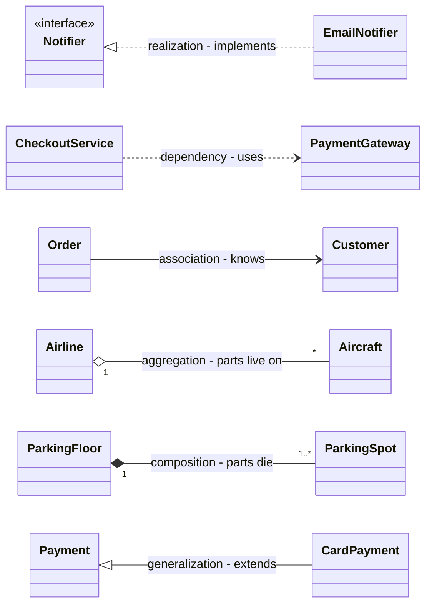

# Chapter 22 — Revision: Cheat Sheets & Glossary

> **What this chapter is.** The whole handbook on a few pages: the answer framework (Ch 1); OOP, relationships and UML (Ch 2–3); SOLID, other principles and clean code (Ch 4–6); all 24 smells (Ch 7); all 23 GoF patterns + extras and a "which pattern?" table (Ch 8–11); the concurrency toolbox (Ch 12–13); a map of every case study (Ch 14–21); machine-coding and edge-case checklists; and a glossary. Nothing here is new and there is no code — each row tells you where the full explanation lives.

**How to read the references.** "Ch 12 · Deadlock" means the *Deadlock* topic in Chapter 12; "Ch 16 · Car Rental" means the Car Rental case study in Chapter 16. When a row or heading already names the topic, only the chapter is given ("Ch 2"). Numbers such as "22.7" refer to sections of this chapter.

---

## 22.1 How to revise

### In 15 minutes (the morning of the interview)

| Minutes | Read | Why |
|---|---|---|
| 0–3 | 22.2 (the framework) | You will use it in the first minute of the interview |
| 3–6 | 22.4 (SOLID one-pager) and the relationship table in 22.3 | The two things asked about most often by name |
| 6–10 | "Which pattern?" table in 22.7 | Patterns should come from a signal, not from memory |
| 10–13 | Concurrency cheat sheet and deadlock checklist in 22.8 | Every booking/inventory problem has a race |
| 13–15 | The row(s) of 22.9 for the problems you expect | One sentence per problem: entities, pattern, the atomic step |

### The night before (about 2 hours)

1. **Read 22.2–22.8 slowly** (45 min), saying *one handbook example* per row; if you can't, open the referenced topic.
2. **Three unpractised case studies** from 22.9 (45 min): requirements, classes, class diagram and the one hard method, without looking; then compare with the chapter's TL;DR.
3. **Scan the glossary** (22.11); read up only the terms you can't explain in one sentence (20 min).
4. **Stop.** Sleep matters more than one more pattern.

### Common mistakes when revising

- Re-reading chapters instead of **recalling** first and then checking. Recall is what the interview tests.
- Memorising all 23 patterns equally. Six come up in almost every round (22.7): Strategy, Factory, Observer, State, Singleton, Builder.
- Skipping the "when *not* to use it" column. Interviewers ask "would you always do that?" (Ch 4 · SOLID in interviews).

---

## 22.2 The LLD interview answer framework (one page)

*Source: Chapter 1 (how the interview runs, the answer framework, requirements, classes, SOLID check, patterns, interview code, communication tips, common mistakes).*

### TL;DR

**Clarify → requirements → use cases → entities → relationships → class diagram → key flows → patterns/SOLID → code → edge cases/concurrency → extensions.** Say each step out loud as you enter it.

### The eleven steps

| # | Step | Ask yourself | Output |
|---|---|---|---|
| 1 | Clarify | Who uses it? Single site or many? | Shared understanding |
| 2 | Requirements | Functional? Non-functional (thread-safe, extensible, in-memory)? **Out of scope?** | 8–12 numbered lines + out-of-scope list |
| 3 | Use cases | What can each actor do? | Actor → use-case list |
| 4 | Entities | Which nouns hold state or behaviour? Which are just values? | Classes, one sentence each |
| 5 | Relationships | Uses / knows / has / owns / is-a? How many? | Typed lines with multiplicity |
| 6 | Class diagram | Fields, key methods, interfaces, enums | UML class diagram |
| 7 | Key flows | Steps of the 2–3 main use cases; lifecycle of the core object | Sequence / activity / state diagram |
| 8 | Patterns & SOLID | A rule that varies? A lifecycle? Many listeners? Two reasons to change? | 1–2 named patterns + one rejected |
| 9 | Code | Interfaces, enums, models, services, driver | Running code for the main flows |
| 10 | Edge cases & concurrency | Bad input? Full? Two users, one seat? | Validation, exceptions, locks |
| 11 | Extensions | "What if X is added?" | Short answers, maybe one class |

### Time budgets

| 45-minute OOD round | | 90-minute machine-coding round | |
|---|---|---|---|
| Clarify requirements | 5–8 min | Read, requirements, assumptions | 5–10 min |
| Actors and use cases | 3–5 min | Model: entities, enums, service interfaces | 10–15 min |
| Find the classes | 8–10 min | Core flow end to end | 30–40 min |
| Connect the classes | 8–10 min | Remaining features, validation, edge cases | 15–20 min |
| Write the code | 12–15 min | Polish, one extension point, demo | 5–10 min |
| | | Buffer | 5 min (never zero) |

Rule of thumb: roughly **a quarter of the hour goes before you name a class**, and in machine coding you **get something running by the halfway mark** (Ch 1 · The interview).

### Finding classes (Ch 1 · Finding the classes)

- **Nouns → candidate classes; verbs → methods.** A verb with no class to live on means a class is missing.
- Cut candidates with five tests: is it a **value**? the **same thing** under another name? does it have **changing state**? does anything **call** it? does it differ in **behaviour or only data**?
- **Different data → field or enum. Different behaviour → class.**
- One sentence per class, **no "and"**. Put each method where its data is (Information Expert).
- Beginners most often forget the **record-keeping class** (ticket, loan, booking) and the **rule class** (rate, strategy).

### What the interviewer judges (Ch 1 · The interview)

1. Did you **bound** the problem? 2. Does each class have **one job** you can say in a sentence? 3. Are the **relationships** right? 4. Does the **code match the diagram**? 5. Can you explain a **trade-off** (the choice and the rejected option)?

Machine coding adds: does it **run**, is it **modular**, **readable**, does it **handle bad input**, and (senior roles) is shared state **thread-safe**.

### Code habits interviewers notice (Ch 1 · Interview code)

| Habit | Instead of |
|---|---|
| Pass time in (`long nowMinute`, `Instant now`, injected `Clock`) | Reading the clock inside logic |
| Money as `BigDecimal` from strings, or whole cents in a `long` | `double` (0.1 + 0.2 ≠ 0.3) |
| `IllegalArgumentException` / `IllegalStateException` / a custom exception | Silent failure or error codes |
| `Optional` when "not found" is normal | Returning `null` |
| `private final` fields | Public mutable fields |
| Domain names (`ParkingTicket`) | `Manager`, `Helper`, `Data2` |

Skeleton: **Models → Repositories → Strategies → Services → Driver** (Ch 1 · Interview code).

### In the interview

**30-second answer** (from Ch 1 · Common mistakes): "I clarify and write 8 to 12 requirements with an out-of-scope list, list actors and use cases, pick classes from the nouns and give each one responsibility, connect them and draw a class diagram, sketch the key flow, run a quick SOLID check and pick one or two patterns where the signal is clear, then code the two or three core flows, handle edge cases and concurrency, and finish with extensions and trade-offs."

### Common mistakes (Ch 1)

| Mistake | Fix |
|---|---|
| Coding in minute two | 8–13 minutes on requirements and actors first |
| No out-of-scope list | Write it down and agree it |
| One subclass per value (`CompactSpot`, `LargeSpot`) | Different data → field/enum |
| God class (`ParkingLotManager`) | One sentence per class; split on "and" |
| Inheritance for reuse ("Car extends Engine") | Composition |
| Pattern stuffing | One or two patterns, each with its signal |
| All twelve classes at equal depth | Two or three flows fully |
| Ignoring two users on one resource | Lock or atomic operation on the shared state |
| Non-running code in machine coding | Thin end-to-end path running by halfway |

---

## 22.3 OOP & relationships cheat sheet

*Source: Chapter 2 (OOP) and Chapter 3 (relationships and UML).*

### The four pillars (Ch 2)

| Pillar | One line | Java tools | Smell when missing |
|---|---|---|---|
| **Encapsulation** (Ch 2) | Data is private; only the owning class's methods change it, and they enforce the rules | `private` fields, no setters, validation in constructors | Public fields; setters that break invariants |
| **Abstraction** (Ch 2) | Expose only what callers need; hide how | Interfaces, abstract classes, small public API | Callers reach into internals |
| **Inheritance** (Ch 2) | Child reuses and specialises parent — **only when "child is a parent" is truly correct** | `extends`, `super`, `@Override` | Subclass refuses or throws on parent methods |
| **Polymorphism** (Ch 2) | One call, different behaviour per object; removes type switches | Overriding + dynamic dispatch | `switch` / `instanceof` chains on type |

**Encapsulation vs abstraction:** hiding *data* behind rule-enforcing methods vs hiding *complexity* behind a minimal set of operations (Ch 2 self-check).

### Other OOP facts worth one line each

| Topic | Remember | Where |
|---|---|---|
| Overloading vs overriding | Compile time, by declared parameter types vs run time, by the actual object. Fields and `static` methods are not polymorphic (statics are hidden, not overridden) | Ch 2 · Compile-time vs runtime polymorphism |
| `this`, `static`, `final` | Current object; one per class; cannot be reassigned/overridden/extended | Ch 2 · Classes & keywords |
| Interfaces | Contracts; can have `default`, `static`, `private` methods; a functional interface has one abstract method (lambdas) | Ch 2 |
| Enums | Fixed sets with fields and behaviour ("which spot types fit a truck" lives on `VehicleType`) | Ch 2 · Enums with fields and behaviour |
| Composition over inheritance | Avoids fragile base classes; allows run-time swapping | Ch 2, Ch 5 · Composition over inheritance |
| `equals`/`hashCode` | Equal objects must have equal hash codes; override both or hash collections break | Ch 2 · Object identity vs equality |
| Immutability & records | Final class, private final fields, no setters, defensive copies. Records are only **shallowly** immutable — copy collections in the compact constructor | Ch 2 · Immutability & records |
| Access modifiers | Default to `private`; package-private = same package only | Ch 2 · Access modifiers and packages |
| Generics | Type-safe reusable infrastructure; **PECS**: producer `extends`, consumer `super` | Ch 2 · Generics basics for LLD |
| Coupling & cohesion | Low coupling (between classes), high cohesion (inside a class) | Ch 2 · Coupling and cohesion |
| OOA → OOD → OOP | What the problem is → how, with objects → code. Connections that carry data become objects | Ch 2 · Object-oriented analysis and design |

### Abstract class vs interface (Ch 2 · Abstract classes vs interfaces)

| | Abstract class | Interface |
|---|---|---|
| Instantiable? | No | No |
| Instance fields (state) | Yes | No (only `public static final` constants) |
| Constructors | Yes | No |
| Method bodies | Any | `default`, `static`, `private` only |
| How many per class | **One** (`extends`) | **Many** (`implements`) |
| Relationship expressed | "is a" (shared identity and state) | "can do" (capability / role) |
| Typical use | Shared state + partial implementation for a close family (Template Method) | Contracts, roles, strategies, test seams |

**Rule of thumb:** start with an interface; add an abstract class underneath when implementations share real state or a fixed algorithm (JDK: `List` + `AbstractList` + `ArrayList`).

### The six relationships (Ch 3)

Weakest to strongest coupling: **dependency, association, aggregation, composition, realization, generalization** (Ch 3 · self-check).

| Relationship | Phrase | UML line | Java shape | Lifetime | Example |
|---|---|---|---|---|---|
| Dependency (Ch 3) | A *uses* B | dashed, open arrow → B | B as parameter / local / return / static call | none | `CheckoutService` uses `PaymentGateway` |
| Association (Ch 3) | A *knows* B | solid line (arrow for one-way) | field of type B, created elsewhere | independent | `Order` → `Customer` |
| Aggregation (Ch 3) | A *has* B, parts live on | solid, hollow ◇ at A (the whole) | field/collection, parts passed in | B outlives A | `Airline` ◇— `Aircraft` |
| Composition (Ch 3) | A *owns* B | solid, filled ◆ at A (the whole) | A creates B, hides it, B not shared | B dies with A | `ParkingFloor` ◆— `ParkingSpot` |
| Realization (Ch 3) | A *implements* B | dashed, hollow △ at B | `implements` | — | `EmailNotifier` ⇢ `Notifier` |
| Generalization (Ch 3) | A *is a* B | solid, hollow △ at B | `extends` | — | `CardPayment` → `Payment` |

**Choosing, in order (Ch 3 · Choosing the relationship):** interface A promises to fulfil → realization. Substitutable with no refused methods → generalization. Not kept in a field → dependency. Part that dies with the whole → composition. Part that outlives it → aggregation. Otherwise → association.

### UML arrow legend (Mermaid)

Mermaid syntax: `A ..> B` dependency · `A --> B` association (navigable A→B; `A -- B` unspecified) · `A o-- B` aggregation and `A *-- B` composition (A is the whole) · `B <|.. A` realization · `B <|-- A` generalization · `A "1" *-- "1..*" B` adds multiplicities.

**Multiplicity → code (Ch 3 · TL;DR):** `1` required field; `0..1` `Optional`/nullable; `1..*` non-empty collection checked in the constructor; exact numbers checked in constructors. Visibility: `+` public, `-` private, `#` protected, `~` package.

### UML diagrams in the interview (Ch 3 · UML diagrams)

| Diagram | Use it for | Budget in 45 min |
|---|---|---|
| Use case (Ch 3 · Use-case diagrams) | Scope: actors + what each does. «include» = always; «extend» = sometimes | Usually spoken, 3–5 min |
| **Class (Ch 3 · Class diagrams)** | **The answer.** 10–15 boxes, every line typed, with multiplicity | Always drawn, 10–15 min |
| Sequence (Ch 3 · Sequence diagrams) | Call order between objects (3–4 objects, 6–8 messages) | One behaviour diagram only |
| Activity (Ch 3 · Activity diagrams) | A flow that branches; fork/join for parallel steps | ″ |
| State machine (Ch 3 · State machine diagrams) | One object's lifecycle; transition label `event [guard] / action` | ″ |

UML has 14 diagram types: 7 structural, 7 behavioural (Ch 3 · What UML is).

### Common mistakes

- Diamond at the wrong end (it goes at the **whole**); triangle at the wrong end (it goes at the **parent/interface**) (Ch 3 · Choosing the relationship).
- Lines without type or multiplicity (Ch 3 · Choosing the relationship).
- Inheritance used to share data; subclasses that only pass a constant to `super` → one class with an enum field (Ch 3 · self-check).

---

## 22.4 SOLID one-pager

*Source: Chapter 4 (the five principles, SOLID and patterns, SOLID in the interview, over-engineering); smells from Chapter 7 (smell lookup table).*

### TL;DR

SOLID = five names for the ways code becomes painful to change. **Use them to diagnose, not as a checklist**, apply a fix when a real change asks for it, and always say what the fix costs.

| Principle | One-line rule | Smell that signals a violation | Fix | Patterns that help |
|---|---|---|---|---|
| **S** — Single Responsibility (Ch 4 · Single Responsibility Principle) | A class should have one reason to change (one actor asks for its changes) | The responsibility sentence needs an "and"; *Divergent Change*, *Large Class* | Split by actor (Extract Class); each new class needs a name that stands alone | Command, Proxy, Decorator (each concern in its own class) |
| **O** — Open/Closed (Ch 4 · Open/Closed Principle) | Add new behaviour by adding code, not by editing working code | A `switch`/`if` chain over a type; *Repeated Switches*, *Shotgun Surgery* | Put the part that *has* varied behind an interface; add variants as classes (Replace Conditional with Polymorphism) | Strategy, Template Method, Decorator, Factory Method, Observer, Command, Visitor |
| **L** — Liskov Substitution (Ch 4 · Liskov Substitution Principle) | A subtype must be usable anywhere its parent is expected | Subclass throws, does nothing, or refuses a parent method; *Refused Bequest* | Better parent, a narrower interface, or composition (Replace Subclass with Delegate) | Composite, Null Object |
| **I** — Interface Segregation (Ch 4 · Interface Segregation Principle) | No client should depend on methods it does not use | Empty method bodies or `UnsupportedOperationException` in implementers; fat interfaces | Split into **role interfaces**, one per kind of caller | Adapter |
| **D** — Dependency Inversion (Ch 4 · Dependency Inversion Principle) | Depend on abstractions, not concrete details; the policy owns the abstraction | A high-level class does `new` of (or names) a low-level one; cannot test without the real DB/provider | Inject an interface owned by the high-level class; `main` wires the details | Strategy, Factory Method / Abstract Factory, Adapter, Observer |

**LSP in detail (Ch 4 · Liskov Substitution Principle, TL;DR):** a subclass must accept at least as much, promise at least as much, keep invariants and history, and throw nothing new. Square/Rectangle is worse than `Penguin.fly()` throwing because it fails **silently** (wrong area, no error).

### Five-minute pass over your diagram (Ch 4 · SOLID in interviews, Ch 1 · SOLID check)

Run S → O → L → I → D over the diagram you just drew. **Two findings is a good pass; five means rework; zero means you did not look.** S and O earn the most credit: O is what interviewers probe with a late requirement ("what if trucks are charged differently?" → "add a class").

### Related ideas (Ch 4 · Cohesion, Coupling, SoC, SOLID Q&A)

| Idea | Question it asks |
|---|---|
| SRP | How many actors can ask this class to change? |
| Cohesion | Do the parts of this class belong together? |
| Coupling | How much does A depend on B? |
| Separation of Concerns | Is each area of work in its own module? |
| SRP vs ISP | SRP splits **classes** (guards the worker); ISP splits **interfaces** (guards the caller) |
| DIP vs DI vs IoC | DIP = principle (depend on abstractions); DI = technique (pass dependencies in); IoC = the broader idea that a framework calls your code; IoC containers perform DI |

### Common mistakes: over-engineering (Ch 4)

| Warning sign | Principle misapplied | Do instead |
|---|---|---|
| `XHelper`, `XUtils`, `XManager2` after a split | SRP | Split by actor; names must stand alone |
| Six small classes that always change in the same commit | SRP over-split | Merge them back |
| Interface + factory + registry for one implementation | OCP (*Speculative Generality*) | Write the `if`; refactor at the second or third case (rule of three) |
| A subclass that "works" by silently doing nothing | LSP | Better parent or composition |
| One interface per method | ISP over-split | Group by caller into role interfaces |
| An interface in front of stable `String`-like classes | DIP | Invert only volatile dependencies |
| A DI container for a 200-line program | DIP | Wire by hand in `main` |

**YAGNI** is the counterweight: SOLID says *what* a good seam looks like; YAGNI says *when* to cut it.

### In the interview

Say **observation → cost → fix → price of the fix**, and describe before you label: "`Reporting` implements nine methods but calls two — an interface segregation problem" (Ch 4 · SOLID in interviews).

---

## 22.5 Other design principles and Clean Code rules

### Other principles (Chapter 5)

| Principle | One-line idea | Smell it fixes | Key Java tool | Where |
|---|---|---|---|---|
| DRY | Each piece of knowledge has one authoritative home | Duplicated rules drifting apart | Value objects, constants, methods | Ch 5 · DRY |
| KISS | Choose the simplest design that works | Over-engineering | Plain code, `switch` expressions | Ch 5 · KISS |
| YAGNI | Don't build features before they are needed | Speculative Generality | Delete unused code | Ch 5 · YAGNI |
| Law of Demeter | Only talk to your immediate friends | Train wrecks `a.getB().getC().do()` | Intent-revealing delegate methods | Ch 5 · Law of Demeter |
| Tell, Don't Ask | Tell objects what to do; don't pull their data out and decide for them | Anemic model, Feature Envy | Command methods on the owner | Ch 5 · Tell, Don't Ask |
| Composition over inheritance | Prefer "has-a" to "is-a" for reuse | Fragile base class | Forwarding / decorators | Ch 5 · Composition over inheritance |
| Program to an interface | Depend on supertypes, choose the concrete class once at the edge | Hard-wired concrete dependencies | Interfaces + DI | Ch 5 · Program to an interface |
| Encapsulate what varies | Isolate the part that changes behind an interface | Growing type switches | Strategy, lambdas | Ch 5 · Encapsulate what varies |
| Loose coupling | Interacting objects know little about each other | God orchestrators | Observer, events, DI | Ch 5 · Loose coupling |
| Hollywood Principle / IoC | "Don't call us, we'll call you" — the framework owns the flow | Duplicated skeletons | Template Method, callbacks, DI | Ch 5 · Hollywood Principle |
| Separation of Concerns | Each part handles one concern | Spaghetti code | Layers, MVC | Ch 5 · Separation of Concerns, Ch 4 |
| Least Astonishment | Do what the name promises and nothing more | Hidden side effects | Honest names, `Optional` | Ch 5 · Least Astonishment |
| Fail fast | Detect problems early and loudly | Distant `NullPointerException`s | Guard clauses, `requireNonNull` | Ch 5 · Fail fast |
| Immutability | Objects never change after creation | Aliasing, races | Records, `List.copyOf` | Ch 5 · Immutability |
| Design by Contract | Preconditions (caller), postconditions (method), invariants (always) | Magic error values | Checks at method entry/exit | Ch 5 · Design by Contract |
| GRASP | Nine guidelines for "which class should do this?" | God classes | Expert, Creator, Controller… | Ch 5 · GRASP |
| Domain-Driven Design | Model the business: bounded contexts, entities vs value objects, small aggregates, domain events, repositories per root | Anemic model, big ball of mud, primitive obsession | Records as value objects, aggregate roots, events + outbox | Ch 5 · DDD |

**GRASP in one line each (Ch 5 · GRASP):**

| Guideline | Rule |
|---|---|
| Information Expert | The class with the data does the work |
| Creator | The container (or the one with the initial data) creates |
| Controller | A thin non-UI object receives each system event and delegates |
| Low Coupling | Choose the design with fewer, more stable dependencies |
| High Cohesion | Each class does one related set of things |
| Polymorphism | Let each type implement the varying behaviour; don't switch on types |
| Pure Fabrication | Invent a helper class (e.g. a repository) when no domain class is a clean home |
| Indirection | Put a middleman between things that shouldn't know each other |
| Protected Variations | Wrap what's unstable behind a stable interface |

**Tensions to mention (Ch 5 summary):** DRY vs loose coupling (sharing code couples its users); YAGNI vs encapsulate-what-varies (abstract only real or clearly predicted variation); Law of Demeter vs cohesion (too many delegates → Middle Man); Information Expert vs SoC (domain objects compute, fabrications persist).

### Clean Code rules checklist (Chapter 6)

| Area | Rule of thumb | Where |
|---|---|---|
| Names | Reveal intent; pronounceable; searchable; one word per concept; code reads like the requirement | Ch 6 · Meaningful names |
| Functions | Small; do one thing; one level of abstraction; top-down (stepdown); ≤ 2–3 arguments; **no flag arguments**; no hidden side effects; commands *or* queries (CQS); exceptions, not error codes | Ch 6 · Functions |
| Comments | Say it in code; comment only the *why*, warnings, legal text, public contracts; delete commented-out code | Ch 6 · Comments |
| Formatting | Newspaper order (headline first); related things close; one automated team style | Ch 6 · Formatting |
| Objects vs data structures | Objects hide data and expose behaviour; data structures expose data; no hybrids; no train wrecks | Ch 6 · Objects and data structures |
| Error handling | Unchecked exceptions with context; wrap vendor exceptions; empty collections / `Optional` / special case instead of `null`; never pass `null`; always clean up | Ch 6 · Error handling |
| Boundaries | Keep third-party code behind your own interfaces; learn it with tests | Ch 6 · Boundaries |
| Unit tests | Three laws of TDD; one concept per test; Given–When–Then; **F.I.R.S.T.** (Fast, Independent, Repeatable, Self-validating, Timely) | Ch 6 · Unit tests |
| Classes | Small by responsibility; cohesive; open for extension; depend on abstractions | Ch 6 · Classes |
| Systems | Build objects in one place (composition root) and inject them; cross-cutting concerns in proxies/aspects | Ch 6 · Systems |
| Simple design | Beck: passes the tests → reveals intention → no duplication → fewest elements (*Clean Code* swaps the middle two) | Ch 6 · Simple design |
| Concurrency | Separate concurrency code; share as little as possible; use the library; keep locks small; plan shutdown | Ch 6 · Concurrency |
| Smells | The C/E/F/G/J/N/T heuristics catalogue as a review vocabulary | Ch 6 · Smells and heuristics |
| Code review | Correctness → design → readability → tests → security → performance → operability; automate style; small PRs | Ch 6 · Code review checklist |
| Error strategy | Classify, translate at boundaries, retry only transient + idempotent with backoff, one global handler that logs once | Ch 6 · Error-handling strategy |
| Testing strategy | Many unit, some integration, few E2E; right test double; verify state over interactions; don't mock what you don't own | Ch 6 · Testing strategies |

**Boy Scout Rule:** leave the code a little cleaner than you found it (Ch 6 intro).

---

## 22.6 Code smells → refactorings (all 24)

*Source: Chapter 7 (code smells, refactoring catalogue, smell lookup table). **Bold** = the usual first move.*

| # | Smell | Signal (one line) | Group | Refactorings that cure it |
|---|---|---|---|---|
| 1 | Mysterious Name | Name doesn't say what it does/holds (`data`, `proc()`, `Manager`) | 2nd-ed extra | **Change Function Declaration**, Rename Variable, Rename Field |
| 2 | Duplicated Code | Same structure in more than one place | Dispensables | **Extract Function**, Slide Statements, Pull Up Method |
| 3 | Long Function | You want a comment to explain a block | Bloaters | **Extract Function**, Replace Temp with Query, Introduce Parameter Object, Preserve Whole Object, Replace Function with Command, Decompose Conditional, Replace Conditional with Polymorphism, Split Loop |
| 4 | Long Parameter List | Many parameters, same types, boolean flags | Bloaters | Replace Parameter with Query, **Preserve Whole Object**, **Introduce Parameter Object**, Remove Flag Argument, Combine Functions into Class |
| 5 | Global Data | Readable and writable from anywhere (incl. mutable singletons) | 2nd-ed extra | **Encapsulate Variable** (then shrink its scope) |
| 6 | Mutable Data | Shared data changed after creation | 2nd-ed extra | **Encapsulate Variable**, Split Variable, Slide Statements, Extract Function, Separate Query from Modifier, Remove Setting Method, Replace Derived Variable with Query, Combine Functions into Class/Transform, Change Reference to Value |
| 7 | Divergent Change | One class changed for many different reasons (SRP) | Change Preventers | **Split Phase**, Move Function, Extract Function, **Extract Class** |
| 8 | Shotgun Surgery | One change forces many small edits in many classes | Change Preventers | **Move Function**, **Move Field**, Combine Functions into Class/Transform, Split Phase, Inline Function, Inline Class |
| 9 | Feature Envy | Method uses another class's data more than its own | Couplers | **Move Function**, Extract Function |
| 10 | Data Clumps | Same group of values always travel together (`startDate, endDate`) | Bloaters | **Extract Class**, **Introduce Parameter Object**, Preserve Whole Object |
| 11 | Primitive Obsession | Money as `double`, status as `String` | Bloaters | **Replace Primitive with Object**, Replace Type Code with Subclasses, Replace Conditional with Polymorphism, Extract Class, Introduce Parameter Object |
| 12 | Repeated Switches | The *same* switch on a type code in several places | OO Abusers | **Replace Conditional with Polymorphism** |
| 13 | Loops | Classic loop that filters/maps/aggregates | 2nd-ed extra | **Replace Loop with Pipeline** |
| 14 | Lazy Element | A class/function that doesn't pull its weight | Dispensables | **Inline Function**, **Inline Class**, Collapse Hierarchy |
| 15 | Speculative Generality | Hooks "we might need someday"; abstract class with one subclass | Dispensables | Collapse Hierarchy, Inline Function, Inline Class, Change Function Declaration, Remove Dead Code |
| 16 | Temporary Field | Field set only in some situations, `null` otherwise | OO Abusers | **Extract Class**, Move Function, Introduce Special Case |
| 17 | Message Chains | `order.getCustomer().getAddress().getCity()` | Couplers | **Hide Delegate**, Extract Function, Move Function |
| 18 | Middle Man | Most methods just forward to another class | Couplers | **Remove Middle Man**, Inline Function, Replace Superclass/Subclass with Delegate |
| 19 | Insider Trading | Two modules poke at each other's internals | Couplers | **Move Function**, **Move Field**, Hide Delegate, Replace Subclass/Superclass with Delegate |
| 20 | Large Class | Too many fields/methods — a God Class | Bloaters | **Extract Class**, Extract Superclass, Replace Type Code with Subclasses |
| 21 | Alternative Classes with Different Interfaces | Same job, different method names (`sendMail` vs `dispatch`) | OO Abusers | **Change Function Declaration**, Move Function, Extract Superclass |
| 22 | Data Class | Only fields and getters/setters; others manipulate it | Dispensables | **Encapsulate Record**, Remove Setting Method, Move Function, Extract Function, Split Phase |
| 23 | Refused Bequest | Subclass doesn't want inherited methods, or throws on them (LSP) | OO Abusers | Push Down Method/Field, **Replace Subclass with Delegate**, **Replace Superclass with Delegate** |
| 24 | Comments | Comment used as deodorant for unclear code | Dispensables | **Extract Function**, Change Function Declaration, Introduce Assertion |

### Smell family → principle violated (Ch 7 · Smell lookup table)

| Smell family | Principle |
|---|---|
| Divergent Change, Large Class | SRP |
| Repeated Switches, Shotgun Surgery | OCP |
| Refused Bequest | LSP |
| Long Parameter List with flags, fat interfaces | ISP / clean function design |
| Global Data, Mutable Data | Encapsulation |
| Hard-wired `new` of concrete dependencies | DIP |
| Duplicated Code | DRY |
| Speculative Generality | YAGNI |
| Message Chains, Insider Trading | Law of Demeter |
| Feature Envy, Data Class | Tell, Don't Ask |

### Refactoring toward patterns (Ch 7)

Smell → pattern, in short (the full symptom table is in 22.7): algorithm-choosing switch → **Strategy**; methods checking and changing a status field → **State**; `if (x == null)` everywhere → **Null Object / Special Case**; sibling subclasses with the same skeleton → **Template Method**; many confusing constructors → **Factory Method** / creation methods; object built by many ordered calls → **Builder**; undo/queueing, or a huge function with shared locals → **Command**; logging/caching mixed into a core class → **Decorator**; polling or hard-coded notification → **Observer**; two classes, same job, different interfaces → **Adapter**; subclass explosion from feature combinations → **Strategy / Decorator / Bridge**; a pattern that no longer earns its keep → **remove it** (Inline Class, Collapse Hierarchy).

**Refactoring** = changing structure without changing behaviour, in small steps, with tests as the safety net. Wear one of **two hats** at a time: adding function or refactoring (Ch 7 · Refactoring fundamentals).

---

## 22.7 Design patterns: all 23 GoF + extras

*Source: Chapters 8–11 (catalogue in Ch 8 · The 23 GoF patterns; comparison tables at the end of Chapters 8, 9, 10 and 11).*

**Count:** 5 creational + 7 structural + 11 behavioral = **23**. **Class-scoped** (inheritance) patterns: Factory Method, class Adapter, Template Method, Interpreter; almost everything else is object-scoped (composition) (Ch 8 · The 23 GoF patterns).

### Creational (Chapter 8)

| Pattern | Intent (one line) | Use when | Java / JDK example | Commonly confused with | Where |
|---|---|---|---|---|---|
| **Singleton** | Exactly one instance with a global access point | There really must be exactly one (config, pool, registry) | `Runtime.getRuntime()`; Spring singleton-scoped beans | A global variable; a DI singleton scope (preferred for testing) | Ch 8 |
| **Factory Method** | Subclasses decide which concrete class to create via an overridable method | Shared procedure, varying product; others will add types | `Collection.iterator()` | Simple Factory (one method with a switch) | Ch 8 |
| **Abstract Factory** | Create *families* of related objects without naming concrete classes | Products must match; swap a whole set at once | `DocumentBuilderFactory`; JDBC `Connection` | Factory Method (one product by inheritance vs a family by composition) | Ch 8 |
| **Builder** | Build a complex object step by step; one validating `build()` | Many optional fields, cross-field validation, immutable result | `StringBuilder`, `HttpClient.newBuilder()` | A plain constructor (fine for a handful of required fields); telescoping constructors | Ch 8 |
| **Prototype** | Create new objects by copying a configured instance | Setup is expensive, or only the interface is known | Copy constructors, `ArrayList.clone()` | Memento (a snapshot to restore, not a copy to use) | Ch 8 |

Singleton notes (Ch 8 · TL;DR): eager, holder-class or **`enum`** (most robust: blocks reflection and serialization duplicates); double-checked locking needs a **`volatile`** field. It is global state that hurts testing — prefer injecting one shared instance. Many case studies reject it (Ch 14 self-check).

### Structural (Chapter 9)

| Pattern | Intent (one line) | Use when | Java / JDK example | Commonly confused with | Where |
|---|---|---|---|---|---|
| **Adapter** | Convert one interface into another that clients expect | "The vendor API doesn't match ours" (after the fact) | `Arrays.asList`, `InputStreamReader` | Bridge (same shape, but Bridge is designed up front); Facade | Ch 9 · Adapter Pattern |
| **Bridge** | Split abstraction from implementation so both vary independently | Class names with two nouns; two dimensions multiplying classes | JDBC `Connection` + drivers | Adapter; Strategy (same shape) | Ch 9 · Bridge Pattern |
| **Composite** | Treat single objects and trees uniformly | Part-whole trees (files, menus, UI) | `java.awt.Container` is a `Component` holding `Component`s | Decorator (also wraps a component, but adds behaviour to one) | Ch 9 · Composite Pattern |
| **Decorator** | Add responsibilities dynamically by wrapping; same interface, stackable | "Sometimes logging, sometimes caching, sometimes both" | `BufferedInputStream`, `Collections.synchronizedList` | Proxy (same shape; Proxy *controls access*); Chain of Responsibility (in CoR someone can stop the flow) | Ch 9 · Decorator Pattern |
| **Facade** | One simple entry point to a complex subsystem | Every caller repeats the same multi-step sequence | SLF4J `LoggerFactory`, service layers | Adapter (converts one object's interface); Mediator | Ch 9 · Facade Pattern |
| **Flyweight** | Share intrinsic (immutable) state across huge numbers of objects | Millions of near-identical objects | `Integer.valueOf`, `String.intern()` | Object Pool (reuses objects one borrower at a time; flyweights are shared at once) | Ch 9 · Flyweight Pattern |
| **Proxy** | A stand-in that controls access (lazy, remote, protective, caching) | It's expensive, remote or restricted | `java.lang.reflect.Proxy`, Spring `@Transactional`, Hibernate lazy load | Decorator | Ch 9 · Proxy Pattern |

Memory hooks (Ch 9 · Structural comparison): Adapter *make it fit* · Decorator *add to it* · Proxy *guard it* · Facade *simplify it* · Bridge *split it* · Composite *nest it* · Flyweight *share it*.

### Behavioral (Chapters 10–11)

| Pattern | Intent (one line) | Use when | Java / JDK example | Commonly confused with | Where |
|---|---|---|---|---|---|
| **Chain of Responsibility** | Pass a request along handlers until one handles (or stops) it | Several checks, any may reject; handler not known in advance | Servlet `Filter` chain; `java.util.logging` handlers | Decorator (every layer always runs) | Ch 10 |
| **Command** | Turn a request into an object: queue, log, retry, undo | Undo/redo, job queues, scheduling | `Runnable`/`Callable`; Swing `UndoManager` | Strategy (Strategy = *how*; Command = *what*) | Ch 10 |
| **Iterator** | Traverse a collection without exposing how it is stored | Walk a collection/tree/paged API | `Iterator`, `Spliterator`, JDBC `ResultSet` | Visitor (what to do at each node) | Ch 10 |
| **Mediator** | Centralise communication between peers in one coordinator | Many objects interact in tangled ways; order of reactions matters | Chat servers, UI controllers; `Executor`/`Timer` are a loose fit (Ch 10) | Observer (broadcast, no coordination); Facade | Ch 10 |
| **Memento** | Capture and restore state without breaking encapsulation | Undo, checkpoints, rollback | A `record` snapshot; DB `ROLLBACK`, Git commits (real-world) | Command undo (store actions, not states); Prototype | Ch 10 |
| **Interpreter** | One class per grammar rule; evaluate sentences of a small language | User-written rules/expressions | `java.util.regex.Pattern`, SpEL | Composite (same tree); Visitor (many operations over the AST) | Ch 10 |
| **Observer** | Notify many dependents automatically when one object changes | An open-ended set of independent listeners | `PropertyChangeListener`, `java.util.concurrent.Flow`, Spring `@EventListener` | Mediator; pub-sub (Observer through a broker, Ch 20 · Pub-sub) | Ch 11 |
| **State** | Behaviour changes with internal state, as if the class changed | Many states/transitions; methods repeat a `switch` on status | TCP connection (GoF's example), order lifecycles. `Thread.State` is only an enum of states, not the pattern | Strategy (same diagram; states know each other and advance themselves) | Ch 11 |
| **Strategy** | Make a family of algorithms interchangeable behind one interface | Several ways to do one job, chosen at run time | `Comparator`; `RejectedExecutionHandler` policies | State; Template Method; Decorator (Strategy *replaces* a rule, Decorator *wraps* one) | Ch 11 |
| **Template Method** | Fixed algorithm skeleton in a base class; subclasses fill in steps | Long fixed flow, a few varying steps | `AbstractList`, `InputStream.read(byte[],…)`, `HttpServlet.service()` | Strategy (Template = inheritance, one step varies; Strategy = composition, whole algorithm varies) | Ch 11 |
| **Visitor** | Add operations to a stable set of classes without changing them (double dispatch) | Many new operations over a fixed type set (ASTs) | `javax.lang.model.element.ElementVisitor`; `FileVisitor` is named after it but is really a tree-walk callback | Iterator; in Java 21, **sealed types + pattern-matching `switch`** usually replace it | Ch 11 |

### Beyond GoF: extras you will meet

| Pattern | Intent (one line) | Use when | Java / real example | Commonly confused with | Where |
|---|---|---|---|---|---|
| **Simple Factory** (idiom) | One `create(type)` method maps a type value to a class | Small, stable set of types chosen by config | `Calendar.getInstance()`, `EnumSet.noneOf` | Factory Method | Ch 8 |
| **Object Pool** | Borrow and return a bounded set of expensive objects | DB connections, limited resources | HikariCP, `ThreadPoolExecutor` | Flyweight | Ch 8 |
| **Null Object** | A do-nothing implementation instead of `null` | `null` checks everywhere for an optional collaborator | `Collections.emptyList()`, `OutputStream.nullOutputStream()` | `Optional` (for lookups) | Ch 11 · Beyond GoF |
| **Dependency Injection** | Receive collaborators (as interfaces) through the constructor | Classes create their own collaborators; hard to test | Spring constructor injection; a hand-wired `main` | Service Locator (anti-pattern: the class asks for its dependencies) | Ch 11 · Beyond GoF |
| **Repository** | Collection-like interface over storage | Business logic mixed with storage code | Spring Data `CrudRepository` | DAO (table-oriented) | Ch 11 · Beyond GoF |
| **Specification** | A named, combinable business rule (`isSatisfiedBy`, and/or/not) | Same rule in queries and validation; finder-method explosion | `Predicate`; Spring Data JPA `Specification` | — | Ch 11 · Beyond GoF |
| **MVC** | Separate model, view and controller (Observer + Strategy + Composite) | UI, input handling and rules tangled | Spring MVC; Swing `JTable` + `TableModel` | MVP, MVVM (relatives) | Ch 11 · Beyond GoF |
| **Event Sourcing** (lite) | Store the events; derive current state by replaying them | Full history, audit, time travel | Append-only logs | Plain audit log | Ch 11 · Beyond GoF |
| **Architectural styles** (layered, client-server, modular monolith vs microservices, event-driven, pipe-and-filter, hexagonal/clean) | Fix the shape of the *whole system*: parts, dependency direction, communication | Deciding where classes live and answering "would you split this?" | Spring layered apps; Kafka consumers; Unix pipes; ports and adapters | Design patterns (a few classes inside one part); MVC (only the UI edge) | Ch 11 · Architectural patterns |

### "Which pattern?" by problem symptom

*Combined from Ch 8 · How to pick a pattern, Creational patterns compared, Ch 9 · Structural comparison, Ch 11 · Choosing a behavioral pattern and Ch 7 · Refactoring toward patterns.*

| If you see / need… | Use | Not to be confused with |
|---|---|---|
| One operation, several interchangeable rules chosen at run time (pricing, matching, routing) | **Strategy** | State, Template Method |
| The class to create depends on a type value; caller shouldn't know the concrete class | **Factory** (Simple Factory / Factory Method) | Abstract Factory |
| Products must always match as a family | **Abstract Factory** | Factory Method |
| Constructor has ~6+ arguments, many optional | **Builder** | — |
| Another one of *this*, cheaply or without knowing its class | **Prototype** | Memento |
| Exactly one instance must exist | **Singleton** (or DI singleton scope) | A convenient global handle |
| Expensive objects created and destroyed repeatedly | **Object Pool** | Flyweight |
| Existing class has the wrong interface | **Adapter** | Facade, Bridge |
| Two dimensions multiplying classes (`WindowsButton`, `MacButton`, …) | **Bridge** | Adapter |
| Tree of part-whole objects treated the same | **Composite** | Decorator |
| Add behaviour in combinations without editing the class | **Decorator** | Proxy |
| Every caller repeats the same five steps into a subsystem | **Facade** | Mediator |
| Millions of near-identical objects | **Flyweight** | Object Pool |
| Lazy load, access control, remote, caching (same interface) | **Proxy** | Decorator |
| A request must pass several checks; any may reject it | **Chain of Responsibility** | Decorator (all layers run) |
| Undo/redo, queue, schedule, retry or log *requested actions* | **Command** | Strategy |
| Evaluate user-written rules in a small language | **Interpreter** (+ Specification) | Visitor |
| Walk a collection/tree/paged API without exposing structure | **Iterator** | Visitor |
| Many objects depend on each other and the **order** of reactions matters | **Mediator** | Observer |
| Roll back to an earlier state without exposing internals | **Memento** | Command undo |
| One change must reach an open-ended set of listeners | **Observer** (or a broker) | Mediator |
| Three or more methods repeat one `switch` over a status; legal actions depend on it | **State** (or enum + guarded method for 3–4 states) | Strategy |
| Several classes share a long fixed flow, differ in a few steps | **Template Method** | Strategy |
| Many new operations over a stable set of types | **Visitor**, or sealed types + pattern matching | Iterator |
| `null` checks everywhere | **Null Object** / `Optional` | — |
| Classes create their own collaborators | **Dependency Injection** | Service Locator |
| Business logic mixed with storage | **Repository** | DAO |
| Same rule duplicated in queries and validation | **Specification** | — |

**Three questions for the famous look-alikes (Ch 11 · Choosing a behavioral pattern):**
1. Do the alternatives reference each other? Yes → **State**. No → **Strategy** (or Bridge if chosen once at wiring).
2. Can one participant stop the flow? Yes → **Chain of Responsibility**. Everyone always runs → **Decorator**. Everyone is told, nobody stops anyone → **Observer**.
3. Does a central object decide what happens next? Yes → **Mediator**. Each listener decides for itself → **Observer**.

### The six that come up in almost every round (Ch 1 · Patterns in this round, Ch 8 · How to pick a pattern)

| Pattern | Signal | Do **not** use when |
|---|---|---|
| Strategy | One operation, several swappable rules | Only one rule exists and nothing hints at a second |
| Factory | Creation depends on a type value | Only one concrete class exists |
| Observer | Several listeners the source should not know | A single listener the source already references |
| State | Behaviour depends on status; many transitions | 3–4 states handled by one guarded method |
| Singleton | Genuinely exactly one | You just want a global handle |
| Builder | Many optional fields; long constructor | A handful of required fields |

### Common mistakes (Ch 8 · Anti-patterns)

| Anti-pattern | Fix |
|---|---|
| God Object (one class does everything) | Split by responsibility; push behaviour to the data owners |
| Golden Hammer (favourite pattern everywhere) | Start from the problem's signal |
| Pattern overuse ("patternitis") — factories for one class, single-implementation interfaces | YAGNI: add the pattern when the second variant arrives |
| Singletonitis (singletons as globals) | Dependency injection |
| Cargo-cult patterns (structure without intent) | Name the property the pattern gives you, or drop it |

### In the interview

Use **one or two** patterns in a 45-minute design, placed where their signal appears, and **name one you rejected** and why (Ch 8 · How to pick a pattern, self-check).

---

## 22.8 Concurrency cheat sheet

*Source: Chapter 12 (concepts) and Chapter 13 (classic problems).*

### TL;DR (Ch 12)

Races come from **shared mutable state**. Make the critical section atomic, or remove sharing/mutability. Visibility needs **happens-before** edges. Prevent deadlock with **lock ordering** or **tryLock + back-off**. In LLD: name the contended resource, keep **check + claim atomic**, lock fine-grained and in order, and say what changes with many servers.

### Primitive | use for | gotcha

| Primitive | Use for | Gotcha | Where |
|---|---|---|---|
| `synchronized` | Making a multi-step update atomic (mutex + visibility) | Don't lock on a changing reference, a boxed value or a string literal; no slow I/O while holding it; readers must use the same lock | Ch 12 · Mutex and synchronized |
| `ReentrantLock` | Same as `synchronized` plus try/timed/fair locking and `Condition`s | Call `lock()` **just before** `try`, `unlock()` in `finally`; fairness is noticeably slower | Ch 12 · ReentrantLock and reentrancy |
| `tryLock(timeout)` | Give up if the lock is busy; deadlock prevention with back-off | Never `unlock()` when `tryLock` returned `false`; don't retry in a tight loop (livelock) | Ch 12 · Try-lock & timed locking |
| `ReentrantReadWriteLock` | Many readers, few writers | Cannot upgrade read → write (self-deadlock); don't modify under the read lock; writer starvation in non-fair mode | Ch 12 · Read-write locks |
| `StampedLock` | Read-mostly data with optimistic reads | **Not reentrant**; `validate` the stamp before using values read optimistically | Ch 12 · Read-write locks |
| `volatile` | Visibility of a flag or a published immutable snapshot | Gives visibility, **not** atomicity: `count++` is still a race | Ch 12 · Java Memory Model |
| `AtomicInteger` / `AtomicLong` / CAS | Lock-free counters and single-variable claims | Separate `get()` then `set()` is still a race — use `compareAndSet`/`updateAndGet`; no side effects in the lambda (may run several times); ABA → `AtomicStampedReference` | Ch 12 · CAS & atomics |
| `LongAdder` | Very hot counters (metrics) | Use instead of `AtomicLong` when contention is high | Ch 12 · CAS & atomics |
| `Semaphore(N)` | Limit concurrent access to N; signalling between threads | Release in `finally`; don't release when `acquire` never succeeded | Ch 12 · Semaphores |
| `wait/notifyAll`, `Condition` | Waiting for a condition on shared state | Always `while`, never `if` (spurious wakeups); hold the monitor; `notify()` can wake the wrong thread; state change without notify = lost wakeup | Ch 12 · Condition variables |
| `CountDownLatch` | Wait for N events once | One-shot; `countDown()` in `finally`, `await(timeout)` | Ch 12 · CountDownLatch and CyclicBarrier |
| `CyclicBarrier` / `Phaser` | N threads meet at each phase (reusable) | Fewer threads than parties → everyone waits forever | Ch 12 · CountDownLatch and CyclicBarrier |
| `ConcurrentHashMap` | Shared map | `containsKey` then `put` is a race — use `putIfAbsent`/`computeIfAbsent`/`merge`; no slow work or recursive updates inside `compute`; no `null` keys/values | Ch 12 · Concurrent collections |
| `CopyOnWriteArrayList` | Read-mostly lists (listener lists) | Every write copies the array | Ch 12 · Concurrent collections |
| `BlockingQueue` (bounded) | Handing work between threads (producer–consumer) | Unbounded queue → no back-pressure → memory blow-up; one poison pill per consumer | Ch 12 · Producer-consumer |
| `ExecutorService` / `ThreadPoolExecutor` | Running tasks on a bounded pool | Call `shutdown()`; `newFixedThreadPool` has an **unbounded** queue; exceptions in `submit`ted tasks are lost unless you call `get()`; tasks waiting on tasks in the same pool → thread-starvation deadlock | Ch 12 · Creating threads, Thread pool pattern |
| Virtual threads | Many blocking I/O tasks | Pinning (Java 21–23: blocking inside `synchronized`); heavy `ThreadLocal`s waste memory | Ch 12 · Creating threads, Immutability & confinement |
| `ForkJoinPool` / parallel streams | Splitting CPU work | Use a threshold: tiny tasks cost more to schedule than to run; subtasks must touch disjoint data | Ch 12 · Choosing the tool, Ch 13 · Parallel merge sort |
| `CompletableFuture` | Combining async results (`thenApply`, `thenCombine`, `allOf`) | Handle errors with `exceptionally` rather than calling `get()` at every step | Ch 12 · Creating threads |
| `ThreadLocal` | Per-thread state (thread confinement) | Clear it (`remove()`) in pooled threads, or values leak into the next task | Ch 12 · Immutability & confinement |
| Immutability / confinement | Avoiding synchronization entirely | `final List` is not immutable if the list is mutable and exposed | Ch 12 · Immutability & confinement |

### Which `java.util.concurrent` class for which job (Ch 12 · Choosing the tool)

Counter → `AtomicInteger`/`AtomicLong` (`LongAdder` if very hot) · stop a loop from another thread → `volatile boolean` or `interrupt()` · atomic multi-step update → `synchronized`/`ReentrantLock` · give up if busy → `tryLock(timeout)` · many readers, few writers → `ReentrantReadWriteLock`, `StampedLock` or an immutable snapshot in a `volatile` field · limit access to N → `Semaphore(N)` · wait for a condition → `Lock` + `Condition` (or `wait/notifyAll`) in a `while` loop · wait for N events once → `CountDownLatch` · N threads meet each phase → `CyclicBarrier`/`Phaser` · hand work between threads → bounded `BlockingQueue` · shared map → `ConcurrentHashMap` with `putIfAbsent`/`compute`/`merge` · read-mostly list → `CopyOnWriteArrayList` · run tasks → bounded `ExecutorService`, virtual threads for blocking I/O · split CPU work → `ForkJoinPool`/parallel streams · combine async results → `CompletableFuture` · avoid synchronization → immutability, thread confinement.

### Deadlock checklist (Ch 12 · Deadlock, Livelock, Starvation)

A deadlock needs **all four Coffman conditions**; break any one and it cannot happen.

| # | Condition | How to break it |
|---|---|---|
| 1 | Mutual exclusion | Lock-free/immutable data, shareable resources (read locks) |
| 2 | Hold and wait | Acquire everything at once, or `tryLock` and release everything on failure |
| 3 | No preemption | Timeouts (`tryLock(timeout)`), leases that expire |
| 4 | Circular wait | **Global lock ordering** (always lock the lower id first) |

- [ ] Do I ever hold two locks? If yes, is there **one global order** (account id, seat id), with a tie-breaker for equal keys?
- [ ] Do I call a **listener, callback or another object's synchronized method while holding my lock**? Move it outside the lock.
- [ ] Do tasks in a bounded pool **wait for other tasks in the same pool**? (thread-starvation deadlock)
- [ ] Are retries randomised (**jitter**) so two threads don't back off in lockstep? (livelock, Ch 12)
- [ ] Could one thread wait forever while others progress? Consider fairness (Ch 12 · Starvation).
- [ ] Detection: a thread dump (`jstack`/`jcmd`) prints "Found one Java-level deadlock"; `ThreadMXBean.findDeadlockedThreads()`.

**Deadlock vs livelock vs starvation:** nobody progresses and all wait / everybody runs but nobody progresses / some progress while one never does (Ch 12 · self-check).

### The LLD concurrency recipe (Ch 12 · Concurrency in LLD interviews)

1. **Name the shared mutable state** (free spots, seat → owner, stock).
2. **State the invariant** ("a seat has at most one booking", "stock ≥ 0").
3. **Find the critical operation** — usually a check-then-act (*find free → assign*).
4. **Pick the smallest tool that makes it atomic:** one item → `queue.poll()`, `putIfAbsent`, `compareAndSet`; several items all-or-nothing → per-item locks **in sorted order**; across servers → DB constraints/transactions, optimistic versioning, or a distributed lock.
5. **Choose granularity:** per floor / show / SKU, not one global lock.
6. **Handle time:** holds with expiry, timeouts, idempotent retries.

### Classic problems (Ch 13 · summary)

| Problem | Key primitive | Invariant to state |
|---|---|---|
| FooBar (Ch 13 · Print FooBar Alternately) | 2 semaphores | Exactly one permit exists across both |
| Zero Even Odd (Ch 13 · Print Zero Even Odd) | 3 semaphores | Zero dispatches; one permit circulates |
| FizzBuzz (Ch 13 · Fizz Buzz Multithreaded) | monitor + `notifyAll` | Predicates partition 1..n |
| H2O (Ch 13 · Building H2O) | 2 semaphores + barrier | ≤ 2 H and ≤ 1 O per round |
| Dining Philosophers (Ch 13) | ordered locks / n−1 semaphore | No circular wait |
| TTL cache (Ch 13 · Thread-safe cache with TTL) | `ConcurrentHashMap` + `compute` + conditional remove | Never return or keep expired data |
| Striped map (Ch 13 · Striped concurrent map) | lock array | Each bucket belongs to exactly one stripe |
| Blocking queue (Ch 13 · Thread-safe bounded Blocking Queue) | lock + 2 conditions | 0 ≤ count ≤ capacity; wait in loops |
| Bloom filter (Ch 13 · Concurrent Bloom Filter) | atomic OR | Bits only go 0 → 1; no false negatives |
| Merge sort (Ch 13 · Parallel merge sort) | Fork/Join | Subtasks touch disjoint ranges |
| Token-bucket rate limiter (Ch 13) | lock or CAS on immutable state | Refill + take is one atomic step |

### Common mistakes (Chapter 12)

- A global `synchronized` on `ParkingLot.park()` — correct, but serialises every gate.
- Checking availability with one call and booking with another (check-then-act).
- Locking seats in the order the user clicked them (deadlock between two multi-seat bookings).
- Forgetting that in-memory locks don't work across multiple app servers.
- Swallowing `InterruptedException` — rethrow, or restore the flag with `Thread.currentThread().interrupt()` (Ch 12 · Thread states).
- Calling `run()` instead of `start()` (Ch 12 · Thread states).

---

## 22.9 Case-study map

*Source: Chapters 14–21. "Concurrency concern" is the race each chapter guards against, and "atomic step" is how.*

### Everyday objects (Chapter 14)

| Problem | Key entities | Patterns used | Concurrency concern | Where |
|---|---|---|---|---|
| Parking lot | `ParkingLot`, `ParkingFloor`, `ParkingSpot`, `Vehicle`, `Ticket`, `DisplayBoard`, `SpotType`/`VehicleType` enums | Strategy (pricing, spot-finding), Factory (electric spots), Observer (boards); Singleton rejected | Two gates take one spot → atomic `pollFirst` + CAS; per-ticket lock for payment; `putIfAbsent` for plates | Ch 14 |
| Vending machine | `VendingMachine`, `Slot`, `Inventory`, `CashBox`, `Denomination`, `VendingState` + 5 states | **State** (the whole design) | `synchronized` machine; change-making by bounded coin-change DP, not greedy | Ch 14 |
| Coffee machine | `CoffeeMachine`, `Recipe`, `RecipeBook`, `IngredientStore`, `OrderResult` (sealed) | Observer (low stock), recipes as data | Two orders take the last milk → one `ReentrantLock` around check + deduct; notify outside the lock | Ch 14 · Coffee Vending Machine |
| ATM | `Atm`, `AtmState` + 4 states, `Transaction` (sealed), `NoteHandler`, `CashDispenser`, `BankService`, `Account` | State (session), Command (transactions), Chain of Responsibility (note cassettes) | Overdraw from two ATMs → per-account lock; transfers lock in id order | Ch 14 |
| Elevator | `Elevator`, `StopList` (two sorted sets), `Door`, `Dispatcher`, `DispatchStrategy`, `Building` | Strategy (dispatch) + modes; LOOK scheduling | Per-car lock, synchronized dispatcher; tick-driven `step()` | Ch 14 · Elevator System |
| Traffic signal | `Intersection`, `TrafficLight`, `Phase`, `SignalState` + 5 states, `TimingPolicy`, `SafetyMonitor` | State (timed), Strategy (timing), Observer (lights) | Synchronized tick; safe with a timer thread plus emergency threads | Ch 14 · Traffic Signal Control System |
| Shipping locker (Amazon Locker) | `LockerStation`, `Compartment`, `Booking`, `CompartmentSelector`, `PickupResult` (sealed), `LockerListener`, `LockerNetwork` | Strategy (door choice), Observer (SMS), enum state machines, sealed results | Two carriers, one door → station lock around choose-and-mark; lazy expiry of holds and pickup windows; hashed single-use pickup and return drop-off codes, keypad lockout | Ch 14 · Shipping Locker System |

### Booking & inventory (Chapters 15–16)

| Problem | Key entities | Patterns used | Concurrency concern | Where |
|---|---|---|---|---|
| Library | `Book` (title) vs `BookItem` (copy), `Member`, `BookLending`, `LendingService`, `Catalog` | Strategy (fines), notifier interface; FIFO reservation queue per title | Last copy lent twice → lock member then copy (fixed order) | Ch 15 · Library |
| Movie tickets (BookMyShow) | `Show`, `ShowSeat`, `Booking`, `SeatLockProvider`, `BookingService`, `CancellationPolicy` | Strategy (refund rule), gateway behind an interface | Book `ShowSeat`s; all-or-nothing hold with TTL → pay → atomic commit; refund if hold lost | Ch 15 · BookMyShow |
| Concert tickets | `SeatedInventory`, `GaPool`, `SeatState` (sealed), `Hold`, `VirtualWaitingRoom`, `PurchaseLimiter` | Sealed seat states, waitlist | Extreme contention → CAS per seat, CAS counter for GA, FIFO waiting room, per-user limits, TTL holds with a reaper | Ch 15 · Concert tickets |
| Hotel | `Hotel`, `Room`, `RoomBooking`, `Invoice`, `RoomCharge`, `Payment` subclasses, `FrontDesk` | Template Method (`RoomCharge`) | Room × night reserved atomically in `synchronized Room.tryReserve` | Ch 15 · Hotel |
| Car rental | `Vehicle`, `DateRange`, `Reservation`, `Bill`/`BillItem`, `ReservationAddOn`, `PricingStrategy` | Template Method (add-ons), Strategy + Decorator (pricing), state machine | Availability is about **dates** → `Vehicle.tryBook(range)` synchronized | Ch 16 · Car Rental |
| Restaurant | `Menu`/`MenuSection`/`MenuItem`, `Table`, `Reservation`, `Order`, `Meal`/`MealItem`, `Kitchen`, `Check` | Observer (order ready), Strategy (chef assignment, payment), state machine | Two receptionists, one table → `Table.tryHold(time)` synchronized; listeners after the lock | Ch 16 · Restaurant |
| Airline | `Flight` vs `FlightInstance`, `Seat` vs `FlightSeat`, `FlightReservation`, `Itinerary`, `FareStrategy` | Strategy + Decorator (fares), Facade | Selling one seat twice → `FlightInstance.holdSeats` all-or-nothing under the instance lock | Ch 16 · Airline |
| Course registration | `Course` vs `Section`, `Student`, `RegistrationRule`s, `Registrar` | Chain of rules / Specification | Overselling a section → section lock inside a student lock (fixed order) | Ch 16 · Course Registration |
| Meeting scheduler | `Interval` (half-open), `Room` (owns a `TreeMap` calendar), `Meeting`, `Invitation`, `RoomSelectionStrategy`, `MeetingObserver`, `Recurrence` | Strategy (room ranking), Observer (invites, RSVPs) | Two organizers, overlapping times → check (`lowerEntry`) and insert under the room lock; rank then try each room; lock order meeting → room | Ch 16 · Meeting Scheduler |

### Games (Chapter 17)

| Problem | Key entities | Patterns used | Concurrency concern | Where |
|---|---|---|---|---|
| Blackjack + deck | `Card`, `Deck<T>`, `Shoe`, `Hand`, `BlackjackScoring`, `PlayerStrategy`, `DealerPolicy` | Strategy (player, dealer); injected randomness | One table = one thread; shared balances need an atomic wallet service | Ch 17 · Blackjack |
| Chess | `Piece` (sealed) + subclasses, `SlidingPiece`, `Board`, `Move`, `Rules`, `Game` | Polymorphic pieces, Factory Method, Command + Memento (undo) | `synchronized` game so a move and a resignation don't interleave | Ch 17 · Chess |
| Tic-tac-toe | `Board` (row/col/diagonal counters), `Game`, `Player`, `MoveStrategy` | Strategy (players) | Many games in a `ConcurrentHashMap`; per-game lock | Ch 17 · Tic-Tac-Toe |
| Snake & ladder | `Board`, `Jump`, `Dice`, `Rules`, `OverflowRule`, `WinStrategy`, `Game` | Strategy (dice, overflow, win) | Each game its own `Random` and its own thread of turns | Ch 17 · Snake and Ladder |
| 2048 | `LineMerger`, `Board`, `TileSpawner`, `Game`, `Direction` | Strategy (spawner); one pure merge function | Single-threaded; `synchronized move` if UI and input threads both call it | Ch 17 · 2048 |
| Jigsaw puzzle | `Side` (FLAT/TAB/BLANK + shape code), `Piece` (immutable), `Board` + `Placement` (piece, rotation), `PuzzleValidator`, `SolverStrategy` | Strategy (brute force vs edge-first with a side index); one placement check for players and solvers | Co-op players → `synchronized` game; solvers carry an attempt budget | Ch 17 · Jigsaw |

### Platforms (Chapters 18–19)

| Problem | Key entities | Patterns used | Concurrency concern | Where |
|---|---|---|---|---|
| Stack Overflow | `Post` (sealed) → `Question`/`Answer`/`Comment`, `Member`, `Tag`, `Bounty`, `QuestionIndex` | Strategy (reputation), Observer (badges), Facade; inverted index | Two votes at once → `synchronized` post; `AtomicInteger` reputation | Ch 18 |
| Cricinfo | `Match` → `Innings` → `Over` → `Ball`, `Team`, `Playing11`, `StatQuery` | Template Method (stat queries), Observer (live pages) | Two scorers → `synchronized` match; observers in `CopyOnWriteArrayList` | Ch 18 |
| LinkedIn | `Member`, `Profile`, `SocialContent`, `ConnectionInvitation`, `ConnectionService`, `SearchIndex`, `FeedService` | State (invitation), Strategy (feed ranking, notifications), Facade | Symmetric connections → all graph changes synchronized on the service | Ch 18 |
| Facebook | `Member`, `Audience` (sealed), `PrivacyList`, `FriendService`, `VisibilityService`, `NewsFeedService` | Strategy (feed ranker), Observer (notifications) | Accept can't leave a one-way friendship → synchronized service, concurrent adjacency sets | Ch 18 |
| Amazon | `Product`, `ShoppingCart`, `Order`, `OrderLog`, `Payment`, `Shipment`, `Customer` → `Guest`/`Member` | Strategy (payment), Observer (notifications), order state machine, Facade | Last unit, two buyers → `synchronized Product.reserve`; all-or-nothing multi-line reservation | Ch 19 · Amazon |
| Stock brokerage + exchange | `Order` → Market/Limit/StopLoss/StopLimit, `OrderPart`, `StockLot`, `OrderBook`, `MatchingEngine` | Observer (fills), Template Method (statements), trade-price policy | Over-spending → reserved funds; one lock per symbol; price-then-time matching | Ch 19 · Stock Brokerage |
| Auction | `AuctionListing`, `Bid`, `BidResult`, `AuctionService`, `AuctionListener` | Observer, Specification (search), status state machine | Concurrent bids → all bid rules in one per-listing critical section; notify after unlocking | Ch 19 · Auction |
| Music streaming (Spotify) | `Song`/`Album`/`Artist`, `MusicLibrary`, `Playlist`, `MusicPlayer`, `PlaybackOrder`, `Recommender` | Strategy (play order, recommendations), Observer (plays), plan rules in an enum | Two devices press "next" → `synchronized` player methods | Ch 19 · Music Streaming |
| Food delivery (Swiggy) + FoodKart | `Restaurant`, `Cart`, `Order`, `DeliveryAgent`, `DeliveryAssignmentStrategy`, `RestaurantSelectionStrategy` | Strategy (assignment, selection, payment), Observer, order state machine | Kitchen capacity reserved atomically; riders claimed with CAS | Ch 19 · Food Delivery |
| Grocery store (POS) | `Register`, `Sale`, `LineItem`, `PricingEngine`, `ItemPromotion`/`BasketPromotion`, `TaxPolicy`, `Tender` (sealed), `Receipt`, `Inventory` | Strategy (offers, tax, payment gateway), Facade (register), Observer (stock), sale state machine | Registers share stock → atomic `merge`, may go negative, edge-triggered alerts; returns claimed with `compute` | Ch 19 · Grocery Store |

### Pattern-driven components (Chapter 20)

| Problem | Key entities | Patterns used | Concurrency concern | Where |
|---|---|---|---|---|
| Splitwise | `Expense`, `SplitStrategy` (Equal/Exact/Percent), `Share`, `Ledger`, `DebtSimplifier` | Strategy (splits) | One signed number per pair, one mutator; `BigDecimal`, no lost cents | Ch 20 |
| Notification service | `NotificationChannel` (abstract), channels, `SendRule`, `ChannelFactory`, `DeliveryListener` | Template Method (channels), Strategy (send rules), Observer, Simple Factory, Adapter | Rate-limit check-then-act gap; idempotency | Ch 20 |
| In-memory cache / LRU | `Cache<K,V>`, `Node`, `DoublyLinkedList`, `EvictionPolicy`, `Cache.Builder`, `ShardedCache` | Strategy (eviction), Observer (removals), Builder | One lock (a `get` is a write in LRU); listeners outside the lock; shard to scale | Ch 20 |
| Ride sharing (Uber) | `Rider`, `Driver`, `Trip`, `MatchingStrategy`, `PricingStrategy`, `SurgePricing` | Strategy ×3, Decorator (surge), trip state machine | Double-booking a driver → atomic claim (`AtomicBoolean`) | Ch 20 · Ride sharing |
| Logging framework | `Logger`, `LogManager`, `LogRecord`, `Appender`, `AsyncAppender`, `Formatter` | Chain of Responsibility (hierarchy), Singleton (`LogManager`), Strategy (formatters), Template Method (appender), Decorator (async) | Thread-safe sinks; never block on a full queue; never crash the app | Ch 20 |
| Pub-sub | `Broker`, `Topic`, `Subscription`, `Subscriber`, `Message` | Observer through a broker | One dispatcher per subscription; ack after processing (at-least-once) → idempotent subscribers | Ch 20 · Pub-sub |
| Rate limiter | `Limiter` (TokenBucket, FixedWindow, SlidingWindowLog/Counter), `CompositeLimiter`, `LimiterFactory` | Strategy, Simple Factory, Composite, Facade | Atomic refill-check-take; one limiter per key via `computeIfAbsent`; Redis + Lua across servers | Ch 20 |

### Machine-coding problems (Chapter 21)

| Problem | Key entities | Patterns used | Concurrency concern | Where |
|---|---|---|---|---|
| Task management | `Task`, `TaskStatus`, `TaskService`, `TaskRepository`, `TaskFilter` | Specification (filters), Strategy (sorts), Observer, enum state machine | Per-task `synchronized` | Ch 21 · Task management |
| Digital wallet | `Wallet`, `Transaction`, `Money`, `Offer`, `WalletService` | Strategy (offers), idempotency key | Lock both wallets in a global (id) order; debit before credit; total conserved | Ch 21 · Digital wallet |
| Event calendar (Flipkart) | `TimeSlot` (half-open), `Event`, `EventStore`, `RepresentativeSelector`, `CalendarService` | Strategy (representative), plan-then-save | Atomic check-and-book | Ch 21 |
| Coding Blox (Flipkart) | `Contest`, `Level`, `User`, `Question`, `SolveSimulator`, `CommandProcessor` | Command map, Strategy (solver, scoring) | Atomic rating update; don't run a contest twice | Ch 21 |
| PropertyHunt (ClearTrip) | `Property`, `SearchCriteria` (+ Builder), `PropertyService` | Builder + predicate list, Strategy (sort) | Synchronized mark-sold | Ch 21 |
| Ledger Co (Navi) | `Loan`, `LumpSum`, `Balance`, `InterestPolicy`, `LedgerService` | Strategy (interest), derived state, command loop | Synchronized lump sums | Ch 21 |
| Inventory management | `Product`, `Warehouse`, `StockMovement`, `AllocationStrategy`, `ReorderListener` | Strategy (allocation), Observer (edge-triggered alerts) | Overselling → lock per SKU | Ch 21 · Inventory |
| Unix file search (`find`) | `Node` → `FileNode`/`DirectoryNode`, `FileFilter`, `AndFilter`/`OrFilter`/`NotFilter`, `SearchCriteria` (+ Builder), `FileSearcher`, `FindCommandParser` | Specification + Composite (filters and file tree), Builder, recursive-descent parser | Weakly consistent children map; read-only fork/join walk | Ch 21 · Unix File Search |

### TL;DR — what every case study teaches

- **Name the real unit of inventory** (copy, show seat, room-night, vehicle-day) (Ch 15 summary).
- **Every "if free then take" is one atomic step** — a monitor, a CAS, or a conditional `UPDATE` (Ch 15 summary).
- **Put rules on the object that owns the data**; the service only orders the steps (Ch 16, Ch 20 summaries).
- **Strategy** for the rule most likely to change; **Observer** for "tell someone when it happens"; **State** (or an enum state machine) for lifecycles.
- **Inject** time and randomness; money in `BigDecimal` or integer cents; call listeners **outside** locks.

---

## 22.10 Machine-coding and edge-case checklists

*Source: Ch 21 · Machine-coding round (and Ch 1 · Interview code).*

### Machine-coding checklist

**Before coding (0–20 min)**
- [ ] Read the statement twice; mark **mandatory vs bonus**; ask clarifying questions.
- [ ] Put the statement's sample input into the driver as a `List<String>` of commands.
- [ ] Ask: "Where does it need to be thread-safe?" (wallets and inventory: always yes).
- [ ] Nouns → entities, verbs → service methods. Pick the 1–2 patterns the statement begs for ("can be sorted by X or Y" → Strategy).
- [ ] Create the six packages: **model, repository, service, strategy, exception, driver**.

**While coding (20–75 min)**
- [ ] Implement mandatory requirements **in the statement's order**; run the driver after each one (at least every 15 minutes).
- [ ] Entities guard their own invariants (e.g. `Task.changeStatus` rejects `TODO → DONE`).
- [ ] Services return data and throw domain exceptions; **no `System.out` in services**.
- [ ] Repository = interface + `ConcurrentHashMap` implementation; IDs from an `AtomicInteger`.
- [ ] Driver = `Map<String, Consumer<String[]>>` command processor; catch domain exceptions per command, **print and continue**.

**Before you stop (75–90 min)**
- [ ] Edge cases and validation done (see below); custom exceptions with readable messages.
- [ ] Thread-safety where money or stock is shared; say where the lock is and why.
- [ ] Bonus only after every mandatory feature runs.
- [ ] Clean names, delete dead code, run everything once more, prepare a 2-minute walkthrough.

### Rubric the interviewer uses (Ch 21 · Machine-coding round)

(1) **Working, demo-able code** — thin end-to-end path in the first hour, never finish non-compiling; (2) **functional completeness** — mandatory first, in order; (3) **clean models** — enums for fixed sets, records for values, classes for changing things; (4) **separation of concerns** — Driver → Service → Repository; (5) **extensibility** — new rule = new class; (6) **edge cases** — custom exceptions, the driver keeps going; (7) **readability** — names from the statement's nouns and verbs; (8) **concurrency (when asked)** — say where the lock is, demo with a pool; (9) **tests (bonus)** — an `assert`-style self-check in `main` is enough.

### Edge-case checklist (Ch 1 · Interview code, Ch 21 · Machine-coding round, case studies)

| Category | Questions to ask your code |
|---|---|
| Input | `null`, empty, negative, zero, duplicate IDs, unknown IDs, invalid numbers |
| Ownership | Wrong user acting on someone else's object; a player moving out of turn |
| Capacity | Full lot, zero seats left, empty playlist, max loans reached, party larger than any table |
| State | Paying twice, exiting without entering, cancelling a delivered order, moving after game over, running a contest twice |
| Time | Exit before entry, holds/bookings expiring, part hours (round up?), an event exactly at the end instant (half-open intervals), late returns |
| Money | `BigDecimal` scale and rounding; no lost cents in splits; compare with `compareTo`, not `equals` (Ch 4 money note) |
| Concurrency | Two threads booking the same seat/spot/rider; multi-item bookings locking in sorted order; retries that must be idempotent |
| Failure | Payment declined after a hold; hold lost before payment → compensating refund; listener throws |
| Randomness | Seeded `Random` or a scripted strategy so the demo is repeatable |

### Common mistakes (Ch 21 · Machine-coding round)

Besides the Chapter 1 mistakes in 22.2: 20 minutes on a perfect diagram (enums/records first); one `Manager` with 15 maps (a service per area + repositories); `System.out` in services (the driver prints); `double` money (`BigDecimal` or whole units in a `long`); crashing on a bad command (catch per command); bonus before mandatory; unseeded `Random` (seed it or use a Strategy); `LocalDate.now()` in logic (inject a `Clock`).

---|---|
| 20 minutes on a perfect class diagram | Enums/records first; the diagram lives in names |
| One `Manager` with 15 maps | One service per area + repositories |
| `System.out.println` inside a service | Services return data; the driver prints |
| `double` for money | `BigDecimal` with a fixed scale, or whole units in a `long` |
| Crashing on the first bad command | Catch domain exceptions in the driver loop |
| Bonus before mandatory | Mandatory in order; bonus last |
| `Random` without a seed | Seed it, or put randomness behind a Strategy |
| `LocalDate.now()` in logic | Inject a `java.time.Clock` |

---

## 22.11 Glossary

Alphabetical. "Where" gives the chapter and topic where the term is explained in full. **Not repeated here** (see the tables above): the 23 GoF patterns and the extras (Simple Factory, Object Pool, Null Object, Dependency Injection, Repository, Specification, MVC, Event Sourcing) → 22.7; the five SOLID principles → 22.4; DRY, KISS, YAGNI, Law of Demeter, Tell Don't Ask, Program to an interface, Encapsulate what varies, Loose coupling, Hollywood Principle, Separation of Concerns, Least Astonishment, Fail fast, Design by Contract and the nine GRASP guidelines → 22.5; the 24 code smells → 22.6; the four pillars, overloading/overriding, interfaces vs abstract classes, the six relationships and the other one-line OOP facts → 22.3; the `java.util.concurrent` primitives, Coffman conditions, deadlock, livelock and starvation → 22.8.

| Term | Plain meaning | Where |
|---|---|---|
| ABA problem | A value changes A → B → A, so a compare-and-swap cannot notice the change; fix with a version stamp (`AtomicStampedReference`) | Ch 12 · CAS & atomics |
| Activity diagram | UML flowchart of a process, with decisions, swimlanes and fork/join | Ch 3 · Activity diagrams |
| Actor | Someone or something that uses the system (customer, admin, the system itself) | Ch 1 · Requirements |
| Aggregate (DDD) | A cluster of objects changed as one unit; only its root is reachable from outside, and the root guards the invariants | Ch 5 · DDD |
| Anemic domain model | Classes with data but no behaviour; the logic lives in services that pull the data out | Ch 5 · Tell, Don't Ask |
| Anti-corruption layer | Translation layer at a bounded context's border that keeps a foreign or legacy model out of yours | Ch 5 · DDD |
| Anti-pattern | A common "solution" that reliably causes more problems than it solves | Ch 8 · Anti-patterns |
| Append-only log | Messages are only ever added at the end; readers track their own offset | Ch 20 · Pub-sub |
| Association class | A class that holds data about a link itself (e.g. `Enrollment{grade}`) | Ch 3 · Class diagrams |
| At-least-once delivery | A message may be delivered more than once, never lost; consumers must be idempotent | Ch 20 · Pub-sub |
| Atomic variable | `AtomicInteger`/`AtomicLong`/`AtomicReference`: lock-free single-variable updates using CAS | Ch 12 · CAS & atomics |
| Back-pressure | Slowing producers when consumers can't keep up, e.g. with a bounded queue | Ch 12 · Producer-consumer |
| `BigDecimal` | Exact decimal type used for money; build from strings, compare with `compareTo` | Ch 1 · Interview code, Ch 4 (money note) |
| Bloom filter | Probabilistic set: may say "maybe present" wrongly, never says "absent" wrongly | Ch 13 · Concurrent Bloom Filter |
| Bounded context | Boundary inside which one domain model and one vocabulary apply consistently (often one team or service) | Ch 5 · DDD |
| Boy Scout Rule | Leave the code a little cleaner than you found it | Ch 6 (intro) |
| Caretaker / Originator | Memento roles: the originator makes and restores snapshots; the caretaker stores them without looking inside | Ch 10 · Memento |
| CAS (compare-and-swap) | Atomic "set to new value only if it still equals the expected value" | Ch 12 · CAS & atomics |
| Characterisation test | A test that records what existing code does now, before you refactor it | Ch 7 · Full source code and output |
| Check-then-act | Read a condition, then act on it, as two steps: a race unless made atomic | Ch 12 · Race conditions, Concurrency in LLD interviews |
| Circular wait | T1 waits for T2's lock while T2 waits for T1's; one of the four deadlock conditions | Ch 12 · Deadlock |
| Class | A blueprint for objects: fields plus methods | Ch 2 · Classes & keywords |
| Class diagram | UML diagram of classes, fields, methods and relationships — "the answer" in an LLD round | Ch 3 · Class diagrams |
| Class explosion | Subclasses multiplying across two dimensions (`WindowsButton`, `MacButton`, …) | Ch 9 · Bridge Pattern |
| Clean code | Code whose intent is obvious to the next reader and which is easy to change safely | Ch 6 (intro) |
| Code review | A peer reads a change before merge: correctness first, then design, readability, tests, security, performance | Ch 6 · Code review checklist |
| Code smell | A surface symptom that usually signals a deeper design problem; not a bug by itself | Ch 7 · Code smells |
| Command–Query Separation (CQS) | A method either changes state or returns a value, not both | Ch 6 · Functions |
| Compensation | Undoing a completed step with a new action (e.g. a refund) because money can't be rolled back | Ch 15 · BookMyShow |
| Composition root | The one place (usually `main`) where objects are created and wired together | Ch 6 · Systems |
| Concurrency vs parallelism | Many tasks in progress (structure) vs many executing at the same instant (hardware) | Ch 12 · Concurrency vs parallelism |
| Condition variable | Lets a thread wait until shared state meets a condition (`wait/notify`, `Condition`) | Ch 12 · Condition variables |
| Constructor chaining | One constructor calling another with `this(...)` | Ch 2 · Classes & keywords |
| Critical section | Code that touches shared state and must run in one thread at a time | Ch 12 · Race conditions |
| Dead-letter queue | Where messages go after retries are exhausted, for later inspection | Ch 20 · Pub-sub |
| Deep vs shallow copy | Copying nested objects too vs sharing them with the original | Ch 8 · Prototype |
| Derive, don't store | Compute counts and totals from the underlying records so they can't drift | Ch 18 · summary |
| Design pattern | A named, reusable solution to a recurring design problem | Ch 8 · What is a design pattern? |
| Director | Optional Builder role that runs a fixed sequence of building steps | Ch 8 · Builder |
| Domain event | Past-tense record of a business fact (`OrderPlaced`) that other parts of the system react to | Ch 5 · DDD |
| Domain-Driven Design (DDD) | Modelling software on the business: bounded contexts, entities, value objects, aggregates, domain events, repositories | Ch 5 · DDD |
| Double dispatch | Choosing a method by both the element's and the visitor's type (Visitor's `accept`) | Ch 11 · Visitor |
| Double-checked locking | Lazy singleton that checks, locks, checks again; the field must be `volatile` | Ch 8 · Singleton |
| Dynamic dispatch | The JVM picks an overridden method from the object's actual class at run time | Ch 2 · Polymorphism, Compile-time vs runtime polymorphism |
| Entity (DDD) | Object defined by an identity that survives changes; two entities are equal when their ids are equal | Ch 5 · DDD |
| Expression problem | Visitor makes adding operations cheap but adding types expensive (and the reverse for plain polymorphism) | Ch 11 · Visitor |
| Fairness | Serving waiting threads roughly in order so none starves; costs throughput | Ch 12 · Starvation |
| F.I.R.S.T. | Clean tests are Fast, Independent, Repeatable, Self-validating, Timely | Ch 6 · Unit tests |
| Flag argument | A boolean parameter that makes a function do two things; split it instead | Ch 6 · Functions |
| Fork/Join | Split a task recursively into subtasks run in parallel, then combine results | Ch 12 · Choosing the tool, Ch 13 · Parallel merge sort |
| Fragile base class | A change in a parent class silently breaks subclasses | Ch 5 · Composition over inheritance |
| Functional interface | An interface with one abstract method, usable with lambdas | Ch 2 · Interfaces |
| Functional requirement | A behaviour the system must have ("a customer takes a ticket") | Ch 1 · Requirements |
| Glob | Filename wildcard pattern: `*` any characters, `?` one character, `[0-9]` one character from a set | Ch 21 · Unix File Search |
| God class / God Object | One class that knows and does almost everything | Ch 8 · Anti-patterns, Ch 7 · Code smells |
| Golden Hammer | Applying a favourite tool or pattern to every problem | Ch 8 · Anti-patterns |
| GRASP | Larman's nine guidelines for assigning responsibilities to classes | Ch 5 · GRASP |
| Guard clause | An early check-and-return/throw at the top of a method instead of nested `if`s | Ch 7 · Refactoring catalogue, Ch 5 · Fail fast |
| Happens-before | Java Memory Model rule guaranteeing one action's effects are visible to another | Ch 12 · Java Memory Model |
| HLD vs LLD | Many services and machines vs classes inside one application | Ch 1 · The interview |
| Hold with TTL | A temporary claim (e.g. seats during payment) that expires automatically | Ch 15 · BookMyShow |
| Idempotency | Running an operation twice has the same effect as once; an idempotency key enforces it | Ch 21 · Digital wallet, Ch 20 · Pub-sub |
| Immutability | Objects that never change after creation; safe to share between threads | Ch 2 · Immutability & records, Ch 5 · Immutability |
| Intrinsic vs extrinsic state | Flyweight's shared, immutable part vs the per-use part passed in by the caller | Ch 9 · Flyweight Pattern |
| Invariant | A fact about an object that must always be true ("balance is never negative") | Ch 5 · Design by Contract |
| Inversion of Control (IoC) | The framework controls the flow and calls your code; DI is one way to achieve it | Ch 5 · Hollywood Principle, Ch 4 · SOLID Q&A |
| Inverted index | A map from each word/tag to the list of items containing it, for search | Ch 18 · Stack Overflow |
| Invoker / Receiver | Command roles: the invoker triggers commands; the receiver does the real work | Ch 10 · Command |
| Java Memory Model (JMM) | Rules for when one thread's writes become visible to another | Ch 12 · Java Memory Model |
| Lock ordering | Always acquire locks in one global order to prevent circular wait | Ch 12 · Deadlock |
| Lock striping | Guarding a map with an array of locks, each covering some buckets | Ch 13 · Striped concurrent map |
| LOOK scheduling | Elevator keeps moving in one direction while stops remain ahead, then reverses | Ch 14 · Elevator System |
| Lost wakeup | A signal sent before the waiter started waiting, so the waiter sleeps forever | Ch 12 · Condition variables |
| LRU cache | Evicts the least recently used entry; hash map + doubly linked list gives O(1) | Ch 20 · Cache / LRU |
| Machine-coding round | LLD round where working, runnable in-memory code is the answer (90–120 min) | Ch 1 · The interview, Ch 21 · Machine-coding round |
| Matching engine | Per-symbol order book matching buy and sell orders by best price, then oldest first | Ch 19 · Stock Brokerage |
| Multiplicity | How many objects take part at each end of a relationship (`1`, `0..1`, `*`, `1..*`) | Ch 3 · Association |
| Mutex | A lock that lets only one thread into a critical section | Ch 12 · Mutex and synchronized |
| Non-functional requirement | A quality: thread safety, extensibility, in-memory storage, latency | Ch 1 · Requirements |
| Object | One instance of a class with real values | Ch 2 · Classes & keywords |
| Optimistic locking | Read with a version; the write succeeds only if the version is unchanged | Ch 12 · Read-write locks, Concurrency in LLD interviews |
| `Optional` | A container that may be empty; return it when "not found" is normal | Ch 1 · Interview code |
| Out-of-scope list | Written list of what you will not build; shrinks the problem | Ch 1 · Requirements |
| Pinning | A virtual thread stuck on its carrier thread while it blocks | Ch 12 · Creating threads |
| PLU code | Four-digit price look-up code for loose produce, keyed at the till together with the scale weight | Ch 19 · Grocery Store |
| Poison pill | A special message telling a consumer to stop; one per consumer | Ch 12 · Producer-consumer |
| Producer–consumer | Threads hand work through a (bounded) queue | Ch 12 · Producer-consumer |
| Pub-sub | Observer through a broker: publishers and subscribers don't know each other | Ch 20 · Pub-sub |
| Qualified association | An association looked up by a key (`Library [isbn] → Book`, i.e. a `Map`) | Ch 3 · Class diagrams |
| Race condition | The result depends on the timing of threads touching shared mutable state | Ch 12 · Race conditions |
| Rate limiter | Caps how many requests a key may make per time window (token bucket, windows) | Ch 13 · Rate limiter, Ch 20 · Rate Limiter |
| Record | Compact Java class for immutable data; only shallowly immutable | Ch 2 · Immutability & records |
| Reentrancy | A thread may re-acquire a lock it already holds | Ch 12 · ReentrantLock and reentrancy |
| Refactoring | Changing internal structure without changing observable behaviour | Ch 7 · Refactoring fundamentals |
| Requirement | One thing the system must do, written so you can check it | Ch 1 · Requirements |
| Role interface | A small interface serving one kind of caller (the ISP fix) | Ch 4 · Interface Segregation Principle |
| Rule of three | Refactor to an abstraction at the second or third case, not the first | Ch 4 · Over-engineering |
| Sealed type | A type whose permitted subtypes are fixed, enabling exhaustive `switch` | Ch 11 · Visitor |
| Sequence diagram | UML diagram of messages between objects over time | Ch 3 · Sequence diagrams |
| Service Locator | Anti-pattern where a class asks a registry for its dependencies, hiding them | Ch 11 · Beyond GoF |
| Sharding | Splitting data across independent parts (each with its own lock) to scale | Ch 20 · Cache / LRU |
| Signaling | One thread tells another that something has happened (semaphore, latch) | Ch 12 · Signaling pattern |
| Sliding window | Rate-limit algorithm counting requests in a moving time window (log or counter) | Ch 20 · Rate Limiter |
| SOLID | SRP, OCP, LSP, ISP, DIP: five guidelines that keep one change from spreading | Ch 4 · What SOLID is |
| Split tender | Paying one bill with several payment methods (e.g. part UPI, part cash) | Ch 19 · Grocery Store |
| Spurious wakeup | A waiting thread wakes with no signal; why `wait()` sits in a `while` loop | Ch 12 · Condition variables |
| State machine diagram | UML diagram of one object's states and transitions (`event [guard] / action`) | Ch 3 · State machine diagrams |
| `static` | Belongs to the class, one per class, not to each object | Ch 2 · Classes & keywords |
| Test double | Anything standing in for a real dependency in a test: dummy, stub, spy, mock, fake | Ch 6 · Testing strategies |
| Test-Driven Development (TDD) | Failing test → make it pass → refactor, in very short cycles | Ch 6 · Unit tests |
| Thread | An independent path of execution inside a process, sharing its memory | Ch 12 · Processes vs threads |
| Thread confinement | Keeping data inside one thread so it never needs locking | Ch 12 · Immutability & confinement |
| Thread pool | A fixed set of reusable threads fed from a task queue | Ch 12 · Thread pool pattern |
| Thread states | NEW, RUNNABLE, BLOCKED, WAITING, TIMED_WAITING, TERMINATED | Ch 12 · Thread states |
| Thread-starvation deadlock | Tasks in a bounded pool wait for tasks queued behind them in the same pool | Ch 12 · Deadlock, Thread pool pattern |
| Token bucket | Rate-limit algorithm: tokens refill at a fixed rate; each request takes one; allows bursts | Ch 13 · Rate limiter |
| Two hats | While coding you are either adding function or refactoring, never both at once | Ch 7 · Refactoring fundamentals |
| Ubiquitous language | One vocabulary shared by domain experts and the code (`place()`, not `setStatus(2)`) | Ch 5 · DDD |
| UML | Unified Modeling Language: 14 diagram types, 7 structural and 7 behavioural | Ch 3 · What UML is |
| Use case | One thing an actor can do with the system | Ch 1 · Requirements, Ch 3 · Use-case diagrams |
| Use-case diagram | UML diagram of actors, use cases and the system boundary («include», «extend») | Ch 3 · Use-case diagrams |
| Value object | A small immutable object defined by its values (money, date range), usually a record | Ch 2 · Immutability & records, Ch 5 · DRY, Ch 5 · DDD |
| Virtual waiting room | FIFO queue that admits buyers gradually during a ticket rush | Ch 15 · Concert tickets |

---

## Self-check

- **Q:** Name the eleven framework steps in order. **A:** Clarify, requirements, use cases, entities, relationships, class diagram, key flows, patterns & SOLID, code, edge cases & concurrency, extensions.
- **Q:** Where does the diamond go, and what does filled mean? **A:** At the whole; filled = composition (the part dies with the whole).
- **Q:** A `switch (vehicleType)` computes fees. Which principle, smell and pattern? **A:** OCP; Repeated Switches (if it repeats); Strategy.
- **Q:** Decorator vs Proxy vs Chain of Responsibility? **A:** Decorator adds behaviour and every layer runs; Proxy controls access; in CoR one handler can stop the flow.
- **Q:** State vs Strategy? **A:** States know each other and advance themselves; strategies are chosen from outside.
- **Q:** Four Coffman conditions, and the usual fix? **A:** Mutual exclusion, hold and wait, no preemption, circular wait; global lock ordering.
- **Q:** Why is `volatile` not enough for `count++`? **A:** Visibility, not atomicity; use `AtomicInteger` or a lock.
- **Q:** The six machine-coding packages? **A:** model, repository, service, strategy, exception, driver.
- **Q:** What makes every booking problem safe? **A:** Naming the real unit of inventory and making "if free then take" one atomic step (plus holds that expire).

## TL;DR

- **Framework:** clarify → requirements → use cases → entities → relationships → diagram → flows → patterns/SOLID → code → edge cases/concurrency → extensions.
- **Classes:** different data → field; different behaviour → class; one sentence per class; composition over inheritance.
- **SOLID** diagnoses change pain; always state the cost of the fix, and know when not to apply it.
- **Patterns** come from signals: Strategy (rules vary), Factory (type value → class), Observer (many listeners), State (lifecycle), Singleton (exactly one), Builder (many optional fields). Use one or two, name a rejected one.
- **Concurrency:** find the shared state, state the invariant, make check-then-act atomic with the smallest tool, lock in a fixed order, notify outside locks.
- **Machine coding:** run early and often, mandatory first, services return data, the driver prints and keeps going.
