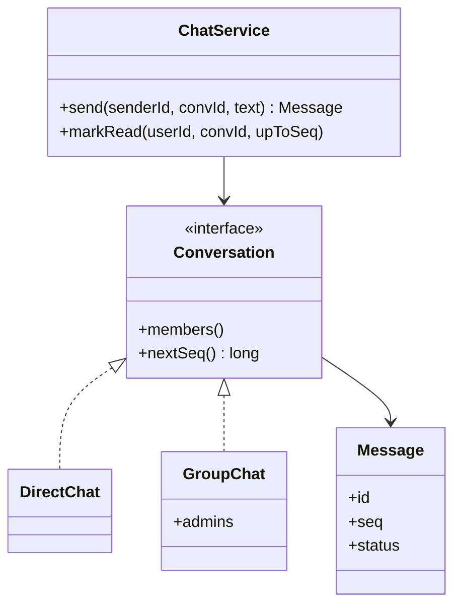
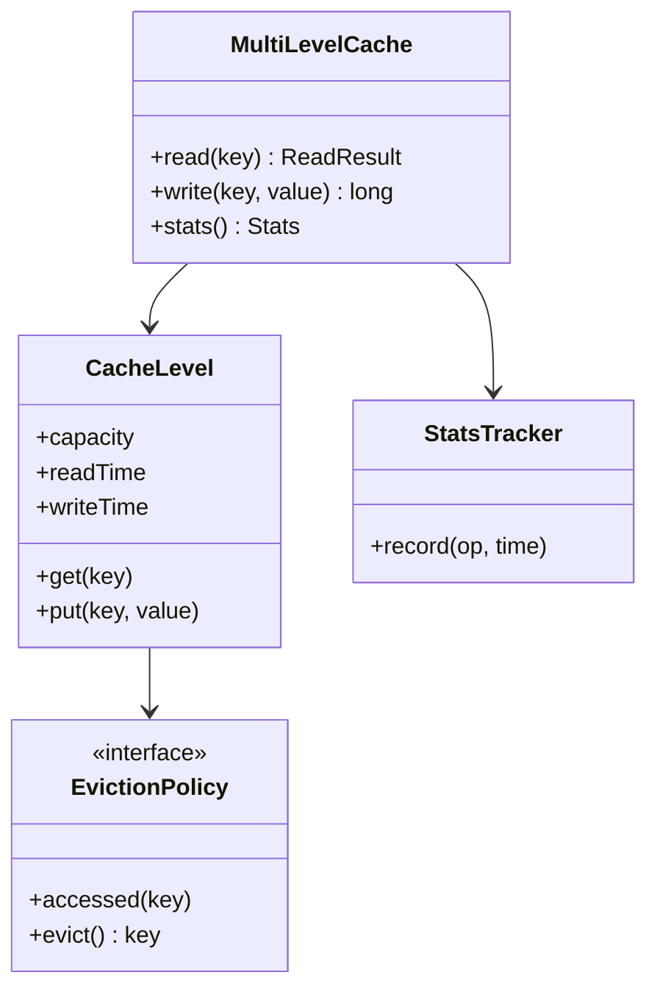
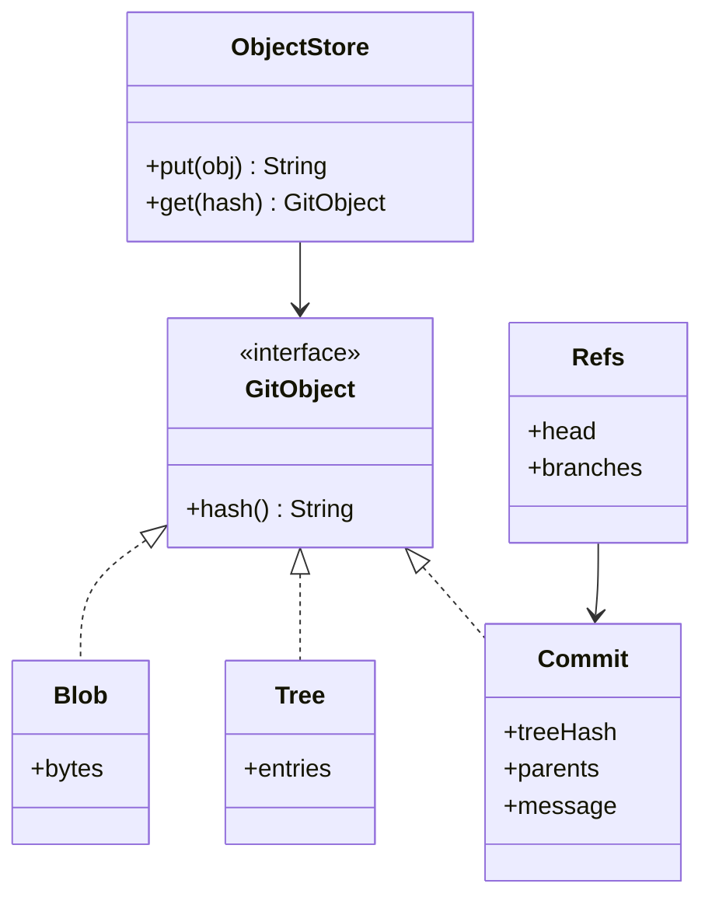
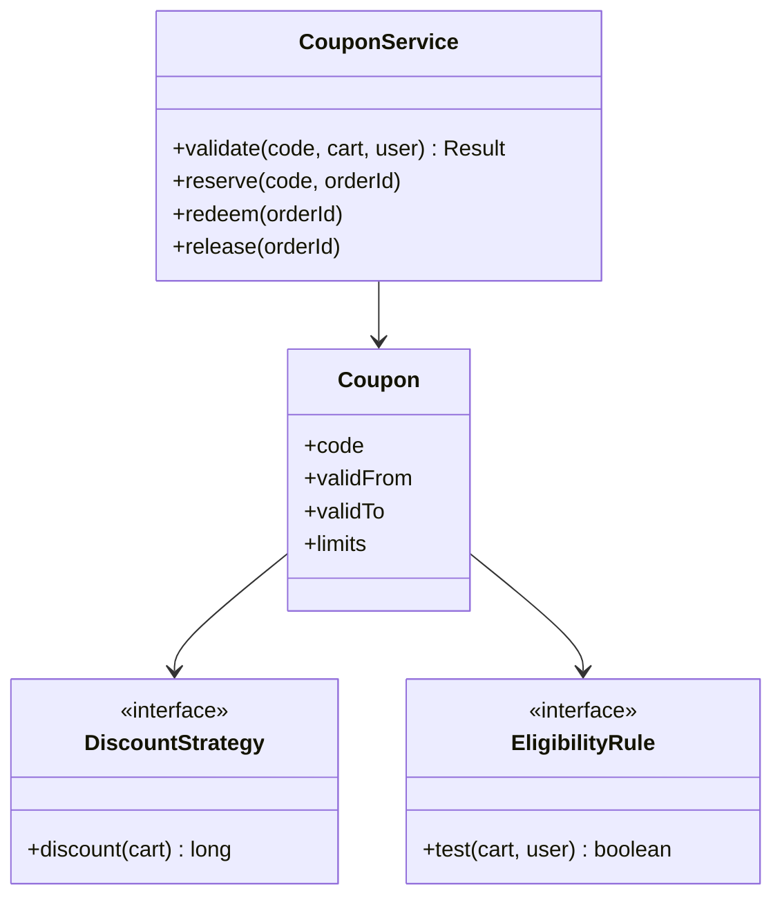

# Chapter 23 — Interview Question Bank

## How to use this bank

This chapter collects the low-level design (LLD) and machine-coding questions that come up again and again in interviews, worded the way they usually appear on LeetCode Discuss interview-experience posts and in the popular public question lists (see the sources at the end). Use it as a checklist so that nothing surprises you.

- **★** marks a question that is asked very often. Do those first.
- **Part A** is the "Design X" prompts (parking lot, BookMyShow, Splitwise …). When this book has a full case study, the entry is a short reminder of what to say plus a link to the full design. When it doesn't, the entry is a complete outline you can build from.
- **Part B** is the concept questions (OOP, UML, SOLID, patterns, concurrency, Java specifics). Each has a short answer you can say out loud and a link to the full explanation.
- **Part C** is a minute-by-minute plan for a 60–90 minute machine-coding round.

**How to drill:** read the question, cover the answer, say your answer out loud (or sketch the classes), then compare. Mark the ones you stumbled on and come back to them the next day.

## Part A — "Design X" (LLD and machine coding) questions

These are the "Design X" prompts that show up again and again in object-oriented design (OOD) rounds and in machine-coding rounds. An OOD round is a whiteboard-style talk about classes; a machine-coding round is 90–150 minutes of writing working code. ★ marks prompts asked very often, and every machine-coding favourite also gets a ★. When this book has a full case study, the entry here is a short reminder of what to say, followed by a link. When the book has no case study, the entry is a complete outline you can build from.

## Everyday objects

**Q1. ★ Design a Parking Lot**

*Asked at:* Flipkart (SDE2 LLD round)
- Entities: `ParkingLot` → `Level` → `ParkingSpot` (sized: small, compact, large), `Vehicle`, `Ticket`, `EntryGate` / `ExitGate`, `FeeCalculator`.
- Patterns: Strategy for spot allocation and for pricing; Singleton (or one injected instance) for the lot; Factory for vehicles.
- What interviewers probe: two cars racing for the last free spot (claim the spot atomically), hourly vs flat pricing, and adding EV charging spots without editing old code.
→ *Full design:* [Ch 14 — 14.1 Design a Parking Lot](../14-case-everyday-objects/README.md)

**Q2. ★ Design an Elevator / Lift System**
- Entities: `ElevatorController`, `Elevator` (current floor, direction, door state), `Request` (hall call or car call), `Dispatcher`.
- Patterns: State (moving up, moving down, idle, doors open), Strategy for dispatching (nearest car, SCAN / LOOK).
- What interviewers probe: the scheduling algorithm (why plain first-come-first-served makes cars zig-zag), keeping requests consistent when many buttons are pressed at once, and overload or maintenance modes.
→ *Full design:* [Ch 14 — 14.5 Design an Elevator System](../14-case-everyday-objects/README.md)

**Q3. ★ Design a Vending Machine**
- Entities: `VendingMachine`, `Inventory`, `Product`, `Coin` / `Note`, `ChangeDispenser`.
- Pattern: State (idle, has money, dispensing, sold out) is the whole point of this question.
- What interviewers probe: making change with a limited coin stock, refunding on cancel, and what happens when a product sells out while money is inserted.
→ *Full design:* [Ch 14 — 14.2 Design a Vending Machine](../14-case-everyday-objects/README.md)

**Q4. Design a Coffee Vending Machine**
- Entities: `CoffeeMachine`, `Recipe` (ingredient → quantity), `IngredientStore`, `Beverage`, add-ons.
- Patterns: Decorator for add-ons (extra shot, milk), Factory for drinks, State for the machine.
- What interviewers probe: checking and deducting every ingredient as one atomic step, and refill alerts (Observer).
→ *Full design:* [Ch 14 — 14.3 Design a Coffee Vending Machine](../14-case-everyday-objects/README.md)

**Q5. ★ Design an ATM**
- Entities: `ATM`, `Card`, `Account`, `BankService`, `CashDispenser`, `Transaction` (withdraw, deposit, balance enquiry).
- Patterns: State (no card, card inserted, PIN verified), Chain of Responsibility for dispensing notes by denomination.
- What interviewers probe: what to do if cash is debited but not dispensed (reversal), PIN retry limits, and two ATMs withdrawing from one account at the same time.
→ *Full design:* [Ch 14 — 14.4 Design an ATM](../14-case-everyday-objects/README.md)

**Q6. Design a Traffic Signal Control System**
- Entities: `Intersection`, `TrafficLight`, `SignalPhase`, `SignalController`, `Timer`.
- Patterns: State for the light cycle, Strategy for timing plans (fixed, rush hour, sensor-driven), Observer for emergency vehicles.
- What interviewers probe: never letting conflicting directions be green together, and handling emergency override safely.
→ *Full design:* [Ch 14 — 14.6 Design a Traffic Signal Control System](../14-case-everyday-objects/README.md)

**Q7. Design an Amazon Locker / shipping locker**
- Entities: `LockerLocation`, `Locker` (by size), `Package`, `PickupCode`, `LockerService`.
- Patterns: Strategy for choosing a locker size, State for the locker (free, reserved, occupied).
- What interviewers probe: code expiry and returning the package to the sender, and two deliveries claiming the same locker.
→ *Full design:* [Ch 14 — 14.7 Design a Shipping Locker System](../14-case-everyday-objects/README.md)

**Q8. Design a toll booth / parking-fee calculator (pricing strategies)**
- This is the pricing part of the parking lot pulled out on its own: a `FeeCalculator` interface with hourly, flat, slab and weekend implementations, chosen by vehicle type and time.
- Patterns: Strategy (one class per pricing rule), optionally Decorator for surcharges and discounts layered on top.
- What interviewers probe: time zones and midnight boundaries, rounding (charge per started hour?), and keeping money as integer paise or `BigDecimal`, never `double`.
→ *Full design:* [Ch 14 — 14.1 Design a Parking Lot](../14-case-everyday-objects/README.md) (pricing section)

**Q9. Design a home automation system**

*Requirements.* A user owns devices (lights, fans, thermostats, door locks, sensors) made by different vendors. The user can switch a device on or off, set values (brightness, temperature), group actions into a "scene" ("Good night" turns off lights and locks doors), undo the last action, and create rules ("if motion after 23:00, turn on the hall light"). Schedules ("at 07:00") are nice to have.

*Main classes.*
- `Device` (interface): `id()`, `status()`. Subtypes `Light`, `Thermostat`, `Lock`, `MotionSensor`.
- `VendorAdapter`: wraps each vendor's protocol (Zigbee, Wi-Fi API) behind the `Device` interface.
- `DeviceCommand`: one action with `execute()` and `undo()`, for example `SetBrightness(light, 40)` remembers the old brightness.
- `Scene`: a list of commands run as one; it is itself a command.
- `Hub`: registry of devices, runs commands, keeps an undo stack.
- `Rule`: a trigger (sensor event, time) plus a condition plus a command.
- `EventBus`: sensors publish events; rules subscribe.

*Patterns.* Adapter (vendor protocols), Command (actions with undo), Composite (a scene is a command made of commands), Observer (sensor events reach rules), Strategy for the condition check.

*Concurrency and edge cases.* Send commands to one device in order: give each device its own single-threaded executor (or a lock), while different devices run in parallel on virtual threads. A device may be offline: queue the command with a timeout and report failure instead of hanging. Avoid rule loops (rule A turns on a light, which fires rule B, which turns it off) by tracking which rule caused an event and limiting the depth.

*Extension question.* "Support user roles: a guest can unlock the front door only between 10:00 and 18:00." Add an `AccessPolicy` checked by the `Hub` before running any command (a Proxy around devices works well).

**Q10. Design a Jackpot / slot machine**

*Requirements.* A player inserts credit, places a bet, and pulls the lever. Three (or five) reels spin and stop on symbols. A pay table decides the win. The machine tracks credit, pays out, and refuses to play when it is out of service or cannot cover the payout. Optional: a progressive jackpot shared by many machines.

*Main classes.*
- `SlotMachine`: holds the credit balance and the current state, and exposes `insert`, `bet`, `spin` and `cashOut`.
- `MachineState` (sealed interface): `Idle`, `HasCredit`, `Spinning`, `OutOfService`. Each state allows only its own actions.
- `Reel`: a list of symbols with weights, so a cherry can be more common than a seven.
- `RandomSource`: an interface wrapping `SecureRandom`. Tests swap in a fixed sequence, so results are repeatable.
- `PayTable`: maps a symbol combination to a multiplier. A Strategy, so different machines can pay differently.
- `JackpotPool`: one shared progressive pool. Each bet adds a small cut.

*Patterns.* State (the machine lifecycle), Strategy (pay rules, random source), Singleton-like shared `JackpotPool` (inject one instance rather than a static).

*Concurrency and edge cases.* Two machines can hit the jackpot at the same moment. Take the pool with one atomic step, `AtomicLong.getAndSet(seed)`, so only one machine wins the full amount. Use whole numbers for money. Reject a bet bigger than the credit. Go out of service if the machine's cash cannot cover the largest possible win. Log every spin (seed, result) for audits.

*Extension question.* "Add a bonus round after three scatter symbols." Add a `BonusRound` state that the machine moves into after the normal payout. No existing state class needs to change.

**Q11. Design a music playlist**
- Entities: `Song`, `Playlist` (ordered list), `Player` (current position, play mode), `User`.
- Patterns: Iterator (sequential, shuffle, repeat as different iterators) or Strategy for play order.
- What interviewers probe: shuffle without repeats until all songs played, and editing the playlist while it is playing.
→ *Full design:* [Ch 1 — 1.3 A complete answer in five minutes](../01-lld-interview-approach/README.md)

## Booking and reservations

**Q12. ★ Design BookMyShow / a movie ticket booking system**

*Asked at:* Flipkart
- Entities: `Cinema` → `Screen` → `Seat`, `Movie`, `Show`, `ShowSeat` (seat state per show), `Booking`, `Payment`.
- Patterns: State for a seat (available, held, booked), Strategy for pricing, Observer for confirmations.
- What interviewers probe: two users picking the same seat (hold with expiry, then confirm), releasing holds when payment fails or times out.
→ *Full design:* [Ch 15 — 15.2 Design a Movie Ticket Booking System](../15-case-booking-1/README.md)

**Q13. ★ Design a Library Management System**
- Entities: `Book` (title info) vs `BookItem` (physical copy), `Member`, `Loan`, `Reservation`, `Fine`, `Catalog` (search).
- Patterns: Strategy for fine rules, Observer for "your reserved book is back".
- What interviewers probe: the book vs copy split, borrowing limits, and the reservation queue.
→ *Full design:* [Ch 15 — 15.1 Design a Library Management System](../15-case-booking-1/README.md)

**Q14. ★ Design a Hotel Management System**
- Entities: `Hotel`, `Room` (type, rate), `Guest`, `Reservation` (date range), `Invoice`, `HousekeepingTask`.
- Patterns: State for reservation and room status, Strategy for room pricing.
- What interviewers probe: date-range overlap checks, overbooking rules, and late check-out charges.
→ *Full design:* [Ch 15 — 15.4 Design a Hotel Management System](../15-case-booking-1/README.md)

**Q15. Design a concert ticket booking system**
- Like BookMyShow, but one big event with a sudden rush: seat sections, general admission, and a waiting room.
- Patterns: State for seats, plus a queue in front of booking.
- What interviewers probe: thousands of buyers at the same second, hold timeouts, and per-user ticket limits.
→ *Full design:* [Ch 15 — 15.3 Design a Concert Ticket Booking System](../15-case-booking-1/README.md)

**Q16. ★ Design a car / vehicle rental system (Zoomcar)**

*Asked at:* Flipkart (SDE2, 2024)
- Entities: `Branch`, `Vehicle`, `Reservation` (pickup and drop time and branch), `Customer`, `PricingPolicy`, `Invoice`.
- Patterns: Strategy for pricing and for vehicle selection, State for reservation lifecycle.
- What interviewers probe: availability across overlapping time windows, one-way rentals, and damage or late-return charges.
→ *Full design:* [Ch 16 — Design a Car Rental System](../16-case-booking-2/README.md)

**Q17. Design a restaurant management system (table booking / waiting queue)**
- Entities: `Table`, `Reservation`, `WaitlistEntry`, `Order`, `MenuItem`, `Bill`, `Kitchen`.
- Patterns: Command for orders sent to the kitchen, Observer for "your table is ready", State for orders.
- What interviewers probe: fitting party sizes to tables, walk-ins vs reservations, and splitting the bill.
→ *Full design:* [Ch 16 — Design a Restaurant Management System](../16-case-booking-2/README.md)

**Q18. Design an airline management / flight booking system**
- Entities: `Flight` (route) vs `FlightInstance` (a dated departure), `Aircraft`, `Seat`, `Itinerary`, `Passenger`, `Booking`.
- Patterns: State for booking, Strategy for fare rules.
- What interviewers probe: the route vs instance split, multi-leg trips booked all-or-nothing, and seat holds.
→ *Full design:* [Ch 16 — Design an Airline Management System](../16-case-booking-2/README.md)

**Q19. Design a course registration system**
- Entities: `Course`, `Section` (time slot, capacity), `Student`, `Enrollment`, `Prerequisite`, `Waitlist`.
- Patterns: Specification or Chain of Responsibility for eligibility checks (prerequisites, clashes, credit limit).
- What interviewers probe: the last seat taken by two students at once, and automatic waitlist promotion.
→ *Full design:* [Ch 16 — Design a Course Registration System](../16-case-booking-2/README.md)

**Q20. Design a learning management system / online exam portal**
- Start from course registration and add `Exam`, `Question` (single choice, multiple choice, text), `Attempt`, `Grader`.
- Patterns: Strategy for grading each question type, State for an attempt (started, submitted, graded), and a timer that auto-submits.
- What interviewers probe: saving answers often so a dropped connection loses nothing, and randomising question order per student.
→ *Related design:* [Ch 16 — Design a Course Registration System](../16-case-booking-2/README.md)

**Q21. ★ Design a Meeting Scheduler / meeting room booking**
- Entities: `Interval` (half-open), `Room` (owns a sorted calendar), `Meeting`, `Invitation` (RSVP), `MeetingScheduler`, `RoomSelectionStrategy`, `MeetingObserver`.
- Patterns: Strategy for room ranking, Observer for invitations and RSVPs.
- What interviewers probe: overlapping bookings of one room (check and insert under the room lock), room clash blocks while a busy person only warns, reschedule without losing the slot, and "first time everyone is free" (merge busy intervals, scan the gaps).
→ *Full design:* [Ch 16 — Design a Meeting Scheduler](../16-case-booking-2/README.md#design-a-meeting-scheduler)

**Q22. ★ Design a doctor appointment booking system**

*Asked at:* Flipkart (SDE2, 2021)

*Requirements.* Doctors register with a speciality (cardiologist, dermatologist). Each doctor declares available one-hour slots for the day. Patients search by speciality and see free slots, sorted by start time by default. A patient books, cancels, and views their bookings. A patient may not hold two appointments at the same time. When a slot is full, the patient can join its waitlist, and a cancellation promotes the first person waiting.

*Main classes.*
- `Doctor` (id, name, speciality, slots) and `Patient` (id, name, appointments).
- `Slot`: doctor, start time, status (`FREE`, `BOOKED`), booked patient, and a waitlist (a `Deque<Patient>`).
- `Appointment`: a record (id, patient, slot).
- `BookingService`: `book`, `cancel` and `joinWaitlist`. It enforces "no double booking for the patient".
- `SearchService` with a `SlotRankingStrategy`. Order by start time by default, or by doctor rating later.
- Repositories: in-memory maps, as the machine-coding round expects.

*Patterns.* Strategy (ranking), Observer (tell a waitlisted patient they were promoted), a simple State on `Slot`.

*Concurrency and edge cases.* Two patients may book the last slot together. Guard the slot status with a per-slot lock, or a compare-and-set on an `AtomicReference<SlotStatus>`. Check the patient's own clash under the patient's lock. Lock patient then slot, always in that order, so no deadlock can form. Validate that slots are whole hours inside working hours. Cancelling an already-cancelled booking is a no-op.

*Extension question.* "Show the trending doctor: the one with the most bookings today." Keep a counter per doctor that `book` updates, and read it through a max-heap or a sorted view.

**Q192. Meeting scheduler: why can't a concurrent map keyed by start time stop double-booking, and how do you find a clash fast?**
Overlapping meetings usually start at different times (10:00–11:00 and 10:30–11:15), so their keys differ and `putIfAbsent` lets both in. Keep each room's bookings in a `TreeMap` keyed by start; because stored bookings never overlap, only the one returned by `lowerEntry(newEnd)` can clash, an O(log n) check. Do that check and the insert under the room's lock.
→ *More:* [Ch 16 — Design a Meeting Scheduler](../16-case-booking-2/README.md#design-a-meeting-scheduler)

## Games

**Q23. ★ Design Snake and Ladder**
- Entities: `Board` (size, snakes and ladders as jumps), `Player`, `Dice`, `Game` (turn order queue).
- Patterns: Strategy for dice (one die, two dice, a loaded die in tests), a simple game loop.
- What interviewers probe: input-driven setup in machine coding, exact-roll-to-win rules, and chained jumps.
→ *Full design:* [Ch 17 — Design Snake and Ladder](../17-case-games/README.md)

**Q24. ★ Design Chess**
- Entities: `Board`, `Square`, `Piece` subclasses, `Move`, `Player`, `Game` (status, history).
- Patterns: Strategy (or polymorphism) for each piece's moves, Command for moves with undo, State for game status.
- What interviewers probe: check / checkmate detection (simulate the move, then test the king), castling and en passant, and why moves should be objects.
→ *Full design:* [Ch 17 — Design Chess](../17-case-games/README.md)

**Q25. ★ Design a 2048 game**

*Asked at:* Flipkart (2021)
- Entities: `Board` (grid), `Tile`, `Game` (score, state), `MoveDirection`, `TileSpawner`.
- Pattern: write one "slide and merge a row left" routine and rotate the grid for the other three directions.
- What interviewers probe: each tile merging only once per move, spawning only after a real change, and detecting game over.
→ *Full design:* [Ch 17 — Design 2048](../17-case-games/README.md)

**Q26. ★ Design Tic-Tac-Toe**
- Entities: `Board`, `Player`, `Game`, `WinChecker`.
- Patterns: Strategy for players (human, AI), and per-row / column / diagonal counters so a win check is O(1).
- What interviewers probe: N×N boards, the O(1) win check, and keeping input handling out of the game rules.
→ *Full design:* [Ch 17 — Design Tic-Tac-Toe](../17-case-games/README.md)

**Q27. Design a deck of cards / Blackjack**
- Entities: `Card` (rank, suit enums), `Deck`, `Shoe`, `Hand`, `Player`, `Dealer`, `Game`.
- Patterns: Template Method or Strategy for the dealer's rule, and a generic deck reused by other card games.
- What interviewers probe: ace counted as 1 or 11, and making a deck that works for any card game.
→ *Full design:* [Ch 17 — Design Blackjack and a Deck of Cards](../17-case-games/README.md)

**Q28. Design Minesweeper**

*Requirements.* A rows × cols grid hides a number of mines. The player reveals a cell or toggles a flag. Revealing a mine loses the game. Revealing a number shows how many of the eight neighbours are mines. Revealing a zero opens all connected empty cells and their numbered borders. The player wins when every non-mine cell is revealed. The first click must never be a mine.

*Main classes.*
- `Cell`: `mine` (boolean), `adjacentMines`, and `state` (`HIDDEN`, `REVEALED`, `FLAGGED`).
- `Board`: the grid, `neighbours(r, c)`, `revealedCount`, `mineCount`.
- `MinePlacer` (interface): random placement with a seed. Tests use a fixed layout. Mines are placed *after* the first click, avoiding that cell (and its neighbours, if you like).
- `Game`: `reveal(r, c)`, `toggleFlag(r, c)`, and `status` (`PLAYING`, `WON`, `LOST`).
- `Renderer`: prints the board. Keep it separate from the rules.

*Patterns.* Strategy (mine placement), State for game status (no moves after a win or loss), and Observer if a UI must redraw.

*Algorithm.* For reveal, use a breadth-first search with a queue, not recursion. A recursive flood fill on a 1000×1000 empty board can overflow the stack. Mark each cell revealed when you add it to the queue, so no cell is processed twice. Flagged cells are not opened by the flood. Win check: `revealedCount == rows * cols - mineCount`, an O(1) test.

*Edge cases.* Ignore clicks outside the board, on revealed cells, or after the game ended. Reject more mines than cells minus one.

*Extension question.* "Add chording: clicking a number whose flags are all placed opens its other neighbours." Write it as one more method that reuses `reveal`, so no existing rule changes.

**Q29. Design a Bowling Alley scoring system**
- Entities: `Game`, `Frame` (rolls), `TenthFrame` (up to three rolls), `Player`, `Lane`.
- Key logic: a strike adds the next two rolls, a spare adds the next one. Score from the stored list of rolls instead of keeping running totals, so bonuses resolve naturally.
- What interviewers probe: the tenth frame, partial scores while bonuses are pending, and validating pin counts per frame.
- The scoring core for a finished game (validate rolls first: 0–10 each, at most 10 per frame outside the tenth):

```java
static int score(List<Integer> rolls) {
    int total = 0, i = 0;
    for (int frame = 1; frame <= 10; frame++) {
        if (rolls.get(i) == 10) {                                   // strike
            total += 10 + rolls.get(i + 1) + rolls.get(i + 2); i += 1;
        } else if (rolls.get(i) + rolls.get(i + 1) == 10) {         // spare
            total += 10 + rolls.get(i + 2); i += 2;
        } else { total += rolls.get(i) + rolls.get(i + 1); i += 2; }
    }
    return total;   // 12 strikes -> 300; 21 rolls of 5 -> 150
}
```

This book has no Bowling Alley case study, so this outline is the whole answer here.

**Q30. Design an online game engine**

*Requirements.* Provide the core that any 2D game can build on: a loop that updates and draws the world at a steady rate, game objects with position and behaviour, keyboard and mouse input, collision detection, events between objects, loading images and sounds once, and screens (menu, playing, paused).

*Main classes.*
- `GameLoop`: runs a fixed-timestep update (say 60 times a second) and renders as often as possible. It catches up with several updates if a frame was slow.
- `Entity`: an id that holds `Component`s (`Position`, `Velocity`, `Sprite`, `Collider`). This is the Entity-Component-System (ECS) idea: behaviour comes from parts, not from a deep inheritance tree.
- `System`: `MovementSystem`, `CollisionSystem` and `RenderSystem`. Each one walks the entities that have the components it needs.
- `InputHandler`: maps keys to `Command` objects (`Jump`, `MoveLeft`), so key bindings can change.
- `EventBus`: lets objects publish "player died" or "coin collected" without knowing each other.
- `AssetManager`: loads each texture once and shares it.
- `SceneManager`: holds a stack of `Scene`s. Each scene is a state, such as `Menu`, `Level` or `Pause`.

*Patterns.* Component (composition over inheritance), Command (input), Observer (events), Flyweight (shared assets), State (scenes), Game Loop.

*Concurrency and edge cases.* Keep the world single-threaded. Input arrives from other threads into a `ConcurrentLinkedQueue`, and the loop drains it at the start of each tick. Asset loading can run on virtual threads, publishing "loaded" events. Use a fixed time step, so physics gives the same result on fast and slow machines.

*Extension question.* "Make it multiplayer." The server owns the true state and runs ticks. Clients send commands, predict movement locally, and correct themselves when the server state arrives.

**Q193. Design a Jigsaw Puzzle**
- Entities: `Side` (FLAT, TAB or BLANK plus a shape code), immutable `Piece` (four sides clockwise), `Board` with `Placement(piece, rotation)`, `PuzzleValidator`, `SolverStrategy`.
- Patterns: Strategy for solvers (brute-force backtracking vs edge-first with a `Side → pieces` index); all placement rules in one `Board.check` used by players and solvers.
- What interviewers probe: where rotation lives (in the placement, so pieces stay immutable), the facing side after `r` turns (`sides[(d − r) mod 4]`), why corners need no special rule, and the cost of solving (about n attempts with unique shapes, exponential with look-alikes, hence an attempt budget).
→ *Full design:* [Ch 17 — Design a Jigsaw Puzzle](../17-case-games/README.md#design-a-jigsaw-puzzle)

## Platforms and marketplaces

**Q31. ★ Design a cab booking / ride-sharing service (Uber; Flipkart "offer and select a ride")**

*Asked at:* Flipkart
- Entities: `Rider`, `Driver`, `Vehicle`, `Location`, `RideRequest`, `Trip`, `FareCalculator`, `MatchingService`.
- Patterns: Strategy for matching (nearest, best rated) and for fares (surge), State for the trip, Observer for live updates.
- What interviewers probe: two riders matched to one driver, cancellation rules, and the carpool variant (offer a ride with seats, select the best ride).
→ *Full design:* [Ch 20 — 20.4 Design a Ride Sharing Service (Uber)](../20-case-components/README.md)

**Q32. ★ Design a food delivery system (Swiggy / Zomato; Flipkart "FoodKart")**

*Asked at:* Flipkart
- Entities: `Restaurant`, `Menu`, `Item`, `Cart`, `Order`, `DeliveryAgent`, `RestaurantSelectionStrategy`.
- Patterns: State for the order, Strategy for choosing the restaurant (lowest cost, highest rating) and assigning agents, Observer for tracking.
- What interviewers probe: restaurant capacity (max orders at once) freed when an order completes, and one-restaurant-per-cart rules.
→ *Full design:* [Ch 19 — Design an Online Food Delivery Service (Swiggy) + FoodKart](../19-case-platforms-2/README.md)

**Q33. ★ Design CricInfo / a cricket scoreboard (Udaan "Cricket Match Dashboard")**

*Asked at:* Udaan
- Entities: `Match`, `Team`, `Player`, `Innings`, `Over`, `Ball` (the event that everything derives from), `Scorecard`.
- Patterns: Template Method for match formats, Observer for live updates, "derive stats from balls, don't store totals".
- What interviewers probe: extras (wide, no-ball), strike rotation at the end of an over, and the machine-coding version that prints the scorecard after every over.
→ *Full design:* [Ch 18 — 18.2 Design Cricinfo](../18-case-platforms-1/README.md)

**Q34. ★ Design a stock exchange / order matching engine (LLD)**
- Entities: `Order` (buy or sell, limit or market, quantity, price, time), `OrderBook` per symbol, `Trade`, `MatchingEngine`.
- Data structure: for each side, a `TreeMap<price, Deque<Order>>`. The best bid is the highest key and the best ask is the lowest. Match by price first, then by time.
- What interviewers probe: partial fills, cancelling an order sitting in the book, and a single writer thread per symbol so no locks are needed.
→ *Related design:* [Ch 19 — Design an Online Stock Brokerage System](../19-case-platforms-2/README.md)

**Q35. Design an online stock brokerage system**
- Entities: `Account`, `Portfolio`, `Position`, `Order` (market, limit, stop), `Exchange` adapter, `Watchlist`.
- Patterns: Strategy/Factory for order types, State for order lifecycle, Observer for price alerts, Adapter for the exchange.
- What interviewers probe: blocking funds when an order is placed, partial fills, and order status kept in step with the exchange.
→ *Full design:* [Ch 19 — Design an Online Stock Brokerage System](../19-case-platforms-2/README.md)

**Q36. Design a cryptocurrency exchange**
- Same core as Q34 (order book and matching) plus wallets per currency, deposits that wait for blockchain confirmations, and withdrawals that need approval.
- Patterns: State for deposits and withdrawals, Strategy for fees.
- What interviewers probe: exact decimal amounts (`BigDecimal` with each coin's scale), and never letting a balance go negative under concurrent trades.
→ *Related design:* [Ch 19 — Design an Online Stock Brokerage System](../19-case-platforms-2/README.md)

**Q37. Design Stack Overflow**
- Entities: `User` (reputation, badges), `Question`, `Answer`, `Comment`, `Vote`, `Tag`, `Bounty`.
- Patterns: Observer for reputation changes and notifications, Strategy for search and ranking.
- What interviewers probe: one vote per user per post, accepting an answer, and permissions that depend on reputation.
→ *Full design:* [Ch 18 — 18.1 Design Stack Overflow](../18-case-platforms-1/README.md)

**Q38. Design LinkedIn**
- Entities: `Member`, `Profile`, `Connection`, `Invitation`, `Post`, `Job`, `Message`.
- Patterns: State for invitations, BFS for 1st/2nd/3rd degree connections, Strategy for feed ranking.
- What interviewers probe: two-sided operations (accepting adds both sides), and degree computation limits.
→ *Full design:* [Ch 18 — 18.3 Design LinkedIn](../18-case-platforms-1/README.md)

**Q39. Design Facebook / a social network**
- Entities: `User`, `Friendship`, `Follow`, `Post`, `Audience` (privacy), `Page`, `Group`, `NewsFeed`.
- Patterns: one visibility policy used by feed and search, Strategy for feed ranking, pull-model feed.
- What interviewers probe: friends vs followers, privacy checks on every read, and friend suggestions.
→ *Full design:* [Ch 18 — 18.4 Design Facebook](../18-case-platforms-1/README.md)

**Q40. ★ Design Twitter (post / follow / feed; LeetCode 355 "Design Twitter")**
- The LeetCode version: `postTweet`, `getNewsFeed` (the 10 newest tweets from self and followees), `follow`, and `unfollow`.
- Data: a map from user to followees, and per user a list of tweets with a global increasing timestamp. Build the feed by merging the users' newest-first lists with a max-heap, k-way merge style, and stop after 10.
- What interviewers probe: why you pull (merge on read) rather than push here, self-follow, and unfollowing yourself.
→ *Related design:* [Ch 18 — 18.4 Design Facebook](../18-case-platforms-1/README.md) (feed and follow)

**Q41. ★ Design Amazon (online shopping system / cart / checkout)**
- Entities: `Product`, `Catalog`, `Cart`, `Order`, `OrderItem`, `Payment`, `Shipment`, `Inventory`.
- Patterns: State for orders, Strategy for payment and shipping, Observer for status emails.
- What interviewers probe: reserving stock at checkout vs at payment, price changing while the item sits in the cart, and partial cancellations.
→ *Full design:* [Ch 19 — Design Amazon — Online Shopping System](../19-case-platforms-2/README.md)

**Q42. Design an online auction system (eBay; live IPL auction)**
- Entities: `Auction` (item, reserve price, end time), `Bid`, `Bidder`, `Seller`, `AuctionHouse`.
- Patterns: State (scheduled, live, closed), Observer for outbid alerts, Strategy for auction type (English, sealed bid).
- What interviewers probe: two bids arriving at the same moment (serialise per auction), last-second sniping and extending the end time.
→ *Full design:* [Ch 19 — Design an Online Auction System](../19-case-platforms-2/README.md)

**Q43. Design Spotify / a music streaming service (LLD)**
- Entities: `Track`, `Album`, `Artist`, `Playlist`, `User`, `Subscription`, `Player`, `PlayQueue`.
- Patterns: Strategy for recommendations and shuffle, State for the player, Iterator for queues.
- What interviewers probe: free vs premium limits, collaborative playlists, and the play-next queue vs the playlist order.
→ *Full design:* [Ch 19 — Design a Music Streaming Service (Spotify)](../19-case-platforms-2/README.md)

**Q44. Design a grocery store / POS / checkout (BigBasket)**
- Entities: `Product` (priced by unit or by weight), `Inventory`, `Basket`, `Receipt`, `Discount`, `Payment`.
- Patterns: Strategy and Composite for discounts (buy-2-get-1, percent off a category), Decorator for tax.
- What interviewers probe: the order in which discounts apply, and returns.
→ *Full design:* [Ch 19 — Design a Grocery Store (POS & Checkout)](../19-case-platforms-2/README.md)

**Q45. Design a subscription-based sports score website**
- Reuse the Cricinfo model for matches and add `Subscription` (plan, expiry), `Entitlement` checks and live score pushes.
- Patterns: Observer (subscribers to a match), Proxy for checking entitlements before content is served.
- What interviewers probe: free vs paid content per request, and fan-out of score updates to many subscribers.
→ *Related design:* [Ch 18 — 18.2 Design Cricinfo](../18-case-platforms-1/README.md)

**Q46. Design a logistics / shipment tracking system**
- Entities: `Shipment`, `Parcel`, `Hub`, `Route`, `TrackingEvent`, `Courier`.
- Patterns: State for shipment status, Observer for customer updates, Strategy for route choice.
- What interviewers probe: events that arrive out of order (sort by event time, not arrival), and returns.
→ *Related design:* [Ch 14 — 14.7 Design a Shipping Locker System](../14-case-everyday-objects/README.md)

**Q47. Design a newsletter service**
- Entities: `Publication`, `Issue`, `Subscriber`, `Subscription` (topics, frequency), `Delivery`.
- Patterns: Observer / Pub-Sub (subscribers per topic), Strategy for channel (email, in-app), Template Method for rendering.
- What interviewers probe: unsubscribe taking effect at once, retries without double delivery, and daily digests.
→ *Related design:* [Ch 20 — 20.6 Design a Pub-Sub System](../20-case-components/README.md)

**Q48. Design a maps navigator client (walk / car / bus / bike)**
- Entities: `Navigator`, `Route`, `RouteStrategy` (one per travel mode), `Location`.
- Pattern: Strategy is the whole question. The navigator swaps strategies at runtime without `if` chains.
- What interviewers probe: adding a new travel mode without touching old code, and combining modes (walk + bus).
→ *Related design:* [Ch 11 — 11.3 Strategy](../11-patterns-behavioral-2/README.md)

**Q49. Design a chat server / WhatsApp (LLD)**

*Requirements.* Users send text messages one-to-one and in groups. Messages show sent, delivered and read ticks. Offline users receive their messages when they come back. Each conversation keeps its order. Groups have admins who add and remove members. Online and last-seen status is a nice extra.

*Main classes.*



- `Conversation` (sealed interface): `DirectChat` (two members) and `GroupChat` (members, admins).
- `Message`: a record (id, conversationId, senderId, seq, text, sentAt). Its delivery status is kept per recipient, because in a group each person reads at a different time.
- `Inbox`: per user, a queue of messages not yet delivered.
- `PresenceService`: online or offline, and last seen.
- `ConnectionRegistry`: the user's live sessions. Delivery listeners hang off it (Observer).

*Patterns.* Observer (deliver to connected sessions), Strategy (delivery channel: socket or push notification), and Mediator (`ChatService` coordinates instead of users talking to each other).

*Concurrency and edge cases.* Give each conversation an `AtomicLong` sequence. Sort messages by sequence, not by clock time, so senders on two phones cannot reorder history. Make delivery idempotent: a client acknowledges the highest sequence it has seen, and re-sent messages are ignored. A removed group member must not receive later messages, so check membership when the message is sent.

*Extension question.* "Add message editing and deletion." Store edits as new events that point at the original id, and let clients apply them, so the order stays clean.

**Q50. Design Truecaller**

*Requirements.* Users sign up with a phone number and may upload their contacts. Anyone can look up a number to see the most likely name and a spam score. Users report numbers as spam and block numbers. Users can search by name. A user can mark their own number as private.

*Main classes.*
- `PhoneNumber`: a value object. Its constructor normalises the input to E.164 format (for example `+919876543210`), so the same number can never be stored two ways.
- `User`: an id, an own number, contacts and a block list.
- `Contact`: a record (number, savedName).
- `GlobalDirectory`: maps each number to a name-count table (name → how many users saved it under that name). A lookup returns the most frequent name, and a registered user's own name always wins.
- `SpamService`: counts reports per number and gives a score. A number is "likely spam" past a threshold, weighted by how trustworthy each reporter is.
- `CallerIdService`: answers `lookup(number)` with `CallerInfo(name, spamScore, blocked)`.
- `NameSearchIndex`: a trie (prefix tree) from name prefixes to numbers.

*Patterns.* Value object, Strategy (spam scoring, name ranking), Observer (a new contact upload updates the directory and the index), Facade (`CallerIdService`).

*Concurrency and edge cases.* Uploads and reports arrive at the same time from many users. Use `ConcurrentHashMap<PhoneNumber, ConcurrentHashMap<String, LongAdder>>` for name counts and `LongAdder` for spam counts, so updates never block reads. Count one report per reporter per number, so repeat reports don't inflate the score. A private user's name should not be served from the crowd data.

*Extension question.* "Mark verified business numbers." Add a `VerifiedBusiness` record checked before the crowd data, so a verified name always beats crowd guesses.

**Q51. Design a mentorship / mock-interview platform (Pramp)**

*Requirements.* Users sign up with the topics they practise (data structures, system design) and their available time slots. The platform pairs two users who share a topic and a free slot. Each person interviews the other for half the session. Afterwards both leave feedback. Users can cancel, and they are reminded before a session.

*Main classes.*
- `User`: id, topics, a calendar of `AvailabilitySlot`s, and a rating.
- `AvailabilitySlot`: a record (start, end).
- `MatchRequest`: user, topic, preferred slots.
- `MatchingService`: keeps the open requests per topic and slot, and pairs requests through a `MatchingStrategy` (first come first served, similar rating).
- `Session`: two participants, topic, slot, question set, and a state (`SCHEDULED`, `IN_PROGRESS`, `COMPLETED`, `CANCELLED`, `NO_SHOW`).
- `Feedback`: a record (from, to, scores, notes).
- `ReminderScheduler`: uses a `ScheduledExecutorService` to fire reminders.

*Patterns.* Strategy (matching), State (session), Observer (send notifications on state change), Builder for sessions.

*Concurrency and edge cases.* One user must never be matched twice for the same slot. Run the matching in one step: lock both users' calendars in a fixed order (lowest id first) to avoid deadlock, check both are still free, then book both. A cancellation within an hour counts against the user's reliability, and the partner goes back into the pool. A no-show is detected when a session never moves to `IN_PROGRESS`.

*Extension question.* "Add paid sessions with expert mentors." Add a `Mentor` role with a price. Payment must succeed before the session moves to `SCHEDULED`. The rest of the flow stays the same.

**Q52. Design an Application Tracking System (Greenhouse)**

*Requirements.* A company posts jobs. Each job has a pipeline of stages (Applied → Phone screen → Onsite → Offer → Hired). Candidates apply, and recruiters move applications forward or reject them. Interviewers submit scorecards. Hiring managers see a dashboard of each job's pipeline. Every action is audited.

*Main classes.*
- `Job`: id, title, department, status (`OPEN`, `ON_HOLD`, `CLOSED`), and its own `Pipeline` (an ordered list of `Stage`s).
- `Candidate`: a person, who may have several `Application`s.
- `Application`: candidate + job, the current stage, a status (`ACTIVE`, `REJECTED`, `WITHDRAWN`, `HIRED`), and a history of stage changes.
- `Interview`: application, interviewers and time. `Scorecard`: interviewer, ratings and a recommendation.
- `ApplicationService`: `advance`, `reject` and `hire`. It checks the rules (no skipping to offer without scorecards, unless overridden).
- `PermissionPolicy`: decides what a recruiter, an interviewer or a hiring manager may see or do.
- `AuditLog` and `NotificationService`.

*Patterns.* State (application status), Template Method or configurable stage lists (each job has its own pipeline), Chain of Responsibility (the checks before advancing), Observer (emails and audit entries on each change).

*Concurrency and edge cases.* Two recruiters may move the same application at the same time. Use optimistic locking: a version number on `Application`, where an update fails if the version changed. Duplicate applications (same candidate, same job) are merged or rejected. Closing a job should not delete applications, only stop new ones.

*Extension question.* "Auto-reject candidates who fail a knock-out question." Add a rule to the advance chain that runs on `Applied`.

**Q53. Design a call center**

*Requirements.* The center has three levels of employee: respondents, managers and directors. An incoming call goes to a free respondent. If the respondent can't handle it, or none is free, it escalates to a manager, then to a director. If nobody is free, the call waits in a queue. When an employee finishes a call, they take the next waiting call at their level.

*Main classes.*
- `Employee` (abstract or sealed): id, `Rank`, and a current call. Subtypes `Respondent`, `Manager`, `Director`. Each can `canHandle(call)`.
- `Call`: caller, required minimum rank (it rises when escalated), state (`WAITING`, `IN_PROGRESS`, `ESCALATED`, `ENDED`).
- `CallDispatcher`: holds a queue of free employees per rank (`BlockingQueue<Employee>`) and a queue of waiting calls per rank. `dispatch(call)` tries the call's rank and above.
- `EscalationHandler`: a chain from respondent to manager to director.

*Patterns.* Chain of Responsibility (escalation), Strategy (routing: least busy, skills-based), State (call lifecycle).

*Concurrency and edge cases.* Calls arrive and end on many threads. Use `poll()` on the free-employee queues, so taking an employee is atomic. When an employee becomes free, first check the waiting-call queue for their rank (and lower ranks), and only then return to the free pool. Do these two steps under one lock, or a call could be missed. If a call is dropped mid-escalation, end it cleanly and free the employee. A call that waits too long can be escalated or offered a callback.

*Extension question.* "Add priority customers." Change the waiting queue to a `PriorityBlockingQueue` ordered by priority, then by arrival time.

**Q54. Design a Survey / Google Forms system**

*Requirements.* An owner builds a form with a title and questions of several types: short text, paragraph, single choice, multiple choice, rating, and date. Questions can be required and can have validation (email format, number range). The form can show or skip a section based on an earlier answer. Respondents submit responses. The owner sees a summary per question and can close the form.

*Main classes.*
- `Form`: id, owner, settings (one response per user, deadline), an ordered list of `Section`s, a version, and a status.
- `Question` (sealed interface): `TextQuestion`, `ChoiceQuestion` (options, multiSelect), `RatingQuestion` (scale), `DateQuestion`. Each has `validate(Answer)`.
- `ValidationRule`: composable rules (required, regex, range).
- `BranchRule`: "if the answer to question 3 is 'No', go to section 5".
- `Response`: form id, form version, respondent, and `Map<questionId, Answer>`.
- `FormBuilder`: builds a form step by step and checks it is valid.
- `Summary`: per question type, a different aggregation (counts, average, word list).

*Patterns.* Builder (forms), Composite (form → sections → questions), Strategy/Specification (validation), Visitor or a pattern-matching `switch` over the sealed `Question` types for summaries.

*Edge cases.* Editing a form after responses exist: create a new version, so old responses still point at the questions they answered. Enforce one response per user with a set of respondent ids, updated atomically with `ConcurrentHashMap.newKeySet().add(...)`. Validate every answer on the server, never trusting the client.

*Extension question.* "Add a quiz mode with scores." Add a correct answer and points to each question, plus a `Grader` that walks the response. Forms that are not quizzes are unaffected.

**Q55. Design an employee management / payroll system**

*Requirements.* Store employees with department, role and manager. Show the org chart and everyone who reports (directly or indirectly) to a manager. Track leave balances and requests. Run monthly payroll for salaried, hourly and commission employees, with deductions (tax, provident fund) and payslips.

*Main classes.*
- `Employee`: id, name, department, role, managerId, join date, and a `PayPolicy`.
- `OrgChart`: manager id → list of direct reports. `allReports(id)` walks the tree breadth-first.
- `PayPolicy` (interface): `SalariedPolicy` (monthly amount, prorated for part months), `HourlyPolicy` (rate × timesheet hours, overtime), `CommissionPolicy` (base + percent of sales).
- `Deduction` (interface): `IncomeTax`, `ProvidentFund`, `LeaveWithoutPay`, applied in order.
- `PayrollRun`: a month and the list of `Payslip`s it produced. Its status is `DRAFT`, `APPROVED` or `PAID`.
- `LeaveService`: balances per leave type, and requests that a manager approves.

*Patterns.* Strategy (pay policies), Chain of Responsibility or a list of deductions, Composite (org tree), State (payroll run and leave request).

*Edge cases.* Hold money as `long` paise or `BigDecimal`, and round only once, at the end. Mid-month joiners and leavers get prorated pay. A manager cycle (A reports to B, B to A) must be rejected when a manager is assigned. Once a payroll run is `PAID`, it is never edited. Corrections go into next month as adjustments.

*Extension question.* "Change an employee's salary from the middle of the month." Store pay policies with an effective date, and prorate between the two policies.

## Components and infrastructure

**Q56. ★ Design a Rate Limiter (LLD)**

*Asked at:* Atlassian (P4 LLD round)
- Entities: `RateLimiter` interface, `TokenBucket`, `SlidingWindowLog`, `FixedWindowCounter`, a `RateLimiterRegistry` (one limiter per client key), and a config.
- Patterns: Strategy for the algorithm, Factory to build from config.
- What interviewers probe: thread safety (per-key lock or CAS), lazy refill based on elapsed time instead of a timer thread, and the burst behaviour of each algorithm.
→ *Full design:* [Ch 20 — 20.7 Design a Rate Limiter](../20-case-components/README.md); also [Ch 13 — 13.11 Rate limiter — token bucket](../13-concurrency-problems/README.md)

**Q57. ★ Design an LRU Cache**
- Data structure: a `HashMap<key, Node>` plus a doubly linked list. Every `get` or `put` moves the node to the front, and eviction removes the tail. Both operations are O(1).
- In Java you can also show `LinkedHashMap` with `accessOrder = true` and an overridden `removeEldestEntry`.
- What interviewers probe: writing the linked list by hand with dummy head and tail nodes, and making it thread-safe.
→ *Full design:* [Ch 20 — 20.3 Design an In-Memory Cache (and an LRU Cache from scratch)](../20-case-components/README.md)

**Q58. ★ Design a cache with pluggable eviction policies (LRU / LFU)**
- Entities: `Cache<K, V>`, `Storage`, `EvictionPolicy` (`keyAccessed`, `evictKey`) with LRU, LFU and FIFO implementations.
- Pattern: Strategy for eviction. LFU in O(1) uses a frequency → linked set map plus a `minFreq` pointer (LeetCode 460).
- What interviewers probe: tie-breaking in LFU, and keeping the policy and the storage in step.
→ *Full design:* [Ch 20 — 20.3 Design an In-Memory Cache](../20-case-components/README.md)

**Q59. ★ Design a multi-level cache**

*Requirements.* A cache has N levels (L1, L2, … Ln). Each level has a capacity, a read time and a write time. Reading a key checks L1 first, then each lower level, until the key is found. When found at level i, write the value into every level above i. Writing a key writes it to every level, skipping a level that already holds the same value. Report the time taken by every read and write, plus the average read and write time over the last N operations. Show usage per level.

*Main classes.*



- `CacheLevel`: one level, with its own storage and `EvictionPolicy` (LRU by default).
- `MultiLevelCache`: holds the ordered list of levels and runs the read and write paths. Time is the sum of each level's read time visited, plus the write times added.
- `StatsTracker`: a ring buffer of the last N timings for reads and for writes, with running sums so averages are O(1).

*Patterns.* Chain of Responsibility (a level passes a miss to the next one), Strategy (eviction), Builder (configure levels).

*Concurrency and edge cases.* In a machine-coding round, guard the whole cache with one lock (`synchronized` or a `ReentrantLock`). A read-write lock does not help here, because a read is not read-only: it updates each level's LRU order and copies the value into the levels above, so every read would need the write lock anyway. For more throughput, lock levels one at a time, always top-down, so no deadlock can form. An eviction at L1 does not remove the key from L2. Reject capacity 0 or an empty list of levels.

*Extension question.* "Make it write-back instead of write-through." Writes go to L1 only and are marked dirty. They reach lower levels when evicted, and a flush is forced on shutdown.

**Q60. ★ Design an in-memory key-value store (with transactions / TTL / versioning)**
- Base: `ConcurrentHashMap<String, Entry>` where `Entry` holds value and expiry; expired entries are removed lazily on read plus by a periodic sweeper.
- Transactions (`begin`, `set`, `get`, `commit`, `rollback`, nestable): keep a stack of change maps. Reads check the top map, then the maps below it, then the base store. `commit` merges the top map down, and `rollback` pops it.
- Versioning: store a list of `(version, value)` per key and answer `get(key, version)` by binary search.
- What interviewers probe: isolation between clients (one transaction stack per session), and deletes inside a transaction (store a tombstone marker).
→ *Related design:* [Ch 20 — 20.3 Design an In-Memory Cache](../20-case-components/README.md); [Ch 13 — 13.6 Thread-safe cache with TTL](../13-concurrency-problems/README.md)

**Q61. ★ Design a Logging Framework / Logger library**
- Entities: `Logger`, `LogLevel`, `LogMessage`, `Appender` (console, file, database), `Formatter`, `LoggerConfig`.
- Patterns: Singleton or factory for loggers, Strategy for appenders and formatters, Chain of Responsibility for level filtering.
- What interviewers probe: async logging through a queue without losing messages on shutdown, and per-package log levels.
→ *Full design:* [Ch 20 — 20.5 Design a Logging Framework](../20-case-components/README.md)

**Q62. ★ Design a Pub-Sub system / message queue (LLD)**
- Entities: `Broker`, `Topic`, `Message`, `Publisher`, `Subscriber`, `Subscription` (with offset).
- Patterns: Observer, and a per-subscriber offset so slow consumers don't block fast ones.
- What interviewers probe: at-least-once delivery with acks and retries, ordering within a topic, and replay from an offset.
→ *Full design:* [Ch 20 — 20.6 Design a Pub-Sub System](../20-case-components/README.md)

**Q63. ★ Design a Notification System (LLD)**

*Asked at:* Flipkart
- Entities: `Notification`, `Channel` (email, SMS, push), `Template`, `UserPreference`, `NotificationService`, `RetryPolicy`.
- Patterns: Strategy per channel, Template Method or Builder for messages, Observer for events, Decorator for retries.
- What interviewers probe: user opt-outs, retries with backoff, falling back to another channel, and not sending duplicates.
→ *Full design:* [Ch 20 — 20.2 Design a Notification Service](../20-case-components/README.md)

**Q64. Design a HashMap**
- Array of buckets; each bucket is a linked list (Java turns long chains into balanced trees); index = `hash(key) & (capacity - 1)`; resize and rehash when size exceeds capacity × load factor (0.75).
- For the concurrent version: lock striping (a lock per group of buckets) or CAS on empty buckets.
- What interviewers probe: `equals`/`hashCode` contract, why capacity is a power of two, and resizing under concurrency.
→ *Full design:* [Ch 13 — 13.7 Design a (simplified) Concurrent HashMap](../13-concurrency-problems/README.md)

**Q65. ★ Design a thread-safe blocking queue / producer-consumer**
- A bounded buffer: a lock with two conditions, `notFull` and `notEmpty`. `put` waits while the queue is full, and `take` waits while it is empty. Always wait inside a `while` loop, never an `if`.
- Alternative: two `Semaphore`s (free slots, filled slots) plus a mutex.
- What interviewers probe: spurious wakeups, `signal` vs `signalAll`, and shutdown with a poison pill.
→ *Full design:* [Ch 13 — 13.8 Thread-safe bounded Blocking Queue](../13-concurrency-problems/README.md); [Ch 12 — 12.22 Producer-consumer pattern](../12-concurrency-concepts/README.md)

**Q66. Design a thread-safe cache with TTL**
- `ConcurrentHashMap` of entries with expiry time; lazy expiry on `get`; a `ScheduledExecutorService` or a `DelayQueue` for active cleanup.
- What interviewers probe: get-or-compute without two threads loading the same key (`computeIfAbsent`), and clock choice (`System.nanoTime` for durations).
→ *Full design:* [Ch 13 — 13.6 Thread-safe cache with TTL](../13-concurrency-problems/README.md)

**Q67. Design a concurrent Bloom filter**
- A bit array with k hash functions. "Might contain" can give false positives but never false negatives.
- Concurrent version: an `AtomicLongArray` with CAS on each word, so adds are lock-free.
- What interviewers probe: choosing the size and k for a target false-positive rate, and why you cannot delete (use a counting Bloom filter for that).
→ *Full design:* [Ch 13 — 13.9 Concurrent Bloom Filter](../13-concurrency-problems/README.md)

**Q68. Design a thread pool / executor**
- Entities: a work queue (`BlockingQueue<Runnable>`), worker threads looping on `take()`, and `submit` returning a `Future`. Shutdown has a graceful mode and an immediate mode.
- What interviewers probe: what happens when the queue is full (rejection policy), worker death on exceptions, and when virtual threads make a pool unnecessary.
→ *Full design:* [Ch 12 — 12.21 Thread pool pattern](../12-concurrency-concepts/README.md)

**Q69. Dining philosophers / print FooBar alternately / building H2O (LeetCode concurrency)**
- Short puzzles about making threads take turns or meet at a point. The tools are semaphores, `CyclicBarrier`, lock ordering, and conditions.
- Dining philosophers: break the deadlock by always taking the lower-numbered fork first, or by letting at most four philosophers sit at once.
- What interviewers probe: proving there is no deadlock and no starvation.
→ *Full design:* [Ch 13 — 13.1–13.5](../13-concurrency-problems/README.md)

**Q70. Design a connection pool / object pool**
- Entities: `Pool` with idle and in-use sets, `acquire(timeout)` and `release`, max size, validation on borrow, and idle eviction.
- Pattern: Object Pool, with a `Semaphore` capping how many objects can be borrowed at once.
- What interviewers probe: leaked connections (borrow timeouts, try-with-resources wrapper), and broken connections returned to the pool.
→ *Full design:* [Ch 8 — 8.14 Bonus — Object Pool](../08-patterns-creational/README.md)

**Q71. Design a payment gateway (Razorpay) — LLD**
- Entities: `PaymentRequest`, `Payment` (state: created, authorised, captured, failed, refunded), `PaymentMethod` (card, UPI, net banking), `ProcessorAdapter` per bank, `Refund`, `WebhookNotifier`.
- Patterns: State (payment lifecycle), Strategy/Adapter (methods and processors), Observer (webhooks to merchants).
- What interviewers probe: an idempotency key so retries never double-charge, timeouts with an unknown result (check status before retrying), and refunds that are partial.
→ *Related design:* [Ch 21 — 21.2 Design a Digital Wallet Service](../21-case-machine-coding/README.md)

**Q72. Design a text editor with undo / redo (Notion / Google Docs LLD)**

*Asked at:* Notion
- Entities: `Document` (a buffer, such as a list of lines or a gap buffer), `Cursor`, `EditCommand` (insert, delete), and `History` (an undo stack and a redo stack).
- Patterns: Command (each edit knows how to undo itself) or Memento (save snapshots). Any new edit clears the redo stack.
- What interviewers probe: Command vs Memento memory cost, grouping keystrokes into one undo step, and collaborative editing (operational transforms) as a stretch.
→ *Full design:* [Ch 10 — 10.2 Command](../10-patterns-behavioral-1/README.md) and [10.5 Memento](../10-patterns-behavioral-1/README.md)

**Q73. Design a business rule engine**
- Entities: `Rule` (condition + action, priority), `Condition` (composable with and / or / not), `Fact` (input data), `RuleEngine` (evaluate in priority order, first-match or all-match).
- Patterns: Specification (composable conditions), Chain of Responsibility (rule order), Interpreter if rules come from a text language.
- What interviewers probe: loading rules from config without redeploying, and conflicts when two rules match.
→ *Related design:* [Ch 11 — 11.7 Beyond GoF (Specification)](../11-patterns-behavioral-2/README.md); [Ch 10 — 10.1 Chain of Responsibility](../10-patterns-behavioral-1/README.md)

**Q74. Design a circuit breaker (LLD)**
- States: `Closed` (count failures), `Open` (fail fast until a cool-down ends), `HalfOpen` (let a few trial calls through; success closes, failure re-opens).
- Patterns: State, plus Proxy/Decorator wrapping the protected call.
- What interviewers probe: a sliding window of failure rate vs a plain count, and thread-safe state changes (`AtomicReference` with CAS).
→ *Related design:* [Ch 20 — 20.2 Design a Notification Service](../20-case-components/README.md) (provider circuit breaker)

**Q75. Design a Hit Counter (LeetCode 362)**

*Requirements.* `hit(timestamp)` records a hit at a time given in seconds. `getHits(timestamp)` returns how many hits happened in the past 300 seconds, including the current second. Timestamps arrive in non-decreasing order. Follow-ups: what if there are millions of hits per second, and what if it must be thread-safe?

*Main classes.*
- `HitCounter` (interface) with `hit` and `getHits`.
- `QueueHitCounter`: a deque of timestamps. `getHits` drops entries older than `t - 299` and returns the size. It is simple, but memory grows with the number of hits.
- `BucketHitCounter`: two arrays of size 300, `times[]` and `counts[]`. The index is `t % 300`. If `times[i] != t`, the bucket is stale, so reset it to `(t, 1)`; otherwise increment. `getHits` sums the buckets whose `times[i] > t - 300`. Memory is fixed, and `getHits` costs O(300).
- `HitCounterRegistry`: one counter per key (per URL or per user), in a `ConcurrentHashMap`.

*Patterns.* Strategy (swap implementations), with the sliding window as the core idea. This is the same window as a rate limiter, and interviewers often link the two.

*Concurrency and edge cases.* For thread safety, guard each bucket's reset-or-increment as one step. Lock per bucket (stripes), or store `(time, count)` packed into one `AtomicLong` updated with CAS. For very high hit rates, use a `LongAdder` per bucket. Hits from the future should not happen, but clamp them anyway. If time jumps forward by more than 300 seconds, the stale check already clears old buckets.

*Extension question.* "Make the window configurable and also report per minute and per hour." Keep several bucket arrays at different resolutions (seconds, minutes), like a time-series database's roll-ups.

**Q76. Design a URL shortener (LLD / class design)**

*Requirements.* `shorten(longUrl)` returns a short code such as `aZ3k9Q`. `resolve(code)` returns the long URL. Users may request a custom alias. Links can expire. The service counts clicks. The same long URL may get the same code or a new one; ask which.

*Main classes.*
- `ShortUrl`: a record (code, longUrl, ownerId, createdAt, expiresAt).
- `CodeGenerator` (interface): `CounterBase62Generator` (an `AtomicLong` counter encoded in base 62, short with no collisions, but guessable), `HashGenerator` (the first 7 characters of a hash of the URL, retrying with a salt on collision), and `RandomGenerator`.
- `UrlRepository`: `saveIfAbsent(ShortUrl)`, `find(code)`. The in-memory version is a `ConcurrentHashMap`.
- `UrlShortenerService`: validates the URL, applies the alias or generates a code, and handles expiry.
- `ClickTracker`: a `LongAdder` per code, with events sent on asynchronously for analytics.

*Patterns.* Strategy (code generation), Repository, Facade (the service), Observer (click events).

*Concurrency and edge cases.* Two users may ask for the same custom alias. `putIfAbsent` decides the winner atomically, and the loser gets "alias taken". The counter generator never collides, while hash and random generators must retry. Reject non-HTTP(S) URLs and links to the shortener itself (loops). Expired codes return "not found". Remove them lazily, plus a sweeper. Keep codes case-sensitive and avoid look-alike characters if humans type them.

*Extension question.* "Hide the order of codes, so people cannot enumerate links." Scramble the counter with a reversible mixing function before encoding. It stays collision-free but no longer looks sequential.

**Q77. Design a JSON / CSV parser**

*Requirements.* Parse JSON text into an in-memory tree: objects, arrays, strings (with escapes and `\uXXXX`), numbers (sign, fraction, exponent), `true`, `false` and `null`. Give clear errors with line and column. Serialise the tree back to text. For CSV: split rows into fields, where quoted fields may contain commas, newlines and doubled quotes (`""`).

*Main classes.*
- `JsonValue` (sealed interface) with records `JsonObject(Map)`, `JsonArray(List)`, `JsonString`, `JsonNumber(BigDecimal)`, `JsonBool`, `JsonNull`.
- `Lexer`: turns characters into `Token`s (`LBRACE`, `STRING`, `NUMBER`, …) and tracks position.
- `Parser`: recursive descent. `parseValue` looks at the next token and calls `parseObject`, `parseArray` and so on. One method per grammar rule.
- `JsonWriter`: walks the tree with a pattern-matching `switch` over the sealed types. The compiler (Java 21 and later) checks that every case is covered.
- `ParseException`: message, line, column.
- `CsvReader`: a small state machine with the states `FIELD_START`, `IN_UNQUOTED`, `IN_QUOTED`, `QUOTE_IN_QUOTED`.

*Patterns.* Interpreter/Composite (the value tree), Visitor-style traversal (here a sealed `switch`), State (the CSV reader), Builder for writing.

*Edge cases.* Duplicate keys (last wins, or an error). Very deep nesting, so add a depth limit against stack overflow. Leading zeros (`01` is invalid in JSON). Trailing commas (invalid). Big numbers (use `BigDecimal`). Text left over after the root value (an error). For huge inputs, offer a streaming, event-based API (`startObject`, `key`, `value`) instead of building the whole tree.

*Extension question.* "Map JSON onto Java records." Use reflection on record components (`getRecordComponents()`) to match keys to constructor parameters.

**Q78. Design a configuration management system (LLD)**

*Requirements.* Services read typed config values (`int`, `boolean`, `duration`) by key. Values can be set at several layers: defaults, then environment (dev, staging, prod), then service, then instance. The most specific layer wins. Every change creates a new version and records who changed what. Users can roll back to an earlier version. Running services are told about changes without restarting.

*Main classes.*
- `ConfigKey`: a record (namespace, name), plus a `ConfigSchema` that holds the type, default, and validation per key.
- `ConfigSnapshot`: an immutable map for one version: version number, author, time, values.
- `ConfigStore`: keeps the list of snapshots per scope, and an `AtomicReference<ConfigSnapshot>` for the current one. `set` builds a new snapshot (copy-on-write) and swaps it in with CAS.
- `ConfigResolver`: looks a key up through the layers in order (instance → service → environment → default).
- `ConfigWatcher` (Observer): a client registers a callback on keys or prefixes.
- `AuditLog`: who, what, when, old value and new value.

*Patterns.* Chain of Responsibility (layered lookup), Observer (change listeners), Memento/immutable snapshots (versions and rollback), Strategy for value parsers.

*Concurrency and edge cases.* Readers never lock: they read the current snapshot reference. Writers race through CAS and retry on conflict, or use compare-by-version so a stale edit is rejected. Validate against the schema before publishing, so a bad value never goes live. A listener that throws must not stop the other listeners.

*Extension question.* "Add feature flags rolled out to 10% of users." Add a `FlagRule` with a percentage. Hash the user id into 0–99 and compare it, so each user gets a stable result.

**Q79. Design AWS Lambda (serverless) — LLD**

*Requirements.* Users register a function: name, runtime (Java, Python), memory, timeout, code location. `invoke(name, payload)` runs it synchronously and returns the result, or runs it asynchronously with retries. Warm environments are reused, and new ones are started (cold start) when none is free. A per-function limit caps how many run at once. Idle environments shut down after a while.

*Main classes.*
- `FunctionConfig`: a record (name, runtime, memoryMb, timeout, maxConcurrency, codeRef).
- `FunctionRegistry`: create, update and delete functions, with versions.
- `ExecutionEnvironment`: one sandbox. Its state goes `INITIALISING` → `READY` → `BUSY` → `READY` …, and finally `TERMINATED`.
- `RuntimeFactory`: builds an environment for each runtime type.
- `EnvironmentPool`: per function, a deque of warm environments (newest first, so old ones age out).
- `Invoker`: takes a concurrency permit, borrows or creates an environment, runs with a timeout, and returns the environment to the pool.
- `AsyncQueue` + `RetryPolicy` + `DeadLetterQueue` for asynchronous calls.
- `IdleReaper`: a scheduled task that terminates environments idle longer than a limit.

*Patterns.* Object Pool (warm environments), Factory (runtimes), State (environment lifecycle), Proxy (the `Invoker` hides pooling and limits), Strategy (retry backoff).

*Concurrency and edge cases.* A per-function `Semaphore` enforces `maxConcurrency`. Throttle by failing fast, or queue async calls. Run the handler on a virtual thread and wait with `Future.get(timeout)`. On timeout, kill and discard that environment, never reuse it. A crashed environment is removed, not returned. An update to the code marks old warm environments as stale.

*Extension question.* "Add provisioned concurrency." Pre-create N environments at deploy time, and keep the reaper from removing them.

**Q80. Design a version-control / Git-like system**

*Requirements.* Support `init`, `add` (stage files), `commit`, `log`, `branch`, `checkout`, `diff`, and `merge` for a single local repository. Identical content is stored once. History is never changed by normal commands.

*Main classes.*



- `Blob`: file content. `Tree`: a directory with name → (blob or tree) hash entries. `Commit`: tree hash, parent hashes, author, time, message. All of them are immutable records.
- `ObjectStore`: content-addressed storage, a map from hash (SHA-256 of the content) to object. The same content always gets the same hash, so duplicates cost nothing.
- `Index` (staging area): path → blob hash for the next commit.
- `Refs`: branch name → commit hash, and `HEAD` → a branch name (or a commit, the "detached" state).
- `Repository`: a facade exposing the commands, with each command as a `Command` object for the CLI.

*Patterns.* Composite (trees of trees), Command (CLI operations), immutable value objects, Facade.

*Algorithms and edge cases.* `log` follows parent links. `merge` first finds the merge base, the lowest common ancestor of the two commits (BFS from both sides). If one side is the base, just move the branch pointer (a fast-forward). Otherwise do a three-way merge per file and mark conflicts. `checkout` with uncommitted changes must refuse, or warn. Moving a branch is one atomic reference update.

*Extension question.* "Add `revert`." Create a new commit that undoes the changes of an earlier one. Never rewrite history.

## Machine-coding round favourites

**Q81. ★ Design Splitwise (expense sharing)**

*Asked at:* Swiggy (SDE1; SDE2, twice)
- Entities: `User`, `Group`, `Expense` with a `Split` type (equal, exact, percent), `BalanceSheet` (who owes whom), `SettlementService`.
- Patterns: Strategy/Factory for split types, plus validation that the splits add up to the total.
- What interviewers probe: rounding (give the leftover paise to one person), simplifying debts (greedy matching of the biggest creditor with the biggest debtor), and the command-line input format.
→ *Full design:* [Ch 20 — 20.1 Design Splitwise](../20-case-components/README.md)

**Q82. ★ Design a task scheduler / distributed task scheduler (LLD)**

*Asked at:* Flipkart (SDE2, Jan 2026)
- Entities: `Task` (id, payload, run-at time, recurrence, retries), `Scheduler` (`schedule`, `cancel`), a `DelayQueue` or `PriorityQueue` ordered by run time, a `Worker` pool, and an `ExecutionRecord`.
- Design: one dispatcher thread waits for the next due task (a `Condition` with a timed wait, woken early when a sooner task arrives) and hands it to a worker pool. A recurring task schedules its next run after finishing.
- What interviewers probe: cancelling a queued task, retries with backoff, and the distributed version (lease a task in storage with a timeout, so a crashed worker's task is picked up again).
→ *Related design:* [Ch 12 — 12.21 Thread pool pattern](../12-concurrency-concepts/README.md)

**Q83. ★ Design an in-memory file system (mkdir / ls / find)**

*Asked at:* ClearTrip and others (Unix `find`)
- Entities: `FileSystemNode` (sealed: `File`, `Directory`), `Path` parsing, and `FileSystem` (`mkdir -p`, `ls`, `addContent`, `readContent`).
- Patterns: Composite for the tree, Specification/Strategy for `find` filters (name, extension, size) combined with and / or.
- What interviewers probe: adding a new filter without changing existing ones, and walking a deep tree without recursion limits.
→ *Full design:* [Ch 21 — 21.8 Design a Unix File Search (`find`)](../21-case-machine-coding/README.md); [Ch 9 — 9.3 Composite Pattern](../09-patterns-structural/README.md)

**Q84. ★ Design a coupon / promo-code system**

*Requirements.* Admins create coupons: a code, a discount type (flat ₹100 off, 20% off up to ₹150, buy-one-get-one), a validity window, a total usage limit, and a per-user limit. Eligibility rules include a minimum cart value, certain categories, first order only, and certain user segments. At checkout the user applies a code. The system validates it, computes the discount, and redeems it when payment succeeds. Coupons can or cannot be combined (stacking).

*Main classes.*



- `DiscountStrategy`: `FlatDiscount`, `PercentDiscount(cap)`, `BuyXGetY`. The result never exceeds the eligible amount.
- `EligibilityRule`: small rules joined with `and` / `or` (Specification). Each failure gives a reason the user can read.
- `Redemption`: a record (code, userId, orderId, status: `RESERVED`, `REDEEMED`, `RELEASED`).
- `UsageCounter`: total and per-user counts.

*Patterns.* Strategy (discounts), Specification / Chain of Responsibility (eligibility), Factory (build a coupon from an admin request).

*Concurrency and edge cases.* A "first 1,000 users" coupon must not be used 1,001 times. At checkout, *reserve* a use: increment the counter atomically only while it is below the limit (a CAS loop on an `AtomicInteger`). Move it to `REDEEMED` when payment succeeds, and *release* it on failure or timeout. Make redeeming idempotent per order id. Codes are case-insensitive. Check validity windows with a time zone in mind.

*Extension question.* "Auto-apply the best coupon." Evaluate every eligible coupon's discount against the cart and pick the biggest, and allow stacking only within the stacking rules.

**Q85. ★ Design an Event Calendar (Flipkart; Google Calendar)**

*Asked at:* Flipkart
- Entities: `User`, `Event` (time range, organiser, participants), `Team`, `Invite` (accept / reject), `Calendar` view.
- Patterns: Observer for invites, and an interval-overlap check for conflicts.
- What interviewers probe: finding a common free slot for a team, recurring events, and the per-user agenda for a day.
→ *Full design:* [Ch 21 — 21.3 Design an Event Calendar (Flipkart)](../21-case-machine-coding/README.md)

**Q86. ★ Design a LeetCode-like coding platform ("Coding Blox", Flipkart)**

*Asked at:* Flipkart
- Entities: `User` (score), `Contest`, `Question` (difficulty level, score), `Submission`, `Leaderboard`.
- Patterns: Strategy for scoring and question selection, Observer for leaderboard updates.
- What interviewers probe: contest states (created, running, ended), only the creator can start a contest, and ordering the leaderboard.
→ *Full design:* [Ch 21 — 21.4 Design a LeetCode-like Coding Platform](../21-case-machine-coding/README.md)

**Q87. ★ Design a property listing site ("PropertyHunt", ClearTrip)**

*Asked at:* ClearTrip
- Entities: `User`, `Property` (location, price, size, type, status), `Shortlist`, `SearchQuery`.
- Patterns: Specification/Builder for search filters, Strategy for sorting.
- What interviewers probe: combining many optional filters cleanly, and marking a property sold so it leaves search results.
→ *Full design:* [Ch 21 — 21.5 Design a Property Listing Site](../21-case-machine-coding/README.md)

**Q88. ★ Design a loan ledger ("Ledger Co", Navi)**

*Asked at:* Navi
- Entities: `Loan` (principal, rate, years, EMI), `Payment` (lump sum after EMI n), `Bank`, `LedgerService`, and commands `LOAN`, `PAYMENT` and `BALANCE`.
- Patterns: Command for each input line, and pure functions for the EMI and balance maths.
- What interviewers probe: rounding EMIs up, how a lump sum shortens the remaining EMIs, and parsing the input file robustly.
→ *Full design:* [Ch 21 — 21.6 Design a Loan Ledger](../21-case-machine-coding/README.md)

**Q89. ★ Design a Task Management System / Jira / task planner**
- Entities: `Task` (title, assignee, status, due date, priority), `Story`, `Bug`, `Sprint`, `User`, `TaskService`.
- Patterns: State for status transitions, Factory for task types, Observer for assignment notifications.
- What interviewers probe: valid transitions per task type, subtasks, and filtering or sorting by many fields.
→ *Full design:* [Ch 21 — 21.1 Design a Task Management System](../21-case-machine-coding/README.md)

**Q90. ★ Design a To-Do list app**

*Asked at:* PhonePe
- A smaller task manager: `TodoItem` (text, done, due date, tags), `TodoList`, add / edit / complete / delete, filters, and an activity log.
- Patterns: Command for actions (gives undo and the activity log for free), Strategy for sorting.
- What interviewers probe: soft delete, undo, and recurring tasks.
→ *Related design:* [Ch 21 — 21.1 Design a Task Management System](../21-case-machine-coding/README.md)

**Q91. ★ Design a Digital Wallet (Paytm / PhonePe)**
- Entities: `User`, `Wallet` (balance), `Transaction` (credit, debit, transfer), `Offer`, `Statement`.
- Patterns: Strategy for offers and cashback, Command or a ledger of immutable transactions.
- What interviewers probe: transfers between two wallets without deadlock (lock in id order), money as whole paise, and idempotent transfers.
→ *Full design:* [Ch 21 — 21.2 Design a Digital Wallet Service](../21-case-machine-coding/README.md)

**Q92. ★ Design an Inventory / Warehouse Management System**
- Entities: `Product` / `SKU`, `Warehouse`, `StockLevel`, `StockMovement` (in, out, transfer), `Reservation`, `ReorderRule`.
- Patterns: Observer for low-stock alerts, Strategy for picking a warehouse, and reserve-then-commit for orders.
- What interviewers probe: preventing overselling under concurrent orders, and keeping a movement log so stock can be audited.
→ *Full design:* [Ch 21 — 21.7 Design an Inventory Management System](../21-case-machine-coding/README.md)

## Part B — Concept questions

These are the "explain X" and "X vs Y" questions that come up in a low-level design (LLD) round, usually in the first 10 minutes or while you are coding. Answer in two to four sentences, then give a tiny example from your design.

## OOP basics

**Q93. ★ What are the four pillars of OOP? Explain each with an example.**
**Encapsulation** keeps an object's data private and changes it only through methods that check the rules (a `BankAccount` whose `withdraw` refuses overdrafts). **Abstraction** shows *what* something does and hides *how* (a `PaymentGateway` interface with `pay()`). **Inheritance** lets a subclass reuse and specialise a parent (`SavingsAccount extends Account`). **Polymorphism** means one call runs different code depending on the real object type (`account.monthlyFee()`).
→ *More:* [Ch 02 — 2.3–2.6 The four pillars](../02-oop-fundamentals/README.md)

**Q94. ★ Encapsulation vs abstraction: what is the difference?**
Encapsulation is about *protecting state*: fields are private and every change goes through a method that keeps the object valid. Abstraction is about *hiding complexity*: callers depend on a simple contract (an interface or a small public API) and never see the details. Encapsulation is done inside one class, while abstraction is a design decision about what to expose at all.
→ *More:* [Ch 02 — 2.3 Encapsulation, 2.4 Abstraction](../02-oop-fundamentals/README.md)

**Q95. ★ Compile-time vs runtime polymorphism; overloading vs overriding.**
**Overloading** means several methods share one name but have different parameter lists. The compiler picks one from the declared argument types, so this is compile-time (static) polymorphism. **Overriding** means a subclass redefines an inherited instance method with the same signature. The JVM picks the version from the object's actual class while the program runs (dynamic dispatch), so this is runtime polymorphism. Return types may be covariant (a subtype) when overriding, and the override cannot reduce visibility or throw broader checked exceptions.
→ *More:* [Ch 02 — 2.7 Overloading vs overriding](../02-oop-fundamentals/README.md)

**Q96. Can you override a static or a private method?**
No. A `static` method with the same signature in a subclass *hides* the parent's method, and the call is chosen by the declared type, not the object. A `private` method is invisible to subclasses, so a method with the same name there is a brand-new method. `final` methods cannot be overridden either.
→ *More:* [Ch 02 — 2.7 Overloading vs overriding](../02-oop-fundamentals/README.md)

**Q97. ★ Interface vs abstract class: when do you use which?**
Use an **interface** for a capability that unrelated classes can share (`Comparable`, `PaymentMethod`). A class can implement many interfaces, and an interface has no instance state. Use an **abstract class** when closely related classes share state or a fixed algorithm skeleton (constructor, protected fields, Template Method). A class can extend only one class. In LLD rounds, default to interfaces and add an abstract base class only when real shared code appears.
→ *More:* [Ch 02 — 2.9 Abstract classes vs interfaces](../02-oop-fundamentals/README.md)

**Q98. What are default, static and private methods in interfaces?**
A **default** method (Java 8) has a body that implementing classes inherit, so you can add methods to an interface without breaking existing implementers. A **static** interface method is a helper called as `Shape.unit()` and is not inherited. **Private** interface methods (Java 9) share code between default methods. Interfaces still cannot hold instance fields, only constants.
→ *More:* [Ch 02 — 2.8 Interfaces](../02-oop-fundamentals/README.md)

**Q99. Can an abstract class have a constructor? Can it be instantiated?**
It can have constructors, and they run when a subclass is created (via `super(...)`) to initialise the shared fields. You cannot write `new` on it directly, although an anonymous subclass works. Since Java 25 (flexible constructor bodies, JEP 513), a constructor may run statements *before* calling `super(...)`: it can validate or prepare arguments and assign its own fields, but it cannot read fields, call instance methods or otherwise use `this`.
→ *More:* [Ch 02 — 2.2 Classes, objects, constructors](../02-oop-fundamentals/README.md)

**Q100. ★ Composition vs inheritance: why "favor composition"?**
Inheritance ties a subclass to its parent's internals at compile time, so a parent change can break every child (the "fragile base class"), and Java allows only one parent. Composition means an object *holds* collaborators behind interfaces and delegates to them. You can swap them at runtime and combine behaviours without an explosion of subclasses. Use inheritance only for a true, stable IS-A relationship where the subclass honours the parent's contract.
→ *More:* [Ch 02 — 2.11 Composition over inheritance](../02-oop-fundamentals/README.md)

**Q101. IS-A vs HAS-A.**
IS-A is inheritance or interface implementation: a `Car` *is a* `Vehicle`, so it can be used wherever a `Vehicle` is expected. HAS-A is a field reference (association, aggregation or composition): a `Car` *has an* `Engine`. If you can't say "every X is a Y and can stand in for it" truthfully, use HAS-A.
→ *More:* [Ch 03 — 3.8 Decision guide](../03-relationships-and-uml/README.md)

**Q102. ★ What is the diamond problem? How does Java handle multiple inheritance?**
The diamond problem appears when class D inherits the same method from two parents B and C that both override A's version, so it is unclear which one D gets. Java avoids it for state by allowing only one superclass. With interfaces, if two default methods clash, the class *must* override the method and may pick one with `B.super.method()`. A class method always beats an interface default.
→ *More:* [Ch 02 — 2.8 Interfaces](../02-oop-fundamentals/README.md)

**Q103. ★ Explain the `equals()` and `hashCode()` contract.**
Two objects that are `equals` must return the same `hashCode`. The reverse is not required, because collisions are allowed. Hash collections find the bucket with `hashCode` and then compare with `equals`. If you override only `equals`, a `HashSet` will hold "duplicates" and `map.get` will miss keys. Build both from the same fields, never from mutable fields of a key while it sits in a map, and use records for value objects.
→ *More:* [Ch 02 — 2.12 equals/hashCode contract](../02-oop-fundamentals/README.md)

**Q104. ★ How do you make a class immutable? What do records give you?**
Make the class `final`, all fields `private final`, set them once in the constructor, provide no setters, and make defensive copies of mutable inputs and outputs (`List.copyOf`). A **record** gives final fields, a canonical constructor, accessors, `equals`, `hashCode` and `toString` in one line. You still copy mutable components in a compact constructor.
```java
record Order(String id, List<String> items) {
    Order { items = List.copyOf(items); }   // defensive copy, also rejects nulls
}
```
→ *More:* [Ch 02 — 2.13 Immutability and records](../02-oop-fundamentals/README.md)

**Q105. Explain the access modifiers, and `static` vs `final`.**
`private` means this class only. *No modifier* (package-private) means the same package. `protected` means the package plus subclasses. `public` means everyone. `static` means "belongs to the class, not to each object" (one shared counter, a factory method). `final` means "cannot change": a final variable is assigned once, a final method cannot be overridden, a final class cannot be extended. They are independent, so `static final` is a class-level constant.
→ *More:* [Ch 02 — 2.2 and 2.14](../02-oop-fundamentals/README.md)

**Q106. ★ Coupling vs cohesion.**
**Cohesion** measures how closely the parts of one class belong together. Aim high: one clear job. **Coupling** measures how much one class depends on others' details. Aim low: depend on small interfaces. High cohesion plus low coupling means a change stays in one place and is easy to test. These two yardsticks sit behind almost every principle and pattern.
→ *More:* [Ch 02 — 2.16 Coupling and cohesion](../02-oop-fundamentals/README.md)

## Relationships and UML

**Q107. ★ Association vs aggregation vs composition.**
**Association** means two classes know about each other (`Doctor`–`Patient`). **Aggregation** is a weak whole–part link where the part can live on its own and be shared (`Team` has `Player`s). **Composition** is a strong whole–part link where the part is created and destroyed with the whole and belongs to only one owner (`Order` owns its `OrderLine`s). In UML, aggregation is a hollow diamond and composition is a filled diamond on the whole's side.
→ *More:* [Ch 03 — 3.2–3.4](../03-relationships-and-uml/README.md)

**Q108. Dependency vs association.**
A **dependency** is a short-lived use: the class receives another as a method parameter, local variable or return value (a dashed arrow in UML). An **association** is a lasting structural link stored in a field (a solid line). If deleting the field removes the link, it was an association.
→ *More:* [Ch 03 — 3.5 Dependency](../03-relationships-and-uml/README.md)

**Q109. What is UML? Class vs sequence vs activity vs state diagrams.**
UML (Unified Modeling Language) is a standard notation for drawing software designs. **Class diagrams** show static structure: classes, fields, methods, relationships. **Sequence diagrams** show which objects call which, in time order, for one scenario. **Activity diagrams** are flowcharts of a process. **State machine diagrams** show an object's states and the events that move it between them, as for a vending machine or an order.
→ *More:* [Ch 03 — 3.9–3.14](../03-relationships-and-uml/README.md)

**Q110. Draw a class diagram (or use-case diagram) for X.**
Start with a **use-case diagram** only if actors matter: actors as stick figures, use cases as ovals ("Park vehicle", "Pay fee"). For the class diagram, list the nouns from the requirements as classes, put two or three key fields and methods in each, and draw only the relationships that carry meaning, with multiplicities (`1`, `0..*`). Mark interfaces and enums. Keep it to what you will actually code.
→ *More:* [Ch 03 — 3.10 Use-case, 3.11 Class diagrams](../03-relationships-and-uml/README.md)

**Q111. ★ How do you approach an LLD interview, and how much UML should you draw?**
First clarify the requirements and agree on the scope (core use cases, what is out of scope). Then find the entities, then draw a lean class diagram with the key interfaces. Walk through one main flow, and only then write code with the patterns that fit. Add concurrency and extensibility last. Draw just enough UML to agree on the shape, usually one class diagram and maybe one sequence or state sketch. Interviewers judge the reasoning and the code, not notation perfection.
→ *More:* [Ch 01 — 1.4 The step-by-step answer framework](../01-lld-interview-approach/README.md)

**Q112. ★ LLD vs HLD: what is the difference?**
HLD (high-level design) chooses the services, databases, caches, queues and how they scale across machines, with boxes and arrows. LLD (low-level design) works inside one service: classes, interfaces, relationships, patterns, method signatures and thread safety, often ending in working code. HLD asks "which components and how do they scale?", LLD asks "how is this component built cleanly?"
→ *More:* [Ch 01 — 1.1 What this round is](../01-lld-interview-approach/README.md)

**Q113. ★ Machine-coding round: how do you structure code in 90 minutes, and what do evaluators look for?**
They want working, runnable code that shows the core flows end to end with a demo `main`. They also look for clean separation into models, services and strategies, sensible names, input validation with clear errors, and an easy path to the extension they will ask for. Keep the code in memory (maps for storage), get a vertical slice working early, then add features one at a time. Part C below gives a minute-by-minute plan.
→ *More:* [Ch 21 — 21.0 How the machine-coding round works](../21-case-machine-coding/README.md)

## SOLID

**Q114. ★ Explain SOLID with examples.**
**S**ingle Responsibility: one reason to change. **O**pen/Closed: add behaviour with new classes, not by editing tested ones. **L**iskov Substitution: subtypes must work wherever the parent is expected. **I**nterface Segregation: small role-based interfaces. **D**ependency Inversion: high-level code depends on abstractions, not on concrete details. Together they keep changes local and code testable. Apply them where change is likely, not everywhere.
→ *More:* [Ch 04 — SOLID principles](../04-solid-principles/README.md)

**Q115. ★ Single Responsibility Principle with an example.**
A class should have one reason to change, meaning one actor or concern drives its edits. An `Invoice` that calculates totals, prints PDFs and saves to the database changes for finance, design and DBA reasons. Split it into `Invoice` (rules), `InvoicePrinter` and `InvoiceRepository`. The test: describe the class without the word "and".
→ *More:* [Ch 04 — 4.2 SRP](../04-solid-principles/README.md)

**Q116. ★ Open/Closed Principle with an example.**
Code should be open for extension but closed for modification. A `FareCalculator` with a growing `switch (vehicleType)` must be edited for every new type. Instead, define a `PricingStrategy` interface and add `EvPricing` as a new class while the calculator stays untouched. Strategy, Decorator and Factory registries are the usual tools.
→ *More:* [Ch 04 — 4.7 OCP](../04-solid-principles/README.md)

**Q117. ★ Liskov Substitution: explain the rectangle/square problem.**
LSP says a subtype must keep the parent's promises: no stronger preconditions, no weaker postconditions, no surprise exceptions. If `Square extends Rectangle`, then `setWidth(5)` silently changes the height too, so code that expects area = width × height breaks. The fix is not to make Square a subtype of a mutable Rectangle. Use a common `Shape` interface or immutable shapes instead.
→ *More:* [Ch 04 — 4.8 LSP](../04-solid-principles/README.md)

**Q118. Interface Segregation with an example.**
Clients should not depend on methods they don't use. A fat `Machine` interface with `print`, `scan` and `fax` forces a basic printer to throw `UnsupportedOperationException`. Split it into `Printer`, `Scanner` and `Fax`, and let a multifunction device implement all three.
→ *More:* [Ch 04 — 4.9 ISP](../04-solid-principles/README.md)

**Q119. ★ Dependency Inversion vs Dependency Injection vs Inversion of Control.**
**DIP** is a principle: high-level policy and low-level details both depend on an abstraction that the high-level side owns (`OrderService` → `PaymentGateway` interface ← `StripeGateway`). **Dependency Injection** is a technique: dependencies are handed in from outside, usually through the constructor, instead of being created with `new`. **IoC** is the broader idea that a framework or container calls your code and wires objects ("don't call us, we'll call you"). DI is one way to do IoC, and both help you apply DIP.
→ *More:* [Ch 04 — 4.10 DIP](../04-solid-principles/README.md)

**Q120. Can SOLID be overdone? How do you use it in an interview?**
Yes. Interfaces with a single implementation that will never vary, factories for trivial objects and ten-class hierarchies for a two-case `if` are over-engineering. In an interview, apply SOLID at the points the interviewer is likely to extend (pricing, notification channels, strategies) and say why. Leave stable parts simple.
→ *More:* [Ch 04 — 4.15 Over-engineering](../04-solid-principles/README.md)

## Design principles and clean code

**Q121. ★ What are DRY, KISS and YAGNI?**
**DRY** (Don't Repeat Yourself): each piece of knowledge, such as a rule or formula, lives in one place. **KISS** (Keep It Simple): choose the simplest design that meets the need. **YAGNI** (You Aren't Gonna Need It): don't build features or hooks for imagined future needs. They balance each other, because too much DRY or flexibility hurts simplicity.
→ *More:* [Ch 05 — §1–3](../05-design-principles/README.md)

**Q122. Law of Demeter and Tell, Don't Ask.**
The **Law of Demeter** says a method should talk only to its direct friends (its fields, its parameters, objects it creates), not to strangers through chains like `order.getCustomer().getWallet().debit(x)`. **Tell, Don't Ask** says tell an object to do the work (`order.pay(x)`) instead of pulling its data out and deciding for it. Both keep logic next to its data and cut coupling.
→ *More:* [Ch 05 — §4–5](../05-design-principles/README.md)

**Q123. What does "program to an interface, not an implementation" mean?**
Declare fields, parameters and return types with the abstraction (`List`, `NotificationSender`), and create the concrete class in one place (a factory or the composition root). Callers then work with any implementation, including test fakes, without changes.
→ *More:* [Ch 05 — §7](../05-design-principles/README.md)

**Q124. What does "encapsulate what varies" mean?**
Find the parts of the design that are likely to change, such as pricing rules, payment providers or eviction policies. Hide each one behind an interface so that the stable code around it doesn't change when they do. Most behavioural patterns (Strategy, State, Observer) are this idea applied to one kind of change.
→ *More:* [Ch 05 — §8](../05-design-principles/README.md)

**Q125. What are the GRASP principles?**
GRASP (General Responsibility Assignment Software Patterns) are nine guidelines for deciding which class gets which job. **Information Expert**: give the job to the class that has the data. **Creator**: the class that holds or aggregates B creates B. **Controller**: one object receives system events. **Low Coupling** and **High Cohesion**. **Polymorphism**. **Pure Fabrication**: invent a service class when no domain class fits. **Indirection**. **Protected Variations**.
→ *More:* [Ch 05 — §16 GRASP](../05-design-principles/README.md)

**Q126. DDD basics: entity vs value object, and what is an aggregate?**
An **entity** has an identity that lasts while its attributes change (a `Customer` with an ID). A **value object** is defined only by its values, is immutable and is compared by value (`Money`, `Address`). An **aggregate** is a cluster of objects changed as one unit through a single **root** (`Order` with its lines), which protects the cluster's rules. Outsiders hold references only to the root.
→ *More:* [Ch 05 — §17 DDD essentials](../05-design-principles/README.md)

**Q127. What does "fail fast" mean?**
Detect invalid input or state as early as possible and stop with a clear exception, instead of carrying bad data forward until it fails somewhere confusing. Examples are `Objects.requireNonNull` in constructors, validating in a record's compact constructor and rejecting an invalid state transition right away.
→ *More:* [Ch 05 — §13 Fail Fast](../05-design-principles/README.md)

**Q128. ★ What are anti-patterns? What is a God class? What is over-engineering?**
An **anti-pattern** is a common "solution" that causes more problems than it solves. A **God class** knows and does too much (a `ParkingLotManager` with 40 methods), so every change touches it and it can't be tested in isolation. **Over-engineering** adds layers, patterns and configurability nobody asked for. Other anti-patterns are Singleton abuse, anemic models, magic numbers and copy-paste code.
→ *More:* [Ch 08 — 8.6 Anti-patterns](../08-patterns-creational/README.md)

**Q129. ★ What are code smells? Name a few and their refactorings.**
A **code smell** is a surface sign of a deeper design problem. **Long Method** → Extract Method. **Large Class** → Extract Class. **Long Parameter List** → Introduce Parameter Object. **Switch on type** → Replace Conditional with Polymorphism. **Feature Envy** (a method that uses another class's data more than its own) → Move Method. **Duplicate Code** → Extract and reuse. **Refactoring** means changing structure in small, behaviour-preserving steps, with tests as the safety net.
→ *More:* [Ch 07 — 7.2 Code smells, 7.4 Lookup table](../07-refactoring/README.md)

**Q130. What makes code "clean" (naming, functions, error handling)?**
Names reveal intent (`activeBookings`, not `list2`). Functions are small, do one thing at one level of abstraction and take few arguments. Errors are reported with exceptions that carry context, not with error codes or `null`. Comments explain *why*, not *what*. Clean code reads like the problem description.
→ *More:* [Ch 06 — Clean code](../06-clean-code/README.md)

**Q131. Checked vs unchecked exceptions: which do you use?**
**Checked** exceptions extend `Exception` (but not `RuntimeException`). The compiler forces callers to catch or declare them, which suits recoverable conditions from outside the program, such as `IOException`. **Unchecked** exceptions extend `RuntimeException` and usually signal programming errors or broken rules (`IllegalArgumentException`, a custom `SeatAlreadyBookedException`). Modern Java design prefers unchecked domain exceptions with clear names, plus checked ones only where the caller can really recover.
→ *More:* [Ch 06 — §6 Error Handling](../06-clean-code/README.md)

**Q132. Unit testing: mocks vs stubs, and how do you make a design testable?**
A **stub** returns canned answers so the code under test can run. A **mock** also *verifies* interactions (for example, "`send` was called once"). A **fake** is a working lightweight version, such as an in-memory repository. Designs are testable when dependencies are injected through interfaces, time and randomness are injected (`Clock`), and logic sits apart from I/O.
→ *More:* [Ch 06 — §17 Testing strategies](../06-clean-code/README.md)

**Q194. ★ Layered vs hexagonal architecture: what is the difference?**
Both separate concerns. In **layered** architecture (controller → service → repository) the domain depends *down* on persistence, so storage tends to shape the model. In **hexagonal** (ports and adapters) the core owns interfaces such as `OrderRepository`, and adapters (JDBC, in-memory, REST) depend *in* on them, so the core imports no framework and tests run with in-memory adapters. Layered suits CRUD; hexagonal pays off when the rules are valuable.
→ *More:* [Ch 11 — 11.9 Architectural patterns](../11-patterns-behavioral-2/README.md#119-architectural-patterns-and-how-they-differ-from-design-patterns)

**Q195. Event-driven architecture: broker vs mediator topology?**
**Broker** (choreography): no coordinator; each consumer reacts to events and may publish new ones. Very decoupled, but no single place shows the whole flow. **Mediator** (orchestration): a central coordinator sends ordered commands and handles failures and compensation. Use a broker for independent reactions (email, analytics) and a mediator for an ordered process with undo (order fulfilment). Either way, delivery is usually at least once, so consumers must be idempotent.
→ *More:* [Ch 11 — 11.9.5 Event-driven architecture](../11-patterns-behavioral-2/README.md#1195-event-driven-architecture-broker-vs-mediator-topology)

**Q196. Pipe-and-filter vs Chain of Responsibility?**
In a **pipeline** every filter runs and *transforms* the data, possibly into a new type (`String → fields → command`); a rejection is just one possible output. In a **chain of responsibility** each handler may handle or *stop* the request, and usually one handler deals with it. Decorator differs from both: it wraps one object behind the *same* interface.
→ *More:* [Ch 11 — 11.9.6 Pipe-and-filter](../11-patterns-behavioral-2/README.md#1196-pipe-and-filter)

**Q197. ★ Modular monolith or microservices for a new system?**
Start with a **modular monolith**: one deployable split into business modules with small public interfaces, which gives clear boundaries without network failures. Extract a module into a **microservice** only for a concrete reason (independent team releases, very different scaling, fault isolation), and accept the costs: timeouts and retries, idempotency, sagas instead of cross-service transactions, eventual consistency. Services that must be deployed together are a "distributed monolith", the worst of both.
→ *More:* [Ch 11 — 11.9.4 Monolith, modular monolith and microservices](../11-patterns-behavioral-2/README.md#1194-monolith-modular-monolith-and-microservices)

## Creational patterns

**Q133. ★ What is a design pattern? What are the three GoF categories?**
A design pattern is a named, reusable solution to a recurring design problem. It is a template you adapt, not a library you import. The "Gang of Four" (GoF) book lists 23 patterns in three groups. **Creational** patterns deal with how objects are made (Singleton, Factory Method, Abstract Factory, Builder, Prototype). **Structural** patterns deal with how objects are composed (Adapter, Bridge, Composite, Decorator, Facade, Flyweight, Proxy). **Behavioral** patterns deal with how objects communicate and share work (Strategy, Observer, State, Command and others).
→ *More:* [Ch 08 — 8.1–8.3](../08-patterns-creational/README.md)

**Q134. ★ Singleton: how do you make it thread-safe?**
Use an **enum** (simplest, and safe against reflection and serialization), or the **holder idiom**: a static nested class that the JVM loads, thread-safely, on first use. **Double-checked locking** also works but needs a `volatile` field. Without `volatile`, another thread can see a half-constructed object.
```java
final class Config {
    private Config() {}
    private static class Holder { static final Config INSTANCE = new Config(); }
    static Config get() { return Holder.INSTANCE; }
}
```
→ *More:* [Ch 08 — 8.8 Singleton](../08-patterns-creational/README.md)

**Q135. How can a Singleton be broken?**
Reflection can call the private constructor. Deserialization creates a new instance unless you add `readResolve`. Cloning breaks it if the class is `Cloneable`. Each class loader can also hold its own copy. An enum singleton blocks the first three.
→ *More:* [Ch 08 — 8.8 Singleton](../08-patterns-creational/README.md)

**Q136. ★ Why is Singleton often called an anti-pattern?**
It is global mutable state in disguise. It hides dependencies (callers reach out with `getInstance()` instead of receiving them), it makes unit tests hard because you can't swap or reset it, and it creates concurrency hot spots. Prefer creating one instance at the composition root (or a DI container's singleton scope) and injecting it.
→ *More:* [Ch 08 — 8.8 Singleton](../08-patterns-creational/README.md)

**Q137. ★ Simple Factory vs Factory Method vs Abstract Factory.**
A **Simple Factory** is one method with a `switch` that returns the right subtype (`VehicleFactory.create(type)`). It is an idiom, not a GoF pattern. **Factory Method** lets subclasses decide which product to create by overriding a creation method. **Abstract Factory** creates *families* of related products that must match (a `WindowsUiFactory` makes `WinButton` + `WinCheckbox`). In interviews, a simple factory or a `Map<Type, Supplier<T>>` registry is usually enough.
→ *More:* [Ch 08 — 8.9–8.11, 8.15](../08-patterns-creational/README.md)

**Q138. ★ When would you use Builder?**
Use it when an object has many parameters, several of them optional (the "telescoping constructor" problem), or when you want to validate everything before building an immutable object. The builder collects values with readable chained calls and `build()` checks them once. Records with a few fields don't need one.
```java
var pizza = Pizza.builder().size(LARGE).cheese(true).topping("olive").build();
```
→ *More:* [Ch 08 — 8.12 Builder](../08-patterns-creational/README.md)

**Q139. Prototype pattern; shallow vs deep copy.**
**Prototype** creates new objects by copying a configured existing one, which helps when construction is expensive or the configuration is complex. A **shallow copy** copies fields as they are, so the copy shares nested mutable objects with the original. A **deep copy** also copies those nested objects, so changes don't leak between them. In Java, prefer copy constructors or factory methods over `clone()`.
→ *More:* [Ch 08 — 8.13 Prototype](../08-patterns-creational/README.md)

**Q140. What is an object pool, and when is it worth it?**
A pool keeps a fixed set of expensive, reusable objects (database connections, threads). It lends one out and takes it back, so you avoid repeated creation and cap the total. It needs a thread-safe borrow/return (often a `BlockingQueue` or a `Semaphore`) and must reset each object's state on return. For cheap objects it only adds bugs.
→ *More:* [Ch 08 — 8.14 Object Pool](../08-patterns-creational/README.md)

## Structural patterns

**Q141. ★ Adapter: when would you use it? Adapter vs Facade vs Bridge.**
An **Adapter** converts one interface into another that the client expects. A typical use is wrapping a third-party `LegacyPaymentApi` so it implements your `PaymentGateway`. A **Facade** gives a *simpler* front to a whole subsystem (`HomeTheater.watchMovie()`) without changing the interfaces. A **Bridge** splits an abstraction from its implementation up front, so the two can vary independently (`Shape` × `Renderer`). Adapter fixes a mismatch after the fact, Facade simplifies, and Bridge is planned in from the start.
→ *More:* [Ch 09 — 9.1, 9.2, 9.5, 9.8](../09-patterns-structural/README.md)

**Q142. ★ Decorator vs Proxy (and vs inheritance).**
Both wrap an object behind the same interface. A **Decorator** *adds* behaviour, and decorators can be stacked at runtime (`new Logging(new Compressing(stream))`), which avoids a subclass for every combination. A **Proxy** *controls access* to the same behaviour: lazy loading, caching, security checks, remote calls. Usually the proxy, not the client, decides whether to create the real object.
→ *More:* [Ch 09 — 9.4 Decorator, 9.7 Proxy](../09-patterns-structural/README.md)

**Q143. ★ Composite pattern (file system / org chart).**
Composite treats single objects and groups of objects through one interface, so the client doesn't care which it has. A `File` and a `Directory` both implement `FileSystemNode.size()`, and the directory sums its children recursively. Use it for any tree: menus, org charts, expression trees.
→ *More:* [Ch 09 — 9.3 Composite](../09-patterns-structural/README.md)

**Q144. What is the Flyweight pattern?**
Flyweight saves memory when there are huge numbers of similar objects. It shares the *intrinsic* (unchanging, shareable) state and passes the *extrinsic* (per-use) state in from outside. Examples: one shared `Glyph` per character in a text editor, with the position stored separately, or tree types shared across a million trees in a game. `Integer.valueOf` caching small values is a JDK example.
→ *More:* [Ch 09 — 9.6 Flyweight](../09-patterns-structural/README.md)

**Q145. How does Java support Proxy at runtime (dynamic proxies, Spring AOP)?**
`java.lang.reflect.Proxy` creates, at runtime, a class that implements given interfaces and sends every call to an `InvocationHandler`. That is how logging, transactions and retries get added around calls. Spring AOP builds either a JDK proxy (interfaces only) or a generated subclass (CGLIB). Plain Spring uses a JDK proxy when the bean has an interface, while Spring Boot defaults to CGLIB subclasses for everything. Either way the advice lives in the proxy, so a `@Transactional` method called from inside the same class (through `this`) bypasses it.
→ *More:* [Ch 09 — 9.7 Proxy](../09-patterns-structural/README.md)

## Behavioral patterns

**Q146. ★ Strategy pattern: where did you use it?**
Strategy puts each interchangeable algorithm behind an interface and lets the context pick one at runtime. Examples are a parking fee per vehicle type, Splitwise's equal/exact/percent splits, cache eviction (LRU/LFU) and payment methods. It removes `switch` statements and follows Open/Closed. In modern Java a strategy is often just a lambda.
```java
interface SplitStrategy { Map<User, Money> split(Money total, List<User> users); }
```
→ *More:* [Ch 11 — 11.3 Strategy](../11-patterns-behavioral-2/README.md)

**Q147. ★ Strategy vs State.**
They have the same class shape but a different intent. With **Strategy**, the *client* picks the algorithm, and strategies don't know about each other. With **State**, the *object itself* changes behaviour as its internal state changes, and the states usually trigger the transitions (`IdleState` → `HasCoinState`). Ask "who chooses?": the caller means Strategy, the object's own lifecycle means State.
→ *More:* [Ch 11 — 11.8 Choose the right behavioral pattern](../11-patterns-behavioral-2/README.md)

**Q148. Strategy vs Template Method.**
**Template Method** fixes the steps of an algorithm in a base class and lets subclasses fill in some of them (inheritance, chosen at compile time). **Strategy** swaps the whole algorithm through composition, at runtime. Prefer Strategy when variants change independently or need to be combined. Template Method suits a stable skeleton with small hooks.
→ *More:* [Ch 11 — 11.4 Template Method](../11-patterns-behavioral-2/README.md)

**Q149. ★ Observer pattern; Observer vs Pub-Sub.**
In **Observer**, a subject keeps a list of observers and calls them directly when its state changes (a stock price notifying displays). The subject knows its observers' interface, and delivery is usually synchronous and in-process. **Pub-Sub** puts a broker or event bus between them: publishers send to a topic without knowing the subscribers, and delivery can be asynchronous and cross-process. Pub-Sub decouples more, at the cost of extra infrastructure.
→ *More:* [Ch 11 — 11.1 Observer](../11-patterns-behavioral-2/README.md)

**Q150. ★ Command pattern: how does it give you undo/redo?**
Command turns a request into an object with `execute()` and `undo()`, so it can be queued, logged, retried or reversed. For undo/redo, push each executed command on an undo stack. Undo pops it, calls `undo()` and pushes it on the redo stack. Any new command clears the redo stack. Text editors, remote controls and job queues use it.
→ *More:* [Ch 10 — 10.2 Command](../10-patterns-behavioral-1/README.md)

**Q151. Chain of Responsibility (middleware, approval flows).**
A request passes along a chain of handlers. Each one either handles it or passes it to the next, so the sender doesn't know who will deal with it. Examples are expense approval (manager → director → CFO by amount), ATM cash dispensing by note value, and servlet filters or HTTP middleware (auth → rate limit → logging). Handlers can be added or reordered without changing the client.
→ *More:* [Ch 10 — 10.1 Chain of Responsibility](../10-patterns-behavioral-1/README.md)

**Q152. Iterator, Mediator, Memento, Interpreter, Visitor: when would you use each?**
**Iterator**: walk a collection without exposing how it is stored. **Mediator**: objects talk through a hub instead of to each other (an air-traffic control tower, a chat room). **Memento**: save and restore an object's state without breaking encapsulation (snapshots for undo). **Interpreter**: evaluate sentences of a small grammar (rule expressions). **Visitor**: add new operations to a stable class hierarchy without editing it (export or tax calculation over node types). In modern Java, sealed types with pattern-matching `switch` often replace Visitor.
→ *More:* [Ch 10 — 10.3–10.6](../10-patterns-behavioral-1/README.md), [Ch 11 — 11.5 Visitor](../11-patterns-behavioral-2/README.md)

**Q153. ★ State pattern (vending machine / ATM / elevator).**
Each state becomes a class that implements the same interface (`insertCoin`, `selectItem`, `dispense`). The machine delegates to its current state object, and states switch the machine to the next state. This replaces large `if (state == ...)` blocks, makes illegal actions explicit per state, and lets you add a state without touching the others. A small enum-based state machine is fine when the states have little behaviour.
→ *More:* [Ch 11 — 11.2 State](../11-patterns-behavioral-2/README.md)

**Q154. What are Null Object, Repository, Specification and MVC?**
**Null Object**: a do-nothing implementation (`NoDiscount`) used instead of `null`, which removes null checks. **Repository**: a collection-like interface for storing and finding aggregates (`BookingRepository.findById`) that hides the storage. **Specification**: a business rule as a combinable object (`isAvailable.and(inCity)`). **MVC** (Model–View–Controller): the model holds data and rules, the view displays it, and the controller turns input into model updates.
→ *More:* [Ch 11 — 11.7 Beyond GoF](../11-patterns-behavioral-2/README.md)

**Q155. ★ Which patterns would you use for a parking lot, an elevator or a vending machine?**
**Parking lot**: Strategy for pricing and spot allocation, Factory for vehicles or spots, Singleton or injected for the lot, Observer for display boards. **Elevator**: State for each car (moving/idle/doors open), Strategy for the dispatch algorithm, Command for requests. **Vending machine**: State for idle/has-money/dispensing, and Chain of Responsibility for giving change. Name a pattern only when you can say what change it absorbs.
→ *More:* [Ch 22 — 22.9 Case-study map](../22-cheatsheets-glossary/README.md)

**Q156. How have lambdas and modern Java changed classic patterns?**
Patterns with a single method, such as Strategy, Command, Observer callbacks and Template Method hooks, are often just functional interfaces with lambdas (`Comparator`, `Runnable`, `Function`). Records cover simple value objects, and sealed interfaces with pattern-matching `switch` give exhaustive case handling in place of many Visitor uses. The *ideas* stay the same, with less boilerplate.
→ *More:* [Ch 11 — 11.6 Quick-reference summary](../11-patterns-behavioral-2/README.md)

## Concurrency

**Q157. ★ Process vs thread.**
A **process** is a running program with its own memory space. Processes are isolated and costly to create, and they communicate through IPC (inter-process communication: pipes, sockets). A **thread** is a path of execution *inside* a process. Threads share the heap with their siblings but each has its own stack, so they are cheap to switch and communicate through shared memory, which is why they need synchronisation.
→ *More:* [Ch 12 — 12.2](../12-concurrency-concepts/README.md)

**Q158. ★ Concurrency vs parallelism.**
**Concurrency** means dealing with many tasks over the same period by interleaving them. It is about structure, and it works on one core. **Parallelism** means literally running tasks at the same instant on several cores. It is about speed. A web server handling 10,000 waiting connections is concurrent, while a multi-core merge sort is parallel.
→ *More:* [Ch 12 — 12.1](../12-concurrency-concepts/README.md)

**Q159. What are the states in a thread's lifecycle?**
`Thread.State` has six values. **NEW** means created but not started. **RUNNABLE** means running or ready to run. **BLOCKED** means waiting to enter a `synchronized` monitor. **WAITING** means waiting without a time limit (`wait()`, `join()`, `LockSupport.park`). **TIMED_WAITING** means waiting with a timeout (`sleep(ms)`, `wait(ms)`). **TERMINATED** means finished.
→ *More:* [Ch 12 — 12.3](../12-concurrency-concepts/README.md)

**Q160. Why call `start()` and not `run()`?**
`start()` asks the JVM to create a new thread, which then calls `run()`. Calling `run()` directly just executes the method on the *current* thread, so nothing runs concurrently. Calling `start()` twice on the same thread throws `IllegalThreadStateException`.
→ *More:* [Ch 12 — 12.4](../12-concurrency-concepts/README.md)

**Q161. ★ Runnable vs Callable; ExecutorService; CompletableFuture.**
A `Runnable` returns nothing and can't throw checked exceptions. A `Callable<V>` returns a value and may throw. An `ExecutorService` runs tasks on a managed pool and hands back a `Future` for the result. `CompletableFuture` adds non-blocking chaining and combining (`thenApply`, `thenCombine`, `allOf`) and error handling. Always shut executors down. Since Java 19, `ExecutorService` is `AutoCloseable`, so try-with-resources works: `close()` shuts the executor down and waits for submitted tasks to finish.
→ *More:* [Ch 12 — 12.4](../12-concurrency-concepts/README.md)

**Q162. ★ What are virtual threads, and when should you not use them?**
Virtual threads (final in Java 21) are cheap JVM-managed threads. When one blocks on I/O it unmounts from its OS carrier thread, so you can run one per request or task, even millions. They help blocking, I/O-heavy work, not CPU-bound work. Don't pool them, and limit access to scarce resources with a `Semaphore`. Since JDK 24 (JEP 491), blocking inside `synchronized` or in `Object.wait()` no longer pins the carrier. Pinning remains in rare cases: blocking while a native frame is on the stack, and blocking in class loading or a class initializer.
→ *More:* [Ch 12 — 12.4](../12-concurrency-concepts/README.md)

**Q163. ★ What is a race condition? What is a critical section?**
A **race condition** happens when the result depends on the timing of threads touching shared mutable data. A classic case is `count++`, which is read–modify–write: two threads read 5 and both write 6. Another is "check-then-act", where two users both see seat A1 free. A **critical section** is the code that touches the shared state and must run by one thread at a time (or be made atomic).
→ *More:* [Ch 12 — 12.5](../12-concurrency-concepts/README.md)

**Q164. ★ What does `volatile` do? What is happens-before (the Java Memory Model)?**
The Java Memory Model (JMM) defines when one thread's writes become visible to another. **Happens-before** is its guarantee: if A happens-before B, then B sees A's effects. Releasing a lock happens-before the next acquire of it, `Thread.start` and `join` create the edge too, and so do volatile writes and reads. `volatile` gives visibility and ordering for one variable but **not** atomicity, so `volatile int count; count++` is still a race. It is good for flags like `running = false`.
→ *More:* [Ch 12 — 12.6](../12-concurrency-concepts/README.md)

**Q165. ★ `synchronized` vs `ReentrantLock`.**
Both give mutual exclusion and are **reentrant**, meaning the thread holding the lock can enter it again. `synchronized` is simpler and releases automatically. `ReentrantLock` adds `tryLock` with a timeout, interruptible locking, optional fairness and several `Condition`s, but you must `unlock()` in `finally`. Start with `synchronized` and switch when you need those features.
```java
lock.lock();
try { /* critical section */ } finally { lock.unlock(); }
```
→ *More:* [Ch 12 — 12.7, 12.8](../12-concurrency-concepts/README.md)

**Q166. ReadWriteLock and StampedLock: when do you use them?**
A `ReentrantReadWriteLock` lets many readers in at once but a writer gets exclusive access, which helps when reads far outnumber writes (a config cache). `StampedLock` adds **optimistic reads**: read without locking, then `validate(stamp)`, and retry under a real read lock if a write happened. It is faster for read-heavy data but not reentrant and harder to use correctly.
→ *More:* [Ch 12 — 12.10](../12-concurrency-concepts/README.md)

**Q167. ★ Semaphore vs mutex.**
A **mutex** (lock) lets exactly one thread in and has an owner: only the locker should unlock. A **semaphore** holds N permits, so up to N threads proceed at once (limiting a pool to 10 connections). It has no owner, so one thread can release a permit another acquired, which is useful for signalling. A binary semaphore looks like a mutex but lacks ownership and reentrancy.
→ *More:* [Ch 12 — 12.12 Semaphores](../12-concurrency-concepts/README.md)

**Q168. `wait()`/`notify()` vs `Condition`; `notify()` vs `notifyAll()`.**
`wait()` releases the object's monitor and sleeps until notified. It must be called while holding the monitor (`synchronized`), and always inside a `while` loop that re-checks the condition, because of spurious wakeups. `notify()` wakes one arbitrary waiter, `notifyAll()` wakes all. `notifyAll` is safer when waiters wait for different conditions. A `Condition` from a `Lock` does the same job, but one lock can have several conditions (`notFull`, `notEmpty`), so you wake only the right group.
→ *More:* [Ch 12 — 12.13 Condition variables](../12-concurrency-concepts/README.md)

**Q169. ★ `wait()` vs `sleep()`.**
`Object.wait()` **releases** the monitor, must be called inside `synchronized` (otherwise it throws `IllegalMonitorStateException`), and returns on `notify`/`notifyAll`, a timeout, an interrupt or a spurious wakeup. Use it to wait for a condition. `Thread.sleep()` is a static method that pauses the current thread for a time and **keeps** any locks it holds. Use it for delays, not coordination. Both throw `InterruptedException`.
→ *More:* [Ch 12 — 12.3, 12.13](../12-concurrency-concepts/README.md)

**Q170. ★ `CountDownLatch` vs `CyclicBarrier`.**
A `CountDownLatch` lets threads wait until a count reaches zero. It is one-shot, and the threads counting down are usually different from the waiters ("start when all 5 services are ready"). A `CyclicBarrier` makes a fixed group of threads wait for *each other* at a point and can be reused round after round, with an optional barrier action ("each simulation step"). `Phaser` is the flexible, dynamic version.
→ *More:* [Ch 12 — 12.14](../12-concurrency-concepts/README.md)

**Q171. ★ What is CAS? How do atomics like `AtomicInteger` work?**
CAS (compare-and-swap) is a CPU instruction: "set the value to new **only if** it still equals expected", which is atomic and lock-free. Atomic updates are a CAS loop: read, compute, CAS, and retry if another thread changed the value (`updateAndGet` works exactly like this, and on x86 the JIT turns `incrementAndGet` into a single atomic add instruction). That beats locks under low contention, and `LongAdder` spreads hot counters across cells under high contention. Watch for the **ABA problem** (a value changes A→B→A unnoticed). `AtomicStampedReference` solves it with a version stamp.
→ *More:* [Ch 12 — 12.15](../12-concurrency-concepts/README.md)

**Q172. ★ How does `ConcurrentHashMap` work? How is it different from `Hashtable` and `synchronizedMap`?**
`Hashtable` and `Collections.synchronizedMap` lock the whole map for every call. Since Java 8, `ConcurrentHashMap` uses CAS to place the first node in an empty bucket and otherwise locks only that bucket's head node. Reads take no lock at all, and writes to different buckets run in parallel. It forbids `null` keys and values. Its iterators are weakly consistent and never throw `ConcurrentModificationException`. Use `compute`/`merge`/`putIfAbsent` for atomic read-modify-write.
→ *More:* [Ch 12 — 12.16](../12-concurrency-concepts/README.md), [Ch 13 — 13.7](../13-concurrency-problems/README.md)

**Q173. ★ What is a deadlock? What are its conditions, and how do you prevent and detect it?**
A deadlock happens when threads wait on each other forever, for example T1 holds lock A and wants B while T2 holds B and wants A. The four Coffman conditions must all hold: mutual exclusion, hold-and-wait, no preemption and circular wait. To prevent it, break one condition. The most common way is to always acquire locks in a global order (for example by account ID). Others are `tryLock` with a timeout and backoff, or holding fewer locks. To detect it, take a thread dump (`jstack`), use `ThreadMXBean.findDeadlockedThreads()`, or use a wait-for graph.
→ *More:* [Ch 12 — 12.17 Deadlock](../12-concurrency-concepts/README.md)

**Q174. Livelock vs starvation.**
In a **livelock**, threads are active but make no progress because they keep reacting to each other, like two people stepping aside the same way in a corridor. The fix is random backoff. In **starvation**, a thread never gets the CPU or the lock because others keep winning. The fix is fair locks (`new ReentrantLock(true)`), bounded queues and avoiding priority tricks.
→ *More:* [Ch 12 — 12.18, 12.19](../12-concurrency-concepts/README.md)

**Q175. ★ Explain the producer-consumer problem and how to solve it.**
Producers put items into a bounded buffer and consumers take them out. Producers must wait when the buffer is full, and consumers must wait when it is empty, without busy-spinning or racing. The easy solution is a `BlockingQueue` (`ArrayBlockingQueue`), whose `put` and `take` block. Hand-rolled versions use a lock with `notFull`/`notEmpty` conditions, or `wait`/`notifyAll` in `while` loops.
→ *More:* [Ch 12 — 12.22](../12-concurrency-concepts/README.md), [Ch 13 — 13.8](../13-concurrency-problems/README.md)

**Q176. The reader-writer problem.**
Many readers may read shared data at once, but a writer needs exclusive access. A naive solution can starve writers while readers keep arriving. In Java, use `ReentrantReadWriteLock` (with the fair option if writer starvation matters), `StampedLock`, or copy-on-write structures when writes are rare.
→ *More:* [Ch 12 — 12.23](../12-concurrency-concepts/README.md)

**Q177. ★ How do you prevent double booking of a seat or parking spot?**
The danger is check-then-act: two requests both see the seat free and both book it. In memory, make the check and the claim one atomic step, for example `seatHolds.putIfAbsent(seatId, userId)` on a `ConcurrentHashMap`, or lock per show or seat (fine-grained), acquiring several seats in sorted order. With a database, use **optimistic locking** (a version column, and the update fails if the version changed, so you retry or report "taken"), **pessimistic locking** (`SELECT ... FOR UPDATE`) or a unique constraint. Add temporary holds with a timeout during payment.
→ *More:* [Ch 12 — 12.25](../12-concurrency-concepts/README.md)

**Q178. Optimistic vs pessimistic locking.**
**Pessimistic** locking takes the lock *before* working, assuming conflicts are likely. It is safe but blocks others. **Optimistic** locking works without a lock and checks at commit that nobody changed the data (a version number or CAS), retrying if they did. It is fast when conflicts are rare. Use pessimistic locking for hot, contended rows (the last seats of a flash sale) and optimistic locking for most other updates.
→ *More:* [Ch 12 — 12.25](../12-concurrency-concepts/README.md)

**Q179. Coarse-grained vs fine-grained locking.**
**Coarse-grained** means one lock guards a lot (the whole parking lot). It is simple and deadlock-free but serialises everything. **Fine-grained** means many locks guard small parts (per floor, per spot, per bucket). Throughput goes up, but so do complexity and deadlock risk. Start coarse, measure, and split only the hot path. Lock striping is the middle ground.
→ *More:* [Ch 12 — 12.11](../12-concurrency-concepts/README.md)

**Q180. Name the ways to make a class thread-safe.**
In rough order of preference: make it **immutable** (records, final fields). **Confine** the state to one thread (local variables, `ThreadLocal`, or a single-threaded owner reached via a queue). Use **thread-safe building blocks** (`ConcurrentHashMap`, atomics, `BlockingQueue`). Last, **lock** carefully around every invariant that spans several fields. Document which one you chose.
→ *More:* [Ch 12 — 12.24 Immutability & thread confinement](../12-concurrency-concepts/README.md)

## Java specifics for LLD rounds

**Q181. ★ Why is `String` immutable in Java?**
Strings are shared everywhere, so immutability makes that safe. Literals live in the **string pool** and are reused, which would be dangerous if one holder could change them. Immutable strings are automatically **thread-safe**. Their `hashCode` can be **cached**, which makes them fast, stable `HashMap` keys. They are also **secure** for values like file paths, URLs and class names, which cannot be changed after they are checked. "Modifying" methods such as `concat` and `replace` return new strings.
→ *More:* [Ch 02 — 2.13 Immutability](../02-oop-fundamentals/README.md)

**Q182. ★ Is Java pass-by-value or pass-by-reference?**
Always **pass-by-value**. For objects, the value copied is the *reference*. So a method can change the object's fields through its copy (`list.add(x)` is visible to the caller), but reassigning the parameter (`list = new ArrayList<>()`) does not affect the caller's variable. That is why a `swap(a, b)` method can't swap the caller's objects.
```java
void reset(StringBuilder sb) { sb.setLength(0); sb = new StringBuilder("x"); }
// the caller's sb is now empty, not "x"
```
→ *More:* [Ch 02 — 2.2 Classes and objects](../02-oop-fundamentals/README.md)

**Q183. ★ `==` vs `equals()` for strings (and the string pool).**
`==` compares references (is this the same object?), while `equals` compares contents. `"ab" == "ab"` is true because string literals (and compile-time constants such as `"a" + "b"`) are interned into the pool. `new String("ab") == "ab"` is false, and so is a string built at runtime unless you call `intern()`. Always compare strings with `equals` (or `Objects.equals` for null-safety).
→ *More:* [Ch 02 — 2.12 Identity vs equality](../02-oop-fundamentals/README.md)

**Q184. `String` vs `StringBuilder` vs `StringBuffer`.**
`String` is immutable, so concatenating in a loop creates many temporary objects. `StringBuilder` is mutable and fast but not thread-safe, which makes it the default for building text. `StringBuffer` is the old synchronised version and is rarely needed, since builders are almost always used inside one thread.
→ *More:* [Ch 02 — 2.13 Immutability](../02-oop-fundamentals/README.md)

**Q185. `final` vs `finally` vs `finalize`.**
`final` is a modifier for a constant variable, a non-overridable method or a non-extendable class. `finally` is the block after `try` that always runs, used for cleanup, though try-with-resources is better. `finalize()` was a GC cleanup hook. It has been deprecated for removal since JDK 18 (JEP 421) because it is unpredictable and slow. Use `AutoCloseable` or `java.lang.ref.Cleaner` instead.
→ *More:* [Ch 02 — 2.2 static and final](../02-oop-fundamentals/README.md)

**Q186. ★ How does `HashMap` work internally?**
`HashMap` keeps an array of buckets. It spreads the key's `hashCode` bits and masks the result to a bucket index, then compares with `equals` inside the bucket. Collisions form a linked list. When a bucket already holding 8 entries (`TREEIFY_THRESHOLD`) gets another, the list becomes a red-black tree, but only if the table has at least 64 slots (`MIN_TREEIFY_CAPACITY`); a smaller table is resized instead. A tree shrinks back to a list at 6 entries or fewer. When the size exceeds capacity × load factor (0.75 by default), the table doubles and entries are redistributed. It allows one `null` key and is not thread-safe.
→ *More:* [Ch 13 — 13.7 Concurrent HashMap](../13-concurrency-problems/README.md)

**Q187. `Comparable` vs `Comparator`.**
`Comparable` gives a class its single natural order through `compareTo`, for example `Money` by amount. A `Comparator` is an external, swappable ordering, which makes it a Strategy (`Comparator.comparing(Ride::fare).thenComparing(Ride::eta)`). Keep `compareTo` consistent with `equals`, or sorted sets and maps will behave oddly.
→ *More:* [Ch 11 — 11.3 Strategy](../11-patterns-behavioral-2/README.md)

**Q188. Fail-fast vs fail-safe iterators.**
**Fail-fast** iterators (`ArrayList`, `HashMap`) throw `ConcurrentModificationException` if the collection is structurally changed during iteration, other than through the iterator's own `remove`. **Fail-safe** (weakly consistent or snapshot) iterators (`ConcurrentHashMap`, `CopyOnWriteArrayList`) never throw, but may not show the latest changes. To remove while looping, use `iterator.remove()` or `removeIf`.
→ *More:* [Ch 12 — 12.16 Concurrent collections](../12-concurrency-concepts/README.md)

**Q189. ★ Sealed classes, records and pattern matching: how do they help in LLD?**
A `sealed` interface lists its only allowed implementations (Java 17). Combined with records and pattern-matching `switch` (Java 21), the compiler checks that every case is handled, with no `default` needed. This is a clean way to model closed sets like payment results or vehicle types.
```java
sealed interface Payment permits Card, Upi {}
record Card(String last4) implements Payment {}
record Upi(String vpa) implements Payment {}
String describe(Payment p) { return switch (p) {
    case Card c -> "Card " + c.last4();
    case Upi u  -> "UPI " + u.vpa(); }; }
```
→ *More:* [Ch 02 — 2.13 Immutability and records](../02-oop-fundamentals/README.md)

**Q190. Generics: what are wildcards and PECS?**
`List<? extends Shape>` accepts lists of any Shape subtype and lets you *read* Shapes, but you can't add to it. `List<? super Circle>` lets you *add* Circles. **PECS** ("Producer Extends, Consumer Super") is the rule: use `extends` for sources you read from and `super` for sinks you write to, as in `Collections.copy(List<? super T> dst, List<? extends T> src)`. Generics are erased at runtime, so `new T()` is impossible.
→ *More:* [Ch 02 — 2.15 Generics basics](../02-oop-fundamentals/README.md)

**Q191. When should you use `Optional`, and how do you avoid `null` in a design?**
Return `Optional<T>` from lookups that may find nothing (`findSpot()`), so callers must handle absence. Don't use it for fields, parameters or collections; return an empty collection instead. Elsewhere, avoid `null` with validated constructors, the Null Object pattern and `Objects.requireNonNull`.
→ *More:* [Ch 11 — 11.7.1 Null Object](../11-patterns-behavioral-2/README.md)

## Part C — How to run a 60–90 minute machine-coding round

A machine-coding round asks you to build a small working system, such as Splitwise, a parking lot or a ride-sharing service, in one sitting, usually in an IDE. It is judged on whether the code runs, how it is structured, and how easily it absorbs a change. The plan below assumes 90 minutes. For a 60-minute round, roughly halve each step.

**Minutes 0–10: clarify and cut scope.** Read the problem twice. Write down the must-have features (usually 3–5 commands), the input/output format, and what you will leave out (persistence, auth, UI). Ask about the tricky rules, such as rounding, ties, invalid input and concurrent users. Confirm that in-memory storage and a console demo are fine.

**Minutes 10–20: model.** List the entities (nouns) and the services (verbs). Decide the few interfaces where change is likely, such as a pricing, split or allocation strategy. Sketch the packages: `model`, `service`, `strategy`, `repository` (in-memory maps), `exception`, and `Main` for the demo. Don't draw full UML. A short list of classes is enough.

**Minutes 20–60: build a vertical slice first.** Get the main flow working end to end (create → act → show) before adding anything else. Use records and enums for the models, constructor injection for the services, and clear custom exceptions for invalid operations. Commit or save each working state. Write code that compiles at every step, and don't leave a half-built feature that breaks the demo.

**Minutes 60–75: complete the features and handle edge cases.** Add the remaining commands one by one. Validate input, handle "not found" and duplicates, and make any shared state thread-safe if concurrency was asked (`ConcurrentHashMap`, per-entity locks).

**Minutes 75–85: demo and test.** Run `Main` on the sample input plus two or three edge cases. If time allows, add a few unit tests for the core rule, such as the split math or the fare calculation.

**Minutes 85–90: walk through and extend.** Explain the structure in one minute, then show how the likely extension fits: "a new split type is one new class". Be honest about anything you skipped.

Common ways to lose marks: one giant class, no working demo, over-engineering before the basics run, ignoring input validation, and staying silent. Talk while you code.

→ *More:* [Ch 01 — The LLD interview approach](../01-lld-interview-approach/README.md), [Ch 21 — 21.0 How the machine-coding round works](../21-case-machine-coding/README.md)

## Sources of the question lists

Question wording and frequency only; every answer above is written for this book.

- LeetCode Discuss interview-experience posts (Flipkart SDE2, Swiggy SDE1/SDE2, Atlassian P4, PhonePe, Meta E5) and the "How do you prepare for machine coding rounds" thread
- prasadgujar/low-level-design-primer — `questions.md` (LeetCode-Discuss-sourced list)
- ashishps1/awesome-low-level-design — "LLD Interview Problems" and concurrency problems
- kumaransg/LLD — machine-coding questions tagged Flipkart / Udaan / Navi / ClearTrip
- donnemartin/system-design-primer — "Object-oriented design interview questions"
- workat.tech machine-coding practice problems
- Course tables of contents (titles only): Grokking the Object-Oriented Design Interview
