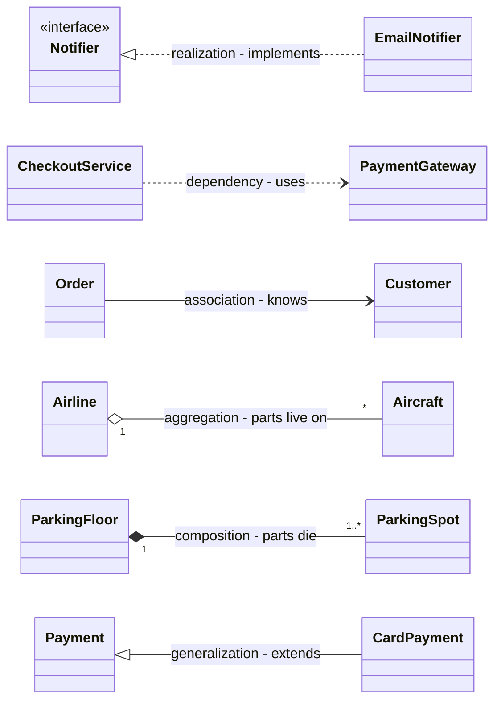

# Low-Level Design Handbook — Interview Edition

The book you re-read the night before an LLD / OOD or machine-coding round: all 22 chapters of the *Low-Level Design Handbook* (Java 21) cut down to the rules, tables, questions and traps that interviews test. Nothing here is new. Every line comes from the handbook; open the matching chapter there (Study or Full Edition) when you need the explanation, the diagram or the runnable code.

## How to use this edition

- **One section per chapter (1–22)**, always in the same order: **Must-know** (one-line rules) → **Key facts & numbers** (tables) → **Code to remember** (short Java sketches) → **In the interview** (likely questions, short answers) → **Gotchas** (mistake → correct idea) → **TL;DR**.
- **Design patterns (Ch 8–11):** every GoF pattern and every "beyond GoF" extra is **one table row**: intent → when → structure hint → the handbook's Java example → pitfall. Ten patterns also get a ≤10-line Java sketch.
- **Case studies (Ch 14–21):** each of the 45 problems is a **compact card**: requirements → core classes → key patterns → tricky part. Learn the tricky part first; that is where interviewers spend their follow-up questions.
- **Night before (about 2 hours):** Top 25 questions below → Ch 1 (framework) → the pattern tables → Ch 12 recipe → three case cards you have not practised (say requirements, classes and the hard method aloud, then check the card) → Last-minute checklist. Then stop; sleep beats one more pattern.
- **Morning of (15 minutes):** framework (Ch 1) → SOLID table (Ch 4) → "Which pattern?" table (Ch 11) → concurrency recipe (Ch 12) → the case cards you expect.
- **Rule for everything below:** recall first, then check. Recall is what the interview tests.

## Top 25 questions across the book

| # | Question | One-line answer | Ch |
|---|---|---|---|
| 1 | How do you approach an LLD question? | Clarify → requirements (8–12 + out-of-scope) → use cases → entities → relationships → class diagram → key flows → patterns/SOLID → code → edge cases/concurrency → extensions | 1 |
| 2 | LLD vs system design (HLD)? | HLD = many services and machines at scale; LLD = classes, relationships and code inside one application | 1 |
| 3 | When is something a class, not a field? | Different **behaviour** → class; different **data** only → field or enum | 1, 3 |
| 4 | Four pillars of OOP? | Encapsulation (data + rules together), abstraction (hide how), inheritance (true is-a only), polymorphism (one call, per-object behaviour; kills type switches) | 2 |
| 5 | Abstract class vs interface? | Interface = "can do" contract, many per class, no state; abstract class = "is a" with shared state/constructors, one parent | 2 |
| 6 | Overloading vs overriding? | Compile time by declared parameter types vs run time by the actual object; fields and statics are not polymorphic | 2 |
| 7 | `equals`/`hashCode` contract? | Equal objects must have equal hash codes; override both or hash collections break | 2 |
| 8 | Aggregation vs composition? | Both "has-a"; aggregation parts outlive the whole (hollow ◇), composition parts die with it (filled ◆); diamond at the **whole** | 3 |
| 9 | Explain SOLID with one example each | SRP: one actor per class; OCP: `switch(vehicleType)` → `ParkingRate` classes; LSP: Square/Rectangle; ISP: `Robot` can't `eat()`; DIP: service owns `OrderSaver`, `main` wires MySQL | 4 |
| 10 | DIP vs DI vs IoC? | Principle (depend on abstractions) vs technique (pass dependencies in) vs broad idea (framework calls your code) | 4 |
| 11 | When would you *not* apply SOLID / a pattern? | Nothing has varied yet, one implementation, throwaway code; rule of three; YAGNI decides *when* to cut the seam | 4, 5, 8 |
| 12 | Composition over inheritance — why? | Avoids fragile base classes and refused methods; allows run-time swapping | 2, 5 |
| 13 | Law of Demeter? | Talk only to immediate friends; `a.getB().getC().do()` → an intent-revealing method on `a` | 5 |
| 14 | Name some code smells and fixes | Long Function → Extract Function; Repeated Switches → Replace Conditional with Polymorphism; Feature Envy → Move Function; Refused Bequest → Replace Subclass with Delegate | 7 |
| 15 | Which patterns come up most? | Strategy, Factory, Observer, State, Singleton, Builder — each only when its signal appears | 8 |
| 16 | Thread-safe Singleton? | Eager, holder class, or `enum` (survives reflection + serialization); DCL needs `volatile`; prefer a DI singleton scope | 8 |
| 17 | Strategy vs State? | Same diagram; strategies are chosen from outside and never know each other; states know each other and advance the machine | 11 |
| 18 | Decorator vs Proxy vs Chain of Responsibility? | Decorator adds behaviour, every layer runs; Proxy controls access; in CoR one handler can stop the flow | 9, 10 |
| 19 | Adapter vs Facade vs Bridge? | Adapter converts one interface after the fact; Facade simplifies many objects; Bridge splits two dimensions up front | 9 |
| 20 | Observer vs Mediator vs Pub-sub? | Observer broadcasts, listeners decide; Mediator coordinates peers centrally; pub-sub is Observer through a broker (durability, retries) | 10, 11, 20 |
| 21 | How do you prevent double booking? | Name the real unit of inventory (show seat, room-night, vehicle-day) and make "if free then take" one atomic step: lock, CAS, or conditional `UPDATE`; holds with TTL | 12, 15 |
| 22 | Deadlock: conditions and fix? | Mutual exclusion, hold and wait, no preemption, circular wait; fix = global lock ordering (or `tryLock` + back-off) | 12 |
| 23 | Why is `volatile` not enough for `count++`? | Visibility, not atomicity; use `AtomicInteger`/`LongAdder` or a lock | 12 |
| 24 | LRU cache in O(1)? | `HashMap` key → node + doubly linked list with sentinels; move to front on get; evict `tail.prev` from list **and** map | 20 |
| 25 | How do you run a 90-minute machine-coding round? | Packages model/repository/service/strategy/exception/driver; mandatory features in order; run every ~15 min; services return data, driver prints and continues | 21 |

## 1. The LLD interview & how to approach it

What the round is, how it is judged, and the eleven-step framework you say out loud.

### Must-know
- **LLD round** — design the classes of *one* application and code the main flows. **Machine coding** — the same, but the code must *run* (≈90–120 min, in-memory).
- **Five core steps** — requirements → actors & use cases → classes → relationships → code. The full framework adds class diagram, key flows, patterns/SOLID, edge cases/concurrency, extensions.
- **Four requirement questions** — Who uses it? What can each actor do? What are the limits? **What is out of scope?** (the only question that makes the problem smaller).
- **Checkable requirement** — has a **number** ("at most five books") and an **actor** ("a member can reserve"): the number becomes a constant + one check, the actor names the owning class.
- **Finding classes** — nouns → candidate classes; verbs → methods; a verb with no home means a missing class.
- **Five cut tests** — a value? another name for the same thing? changing state? does anything call it? does **behaviour** or only **data** differ? → *data → field/enum; behaviour → class*.
- **One sentence per class, no "and"** — `ParkingLot` "issues tickets **and** tracks fullness" = two jobs; name the tension aloud.
- **Information Expert** — put each method where its data is ("find a free spot" → `ParkingFloor`).
- **Classes beginners forget** — the **record-keeping** class (ticket, loan, booking) and the **rule** class (rate, strategy).
- **Code skeleton** — Models → Repositories → Strategies → Services → Driver.

### Key facts & numbers

| Step | Ask yourself | Output |
|---|---|---|
| 1 Clarify | Who uses it? One site or many? | Shared understanding |
| 2 Requirements | Functional? Non-functional (thread-safe, extensible, in-memory)? Out of scope? | 8–12 numbered lines + out-of-scope list |
| 3 Use cases | What can each actor do? | Actor → use-case list |
| 4 Entities | Which nouns hold state or behaviour? | Classes, one sentence each |
| 5 Relationships | Uses / knows / has / owns / is-a? How many? | Typed lines with multiplicity |
| 6 Class diagram | Fields, key methods, interfaces, enums | UML class diagram |
| 7 Key flows | 2–3 main use cases; lifecycle of the core object | Sequence / activity / state diagram |
| 8 Patterns & SOLID | Rule that varies? Lifecycle? Many listeners? | 1–2 named patterns + one rejected |
| 9 Code | Interfaces, enums, models, services, driver | Running code for main flows |
| 10 Edge cases & concurrency | Bad input? Full? Two users, one seat? | Validation, exceptions, locks |
| 11 Extensions | "What if X is added?" | Short answers, maybe one class |

| 45-min OOD round | Time | 90-min machine coding | Time |
|---|---|---|---|
| Clarify requirements | 5–8 min | Read, requirements, assumptions | 5–10 min |
| Actors and use cases | 3–5 min | Model: entities, enums, interfaces | 10–15 min |
| Find the classes | 8–10 min | Core flow end to end | 30–40 min |
| Connect the classes | 8–10 min | Remaining features, validation | 15–20 min |
| Write the code | 12–15 min | Polish, one extension, demo | 5–10 min |
| | | Buffer | 5 min (never zero) |

Rule of thumb: **about a quarter of the time goes before you name a class**; in machine coding, **something runs by the halfway mark**.

| Code habit interviewers notice | Instead of |
|---|---|
| Pass time in (`Instant now`, injected `Clock`) | Reading the clock inside logic |
| Money as `BigDecimal` (from strings) or whole cents in a `long` | `double` (0.1 + 0.2 ≠ 0.3) |
| `IllegalArgumentException` / `IllegalStateException` / custom exception | Silent failure, error codes |
| `Optional` when "not found" is normal | Returning `null` |
| `private final` fields | Public mutable fields |
| Domain names (`ParkingTicket`) | `Manager`, `Helper`, `Data2` |

**What the interviewer judges:** (1) did you bound the problem? (2) one job per class? (3) right relationships? (4) code matches diagram? (5) can you explain one trade-off (choice + rejected option)? Machine coding adds: runs, modular, readable, handles bad input, thread-safe shared state (senior).

### Code to remember

```java
// The parking-lot core in one breath: fit rule on the enum, ticket records, rate is a rule class.
enum VehicleType {
    MOTORBIKE(List.of(SpotType.MOTORBIKE, SpotType.COMPACT)),
    CAR(List.of(SpotType.COMPACT, SpotType.LARGE)), TRUCK(List.of(SpotType.LARGE));
    private final List<SpotType> fits;
    VehicleType(List<SpotType> fits) { this.fits = fits; }
    boolean fits(SpotType s) { return fits.contains(s); } }
record ParkingTicket(String id, String plate, ParkingSpot spot, Instant entry) {}
interface ParkingRate { BigDecimal fee(Duration stay); }         // rule class -> Strategy
```

### In the interview
**Q:** Give the 30-second approach. **A:** "I clarify and write 8–12 requirements with an out-of-scope list, list actors and use cases, pick classes from the nouns with one job each, connect them in a class diagram, sketch the key flow, run a SOLID check and pick one or two patterns where the signal is clear, then code the core flows, handle edge cases and concurrency, and finish with extensions and trade-offs."

**Q:** Why not just start designing? **A:** Without a boundary the problem grows forever and every omission becomes indefensible.

**Q:** The interviewer says "your choice". **A:** Pick the simpler option, say it, and write it down as a visible assumption.

**Q:** You won't finish — what matters most? **A:** Bounded scope, clean responsibilities, correct relationships, code that matches the diagram, one defended trade-off.

**Q:** How many patterns in 45 minutes? **A:** One or two where the signal appears, and name one you rejected.

**Q:** Make "users can book some seats" checkable. **A:** "A customer can hold at most 10 seats per show; unpaid holds release after 10 minutes."

### Gotchas
- Coding in minute two → spend 8–13 minutes on requirements and actors first.
- No out-of-scope list → write it and get agreement; declining an idea politely is a **strong** move.
- One subclass per value (`CompactSpot`, `LargeSpot`) → one `ParkingSpot` with a `SpotType` enum.
- God class (`ParkingLotManager`) → one sentence per class; split on "and".
- Inheritance for reuse ("Car extends Engine") → composition.
- Pattern stuffing → one or two, each with its signal.
- Twelve classes at equal depth → two or three flows done fully.
- Ignoring two users on one resource → lock or atomic operation on the shared state.
- Non-running machine-coding code → thin end-to-end path running by halfway.

### TL;DR
Bound the problem first (8–12 requirements + out of scope), different data → field / different behaviour → class, one sentence per class, SOLID as quick checks, one or two patterns with a signal; inject time, exact money, guard shared state.

## 2. OOP fundamentals

The four pillars and the Java tools behind them: interfaces, abstract classes, enums, records, equality, generics.

### Must-know
- **OOP** — data bundled with the only code allowed to change it.
- **Encapsulation** — fields private; only the owning class's methods change them and they enforce the rules (no setters that break invariants).
- **Abstraction** — expose only what callers need; hide how (interfaces, small public API).
- **Encapsulation vs abstraction** — hiding *data* behind rule-enforcing methods vs hiding *complexity* behind a minimal set of operations.
- **Inheritance** — child reuses and specialises parent, **only when "child is a parent" is truly correct**.
- **Polymorphism** — one call, per-object behaviour; replaces `switch`/`instanceof` chains. **Dynamic dispatch** = JVM picks the override from the actual class at run time.
- **Overloading** (compile time, declared parameter types) vs **overriding** (run time, actual object). Fields and `static` methods are **not** polymorphic (statics are hidden).
- **`this` / `static` / `final`** — current object / one per class / cannot be reassigned, overridden or extended.
- **Interfaces** — contracts; may have `default`, `static`, `private` methods; **functional interface** = one abstract method (lambda target).
- **Enums with behaviour** — fixed sets with fields and methods ("which spot types fit a truck" lives on `VehicleType`).
- **Records** — compact immutable data carriers, but only **shallowly** immutable: copy collections in the compact constructor.
- **Immutable class** — final class, private final fields, no setters, validate, defensive copies in and out (or a record).
- **Access** — default to `private`; package-private = same package only.
- **Generics** — type-safe reusable infrastructure; **PECS**: producer `extends`, consumer `super`.
- **Coupling / cohesion** — low coupling between classes, high cohesion inside a class.
- **OOA → OOD → OOP** — what the problem is → how, with objects → code. Connections that carry data become objects.

### Key facts & numbers

| | Abstract class | Interface |
|---|---|---|
| Instantiable | No | No |
| Instance fields | Yes | No (only `public static final` constants) |
| Constructors | Yes | No |
| Method bodies | Any | `default`, `static`, `private` only |
| Per class | **One** (`extends`) | **Many** (`implements`) |
| Expresses | "is a" (shared identity + state) | "can do" (capability / role) |
| Typical use | Shared state + partial implementation (Template Method) | Contracts, roles, strategies, test seams |

**Rule of thumb:** start with an interface; add an abstract class underneath when implementations share real state or a fixed algorithm (JDK: `List` + `AbstractList` + `ArrayList`).

| Pillar | Java tools | Smell when missing |
|---|---|---|
| Encapsulation | `private` fields, no setters, validation in constructors | Public fields; setters breaking invariants |
| Abstraction | Interfaces, abstract classes, small API | Callers reach into internals |
| Inheritance | `extends`, `super`, `@Override` | Subclass refuses or throws on parent methods |
| Polymorphism | Overriding + dynamic dispatch | `switch` / `instanceof` chains on type |

### Code to remember

```java
public record Money(BigDecimal amount, String currency) {          // value object
    public Money { Objects.requireNonNull(currency);
        if (amount.signum() < 0) throw new IllegalArgumentException("negative"); }
    public Money plus(Money o) { return new Money(amount.add(o.amount), currency); }
}
public record Order(List<String> items) {                          // shallow -> copy it
    public Order { items = List.copyOf(items); }
}
```

### In the interview
**Q:** Pillars of OOP in 30 seconds? **A:** "Encapsulation keeps data and its rules in the owning class; abstraction exposes only what callers need; inheritance reuses a parent when is-a truly holds; polymorphism lets one call behave per object, removing type switches. I prefer interfaces and composition, enums for fixed sets, records for values, and consistent equals/hashCode."

**Q:** How do you make a class immutable? **A:** Final class, private final fields, no setters, defensive copies (or a record that copies its collections).

**Q:** What is dynamic dispatch? **A:** The JVM choosing the override from the object's actual class at run time.

**Q:** Where does "which spots fit a truck" live? **A:** On the `VehicleType` enum.

**Q:** Is a class with `private final Date created` immutable? **A:** Not unless it copies the mutable `Date` in and out — prefer `Instant`.

**Q:** Interface or abstract class first? **A:** Interface; add an abstract class only for real shared state or a fixed algorithm.

### Gotchas
- Overriding `equals` without `hashCode` → hash collections lose entries; override both from the same fields.
- `final List` field → the reference is final, the list is not; copy with `List.copyOf`.
- Expecting a static method or field to be overridden → statics are hidden; only instance methods dispatch dynamically.
- Inheritance to share code ("is-a" false) → composition.
- Public mutable fields → private + behaviour methods.

### TL;DR
OOP = data + the only code allowed to change it. Pillars: encapsulation, abstraction, inheritance (true is-a), polymorphism (kills type switches). Interfaces for contracts, abstract classes for shared state, enums for fixed sets, records for values, `equals` + `hashCode` together, private by default.

## 3. Class relationships & UML

The six relationships (what each claims about lifetime and substitution) and the few UML diagrams worth drawing.

### Must-know
- **Six relationships, weakest → strongest coupling** — dependency, association, aggregation, composition, realization, generalization.
- **Dependency** — A *uses* B (parameter, local, return, static call); dashed arrow.
- **Association** — A *knows* B (field, created elsewhere); solid line, arrow if one-way.
- **Aggregation** — A *has* B, parts **outlive** the whole; hollow ◇ at the whole.
- **Composition** — A *owns* B, parts **die with** the whole, not shared; filled ◆ at the whole.
- **Realization** — A *implements* B; dashed line, hollow △ at the interface.
- **Generalization** — A *is a* B; solid line, hollow △ at the parent.
- **Multiplicity changes code** — `1` required field; `0..1` `Optional`/nullable; `1..*` non-empty collection checked in the constructor; exact numbers checked in constructors.
- **Visibility** — `+` public, `-` private, `#` protected, `~` package.
- **Qualified association** — lookup by key (`Library [isbn] → Book`, i.e. a `Map`). **Association class** — data about the link itself (`Enrollment{grade}`).
- **Use case** «include» = always (base → included); «extend» = sometimes (extension → base).
- **Sequence arrowheads** — filled = synchronous, open = asynchronous, dashed = return.
- **State transition label** — `event [guard] / action`.

### Key facts & numbers

| Relationship | Phrase | UML line | Java shape | Lifetime | Example |
|---|---|---|---|---|---|
| Dependency | uses | dashed, open arrow | parameter / local | none | `CheckoutService` ⇢ `PaymentGateway` |
| Association | knows | solid line/arrow | field, created elsewhere | independent | `Order` → `Customer` |
| Aggregation | has, parts live on | solid, ◇ at whole | field/collection passed in | B outlives A | `Airline` ◇— `Aircraft` |
| Composition | owns | solid, ◆ at whole | A creates and hides B | B dies with A | `ParkingFloor` ◆— `ParkingSpot` |
| Realization | implements | dashed, △ at interface | `implements` | — | `EmailNotifier` ⇢ `Notifier` |
| Generalization | is a | solid, △ at parent | `extends` | — | `CardPayment` → `Payment` |

**Choosing, in order:** interface it promises → realization; substitutable with no refused methods → generalization; not kept in a field → dependency; part dies with whole → composition; part outlives it → aggregation; otherwise → association.

| Diagram | Use it for | Budget in 45 min |
|---|---|---|
| Use case | Scope: actors + what each does | Usually spoken, 3–5 min |
| **Class** | **The answer**: 10–15 boxes, every line typed, with multiplicity | Always drawn, 10–15 min |
| Sequence | Call order (3–4 objects, 6–8 messages) | One behaviour diagram only |
| Activity | A branching flow; fork/join for parallel steps | ″ |
| State machine | One object's lifecycle | ″ |

UML has **14 diagram types**: 7 structural (class, object, package, component, composite structure, deployment, profile) and 7 behavioural (use case, activity, state machine, sequence, communication, interaction overview, timing).



Mermaid: `A ..> B` dependency · `A --> B` association · `A o-- B` aggregation, `A *-- B` composition (A is the whole) · `B <|.. A` realization · `B <|-- A` generalization.

### Code to remember

```java
class ParkingFloor {                                   // composition: floor creates and owns spots
    private final List<ParkingSpot> spots = new ArrayList<>();
    ParkingFloor(int n) { for (int i = 0; i < n; i++) spots.add(new ParkingSpot(i)); }
}
class Airline {                                        // aggregation: aircraft passed in, outlive airline
    private final List<Aircraft> fleet;
    Airline(List<Aircraft> fleet) { this.fleet = List.copyOf(fleet); }
}
```

### In the interview
**Q:** Six relationships from weakest to strongest? **A:** Dependency, association, aggregation, composition, realization, generalization.

**Q:** Where does the diamond go and what does filled mean? **A:** At the whole; filled = composition (the part dies with the whole).

**Q:** `CompactSpot`/`LargeSpot` subclasses that only pass a constant to `super`? **A:** One `ParkingSpot` with a `SpotType` enum.

**Q:** If you draw only one diagram? **A:** The class diagram — it is the answer; test it with one behaviour diagram.

**Q:** Why is `Box → Piece` in chess not composition? **A:** A captured piece is not destroyed with the square.

### Gotchas
- Diamond at the part end → it goes at the **whole**; triangle at the child → it goes at the **parent/interface**.
- Lines without type or multiplicity → label every line.
- Inheritance used to share data → one class + enum field.
- Drawing every diagram → class diagram always, one behaviour diagram at most.

### TL;DR
Relationships claim lifetime and substitution. Choose by the substitution test, then "dies with the whole?", then "outlives?", else association; parameter-only = dependency. Multiplicity becomes code. Draw little, label everything, say the test aloud.

## 4. SOLID principles

Five names for the ways code becomes painful to change — a diagnostic tool, not a checklist.

### Must-know
- **SRP** — one reason to change = **one actor** asks for its changes. Signal: responsibility sentence needs "and"; *Divergent Change*, *Large Class*.
- **OCP** — add behaviour by adding code, not editing working code. Signal: `switch`/`if` over a type. Closure is against *a kind of* change, not all editing.
- **LSP** — a subtype is usable anywhere its parent is: demands no more (preconditions not stronger), guarantees no less (postconditions not weaker), keeps invariants and history, throws nothing new.
- **ISP** — no client depends on methods it doesn't use → split into **role interfaces**, one per kind of caller.
- **DIP** — depend on abstractions; **the policy (high-level) owns the abstraction**; `main` wires the details.
- **SRP vs ISP** — SRP splits classes (guards the worker); ISP splits interfaces (guards the caller).
- **DIP vs DI vs IoC** — principle / technique (constructor injection) / broad idea (framework calls you; containers perform DI). A concrete parameter is injection without inversion.
- **Cohesion** — do the parts of this class belong together? **Coupling** — how much does A depend on B? **SoC** — is each area of work in its own module?
- **Order to apply** — S → O → L → I → D, each triggered by a real change.
- **YAGNI is the counterweight** — SOLID says *what* a good seam looks like; YAGNI says *when* to cut it.

### Key facts & numbers

| Principle | Smell that signals a violation | Fix | Patterns that help |
|---|---|---|---|
| **S** | "and" in the sentence; Divergent Change | Split by actor (Extract Class); names must stand alone | Command, Proxy, Decorator |
| **O** | Type `switch`; Repeated Switches, Shotgun Surgery | Varying part behind an interface; variants as classes | Strategy, Template Method, Decorator, Factory Method, Observer, Visitor |
| **L** | Subclass throws/no-ops a parent method; Refused Bequest | Better parent, narrower interface, composition | Composite, Null Object |
| **I** | Empty bodies / `UnsupportedOperationException` | Role interfaces per caller | Adapter |
| **D** | High-level class `new`s a low-level one; untestable | Inject an interface owned by the high-level class | Strategy, factories, Adapter, Observer |

| Over-engineering warning sign | Misapplied | Do instead |
|---|---|---|
| `XHelper`, `XUtils` after a split | SRP | Split by actor |
| Small classes always changed in the same commit | SRP over-split | Merge back |
| Interface + factory + registry for one implementation | OCP (Speculative Generality) | Write the `if`; refactor at case 2–3 (rule of three) |
| Subclass that silently does nothing | LSP | Better parent or composition |
| One interface per method | ISP over-split | Group by caller |
| Interface in front of `String`-like classes | DIP | Invert only volatile dependencies |
| DI container for a 200-line program | DIP | Wire by hand in `main` |

**Five-minute pass over your diagram:** run S → O → L → I → D. **Two findings is a good pass; five means rework; zero means you didn't look.** S and O earn the most credit; O is what a late requirement probes ("trucks charged differently?" → "add a class").

### Code to remember

```java
// OCP + DIP: the policy owns the abstraction; variants are classes; main wires.
interface ParkingRate { BigDecimal fee(Duration stay); }
final class HourlyRate implements ParkingRate { /* tiers */ public BigDecimal fee(Duration d) { ... } }
final class ExitService {
    private final ParkingRate rate;                     // injected, not `new HourlyRate()`
    ExitService(ParkingRate rate) { this.rate = rate; }
    BigDecimal charge(ParkingTicket t, Instant now) { return rate.fee(Duration.between(t.entry(), now)); }
}
```

### In the interview
**Q:** `switch (vehicleType)` computing fees? **A:** OCP — a `ParkingRate` interface, one class per rate.

**Q:** `ReadOnlyList extends ArrayList` throws on `add`? **A:** LSP; compose, or use a read-only interface.

**Q:** Why is Square/Rectangle worse than `Penguin.fly()` throwing? **A:** It fails **silently** (wrong area, no error).

**Q:** `Robot implements Worker { work(); eat(); }`? **A:** ISP; split by caller into `Workable` / `Eater`.

**Q:** `private final MySqlOrderDao dao = new MySqlOrderDao();`? **A:** DIP violation and untestable; inject an `OrderSaver` interface the service owns.

**Q:** How do you name a design problem aloud? **A:** Observation → cost → fix → price of the fix; describe before labelling ("`Reporting` implements nine methods but calls two — an interface segregation problem").

**Q:** Is SOLID still relevant / would you always apply it? **A:** As diagnostic vocabulary, yes; almost never "always" — flexibility later is bought with simplicity now.

**Q:** Most violated principle? **A:** SRP (responsibilities accumulate), or ISP in reverse (an interface per method).

### Gotchas
- Reciting definitions → spot the problem in *this* design and state its cost.
- Applying all five at once → apply one when a real change asks for it.
- OCP "forbids editing" → no, it closes the code against one kind of change.
- "Composition always" → only when behaviour varies or a subclass would refuse a method.
- Confidently naming the wrong principle → describe first, label second.

### TL;DR
SRP one actor per class; OCP varying part behind an interface; LSP keep every promise, compose when a subclass would refuse; ISP one role per caller; DIP policy owns the abstraction, `main` wires. Diagnose, don't checklist; always state what the fix costs.

## 5. More design principles (DRY, KISS, YAGNI, Demeter, GRASP…)

The principles that sit beside SOLID, and the tensions between them.

### Must-know
- **DRY** — each piece of *knowledge* has one authoritative home (value objects, constants, methods).
- **KISS** — simplest design that works. **YAGNI** — don't build before it's needed (delete Speculative Generality).
- **Law of Demeter** — only talk to immediate friends; no train wrecks `a.getB().getC().do()`.
- **Tell, Don't Ask** — tell the owner what to do instead of pulling its data out and deciding for it (fixes anemic models, Feature Envy).
- **Composition over inheritance** — prefer has-a for reuse; avoids fragile base classes.
- **Program to an interface** — depend on supertypes; pick the concrete class once, at the edge.
- **Encapsulate what varies** — isolate the changing part behind an interface (Strategy, lambdas).
- **Loose coupling** — interacting objects know little about each other (Observer, events, DI).
- **Hollywood Principle / IoC** — "don't call us, we'll call you" (Template Method, callbacks, DI).
- **Least Astonishment** — do what the name promises, nothing more. **Fail fast** — guard clauses, `requireNonNull`.
- **Immutability** — objects never change after creation → no aliasing bugs, no races.
- **Design by Contract** — preconditions (caller's duty), postconditions (method's), invariants (always true).
- **GRASP** — nine guidelines for "which class should do this?" (table below).

**Domain-Driven Design (§17) — must-know**
- **Ubiquitous language** — the business's words in the code: `order.place()`, not `setStatus(2)`.
- **Bounded context** — one model + one vocabulary inside a boundary (Sales "order" ≠ Shipping "consignment"); often one team/service. Translate at the border with an **anti-corruption layer**.
- **Entity** = identity that survives change (equal by id); **value object** = defined by values, immutable, equal by value (`Money`, `Address`) — prefer value objects over primitives.
- **Aggregate** = cluster changed as one unit; outsiders touch only the **root**, which guards invariants. Keep it **small**, reference other aggregates **by id**, change **one aggregate per transaction**.
- **Domain events** (`OrderPlaced`) — past-tense facts; publish **after commit** (transactional outbox); other aggregates/contexts catch up eventually (sagas for multi-step flows).
- **Repository per aggregate root** (no `OrderLineRepository`); application services load → call one domain method → save.
- **Skip heavy DDD** for CRUD apps; value objects and good names are always worth it.

### Key facts & numbers

| GRASP guideline | Rule |
|---|---|
| Information Expert | The class with the data does the work |
| Creator | The container (or holder of the initial data) creates |
| Controller | A thin non-UI object receives each system event and delegates |
| Low Coupling | Pick the design with fewer, more stable dependencies |
| High Cohesion | Each class does one related set of things |
| Polymorphism | Each type implements the varying behaviour; no type switches |
| Pure Fabrication | Invent a helper (e.g. repository) when no domain class is a clean home |
| Indirection | A middleman between things that shouldn't know each other |
| Protected Variations | Wrap what's unstable behind a stable interface |

| Tension | Resolution |
|---|---|
| DRY vs loose coupling | Sharing code couples its users; share knowledge, not coincidence |
| YAGNI vs encapsulate-what-varies | Abstract only real or clearly predicted variation |
| Law of Demeter vs cohesion | Too many delegates → Middle Man smell |
| Information Expert vs SoC | Domain objects compute; fabrications (repositories) persist |

### Code to remember

```java
// Tell, Don't Ask + Demeter: the owner enforces its own rule.
// Ask (bad): if (account.getBalance().compareTo(amt) >= 0) account.setBalance(account.getBalance().subtract(amt));
final class Account {
    private BigDecimal balance;
    void withdraw(BigDecimal amt) {
        if (amt.signum() <= 0) throw new IllegalArgumentException("amount");     // fail fast
        if (balance.compareTo(amt) < 0) throw new IllegalStateException("insufficient");
        balance = balance.subtract(amt);
    }
}
```

### In the interview
**Q:** DRY — is duplicated code always bad? **A:** Duplicated *knowledge* is; two pieces that look alike but change for different reasons should stay apart (sharing them couples their users).

**Q:** Law of Demeter fix for `order.getCustomer().getAddress().getCity()`? **A:** Hide Delegate — an intent-revealing method such as `order.shippingCity()`; stop before it becomes a Middle Man.

**Q:** What is an anemic domain model? **A:** Classes with data but no behaviour, logic in services pulling the data out; fix with Tell, Don't Ask.

**Q:** DDD: entity or value object? **A:** Tracked over time by identity → entity (`Order` 1001); replaced when it changes → value object (`Money`, `Address`).

**Q:** How do two aggregates stay consistent? **A:** One aggregate per transaction; publish a domain event through an outbox; a handler or saga updates the other (eventual consistency).

**Q:** Which GRASP guideline justifies a repository? **A:** Pure Fabrication (plus Information Expert for the domain logic).

**Q:** Where does the Hollywood Principle appear? **A:** Template Method, framework callbacks, DI containers.

### Gotchas
- DRY by merging coincidentally similar code → shared code couples; keep it apart.
- Abstracting "just in case" → YAGNI; wait for the second or third case.
- Delegate methods everywhere to satisfy Demeter → Middle Man.
- Contracts enforced by magic error values → checks at method entry/exit and exceptions.

### TL;DR
DRY knowledge, KISS, YAGNI; talk to friends, tell don't ask; compose, program to interfaces, encapsulate what varies; fail fast; immutability; contracts; GRASP answers "who does this?" — Information Expert first.

## 6. Clean Code

Rules for readable, changeable code, plus review, error-handling and testing strategy.

### Must-know
- **Names** — reveal intent; pronounceable, searchable; one word per concept; code reads like the requirement.
- **Functions** — small; do one thing; one level of abstraction; stepdown order; ≤ 2–3 arguments; **no flag arguments**; no hidden side effects; **Command–Query Separation**; exceptions, not error codes.
- **Comments** — say it in code; comment only *why*, warnings, legal text, public contracts; delete commented-out code.
- **Formatting** — newspaper order (headline first), related things close, one automated team style.
- **Objects vs data structures** — objects hide data and expose behaviour; data structures expose data; no hybrids; no train wrecks.
- **Error handling** — unchecked exceptions with context; wrap vendor exceptions; empty collections / `Optional` / special case instead of `null`; never pass `null`; always clean up.
- **Boundaries** — keep third-party code behind your own interfaces; learn it with tests.
- **Unit tests** — three laws of TDD; one concept per test; Given–When–Then; **F.I.R.S.T.** (Fast, Independent, Repeatable, Self-validating, Timely).
- **Classes** — small by responsibility, cohesive, open for extension, depend on abstractions.
- **Systems** — build objects in one place (**composition root**) and inject them; cross-cutting concerns in proxies/aspects.
- **Simple design (Beck)** — passes the tests → reveals intention → no duplication → fewest elements (*Clean Code* swaps the middle two).
- **Boy Scout Rule** — leave the code a little cleaner than you found it.

### Key facts & numbers

| Area | Rule of thumb |
|---|---|
| Concurrency | Separate concurrency code; share as little as possible; use the library; keep locks small; plan shutdown |
| Code review order | Correctness → design → readability → tests → security → performance → operability; automate style; small PRs |
| Error strategy | Classify; translate at boundaries; retry only transient + idempotent with backoff; one global handler that logs once |
| Testing strategy | Many unit, some integration, few E2E; pick the right test double; verify state over interactions; don't mock what you don't own |
| Test doubles | Dummy, stub, spy, mock, fake |
| Smells catalogue | C/E/F/G/J/N/T heuristics as review vocabulary |

### Code to remember

```java
// Flag argument -> two intention-revealing methods; null -> Optional.
// Bad: void render(boolean isSuite)
void renderForSuite() { ... }
void renderForSingleTest() { ... }
Optional<User> findByEmail(String email) { return Optional.ofNullable(byEmail.get(email)); }
```

### In the interview
**Q:** What makes a function clean? **A:** Small, one thing, one abstraction level, few arguments, no flags, no hidden side effects, either a command or a query.

**Q:** When is a comment good? **A:** When it explains *why*, warns, or documents a public contract — not when it narrates unclear code (that's a smell; extract a function).

**Q:** Return `null` or what? **A:** Empty collection, `Optional` for "not found", or a special-case object.

**Q:** What is F.I.R.S.T.? **A:** Fast, Independent, Repeatable, Self-validating, Timely.

**Q:** When should a service retry? **A:** Only transient failures on idempotent operations, with backoff; log once in one global handler.

### Gotchas
- `process(data, true)` → flag arguments hide two functions.
- A method that returns a value *and* changes state → split (CQS).
- Leaking vendor exceptions → wrap at the boundary.
- Mocking third-party types → wrap them and mock your wrapper.
- Commented-out code "just in case" → delete it; version control remembers.

### TL;DR
Intent-revealing names, small single-purpose functions, comments for *why*, exceptions over codes and nulls, third-party code behind your interfaces, F.I.R.S.T. tests, one composition root, Beck's four rules.

## 7. Refactoring

Changing structure without changing behaviour — the 24 smells and the moves that cure them.

### Must-know
- **Refactoring** — change internal structure without changing observable behaviour, in small steps, tests as the safety net.
- **Two hats** — at any moment you are either adding function or refactoring, never both.
- **Characterisation test** — records what existing code does now, before you refactor it.
- **Code smell** — a surface symptom of a deeper design problem, not a bug by itself.
- **Smell families** — Bloaters, OO Abusers, Change Preventers, Dispensables, Couplers (+ 2nd-edition extras).
- **Refactoring toward patterns** — algorithm switch → Strategy; status checks → State; `null` checks → Null Object; same skeleton → Template Method; many constructors → Factory Method; ordered setup calls → Builder; undo/queue → Command; logging/caching mixed in → Decorator; polling → Observer; wrong interface → Adapter; feature combinations → Strategy/Decorator/Bridge; a pattern not earning its keep → remove it.

### Key facts & numbers

| Smell | Signal | First move |
|---|---|---|
| Mysterious Name | `data`, `proc()`, `Manager` | Change Function Declaration / Rename |
| Duplicated Code | Same structure in several places | Extract Function |
| Long Function | You want a comment to explain a block | Extract Function |
| Long Parameter List | Many same-typed params, boolean flags | Introduce Parameter Object, Preserve Whole Object |
| Global Data | Writable from anywhere (incl. mutable singletons) | Encapsulate Variable |
| Mutable Data | Shared data changed after creation | Encapsulate Variable |
| Divergent Change | One class changed for many reasons (SRP) | Split Phase, Extract Class |
| Shotgun Surgery | One change → edits in many classes | Move Function, Move Field |
| Feature Envy | Uses another class's data more than its own | Move Function |
| Data Clumps | Values always travel together | Extract Class, Introduce Parameter Object |
| Primitive Obsession | Money as `double`, status as `String` | Replace Primitive with Object |
| Repeated Switches | Same type switch in several places | Replace Conditional with Polymorphism |
| Loops | Loop that filters/maps/aggregates | Replace Loop with Pipeline |
| Lazy Element | Class/function not pulling its weight | Inline Function / Inline Class |
| Speculative Generality | "Might need someday" hooks | Collapse Hierarchy, Inline, Remove Dead Code |
| Temporary Field | Field set only sometimes | Extract Class, Introduce Special Case |
| Message Chains | `a.getB().getC().getD()` | Hide Delegate |
| Middle Man | Most methods just forward | Remove Middle Man |
| Insider Trading | Modules poke each other's internals | Move Function / Move Field |
| Large Class | God class | Extract Class |
| Alternative Classes, Different Interfaces | `sendMail` vs `dispatch` | Change Function Declaration |
| Data Class | Only fields + getters/setters | Encapsulate Record, Move Function |
| Refused Bequest | Subclass rejects inherited methods (LSP) | Replace Subclass/Superclass with Delegate |
| Comments | Comment as deodorant | Extract Function |

| Smell family | Principle violated |
|---|---|
| Divergent Change, Large Class | SRP |
| Repeated Switches, Shotgun Surgery | OCP |
| Refused Bequest | LSP |
| Global / Mutable Data | Encapsulation |
| Hard-wired `new` of concrete dependencies | DIP |
| Duplicated Code / Speculative Generality | DRY / YAGNI |
| Message Chains, Insider Trading | Law of Demeter |
| Feature Envy, Data Class | Tell, Don't Ask |

### Code to remember

```java
// Replace Conditional with Polymorphism (the most-asked move)
// Before: switch (type) { case CAR -> 20; case TRUCK -> 50; ... } repeated in 3 places
sealed interface Vehicle permits Car, Truck {
    int hourlyRate();
}
record Car(String plate) implements Vehicle { public int hourlyRate() { return 20; } }
record Truck(String plate) implements Vehicle { public int hourlyRate() { return 50; } }
```

### In the interview
**Q:** What is refactoring, and what isn't? **A:** Behaviour-preserving structural change in small tested steps; adding a feature at the same time is not refactoring (two hats).

**Q:** Legacy code with no tests — first step? **A:** Characterisation tests that pin current behaviour, then small refactorings.

**Q:** A 200-line method? **A:** Extract Function on each commented block, Replace Temp with Query, Decompose Conditional; maybe Replace Function with Command.

**Q:** Which smell signals an OCP problem? **A:** Repeated Switches / Shotgun Surgery.

**Q:** Name smells that point to Law of Demeter violations. **A:** Message Chains and Insider Trading.

### Gotchas
- Refactoring without tests → you cannot prove behaviour didn't change.
- Big-bang rewrites → small compiling steps, run tests after each.
- Refactoring *into* patterns by reflex → only when the smell is real; removing a pattern is also a refactoring.

### TL;DR
Refactor = same behaviour, better structure, tiny tested steps, one hat at a time. Know the 24 smells by their signal and their first move; smells map to principles; patterns are refactoring targets, not starting points.

## 8. Design patterns: introduction & creational

What a pattern is, how to pick one, the anti-patterns, and the five creational patterns plus Simple Factory and Object Pool.

### Must-know
- **Pattern** = name + problem + solution template + consequences. Value: shared vocabulary and proven trade-offs. Risk: overuse.
- **GoF count** — 5 creational + 7 structural + 11 behavioral = **23**. Class-scoped (inheritance): Factory Method, class Adapter, Template Method, Interpreter; the rest are object-scoped (composition).
- **Pick from a signal, not from memory** — "a rule that varies", "creation depends on a type value", "many listeners", "a lifecycle", "exactly one", "many optional fields".
- **The six in almost every round** — Strategy, Factory, Observer, State, Singleton, Builder.
- **Anti-patterns** — God Object; Golden Hammer (favourite pattern everywhere); patternitis (factory for one class); Singletonitis (singletons as globals); cargo-cult structure without intent.
- **Singleton** — one instance **per JVM (strictly per class loader)**; eager, holder class, or `enum` (most robust against reflection and serialization); DCL needs `volatile`; it is global state → prefer a DI singleton scope. Many case studies reject it.
- **Simple Factory** — one `create(type)` with a switch; an idiom, **not** GoF, not strictly OCP (a `Supplier` registry makes it open).
- **Factory Method vs Abstract Factory** — one product varied by **inheritance** (a protected hook the base procedure calls) vs a **family** of matching products by **composition** (one factory object, chosen once at the composition root).
- **Builder** — required values in the builder constructor, named optional steps returning `this`, one validating `build()` → immutable product via a private constructor. Director optional; staged builder enforces required steps at compile time.
- **Prototype** — copy a configured instance; decide **shallow vs deep per field**; copy constructors, not `Cloneable`; never copy identity (DB id, connection).
- **Object Pool** — borrow/return a bounded set of expensive objects; release in `finally`, reset, validate; use HikariCP in production.

### Key facts & numbers

| Pattern | Intent | When | Structure hint | Handbook Java example | Pitfall |
|---|---|---|---|---|---|
| **Singleton** | Exactly one instance + global access | Genuinely one (config, registry) | Private ctor + static accessor (holder / enum) | `EagerConfigStore`, `EnumConfigStore`, `AppLogger`; `DiAlternative` | DCL without `volatile`; hidden global state; `reset()` "for tests"; "one per system" (it's per JVM) |
| **Simple Factory** (idiom) | Map a type value to a class | Small stable set of types | Static `create(type)` returning an interface | `NotificationFactory.create(Channel)` | Called "Factory Method"; `default` returning `null`; grows into a God class |
| **Factory Method** | Subclasses decide which product to create | Shared procedure, varying product | Abstract creator, `protected abstract createX()` called by the template | `ReportGenerator.createDocument()`; `SupplierReportGenerator` | Public factory method; calling it from the base constructor |
| **Abstract Factory** | Create matching families | Products must match; swap a whole set | Interface with one `createX()` per product | `StorageFactory` → `Connection` + `QueryBuilder` | New product kind edits every factory; choosing the factory deep in the call stack |
| **Builder** | Build complex objects step by step | ~6+ args, many optional, cross-field rules | Static nested `Builder`, fluent setters, validating `build()` | `HttpRequest.Builder`, `Email`; `TelescopingPizza` (the problem) | No validation in `build()`; sharing mutable collections; public product ctor |
| **Prototype** | New objects by copying | Setup expensive; only the interface known | `copy()` / copy constructor; registry of prototypes | `NotificationTemplate`, `ShapeRegistry`; `CloneablePitfall` | Shallow-copied mutable list; trusting `super.clone()`; handing out the registry original |
| **Object Pool** (extra) | Reuse bounded expensive objects | DB connections, limited resources | `Semaphore` permits + idle queue + factory/reset/validate | `ObjectPool<T>` | Not releasing in `finally`; no reset; double release raising the cap |

| Question you're asking | Pattern |
|---|---|
| "Which class, from a type value?" | Simple Factory / Factory Method |
| "Which *family* of classes?" | Abstract Factory |
| "Too many constructor arguments?" | Builder |
| "Another one of *this*, cheaply?" | Prototype |
| "Only one, ever?" | Singleton (or DI singleton scope) |
| "Expensive, created and destroyed repeatedly?" | Object Pool |

### Code to remember

```java
public final class ConfigStore {                       // Singleton: holder idiom
    private ConfigStore() { }
    private static final class Holder { static final ConfigStore INSTANCE = new ConfigStore(); }
    public static ConfigStore get() { return Holder.INSTANCE; }   // lazy + thread-safe via class loading
}
// public enum ConfigStore { INSTANCE; ... }           // survives reflection + serialization
```

```java
public final class HttpRequest { private final String url, method, body;       // Builder
    private HttpRequest(Builder b) { url = b.url; method = b.method; body = b.body; }   // private: only build()
    public static final class Builder {
        private final String url; private String method = "GET"; private String body;
        public Builder(String url) { this.url = url; }                       // required -> constructor
        public Builder method(String m) { method = m; return this; }
        public Builder body(String b) { body = b; return this; }
        public HttpRequest build() {   // one validating exit; cross-field rule
            if (method.equals("GET") && body != null) throw new IllegalStateException("GET cannot have a body");
            return new HttpRequest(this); } } }
```

```java
public abstract class ReportGenerator {                // Factory Method
    protected abstract Document createDocument();      // the hook (protected, not public)
    public final String generate() {                   // procedure written once
        List<String> rows = List.of("north,120", "south,95");
        Document d = createDocument(); d.render(rows); return d.fileName();
    }
}
class PdfReportGenerator extends ReportGenerator { protected Document createDocument() { return new PdfDocument(); } }
```

### In the interview
**Q:** Why does double-checked locking need `volatile`? **A:** Otherwise the reference can be published before the constructor's writes are visible; `volatile` adds the happens-before edge.

**Q:** Unique IDs across 10 servers — Singleton? **A:** No, a Singleton is one per JVM. Use a DB sequence, Snowflake-style IDs (timestamp + machine id + counter) or UUIDs.

**Q:** Simple Factory vs Factory Method? **A:** One static switch that knows every type vs subclasses overriding a hook the base procedure calls. Raise this yourself — calling a switch a Factory Method is a classic slip.

**Q:** Add SQLite to an Abstract Factory? **A:** `SqliteConnection`, `SqliteQueryBuilder`, `SqliteFactory`, one line in the composition root. Adding a new product kind (e.g. `MigrationRunner`) edits every factory — the weak spot.

**Q:** How does a Builder enforce required fields? **A:** Builder constructor, validation in `build()`, or a staged builder. The immutable product is thread-safe; the builder is not.

**Q:** Deep copy with cycles? **A:** Identity map original → copy; reuse the copy if already made.

**Q:** Static factory method vs constructor? **A:** Has a name, can cache (`Integer.valueOf`), can return subtypes.

**Q:** Pool sizing? **A:** From measured concurrency and downstream limits; small pools (≈ core-count scale) often win.

### Gotchas
- Naive lazy Singleton in multithreaded code → holder / enum / eager.
- `Serializable` Singleton without `readResolve()` → second instance (enum avoids it).
- Singleton by reflex in case studies → inject one shared instance.
- Factory for a single concrete class → YAGNI; add when the second variant arrives.
- Director when the order never varies → skip it.
- `Cloneable` → copy constructor.

### TL;DR
Patterns come from signals; use one or two and name one you rejected. Singleton: eager/holder/enum, prefer DI. Factory Method = inheritance hook for one product; Abstract Factory = matching families; Builder = named steps + validating `build()` → immutable; Prototype = copy, shallow vs deep per field.

## 9. Structural patterns

How objects are composed: make it fit, add to it, guard it, simplify it, split it, nest it, share it.

### Must-know
- **Memory hooks** — Adapter *make it fit* · Decorator *add to it* · Proxy *guard it* · Facade *simplify it* · Bridge *split it* · Composite *nest it* · Flyweight *share it*.
- **Adapter** — implements **your** interface, holds the vendor's object, translates inputs, outputs **and errors**; prefer object adapters (composition, works with final classes). Only at boundaries you don't control.
- **Bridge** — two varying dimensions → two hierarchies + one reference; multiplication becomes addition (3 × 3 = 9 classes → 3 + 3 = 6). Same code as Strategy, different intent (permanent dimension designed up front).
- **Composite** — leaf and container share one interface; the container's child list is typed as **the interface**; safe (add only on composite) vs transparent (add on the interface); guard cycles; cache big totals.
- **Decorator** — same interface, holds the interface, wraps to add behaviour; N features = N classes, stackable; **order matters** (retry closest to what fails, authorization outside any cache).
- **Facade** — one door into a subsystem; wraps **several** objects; subsystem stays public; sequences and owns cleanup but **never decides** business rules.
- **Flyweight** — split intrinsic (shared, immutable) from extrinsic (passed in) state; factory-owned thread-safe pool; measure first.
- **Proxy** — same interface, controlled access: virtual (lazy), protection, remote, caching, logging, smart reference. Static (hand-written) or dynamic (`java.lang.reflect.Proxy` + `InvocationHandler`); Spring AOP is proxies.

### Key facts & numbers

| Pattern | Intent | When | Structure hint | Handbook Java example | Pitfall |
|---|---|---|---|---|---|
| **Adapter** | Convert an interface into the one clients expect | Vendor/legacy API doesn't match | Implements target, wraps adaptee, translates errors | `StripeGateway`, `PayPalGateway` → `PaymentGateway`; `FahrenheitSensor` | Leaking vendor types/exceptions; `if (vendor == STRIPE)` in one adapter; mapping "pending" to success |
| **Bridge** | Abstraction and implementation vary independently | Two dimensions multiplying classes | Abstraction holds an implementor interface | `Notification` (Alert/Reminder/Digest) × `Channel` (Email/SMS/Push) | Built "just in case"; abstraction branching on implementor type |
| **Composite** | Treat leaves and trees uniformly | Part-whole trees | Container holds `List<Component>` and delegates | `FileSystemNode` / `FolderNode` / `FileNode`; `Menu`/`MenuItem` | Child list typed as the leaf; returning the mutable list; no cycle check |
| **Decorator** | Add responsibilities by wrapping | Optional features in combinations | Implements + holds the same interface, forwards | `UserRepository` + `LoggingRepository`, `CachingRepository`; `Beverage` + `Mocha`, `Whip` | Holding the concrete class (can't stack); cache not invalidated on writes; auth inside a cache |
| **Facade** | Simple entry to a complex subsystem | Callers repeat the same multi-step sequence | One class calling several services in order | `OrderFacade.placeOrder` (inventory, payment, shipping, email) | Business rules in the facade; forgetting the failure path (release reservation) |
| **Flyweight** | Share intrinsic state among many objects | Millions of near-identical objects | Immutable flyweight + factory pool; extrinsic state as parameters | `MarkerStyleFactory` → `MarkerStyle` shared by `Marker`s | Extrinsic state inside the flyweight; `HashMap` check-then-put pool; `==` on boxed values |
| **Proxy** | Stand-in that controls access | Expensive, remote, restricted, cacheable | Same interface; creates or guards the real object | `LazyReport`, `CachingRateProxy`, `RemoteRateProxy`, `LoggingHandler` (dynamic) | Non-`volatile` lazy field; expensive call looks cheap (N+1); Spring self-invocation |

| Look-alikes | Difference |
|---|---|
| Adapter vs Decorator | Adapter changes the interface, keeps behaviour; Decorator keeps the interface, adds behaviour |
| Decorator vs Proxy | Same structure; Decorator adds behaviour to an object it's handed (often stacked); Proxy controls access and often creates the real object |
| Adapter vs Bridge | Adapter is retrofitted after the fact; Bridge is designed in up front |
| Facade vs Mediator | Facade: one-way, subsystem unaware of it; Mediator: two-way among peers that know it |
| Flyweight vs Object Pool | Flyweights shared by many at once; pooled objects used by one borrower at a time |

### Code to remember

```java
interface UserRepository { User find(int id); void rename(int id, String name); }
final class CachingRepository implements UserRepository {          // Decorator
    private final UserRepository inner;                             // holds the INTERFACE -> stackable
    private final Map<Integer, User> cache = new ConcurrentHashMap<>();
    CachingRepository(UserRepository inner) { this.inner = inner; }
    public User find(int id) { return cache.computeIfAbsent(id, inner::find); }
    public void rename(int id, String n) { inner.rename(id, n); cache.remove(id); }  // invalidate on write
}
// new LoggingRepository(new CachingRepository(new DatabaseUserRepository()))
```

```java
final class StripeGateway implements PaymentGateway {             // Adapter: implements OUR interface
    private final StripeClient stripe;
    StripeGateway(StripeClient stripe) { this.stripe = stripe; }
    public Receipt charge(Money m) {
        try { return new Receipt(stripe.createCharge(m.cents(), m.currency())); }
        catch (StripeCardException e) { throw new PaymentFailedException(e.getMessage(), e); } // translate errors too
    }
}
```

### In the interview
**Q:** Why not change the other side instead of writing an Adapter? **A:** Say the constraint up front: vendor library, another team, many callers.

**Q:** Bridge vs Strategy? **A:** Same code; Bridge splits a permanent dimension up front, Strategy makes one algorithm replaceable.

**Q:** Composite — transparent or safe? **A:** Safe if the tree is built in one place; transparent if callers add to arbitrary nodes. New operations without touching nodes → Visitor.

**Q:** Why does `@Transactional` not work on a same-class call? **A:** `this.method()` never goes through the proxy. JDK proxies need interfaces; CGLIB subclasses (no `final`).

**Q:** Why is `Integer 128 == 128` false? **A:** `Integer.valueOf` only guarantees caching for −128..127; use `equals`.

**Q:** Thread-safe flyweight factory? **A:** `ConcurrentHashMap.computeIfAbsent` — creation runs at most once per key.

**Q:** Several facades? **A:** Yes — one per use case, or layered.

### Gotchas
- Class adapter by default → object adapter.
- Decorator forgetting to forward a method → every interface method must delegate.
- Facade that becomes a god object → it sequences, never decides.
- Unbounded caching proxy → bound it; remote proxy in a tight loop → hidden network cost.
- ORM lazy proxies → N+1; fix with fetch joins, entity graphs or batch fetching.

### TL;DR
Adapter translates at boundaries; Bridge turns multiplication into addition; Composite = one interface for leaf and tree; Decorator = wrap, same interface, order matters; Facade = one door, no rules; Flyweight = share intrinsic, pass extrinsic; Proxy = same interface, controlled access (virtual, protection, remote, caching).

## 10. Behavioral patterns (1): Chain of Responsibility, Command, Iterator, Mediator, Memento, Interpreter

Behavioral patterns turn hidden control flow into named objects: handlers, requests, cursors, coordinators, snapshots, grammar nodes.

### Must-know
- **Chain of Responsibility** — handlers linked to a successor; each handles, rejects or passes on; the chain is data, **order matters**, always a **terminal handler**, never swallow a request.
- **CoR vs Decorator vs pipeline** — CoR handler may **end** the request; Decorator layers all run and add behaviour; a pipeline runs every step.
- **Command** — a request as an object: **invoker** triggers and records, **command** knows do/undo, **receiver** holds the state. Undo **restores captured state**; history is a stack; a new command **clears redo**; irreversible actions get **compensation**. `Runnable` + `ExecutorService` is the everyday form.
- **Iterator** — traversal in a separate object (`hasNext`/`next`), **position lives in the iterator**; implement `Iterable<T>` for for-each; know fail-fast vs snapshot, external vs internal.
- **Mediator** — peers talk through one hub holding interaction rules; links grow linearly (4 widgets: 6 links → 4); coupling **moves** into the mediator — split it early.
- **Memento** — the originator snapshots itself into a token only it can unpack; the caretaker stores without reading; restore is one originator-controlled call (all-or-nothing).
- **Command vs Memento for undo** — Command stores the **action** + a little state (cheap); Memento stores the **whole state** (always correct). Large documents: command per edit + periodic snapshots.
- **Interpreter** — one class per grammar rule, parse to an AST, evaluate recursively with a context; tiny DSLs only (big grammars → ANTLR + Visitor).

### Key facts & numbers

| Pattern | Intent | When | Structure hint | Handbook Java example | Pitfall |
|---|---|---|---|---|---|
| **Chain of Responsibility** | Pass a request along handlers until one handles/stops it | Several checks, any may reject | Abstract `Handler` with `next`; `handle()` returns or passes on | `AuthHandler` → `RateLimitHandler` → `CreateOrderHandler`; expense `Approver`; `FilterChain`; `LogHandler` | Swallowing bug (no `passOn`); no terminal handler; undocumented order |
| **Command** | Turn a request into an object | Undo/redo, queue, schedule, retry, log | `Command.execute()`, `UndoableCommand.undo()`, invoker history stack | `AddItemCommand`, `ApplyDiscountCommand` on `Cart`; `CommandHistory`; `MacroCommand` | Recomputing in `undo`; not clearing redo; capturing a mutable object; unbounded history |
| **Iterator** | Traverse without exposing storage | Walk a collection, tree, paged API | `Iterable<T>` returning a cursor object | `BinarySearchTree` (in-order), `PagedSearchResults` over `SearchApi` | Modifying mid-loop; `next()` returning `null`; lazy loop hiding network cost (N+1) |
| **Mediator** | Centralise peer communication | Tangled interactions; order of reactions matters | Components know only `Mediator`; hub decides | `ShippingFormMediator` (`CountrySelect`, `MethodSelect`, `PriceLabel`, `SubmitButton`); `ChatRoom`; `ControlTower` | Peers calling each other "just once"; computation inside the mediator; stringly-typed events |
| **Memento** | Capture/restore state without breaking encapsulation | Undo, checkpoints, rollback | Originator creates/consumes sealed snapshot; caretaker stores | `DeploymentConfig` + `DeploymentHistory` | Shallow copy of mutable internals; caretaker reading fields; unbounded history |
| **Interpreter** | Evaluate sentences of a small language | User-written rules/expressions | AST of `Expression` nodes + `Parser` | `Expression` + `Parser` (arithmetic with variables) | Re-parsing each time; wrong precedence/associativity (`8 - 3 - 2` = `(8 - 3) - 2`); no error positions |

### Code to remember

```java
interface UndoableCommand extends Command { void undo(); }
final class ApplyDiscountCommand implements UndoableCommand {
    private final Cart cart; private final int percent; private int previousPercent;
    ApplyDiscountCommand(Cart cart, int percent) { this.cart = cart; this.percent = percent; }
    public void execute() { previousPercent = cart.discountPercent(); cart.setDiscount(percent); } // capture
    public void undo()    { cart.setDiscount(previousPercent); }                     // restore, don't recompute
}
// CommandHistory: execute -> push on undo stack + clear redo; undo -> pop, undo(), push on redo
```

### In the interview
**Q:** Chain of Responsibility in 30 seconds? **A:** "Each check is a handler linked to its successor; the request moves down until one completes or refuses it. Only the wiring knows the order. Servlet filters and HTTP middleware are the everyday examples. I give every path an explicit outcome and end with a terminal handler."

**Q:** Command vs Strategy? **A:** Strategy = *how* a job is done, swapped by the caller; Command = *which* job, with arguments, kept to run later or reverse.

**Q:** Internal vs external iterator? **A:** External: the client steps and can stop or interleave. Internal: the collection loops and calls your function — simpler, parallelisable, harder to stop early.

**Q:** Iterator vs Visitor? **A:** Iterator = how you move; Visitor = what you do at each element.

**Q:** Mediator vs Facade? **A:** Facade is one-way in front of an unaware subsystem; Mediator is two-way among peers. Microservice orchestration is mediator-style; choreography is observer-style.

**Q:** Interpreter vs Visitor? **A:** Interpreter keeps evaluation **in** the nodes; Visitor moves operations **out**.

### Gotchas
- Business logic in the invoker → invoker only triggers and records.
- Stateful `FilterChain` shared across requests → one chain position per request.
- Reusing a one-shot iterator/stream → create a new one.
- Snapshotting connections or locks in a memento → only plain state.
- A "tiny" DSL growing into a language → stop, use a parser generator.

### TL;DR
CoR: someone may stop the flow. Command: request as object, undo restores captured state. Iterator: position in the cursor. Mediator: one hub, keep it small. Memento: sealed snapshot, caretaker can't read. Interpreter: grammar as classes for tiny DSLs.

## 11. Behavioral patterns (2) & beyond GoF

Observer, State, Strategy, Template Method, Visitor, the non-GoF glue every interview expects, and the "which pattern?" table.

### Must-know
- **Observer** — subject keeps a list of listeners behind one interface and notifies them; **iterate a copy, catch per listener, always unsubscribe**; `java.util.Observable` is deprecated; use a broker for durability/retries/ordering.
- **State** — one class per state; the context forwards each action; each state decides legality **and its successor**. Enums or sealed interfaces for small machines; transition tables/libraries for big ones. Persist the **state name/enum**, not the object.
- **Strategy** — interchangeable algorithms behind one interface, **chosen from outside** (config, factory `Map<String, Strategy>`, DI). The context stops branching. Lambdas for one-liners, records when configured; keep them immutable.
- **Template Method** — fixed order in a **`final`** base method; abstract required steps, **hooks** with default bodies, private fixed steps; Hollywood principle. Inheritance-based: one step varies.
- **Visitor** — operations become visitor classes; elements just `accept(v)` → `v.visit(this)`: **double dispatch**. Cheap to add operations, expensive to add types (expression problem). Java 21: **sealed interface + exhaustive pattern-matching `switch`** usually replaces it.
- **Three look-alike questions** — (1) Do alternatives reference each other? yes → State, no → Strategy (Bridge if chosen once at wiring). (2) Can one participant stop the flow? yes → CoR; all run → Decorator; all told, none stops → Observer. (3) Does a central object decide what happens next? yes → Mediator; each listener decides → Observer.
- **Beyond GoF** — Null Object, Dependency Injection, Repository, Specification, MVC, Event Sourcing (lite): the glue of real systems.

### Key facts & numbers

| Pattern | Intent | When | Structure hint | Handbook Java example | Pitfall |
|---|---|---|---|---|---|
| **Observer** | Notify many dependents of a change | Open-ended set of independent listeners | Subject holds `List<Listener>`; `notify` loops over a copy | `BuildPipeline` + `BuildListener` (`SlackNotifier`, `DeployTrigger`, `MetricsRecorder`); `WeatherStation`; `EventBus` | No unsubscribe (leak); one throwing listener kills the loop; notifying before state updates; relying on order |
| **State** | Behaviour changes with internal state | Many states; methods repeat a status `switch` | Context holds `State`; states return/set successor | `Subscription` (`Trialing`, `Active`, `PastDue`, `Cancelled`); `VendingMachine`; `TrafficLight` | Business logic in states; illegal actions silently ignored; storing state objects in the DB |
| **Strategy** | Interchangeable algorithms | Several ways to do one job, picked at run time | Context holds a strategy interface | `ApiClient` + `RetryPolicy` (`FixedDelay`, `ExponentialBackoff`) | Every call site still chooses; fat interface; strategies knowing each other (that's State) |
| **Template Method** | Fixed skeleton, subclasses fill steps | Long fixed flow, a few varying steps | `final` template + abstract steps + hooks | `ImportJob` (`CsvImportJob`, `JsonImportJob`); `CaffeineBeverage` (`Coffee`, `Tea`) | Non-final template; overridable step called from base constructor; public steps |
| **Visitor** | Add operations to a stable type set | Many new operations over fixed types (ASTs) | `accept(v)` on elements; one `visit` per type | `Resource` (`Server`, `Database`, `LoadBalancer`, `ResourceGroup`) + `MonthlyCost`, `SecurityAudit`; `ModernPlan` (sealed switch) | Visitor for two types; `default` in a sealed switch (kills exhaustiveness); composite `accept` forgetting children |
| **Null Object** | Do-nothing object instead of `null` | `null` checks for an optional collaborator | Implements the interface with neutral behaviour | `GuestCustomer` from `CustomerDirectory` | Hiding real errors; use `Optional` for lookups |
| **Dependency Injection** | Receive collaborators via constructor | Classes `new` their own dependencies | Constructor params typed as interfaces; wiring in `main`/container | `OrderService(MessageSender)`; `RecordingSender` for tests; tiny `Container` | Service Locator (class asks a registry — anti-pattern) |
| **Repository** | Collection-like interface over storage | Business logic mixed with storage | Interface + in-memory/DB implementations | `UserRepository` / `InMemoryUserRepository` used by `SignupService` | Leaking storage types; confusing with table-oriented DAO |
| **Specification** | Named, combinable business rule | Same rule in queries and validation | `isSatisfiedBy` + `and`/`or`/`not` | `ProductSpecs` over `Product` | Finder-method explosion instead |
| **MVC** | Separate model, view, controller | UI, input and rules tangled | Observer (model→view) + Strategy (controller) + Composite (views) | `TaskModel`, `TaskView`, `TaskController` (`EditingController`, `ReadOnlyController`) | Logic in the view |
| **Event Sourcing** (lite) | Store events; replay for state | Full history, audit, time travel | Append-only `EventStore`; state = fold of events | `ShoppingCart` + `CartEvent` + `EventStore` | Treating it as a plain audit log |

| If you see / need… | Use | Not to be confused with |
|---|---|---|
| One operation, several rules chosen at run time (pricing, matching, routing) | **Strategy** | State, Template Method |
| Class to create depends on a type value | **Factory** | Abstract Factory |
| Products must match as a family | **Abstract Factory** | Factory Method |
| ~6+ constructor args, many optional | **Builder** | — |
| Existing class has the wrong interface | **Adapter** | Facade, Bridge |
| Two dimensions multiplying classes | **Bridge** | Adapter |
| Part-whole tree treated the same | **Composite** | Decorator |
| Add behaviour in combinations | **Decorator** | Proxy |
| Every caller repeats the same five steps into a subsystem | **Facade** | Mediator |
| Lazy load, access control, remote, caching | **Proxy** | Decorator |
| Several checks, any may reject | **Chain of Responsibility** | Decorator |
| Undo/redo, queue, schedule, retry actions | **Command** | Strategy |
| Order of reactions among many objects matters | **Mediator** | Observer |
| Roll back without exposing internals | **Memento** | Command undo |
| One change → open-ended set of listeners | **Observer** (or broker) | Mediator |
| 3+ methods repeat a status `switch` | **State** (enum + guarded method for 3–4 states) | Strategy |
| Shared long fixed flow, few differing steps | **Template Method** | Strategy |
| Many new operations over stable types | **Visitor** / sealed types + pattern matching | Iterator |
| `null` checks everywhere | **Null Object** / `Optional` | — |
| Same rule in queries and validation | **Specification** | — |

### Code to remember

```java
@FunctionalInterface interface RetryPolicy {                        // Strategy
    int STOP = -1;
    int delayBeforeAttempt(int attempt);
}
record ExponentialBackoff(int baseMillis, int maxAttempts) implements RetryPolicy {
    public int delayBeforeAttempt(int a) { return a > maxAttempts ? STOP : baseMillis << (a - 2); }
}
// ApiClient holds a RetryPolicy and never asks which one it is; a lambda also works: a -> STOP
```

```java
interface VendingState {                                          // State
    default void insertCoin(VendingMachine m, int c) { System.out.println("rejected " + c); } // refuse by default
    default void select(VendingMachine m, String code) { System.out.println("ignored"); }
}
final class Idle implements VendingState {
    public void insertCoin(VendingMachine m, int cents) { m.addBalance(cents); m.setState(new HasMoney()); } // picks successor
}
```

```java
final class BuildPipeline {                                       // Observer
    private final List<BuildListener> listeners = new CopyOnWriteArrayList<>();
    void subscribe(BuildListener l) { listeners.add(l); }
    void unsubscribe(BuildListener l) { listeners.remove(l); }
    void finish(int build, String result) {                       // update state first, then notify
        for (BuildListener l : listeners) {
            try { l.onBuildFinished(build, result); } catch (RuntimeException e) { log(e); } // one bad listener can't stop others
        } }
}
```

```java
abstract class ImportJob {                                        // Template Method
    public final void run(String source) {                        // final: order can't change
        List<String> records = new ArrayList<>();
        for (String row : readRows(source)) records.add(parseRow(row));   // required steps
        if (shouldValidate()) validate(records);                  // hook
        save(records); afterSave(records.size());                 // fixed step, then hook
    }
    protected abstract List<String> readRows(String source); protected abstract String parseRow(String row);
    protected boolean shouldValidate() { return true; }          // hook with a default
}
```

### In the interview
**Q:** Observer vs pub/sub? **A:** In Observer the subject holds observers directly; pub/sub puts a broker between them, adding durability and retries.

**Q:** State vs Strategy? **A:** Same diagram; states name each other and advance the machine; strategies are picked from outside and never reference each other.

**Q:** Racing "cancel" and "deliver" on an order state machine? **A:** Lock, or optimistic `UPDATE ... WHERE status = 'PLACED'` and check the row count.

**Q:** Strategy vs Template Method? **A:** Template Method swaps **one step** via **inheritance** (fixed at creation); Strategy swaps **the whole algorithm** via **composition** (run time, several axes). Prefer Strategy when both fit.

**Q:** Why can't you just call `visitor.visit(resource)`? **A:** With static type `Resource` the compiler can't choose `visit(Server)`; `accept` supplies the second dispatch.

**Q:** Which patterns have you used? **A:** Concrete ones with a trade-off: Strategy for payment methods via an injected map; Observer via Spring events, moved to Kafka for retries; State for orders with `WHERE status = ?` guarding races.

**Q:** When would you avoid patterns? **A:** Two branches and no third coming, or when a lambda or enum does the job.

### Gotchas
- Strategy chosen by a `switch` at every call site → the branch moved, it didn't disappear; choose once (factory/DI).
- Stateful strategies shared across threads → keep them immutable.
- Observers calling back into the subject → cycles; changing the list during notify → `ConcurrentModificationException` (iterate a copy).
- 12+ states with successors hard-coded everywhere → transition table.
- Template method without `final` → subclasses can reorder or skip steps.

### TL;DR
Observer broadcasts; Mediator coordinates; CoR lets someone stop. States know each other, strategies don't. Template Method = inheritance, one step; Strategy = composition, whole algorithm. Visitor = cheap operations, expensive types (Java 21: sealed + switch). Null Object, DI, Repository, Specification, MVC, Event Sourcing are the real-system glue.

## 12. Concurrency & multithreading for LLD

The toolbox for shared mutable state, and the recipe for making booking-style operations safe.

### Must-know
- **Race condition** — the result depends on thread timing on **shared mutable state**. **Critical section** — code touching that state; must run one thread at a time.
- **Check-then-act** — read a condition, then act, as two steps: a race unless made atomic ("find free → assign").
- **Concurrency vs parallelism** — many tasks in progress (structure) vs executing at the same instant (hardware). 50,000 idle chat connections = concurrency.
- **Thread states** — NEW, RUNNABLE, BLOCKED, WAITING, TIMED_WAITING, TERMINATED. `run()` runs synchronously on the caller; `start()` starts a thread.
- **Java Memory Model** — **happens-before** edges (unlock → lock, volatile write → read, `start`, `join`, program order, transitive) make writes visible.
- **`volatile`** — visibility, **not atomicity**: `count++` still races.
- **`synchronized`** — mutex + visibility; different objects = different monitors (don't block each other). **Reentrant**: `lock()` ×3 needs `unlock()` ×3.
- **CAS** — "set only if still equal to expected"; failed CAS = someone changed it, re-read and retry; **ABA** → `AtomicStampedReference`.
- **Condition waits** — always in a `while` (spurious wakeups, competing threads); `wait()` releases the monitor while sleeping; a signal before the wait is a **lost wakeup**.
- **Deadlock** needs all four **Coffman conditions**: mutual exclusion, hold and wait, no preemption, circular wait. Break any one; usual fix = **global lock ordering**.
- **Deadlock vs livelock vs starvation** — all wait (BLOCKED/WAITING) / all run (RUNNABLE) but none progress / some progress while one never does.
- **Thread-starvation deadlock** — tasks in a bounded pool wait for tasks queued behind them in the same pool.
- **Immutability & confinement** — the cheapest thread safety: nothing to lock.

### Key facts & numbers

| Primitive | Use for | Gotcha |
|---|---|---|
| `synchronized` | Atomic multi-step update | Don't lock on a changing reference, boxed value or string literal; no slow I/O inside; readers need the same lock |
| `ReentrantLock` | + try/timed/fair locking, `Condition`s | `lock()` just before `try`, `unlock()` in `finally`; fairness is slower |
| `tryLock(timeout)` | Give up if busy; deadlock avoidance | Never `unlock()` after a failed `tryLock`; randomised back-off (livelock) |
| `ReentrantReadWriteLock` | Many readers, few writers | No read → write upgrade (self-deadlock); writer starvation → fair mode |
| `StampedLock` | Optimistic reads | **Not reentrant**; `validate` the stamp |
| `AtomicInteger`/`AtomicLong` | Lock-free counters, single-variable claims | `get()` then `set()` still races — `compareAndSet`/`updateAndGet`; no side effects in the lambda |
| `LongAdder` | Very hot counters | Use instead of `AtomicLong` under high contention |
| `Semaphore(N)` | Limit access to N; signalling | Release in `finally`, only if acquired |
| `CountDownLatch` | Wait for N events once | One-shot; `countDown()` in `finally` |
| `CyclicBarrier` / `Phaser` | N threads meet every phase | Fewer threads than parties → wait forever |
| `ConcurrentHashMap` | Shared map | `containsKey` + `put` races → `putIfAbsent`/`computeIfAbsent`/`merge`; no nulls; no slow work inside `compute` |
| `CopyOnWriteArrayList` | Read-mostly lists (listeners) | Every write copies |
| Bounded `BlockingQueue` | Producer–consumer | Unbounded = no back-pressure; one poison pill per consumer |
| `ExecutorService` | Bounded task pool | Call `shutdown()`; `newFixedThreadPool` queue is **unbounded**; `submit` exceptions lost unless `get()` |
| Virtual threads | Many blocking I/O tasks | Pinning inside `synchronized` (Java 21–23); heavy `ThreadLocal`s |
| `CompletableFuture` | Combine async results | Handle errors with `exceptionally` |
| `ThreadLocal` | Per-thread state | `remove()` in pooled threads |

| Coffman condition | How to break it |
|---|---|
| Mutual exclusion | Lock-free/immutable data, read locks |
| Hold and wait | Acquire everything at once, or `tryLock` and release all on failure |
| No preemption | Timeouts, leases that expire |
| Circular wait | **Global lock ordering** (lower id first, tie-breaker for equals) |

**The LLD concurrency recipe:** (1) name the shared mutable state (free spots, seat → owner, stock); (2) state the invariant ("a seat has at most one booking", "stock ≥ 0"); (3) find the critical check-then-act; (4) pick the smallest atomic tool — one item: `queue.poll()`, `putIfAbsent`, `compareAndSet`; several all-or-nothing: per-item locks **in sorted order**; across servers: DB constraints/transactions, optimistic versioning, distributed lock; (5) choose granularity — per floor / show / SKU, not one global lock; (6) handle time — holds with expiry, timeouts, idempotent retries.

**`ThreadPoolExecutor`:** threads beyond `corePoolSize` are created only when the queue is full (and below max).

### Code to remember

```java
// Seat booking: all-or-nothing, locks in sorted order (no circular wait)
boolean book(List<Seat> seats, String user) {
    List<Seat> ordered = seats.stream().sorted(Comparator.comparing(Seat::id)).toList();
    ordered.forEach(s -> s.lock().lock());
    try {
        if (ordered.stream().anyMatch(s -> s.owner() != null)) return false;   // check...
        ordered.forEach(s -> s.setOwner(user));                               // ...and act, atomically
        return true;
    } finally { ordered.forEach(s -> s.lock().unlock()); }
}
```

```java
// Lock-free spot claim: one winner per spot
if (spot.occupied().compareAndSet(false, true)) { issueTicket(spot); } else { tryNextSpot(); }
counts.merge(word, 1, Integer::sum);                  // atomic word count
```

### In the interview
**Q:** Why does `count++` lose updates? **A:** Read-modify-write: two threads read the same value before either writes. Use `AtomicInteger` or a lock.

**Q:** Non-volatile `ready = true` after preparing data; another thread spins on it. Bugs? **A:** It may never see the flag, or see it with stale data.

**Q:** Why `while` around `wait()`? **A:** Spurious wakeups and competing threads; recheck the condition.

**Q:** Why is bare `notify()` risky? **A:** It can wake the wrong waiter, or be lost if sent before the wait; pair it with a state variable checked in a loop; prefer `notifyAll` or separate `Condition`s.

**Q:** Which Coffman condition does sorting seat ids break? **A:** Circular wait.

**Q:** Lock-free spot allocation across gates? **A:** Free spots in a concurrent queue/sorted set; `poll()` atomically (+ CAS on the spot).

**Q:** How is a deadlock detected? **A:** Thread dump (`jstack`/`jcmd`) prints "Found one Java-level deadlock"; `ThreadMXBean.findDeadlockedThreads()`.

**Q:** Why a bounded queue? **A:** A slow consumer pushes back instead of the queue growing until memory runs out.

**Q:** Readers must see a fully built snapshot — how? **A:** Publish an immutable snapshot through a `volatile` field (the volatile write happens-before later reads).

**Q:** Does your in-memory lock work with three app servers? **A:** No — use DB conditional updates/unique constraints, optimistic versions, or a distributed lock.

### Gotchas
- One global `synchronized` on `ParkingLot.park()` → correct but serialises every gate; lock per floor/type or use CAS.
- Checking availability in one call and booking in another → one atomic step.
- Locking seats in click order → deadlock between two multi-seat bookings; sort first.
- Calling a listener or another object's synchronized method while holding your lock → notify after unlocking.
- Swallowing `InterruptedException` → rethrow or `Thread.currentThread().interrupt()`.
- Retrying `tryLock` in a tight loop → livelock; add jitter.

### TL;DR
Races come from shared mutable state. Name it, state the invariant, make check-then-act atomic with the smallest tool, lock fine-grained and in a fixed order, notify outside locks, and say what changes with many servers.

## 13. Classic concurrency problems

Eleven small programs that exercise the primitives; know the primitive and the invariant for each.

### Must-know
- **FooBar / Zero-Even-Odd** — semaphores as batons: exactly one permit circulates.
- **FizzBuzz multithreaded** — one monitor + `notifyAll`: threads wait for *different* conditions on one monitor, so only waking all guarantees the right one wakes (`notify()` → hang).
- **H2O** — two semaphores (2 H slots, 1 O slot) + a barrier; release slots after printing so the next molecule can't form early.
- **Dining philosophers** — ordered forks (the last philosopher takes fork 0 first) or an n−1 semaphore → no circular wait.
- **TTL cache** — `ConcurrentHashMap` + `compute` + conditional `remove(key, e)` so a value written between read and remove isn't deleted.
- **Striped map** — N locks, bucket → stripe by hash; the stripe must depend only on the hash so a key's lock doesn't change on resize (stripe count divides table length).
- **Bounded blocking queue** — lock + two `Condition`s (`notFull`, `notEmpty`); `signal()` is safe with separate queues, `notify()` on one monitor is not.
- **Bloom filter** — bits only go 0 → 1 (atomic OR); false positives possible, **no false negatives**; ≈ 9.6 bits per element for 1% false-positive rate.
- **Parallel merge sort** — Fork/Join with a threshold; subtasks touch disjoint ranges of a shared buffer.
- **Token bucket** — refill + take is one atomic step (lock, or CAS on one immutable `State(tokens, lastRefill)`); across servers: Redis + Lua.

### Key facts & numbers

| Problem | Key primitive | Invariant to state |
|---|---|---|
| FooBar | 2 semaphores | Exactly one permit across both |
| Zero Even Odd | 3 semaphores | Zero dispatches; one permit circulates |
| FizzBuzz | monitor + `notifyAll` | Predicates partition 1..n |
| H2O | 2 semaphores + barrier | ≤ 2 H and ≤ 1 O per round |
| Dining Philosophers | ordered locks / n−1 semaphore | No circular wait |
| TTL cache | `ConcurrentHashMap` + `compute` + conditional remove | Never return or keep expired data |
| Striped map | lock array | Each bucket belongs to exactly one stripe |
| Blocking queue | lock + 2 conditions | 0 ≤ count ≤ capacity; wait in loops |
| Bloom filter | atomic OR | Bits only go 0 → 1 |
| Merge sort | Fork/Join | Subtasks touch disjoint ranges |
| Token bucket | lock or CAS on immutable state | Refill + take atomic |

### Code to remember

```java
final class BoundedQueue<T> { BoundedQueue(int cap) { this.cap = cap; }
    private final Deque<T> q = new ArrayDeque<>(); private final int cap;
    private final ReentrantLock lock = new ReentrantLock();
    private final Condition notFull = lock.newCondition(), notEmpty = lock.newCondition();
    void put(T x) throws InterruptedException { lock.lock();
        try { while (q.size() == cap) notFull.await(); q.add(x); notEmpty.signal(); } finally { lock.unlock(); } }
    T take() throws InterruptedException { lock.lock();
        try { while (q.isEmpty()) notEmpty.await(); T x = q.poll(); notFull.signal(); return x; }
        finally { lock.unlock(); } }
}
```

### In the interview
**Q:** When is `signal()` safe instead of `signalAll()`? **A:** When each condition queue holds only threads waiting for the same thing and one change enables exactly one waiter.

**Q:** Why one immutable `State` in the lock-free token bucket? **A:** `tokens` and `lastRefill` must change together; one CAS on one reference updates both.

**Q:** Token bucket global across 10 servers? **A:** Store it in Redis and update atomically with a Lua script.

**Q:** Why `remove(key, e)` in the TTL cache? **A:** So a fresh value written after our read isn't deleted.

**Q:** Dining philosophers — who behaves differently under ordering? **A:** The philosopher between forks 4 and 0 takes fork 0 first.

### Gotchas
- `if` instead of `while` around waits → spurious-wakeup bugs.
- `notify()` with mixed waiters on one monitor → the wrong thread wakes, hang.
- Tiny Fork/Join tasks → scheduling costs more than work; use a threshold.

### TL;DR
Every classic problem = one primitive + one invariant: semaphores as batons, monitors with `notifyAll`, conditions per wait reason, ordered locks, CAS on immutable state, stripes by hash.

## 14. Case studies: everyday objects

Parking lot, vending machine, coffee machine, ATM, elevator, traffic signal, shipping locker — physical machines with lifecycles, deadlines and contended resources.

### Must-know
- **Fit rules live on enums**, spot/slot counts on the owning object, money in **integer cents** or `BigDecimal`.
- **State pattern** when the question is "what can happen next?" (vending, ATM session, traffic signal); **Strategy** for the rule most likely to change (pricing, dispatch, timing).
- **Tick-driven `step()`/`tick()`** makes timed machines deterministic and testable without a clock.
- **Notify outside the lock**; **inject** the lot/machine instead of a Singleton (you can't test two of them otherwise).

### Case cards

#### 14.1 Parking lot
- **Requirements:** multiple floors, entries and exits; ticket at entry, pay at exit/portal/attendant (cash or card); never exceed capacity ("full" boards); spot types incl. electric; vehicle types; per-floor display board; tiered hourly fees.
- **Core classes:** `ParkingLot`, `ParkingFloor`, `ParkingSpot`, `Vehicle`, `Ticket` (ACTIVE → PAID → EXITED), `DisplayBoard`, `SpotType`/`VehicleType` enums.
- **Key patterns:** Strategy (pricing, spot-finding), Factory (electric spots), Observer (boards); Singleton rejected — inject the lot.
- **Tricky part:** two gates must never get the same spot → free spots per type in a **concurrent sorted set**, atomic `pollFirst` + CAS on the spot (O(log n), no scan); per-ticket lock for payment; `putIfAbsent` for plates.

#### 14.2 Vending machine
- **Requirements:** slots with code, one product, count; price in cents; choose then pay; reject unknown coins; exact change or refuse and refund everything; cancel with full refund until the item drops; empty slot can't be chosen; operator refills.
- **Core classes:** `VendingMachine`, `Slot`, `Inventory`, `CashBox`, `Denomination`, `VendingState` + Idle, Selected, HasMoney, Dispensing, OutOfStock.
- **Key patterns:** **State is the whole design** — one interface listing every button, no `if` on status.
- **Tricky part:** change-making — money goes into the box on insert, refund = "make exact change for the balance"; greedy fails for non-canonical or short-stocked coin sets → **bounded coin-change DP**; `synchronized` machine.

#### 14.3 Coffee vending machine
- **Requirements:** drinks with price and recipe; menu with availability; pay, change, full refund if the drink can't be made; deduct exactly the recipe; low-stock alerts; refills; customisation.
- **Core classes:** `CoffeeMachine`, `Recipe`, `RecipeBook`, `IngredientStore`, sealed `OrderResult` (Served / Rejected).
- **Key patterns:** recipes as **data** (new drink = new row); Observer for low stock (once per threshold crossing).
- **Tricky part:** two orders take the last milk → **one lock around check-and-deduct of every ingredient** (all-or-nothing, never negative); an `AtomicInteger` per ingredient allows partial deductions; notify outside the lock.

#### 14.4 ATM
- **Requirements:** card + PIN verified **by the bank**; balance, cash deposit, check deposit, withdraw, transfer; card kept all session; journal; checks held until verified; operator refills; manager reports.
- **Core classes:** `Atm`, `AtmState` + 4 states, sealed `Transaction`, `NoteHandler`, `CashDispenser`, `BankService`, `Account` (total vs available balance).
- **Key patterns:** State (session), Command (transactions with one `execute`), Chain of Responsibility (note cassettes).
- **Tricky part:** withdrawal = **plan notes → atomic debit at the bank → dispense → reverse on hardware failure**, journaled; per-account lock at the bank; transfers lock accounts **in id order**; PIN attempts limited at the bank (HSM, encrypted PIN block).

#### 14.5 Elevator system
- **Requirements:** many floors and cars; hall and car panels; a hall call picks one car; serve stops ahead before turning; never move with doors open; max load; out-of-service cars; fire recall.
- **Core classes:** `Elevator`, `StopList` (two sorted sets: up, down), `Door`, `Dispatcher`, `DispatchStrategy`, `Building`.
- **Key patterns:** Strategy (dispatch: nearest suitable car) + modes; LOOK scheduling.
- **Tricky part:** **LOOK** — keep moving while stops remain ahead, reverse at the last request (SSTF can starve a far floor); `step()` does exactly one action (close doors / refuse overload / move one floor / stop and open); safety overrides scheduling; per-car lock + synchronized dispatcher; pending queue when no car is free.

#### 14.6 Traffic signal control
- **Requirements:** multiple roads; red/yellow/green; configurable, traffic-adaptive durations; green → yellow → all-red → next green; emergency priority; fault → all flashing red.
- **Core classes:** `Intersection`, `TrafficLight`, `Phase` (approaches green together), `SignalState` + Green, Yellow, AllRed, EmergencyHold, FlashingRed, `TimingPolicy`, `SafetyMonitor`.
- **Key patterns:** timed State, Strategy (timing), Observer (lights + conflict monitor).
- **Tricky part:** safety invariant — never conflicting greens, not even for an instant; an emergency only **shortens green**, yellow and all-red always run in full; synchronized `tick()` driven by a 1-second timer plus sensor/emergency threads. Not a Singleton: one per intersection.

#### 14.7 Shipping locker
- **Requirements:** stations of numbered doors (S/M/L); carrier reserves a door ahead (2-h hold); deposit → one-time code to the customer only; pickup opens one door once; parcel expires after 3 days → courier collects for return; keypad lockout after 5 wrong codes; nearest station with space; doors out of service.
- **Core classes:** `LockerStation`, `Compartment` (FREE/RESERVED/OCCUPIED/OUT_OF_SERVICE), `Booking` (RESERVED → DEPOSITED → PICKED_UP / EXPIRED → RETURNED / CANCELLED), `CompartmentSelector`, sealed `PickupResult`, `LockerListener`, `LockerNetwork`.
- **Key patterns:** Strategy (smallest-fit door), Observer (SMS, outside the lock), two enum state machines, sealed results; clock and randomness injected.
- **Tricky part:** choose-and-mark is atomic under the station lock (50 carriers, 20 doors → 20 distinct bookings); deadlines enforced **lazily** on every call so doors return even if the scheduler is late; codes random, single-use, stored as a salted hash; door (reusable) kept separate from booking (one parcel's history).

### In the interview
**Q:** Why not a Singleton parking lot? **A:** Hidden global, can't test two lots; create one and inject it (if pressed, a holder-class Singleton is thread-safe).

**Q:** Vending: why not an enum with a switch? **A:** Every new state edits every switch; a State class is forced by the compiler to answer every button.

**Q:** Coffee: why notify outside the lock? **A:** A slow or re-entrant listener would block all orders or deadlock.

**Q:** ATM: two ATMs, one joint account? **A:** Check and debit together under the account's lock (or one DB transaction).

**Q:** Elevator: where's the lock? **A:** Per car and around dispatch; no global lock across cars.

**Q:** Traffic: why not jump straight to emergency green? **A:** Cars in the junction need yellow and all-red to clear it.

**Q:** Locker: what frees a door if the scheduler is down? **A:** Lazy expiry — every call first applies overdue holds and pickup windows; the sweep only sends messages.

### Gotchas
- One subclass per spot type → enum + field.
- Greedy change → can fail; DP.
- `double` money in machines → integer cents.
- Global lock over the whole lot → per floor/type or CAS.

### TL;DR
Enums for fit rules, State for lifecycles, Strategy for changing rules, atomic claims (pollFirst + CAS, one lock per recipe/account), deterministic ticks, listeners after the lock, no Singletons.

## 15. Case studies: booking (1) — library, movie tickets, concerts, hotel

Every booking problem is "name the real unit of inventory, then make *if free then take* atomic".

### Must-know
- **Unit of inventory** — copy (`BookItem`), show seat (`ShowSeat`), seat/GA count, room-night.
- **Hold → pay → commit** — all-or-nothing hold with **TTL**, payment via a gateway interface, commit re-validates atomically, **refund (compensation)** if the hold was lost.
- **Across servers** — conditional `UPDATE`/unique constraints are the real guarantee; Redis TTL keys for holds.
- **Optimistic vs pessimistic** — pessimistic/conditional update for hot inventory; optimistic when conflicts are rare.

### Case cards

#### 15.1 Library management
- **Requirements:** search by title/author/subject/date; many copies per title with barcode + rack; who has this copy / what does this member have; **max 5 books, 10 days**; fines; reservations; notifications (available, overdue).
- **Core classes:** `Book` (title, ISBN) vs `BookItem` (copy), `Member`, `BookLending`, `LendingService`, `Catalog` (one index per search).
- **Key patterns:** Strategy (`FinePolicy`), notifier interface; FIFO reservation queue per title.
- **Tricky part:** the last copy lent twice / a member going over 5 → checkout locks **member then copy** (fixed order); returned copy handed to the title's waitlist head.

#### 15.2 Movie tickets (BookMyShow)
- **Requirements:** cities, cinemas, halls, shows; search; seating plan, pick several seats; no two customers reserve the same seat; card or cash; coupons; notifications; hold expiry.
- **Core classes:** City → Cinema → Hall → `HallSeat`; `Show` owns a `ShowSeat` per hall seat; `Booking`, `SeatLockProvider`, `BookingService`, `CancellationPolicy`.
- **Key patterns:** Strategy (refund rule), gateway behind an interface.
- **Tricky part:** book **`ShowSeat`s**, not hall seats; `SeatLockProvider` holds all requested seats atomically with a ~5-minute TTL; commit re-checks the hold and refunds if lost; per-show monitor in one JVM, conditional update/unique constraint across servers.

#### 15.3 Concert tickets
- **Requirements:** layout and availability; choose seats or a GA quantity; never oversell; fair access; per-user caps; self-expiring holds; waitlist for sold-out events.
- **Core classes:** `SeatedInventory`, `GaPool`, sealed `SeatState`, `Hold`, `VirtualWaitingRoom`, `PurchaseLimiter`.
- **Key patterns:** sealed seat states, FIFO waitlist, lock-free claims.
- **Tricky part:** extreme contention → `AtomicReference<SeatState>` per seat claimed by **CAS**, GA as an `AtomicInteger` decremented in a CAS loop (never negative), FIFO virtual waiting room, atomic per-user limit, 10-minute holds + a reaper, released tickets go to the waitlist first; queue service down → fail closed.

#### 15.4 Hotel management
- **Requirements:** book room types; search available rooms by dates; who booked what; cancel with full refund > 24 h before check-in; notifications; housekeeping log; room service, amenities; card/check/cash.
- **Core classes:** `Hotel`, `HotelLocation`, `Room`, `RoomBooking`, `Invoice`, `RoomCharge` subclasses, `Payment` subclasses, `FrontDesk`.
- **Key patterns:** Template Method (`RoomCharge` adds an invoice line); payment subclasses.
- **Tricky part:** **"a status field is not availability"** — each room keeps booked nights; `synchronized Room.tryReserve(nights)` checks and books atomically; the refund rule lives in one method; check-out totals the invoice and kills the keys.

### Key facts & numbers

| Problem | Contended unit | Atomic step |
|---|---|---|
| Library | Copy + member quota | Lock member, then copy |
| BookMyShow | `ShowSeat` | All-or-nothing TTL hold; atomic commit |
| Concert | Seat / GA counter | CAS per seat; CAS loop on counter |
| Hotel | Room × night | `synchronized Room.tryReserve` |

### In the interview
**Q:** BookMyShow: why TTL on holds? **A:** Otherwise abandoned checkouts block seats forever.

**Q:** Concert: lock-free or locks? **A:** Lock-free wins under high contention with tiny critical sections; locks are simpler when many things change together.

**Q:** One person with 50 accounts? **A:** Verified identity, card fingerprinting, limits on those.

**Q:** Hotel: two rooms in one booking? **A:** A known limitation of the base design; extend with a `Reservation` holding several `RoomStay`s, all-or-nothing by locking rooms in room-number order (or one DB transaction).

### Gotchas
- Booking the physical seat instead of the show seat → double booking across shows.
- Checking availability and booking in separate calls → race.
- Charging before the hold is confirmed, or never refunding a lost hold → compensation path.
- Status field as availability → dates/nights decide.

### TL;DR
Name the real unit (copy, show seat, room-night); hold all-or-nothing with TTL → pay → commit atomically → refund if lost; per-item locks in fixed order, CAS under extreme contention, DB conditional updates across servers.

## 16. Case studies: booking (2) — car rental, restaurant, airline, course registration

Same booking skeleton; availability is about **time** and rules live on the object that owns the data.

### Must-know
- **Availability = dates/slots, status = where it is now** (car, table, room).
- **Two-level distinctions** — route vs departure (`Flight`/`FlightInstance`), chair vs chair-on-departure (`Seat`/`FlightSeat`), catalogue vs offering (`Course`/`Section`).
- **Every charge is a bill line**; the check/bill is **computed**.
- **Rules as small objects** (chain) when rules come and go.

### Case cards

#### 16.1 Car rental
- **Requirements:** rent cars/trucks/SUVs/vans/motorcycles by barcode; who has this vehicle / what has this member rented; late fees; search and reserve; notifications (pick-up, due, overdue); cancel; vehicle log; insurance, equipment, services add-ons.
- **Core classes:** `Vehicle`, `DateRange`, `Reservation`, `Bill`/`BillItem`, `ReservationAddOn`, `PricingStrategy`.
- **Key patterns:** Template Method (add-ons), Strategy + Decorator (pricing), reservation state machine.
- **Tricky part:** availability is about **dates** → each vehicle keeps booked days and `synchronized Vehicle.tryBook(range)` checks and books atomically (you can book next month while it's out today); late fee = days late × rate.

#### 16.2 Restaurant management
- **Requirements:** branches, menu per branch (sections → items); waiter creates an order per table with a meal per seat; walk-ins and reservations; cancel; reminders; card/cheque/cash; kitchen queue, waiter notified when ready.
- **Core classes:** `Menu`/`MenuSection`/`MenuItem`, `Table`, `Reservation`, `Order`, `Meal`/`MealItem`, `Kitchen`, `Check`.
- **Key patterns:** Observer ("order ready"), Strategy (chef assignment, payment), order state machine.
- **Tricky part:** two receptionists, one table → table has **status (now) + held slots (later)**; best-fit search, `synchronized Table.tryHold(time)`; listeners after the lock; price lives only on `MenuItem`.

#### 16.3 Airline management
- **Requirements:** search by date/source/destination; itineraries with several passengers; seat maps; admin adds aircraft, flights, schedules, cancels flights (everyone notified); crew assignment; payment; notifications.
- **Core classes:** `Flight` vs `FlightInstance`, `Seat` vs `FlightSeat`, `FlightReservation`, `Itinerary`, `FareStrategy`.
- **Key patterns:** Strategy + Decorator (fares, last-minute surcharge), Facade.
- **Tricky part:** multi-passenger booking gets all seats or none → `FlightInstance.holdSeats` under the instance lock; an **instance → reservations index** so a cancelled flight reaches every passenger (not just the crew).

#### 16.4 Course registration
- **Requirements:** register for sections; capacity with waitlist; prerequisites, credit limit, time conflicts, one section per course, registration window; on drop, promote the waitlist head and notify.
- **Core classes:** `Course` vs `Section` (capacity, slot, bounded FIFO waitlist), `Student`, `RegistrationRule`s, `Registrar`.
- **Key patterns:** chain of rule objects / Specification.
- **Tricky part:** overselling a section → seats taken only inside `Section.enroll`; lock order always **student then section**; drop → promote head → re-check rules → notify; at scale a DB conditional update (09:00 "thundering herd").

### In the interview
**Q:** Car rental: can a car rented today be booked for next month? **A:** Yes — availability is per date range, not a status.

**Q:** Airline: how do passengers learn of a cancellation? **A:** Through the instance → reservations index.

**Q:** Course: add a "majors only" rule? **A:** One new `RegistrationRule` class added to the chain.

**Q:** Restaurant: why a meal per seat (`Map<seat, Meal>`)? **A:** A plate per guest, and split bills become trivial — a flat list of dishes loses that.

### Gotchas
- Status as availability → overlapping bookings slip through.
- Booking a `Flight` instead of a `FlightInstance`/`FlightSeat` → one seat sold on every date.
- Rules hard-coded in the registrar → rule objects.
- Prices copied into many places → price on the item; the bill copies it at order time.

### TL;DR
Dates, not status; distinguish template from occurrence (flight/instance, course/section); all-or-nothing holds under the owning object's lock; charges are bill lines; rules as small objects.

## 17. Case studies: games — blackjack, chess, tic-tac-toe, snake & ladder, 2048

Games test rule modelling, polymorphism and deterministic testing (inject randomness).

### Must-know
- **Keep generic parts generic** — `Card`/`Deck<T>` know nothing about blackjack values.
- **Inject randomness** (seeded `Random`, stacked shoe, loaded dice, scripted players) so demos and tests repeat.
- **Players and rules as Strategies**; one game = one thread of turns; many games in a `ConcurrentHashMap` with a per-game lock.

### Case cards

#### 17.1 Blackjack + deck of cards
- **Requirements:** ante; deal two each (dealer up + hole card); insurance when dealer shows an ace (half the ante, pays 2:1) and dealer peek; hit / stand / double down / split (no re-split); bust = loss; dealer follows a fixed rule; blackjack pays 3:2, win 1:1, push.
- **Core classes:** `Card`, `Deck<T>`, `Shoe`, `Hand`, `BlackjackScoring`, `PlayerStrategy`, `DealerPolicy`, `BlackjackGame`.
- **Key patterns:** Strategy (player decisions, dealer rule); injected `Random` + stacked shoe for tests.
- **Tricky part:** ace = 1 or 11 → hard total (aces as 1) + 10 if an ace fits = **soft** total; blackjack = original two cards totalling 21; value lives in scoring, not on `Card`; whole-chip `int` money works because an even ante keeps payouts whole.

#### 17.2 Chess
- **Requirements:** two players, white first; own pieces only; reject moves that leave your king in check; castling, en passant, promotion; check, checkmate, stalemate; resignation and forfeit; move log.
- **Core classes:** sealed `Piece` + subclasses, `SlidingPiece` (rook/bishop/queen loop), `Board` (8×8), `Move`, `Rules`, `Game`.
- **Key patterns:** polymorphic `targets()`, Factory Method, Command + Memento (undo).
- **Tricky part:** `Rules` = pseudo-legal moves → add specials (using history in `Game`) → **drop moves leaving own king attacked**; no legal move: in check = checkmate, else stalemate; `synchronized` game so a move and a resignation don't interleave.

#### 17.3 Tic-tac-toe
- **Requirements:** N×N board, 2+ players with unique marks; validate inside and empty; detect win or draw after each move.
- **Core classes:** `Board` (row/column/diagonal counters), `Game`, `Player`, `MoveStrategy`.
- **Key patterns:** Strategy (human, seeded random, rule-based "win if possible, else block").
- **Tricky part:** **O(1) win check** — per-player counters for each row, column and both diagonals; a move bumps at most four; reaching N wins (N−1 = "would win"). K-in-a-row needs a directional walk instead.

#### 17.4 Snake and ladder
- **Requirements:** board (~100) with snakes and ladders; several players; roll and move; overshoot rule; optional bonus six with three-sixes penalty; many independent sessions.
- **Core classes:** `Board` (size + `Map<start, Jump>`), `Jump`, `Dice`, `Rules`, `OverflowRule`, `WinStrategy`, `Game`.
- **Key patterns:** Strategy (dice, overflow — exact or bounce, win — first or rank all).
- **Tricky part:** validate the board **at construction** (no jump on the last square, no chains/loops); queue-based turns with a `maxTurns` guard; each game its own `Random`; events to a listener, not `System.out`.

#### 17.5 2048
- **Requirements:** N×N with two starting tiles; four directions slide and merge once; spawn a 2 or 4 only if the board changed; WON (can continue) and LOST detection.
- **Core classes:** `LineMerger`, `Board`, `TileSpawner`, `Game`, `Direction`.
- **Key patterns:** Strategy (spawner, e.g. an "evil" one for tests); one pure function.
- **Tricky part:** write merge **once** — a pure function slides one line toward index 0 (skip zeros, merge equal neighbours once, score); map each direction to lines; spawn 2 (90%) or 4 via a seeded spawner; LOST = no empty cell and no equal neighbours.

### Key facts & numbers

| Game fact | Value |
|---|---|
| Blackjack payout / insurance | 3:2 / 2:1 (insurance = half the ante) |
| Tic-tac-toe counters touched per move | ≤ 4 (row, column, 2 diagonals) |
| 2048 spawn | 2 with 90%, else 4 |

### In the interview
**Q:** Why not `int value` on `Card`? **A:** Value is game-specific; keep it in the game's scoring.

**Q:** Chess: where does castling live? **A:** In `Rules`; a `MoveType.CASTLE_*` tells `apply` to move the rook too.

**Q:** Chess undo with promotion? **A:** The memento holds the old board with the pawn.

**Q:** How do you test random games? **A:** Seeded `Random`, stacked shoe, loaded dice, scripted strategies.

### Gotchas
- Win check scanning the whole board → counters.
- Four copies of 2048 merge logic → one `LineMerger`.
- Unseeded `Random` → non-repeatable demos.
- Validating snake/ladder boards at play time → at construction.

### TL;DR
Generic cards, scoring in the game; polymorphic pieces + legality filter; O(1) counters; board validated once; one pure merge function; strategies for players and randomness.

## 18. Case studies: platforms (1) — Stack Overflow, Cricinfo, LinkedIn, Facebook

Platform problems = rich domain model + roles + feed + notifications + search + reputation.

### Must-know
- **Store *who*, not *how many*** — likes/votes as a set or voter map; counts are derived (a counter can't block a repeat or undo one).
- **Derive, don't store** — stats and counts computed from the underlying records so they can't drift.
- **Two-sided operations live in a service** (accepting a connection changes two members); one-sided ones (follow) are just a set.
- **Notifications** — the domain raises an event; a notification service with pluggable channels delivers it (Observer + Strategy).
- **Search** — an inverted index (word/tag → list), never a scan.
- **Privacy / visibility in one place**, called by every read path.

### Case cards

#### 18.1 Stack Overflow
- **Requirements:** guests search/view; members ask, answer open questions, comment, vote, flag; bounties; badges; close/reopen and delete votes; tags; one vote per member per post; no voting on own posts.
- **Core classes:** sealed `Post` → `Question`/`Answer`/`Comment`, `Member` hierarchy (incl. `Moderator`), `Tag` (counts its uses), `Bounty`, `QuestionIndex`, facade.
- **Key patterns:** Strategy (reputation rules), Observer (badges on reputation change), Facade; inverted index; privilege table by reputation.
- **Tricky part:** votes stored **per voter** → blocks double voting and lets a changed vote reverse reputation; reputation awarded by the facade asking the policy (posts know nothing about scoring); `synchronized` post for concurrent votes, `AtomicInteger` reputation.

#### 18.2 Cricinfo
- **Requirements:** teams and matches; live ball-by-ball commentary; international rules; squad per tournament, playing eleven per match; player/match/tournament stats; global stat questions; ODI, Test, T20.
- **Core classes:** `Match` (abstract; formats override overs per innings and innings per match) → `Innings` → `Over` → `Ball`; `Team` ⊇ squad ⊇ `Playing11`; `StatQuery`.
- **Key patterns:** Template Method (stat queries), Observer (live pages).
- **Tricky part:** model the **rules**: an over = six **legal** balls (wide/no-ball re-bowled); the innings decides over end, strike and innings end; run outs aren't the bowler's, byes aren't the batter's; stats derived from balls so corrections propagate; one scorer lock per match, observers in `CopyOnWriteArrayList`.

#### 18.3 LinkedIn
- **Requirements:** profiles (experience, education, skills); search members/companies/jobs; send/accept/reject connections; recommendations; posts, comments, likes/shares; messages; notifications; company pages and jobs.
- **Core classes:** `Member`, `Profile` (composed of small parts), `SocialContent` (posts and comments share likes), `ConnectionInvitation`, `ConnectionService`, `SearchIndex`, `FeedService`.
- **Key patterns:** State (invitation), Strategy (feed ranking, notification channels), Facade.
- **Tricky part:** a connection must appear on **both** members → accept lives in `ConnectionService` and updates both under one lock; degrees via **BFS to depth 3**; 2nd-degree badge = your cached 1st-degree set intersects theirs; `connectionCount` is `connections.size()`.

#### 18.4 Facebook
- **Requirements:** profiles; search members/groups/pages/posts; friend requests; follow without friendship; groups and pages; posts with privacy lists; comments, likes, shares; messages; page recommendations; notifications.
- **Core classes:** `Member`, sealed `Audience` (public, friends, custom list, only me), `PrivacyList`, `FriendService`, `VisibilityService`, `NewsFeedService`.
- **Key patterns:** Strategy (feed ranker), Observer (notifications).
- **Tricky part:** **privacy never leaks** — one `VisibilityService.canSee` (post's audience AND the friend graph) called by feed, search, comments, likes and shares; `FriendService` owns the symmetric graph; suggestions = friends-of-friends by mutual count with a second sort key so lists don't reshuffle.

### In the interview
**Q:** Why a set of likes instead of a counter? **A:** A number doesn't record *who*, so it can't block a repeat or undo one; the set gives the count for free.

**Q:** Why not store `wickets` on `Player`? **A:** It drifts from the ball record and can't be filtered by format; derive it.

**Q:** Scale Stack Overflow search? **A:** Keep the `Search` API, replace `QuestionIndex` with a search engine fed by events.

**Q:** How could a private post leak? **A:** Any read path that forgets privacy — search, feed, comments, shares, notifications.

### Gotchas
- Storing only `voteCount` → no duplicate protection, no reversal.
- Reputation logic inside `upvote` → policy via the facade.
- Accept updating one side → one-way friendship; service updates both.
- Privacy checked only in the feed → leaks through search/comments.

### TL;DR
Share behaviour in a content base class, store who not how many, derive numbers, two-sided operations in services, Observer + Strategy for notifications, inverted indexes for search, one visibility check for every read path.

## 19. Case studies: platforms (2) — Amazon, stock brokerage/exchange, auction, Spotify, food delivery, grocery POS

Commerce and marketplaces: reservations of stock, money and riders, order state machines, matching.

### Must-know
- **Checkout** = reserve all lines atomically → copy into an immutable order → pay (Strategy) → publish (Observer).
- **Order state machine** — illegal transitions have no edge (no cancel after ship).
- **Money reserved at placement** so ten $1,000 orders can't all pass a $1,000 check.
- **One lock per listing / symbol / zone**; notify after unlocking; inject the clock.

### Case cards

#### 19.1 Amazon (online shopping)
- **Requirements:** members sell products; anyone searches by name/category and views; only members buy; cart add/remove/change; checkout whole cart; reviews; cancel unshipped orders; notifications on status changes; card or bank transfer; shipment tracking.
- **Core classes:** `Product`, `ShoppingCart`, `Order`, `OrderLog`, `Payment`, `Shipment`, `Customer` → `Guest`/`Member`.
- **Key patterns:** Strategy (payment), Observer (notifications), order state machine, Facade.
- **Tricky part:** last unit, two buyers → `synchronized Product.reserve`, all-or-nothing multi-line reservation; only `Member` can order (LSP — guests have no order method); `BigDecimal` money; double-click checkout → client idempotency key returns the existing order.

#### 19.2 Stock brokerage + matching engine
- **Requirements:** buy/sell; multiple watchlists; market, limit, stop-loss, stop-limit orders; multiple lots per stock; quarterly and yearly tax statements; funding by check/wire/transfer; execution notifications. Engine (Navi): match each new order against the opposite side, lower sells/higher buys first, earlier first at the same price; trade when buy ≥ sell at the **sell price**.
- **Core classes:** abstract `Order` → Market/Limit/StopLoss/StopLimit, `OrderPart` (fills), `StockLot`, `OrderBook`, `MatchingEngine`.
- **Key patterns:** Observer (fills via `OrderListener`), Template Method (statements), pluggable trade-price policy.
- **Tricky part:** the four order types differ in exactly two things — **may I trade now?** and **worst acceptable price**; book per symbol = two `TreeMap<price, FIFO queue>`: best level O(log L), fill O(1); one lock per symbol; lots sold FIFO.

#### 19.3 Online auction
- **Requirements:** create listings; search by name/category/price range; bid on active listings; keep and announce the highest bid; close at end time — highest bidder wins if the reserve is met; many simultaneous bids stay consistent.
- **Core classes:** `AuctionListing`, `Bid`, `BidResult`, `AuctionService`, `AuctionListener`.
- **Key patterns:** Observer, Specification (search), status state machine `SCHEDULED → ACTIVE → CLOSED | CANCELLED`.
- **Tricky part:** all bid rules (seller, current leader, time, minimum increment) in **one per-listing critical section** — simpler than CAS because several checks are involved; refusals are values with the next minimum, not exceptions; closing is idempotent; notify outbid users after unlocking.

#### 19.4 Music streaming (Spotify)
- **Requirements:** browse/search songs, albums, artists; playlists; play, pause, skip, seek, previous, shuffle, repeat; recommendations from history; FREE vs PREMIUM limits.
- **Core classes:** `Song`/`Album`/`Artist` (immutable records), `MusicLibrary`, `Playlist`, `MusicPlayer`, `PlaybackOrder`, `Recommender`.
- **Key patterns:** Strategy (play order, recommendations), Observer (plays → history), plan rules in an enum.
- **Tricky part:** player = queue + order + cursor + repeat mode; shuffle is a **permutation** rebuilt around the current song (no repeats; previous walks back along the same order); two devices pressing "next" → `synchronized` player methods.

#### 19.5 Food delivery (Swiggy) + FoodKart
- **Requirements:** browse restaurants and menus, order, track with notifications, several payment methods; restaurants manage menus; agents accept and deliver. FoodKart: register/login users, owner registers a restaurant (one dish, many pincodes), update quantity/location, rate 1–5, show restaurants sorted by rating or price, place orders.
- **Core classes:** `Restaurant`, `Cart` (one restaurant), `Order`, `DeliveryAgent`, `DeliveryAssignmentStrategy`, `RestaurantSelectionStrategy`.
- **Key patterns:** Strategy (assignment, selection, payment), Observer, order state machine PENDING → … → DELIVERED.
- **Tricky part:** kitchen capacity reserved atomically on accept and released on "ready"; riders claimed with **CAS** so none gets two orders; the strategy returns a ranked list so you fall through if the top rider is claimed first; FIFO queue when no rider is free; scale by zone with one dispatcher per zone.

#### 19.6 Grocery store (POS & checkout)
- **Requirements:** scan barcodes, weigh produce (PLU + grams), void lines, item offers (buy X get Y, multi-buy, % off department) + basket coupon, tax per category (inclusive or exclusive), split tender (cash with change, card, UPI), receipt, returns against the receipt, stock with low/negative alerts, several registers.
- **Core classes:** `Register` (facade), `Sale` (OPEN → TENDERING → COMPLETED / CANCELLED), `LineItem` (price copied at scan), `PricingEngine` → `PriceBreakdown`, `ItemPromotion`/`BasketPromotion`, `TaxPolicy`, sealed `Tender`, `Receipt`, `ReceiptStore`, `Inventory`.
- **Key patterns:** Strategy (offers, tax, payment gateway), Facade, Observer (stock), enum state machine, sealed tenders.
- **Tricky part:** a **pure** pricing engine: best single item offer per SKU → one basket coupon → spread it over SKUs (remainder to the largest) so per-category tax and per-item refunds are exact; prices frozen at `total()`; refunds = net paid, claimed atomically with `compute`; stock via atomic `merge`, allowed to go **negative** (the item is in hand), edge-triggered alerts.

### In the interview
**Q:** Amazon: tax and discounts? **A:** A `PricingRule` chain (CoR or list of Strategies) applied when building the order; the order stores final line prices.

**Q:** Matching engine trade price? **A:** Navi problem: the sell price. Real continuous trading: the resting order's price.

**Q:** Auction: why not `AtomicReference` + CAS? **A:** The rule also checks seller, leader and time; one small lock per listing is simpler and still fast.

**Q:** Auction close on time across servers? **A:** Scheduler with a time-ordered index; `closeIfDue` is idempotent.

**Q:** Food delivery: why release kitchen capacity on "ready"? **A:** The kitchen is free once food leaves; delivery is the rider's constraint.

**Q:** Grocery: two offers match the same product? **A:** Apply only the one worth most to the customer; then the basket coupon on what is still owed — a written stacking rule, not list order.

### Gotchas
- Guests with an `order()` that throws → LSP; ordering only on `Member`.
- Checking funds at placement without reserving → over-commitment.
- Notifying bidders inside the lock → slow listeners block bidding.
- "Random next" as shuffle → repeats; use a permutation.

### TL;DR
Reserve atomically, copy into immutable orders, pay via Strategy, publish via Observer; state machines for orders and listings; per-symbol order books with price-then-time priority; CAS for riders; lock per listing; notify after unlocking.

## 20. Case studies: components — Splitwise, notifications, cache/LRU, Uber, logger, pub-sub, rate limiter

Reusable components where one or two patterns carry the whole design.

### Must-know
- **One mutator / one exit path** — ledger `adjust`, cache `remove`, notification `finish`: invariants and stats live in one place.
- **Strategy for the rule most likely to change** (split, send rule, eviction, matching, pricing, formatter, limiter algorithm).
- **Decorator wraps a rule and stays in the call path** (surge pricing, async appender); Strategy *replaces* it.
- **At-least-once + idempotency** whenever retries exist.

### Case cards

#### 20.1 Splitwise
- **Requirements:** users, groups, expenses split equal / exact / percentage; shares must add up exactly or nothing changes; balance with one person and overall; settle up; simplify debts; 2-decimal money, no lost cents.
- **Core classes:** `Expense`, `SplitStrategy` (Equal/Exact/Percent), `Share`, `Ledger`, `DebtSimplifier`.
- **Key patterns:** Strategy (splits).
- **Tricky part:** `Ledger` keeps **one signed number per pair** with a single `adjust`, so debts cancel automatically and settle-up is a reverse adjust; simplification = net positions + greedy biggest-debtor-pays-biggest-creditor, ≤ n − 1 payments (optimal is NP-hard); `BigDecimal` with explicit rounding.

#### 20.2 Notification service
- **Requirements:** email, SMS, push; per-user channel preference **per kind**; templates; quiet hours (may wrap midnight; OTP ignores them); rate limit per user per kind per hour; bounded retries then fall back to the next channel, all fail → FAILED; audit every attempt; caller doesn't wait.
- **Core classes:** abstract `NotificationChannel` + channels, `SendRule`, `ChannelFactory`, `DeliveryListener`.
- **Key patterns:** Template Method (channel `deliver` holds retry-with-backoff), Strategy (send rules returning a reason), Observer (outcomes), Simple Factory, Adapter (providers).
- **Tricky part:** render once, try channels in order, fall back, one `finish()` exit; rate-limit check-then-act gap; duplicates on retry → idempotency keys, at-least-once.

#### 20.3 In-memory cache / LRU
- **Requirements:** get/put in O(1); `put` overwrites; evict before inserting when full; LRU by default, swappable FIFO/LFU; optional TTL (expired read = miss); invalidate/clear; stats and removal listeners; thread-safe.
- **Core classes:** `Cache<K,V>`, `Node`, `DoublyLinkedList`, `EvictionPolicy`, `Cache.Builder`, `ShardedCache`.
- **Key patterns:** Strategy (eviction), Observer (removals), Builder (config).
- **Tricky part:** `HashMap` + doubly linked list with sentinels; the node stores its **key** so eviction can delete it from the map; in LRU a `get` is a write → one lock (or shard); listeners outside the lock; lazy TTL + sweeper; O(1) LFU via frequency buckets.

#### 20.4 Ride sharing (Uber)
- **Requirements:** economy/premium/van; offer to online, free drivers of the right type in range, nearest first, decline → next; trip requested → accepted → started → ended, cancel only before start; fare = base + per km + per minute with a minimum, surge multiplies it; ratings; payment.
- **Core classes:** `Rider`, `Driver`, `Trip`, `MatchingStrategy`, `PricingStrategy`, `SurgePricing`.
- **Key patterns:** Strategy ×3 (matching, pricing, payment), Decorator (surge), trip state machine.
- **Tricky part:** a driver can never be on two trips → **atomic claim** (`AtomicBoolean` CAS); ranked list + cursor for declines; surge **wraps** the pricing rule instead of a flag; ratings = total + count; `BigDecimal` fares. Carpool variant: users offer seats, riders select by Most Vacant / Preferred Vehicle.

#### 20.5 Logging framework
- **Requirements:** levels TRACE < DEBUG < INFO < WARN < ERROR < FATAL (+ OFF); named loggers in a dot hierarchy inheriting the nearest ancestor's level; console/file/memory destinations with their own thresholds; pattern and JSON formats; propagation to ancestors unless additivity is off; optional async.
- **Core classes:** `Logger`, `LogManager`, `LogRecord` (immutable), `Appender`, `AsyncAppender`, `Formatter`.
- **Key patterns:** Chain of Responsibility (logger hierarchy), Singleton (`LogManager`), Strategy (formatters), Template Method (appender base), Decorator (async).
- **Tricky part:** a disabled debug call must cost one comparison (use `Supplier` for expensive messages); never crash the app; never block on a full async queue; queued logs are lost on crash unless flushed on shutdown.

#### 20.6 Pub-sub
- **Requirements:** create topics; publish (key, payload) → offset; subscribe from EARLIEST or LATEST; in-order delivery; commit only after the callback returns; retry then dead-letter; seek/replay; unsubscribe; clean shutdown.
- **Core classes:** `Broker`, `Topic` (append-only log), `Subscription` (committed offset), `Subscriber`, `Message`.
- **Key patterns:** Observer through a broker.
- **Tricky part:** one dispatcher thread per subscription (isolation + order; the log is shared, progress isn't), waiting on a condition (no busy-wait); ack after processing = **at-least-once** → idempotent subscribers; exactly-once is hard; with partitions, order is per key.

#### 20.7 Rate limiter
- **Requirements:** `check(userId, api)` → `Decision(allowed, remaining, retryAfter)`; rules per API and tier with a default; one limiter per (user, api) created on first use; pluggable algorithms; combined rules must all allow.
- **Core classes:** `Limiter` (TokenBucket, FixedWindow, SlidingWindowLog, SlidingWindowCounter), `CompositeLimiter`, `LimiterFactory`.
- **Key patterns:** Strategy, Simple Factory, Composite (probe all, commit all), Facade.
- **Tricky part:** atomic refill-check-take; `computeIfAbsent` for one limiter per key; fixed window allows up to **2N** across a boundary; across servers → Redis + Lua.

### Key facts & numbers

| Algorithm | Behaviour | Memory |
|---|---|---|
| Token bucket | Allows bursts; refill at fixed rate | O(1) |
| Fixed window | Simple; up to 2N at a window edge | O(1) |
| Sliding window log | Exact | O(N) timestamps |
| Sliding window counter | Approximate | O(1) |

| LRU option | get / put | Thread-safe | Use |
|---|---|---|---|
| `HashMap` + own doubly linked list | O(1) / O(1) | With a lock | Interviews, custom behaviour |
| `LinkedHashMap(16, 0.75f, true)` + `removeEldestEntry` | O(1) / O(1) | No | Quick single-threaded caches |
| Caffeine / Guava | amortized O(1) | Yes | Production Java |

### Code to remember

```java
synchronized V get(K key) {                         // LRU: get is a write (moves to front)
    Node n = index.get(key); if (n == null) return null;
    unlink(n); addFront(n); return n.value;
}
synchronized void put(K key, V value) {
    Node n = index.get(key);
    if (n != null) { n.value = value; unlink(n); addFront(n); return; }
    if (index.size() == capacity) { Node lru = tail.prev; unlink(lru); index.remove(lru.key); } // node keeps its key
    n = new Node(key, value); addFront(n); index.put(key, n);
}
```

### In the interview
**Q:** Notification: why Template Method for channels, not Strategy? **A:** Channels share one algorithm (retry with backoff) and vary in one step; injecting a `RetryPolicy` + `Sender` strategy is a valid composition alternative.

**Q:** Uber: Strategy vs Decorator for surge? **A:** Strategy replaces the rule; Decorator wraps it and stays in the call path (holds an `inner` of the same interface).

**Q:** Pub-sub: slow consumer? **A:** One dispatcher per subscription; others are unaffected.

**Q:** Token bucket vs sliding log? **A:** Bucket: bursts, O(1) memory; log: exact, stores every timestamp.

**Q:** Splitwise: why is minimum-transfer simplification not guaranteed? **A:** Optimal is NP-hard; greedy gives at most n − 1 payments.

### Gotchas
- Several code paths that change balances or remove cache entries → one mutator / one exit.
- `double` in Splitwise → lost cents; `BigDecimal` + explicit rounding.
- Surge as a boolean flag → Decorator.
- Blocking the app on a full log queue → drop or fall back, never block.

### TL;DR
Ledger = one signed number per pair; notifications = template channels + send-rule strategies + one `finish`; LRU = map + list, get is a write; Uber = strategies + surge decorator + CAS claim; logger = hierarchy chain + async decorator; pub-sub = log + offsets + one dispatcher per subscription; rate limiter = strategies + composite + atomic refill-check-take.

## 21. Machine-coding round problems

The 90-minute format: working, demo-able, layered code that handles bad input.

### Must-know
- **Packages** — model, repository, service, strategy, exception, driver.
- **Driver** — the statement's sample input as a `List<String>` of commands; `Map<String, Consumer<String[]>>` command processor; catch domain exceptions per command, print and continue.
- **Services** return data and throw domain exceptions; **no `System.out` in services**.
- **Repository** = interface + `ConcurrentHashMap` implementation; IDs from an `AtomicInteger`.
- **Entities guard their own invariants** (`Task.changeStatus` rejects `TODO → DONE`).
- **Run after every requirement** (at least every 15 minutes); mandatory in order, bonus last.

### Case cards

#### 21.1 Task management
- **Requirements:** users; create/update/delete/assign tasks; status transitions; comments; search with any filter combination + sort; reminders; per-task history; thread-safe.
- **Core classes:** `Task`, `TaskStatus`, `TaskService`, `TaskRepository`, `TaskFilter`.
- **Key patterns:** Specification (filters), Strategy (sorts), Observer (notifications), enum state machine.
- **Tricky part:** `Task` guards its own transition table and history; statuses have no behaviour beyond legal transitions, so an **enum table beats the full State pattern**; per-task `synchronized`.

#### 21.2 Digital wallet
- **Requirements:** create wallet; top up; atomic transfer; statement with running balance; cashback offers paid from a PROMO wallet; idempotent top-up and transfer.
- **Core classes:** `Wallet`, `Transaction`, `Money`, `Offer`, `WalletService`.
- **Key patterns:** Strategy (offers), idempotency key.
- **Tricky part:** lock both wallets in a **global (id) order**, debit before credit, idempotency key → at most once; total money conserved (only top-ups add money) — prove it with a concurrent demo printing `conserved=true`.

#### 21.3 Event calendar (Flipkart)
- **Requirements:** users with working hours; teams; create an event only if everyone is inside hours, free, and each team has N free members; events in a range; free slots; bonus: atomic reschedule, recurring events.
- **Core classes:** `TimeSlot` (half-open), `Event`, `EventStore`, `RepresentativeSelector`, `CalendarService`.
- **Key patterns:** Strategy (representative choice), plan-then-save.
- **Tricky part:** **half-open intervals** `[start, end)` so back-to-back events don't clash; a side-effect-free `plan()` reused by create, recurring and update; atomic check-and-book; free slots by a boundary sweep; ask about the contradictory sample.

#### 21.4 Coding Blox (Flipkart)
- **Requirements:** CreateUser, CreateQuestion, CreateContest, AttendContest, RunContest, LeaderBoard (+ bonus commands); errors printed, processing continues; scoring and solving replaceable.
- **Core classes:** `Contest`, `Level`, `User`, `Question`, `SolveSimulator`, `CommandProcessor`.
- **Key patterns:** command map, Strategy (solver, scoring); scoring on the `Level` enum.
- **Tricky part:** randomness behind a **seeded** `SolveSimulator`; `Contest` guards status so it can't run twice; atomic rating update if two contests finish at once.

#### 21.5 PropertyHunt (ClearTrip)
- **Requirements:** register, list property, search with any combination of filters, shortlist, view shortlisted/listed/sold, mark sold (+ bonus).
- **Core classes:** `Property`, `SearchCriteria` (+ Builder), `PropertyService`.
- **Key patterns:** Builder + predicate list, Strategy (sort).
- **Tricky part:** **normalise at the boundary** (`Price.parse("90L")`, `AreaUnit`); each optional criterion becomes a predicate, AND them; sort by (location rank, key, id); shortlists hold ids; synchronized mark-sold.

#### 21.6 Ledger Co (Navi)
- **Requirements:** LOAN, PAYMENT (lump sum), BALANCE commands; reproduce the official samples; bad lines don't stop the rest; interest rule replaceable; exact `BigDecimal`.
- **Core classes:** `Loan`, `LumpSum`, `Balance`, `InterestPolicy`, `LedgerService`.
- **Key patterns:** Strategy (interest), derived state, command loop.
- **Tricky part:** EMI = ⌈(P + P·N·R/100) / 12N⌉; store facts (loan + lump sums), **derive** amount paid and EMIs left on demand with ceiling rounding; compute one sample by hand first.

#### 21.7 Inventory management
- **Requirements:** products (reorder point, max level) and warehouses; receive; ship by strategy; transfer; cycle-count adjust; stock per warehouse and total; movement history; reorder alerts; no overselling.
- **Core classes:** `Product`, `Warehouse`, `StockMovement`, `AllocationStrategy`, `ReorderListener`.
- **Key patterns:** Strategy (allocation), Observer (edge-triggered low-stock alerts).
- **Tricky part:** data shape `stock[sku][warehouse] = qty` + append-only movement ledger; ship = plan-then-apply under a **lock per SKU** (different products in parallel); alert once per dip, not on every shipment below the line.

#### 21.8 Unix file search (`find`)
- **Requirements:** in-memory file tree; tests by name/iname glob, type, size, mtime, owner, empty; combine with AND / OR / NOT and parentheses; min/max depth, limit, prune; parse `find` command lines; clear errors.
- **Core classes:** `Node` → `FileNode`/`DirectoryNode`, `FileSystem`, `FileFilter`, `AndFilter`/`OrFilter`/`NotFilter`, `Filters` (leaf tests), `SearchCriteria` + `Builder`, `FileSearcher`, `FindCommandParser`.
- **Key patterns:** Specification (one class per test), Composite ×2 (file tree, filter tree), Builder (criteria), recursive-descent parser (Interpreter-style).
- **Tricky part:** precedence `!` > AND (implicit) > `-o` — `-name a -o -name b -type f` = `a OR (b AND file)`; GNU `-size` rounds **up** (`-size -1M` = empty files only); iterative DFS with an explicit stack streaming to a `Consumer`; prune ≠ filter (prune never enters the directory); children in a `ConcurrentSkipListMap` (sorted, no CME).

### Key facts & numbers

| Rubric item | What earns it |
|---|---|
| Working code | Thin end-to-end path in the first hour; never finish non-compiling |
| Completeness | Mandatory first, in the statement's order |
| Clean models | Enums for fixed sets, records for values, classes for changing things |
| Separation | Driver → Service → Repository |
| Extensibility | New rule = new class |
| Edge cases | Custom exceptions; the driver keeps going |
| Readability | Names from the statement's nouns and verbs |
| Concurrency (if asked) | Say where the lock is; demo with a pool |
| Tests (bonus) | `assert`-style self-check in `main` |

### Code to remember

```java
Map<String, Consumer<String[]>> commands = Map.of(
    "CREATE_WALLET", a -> System.out.println(service.create(a[1], new BigDecimal(a[2]))),
    "TRANSFER",      a -> System.out.println(service.transfer(a[1], a[2], new BigDecimal(a[3]), a[4])));
for (String line : sampleInput) {
    String[] a = line.trim().split("\\s+");
    try { commands.getOrDefault(a[0], x -> System.out.println("Unknown: " + x[0])).accept(a); }
    catch (DomainException e) { System.out.println("Error: " + e.getMessage()); }   // print and continue
}
```

### In the interview
**Q:** Why an interface for an in-memory repository? **A:** Services depend on an abstraction; JDBC or Redis can replace it later.

**Q:** Wallet: how do you avoid deadlock on A→B and B→A transfers? **A:** Always lock the lower wallet id first.

**Q:** Why half-open time slots? **A:** An event ending at 10:00 and one starting at 10:00 must not conflict.

**Q:** `find`: why And/Or/Not as classes, not just lambdas? **A:** The parser builds them as a visible tree you can print and test; a new test is one class and the searcher never changes.

**Q:** What do you do in the last 15 minutes? **A:** Edge cases and validation, thread-safety where money or stock is shared (say where the lock is), clean names, run everything once more, and prepare a 2-minute walkthrough.

### Gotchas
- 20 minutes on a perfect class diagram → enums/records first; the diagram lives in the names.
- One `Manager` with 15 maps → a service per area + repositories.
- `System.out` in services → the driver prints.
- `double` money → `BigDecimal` or whole units in a `long`.
- Crashing on the first bad command → catch per command.
- Unseeded `Random`, `LocalDate.now()` in logic → seed it / inject a `Clock`.

### TL;DR
Working code first, clean layering second, patterns where the statement asks for variation, graceful errors everywhere; model → repository → service → strategy → exception → driver; run often.

## 22. Revision: cheat sheets & glossary

The handbook's own one-pagers, reduced to what you check in the last hour.

### Must-know
- **Revise by recall**, then check. Six patterns matter most: Strategy, Factory, Observer, State, Singleton, Builder. Always know the "when *not* to use it".
- **Every case study teaches the same five things:** name the real unit of inventory; every "if free then take" is one atomic step; put rules on the object that owns the data; Strategy for the rule most likely to change, Observer for "tell someone", State/enum machine for lifecycles; inject time and randomness, exact money, listeners outside locks.

### Key facts & numbers

| Edge-case category | Ask your code |
|---|---|
| Input | `null`, empty, negative, zero, duplicate/unknown IDs |
| Ownership | Wrong user acting on another's object; moving out of turn |
| Capacity | Full lot, zero seats, max loans, party larger than any table |
| State | Paying twice, exit without entry, cancel after delivery, move after game over |
| Time | Exit before entry, expiring holds, part hours, half-open boundaries, late returns |
| Money | `BigDecimal` scale/rounding, no lost cents, `compareTo` not `equals` |
| Concurrency | Two threads, one seat/spot/rider; sorted multi-item locks; idempotent retries |
| Failure | Payment declined after hold; hold lost → refund; listener throws |
| Randomness | Seeded or scripted |

| Glossary term | One line |
|---|---|
| Compensation | Undo a completed step with a new action (refund) |
| Idempotency | Doing it twice = doing it once; enforced with a key |
| Hold with TTL | Temporary claim that expires by itself |
| Composition root | The one place (`main`) where objects are created and wired |
| Expression problem | Visitor: cheap new operations, expensive new types (plain polymorphism: the reverse) |
| Qualified association | Lookup by key, i.e. a `Map` |
| Rule of three | Abstract at the second or third case, not the first |
| Two hats | Add function or refactor, never both at once |

### In the interview
**Q:** What makes every booking problem safe? **A:** Naming the real unit of inventory and making "if free then take" one atomic step, plus holds that expire.

**Q:** A `switch (vehicleType)` computes fees — principle, smell, pattern? **A:** OCP; Repeated Switches (if repeated); Strategy.

### Gotchas
- Re-reading instead of recalling → close the book, say it, then check.
- Memorising all 23 patterns equally → master the six; know the rest by one row.

### TL;DR
Framework → classes by behaviour → SOLID as diagnosis → patterns from signals → concurrency recipe → machine-coding discipline.

## Last-minute checklist

- [ ] Say the framework: clarify → requirements (8–12 + **out of scope**) → use cases → entities → relationships → class diagram → flows → patterns/SOLID → code → edge cases/concurrency → extensions.
- [ ] Quarter of the time before naming a class; something running by halfway in machine coding.
- [ ] Different data → field/enum; different behaviour → class; one sentence per class, no "and".
- [ ] Don't forget the record class (ticket, loan, booking) and the rule class (rate, strategy).
- [ ] Diamond at the whole (◆ dies with it, ◇ outlives); triangle at the parent; label every line with multiplicity.
- [ ] SOLID pass: two findings is good; state observation → cost → fix → price.
- [ ] One or two patterns from signals; name one you rejected.
- [ ] State vs Strategy: do the alternatives know each other? Decorator vs Proxy vs CoR: add / guard / may stop.
- [ ] Singleton only if genuinely one; otherwise inject. DCL needs `volatile`; `enum` is most robust.
- [ ] Builder: required in constructor, validate in `build()`, immutable product.
- [ ] Observer: iterate a copy, catch per listener, unsubscribe, notify **after** unlocking.
- [ ] Concurrency: name shared state → invariant → atomic check-then-act → smallest tool → fine-grained locks in **sorted order** → holds with TTL → what changes across servers.
- [ ] `volatile` ≠ atomic; `ConcurrentHashMap` compound ops via `computeIfAbsent`/`merge`; `while` around waits.
- [ ] Coffman: mutual exclusion, hold and wait, no preemption, circular wait.
- [ ] Booking: real unit of inventory (show seat, room-night, vehicle-day); hold → pay → commit → refund if lost.
- [ ] LRU: map + doubly linked list, node stores its key, get is a write.
- [ ] Money in `BigDecimal` (from strings, `compareTo`) or integer cents; time via injected `Clock`; seeded `Random`.
- [ ] Machine coding: model/repository/service/strategy/exception/driver; services return data; driver prints and continues.
- [ ] Edge cases: null/empty/duplicate, wrong owner, full, paying twice, boundaries, two threads, payment failure.
- [ ] Finish with extensions and one defended trade-off.
