# Microservices Design Patterns — Capstone Projects

## How to use this book

A **capstone** is a project big enough to force you to use several patterns together, but small enough to finish. Reading about a circuit breaker teaches you the state machine. Building one in front of a flaky payment service, watching the dashboards while you kill the service, and then explaining to yourself why the retries made things *worse* — that teaches you the pattern. Each of the 40 briefs below is a design document for such a project.

**Picking a project.** Start with the [Project map](#project-map). If you are new to microservices, do two or three Beginner projects in a row: they each isolate one pattern and can be finished in a weekend. Intermediate projects combine two or three patterns and introduce real infrastructure (Kafka, PostgreSQL, Kubernetes). Advanced projects are small systems in their own right — four to six weeks of evenings — and are the ones worth putting on a CV or talking through in a system-design interview. Prerequisite chapters are listed for each project; skim them first.

**Using a brief.** Every project follows the same shape:

1. *What it is*, *The problem it solves* and *Real-world examples* tell you why the project matters and who runs something similar in production (with links you can read).
2. *Requirements*, *The architecture*, *Data model* and *Tech stack* are the design. Treat them as a starting point: you may change a choice, but write down why.
3. *Milestones* are the build order. Do them in order, and do not move on until the "done when" check passes — each milestone leaves you with something that runs.
4. *Deep dive: the hard parts* explains the two to four places where people usually get stuck. Read it before you start the matching milestone.
5. *Testing strategy* and *Trade-offs, scaling and failure modes* are what separate a demo from a design.
6. *Stretch goals* are for when the milestones are done. *Skills practised* links back to the chapter notes, and *In the interview* gives questions an interviewer would ask about this exact system.

**Colour coding.** In the PDF, the recurring headings are coloured the same way as the chapter notes, so you can scan a brief quickly: *What it is* (definition), *The problem it solves* (problem), *The architecture* (how it works), *Trade-offs* (costs), *Real-world examples* (real world), *In the interview* (interview), *Self-check* (questions to test yourself) and *TL;DR* (the one-line summary).

**Levels.**

| Level | What it means | Typical time |
|---|---|---|
| Beginner | One pattern, two or three services, Docker Compose | 1–2 weekends |
| Intermediate | Two or three patterns together, Kafka or Kubernetes, real tests | 1–3 weeks |
| Advanced | A small platform, many patterns, failure testing, scaling decisions | 3–6 weeks |

**Default stack.** Unless a brief says otherwise: Java 25, Spring Boot 4.1.1 (Spring Framework 7) with the matching Spring Cloud release train (2025.1.x "Oakwood" is the train that supports Boot 4.1 at the time of writing — check the compatibility table on the Spring Cloud project page), Resilience4j through its Spring Boot 4 starter (`resilience4j-spring-boot4`, added in Resilience4j 2.4) or through Spring Cloud Circuit Breaker, PostgreSQL, Apache Kafka (current version, KRaft mode — no ZooKeeper), Docker Compose for local runs and Kubernetes (kind or k3d locally) for the advanced projects. The runnable demos in [../../demos/README.md](../../demos/README.md) use only the JDK (no Spring, no Resilience4j, no Kafka) and show each mechanism in a single `main` method. Their Gradle build pins a Java 21 toolchain, and each file also runs directly with `java File.java` on Java 25. Several Beginner briefs tell you to start from one and grow it into a real service — the demos use their own toy domains (a banking system for the strangler fig, a charge-and-refund ledger for the saga), so treat them as mechanism sketches, not starter code for the brief's domain.

**A note on the briefs.** They describe *what* to build and *why*, and they explain the hard parts in prose. They deliberately do not give you the code — writing it is the point. When a brief names a library or a setting, look it up in the official docs linked from the chapter notes; versions change faster than this book.

## Project map

| # | Project | Level | Time | Prerequisites (chapters) |
|---|---|---|---|---|
| 1 | Strangler Facade for a Legacy Bookstore | Beginner | 1 weekend | Ch 2, 3 |
| 2 | Edge Gateway with Spring Cloud Gateway | Beginner | 1 weekend | Ch 3 |
| 3 | Recipe App Backends for Frontends | Beginner | 1–2 weekends | Ch 3, 4 |
| 4 | Mini Service Registry with Heartbeats | Beginner | 1 weekend | Ch 5 |
| 5 | Resilient Weather Client | Beginner | 1 weekend | Ch 6, 8 |
| 6 | Bulkheaded Product Page | Beginner | 1 weekend | Ch 6, 7 |
| 7 | Log-Shipping and Metrics Sidecar | Beginner | 1 weekend | Ch 9 |
| 8 | Externalized Config and Live Feature Flags | Beginner | 1 weekend | Ch 13 |
| 9 | Signup Events with Kafka | Beginner | 1–2 weekends | Ch 11 |
| 10 | CQRS Library Catalogue | Beginner | 1–2 weekends | Ch 12 |
| 11 | Orchestrated Order Saga | Intermediate | 2 weeks | Ch 8, 10 |
| 12 | Choreographed Travel Booking Saga | Intermediate | 2 weeks | Ch 10, 11 |
| 13 | Transactional Outbox Relay | Intermediate | 1–2 weeks | Ch 10, 11 |
| 14 | Kafka Retry Topics and Dead-Letter Console | Intermediate | 1–2 weeks | Ch 8, 11 |
| 15 | Product Search Read Model | Intermediate | 2 weeks | Ch 11, 12 |
| 16 | End-to-End Tracing with OpenTelemetry | Intermediate | 1–2 weeks | Ch 3, 9 |
| 17 | Consumer-Driven Contract Testing Pipeline | Intermediate | 1–2 weeks | Ch 3, 4 |
| 18 | From Eureka to Kubernetes Service Discovery | Intermediate | 2 weeks | Ch 5, 13 |
| 19 | Distributed Rate Limiter for the Gateway | Intermediate | 1–2 weeks | Ch 3, 7 |
| 20 | GraphQL BFF with Batched Aggregation | Intermediate | 2 weeks | Ch 3, 4, 6 |
| 21 | Feature Flag Service with Gradual Rollout | Intermediate | 2 weeks | Ch 2, 13 |
| 22 | Chaos Lab for Resilience Tuning | Intermediate | 2 weeks | Ch 6, 7, 8 |
| 23 | Database Strangling with Change Data Capture | Intermediate | 2–3 weeks | Ch 2, 11 |
| 24 | Event-Sourced Wallet | Intermediate | 2–3 weeks | Ch 11, 12 |
| 25 | Zero-Trust Token Relay Gateway | Intermediate | 2 weeks | Ch 3, 9 |
| 26 | Monolith-to-Microservices Migration with Parallel Run | Advanced | 4–6 weeks | Ch 2, 3, 11 |
| 27 | Service Mesh Platform with Istio | Advanced | 3–4 weeks | Ch 5, 6, 8, 9 |
| 28 | Multi-Tenant SaaS Platform | Advanced | 4–6 weeks | Ch 3, 7, 13 |
| 29 | Food Delivery Platform | Advanced | 5–6 weeks | Ch 10, 11, 12 |
| 30 | Ride-Hailing Dispatch with Event Streams | Advanced | 4–6 weeks | Ch 5, 11, 12 |
| 31 | Payments Platform with Idempotency and Reconciliation | Advanced | 4–5 weeks | Ch 8, 10, 11 |
| 32 | Active-Active Multi-Region Deployment | Advanced | 4–6 weeks | Ch 5, 6, 13 |
| 33 | Durable Workflow Engine | Advanced | 4–6 weeks | Ch 8, 10 |
| 34 | Observability Platform with Tail Sampling and SLOs | Advanced | 3–4 weeks | Ch 6, 9 |
| 35 | Adaptive Load-Shedding Gateway | Advanced | 3–4 weeks | Ch 3, 6, 7 |
| 36 | Flash-Sale Inventory Reservation System | Advanced | 4–5 weeks | Ch 7, 10, 11, 12 |
| 37 | Progressive Delivery with Automated Canary Analysis | Advanced | 3–4 weeks | Ch 2, 9, 13 |
| 38 | Event Schema Governance Platform | Advanced | 3–4 weeks | Ch 11, 12 |
| 39 | Cell-Based Architecture with a Cell Router | Advanced | 4–6 weeks | Ch 3, 5, 7 |
| 40 | Golden-Path Microservice Platform | Advanced | 5–6 weeks | Ch 2–13 |

## 1. Strangler Facade for a Legacy Bookstore

**Level:** Beginner · **Time:** 1 weekend · **Prerequisites:** Ch 2, Ch 3

### What it is

A small "legacy" bookstore monolith (one Spring Boot app with catalogue, cart and orders in one database) plus a **strangler facade** — a reverse proxy that sits in front of it and decides, per request, whether the old monolith or a new extracted service answers. You extract the catalogue into its own service and move traffic to it gradually. A *reverse proxy* is a server that receives client requests and forwards them to one of several backends, so the client never knows which one answered.

### The problem it solves

Rewriting a monolith in one go ("big bang") means months with no shipped value and a terrifying cut-over day. The strangler fig pattern replaces the system one capability at a time behind a stable front door, so each step is small, testable and reversible. This project makes you feel the core mechanic: routing is the migration lever, and rollback is a routing change, not a redeploy.

### Real-world examples

- Martin Fowler named the pattern after strangler fig vines that grow around a host tree: [StranglerFigApplication](https://martinfowler.com/bliki/StranglerFigApplication.html).
- Shopify used it to pull store-settings logic out of a very large `Shop` model step by step: [Refactoring Legacy Code with the Strangler Fig Pattern](https://shopify.engineering/refactoring-legacy-code-strangler-fig-pattern).
- AWS documents the facade-plus-routing approach for decomposing monoliths: [Strangler fig pattern — AWS Prescriptive Guidance](https://docs.aws.amazon.com/prescriptive-guidance/latest/modernization-decomposing-monoliths/strangler-fig.html).

### Requirements

**Functional**
- Monolith exposes `GET /books`, `GET /books/{id}`, `POST /cart/items`, `POST /orders`.
- New catalogue service exposes the same `/books` contract (same JSON shape).
- Facade routes `/books/**` by a rule: off, a percentage of users, or all users.
- The same user always hits the same backend (sticky by user id hash).
- The routing rule can be changed at runtime through an admin endpoint, with no restart.

**Non-functional**
- Facade adds under 5 ms p95 latency on a laptop.
- Rollback (100% back to the monolith) takes effect within 1 second.
- Every response carries a header naming which backend served it, for debugging.

### The architecture

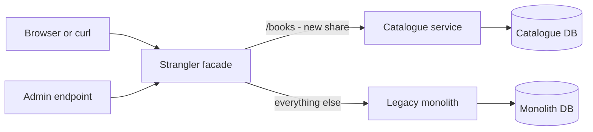

- **Strangler facade** — a Spring Cloud Gateway app (or a plain servlet proxy) that holds the routing rule in memory.
- **Legacy monolith** — keeps serving everything not yet migrated, including writes to books for now.
- **Catalogue service** — the first extracted capability. It reads from its own database, which you seed by copying the monolith's `books` table.
- **Admin endpoint** — flips the migration percentage. Later projects replace this with a config server (Project 8).

### Data model

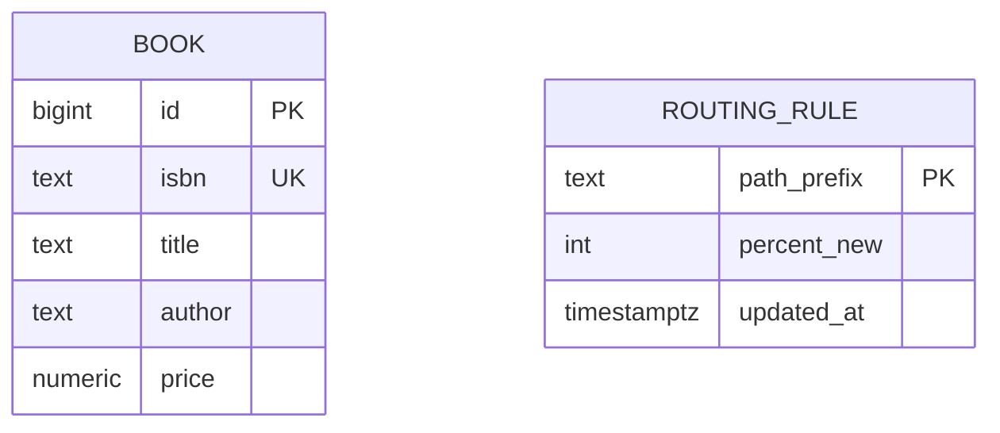

`BOOK` exists in both databases during the migration. `ROUTING_RULE` lives only in the facade's memory or a tiny table.

### Tech stack

| Component | Choice | Why |
|---|---|---|
| Facade | Spring Cloud Gateway (Web MVC variant) | Routes and predicates out of the box |
| Services | Spring Boot 4.1.1 on Java 25 | Matches the rest of the book |
| Databases | PostgreSQL, one per service | Shows data ownership early |
| Runtime | Docker Compose | One command to start all four containers |

### Milestones

1. **Run the monolith.** Start from the in-process demo [StranglerFigDemo.java](../../demos/chapters/02-strangler-fig/StranglerFigDemo.java) to see the routing idea, then build the real monolith. *Done when* `curl /books` returns seeded data.
2. **Put the facade in front at 0%.** All traffic passes through unchanged. *Done when* the response header says `served-by: monolith` for every call.
3. **Extract the catalogue service.** Same JSON contract, own database. *Done when* a diff script shows identical responses from both for every book.
4. **Route by percentage with sticky users.** *Done when* 1,000 simulated users at 20% split roughly 200/800 and the same user id always lands on the same side.
5. **Rollback drill.** *Done when* setting 0% sends all new requests to the monolith within a second, with no restart.

### Deep dive: the hard parts

**Sticky routing.** Random per-request routing makes a user see two different catalogues if the data drifts. Hash the user id (or a cookie) into 0–99 and compare to the percentage, so raising the percentage only ever *adds* users to the new side.

**Data that both sides need.** The monolith still writes books (admin edits) while the new service reads them. For this beginner version, a nightly copy is fine and you accept staleness. Project 23 replaces that with change data capture.

**Contract parity.** The new service must return exactly what clients expect, including field names, null handling and error codes. Write a comparison script that calls both and diffs the JSON — this is a cheap form of the "parallel run" in Project 26.

### Testing strategy

Unit-test the hash-and-compare routing function with fixed user ids. Use Testcontainers (throwaway Docker containers started by a test) to spin up PostgreSQL for each service's integration tests. Add one end-to-end test that flips the percentage through the admin endpoint and asserts the `served-by` header changes.

### Trade-offs, scaling and failure modes

The facade is now a single point of failure — run two instances behind a load balancer in anything real. Two copies of book data can drift, so decide which side is the source of truth for each field. The pattern costs an extra network hop. If the new service is down, the facade should fall back to the monolith for read-only paths (a nice first taste of Project 5).

### Stretch goals

- Route by header (`X-Beta: true`) for internal testers before any percentage.
- Shadow traffic: send a copy of requests to the new service and log differences without returning its answer.
- Delete the monolith's catalogue code once at 100% for a week — the real finish line.

### Skills practised

- Incremental migration and routing: [Ch 2 — Strangler Fig](../chapters/02-strangler-fig/README.md)
- A single entry point: [Ch 3 — API Gateway](../chapters/03-api-gateway/README.md)

### In the interview

**Q:** Why not rewrite the whole monolith at once? **A:** A big-bang rewrite delivers no value until cut-over and carries all the risk on one day. Strangling ships each capability separately, and each step can be rolled back by routing.

**Q:** How do you roll back a migrated capability? **A:** Change the routing rule back to the old system. Because the facade owns the decision, rollback needs no deploy, as long as the old code path still exists and its data is still current.

**Q:** What is the hardest part in practice? **A:** Data. Code is easy to route, but both systems may need the same records during the migration, so you need a clear owner per entity and a sync mechanism.

### TL;DR

Put a routing facade in front of a monolith, extract one capability, move users across by sticky percentage, and prove you can roll back in one second.

## 2. Edge Gateway with Spring Cloud Gateway

**Level:** Beginner · **Time:** 1 weekend · **Prerequisites:** Ch 3

### What it is

An **API gateway** for three tiny services (users, products, orders): one public host and port that routes requests by path, checks an API key, adds a request id, logs every call, and aggregates one "order details" view from two services. An *API gateway* is the single front door that clients call instead of calling each service directly.

### The problem it solves

Without a gateway, every client must know every service's address, and every service must re-implement authentication, logging and CORS (browser cross-origin rules). Change one internal address and every mobile app breaks. A gateway hides the topology and centralises cross-cutting concerns, at the cost of one more hop and one more thing to keep alive.

### Real-world examples

- Netflix built Zuul as its edge gateway, handling routing, filtering and resilience at the front door: [Open Sourcing Zuul 2](https://netflixtechblog.com/open-sourcing-zuul-2-82ea476cb2b3).
- Chris Richardson's catalogue describes the gateway as a single entry point with optional request aggregation: [Pattern: API Gateway](https://microservices.io/patterns/apigateway.html).
- Spring's own gateway, used in this project: [Spring Cloud Gateway reference](https://docs.spring.io/spring-cloud-gateway/reference/).

### Requirements

**Functional**
- Route `/api/users/**`, `/api/products/**`, `/api/orders/**` to the matching service, stripping the `/api` prefix.
- Reject requests without a valid `X-Api-Key` with HTTP 401.
- Add an `X-Request-Id` header (a UUID) if the client did not send one, and pass it downstream.
- `GET /api/order-details/{id}` calls orders and products and merges the result.
- Log method, path, status and duration for every request.

**Non-functional**
- Gateway overhead under 10 ms p95 for simple routes.
- Aggregated endpoint calls downstream services in parallel, so its latency is roughly the slowest call, not the sum.
- Downstream timeouts of 2 seconds — no request hangs forever.

### The architecture

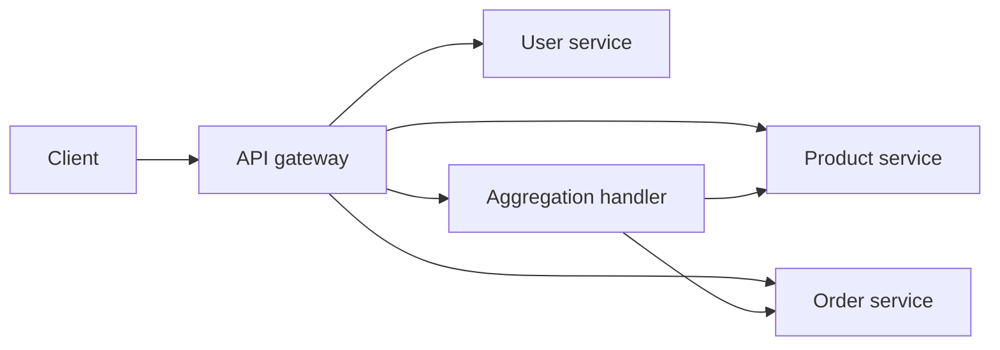

- **API gateway** — Spring Cloud Gateway with route definitions in `application.yml` and two custom filters (API key, request id).
- **Aggregation handler** — a controller inside the gateway that fans out two calls and merges them. Keep it thin: no business rules here.
- **Services** — three minimal Spring Boot apps with in-memory data.

### Data model

| Type | Fields | Notes |
|---|---|---|
| `ApiKey` | key, clientName, enabled | Loaded from config at startup |
| `OrderDetails` | orderId, status, items with product name and price | Built by the aggregator, never stored |

### Tech stack

| Component | Choice | Why |
|---|---|---|
| Gateway | Spring Cloud Gateway | Declarative routes, filters, timeouts |
| Fan-out | Java 25 virtual threads | Two blocking calls in parallel, simple code |
| Services | Spring Boot 4.1.1 | Same stack everywhere |
| Run | Docker Compose | Four containers, one network |

### Milestones

1. **Three services on their own ports.** *Done when* each answers directly with curl.
2. **Path routing.** *Done when* only the gateway port is published and all three services answer through it.
3. **Filters.** API key check and request id. *Done when* a missing key gets 401 and the request id appears in all four logs.
4. **Aggregation.** *Done when* `order-details` returns merged JSON, and with an artificial 300 ms delay in each service, total latency is about 300 ms, not 600 ms (compare with the sequential-versus-parallel numbers printed by [ApiGatewayDemo.java](../../demos/chapters/03-api-gateway/ApiGatewayDemo.java), about 270 ms down to about 125 ms for three calls).
5. **Timeouts.** *Done when* a service that sleeps 10 seconds causes a 504 from the gateway after 2 seconds.

### Deep dive: the hard parts

**Filter order.** The request id filter must run before logging, and authentication before routing, or you log requests without ids and forward unauthenticated calls. Gateway filters have an explicit order — set it deliberately.

**Aggregation creep.** Once you can merge two calls in the gateway, it is tempting to add business logic there. Resist: the gateway becomes a mini-monolith that every team must change. If aggregation grows per client, that is what BFFs are for (Project 3).

**Partial failure.** If products is down, should `order-details` fail or return the order without product names? Decide and document it. Returning partial data with a flag is usually kinder to users.

### Testing strategy

Use WireMock (an HTTP server that returns canned responses) to stand in for downstream services in gateway tests. Assert routing, header propagation, 401 handling and the 504 timeout. One Compose-based smoke test runs the whole stack.

### Trade-offs, scaling and failure modes

The gateway is a single point of failure and a bottleneck, so it must be stateless and horizontally scaled. Every concern you add (auth, logging, transformations) adds latency. A slow downstream can tie up gateway resources — timeouts are the minimum defence, and bulkheads (Project 6) the next.

### Stretch goals

- Per-client rate limiting with Redis (preview of Project 19).
- Response caching for `GET /products/{id}` with a 30-second TTL.
- Replace API keys with JWT validation.

### Skills practised

- Routing, filters, aggregation: [Ch 3 — API Gateway](../chapters/03-api-gateway/README.md)
- Timeouts as the first resilience step: [Ch 6 — Circuit Breaker](../chapters/06-circuit-breaker/README.md)

### In the interview

**Q:** What belongs in a gateway and what does not? **A:** Cross-cutting concerns — routing, authentication, rate limiting, logging, simple aggregation — belong there. Business rules do not, because then every team has to change and deploy the gateway.

**Q:** How do you stop the gateway being a single point of failure? **A:** Keep it stateless, run several instances behind a load balancer, and push state like rate-limit counters into a shared store.

**Q:** Gateway versus load balancer? **A:** A load balancer spreads traffic across copies of one service. A gateway understands application paths, headers and identity, and routes to many different services.

### TL;DR

One front door that routes, authenticates, tags and aggregates — and the discipline to keep business logic out of it.

## 3. Recipe App Backends for Frontends

**Level:** Beginner · **Time:** 1–2 weekends · **Prerequisites:** Ch 3, Ch 4

### What it is

A recipe platform with two clients — a web app and a mobile app — and a **Backend for Frontend (BFF)** for each. A *BFF* is a small server owned by one client team that calls the shared backend services and returns exactly the shape that client needs. The shared services are recipes, reviews and users.

### The problem it solves

One general-purpose API serves everyone badly. The web page wants full recipes with all reviews. The mobile list screen wants a title, a thumbnail URL and an average rating — and on a phone network every extra kilobyte and round trip hurts. A BFF lets each client get a tailored response in one call without bending the shared services.

### Real-world examples

- Sam Newman's write-up that popularised the name and the "one BFF per user experience" rule: [Backends For Frontends](https://samnewman.io/patterns/architectural/bff/).
- Phil Calçado describes how SoundCloud arrived at the pattern while splitting its monolith: [The Back-end for Front-end Pattern](https://philcalcado.com/2015/09/18/the_back_end_for_front_end_pattern_bff.html).
- Microsoft's architecture guide covers when to split per client: [Backends for Frontends pattern](https://learn.microsoft.com/en-us/azure/architecture/patterns/backends-for-frontends).

### Requirements

**Functional**
- Recipes service: CRUD for recipes (title, steps, ingredients, image URL).
- Reviews service: list reviews by recipe, average rating.
- Web BFF: `GET /recipes/{id}` returns full recipe, author name, all reviews.
- Mobile BFF: `GET /feed` returns 20 cards (id, title, thumbnail, average rating) and `GET /recipes/{id}` returns steps and only the top 3 reviews.

**Non-functional**
- Mobile feed payload under 5 KB for 20 cards (measure it).
- Each BFF makes downstream calls in parallel. p95 under 150 ms locally.
- BFFs hold no database of their own.

### The architecture

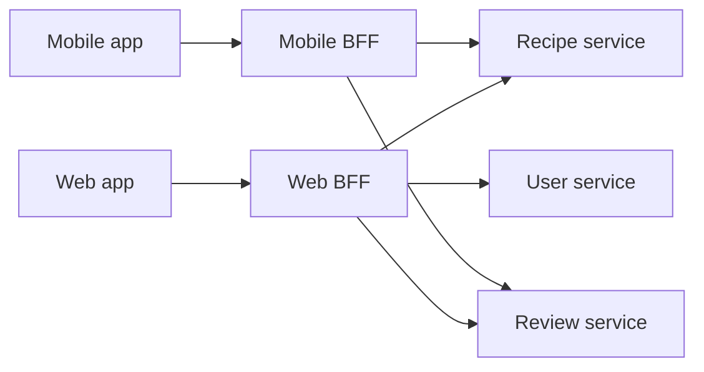

- **Web BFF / Mobile BFF** — separate Spring Boot apps, each with its own response DTOs (data transfer objects — plain classes shaped for the wire).
- **Shared services** — know nothing about clients. They return general data.
- An optional gateway (Project 2) can sit in front of both BFFs for auth.

### Data model

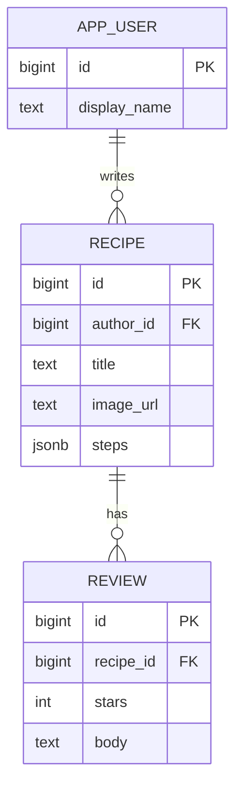

In a real split each table belongs to its own service database. The relationships are logical, not foreign keys across databases.

### Tech stack

| Component | Choice | Why |
|---|---|---|
| BFFs | Spring Boot 4.1.1 with `RestClient` | Simple synchronous client, virtual threads for fan-out |
| Services | Spring Boot + PostgreSQL | Realistic persistence |
| Thumbnails | URL with size parameter | The mobile BFF picks a small size |
| Run | Docker Compose | Five services |

### Milestones

1. **Shared services with seed data.** *Done when* 50 recipes and 500 reviews load.
2. **One generic API used by both clients.** Measure payload size and calls per screen. *Done when* you have the "before" numbers written down.
3. **Web BFF.** *Done when* the detail page needs one call.
4. **Mobile BFF.** *Done when* the feed is under 5 KB and the detail call returns top 3 reviews only. Compare with the [BFF demo](../../demos/chapters/04-bff/BffDemo.java), where the mobile BFF returns about 7% of the shared payload.
5. **Independent deploy.** *Done when* you change the mobile response shape without touching the web BFF or any service.

### Deep dive: the hard parts

**Duplication between BFFs.** Both BFFs will call recipes and reviews. Some duplication is the price of independence. Share a small client library for calling services, not the response-shaping code.

**The N+1 call trap.** A feed of 20 recipes that calls reviews once per recipe makes 21 calls. Add a batch endpoint to reviews (`GET /ratings?recipeIds=1,2,3`) so the BFF makes two calls. This is the same problem DataLoader solves in Project 20.

**Who owns the BFF?** The pattern works when the client team owns its BFF. If one backend team owns all BFFs, they become a bottleneck and you have rebuilt a shared API.

### Testing strategy

Unit-test mapping code (service DTO to client DTO). Use WireMock for downstream services so BFF tests do not need the stack. Add a payload-size assertion test for the mobile feed so it cannot silently grow.

### Trade-offs, scaling and failure modes

More deployables to run and monitor. Logic can leak into BFFs and diverge — keep business rules in services. Each BFF is a new failure point for its client only, which is actually a benefit: a broken web BFF does not take mobile down.

### Stretch goals

- A third client (smart-TV) to test whether a new BFF is cheap to add.
- Cache the feed for 30 seconds in the mobile BFF.
- Graceful degradation: return cards without ratings if reviews times out.

### Skills practised

- Per-client backends: [Ch 4 — BFF](../chapters/04-bff/README.md)
- Edge routing and aggregation: [Ch 3 — API Gateway](../chapters/03-api-gateway/README.md)

### In the interview

**Q:** BFF versus API gateway? **A:** A gateway is one entry point for all clients and handles cross-cutting concerns. A BFF is one backend per client type and shapes data for that client. They are often combined: gateway first, then BFFs behind it.

**Q:** When is a BFF overkill? **A:** With one client, or several clients that need the same data. Then a single API is simpler.

**Q:** How do you prevent BFFs from duplicating business logic? **A:** Keep rules in the domain services, keep BFFs to orchestration and mapping, and have the client team own each BFF.

### TL;DR

Two thin backends, one per client, each returning exactly what its screens need in one call.

## 4. Mini Service Registry with Heartbeats

**Level:** Beginner · **Time:** 1 weekend · **Prerequisites:** Ch 5

### What it is

A tiny **service registry** written from scratch — a lookup table of which service instances are alive and where — plus a client library that registers itself, sends heartbeats, and looks up other services by name. *Service discovery* is the act of finding a live instance's address from a logical name like `payment-service`.

### The problem it solves

In containers and the cloud, instances come and go and their IP addresses change. Hard-coding `http://10.0.3.17:8080` breaks the moment that container restarts. A registry gives every service a stable name. Building one yourself teaches the core ideas that Eureka, Consul and Kubernetes hide: leases, heartbeats, eviction and client-side caching.

### Real-world examples

- Netflix Eureka, the registry behind Spring Cloud Netflix: [Netflix/eureka on GitHub](https://github.com/Netflix/eureka).
- HashiCorp Consul offers a registry with health checks and DNS: [Consul documentation](https://developer.hashicorp.com/consul/docs).
- The pattern description: [Pattern: Service registry](https://microservices.io/patterns/service-registry.html).

### Requirements

**Functional**
- `POST /register` with name, host, port. Returns an instance id and lease length.
- `PUT /heartbeat/{id}` renews the lease.
- `GET /services/{name}` returns live instances.
- Instances with no heartbeat for 3 lease periods are evicted.
- Client library: registers on startup, heartbeats every 10 s, deregisters on shutdown, picks an instance round-robin.

**Non-functional**
- Lookup under 2 ms from the client's cache.
- A dead instance disappears from lookups within 30–40 seconds.
- If the registry is down, clients keep using their last-known list.

### The architecture

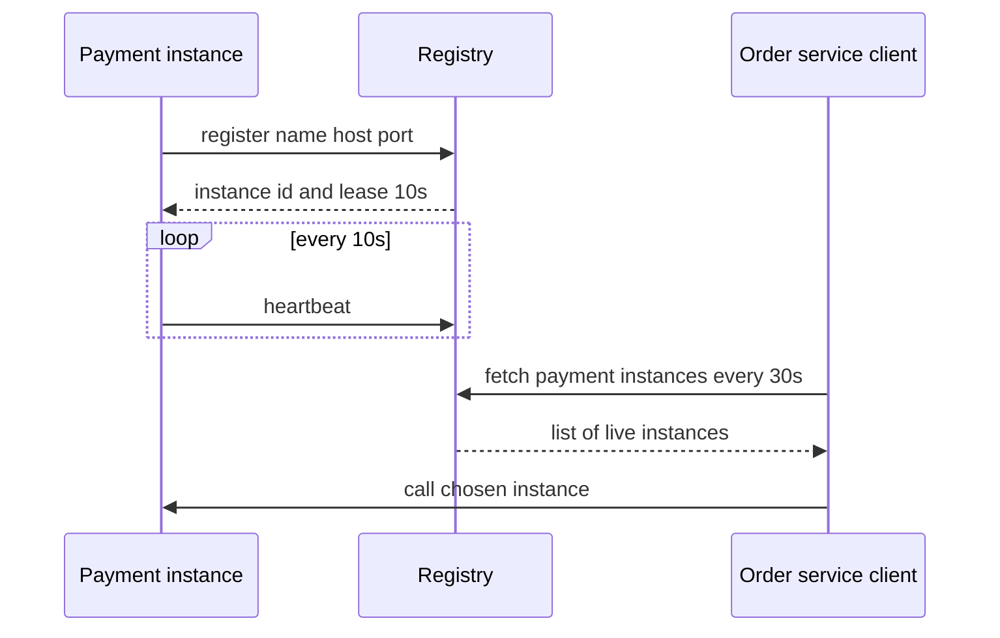

- **Registry** — a Spring Boot app holding a `ConcurrentHashMap` of instances, with a scheduled eviction task.
- **Client library** — a small jar used by both demo services. It caches the instance list locally.
- **Demo services** — order and payment, with payment scaled to three instances.

### Data model

| Type | Fields | Notes |
|---|---|---|
| `Instance` | id, serviceName, host, port, lastHeartbeat, status | Status UP or DOWN |
| `Lease` | durationSeconds, expiresAt | Renewed by heartbeat |
| Client cache | name to list of instances, fetchedAt | Survives registry outages |

### Tech stack

| Component | Choice | Why |
|---|---|---|
| Registry | Spring Boot 4.1.1, in-memory map | Small enough to read in one sitting |
| Client | Plain Java 25 + `HttpClient` | No framework magic hiding the mechanics |
| Scale | `docker compose up --scale payment=3` | Real changing addresses |

### Milestones

1. **Register and look up.** Start from the in-process [ServiceDiscoveryDemo.java](../../demos/chapters/05-service-discovery/ServiceDiscoveryDemo.java). *Done when* three payment instances show up in `GET /services/payment`.
2. **Heartbeats and eviction.** *Done when* `docker kill` on one instance removes it from lookups within 40 s.
3. **Client cache and round-robin.** *Done when* order spreads calls evenly across three payments.
4. **Registry outage.** *Done when* stopping the registry does not stop order calling payment.
5. **Graceful shutdown.** *Done when* stopping payment normally removes it immediately, not after 40 s.

### Deep dive: the hard parts

**The stale window.** Between an instance dying and eviction, clients still route to it. Close the gap from the client side: on a connection error, mark that instance bad locally and retry another. This is why real clients combine discovery with retries.

**Self-preservation.** If the registry suddenly stops getting most heartbeats, it is more likely the registry's network is broken than that every service died. Eureka stops evicting in that case. Implement a simple rule: if more than half the instances would be evicted at once, evict none and log a warning.

**Registry high availability.** One registry is a single point of failure. Clients' cached lists soften this, but new instances cannot register. Real registries replicate between peers.

### Testing strategy

Unit-test eviction with an injected clock (a `Clock` you control) so tests do not sleep. Integration test: start registry and two clients, kill one, advance time, assert it disappears. Chaos test by hand: kill the registry while load runs.

### Trade-offs, scaling and failure modes

Client-side discovery (the client picks the instance) gives smart load balancing but puts logic in every client language. Server-side discovery (a load balancer or Kubernetes Service picks) keeps clients dumb. Heartbeat intervals trade network chatter for freshness.

### Stretch goals

- Health checks pulled by the registry instead of pushed heartbeats.
- Two registry peers that replicate registrations.
- Zone-aware choice: prefer instances in the caller's zone.

### Skills practised

- Registries, client vs. server-side discovery: [Ch 5 — Service Discovery](../chapters/05-service-discovery/README.md)
- Retrying another instance on failure: [Ch 8 — Retry](../chapters/08-retry/README.md)

### In the interview

**Q:** Client-side or server-side discovery? **A:** Client-side lets the caller choose instances smartly but needs a library per language. Server-side, like Kubernetes Services, hides discovery behind a stable virtual address and is the default today.

**Q:** What happens when the registry goes down? **A:** Clients keep using their cached list, so existing traffic continues. New instances cannot register until it returns, which is why registries run as clusters.

**Q:** Why heartbeats rather than just health checks? **A:** Heartbeats scale better because the registry does no outbound work. Pull-based health checks are more accurate about real readiness. Many systems use both.

### TL;DR

Build a registry with leases and heartbeats, give clients a cache, and see why discovery is really about stale data.

## 5. Resilient Weather Client

**Level:** Beginner · **Time:** 1 weekend · **Prerequisites:** Ch 6, Ch 8

### What it is

A "what to wear today" service that calls a public weather API and wraps the call in **Resilience4j** — a Java library of fault-tolerance decorators — with a timeout, a retry with exponential backoff and jitter, a circuit breaker, and a cached fallback. A *circuit breaker* tracks recent failures and, once a threshold is crossed, stops calling the dependency for a while so callers fail fast.

### The problem it solves

Every remote call can be slow or fail. Without protection, a slow weather API makes your service slow, threads pile up waiting, and your service fails too. Retries help with brief blips but hammer a provider that is already struggling. This project wires the three classic tools together and lets you see each one's effect in metrics.

### Real-world examples

- Resilience4j's circuit breaker docs explain the sliding window and state machine you will configure: [CircuitBreaker](https://resilience4j.readme.io/docs/circuitbreaker).
- AWS explains why retries need backoff and jitter to avoid synchronized retry storms: [Timeouts, retries and backoff with jitter](https://aws.amazon.com/builders-library/timeouts-retries-and-backoff-with-jitter/).
- Netflix Hystrix popularised circuit breakers in Java and is now in maintenance mode, which is why Resilience4j is the usual choice: [Netflix/Hystrix](https://github.com/Netflix/Hystrix).

### Requirements

**Functional**
- `GET /outfit?city=Oslo` returns a suggestion based on temperature and rain.
- Calls the [Open-Meteo forecast API](https://open-meteo.com/en/docs) (free, no key) through a fault-injecting proxy you control.
- On failure, returns the last good forecast for that city with `stale: true`.

**Non-functional**
- The endpoint answers within 1.5 s in all cases (timeout 1 s plus fallback).
- At most 3 attempts per request, backoff 100 ms base, full jitter.
- Breaker opens at 50% failures over the last 20 calls, waits 30 s, then lets 3 trial calls through.

### The architecture

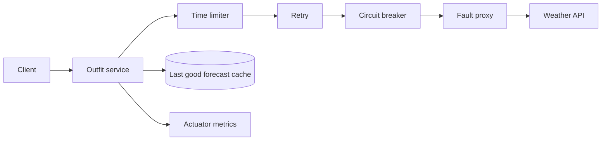

- **Decorator order** — retry wraps the breaker, so each attempt is recorded by the breaker and an open breaker stops further retries at once.
- **Fault proxy** — a tiny service (or Toxiproxy) that adds latency or returns 503 on demand.
- **Cache** — an in-memory map keyed by city. Redis is a stretch goal.
- **Actuator metrics** — Spring Boot exposes Resilience4j metrics so you can watch the breaker state.

### Data model

| Type | Fields | Notes |
|---|---|---|
| `Forecast` | city, tempC, rainMm, fetchedAt | Cached per city |
| `Outfit` | items, reason, stale | Response DTO |
| Breaker state | CLOSED, OPEN, HALF_OPEN | Owned by Resilience4j |

### Tech stack

| Component | Choice | Why |
|---|---|---|
| Resilience | Resilience4j via Spring Cloud Circuit Breaker | Standard in Spring, configurable in YAML |
| HTTP | `RestClient` | Simple, blocking, pairs with virtual threads |
| Metrics | Spring Boot Actuator + Micrometer | Breaker state and call counts |
| Faults | Toxiproxy or a 30-line Spring app | Repeatable failures |

Spring Framework 7 also ships basic `@Retryable` and `@ConcurrencyLimit` annotations. Use Resilience4j here because you need the breaker too.

### Milestones

1. **Naked call.** Run the in-process [CircuitBreakerDemo.java](../../demos/chapters/06-circuit-breaker/CircuitBreakerDemo.java) and [RetryDemo.java](../../demos/chapters/08-retry/RetryDemo.java) first. Then call the API with no protection. *Done when* a 10 s proxy delay makes your endpoint take 10 s.
2. **Timeout.** *Done when* it takes at most about 1 s.
3. **Retry with jitter.** *Done when* a proxy that fails every second call yields almost no user-visible errors, and logs show randomised waits.
4. **Breaker.** *Done when* a fully failing proxy opens the breaker and the proxy log shows zero calls during the open period.
5. **Fallback.** *Done when* the endpoint returns stale data with a flag while the breaker is open.

### Deep dive: the hard parts

**What counts as a failure.** A 400 (your bad request) should not open the breaker or be retried — retrying cannot fix it. Configure retry and breaker to record only timeouts, connection errors and 5xx.

**Retry plus breaker maths.** With 3 attempts per request, one user request can produce three breaker failures. That makes the breaker open sooner than you think. Either accept it or put the breaker outside the retry and compare.

**Half-open.** After the wait, the breaker lets a few calls through. If they succeed, it closes. If the provider is only half recovered, you flap open and closed. Watch the state metric over time to tune the trial-call count.

### Testing strategy

Use WireMock scenarios to return failure, failure, success and assert the retry count. Test the breaker by forcing failures and asserting it is OPEN and the stub was not called. Never test with real sleeps longer than needed — keep wait times tiny in test config.

### Trade-offs, scaling and failure modes

Retries multiply load: 3 attempts at each of 3 layers is 27 calls. Breakers can open on a few slow calls if the window is too small. Stale fallbacks are only safe for data where "slightly old" is acceptable — weather yes, account balances no.

### Stretch goals

- Move the cache to Redis so all instances share fallbacks.
- Add a bulkhead (Project 6) so weather calls cannot use all threads.
- A Grafana dashboard with breaker state, retries and latency.

### Skills practised

- Breaker states and thresholds: [Ch 6 — Circuit Breaker](../chapters/06-circuit-breaker/README.md)
- Backoff and jitter: [Ch 8 — Retry](../chapters/08-retry/README.md)

### In the interview

**Q:** Why add jitter to backoff? **A:** Without it, all clients that failed at the same moment retry at the same moments too, creating synchronized spikes. Random jitter spreads them out.

**Q:** Which errors should you retry? **A:** Transient ones — timeouts, connection resets, 503, 429 with Retry-After. Never validation errors, and only non-idempotent operations if you have an idempotency key.

**Q:** Retry inside or outside the circuit breaker? **A:** Usually retry outside, so each attempt goes through the breaker and an open breaker cuts retries short.

### TL;DR

Timeout, then retry with jitter, then a breaker, then a fallback — and metrics that prove each one does its job.

## 6. Bulkheaded Product Page

**Level:** Beginner · **Time:** 1 weekend · **Prerequisites:** Ch 6, Ch 7

### What it is

A product-page service that assembles a page from four downstream calls — price, stock, reviews and recommendations — and isolates each call in its own **bulkhead**: a separate, bounded pool of threads or permits, so that one slow dependency can use up only its own pool. The name comes from the watertight compartments in a ship's hull.

### The problem it solves

If all four calls share one thread pool, a slow recommendations service holds every thread while it waits, and price and stock — the parts customers actually need — stop responding too. This is resource exhaustion, and it is how one non-critical service takes down a whole page. Bulkheads cap the damage.

### Real-world examples

- Microsoft's pattern page describes partitioning connection pools and consumers per dependency: [Bulkhead pattern](https://learn.microsoft.com/en-us/azure/architecture/patterns/bulkhead).
- Resilience4j provides semaphore and thread-pool bulkheads used in this project: [Bulkhead](https://resilience4j.readme.io/docs/bulkhead).
- Envoy applies the same idea at the proxy layer with per-cluster connection and request limits: [Envoy circuit breaking](https://www.envoyproxy.io/docs/envoy/latest/intro/arch_overview/upstream/circuit_breaking).

### Requirements

**Functional**
- `GET /product/{id}/page` returns price, stock, reviews and recommendations.
- Each section can be missing. The page marks missing sections rather than failing.
- Price and stock are critical: if either is unavailable, return 503.

**Non-functional**
- With recommendations delayed by 5 s, the page still answers in under 300 ms p95 at 50 requests per second.
- Bulkhead sizes: price 20, stock 20, reviews 10, recommendations 5 concurrent calls.
- Rejected calls (bulkhead full) fail in under 1 ms rather than queueing.

### The architecture

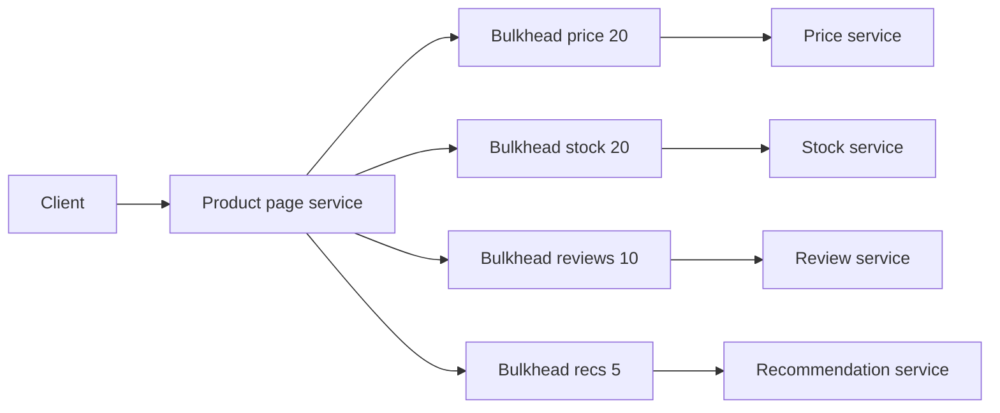

- **Product page service** — fans out four calls in parallel and assembles the result.
- **Bulkheads** — Resilience4j semaphore bulkheads (a semaphore is a counter of permits: take one to start a call, give it back after). With virtual threads, permits rather than thread pools are what limit concurrency.
- **Downstream services** — four stubs with a configurable delay endpoint.

### Data model

| Type | Fields | Notes |
|---|---|---|
| `ProductPage` | productId, price, stock, reviews, recommendations, degradedSections | Missing sections listed by name |
| `BulkheadConfig` | name, maxConcurrentCalls, maxWaitMs | One per dependency, in YAML |

### Tech stack

| Component | Choice | Why |
|---|---|---|
| Isolation | Resilience4j semaphore bulkhead | Works with virtual threads |
| Timeouts | Resilience4j time limiter, 200 ms per call | Bulkhead plus timeout releases permits |
| Load | k6 or Gatling | Repeatable load at fixed rate |
| Metrics | Actuator, Prometheus, Grafana | Available permits per bulkhead |

### Milestones

1. **Shared pool baseline.** Run [BulkheadDemo.java](../../demos/chapters/07-bulkhead/BulkheadDemo.java) first. Then build the page with a fixed pool of 20 threads shared by all calls. *Done when* a 5 s recommendations delay makes the whole page time out under load.
2. **Per-dependency bulkheads.** *Done when* the same test leaves price and stock fast.
3. **Degraded responses.** *Done when* the page returns with `degradedSections: ["recommendations"]`.
4. **Timeouts plus bulkheads.** *Done when* permits are released after 200 ms even if recommendations never answers.
5. **Dashboard.** *Done when* Grafana shows the recommendations bulkhead at 0 available permits while the others are healthy.

### Deep dive: the hard parts

**Sizing a bulkhead.** Use Little's law: concurrent calls needed equals arrival rate times latency. At 50 requests per second and 40 ms normal latency, you need about 2 permits — so 5 gives headroom while still capping damage when latency jumps to 5 s.

**Virtual threads change the shape.** With platform threads, a thread-pool bulkhead was natural. With Java 25 virtual threads, threads are cheap, so the scarce resource becomes downstream connections and the dependency itself. A semaphore limits concurrency without a pool.

**Bulkheads need timeouts.** A bulkhead stops new calls, but the 5 calls already inside hold their permits until the slow service answers. A timeout frees them.

### Testing strategy

Integration test with WireMock delays: assert that with recommendations delayed, the page returns in under 300 ms and lists the section as degraded. Assert that price failure returns 503. A k6 script provides the load test and checks p95.

### Trade-offs, scaling and failure modes

Too-small bulkheads reject good traffic during normal spikes. Too-large ones protect nothing. Each bulkhead is per instance, so total load on a dependency is permits times instances. Partial pages need UI support — the front end must handle missing sections.

### Stretch goals

- Add a circuit breaker per dependency and compare rejection behaviour.
- Bulkheads per tenant instead of per dependency (preview of Project 28).
- Adaptive sizing based on observed latency (preview of Project 35).

### Skills practised

- Resource isolation: [Ch 7 — Bulkhead](../chapters/07-bulkhead/README.md)
- Fail fast and fallbacks: [Ch 6 — Circuit Breaker](../chapters/06-circuit-breaker/README.md)

### In the interview

**Q:** Bulkhead versus circuit breaker? **A:** A bulkhead limits how much of your resources one dependency can use. A breaker stops calling a dependency that is clearly failing. Bulkheads protect against slowness, breakers against repeated failure — use both.

**Q:** How do you size a bulkhead? **A:** From measured rate and latency (Little's law) plus headroom, then validate under load and tune.

**Q:** Do bulkheads matter with virtual threads? **A:** Yes. Threads stop being scarce, but connections, memory and the dependency's own capacity are still finite, so you limit concurrency instead of threads.

### TL;DR

Give each dependency its own small compartment so a slow recommendation service cannot sink the product page.

## 7. Log-Shipping and Metrics Sidecar

**Level:** Beginner · **Time:** 1 weekend · **Prerequisites:** Ch 9

### What it is

A deliberately simple application (a Python or Java "quote of the day" service that knows nothing about logging infrastructure) paired with two **sidecars**: a log shipper that reads its log file and forwards structured logs, and a small metrics adapter that scrapes a status endpoint and exposes Prometheus metrics. A *sidecar* is a helper process deployed next to the main app — same host or same Kubernetes pod — sharing its network and files.

### The problem it solves

Every service needs logging, metrics, TLS and config, and re-implementing them in every language is wasteful. A sidecar moves these concerns out of the app into a separately built, separately upgraded process. This project shows the mechanics: shared volumes, localhost networking, lifecycle coupling.

### Real-world examples

- Microsoft's description of the sidecar pattern and when not to use it: [Sidecar pattern](https://learn.microsoft.com/en-us/azure/architecture/patterns/sidecar).
- Kubernetes now has first-class sidecar containers with ordered start-up: [Sidecar Containers](https://kubernetes.io/docs/concepts/workloads/pods/sidecar-containers/).
- Dapr runs its building blocks as a sidecar next to each app: [Dapr sidecar overview](https://docs.dapr.io/concepts/dapr-services/sidecar/).

### Requirements

**Functional**
- App writes plain-text logs to `/var/log/app/app.log` and exposes `GET /status` with counters.
- Log sidecar tails the file, parses lines into JSON, adds `service` and `pod` fields, and ships to a log store.
- Metrics sidecar reads `/status` every 15 s and exposes `/metrics` in Prometheus format.
- Both run unchanged next to a second, different app.

**Non-functional**
- Sidecars use under 50 MB memory each.
- No log loss across a sidecar restart (it resumes from a saved file offset).
- App start-up is not blocked if a sidecar fails.

### The architecture

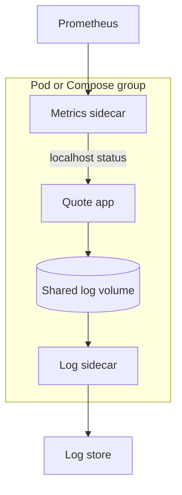

- **Quote app** — the "legacy" app you are not allowed to change.
- **Shared log volume** — an `emptyDir` in Kubernetes or a named volume in Compose.
- **Log sidecar** — Fluent Bit with a tail input and a parser.
- **Metrics sidecar** — a 100-line Spring Boot or Go adapter. This is the "adapter" flavour of sidecar.
- **Log store and Prometheus** — Grafana Loki and Prometheus, shared by all pods.

### Data model

| Item | Shape | Notes |
|---|---|---|
| Raw log line | `2026-10-01T10:00:00Z INFO quote served id=42` | What the app writes |
| Shipped record | JSON with ts, level, msg, id, service, pod | Parsed by Fluent Bit |
| Offset file | file inode and byte position | Lets the shipper resume |

### Tech stack

| Component | Choice | Why |
|---|---|---|
| Log shipper | [Fluent Bit](https://fluentbit.io/) | Small, common sidecar choice |
| Metrics adapter | Spring Boot 4.1.1 + Micrometer | Familiar stack |
| Store | Grafana Loki, Prometheus, Grafana | Free and local |
| Run | Compose first, then kind (Kubernetes in Docker) | Shows both models |

### Milestones

1. **Run the demo.** [SidecarDemo.java](../../demos/chapters/09-sidecar/SidecarDemo.java) shows a sidecar absorbing a concern. *Done when* you can explain its output.
2. **Shared volume in Compose.** *Done when* the log sidecar prints parsed JSON from the app's file.
3. **Ship to Loki.** *Done when* you query logs by `service` label in Grafana.
4. **Metrics adapter.** *Done when* Prometheus graphs quotes served.
5. **Kubernetes pod.** *Done when* the same three containers run in one pod with the sidecars declared as native sidecar containers.
6. **Reuse.** *Done when* a second app gets logs and metrics by adding the same sidecars, no code change.

### Deep dive: the hard parts

**Lifecycle.** If the app starts before the log shipper, early lines are still in the file, so that is fine. But on shutdown, the shipper must flush after the app stops. Kubernetes native sidecars start before and stop after the main container — that is exactly why they were added.

**Log rotation.** When the file rotates, a naive tailer either loses the tail of the old file or rereads the new one from the start. Tracking file identity (inode) plus offset solves it.

**Resource accounting.** Sidecars add CPU and memory to every pod. Across 500 pods, a 50 MB sidecar is 25 GB. Measure and set requests and limits.

### Testing strategy

Write a script that generates 100,000 log lines, restarts the sidecar halfway, and counts records in Loki — the count must match. Test the metrics adapter with a fake `/status` endpoint and assert the Prometheus text format.

### Trade-offs, scaling and failure modes

Sidecars cost resources per instance and add a process that can crash. Writing to stdout and letting the platform collect logs (a node-level agent) is often cheaper than a per-pod log sidecar — the sidecar wins when the app can only write to files or needs per-app config.

### Stretch goals

- A third sidecar: a TLS-terminating proxy (Envoy) in front of the app.
- Compare per-pod sidecar with a node-level DaemonSet collector — measure memory.
- Add trace context to logs (preview of Project 16).

### Skills practised

- Sidecar, ambassador and adapter shapes: [Ch 9 — Sidecar](../chapters/09-sidecar/README.md)
- Externalizing sidecar config: [Ch 13 — Config Externalization](../chapters/13-config-externalization/README.md)

### In the interview

**Q:** Why put logging in a sidecar rather than a library? **A:** A sidecar works for any language, is upgraded independently of the app, and keeps the app simple. A library is cheaper at runtime but must be maintained per language.

**Q:** What does a sidecar share with its app? **A:** Network namespace (it can use localhost), storage volumes, and lifecycle — it is deployed and scaled with the app.

**Q:** When is a sidecar a bad idea? **A:** When the per-instance overhead is too high for very many small instances, or when latency-critical calls cannot afford an extra local hop.

### TL;DR

Keep the app ignorant of infrastructure, and bolt logging and metrics on beside it through a shared volume and localhost.

## 8. Externalized Config and Live Feature Flags

**Level:** Beginner · **Time:** 1 weekend · **Prerequisites:** Ch 13

### What it is

A **Spring Cloud Config Server** backed by a Git repository, serving configuration to three services, with live refresh: change a value in Git, and the services pick it up without restarting. Two of the values are **feature flags** — on/off switches that change behaviour at runtime. *Externalized configuration* means settings live outside the deployable artifact, so one build runs in every environment.

### The problem it solves

Settings baked into the jar force a rebuild and redeploy for every change, differ silently between environments, and leak secrets into source control. Central, versioned config gives one place to change values, an audit trail (Git history), and the ability to flip a feature for all services at once.

### Real-world examples

- Spring Cloud Config, the server used here: [Spring Cloud Config reference](https://docs.spring.io/spring-cloud-config/reference/).
- Microsoft's description of an external configuration store and its caching concerns: [External Configuration Store pattern](https://learn.microsoft.com/en-us/azure/architecture/patterns/external-configuration-store).
- Kubernetes ConfigMaps provide the platform-native version: [ConfigMaps](https://kubernetes.io/docs/concepts/configuration/configmap/).

### Requirements

**Functional**
- Config server serves `application.yml` (shared), `{service}.yml`, and `{service}-{profile}.yml` from Git.
- Services: greeting, pricing, checkout. Each reads its settings on start-up.
- `greeting.message` and `pricing.discount-percent` refresh live.
- Feature flag `checkout.express-enabled` turns an express-checkout endpoint on or off everywhere at once.
- Secrets (a fake payment API key) are not stored in plain text in Git.

**Non-functional**
- A Git change reaches all services within 30 seconds.
- Services start even if the config server is down, using a local fallback.
- Config server answers in under 50 ms.

### The architecture

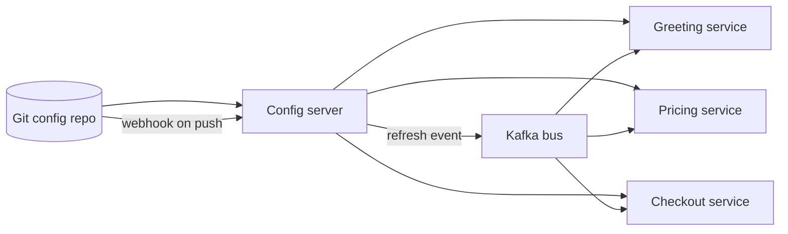

- **Git repo** — plain YAML files, one folder per environment if you like.
- **Config server** — reads Git, serves config over HTTP, and decrypts `{cipher}` values.
- **Kafka bus** — Spring Cloud Bus broadcasts a "refresh" message to all instances when Git changes, so you do not call each one.
- **Services** — use `@RefreshScope` beans (rebuilt on refresh) or `@ConfigurationProperties` (re-bound on refresh).

### Data model

| Key | Example | Refreshable |
|---|---|---|
| `greeting.message` | "Hello from config" | Yes |
| `pricing.discount-percent` | 10 | Yes |
| `checkout.express-enabled` | false | Yes |
| `spring.datasource.url` | jdbc URL | No — needs restart |
| `payment.api-key` | `{cipher}...` | Yes, decrypted by server |

### Tech stack

| Component | Choice | Why |
|---|---|---|
| Server | Spring Cloud Config Server | Git backend, encryption, profiles |
| Client | Spring Cloud Config client with `spring.config.import` | Current Boot way to load remote config |
| Broadcast | Spring Cloud Bus over Kafka | One refresh for all instances |
| Run | Docker Compose with a local Gitea or a bare repo | No external dependency |

### Milestones

1. **Run the demo.** [ConfigExternalizationDemo.java](../../demos/chapters/13-config-externalization/ConfigExternalizationDemo.java). *Done when* you can explain why the flag flips everywhere at once.
2. **Server plus one client.** *Done when* changing Git and calling refresh changes the greeting.
3. **Profiles.** *Done when* `dev` and `prod` profiles give different discounts from the same jar.
4. **Bus refresh.** *Done when* one push updates three services, each scaled to two instances.
5. **Encrypted secret.** *Done when* Git holds only ciphertext and the service sees plain text.
6. **Server down.** *Done when* services start with fallback values and log a warning.

### Deep dive: the hard parts

**What can and cannot refresh.** A database URL is used to build a connection pool at start-up — changing the property does nothing to the existing pool. Classify every key as live or restart-required and document it.

**Consistency during refresh.** For a few seconds some instances have the new value and some the old. For a discount, a customer could see two prices. Either accept it, or include the config version in responses so you can spot mixed states.

**Bootstrap failure.** If the config server is down at start-up, a service with `optional:` import starts with local defaults. Without it, the service refuses to start. Choose per service — a payments service may prefer to fail rather than run with wrong config.

### Testing strategy

Integration test with an embedded config server pointing at a temp Git repo: commit a change, trigger refresh, assert the new value. Test the fallback path by starting the client with the server unreachable.

### Trade-offs, scaling and failure modes

The config server becomes critical infrastructure — run two instances. Live config is powerful and dangerous: a typo reaches every service in seconds, so require pull requests on the config repo. Secrets are better in a dedicated secret store (Vault, cloud secret managers) than encrypted in Git.

### Stretch goals

- Validate config with JSR-380 annotations and refuse bad refreshes.
- Show the current config version on an Actuator endpoint.
- Replace the server with Kubernetes ConfigMaps and Spring Cloud Kubernetes and compare.

### Skills practised

- Central config, refresh, profiles: [Ch 13 — Config Externalization](../chapters/13-config-externalization/README.md)
- Event broadcast with Kafka: [Ch 11 — Event-Driven](../chapters/11-event-driven/README.md)

### In the interview

**Q:** How do you change config without restarting? **A:** Load it from an external store and re-bind refreshable beans when a change event arrives, broadcast to all instances by a bus.

**Q:** What if the config server is down? **A:** Running services keep their current config. New instances start from cached or default values if allowed. Run the server highly available.

**Q:** Config versus secrets? **A:** Config can be visible and versioned in Git. Secrets need encryption, access control and rotation, so they belong in a secret manager.

### TL;DR

One Git-backed config server, live refresh across all instances via a bus, and a clear list of which settings need a restart.

## 9. Signup Events with Kafka

**Level:** Beginner · **Time:** 1–2 weekends · **Prerequisites:** Ch 11

### What it is

A user-signup service that publishes a `UserRegistered` **event** to Kafka, and three independent consumers that react: a welcome-email sender, an analytics counter, and a loyalty-points service that grants sign-up points. An *event* is a record of something that already happened. *Kafka* is a distributed log: producers append messages to a *topic*, which is split into *partitions*, and consumers read at their own pace, tracking their position with an *offset*.

### The problem it solves

If signup calls email, analytics and loyalty directly, signup is slow (it waits for all three), fragile (any one failing breaks signup) and tightly coupled (adding a fourth reaction means changing signup). Publishing one event decouples them: signup does its job and moves on, and new reactions subscribe without anyone else changing.

### Real-world examples

- Kafka's own documentation explains topics, partitions, consumer groups and offsets: [Apache Kafka documentation](https://kafka.apache.org/documentation/).
- Microsoft describes event-driven architecture styles and their trade-offs: [Event-driven architecture style](https://learn.microsoft.com/en-us/azure/architecture/guide/architecture-styles/event-driven).
- Spring for Apache Kafka, the client used here: [Spring for Apache Kafka reference](https://docs.spring.io/spring-kafka/reference/).

### Requirements

**Functional**
- `POST /users` stores a user and publishes `UserRegistered` with userId, email, country and timestamp.
- Email consumer "sends" (logs or uses MailHog) a welcome email.
- Analytics consumer counts signups per country per hour.
- Loyalty consumer grants 100 points exactly once per user.

**Non-functional**
- Signup returns in under 100 ms even if every consumer is down.
- Consumers catch up after a 10-minute outage with no lost events.
- Events for the same user are processed in order (key by userId).

### The architecture

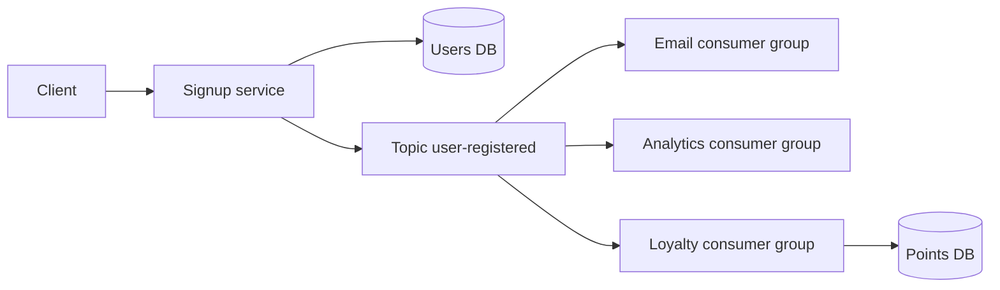

- **Signup service** — saves the user, then publishes. (Project 13 fixes the gap between those two steps.)
- **Topic** — 3 partitions, key = userId.
- **Consumer groups** — each reaction is its own group, so each receives every event. Instances within a group share partitions.

### Data model

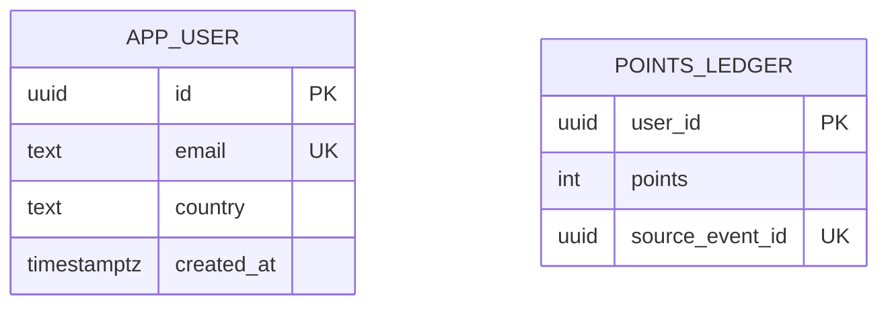

`source_event_id` is unique so a redelivered event cannot grant points twice.

### Tech stack

| Component | Choice | Why |
|---|---|---|
| Broker | Kafka in KRaft mode, one broker locally | Industry-standard log |
| Client | Spring for Apache Kafka | `KafkaTemplate`, `@KafkaListener` |
| Format | JSON with an `eventId` and `type` | Simple to start, Avro in Project 38 |
| Inspect | Kafka UI or `kafka-console-consumer` | See offsets and lag |

### Milestones

1. **Synchronous baseline.** Run [EventDrivenDemo.java](../../demos/chapters/11-event-driven/EventDrivenDemo.java). Then make signup call three HTTP endpoints. *Done when* stopping loyalty breaks signup.
2. **Publish an event.** *Done when* signup succeeds with all consumers stopped.
3. **Three consumer groups.** *Done when* each logs every event.
4. **Catch-up.** *Done when* a consumer stopped for 10 minutes processes the backlog on restart, and lag returns to 0.
5. **Idempotent loyalty.** *Done when* replaying the topic from offset 0 grants no extra points.

### Deep dive: the hard parts

**At-least-once delivery.** Kafka consumers commit offsets after processing. If a consumer crashes after granting points but before committing, it will see the event again. So consumers must be *idempotent* — processing the same event twice has the same effect as once. A unique constraint on the event id is the simplest way.

**Ordering and keys.** Kafka only guarantees order within a partition. Keying by userId puts all events for a user in one partition, so "registered" is always seen before "deleted".

**The dual-write gap.** Saving the user and publishing are two separate systems. If the app crashes between them, the user exists but no event is sent. Note it here and solve it properly with the outbox in Project 13.

### Testing strategy

Use Testcontainers for Kafka and PostgreSQL. Test that publishing produces a message with the right key. Test the loyalty consumer by sending the same event twice and asserting points = 100. Test catch-up by producing 1,000 events before starting the consumer.

### Trade-offs, scaling and failure modes

You gain decoupling and resilience but lose a simple call stack: debugging "why didn't the email go out?" means checking lag and logs across services. Consistency is eventual — the points appear a moment after signup. Consumer lag (how far behind the latest offset a consumer is) is the key metric to alert on.

### Stretch goals

- Scale the email consumer to 3 instances and watch partitions rebalance.
- Add a fourth consumer without touching signup.
- Replace JSON with Avro and a schema registry.

### Skills practised

- Producers, consumers, decoupling: [Ch 11 — Event-Driven](../chapters/11-event-driven/README.md)
- Idempotency under retries: [Ch 8 — Retry](../chapters/08-retry/README.md)

### In the interview

**Q:** Why events instead of direct calls? **A:** The producer does not wait for or know about consumers, so it stays fast and available, and new consumers can be added without changing it.

**Q:** How do you handle duplicate events? **A:** Make consumers idempotent — record processed event ids or use natural unique keys so reprocessing has no extra effect.

**Q:** How does Kafka preserve order? **A:** Only per partition. Choose the message key so that events that must be ordered share a partition.

### TL;DR

One signup event, three independent reactions, and the two habits that make it safe: keys for order and idempotent consumers.

## 10. CQRS Library Catalogue

**Level:** Beginner · **Time:** 1–2 weekends · **Prerequisites:** Ch 12

### What it is

A library-lending service split into a **command side** (borrow, return, add copy — writes to normalised PostgreSQL tables) and a **query side** (a denormalised "book availability" read model optimised for the search and browse screens). *CQRS* — Command Query Responsibility Segregation — means using different models for changing data and for reading it. A *projection* is the code that turns write-side changes into read-model rows.

### The problem it solves

The write model wants normalised tables and strict rules ("a member may hold 5 books"). The browse screen wants one flat row per title with "3 of 5 copies available, next due back 12 Oct" — which, from normalised tables, needs several joins and aggregates on every page view. Reads usually outnumber writes many times over. CQRS lets each side be shaped for its job.

### Real-world examples

- Martin Fowler's introduction, including his warning that CQRS adds complexity most systems do not need: [CQRS](https://martinfowler.com/bliki/CQRS.html).
- Microsoft's CQRS pattern page discusses separate read stores and eventual consistency: [CQRS pattern](https://learn.microsoft.com/en-us/azure/architecture/patterns/cqrs).
- The microservices.io entry links CQRS to event-driven projections: [Pattern: CQRS](https://microservices.io/patterns/data/cqrs.html).

### Requirements

**Functional**
- Commands: `AddCopy`, `BorrowCopy`, `ReturnCopy`. Enforce max 5 loans per member.
- Queries: search titles by keyword, show availability count and earliest due date per title.
- The read model is rebuilt from the write tables on demand.

**Non-functional**
- Browse query under 20 ms p95 for 100,000 titles.
- Read model lag under 1 second after a command.
- Command handlers return only success or failure plus an id — never read-model data.

### The architecture

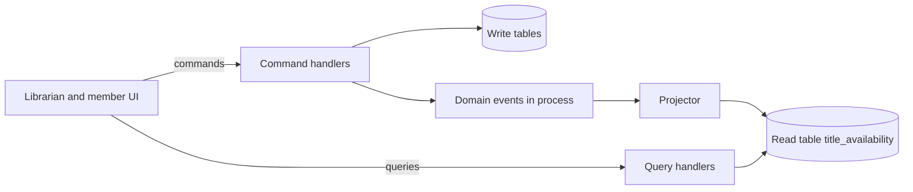

- **Command handlers** — validate rules and update normalised tables in one transaction.
- **Domain events** — `CopyBorrowed`, `CopyReturned`, published with Spring application events after commit (in-process, not Kafka, to keep it beginner-sized).
- **Projector** — updates the read table. Can also rebuild it from scratch.
- **Query handlers** — simple selects on the read table, with a PostgreSQL full-text index.

### Data model

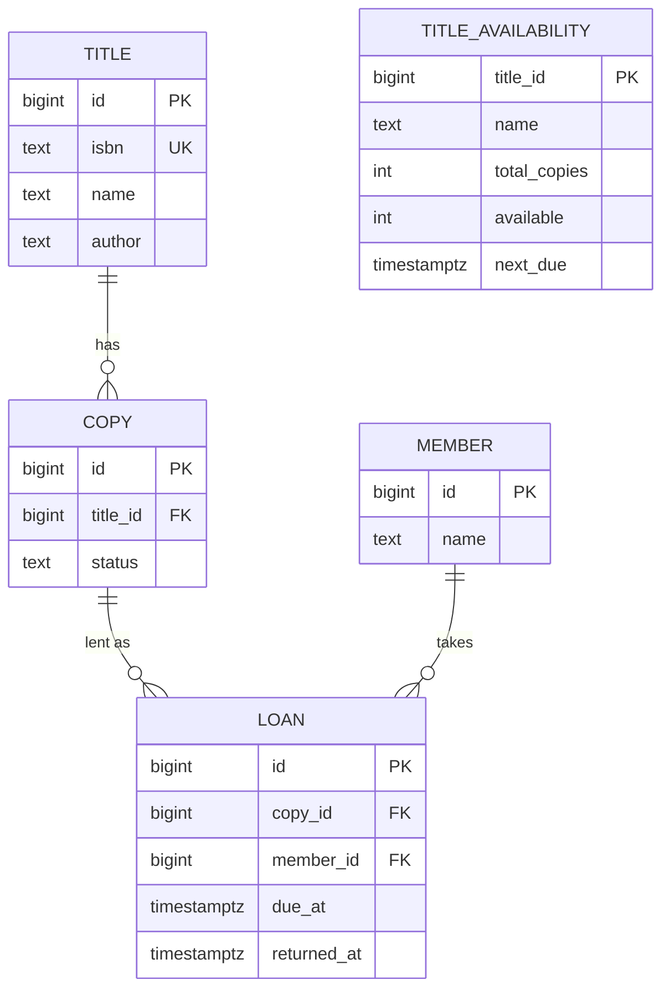

`TITLE_AVAILABILITY` is the read model: no joins needed to render the browse screen.

### Tech stack

| Component | Choice | Why |
|---|---|---|
| App | Spring Boot 4.1.1, one deployable | CQRS does not require microservices |
| Store | PostgreSQL, same database, separate tables | Simplest start |
| Events | `@TransactionalEventListener(phase = AFTER_COMMIT)` | Project only committed changes |
| Search | PostgreSQL `tsvector` index on read table | No extra infra |

### Milestones

1. **Run the demo.** [CqrsDemo.java](../../demos/chapters/12-cqrs/CqrsDemo.java) shows the stale-read window. *Done when* you can explain it.
2. **Write side only.** *Done when* borrowing a sixth book is rejected and browse uses a join query — record its latency at 100,000 titles.
3. **Read model plus projector.** *Done when* browse reads only `title_availability` and is faster.
4. **Rebuild.** *Done when* truncating the read table and running rebuild restores identical rows.
5. **Show lag.** *Done when* a deliberate 2 s projector delay makes the UI show "updating" rather than wrong data.

### Deep dive: the hard parts

**Read-your-own-writes.** A member borrows a book and the next page still shows it available. Fixes: return the new state from the command response for that one screen, or have the UI wait for the projector to reach the command's version.

**Projection correctness.** Incremental updates (`available = available - 1`) drift if an event is missed or applied twice. Make projections idempotent by storing the last applied event id per row, and keep a full rebuild as the safety net.

**Not over-engineering.** Here, both models live in one database and one app. That is legitimate CQRS. Separate databases and Kafka (Project 15) buy scale and independence at a large complexity cost.

### Testing strategy

Unit-test command rules. Property-style test: run a random sequence of borrow and return commands, rebuild the read model, and assert it equals the incrementally maintained one. Measure query latency in an integration test with seeded data.

### Trade-offs, scaling and failure modes

Two models means two things to keep in sync and to explain to new developers. Eventual consistency needs UI handling. In return, reads scale independently (read replicas, caches, search engines) and the write model stays clean.

### Stretch goals

- Move the read model to a separate database fed through Kafka.
- Add a second read model: "member dashboard" with current loans and fines.
- Event-source the write side (Project 24).

### Skills practised

- Command and query separation, projections: [Ch 12 — CQRS](../chapters/12-cqrs/README.md)
- Events as the bridge between models: [Ch 11 — Event-Driven](../chapters/11-event-driven/README.md)

### In the interview

**Q:** Does CQRS require event sourcing or separate databases? **A:** No. The minimum is separate models for reads and writes. Separate stores and event sourcing are optional extras with their own costs.

**Q:** How do you deal with stale reads? **A:** Show the user their own change from the command result, version the read model so the UI can wait for it, and design screens that tolerate a short delay.

**Q:** When is CQRS not worth it? **A:** For simple CRUD where reads and writes look the same. The extra model is pure cost there.

### TL;DR

Keep strict, normalised tables for borrowing and a flat projected table for browsing, and handle the short gap between them honestly.

## 11. Orchestrated Order Saga

**Level:** Intermediate · **Time:** 2 weeks · **Prerequisites:** Ch 8, Ch 10

### What it is

An e-commerce checkout built from four services — order, payment, inventory and shipping — each with its own PostgreSQL database, coordinated by a **saga orchestrator**. A *saga* is a sequence of local transactions, one per service, where each step has a *compensating transaction* that semantically undoes it if a later step fails. An *orchestrator* is a central component that tells each service what to do next and records progress in a durable state machine.

### The problem it solves

When each service owns its data, you cannot wrap "create order, charge card, reserve stock, book courier" in one database transaction. Two-phase commit (2PC), a protocol where a coordinator asks every database to prepare and then commit, is rarely available across services and blocks everyone when the coordinator stalls. A saga gives you all-or-compensated outcomes with only local transactions.

### Real-world examples

- The original 1987 paper by Garcia-Molina and Salem that defined sagas for long-lived transactions: [Sagas (PDF)](https://www.cs.cornell.edu/andru/cs711/2002fa/reading/sagas.pdf).
- Chris Richardson's pattern page comparing orchestration and choreography: [Pattern: Saga](https://microservices.io/patterns/data/saga.html).
- Microsoft's reference guide, including the problem of lost isolation between concurrent sagas: [Saga distributed transactions pattern](https://learn.microsoft.com/en-us/azure/architecture/patterns/saga).

### Requirements

**Functional**
- `POST /orders` starts a saga and returns the order id with status PENDING.
- Steps: create order (PENDING) → authorise payment → reserve inventory → schedule shipment → mark order APPROVED.
- Compensations: release inventory, void payment authorisation, mark order REJECTED.
- `GET /orders/{id}` shows status and the saga's step history.

**Non-functional**
- Orchestrator survives a crash mid-saga and resumes from the last recorded step.
- Every step and compensation is idempotent — safe to send twice.
- 200 sagas per second on a laptop with p95 completion under 1 second.
- Stuck sagas (no progress for 60 s) are surfaced on a dashboard.

### The architecture

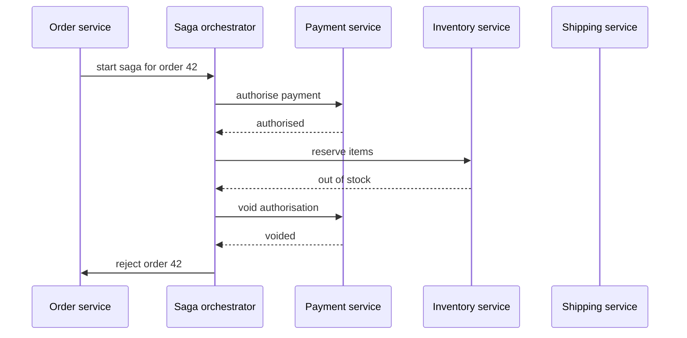

- **Saga orchestrator** — its own Spring Boot service with a `saga_instance` table holding current state. It sends commands over Kafka topics (one command topic per participant) and listens on a reply topic.
- **Participants** — each consumes its command topic, runs one local transaction, and replies. Each knows nothing about the overall flow.
- **Order service** — owns the order and starts the saga. Using the outbox (Project 13) to publish the start command is a stretch goal.

### Data model

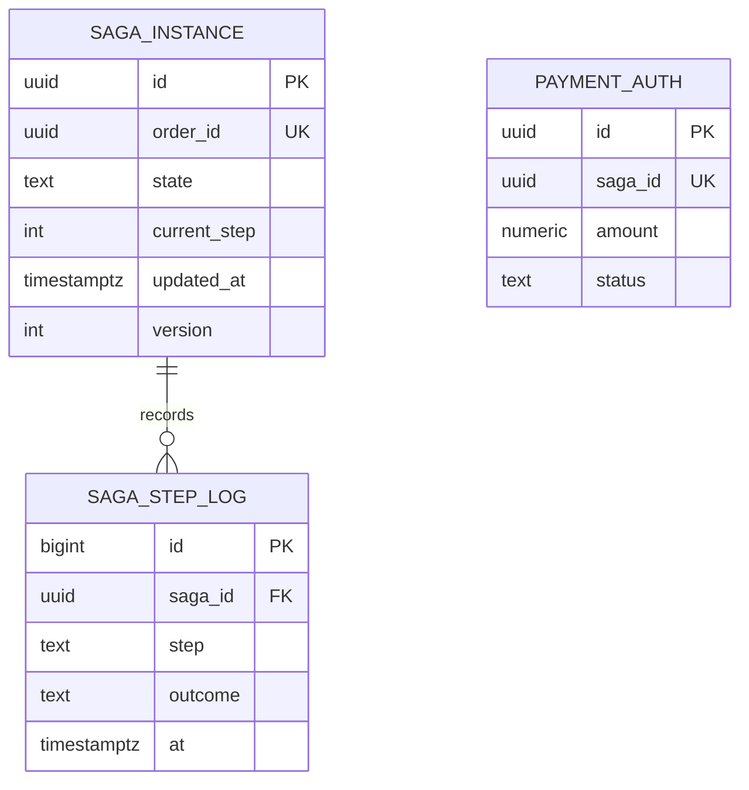

`PAYMENT_AUTH.saga_id` being unique is the idempotency guard: a second "authorise" for the same saga returns the existing result.

### Tech stack

| Component | Choice | Why |
|---|---|---|
| Orchestrator | Spring Boot 4.1.1 + a hand-written state machine | You learn the mechanics |
| Messaging | Kafka command and reply topics | Durable, replayable |
| Stores | PostgreSQL per service | Database-per-service rule |
| Retries | Resilience4j or Spring Kafka retry | Transient failures in steps |

### Milestones

1. **Happy path.** Read [SagaDemo.java](../../demos/chapters/10-saga/SagaDemo.java) first — it uses a charge and a refund rather than an authorisation and a void, but the reverse-order compensation is the same. *Done when* an order goes PENDING → APPROVED across four services.
2. **Compensation.** *Done when* forcing inventory to fail produces a voided authorisation and REJECTED order, visible in the payment ledger as authorise then void.
3. **Crash recovery.** *Done when* killing the orchestrator after step 2 and restarting it completes the saga, with no double charge.
4. **Idempotent participants.** *Done when* replaying every command topic from the beginning changes nothing.
5. **Timeouts and stuck sagas.** *Done when* a participant that never replies causes compensation after a deadline, and a dashboard lists stuck sagas.

### Deep dive: the hard parts

**Persist before you send.** The orchestrator must save "now waiting for inventory" before it sends the command, in the same transaction as writing the command to an outbox table. Otherwise a crash between "sent" and "saved" leaves the saga unsure whether the step happened. On restart, it re-sends, and idempotent participants make that safe.

**Compensation is not rollback.** A voided authorisation still appears in payment history, and a sent email cannot be unsent. Design compensations as new business actions. Order your steps so the hard-to-undo ones come last — the *pivot transaction* is the step after which the saga only goes forward.

**Lost isolation.** Between "reserve stock" and "compensate", other sagas can see the reserved stock as taken. That is usually fine. When it is not, use *semantic locks* — a status like PENDING that other operations respect — or re-read values before committing.

**Retries versus compensation.** A payment gateway timeout is not a business failure. Retry transient errors with backoff first, and compensate only on a definite "no" or after a deadline.

### Testing strategy

Component tests per participant with Testcontainers Kafka: send a command twice, assert one effect. Orchestrator tests drive the state machine with fake replies, including out-of-order and duplicate replies. A chaos test kills the orchestrator at random points during 1,000 sagas and checks the invariant: every order is APPROVED with exactly one payment, or REJECTED with net zero charge and no reservation.

### Trade-offs, scaling and failure modes

Orchestration makes the flow readable in one place and easy to change, but the orchestrator is a central service that must be highly available and can attract business logic. Partition sagas by order id so several orchestrator instances can share load. Failure modes: stuck sagas, compensations that themselves fail (retry them forever and alert), and duplicate commands (idempotency).

### Stretch goals

- Replace the hand-written engine with Temporal and compare code size (preview of Project 33).
- Add a parallel step: reserve inventory and run a fraud check at the same time.
- Expose saga history as a timeline in a small UI.

### Skills practised

- Orchestration, compensation, pivot steps: [Ch 10 — Saga](../chapters/10-saga/README.md)
- Retrying transient failures: [Ch 8 — Retry](../chapters/08-retry/README.md)
- Command and reply messaging: [Ch 11 — Event-Driven](../chapters/11-event-driven/README.md)

### In the interview

**Q:** Why not use two-phase commit? **A:** It needs every participant to support a shared transaction protocol, holds locks while waiting, and blocks when the coordinator fails. Sagas use only local transactions and accept eventual consistency.

**Q:** What if a compensation fails? **A:** Compensations must be retryable and idempotent. Retry with backoff, and if it keeps failing, park the saga for manual action and alert — never silently give up.

**Q:** Orchestration or choreography? **A:** Orchestration when the flow has many steps or changes often, because it is visible in one place. Choreography for short flows where services should stay fully independent.

**Q:** How does the orchestrator survive a crash? **A:** It stores saga state durably and writes outgoing commands in the same transaction, then resumes from stored state and re-sends. Participants deduplicate.

### TL;DR

A durable state machine that commands four services step by step and runs compensations in reverse when one says no — with idempotency everywhere.

## 12. Choreographed Travel Booking Saga

**Level:** Intermediate · **Time:** 2 weeks · **Prerequisites:** Ch 10, Ch 11

### What it is

A trip-booking system — flight, hotel and car — implemented as a **choreographed saga**: there is no central coordinator. Each service listens for events, does its local work and publishes its own event, and the overall flow emerges from those reactions. Compensation also travels by events: `CarBookingFailed` makes hotel and flight cancel their bookings.

### The problem it solves

Same consistency problem as Project 11, but with a different trade: no orchestrator to run, scale or become a bottleneck, and services stay fully decoupled. The cost is that the flow is not written down anywhere, which makes it harder to follow and to change. Building both versions is the best way to understand the trade-off.

### Real-world examples

- Microsoft's saga guide explains choreography and the risk of cyclic dependencies between participants: [Saga distributed transactions pattern](https://learn.microsoft.com/en-us/azure/architecture/patterns/saga).
- The microservices.io saga page gives a choreography example with events per step: [Pattern: Saga](https://microservices.io/patterns/data/saga.html).
- Microsoft's compensating transaction pattern covers ordering and idempotency of undo steps: [Compensating Transaction pattern](https://learn.microsoft.com/en-us/azure/architecture/patterns/compensating-transaction).

### Requirements

**Functional**
- Trip service publishes `TripRequested`.
- Flight reacts → `FlightBooked` or `FlightFailed`. Hotel reacts to `FlightBooked` → `HotelBooked` or `HotelFailed`. Car reacts to `HotelBooked` → `CarBooked` or `CarFailed`.
- Trip service listens to all outcomes and sets CONFIRMED or CANCELLED.
- On any failure, earlier steps cancel via their own listeners.
- A "trip timeline" view built from all events.

**Non-functional**
- Each service deployable and scalable alone, no shared database.
- A trip reaches a final state within 5 seconds in 99% of cases, or is flagged.
- All handlers idempotent and safe under redelivery.

### The architecture

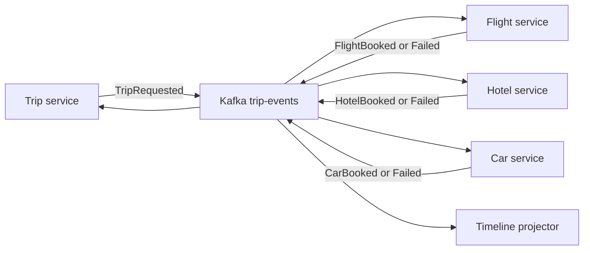

- **One topic, keyed by trip id** — all events for a trip land in one partition and stay in order. Every service reads it and ignores types it does not care about.
- **Services** — each owns its bookings table and its reaction rules.
- **Timeline projector** — reads every event into a per-trip history. This is your only "whole flow" view, so it is essential, not optional.

### Data model

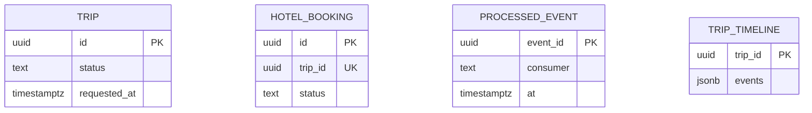

Each service has its own `PROCESSED_EVENT` table, written in the same transaction as its business change — the *inbox* that makes handlers idempotent.

### Tech stack

| Component | Choice | Why |
|---|---|---|
| Services | Spring Boot 4.1.1 with Spring Cloud Stream or Spring Kafka | Functional event handlers |
| Broker | Kafka, single topic `trip-events` | Ordering per trip |
| Event format | JSON envelope: eventId, tripId, type, occurredAt, payload | Uniform handling |
| Observability | Timeline projector + tracing headers | Reconstruct the flow |

### Milestones

1. **Happy path by events.** *Done when* a trip reaches CONFIRMED and the timeline shows four events in order.
2. **Failure at the end.** *Done when* forcing car failure cancels hotel and flight and sets trip CANCELLED.
3. **Idempotency.** *Done when* duplicate deliveries (simulate by re-publishing) cause no double bookings.
4. **Timeouts.** *Done when* a hotel service that is down for 2 minutes leaves the trip flagged as PENDING_TOO_LONG, then completes when hotel returns.
5. **Compare.** *Done when* you have written one page comparing this with Project 11: lines of code, places changed to add a "travel insurance" step, and debugging effort.

### Deep dive: the hard parts

**Where is the flow?** In choreography, the sequence lives in subscriptions spread across services. Adding "insurance after car" means changing car's outcome handling or trip's completion rule — and finding that out means reading every service. The timeline projector and a documented event catalogue are how teams cope.

**Cancellation fan-out.** When car fails, both hotel and flight must cancel. If each listens for `CarFailed` directly, both now know about car. Alternatively, trip publishes a single `TripCancelled`, and each service cancels its own booking. The second keeps participants ignorant of each other — prefer it.

**Racing events.** A `TripCancelled` (user gave up) can arrive while hotel is still processing `FlightBooked`. Same partition order helps, but the handler must check current status: if the trip is cancelled, book nothing, or book then immediately cancel.

**Cyclic dependencies.** If hotel listens to flight and flight listens to hotel's failure, you have a cycle that is easy to break with a careless change. Draw the subscription graph and review it like code.

### Testing strategy

Component tests: feed events into one service, assert the events it emits. An end-to-end test with Testcontainers runs all four services and drives random failures across 500 trips, checking the invariant: CONFIRMED trips have three bookings, CANCELLED trips have zero active bookings. Contract tests on event schemas (Project 17) catch accidental field renames.

### Trade-offs, scaling and failure modes

No coordinator to scale or lose, and each service is independent. But the flow is implicit, adding steps touches several services, and debugging needs tracing and timelines. Failure modes: a service silently ignoring an event type after a rename, cycles, and sagas that never finish because one event was dropped — always pair choreography with a timeout watcher.

### Stretch goals

- Add parallel steps: hotel and car both react to `FlightBooked`, and trip waits for both.
- Generate a sequence diagram per trip automatically from the timeline.
- Move the same flow into an orchestrator and run both side by side.

### Skills practised

- Choreography and compensation: [Ch 10 — Saga](../chapters/10-saga/README.md)
- Event streams and consumer groups: [Ch 11 — Event-Driven](../chapters/11-event-driven/README.md)
- Timeline as a read model: [Ch 12 — CQRS](../chapters/12-cqrs/README.md)

### In the interview

**Q:** Biggest risk of choreography? **A:** The flow becomes invisible and spread across services, so changes have surprising effects and failures are hard to trace. Mitigate with an event catalogue, tracing and a timeout watcher.

**Q:** How do you know a choreographed saga finished? **A:** One service — usually the initiator — listens for terminal events and owns the final status, with a timer to flag sagas that never reach one.

**Q:** How do you avoid services knowing about each other? **A:** React to domain events, not to other services' internal failures, and use one cancellation event that everyone handles locally.

### TL;DR

Flight, hotel and car react to each other's events with no coordinator, and you learn exactly what you give up when the flow is nowhere in code.

## 13. Transactional Outbox Relay

**Level:** Intermediate · **Time:** 1–2 weeks · **Prerequisites:** Ch 10, Ch 11

### What it is

A reusable **transactional outbox** for Spring services: business changes and the events describing them are written to the same PostgreSQL database in one transaction, and a separate **relay** process reads the `outbox` table and publishes to Kafka. You build two relays — a polling relay and a change-data-capture relay using Debezium — and compare them. *Change data capture (CDC)* means reading a database's own change log (in PostgreSQL, the write-ahead log, via logical replication) to see every committed row change.

### The problem it solves

"Save to DB, then publish to Kafka" is a *dual write*: two systems, no shared transaction. If the app crashes in between, the database says the order exists but no one hears about it. If you publish first, consumers may hear about an order that was then rolled back. The outbox turns two writes into one local transaction plus reliable, at-least-once delivery.

### Real-world examples

- The pattern as described by Chris Richardson: [Pattern: Transactional outbox](https://microservices.io/patterns/data/transactional-outbox.html).
- Debezium ships an outbox event router that turns outbox rows into properly keyed Kafka messages: [Outbox Event Router](https://debezium.io/documentation/reference/stable/transformations/outbox-event-router.html).
- Spring Modulith's event publication registry is a built-in outbox-like mechanism for Spring apps: [Spring Modulith events](https://docs.spring.io/spring-modulith/reference/events.html).

### Requirements

**Functional**
- An order service writes `orders` and `outbox` rows in one transaction.
- Outbox row: id, aggregate type, aggregate id, event type, JSON payload, created time.
- Polling relay publishes unpublished rows in order and marks them sent.
- Debezium relay streams inserts from the outbox table with the outbox router.
- Consumers deduplicate by event id.

**Non-functional**
- Zero lost events across crashes of the app, the relay or Kafka (prove it with a test).
- End-to-end latency from commit to Kafka: polling under 1 s, CDC under 200 ms p95.
- Outbox table stays small: sent rows deleted or partitioned away after 7 days.
- Per-aggregate ordering preserved.

### The architecture

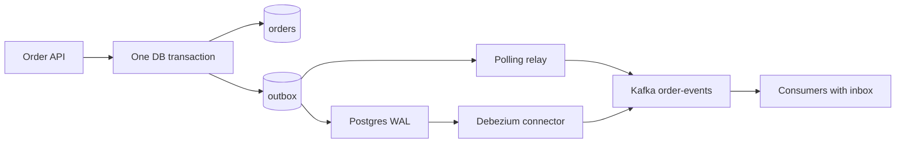

- **Order API** — the only change to normal code is inserting an outbox row alongside the business row.
- **Polling relay** — a scheduled job: select a batch with `FOR UPDATE SKIP LOCKED`, publish, mark sent, commit. `SKIP LOCKED` lets several relay instances share work without blocking each other.
- **Debezium connector** — runs in Kafka Connect, reads the WAL through a logical replication slot, and routes each outbox row to a topic named after its aggregate type, keyed by aggregate id.
- **Consumers** — keep an inbox table of processed event ids.

### Data model

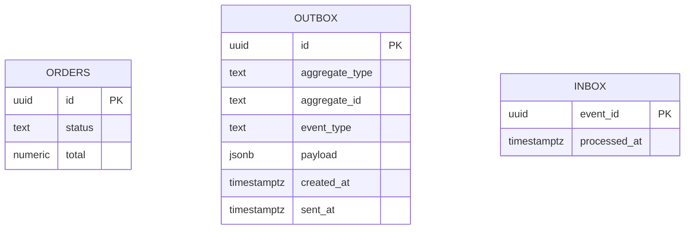

### Tech stack

| Component | Choice | Why |
|---|---|---|
| App | Spring Boot 4.1.1, Spring Data JDBC | Explicit SQL, easy to reason about |
| CDC | Debezium PostgreSQL connector on Kafka Connect | Reads the log, no polling |
| DB | PostgreSQL with `wal_level=logical` | Required for CDC |
| Tests | Testcontainers: Postgres, Kafka, Connect | Real failure testing |

### Milestones

1. **Show the bug.** *Done when* a test that kills the app between save and publish finds an order with no event.
2. **Outbox write.** *Done when* every order insert has a matching outbox row in the same transaction (rollback test proves neither persists on failure).
3. **Polling relay.** *Done when* the crash test finds zero lost events and the duplicate count is logged.
4. **Debezium relay.** *Done when* events arrive in Kafka keyed by order id with latency under 200 ms p95.
5. **Housekeeping and metrics.** *Done when* old rows are cleaned up and a dashboard shows outbox backlog and relay lag.

### Deep dive: the hard parts

**At-least-once, not exactly-once.** The relay can publish and crash before marking a row sent, so the row is published again. The outbox guarantees "never lost", not "never duplicated". Consumers must be idempotent — this pairing (outbox plus inbox) is the standard answer.

**Ordering with multiple relay workers.** Two workers with `SKIP LOCKED` can publish events for the same order out of order. Either run one active worker per partition of aggregate ids, or have each worker lock by aggregate. Debezium preserves commit order from the log, which is one of its advantages.

**Replication slot hygiene.** A logical replication slot keeps WAL on disk until the connector confirms it. If Debezium is down for a day, the database disk fills. Monitor slot lag and set alerts — this is the most common production incident with CDC.

**Commit order versus id order.** With polling, a transaction that started earlier but committed later can have a smaller id than rows already published. A relay that tracks "last id published" skips it forever. Use the `sent_at IS NULL` flag rather than a high-water mark, or accept a small delay window.

### Testing strategy

Failure-injection tests: kill the relay after publish but before mark (expect a duplicate, no loss), kill Kafka during publish (expect retries, no loss), roll back the business transaction (expect no event). A soak test publishes 100,000 orders with random kills and compares the set of order ids in the database with the set in Kafka.

### Trade-offs, scaling and failure modes

Polling is simple and needs no extra infra but adds load and latency. CDC is fast and ordered but brings Kafka Connect, replication slots and new operational skills. Both double-write to your database. Failure modes: outbox growth, slot disk usage, duplicate delivery, and schema changes to the payload breaking consumers.

### Stretch goals

- Package the outbox as a Spring Boot starter used by Projects 11 and 12.
- Compare with Spring Modulith's event publication registry.
- Add an `InboxRepository` that deduplicates and processes in one transaction.

### Skills practised

- Reliable event publishing: [Ch 11 — Event-Driven](../chapters/11-event-driven/README.md)
- The building block of every saga: [Ch 10 — Saga](../chapters/10-saga/README.md)
- Idempotency under redelivery: [Ch 8 — Retry](../chapters/08-retry/README.md)

### In the interview

**Q:** What problem does the outbox solve? **A:** The dual write between a database and a broker. Writing the event to the same database transaction guarantees an event exists if and only if the change committed.

**Q:** Does it give exactly-once delivery? **A:** No — at-least-once. The relay can resend after a crash, so consumers deduplicate by event id.

**Q:** Polling or CDC? **A:** Polling for simplicity and low volume. CDC for low latency, strict ordering and high volume, at the cost of operating Kafka Connect and replication slots.

### TL;DR

Write the event in the same transaction as the data, relay it to Kafka by polling or CDC, and deduplicate on the other side.

## 14. Kafka Retry Topics and Dead-Letter Console

**Level:** Intermediate · **Time:** 1–2 weeks · **Prerequisites:** Ch 8, Ch 11

### What it is

A non-blocking error-handling pipeline for Kafka consumers: a failed message is moved to a **retry topic** with a delay (for example 10 s, then 1 min, then 10 min), and after the last attempt to a **dead-letter topic (DLT)** — a parking place for messages that could not be processed. Plus a small web console to inspect, fix, replay or discard dead letters.

### The problem it solves

A Kafka consumer processes a partition in order. If one message keeps failing and the consumer retries it in place, the whole partition stops — every later message waits behind one bad record (the *poison pill*). Dropping it loses data. Retry topics let the main flow continue while the failed message waits its turn elsewhere, and the DLT gives humans a way to handle what code cannot.

### Real-world examples

- Uber describes the retry-topic and DLQ design it built for its Driver Injury Protection program: [Building Reliable Reprocessing and Dead Letter Queues with Apache Kafka](https://www.uber.com/blog/reliable-reprocessing/).
- Spring for Apache Kafka has built-in non-blocking retry topics: [Non-Blocking Retries](https://docs.spring.io/spring-kafka/reference/retrytopic.html).
- AWS on why backoff and limits on retries matter: [Timeouts, retries and backoff with jitter](https://aws.amazon.com/builders-library/timeouts-retries-and-backoff-with-jitter/).

### Requirements

**Functional**
- A billing consumer processes `InvoiceIssued` events and calls a flaky tax-rate service.
- Transient errors go through retry topics with delays 10 s, 60 s, 600 s.
- Non-retryable errors (bad data) go straight to the DLT.
- The DLT record keeps original topic, partition, offset, error class, message and attempt count in headers.
- Console: list DLT messages, filter by error, view payload, edit and replay to the original topic, or discard with a reason.

**Non-functional**
- One failing message never delays others by more than 1 s.
- No message lost between topics (prove with counts).
- Console replay is audited: who, when, what changed.

### The architecture

```mermaid
flowchart TD
  M["invoice-issued"] --> C["Billing consumer"]
  C -->|"transient error"| R1["retry-10s"]
  R1 --> C1["Retry consumer"]
  C1 -->|"fails again"| R2["retry-60s"]
  R2 --> C2["Retry consumer"]
  C2 -->|"fails again"| R3["retry-600s"]
  R3 --> C3["Retry consumer"]
  C3 -->|"last failure"| DLT["invoice-issued-dlt"]
  C -->|"bad data"| DLT
  DLT --> UI["DLT console"]
  UI -->|"replay"| M
```

- **Retry topics** — each consumer waits until the message's due time before processing (Spring Kafka pauses the partition rather than sleeping).
- **DLT** — retained for 30 days.
- **Console** — a Spring Boot app with a simple UI, reading the DLT from the beginning into a PostgreSQL table so operators can search it.

### Data model

```mermaid
erDiagram
  DEAD_LETTER {
    uuid id PK
    text original_topic
    int original_partition
    bigint original_offset
    text error_class
    text error_message
    int attempts
    jsonb payload
    text state
  }
  DLT_ACTION {
    bigint id PK
    uuid dead_letter_id FK
    text action
    text actor
    text reason
    timestamptz at
  }
  DEAD_LETTER ||--o{ DLT_ACTION : "audited by"
```

### Tech stack

| Component | Choice | Why |
|---|---|---|
| Retry plumbing | Spring Kafka `@RetryableTopic` | Declarative delays and DLT |
| Classification | Exception types: transient vs. permanent | Decides retry or DLT |
| Console | Spring Boot + server-rendered pages | Small, internal tool |
| Faults | WireMock tax service with failure modes | Repeatable |

### Milestones

1. **Blocking baseline.** *Done when* one poison message stops a partition and lag grows for all later messages.
2. **Retry topics.** *Done when* the poison message travels through three retry topics while others flow normally.
3. **Classification.** *Done when* validation errors skip retries and land in the DLT immediately.
4. **Console.** *Done when* an operator can fix a field and replay, and the message is processed successfully.
5. **Accounting.** *Done when* a soak test with 10% random failures ends with processed + dead-lettered = produced.

### Deep dive: the hard parts

**Ordering is given up.** Moving a message to a retry topic means later messages for the same key may be processed first. For invoices that is fine. For "account opened" then "account closed", it is not. If order matters per key, park all later messages for that key too, or block in place for that key only.

**Retry storms on outages.** If the tax service is down for an hour, every message goes through all retry topics and lands in the DLT. Retrying cannot help a hard outage. Pair with a circuit breaker that pauses the consumer while the dependency is down.

**Replay safety.** A replayed message is a duplicate from the system's point of view — the consumer may already have partially processed it. Idempotent processing with a stable event id is mandatory, and the console should warn when replaying something already marked processed.

### Testing strategy

Integration tests with Testcontainers: assert a message lands on the right retry topic with correct headers, and in the DLT after the final attempt. Use short delays (100 ms) in tests. Test the console replay end to end. Count-based soak test for loss.

### Trade-offs, scaling and failure modes

Retry topics multiply topic count and operational surface. Long delays hold messages for a long time — tell the business. The DLT can silently fill up if no one watches it, so alert on DLT inflow rate, not just size.

### Stretch goals

- Pause the main consumer automatically when a breaker opens.
- Bulk replay with a rate limit.
- Per-key ordering mode that parks later messages for a failing key.

### Skills practised

- Retry with backoff and limits: [Ch 8 — Retry](../chapters/08-retry/README.md)
- Consumer behaviour and ordering: [Ch 11 — Event-Driven](../chapters/11-event-driven/README.md)
- Pausing on outages: [Ch 6 — Circuit Breaker](../chapters/06-circuit-breaker/README.md)

### In the interview

**Q:** Why not retry in place? **A:** Kafka processes a partition in order, so an in-place retry blocks every later message in that partition. Retry topics keep the main flow moving.

**Q:** What goes into a dead-letter topic? **A:** Messages that are permanently bad or exhausted their retries, with headers recording the source position and error so they can be diagnosed and replayed.

**Q:** What do you lose with retry topics? **A:** Per-key ordering. If ordering matters, you must hold back later messages for the same key.

### TL;DR

Move failures aside with delayed retry topics, park the hopeless ones in a DLT, and give humans a safe, audited way to replay them.

## 15. Product Search Read Model

**Level:** Intermediate · **Time:** 2 weeks · **Prerequisites:** Ch 11, Ch 12

### What it is

A catalogue where products, prices and stock are owned by three different services, and a **search read model** — a denormalised index in OpenSearch — is built by consuming their events from Kafka. Shoppers search and filter against the index, never against the source services. This is CQRS across service boundaries: the read model joins data that no single service owns.

### The problem it solves

"Find red running shoes under 80 euros that are in stock, sorted by rating" needs product attributes, price and stock together. Calling three services per search result is slow and couples search to all three. A local join is impossible because the data lives in three databases. A projected index built from events gives fast, rich queries while each service keeps ownership of its data.

### Real-world examples

- Chris Richardson describes CQRS views fed by events from several services: [Pattern: CQRS](https://microservices.io/patterns/data/cqrs.html).
- OpenSearch, the open-source search engine used here: [OpenSearch](https://opensearch.org/).
- Microsoft's CQRS guidance on separate read stores and eventual consistency: [CQRS pattern](https://learn.microsoft.com/en-us/azure/architecture/patterns/cqrs).

### Requirements

**Functional**
- Product service publishes `ProductCreated` and `ProductUpdated`. Pricing publishes `PriceChanged`. Inventory publishes `StockChanged`.
- Search projector merges them into one document per product.
- `GET /search?q=&color=&maxPrice=&inStock=&sort=` with facets (counts per colour and brand).
- Full rebuild of the index from Kafka (topics retained or compacted) without downtime.

**Non-functional**
- Search p95 under 100 ms for 1 million products.
- Index freshness: under 2 s from event to searchable.
- Rebuild of 1 million products under 30 minutes, while the old index keeps serving.

### The architecture

```mermaid
flowchart LR
  PS["Product service"] --> K1["product-events"]
  PR["Pricing service"] --> K2["price-events"]
  IN["Inventory service"] --> K3["stock-events"]
  K1 --> PJ["Search projector"]
  K2 --> PJ
  K3 --> PJ
  PJ --> OS[("OpenSearch index")]
  API["Search API"] --> OS
  U["Shopper"] --> API
```

- **Source services** — publish via the outbox (Project 13). They do not know search exists.
- **Compacted topics** — Kafka *log compaction* keeps the latest message per key forever, so the topic itself is a full snapshot you can rebuild from.
- **Projector** — consumes all three topics, applies partial updates to documents, and records the source version of each part.
- **Index alias** — the search API queries an alias (a pointer name), so a rebuilt index can be swapped in atomically.

### Data model

| Index field | Source | Notes |
|---|---|---|
| `productId` | product | Document id |
| `name`, `brand`, `color`, `description` | product | Text and keyword fields |
| `price`, `currency` | pricing | Numeric for range filters |
| `inStock`, `stockQty` | inventory | Boolean filter |
| `productVersion`, `priceVersion`, `stockVersion` | each source | Reject older updates |

### Tech stack

| Component | Choice | Why |
|---|---|---|
| Index | OpenSearch, single node locally | Full text, facets, range filters |
| Projector | Spring Boot 4.1.1 + Spring Kafka | Batch consume, bulk index |
| Topics | Compacted, keyed by productId | Rebuildable snapshot |
| Load data | Generator for 1 million products | Realistic latency numbers |

### Milestones

1. **Events from three services.** *Done when* each publishes keyed events to compacted topics.
2. **Projector merges documents.** *Done when* a search returns a product with name, price and stock from three sources.
3. **Out-of-order safety.** *Done when* replaying a stale `PriceChanged` does not overwrite a newer price.
4. **Facets and filters.** *Done when* p95 is under 100 ms at 1 million documents.
5. **Zero-downtime rebuild.** *Done when* a new index is built from offset 0 into `products_v2`, the alias swaps, and searches never fail during the swap.

### Deep dive: the hard parts

**Partial documents and versioning.** Events from three topics arrive in no global order. A price update can arrive before the product exists. Upsert partial documents, and store each source's version so that an older event never overwrites a newer one — compare versions per field group, not per document.

**Rebuilding while live.** The live projector keeps updating `v1` while a second projector fills `v2` from the start of the topics. Once `v2` catches up to the current offsets, switch the alias and stop the old projector. Changes during the switch are covered because both are consuming.

**Bulk efficiency.** Indexing one document per event is slow. Batch events from a poll, merge updates for the same product in memory, then send one bulk request. This alone can make rebuilds many times faster.

### Testing strategy

Projector unit tests with shuffled event orders must produce the same final document. Integration tests with Testcontainers Kafka and OpenSearch. A freshness test measures time from publish to searchable. A rebuild test runs searches in a loop during the alias swap and asserts no errors.

### Trade-offs, scaling and failure modes

The index is eventually consistent: a shopper may see "in stock" for an item that just sold out, so checkout must re-check with inventory. OpenSearch is a new system to operate. Failure modes: projector lag (alert on consumer lag), mapping changes that require a rebuild, and compacted topics growing if keys are never deleted (use tombstones).

### Stretch goals

- Personalised ranking using a separate "popularity" event stream.
- Search-as-you-type with an edge n-gram field.
- A second read model (category page counts) from the same topics.

### Skills practised

- Read models across services: [Ch 12 — CQRS](../chapters/12-cqrs/README.md)
- Event streams, compaction and replay: [Ch 11 — Event-Driven](../chapters/11-event-driven/README.md)

### In the interview

**Q:** How do you search across data owned by several services? **A:** Each service publishes change events, and a projector builds a denormalised search index. Queries hit the index, never the services.

**Q:** How do you handle out-of-order events? **A:** Carry a version from the source and apply an update only if it is newer than what the document has for that part.

**Q:** How do you change the index schema? **A:** Build a new index from replayable topics alongside the old one, then swap an alias.

### TL;DR

Turn three services' events into one fast search index, guard against out-of-order updates with versions, and rebuild behind an alias.

## 16. End-to-End Tracing with OpenTelemetry

**Level:** Intermediate · **Time:** 1–2 weeks · **Prerequisites:** Ch 3, Ch 9

### What it is

**Distributed tracing** for a five-service system (gateway, order, payment, inventory, notification) using **OpenTelemetry (OTel)** — the vendor-neutral standard for traces, metrics and logs. A *trace* is the full story of one request across services. It is made of *spans*, each timing one operation (an HTTP call, a SQL query, a Kafka publish), linked by a shared trace id. You instrument HTTP and Kafka hops, collect spans through an OTel Collector, and view them in Jaeger or Grafana Tempo.

### The problem it solves

A user says "checkout took eight seconds". Each service's logs say it was fast. Without tracing you cannot see that the time was spent waiting on a retry loop inside payment, or in a Kafka topic with lag. Tracing stitches one request's path together across process boundaries, including asynchronous hops.

### Real-world examples

- Google's Dapper paper, the design most modern tracers descend from: [Dapper, a Large-Scale Distributed Systems Tracing Infrastructure](https://research.google/pubs/dapper-a-large-scale-distributed-systems-tracing-infrastructure/).
- The W3C standard header (`traceparent`) that carries context between services: [Trace Context](https://www.w3.org/TR/trace-context/).
- OpenTelemetry for Java, including the agent and SDK: [OpenTelemetry Java](https://opentelemetry.io/docs/languages/java/).

### Requirements

**Functional**
- Every inbound request gets a trace, propagated through HTTP calls and Kafka messages.
- Spans for HTTP server and client, JDBC queries and Kafka produce and consume.
- Custom spans for business steps ("reserve stock") with attributes like order id.
- Logs include trace id and span id, so you can jump from a log line to its trace.
- Errors mark spans with status ERROR and the exception.

**Non-functional**
- Tracing overhead under 5% CPU and under 2 ms p95 added latency.
- Head sampling at 10% in "production" profile, 100% in dev.
- Collector buffers spans if the backend is down for 5 minutes.

### The architecture

```mermaid
flowchart TD
  C["Client"] --> GW["Gateway"]
  GW --> OR["Order service"]
  OR --> PA["Payment service"]
  OR --> K["Kafka order-events"]
  K --> IN["Inventory service"]
  K --> NO["Notification service"]
  GW -.-> COL["OTel Collector"]
  OR -.-> COL
  PA -.-> COL
  IN -.-> COL
  NO -.-> COL
  COL --> J["Jaeger or Tempo"]
  COL --> L["Loki for logs"]
```

- **Instrumentation** — Spring Boot's Micrometer Tracing with the OpenTelemetry bridge, or the OTel Java agent. Try both and compare.
- **Propagation** — `traceparent` HTTP header, and the same header in Kafka record headers.
- **OTel Collector** — receives spans over OTLP (the OTel wire protocol), batches them, and exports to backends. It can run as a sidecar or a shared deployment.
- **Backends** — Jaeger or Grafana Tempo for traces, Loki for logs, Grafana to link them.

### Data model

| Concept | Key fields | Notes |
|---|---|---|
| Trace | traceId (16 bytes) | Shared by every span of one request |
| Span | spanId, parentSpanId, name, start, end, status, attributes | One timed operation |
| Context | traceId, spanId, flags (sampled) | Carried in `traceparent` |
| Span link | other trace and span ids | Connects a consumer to a producer when batching |

### Tech stack

| Component | Choice | Why |
|---|---|---|
| Instrumentation | Micrometer Tracing + OTel bridge, or OTel Java agent | Built into Spring Boot, or zero-code |
| Collector | [OpenTelemetry Collector](https://opentelemetry.io/docs/collector/) | Vendor-neutral pipeline |
| Backend | Jaeger or Grafana Tempo | Free, local |
| Logs | Logback pattern with trace id, Loki | Correlation |

### Milestones

1. **Single service traces.** *Done when* order's HTTP and SQL spans appear in Jaeger.
2. **HTTP propagation.** *Done when* gateway → order → payment is one trace with three levels.
3. **Kafka propagation.** *Done when* inventory and notification spans join the order's trace via record headers.
4. **Logs correlation.** *Done when* clicking a trace in Grafana shows its log lines.
5. **Find the slow span.** Add a hidden 2 s retry loop in payment. *Done when* someone unfamiliar with the code finds it from the trace in under a minute.
6. **Sampling.** *Done when* the production profile keeps about 10% of traces, and errors are still visible (preview of tail sampling in Project 34).

### Deep dive: the hard parts

**Context across threads.** Trace context lives in a thread-local or scoped value. When you hand work to another thread (an executor, a `CompletableFuture`), the context is lost unless the executor is wrapped. With virtual threads and structured concurrency (preview in Java 25), check that context flows — test it explicitly.

**Async hops.** A Kafka consumer that processes messages in batches has many parent traces for one piece of work. Use *span links* rather than forcing one parent. Decide whether a consumer span continues the producer's trace (simple, good for one-to-one) or starts a new one linked to it (better for fan-out and long delays).

**Cardinality and cost.** Attributes like user id on every span are useful, but metrics derived from spans explode if they include high-cardinality labels. Keep high-cardinality values on spans only, never on metric labels.

### Testing strategy

Use the OTel in-memory span exporter in tests to assert that a call produces the expected spans with the right parent ids. An integration test sends one request through the stack and queries Jaeger's API for a trace with spans from all five services. A benchmark compares p95 with tracing on and off.

### Trade-offs, scaling and failure modes

Tracing costs CPU, network and storage. Head sampling (decide at the start) is cheap but can drop the rare slow or failed requests you care most about. Missing propagation in one hop breaks a trace in two, which is worse than useless for debugging — enforce instrumentation in a shared starter.

### Stretch goals

- Baggage: carry tenant id in OTel baggage and add it to every span.
- Service graph and RED metrics (rate, errors, duration) generated from spans.
- Trace a request through a database trigger or a sidecar proxy.

### Skills practised

- Observability as a sidecar or collector: [Ch 9 — Sidecar](../chapters/09-sidecar/README.md)
- Request ids at the edge: [Ch 3 — API Gateway](../chapters/03-api-gateway/README.md)
- Tracing asynchronous flows: [Ch 11 — Event-Driven](../chapters/11-event-driven/README.md)

### In the interview

**Q:** How does a trace follow a request across services? **A:** Each service reads the trace context from the incoming `traceparent` header, creates child spans, and writes the context into outgoing HTTP headers or message headers.

**Q:** Head versus tail sampling? **A:** Head sampling makes its keep-or-drop choice when the trace begins, before anyone knows whether the request will fail or be slow, which keeps it inexpensive but means errors are dropped as often as successes. Tail sampling decides after seeing the whole trace, so it can keep all errors and slow traces, at the cost of buffering.

**Q:** How do you trace through Kafka? **A:** Put the context in record headers. The consumer extracts it and either continues the trace or links to it.

### TL;DR

Instrument every hop — HTTP and Kafka — with OpenTelemetry, ship spans through a collector, and turn "it was slow somewhere" into one clickable timeline.

## 17. Consumer-Driven Contract Testing Pipeline

**Level:** Intermediate · **Time:** 1–2 weeks · **Prerequisites:** Ch 3, Ch 4

### What it is

A CI pipeline where API consumers (a web BFF and a mobile BFF) write **contracts** — executable examples of the requests they send and the responses they rely on — and the provider (a product service) must pass all of them before it can deploy. *Consumer-driven contract testing* flips the usual direction: the people who use an API state what they need, and the provider proves it still delivers. You use Pact with a Pact Broker, and add Spring Cloud Contract for one Kafka message contract.

### The problem it solves

With many services, end-to-end tests that start everything are slow, flaky and run too late. But unit tests on each side cannot catch "provider renamed `price` to `amount`". Contract tests catch breaking changes in seconds, on each side independently, and the broker answers the key deployment question: "can I deploy this version of this service to production right now?"

### Real-world examples

- Martin Fowler's site explains the idea and its origin: [Consumer-Driven Contracts](https://martinfowler.com/articles/consumerDrivenContracts.html).
- Pact, the most widely used tool, with its broker and `can-i-deploy` check: [Pact documentation](https://docs.pact.io/).
- Spring's tool, which can also test messaging contracts: [Spring Cloud Contract reference](https://docs.spring.io/spring-cloud-contract/reference/).

### Requirements

**Functional**
- Web BFF and mobile BFF each publish a Pact for `GET /products/{id}` with only the fields they use.
- Product service verifies all consumer pacts in its CI build against its real controller.
- The broker records which versions are in which environment.
- `can-i-deploy` gates deploys of both consumers and provider.
- One message contract: product service's `ProductUpdated` event consumed by search.

**Non-functional**
- Contract tests run in under 60 s per service.
- A breaking provider change fails CI before merge, not after deploy.
- No shared test environment needed to verify compatibility.

### The architecture

```mermaid
flowchart LR
  WB["Web BFF tests"] -->|"publish pact"| PB["Pact Broker"]
  MB["Mobile BFF tests"] -->|"publish pact"| PB
  PB -->|"fetch pacts"| PV["Product service verify"]
  PV -->|"results"| PB
  CI["Deploy job"] -->|"can-i-deploy"| PB
  PS["Product service"] -->|"message contract"| SC["Spring Cloud Contract stubs"]
  SC --> SR["Search consumer tests"]
```

- **Consumer tests** — run against a Pact mock server and record the interaction.
- **Pact Broker** — stores contracts and verification results with version and environment tags.
- **Provider verification** — replays each interaction against the real product controller with provider states (test data set-up hooks such as "product 42 exists").
- **Deploy gate** — CI asks the broker whether this version is compatible with what is deployed.

### Data model

| Item | Fields | Notes |
|---|---|---|
| Pact | consumer, provider, interactions, consumer version | JSON file |
| Interaction | description, provider state, request, response matchers | Matchers check type, not exact value |
| Verification | provider version, pact version, success | Stored in broker |
| Environment record | service, version, environment | "Deployed to prod" |

### Tech stack

| Component | Choice | Why |
|---|---|---|
| HTTP contracts | Pact JVM with JUnit 5 | Consumer-driven, broker workflow |
| Broker | Pact Broker in Docker | Version matrix and `can-i-deploy` |
| Messaging contract | Spring Cloud Contract | Generates stubs for Kafka messages |
| CI | GitHub Actions or a local runner | Shows the gate in action |

### Milestones

1. **First consumer pact.** *Done when* the web BFF test produces a pact file with only the fields it reads.
2. **Provider verification.** *Done when* product service CI verifies it with provider states.
3. **Break it on purpose.** Rename a field. *Done when* provider CI fails with a clear message naming the consumer.
4. **Broker and `can-i-deploy`.** *Done when* the deploy job refuses an incompatible version.
5. **Message contract.** *Done when* search's consumer test runs against a stub generated from product's contract.

### Deep dive: the hard parts

**Match on shape, not values.** A contract that asserts `price == 19.99` breaks whenever test data changes. Use matchers ("a decimal", "a string matching this pattern") so contracts express what matters.

**Provider states.** The provider must be able to set up "product 42 exists and is out of stock" quickly. Keep a small state hook per state that inserts data or configures mocks behind the controller. Too many states signal that consumers are testing business logic rather than the interface.

**Evolving contracts safely.** To remove a field, first check the broker for consumers that still use it. To add a required request field, you must coordinate. The broker's matrix turns "who uses this?" into a query rather than a meeting.

**Contracts are not functional tests.** They prove the interface fits, not that the provider computes the right price. Keep provider unit and integration tests for behaviour.

### Testing strategy

This project is mostly tests, so test the pipeline: a script that makes a breaking and a non-breaking change in turn and asserts CI's verdict. Measure total contract-test time per service.

### Trade-offs, scaling and failure modes

Contract tests need discipline from consumer teams and a broker to run. They do not catch problems in flows across many services, so keep a few end-to-end smoke tests. They work best for internal APIs where you know your consumers — for public APIs, use versioning and schema checks instead.

### Stretch goals

- Webhook from the broker that triggers provider verification when a new pact arrives.
- Bi-directional contracts: verify an OpenAPI spec against consumer pacts.
- Contract tests between gateway routes and services.

### Skills practised

- Client-specific APIs: [Ch 4 — BFF](../chapters/04-bff/README.md)
- Interfaces at the edge: [Ch 3 — API Gateway](../chapters/03-api-gateway/README.md)
- Event schemas as contracts: [Ch 11 — Event-Driven](../chapters/11-event-driven/README.md)

### In the interview

**Q:** Why contract tests instead of end-to-end tests? **A:** They are fast, run per service, and pinpoint which consumer a change breaks. End-to-end tests are slow, flaky and only fail after everything is assembled.

**Q:** Who writes the contract? **A:** The consumer, describing only what it uses. The provider verifies all consumers' contracts in its build.

**Q:** What does `can-i-deploy` check? **A:** That the version you want to deploy has successful verifications with the versions of its counterparts already in the target environment.

### TL;DR

Consumers state what they need, providers prove it in CI, and a broker blocks any deploy that would break someone.

## 18. From Eureka to Kubernetes Service Discovery

**Level:** Intermediate · **Time:** 2 weeks · **Prerequisites:** Ch 5, Ch 13

### What it is

A migration of a Spring Cloud system that uses **Eureka** (client-side discovery) and Spring Cloud Config onto **Kubernetes**, where discovery is server-side: a *Service* object gives a stable DNS name and virtual IP in front of a changing set of pods, and the platform load-balances. You run both side by side during the move, then remove Eureka.

### The problem it solves

Many Spring Cloud systems were built before Kubernetes was common. Once on Kubernetes, running Eureka duplicates what the platform does and adds a component to operate. But a careless switch breaks calls mid-migration. This project teaches both discovery models and how to move between them safely.

### Real-world examples

- Netflix's Eureka registry, still used via Spring Cloud Netflix: [Netflix/eureka](https://github.com/Netflix/eureka).
- Kubernetes Services and the DNS names they create: [Service](https://kubernetes.io/docs/concepts/services-networking/service/) and [DNS for Services and Pods](https://kubernetes.io/docs/concepts/services-networking/dns-pod-service/).
- Spring Cloud Kubernetes, which maps discovery and config onto Kubernetes APIs: [Spring Cloud Kubernetes](https://spring.io/projects/spring-cloud-kubernetes).

### Requirements

**Functional**
- Three services (gateway, catalogue, reviews) using Eureka and Config Server on Docker Compose.
- Move them to a kind cluster with Kubernetes Services, readiness probes and ConfigMaps.
- During migration, services resolve each other by Kubernetes DNS while Eureka still runs.
- Remove Eureka and Config Server with no failed requests.

**Non-functional**
- Zero failed requests during each rolling update under 100 requests per second.
- A pod that is not ready receives no traffic.
- Config change reaches pods within 60 s.

### The architecture

```mermaid
flowchart TB
  subgraph BEFORE["Before - Compose"]
    G1["Gateway"] --> E["Eureka"]
    C1["Catalogue"] --> E
    R1["Reviews"] --> E
    G1 --> C1
  end
  subgraph AFTER["After - Kubernetes"]
    G2["Gateway pod"] --> SVC["Service catalogue"]
    SVC --> P1["Catalogue pod 1"]
    SVC --> P2["Catalogue pod 2"]
    CM["ConfigMap"] --> P1
    CM --> P2
  end
```

- **Before** — the client asks Eureka for instances and picks one with Spring Cloud LoadBalancer.
- **After** — the client calls `http://catalogue:8080`. Kubernetes DNS resolves the name to the Service's virtual IP, and kube-proxy (or the CNI) routes to a ready pod.
- **ConfigMap** — mounted as files or read through Spring Cloud Kubernetes, replacing Config Server.
- **Probes** — readiness says "send me traffic", liveness says "restart me".

### Data model

| Object | Purpose | Key fields |
|---|---|---|
| Deployment | Desired pods | replicas, image, probes, strategy |
| Service | Stable name and virtual IP | selector, ports |
| EndpointSlice | Current ready pod IPs | Maintained by Kubernetes |
| ConfigMap | Non-secret config | data keys |
| Secret | Credentials | Base64 data, restricted access |

### Tech stack

| Component | Choice | Why |
|---|---|---|
| Cluster | kind or k3d | Local Kubernetes |
| Manifests | Kustomize | Overlays per environment, built into kubectl |
| Discovery | Kubernetes DNS + Services | Server-side, no client library |
| Config | ConfigMaps + Spring Cloud Kubernetes | Live reload |
| Load | k6 during rollouts | Proves zero failed requests |

### Milestones

1. **Baseline on Compose.** *Done when* the Eureka system runs and a load test passes.
2. **Containers on Kubernetes, still with Eureka.** *Done when* all pods register with an in-cluster Eureka and the load test passes.
3. **Switch callers to DNS names.** *Done when* gateway calls `http://catalogue` and Eureka can be stopped without errors.
4. **Probes and graceful shutdown.** *Done when* a rolling update at 100 requests per second has zero failures.
5. **ConfigMaps.** *Done when* Config Server is gone and a ConfigMap change updates a value live.

### Deep dive: the hard parts

**Graceful shutdown.** When Kubernetes deletes a pod, removing it from endpoints and sending it SIGTERM happen at about the same time. In-flight requests and stale endpoint caches in callers can still hit it. Enable Spring Boot graceful shutdown and add a short pre-stop sleep so endpoints update before the app stops accepting connections.

**Readiness is not liveness.** If the readiness probe checks the database and the database blips, all pods go unready and the Service has no endpoints — a total outage caused by the probe. Readiness should reflect "can I serve", and liveness only "am I stuck". Never put downstream checks into liveness.

**Losing client-side features.** Eureka plus LoadBalancer gave zone preference and per-client retries. Kubernetes Services do simple connection-level balancing. Long-lived HTTP/2 or gRPC connections stick to one pod. A mesh (Project 27) or client-side balancing on headless Services restores request-level balancing.

### Testing strategy

Run k6 during every change (rolling update, scale up, scale down, config change) and assert zero non-2xx responses. Test probe behaviour by making the app report unready and checking the endpoint disappears. Validate manifests with `kubectl apply --dry-run=server`.

### Trade-offs, scaling and failure modes

Kubernetes discovery is simpler and language-neutral but less configurable per client. DNS caching in the JVM can hold old IPs — Service virtual IPs avoid that, headless Services do not. ConfigMap updates to mounted files are eventually consistent and env-var config never updates without a restart.

### Stretch goals

- Headless Service plus client-side balancing for gRPC.
- Topology-aware routing to prefer same-zone pods.
- External Secrets operator for secrets from a vault.

### Skills practised

- Client-side and server-side discovery: [Ch 5 — Service Discovery](../chapters/05-service-discovery/README.md)
- Config on the platform: [Ch 13 — Config Externalization](../chapters/13-config-externalization/README.md)
- Incremental migration: [Ch 2 — Strangler Fig](../chapters/02-strangler-fig/README.md)

### In the interview

**Q:** Do you need Eureka on Kubernetes? **A:** Usually not. Services and DNS provide discovery and basic load balancing. Keep a registry only if you need cross-cluster or non-Kubernetes instances.

**Q:** How do you get zero-downtime rolling updates? **A:** Readiness probes, a surge strategy, graceful shutdown with a pre-stop delay, and clients that retry idempotent requests once.

**Q:** Readiness versus liveness? **A:** Readiness controls traffic. Liveness controls restarts. Downstream health belongs in neither liveness nor, usually, readiness.

### TL;DR

Move from a client-side registry to Kubernetes Services without dropping a request, and learn what the platform gives you and what it takes away.

## 19. Distributed Rate Limiter for the Gateway

**Level:** Intermediate · **Time:** 1–2 weeks · **Prerequisites:** Ch 3, Ch 7

### What it is

A **rate limiter** for an API gateway that enforces per-client quotas ("100 requests per second, burst 200") consistently across many gateway instances, using Redis as the shared counter store. A *rate limiter* rejects requests over an agreed rate, usually with HTTP 429 Too Many Requests. You implement the *token bucket* algorithm (a bucket refills with tokens at a fixed rate, each request takes one, empty bucket means reject) and compare it with a sliding-window counter.

### The problem it solves

Without limits, one buggy client in a retry loop or one scraper can starve everyone. Limiting inside each gateway instance is easy but wrong: with 10 instances, a client gets 10 times its quota, and the share changes as you scale. A shared store gives one global count, but adds latency and a dependency that can fail.

### Real-world examples

- Stripe's write-up of the four kinds of limiters they run, including concurrency limiters and load shedders: [Scaling your API with rate limiters](https://stripe.com/blog/rate-limiters).
- GitHub publishes its API limits and the headers that tell clients how much quota is left: [Rate limits for the REST API](https://docs.github.com/en/rest/using-the-rest-api/rate-limits-for-the-rest-api).
- Microsoft's rate-limiting pattern for calls to throttled services: [Rate Limiting pattern](https://learn.microsoft.com/en-us/azure/architecture/patterns/rate-limiting-pattern).

### Requirements

**Functional**
- Limits per API key and per plan (free 10 per second, pro 100 per second), configured centrally.
- Token bucket with rate and burst capacity.
- Responses include `RateLimit-Limit`, `RateLimit-Remaining` and `Retry-After` on 429.
- Different limits per route group (search is cheaper than checkout).

**Non-functional**
- Limiter adds under 2 ms p95 at 20,000 requests per second across 4 gateway instances.
- Global accuracy within 5% of the configured rate.
- If Redis is down, fail open with a local per-instance limit, never fail closed for everyone.

### The architecture

```mermaid
flowchart TD
  C["Clients"] --> LB["Load balancer"]
  LB --> G1["Gateway 1"]
  LB --> G2["Gateway 2"]
  LB --> G3["Gateway 3"]
  G1 --> RL["Redis with Lua script"]
  G2 --> RL
  G3 --> RL
  G1 --> S["Backend services"]
  CFG["Plan config"] --> G1
  CFG --> G2
  CFG --> G3
```

- **Gateway filter** — computes the key (api key plus route group), runs the limiter, and either forwards or returns 429.
- **Redis Lua script** — reads tokens and last refill time, refills, takes one token and writes back atomically in one round trip. Lua scripts run atomically in Redis, so no two gateways interleave.
- **Local fallback** — a per-instance Bucket4j bucket sized at quota divided by instance count.
- **Plan config** — from the config server (Project 8).

### Data model

| Redis key | Value | TTL |
|---|---|---|
| `rl:{apiKey}:{group}` | hash: tokens, lastRefillMs | 2 times the refill period |
| `plan:{apiKey}` | plan name | Cached in gateway memory |

### Tech stack

| Component | Choice | Why |
|---|---|---|
| Gateway | Spring Cloud Gateway | Has a Redis rate limiter to compare with |
| Store | Redis | Fast atomic scripts |
| Local fallback | [Bucket4j](https://github.com/bucket4j/bucket4j) | Token buckets in Java |
| Load | k6 with many API keys | Accuracy and latency tests |

### Milestones

1. **Local token bucket.** *Done when* one gateway enforces 10 per second with burst 20.
2. **Show the scaling bug.** *Done when* 4 local-only gateways let a client through at about 40 per second.
3. **Redis-backed limiter.** *Done when* 4 gateways together hold the client to 10 per second within 5%.
4. **Headers and plans.** *Done when* clients receive remaining quota and Retry-After, and pro keys get 100 per second.
5. **Redis failure.** *Done when* killing Redis switches to local limits within 1 s and back when it returns.

### Deep dive: the hard parts

**Atomicity.** "Read tokens, compute, write" from the gateway is a race: two gateways read 1 token and both allow. Do the whole calculation inside Redis in one Lua script so it is atomic. Use Redis server time or pass the gateway clock consistently to avoid clock skew between gateways.

**Hot keys.** A single very busy client means one Redis key gets all the traffic and lands on one Redis shard. Options: local pre-aggregation (each gateway takes a small batch of tokens at once), or splitting the key into sub-buckets.

**Fail open or closed.** If the limiter store is down, rejecting everything turns a Redis problem into a full outage. Allowing everything removes protection. The local fallback is the middle ground: approximate limits without the dependency.

**Token bucket versus sliding window.** Token buckets allow bursts up to capacity, which suits real clients. Sliding windows give smoother limits but cost more memory per key. Implement both and compare behaviour under bursty load.

### Testing strategy

Unit-test the bucket maths with a fake clock. Integration tests with Testcontainers Redis and several gateway instances in one test. A k6 accuracy test: drive 50 per second from one key across all gateways and assert about 10 per second succeed. A latency benchmark with and without the limiter.

### Trade-offs, scaling and failure modes

Global limits cost a network round trip per request. Local limits are free but inaccurate. Redis becomes critical — run it replicated. Failure modes: clock skew, hot keys, memory growth from many idle keys (TTLs fix it), and clients that ignore Retry-After and hammer anyway.

### Stretch goals

- Concurrency limiter: max in-flight requests per client, not per second.
- Cost-based limits where expensive endpoints use more tokens.
- Batch token leasing to cut Redis calls by 10 times.

### Skills practised

- Gateway responsibilities: [Ch 3 — API Gateway](../chapters/03-api-gateway/README.md)
- Isolating clients from each other: [Ch 7 — Bulkhead](../chapters/07-bulkhead/README.md)
- Central configuration: [Ch 13 — Config Externalization](../chapters/13-config-externalization/README.md)

### In the interview

**Q:** How do you rate-limit across many gateway instances? **A:** Keep counters in a shared fast store like Redis and update them atomically with a script, or divide the quota per instance and accept inaccuracy.

**Q:** Token bucket versus fixed window? **A:** Fixed windows allow double bursts at window edges. Token buckets allow controlled bursts and smooth refill.

**Q:** What happens when Redis is down? **A:** Fall back to local approximate limits rather than blocking everything or removing protection entirely.

### TL;DR

Token buckets in Redis, updated atomically by a Lua script, give fair global quotas across gateways — with a local fallback when the store fails.

## 20. GraphQL BFF with Batched Aggregation

**Level:** Intermediate · **Time:** 2 weeks · **Prerequisites:** Ch 3, Ch 4, Ch 6

### What it is

A **GraphQL** BFF for a streaming-style catalogue (shows, episodes, cast, ratings, watch progress) that sits in front of five REST services. *GraphQL* is a query language where the client asks for exactly the fields it wants in one request, and the server resolves each field, possibly from different backends. You add **batching** (DataLoader) to avoid N+1 calls and **per-field resilience** so one failing backend returns a partial result.

### The problem it solves

Different screens need different combinations of data, and REST BFFs end up with an endpoint per screen. GraphQL lets the front end compose queries itself while the BFF handles fan-out. But a naive GraphQL server turns one query into hundreds of backend calls, and one slow service can stall the whole response.

### Real-world examples

- Netflix describes moving its API to federated GraphQL: [How Netflix Scales its API with GraphQL Federation](https://netflixtechblog.com/how-netflix-scales-its-api-with-graphql-federation-part-1-ae3557c187e2).
- DataLoader, the batching and caching utility that defined the approach: [graphql/dataloader](https://github.com/graphql/dataloader).
- Spring for GraphQL, used here, which has batch loading built in: [Spring for GraphQL reference](https://docs.spring.io/spring-graphql/reference/).

### Requirements

**Functional**
- Schema: `Show { id title episodes cast rating progress }`, queries `show(id)`, `home(userId)` returning rows of shows.
- Resolvers call show, episode, person, rating and progress services.
- Batch loaders so `home` with 40 shows calls ratings once, not 40 times.
- If ratings is down, `rating` is null with an error entry, and the rest is returned.

**Non-functional**
- `home` query p95 under 200 ms with backend latency 30 ms each.
- At most one call per backend per query depth level.
- Query depth limit 6 and complexity limit to stop abusive queries.

### The architecture

```mermaid
flowchart LR
  APP["TV and web clients"] --> GQ["GraphQL BFF"]
  GQ --> DL["Batch loaders per request"]
  DL --> SH["Show service"]
  DL --> EP["Episode service"]
  DL --> PE["Person service"]
  DL --> RA["Rating service"]
  DL --> PR["Progress service"]
  GQ --> CB["Circuit breaker per backend"]
```

- **Schema** — the contract with front-end teams, versioned by adding fields and deprecating old ones rather than with URL versions.
- **Batch loaders** — collect all ids requested in one execution tick and make one bulk call per backend. Created fresh per request so caching never leaks between users.
- **Circuit breakers** — wrap each backend client (Resilience4j), so a failing service quickly returns nulls instead of timing out every field.

### Data model

| GraphQL type | Backed by | Bulk endpoint needed |
|---|---|---|
| `Show` | show service | `GET /shows?ids=` |
| `Episode` | episode service | `GET /episodes?showIds=` |
| `Person` | person service | `GET /people?ids=` |
| `Rating` | rating service | `GET /ratings?showIds=` |
| `Progress` | progress service | `GET /progress?userId=&showIds=` |

### Tech stack

| Component | Choice | Why |
|---|---|---|
| GraphQL | Spring for GraphQL with `@BatchMapping` | Batch loading built in |
| HTTP | `RestClient` on virtual threads | Simple fan-out |
| Resilience | Resilience4j breakers and timeouts | Partial results |
| Protection | Max depth and complexity instrumentation | Stops expensive queries |

### Milestones

1. **Schema and naive resolvers.** *Done when* `home` works and logs show the N+1 call count.
2. **Batching.** *Done when* `home` makes five backend calls in total and latency drops accordingly.
3. **Partial failure.** *Done when* stopping ratings returns data with null ratings and one error entry, in under 250 ms.
4. **Query limits.** *Done when* a deliberately deep query is rejected before execution.
5. **Persisted queries.** *Done when* production clients send a query hash instead of query text, and unknown hashes are rejected.

### Deep dive: the hard parts

**N+1 in disguise.** Each `Show.rating` resolver looks innocent, but 40 shows means 40 calls. Batch loaders defer the call until all ids for that level are known. Backends must offer bulk endpoints — often the real work of this project is adding them.

**Errors are data.** GraphQL returns HTTP 200 with an `errors` array even when some fields failed. Front ends must handle null fields. Decide per field whether it is nullable — making `rating` non-null means a ratings outage nulls the whole parent object.

**Caching is harder than REST.** Every query is a POST to one URL, so HTTP caches do not help. Persisted queries turn queries into stable GET requests that can be cached, and they double as an allow-list.

### Testing strategy

Use Spring for GraphQL's `GraphQlTester` for schema-level tests with mocked backend clients. Count backend calls per query in tests to lock in batching. Failure tests with WireMock returning 500 for one backend. Load test `home` with k6.

### Trade-offs, scaling and failure modes

GraphQL moves query flexibility to clients and complexity to the server. Cost control (depth, complexity, persisted queries) is mandatory for public APIs. One GraphQL BFF owned by a central team can become a bottleneck — federation, where each domain team owns part of the graph, is the advanced answer.

### Stretch goals

- Federation: split the schema into two subgraphs owned by different services.
- Subscriptions for live watch progress over WebSocket.
- Field-level metrics to find unused fields before removing them.

### Skills practised

- Client-shaped aggregation: [Ch 4 — BFF](../chapters/04-bff/README.md)
- Fan-out at the edge: [Ch 3 — API Gateway](../chapters/03-api-gateway/README.md)
- Per-dependency breakers: [Ch 6 — Circuit Breaker](../chapters/06-circuit-breaker/README.md)

### In the interview

**Q:** What is the N+1 problem in GraphQL and how do you fix it? **A:** Resolving a list then one field per item makes one call per item. Batch loaders collect the ids and make one bulk call per backend per level.

**Q:** How do you protect a GraphQL API from expensive queries? **A:** Depth and complexity limits, timeouts, and persisted queries so only known queries run in production.

**Q:** GraphQL BFF versus REST BFF? **A:** GraphQL lets clients compose data without new endpoints, at the cost of harder caching and cost control. REST BFFs are simpler when screens are few and stable.

### TL;DR

One GraphQL endpoint that fans out with batch loaders, survives a dead backend with partial results, and refuses queries that would hurt it.

## 21. Feature Flag Service with Gradual Rollout

**Level:** Intermediate · **Time:** 2 weeks · **Prerequisites:** Ch 2, Ch 13

### What it is

A self-hosted **feature flag service**: an admin API and UI to define flags with targeting rules ("10% of users", "users in country NL", "internal staff"), a server that evaluates them, and a Java SDK that caches rules locally and evaluates flags in-process in microseconds. It follows the **OpenFeature** API, a vendor-neutral standard for flag evaluation, so applications are not tied to your server.

### The problem it solves

Deploying code and releasing a feature are different events. Flags let you ship code switched off, turn it on for a few users, watch the metrics, and switch it off in seconds if something breaks — without a deploy. A simple config value (Project 8) cannot express "5% of users, sticky, excluding enterprise customers". Flags are also how the strangler fig migration in Project 1 is often driven in practice.

### Real-world examples

- Pete Hodgson's article on Martin Fowler's site classifies flag types (release, experiment, ops, permission): [Feature Toggles](https://martinfowler.com/articles/feature-toggles.html).
- OpenFeature, the CNCF standard API and SDKs: [OpenFeature introduction](https://openfeature.dev/docs/reference/intro).
- Unleash, an open-source flag server with local SDK evaluation: [Unleash documentation](https://docs.getunleash.io/).

### Requirements

**Functional**
- Flags: boolean and string variants. Rules: user list, attribute match, percentage rollout.
- Percentage rollouts are sticky: a user's bucket does not change as the percentage grows.
- SDK fetches all rules at start-up, streams changes, evaluates locally.
- Kill switch: set a flag to off for everyone with one call.
- Audit log of every change with author and reason.

**Non-functional**
- In-process evaluation under 10 microseconds.
- Changes reach all SDKs within 5 s.
- If the flag server is down, SDKs keep the last rules. Unknown flags return the coded default.
- 1,000 flags, 100 SDK clients.

### The architecture

```mermaid
flowchart LR
  ADM["Admin UI and API"] --> FS["Flag server"]
  FS --> DB[("Flags DB")]
  FS -->|"SSE stream of changes"| SDK1["SDK in checkout"]
  FS -->|"SSE stream of changes"| SDK2["SDK in search"]
  SDK1 --> APP1["Checkout code"]
  SDK2 --> APP2["Search code"]
  SDK1 -.->|"evaluation counts"| FS
```

- **Flag server** — stores flags and rules, serves a full snapshot, and pushes changes over Server-Sent Events (SSE — a one-way HTTP stream from server to client).
- **SDK** — an OpenFeature provider that holds the rules in memory and evaluates locally. Sends evaluation counts in batches so you can tell which flags are still used.
- **Admin UI** — create, edit, roll out and kill flags, with a required reason.

### Data model

```mermaid
erDiagram
  FLAG ||--o{ RULE : "has"
  FLAG ||--o{ FLAG_AUDIT : "logged in"
  FLAG {
    text key PK
    text type
    text default_variant
    boolean enabled
    int version
  }
  RULE {
    bigint id PK
    text flag_key FK
    int priority
    jsonb condition
    text variant
    int rollout_percent
  }
  FLAG_AUDIT {
    bigint id PK
    text flag_key FK
    text actor
    text reason
    jsonb before
    jsonb after
    timestamptz at
  }
```

### Tech stack

| Component | Choice | Why |
|---|---|---|
| Server | Spring Boot 4.1.1 + PostgreSQL | Familiar, transactional audit |
| Push | SSE via Spring MVC `SseEmitter` | Simple streaming, works through proxies |
| SDK | OpenFeature Java SDK provider | Standard API, swap providers later |
| Hashing | MurmurHash3 of flagKey and userId | Stable, uniform buckets |

### Milestones

1. **Static flags in the SDK.** *Done when* code calls the OpenFeature client and gets defaults.
2. **Server and snapshot fetch.** *Done when* changing a flag in the DB changes behaviour after a restart.
3. **Streaming updates.** *Done when* changes apply within 5 s without restart.
4. **Sticky percentage rollout.** *Done when* increasing from 10% to 20% keeps all original 10% users enabled.
5. **Resilience and audit.** *Done when* the server can be down and apps keep working, and every change shows in the audit log.

### Deep dive: the hard parts

**Stable bucketing.** Hash `flagKey + userId` into 0–9,999. A user is in the rollout if their bucket is below `percent * 100`. Including the flag key means users are not always the same "first 10%" for every flag, which would bias experiments.

**Evaluation context.** Rules need attributes (country, plan). The app must provide them at evaluation time. Keep the context small and avoid sending personal data to the server — local evaluation means attributes never leave the process.

**Flag debt.** Every flag is an `if` that doubles the code paths. Track last evaluation time per flag and flag the stale ones for removal. Release flags should live weeks, not years.

**Consistency across services.** Checkout and payment may see a change a second apart. For features that span services, evaluate once at the edge and pass the result in a header, rather than evaluating separately in each service.

### Testing strategy

Unit-test the evaluator with table-driven rule cases. Test bucketing distribution: 100,000 random user ids at 25% should give 25% within half a percent. Integration test the SSE stream with reconnects. Benchmark evaluation with JMH (the Java microbenchmark harness).

### Trade-offs, scaling and failure modes

Local evaluation is fast and resilient but the SDK must be written per language. Server-side evaluation is simpler but adds a network call per flag. A bad flag change is as dangerous as a bad deploy, so require reasons, reviews for production and an easy rollback.

### Stretch goals

- Scheduled rollouts: 1%, 5%, 25%, 100% over a week with automatic pause on error spikes.
- A/B experiment variants with exposure events to Kafka.
- Use the flags to drive the routing rule in Project 1's strangler facade.

### Skills practised

- Runtime configuration: [Ch 13 — Config Externalization](../chapters/13-config-externalization/README.md)
- Gradual migration by percentage: [Ch 2 — Strangler Fig](../chapters/02-strangler-fig/README.md)

### In the interview

**Q:** How do you make a percentage rollout sticky? **A:** Hash a stable user id with the flag key into a bucket and compare with the percentage, so increasing the percentage only adds users.

**Q:** Why evaluate flags locally in the SDK? **A:** Microsecond latency, no dependency on the flag server per request, and user attributes stay in the process.

**Q:** What is the hidden cost of flags? **A:** Combinatorial code paths and stale flags. Track usage and remove release flags promptly.

### TL;DR

Rules stored centrally, streamed to SDKs, evaluated locally with stable hashing — so you can release, ramp and kill features without deploying.

## 22. Chaos Lab for Resilience Tuning

**Level:** Intermediate · **Time:** 2 weeks · **Prerequisites:** Ch 6, Ch 7, Ch 8

### What it is

A repeatable **chaos engineering** lab: a four-service system under steady load, a fault injector (Toxiproxy) between every pair of services, scripted experiments ("payment adds 2 s latency for 60 s", "inventory returns 50% errors"), and dashboards that show whether circuit breakers, bulkheads, retries and timeouts behave as intended. *Chaos engineering* is running deliberate, controlled failure experiments to learn how a system really behaves, instead of guessing.

### The problem it solves

Resilience settings are usually copied from examples and never tested. A 3-retry policy at three layers becomes 27 calls, breakers that never open, timeouts longer than the caller's timeout. The only way to know is to inject failure and measure. This lab turns resilience tuning into experiments with hypotheses and numbers.

### Real-world examples

- Netflix's Chaos Monkey, which randomly terminates instances so teams build for failure: [Chaos Monkey](https://netflix.github.io/chaosmonkey/).
- Shopify's Toxiproxy, a TCP proxy for simulating network conditions in tests: [Shopify/toxiproxy](https://github.com/Shopify/toxiproxy).
- AWS on how retries amplify load and how to bound them: [Timeouts, retries and backoff with jitter](https://aws.amazon.com/builders-library/timeouts-retries-and-backoff-with-jitter/).

### Requirements

**Functional**
- System: gateway → order → (payment, inventory) with Resilience4j on every client.
- Toxiproxy between each caller and callee, controlled by an experiment runner.
- Experiments defined in YAML: target, fault (latency, errors, bandwidth, cut connection), duration, hypothesis.
- Runner applies faults, keeps load running, records metrics, writes a report.

**Non-functional**
- Steady load of 200 requests per second from k6.
- Each experiment has a pass or fail hypothesis, such as "order p99 stays under 500 ms and error rate under 1% while inventory has 2 s latency".
- Experiments are reproducible: same YAML gives similar results.

### The architecture

```mermaid
flowchart TD
  K6["k6 steady load"] --> GW["Gateway"]
  GW --> TP1["Toxiproxy"]
  TP1 --> OR["Order service"]
  OR --> TP2["Toxiproxy"]
  TP2 --> PA["Payment service"]
  OR --> TP3["Toxiproxy"]
  TP3 --> IN["Inventory service"]
  RUN["Experiment runner"] --> TP1
  RUN --> TP2
  RUN --> TP3
  RUN --> PROM["Prometheus"]
  PROM --> GRA["Grafana"]
```

- **Toxiproxy** — each service calls its dependency through a proxy port. The runner adds "toxics" (latency, timeouts, resets) over Toxiproxy's HTTP API.
- **Experiment runner** — a small Java app: load YAML, check steady state, inject, wait, remove, compare metrics to the hypothesis.
- **Dashboards** — breaker states, bulkhead permits, retry counts, latency percentiles per hop.

### Data model

| Type | Fields | Notes |
|---|---|---|
| `Experiment` | name, target, fault, durationSec, hypothesis | YAML |
| `Hypothesis` | metric query, operator, threshold | PromQL expression |
| `Result` | experiment, passed, observed values, timeline | Written as Markdown or JSON |

### Tech stack

| Component | Choice | Why |
|---|---|---|
| Fault injection | Toxiproxy | Network-level faults without code changes |
| Resilience | Resilience4j | The settings under test |
| Metrics | Micrometer, Prometheus, Grafana | Per-hop latency and states |
| Load | k6 | Constant arrival rate |

### Milestones

1. **Steady state.** *Done when* the system holds 200 requests per second with stable p99 and dashboards for every resilience component.
2. **Latency experiment, default settings.** *Done when* you have a failing report showing what goes wrong (thread pile-up, timeouts at the edge).
3. **Tune timeouts.** Make each layer's timeout shorter than its caller's. *Done when* the latency experiment passes.
4. **Error experiment and retries.** *Done when* you can show the retry amplification number and reduce it with a retry budget.
5. **Breakers and bulkheads.** *Done when* a dead payment service leaves inventory-only operations healthy and the breaker opens within the expected window.
6. **Report.** *Done when* a single page lists each experiment, hypothesis, before and after results.

### Deep dive: the hard parts

**Timeout budgets.** If the gateway times out at 1 s but order waits 2 s for payment, order keeps working on requests nobody is waiting for. Set timeouts top-down: each layer's total (including retries) must fit inside its caller's. Propagating a deadline header is the advanced version.

**Retry amplification.** If gateway, order and the payment client each retry 3 times, one failing request can become 27 calls to payment exactly when it is struggling. Retry at one layer only (usually the one closest to the failure), and use a *retry budget* — for example retries may add at most 10% extra load.

**Choosing the blast radius.** Start with one dependency and one fault type. Running many faults at once makes results unreadable. Keep an abort condition (stop if overall error rate exceeds 20%).

### Testing strategy

The experiments are the tests. Add a CI job that runs two short experiments against a Compose stack on every change to resilience settings, and fails the build if a hypothesis fails.

### Trade-offs, scaling and failure modes

A lab is safer than production chaos but less realistic: real networks, real traffic mixes and real dependencies differ. The lesson is still valuable because most resilience bugs are configuration bugs. Watch for experiments that leave toxics behind — always remove faults in a `finally` step.

### Stretch goals

- Deadline propagation via a header so downstream services skip work for expired requests.
- Pod-kill experiments on Kubernetes with Chaos Mesh.
- Game day: someone else picks the fault, you diagnose from dashboards alone.

### Skills practised

- Breaker thresholds: [Ch 6 — Circuit Breaker](../chapters/06-circuit-breaker/README.md)
- Resource isolation: [Ch 7 — Bulkhead](../chapters/07-bulkhead/README.md)
- Retry budgets and jitter: [Ch 8 — Retry](../chapters/08-retry/README.md)

### In the interview

**Q:** How do you choose timeouts in a chain of services? **A:** From the outside in: each caller's timeout must cover the callee's timeout plus retries, so the inner layers give up first.

**Q:** Why can retries make an outage worse? **A:** Retries multiply load on a dependency that is already failing, especially when several layers retry. Retry at one layer, with backoff, jitter and a budget.

**Q:** What makes a good chaos experiment? **A:** A steady-state baseline, a single fault, a measurable hypothesis, a limited blast radius and an abort condition.

### TL;DR

Inject one fault at a time under steady load, measure against a written hypothesis, and tune timeouts, retries, breakers and bulkheads until the numbers pass.

## 23. Database Strangling with Change Data Capture

**Level:** Intermediate · **Time:** 2–3 weeks · **Prerequisites:** Ch 2, Ch 11

### What it is

The data side of a strangler-fig migration. A monolith owns a `customers` table that many parts of it read and write. You extract a customer service with its own database and keep both copies in sync during the migration using **change data capture** — Debezium streams every committed change from the monolith's PostgreSQL write-ahead log to Kafka, and the new service applies it. Later you reverse the direction so the new service is the owner and the monolith receives changes.

### The problem it solves

Routing HTTP traffic to a new service is the easy half of strangling. The hard half is that the monolith still has code reading and writing the same data, often with joins. Dual writes from application code are unreliable. Shared databases defeat the point of extraction. CDC gives you a reliable, ordered stream of changes without touching the monolith's code.

### Real-world examples

- Debezium, the open-source CDC platform used here: [Debezium](https://debezium.io/).
- PostgreSQL logical replication, the mechanism Debezium reads from: [Logical Replication](https://www.postgresql.org/docs/current/logical-replication.html).
- Microsoft's strangler fig pattern notes the challenge of shared resources such as databases during migration: [Strangler Fig pattern](https://learn.microsoft.com/en-us/azure/architecture/patterns/strangler-fig).

### Requirements

**Functional**
- Phase 1: monolith owns customers. CDC streams changes to Kafka. Customer service builds its own table from the stream and serves reads.
- Phase 2: writes move to the customer service. The monolith receives changes back via CDC from the new database (reverse sync).
- Phase 3: monolith's customer table becomes a read-only replica, then is removed.
- A reconciliation job compares both tables and reports drift.

**Non-functional**
- Sync lag under 1 s p95 at 500 changes per second.
- No lost or reordered changes per customer.
- Each phase switch is reversible within minutes.
- No loop: changes must not bounce between databases forever.

### The architecture

```mermaid
flowchart TD
  MON["Monolith"] --> MDB[("Monolith DB")]
  MDB --> D1["Debezium source 1"]
  D1 --> K1["Kafka monolith.customers"]
  K1 --> CS["Customer service"]
  CS --> CDB[("Customer DB")]
  CDB --> D2["Debezium source 2"]
  D2 --> K2["Kafka customer.changes"]
  K2 --> SINK["Sync back to monolith"]
  SINK --> MDB
  REC["Reconciliation job"] --> MDB
  REC --> CDB
```

- **Debezium source 1** — active in phase 1, carries monolith changes forward.
- **Customer service** — applies changes idempotently, keyed by customer id, using the source log position as a version.
- **Debezium source 2 and sync back** — active in phase 2, so legacy monolith code that still reads customers sees new data.
- **Reconciliation job** — hashes rows on both sides in chunks and lists mismatches.

### Data model

```mermaid
erDiagram
  CUSTOMER {
    bigint id PK
    text email UK
    text name
    text tier
    timestamptz updated_at
    bigint source_lsn
    text origin
  }
  RECON_RUN {
    bigint id PK
    timestamptz started_at
    int checked
    int mismatched
  }
```

`source_lsn` is the log sequence number (position in the WAL) of the change last applied. `origin` records which side wrote the row, used to stop loops.

### Tech stack

| Component | Choice | Why |
|---|---|---|
| CDC | Debezium PostgreSQL connector on Kafka Connect | Reads the WAL, no app changes |
| Topics | Keyed by primary key, compacted | Per-row order and snapshots |
| Service | Spring Boot 4.1.1 + Spring Kafka | Applies changes |
| Reconciliation | Chunked hash comparison in SQL | Cheap drift detection |

### Milestones

1. **Initial snapshot.** *Done when* Debezium's snapshot fills the customer DB with all existing rows.
2. **Streaming forward.** *Done when* monolith updates appear in the new DB in under 1 s.
3. **Reads moved.** Route customer reads to the new service through the facade. *Done when* reconciliation shows zero drift for a day of simulated traffic.
4. **Writes moved with reverse sync.** *Done when* writes go to the customer service, the monolith sees them, and no change loops.
5. **Rollback drill.** *Done when* you switch writes back to the monolith and resync without data loss.

### Deep dive: the hard parts

**Breaking loops.** In phase 2 both directions can be active during the switch. A change written by sync-back into the monolith is captured by source 1 and sent forward again. Tag each write with its origin (a column or a transaction-level marker) and have each side drop changes that originated from itself.

**Schema translation.** The monolith's table is rarely the shape the new service wants. Map in the consumer, not in Debezium, so the new model can evolve freely. Keep the mapping in one class with tests — it is an *anti-corruption layer*, a translation boundary that stops the old model leaking into the new one.

**Single writer at a time.** Allowing writes on both sides at once leads to conflicting updates that no sync can resolve cleanly. Use a feature flag (Project 21) to switch write ownership atomically, with a short write freeze if necessary.

**Monolith joins.** Monolith code that joins customers with orders still works in phase 2 only because the replica copy exists. Track every such query — they are the remaining coupling you must remove before phase 3.

### Testing strategy

Integration tests with Testcontainers PostgreSQL, Kafka and Debezium: insert, update, delete in the monolith and assert the new DB. Loop test: write on each side and assert each change is applied exactly once per side. Random-operation soak test followed by reconciliation, which must report zero mismatches.

### Trade-offs, scaling and failure modes

CDC is reliable but adds Kafka Connect, replication slots and lag. During migration, two copies exist and drift is possible — reconciliation is not optional. Failure modes: replication slot filling the monolith's disk, schema changes in the monolith breaking the connector, and long-running monolith transactions delaying changes.

### Stretch goals

- Extract a second table (addresses) with a foreign key to customers.
- Use Debezium's incremental snapshots to re-sync one table without downtime.
- Measure and graph end-to-end lag from WAL position to applied row.

### Skills practised

- Incremental migration including data: [Ch 2 — Strangler Fig](../chapters/02-strangler-fig/README.md)
- Change streams and ordering: [Ch 11 — Event-Driven](../chapters/11-event-driven/README.md)
- Projections as replicas: [Ch 12 — CQRS](../chapters/12-cqrs/README.md)

### In the interview

**Q:** How do you split a shared database during a migration? **A:** Give the new service its own copy, keep it in sync with CDC, move reads, then move write ownership with reverse sync, and finally remove the old table.

**Q:** Why CDC rather than dual writes in the app? **A:** Dual writes can partially fail and need changes in every code path. CDC captures every committed change from the log, in order, without changing the monolith.

**Q:** How do you prevent sync loops? **A:** Mark each change with its origin and drop changes that came from the receiving side.

### TL;DR

Use CDC to keep old and new databases in step while you move reads, then writes, then delete the old table — and reconcile constantly.

## 24. Event-Sourced Wallet

**Level:** Intermediate · **Time:** 2–3 weeks · **Prerequisites:** Ch 11, Ch 12

### What it is

A digital wallet whose state is stored as an append-only log of events — `WalletOpened`, `FundsDeposited`, `FundsWithdrawn`, `TransferSent` — rather than a balance column. *Event sourcing* means the event log is the source of truth, and current state (the balance) is computed by replaying events. Read models (statement, monthly summary) are CQRS projections built from the same events.

### The problem it solves

A balance column tells you the balance, not how it got there. Financial systems need a full, tamper-evident history anyway, and debugging "why is this balance wrong?" is far easier when every change is recorded. Event sourcing also lets you build new read models later from the full history. The cost is complexity in concurrency, schema evolution and replay performance — which this project makes concrete.

### Real-world examples

- Martin Fowler's description of event sourcing and its benefits for audit and replay: [Event Sourcing](https://martinfowler.com/eaaDev/EventSourcing.html).
- Microsoft's pattern page lists issues such as eventual consistency and event versioning: [Event Sourcing pattern](https://learn.microsoft.com/en-us/azure/architecture/patterns/event-sourcing).
- Chris Richardson's write-up connects event sourcing to sagas and CQRS: [Pattern: Event sourcing](https://microservices.io/patterns/data/event-sourcing.html).

### Requirements

**Functional**
- Commands: open wallet, deposit, withdraw (no overdraft), transfer between wallets.
- Events stored per wallet stream with a sequence number.
- Balance computed from events, with snapshots every 100 events.
- Read models: statement (paged list), monthly summary, total money in the system.
- Rebuild any read model from the event store.

**Non-functional**
- Command handling p95 under 20 ms for wallets with 100,000 events (thanks to snapshots).
- No lost updates under concurrent withdrawals (optimistic concurrency).
- Events immutable: no updates or deletes on the events table.

### The architecture

```mermaid
flowchart TD
  API["Wallet API"] --> CH["Command handler"]
  CH -->|"load snapshot and events"| ES[("Event store")]
  CH -->|"append with expected version"| ES
  ES --> PUB["Outbox relay"]
  PUB --> K["Kafka wallet-events"]
  K --> P1["Statement projector"]
  K --> P2["Summary projector"]
  P1 --> R1[("Statement view")]
  P2 --> R2[("Summary view")]
  Q["Query API"] --> R1
  Q --> R2
```

- **Event store** — a PostgreSQL table with a unique constraint on (stream id, sequence). That constraint is your concurrency control.
- **Command handler** — loads the latest snapshot plus later events, rebuilds the wallet aggregate, checks rules, appends new events with the expected next sequence number.
- **Outbox relay** — publishes appended events (the events table doubles as the outbox).
- **Projectors** — build read views and track their own position.

### Data model

```mermaid
erDiagram
  EVENT {
    bigint global_position PK
    uuid stream_id
    int seq
    text type
    int schema_version
    jsonb data
    timestamptz at
  }
  SNAPSHOT {
    uuid stream_id PK
    int seq
    jsonb state
  }
  PROJECTOR_CHECKPOINT {
    text projector PK
    bigint position
  }
  STATEMENT_LINE {
    bigint id PK
    uuid wallet_id
    numeric amount
    numeric balance_after
    timestamptz at
  }
```

Add a unique index on (`stream_id`, `seq`) in the event table.

### Tech stack

| Component | Choice | Why |
|---|---|---|
| Event store | PostgreSQL table | Transactions and constraints you understand |
| Domain | Plain Java 25 records and sealed interfaces | Events as types, exhaustive `switch` |
| Messaging | Kafka via outbox | Projectors in other services |
| Alternatives to compare | Axon Framework, KurrentDB (formerly EventStoreDB) | Purpose-built tools |

### Milestones

1. **Aggregate from events.** *Done when* deposit and withdraw produce events and the balance is computed by replay in a unit test.
2. **Persistent store with concurrency.** *Done when* two concurrent withdrawals of the full balance result in one success and one conflict, never a negative balance.
3. **Projections.** *Done when* statement and summary views update from Kafka and can be rebuilt from position 0.
4. **Snapshots.** *Done when* a wallet with 100,000 events loads in under 20 ms.
5. **Event upcasting.** Change `FundsDeposited` to include a currency. *Done when* old events load through an upcaster (a function that converts an old event version to the new one) without rewriting the table.

### Deep dive: the hard parts

**Optimistic concurrency.** Read the stream at sequence 41, decide, then insert events 42 and 43. If another request inserted 42 meanwhile, the unique constraint fails and you retry the command with fresh state. No locks are held while thinking.

**Transfers across streams.** A transfer touches two wallets — two streams. Appending to both in one transaction works in a single database but couples the streams. The event-sourced way is a small saga: `TransferSent` on the source, then a reaction appends `TransferReceived` on the target, with compensation if the target is closed.

**Events are forever.** You cannot fix a wrong event by editing it. You append a correcting event. Schema changes need versioned events and upcasters. Personal data inside events complicates deletion requests — keep personal data out of events or encrypt it per user so deleting the key "forgets" it.

### Testing strategy

Given-when-then tests on the aggregate: given these past events, when this command, then these new events or this error. Concurrency tests with parallel threads. Projection tests replay a fixed event list and compare to an expected view. A property test: for any random command sequence, the projected balance equals the replayed balance.

### Trade-offs, scaling and failure modes

You gain audit, replay and new read models for free. You pay with a harder mental model, versioning work forever, and eventual consistency for every read view. Event sourcing suits domains where history matters (money, inventory movements, workflows), and is overkill for plain CRUD.

### Stretch goals

- Temporal queries: balance as of any past date.
- Replace PostgreSQL with KurrentDB and compare.
- Hash-chain events so tampering is detectable.

### Skills practised

- Read models from events: [Ch 12 — CQRS](../chapters/12-cqrs/README.md)
- Publishing events reliably: [Ch 11 — Event-Driven](../chapters/11-event-driven/README.md)
- Cross-aggregate flows: [Ch 10 — Saga](../chapters/10-saga/README.md)

### In the interview

**Q:** How do you handle concurrent updates in an event store? **A:** Optimistic concurrency: append with the expected next sequence number, and a unique constraint rejects the second writer, who retries.

**Q:** How do you keep loading fast with long histories? **A:** Snapshots of state every N events, then replay only events after the snapshot.

**Q:** How do you change an event's schema? **A:** Version events and upcast old versions to the new shape at read time. Never rewrite history.

### TL;DR

Store every change as an immutable event, rebuild state by replay with snapshots, and project the history into whatever views the business needs.

## 25. Zero-Trust Token Relay Gateway

**Level:** Intermediate · **Time:** 2 weeks · **Prerequisites:** Ch 3, Ch 9

### What it is

An authentication and authorization setup for microservices where the gateway logs users in with **OAuth 2.0 / OpenID Connect (OIDC)**, and every service still validates tokens itself — nothing is trusted just because it is "inside the network". *Zero trust* means every call is authenticated and authorized, regardless of where it comes from. Services that call other services use **token exchange** to get a narrower token for the downstream call, and service-to-service traffic is encrypted with mutual TLS (both sides present certificates).

### The problem it solves

A common shortcut is "the gateway checks the user, services trust anything from the gateway". Then any compromised pod can call any service as anyone. Passing the user's full token everywhere is also risky: one leaky service holds a token valid for every API. This project builds a design where identity flows end to end and each hop gets only the permissions it needs.

### Real-world examples

- Spring's OAuth 2.1 and OIDC authorization server, which moved into Spring Security as of 7.0 (the Boot 4 generation): [Spring Security — OAuth2 Authorization Server](https://docs.spring.io/spring-security/reference/servlet/oauth2/authorization-server/index.html).
- RFC 8693 defines OAuth token exchange for delegation between services: [OAuth 2.0 Token Exchange](https://www.rfc-editor.org/rfc/rfc8693).
- Istio's security model applies mutual TLS and per-request authorization at the sidecar: [Istio security concepts](https://istio.io/latest/docs/concepts/security/).

### Requirements

**Functional**
- Gateway handles browser login (authorization code flow with PKCE) and keeps tokens server-side. The browser only holds a session cookie.
- Gateway relays an access token to services. Each service validates signature, issuer, audience and expiry.
- Order service calls payment with an exchanged token: audience `payment`, scope `payment:charge`, still carrying the user's subject.
- Authorization rules per endpoint use scopes and roles.
- Service-to-service traffic uses mutual TLS.

**Non-functional**
- Token validation under 1 ms (public keys cached locally from the JWKS endpoint).
- Access tokens live 5 minutes. Key rotation without downtime.
- A stolen payment-scoped token cannot call the order or user APIs.

### The architecture

```mermaid
sequenceDiagram
  participant B as Browser
  participant G as Gateway
  participant AS as Auth server
  participant O as Order service
  participant P as Payment service
  B->>G: GET /orders with session cookie
  G->>O: request with access token aud orders
  O->>O: validate token and scope
  O->>AS: exchange token for aud payment
  AS-->>O: narrow token aud payment
  O->>P: charge with narrow token over mTLS
  P->>P: validate token and scope
```

- **Auth server** — Spring Authorization Server or Keycloak. Issues JWTs (JSON Web Tokens — signed JSON with claims like subject, audience, scopes).
- **Gateway** — Spring Cloud Gateway with OAuth2 client and the token relay filter. It is the only component handling browser sessions.
- **Services** — Spring Security resource servers that validate JWTs with cached public keys.
- **mTLS** — certificates from a local CA, or a mesh sidecar (Project 27) that handles them automatically.

### Data model

| Claim | Example | Checked by |
|---|---|---|
| `sub` | user id | Everyone, for ownership checks |
| `aud` | `orders`, `payment` | Each service accepts only its own audience |
| `scope` | `orders:read payment:charge` | Endpoint rules |
| `act` | the order service's client id | Payment, to know who is acting for the user |
| `exp` | 5 minutes ahead | Everyone |

### Tech stack

| Component | Choice | Why |
|---|---|---|
| Auth server | Spring Authorization Server or [Keycloak](https://www.keycloak.org/) | Standards-based, local |
| Gateway | Spring Cloud Gateway with token relay | BFF-style session handling |
| Services | Spring Security OAuth2 resource server | JWT validation built in |
| mTLS | Local CA with cert-manager, or Istio | Encrypted, authenticated hops |

### Milestones

1. **Login at the gateway.** *Done when* a browser logs in and the gateway relays a token to order.
2. **Every service validates.** *Done when* calling order directly without a token gets 401, and with a token for the wrong audience gets 401.
3. **Scopes.** *Done when* a read-only user gets 403 on `POST /orders`.
4. **Token exchange.** *Done when* order calls payment with a payment-audience token, and that token is rejected by order.
5. **mTLS and key rotation.** *Done when* plain HTTP between services fails, and rotating the signing key causes no errors.

### Deep dive: the hard parts

**Audience is the forgotten check.** A token signed by your auth server is valid for every service unless each checks `aud`. Without audience checks, a token issued for a low-risk service can be replayed against payment.

**Tokens in browsers.** Single-page apps holding access tokens in local storage are exposed to cross-site scripting. Keeping tokens in the gateway (the "BFF for auth" approach) and giving the browser only an HttpOnly cookie removes that exposure.

**Key rotation.** Services cache the auth server's public keys. When the server starts signing with a new key, services must accept both old and new for a while. Publish the new key in the JWKS (the JSON list of public keys) before signing with it, and let services refetch on an unknown key id.

**Service identity versus user identity.** mTLS proves which service is calling. The token proves on whose behalf. Authorization often needs both: "only order service may charge, and only for this user's orders".

### Testing strategy

Spring Security test support for unit tests with mock JWTs. Integration tests with a Keycloak Testcontainer: token for wrong audience, expired token, missing scope, exchanged token reuse. A rotation test that switches signing keys during load.

### Trade-offs, scaling and failure modes

Validating everywhere costs a little CPU and complexity, but removes the "soft interior". Token exchange adds a call to the auth server per downstream hop — cache exchanged tokens until near expiry. The auth server becomes critical: if it is down, logins and exchanges fail, but existing tokens still validate locally.

### Stretch goals

- Fine-grained authorization with Open Policy Agent.
- Short-lived service credentials from a workload identity system (SPIFFE).
- Audit log of every authorization decision with trace ids.

### Skills practised

- Authentication at the edge: [Ch 3 — API Gateway](../chapters/03-api-gateway/README.md)
- Security as a sidecar concern: [Ch 9 — Sidecar](../chapters/09-sidecar/README.md)
- Auth-aware BFFs: [Ch 4 — BFF](../chapters/04-bff/README.md)

### In the interview

**Q:** Why validate tokens in every service if the gateway already did? **A:** Zero trust: a compromised pod or misrouted request should not be able to call services freely. Local validation is cheap with cached keys.

**Q:** What is token exchange for? **A:** Getting a narrower token for a downstream call, limited in audience and scope, while keeping the user's identity — so a leaked token is less dangerous.

**Q:** mTLS or JWTs? **A:** Both. mTLS authenticates the calling service and encrypts the hop. JWTs carry the user and their permissions.

### TL;DR

Log in at the gateway, validate everywhere, narrow tokens at each hop and encrypt every connection — so being inside the network grants nothing.

## 26. Monolith-to-Microservices Migration with Parallel Run

**Level:** Advanced · **Time:** 4–6 weeks · **Prerequisites:** Ch 2, Ch 3, Ch 11

### What it is

A complete, staged migration of a realistic e-commerce monolith (catalogue, cart, checkout, orders, customers, notifications — about 20 endpoints and a shared schema) into services, using every strangler technique: an edge facade, **shadow traffic** and **parallel run** to compare old and new answers before switching, event interception to move side effects, CDC for data, and a written migration plan with exit criteria per capability. *Parallel run* means both systems handle the same request, the old answer is returned, and differences are recorded.

### The problem it solves

Real migrations fail less on technology than on uncertainty: "does the new service really behave the same?", "what else reads this table?", "who owns which data now?". This project builds the tooling that removes that uncertainty — difference reports, dependency maps, rollback switches — and forces you to sequence a migration so the system is releasable at every step.

### Real-world examples

- Martin Fowler's original framing, including incremental replacement and event interception: [StranglerFigApplication](https://martinfowler.com/bliki/StranglerFigApplication.html).
- GitHub's Scientist library runs old and new code side by side and reports mismatches: [github/scientist](https://github.com/github/scientist).
- Diffy, originally from Twitter, compares responses from old and new service versions to find regressions: [opendiffy/diffy](https://github.com/opendiffy/diffy).

### Requirements

**Functional**
- Facade in front of the monolith with per-route modes: `legacy`, `shadow`, `parallel`, `new`, `new-with-fallback`.
- Shadow mode: copy requests to the new service asynchronously, discard its response, log latency and errors.
- Parallel mode: call both, return legacy, diff responses with field-level ignore rules (timestamps, generated ids).
- Extract catalogue, then customers, then orders, each with its own database and CDC sync (Project 23 technique).
- Event interception: monolith's "order placed" side effects (email, loyalty) move to events consumed by new services.
- A migration dashboard: per route, mode, traffic share, mismatch rate, error rate.

**Non-functional**
- Shadow traffic must never affect user latency (fire-and-forget with its own bulkhead).
- Mismatch rate below 0.1% for 7 days is the exit criterion for switching a route.
- Rollback of any route within 1 minute.
- No step requires downtime.

### The architecture

```mermaid
flowchart TD
  U["Users"] --> F["Strangler facade"]
  F -->|"legacy routes"| M["Monolith"]
  F -->|"migrated routes"| NS["New services"]
  F -->|"shadow copy"| SH["Shadow dispatcher"]
  SH --> NS
  F -->|"parallel results"| DIFF["Diff engine"]
  DIFF --> DDB[("Mismatch store")]
  M --> MDB[("Monolith DB")]
  MDB --> CDC["Debezium"]
  CDC --> K["Kafka"]
  K --> NS
  NS --> NDB[("Service DBs")]
  DASH["Migration dashboard"] --> DDB
```

- **Facade** — Spring Cloud Gateway with route modes from a flag service (Project 21), so switching is a config change.
- **Shadow dispatcher** — async copies with a bounded queue. When full, drop copies, never block users.
- **Diff engine** — normalises both JSON responses (sort arrays where order does not matter, drop ignored fields) and stores mismatches with request ids.
- **CDC and Kafka** — keep new service databases in sync while the monolith is still the writer.
- **Dashboard** — the single source of truth on migration progress.

### Data model

```mermaid
erDiagram
  ROUTE_MODE {
    text route PK
    text mode
    int percent_new
    timestamptz changed_at
    text changed_by
  }
  MISMATCH {
    bigint id PK
    text route
    text request_id
    jsonb legacy_body
    jsonb new_body
    jsonb diff
    timestamptz at
  }
  CAPABILITY {
    text name PK
    text owner_team
    text phase
    text exit_criteria
  }
```

### Tech stack

| Component | Choice | Why |
|---|---|---|
| Facade | Spring Cloud Gateway + custom filters | Route-level modes |
| Mode switching | Feature flags (Project 21 or OpenFeature provider) | Instant, audited rollback |
| Diff | JSON normalisation + JSON Patch diff | Readable field-level differences |
| Data | Debezium CDC to Kafka | Keeps new stores in sync |
| Observability | OpenTelemetry traces with `migration.mode` attribute | Compare latency by path |

### Milestones

1. **Map the monolith.** *Done when* a document lists every endpoint, the tables it touches, and the side effects it triggers, with a proposed extraction order (least coupled, most valuable first).
2. **Facade at 100% legacy.** *Done when* all traffic passes through with mode `legacy` and no measurable latency change.
3. **Catalogue: shadow, parallel, switch.** *Done when* catalogue reaches 0.1% mismatch for a simulated week, switches to `new`, and a rollback drill succeeds.
4. **Customers with CDC and write ownership switch.** *Done when* writes move and reconciliation shows zero drift.
5. **Event interception for orders.** *Done when* emails and loyalty are triggered by events from the monolith's outbox, and the old in-process calls are removed.
6. **Orders and decommission.** *Done when* orders runs in the new service, the monolith's orders code and tables are deleted, and the dashboard shows the monolith serving only what is left.

### Deep dive: the hard parts

**Parallel run with writes.** Running both systems on a read is safe. Running both on a write would create two orders. For writes, run the new path in "dry-run" mode (validate and compute, but do not commit) and compare the computed result, or replay recorded writes against a copy of the database.

**Noise in diffs.** Raw diffs are full of false positives: timestamps, ids, float formatting, list order. Without good normalisation rules, people stop reading the report. Build the ignore list per route and review it — an ignored field must be a decision, not a convenience.

**Extraction order.** Start with something read-heavy and loosely coupled (catalogue) to build tooling and confidence. Leave the most entangled capability (orders, which touches everything) for last. Some capabilities are better left in the monolith for good — a migration plan should say which.

**The long middle.** Migrations stall at 70%: the remaining parts are the hardest, and the old system must still be operated. Make the cost of the middle visible (two systems, sync jobs, on-call load) so finishing is prioritised.

### Testing strategy

The diff engine is itself the main test harness. Add unit tests for normalisation rules. Replay a recorded production-like traffic file through the facade in `parallel` mode as a regression suite. Contract tests (Project 17) between facade and new services. Rollback drills scripted and run on every route before switching.

### Trade-offs, scaling and failure modes

Shadow and parallel modes double load on whatever they touch — size the new services for it and cap shadow rate. Two systems mean two sources of bugs. CDC adds lag that the diff engine will report as mismatches unless it knows to wait. The worst failure mode is a half-finished migration that never ends.

### Stretch goals

- Record and replay real traffic with a capture proxy.
- Automate the switch: move to `new` automatically when mismatch and error rates stay below thresholds for N days.
- A "dependency radar" that detects new monolith code touching migrated tables and fails the build.

### Skills practised

- Full strangler lifecycle: [Ch 2 — Strangler Fig](../chapters/02-strangler-fig/README.md)
- The facade as gateway: [Ch 3 — API Gateway](../chapters/03-api-gateway/README.md)
- Event interception and CDC: [Ch 11 — Event-Driven](../chapters/11-event-driven/README.md)
- Mode switching through config: [Ch 13 — Config Externalization](../chapters/13-config-externalization/README.md)

### In the interview

**Q:** How do you know the new service behaves like the old one? **A:** Shadow traffic first to check stability, then parallel run returning the old answer and diffing it with the new one, with an exit criterion on mismatch rate.

**Q:** How do you handle writes during a parallel run? **A:** Do not double-commit. Run the new path in dry-run mode and compare its computed result, or replay writes against a copy.

**Q:** Which capability do you extract first? **A:** One that is valuable, loosely coupled and mostly read-only, so you build tooling and confidence with low risk.

**Q:** When is the migration done? **A:** When the old code and tables are deleted, not when traffic is switched. Track decommissioning as a deliverable.

### TL;DR

Strangle a real monolith route by route with shadow traffic, parallel-run diffs, CDC and one-minute rollbacks, and finish by deleting the old code.

## 27. Service Mesh Platform with Istio

**Level:** Advanced · **Time:** 3–4 weeks · **Prerequisites:** Ch 5, Ch 6, Ch 8, Ch 9

### What it is

A Kubernetes platform where networking concerns — mutual TLS, retries, timeouts, circuit breaking (outlier detection), traffic splitting and telemetry — are handled by a **service mesh** instead of application libraries. A *service mesh* is a dedicated infrastructure layer of proxies (Envoy, in Istio's sidecar mode) that intercept all traffic between services, controlled by a central *control plane* that pushes configuration to them. You move a system that uses Resilience4j to mesh policies and compare.

### The problem it solves

Resilience and security in libraries means every service, in every language, must include and configure them correctly — and they drift. A mesh provides consistent, centrally managed behaviour for all traffic. But it adds latency, resource cost and a complex control plane. This project lets you measure both sides instead of believing marketing.

### Real-world examples

- Lyft built Envoy for exactly this purpose and described why: [Announcing Envoy](https://eng.lyft.com/announcing-envoy-c-l7-proxy-and-communication-bus-92520b6c8191).
- Istio's traffic management model (VirtualService, DestinationRule): [Traffic Management](https://istio.io/latest/docs/concepts/traffic-management/).
- Envoy's outlier detection, which ejects misbehaving hosts — a per-host circuit breaker: [Outlier detection](https://www.envoyproxy.io/docs/envoy/latest/intro/arch_overview/upstream/outlier).

### Requirements

**Functional**
- Six services in a kind cluster with Istio installed. Sidecar injection on the app namespace.
- Strict mTLS across the namespace. AuthorizationPolicies: only order may call payment.
- Timeouts and retries per route in VirtualServices. Outlier detection and connection pools in DestinationRules.
- Canary: 90/10 traffic split between payment v1 and v2, and header-based routing for testers.
- Telemetry: metrics in Prometheus, traces in Jaeger, service graph in Kiali.

**Non-functional**
- Measure and report added p50 and p99 latency per hop and memory per sidecar.
- A host returning 5xx is ejected within 30 s and returns after recovery.
- Policy change applied cluster-wide within 10 s.

### The architecture

```mermaid
flowchart TB
  subgraph CP["Control plane"]
    ISTIOD["istiod"]
  end
  subgraph POD1["Order pod"]
    O["Order app"] --> E1["Envoy sidecar"]
  end
  subgraph POD2["Payment v1 pod"]
    E2["Envoy sidecar"] --> P1["Payment v1"]
  end
  subgraph POD3["Payment v2 pod"]
    E3["Envoy sidecar"] --> P2["Payment v2"]
  end
  ISTIOD -.->|"config and certs"| E1
  ISTIOD -.->|"config and certs"| E2
  ISTIOD -.->|"config and certs"| E3
  E1 -->|"mTLS 90 percent"| E2
  E1 -->|"mTLS 10 percent"| E3
  IGW["Ingress gateway"] --> E1
```

- **istiod** — the control plane: turns Istio resources into Envoy config, acts as the certificate authority, and distributes service discovery data.
- **Envoy sidecars** — intercept inbound and outbound traffic in each pod, enforce mTLS, retries, timeouts and routing.
- **Ingress gateway** — an Envoy at the edge for north-south traffic (in and out of the cluster), while sidecars handle east-west (between services).
- **Observability add-ons** — Prometheus, Jaeger, Kiali.

### Data model

| Istio resource | Controls | Example |
|---|---|---|
| `PeerAuthentication` | mTLS mode | STRICT for the namespace |
| `AuthorizationPolicy` | Who may call whom | principal order may POST /charge |
| `VirtualService` | Routing, retries, timeouts | 90/10 split, 2 retries, 1 s timeout |
| `DestinationRule` | Subsets, pools, outlier detection | eject after 5 consecutive 5xx |
| `Gateway` | Edge listeners | host and TLS for ingress |

### Tech stack

| Component | Choice | Why |
|---|---|---|
| Cluster | kind with 3 nodes | Local, realistic scheduling |
| Mesh | Istio (sidecar mode, then try ambient mode) | Feature-complete, Envoy based |
| Alternative | [Linkerd](https://linkerd.io/) for comparison | Lighter-weight mesh |
| Apps | Spring Boot 4.1.1 services | Remove Resilience4j as you go |
| Load | k6 or Fortio | Latency overhead numbers |

### Milestones

1. **Baseline without mesh.** *Done when* you have latency and resource numbers for the system with Resilience4j.
2. **Install and inject.** *Done when* all pods run sidecars and Kiali shows the service graph.
3. **Strict mTLS and authorization.** *Done when* a debug pod without a sidecar cannot reach payment, and inventory gets 403 calling payment.
4. **Resilience in the mesh.** *Done when* retries, timeouts and outlier detection replace the library settings and pass the Project 22 experiments.
5. **Canary.** *Done when* 10% of traffic hits v2, header-based routing sends testers to v2, and rollback is one resource change.
6. **Report.** *Done when* you have a written comparison: latency overhead, memory per pod, config lines, and what the mesh cannot do that the library could.

### Deep dive: the hard parts

**Double retries.** If the app still retries and the mesh also retries, you get the multiplication problem from Project 22. Pick one layer for each concern. The mesh cannot know whether `POST /charge` is idempotent — only the app can — so keep retries off for non-idempotent routes or retry only on connection failures.

**What the mesh cannot do.** It sees requests, not business meaning. Fallbacks ("return cached price"), bulkheads per business operation, and partial results remain application concerns. Outlier detection ejects bad hosts, but it is not a full circuit breaker for a whole service.

**Start-up and shutdown ordering.** If the app starts before its sidecar is ready, its first outbound calls fail. If the sidecar exits first on shutdown, in-flight requests fail. Native sidecar containers and Istio's hold-application-until-proxy-starts setting fix this — verify it.

**Sidecar versus ambient.** Istio's ambient mode uses a per-node proxy for L4 (mTLS) and optional waypoint proxies for L7, removing per-pod sidecars. Measure memory and latency in both modes.

### Testing strategy

Policy tests: scripted curl from different pods asserting allowed and denied calls. Re-run Project 22 chaos experiments against mesh settings. Use `istioctl analyze` in CI to catch misconfigurations. Load tests to quantify overhead.

### Trade-offs, scaling and failure modes

A mesh gives uniform security and traffic control for every language, at the cost of per-pod resources, extra latency per hop, and a control plane that must be upgraded carefully. If istiod is down, existing proxies keep their last config, but new pods cannot get certificates. Misconfigured policies can black-hole traffic cluster-wide in seconds.

### Stretch goals

- Locality-aware load balancing with failover between zones.
- Fault injection via VirtualService instead of Toxiproxy.
- Egress gateway controlling calls to external APIs.

### Skills practised

- Sidecar proxies at scale: [Ch 9 — Sidecar](../chapters/09-sidecar/README.md)
- Discovery in the mesh: [Ch 5 — Service Discovery](../chapters/05-service-discovery/README.md)
- Outlier ejection as breaking: [Ch 6 — Circuit Breaker](../chapters/06-circuit-breaker/README.md)
- Retries at the right layer: [Ch 8 — Retry](../chapters/08-retry/README.md)
- Connection pool limits: [Ch 7 — Bulkhead](../chapters/07-bulkhead/README.md)

### In the interview

**Q:** What does a service mesh give you? **A:** Uniform mTLS, authorization, retries, timeouts, traffic splitting and telemetry for all services without code changes, managed centrally.

**Q:** What should stay in the application? **A:** Anything that needs business knowledge: fallbacks, idempotency, partial responses and which operations are safe to retry.

**Q:** What does it cost? **A:** CPU and memory per proxy, extra latency per hop, and operational complexity of the control plane and its upgrades.

### TL;DR

Move mTLS, retries, timeouts and canaries into Envoy sidecars managed by Istio, measure the overhead, and keep business-aware resilience in the app.

## 28. Multi-Tenant SaaS Platform

**Level:** Advanced · **Time:** 4–6 weeks · **Prerequisites:** Ch 3, Ch 7, Ch 13

### What it is

A business SaaS product (a project-tracking tool) served to many customer organisations — *tenants* — from shared infrastructure, with three isolation tiers: **pooled** (shared database with row-level security), **bridge** (schema per tenant) and **silo** (dedicated database and service instances for premium tenants). Tenant context flows from the gateway through every service, Kafka message and log line. Per-tenant rate limits, bulkheads and configuration stop one tenant hurting the others.

### The problem it solves

SaaS economics need shared infrastructure, but customers need their data isolated and their performance protected from "noisy neighbours" (other tenants consuming shared resources). Enterprise customers may demand dedicated infrastructure. Building tenancy in from the start — context propagation, data isolation, per-tenant limits and onboarding — is far cheaper than retrofitting it.

### Real-world examples

- AWS's whitepaper on silo, pool and bridge isolation models: [SaaS Tenant Isolation Strategies](https://docs.aws.amazon.com/whitepapers/latest/saas-tenant-isolation-strategies/saas-tenant-isolation-strategies.html).
- AWS's SaaS architecture fundamentals cover control plane versus application plane and onboarding: [SaaS Architecture Fundamentals](https://docs.aws.amazon.com/whitepapers/latest/saas-architecture-fundamentals/saas-architecture-fundamentals.html).
- PostgreSQL row-level security, the mechanism for pooled isolation: [Row Security Policies](https://www.postgresql.org/docs/current/ddl-rowsecurity.html).

### Requirements

**Functional**
- Tenant onboarding API: create tenant, choose tier, provision resources (schema or database), create admin user.
- Gateway resolves tenant from subdomain or token claim and adds a signed tenant header.
- Projects and tasks services enforce isolation: pooled via row-level security, bridge via schema routing, silo via a dedicated deployment.
- Per-tenant rate limits and concurrency bulkheads by tier.
- Per-tenant config (feature flags, limits) from the config service.
- Per-tenant usage metering events to Kafka for billing.

**Non-functional**
- Cross-tenant data access impossible even with a bug in a query (proved by tests).
- A tenant at 10 times its normal load raises other tenants' p95 by less than 10%.
- Onboarding a pooled tenant under 10 s, a silo tenant under 10 minutes.
- 1,000 pooled tenants on one database cluster.

### The architecture

```mermaid
flowchart TD
  U["Tenant users"] --> GW["Gateway - tenant resolver"]
  GW --> RL["Per-tenant limits"]
  RL --> PS["Projects service pool"]
  RL --> SILO["Projects service silo for tenant X"]
  PS --> PDB[("Pooled DB with RLS")]
  PS --> BDB[("Bridge DB schema per tenant")]
  SILO --> SDB[("Dedicated DB")]
  CP["Control plane - onboarding"] --> PDB
  CP --> BDB
  CP --> SILO
  CP --> CFG["Tenant config"]
  PS --> MET["Usage events to Kafka"]
```

- **Control plane** — tenant registry, onboarding, tier changes, billing integration. Separate from the application plane that serves users.
- **Tenant resolver** — gateway filter that maps host or claim to tenant id and tier, then routes silo tenants to their own deployment.
- **Data access layer** — sets `app.tenant_id` on each database connection for RLS, or switches schema, chosen from the tenant's tier.
- **Usage events** — per-request counts and storage used, aggregated for billing.

### Data model

```mermaid
erDiagram
  TENANT ||--o{ PROJECT : "owns"
  PROJECT ||--o{ TASK : "contains"
  TENANT {
    uuid id PK
    text slug UK
    text tier
    text db_target
    jsonb limits
    text status
  }
  PROJECT {
    uuid id PK
    uuid tenant_id FK
    text name
  }
  TASK {
    uuid id PK
    uuid tenant_id FK
    uuid project_id FK
    text title
    text state
  }
  USAGE_RECORD {
    uuid tenant_id PK
    timestamptz hour PK
    bigint requests
    bigint storage_bytes
  }
```

Every pooled table carries `tenant_id`, and an RLS policy restricts rows to `current_setting('app.tenant_id')`.

### Tech stack

| Component | Choice | Why |
|---|---|---|
| Gateway | Spring Cloud Gateway | Tenant resolution and routing |
| Isolation | PostgreSQL RLS, schemas, separate databases | All three tiers |
| Limits | Redis token buckets per tenant (Project 19) | Fairness |
| Deployment | Kubernetes namespaces per silo tenant, Helm or Kustomize | Repeatable provisioning |
| Context | OTel baggage plus MDC logging | Tenant on every span and log |

### Milestones

1. **Pooled tenancy with RLS.** *Done when* a query that forgets the tenant filter still returns only the current tenant's rows.
2. **Tenant context everywhere.** *Done when* tenant id appears on every log line, span and Kafka message, and async consumers restore it.
3. **Noisy-neighbour protection.** *Done when* a 10x load test from one tenant leaves others within 10% of baseline p95.
4. **Bridge and silo tiers.** *Done when* the same code serves a schema-per-tenant tenant and a dedicated deployment, selected by tier.
5. **Onboarding and tier migration.** *Done when* a tenant can be created via API and moved from pooled to silo with a short write freeze.
6. **Metering.** *Done when* hourly usage per tenant is available for billing.

### Deep dive: the hard parts

**Context leaks.** Tenant id in a thread-local is lost when work moves to another thread or a Kafka consumer, and worse, a pooled connection can keep the previous tenant's setting. Set the tenant on the connection at checkout and reset it on return, and test with deliberately interleaved tenants on the same thread.

**Fairness under load.** Rate limits cap requests, but one tenant's expensive report can still saturate the database. Add per-tenant concurrency bulkheads on heavy operations, and consider separate pools or read replicas for reporting.

**Tier migration.** Moving a tenant from pooled to silo means copying their rows to a new database while they keep working. Use the CDC technique from Project 23 for that tenant's rows, then switch routing in the tenant registry.

**Operational load of silos.** Each silo is another deployment to upgrade. Automate everything through the control plane, and keep silos on the same version as the pool.

### Testing strategy

Isolation tests are the most important: a suite that creates two tenants, writes data as A, and tries every API and query as B. Run it against all three tiers. Load tests for noisy neighbours. Onboarding and tier-migration tests in CI against a kind cluster.

### Trade-offs, scaling and failure modes

Pooled is cheapest and easiest to operate but has the weakest isolation and noisiest neighbours. Silo is strongest and most expensive. Bridge sits between, but thousands of schemas strain migrations and connection pools. Failure modes: a missing tenant filter (RLS is your safety net), context lost in async code, and one huge tenant outgrowing the pool.

### Stretch goals

- Tenant-aware sharding: spread pooled tenants across several database clusters.
- Per-tenant encryption keys.
- Self-service tenant admin portal with usage dashboards.

### Skills practised

- Tenant-aware edge: [Ch 3 — API Gateway](../chapters/03-api-gateway/README.md)
- Per-tenant isolation of resources: [Ch 7 — Bulkhead](../chapters/07-bulkhead/README.md)
- Per-tenant config and flags: [Ch 13 — Config Externalization](../chapters/13-config-externalization/README.md)
- Metering events: [Ch 11 — Event-Driven](../chapters/11-event-driven/README.md)

### In the interview

**Q:** Silo, pool or bridge? **A:** Pool for cost and scale with many small tenants, silo for strict isolation or large tenants, bridge as a middle ground. Many products offer more than one tier.

**Q:** How do you guarantee one tenant cannot see another's data? **A:** Tenant id on every row plus database-enforced row-level security, tenant context set per connection, and automated cross-tenant tests.

**Q:** How do you deal with noisy neighbours? **A:** Per-tenant rate limits and bulkheads, separate pools for heavy work, and moving very large tenants to their own resources.

### TL;DR

Resolve the tenant at the edge, carry it everywhere, enforce isolation in the database, cap each tenant's share of resources, and offer pooled, bridge and silo tiers from one codebase.

## 29. Food Delivery Platform

**Level:** Advanced · **Time:** 5–6 weeks · **Prerequisites:** Ch 10, Ch 11, Ch 12

### What it is

A food-delivery backend in the style of the classic "FTGO" example: consumer, restaurant, order, kitchen, delivery, payment and notification services. Placing an order runs a saga (validate, authorise payment, restaurant accepts, assign courier). Status changes flow as events. The customer's "where is my order" screen and the restaurant's order board are CQRS read models. Couriers send live locations. This project combines the data patterns into one coherent system.

### The problem it solves

Individual patterns are easy in isolation. In a real domain they interact: a saga step depends on a read model that lags, a compensation races a status event, a courier location stream overwhelms a service built for orders. This project gives you a domain rich enough to hit those interactions and forces you to choose service boundaries deliberately.

### Real-world examples

- Chris Richardson's FTGO example application, used throughout his microservices patterns material: [Pattern: Saga](https://microservices.io/patterns/data/saga.html) and [Pattern: CQRS](https://microservices.io/patterns/data/cqrs.html).
- His InfoQ series walks through aggregates, events and CQRS in a similar domain: [Developing Transactional Microservices Using Aggregates, Event Sourcing and CQRS](https://www.infoq.com/articles/microservices-aggregates-events-cqrs-part-1-richardson/).
- Kafka Streams, useful for the location and ETA stream processing: [Kafka Streams](https://kafka.apache.org/documentation/streams/).

### Requirements

**Functional**
- Browse restaurants and menus. Place order with items, address and payment.
- Create-order saga: validate consumer and menu → authorise payment → restaurant accepts or rejects within 3 minutes → kitchen ticket created → courier assigned → order CONFIRMED. Compensations for every step.
- Order lifecycle events: ACCEPTED, PREPARING, READY, PICKED_UP, DELIVERED, CANCELLED.
- Courier app posts location every 5 s. Consumer sees courier position and ETA.
- Read models: consumer order history, live order tracker, restaurant order board.
- Cancellation by consumer before PREPARING, with refund.

**Non-functional**
- 500 orders per minute peak, 10,000 active couriers sending locations.
- Order tracker updates within 2 s of a status change.
- No order charged without being delivered or refunded (end-of-day reconciliation proves it).
- A payment provider outage pauses new orders gracefully rather than failing them halfway.

### The architecture

```mermaid
flowchart TD
  APP["Consumer app"] --> GW["Gateway and BFFs"]
  RAPP["Restaurant app"] --> GW
  CAPP["Courier app"] --> GW
  GW --> ORD["Order service and saga"]
  ORD --> PAY["Payment service"]
  ORD --> KIT["Kitchen service"]
  ORD --> DEL["Delivery service"]
  GW --> LOC["Location ingest"]
  LOC --> KL["Kafka courier-locations"]
  KL --> ETA["ETA stream processor"]
  ORD --> KE["Kafka order-events"]
  KIT --> KE
  DEL --> KE
  KE --> TRK["Tracker projector"]
  ETA --> TRK
  TRK --> RV[("Read models")]
  GW --> RV
  KE --> NOT["Notification service"]
```

- **Order service** — owns orders and orchestrates the create-order saga (orchestration, because it has many steps and timeouts).
- **Kitchen, delivery, payment** — participants with their own databases, publishing status events through outboxes.
- **Location ingest** — a thin, horizontally scaled service that validates and writes locations to a high-throughput topic. It never touches the order database.
- **ETA processor** — Kafka Streams joins latest courier location with the order's destination and emits ETA updates.
- **Tracker projector** — builds read models from order events and ETA updates.

### Data model

```mermaid
erDiagram
  ORDERS ||--o{ ORDER_LINE : "contains"
  ORDERS ||--o| KITCHEN_TICKET : "prepared as"
  ORDERS ||--o| DELIVERY : "delivered by"
  ORDERS {
    uuid id PK
    uuid consumer_id
    uuid restaurant_id
    text state
    numeric total
    int version
  }
  ORDER_LINE {
    bigint id PK
    uuid order_id FK
    text menu_item
    int qty
    numeric price
  }
  KITCHEN_TICKET {
    uuid id PK
    uuid order_id FK
    text state
    timestamptz ready_by
  }
  DELIVERY {
    uuid id PK
    uuid order_id FK
    uuid courier_id
    text state
  }
  ORDER_TRACKER_VIEW {
    uuid order_id PK
    text state
    numeric courier_lat
    numeric courier_lng
    int eta_seconds
  }
```

The tables live in different services' databases. Relationships are by id, not foreign keys across services.

### Tech stack

| Component | Choice | Why |
|---|---|---|
| Services | Spring Boot 4.1.1 on Java 25 | Consistent stack |
| Messaging | Kafka with outbox per service | Reliable events |
| Streams | Kafka Streams for ETA | Stateful joins on streams |
| Read models | PostgreSQL views plus Redis for live tracker | Fast reads, short-lived data |
| Push to apps | Server-Sent Events from the BFF | Live updates |
| Runtime | Kubernetes (kind), Helm or Kustomize | Realistic deploys |

### Milestones

1. **Domain and boundaries.** *Done when* a short document defines each service's data, commands and events, and justifies why order and kitchen are separate.
2. **Create-order saga.** *Done when* happy path and all compensations pass, including restaurant timeout after 3 minutes.
3. **Status events and read models.** *Done when* order history and restaurant board update within 2 s.
4. **Courier locations and ETA.** *Done when* 10,000 simulated couriers stream locations and the tracker shows moving positions and ETAs.
5. **Cancellation and refunds.** *Done when* consumer cancellation before PREPARING refunds, and after PREPARING is refused.
6. **Reconciliation and chaos.** *Done when* a daily job proves every charged order is delivered or refunded, including after payment and Kafka outages during a load test.

### Deep dive: the hard parts

**Separating hot and cold data.** Locations are high-volume, short-lived and can be lost occasionally. Orders are low-volume and must never be lost. Mixing them in one service or topic means order processing waits behind location floods. Separate ingest, topics, retention and storage.

**Timeouts as business events.** "Restaurant did not respond in 3 minutes" is a timer, not a message. The saga needs durable timers (a scheduled table scanned by the orchestrator, or a workflow engine). In-memory timers vanish on restart.

**Cancellation racing the saga.** A consumer cancels while the saga is waiting for courier assignment. The order aggregate must define which transitions are allowed from each state, and the saga must check state before each step. A state machine diagram for the order is not optional.

**Read model lag in decisions.** Do not let the saga read from the tracker view to make decisions — it lags. Decisions use the owning service's data, read models are for display only.

### Testing strategy

Saga tests with fake participants for every branch. Contract tests on all events. A domain simulator generates consumers, restaurants and couriers with realistic delays and failure rates for end-to-end and load tests. The reconciliation job doubles as a correctness test after every chaos run.

### Trade-offs, scaling and failure modes

Many services mean many deploys, dashboards and on-call paths. Gains: kitchen, delivery and location ingest scale independently, and a notification outage never blocks ordering. Failure modes: stuck sagas, lost timers, location floods, read models lagging during peak, and duplicated notifications.

### Stretch goals

- Courier assignment as a matching problem (nearest available courier, batching two orders).
- Surge pricing from demand and supply streams.
- Replace the hand-written saga with a durable workflow engine (Project 33).

### Skills practised

- Sagas with timeouts and cancellation: [Ch 10 — Saga](../chapters/10-saga/README.md)
- Events and streams: [Ch 11 — Event-Driven](../chapters/11-event-driven/README.md)
- Read models for live tracking: [Ch 12 — CQRS](../chapters/12-cqrs/README.md)
- Per-client backends: [Ch 4 — BFF](../chapters/04-bff/README.md)

### In the interview

**Q:** How would you design order placement across payment, restaurant and courier? **A:** An orchestrated saga in the order service with durable state, compensations per step, durable timers for restaurant acceptance, and outbox-published events for status.

**Q:** How do you handle courier location updates at scale? **A:** A separate, stateless ingest path to a high-throughput topic with short retention, a stream processor for ETAs, and a cache-backed read model — isolated from order processing.

**Q:** Can the tracker view be used to make decisions? **A:** No. It is eventually consistent and for display. Decisions read the owning service's data.

### TL;DR

A full delivery backend where an orchestrated saga places orders, events drive status, streams compute ETAs, and read models power live screens — with hot and cold data kept apart.

## 30. Ride-Hailing Dispatch with Event Streams

**Level:** Advanced · **Time:** 4–6 weeks · **Prerequisites:** Ch 5, Ch 11, Ch 12

### What it is

The core of a ride-hailing backend: drivers stream locations, riders request trips, a **dispatch** service matches requests to nearby available drivers using a geospatial index, and trip lifecycle events feed pricing, ETA and history read models. The geospatial index uses **H3**, a hexagonal grid system that maps a latitude and longitude to a cell id at a chosen resolution, so "nearby" becomes "same or neighbouring cells".

### The problem it solves

Matching is a real-time, high-write, geographically partitioned problem: thousands of location updates per second, each request needing the nearest few available drivers within a second, and two dispatchers must never assign the same driver. A relational query like "order by distance" on every request does not scale. This project teaches partitioning by geography, in-memory state built from streams, and exactly-one assignment under concurrency.

### Real-world examples

- Uber's introduction of H3, its open-source hexagonal grid for geospatial indexing: [H3: Uber's Hexagonal Hierarchical Spatial Index](https://www.uber.com/blog/h3/).
- Uber's description of grouping microservices into domains with clear gateways, relevant to splitting dispatch from the rest: [Introducing Domain-Oriented Microservice Architecture](https://www.uber.com/blog/microservice-architecture/).
- Kafka Streams for building state stores from event streams: [Kafka Streams](https://kafka.apache.org/documentation/streams/).

### Requirements

**Functional**
- Driver app sends location and status (available, on trip, offline) every 4 s.
- Rider requests a trip with pickup and drop-off. Dispatch finds the 5 nearest available drivers, offers to one at a time with a 10 s timeout.
- Driver accepts or declines. On accept, the driver is locked to the trip.
- Trip lifecycle: REQUESTED, MATCHED, ARRIVING, IN_PROGRESS, COMPLETED, CANCELLED.
- Fare estimate from distance, time and a surge multiplier per cell.
- Read models: rider trip history, driver earnings, live city heatmap of supply and demand.

**Non-functional**
- 50,000 drivers, 12,500 location updates per second in one city simulation.
- Match latency p95 under 1 s from request to first offer.
- A driver is never assigned to two trips at once.
- Dispatch for one city partition survives an instance crash within 10 s.

### The architecture

```mermaid
flowchart TD
  DA["Driver apps"] --> LI["Location ingest"]
  LI --> KL["Kafka driver-locations keyed by cell"]
  KL --> DS["Dispatch service partitioned by region"]
  RA["Rider apps"] --> TS["Trip service"]
  TS -->|"TripRequested"| KT["Kafka trip-events"]
  KT --> DS
  DS -->|"offer"| DA
  DS -->|"DriverAssigned"| KT
  KT --> TS
  KT --> PR["Pricing and surge"]
  KL --> PR
  KT --> RM["Read model projectors"]
  RM --> RDB[("History and earnings views")]
  RM --> HM[("Heatmap cache")]
```

- **Location ingest** — validates and converts each update to an H3 cell, then publishes keyed by a region derived from the cell.
- **Dispatch service** — each instance owns a set of regions (Kafka partitions) and keeps an in-memory index: cell id to available drivers. Kafka's consumer-group assignment acts as the partition-to-instance discovery.
- **Trip service** — owns trips and their state machine, durable in PostgreSQL.
- **Pricing** — counts open requests and available drivers per cell over a sliding window to set surge.
- **Projectors** — build history, earnings and the heatmap.

### Data model

```mermaid
erDiagram
  TRIP {
    uuid id PK
    uuid rider_id
    uuid driver_id
    text state
    text pickup_cell
    numeric fare
    int version
  }
  DRIVER_STATUS {
    uuid driver_id PK
    text state
    uuid current_trip_id
    int version
  }
  OFFER {
    uuid id PK
    uuid trip_id FK
    uuid driver_id
    text outcome
    timestamptz expires_at
  }
  TRIP ||--o{ OFFER : "offered as"
```

`DRIVER_STATUS.version` enables a conditional update — assign only if the driver is still AVAILABLE at the version you read.

### Tech stack

| Component | Choice | Why |
|---|---|---|
| Geo index | H3 Java bindings | Uniform hexagon neighbours |
| Streams | Kafka, partitioned by region | Locality and ordering |
| State | In-memory index rebuilt from compacted topic | Speed, recoverable |
| Assignment lock | PostgreSQL conditional update, or Redis | Exactly one trip per driver |
| Simulator | Java 25 app with virtual threads | 50,000 simulated drivers |

### Milestones

1. **Simulator and ingest.** *Done when* 12,500 location updates per second land in Kafka keyed by region.
2. **Geo index.** *Done when* a dispatch instance answers "5 nearest available drivers" in under 5 ms from memory.
3. **Matching with offers.** *Done when* a request produces offers, timeouts move to the next driver, and accept creates a MATCHED trip.
4. **No double assignment.** *Done when* 1,000 concurrent requests over a small area never assign a driver twice.
5. **Failover.** *Done when* killing a dispatch instance moves its regions to another, which rebuilds its index and resumes within 10 s.
6. **Surge and read models.** *Done when* the heatmap and surge multipliers update live during a simulated demand spike.

### Deep dive: the hard parts

**Partitioning by geography.** Partition by region so all updates for an area go to one dispatch instance and its index is complete. But a pickup near a region border needs drivers from the neighbouring region. Either query the neighbour's owner, or have each instance also consume a halo of neighbouring cells read-only.

**Exactly one assignment.** Two dispatch decisions can pick the same driver if regions overlap or an offer times out just as the driver accepts. The final assignment must be a single atomic conditional write ("set driver to ON_TRIP where state is AVAILABLE and version is N"). The in-memory index is a hint, the database is the truth.

**Rebuilding state fast.** A new owner must rebuild its index. With a compacted topic of last-known driver status plus the live location stream, it reads only the latest record per driver. Measure rebuild time — it is your failover time.

**Backpressure.** Location bursts must not delay trip requests. Separate topics and consumer threads for locations and trip events, and allow dropping stale locations (only the latest matters).

### Testing strategy

Unit tests for H3 neighbour lookups and offer state transitions. Concurrency tests for assignment. A full simulation with metrics on match latency, match rate and double assignments (must be zero). Failover tests killing dispatch instances under load.

### Trade-offs, scaling and failure modes

In-memory, partitioned state is fast but must be rebuilt on failover and requires careful border handling. Strong consistency only where it matters (assignment) keeps the rest fast. Failure modes: hot regions (an airport) overloading one partition — split it finer — stale locations, and offers to drivers whose app has gone offline.

### Stretch goals

- Batch matching: collect requests for 2 s and solve an assignment problem for the batch.
- Pool rides with route compatibility checks.
- Multi-city deployment where each city is its own cell (Project 39).

### Skills practised

- Partition ownership as discovery: [Ch 5 — Service Discovery](../chapters/05-service-discovery/README.md)
- Event streams and state: [Ch 11 — Event-Driven](../chapters/11-event-driven/README.md)
- Read models for history and heatmaps: [Ch 12 — CQRS](../chapters/12-cqrs/README.md)
- Backpressure and isolation: [Ch 7 — Bulkhead](../chapters/07-bulkhead/README.md)

### In the interview

**Q:** How do you find nearby drivers quickly? **A:** Index drivers by a geospatial cell id like H3 in memory, partitioned by region, and search the pickup cell plus its neighbours.

**Q:** How do you prevent assigning one driver to two riders? **A:** Make assignment a single atomic conditional update on the driver's status with a version check. The in-memory index is only a candidate list.

**Q:** What happens when a dispatch node dies? **A:** Its partitions are reassigned by the consumer group, and the new owner rebuilds its index from a compacted status topic plus the live stream.

### TL;DR

Partition the city into hexagon cells, keep available drivers in memory per region, match with offers and an atomic assignment, and rebuild state from streams on failover.

## 31. Payments Platform with Idempotency and Reconciliation

**Level:** Advanced · **Time:** 4–5 weeks · **Prerequisites:** Ch 8, Ch 10, Ch 11

### What it is

An internal payments platform that other services call to charge, refund and pay out. It talks to two external payment service providers (PSPs — companies like card processors that actually move money), routes between them, guarantees that a retried request never charges twice using **idempotency keys**, records every money movement in a **double-entry ledger** (each movement is two entries, a debit and a credit, that must sum to zero), and runs daily **reconciliation** against the providers' settlement reports.

### The problem it solves

Payments sit where every distributed-systems problem becomes expensive. A timeout on a charge call means you do not know whether the customer was charged. Retrying might double-charge. Not retrying might lose the sale. Providers send webhooks late, twice or out of order. And at the end of the day, your records must match the provider's to the cent. This project turns those risks into explicit mechanisms.

### Real-world examples

- Stripe explains how idempotency keys make retries safe for payment APIs: [Designing robust and predictable APIs with idempotency](https://stripe.com/blog/idempotency).
- Stripe's API reference for the `Idempotency-Key` header behaviour: [Idempotent requests](https://docs.stripe.com/api/idempotent_requests).
- The microservices.io idempotent consumer pattern for handling duplicate messages: [Pattern: Idempotent Consumer](https://microservices.io/patterns/communication-style/idempotent-consumer.html).

### Requirements

**Functional**
- `POST /payments` with an `Idempotency-Key` header: authorise and capture a card payment via a PSP.
- Same key and same body returns the original result. Same key with a different body is rejected.
- Refunds (full and partial) and payouts.
- PSP router: choose provider by currency and health, fail over on provider outage for new payments only.
- Webhook ingestion from PSPs, deduplicated and applied in a valid order.
- Double-entry ledger: every state change posts balanced entries.
- Daily reconciliation against provider settlement files, producing a list of breaks (mismatches).

**Non-functional**
- Zero double charges under any combination of client retries, timeouts and crashes (proved by tests).
- p95 under 800 ms for a payment, dominated by the provider.
- Ledger is append-only and always balances to zero per transaction.
- Every payment in an unknown state is resolved within 15 minutes.

### The architecture

```mermaid
flowchart TD
  SVC["Calling services"] --> API["Payments API"]
  API --> IDK[("Idempotency store")]
  API --> PE["Payment engine state machine"]
  PE --> RT["PSP router"]
  RT --> P1["PSP A adapter"]
  RT --> P2["PSP B adapter"]
  P1 --> EXT1["Provider A"]
  P2 --> EXT2["Provider B"]
  EXT1 -->|"webhooks"| WH["Webhook ingest"]
  EXT2 -->|"webhooks"| WH
  WH --> PE
  PE --> LED[("Ledger")]
  PE --> OB["Outbox to Kafka"]
  RES["Resolver for unknown states"] --> PE
  REC["Reconciliation job"] --> LED
  REC --> FILES["Settlement files"]
```

- **Idempotency store** — key, request hash, status (in progress or done) and stored response. Inserted with a unique constraint before doing any work.
- **Payment engine** — a state machine per payment: CREATED, AUTHORISING, AUTHORISED, CAPTURED, FAILED, UNKNOWN, REFUNDED.
- **PSP adapters** — each provider behind one interface, with its own circuit breaker and timeouts. Each call sends our payment id as the provider's own idempotency key.
- **Resolver** — periodically asks providers for the status of UNKNOWN payments.
- **Ledger** — accounts and entries. Balances computed from entries.
- **Reconciliation** — matches ledger entries to settlement lines by provider reference and amount.

### Data model

```mermaid
erDiagram
  IDEMPOTENCY_KEY {
    text key PK
    text request_hash
    text status
    jsonb response
    timestamptz created_at
  }
  PAYMENT {
    uuid id PK
    text state
    numeric amount
    text currency
    text psp
    text psp_reference UK
    int version
  }
  LEDGER_ENTRY {
    bigint id PK
    uuid txn_id
    text account
    numeric amount
    text direction
    timestamptz at
  }
  RECON_BREAK {
    bigint id PK
    text psp_reference
    text kind
    numeric expected
    numeric actual
    text status
  }
  PAYMENT ||--o{ LEDGER_ENTRY : "posts"
```

### Tech stack

| Component | Choice | Why |
|---|---|---|
| Services | Spring Boot 4.1.1, Java 25 | Records and sealed types for states |
| Store | PostgreSQL, serializable transactions for ledger posting | Money needs strong guarantees |
| Resilience | Resilience4j breakers per PSP, no automatic retry on capture | Control over retries |
| Events | Outbox to Kafka | Payment status to other services |
| Fake PSPs | WireMock with timeouts, duplicate webhooks, delays | Repeatable chaos |

### Milestones

1. **Idempotent API.** *Done when* 100 parallel identical requests produce exactly one provider call and 100 identical responses.
2. **State machine and ledger.** *Done when* every transition posts balanced entries and a ledger check query returns zero for every transaction.
3. **Unknown outcomes.** *Done when* a provider timeout leaves the payment UNKNOWN, and the resolver settles it correctly without a second charge.
4. **Webhooks.** *Done when* duplicated and out-of-order webhooks never move a payment backwards or double-post.
5. **Routing and failover.** *Done when* provider A's outage routes new payments to B while in-flight A payments are resolved on A.
6. **Reconciliation.** *Done when* injected mismatches (missing, amount differs, unknown reference) all appear as breaks.

### Deep dive: the hard parts

**Idempotency key lifecycle.** Insert the key with status IN_PROGRESS before calling the provider. A concurrent duplicate sees IN_PROGRESS and waits or gets 409 Conflict. On completion, store the response. If the process crashes mid-call, the key stays IN_PROGRESS — the resolver must finish it, and duplicates must not start a second attempt.

**Timeouts are not failures.** A timeout means "unknown". Never mark it failed and never blindly retry with a new provider request. Pass your own payment id as the provider's idempotency key, so a retry to the same provider is safe, and query status before deciding.

**Monotonic state.** Webhooks arrive late and twice. Define allowed transitions and ignore events that would move backwards (a late "authorised" after "captured"). Store processed webhook ids.

**Ledger invariants.** Entries are never updated. A refund posts new reversing entries. Enforce "sum of a transaction's entries equals zero" in the posting function and verify it with a scheduled check.

### Testing strategy

Property-based tests over random sequences of client retries, timeouts, crashes and webhook orders, checking: provider charged at most once per payment, ledger balanced, final state consistent with provider. Fake PSPs with scripted misbehaviour. Reconciliation tests with crafted settlement files.

### Trade-offs, scaling and failure modes

Correctness costs latency (synchronous idempotency inserts, serializable ledger writes). Multi-provider routing improves availability but doubles integration and reconciliation work. Failure modes: stuck UNKNOWN payments, duplicate webhooks, provider-side partial captures, currency rounding differences, and clock differences in settlement cut-off times.

### Stretch goals

- Payouts to merchants with batching and a separate approval workflow.
- Multi-currency with FX rates recorded on each entry.
- Ledger partitioning by account for high write volume.

### Skills practised

- Safe retries with idempotency keys: [Ch 8 — Retry](../chapters/08-retry/README.md)
- Multi-step money flows and compensation: [Ch 10 — Saga](../chapters/10-saga/README.md)
- Reliable status events and webhooks: [Ch 11 — Event-Driven](../chapters/11-event-driven/README.md)
- Per-provider breakers: [Ch 6 — Circuit Breaker](../chapters/06-circuit-breaker/README.md)

### In the interview

**Q:** How do you prevent double charges on retries? **A:** Clients send an idempotency key. The server records it before doing work and returns the stored result for repeats. Calls to the provider carry our payment id as their idempotency key too.

**Q:** What do you do when the provider times out? **A:** Mark the payment unknown, do not retry blindly, and resolve it by querying the provider before taking any further action.

**Q:** Why double-entry? **A:** Every movement is balanced, so errors show up as a non-zero sum, and balances are derived from an immutable history that auditors can verify.

**Q:** What is reconciliation for? **A:** Proving your records match the provider's settlements, and catching anything the online path missed.

### TL;DR

Idempotency keys at both ends, a monotonic state machine, an append-only double-entry ledger and daily reconciliation — so retries and timeouts can never cost a customer twice.

## 32. Active-Active Multi-Region Deployment

**Level:** Advanced · **Time:** 4–6 weeks · **Prerequisites:** Ch 5, Ch 6, Ch 13

### What it is

A user-profile and preferences service (plus a small shopping-list feature) deployed **active-active** in two regions: both regions serve reads and writes at the same time, users are routed to the nearest healthy region, data replicates asynchronously between them, and either region can take all traffic if the other fails. You simulate regions with two kind clusters and a latency-injecting network between them.

### The problem it solves

A single-region system is down when that region is down. Active-passive failover often fails when needed because the passive side was never tested under load. Active-active keeps both sides proven, but introduces the hardest problems in distributed data: concurrent writes in two places, replication lag, and deciding where each request goes.

### Real-world examples

- Netflix describes its move to active-active across AWS regions and the traffic shifting it needed: [Active-Active for Multi-Regional Resiliency](https://netflixtechblog.com/active-active-for-multi-regional-resiliency-c47719f6685b).
- Microsoft's deployment stamps pattern covers independent regional copies of an application: [Deployment Stamps pattern](https://learn.microsoft.com/en-us/azure/architecture/patterns/deployment-stamp).
- Kafka's documentation covers geo-replication between clusters with MirrorMaker: [Apache Kafka documentation](https://kafka.apache.org/documentation/).

### Requirements

**Functional**
- Global router sends each user to their home region if healthy, otherwise to the other region.
- Profile writes in either region replicate to the other within seconds.
- Conflicting concurrent edits resolve deterministically (field-level last-writer-wins with hybrid timestamps, and shopping lists merged as sets).
- Region evacuation: drain a region via a config change.
- Region-local config with global overrides.

**Non-functional**
- Replication lag p95 under 2 s with 80 ms simulated inter-region latency.
- Failover of all traffic to one region in under 60 s, with no manual steps beyond one command.
- Each region can absorb 100% of traffic (capacity tested).
- No request crosses regions synchronously on the hot path.

### The architecture

```mermaid
flowchart TB
  U["Users"] --> GR["Global router"]
  GR --> E1["Region A gateway"]
  GR --> E2["Region B gateway"]
  E1 --> S1["Profile service A"]
  E2 --> S2["Profile service B"]
  S1 --> D1[("Postgres A")]
  S2 --> D2[("Postgres B")]
  S1 --> K1["Kafka A"]
  S2 --> K2["Kafka B"]
  K1 -->|"MirrorMaker"| K2
  K2 -->|"MirrorMaker"| K1
  K2 --> AP2["Replication applier B"]
  K1 --> AP1["Replication applier A"]
  AP1 --> D1
  AP2 --> D2
  HC["Health checker"] --> GR
```

- **Global router** — in production a DNS or anycast load balancer. Locally, an Envoy instance with health checks and weighted routing.
- **Regional stacks** — complete copies: gateway, services, databases, Kafka. No shared runtime dependency between regions.
- **Replication** — each service writes changes to its local Kafka via an outbox. MirrorMaker 2 copies topics across. Appliers in the other region merge changes into the local database.
- **Health checker** — synthetic requests per region feeding the router.

### Data model

```mermaid
erDiagram
  PROFILE {
    uuid user_id PK
    text home_region
    text display_name
    text display_name_hlc
    text language
    text language_hlc
  }
  LIST_ITEM {
    uuid id PK
    uuid user_id
    text item
    boolean removed
    text hlc
    text origin_region
  }
  APPLIED_CHANGE {
    uuid change_id PK
    text origin_region
    timestamptz applied_at
  }
```

Each field carries a hybrid logical clock value (HLC — a timestamp combining wall-clock time with a counter, so ordering is consistent even with small clock skew). List removals are tombstones (`removed = true`) so a delete is not undone by a late add.

### Tech stack

| Component | Choice | Why |
|---|---|---|
| Regions | Two kind clusters on separate Docker networks | Cheap simulation |
| Latency | tc netem or Toxiproxy between clusters | Realistic lag |
| Replication | Outbox → Kafka → MirrorMaker 2 → applier | Asynchronous, replayable |
| Router | Envoy with active health checks | Weighted and failover routing |
| Config | Region-scoped config server profiles | Evacuation switch |

### Milestones

1. **Two independent regions.** *Done when* each region serves its own users end to end with no cross-region calls.
2. **One-way replication.** *Done when* writes in A appear in B within 2 s.
3. **Two-way with conflict resolution.** *Done when* simultaneous edits of the same profile in both regions converge to the same result in both databases.
4. **Routing and evacuation.** *Done when* one command drains region A and traffic moves to B within 60 s with no errors.
5. **Failure drill.** *Done when* cutting the inter-region link for 10 minutes, then restoring it, leaves both regions consistent with no lost writes.

### Deep dive: the hard parts

**Choose which data can be multi-master.** Preferences and shopping lists merge well. Account balances or unique usernames do not. For those, use a *home region* per user: writes go to the home region only (routed there even if slightly farther), and the other region serves reads. Many real systems mix both approaches.

**Conflict resolution.** Last-writer-wins per field with HLC timestamps is simple and deterministic but silently drops one edit. Sets with tombstones (a simple CRDT — a data type designed to merge concurrent changes without conflicts) merge adds and removes correctly. Decide per field, and document what users may see.

**Replication loops and ordering.** A change applied from A must not be re-published by B back to A. Tag changes with origin region and skip them. Within a user, changes must apply in HLC order, so key topics by user id.

**Capacity for failover.** If each region runs at 70% utilisation, failover doubles load and both fail in turn. Keep each region below 50% or be able to scale up fast, and test it.

### Testing strategy

Convergence tests: random concurrent edits in both regions, then wait and assert both databases are identical. Partition tests with the link cut. Failover drills under load with error-rate checks. Clock-skew tests (shift one region's clock by 500 ms).

### Trade-offs, scaling and failure modes

Active-active doubles infrastructure and operational complexity, and forces you to accept eventual consistency across regions. The benefit is real availability and lower latency for distant users. Failure modes: split-brain writes during partitions, replication backlog after long outages, silent last-writer-wins data loss, and failover overloading the surviving region.

### Stretch goals

- A third region and a quorum-based health decision.
- Per-user home region migration when a user moves continents.
- Measure the recovery point (data lost) and recovery time in each drill.

### Skills practised

- Routing to healthy locations: [Ch 5 — Service Discovery](../chapters/05-service-discovery/README.md)
- Failing over instead of failing: [Ch 6 — Circuit Breaker](../chapters/06-circuit-breaker/README.md)
- Region-scoped config and evacuation: [Ch 13 — Config Externalization](../chapters/13-config-externalization/README.md)
- Asynchronous replication via events: [Ch 11 — Event-Driven](../chapters/11-event-driven/README.md)

### In the interview

**Q:** Active-active or active-passive? **A:** Active-passive is simpler but the passive side is untested and failover is slow. Active-active keeps both sides proven and serves users nearby, at the cost of multi-region write conflicts.

**Q:** How do you resolve conflicting writes? **A:** Per data type: last-writer-wins with hybrid clocks for simple fields, merges or CRDTs for sets and counters, and a single home region for data that must be strongly consistent.

**Q:** What must you test? **A:** Evacuation and failover under load, link partitions and convergence afterwards, and that one region can carry all traffic.

### TL;DR

Two complete regions serving at once, asynchronous replication with deterministic conflict rules, a home region for data that cannot conflict, and drills that prove failover works.

## 33. Durable Workflow Engine

**Level:** Advanced · **Time:** 4–6 weeks · **Prerequisites:** Ch 8, Ch 10

### What it is

A small **durable execution** engine in Java: developers write a workflow as ordinary sequential code (`charge(); reserve(); ship();` with sleeps and waits for signals), and the engine makes it survive crashes, restarts and deploys by recording every step's result in an event history and *replaying* the code to rebuild its state. *Activities* are the side-effecting steps (calling a service) that the engine retries with backoff. This is the core idea behind Temporal and Cadence, built small enough to understand.

### The problem it solves

Sagas, timeouts and retries written by hand (Projects 11 and 29) spread a business process across state tables, timers and message handlers. The logic becomes hard to read and easy to break. A workflow engine lets you write the process as plain code while the engine handles persistence, timers, retries and recovery.

### Real-world examples

- Temporal, the durable execution platform that grew out of Uber's Cadence: [Temporal documentation](https://docs.temporal.io/).
- Netflix Conductor, an orchestration engine now maintained by the community as Conductor OSS: [conductor-oss/conductor](https://github.com/conductor-oss/conductor).
- The 1987 sagas paper, whose long-lived transaction idea these engines implement: [Sagas (PDF)](https://www.cs.cornell.edu/andru/cs711/2002fa/reading/sagas.pdf).

### Requirements

**Functional**
- Workflow API: `@WorkflowMethod`, activity stubs, `Workflow.sleep(Duration)`, `Workflow.await(signal)`.
- Engine persists a history: workflow started, activity scheduled, activity completed or failed, timer fired, signal received.
- Workers poll task queues for workflow tasks and activity tasks.
- Activity retries with exponential backoff, maximum attempts and non-retryable error types.
- Durable timers that fire after restarts (sleeping for days is fine).
- Query current workflow state and send signals over HTTP.
- Port the order saga from Project 11 onto the engine.

**Non-functional**
- A worker crash at any point resumes the workflow on another worker with no duplicated completed activities.
- 1,000 concurrent workflows, 100 activity executions per second on a laptop.
- Workflow code changes must not break running workflows (versioning).

### The architecture

```mermaid
flowchart LR
  CL["Client - start and signal"] --> API["Engine API"]
  API --> HS[("History store")]
  API --> TQ[("Task queues")]
  TQ --> WW["Workflow workers"]
  TQ --> AW["Activity workers"]
  WW -->|"commands"| API
  AW -->|"results"| API
  TM["Timer service"] --> TQ
  HS --> TM
  AW --> EXT["Payment, inventory, shipping services"]
```

- **History store** — PostgreSQL table of events per workflow id, appended with optimistic concurrency.
- **Task queues** — PostgreSQL tables polled with `FOR UPDATE SKIP LOCKED` (simple and transactional).
- **Workflow worker** — loads history, replays the workflow code from the start, feeding recorded results to each call, until it reaches new work. It then returns commands (schedule activity, start timer, complete).
- **Activity worker** — runs the real side effect and reports the result.
- **Timer service** — scans for due timers and enqueues workflow tasks.

### Data model

```mermaid
erDiagram
  WORKFLOW ||--o{ HISTORY_EVENT : "has"
  WORKFLOW ||--o{ TASK : "schedules"
  WORKFLOW {
    text id PK
    text type
    text status
    int next_event_id
    text code_version
  }
  HISTORY_EVENT {
    text workflow_id PK
    int event_id PK
    text type
    jsonb attributes
    timestamptz at
  }
  TASK {
    bigint id PK
    text workflow_id FK
    text queue
    text kind
    jsonb payload
    timestamptz visible_at
    int attempt
  }
  TIMER {
    text workflow_id PK
    int timer_id PK
    timestamptz fire_at
  }
```

### Tech stack

| Component | Choice | Why |
|---|---|---|
| Engine | Plain Java 25 + Spring Boot 4.1.1 for the API | Readable core |
| Store and queues | PostgreSQL | One transactional store |
| Workflow execution | Virtual threads, one per replay | Sequential code that blocks cheaply |
| Comparison | Temporal Java SDK | Check your design against the real thing |

### Milestones

1. **History and replay.** *Done when* a three-activity workflow completes and replaying its history reproduces the same commands without calling activities again.
2. **Crash recovery.** *Done when* killing workers at random during 1,000 workflows still completes all of them, with each activity's side effect performed once per successful completion record.
3. **Retries and timers.** *Done when* failing activities retry with backoff and a 1-hour sleep (shortened clock in tests) survives an engine restart.
4. **Signals and queries.** *Done when* an approval workflow waits for a human signal and exposes its state.
5. **Port the saga.** *Done when* Project 11's order saga is one readable method with try/catch compensations.
6. **Versioning.** *Done when* changing the workflow code does not break workflows started on the old version.

### Deep dive: the hard parts

**Determinism.** Rebuilding state by re-running the code is safe only when, fed the same history, the code issues exactly the same commands as before. Calls to `System.currentTimeMillis()`, random numbers, direct HTTP calls or iterating a `HashMap` break it. Provide engine versions (`Workflow.now()`, `Workflow.random()`) that return recorded values, and detect non-determinism by comparing replayed commands with history.

**Activities run at least once.** A worker can complete the side effect and crash before reporting. The engine retries, so activities must be idempotent — pass the workflow id and activity id as an idempotency key to downstream services.

**Versioning running workflows.** A workflow started last week replays with today's code. Inserting a new step shifts every later event. Use version markers (`Workflow.getVersion("add-fraud-check", 1)`) so old histories follow the old branch.

**History growth.** A workflow that loops forever accumulates unbounded history. Provide "continue as new": complete the current run and start a fresh one with carried-over state.

### Testing strategy

Replay tests: record histories from runs and replay them against the current code in CI — any mismatch is a non-determinism bug. Crash-injection tests at every engine step. A time-skipping test clock to test long timers instantly.

### Trade-offs, scaling and failure modes

Durable execution makes complex processes readable and reliable, but imposes determinism rules on developers and makes the engine a critical dependency. PostgreSQL queues are fine for moderate scale. Real engines shard history and queues. Failure modes: non-determinism after deploys, stuck workflows waiting for signals that never come, and history bloat.

### Stretch goals

- Child workflows and parallel activity fan-out with `Promise.all`-style joins.
- Shard workflows across several databases by workflow id hash.
- A small UI to inspect history and reset a workflow to an earlier point.

### Skills practised

- Sagas as code: [Ch 10 — Saga](../chapters/10-saga/README.md)
- Retry policies with backoff: [Ch 8 — Retry](../chapters/08-retry/README.md)
- Events as history: [Ch 11 — Event-Driven](../chapters/11-event-driven/README.md)

### In the interview

**Q:** How does a durable workflow survive a crash? **A:** Every step's result is stored in a history. On recovery, the code is replayed from the beginning with recorded results substituted, until it reaches the first step that has not happened yet.

**Q:** Why must workflow code be deterministic? **A:** Replay must make the same decisions as the original run, or the recorded history no longer matches. Time, randomness and I/O must go through the engine.

**Q:** When would you use a workflow engine instead of choreography? **A:** For long-running, multi-step processes with timers, human steps and compensations, where readability and recovery matter more than full decoupling.

### TL;DR

Record every step, replay the code to recover, make activities idempotent and keep workflow code deterministic — and sagas become ordinary methods.

## 34. Observability Platform with Tail Sampling and SLOs

**Level:** Advanced · **Time:** 3–4 weeks · **Prerequisites:** Ch 6, Ch 9

### What it is

A complete observability pipeline for a 10-service system: OpenTelemetry collectors deployed as agents (per node) and as a gateway tier, **tail-based sampling** that keeps every error and slow trace but only a fraction of normal ones, metrics derived from spans, logs correlated with traces, and **SLOs** — service level objectives, explicit targets such as "99.5% of checkout requests succeed in under 800 ms over 28 days" — with **burn-rate alerts** that fire when the error budget is being spent too fast.

### The problem it solves

Tracing everything is too expensive at scale, and head sampling throws away the very traces you need. Alerting on CPU or on every error page wakes people for nothing. A good platform keeps the interesting data, reduces the rest, and alerts on user-visible symptoms measured against an agreed target.

### Real-world examples

- Google's SRE workbook chapter on alerting on SLOs and multi-window burn rates: [Alerting on SLOs](https://sre.google/workbook/alerting-on-slos/).
- OpenTelemetry's explanation of head and tail sampling: [Sampling](https://opentelemetry.io/docs/concepts/sampling/).
- The OTel Collector architecture with agents and gateways: [OpenTelemetry Collector](https://opentelemetry.io/docs/collector/).

### Requirements

**Functional**
- All services emit OTLP traces, metrics and logs.
- Agent collectors (DaemonSet) forward to a gateway tier. The gateway tier does tail sampling: keep 100% of traces with errors or duration over 1 s, 100% for a "debug" tenant, 5% of the rest.
- Span metrics: request rate, errors and duration per service and route, computed before sampling.
- SLOs for checkout availability and latency, with error budget dashboards.
- Multi-window burn-rate alerts (fast: 1 h and 5 min windows, slow: 6 h and 30 min).

**Non-functional**
- Pipeline handles 20,000 spans per second with under 1% drop.
- Trace storage reduced by at least 80% compared with keeping everything.
- Alert fires within 5 minutes of a fast budget burn, and does not fire for a 2-minute blip.

### The architecture

```mermaid
flowchart TD
  subgraph NODES["Each Kubernetes node"]
    APPS["Service pods"] --> AG["Collector agent"]
  end
  AG -->|"load balance by trace id"| LBX["Collector load-balancing tier"]
  LBX --> GW1["Gateway collector 1 - tail sampling"]
  LBX --> GW2["Gateway collector 2 - tail sampling"]
  AG --> SM["Span metrics connector"]
  SM --> PROM["Prometheus"]
  GW1 --> TEMPO["Tempo or Jaeger"]
  GW2 --> TEMPO
  AG --> LOKI["Loki"]
  PROM --> AM["Alertmanager"]
  PROM --> GRAF["Grafana SLO dashboards"]
```

- **Agents** — receive OTLP from local pods, add Kubernetes metadata, compute span metrics from all spans, and forward traces.
- **Load-balancing tier** — routes every span of a trace to the same gateway, keyed by trace id. Tail sampling needs the whole trace in one place.
- **Gateway collectors** — buffer traces for a decision window (for example 10 s), then apply sampling policies.
- **Prometheus and Alertmanager** — recording rules compute SLIs (service level indicators — the measured ratios) and burn rates, and alert rules page.

### Data model

| Concept | Definition | Example |
|---|---|---|
| SLI | good events divided by valid events | requests under 800 ms and not 5xx, over all requests |
| SLO | target for SLI over a window | 99.5% over 28 days |
| Error budget | 1 minus SLO | 0.5% of requests may be bad |
| Burn rate | observed bad ratio divided by budget ratio | 14.4 means a month's budget gone in about 2 days |
| Sampling policy | condition and keep rate | status ERROR keep 100% |

### Tech stack

| Component | Choice | Why |
|---|---|---|
| Collectors | OpenTelemetry Collector (contrib distribution) | Tail sampling, load balancing, span metrics |
| Traces | Grafana Tempo | Cheap object storage backend |
| Metrics and alerts | [Prometheus](https://prometheus.io/docs/introduction/overview/) + Alertmanager | Standard, PromQL recording rules |
| Logs | Loki | Trace id correlation |
| Load | k6 plus a fault injector | Generates errors and slow traces on demand |

### Milestones

1. **Agents and gateway.** *Done when* all 10 services' traces, metrics and logs reach their backends through the collector tiers.
2. **Span metrics before sampling.** *Done when* request rates in Prometheus match k6's numbers even though most traces are dropped.
3. **Tail sampling.** *Done when* every injected error trace is kept, about 5% of normal ones are, and storage drops by over 80%.
4. **SLOs and dashboards.** *Done when* dashboards show SLI, remaining error budget and burn rate for checkout.
5. **Burn-rate alerts.** *Done when* a 10% error injection pages within 5 minutes and a 2-minute blip does not.

### Deep dive: the hard parts

**Whole traces in one place.** Spans of one trace arrive from many nodes. If they land on different gateways, each sees a partial trace and may make different decisions. The load-balancing exporter hashes trace id to a gateway. Scaling the gateway tier reshuffles the hash — expect a short period of split traces.

**Metrics before sampling.** If you compute request rates from sampled traces, numbers are wrong. Generate span metrics at the agent from every span, then sample traces.

**Burn-rate alerting.** Alerting when the error ratio exceeds the SLO pages on every short spike. Burn-rate alerts ask "at this rate, how fast will the budget run out?" and require both a long and a short window to agree, so they fire quickly on real incidents and reset quickly once fixed.

**Cardinality.** Span metrics with a `user_id` label would create millions of series. Allow-list attributes that become metric labels.

### Testing strategy

Pipeline tests that send synthetic traces with known properties and assert which are kept. Load tests at 20,000 spans per second measuring drops (collector metrics expose them). Alert tests using Prometheus rule unit tests (`promtool test rules`) with synthetic series.

### Trade-offs, scaling and failure modes

Tail sampling needs memory for buffered traces and a stateful routing tier. Decision windows delay trace availability. SLOs need agreement with product owners on what "good" means. Failure modes: collector memory pressure dropping data, broken trace routing after scaling, alert fatigue from badly chosen SLOs, and dashboards nobody uses.

### Stretch goals

- Exemplars: link a latency histogram bucket directly to an example trace.
- Per-tenant sampling and SLOs.
- Automated SLO reports per service each week.

### Skills practised

- Collectors as sidecars and agents: [Ch 9 — Sidecar](../chapters/09-sidecar/README.md)
- Seeing resilience mechanisms in action: [Ch 6 — Circuit Breaker](../chapters/06-circuit-breaker/README.md)
- Request ids and edges: [Ch 3 — API Gateway](../chapters/03-api-gateway/README.md)

### In the interview

**Q:** Why tail sampling instead of head sampling? **A:** It decides after seeing the whole trace, so it can keep all errors and slow requests while dropping most normal ones.

**Q:** What is an error budget? **A:** The amount of failure the SLO allows over a window. When it is being spent quickly, reliability work takes priority. When there is budget left, teams can ship faster.

**Q:** Why multi-window burn-rate alerts? **A:** They page quickly for severe problems, ignore short blips, and stop alerting soon after recovery.

### TL;DR

Route whole traces to tail samplers, compute metrics before sampling, define SLOs with product owners, and page only when the error budget burns too fast.

## 35. Adaptive Load-Shedding Gateway

**Level:** Advanced · **Time:** 3–4 weeks · **Prerequisites:** Ch 3, Ch 6, Ch 7

### What it is

A gateway (and a matching server-side filter for services) that protects itself and its backends under overload using **adaptive concurrency limits** — a limit on in-flight requests that adjusts automatically based on observed latency, inspired by TCP congestion control — plus **load shedding** by priority: when over capacity, reject low-priority traffic first (prefetch, analytics) to keep critical traffic (checkout, login) healthy. *Load shedding* means deliberately rejecting some requests early so the system can serve the rest well.

### The problem it solves

Static limits are always wrong: too low wastes capacity, too high lets queues build until latency explodes and everything times out. During overload, a system that tries to serve everything serves nothing. Adaptive limits find the real capacity continuously, and priority-based shedding chooses which work to drop instead of letting chance choose.

### Real-world examples

- Netflix's concurrency-limits library and its description of latency-based adaptive limits: [Netflix/concurrency-limits](https://github.com/Netflix/concurrency-limits).
- AWS on load shedding, prioritisation and why goodput matters more than throughput: [Using load shedding to avoid overload](https://aws.amazon.com/builders-library/using-load-shedding-to-avoid-overload/).
- Google's SRE book chapter on handling overload and criticality levels: [Handling Overload](https://sre.google/sre-book/handling-overload/).

### Requirements

**Functional**
- Requests carry a priority: CRITICAL, DEFAULT, SHEDDABLE (from route config or a header set by the edge).
- Adaptive limiter per backend using a gradient algorithm: compare short-term latency with a long-term baseline and raise or lower the limit.
- When at the limit, reject SHEDDABLE first, then DEFAULT. CRITICAL gets a reserved share.
- Rejected requests get 503 with Retry-After quickly (under 1 ms).
- Services run the same limiter server-side so they protect themselves even from direct callers.
- Client-side: callers back off on 503 and respect Retry-After.

**Non-functional**
- At 3 times capacity, CRITICAL success rate stays over 99% with p99 under 2 times normal.
- Goodput (successful requests per second within the latency target) stays within 10% of peak capacity during overload.
- The limit converges to within 20% of measured capacity in under 30 s after a capacity change.

### The architecture

```mermaid
flowchart LR
  C["Clients"] --> G["Gateway"]
  G --> CL["Classifier - priority"]
  CL --> AL["Adaptive limiter per backend"]
  AL -->|"admitted"| S["Backend service"]
  AL -->|"shed"| R["Fast 503 with Retry-After"]
  S --> SL["Server-side limiter"]
  SL --> APP["Handlers"]
  AL --> M["Metrics - limit, inflight, shed by priority"]
```

- **Classifier** — maps route and caller to a priority. Defaults matter: unknown traffic is DEFAULT.
- **Adaptive limiter** — tracks minimum or long-term latency and current latency. When current rises above baseline, queues are forming, so it lowers the limit. When latency is near baseline, it probes upward.
- **Priority admission** — a partitioned limiter: CRITICAL may use the whole limit, DEFAULT up to 80%, SHEDDABLE up to 50%.
- **Server-side limiter** — a servlet filter with the same algorithm inside each service.

### Data model

| State | Meaning | Updated |
|---|---|---|
| `limit` | Current max in-flight requests | Every sample window |
| `inflight` | Requests in progress | On admit and complete |
| `rttNoLoad` | Baseline latency | Slow moving average or windowed minimum |
| `rttActual` | Recent latency | Per window |
| Priority shares | Fraction of limit per class | Config |

### Tech stack

| Component | Choice | Why |
|---|---|---|
| Limiter | Netflix concurrency-limits, then your own gradient implementation | Learn by comparing |
| Gateway | Spring Cloud Gateway filter | Edge enforcement |
| Services | Servlet filter on Spring Boot 4.1.1 | Self-protection |
| Load | k6 with mixed priorities, open-model arrival rate | Realistic overload |
| Capacity change | CPU throttling via container limits | Simulate degraded backends |

### Milestones

1. **Find capacity.** *Done when* you have a latency-versus-load curve for the backend and know where it breaks.
2. **Static limit.** *Done when* a fixed concurrency limit protects the backend at its measured capacity — then show it fail when capacity halves.
3. **Adaptive limit.** *Done when* the limit tracks capacity changes within 30 s.
4. **Priority shedding.** *Done when* at 3 times load CRITICAL succeeds over 99% while SHEDDABLE is mostly rejected.
5. **Server-side and client cooperation.** *Done when* direct callers are also limited and well-behaved clients reduce their rate on 503.

### Deep dive: the hard parts

**Concurrency, not rate.** Request-per-second limits ignore that slow requests hold resources longer. Concurrency limits (Little's law again) naturally adapt: when latency rises, the same concurrency means fewer requests per second.

**Measuring the baseline.** If the baseline drifts upward during a long overload, the limiter starts treating overloaded latency as normal. Use a windowed minimum or reset the baseline periodically, and smooth noisy samples.

**Shedding early and cheaply.** Rejecting after reading the body, authenticating and querying the database wastes the capacity you are trying to save. Shed at the very start of the request path, before any expensive work.

**Retries during overload.** Shed requests that are retried immediately just add load. Clients need backoff, jitter and retry budgets, and the server should signal "do not retry" when appropriate.

### Testing strategy

Open-model load tests (fixed arrival rate regardless of response time — closed-model tests hide overload). Scenarios: steady overload, sudden spike, capacity halved mid-test, recovering backend. Measure goodput and per-priority success. Unit-test the limiter algorithm with synthetic latency sequences.

### Trade-offs, scaling and failure modes

Adaptive limits are self-tuning but can oscillate or react slowly. Priority shedding requires everyone to agree on priorities — and everyone wants CRITICAL. Limits are per instance, so total admitted load scales with instance count. Failure modes: misclassified traffic, baseline drift, and client retry storms that cancel out shedding.

### Stretch goals

- Deadline-aware shedding: drop requests whose deadline has already passed.
- Per-tenant fairness inside each priority class.
- Compare gradient and AIMD (additive increase, multiplicative decrease) algorithms.

### Skills practised

- Overload protection at the edge: [Ch 3 — API Gateway](../chapters/03-api-gateway/README.md)
- Failing fast under stress: [Ch 6 — Circuit Breaker](../chapters/06-circuit-breaker/README.md)
- Concurrency limits as bulkheads: [Ch 7 — Bulkhead](../chapters/07-bulkhead/README.md)
- Client cooperation via backoff: [Ch 8 — Retry](../chapters/08-retry/README.md)

### In the interview

**Q:** Why limit concurrency instead of request rate? **A:** Concurrency reflects resources actually in use. When latency grows, a concurrency limit automatically admits fewer requests per second.

**Q:** How does an adaptive limiter know the system is overloaded? **A:** Latency rises above its no-load baseline because queues are forming. The limiter lowers the limit until latency recovers.

**Q:** What is load shedding by priority? **A:** Under overload, reject the least important traffic first so critical operations keep working, rather than degrading everything equally.

### TL;DR

Let latency tell you the real capacity, admit only that much concurrency, and when full, drop the least important requests first — fast and cheaply.

## 36. Flash-Sale Inventory Reservation System

**Level:** Advanced · **Time:** 4–5 weeks · **Prerequisites:** Ch 7, Ch 10, Ch 11, Ch 12

### What it is

The backend for a flash sale: 10,000 units of a product go on sale at a fixed time, and 500,000 people try to buy within the first minute. A **reservation service** holds stock for a buyer for 10 minutes while they pay, a checkout saga turns reservations into orders or releases them, a **virtual waiting room** admits users at a controlled rate, and a CQRS read model shows "units left" without touching the hot path.

### The problem it solves

Flash sales concentrate huge demand on a single row: the stock count for one product. A naive `UPDATE stock SET qty = qty - 1` serialises on one lock and collapses. Overselling (selling stock you do not have) and underselling (holding stock for buyers who never pay) both cost money and trust. This project teaches contention management, admission control and time-bounded reservations.

### Real-world examples

- AWS on admission control and shedding to protect goodput under bursts: [Using load shedding to avoid overload](https://aws.amazon.com/builders-library/using-load-shedding-to-avoid-overload/).
- Microsoft's throttling pattern for controlling resource use under bursts: [Throttling pattern](https://learn.microsoft.com/en-us/azure/architecture/patterns/throttling).
- Stripe's rate limiter write-up includes reserving capacity for critical requests: [Scaling your API with rate limiters](https://stripe.com/blog/rate-limiters).

### Requirements

**Functional**
- Waiting room: users get a queue token and are admitted at N per second.
- Reserve: admitted users reserve 1–2 units. Reservation expires after 10 minutes.
- Checkout saga: reserve → pay → confirm order, or release reservation on failure or expiry.
- "Units left" counter and "sold out" banner from a read model.
- Per-user limit: at most 2 units per sale.

**Non-functional**
- Never oversell (sold plus actively reserved never exceeds stock) — proven under load.
- Reserve endpoint p99 under 50 ms at 5,000 requests per second admitted.
- Waiting room handles 500,000 users joining in 60 s.
- Expired reservations return to stock within 15 s of expiry.
- Normal catalogue and checkout traffic for other products unaffected.

### The architecture

```mermaid
flowchart TD
  U["Buyers"] --> WR["Waiting room"]
  WR -->|"admitted token"| GW["Gateway"]
  GW --> RS["Reservation service"]
  RS --> SH[("Stock shards in Redis")]
  RS --> RDB[("Reservations in Postgres")]
  GW --> CO["Checkout saga"]
  CO --> RS
  CO --> PAY["Payment service"]
  CO --> ORD["Order service"]
  RS --> K["Kafka stock-events"]
  K --> RM["Units-left projector"]
  RM --> CACHE[("Read model cache")]
  EXP["Expiry sweeper"] --> RS
```

- **Waiting room** — issues signed tokens with a position, admits positions at a steady rate. Static polling page served from a CDN in production.
- **Reservation service** — decrements stock atomically and records the reservation. Stock is split into shards to spread contention.
- **Checkout saga** — orchestrated (Project 11 style), with release as the compensation.
- **Expiry sweeper** — finds expired reservations and releases them.
- **Units-left projector** — aggregates stock events into a cached number. Displays may lag a second.
- **Bulkhead** — the sale runs in its own deployment and connection pools, so it cannot starve normal shopping.

### Data model

```mermaid
erDiagram
  SALE ||--o{ RESERVATION : "has"
  SALE {
    uuid id PK
    text sku
    int total_units
    timestamptz starts_at
    int per_user_limit
  }
  RESERVATION {
    uuid id PK
    uuid sale_id FK
    uuid user_id
    int qty
    text state
    text shard
    timestamptz expires_at
  }
  STOCK_SHARD {
    text shard PK
    uuid sale_id FK
    int remaining
  }
  SALE ||--o{ STOCK_SHARD : "split into"
```

Reservation state: HELD, CONFIRMED, RELEASED, EXPIRED. A unique index on (`sale_id`, `user_id`) for active reservations enforces the per-user limit.

### Tech stack

| Component | Choice | Why |
|---|---|---|
| Hot counter | Redis with Lua decrement-if-positive per shard | Atomic, fast |
| Durable record | PostgreSQL reservations | Source of truth for orders |
| Waiting room | Small Spring Boot service with signed tokens | Admission control |
| Saga | Orchestrator with outbox | Release on failure |
| Load | k6 at 500,000 virtual arrivals | Realistic spike |

### Milestones

1. **Naive baseline.** *Done when* a single-row `UPDATE` design under load shows its throughput ceiling and lock waits.
2. **Atomic Redis counter.** *Done when* 1 million concurrent reserve attempts on 10,000 units produce exactly 10,000 successes.
3. **Durable reservations and expiry.** *Done when* expired holds return to stock within 15 s, and the Redis count matches the database after a reconciliation pass.
4. **Sharded stock.** *Done when* stock split into 16 shards lifts throughput, and the last units are still sold correctly when shards empty unevenly.
5. **Waiting room and bulkhead.** *Done when* 500,000 arrivals are admitted at a steady rate, and the normal shop's p95 does not change.
6. **Checkout saga.** *Done when* payment failures release stock, and the final tally of confirmed orders equals units sold.

### Deep dive: the hard parts

**Contention on one counter.** Every buyer wants the same row. Options: atomic in-memory counters (Redis), sharded counters (split stock into 16 buckets and pick one at random, then try others when it is empty), or pre-allocated tokens (generate 10,000 "unit tickets" and hand them out from a queue). Each trades simplicity for throughput.

**Two stores, one truth.** Redis is fast but not your system of record. Write the reservation to PostgreSQL after the Redis decrement, and if that fails, increment Redis back. A periodic reconciliation compares Redis remaining with `total minus active reservations` and corrects drift.

**Expiry is a compensation.** A reservation that expires while the user is on the payment page must not later be confirmed. The confirm step checks the state with a conditional update (`HELD` to `CONFIRMED` only if not expired), and the sweeper does `HELD` to `EXPIRED` the same way — whichever wins, the other fails cleanly.

**Admission beats rejection.** Letting 500,000 requests hit the reserve endpoint and rejecting most wastes capacity and frustrates users. A waiting room turns a spike into a steady stream and gives users honest feedback.

### Testing strategy

Invariant tests under load: at every moment, confirmed plus held must be at most total units. Chaos tests: kill reservation instances and Redis replicas during the spike. Expiry tests with a controllable clock. Isolation test: run normal shop traffic alongside the sale and compare latencies.

### Trade-offs, scaling and failure modes

Speed comes from moving the counter out of the database, which adds a reconciliation burden. Shards improve throughput but make "exactly sold out" harder. Waiting rooms add user-visible delay. Failure modes: Redis failover losing recent decrements (reconcile from the database), bots grabbing tokens (add per-user limits and challenges), and expiry sweeper lag holding stock too long.

### Stretch goals

- Pre-generated unit tickets in a Kafka topic as an alternative to counters — compare.
- Fair queueing with randomised positions for everyone who arrived before start time.
- Live "units left" via SSE with throttled updates.

### Skills practised

- Isolating a hot event: [Ch 7 — Bulkhead](../chapters/07-bulkhead/README.md)
- Reservation and release as a saga: [Ch 10 — Saga](../chapters/10-saga/README.md)
- Stock events: [Ch 11 — Event-Driven](../chapters/11-event-driven/README.md)
- A read model off the hot path: [Ch 12 — CQRS](../chapters/12-cqrs/README.md)

### In the interview

**Q:** How do you avoid overselling under massive concurrency? **A:** Decrement stock atomically in a fast store with a check-and-decrement script, record reservations durably, and reconcile the two. Never read-then-write from application code.

**Q:** How do you deal with the hot row? **A:** Move the counter to memory, shard it, or pre-allocate units as tokens, and put an admission queue in front so demand arrives at a rate the system can handle.

**Q:** How do reservations expire safely? **A:** Conditional state transitions: confirm only if still held and not expired, expire only if still held. Exactly one wins.

### TL;DR

Admit buyers at a steady rate, decrement sharded counters atomically, hold stock with expiring reservations released by a saga, and reconcile fast and durable stores continuously.

## 37. Progressive Delivery with Automated Canary Analysis

**Level:** Advanced · **Time:** 3–4 weeks · **Prerequisites:** Ch 2, Ch 9, Ch 13

### What it is

A deployment pipeline on Kubernetes where every new version is released as a **canary** — a small share of real traffic goes to the new version while most stays on the old — and an automated **canary analysis** compares the canary's metrics with the baseline's (error rate, latency, business metrics) and promotes or rolls back without a human. *Progressive delivery* is the general practice of releasing gradually with automated checks at each step.

### The problem it solves

Tests never catch everything. Many bugs only appear with real traffic and real data. Big-bang deploys expose all users at once and depend on someone watching dashboards. Canary releases limit the blast radius, and automated analysis removes human judgement from the critical minutes. The canary idea is the strangler fig applied to versions rather than features.

### Real-world examples

- Martin Fowler's description of canary releases: [CanaryRelease](https://martinfowler.com/bliki/CanaryRelease.html).
- Kayenta, the open-source canary analysis service from Google and Netflix, runs statistical tests on canary metrics and returns a score used to promote or fail a release: [Introducing Kayenta](https://cloud.google.com/blog/products/gcp/introducing-kayenta-an-open-automated-canary-analysis-tool-from-google-and-netflix).
- Argo Rollouts, a Kubernetes controller for canary and blue-green with analysis steps: [Argo Rollouts](https://argo-rollouts.readthedocs.io/).

### Requirements

**Functional**
- Rollout steps: 5%, 25%, 50%, 100%, with an analysis run at each step.
- Traffic split by the mesh (Istio) or ingress, using weights.
- Analysis compares canary versus baseline (a fresh copy of the old version started at the same time) on error rate, p99 latency and checkout conversion.
- Automatic rollback on failed analysis, with a notification and a link to the evidence.
- Manual pause, resume, promote and abort.
- Database migrations follow expand and contract so either version can run against the schema.

**Non-functional**
- A deliberately bad version (2% extra errors) is rolled back before reaching 25%.
- A good version reaches 100% in under 30 minutes without human action.
- False rollback rate under 5% over 20 good releases.

### The architecture

```mermaid
flowchart TD
  CI["CI builds image"] --> GIT["GitOps repo"]
  GIT --> ARGO["Argo CD sync"]
  ARGO --> RO["Argo Rollouts controller"]
  RO --> STABLE["Stable pods"]
  RO --> BASE["Baseline pods"]
  RO --> CAN["Canary pods"]
  RO --> MESH["Istio weights"]
  MESH --> STABLE
  MESH --> BASE
  MESH --> CAN
  RO --> AN["Analysis run"]
  AN --> PROM["Prometheus queries"]
  AN -->|"pass or fail"| RO
  RO --> NOTIFY["Chat notification"]
```

- **GitOps** — the desired version lives in a Git repo. Argo CD applies it to the cluster.
- **Rollouts controller** — replaces the Deployment. Runs steps, sets traffic weights, starts analysis.
- **Baseline pods** — a new copy of the old version receiving the same share as the canary. Comparing canary with a fresh baseline removes "long-running pods behave differently" bias.
- **Analysis run** — PromQL queries per metric with pass thresholds, repeated over the step.

### Data model

| Object | Purpose | Key fields |
|---|---|---|
| `Rollout` | Versioned app with steps | strategy, steps, traffic routing |
| `AnalysisTemplate` | Reusable checks | metrics, queries, success conditions, interval, count |
| `AnalysisRun` | One evaluation | results per metric, phase |
| Release record | Audit | version, outcome, duration, failed metric |

### Tech stack

| Component | Choice | Why |
|---|---|---|
| Rollouts | Argo Rollouts | Canary steps with analysis |
| Alternative | [Flagger](https://docs.flagger.app/) | Compare an operator-style tool |
| Delivery | Argo CD with GitOps | Declarative, auditable |
| Traffic | Istio (from Project 27) | Precise weights |
| Metrics | Prometheus with per-version labels | Canary versus baseline queries |

### Milestones

1. **Version-labelled metrics.** *Done when* Prometheus can show error rate and p99 split by version label.
2. **Manual canary.** *Done when* changing Istio weights by hand sends 5% to a new version.
3. **Rollout with steps.** *Done when* Argo Rollouts walks 5, 25, 50, 100 with pauses.
4. **Automated analysis.** *Done when* a bad build rolls back automatically and a good one promotes.
5. **Baseline comparison and business metric.** *Done when* analysis compares canary with baseline and includes checkout conversion.
6. **Release scorecard.** *Done when* 20 good and 5 bad releases have been run and the false-positive and false-negative counts are recorded.

### Deep dive: the hard parts

**Statistics on small traffic.** At 5% of a small service, the canary may see 50 requests in a step. One error is 2%. Require a minimum sample size before judging, compare against baseline rather than fixed thresholds, and lengthen early steps rather than lowering standards.

**Schema compatibility.** During a canary, old and new versions run at once against the same database. A migration that renames a column breaks the old version. Use expand and contract: add the new column, write both, migrate readers, and only drop the old column several releases later.

**Sticky users.** With per-request random splits, a user may bounce between versions within one session, seeing inconsistent behaviour. Use header or cookie-based routing to keep a user on one version during the rollout.

**What to measure.** Technical metrics catch crashes. Business metrics (conversion, add-to-cart rate) catch "works but wrong". Business metrics are noisier — use them with wider thresholds or longer windows.

### Testing strategy

Build intentionally bad versions: higher error rate, slower responses, a bug that only affects conversion, and a memory leak that shows after 10 minutes. Run each through the pipeline and record whether it was caught and at which step. Test schema migrations by running both versions against the migrated database in CI.

### Trade-offs, scaling and failure modes

Canaries slow releases down and need good metrics per version. Baseline pods cost extra resources during rollout. Automated analysis can give false confidence if metrics miss the bug. Failure modes: too little traffic to judge, noisy business metrics causing false rollbacks, and incompatible migrations breaking the stable version.

### Stretch goals

- Feature-flag-based progressive release (Project 21) combined with version canaries.
- Canary for Kafka consumers: route a share of partitions to the new version.
- Automatic analysis template generation from each service's SLOs (Project 34).

### Skills practised

- Gradual replacement: [Ch 2 — Strangler Fig](../chapters/02-strangler-fig/README.md)
- Traffic control in sidecars: [Ch 9 — Sidecar](../chapters/09-sidecar/README.md)
- Rollout configuration as code: [Ch 13 — Config Externalization](../chapters/13-config-externalization/README.md)

### In the interview

**Q:** How does automated canary analysis decide? **A:** It compares the canary's metrics with a baseline running the old version under the same conditions, over enough samples, against thresholds, and fails if any key metric is significantly worse.

**Q:** Why a separate baseline instead of comparing with stable? **A:** Long-running stable pods differ in warm caches, memory and traffic mix. A fresh baseline removes that bias.

**Q:** How do you handle database changes during canaries? **A:** Expand and contract, so every schema version works with both the old and the new code.

### TL;DR

Release every version to a small slice first, compare it with a fresh baseline automatically, and let the pipeline promote or roll back — with schemas that tolerate both versions.

## 38. Event Schema Governance Platform

**Level:** Advanced · **Time:** 3–4 weeks · **Prerequisites:** Ch 11, Ch 12

### What it is

A governance layer for an event-driven system with 30 topics and 15 teams: a **schema registry** that stores versioned Avro or Protobuf schemas for every topic and enforces **compatibility rules** at publish time, CI checks that block incompatible schema changes, an **event catalogue** (who produces, who consumes, owner, meaning of each field), and patterns for evolving events — upcasting, topic versioning and deprecation.

### The problem it solves

In event-driven systems, the event schema is the API — but there is no compiler between producer and consumer. A producer renames a field, deploys, and three consumers in other teams break hours later, or worse, silently write nulls. Projections that rebuild from history (Projects 15 and 24) must also read events written years ago. Governance turns schema changes into checked, visible, reversible decisions.

### Real-world examples

- Confluent Schema Registry, with compatibility modes (backward, forward, full, transitive): [Schema Registry overview](https://docs.confluent.io/platform/current/schema-registry/index.html).
- Martin Fowler's site on consumer-driven contracts, which apply to messages as well as APIs: [Consumer-Driven Contracts](https://martinfowler.com/articles/consumerDrivenContracts.html).
- Spring Cloud Contract supports messaging contracts between producer and consumer: [Spring Cloud Contract reference](https://docs.spring.io/spring-cloud-contract/reference/).

### Requirements

**Functional**
- Schemas for every topic registered under a subject, versioned, with compatibility mode per subject.
- Producers serialise with the registry. Unregistered or incompatible schemas are rejected.
- CI plugin: on pull request, check proposed schemas against the registry and fail if incompatible.
- Event catalogue web page generated from schemas plus metadata (owner, description, producers, consumers from consumer-group data).
- Deprecation workflow: mark a field deprecated, see which consumers still read it, remove later.
- Breaking change workflow: new topic version (`orders.v2`), dual publishing for a period, consumer migration tracking.

**Non-functional**
- Schema lookup cached in clients, so the registry is not on the hot path per message.
- Registry outage must not stop producers that use already-cached schemas.
- Catalogue updates within 5 minutes of a schema change.

### The architecture

```mermaid
flowchart LR
  DEV["Developer PR"] --> CIC["CI compatibility check"]
  CIC --> SR["Schema registry"]
  P["Producers"] -->|"serialize with schema id"| K["Kafka topics"]
  P --> SR
  K --> C["Consumers"]
  C --> SR
  SR --> CAT["Event catalogue builder"]
  KADM["Kafka admin - consumer groups"] --> CAT
  CAT --> WEB["Catalogue site"]
  UP["Upcaster library"] --> C
```

- **Schema registry** — stores schemas and assigns ids. Each message carries the schema id in a small header, so consumers fetch the writer's schema once and cache it.
- **CI check** — a Gradle task that calls the registry's compatibility endpoint for each changed schema.
- **Catalogue builder** — combines schemas, ownership metadata files and live consumer group data into a searchable site.
- **Upcaster library** — converts old event versions to the current in-memory model, for consumers that replay history.

### Data model

| Concept | Meaning | Example |
|---|---|---|
| Subject | Name under which versions are stored | `orders-value` |
| Version | One schema revision | 7 |
| Compatibility | Rule for allowed changes | BACKWARD_TRANSITIVE |
| Schema id | Global id carried in each message | 1042 |
| Owner metadata | Team, description, PII flags | YAML next to schema |

Backward compatible means new consumers can read old data (for example, adding a field with a default). Forward compatible means old consumers can read new data (for example, removing an optional field). *Transitive* checks against all previous versions, not just the last.

### Tech stack

| Component | Choice | Why |
|---|---|---|
| Registry | Confluent Schema Registry (community licence) or Apicurio Registry | Compatibility checks |
| Format | Avro (or Protobuf) | Schema evolution rules built in |
| Build | Gradle plugin for codegen and checks | Generated Java classes |
| Catalogue | Static site generated by a small Java tool | Cheap and searchable |
| Consumers | Spring Kafka with schema-aware deserialisers | Standard integration |

### Milestones

1. **Register and serialise.** *Done when* three services publish Avro events with schema ids, and consumers deserialise them.
2. **Compatibility enforcement.** *Done when* a producer trying to register an incompatible schema is rejected at start-up or publish.
3. **CI gate.** *Done when* a pull request that removes a required field fails with a clear message naming the subject.
4. **Catalogue.** *Done when* the site lists every topic, owner, schema history, producers and consumers.
5. **Breaking change by topic version.** *Done when* `orders.v2` is introduced with dual publishing, consumers migrate one by one, and `orders.v1` is retired with evidence that nobody reads it.
6. **Replay with upcasting.** *Done when* a projection rebuilds from events spanning five schema versions.

### Deep dive: the hard parts

**Choosing compatibility modes.** For event topics consumed by many teams, BACKWARD_TRANSITIVE (consumers upgrade first, can read all history) is a common default. For topics replayed from the beginning, transitive matters — non-transitive checks allow version 3 to be incompatible with version 1.

**Semantic changes.** A schema can stay compatible while meaning changes: `amount` switching from cents to euros passes every check and breaks every consumer. Governance needs human review and descriptions for meaning, not just types.

**Dual publishing without inconsistency.** Publishing to `v1` and `v2` from application code is a dual write. Publish `v2` via the outbox and derive `v1` with a small stream processor, so both come from one source.

**Personal data.** Events live in topics with long retention and in projections. Mark PII fields in schema metadata so the catalogue can show where personal data flows, and design for deletion (keys per user, or keeping PII out of events).

### Testing strategy

CI tests run the compatibility checker on fixture schema pairs (allowed and forbidden changes). Consumer tests deserialise golden sample messages from every historical schema version. An end-to-end test performs the topic-version migration with live consumers.

### Trade-offs, scaling and failure modes

Governance slows schema changes slightly and adds a registry to operate, but prevents silent breakage. Binary formats (Avro, Protobuf) are compact and evolvable but harder to inspect than JSON. Failure modes: registry outage on producer start-up, teams bypassing the registry with "just JSON" topics, and catalogues that drift from reality if not generated automatically.

### Stretch goals

- Data contracts with quality rules (value ranges, required patterns) checked at publish.
- Lineage graph: which projections depend on which fields.
- Automatic consumer notifications when a field they read is deprecated.

### Skills practised

- Events as contracts: [Ch 11 — Event-Driven](../chapters/11-event-driven/README.md)
- Projections that replay history: [Ch 12 — CQRS](../chapters/12-cqrs/README.md)
- Migrating consumers gradually: [Ch 2 — Strangler Fig](../chapters/02-strangler-fig/README.md)

### In the interview

**Q:** How do you evolve an event schema without breaking consumers? **A:** Use a registry with a compatibility rule, make additive changes with defaults, and for breaking changes publish a new topic version alongside the old and migrate consumers.

**Q:** Backward versus forward compatibility? **A:** Backward: new readers can read old data. Forward: old readers can read new data. Full is both. Transitive applies the rule across all past versions.

**Q:** What can a registry not catch? **A:** Semantic changes — same type, different meaning. Those need review, documentation and consumer contracts.

### TL;DR

Register every event schema, enforce compatibility in CI and at publish, publish a catalogue of who uses what, and handle breaking changes with versioned topics.

## 39. Cell-Based Architecture with a Cell Router

**Level:** Advanced · **Time:** 4–6 weeks · **Prerequisites:** Ch 3, Ch 5, Ch 7

### What it is

A SaaS application split into **cells** — complete, independent copies of the whole service stack, each serving a fixed subset of customers — behind a thin **cell router** that maps each customer to their cell. A failure, bad deploy or noisy customer affects one cell, not everyone. A *cell* is a bulkhead at the scale of the whole system. You build the router, a control plane for placing and moving customers, and a deployment pipeline that rolls out cell by cell.

### The problem it solves

Even with all the resilience patterns, a shared system has shared fate: a poison request, a bad config push or a database overload can take down every customer at once. Cells cap the blast radius at the size of a cell. They also give a natural unit of scaling (add cells) and of safe deployment (one cell at a time).

### Real-world examples

- AWS's guidance on reducing the scope of impact with cell-based architecture: [Reducing the Scope of Impact with Cell-Based Architecture](https://docs.aws.amazon.com/wellarchitected/latest/reducing-scope-of-impact-with-cell-based-architecture/reducing-scope-of-impact-with-cell-based-architecture.html).
- Slack's migration to a cellular design, siloing traffic by availability zone so it can drain a zone quickly: [Slack's Migration to a Cellular Architecture](https://slack.engineering/slacks-migration-to-a-cellular-architecture/).
- AWS on shuffle sharding, a related technique for isolating customers: [Workload isolation using shuffle-sharding](https://aws.amazon.com/builders-library/workload-isolation-using-shuffle-sharding/).

### Requirements

**Functional**
- Each cell: gateway, three services, PostgreSQL, Kafka — fully independent, no cross-cell calls.
- Cell router: maps customer id (from subdomain or token) to a cell, forwards the request.
- Control plane: cell registry, customer-to-cell mapping, placement of new customers, migration of a customer between cells.
- Deployment pipeline: deploy to a canary cell, then waves of cells, with automatic halt on errors.
- Cell health dashboard and per-cell SLOs.

**Non-functional**
- Router adds under 2 ms p95 and holds no per-request state.
- Router keeps working if the control plane is down (cached mapping).
- A failure injected into one cell leaves other cells' error rate unchanged.
- Customer migration between cells with under 1 minute of write unavailability.

### The architecture

```mermaid
flowchart TD
  U["Customers"] --> R["Cell router - thin"]
  R --> C1["Cell 1 - full stack"]
  R --> C2["Cell 2 - full stack"]
  R --> C3["Cell 3 - full stack"]
  CP["Control plane"] -->|"mapping updates"| R
  CP --> REG[("Cell registry and mapping")]
  CP --> MIG["Migration orchestrator"]
  MIG --> C1
  MIG --> C2
  PIPE["Deploy pipeline - waves"] --> C1
  PIPE --> C2
  PIPE --> C3
```

- **Cell router** — as simple as possible, because it is the one shared component: look up the customer's cell in a local cache, forward. No business logic.
- **Cells** — identical stacks deployed from the same templates, each in its own Kubernetes namespace (or cluster).
- **Control plane** — not on the request path. Owns placement and migrations, publishes mapping changes to routers.
- **Deploy pipeline** — one cell first, wait, then waves of increasing size.

### Data model

```mermaid
erDiagram
  CELL ||--o{ CUSTOMER_PLACEMENT : "hosts"
  CELL {
    text id PK
    text region
    text status
    int capacity_units
    text version
  }
  CUSTOMER_PLACEMENT {
    uuid customer_id PK
    text cell_id FK
    text state
    int mapping_version
  }
  MIGRATION {
    uuid id PK
    uuid customer_id
    text from_cell
    text to_cell
    text phase
  }
```

### Tech stack

| Component | Choice | Why |
|---|---|---|
| Router | Envoy with a small control service, or a minimal Spring Cloud Gateway | Thin, fast, cacheable mapping |
| Cells | Kubernetes namespaces from one Kustomize base | Identical stacks |
| Control plane | Spring Boot 4.1.1 + PostgreSQL | Placement and migrations |
| Migration data copy | CDC per customer (Project 23 technique) | Move with little downtime |
| Delivery | Argo CD ApplicationSets | One app definition, many cells |

### Milestones

1. **Two cells, static mapping.** *Done when* customers in a config file are routed to the right cell end to end.
2. **Control plane and cached mapping.** *Done when* the router keeps routing with the control plane stopped.
3. **Blast radius test.** *Done when* a poison request that crashes services takes down only its cell.
4. **Wave deployments.** *Done when* a bad build stops after the first cell and is rolled back automatically.
5. **Customer migration.** *Done when* a customer moves from cell 1 to cell 2 with under a minute of write freeze and no data loss.
6. **Placement.** *Done when* new customers are placed by capacity and a full cell triggers creation of a new cell.

### Deep dive: the hard parts

**Keep the router dumb.** The router is shared by all cells, so its failure is everyone's failure. No database lookups per request, no business logic, minimal dependencies, and deployed even more carefully than cells.

**Cross-cell needs.** Some features want global data: a user who belongs to two customers, global search, or billing across cells. Each one weakens isolation. Serve them from separate global services that are not on the critical path, fed asynchronously from cells.

**Cell size.** Small cells give small blast radius but more overhead and more cells to operate. Large cells are efficient but each failure hurts more. Choose a size from your largest customer and the blast radius you can accept, and fix the maximum size so cells stay testable.

**Moving customers.** Migration needs data copy, a write freeze, mapping switch, and router cache invalidation in order. Use a versioned mapping: routers reject stale versions after the switch so no request lands in the old cell.

### Testing strategy

Blast radius tests per failure type (poison request, database overload, bad config, crash loop) asserting other cells are untouched. Migration tests under load. Router tests with control plane outages. Deployment tests with deliberately bad builds.

### Trade-offs, scaling and failure modes

Cells cost more (duplicated infrastructure) and make global features harder. They give contained failures, predictable scaling and safe deployments. Failure modes: router as single point of failure, a very large customer outgrowing a cell, cross-cell dependencies creeping in, and cells drifting apart in version or config.

### Stretch goals

- Shuffle sharding for shared dependencies so each customer shares resources with a different random subset.
- Cells across regions with region-aware placement.
- Per-cell canary analysis in the wave pipeline (Project 37).

### Skills practised

- A thin edge router: [Ch 3 — API Gateway](../chapters/03-api-gateway/README.md)
- Mapping customers to locations: [Ch 5 — Service Discovery](../chapters/05-service-discovery/README.md)
- Bulkheads at system scale: [Ch 7 — Bulkhead](../chapters/07-bulkhead/README.md)
- Moving data with CDC: [Ch 2 — Strangler Fig](../chapters/02-strangler-fig/README.md)

### In the interview

**Q:** What is a cell and why use one? **A:** A complete, independent copy of the stack serving a subset of customers. It limits the blast radius of any failure or bad deploy to that subset.

**Q:** What is the riskiest component? **A:** The router, because it is shared. Keep it thin, stateless, cached and dependency-free.

**Q:** How do you deploy to cells? **A:** In waves: one canary cell, then increasing groups, halting automatically when health checks fail.

### TL;DR

Copy the whole stack into independent cells, route customers through a dumb cached router, deploy in waves, and a bad day hurts one cell instead of everyone.

## 40. Golden-Path Microservice Platform

**Level:** Advanced · **Time:** 5–6 weeks · **Prerequisites:** Ch 2–13

### What it is

An internal developer platform that makes the right way the easy way: a **service template** (a generator that creates a new Spring Boot 4.1.1 service with all the patterns from this book pre-wired), a shared **platform starter** library, a service catalogue, and a deployment path to Kubernetes. A new team runs one command and gets a service with config externalization, health probes, tracing, metrics, Resilience4j defaults, an outbox, contract tests, a Helm chart or Kustomize base, CI and catalogue registration — the **golden path**, a supported, opinionated way to build and run services.

### The problem it solves

Every pattern in this book is easy to get slightly wrong, and with 50 services each team gets it wrong differently: different timeout defaults, missing trace propagation, no graceful shutdown. Copy-paste spreads mistakes. A golden path encodes the patterns once, keeps them consistent, and makes upgrades (like moving to a new Spring Boot version) a platform task rather than 50 separate efforts.

### Real-world examples

- Spotify describes golden paths as a response to fragmentation in its software ecosystem: [How We Use Golden Paths to Solve Fragmentation](https://engineering.atspotify.com/2020/08/how-we-use-golden-paths-to-solve-fragmentation-in-our-software-ecosystem/).
- Backstage, Spotify's open-source developer portal with software templates and a catalogue: [Backstage](https://backstage.io/).
- Segment's account of moving back from many microservices to a monolith is a useful warning about operational cost without a platform: [Goodbye Microservices](https://segment.com/blog/goodbye-microservices/).

### Requirements

**Functional**
- Template generator: name, team, database yes or no, Kafka yes or no → a buildable service repository.
- Platform starter (a Spring Boot auto-configuration library) providing: tracing and log correlation, standard metrics, Resilience4j defaults per client, outbox and inbox, graceful shutdown, health groups for probes, tenant context (optional), standard error format.
- Deployment base: Kustomize or Helm with probes, resource requests, pod disruption budget, network policy.
- CI pipeline: build, unit tests, contract tests, image build, security scan, deploy to dev.
- Catalogue: every generated service registered with owner, dependencies, API and event docs.
- Scorecards: checks per service (on latest starter, has SLO, has contract tests, has runbook).

**Non-functional**
- New service from command to running in dev in under 15 minutes.
- Upgrading the starter across all services is a version bump, with automated pull requests.
- Template changes do not break existing services (they are not regenerated — they depend on the starter).

### The architecture

```mermaid
flowchart TD
  DEV["Developer"] --> PORTAL["Developer portal"]
  PORTAL --> TPL["Service template"]
  TPL --> REPO["New service repo"]
  REPO --> CI["CI pipeline"]
  CI --> REGY["Image registry"]
  CI --> GITOPS["GitOps repo"]
  GITOPS --> K8S["Kubernetes cluster"]
  REPO --> STARTER["Platform starter dependency"]
  K8S --> OBS["Observability stack"]
  REPO --> CAT["Service catalogue"]
  CAT --> SC["Scorecards"]
  BOT["Upgrade bot"] --> REPO
```

- **Developer portal** — Backstage, or a simple CLI plus a static catalogue site.
- **Service template** — generates code that is thin, because most behaviour lives in the starter.
- **Platform starter** — the heart of the platform. Auto-configures the patterns with safe defaults, allows overrides via configuration properties.
- **GitOps and cluster** — Argo CD deploys from a repo. Base manifests come from the platform.
- **Upgrade bot** — opens pull requests to bump the starter version, so the fleet stays current.
- **Scorecards** — computed from repository contents and runtime data, visible in the catalogue.

### Data model

```mermaid
erDiagram
  SERVICE ||--o{ DEPENDENCY : "calls"
  SERVICE ||--o{ SCORECARD_CHECK : "evaluated by"
  SERVICE {
    text name PK
    text team
    text repo_url
    text starter_version
    text lifecycle
  }
  DEPENDENCY {
    bigint id PK
    text service FK
    text target
    text kind
  }
  SCORECARD_CHECK {
    bigint id PK
    text service FK
    text check_name
    boolean passed
    timestamptz checked_at
  }
```

### Tech stack

| Component | Choice | Why |
|---|---|---|
| Services | Java 25, Spring Boot 4.1.1, Spring Cloud | Book's stack |
| Starter | Spring Boot auto-configuration module | Opinionated defaults with overrides |
| Portal | Backstage software templates and catalogue | Widely used |
| Delivery | GitHub Actions, Argo CD, Kustomize | GitOps |
| Platform services | Config server, Kafka, PostgreSQL operator, OTel Collector, Istio | From earlier projects |

### Milestones

1. **Platform starter v1.** *Done when* adding one dependency gives a service tracing, metrics, health groups, graceful shutdown and standard errors, proven by tests.
2. **Template.** *Done when* the generator produces a service that builds, passes tests and runs locally with Docker Compose.
3. **Path to production.** *Done when* the generated service deploys to a kind cluster via GitOps with probes, limits and network policy.
4. **Data and messaging modules.** *Done when* opting in gives an outbox, inbox and Kafka configuration that pass Project 13's failure tests.
5. **Catalogue and scorecards.** *Done when* five generated services appear with owners, dependencies and scores.
6. **Fleet upgrade.** *Done when* releasing starter v2 opens upgrade pull requests on all five services and they pass CI.

### Deep dive: the hard parts

**Library versus template.** Anything put only into generated code is frozen at generation time and drifts. Anything in the starter can be upgraded centrally. Keep templates thin — mostly wiring and examples — and put behaviour in versioned libraries.

**Opinionated but escapable.** Teams will have valid reasons to differ (a batch job does not need a circuit breaker on every client). Make every default overridable with documented properties, and track overrides in scorecards rather than forbidding them.

**Good defaults are hard.** What timeout should every HTTP client have? What retry policy? Use the lessons from Projects 5, 6 and 22: short timeouts, retries only on idempotent calls with jitter and a budget, breakers on by default, bulkheads per client. Document the reasoning next to the default.

**Adoption.** A platform nobody uses is waste. Measure time to first deploy, number of services on the latest starter, and incidents traced to non-standard setups. Treat the platform as a product with users.

### Testing strategy

The starter has its own test suite with Spring Boot's `ApplicationContextRunner` for each auto-configuration. The template is tested by generating a service in CI and running its build and tests. A nightly job generates, deploys and smoke-tests a fresh service end to end on a kind cluster.

### Trade-offs, scaling and failure modes

A platform team becomes a dependency for everyone — keep it responsive or teams route around it. Strong defaults reduce variety and incidents, but a bug in the starter now affects every service at once, so the starter itself needs canary releases. The biggest failure mode is a golden path that is harder than doing it yourself.

### Stretch goals

- A second golden path for event-processing services (no HTTP, Kafka Streams).
- Automatic SLO and dashboard generation per new service.
- Cost reporting per service and team from resource requests and usage.

### Skills practised

- Migration via platform adoption: [Ch 2 — Strangler Fig](../chapters/02-strangler-fig/README.md)
- Edge and client-specific backends: [Ch 3 — API Gateway](../chapters/03-api-gateway/README.md), [Ch 4 — BFF](../chapters/04-bff/README.md)
- Discovery on Kubernetes: [Ch 5 — Service Discovery](../chapters/05-service-discovery/README.md)
- Resilience defaults: [Ch 6 — Circuit Breaker](../chapters/06-circuit-breaker/README.md), [Ch 7 — Bulkhead](../chapters/07-bulkhead/README.md), [Ch 8 — Retry](../chapters/08-retry/README.md)
- Platform sidecars and collectors: [Ch 9 — Sidecar](../chapters/09-sidecar/README.md)
- Data patterns as modules: [Ch 10 — Saga](../chapters/10-saga/README.md), [Ch 11 — Event-Driven](../chapters/11-event-driven/README.md), [Ch 12 — CQRS](../chapters/12-cqrs/README.md)
- Config everywhere: [Ch 13 — Config Externalization](../chapters/13-config-externalization/README.md)

### In the interview

**Q:** How do you keep 50 services consistent without central control of every team? **A:** Provide a golden path — a template plus versioned libraries with good defaults, a deployment base and a catalogue — that is easier than the alternative, and measure adoption.

**Q:** Template or shared library? **A:** Both, but behaviour goes in the library so it can be upgraded centrally. Templates stay thin.

**Q:** What are the risks of a platform starter? **A:** A bug affects every service, and teams may feel boxed in. Release it carefully, make defaults overridable, and treat the platform as a product.

### TL;DR

Package every pattern in this book as a versioned starter, a thin template and a deployment path, so the right way to build a microservice is also the fastest.

