# Machine Learning — Capstone Projects

## How to use this book

A **capstone** is a project big enough to pull together several chapters at once: you take a real dataset, frame a prediction problem, build and evaluate a model honestly, and (from the intermediate level on) put it behind an API, a pipeline or a monitor. Reading about cross-validation is one thing; finding out that your Titanic score drops five points once you stop leaking the test set into your imputer is what makes the idea stick. The 40 briefs below run from a first regression model you can finish in a weekend to production-style systems (two-tower recommenders, streaming fraud scoring, feature stores with drift monitoring) that would take a small team weeks.

**How to pick one.** Start from the Project map. Choose a project whose prerequisite chapters you have read (or are reading now), and whose time box you can actually give it. If you are new to ML, do at least three beginner projects in order (1, 2 and 9 are a good trio: regression, classification with proper validation, and your first served model). If you are preparing for ML system design interviews, the advanced projects map one-to-one onto the case studies in Chapters 17–18. Build at least one of them end to end, because interviewers can hear the difference between someone who has drawn a feature store and someone who has debugged one.

**How to use a brief.** Each brief describes *what* to build and *why*. It does not give you the code — you write it. Work through it like this:

1. Read *What it is*, *The problem it solves* and *Requirements*, then sketch your own architecture before reading ours.
2. Build the **milestones in order**. Each one ends with a "done when" check. Do not move on until the check passes, because later milestones assume it.
3. Read *Deep dive: the hard parts* before you hit them. These are the places where people usually lose a week.
4. Write the tests described in *Testing strategy*. ML code fails silently (a model trains fine on leaked data and looks wonderful), so tests and sanity checks matter more here than in ordinary code.
5. Only then try the **stretch goals**.
6. Finish by answering *In the interview* out loud, without looking.

**Using these projects in interviews.** Each *In the interview* section is built to be spoken. Lead with the 30-second answer: what you built, the key design decision, the hardest problem and one concrete number. Know every term in *Key terms to know* well enough to explain it in one plain sentence, because interviewers probe whatever word you use. Practise the questions out loud until you need no notes, and quote your own numbers from the build — dataset size, metric with its spread across folds, p95 latency, how many tests you wrote. Be ready for the two follow-ups almost every ML interview brings: "what would you change at 10x?" and "what breaks first?".

**Colour coding.** In the PDF the recurring sections have their own colour so you can skim: the framing sections (*What it is*, *The problem it solves*, *Real-world examples*), the design sections (*Requirements*, *The architecture*), the *Deep dive*, the *Trade-offs*, *In the interview*, *Self-check* and *TL;DR* each stand out. Use the colours to jump straight to the part you need when you revisit a project.

**Levels.**

| Level | What it means | Typical time |
|---|---|---|
| Beginner | One dataset, one notebook or script, scikit-learn or a small PyTorch model, a clean evaluation. Ch 1–9 are enough. | 1–2 weekends |
| Intermediate | A stronger model (boosting, transfer learning, embeddings), real evaluation pitfalls, and usually an API, a pipeline or a dashboard. | 2–3 weeks |
| Advanced | A multi-stage system: offline training plus online serving, feature freshness, monitoring, experiments. Mirrors Ch 15–19. | 3–8 weeks |

**The stack.** Unless a brief says otherwise, use Python 3.14, pandas or polars for data, scikit-learn for classic models, PyTorch for deep learning, MLflow for experiment tracking and the model registry, FastAPI for serving and PostgreSQL for anything persistent. Python 3.14 is still fairly new for the ML ecosystem, so a few libraries with compiled extensions (for example some versions of SHAP, numba-based tools, TensorFlow-only packages or niche RL and federated-learning libraries) may not ship 3.14 wheels yet. When that happens, keep a separate 3.12 or 3.13 virtual environment for that one library rather than fighting the build.

**Datasets are real.** Every brief names a public dataset (UCI, Kaggle, MovieLens, academic benchmarks) and points to engineering blogs or papers that describe how real companies solved the same problem. Respect each dataset's licence and terms: several Kaggle datasets require you to accept competition rules before downloading, and some popular sets are non-commercial only (MovieLens is for research use, and the Criteo uplift and RetailRocket datasets are CC BY-NC-SA 4.0), which is fine for study but matters if you reuse them at work.

> The briefs describe the problem, the design and the traps. The code, the experiments and the mistakes are yours. That is the point.

## Project map

| # | Project | Level | Time | Prerequisites (chapters) |
|---|---|---|---|---|
| 1 | House-price regression | Beginner | 1 weekend | Ch 1, 3, 4, 5, 6 |
| 2 | Titanic survival with honest cross-validation | Beginner | 1 weekend | Ch 4, 5, 6, 7 |
| 3 | SMS spam filter with Naive Bayes | Beginner | 1 weekend | Ch 2, 6, 8 |
| 4 | Customer segmentation with k-means | Beginner | 1 weekend | Ch 4, 9 |
| 5 | Handwritten digit recognizer | Beginner | 1–2 weekends | Ch 10, 11 |
| 6 | Credit-default scorecard | Beginner | 1–2 weekends | Ch 5, 6 |
| 7 | Tumour diagnosis with k-NN and SVM | Beginner | 1 weekend | Ch 6, 8 |
| 8 | Bike-share demand with tree ensembles | Beginner | 1–2 weekends | Ch 4, 7 |
| 9 | Your first model API (wine quality) | Beginner | 1–2 weekends | Ch 3, 6, 16 |
| 10 | Book "more like this" finder | Beginner | 1 weekend | Ch 8, 13 |
| 11 | Churn model with gradient boosting and SHAP | Intermediate | 2 weeks | Ch 6, 7, 19 |
| 12 | Pet-breed classifier with transfer learning | Intermediate | 2 weeks | Ch 10, 11 |
| 13 | Movie-review sentiment, TF-IDF to transformer | Intermediate | 2–3 weeks | Ch 8, 12 |
| 14 | Movie recommender with matrix factorisation | Intermediate | 2–3 weeks | Ch 6, 13 |
| 15 | Retail demand forecasting | Intermediate | 2–3 weeks | Ch 6, 7, 12 |
| 16 | Metric anomaly detection | Intermediate | 2 weeks | Ch 9, 12 |
| 17 | A/B test analysis toolkit | Intermediate | 2 weeks | Ch 2, 16 |
| 18 | Semantic document search | Intermediate | 2 weeks | Ch 12, 13 |
| 19 | Pedestrian detector by fine-tuning | Intermediate | 2–3 weeks | Ch 11 |
| 20 | Headline-testing bandit | Intermediate | 2 weeks | Ch 14, 16 |
| 21 | Predictive maintenance (remaining useful life) | Intermediate | 2–3 weeks | Ch 7, 12 |
| 22 | Retraining pipeline with registry and batch scoring | Intermediate | 2–3 weeks | Ch 16 |
| 23 | Uplift model for a marketing campaign | Intermediate | 2 weeks | Ch 6, 7 |
| 24 | Spoken keyword spotter | Intermediate | 2–3 weeks | Ch 11, 12 |
| 25 | Toxic-comment classifier with bias evaluation | Intermediate | 2–3 weeks | Ch 12, 19 |
| 26 | Two-tower retrieval and ranking recommender | Advanced | 4–6 weeks | Ch 13, 15, 17 |
| 27 | Social feed ranking with a multi-task model | Advanced | 4–6 weeks | Ch 15, 17 |
| 28 | Real-time fraud detection with streaming features | Advanced | 4–6 weeks | Ch 16, 18 |
| 29 | Search ranking with learning to rank | Advanced | 4–5 weeks | Ch 6, 7, 17 |
| 30 | Ad click-through-rate prediction | Advanced | 4–5 weeks | Ch 6, 13, 18 |
| 31 | Feature store, model serving and drift monitoring | Advanced | 5–8 weeks | Ch 16 |
| 32 | Reinforcement-learning agent: DQN to PPO | Advanced | 3–5 weeks | Ch 14 |
| 33 | Fairness audit of an income model | Advanced | 3–4 weeks | Ch 6, 19 |
| 34 | Visual search ("shop the look") | Advanced | 4–6 weeks | Ch 11, 13, 18 |
| 35 | People You May Know (link prediction) | Advanced | 4–6 weeks | Ch 13, 18 |
| 36 | Trip ETA prediction | Advanced | 4–6 weeks | Ch 12, 16 |
| 37 | Session-based next-item recommender | Advanced | 4–5 weeks | Ch 12, 13 |
| 38 | Retrieval-augmented question answering with evaluation | Advanced | 4–6 weeks | Ch 12, 13, 19 |
| 39 | Federated next-word prediction | Advanced | 4–6 weeks | Ch 12, 19 |
| 40 | Similar listings and real-time personalisation | Advanced | 4–6 weeks | Ch 13, 17, 18 |

## 1. House-price regression

**Level:** Beginner · **Time:** 1 weekend · **Prerequisites:** Ch 1, 3, 4, 5, 6

### What it is
A model that predicts the sale price of a house from its features: size, number of rooms, neighbourhood, year built, quality ratings. This is **regression** — predicting a number rather than a category. You will start with a simple **baseline** (a model so dumb it sets the floor, such as "always predict the median price"), then linear regression, then regularised linear models, and you will learn to tell real improvement from noise.

### The problem it solves
Buyers, sellers, lenders and tax assessors all need a fair estimate of what a property is worth before a sale happens. A human appraiser is slow and inconsistent. A model trained on past sales gives an instant, repeatable estimate and — just as important — tells you which features drive the price.

### Real-world examples
- The **Ames Housing** dataset was assembled by Dean De Cock specifically as a teaching replacement for the old Boston data; his paper describes the 2,930 sales and 80 explanatory variables: [Ames, Iowa: Alternative to the Boston Housing Data](https://jse.amstat.org/v19n3/decock.pdf).
- Kaggle's long-running [House Prices — Advanced Regression Techniques](https://www.kaggle.com/c/house-prices-advanced-regression-techniques) competition uses a subset of Ames and scores on the error of the *logarithm* of the price, the same trick you will use here.
- scikit-learn ships the smaller [California housing dataset](https://scikit-learn.org/stable/modules/generated/sklearn.datasets.fetch_california_housing.html) (block-level census data), handy as a second dataset to check your pipeline generalises.

### Requirements
**Functional**
- Load the Ames data, explore it, and document every column you drop and why.
- Train and compare: median baseline, linear regression, Ridge, Lasso, and one tree model.
- Report RMSE (root mean squared error, the typical size of a miss in dollars) on the log price, plus MAE (mean absolute error) in dollars.
- Produce a short report of the top drivers of price.

**Non-functional**
- Whole pipeline runs from raw CSV to metrics in under 1 minute on a laptop.
- Results reproducible: fixed random seeds, same numbers on every run.
- One `Pipeline` object holds every preprocessing step so nothing leaks from the test set.

### The architecture
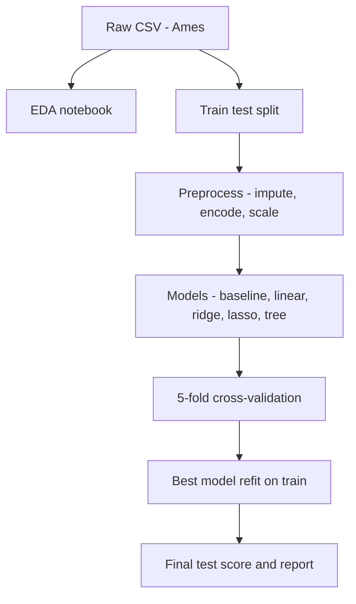
- **EDA notebook**: exploratory data analysis — histograms, scatter plots, missing-value counts. It guides choices, it never touches the test set's labels.
- **Train/test split**: hold back 20% of rows that you look at exactly once, at the end.
- **Preprocess**: impute (fill) missing values, one-hot encode categories (turn "Neighborhood = NAmes" into a 0/1 column), scale numbers. Wrapped in a `ColumnTransformer`.
- **Models + cross-validation**: compare candidates on the training part only, using 5-fold CV (train on four fifths, score on the fifth, rotate).
- **Final test score**: the honest estimate you report.

### Data model
| Item | Type | Notes |
|---|---|---|
| `SalePrice` | float, target | Right-skewed, so model `log1p(SalePrice)` |
| Numeric features | float | `GrLivArea`, `TotalBsmtSF`, `YearBuilt`, `GarageCars` ... |
| Ordinal features | string to int | Quality scales such as `ExterQual` (Po to Ex) map to 1–5 |
| Nominal features | string | `Neighborhood`, `MSZoning` — one-hot encoded |
| "NA means none" columns | string | `PoolQC = NA` means "no pool", not "unknown" |

### Tech stack
| Component | Choice | Why |
|---|---|---|
| Data | pandas or polars | Fast tabular wrangling |
| Models | scikit-learn | `Pipeline`, `ColumnTransformer`, `RidgeCV`, `LassoCV` |
| Plots | matplotlib | Residual plots, coefficient bars |
| Tracking | MLflow (optional) | Log each model's CV score |

### Milestones
1. **EDA.** Plot the target, the top correlated features and missingness. *Done when* you can name the five strongest predictors and explain why you log-transform the target.
2. **Baseline.** Median predictor scored with CV. *Done when* you have a single RMSE number that every later model must beat.
3. **Linear pipeline.** `ColumnTransformer` + `LinearRegression`. *Done when* CV RMSE beats the baseline and the pipeline runs with no warnings.
4. **Regularisation.** Ridge and Lasso with alpha chosen by inner CV. *Done when* you can show how many coefficients Lasso set to zero.
5. **Tree model and final test.** A `HistGradientBoostingRegressor`, then pick the winner and score once on the test set. *Done when* the test RMSE is within a reasonable distance of the CV estimate.

### Deep dive: the hard parts
- **"NA" is not missing.** In Ames, many `NA` values mean "this house has no basement/garage/pool". Imputing them with the column mode invents basements. Replace them with an explicit `"None"` category and set the matching area columns to 0.
- **Skew and outliers.** Prices are right-skewed: a few mansions dominate squared error. Fitting on `log1p(price)` makes errors roughly proportional (a 10% miss counts the same on a cheap and an expensive house). De Cock's paper flags a few very large houses sold cheaply (partial sales); decide on a written rule for them *before* looking at test results.
- **Leakage through preprocessing.** If you compute the mean for imputation or the scaler on the full dataset before splitting, the test set has quietly influenced training. Putting every step inside the `Pipeline` and passing the whole pipeline to `cross_val_score` fixes this.
- **Reading coefficients.** Coefficients are only comparable when features are on the same scale, and correlated features (garage cars vs garage area) share credit unpredictably. Say "associated with", never "causes".

### Testing strategy
- Unit test the custom "NA means none" transformer on a three-row frame.
- Assert the pipeline's output has no NaNs and the expected number of columns.
- Sanity test: shuffle the target and retrain; CV RMSE should collapse to roughly baseline level. If it does not, something is leaking.
- Check that predicted prices are all positive after inverting the log.

### Trade-offs, scaling and failure modes
- Linear models are transparent and fast but miss interactions (a big house in a bad area); boosting captures them at the cost of interpretability.
- The model learns one city in one period (2006–2010 sales). Applied to another city or another decade it will be confidently wrong — this is **distribution shift**.
- Small data (about 1,500–3,000 rows) means CV scores have real variance; report the mean and standard deviation across folds, not a single number.

### Stretch goals
- Add prediction intervals with quantile regression (gradient boosting with `loss="quantile"`).
- Engineer features (total square footage, house age at sale) and measure each one's CV gain.
- Re-run the same pipeline on California housing with no code changes except the column lists.
- Wrap the best model in a FastAPI endpoint (see Project 9).

### Skills practised
- [Ch 1 — What Machine Learning Is](../chapters/01-what-is-ml/README.md): regression framing, the end-to-end workflow.
- [Ch 4 — Data, EDA and Feature Engineering](../chapters/04-data-eda-feature-engineering/README.md): imputation, encoding, `ColumnTransformer`, leakage.
- [Ch 5 — Linear and Logistic Regression](../chapters/05-linear-and-logistic-regression/README.md): least squares, Ridge, Lasso.
- [Ch 6 — Evaluation and Tuning](../chapters/06-evaluation-and-tuning/README.md): baselines, RMSE vs MAE, cross-validation.

### In the interview
**30-second answer:** I built a house-price model on the Ames data that goes from raw CSV to a test score in under a minute. The key decision was to predict `log1p(price)` inside a single scikit-learn `Pipeline`, so errors are relative and no preprocessing statistic ever sees the test rows. The hardest part was the data itself: many "NA" values mean "no garage" rather than "unknown", so I encoded them as a real "None" category instead of imputing. Ridge and gradient boosting both clearly beat the median baseline under 5-fold CV, and I scored the held-out 20% exactly once.

**Key terms to know:**
- **Regression** — predicting a number (here the sale price) rather than a class.
- **Baseline** — the dumbest sensible model ("always predict the median"); every real model must beat it.
- **RMSE vs MAE** — root mean squared error punishes big misses more; mean absolute error is the typical miss in dollars. I report RMSE on log price and MAE in dollars.
- **Log transform of the target** — fitting `log1p(price)` turns a right-skewed target into a roughly symmetric one and makes errors proportional.
- **Ridge / Lasso (L2 / L1 regularisation)** — penalties on coefficient size; Ridge shrinks all, Lasso can set some exactly to zero. Alpha is chosen by inner CV.
- **Pipeline and ColumnTransformer** — scikit-learn objects that chain imputation, encoding, scaling and the model so all of it is re-fitted inside every CV fold.
- **Data leakage** — information from the test set or the target sneaking into training, giving scores that do not repeat.
- **One-hot encoding** — turning a category like `Neighborhood` into 0/1 columns.
- **k-fold cross-validation** — train on k−1 parts, score on the held-out part, rotate, and average.
- **Distribution shift** — the model learned Ames 2006–2010; another city or decade is a different distribution.

**Q:** Why model the log of the price?

**A:** Prices are right-skewed and the size of errors grows with the price. On the log scale residuals are more symmetric, linear models fit better, and the metric measures relative error, so one mansion does not dominate the loss. Remember to invert with `expm1` and note that the back-transformed prediction estimates the median rather than the mean price.

**Q:** Ridge or Lasso?

**A:** Ridge shrinks all coefficients and handles correlated features (garage cars vs garage area) gracefully by sharing weight between them. Lasso can set coefficients to exactly zero, which helps when you suspect many features are useless, but among correlated features it picks one somewhat arbitrarily. ElasticNet mixes the two. Choose by cross-validation, and scale features first, because the penalty depends on units.

**Q:** Your CV RMSE is great but the test RMSE is much worse. What happened?

**A:** Usually leakage — preprocessing fitted on all the data, or a feature computed using the target — or the test set differs from training. Check that every step lives inside the pipeline that is passed to `cross_val_score`, and compare feature distributions between train and test. Also remember CV has variance on 2,000 rows, so look at the fold standard deviation before panicking.

**Q:** What is the bias–variance trade-off, and where do you see it here?

**A:** Bias is error from a model too simple to capture the pattern; variance is error from a model so flexible it fits noise. Plain linear regression with hundreds of one-hot columns has high variance, and Ridge adds a little bias to cut variance a lot. Raising alpha moves you toward bias; a deep tree moves you toward variance.

**Q:** Why not just fill every missing value with the column mean?

**A:** In Ames many "NA" values are informative: `PoolQC = NA` means "no pool". Mean or mode imputation invents pools and basements that do not exist. I map those to an explicit "None" category and set the matching area to 0, and only impute true unknowns, inside the pipeline.

**Q:** How do you prove the pipeline does not leak?

**A:** A shuffle test: permute the target and re-run CV. A leak-free pipeline should score about the same as the baseline. I also unit-test the custom transformer on a three-row frame and assert no NaNs come out of preprocessing.

**Q:** Which features drive price, and can you say they cause it?

**A:** Overall quality, living area, basement size and garage size usually dominate the coefficients or permutation importances. They are associations, not causes: correlated features share credit unpredictably, and coefficients are only comparable after scaling. To make causal claims you would need an experiment or a causal design.

**Q:** What changes at 100x the data, or in production?

**A:** With 300,000 sales, CV variance shrinks and a single validation split is usually enough, while gradient boosting gains more room to beat linear models. In production the first thing to break is shift: prices move with interest rates, so you would retrain on a rolling window, validate on the most recent months, and monitor error by neighbourhood.

**Q:** How would you give an uncertainty range instead of one number?

**A:** Train quantile models (gradient boosting with `loss="quantile"` at 0.1 and 0.9) to get an 80% interval, then check on held-out data that about 80% of true prices fall inside it.

**Common mistakes in answers:**
- Saying "I scaled and imputed the data, then ran cross-validation" — preprocessing outside the CV loop is exactly the leak; it must be inside the pipeline.
- Reporting RMSE in log units as if it were dollars. Say which scale each metric is on.
- Reading a Lasso coefficient of zero as "this feature does not matter" — it may just be correlated with a feature Lasso kept.

### TL;DR
Predict a skewed number honestly: log the target, wrap every preprocessing step in one pipeline, beat a dumb baseline under cross-validation, and touch the test set exactly once.

## 2. Titanic survival with honest cross-validation

**Level:** Beginner · **Time:** 1 weekend · **Prerequisites:** Ch 4, 5, 6, 7

### What it is
A **binary classifier** (two possible answers) that predicts whether a Titanic passenger survived, from their class, sex, age, fare, family aboard and port of embarkation. The dataset is tiny and famous, which makes it perfect for one lesson: how to measure a model properly so that the score you report is the score you would actually get on new data.

### The problem it solves
Most beginner projects overfit their own evaluation. People tune on the test set, engineer features using all rows, and celebrate a number that will not repeat. This project forces you to build a **validation protocol** — nested cross-validation, stratified folds, a leakage-free pipeline — that you will reuse in every later project.

### Real-world examples
- Kaggle's [Titanic — Machine Learning from Disaster](https://www.kaggle.com/c/titanic) is the classic starter competition: 891 labelled training rows and 418 unlabelled test rows.
- The scikit-learn [cross-validation user guide](https://scikit-learn.org/stable/modules/cross_validation.html) documents stratified k-fold, nested CV and the "fit preprocessing inside the loop" rule this project drills.
- Medical and credit models use the same protocol at larger scale: stratified splits for imbalance, nested CV when data is small.

### Requirements
**Functional**
- Build features: title extracted from the name (Mr, Mrs, Miss, Master), family size, cabin known or not, fare per person.
- Compare logistic regression, a random forest and gradient boosting.
- Use **stratified** 5-fold CV (each fold keeps the same survival rate) and **nested** CV for hyperparameter search.
- Report accuracy, ROC AUC and a confusion matrix.

**Non-functional**
- All feature engineering implemented as scikit-learn transformers, so it is re-fitted inside every fold.
- Run time under 2 minutes for the full nested search.
- Report mean ± standard deviation over folds.

### The architecture
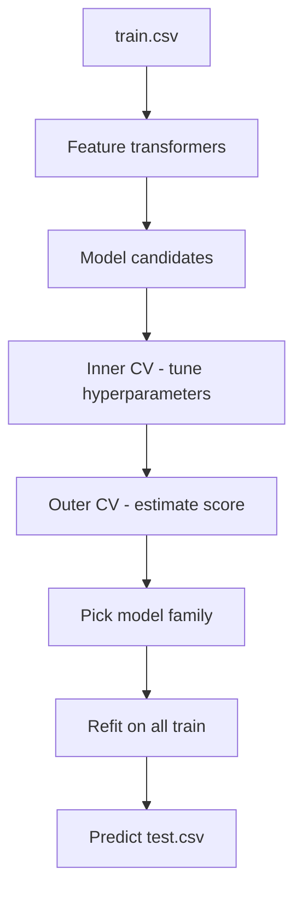
- **Feature transformers**: custom classes with `fit` and `transform`, so title mapping and age imputation are learned only from the training fold.
- **Inner CV**: searches hyperparameters (tree depth, regularisation strength) within each outer training fold.
- **Outer CV**: scores the *whole procedure*, including tuning, on folds the search never saw. This is the honest number.
- **Refit**: once you have chosen the approach, refit it on all labelled data before predicting the unlabelled test file.

### Data model
| Column | Type | Handling |
|---|---|---|
| `Survived` | 0/1 target | About 38% survived in the training file |
| `Pclass`, `Sex`, `Embarked` | category | One-hot encode, impute the two missing `Embarked` |
| `Age` | float, about 20% missing | Impute by title median inside the pipeline, add a "was missing" flag |
| `SibSp`, `Parch` | int | Combine into `family_size` |
| `Name`, `Ticket`, `Cabin` | string | Extract title, group size, deck letter |

### Tech stack
| Component | Choice | Why |
|---|---|---|
| Data | pandas | Small CSV |
| Models | scikit-learn | `LogisticRegression`, `RandomForestClassifier`, `HistGradientBoostingClassifier` |
| Search | `GridSearchCV` inside `cross_validate` | Gives nested CV in a few lines |
| Plots | matplotlib | ROC curves, learning curves |

### Milestones
1. **Baselines.** "Everyone dies" and "women survive, men die". *Done when* you have both CV accuracies written down (the second is surprisingly strong).
2. **Leak-free pipeline.** Custom transformers + `ColumnTransformer` + logistic regression. *Done when* `cross_val_score` runs on the raw dataframe without any manual preprocessing beforehand.
3. **Nested CV.** Wrap a grid search in an outer CV loop for three model families. *Done when* you have outer-fold mean ± std for each.
4. **Diagnose.** Learning curves and a confusion matrix for the winner. *Done when* you can say whether more data or a simpler model would help.
5. **Submit.** Refit, predict the test file, compare the leaderboard score with your outer-CV estimate. *Done when* you can explain the gap.

### Deep dive: the hard parts
- **Why nested CV.** If you pick hyperparameters by CV score and then report that same CV score, you have selected the luckiest configuration and reported its luck. Nested CV separates "choose" (inner loop) from "measure" (outer loop). With 891 rows, the optimism of the non-nested number is visible.
- **Group leakage.** Families and groups travelling on the same ticket tend to survive or die together. If a family is split across train and validation folds, the model can "recognise" it through shared ticket or surname features. Try `GroupKFold` with ticket as the group and see how much the score drops.
- **Variance on tiny data.** One fold contains about 178 passengers, so one passenger is about 0.6 percentage points of accuracy. Differences under 1–2 points between models are noise; use repeated stratified CV to see the spread.
- **Accuracy vs AUC.** Accuracy depends on the 0.5 threshold. ROC AUC (the probability that a random survivor is ranked above a random non-survivor) measures ranking quality independent of threshold.

### Testing strategy
- Unit test the title extractor on odd names ("Rothes, the Countess. of").
- Assert transformers are stateless between fits: fitting on fold A then fold B gives fold-B statistics only.
- Shuffle-label test: accuracy should fall to about the majority-class rate.
- Check the submission file has 418 rows and the right columns.

### Trade-offs, scaling and failure modes
- More features is not always better on 891 rows: high-cardinality features (raw ticket, raw cabin) let trees memorise.
- Leaderboard chasing is overfitting to the public test split. Trust the outer CV.
- The protocol scales: nested CV becomes expensive on big data, where a single fixed validation split is usually enough because variance shrinks.

### Stretch goals
- Calibrate probabilities with `CalibratedClassifierCV` and draw a reliability diagram.
- Build a stacking ensemble and check, with nested CV, whether it really beats the best single model.
- Use permutation importance to rank features on held-out folds.

### Skills practised
- [Ch 4 — Data, EDA and Feature Engineering](../chapters/04-data-eda-feature-engineering/README.md): custom transformers, missing values, leakage.
- [Ch 5 — Linear and Logistic Regression](../chapters/05-linear-and-logistic-regression/README.md): logistic regression and its coefficients.
- [Ch 6 — Evaluation and Tuning](../chapters/06-evaluation-and-tuning/README.md): stratified and nested CV, ROC AUC, learning curves.
- [Ch 7 — Decision Trees and Ensembles](../chapters/07-trees-and-ensembles/README.md): random forests and boosting on small tabular data.

### In the interview
**30-second answer:** I built a Titanic survival classifier where the point was an honest score, not a leaderboard rank. All feature engineering (title, family size, age imputed by title) lives in custom scikit-learn transformers, and model selection runs in nested, stratified cross-validation, so tuning never sees the folds that measure it. The hardest lesson was group leakage: families on the same ticket survived together, and splitting with `GroupKFold` on ticket dropped my score by a couple of points. The final outer-CV mean was within about two points of the Kaggle score, and I report mean ± std over folds.

**Key terms to know:**
- **Binary classification** — two possible answers, survived or not.
- **Stratified k-fold** — folds that each keep the overall survival rate (about 38%).
- **Nested cross-validation** — an inner CV loop tunes hyperparameters, an outer loop scores the whole tune-and-train procedure.
- **Custom transformer** — a class with `fit` and `transform` so statistics like median age by title are learned only from the training fold.
- **Group leakage** — related rows (a family) landing on both sides of a split; `GroupKFold` keeps groups together.
- **Accuracy vs ROC AUC** — accuracy depends on the 0.5 threshold; AUC is the probability a random survivor is ranked above a random non-survivor.
- **Confusion matrix** — counts of true/false positives and negatives.
- **Learning curve** — score vs training-set size, used to decide if more data or a simpler model would help.
- **Missing-indicator flag** — a 0/1 column that records "age was missing", because missingness itself can carry signal.

**Q:** What is nested cross-validation and when do you need it?

**A:** An inner CV chooses hyperparameters and an outer CV scores the whole choose-and-train procedure on folds the search never saw. You need it when data is small and you want an unbiased estimate after tuning. In scikit-learn it is a `GridSearchCV` passed into `cross_validate`.

**Q:** Why stratify?

**A:** So every fold has the same class balance as the full data. Without it a fold can by chance have very few survivors and its score swings wildly, which inflates the variance of your estimate.

**Q:** How would leakage show up here?

**A:** Imputing age with the global median before splitting, or letting family members appear on both sides of a split. The symptom is a CV score that the hidden test set does not reproduce. The fix is fitting every transformer inside the folds and trying group-aware splits.

**Q:** Why is the non-nested CV score optimistic?

**A:** If you try 50 hyperparameter settings and report the best CV score, part of that score is luck — you selected the configuration whose noise happened to help. On 891 rows that luck is worth a point or more. Nested CV measures performance on data the selection never touched.

**Q:** Logistic regression scored 0.82 and random forest 0.83. Which is better?

**A:** Probably neither; one outer fold is about 178 people, so one passenger is about 0.6 points. Look at the fold standard deviations, or use repeated stratified CV and compare per-fold paired differences. If the gap is within noise, prefer the simpler, more interpretable logistic regression.

**Q:** Why does the "women survive, men die" baseline matter?

**A:** It scores about 79% accuracy with no learning at all. Any model must clearly beat it, and it tells you that sex (and the title derived from the name) carries most of the signal, so gains from extra features will be small.

**Q:** How do you debug a feature transformer that leaks?

**A:** Fit it on fold A, then on fold B, and assert its learned statistics match fold B alone. Then run a shuffled-label test: accuracy should collapse to the majority-class rate (about 62%). If it stays high, information is flowing from labels into features.

**Q:** Does this protocol scale to a million rows?

**A:** Nested CV multiplies training cost by inner × outer folds, so it gets expensive. With a million rows, estimate variance is small and a single train/validation/test split is usually enough, while group or time-aware splitting still matters.

**Q:** When is accuracy the wrong metric?

**A:** When classes are imbalanced or errors have different costs. Here classes are only mildly imbalanced, so accuracy is acceptable, but I also report ROC AUC and the confusion matrix, which show what kind of mistakes the model makes.

**Common mistakes in answers:**
- "I used GridSearchCV, so my best_score_ is unbiased" — it is the score of the selected winner, which is optimistically biased.
- Treating a 0.5-point leaderboard gain as real when fold-to-fold noise is several points.
- Doing feature engineering in pandas on the full train file before CV and calling the pipeline leak-free.

### TL;DR
On small data the protocol matters more than the model: stratified, nested, leak-free cross-validation gives a number you can trust, and a strong simple baseline keeps you honest.

## 3. SMS spam filter with Naive Bayes

**Level:** Beginner · **Time:** 1 weekend · **Prerequisites:** Ch 2, 6, 8

### What it is
A text classifier that labels short messages as **spam** or **ham** (legitimate). You turn each message into word counts, train a **multinomial Naive Bayes** model (which applies Bayes' rule assuming each word contributes independently), and serve it as a small command-line tool or API. It is the "hello world" of text classification and still a strong baseline today.

### The problem it solves
Unwanted messages cost time and carry phishing links. Hand-written rules ("block messages containing FREE") are easy to evade and block legitimate messages. A learned filter adapts to the words spammers actually use and gives a probability you can threshold according to how much a false block hurts.

### Real-world examples
- The [SMS Spam Collection](https://archive.ics.uci.edu/dataset/228/sms+spam+collection) on UCI contains 5,574 English SMS messages labelled spam or ham (also mirrored on [Kaggle](https://www.kaggle.com/datasets/uciml/sms-spam-collection-dataset)).
- Paul Graham's essay [A Plan for Spam](https://paulgraham.com/spam.html) (2002) popularised Bayesian spam filtering in email clients and explains why per-word probabilities work so well against spam.

### Requirements
**Functional**
- Tokenise, build a vocabulary, vectorise with counts and with TF-IDF (term frequency times inverse document frequency, which down-weights words that appear everywhere).
- Train multinomial Naive Bayes and compare with logistic regression and a linear SVM.
- Choose a decision threshold for a target false-positive rate (legitimate messages wrongly flagged).
- Expose `classify(text) -> {label, p_spam, top_words}`.

**Non-functional**
- Classification under 5 ms per message on a laptop.
- Model file under 5 MB.
- At most 1% of ham flagged as spam at the chosen threshold, on held-out data.

### The architecture
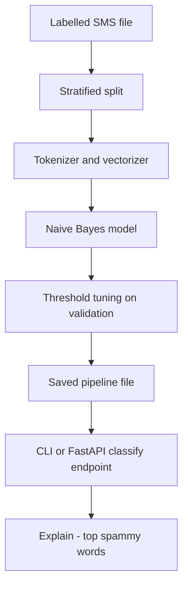
- **Vectorizer**: `CountVectorizer` or `TfidfVectorizer` builds the vocabulary from training messages only.
- **Naive Bayes**: estimates, for each word, how often it appears in spam vs ham, with **Laplace smoothing** (add a small count to every word so unseen words do not give zero probability).
- **Threshold tuning**: picks the probability cut-off on a validation split, not the test split.
- **Explain**: the words with the largest log-probability ratio between classes show *why* a message was flagged.

### Data model
| Item | Type | Notes |
|---|---|---|
| `label` | ham/spam | About 13% spam — imbalanced |
| `text` | string | Short, informal, abbreviations and numbers |
| Vocabulary | dict word to index | Learned from training split only |
| Class priors | 2 floats | Fraction of spam and ham |
| Word log-likelihoods | matrix 2 × V | The whole model |

### Tech stack
| Component | Choice | Why |
|---|---|---|
| Text features | scikit-learn `CountVectorizer`, `TfidfVectorizer` | Standard, fast, sparse |
| Model | `MultinomialNB`, `ComplementNB` | Strong on short text, trains in milliseconds |
| Comparison | `LogisticRegression`, `LinearSVC` | Discriminative baselines |
| Serving | FastAPI (optional) | Tiny JSON endpoint |

### Milestones
1. **Explore.** Message length by class, most common words per class. *Done when* you can name three features a human would use to spot spam.
2. **First model.** Counts + `MultinomialNB`. *Done when* precision, recall and F1 for spam are printed for a stratified CV.
3. **Compare.** TF-IDF, character n-grams (sequences of 3–5 characters, robust to "fr33"), and two linear models. *Done when* a table of PR AUC (area under the precision–recall curve) per variant exists.
4. **Threshold.** Pick the cut-off giving at most 1% false positives on validation. *Done when* test-set FPR and recall at that threshold are reported.
5. **Ship.** Save the pipeline, build the classify tool with top-word explanations. *Done when* typing a message returns a label and three reasons.

### Deep dive: the hard parts
- **Why "naive" still works.** The independence assumption is wrong ("free" and "prize" co-occur), so the probabilities are over-confident. But the *ranking* of messages is often good, which is what classification needs. Do not trust the raw probabilities without calibration.
- **Imbalance and the right metric.** With 13% spam, a model predicting "ham" always is 87% accurate. Use precision (of flagged messages, how many were spam), recall (of spam, how many were caught) and PR AUC.
- **Asymmetric costs.** Losing a real message is worse than seeing a spam one. Express this as a maximum false-positive rate and pick the threshold from the validation precision–recall curve.
- **Adversarial drift.** Spammers change spelling and switch to URLs and phone numbers. Character n-grams and features like "contains a URL" or "contains a long number" make the filter harder to evade.

### Testing strategy
- Golden examples: a handful of obvious spam and ham must classify correctly after every retrain.
- Vectorizer test: a word not in the training vocabulary is ignored, not an error.
- Assert predicted probabilities lie in [0, 1] and that thresholds are monotonic (higher threshold, fewer flags).
- Latency test: 1,000 messages classified in under 5 seconds.

### Trade-offs, scaling and failure modes
- Naive Bayes trains in one pass and updates incrementally (`partial_fit`), ideal for user feedback loops. Logistic regression usually wins slightly on accuracy.
- A tiny English dataset will not generalise to other languages or to modern scam formats.
- In production, the label "spam" is reported by users — noisy, delayed and biased toward obvious cases.

### Stretch goals
- Online learning: accept "mark as spam" feedback and update with `partial_fit`.
- Compare against a small transformer fine-tuned on the same data (see Project 13).
- Add calibration and display "92% likely spam" honestly.

### Skills practised
- [Ch 2 — Math for ML](../chapters/02-math-for-ml/README.md): Bayes' rule, conditional probability, logs to avoid underflow.
- [Ch 8 — k-NN, SVMs and Naive Bayes](../chapters/08-knn-svm-naive-bayes/README.md): multinomial NB, smoothing, linear SVMs for text.
- [Ch 6 — Evaluation and Tuning](../chapters/06-evaluation-and-tuning/README.md): precision, recall, PR curves, thresholds.

### In the interview
**30-second answer:** I built an SMS spam filter with bag-of-words features and multinomial Naive Bayes, compared against logistic regression and a linear SVM. The key decision was treating it as an asymmetric-cost problem: I picked the threshold on a validation split so that at most 1% of legitimate messages get flagged, then maximised spam recall under that cap. The tricky part was that 13% spam makes accuracy meaningless, so I compared variants by PR AUC. The model is a 2 × V table of word log-probabilities, classifies in well under 5 ms, and explains each decision with its top spammy words.

**Key terms to know:**
- **Multinomial Naive Bayes** — applies Bayes' rule assuming each word contributes independently given the class; the model is class priors plus per-word log-likelihoods.
- **Laplace (additive) smoothing** — add a pseudo-count (alpha) to every word so unseen words never give zero probability.
- **Bag of words / CountVectorizer** — represent a message by word counts, ignoring order; vocabulary learned from training data only.
- **TF-IDF** — term frequency times inverse document frequency, down-weights words that appear in most messages.
- **Character n-grams** — overlapping 3–5 character pieces that survive misspellings like "fr33".
- **Precision, recall, PR AUC** — of flagged messages how many are spam, of spam how many are caught, and the area under that curve.
- **False-positive rate** — share of ham wrongly flagged; the business constraint here.
- **Decision threshold** — the probability cut-off for "spam", chosen on validation from costs.
- **Generative vs discriminative model** — NB models how text is generated per class; logistic regression models the decision boundary directly.
- **Calibration** — whether "0.9 spam" really means 90%; NB is typically over-confident.

**Q:** Why does Naive Bayes work despite its false assumption?

**A:** Classification only needs the correct class to score highest. The independence assumption distorts the probabilities (they are pushed toward 0 and 1) but often preserves the ranking, and with few parameters it needs little data and trains in one pass.

**Q:** What is Laplace smoothing for?

**A:** Without it, a word never seen in spam gets probability zero and wipes out the whole product for that class. Adding a pseudo-count to every word keeps every probability positive. The `alpha` value is a hyperparameter you can tune by CV.

**Q:** How do you set the threshold?

**A:** From business cost: decide the maximum tolerable rate of legitimate messages blocked, then choose the threshold on a validation set that meets it with the highest recall. Report recall and FPR at that threshold on the untouched test set.

**Q:** Why work in log probabilities?

**A:** Multiplying hundreds of small probabilities underflows to zero in floating point. Summing logs gives the same ranking without underflow, and it turns the model into a linear function of word counts — which is why NB is a linear classifier.

**Q:** Why is accuracy misleading here, and what do you report instead?

**A:** With 13% spam, predicting "ham" for everything is 87% accurate and useless. I report precision, recall and F1 for the spam class, PR AUC to compare models across thresholds, and FPR at the chosen operating point.

**Q:** Naive Bayes or logistic regression?

**A:** NB trains instantly, needs little data and supports incremental updates with `partial_fit`, which suits user-feedback loops. Logistic regression usually wins slightly on accuracy with enough data and gives better-calibrated probabilities. I keep whichever wins on validation PR AUC unless latency or online updates decide it.

**Q:** Spammers start writing "FR€E" and sending links. What breaks and what do you do?

**A:** Word features miss new spellings, so recall drops — this is adversarial drift. Character n-grams, features like "contains a URL" or "long digit run", regular retraining on fresh user reports, and monitoring the flag rate all help.

**Q:** What happens with a word the model has never seen?

**A:** The vectorizer simply has no column for it, so it is ignored rather than raising an error. I have a unit test for exactly that, because a crash on unknown input would take the filter down.

**Q:** What changes at email scale (billions of messages a day)?

**A:** Vocabulary size explodes, so you use the hashing trick (`HashingVectorizer`) to keep memory fixed, add sender reputation and URL features, and update online. Labels come from user "report spam" clicks, which are noisy and delayed, so you also sample messages for human review.

**Common mistakes in answers:**
- Quoting 97% accuracy as success on a 13%-positive problem.
- Tuning the threshold on the test set; it must be chosen on validation and confirmed once on test.
- Saying NB's probabilities are reliable; they are over-confident and need calibration before display.

### TL;DR
Bag-of-words plus Naive Bayes is a fast, strong text baseline. The real work is choosing the right metric for an imbalanced, asymmetric-cost problem and setting the threshold deliberately.

## 4. Customer segmentation with k-means

**Level:** Beginner · **Time:** 1 weekend · **Prerequisites:** Ch 4, 9

### What it is
An **unsupervised** project (no labels) that groups an online shop's customers by behaviour. You compute **RFM** features for each customer — **R**ecency (days since last purchase), **F**requency (number of orders), **M**onetary value (total spend) — scale them, and cluster with **k-means** (which places k centre points and assigns each customer to the nearest). Then you name the segments in business language: "loyal big spenders", "lapsed one-timers".

### The problem it solves
Marketing to every customer the same way wastes money. Segments let a business send a win-back offer to lapsed customers and early access to loyal ones. Because there is no ground truth, the hard part is deciding whether a clustering is *useful*, not just mathematically tidy.

### Real-world examples
- The UCI [Online Retail](https://archive.ics.uci.edu/dataset/352/online+retail) dataset holds about 540,000 transactions from a UK-based online gift retailer between December 2010 and December 2011 — the standard dataset for RFM exercises.
- The scikit-learn [clustering guide](https://scikit-learn.org/stable/modules/clustering.html) compares k-means with DBSCAN, Gaussian mixtures and hierarchical methods and explains when each shape assumption holds.

### Requirements
**Functional**
- Clean transactions: drop cancellations (invoice numbers starting with "C"), missing customer IDs and non-positive quantities.
- Aggregate to one row per customer with R, F, M and a few extras (average basket value, number of distinct products).
- Choose k with the elbow method and silhouette score; compare with a Gaussian mixture.
- Produce a segment profile table and a 2-D plot (PCA).

**Non-functional**
- Aggregation of the full file in under 30 seconds (polars or vectorised pandas).
- Segments stable: re-running with different seeds changes fewer than 5% of assignments.
- Segment table readable by a non-technical marketer.

### The architecture
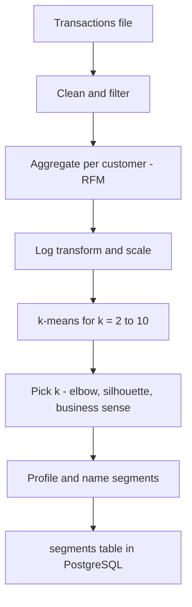
- **Clean**: removes returns and rows without a customer, which otherwise create negative spend.
- **Log and scale**: spend and frequency are heavily skewed. k-means uses Euclidean distance, so unscaled, the monetary column would decide everything.
- **Pick k**: the elbow plot shows where adding clusters stops reducing within-cluster spread much. The silhouette score (how much closer each point is to its own cluster than to the next) gives a second opinion.
- **Profile**: medians of R, F, M per cluster turn numbers into names.

### Data model
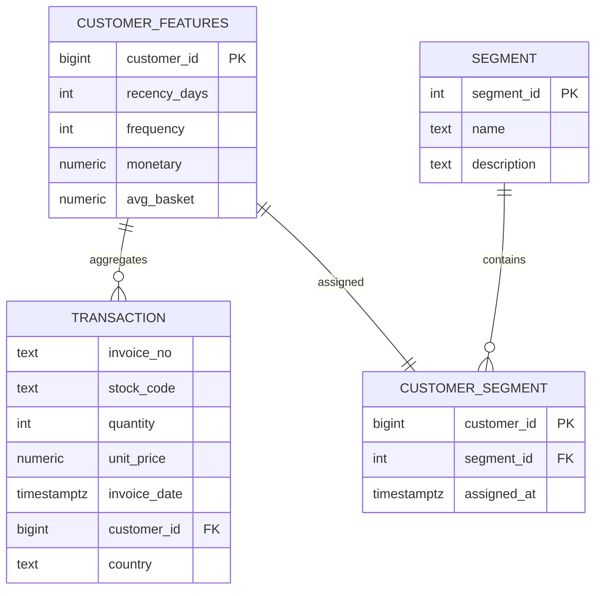

### Tech stack
| Component | Choice | Why |
|---|---|---|
| Wrangling | polars | Fast group-by over half a million rows |
| Clustering | scikit-learn `KMeans`, `GaussianMixture` | Standard, quick |
| Visuals | matplotlib, PCA | 2-D view of clusters |
| Storage | PostgreSQL | Marketing tools can query segments |

### Milestones
1. **Clean.** *Done when* total revenue after cleaning is positive and you can state how many rows each rule removed.
2. **RFM table.** *Done when* one row per customer exists with no negative values, and you have histograms before and after log transform.
3. **Cluster.** Elbow and silhouette for k = 2 to 10. *Done when* you justify one k in a sentence that mentions both the metric and the business.
4. **Profile.** *Done when* each segment has a name, a size and median R, F, M.
5. **Persist.** Write segments to PostgreSQL with an `assigned_at` timestamp. *Done when* a SQL query lists customers in a chosen segment.

### Deep dive: the hard parts
- **Scaling decides the answer.** k-means minimises squared Euclidean distance. If monetary value ranges to tens of thousands and recency to a few hundred, clusters are just "spend bands". Log-transform skewed columns, then standardise.
- **k-means' shape assumption.** It prefers round, similarly sized clusters. A few huge wholesale customers form their own tiny cluster or drag a centroid. Consider capping outliers or treating them as a separate, rule-based segment.
- **Choosing k is a judgement.** There is rarely a sharp elbow. Pick the smallest k whose segments are distinct *and* actionable — four segments a team can act on beat nine nobody uses.
- **Stability.** Run k-means with several seeds (`n_init`) and on bootstrap samples. If customers jump between clusters, the structure is weak.

### Testing strategy
- Unit test RFM aggregation on a hand-made five-transaction table with known answers.
- Assert recency is computed relative to a fixed snapshot date, not "now".
- Stability test: adjusted Rand index between two seeded runs above 0.9.
- Check every customer gets exactly one segment.

### Trade-offs, scaling and failure modes
- k-means is fast (linear in rows) and easy to explain. Gaussian mixtures give soft memberships and elliptical clusters but are harder to explain.
- Segments go stale as behaviour changes. Re-run monthly, and track how many customers moved.
- Clusters are descriptive, not causal. "Big spenders" respond to offers is a hypothesis for an A/B test (Project 17), not a conclusion.

### Stretch goals
- Add product-category shares as features and see whether new segments appear.
- Try DBSCAN or HDBSCAN to find outlier customers automatically.
- Predict each customer's next-90-day spend (customer lifetime value) and compare with the segments.

### Skills practised
- [Ch 4 — Data, EDA and Feature Engineering](../chapters/04-data-eda-feature-engineering/README.md): cleaning, aggregation, log transforms, scaling.
- [Ch 9 — Unsupervised Learning](../chapters/09-unsupervised-learning/README.md): k-means, elbow, silhouette, Gaussian mixtures, PCA, evaluation without labels.

### In the interview
**30-second answer:** I segmented about 4,300 customers of a UK online retailer by recency, frequency and monetary value, then clustered with k-means. The key decision was log-transforming and standardising RFM before clustering, because k-means uses Euclidean distance and unscaled spend would decide everything. The hard part was that there is no ground truth, so I chose k from elbow, silhouette, seed stability (adjusted Rand index above 0.9) and whether marketing could act on each segment. The output is four named segments, such as "loyal big spenders" and "lapsed one-timers", written to PostgreSQL with an assignment timestamp.

**Key terms to know:**
- **Unsupervised learning** — finding structure without labels.
- **RFM** — recency (days since last order), frequency (number of orders), monetary (total spend), computed per customer at a fixed snapshot date.
- **k-means** — places k centroids and assigns each point to the nearest, minimising within-cluster squared distance (inertia).
- **Feature scaling** — log-transform skewed columns, then standardise, so no feature dominates the distance.
- **Elbow method** — plot inertia against k and look for where gains flatten.
- **Silhouette score** — how much closer a point is to its own cluster than to the next one, from −1 to 1.
- **Gaussian mixture model** — soft, elliptical clusters with membership probabilities; a comparison model here.
- **Adjusted Rand index** — agreement between two clusterings corrected for chance; my stability test.
- **PCA** — projects the features to two dimensions for plotting.

**Q:** How do you choose k?

**A:** Elbow and silhouette for guidance, stability across seeds and bootstrap samples, then business usefulness. If the business can only run three campaigns, nine segments are not useful. I pick the smallest k whose segments are distinct and actionable.

**Q:** Why scale before k-means?

**A:** Because it uses distances. An unscaled large-range feature such as spend in pounds dominates, so clusters reflect units, not behaviour. I log-transform the skewed columns first, because standardising alone does not fix a long tail.

**Q:** How would you check segments are valuable?

**A:** Use them: target one segment with an offer in a randomised test and compare its response against a held-out control group from the same segment. Clusters are descriptive; only an experiment shows that acting on them pays.

**Q:** What are k-means' assumptions, and when does it fail?

**A:** It assumes roughly spherical, similarly sized clusters and is sensitive to outliers, because the mean is pulled by extremes. A few wholesale buyers can form their own cluster or drag a centroid. Capping outliers, handling them as a rule-based segment, or switching to a Gaussian mixture or DBSCAN helps.

**Q:** Why can two runs give different clusters?

**A:** k-means converges to a local optimum that depends on the starting centroids. scikit-learn uses k-means++ initialisation and `n_init` restarts, keeping the lowest-inertia run. If assignments still change a lot across seeds, the structure is weak.

**Q:** What cleaning mattered most?

**A:** Removing cancellations (invoice numbers starting with "C"), rows with no customer ID and non-positive quantities. Without that, some customers have negative spend and the monetary feature becomes nonsense. I record how many rows each rule removed.

**Q:** What is the time complexity, and what changes at 100 million customers?

**A:** Each k-means iteration is O(n·k·d), linear in rows. At 100 million customers you use `MiniBatchKMeans` or a distributed implementation, fit on a sample and assign everyone else to the nearest centroid, which is cheap.

**Q:** How do you test the RFM step?

**A:** A five-transaction hand-made table with known R, F and M. I also assert recency uses a fixed snapshot date, not "now", so results are reproducible, and that every customer gets exactly one segment.

**Q:** Segments go stale. How do you handle that in production?

**A:** Re-run monthly with the same scaler fitted on the new snapshot, map new clusters to old names by matching centroids, and track how many customers moved. A sudden large movement signals either a real behaviour change or a data problem.

**Common mistakes in answers:**
- Claiming the elbow plot "gives" the right k; it rarely has a sharp elbow and k is a judgement.
- Saying "big spenders respond to offers" as a finding; that is a hypothesis for an A/B test.
- Standardising without log-transforming, so a handful of heavy buyers still shape every cluster.

### TL;DR
RFM features, log-scaled, clustered with k-means give marketers named, actionable segments — but scaling, outliers and the choice of k are judgements you must justify.

## 5. Handwritten digit recognizer

**Level:** Beginner · **Time:** 1–2 weekends · **Prerequisites:** Ch 10, 11

### What it is
A neural network that reads a 28 × 28 pixel image of a handwritten digit and says which digit (0–9) it is. You start with logistic regression on flattened pixels, move to a **multi-layer perceptron** (MLP, layers of neurons fully connected to the previous layer), then a small **convolutional neural network** (CNN, which slides small learned filters over the image to detect strokes and shapes). Finally you build a canvas where you draw a digit and see the prediction live.

### The problem it solves
Reading handwritten digits was one of the first commercial uses of neural networks (cheques and postal codes). For you, it is the cleanest way to learn the PyTorch training loop — data loaders, forward pass, loss, backpropagation, optimiser step — on a problem where you can see every mistake.

### Real-world examples
- **MNIST**: 60,000 training and 10,000 test images, loaded in one line via [torchvision.datasets.MNIST](https://docs.pytorch.org/vision/stable/generated/torchvision.datasets.MNIST.html).
- LeNet-style CNNs were used to read handwritten digits on bank cheques in the 1990s, as described in LeCun et al.'s 1998 paper "Gradient-based learning applied to document recognition".

### Requirements
**Functional**
- Train three models: logistic regression, MLP, CNN. Compare test accuracy and parameter counts.
- Plot training and validation loss per epoch.
- Show a gallery of misclassified test images with predicted vs true labels.
- A small web page (or notebook widget) where you draw a digit and get the top-3 predictions.

**Non-functional**
- CNN trains on CPU in under 10 minutes.
- CNN test accuracy at least 99%.
- Inference under 10 ms per image.

### The architecture
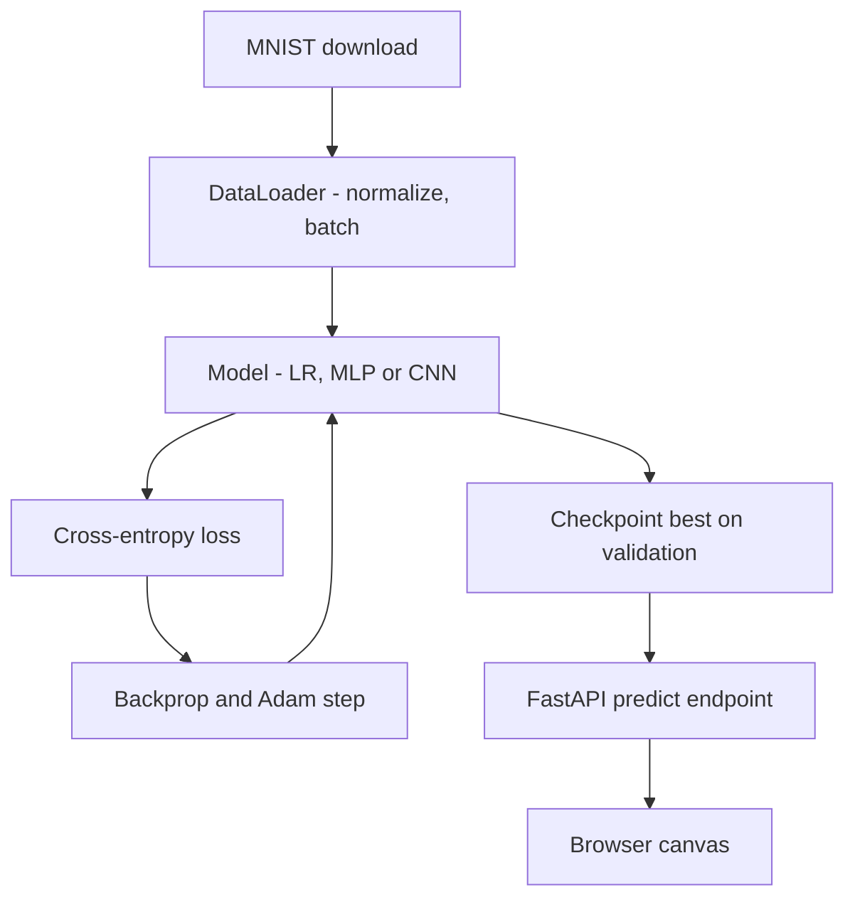
- **DataLoader**: yields shuffled mini-batches (for example 128 images) so the optimiser sees noisy but cheap gradient estimates.
- **Model**: CNN with two convolution + pooling blocks, then a fully connected layer and 10 outputs (logits — raw scores before softmax).
- **Cross-entropy loss**: penalises low probability on the correct digit.
- **Checkpoint**: save weights whenever validation accuracy improves (a 5,000-image slice of training data, not the test set).
- **Canvas**: the browser sends a 28 × 28 greyscale array to the API.

### Data model
| Item | Shape / type | Notes |
|---|---|---|
| Image tensor | float32 `[N, 1, 28, 28]` | Scaled to 0–1 then normalised by dataset mean and std |
| Label | int64 `[N]` | 0–9 |
| Logits | float32 `[N, 10]` | Softmax gives probabilities |
| Checkpoint | `.pt` file | `state_dict` plus normalisation constants |

### Tech stack
| Component | Choice | Why |
|---|---|---|
| Framework | PyTorch, torchvision | Clear training loop, MNIST built in |
| Baseline | scikit-learn `LogisticRegression` | Linear reference point |
| Serving | FastAPI | JSON in, probabilities out |
| Front end | HTML canvas + a few lines of JS | Draw and send pixels |

### Milestones
1. **Linear baseline.** *Done when* logistic regression test accuracy is recorded (low 90s percent).
2. **MLP in PyTorch.** Your own training loop. *Done when* loss curves for train and validation are plotted and accuracy beats the baseline.
3. **CNN.** *Done when* test accuracy is at least 99% and you can state its parameter count vs the MLP's.
4. **Error analysis.** *Done when* a grid of 25 misclassified digits is saved and you have grouped the errors (ambiguous, badly written, mislabelled).
5. **Interactive demo.** *Done when* digits you draw are recognised — and you have fixed the preprocessing so they look like MNIST.

### Deep dive: the hard parts
- **Train/serve skew.** MNIST digits were scaled to fit a 20 × 20 box (keeping their aspect ratio), then placed in the 28 × 28 frame so their centre of mass sits in the middle, white on black. Your canvas digit is probably off-centre, thick, and black on white. The model will fail until you apply the same preprocessing: invert, crop to the bounding box, resize, centre. This is the beginner version of a problem that ruins production systems.
- **Why convolutions win.** An MLP treats each pixel independently, so a digit shifted by two pixels looks new. Convolutions share weights across positions and pooling adds tolerance to small shifts, so the CNN needs fewer parameters and generalises better.
- **Overfitting signals.** Training loss keeps falling while validation loss rises. Use dropout (randomly zeroing activations during training), data augmentation (small rotations and shifts) and early stopping.
- **`model.eval()`.** Dropout and batch norm behave differently at inference. Forgetting to switch modes gives noisy predictions.

### Testing strategy
- Overfit-one-batch test: the model must reach near-zero loss on a single batch. If it cannot, the loop is broken.
- Shape tests for each layer with a dummy tensor.
- Preprocessing test: an MNIST test image passed through the canvas preprocessing comes out unchanged (or nearly).
- API test: a known test image returns the right digit.

### Trade-offs, scaling and failure modes
- Bigger CNNs add fractions of a percent on MNIST. Beyond about 99.3%, remaining errors are often ambiguous or mislabelled digits.
- MNIST is too easy to reveal modelling skill. Re-run on Fashion-MNIST to see a harder distribution.
- Confidently wrong predictions on non-digits (a drawn letter "A" gets 98% "4"). Softmax always picks something — consider a "not a digit" threshold.

### Stretch goals
- Data augmentation and a learning-rate schedule. Measure each one's effect.
- Export to ONNX and run inference in the browser.
- Visualise first-layer filters and feature maps.

### Skills practised
- [Ch 10 — Neural Networks and Deep Learning](../chapters/10-neural-networks-and-deep-learning/README.md): MLPs, cross-entropy, backpropagation, Adam, dropout, the PyTorch loop.
- [Ch 11 — CNNs and Computer Vision](../chapters/11-cnns-and-computer-vision/README.md): convolution, pooling, a small CNN, augmentation.

### In the interview
**30-second answer:** I built a handwritten-digit recogniser in PyTorch, going from logistic regression to an MLP to a small CNN, and served it behind a browser canvas. The CNN reaches over 99% test accuracy with far fewer parameters than the MLP, because convolutions share weights and pooling tolerates small shifts. The hardest problem was train/serve skew: my canvas digits were black-on-white and off-centre, so I reproduced MNIST's preprocessing — invert, crop, resize to 20 × 20, centre by mass in 28 × 28 — before predicting. Inference is a few milliseconds per image on CPU.

**Key terms to know:**
- **MLP** — layers of fully connected neurons; treats each pixel as an independent input.
- **CNN (convolution, pooling)** — small learned filters slid over the image share weights across positions; pooling downsamples and adds shift tolerance.
- **Logits and softmax** — raw scores per class and the function that turns them into probabilities.
- **Cross-entropy loss** — the negative log probability of the correct class; `nn.CrossEntropyLoss` takes logits, not softmax output.
- **Backpropagation and Adam** — computing gradients of the loss and the adaptive optimiser that applies them.
- **Mini-batch / DataLoader** — shuffled batches (for example 128 images) giving cheap, noisy gradient estimates.
- **Overfitting, dropout, early stopping** — memorising training data, and two ways to fight it.
- **`model.eval()` / `model.train()`** — switch dropout and batch norm between training and inference behaviour.
- **Train/serve skew** — inputs at serving time processed differently from training data.
- **Validation split** — 5,000 training images held out for checkpointing; the test set is used once.

**Q:** Why does a CNN beat an MLP on images?

**A:** Local connectivity and weight sharing exploit the fact that nearby pixels are related and the same stroke can appear anywhere. That means far fewer parameters and built-in tolerance to small shifts, so it generalises better from the same data.

**Q:** Your model is 99% accurate on the test set but fails on user drawings. Why?

**A:** Train/serve skew: the user input is preprocessed differently from training data. Apply exactly the same inversion, cropping, scaling, centring and normalisation at serving time, and add a test that an MNIST image passes through the serving preprocessing nearly unchanged.

**Q:** How do you know your training loop is correct?

**A:** Overfit a single small batch to near-zero loss; if it cannot, the loop or the model is broken. Then check that train and validation loss curves behave sensibly and that a shape test passes for each layer.

**Q:** Show the core of a PyTorch training step.

**A:** The order matters: clear old gradients, forward, loss, backward, step.
```python
model.train()
for x, y in loader:
    opt.zero_grad()
    loss = F.cross_entropy(model(x), y)
    loss.backward()
    opt.step()
```
Forgetting `zero_grad()` accumulates gradients across batches, a classic silent bug.

**Q:** Why do you not apply softmax before `CrossEntropyLoss`?

**A:** `nn.CrossEntropyLoss` already combines log-softmax and negative log-likelihood in a numerically stable way. Applying softmax first squashes the logits twice, which weakens gradients and slows learning.

**Q:** How do you detect and fix overfitting here?

**A:** Training loss keeps falling while validation loss rises. Fixes are dropout, data augmentation (small rotations and shifts), weight decay and early stopping on validation loss, keeping the checkpoint with the best validation score.

**Q:** What happens if a user draws a letter "A"?

**A:** Softmax always picks one of the ten digits, often with high confidence. A simple guard is a minimum top-probability or entropy threshold that returns "not a digit"; a better one trains with an explicit "other" class or out-of-distribution examples.

**Q:** How would you serve 1,000 requests a second?

**A:** The model is tiny, so CPU is fine. Run several workers, batch requests that arrive within a few milliseconds, export to ONNX or TorchScript, and wrap inference in `torch.inference_mode()`. The bottleneck is more likely JSON parsing and preprocessing than the CNN.

**Q:** Why is MNIST a weak benchmark?

**A:** Even simple models score above 97%, and past about 99.3% many remaining errors are ambiguous or mislabelled. Fashion-MNIST, same shape but harder, is a better test of whether architecture changes actually help.

**Common mistakes in answers:**
- Saying CNNs are "rotation invariant" — pooling gives some tolerance to small shifts, not rotation; augmentation is what helps with rotation.
- Forgetting `model.eval()` at inference, so dropout makes predictions noisy.
- Using the test set to pick the best epoch; that is the job of the validation split.

### TL;DR
MNIST teaches the full deep-learning loop and the first lesson of production ML: a model is only as good as the match between training data and what it sees at serving time.

## 6. Credit-default scorecard

**Level:** Beginner · **Time:** 1–2 weekends · **Prerequisites:** Ch 5, 6

### What it is
A model that estimates the probability that a credit-card customer will miss next month's payment, presented as a **scorecard**: a points table a loan officer could read ("utilisation above 80%: −40 points"). Under the hood it is **logistic regression** — a linear model whose output passes through the sigmoid function to give a probability — on carefully binned features. The focus is on well-calibrated probabilities and explanations, not on squeezing out accuracy.

### The problem it solves
Lenders must price risk, set credit limits and explain decisions to customers and regulators. A black-box model with a slightly better AUC is often less useful than a transparent one whose every point can be justified. This project teaches you to build the transparent one properly, and to check that "20% risk" really means about one in five default.

### Real-world examples
- The UCI [Default of Credit Card Clients](https://archive.ics.uci.edu/dataset/350/default+of+credit+card+clients) dataset has 30,000 Taiwanese card holders from 2005 with demographics, credit limits, six months of repayment status, bill and payment amounts, and a default flag.
- The scikit-learn [probability calibration guide](https://scikit-learn.org/stable/modules/calibration.html) explains reliability diagrams and the tools (`CalibratedClassifierCV`, `calibration_curve`) you will use to validate the probabilities.

### Requirements
**Functional**
- Features: utilisation (bill ÷ limit), months of delinquency, payment-to-bill ratio, trend of bills.
- Bin numeric features into a handful of ranges and compute **WoE** (weight of evidence: the log of the ratio of good to bad customers in each bin) and **IV** (information value: a summary of how much a feature separates good from bad).
- Fit logistic regression on WoE features; convert coefficients to points.
- Report ROC AUC, a calibration plot and the **Brier score** (mean squared error of predicted probabilities).

**Non-functional**
- Every feature's points must change monotonically with risk where business logic expects it (more missed payments, never fewer points of risk).
- Scorecard printable on one page.
- Scoring one applicant under 1 ms.

### The architecture
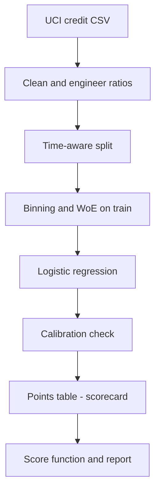
- **Binning and WoE**: learned from training rows only. WoE turns any feature, including categories, into a single number on the log-odds scale, which is exactly the scale logistic regression works in.
- **Logistic regression**: with WoE inputs, coefficients should all share the same sign and sit near 1 in size (with WoE defined as log of good over bad and the target "default", they come out near −1). A coefficient with the opposite sign warns of collinearity.
- **Points table**: a standard rescaling, for example 600 points at odds of 50:1 and 20 more points every time the odds double.

### Data model
| Item | Type | Notes |
|---|---|---|
| `default_next_month` | 0/1 target | About 22% positives |
| `LIMIT_BAL` | numeric | Credit limit |
| `PAY_0`, `PAY_2` … `PAY_6` | int | Repayment status by month, −2 to 8 (there is no `PAY_1`) |
| `BILL_AMT1..6`, `PAY_AMT1..6` | numeric | Monthly bills and payments |
| Bin table | feature, range, WoE, points | The deliverable scorecard |

### Tech stack
| Component | Choice | Why |
|---|---|---|
| Data | pandas | Small table |
| Model | scikit-learn `LogisticRegression` | Transparent, calibrated by design |
| Binning | your own code (or a scorecard library if it supports Python 3.14) | Learn the mechanics first |
| Comparison | `HistGradientBoostingClassifier` | Measures what transparency costs |

### Milestones
1. **Baseline.** Plain logistic regression on raw scaled features. *Done when* CV ROC AUC and Brier score are recorded.
2. **WoE binning.** *Done when* every feature has a bin table with WoE and IV, and you dropped features with IV close to 0.
3. **Scorecard.** *Done when* you can score a hand-made applicant by adding points from the table and get the same probability as the model.
4. **Calibration and comparison.** *Done when* a reliability diagram is plotted and you know how much AUC gradient boosting adds.
5. **Report.** *Done when* a one-page scorecard plus a "reasons for decline" function (the three features costing the most points) exist.

### Deep dive: the hard parts
- **Monotonic bins.** Raw bins often zig-zag (risk goes up, down, up with income) because of noise. Merge adjacent bins until WoE is monotonic, otherwise the scorecard rewards nonsense and is hard to defend.
- **Calibration vs discrimination.** AUC measures ranking. A model can rank perfectly yet say 5% when the truth is 30%. Lending decisions use the probability directly (expected loss = probability × exposure), so check calibration with a reliability diagram.
- **Reject inference.** Real lenders only see outcomes for approved applicants, so the training data is biased. This dataset does not have that problem, but you should be able to explain it.
- **Fairness.** The dataset includes sex, marital status and age. In many jurisdictions some of these cannot be used for credit decisions. Train with and without them and compare outcomes by group (preview of Project 33).

### Testing strategy
- Unit test the WoE function on a tiny table with known counts.
- Points-sum test: summed points convert back to the model's probability within rounding.
- Monotonicity test for each binned feature.
- Calibration test: on held-out data, each probability decile's observed default rate lies within a tolerance of its mean prediction.

### Trade-offs, scaling and failure modes
- Scorecards give up a little accuracy for explainability, stability and easy audit. Boosting may add a few AUC points but needs SHAP-style explanations (Project 11).
- Economic shifts move default rates. Monitor the **population stability index** (how much the score distribution has shifted) and recalibrate.
- Bins learned on small groups are noisy. Require a minimum share (say 5%) of rows per bin.

### Stretch goals
- Add a monotonic-constrained gradient boosting model and compare explanations.
- Simulate a cut-off policy: approval rate vs expected bad rate curve.
- Compute population stability index between two time slices.

### Skills practised
- [Ch 5 — Linear and Logistic Regression](../chapters/05-linear-and-logistic-regression/README.md): logistic regression, log-odds, reading coefficients.
- [Ch 6 — Evaluation and Tuning](../chapters/06-evaluation-and-tuning/README.md): ROC AUC, calibration, Brier score, thresholds.
- [Ch 19 — Responsible ML](../chapters/19-responsible-ml/README.md): protected attributes and explanations for adverse decisions.

### In the interview
**30-second answer:** I built a credit-default scorecard on 30,000 Taiwanese card holders: binned features, weight-of-evidence encoding, logistic regression, and a points table a loan officer can add up by hand. The key decision was transparency over a few AUC points — I measured that gradient boosting adds only a small gain over the scorecard on this data. The hardest part was making every bin's risk monotonic, merging noisy bins until more missed payments always cost points. I checked that the probabilities are calibrated with a reliability diagram and Brier score, and the summed points convert back to the model's probability exactly.

**Key terms to know:**
- **Logistic regression** — a linear model on the log-odds, passed through the sigmoid to give a probability.
- **Scorecard / points** — coefficients rescaled to integer points, for example 600 points at 50:1 odds and +20 points each time the odds double.
- **Binning** — grouping a numeric feature into a few ranges, learned on training data only.
- **Weight of evidence (WoE)** — for each bin, the log of (share of good customers ÷ share of bad customers); puts every feature on the log-odds scale.
- **Information value (IV)** — a summary of how much a binned feature separates good from bad; near-zero IV features are dropped.
- **Monotonicity** — risk must move in one direction across a feature's bins where business logic expects it.
- **Calibration, reliability diagram, Brier score** — whether predicted probabilities match observed rates, a plot of that, and the mean squared error of probabilities.
- **ROC AUC (discrimination)** — how well the model ranks defaulters above non-defaulters.
- **Population stability index (PSI)** — how much the score distribution has shifted between two periods.
- **Reject inference** — the bias from only observing outcomes for applicants you approved.

**Q:** Why would a bank prefer logistic regression to gradient boosting?

**A:** Transparency, stable behaviour, monotonic and explainable effects, easy regulatory review and simple "reasons for decline". The accuracy gap is often small on tabular credit data, and a model the risk committee cannot audit will not be approved.

**Q:** What is weight of evidence?

**A:** For each bin, the log of the share of good customers in that bin divided by the share of bad ones. It puts every feature on the log-odds scale, handles categories and outliers naturally, and makes logistic-regression coefficients easy to read.

**Q:** How do you check probabilities are trustworthy?

**A:** A reliability diagram and Brier score on held-out data, plus the observed default rate per predicted decile. Fix miscalibration with Platt scaling (a logistic fit on the scores) or isotonic regression (a monotone step function), fitted on a separate calibration split.

**Q:** What is the difference between calibration and discrimination?

**A:** Discrimination (AUC) asks whether defaulters get higher scores than payers. Calibration asks whether "20% risk" means one in five actually defaults. A model can rank perfectly yet be badly calibrated, and lending decisions use the probability directly in expected loss = probability × exposure × loss given default.

**Q:** A WoE coefficient comes out with the wrong sign. What does that tell you?

**A:** With WoE inputs every coefficient should share one sign and sit near magnitude 1. A flipped sign usually means collinearity — two features carry the same information and the model is splitting credit oddly. Drop or merge one of them rather than ship a scorecard that rewards risk.

**Q:** Why force bins to be monotonic?

**A:** Raw bins often zig-zag because of noise in small groups. A non-monotonic scorecard would say a customer with three missed payments is safer than one with two, which is indefensible to a regulator. Merging adjacent bins, with a minimum of about 5% of rows each, fixes both noise and logic.

**Q:** What is reject inference and why does it matter?

**A:** Real lenders only see repayment outcomes for applicants they approved, so the training data under-represents risky applicants and the model looks better than it is on the full population. This dataset has no such filter, but in practice you mitigate it with techniques like augmenting with rejected applicants or small randomised approvals.

**Q:** How would you monitor the scorecard after launch?

**A:** Track PSI of the score and of each feature monthly (above about 0.25 is usually treated as a significant shift), the approval rate, and the actual default rate by score band once outcomes mature. An economic downturn shifts default rates, so recalibrating the intercept is often the first fix.

**Q:** Can you use sex, age and marital status?

**A:** Often not for credit decisions, depending on jurisdiction, and dropping them does not remove proxies. I train with and without them and compare approval and default rates by group, which previews the fairness audit in Project 33.

**Common mistakes in answers:**
- Treating a high AUC as proof the probabilities are right; calibration is a separate check.
- Fitting bins or WoE on all data before splitting — that leaks the target into features.
- Saying "logistic regression is always less accurate"; on well-engineered credit data the gap is often small.

### TL;DR
A credit scorecard is logistic regression made readable: monotonic WoE bins, points that add up to a calibrated probability, and reasons a customer can be told.

## 7. Tumour diagnosis with k-NN and SVM

**Level:** Beginner · **Time:** 1 weekend · **Prerequisites:** Ch 6, 8

### What it is
A classifier that labels breast-tumour cell measurements as **malignant** or **benign**, using two classic algorithms: **k-nearest neighbours** (k-NN: classify a sample by majority vote of the k most similar training samples) and the **support vector machine** (SVM: find the boundary with the widest margin between classes, optionally in a transformed feature space via a **kernel**). The emphasis is on scaling, choosing hyperparameters and picking a decision threshold when one kind of mistake is far worse.

### The problem it solves
Screening tools help doctors prioritise. Missing a malignant case (a **false negative**) is much worse than a false alarm, so the model must be tuned for high **recall** (sensitivity). The project teaches you how to make that trade-off explicit and why a model that is "98% accurate" can still be unsafe.

### Real-world examples
- The [Breast Cancer Wisconsin (Diagnostic)](https://archive.ics.uci.edu/dataset/17/breast+cancer+wisconsin+diagnostic) dataset has 569 samples with 30 features computed from digitised images of cell nuclei (radius, texture, concavity …). It also ships inside scikit-learn as [`load_breast_cancer`](https://scikit-learn.org/stable/modules/generated/sklearn.datasets.load_breast_cancer.html).
- Clinical screening models are reported with sensitivity and specificity at a fixed operating point, which is exactly what you will report.

### Requirements
**Functional**
- Pipelines for k-NN and SVM (linear and RBF kernel), each with `StandardScaler`.
- Grid-search k, C (penalty for margin violations) and gamma (how far one training point's influence reaches) with stratified CV.
- Choose a threshold that gives at least 98% recall on validation, then report precision at that recall.
- Visualise the decision boundary in two PCA dimensions.

**Non-functional**
- Full grid search under 1 minute.
- Report 95% confidence intervals (bootstrap) for recall and precision.
- No preprocessing fitted outside CV.

### The architecture
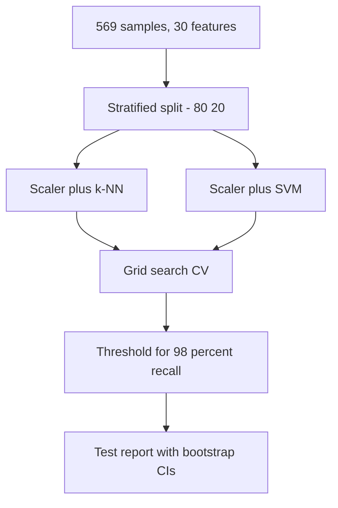
- **Scaler**: both algorithms use distances (k-NN directly, RBF SVM through the kernel), so features with large ranges, like area, would otherwise dominate texture.
- **Grid search**: tunes inside CV. For SVM, `probability=True` or `decision_function` scores give a continuous score for thresholding.
- **Bootstrap CIs**: resample the test set many times to show how uncertain the metrics are with only about 114 test samples.

### Data model
| Item | Type | Notes |
|---|---|---|
| `diagnosis` | M/B | 212 malignant, 357 benign |
| Mean features (10) | float | radius, texture, perimeter, area, smoothness … |
| SE features (10) | float | Standard error of each |
| Worst features (10) | float | Mean of the three largest values |
| Model output | score | Distance to boundary or probability |

### Tech stack
| Component | Choice | Why |
|---|---|---|
| Models | scikit-learn `KNeighborsClassifier`, `SVC` | Classic, well documented |
| Tuning | `GridSearchCV` with `StratifiedKFold` | Small grid, small data |
| Plots | matplotlib | PR curve, PCA boundary |
| Stats | numpy bootstrap | Confidence intervals |

### Milestones
1. **Unscaled vs scaled k-NN.** *Done when* you show the CV accuracy jump from scaling and explain it.
2. **Tune k-NN and SVM.** *Done when* best hyperparameters and CV ROC AUC for both are in a table.
3. **Threshold.** *Done when* you can state precision at 98% recall on validation.
4. **Test and uncertainty.** *Done when* test recall and precision with bootstrap 95% intervals are reported.
5. **Visualise.** *Done when* a 2-D PCA plot shows the SVM boundary and support vectors.

### Deep dive: the hard parts
- **Correlated features.** Radius, perimeter and area are almost perfectly correlated, so they triple-count "size" in k-NN distances. Try PCA or dropping duplicates and see whether k-NN improves.
- **The C–gamma interaction.** Large gamma makes each point's influence tiny, so the boundary wraps around individual points (overfitting). Large C refuses margin violations. Plot CV score as a heat map over both to see the ridge of good settings.
- **Thresholds on SVMs.** SVM outputs a signed distance, not a probability. `probability=True` fits an internal Platt scaling with its own CV. Thresholding the raw decision function is often simpler and equivalent for ranking.
- **Tiny test sets.** With about 40 malignant test cases, one miss changes recall by 2.5 points. Say so, and show intervals.

### Testing strategy
- Pipeline test: scaler statistics come only from training folds (check `mean_` against a manual calculation).
- Reproducibility: same seeds give identical grid results.
- Threshold test: recall at the chosen threshold on validation is at least 0.98.
- A "sanity" model (always benign) must score 0 recall.

### Trade-offs, scaling and failure modes
- k-NN has no training cost but slow, memory-heavy prediction on big data. SVMs scale roughly quadratically in samples, fine here, painful above about 100,000 rows.
- Linear SVM is nearly as good here and far easier to explain. Prefer it if the gap is within noise.
- A model trained on one lab's imaging pipeline may not transfer to another lab. Never deploy medical models without external validation and regulatory review — this is a learning exercise.

### Stretch goals
- Compare with logistic regression and a random forest under the same protocol.
- Use repeated stratified CV to compare models with a paired test.
- Add feature selection inside the pipeline and check whether recall holds.

### Skills practised
- [Ch 8 — k-NN, SVMs and Naive Bayes](../chapters/08-knn-svm-naive-bayes/README.md): distance-based learning, margins, kernels, C and gamma.
- [Ch 6 — Evaluation and Tuning](../chapters/06-evaluation-and-tuning/README.md): recall vs precision, thresholds, grid search, confidence intervals.
- [Ch 9 — Unsupervised Learning](../chapters/09-unsupervised-learning/README.md): PCA for visualisation.

### In the interview
**30-second answer:** I built a breast-tumour classifier on the 569-sample Wisconsin dataset, comparing k-NN with linear and RBF SVMs, each in a pipeline with `StandardScaler`. The key decision was choosing the operating point from costs: I picked the threshold giving at least 98% recall on malignant cases on validation, then reported precision at that point. The hardest part was honesty with tiny data — about 40 malignant test cases means one miss moves recall by 2.5 points — so I reported bootstrap 95% confidence intervals. Scaling alone gave k-NN a large accuracy jump, which I can show.

**Key terms to know:**
- **k-nearest neighbours** — classify by majority vote of the k closest training points; no real training, slow prediction.
- **Support vector machine** — finds the boundary with the widest margin; only support vectors define it.
- **Kernel (RBF)** — computes similarity as if features were mapped to a higher-dimensional space, giving curved boundaries.
- **C** — penalty for margin violations; large C fits training data tightly.
- **Gamma** — how far one point's influence reaches in an RBF kernel; large gamma makes influence very local.
- **Feature scaling** — standardise so no feature's units dominate distances.
- **Recall (sensitivity), specificity, precision** — share of malignant caught, share of benign correctly cleared, share of alarms that are real.
- **Operating point / threshold** — the score cut-off chosen for the required recall.
- **Bootstrap confidence interval** — resample the test set with replacement many times to see metric uncertainty.
- **Correlated features** — radius, perimeter and area nearly duplicate each other.

**Q:** Why must you scale features for k-NN and SVM?

**A:** Both rely on distances: k-NN directly, RBF SVM through the kernel. Without scaling, the feature with the largest numeric range (area, in the hundreds) dominates the distance and the others (smoothness, below 1) are ignored.

**Q:** What do C and gamma do in an RBF SVM?

**A:** C trades margin width for training errors. Gamma sets how local each support vector's influence is. High values of either lead to overfitting, low values to underfitting, so I tune them together on a log-scale grid and plot the CV heat map.

**Q:** Accuracy is 97%. Is the model good enough?

**A:** Not by itself. For diagnosis, recall on the malignant class at a chosen operating point matters, along with its uncertainty and external validation on another hospital's data.

**Q:** How do you threshold an SVM, which outputs no probability?

**A:** Use the signed distance from `decision_function` as a score and pick the cut-off on validation that reaches 98% recall. `probability=True` fits Platt scaling with an internal CV, which is slower and only needed if you must show probabilities.

**Q:** Why does k-NN struggle as data grows?

**A:** Prediction compares the query with every stored point, so it is O(n·d) per query and memory holds the whole training set. In high dimensions distances also become less informative. KD-trees help in low dimensions; approximate nearest-neighbour indexes help at scale.

**Q:** How do you pick k?

**A:** Grid-search k inside stratified CV. Small k gives a jagged, high-variance boundary; large k smooths toward the majority class. Odd values avoid ties in binary problems.

**Q:** Why bootstrap confidence intervals here?

**A:** The test set has about 114 samples, so metrics are noisy. Resampling it a few thousand times and taking the 2.5th and 97.5th percentiles shows, for example, that recall could plausibly be anywhere from about 0.9 to 1.0. That stops you from over-claiming.

**Q:** How do you test that scaling does not leak?

**A:** Fit the pipeline on training folds and check that the scaler's `mean_` matches a manual mean of the training fold only. A constant "always benign" model must score 0 recall, which checks that the metric is wired to the right class.

**Q:** Linear or RBF SVM?

**A:** On this data the linear SVM is nearly as good and much easier to explain. If the gap is within the CV noise I prefer it; the RBF kernel only earns its place if it is clearly better.

**Common mistakes in answers:**
- Saying SVM outputs probabilities; it outputs distances, and probabilities need a calibration step.
- Choosing the 98%-recall threshold on the test set, then reporting the test recall as if it were unbiased.
- Claiming the model is ready for clinics; it needs external validation and regulatory review.

### TL;DR
Scale, tune C and gamma or k inside CV, and choose the threshold from the cost of a missed malignancy — then admit how uncertain a 114-sample test is.

## 8. Bike-share demand with tree ensembles

**Level:** Beginner · **Time:** 1–2 weekends · **Prerequisites:** Ch 4, 7

### What it is
A regression model that predicts how many bikes will be rented in a city's bike-share system each hour, from the time, the season, the weather and whether it is a working day. You compare a single **decision tree** (a flowchart of yes/no questions learned from data) with a **random forest** (many trees on random subsets, averaged) and **gradient boosting** (trees added one at a time, each fixing the previous ones' errors).

### The problem it solves
Bike-share operators must move bikes between stations before the morning rush and schedule maintenance on quiet days. An hourly demand forecast drives both. Demand depends on interactions — rain hurts far more at 5 pm on a weekday than at 3 am — which is exactly what tree ensembles capture without manual feature crosses.

### Real-world examples
- The UCI [Bike Sharing](https://archive.ics.uci.edu/dataset/275/bike+sharing+dataset) dataset has two years (2011–2012) of hourly and daily rental counts from Capital Bikeshare in Washington, D.C., joined with weather and holidays.
- The scikit-learn [HistGradientBoostingRegressor](https://scikit-learn.org/stable/modules/generated/sklearn.ensemble.HistGradientBoostingRegressor.html) docs show native categorical support and Poisson loss, both useful here.

### Requirements
**Functional**
- Features: hour, weekday, month, holiday, working day, weather situation, temperature, humidity, wind speed.
- Models: seasonal-naive baseline (same hour last week), decision tree, random forest, gradient boosting.
- **Time-based** validation: train on the past, validate on later months.
- Report RMSE and MAE, and plot predicted vs actual for a sample week.

**Non-functional**
- Train all models in under 2 minutes.
- No future information in any feature.
- Predictions never negative.

### The architecture
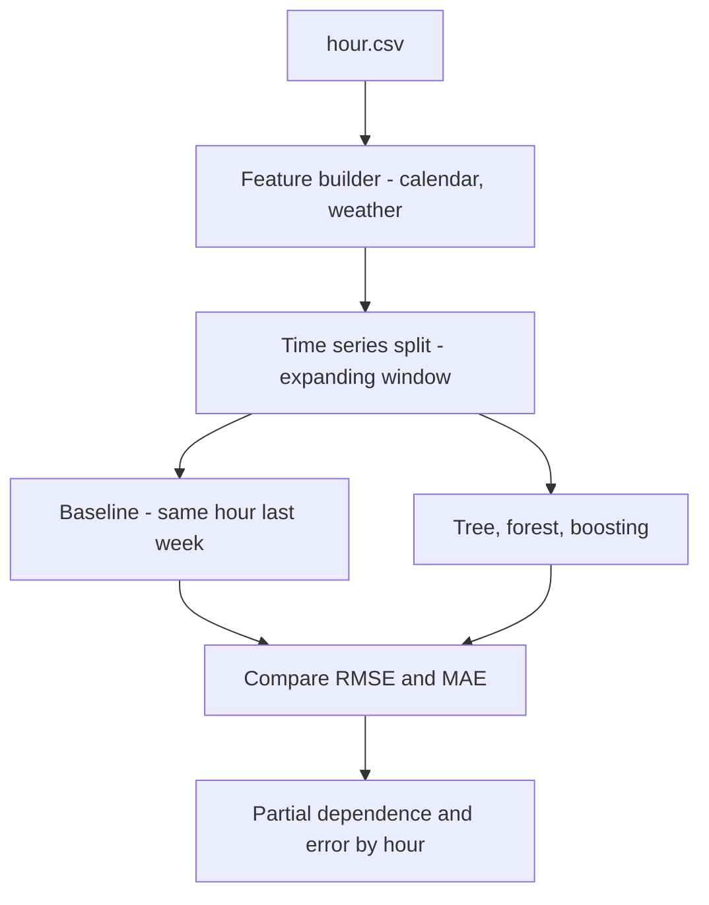
- **Feature builder**: cyclical encodings for hour (sine and cosine) are optional for trees but needed for linear models.
- **Expanding-window split**: `TimeSeriesSplit` trains on months 1..k and validates on month k+1, mimicking real forecasting.
- **Partial dependence plots**: show how predicted demand changes with temperature or hour while averaging over other features.

### Data model
| Column | Type | Notes |
|---|---|---|
| `dteday`, `hr` | date, int | Timestamp |
| `season`, `mnth`, `weekday`, `holiday`, `workingday` | category/int | Calendar |
| `weathersit` | 1–4 | Clear to heavy rain |
| `temp`, `atemp`, `hum`, `windspeed` | float, normalised | Weather |
| `casual`, `registered`, `cnt` | int | Target is `cnt` (do not use the other two as features!) |

### Tech stack
| Component | Choice | Why |
|---|---|---|
| Data | pandas or polars | Simple joins and date parts |
| Models | scikit-learn trees and ensembles | Good defaults, `TimeSeriesSplit` |
| Explainability | `PartialDependenceDisplay` | Understand effects |
| Optional | LightGBM | Faster boosting, same ideas |

### Milestones
1. **Explore.** *Done when* you have plots of demand by hour for working days vs weekends and can describe the two commuter peaks.
2. **Baseline and split.** *Done when* the seasonal-naive baseline is scored on an expanding-window split.
3. **Single tree.** *Done when* you show how max depth changes train vs validation error (the bias–variance trade-off in one plot).
4. **Ensembles.** *Done when* random forest and boosting are tuned and both beat the baseline.
5. **Explain.** *Done when* partial dependence plots for temperature and hour are saved and error by hour is plotted.

### Deep dive: the hard parts
- **The leak in plain sight.** `casual + registered = cnt`. Including either as a feature gives near-perfect scores and a useless model. Always ask "would I know this at prediction time?"
- **Random splits lie for time data.** A random split puts tomorrow in training and today in validation, so the model interpolates. Validate on later periods. Expect higher error, and believe it.
- **Count targets.** Demand is a non-negative count with variance growing with the mean. Gradient boosting with Poisson loss (`loss="poisson"`) respects this and avoids negative predictions.
- **Bagging vs boosting.** Random forests reduce variance by averaging deep trees and are hard to overfit. Boosting reduces bias by adding shallow trees and needs a learning rate and early stopping.

### Testing strategy
- Feature-availability test: assert no column whose name contains `casual` or `registered` reaches the model.
- Split test: every validation timestamp is later than every training timestamp in each fold.
- Non-negativity test on predictions.
- Regression test: saved model's validation RMSE does not worsen by more than 5% after code changes.

### Trade-offs, scaling and failure modes
- Trees cannot extrapolate: if next summer is hotter than any training day, predictions plateau. Linear terms or recent-trend features help.
- Weather features in training are *observed*. At serving time you have *forecasts*, which are noisier. Evaluate with forecast-quality inputs if you can.
- Demand grew from 2011 to 2012, so a model trained only on 2011 under-predicts. Add a trend feature or retrain often.

### Stretch goals
- Add lag features (demand 24 and 168 hours ago) and compare.
- Predict casual and registered separately and sum them.
- Quantile predictions for staffing decisions (the 90th percentile of demand).

### Skills practised
- [Ch 7 — Decision Trees and Ensembles](../chapters/07-trees-and-ensembles/README.md): trees, bagging, random forests, gradient boosting.
- [Ch 4 — Data, EDA and Feature Engineering](../chapters/04-data-eda-feature-engineering/README.md): calendar features, leakage.
- [Ch 6 — Evaluation and Tuning](../chapters/06-evaluation-and-tuning/README.md): time-based validation, bias–variance.

### In the interview
**30-second answer:** I built an hourly bike-demand model on two years of Capital Bikeshare data, comparing a seasonal-naive baseline, a single tree, a random forest and gradient boosting. The key decision was forward-in-time validation with `TimeSeriesSplit`, because random splits let the model see the future. The trap I had to avoid was a leak in plain sight: `casual + registered = cnt`, so both columns are banned from the features and a test enforces it. Boosting with Poisson loss beat the baseline and never predicts negative counts.

**Key terms to know:**
- **Decision tree** — a learned flowchart of yes/no splits; deep trees overfit.
- **Random forest (bagging)** — many deep trees on bootstrap samples with random feature subsets, averaged to cut variance.
- **Gradient boosting** — shallow trees added one at a time, each fitting the previous ensemble's errors, to cut bias; needs learning rate and early stopping.
- **Bias–variance trade-off** — shown by tree depth: shallow trees underfit, deep ones overfit.
- **TimeSeriesSplit (expanding window)** — train on months 1..k, validate on month k+1.
- **Seasonal-naive baseline** — predict the same hour last week.
- **Target leakage** — a feature that would not be known at prediction time, here `casual` and `registered`.
- **Poisson loss** — suits non-negative counts whose variance grows with the mean.
- **Partial dependence plot** — average prediction as one feature varies.
- **Extrapolation** — trees cannot predict beyond the range of targets seen in training.

**Q:** Random forest vs gradient boosting?

**A:** Forests average many deep, decorrelated trees to cut variance — robust with little tuning. Boosting fits shallow trees sequentially to residuals to cut bias — usually more accurate but needs learning rate, depth and early stopping tuned.

**Q:** Why not a random train/test split here?

**A:** The data is ordered in time and neighbouring hours are highly correlated. Random splits let the model see the future and interpolate, which overstates accuracy. Use forward-chaining splits and expect a higher, more honest error.

**Q:** What is a partial dependence plot?

**A:** The model's average prediction as one feature varies, averaging over the others. It shows the shape of an effect, like demand rising with temperature then falling in heat, but can mislead when features are strongly correlated (temperature and season), because it averages over impossible combinations.

**Q:** How did you find the leak, and how do you stop it coming back?

**A:** For every feature I asked "would I know this at prediction time?" — the hour's casual and registered counts are not known until the hour is over. A unit test asserts no column containing those names reaches the model, so a future refactor cannot reintroduce them.

**Q:** Why can trees not extrapolate, and why does it matter here?

**A:** A tree predicts the average of training targets in a leaf, so its output is bounded by what it saw. Demand grew from 2011 to 2012, so a model trained on 2011 under-predicts 2012. A trend feature, a linear component or frequent retraining helps.

**Q:** Why use Poisson loss?

**A:** Counts are non-negative and noisier when larger. Poisson loss models the log of the expected count, so predictions are always positive and errors on busy hours are weighted appropriately. Squared error can produce negative predictions at night.

**Q:** What changes when you deploy this for next-day planning?

**A:** In training, weather features are observed values; in production you only have forecasts, which are noisier. Evaluate with forecast-quality inputs, or the offline score will be too optimistic. Lag features must also respect the forecast horizon — tomorrow's model cannot use the last hour's demand.

**Q:** How would you scale this to 1,000 stations instead of one city total?

**A:** Train one global model with station ID and station features rather than 1,000 small models, so quiet stations borrow strength from busy ones. LightGBM handles millions of rows quickly. The new problem is that per-station counts are sparse and zero-heavy, which Poisson or Tweedie loss handles.

**Q:** How do you guard against regressions in later code changes?

**A:** A test asserts each validation timestamp is later than every training timestamp, a test checks predictions are non-negative, and a regression test fails if validation RMSE worsens by more than 5% against the saved model.

**Common mistakes in answers:**
- "Random forests can't overfit" — individual deep trees do; forests are just much more resistant.
- Comparing to no baseline; the same hour last week is surprisingly strong and must be beaten.
- Using lag features (demand one hour ago) for a next-day forecast where they would not be available.

### TL;DR
Tree ensembles capture hour × weather interactions for free. Validate forward in time, drop the target's own components, and use a count-aware loss.

## 9. Your first model API (wine quality)

**Level:** Beginner · **Time:** 1–2 weekends · **Prerequisites:** Ch 3, 6, 16

### What it is
A small but complete **ML service**: train a model that predicts wine quality from lab measurements, track every experiment in **MLflow** (a tool that records parameters, metrics and model files for each training run), register the best model, and serve it through a **FastAPI** web endpoint that validates input and logs every prediction to PostgreSQL. The model is simple on purpose; the point is the plumbing around it.

### The problem it solves
Most models die in notebooks. To be useful, a model must be reproducible (you can rebuild it), versioned (you know which one is live), callable (other software can use it) and observable (you can see what it is predicting). This project gives you a template for all four that you will reuse in many later capstones.

### Real-world examples
- The UCI [Wine Quality](https://archive.ics.uci.edu/dataset/186/wine+quality) dataset has 1,599 red and 4,898 white Portuguese "vinho verde" samples with 11 physicochemical measurements and a sensory quality score.
- The [MLflow documentation](https://mlflow.org/docs/latest/) covers tracking, model packaging and the [model registry](https://mlflow.org/docs/latest/ml/model-registry/).
- The [FastAPI documentation](https://fastapi.tiangolo.com/) shows typed request models with automatic validation and interactive API docs.

### Requirements
**Functional**
- Train at least three models (linear, random forest, gradient boosting), logging parameters, metrics and the model artefact to MLflow.
- Register the best run as a named model version.
- `POST /predict` accepts the 11 measurements plus wine colour and returns predicted quality and model version.
- `GET /health` and `GET /model-info` endpoints.
- Log each request, prediction, model version and latency to PostgreSQL.

**Non-functional**
- p95 (95th-percentile) latency under 50 ms for a single prediction on a laptop.
- Invalid input (negative pH, missing field) rejected with HTTP 422 and a clear message.
- Container image builds and starts with one command.

### The architecture
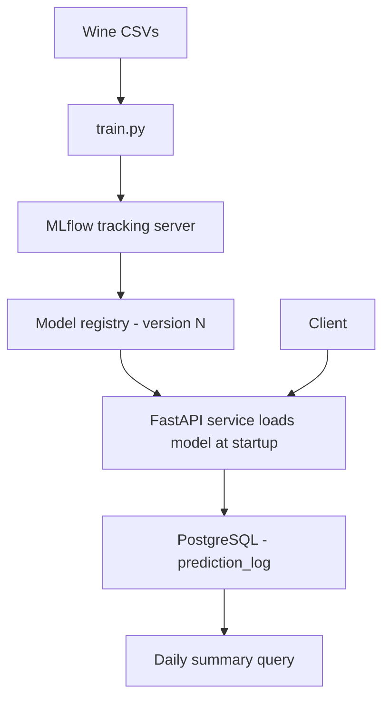
- **train.py**: one script, seeds fixed, logs everything to MLflow.
- **Registry**: holds versions with aliases such as `champion`. The service loads "the champion", not a file path.
- **FastAPI service**: Pydantic models define the input schema; the model is loaded once at startup, not per request.
- **prediction_log**: lets you audit and later monitor inputs and outputs (the start of Project 31).

### Data model
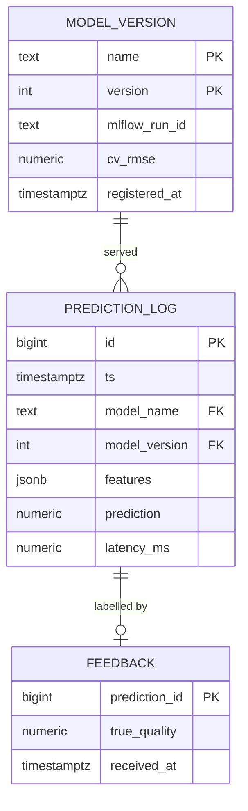

### Tech stack
| Component | Choice | Why |
|---|---|---|
| Training | scikit-learn | Simple tabular models |
| Tracking and registry | MLflow | Runs, artefacts, versions, aliases |
| API | FastAPI + Pydantic | Typed validation, auto docs |
| Logging store | PostgreSQL | Durable, queryable prediction log |
| Packaging | Docker | Same environment everywhere |

### Milestones
1. **Tracked training.** *Done when* three runs appear in the MLflow UI with parameters, CV RMSE and a saved model.
2. **Registry.** *Done when* the best run is registered and tagged as champion.
3. **API.** *Done when* `curl` to `/predict` returns a prediction and model version, and bad input returns 422.
4. **Logging.** *Done when* every call writes one row to `prediction_log`, and a SQL query shows prediction counts per day.
5. **Container and load test.** *Done when* `docker compose up` starts API, MLflow and PostgreSQL, and a load test reports p95 latency.

### Deep dive: the hard parts
- **Regression or classification?** Quality is an integer from 0 to 10 but most wines score 5–7. Treating it as regression is simple; treating it as ordinal classification is more faithful. Pick one, justify it, and report MAE either way.
- **Same preprocessing everywhere.** Save the entire scikit-learn pipeline (scaler + model) as one artefact. If the API re-implements scaling by hand, train/serve skew is only a matter of time.
- **Model loading and versions.** Load the model at startup and expose its version in every response. To roll out a new version, change the registry alias and restart (or hot-reload) — never overwrite files in place.
- **Logging without slowing requests.** Writing to PostgreSQL synchronously adds milliseconds. Use FastAPI background tasks or a small queue, and make the endpoint still respond if the log write fails.

### Testing strategy
- Unit test the Pydantic schema with valid and invalid payloads.
- API tests with FastAPI's `TestClient`: health, predict, bad input.
- Parity test: the API's prediction equals the training pipeline's prediction for the same row.
- Load test (a few hundred requests) checks p95 latency.

### Trade-offs, scaling and failure modes
- One process with the model in memory is fine for tens of requests per second. For more, run several workers behind a load balancer or batch requests.
- If the registry is down at startup, the service should fail fast rather than serve nothing silently.
- Logged features may include personal data in real systems — decide retention and access up front.

### Stretch goals
- Add a `/predict/batch` endpoint for many rows at once.
- Shadow mode: load two versions, serve one, log both predictions.
- A Grafana or simple HTML dashboard over `prediction_log`.

### Skills practised
- [Ch 3 — The Python ML Stack](../chapters/03-python-ml-stack/README.md): environments, the estimator API, saving models.
- [Ch 6 — Evaluation and Tuning](../chapters/06-evaluation-and-tuning/README.md): choosing and comparing models.
- [Ch 16 — ML in Production](../chapters/16-ml-in-production/README.md): serving, model registry, logging, train/serve skew.

### In the interview
**30-second answer:** I built a small but complete ML service: a wine-quality model trained with MLflow tracking, registered as a versioned model with a `champion` alias, and served by FastAPI with Pydantic validation. Every request logs features, prediction, model version and latency to PostgreSQL. The key design decision was saving the whole preprocessing + model pipeline as one artefact, so the API cannot drift from training, and a parity test proves offline and online predictions match. The service starts with one `docker compose up` and serves single predictions with p95 latency under 50 ms on a laptop.

**Key terms to know:**
- **Experiment tracking (MLflow)** — records parameters, metrics and artefacts for every training run.
- **Model registry and alias** — versioned models with a movable pointer such as `champion`; rollback is a metadata change.
- **FastAPI + Pydantic schema** — typed request models; invalid input returns HTTP 422 automatically.
- **Train/serve skew** — preprocessing that differs between training and serving.
- **Parity test** — the API's prediction must equal the training pipeline's for the same row.
- **p95 latency** — the response time 95% of requests beat.
- **Prediction log** — one row per request with request ID, timestamp, model version, inputs, output and latency.
- **Health / readiness endpoint** — `/health` lets an orchestrator know the service is up and the model loaded.
- **Ordinal target** — quality is an integer 0–10, mostly 5–7.
- **Shadow mode** — run a candidate model on live traffic without serving its answers.

**Q:** What does a model registry give you over saving files?

**A:** Versioning with lineage back to the training run, alias management, and a single source of truth for which model is live, which makes rollback a metadata change. A file path tells you none of that.

**Q:** How do you avoid train/serve skew in a simple service?

**A:** Serialise the full preprocessing + model pipeline as one artefact, validate inputs against a schema, and run a parity test between offline and online predictions in CI.

**Q:** What would you log for each prediction?

**A:** Timestamp, model version, input features (or a reference), output, latency and a request ID to join later labels. That enables debugging, monitoring and retraining.

**Q:** Regression or classification for wine quality?

**A:** Quality is an ordered integer, so regression is simple and respects order, while classification ignores that 6 is between 5 and 7. I used regression, rounded for display, and reported MAE; ordinal classification is a reasonable alternative if you justify it.

**Q:** Show a minimal validated endpoint.

**A:** Pydantic does validation; the model is loaded once at startup.
```python
class Wine(BaseModel):
    ph: float = Field(gt=0, lt=14)
    alcohol: float = Field(ge=0)
@app.post("/predict")
def predict(w: Wine):
    return {"quality": float(model.predict(pd.DataFrame([w.model_dump()]))[0]),
            "version": MODEL_VERSION}
```
A negative pH now returns 422 before the model is touched.

**Q:** How do you roll out a new model safely?

**A:** Register it, run it in shadow mode or on a small share of traffic, compare predictions and latency, then move the `champion` alias and reload. If metrics degrade, move the alias back. Never overwrite a model file in place.

**Q:** What happens if PostgreSQL is down?

**A:** The prediction should still be returned; logging runs in a background task and failures are counted and alerted on, not raised to the client. If the registry is down at startup, the service should fail fast rather than come up without a model.

**Q:** What breaks first at 100x traffic?

**A:** Synchronous database writes and a single process. Add workers behind a load balancer, batch log inserts through a queue, and consider a `/predict/batch` endpoint. The model itself is tiny and is rarely the bottleneck.

**Q:** How do you test the service?

**A:** Schema unit tests for valid and invalid payloads, `TestClient` tests for `/health` and `/predict`, the parity test, and a small load test asserting p95 under 50 ms.

**Common mistakes in answers:**
- Loading the model inside the request handler, which adds hundreds of milliseconds per call.
- Re-implementing scaling by hand in the API instead of shipping the fitted pipeline.
- Returning predictions without the model version, making later debugging impossible.

### TL;DR
Wrap even a simple model in tracking, a registry, a validated API and a prediction log — that skeleton is what turns a notebook into a service.

## 10. Book "more like this" finder

**Level:** Beginner · **Time:** 1 weekend · **Prerequisites:** Ch 8, 13

### What it is
A **content-based recommender**: given a book you liked, it finds books whose plot summaries are most similar. Each summary becomes a vector (first with TF-IDF word weights, later with pre-trained sentence embeddings), and similarity is the **cosine** of the angle between vectors (1 means pointing the same way, 0 means unrelated). No user data is needed, which makes it the natural first recommender and the fix for the "cold start" problem of new items.

### The problem it solves
A new book has no ratings, so collaborative methods (Project 14) cannot recommend it. Content similarity can, from day one. It also gives explainable results ("both mention dragons, a heist and a city under siege"), which users trust.

### Real-world examples
- The [CMU Book Summary Dataset](https://www.cs.cmu.edu/~dbamman/booksummaries.html) contains plot summaries for 16,559 books extracted from Wikipedia, with author, title, date and genre metadata.
- [Sentence-BERT](https://arxiv.org/abs/1908.10084) showed how to produce sentence embeddings where cosine similarity reflects meaning — your upgrade path from TF-IDF.

### Requirements
**Functional**
- Clean summaries; build TF-IDF vectors with unigrams and bigrams, removing stop words.
- `similar(book_id, k=10)` returns the top k books with similarity scores and shared top terms.
- Optional filters: same genre, published within N years.
- Compare TF-IDF results with a sentence-embedding model on a hand-labelled test set.

**Non-functional**
- Query under 50 ms for 16,000 books (brute-force cosine is fine at this size).
- Index build under 1 minute.
- Results stable across runs.

### The architecture
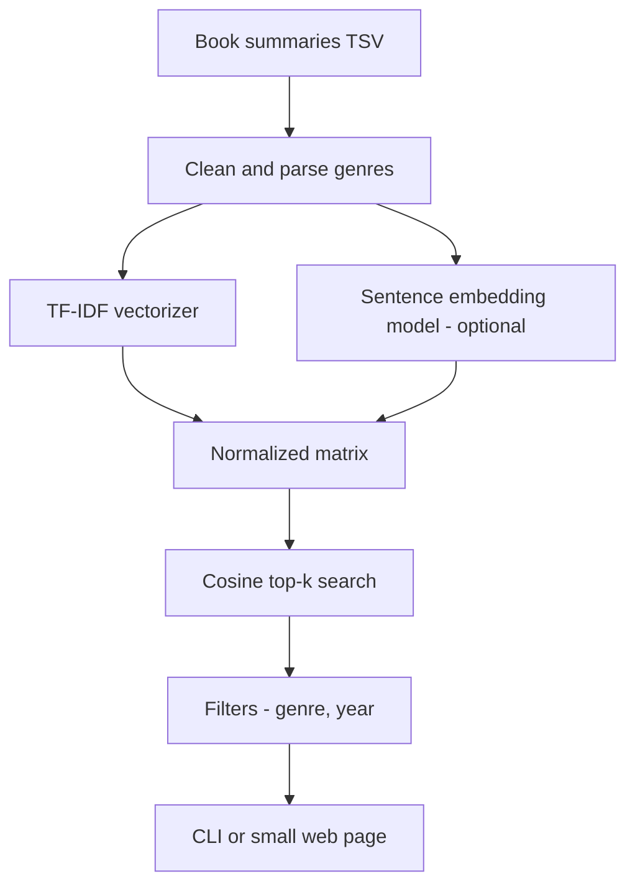
- **TF-IDF**: rare words that are frequent in one summary ("hobbit") get high weight; common words ("the", "story") get low weight.
- **Normalized matrix**: L2-normalising each row makes cosine similarity a simple dot product.
- **Top-k search**: one sparse matrix–vector product plus `argpartition`.
- **Filters**: applied after scoring, with a larger k so you still return enough results.

### Data model
| Item | Type | Notes |
|---|---|---|
| `book_id` | int | Wikipedia ID |
| `title`, `author`, `pub_date` | text | Metadata, some missing |
| `genres` | JSON string | Parse into a list |
| `summary` | text | Hundreds of words each |
| Vectors | sparse matrix N × V or dense N × 384 | Row-normalised |

### Tech stack
| Component | Choice | Why |
|---|---|---|
| Vectors | scikit-learn `TfidfVectorizer` | Sparse, fast, explainable |
| Embeddings (stretch) | a sentence-transformers model | Captures meaning beyond shared words |
| Search | numpy / scipy sparse | Brute force fits in memory |
| UI | FastAPI + HTML, or a CLI | Quick demo |

### Milestones
1. **Parse.** *Done when* every book has an ID, title, genre list and non-empty summary.
2. **TF-IDF search.** *Done when* `similar()` returns 10 neighbours for a famous book and they look plausible.
3. **Explanations.** *Done when* each result lists the 5 terms contributing most to the similarity.
4. **Evaluation set.** Pick 30 books and mark which of their top 10 are "good" recommendations. *Done when* you can report precision at 10.
5. **Embeddings.** *Done when* you have compared TF-IDF and embeddings on the same evaluation set.

### Deep dive: the hard parts
- **Names dominate TF-IDF.** Character names are rare and therefore heavily weighted, so sequels match each other perfectly but nothing else does. Consider removing proper nouns or capping per-term weight, and decide whether "same series" is a feature or a bug.
- **Evaluation without users.** There are no clicks. A small hand-labelled set and genre overlap as a weak proxy are honest substitutes; say clearly that they are proxies.
- **Lexical vs semantic similarity.** TF-IDF matches words; embeddings match meaning ("murder" ≈ "killing"). Embeddings can also match on style or length in surprising ways — inspect results, do not just trust metrics.
- **Diversity.** The top 10 may all be by the same author. Add a simple re-rank that limits each author to two results.

### Testing strategy
- A book's most similar item (excluding itself) must not be itself; self-similarity must be 1.0.
- Similarity is symmetric: `sim(a, b) == sim(b, a)`.
- Filter test: genre-filtered results all have that genre.
- Golden test: a sequel appears in the top 10 for its first book.

### Trade-offs, scaling and failure modes
- Brute force is O(N) per query — fine for thousands, too slow for millions. Then use an approximate nearest-neighbour index (Project 18).
- Content-based systems over-specialise: users see more of the same. Collaborative signals add serendipity.
- Summary quality varies; a two-line summary gives a poor vector.

### Stretch goals
- Combine TF-IDF and embedding scores with a weighted sum and tune the weight on your labelled set.
- Add a "because you liked X and Y" mode that averages two book vectors.
- Store vectors in PostgreSQL with pgvector and query from SQL.

### Skills practised
- [Ch 8 — k-NN, SVMs and Naive Bayes](../chapters/08-knn-svm-naive-bayes/README.md): nearest-neighbour search and distance choices.
- [Ch 13 — Recommender Systems and Embeddings](../chapters/13-recommenders-and-embeddings/README.md): content-based filtering, cosine similarity, cold start, embeddings.
- [Ch 12 — Sequences, RNNs and Attention](../chapters/12-sequences-rnns-and-attention/README.md): tokenisation and word/sentence embeddings.

### In the interview
**30-second answer:** I built a content-based "more like this" finder over about 16,500 Wikipedia book summaries. Each summary becomes an L2-normalised TF-IDF vector, so cosine similarity is one sparse dot product, and every result shows the shared terms that made it match. The surprise was that rare character names dominate TF-IDF, so sequels match each other and nothing else; I handled it by reducing proper-noun weight and limiting results per author. On a hand-labelled set of 30 books I report precision at 10 for TF-IDF versus sentence embeddings, and queries take well under 50 ms by brute force.

**Key terms to know:**
- **Content-based recommendation** — recommend items similar in content to ones the user liked; needs no interaction data.
- **Cold start** — new items or users with no history; content similarity works from day one.
- **TF-IDF** — word weight that is high when frequent in this document and rare across all documents.
- **Cosine similarity** — the cosine of the angle between vectors, ignoring their length; with unit vectors it is a dot product.
- **Sentence embeddings** — dense vectors from a pre-trained model where nearby vectors mean similar meaning.
- **Top-k search** — score all items, then `argpartition` to find the k best without a full sort.
- **Precision at k** — share of the top k results judged relevant.
- **Diversity re-ranking** — limiting near-duplicates, for example two books per author.
- **Approximate nearest neighbour (ANN)** — an index that trades a little recall for much faster search at scale.

**Q:** When would you choose content-based over collaborative filtering?

**A:** For new items or users with no interactions, for niche catalogues with little traffic, and when explanations matter. Collaborative filtering wins when interaction data is rich, because it captures taste that text does not describe.

**Q:** Why cosine similarity rather than Euclidean distance?

**A:** Cosine ignores vector length, so a long summary and a short one about the same topic still match. With L2-normalised vectors the two give identical rankings, because squared distance equals 2 − 2 × cosine.

**Q:** How would you evaluate without user data?

**A:** A small human-labelled relevance set, proxy labels such as genre overlap, and later an online test measuring click-through on recommendations. Say clearly which numbers are proxies.

**Q:** TF-IDF vs embeddings — which and why?

**A:** TF-IDF matches shared words and is explainable; embeddings match meaning ("murder" ≈ "killing") but can latch onto style or length and are harder to explain. I compared both on the same labelled set and inspected results, and a weighted blend often beats either.

**Q:** What is the complexity of a query, and what changes at 10 million items?

**A:** Brute force is O(N × d) per query, fine for 16,000 items. At 10 million, use an ANN index such as HNSW or IVF (in FAISS or pgvector), precompute vectors offline, and accept recall slightly below 100% for millisecond latency.

**Q:** Why do filters need a larger k?

**A:** If you take the top 10 and then filter by genre, you may be left with two results. Retrieve, say, the top 100, filter, then cut to 10. At scale, use an index that supports filtering during the search.

**Q:** What tests prove the search works?

**A:** Self-similarity must be 1.0 and the item is excluded from its own results; similarity must be symmetric; filtered results must all match the filter; and a known sequel must appear in its first book's top 10.

**Q:** What happens with a two-line summary or a missing one?

**A:** A very short summary gives a sparse vector that matches almost nothing, or matches randomly on one rare word. I drop empty summaries at parse time and can fall back to genre and author metadata for short ones.

**Q:** What is the main weakness of content-based recommenders?

**A:** Over-specialisation: users get more of the same and no serendipity. Mixing in collaborative signals or popular items, and diversity re-ranking, counters it.

**Common mistakes in answers:**
- Saying cosine and Euclidean always disagree; on normalised vectors they rank identically.
- Fitting the TF-IDF vocabulary with stop words left in and blaming the algorithm for "the" matches.
- Calling genre overlap "accuracy" without saying it is only a proxy for relevance.

### TL;DR
Turn text into vectors, rank by cosine similarity, explain with shared terms — the simplest recommender, and the one that works for brand-new items.

## 11. Churn model with gradient boosting and SHAP

**Level:** Intermediate · **Time:** 2 weeks · **Prerequisites:** Ch 6, 7, 19

### What it is
A model that predicts which subscribers of a telecom company are likely to cancel (**churn**) in the near future, built with **gradient-boosted trees** and explained with **SHAP** (SHapley Additive exPlanations — a method that splits each prediction into contributions from each feature, so they add up to the model's output). The output is a weekly ranked list for the retention team, each customer with their top reasons.

### The problem it solves
Winning a new customer usually costs more than keeping one. A retention team can call or discount only a limited number of people per week, so they need a ranked list of who is at risk *and* why (a price complaint needs a different offer from a network-quality complaint). Accuracy without reasons is hard to act on; reasons without accuracy waste the budget.

### Real-world examples
- The IBM sample [Telco Customer Churn](https://www.kaggle.com/datasets/blastchar/telco-customer-churn) dataset on Kaggle has 7,043 customers with contract type, tenure, services, charges and a churn flag.
- Lundberg and Lee's paper [A Unified Approach to Interpreting Model Predictions](https://arxiv.org/abs/1705.07874) introduced SHAP; the [SHAP documentation](https://shap.readthedocs.io/en/latest/) covers the fast TreeExplainer used for boosted trees.

### Requirements
**Functional**
- Feature pipeline: tenure buckets, contract type, payment method, number of add-on services, charges per month of tenure.
- Models: logistic regression baseline, LightGBM (or scikit-learn `HistGradientBoostingClassifier`), with tuned hyperparameters.
- Metrics: ROC AUC, PR AUC, **lift at top 10%** (how many times more churners are in the top decile than average), and calibration.
- Global explanations (SHAP summary) and per-customer top three reasons.
- A batch job writing `churn_scores` to PostgreSQL weekly.

**Non-functional**
- Scoring 1 million customers under 5 minutes on a laptop-class machine.
- Explanations computed for the top 10,000 risk customers in under 2 minutes.
- Model and SHAP versions recorded with each score.

### The architecture
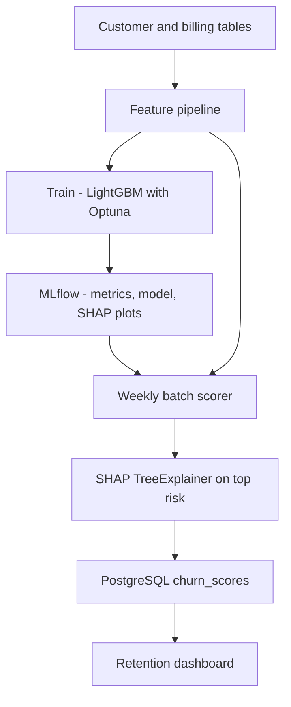
- **Feature pipeline**: a single function used for training and scoring; in real life it reads from a snapshot as of a cut-off date.
- **Optuna**: a hyperparameter search library that tries promising settings first ([Optuna](https://optuna.org/)).
- **Batch scorer**: scores all active customers, sorts by risk.
- **TreeExplainer**: exact SHAP values for tree models, fast enough for thousands of rows.

### Data model
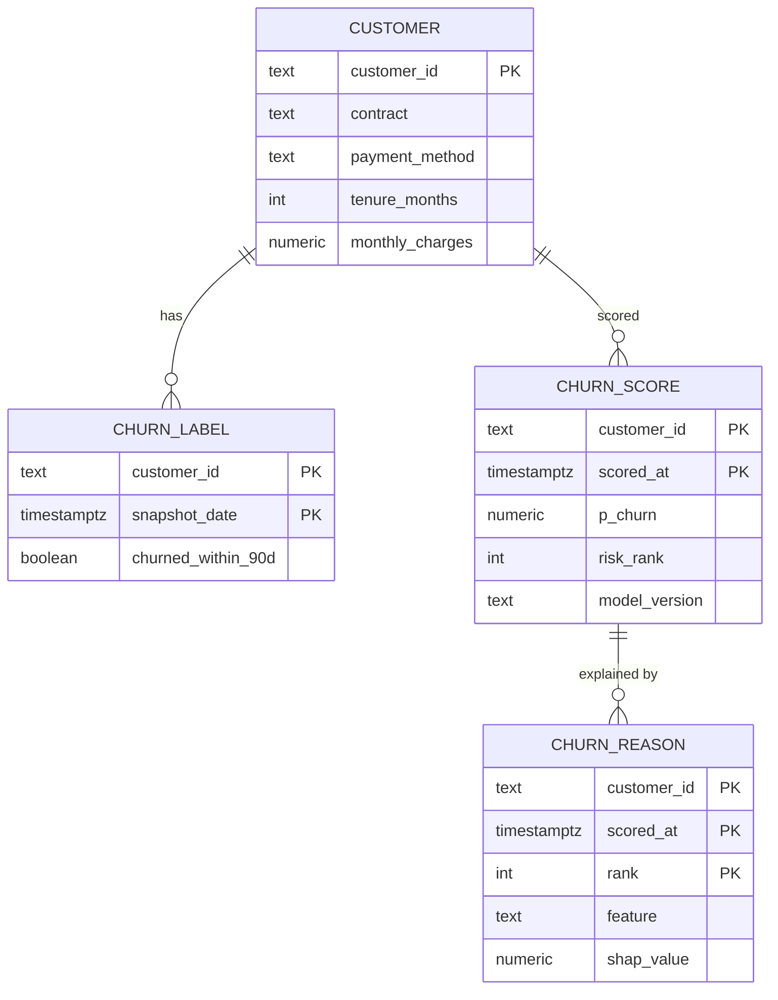

### Tech stack
| Component | Choice | Why |
|---|---|---|
| Model | LightGBM or scikit-learn HistGB | Strong on tabular data, handles categories |
| Tuning | Optuna | Efficient search, pruning |
| Explanations | SHAP (check Python 3.14 wheels, else use a 3.13 env) | Consistent additive attributions |
| Tracking | MLflow | Runs, plots, model versions |
| Storage | PostgreSQL | Scores and reasons for the dashboard |

### Milestones
1. **Label definition and baseline.** *Done when* you have written down exactly what "churn" means (window and snapshot date) and logistic regression has CV ROC AUC, PR AUC and lift.
2. **Boosting.** *Done when* a tuned boosted model beats the baseline on PR AUC and lift at 10%, with early stopping.
3. **Explanations.** *Done when* a SHAP summary plot exists and you can describe the top three global drivers in plain words.
4. **Reasons.** *Done when* each top-risk customer has three human-readable reasons ("month-to-month contract", "fibre optic with no tech support").
5. **Batch job.** *Done when* a scheduled script writes scores and reasons to PostgreSQL, tagged with the model version.

### Deep dive: the hard parts
- **Defining the label in time.** The Kaggle file is a single snapshot, so "churn" already happened. In a real system you build features as of date T and label "cancelled between T and T + 90 days". Features computed after T (for example, "number of support calls this month" when the month includes the cancellation call) leak the answer.
- **Ranking metrics for a budget.** The team calls the top N, so what matters is precision and lift in the top slice, not overall accuracy. Report a cumulative gains curve.
- **SHAP is about the model, not causation.** A high SHAP value for "month-to-month contract" means the model relies on it, not that switching a customer to a yearly contract will keep them. Retention offers need an uplift model (Project 23) or an experiment.
- **Correlated features split credit.** Tenure and total charges are strongly correlated, so SHAP may spread credit between them unpredictably. Group related features when presenting reasons.

### Testing strategy
- Point-in-time test: every feature value for a training row has a timestamp before its snapshot date.
- SHAP additivity check: base value + sum of SHAP values equals the model's raw output (log-odds) for sampled rows.
- Batch scorer test on a fixture of 100 customers: row counts, no nulls, ranks are a permutation.
- Drift check: compare this week's score distribution with last week's.

### Trade-offs, scaling and failure modes
- Logistic regression is easier to defend; boosting typically ranks better. Keep both and report the gap.
- Scores influence who gets offers, and offers change who churns — future labels are contaminated by the intervention. Keep a random holdout group that receives no offers.
- SHAP on millions of rows is slow; explain only those you will act on.

### Stretch goals
- Survival analysis: predict *when* a customer will churn with a Cox model or a survival forest.
- Cost-based threshold: maximise expected profit given offer cost and customer value.
- A small Streamlit or HTML dashboard of top-risk customers and their reasons.

### Skills practised
- [Ch 7 — Decision Trees and Ensembles](../chapters/07-trees-and-ensembles/README.md): gradient boosting, early stopping, feature importance.
- [Ch 6 — Evaluation and Tuning](../chapters/06-evaluation-and-tuning/README.md): PR AUC, lift, calibration, hyperparameter search.
- [Ch 19 — Responsible ML](../chapters/19-responsible-ml/README.md): explainability with SHAP and its limits.
- [Ch 16 — ML in Production](../chapters/16-ml-in-production/README.md): batch inference and point-in-time features.

### In the interview
**30-second answer:** I built a churn model that gives a retention team a weekly ranked list of at-risk telecom customers, each with three plain-English reasons. The key decision was optimising lift and precision in the top slice the team can actually call, not overall accuracy, and LightGBM beat the logistic-regression baseline there. The hardest part was the label: I defined churn as "cancels within 90 days of snapshot T" and built every feature only from data before T, with a test that enforces it. SHAP TreeExplainer turns each score into reasons, and I verify additivity — base value plus SHAP values equals the model's log-odds.

**Key terms to know:**
- **Churn label in time** — features as of snapshot date T, label "cancelled between T and T + 90 days".
- **Point-in-time correctness** — no feature may use information from after T.
- **Gradient boosting (LightGBM)** — sequential shallow trees fitting residuals, with early stopping on validation.
- **SHAP values** — per-feature contributions that add up from the average prediction to this prediction.
- **TreeExplainer** — exact, fast SHAP computation for tree ensembles.
- **Lift at top 10%** — churn rate in the top decile divided by the overall churn rate.
- **PR AUC and cumulative gains curve** — ranking metrics that focus on the positive class and on budgets.
- **Calibration** — needed if offers depend on the probability, not just the rank.
- **Hyperparameter search (Optuna)** — tries promising settings first and prunes bad trials early.
- **Intervention contamination** — offers change who churns, so future labels are biased unless a random holdout gets no offers.

**Q:** How do you define churn for training?

**A:** Pick a snapshot date T, build features only from data before T, and label whether the customer cancels in a fixed window after T. Use several snapshots for more training rows, and validate on a later snapshot so the test mimics next week.

**Q:** What do SHAP values tell you?

**A:** How much each feature pushed this prediction above or below the average prediction, adding up exactly to the output (log-odds for a classifier). They explain the model's reasoning, not the causal effect of changing the feature.

**Q:** The team can call 500 customers a week. Which metric do you optimise?

**A:** Precision or expected saved revenue in the top 500 — a ranking metric at a fixed budget — plus calibration if offers depend on the probability. Overall AUC can improve while the top 500 gets worse.

**Q:** Why gradient boosting over logistic regression here?

**A:** Boosting captures interactions such as "month-to-month contract and fibre and no tech support" without hand-made crosses, and usually ranks better on tabular data. Logistic regression is easier to defend, so I keep it as the baseline and report the gap in lift.

**Q:** SHAP says month-to-month contract drives churn. Should we move everyone to yearly contracts?

**A:** No. SHAP shows what the model relies on, not what happens if you intervene. Customers who choose month-to-month differ in many ways. To decide who to treat, you need an uplift model (Project 23) or an A/B test of the offer.

**Q:** How could leakage sneak in?

**A:** A feature like "support calls this month" where the month includes the cancellation call, or "total charges" computed after T. The test asserts every feature timestamp is before its row's snapshot date.

**Q:** Correlated features share SHAP credit. How do you present reasons?

**A:** Tenure and total charges move together, so SHAP may split credit between them arbitrarily. I group related features into one reason ("new customer") and translate feature names into phrases the team understands.

**Q:** What changes at 10 million customers?

**A:** Scoring is still fast with LightGBM, but SHAP on everyone is slow, so I explain only the top N the team will act on. Feature building moves to a warehouse or Spark job with snapshot tables, and I monitor the weekly score distribution for drift.

**Q:** How do you keep future training data clean once the model drives offers?

**A:** Keep a small random holdout of at-risk customers who receive no offer. Their outcomes measure true churn risk and the offer's effect, and give unbiased training labels later.

**Common mistakes in answers:**
- Reading SHAP as causal ("this feature causes churn").
- Using the Kaggle snapshot as if it had a time dimension, without explaining the T and T + 90 days design a real system needs.
- Optimising ROC AUC when the business consumes only the top of the list.

### TL;DR
Churn modelling is mostly about a leak-free, point-in-time label and a ranking metric that matches the retention budget; SHAP turns scores into reasons, not causes.

## 12. Pet-breed classifier with transfer learning

**Level:** Intermediate · **Time:** 2 weeks · **Prerequisites:** Ch 10, 11

### What it is
An image classifier that recognises 37 breeds of cats and dogs from photos, built by **transfer learning**: you take a CNN pre-trained on ImageNet (millions of general photos), replace its final layer with a new 37-way layer, and **fine-tune** (continue training) on a few thousand pet photos. You then ship it as an API with a confidence threshold and an "I'm not sure" answer.

### The problem it solves
Training a strong image model from scratch needs huge labelled datasets and lots of GPU time. Most real projects — product photos, defects, medical images — have only thousands of labelled images. Transfer learning reuses general visual features (edges, textures, fur, eyes) and makes these projects feasible on one GPU or even a CPU.

### Real-world examples
- The [Oxford-IIIT Pet Dataset](https://www.robots.ox.ac.uk/~vgg/data/pets/) has 37 categories with roughly 200 images each, plus breed, head bounding box and pixel-level segmentation annotations.
- The official PyTorch [transfer learning tutorial](https://docs.pytorch.org/tutorials/beginner/transfer_learning_tutorial.html) walks through feature extraction vs fine-tuning on a small dataset.
- [ResNet](https://arxiv.org/abs/1512.03385) introduced residual connections and remains a common transfer-learning backbone.

### Requirements
**Functional**
- Train with three strategies: frozen backbone (only the new head learns), full fine-tuning, and gradual unfreezing.
- Data augmentation: random resized crops, flips, colour jitter.
- Metrics: top-1 and top-5 accuracy, per-class accuracy, confusion matrix of the most confused breeds.
- `POST /classify` with an image returns top-3 breeds and probabilities, or "unsure" below a threshold.

**Non-functional**
- Top-1 test accuracy above 85% with a ResNet-50-class backbone (good fine-tuning typically exceeds this).
- CPU inference under 150 ms per image at 224 × 224.
- Model artefact under 100 MB.

### The architecture
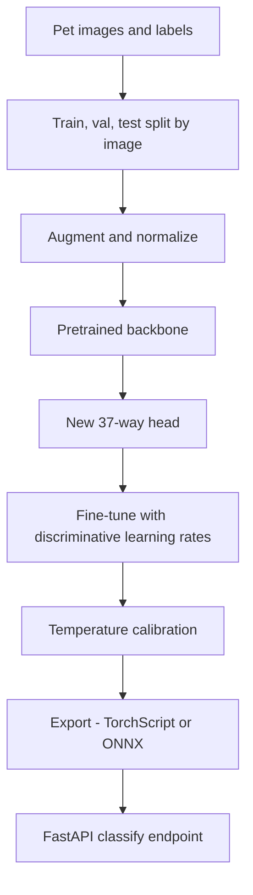
- **Pretrained backbone**: a torchvision ResNet or EfficientNet with ImageNet weights.
- **Discriminative learning rates**: small rates for early layers (general features you want to keep), larger for later layers and the new head.
- **Temperature calibration**: divide logits by a single learned number so that probabilities match observed accuracy, which makes the "unsure" threshold meaningful.
- **Export**: a format that loads without your training code.

### Data model
| Item | Type | Notes |
|---|---|---|
| Image file | JPEG, variable size | Resize then crop to 224 × 224 |
| Breed label | int 0–36 | From the file name |
| Species | cat/dog | Useful for error analysis |
| Normalisation | ImageNet mean and std | Must match the pre-training |
| Checkpoint | state dict + class names + temperature | One artefact |

### Tech stack
| Component | Choice | Why |
|---|---|---|
| Framework | PyTorch, torchvision | Pretrained weights, transforms |
| Tracking | MLflow | Compare strategies |
| Serving | FastAPI with `UploadFile` | Simple multipart upload |
| Export | TorchScript or ONNX Runtime | Fast CPU inference |

### Milestones
1. **Feature extraction.** Freeze the backbone, train the head. *Done when* you have a validation accuracy after a few epochs.
2. **Fine-tuning.** Unfreeze, lower the learning rate, add augmentation. *Done when* validation accuracy improves and curves show no runaway overfitting.
3. **Error analysis.** *Done when* you list the five most-confused breed pairs and inspect example images for each.
4. **Calibration and threshold.** *Done when* expected calibration error is reported before and after temperature scaling and the "unsure" threshold is chosen.
5. **Serve.** *Done when* uploading a photo of a pet returns top-3 breeds within the latency target.

### Deep dive: the hard parts
- **Catastrophic forgetting.** A high learning rate on the whole network destroys useful pre-trained features in the first few steps. Train the head first, then unfreeze with a much lower rate, or use a warm-up.
- **Batch norm with small batches.** Batch normalisation layers keep running statistics. With tiny batches during fine-tuning these statistics become noisy; consider freezing batch-norm statistics.
- **Fine-grained confusions.** Similar breeds (for example, two terriers) are genuinely hard. Higher input resolution and longer fine-tuning help more than a bigger head.
- **Out-of-distribution inputs.** A photo of a rabbit still gets a confident breed. Calibrated max probability is a weak but cheap detector; mention stronger options (an "other" class, energy scores).

### Testing strategy
- Transform test: train and inference preprocessing produce identical tensors for the same image (except random augmentation).
- Overfit-one-batch test.
- Golden image test after export: TorchScript/ONNX outputs match PyTorch within 1e-4.
- API test with a non-image file returns a 400 error.

### Trade-offs, scaling and failure modes
- Bigger backbones raise accuracy and latency. For mobile, MobileNet or EfficientNet-B0 class models trade a few points for speed.
- Dataset bias: pet photos are well-lit, centred and often from breeders' sites. User photos are blurry and off-centre.
- Label noise in public datasets caps achievable accuracy; inspect top-loss images.

### Stretch goals
- Compare a CNN backbone with a vision transformer ([ViT](https://arxiv.org/abs/2010.11929)).
- Grad-CAM heat maps to show which pixels drove a prediction.
- Quantise the model to int8 and measure the accuracy/latency trade.

### Skills practised
- [Ch 11 — CNNs and Computer Vision](../chapters/11-cnns-and-computer-vision/README.md): architectures, transfer learning, augmentation.
- [Ch 10 — Neural Networks and Deep Learning](../chapters/10-neural-networks-and-deep-learning/README.md): optimisers, learning-rate schedules, regularisation.
- [Ch 6 — Evaluation and Tuning](../chapters/06-evaluation-and-tuning/README.md): calibration, confusion matrices.

### In the interview
**30-second answer:** I built a 37-breed cat-and-dog classifier by transfer learning from an ImageNet-pretrained ResNet-50, served behind FastAPI with an "unsure" answer. The key decision was training the new head first and then fine-tuning with lower, discriminative learning rates, which avoids wrecking pretrained features. The hardest part was making the "unsure" threshold mean something: deep nets are over-confident, so I fitted temperature scaling on validation and chose the threshold from calibrated probabilities. Top-1 accuracy is above the 85% target, and CPU inference fits under 150 ms per image after export.

**Key terms to know:**
- **Transfer learning** — reuse a network trained on a large dataset as the starting point for a new task.
- **Feature extraction vs fine-tuning** — freeze the backbone and train only the head, or continue training some or all layers.
- **Pretrained backbone and new head** — ResNet with its 1,000-class layer replaced by a 37-way linear layer.
- **Discriminative learning rates / gradual unfreezing** — smaller rates for early layers, larger for later ones; unfreeze from the top down.
- **Catastrophic forgetting** — a high learning rate destroys useful pretrained features.
- **Data augmentation** — random crops, flips, colour jitter to make the model robust.
- **ImageNet normalisation** — the mean and std the backbone was trained with; must match at serving.
- **Temperature scaling / ECE** — divide logits by one fitted number to calibrate; expected calibration error measures the gap.
- **Top-1 / top-5 accuracy** — correct class is the first guess, or among the first five.
- **Out-of-distribution input** — something unlike training data, such as a rabbit.

**Q:** Feature extraction or fine-tuning?

**A:** With very little data or a target domain close to ImageNet, freeze most layers. With more data or a different domain, fine-tune more layers at lower learning rates. Pets are close to ImageNet, so both work, and fine-tuning gains a few points.

**Q:** Why calibrate a classifier you will threshold?

**A:** Deep nets tend to be over-confident. If 0.9 does not mean 90% correct, the threshold for "unsure" is arbitrary. Temperature scaling fixes this cheaply without changing rankings, so accuracy is unchanged.

**Q:** How do you handle a class the model has never seen?

**A:** Detect out-of-distribution inputs with confidence or energy scores, add an explicit "other" class with diverse negatives, and route low-confidence cases to a human.

**Q:** Show how to replace the head in torchvision.

**A:** Load weights, freeze, swap the final layer.
```python
m = torchvision.models.resnet50(weights="IMAGENET1K_V2")
for p in m.parameters():
    p.requires_grad = False
m.fc = nn.Linear(m.fc.in_features, 37)  # new layer is trainable
```
Then pass only `m.fc.parameters()` to the optimiser for the first stage.

**Q:** Why does a high learning rate hurt fine-tuning?

**A:** The new head starts random, so its large early gradients flow back and overwrite pretrained filters in a few steps. Training the head first, then unfreezing with a rate around ten times smaller (plus warm-up), keeps the useful features.

**Q:** What goes wrong with batch norm during fine-tuning?

**A:** Batch-norm layers keep running statistics. With small batches those estimates get noisy and can drift from ImageNet's. Freezing batch-norm statistics (keeping those layers in eval mode) is a common fix.

**Q:** Accuracy is fine on the test set but poor on user photos. Why?

**A:** Dataset bias: the training photos are well lit and centred, users' are blurry and off-centre. Also check preprocessing parity — wrong normalisation or RGB/BGR order is a classic serving bug. A transform test compares training and serving tensors for the same image.

**Q:** How would you make it run on a phone?

**A:** Use a smaller backbone such as MobileNet or EfficientNet-B0, quantise to int8, and export to a mobile runtime. Measure the accuracy you lose against the latency you gain on the target device.

**Q:** How do you debug which breeds fail?

**A:** A confusion matrix of the most-confused pairs, then look at the images. Many errors are genuinely similar breeds or label noise; higher resolution helps the former, and inspecting top-loss images finds the latter.

**Common mistakes in answers:**
- Saying temperature scaling improves accuracy; it changes confidence, not the predicted class.
- Forgetting ImageNet normalisation at inference.
- Using the softmax maximum as a reliable "unknown" detector; it is weak and over-confident without extra work.

### TL;DR
Start from a pre-trained backbone, train the new head, then fine-tune gently with augmentation; calibrate before you threshold.

## 13. Movie-review sentiment, TF-IDF to transformer

**Level:** Intermediate · **Time:** 2–3 weeks · **Prerequisites:** Ch 8, 12

### What it is
A sentiment classifier for movie reviews (positive or negative) built in three generations: a **TF-IDF + logistic regression** baseline, an **LSTM** (a recurrent network that reads text word by word and keeps a memory), and a fine-tuned **transformer** (a pre-trained language model such as BERT that uses attention to look at all words at once). You compare accuracy, cost and robustness, and serve the winner.

### The problem it solves
Companies want to know how people feel about products from reviews, tickets and social posts at a scale no human can read. The project also teaches an important professional habit: measure how much a large model really buys you over a cheap baseline before paying its inference bill.

### Real-world examples
- The [Large Movie Review Dataset](https://ai.stanford.edu/~amaas/data/sentiment/) (Maas et al., 2011) has 50,000 IMDB reviews split evenly into training and test, also on Hugging Face as [stanfordnlp/imdb](https://huggingface.co/datasets/stanfordnlp/imdb).
- [BERT](https://arxiv.org/abs/1810.04805) showed that fine-tuning one pre-trained transformer beats task-specific architectures on many text classification benchmarks; the [Hugging Face Transformers docs](https://huggingface.co/docs/transformers/index) show the fine-tuning workflow.

### Requirements
**Functional**
- Three models trained on the same split: TF-IDF + logistic regression, embedding + LSTM, fine-tuned small transformer (for example DistilBERT).
- Accuracy, F1 and a curated "hard cases" set: negation ("not bad at all"), sarcasm, mixed reviews.
- Error analysis by review length.
- API returning label, probability and model name.

**Non-functional**
- Baseline trains in under 1 minute on CPU.
- Transformer inference under 100 ms per review on CPU at up to 256 tokens (or document the GPU requirement).
- Report cost per 1,000 predictions for each model.

### The architecture
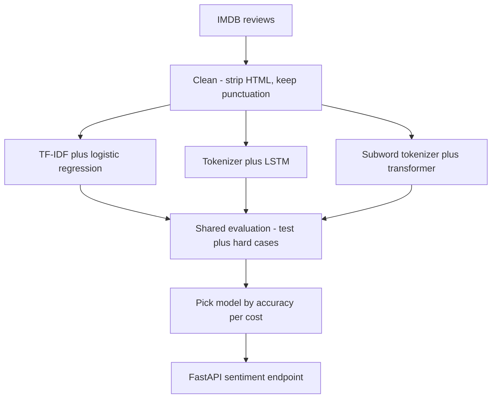
- **Clean**: reviews contain `<br />` tags; keep punctuation because "!!!" and "?" carry sentiment.
- **Tokenizers**: word-level for TF-IDF and LSTM; subword (WordPiece) for the transformer, which splits rare words into known pieces.
- **Shared evaluation**: every model sees exactly the same test rows and hard cases.

### Data model
| Item | Type | Notes |
|---|---|---|
| Review text | string | 25k train, 25k test, balanced |
| Label | 0/1 | Ratings ≤ 4 negative, ≥ 7 positive (neutral excluded) |
| Token IDs | int tensor `[B, T]` | Truncated or padded to T tokens |
| Attention mask | 0/1 tensor | Marks padding for the transformer |
| Hard cases | small CSV | Hand-written, with expected labels |

### Tech stack
| Component | Choice | Why |
|---|---|---|
| Baseline | scikit-learn | Fast, strong |
| LSTM | PyTorch `nn.LSTM` | Learn sequence modelling |
| Transformer | Hugging Face Transformers + PyTorch | Pre-trained checkpoints, tokenizers |
| Tracking | MLflow | Compare three families |
| Serving | FastAPI | One endpoint, swappable model |

### Milestones
1. **Baseline.** *Done when* TF-IDF + logistic regression reports test accuracy (high 80s percent is typical) and its top positive and negative words.
2. **LSTM.** *Done when* it trains with padding handled correctly and you can say whether it beats the baseline.
3. **Transformer fine-tune.** Two or three epochs, small learning rate, warm-up. *Done when* test accuracy is recorded along with training time and hardware.
4. **Hard cases and error analysis.** *Done when* each model's score on hard cases is in a table and you have read 30 errors of the best model.
5. **Serve and cost.** *Done when* the API runs and you have a cost-per-1,000 estimate for each model.

### Deep dive: the hard parts
- **Long reviews.** Many reviews exceed 512 tokens, the usual transformer limit. Truncating to the first 256 tokens loses the verdict that often comes at the end. Try "head + tail" (first 128 and last 128 tokens) and compare.
- **Negation and context.** Bag-of-words sees "not" and "good" separately. Bigrams help ("not_good"). Transformers handle this naturally because attention relates words to each other.
- **Fine-tuning stability.** Transformers fine-tuned with too high a learning rate can collapse to predicting one class. Use about 2e-5, warm-up, and several seeds.
- **Domain shift.** A model trained on movie reviews misreads product reviews ("unpredictable" is praise for a plot and a complaint about a car's brakes). Test on a few out-of-domain examples to show this.

### Testing strategy
- Tokenizer round trip on a sample: padding and truncation lengths correct.
- Invariance tests: changing an actor's name must not flip the label. Directional tests: adding "terrible" should lower positivity.
- Model parity: exported model matches in-training predictions.
- API latency test on a 1,000-word review.

### Trade-offs, scaling and failure modes
- The transformer usually wins by a few points but can cost far more per prediction than the baseline. For high-volume, low-stakes uses, the baseline may be the right choice.
- Distillation (training a small model to mimic a big one) recovers much of the gap cheaply.
- Sentiment models learn biases from text, for example associating some identity terms with negativity (see Project 25).

### Stretch goals
- Distil the transformer into the LSTM or a smaller transformer.
- Aspect-based sentiment: separate scores for acting, plot and music.
- Attention or integrated-gradient visualisations for explanations.

### Skills practised
- [Ch 8 — k-NN, SVMs and Naive Bayes](../chapters/08-knn-svm-naive-bayes/README.md): linear text classifiers.
- [Ch 12 — Sequences, RNNs and Attention](../chapters/12-sequences-rnns-and-attention/README.md): tokenisation, LSTMs, attention, transformers.
- [Ch 10 — Neural Networks and Deep Learning](../chapters/10-neural-networks-and-deep-learning/README.md): learning-rate schedules, fine-tuning habits.

### In the interview
**30-second answer:** I built IMDB sentiment classifiers in three generations — TF-IDF + logistic regression, an LSTM, and fine-tuned DistilBERT — on the same split and the same hand-written hard-case set. The key decision was choosing by accuracy per unit of cost: the transformer won by a few points, but the baseline is far cheaper per 1,000 predictions, and I can state both numbers. The hardest problem was long reviews: the verdict is often at the end, so I compared truncating to the head against a head-plus-tail window. Behavioural tests (negation, swapped names, added "terrible") showed what each model actually understands.

**Key terms to know:**
- **TF-IDF + logistic regression** — sparse word weights with a linear classifier; the fast baseline.
- **N-grams** — word pairs like "not_good" that let a bag of words see short negations.
- **LSTM** — a recurrent network that reads tokens in order and keeps a gated memory.
- **Transformer and self-attention** — every token attends to every other token at once; BERT-style models are pre-trained on large text.
- **Fine-tuning** — continuing training of a pre-trained model on labelled task data, with a small learning rate and warm-up.
- **Subword tokenisation (WordPiece)** — splits rare words into known pieces, so there are no unknown words.
- **Context limit (512 tokens)** — the maximum input length; longer reviews must be truncated or chunked.
- **Attention mask / padding** — marks which positions are real tokens.
- **Behavioural testing** — invariance, directional and minimum-functionality tests beyond accuracy.
- **Distillation** — training a small model to mimic a large one.

**Q:** Why start with TF-IDF and logistic regression?

**A:** It is fast, strong and interpretable, and it sets the bar. If a transformer adds only a point, its cost may not be justified.

**Q:** How do you handle documents longer than the model's context?

**A:** Truncate smartly (head + tail), split into chunks and aggregate predictions, or use a long-context model. Measure which works on your data.

**Q:** How would you test a sentiment model beyond accuracy?

**A:** Behavioural tests: invariance (names, typos), directional changes (adding negative words) and minimum functionality (simple negation), plus slices by length and domain.

**Q:** Why does the transformer handle "not bad at all" better?

**A:** Bag-of-words sees "not" and "bad" separately, so "bad" pulls negative. Self-attention lets the representation of "bad" depend on "not" and "at all", so the model learns the phrase is positive.

**Q:** Why does the LSTM often fail to beat TF-IDF here?

**A:** IMDB reviews are long and the label depends on a few strong words, which TF-IDF captures well. An LSTM trained from scratch on 25,000 reviews has little data to learn language, struggles with very long sequences and is sensitive to padding mistakes. Pre-training is what gives transformers the edge.

**Q:** Your fine-tuning run predicts one class for everything. What happened?

**A:** Usually too high a learning rate or no warm-up, which destabilises the pre-trained weights; around 2e-5 with warm-up is a safe start. Also check labels are not all one class after a shuffling bug, and run several seeds, because fine-tuning variance is real.

**Q:** How do you serve the transformer cheaply at high volume?

**A:** Batch requests, cap sequence length, use a distilled or quantised model and run on GPU if volume justifies it. Or route: the cheap baseline handles confident cases and only uncertain reviews go to the transformer.

**Q:** What happens on product reviews instead of movie reviews?

**A:** Domain shift: "unpredictable" praises a plot but criticises brakes. Accuracy drops, and you would label a few hundred in-domain examples to measure and fine-tune.

**Q:** Which metric do you report?

**A:** The test set is balanced 50/50, so accuracy is fine, with F1 as a check. For a real stream with skewed sentiment I would report per-class precision and recall instead.

**Common mistakes in answers:**
- Claiming attention weights are a faithful explanation of the decision; they are a weak signal at best.
- Truncating long reviews at the start without checking whether the verdict was cut off.
- Comparing models on different splits or tokenisation, then reporting the "winner".

### TL;DR
Climb from TF-IDF to LSTM to a fine-tuned transformer on one shared evaluation, then choose by accuracy per unit of cost, not accuracy alone.

## 14. Movie recommender with matrix factorisation

**Level:** Intermediate · **Time:** 2–3 weeks · **Prerequisites:** Ch 6, 13

### What it is
A **collaborative filtering** recommender: it learns from the pattern of who watched or rated what, not from movie content. **Matrix factorisation** (MF) represents every user and every movie as a short vector (an **embedding**, say 64 numbers) so that the dot product of a user vector and a movie vector predicts how much the user will like the movie. You train it on MovieLens, evaluate it as a ranking problem, and serve top-N recommendations.

### The problem it solves
Catalogues are too big to browse. Users who liked the same movies tend to like the same new movies, even when the movies share no obvious attributes. MF compresses millions of sparse interactions into embeddings that capture taste — the core idea behind the Netflix Prize era and still the backbone of many retrieval systems.

### Real-world examples
- [MovieLens datasets](https://grouplens.org/datasets/movielens/) from GroupLens range from 100,000 ratings to the [32M release](https://grouplens.org/datasets/movielens/32m/) with 32 million ratings.
- Koren, Bell and Volinsky's article [Matrix Factorization Techniques for Recommender Systems](https://ieeexplore.ieee.org/document/5197422) (IEEE Computer, 2009) describes the biased MF and implicit-feedback ideas used by Netflix Prize winners.

### Requirements
**Functional**
- Baselines: global popularity and item–item cosine similarity.
- MF trained two ways: explicit ratings with squared loss plus user and item biases, and implicit feedback (watched or not) with negative sampling and BPR (Bayesian personalised ranking: a pairwise loss that prefers watched over unwatched items).
- Time-based split: last N interactions per user for testing.
- Metrics: RMSE for ratings; Recall@20, NDCG@20 (normalised discounted cumulative gain: rewards relevant items more when ranked higher) and catalogue coverage for ranking.
- `GET /recommendations/{user_id}` excluding already-seen movies.

**Non-functional**
- Training on MovieLens 25M/32M under 30 minutes on one machine (GPU optional).
- Recommendation request under 50 ms for one user.
- Embeddings and model versioned in MLflow.

### The architecture
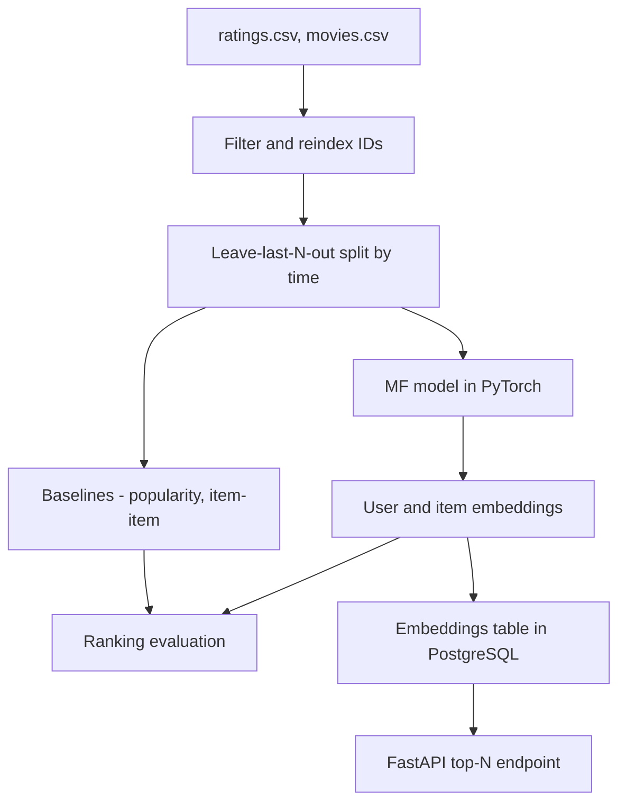
- **Reindex IDs**: map raw IDs to dense integers so embedding tables are compact.
- **MF model**: two `nn.Embedding` tables plus biases; prediction = dot product + biases.
- **Ranking evaluation**: for each test user, score all unseen movies, take top 20, check how many test movies appear.
- **Serving**: pre-compute embeddings; at request time, one matrix–vector product over all movies, then mask seen items.

### Data model
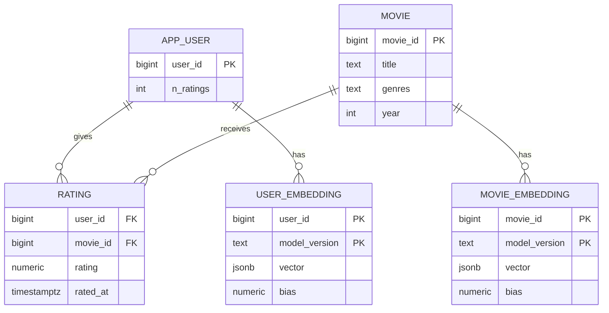

### Tech stack
| Component | Choice | Why |
|---|---|---|
| Data | polars | Fast loading of tens of millions of rows |
| Model | PyTorch embeddings | Flexible losses (MSE, BPR) |
| Alternative | an ALS implementation (if it supports Python 3.14) | Classic implicit-feedback solver |
| Storage | PostgreSQL (pgvector optional) | Persist embeddings |
| Serving | FastAPI | Top-N endpoint |

### Milestones
1. **Data and split.** *Done when* each user's last 5 ratings by time are held out and you report users, items and density.
2. **Baselines.** *Done when* popularity and item–item Recall@20 and NDCG@20 are recorded (popularity is embarrassingly strong).
3. **Explicit MF.** *Done when* RMSE beats a user+item bias-only model and you can show the effect of embedding size and weight decay.
4. **Implicit MF with BPR.** *Done when* Recall@20 beats both baselines and coverage is reported.
5. **Serve.** *Done when* the API returns 20 unseen movies for a user in under 50 ms, with a popularity fallback for unknown users.

### Deep dive: the hard parts
- **Ratings vs ranking.** A model that predicts ratings well (low RMSE) can still recommend poorly, because RMSE is dominated by movies users chose to rate. What users experience is the top of a ranked list over *all* movies — evaluate that.
- **Negative sampling.** With implicit data you only see positives. Treat random unwatched movies as negatives; sampling proportional to popularity makes negatives harder and the model better at separating popular items.
- **Popularity bias and coverage.** MF tends to recommend the same blockbusters to everyone. Track catalogue coverage and the share of long-tail items; penalise popularity or re-rank for diversity.
- **Cold start.** New users and new movies have no embeddings. Fall back to popularity for users and content similarity (Project 10) for new movies, or add genre features to the model.

### Testing strategy
- Split test: no test interaction appears in training; all test timestamps are after each user's training ones.
- Metric unit tests on tiny hand-computed rankings (Recall@k, NDCG@k).
- Seen-item filter test: no recommended movie was rated by the user in training.
- Determinism test: same seed, same embeddings.

### Trade-offs, scaling and failure modes
- Full scoring over 80,000+ movies per request is fine on CPU; over millions of items you need approximate nearest-neighbour search (Project 26).
- Embeddings drift between retrains; never mix user vectors from one version with item vectors from another.
- Offline metrics on historical data reward recommending what users found anyway; only an online test measures what recommendations change.

### Stretch goals
- Add side features (genres, year) to make a hybrid model.
- Train a two-tower model (Project 26 preview) and compare.
- Explain recommendations by nearest watched movies in embedding space.

### Skills practised
- [Ch 13 — Recommender Systems and Embeddings](../chapters/13-recommenders-and-embeddings/README.md): collaborative filtering, matrix factorisation, implicit feedback, cold start, evaluation.
- [Ch 6 — Evaluation and Tuning](../chapters/06-evaluation-and-tuning/README.md): ranking metrics (Recall@k, NDCG).
- [Ch 2 — Math for ML](../chapters/02-math-for-ml/README.md): dot products, low-rank approximation, SVD.

### In the interview
**30-second answer:** I built a MovieLens recommender with matrix factorisation in PyTorch, trained both on explicit ratings and on implicit "watched" data with BPR loss. The key decision was evaluating as ranking — Recall@20 and NDCG@20 over all unseen movies on a time-based leave-last-out split — because low RMSE does not mean good recommendations. The hardest part was beating popularity, which is embarrassingly strong offline; BPR with popularity-aware negative sampling beat it and I also report catalogue coverage. Serving is one matrix-vector product per user under 50 ms, with a popularity fallback for unknown users.

**Key terms to know:**
- **Collaborative filtering** — recommends from patterns of who interacted with what, not content.
- **Matrix factorisation** — each user and item becomes a short vector; their dot product plus biases predicts preference.
- **Embedding** — a learned dense vector (for example 64 numbers) for a user or item.
- **Explicit vs implicit feedback** — ratings vs clicks/watches.
- **Negative sampling** — treating sampled unwatched items as negatives for implicit data.
- **BPR loss** — pairwise loss that pushes a watched item's score above an unwatched one's.
- **Recall@k and NDCG@k** — share of held-out items found in the top k, and a version that rewards higher ranks.
- **Catalogue coverage / popularity bias** — how much of the catalogue gets recommended at all.
- **Cold start** — new users or items with no interactions.
- **Leave-last-N-out split** — each user's latest interactions form the test set.

**Q:** Explicit vs implicit feedback?

**A:** Explicit feedback is ratings — clear but rare and biased toward what people chose to rate. Implicit feedback is clicks or watches — abundant but only positive and noisy. Most production systems train on implicit data with sampled negatives.

**Q:** Why can popularity be a hard baseline to beat?

**A:** Because interactions are concentrated on popular items, and offline metrics reward predicting them. Personalisation must beat it on recall and also add coverage and diversity.

**Q:** How do you handle a brand-new movie?

**A:** Use content features (genres, text, cast) to produce an initial embedding or similarity, give it some exploration traffic, and switch to collaborative signals once interactions arrive.

**Q:** Why can low RMSE give bad recommendations?

**A:** RMSE is computed only on movies users chose to rate, which are mostly ones they expected to like. Users experience the top of a ranked list over all movies, including ones they never rated. A model can predict ratings well and still rank unseen items poorly.

**Q:** Why a time-based split rather than random?

**A:** A random split lets the model learn from a user's future watches to predict the past, which inflates scores. Holding out each user's last interactions mimics recommending what they watch next.

**Q:** Show the core of an MF model in PyTorch.

**A:** Two embedding tables and two bias tables.
```python
class MF(nn.Module):
    def __init__(s, nu, ni, d=64):
        super().__init__(); s.U, s.V = nn.Embedding(nu, d), nn.Embedding(ni, d)
        s.bu, s.bi = nn.Embedding(nu, 1), nn.Embedding(ni, 1)
    def forward(s, u, i):
        return (s.U(u) * s.V(i)).sum(-1) + s.bu(u).squeeze(-1) + s.bi(i).squeeze(-1)
```
Weight decay on the embeddings controls overfitting.

**Q:** What changes with millions of items?

**A:** Scoring every item per request becomes too slow, so you precompute item vectors into an approximate nearest-neighbour index and retrieve the top few hundred, then re-rank. That is the two-tower pattern in Project 26.

**Q:** What breaks when you retrain?

**A:** Embedding spaces are not aligned between training runs, so a user vector from version 3 is meaningless with item vectors from version 4. Publish user and item embeddings together under one model version and swap them atomically.

**Q:** How do you test the evaluation code?

**A:** Hand-computed Recall@k and NDCG@k on tiny rankings, a test that no test interaction appears in training, and a test that recommendations exclude movies the user already rated.

**Common mistakes in answers:**
- Reporting RMSE as the main metric for a top-N recommender.
- Forgetting to filter already-seen items, which inflates offline metrics and annoys users.
- Saying offline gains prove the model is better; only an online test measures what recommendations change.

### TL;DR
Matrix factorisation learns user and item embeddings from interactions; evaluate it as a ranking problem against a strong popularity baseline, and plan for cold start.

## 15. Retail demand forecasting

**Level:** Intermediate · **Time:** 2–3 weeks · **Prerequisites:** Ch 6, 7, 12

### What it is
A system that forecasts daily unit sales for thousands of products in many stores for the next 28 days, using calendar effects, prices, promotions and events. You compare classic **seasonal-naive** and exponential smoothing baselines with a **global gradient-boosting model** (one model trained across all products using lag features) and optionally a neural forecaster. Forecasts include **prediction intervals** (a range the true value should fall in, say, 90% of the time).

### The problem it solves
Retailers order stock weeks ahead. Too little means empty shelves and lost sales; too much means waste and tied-up cash. Forecasts at product-store level drive replenishment, and the uncertainty matters as much as the point forecast because safety stock is set from it.

### Real-world examples
- The Kaggle [M5 Forecasting — Accuracy](https://www.kaggle.com/competitions/m5-forecasting-accuracy) competition provides hierarchical daily Walmart sales for 3,049 products across 10 stores in three US states, with prices and event calendars.
- Amazon's [DeepAR](https://arxiv.org/abs/1704.04110) paper describes training one recurrent network across many related time series to produce probabilistic forecasts.

### Requirements
**Functional**
- Reshape the wide sales table into long format (item, store, date, units).
- Features: lags (7, 14, 28 days), rolling means, day of week, month, events, SNAP days, price and price change.
- Models: seasonal-naive, exponential smoothing per series, global LightGBM with Tweedie loss, optional DeepAR-style RNN.
- **Backtesting**: several forecast origins, each predicting 28 days ahead.
- Metrics: RMSE, MAE, a scaled error (for example RMSSE, error relative to a naive forecast) and interval coverage.

**Non-functional**
- Full backtest of the global model under 1 hour on a laptop with 16 GB RAM.
- Forecast file for all series written in under 10 minutes.
- No feature uses information after the forecast origin.

### The architecture
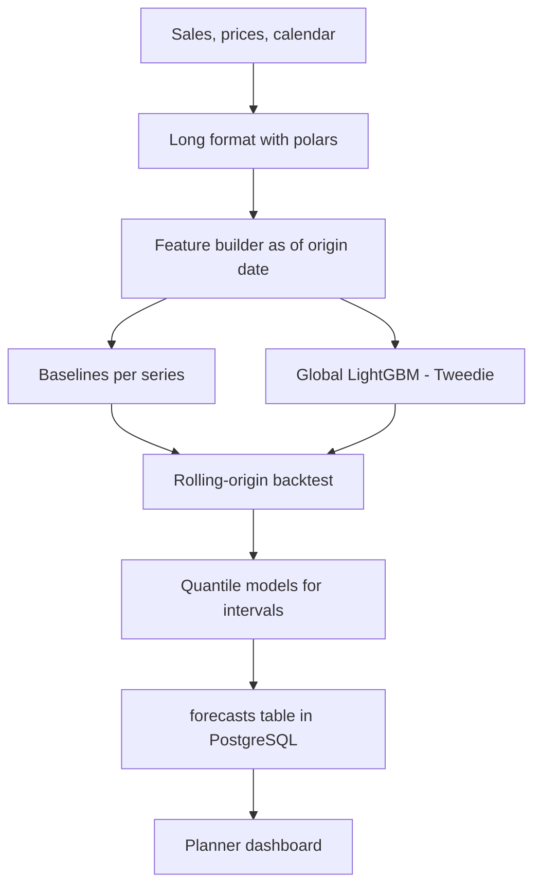
- **Feature builder as of origin**: computes every feature using only data up to the forecast origin, so backtests mimic real use.
- **Global model**: one model over all series shares strength — slow-moving items learn from similar items.
- **Tweedie loss**: suits non-negative targets with many zeros and occasional spikes.
- **Quantile models**: train for the 5th and 95th percentiles to get a 90% interval.

### Data model
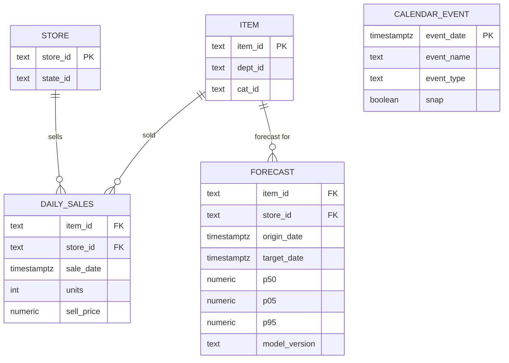

### Tech stack
| Component | Choice | Why |
|---|---|---|
| Data | polars | Tens of millions of long-format rows |
| Baselines | statsmodels (exponential smoothing) | Standard classical methods |
| Global model | LightGBM | Tweedie and quantile losses, fast |
| Neural (stretch) | PyTorch | DeepAR-style RNN |
| Storage | PostgreSQL | Forecasts by origin and version |

### Milestones
1. **Reshape and explore.** *Done when* you can show weekly seasonality, the share of zero-sales days, and an event effect.
2. **Baselines and backtest harness.** *Done when* seasonal-naive is scored on three rolling origins with RMSSE.
3. **Global model.** *Done when* LightGBM beats seasonal-naive on the backtest at store and total level.
4. **Intervals.** *Done when* 90% intervals cover between 85% and 95% of actuals in the backtest.
5. **Publish.** *Done when* forecasts for all series are written with origin date and model version, and a dashboard query shows one item's forecast vs actuals.

### Deep dive: the hard parts
- **Recursive vs direct multi-step.** Lag-7 is unknown when forecasting 14 days ahead. Either use only lags at least as long as the horizon (direct: lag-28 and above for a 28-day horizon), train one model per horizon, or feed predictions back in (recursive, which compounds errors). Pick one and be consistent between training and forecasting.
- **Intermittent demand.** Many products sell zero most days. Squared error rewards predicting tiny fractional values; Tweedie or Poisson losses and scaled metrics behave better. Report accuracy separately for fast and slow movers.
- **Backtesting correctly.** A single train/test split hides variance. Use several origins (for example the last three 28-day windows) and average. Never compute rolling features across the origin.
- **Hierarchy coherence.** Item forecasts should add up to store and state totals. Simple bottom-up summing is a start; reconciliation methods adjust levels to be consistent.

### Testing strategy
- Leakage test: for a fixed origin, recomputing features after deleting all data after the origin gives identical feature values.
- Backtest harness test on a synthetic series with known seasonality: seasonal-naive should be near perfect.
- Interval test: quantile 5 ≤ median ≤ quantile 95 for every row.
- Volume test: the forecast table has exactly series × horizon rows per origin.

### Trade-offs, scaling and failure modes
- Per-series models are interpretable but need history; global models share information and scale better.
- Promotions and stock-outs distort history: zero sales during a stock-out is not zero demand. Flag or impute those days.
- Structural breaks (a pandemic, a new competitor) invalidate history. Monitor forecast error weekly and retrain.

### Stretch goals
- DeepAR-style probabilistic RNN and comparison with LightGBM quantiles.
- Hierarchical reconciliation.
- A replenishment simulation that turns forecasts into order quantities and measures stock-outs vs waste.

### Skills practised
- [Ch 12 — Sequences, RNNs and Attention](../chapters/12-sequences-rnns-and-attention/README.md): time-series forecasting, lags, sequence models.
- [Ch 7 — Decision Trees and Ensembles](../chapters/07-trees-and-ensembles/README.md): gradient boosting with custom losses.
- [Ch 6 — Evaluation and Tuning](../chapters/06-evaluation-and-tuning/README.md): time-aware validation, scaled metrics.

### In the interview
**30-second answer:** I built a 28-day daily sales forecaster for M5 Walmart data — about 30,000 item-store series — comparing seasonal-naive and exponential smoothing with one global LightGBM model using Tweedie loss. The key decision was a single global model with direct-horizon lags (28 days and longer), so training and forecasting use exactly the same features and slow sellers borrow strength from similar items. The hardest part was backtesting honestly: every feature is computed as of each forecast origin, and a test deletes post-origin data to prove it. Quantile models give 90% intervals that covered close to 90% of actuals in the backtest.

**Key terms to know:**
- **Forecast origin and horizon** — the last date you know, and how many days ahead you predict (28).
- **Rolling-origin backtesting** — train to a date, forecast, score, move the origin forward, repeat.
- **Lag and rolling features** — past sales such as 28 days ago or a 7-day mean ending at the origin.
- **Direct vs recursive multi-step** — use only lags at least as long as the horizon, or feed predictions back in.
- **Global model** — one model across all series, with item and store as features.
- **Tweedie / Poisson loss** — suits non-negative, zero-heavy, spiky counts.
- **Intermittent demand** — products that sell zero on most days.
- **Seasonal-naive baseline** — repeat the same weekday last week.
- **RMSSE** — error scaled by a naive forecast's error, so series of different sizes are comparable.
- **Prediction interval and coverage** — the 5th–95th percentile range, and how often actuals fall inside it.

**Q:** How do you validate a forecasting model?

**A:** Rolling-origin backtesting: repeatedly train up to a date, forecast the horizon, score, move the origin forward. All features must be computed as of each origin.

**Q:** Why one global model rather than one per product?

**A:** It shares patterns across series, handles short or sparse histories, and is one artefact to maintain. Per-series models can still win for a few long, stable, high-volume series.

**Q:** What loss for sparse count demand?

**A:** Poisson or Tweedie, which fit non-negative skewed data with many zeros, plus quantile losses when you need intervals for safety stock.

**Q:** Lag-7 is a great feature. Why can you not use it for day 20 of the forecast?

**A:** On day 20 the sales from 7 days earlier are in the future and unknown. Either restrict to lags of 28 days or more (direct), train one model per horizon, or feed your own predictions back in (recursive), which compounds errors. Training must mirror whichever you choose.

**Q:** Why are scaled metrics like RMSSE needed?

**A:** Plain RMSE is dominated by high-volume items, and a slow seller with an error of 2 units may be a terrible forecast or a fine one. Dividing by the error of a naive forecast on the same series makes errors comparable and tells you whether you beat the naive method.

**Q:** How do you get prediction intervals, and how do you check them?

**A:** Train LightGBM with quantile loss at 0.05 and 0.95. In the backtest, about 90% of actuals should fall inside; I accept 85–95%. Also assert quantiles do not cross (p05 ≤ p50 ≤ p95).

**Q:** A product shows zero sales for a week. Is demand zero?

**A:** Not necessarily: it may have been out of stock. Training on stock-out zeros teaches the model to under-forecast. Flag those days, exclude or impute them, which is why stock data matters.

**Q:** Store forecasts do not equal the sum of item forecasts. Does it matter?

**A:** Yes, planners at different levels must agree. Bottom-up summing makes them coherent; reconciliation methods adjust all levels together and are often more accurate at the top.

**Q:** What breaks first in production?

**A:** Structural breaks — a new competitor, a pandemic, a price change — make history misleading. Monitor weekly error against the naive baseline and retrain on a schedule. Data volume is the other limit: lag features over millions of series need polars or a warehouse, not pandas.

**Common mistakes in answers:**
- Computing rolling means across the forecast origin, which leaks the future into the backtest.
- Using squared error on intermittent demand and celebrating tiny fractional predictions.
- Reporting one train/test split instead of several origins.

### TL;DR
Demand forecasting is backtesting discipline: features as of each origin, a seasonal-naive bar to beat, count-aware losses, and intervals that actually cover.

## 16. Metric anomaly detection

**Level:** Intermediate · **Time:** 2 weeks · **Prerequisites:** Ch 9, 12

### What it is
A service that watches streams of operational metrics (CPU usage, request latency, sales per minute) and raises an alert when a value is **anomalous** — unusual given recent history and the usual daily or weekly pattern. You implement and compare three families: statistical (rolling z-score and seasonal residuals), tree-based **isolation forest** (which isolates points with random splits; anomalies are isolated in fewer splits), and a forecasting approach (alert when the actual value falls far outside the predicted interval).

### The problem it solves
Teams have thousands of metrics and cannot set a hand-tuned threshold for each. Static thresholds also fail on seasonal metrics (low traffic at 3 am is normal; the same value at noon is an outage). Learned detectors flag what is unusual for *this* metric at *this* time, reducing both missed incidents and alert fatigue.

### Real-world examples
- The [Numenta Anomaly Benchmark](https://github.com/numenta/NAB) provides 58 labelled real and artificial time series (server metrics, traffic, tweets volume) with a scoring method that rewards early detection; its design is explained in [Lavin and Ahmad, 2015](https://arxiv.org/abs/1510.03336).
- scikit-learn's [IsolationForest](https://scikit-learn.org/stable/modules/generated/sklearn.ensemble.IsolationForest.html) documents the algorithm and its contamination parameter.

### Requirements
**Functional**
- Ingest NAB series and replay them as a stream, point by point.
- Detectors: rolling z-score, seasonal decomposition residual (STL), isolation forest on windowed features, forecast-interval detector.
- Each detector outputs an anomaly score per point; a threshold converts it to alerts.
- Alert deduplication: one alert per incident, not one per point.
- Evaluate with NAB-style windows: precision, recall and detection delay.

**Non-functional**
- Process 10,000 metrics at one point per minute each on one machine (about 170 points per second).
- Detection decision under 100 ms per point.
- Detector state per metric under 100 KB.

### The architecture
```mermaid
flowchart TD
    A["Metric stream - replayed NAB"] --> B["Per-metric window state"]
    B --> C["Feature extraction - level, slope, seasonal residual"]
    C --> D["Detectors - zscore, STL, iForest, forecast"]
    D --> E["Score combiner and threshold"]
    E --> F["Alert dedup and cooldown"]
    F --> G["alerts table in PostgreSQL"]
    G --> H["Labelling UI - true or false alarm"]
    H --> I["Threshold retuning"]
```
- **Window state**: a ring buffer of the last N points per metric plus running statistics.
- **Detectors**: run in parallel; each is a small class with `update(value)` and `score()`.
- **Combiner**: start with "max of normalised scores"; later learn weights from labelled alerts.
- **Dedup and cooldown**: once an alert fires, suppress further alerts for the same metric for a cooldown period.
- **Labelling UI**: operators mark alerts as real or noise, giving labels for tuning.

### Data model
```mermaid
erDiagram
    METRIC {
        text metric_id PK
        text source
        text unit
        int seasonality_minutes
    }
    POINT {
        text metric_id FK
        timestamptz ts
        numeric value
    }
    ANOMALY_SCORE {
        text metric_id FK
        timestamptz ts
        text detector
        numeric score
    }
    ALERT {
        bigint alert_id PK
        text metric_id FK
        timestamptz started_at
        timestamptz ended_at
        numeric max_score
        text status
    }
    ALERT_LABEL {
        bigint alert_id PK
        boolean is_real
        text labelled_by
    }
    METRIC ||--o{ POINT : "has"
    METRIC ||--o{ ALERT : "raises"
    ALERT ||--o| ALERT_LABEL : "reviewed"
```

### Tech stack
| Component | Choice | Why |
|---|---|---|
| Stream replay | Python generator or Kafka (stretch) | Simulate real-time arrival |
| Statistics | numpy, statsmodels STL | Seasonal decomposition |
| ML detector | scikit-learn IsolationForest | Unsupervised, fast |
| Storage | PostgreSQL | Alerts and labels |
| UI | FastAPI + simple HTML | Review alerts |

### Milestones
1. **Replay and baseline.** *Done when* a rolling z-score detector runs over all NAB series and you have precision and recall at a chosen threshold.
2. **Seasonality.** *Done when* an STL-residual detector reduces false positives on clearly seasonal series and you can show one example.
3. **Isolation forest.** *Done when* windowed features feed an isolation forest retrained periodically per metric, and its scores are compared.
4. **Alerting logic.** *Done when* dedup and cooldown turn point scores into incident alerts and the alert count per series is sensible.
5. **Feedback loop.** *Done when* labels from the UI are used to retune per-metric thresholds and precision improves.

### Deep dive: the hard parts
- **No labels, or few.** Real anomalies are rare and unlabelled. Use NAB labels for development, then rely on operator feedback in production. Choose thresholds per metric by a target alert budget (for example, at most one alert per metric per week) when labels are missing.
- **Contamination of the baseline.** If the training window includes an incident, the detector learns the incident as normal. Use robust statistics (median and MAD, median absolute deviation) and exclude flagged periods from refits.
- **Concept drift vs anomaly.** A permanent level shift after a deployment is an anomaly at first and the new normal afterwards. Let the detector adapt after a configurable time, and record the change as an annotation.
- **Point vs contextual vs collective anomalies.** A single spike, a normal value at the wrong time, and a run of slightly odd values need different detectors. This is why you combine several.

### Testing strategy
- Synthetic tests: inject spikes, level shifts and variance changes into clean seasonal series; assert each detector catches its target type.
- Cold-start test: detectors behave (no alerts) until enough history exists.
- Replay determinism: replaying the same series twice gives identical alerts.
- Load test: 10,000 metrics at the target rate with latency measured.

### Trade-offs, scaling and failure modes
- Simple statistical detectors are cheap, explainable and often competitive; ML detectors catch subtler patterns but are harder to explain to an on-call engineer at 3 am.
- Alert fatigue is the main failure mode: too many false alarms and people ignore all alerts. Optimise precision at an acceptable recall.
- Correlated metrics fire together during one incident. Group alerts by service or dependency graph.

### Stretch goals
- Multivariate detection: an autoencoder over related metrics, alerting on reconstruction error.
- Root-cause hints: rank which metrics moved first.
- Real streaming with Kafka and a consumer group per metric shard.

### Skills practised
- [Ch 9 — Unsupervised Learning](../chapters/09-unsupervised-learning/README.md): anomaly detection, isolation forest, evaluation without labels.
- [Ch 12 — Sequences, RNNs and Attention](../chapters/12-sequences-rnns-and-attention/README.md): time-series features and forecasting.
- [Ch 16 — ML in Production](../chapters/16-ml-in-production/README.md): monitoring, alerting, feedback loops.

### In the interview
**30-second answer:** I built a streaming anomaly detector that replays the Numenta benchmark point by point and runs four detectors per metric: rolling z-score, STL seasonal residual, isolation forest on windowed features, and a forecast-interval check. The key design decision was scoring residuals against what is normal for this metric at this time of day, which cut false alarms on seasonal series. The hardest problem was alert fatigue, so point scores go through deduplication and a cooldown to become one alert per incident, and thresholds are set per metric from an alert budget and operator labels. It handles 10,000 metrics at one point a minute on one machine with per-point decisions well under 100 ms.

**Key terms to know:**
- **Point, contextual and collective anomalies** — a single spike, a normal value at the wrong time, and a run of slightly odd values.
- **Rolling z-score** — how many standard deviations a value is from a recent mean.
- **STL decomposition** — splits a series into trend, seasonal and residual parts; anomalies are scored on the residual.
- **Robust statistics (median, MAD)** — location and spread that an incident in the window does not drag around.
- **Isolation forest** — random trees isolate rare points in few splits; short average path length means anomalous.
- **Forecast-interval detector** — alert when the actual value falls outside the predicted interval.
- **Alert deduplication and cooldown** — one alert per incident, then suppression for a while.
- **Alert budget** — a target number of alerts per metric per period, used to set thresholds without labels.
- **Detection delay** — time between the start of an anomaly and the alert; NAB scoring rewards early detection.
- **Concept drift / level shift** — a lasting change that is anomalous at first and normal later.

**Q:** How do you detect anomalies in a seasonal metric?

**A:** Remove the expected seasonal pattern (decomposition or a forecast) and score the residual, so a value is compared with what is normal for that time. Low traffic at 3 am is then fine, while the same value at noon fires.

**Q:** How do you choose a threshold without labels?

**A:** From an alert budget per metric, robust statistics on the residual distribution, and operator feedback over time.

**Q:** How does isolation forest work?

**A:** It builds random trees with random splits. Anomalies are few and different, so they get isolated near the root; the average path length becomes the anomaly score.

**Q:** Why median and MAD rather than mean and standard deviation?

**A:** If the history window contains an incident, a huge spike inflates the mean and standard deviation, so the next incident looks normal. The median and median absolute deviation barely move, so the baseline stays honest. I also exclude flagged periods from refits.

**Q:** A deployment permanently doubles latency. What should the detector do?

**A:** Alert at first, because it is an anomaly. If nobody rolls it back, the detector should adapt after a configurable period and treat the new level as normal, recording an annotation so the change is not forgotten.

**Q:** How do you evaluate without many labels?

**A:** Use NAB's labelled windows for development: precision, recall and detection delay per incident, not per point. In production, operators label alerts as real or noise, which gives precision directly; recall needs incident reports from other sources.

**Q:** How do you test the detectors?

**A:** Inject synthetic spikes, level shifts and variance changes into clean seasonal series and assert each detector catches its target type. A cold-start test checks no alerts before enough history, and a replay test checks the same input gives identical alerts.

**Q:** What breaks first at 1 million metrics?

**A:** Memory for per-metric state and CPU for isolation forests. Shard metrics across workers by ID (Kafka partitions), keep cheap detectors on everything and expensive ones on important metrics, and group correlated alerts by service so one incident does not page fifty times.

**Q:** Why combine several detectors instead of picking the best?

**A:** Each catches a different anomaly type: z-score catches spikes, STL catches contextual ones, isolation forest catches odd combinations of window features. A simple max of normalised scores is a robust start; labelled alerts later let you learn weights.

**Common mistakes in answers:**
- Measuring per-point accuracy; operators care about incidents caught, delay and false alarms.
- Using a static threshold on a seasonal metric.
- Training the baseline on a window that contains the incident, then wondering why it is missed.

### TL;DR
Score residuals against what is normal for this metric at this time, combine simple detectors, and judge success by alert precision and detection delay.

## 17. A/B test analysis toolkit

**Level:** Intermediate · **Time:** 2 weeks · **Prerequisites:** Ch 2, 16

### What it is
A small library and report generator that analyses **A/B tests** (randomised controlled experiments where users are split between a control and a new variant). It computes the effect on key metrics with confidence intervals, checks experiment health, applies **CUPED** (a variance-reduction method that adjusts each user's metric using their pre-experiment behaviour) and produces a one-page decision report.

### The problem it solves
Most ML models are launched through an A/B test, because offline metrics do not guarantee online impact. Analysing tests badly — peeking every day, ignoring a broken randomisation, testing twenty metrics and celebrating the one that moved — leads to shipping changes that do nothing or harm. A toolkit makes the correct analysis the easy default.

### Real-world examples
- Deng, Xu, Kohavi and Walker's paper [Improving the Sensitivity of Online Controlled Experiments by Utilizing Pre-Experiment Data](https://exp-platform.com/Documents/2013-02-CUPED-ImprovingSensitivityOfControlledExperiments.pdf) (WSDM 2013) introduced CUPED at Microsoft Bing.
- [statsmodels](https://www.statsmodels.org/stable/index.html) provides the t-tests, proportion tests and power calculations you will build on.

### Requirements
**Functional**
- Inputs: an assignment table (user, variant, timestamp) and a metrics table (user, metric values, pre-period values).
- Health checks: **sample ratio mismatch** (SRM — the observed split differs from the planned one more than chance allows), pre-period balance.
- Effects: difference in means and relative lift with 95% confidence intervals, for means and proportions; delta method for ratio metrics (for example clicks per session).
- CUPED adjustment and the resulting variance reduction.
- Power and sample-size calculator.
- Multiple-testing correction across secondary metrics.
- HTML report: decision summary, guardrail metrics, charts.

**Non-functional**
- Analyse 10 million users × 20 metrics in under 2 minutes.
- Every number reproducible from SQL inputs.
- Validated by simulation: false-positive rate close to 5% on A/A tests.

### The architecture
```mermaid
flowchart TD
    A["Assignment log"] --> C["Join and aggregate per user in PostgreSQL"]
    B["Event and metric tables"] --> C
    C --> D["Health checks - SRM, balance"]
    D --> E["Effect estimation - t-test, delta method"]
    E --> F["CUPED variance reduction"]
    F --> G["Multiple-testing correction"]
    G --> H["HTML decision report"]
    I["Simulation harness - A/A and synthetic effects"] --> E
```
- **Per-user aggregation**: the unit of analysis must match the unit of randomisation (users), otherwise sessions from the same user are wrongly treated as independent.
- **Health checks**: an SRM failure means the result cannot be trusted, whatever the p-value.
- **CUPED**: subtract θ × (pre-period metric − its mean) from each user's metric, with θ estimated by regression. The mean effect is unchanged; the variance shrinks.
- **Simulation harness**: runs thousands of fake experiments to prove the false-positive rate and power are what the theory says.

### Data model
```mermaid
erDiagram
    EXPERIMENT {
        text experiment_id PK
        text hypothesis
        numeric planned_split
        timestamptz started_at
        timestamptz ended_at
        text primary_metric
    }
    ASSIGNMENT {
        text experiment_id FK
        bigint user_id
        text variant
        timestamptz assigned_at
    }
    USER_METRIC {
        text experiment_id FK
        bigint user_id
        text metric
        numeric value
        numeric pre_value
    }
    RESULT {
        text experiment_id FK
        text metric
        numeric lift
        numeric ci_low
        numeric ci_high
        numeric p_value
    }
    EXPERIMENT ||--o{ ASSIGNMENT : "assigns"
    EXPERIMENT ||--o{ USER_METRIC : "measures"
    EXPERIMENT ||--o{ RESULT : "produces"
```

### Tech stack
| Component | Choice | Why |
|---|---|---|
| Aggregation | PostgreSQL SQL | Close to the data, auditable |
| Stats | numpy, scipy, statsmodels | Tests, power, corrections |
| Data frames | polars | Fast per-user tables |
| Report | Jinja2 HTML + matplotlib | Shareable output |

### Milestones
1. **Synthetic data generator.** *Done when* you can create experiments with known true effect, metric skew and pre-period correlation.
2. **Core estimates.** *Done when* difference in means with confidence intervals matches statsmodels on test data, and A/A simulations show about 5% false positives.
3. **Health checks.** *Done when* an injected 50.5/49.5 split on a million users fails the SRM check.
4. **CUPED and ratio metrics.** *Done when* CUPED shows variance reduction on correlated data and delta-method intervals have correct coverage in simulation.
5. **Report.** *Done when* one command turns two tables into an HTML report with a clear ship / do not ship / inconclusive verdict.

### Deep dive: the hard parts
- **Peeking.** Checking significance daily and stopping when p < 0.05 inflates false positives far above 5%. Fix the sample size in advance with a power calculation, or use a sequential method designed for continuous monitoring. Demonstrate the inflation with your simulator.
- **Ratio metrics.** Click-through rate per session has a random denominator, and sessions from one user are correlated. The delta method gives a correct variance for ratios of per-user sums; naive per-session t-tests are over-confident.
- **SRM.** A chi-square test on assignment counts. Causes include bots filtered in one arm, crashes in the new variant, or redirect delays. When SRM fails, debug instead of analysing.
- **Novelty and network effects.** Users may click a new feature because it is new; effects fade. In social products, treated users influence control users, biasing results; cluster randomisation helps.

### Testing strategy
- Simulation tests are the core: A/A false-positive rate within 4–6% over 2,000 runs; power matches the calculator for a planted effect.
- Unit tests against known textbook examples for each test.
- CUPED unbiasedness: average estimated effect equals planted effect over many simulations.
- SQL tests: per-user aggregation on a small fixture.

### Trade-offs, scaling and failure modes
- Bigger samples detect smaller effects but take longer; CUPED often gives a sizeable variance cut when pre-period behaviour predicts the metric well, which shortens tests.
- Too many metrics without correction guarantees false discoveries. Name one primary metric up front; treat others as guardrails or exploratory.
- Statistically significant is not practically significant. Report effect size and confidence interval against a minimum worthwhile effect.

### Stretch goals
- Sequential testing (always-valid confidence intervals) with a simulation proving the error rate.
- Bayesian analysis with a prior and posterior probability of improvement.
- Heterogeneous effects by segment, with a warning about multiple comparisons.

### Skills practised
- [Ch 2 — Math for ML](../chapters/02-math-for-ml/README.md): hypothesis tests, confidence intervals, variance.
- [Ch 16 — ML in Production](../chapters/16-ml-in-production/README.md): online experiments, guardrails, launch decisions.
- [Ch 15 — ML System Design Framework](../chapters/15-ml-system-design-framework/README.md): offline vs online metrics.

### In the interview
**30-second answer:** I built an A/B test analysis toolkit that turns an assignment table and a metrics table into a one-page ship / do-not-ship / inconclusive report. The key design decision was "health before effects": a chi-square sample-ratio-mismatch check runs first, and a failure blocks the analysis. The hardest part was trusting the statistics, so I built a simulator: A/A tests give about 5% false positives over 2,000 runs, CUPED stays unbiased while shrinking variance, and delta-method intervals for ratio metrics have the right coverage. It analyses 10 million users across 20 metrics in under 2 minutes.

**Key terms to know:**
- **A/B test (randomised controlled experiment)** — users randomly split between control and variant, so differences are caused by the change.
- **Unit of randomisation / analysis** — users here; per-session analysis would treat correlated sessions as independent.
- **Confidence interval and p-value** — the range of plausible effects, and how surprising the data would be with no effect.
- **Statistical power and minimum detectable effect** — the chance of detecting a true effect of a given size; drives sample size.
- **Sample ratio mismatch (SRM)** — observed split differs from planned beyond chance; signals a bug.
- **CUPED** — subtract θ × (pre-period metric − its mean) to remove predictable variance.
- **Delta method** — correct variance for ratio metrics like clicks per session.
- **Peeking** — repeated significance checks that inflate false positives.
- **Multiple-testing correction** — adjust p-values when testing many metrics (Bonferroni, Benjamini–Hochberg).
- **Guardrail metric** — must not get worse, such as latency or unsubscribes.

**Q:** What is sample ratio mismatch and why does it matter?

**A:** The observed split between arms differs from the designed split beyond chance. It signals a bug in assignment or logging, which can bias every metric, so the test should not be trusted until fixed.

**Q:** How does CUPED reduce variance?

**A:** It regresses the metric on a pre-experiment covariate and removes the part explained by it. Randomisation keeps the covariate balanced, so the effect estimate is unbiased, but the leftover noise is smaller. Variance falls by a factor of about 1 − ρ², where ρ is the correlation with the pre-period metric.

**Q:** Why not stop the test as soon as it's significant?

**A:** Repeated looks inflate the false-positive rate. Pre-commit to a sample size or use sequential methods designed for continuous monitoring. My simulator shows daily peeking pushing false positives well above 5%.

**Q:** How do you compute the sample size?

**A:** Pick significance (5%), power (usually 80%), the metric's variance and the minimum effect worth detecting. Required users per arm grow with variance and with 1 / effect², so halving the detectable effect needs about four times as many users. `statsmodels` has power functions that do this.

**Q:** Why the delta method for click-through rate per session?

**A:** Both numerator and denominator are random, and sessions from one user are correlated. Treating sessions as independent rows understates variance and gives too many "significant" results. The delta method computes the variance of a ratio of per-user sums correctly.

**Q:** You tested 20 metrics and one moved with p = 0.03. Ship?

**A:** Not on that alone. With 20 metrics at 5% you expect about one false positive by chance. Name one primary metric up front, correct secondary metrics for multiple testing, and treat a lone secondary win as a hypothesis for the next test.

**Q:** The effect is significant but tiny. What do you report?

**A:** The effect size and its confidence interval against the minimum worthwhile effect. Statistically significant is not practically significant; a 0.01% lift may not pay for the extra complexity.

**Q:** How do you prove the toolkit is correct?

**A:** Simulation: thousands of A/A tests must give about 5% false positives, planted effects must be detected at the power the calculator predicts, and CUPED's average estimate must equal the planted effect. Plus unit tests against textbook examples.

**Q:** What goes wrong in social products?

**A:** Network effects: treated users influence control users, so the difference is biased toward zero. Randomising by clusters of connected users, or by region, reduces interference at the cost of fewer units.

**Common mistakes in answers:**
- Saying CUPED changes the effect estimate; it keeps the expected effect the same and reduces variance.
- Analysing per session when users were randomised.
- Ignoring an SRM failure because the p-value "looks good".

### TL;DR
Check health before effects, analyse at the randomisation unit, use CUPED and the delta method, never peek naively — and prove all of it with simulations.

## 18. Semantic document search

**Level:** Intermediate · **Time:** 2 weeks · **Prerequisites:** Ch 12, 13

### What it is
A search engine that finds documents by meaning rather than exact words. Each document chunk is turned into an **embedding** by a pre-trained sentence-embedding model; a query is embedded the same way, and the nearest chunks by cosine similarity are returned. You combine this **dense retrieval** with classic keyword search (**BM25**, a ranking formula based on term frequency and rarity) in a **hybrid** system and measure the gain with standard IR metrics.

### The problem it solves
Keyword search fails when users and documents use different words ("cancel subscription" vs "terminate membership"). Embeddings match synonyms and paraphrases. But dense retrieval misses exact identifiers (error codes, product names) that keyword search nails — hence hybrid search. This is also the retrieval half of question-answering systems (Project 38).

### Real-world examples
- [Sentence-BERT](https://arxiv.org/abs/1908.10084) introduced siamese fine-tuning so that cosine similarity of sentence embeddings reflects semantic similarity.
- The [BEIR benchmark](https://arxiv.org/abs/2104.08663) evaluates retrieval models across many domains and shows that BM25 remains a strong zero-shot baseline.
- [pgvector](https://github.com/pgvector/pgvector) adds vector columns and approximate nearest-neighbour indexes (HNSW, IVFFlat) to PostgreSQL; [FAISS](https://github.com/facebookresearch/faiss) is a dedicated similarity-search library.

### Requirements
**Functional**
- Ingest a document collection (a BEIR dataset such as SciFact or FiQA, which come with queries and relevance labels).
- Chunk documents (for example 200–300 words with overlap), embed with a sentence-transformer model.
- Index in PostgreSQL with pgvector (HNSW) and with full-text search for BM25-style ranking.
- Hybrid fusion with **reciprocal rank fusion** (RRF: sum of 1/(k + rank) across result lists).
- Metrics: Recall@10, nDCG@10, MRR (mean reciprocal rank of the first relevant hit).
- `GET /search?q=` returning ranked chunks with highlights.

**Non-functional**
- p95 query latency under 100 ms for 1 million chunks (ANN index, CPU).
- Re-indexing 100,000 chunks under 30 minutes on CPU (faster with GPU).
- Recall of the ANN index at least 95% of exact search.

### The architecture
```mermaid
flowchart TD
    A["Documents"] --> B["Chunker"]
    B --> C["Embedding model - batch"]
    C --> D["PostgreSQL - pgvector HNSW"]
    B --> E["PostgreSQL full-text index"]
    F["Query"] --> G["Embed query"]
    G --> D
    F --> E
    D --> H["Reciprocal rank fusion"]
    E --> H
    H --> I["Optional cross-encoder rerank"]
    I --> J["Results API"]
```
- **Chunker**: long documents are split so each vector represents one idea; overlap avoids cutting a key sentence in half.
- **HNSW index**: a graph-based approximate nearest-neighbour index — fast, with a recall vs speed knob (`ef_search`).
- **Full-text index**: PostgreSQL `tsvector` with ranking, standing in for BM25.
- **Fusion**: RRF needs no score calibration between the two systems.
- **Cross-encoder rerank** (stretch): a model that reads query and chunk together for a more accurate score on the top 50.

### Data model
```mermaid
erDiagram
    DOCUMENT {
        bigint doc_id PK
        text title
        text source
        timestamptz ingested_at
    }
    CHUNK {
        bigint chunk_id PK
        bigint doc_id FK
        int position
        text body
        text embedding_model
    }
    CHUNK_VECTOR {
        bigint chunk_id PK
        text embedding
    }
    QUERY_LOG {
        bigint query_id PK
        text query_text
        timestamptz ts
        jsonb result_ids
        bigint clicked_chunk_id
    }
    DOCUMENT ||--o{ CHUNK : "split into"
    CHUNK ||--|| CHUNK_VECTOR : "embedded as"
```
(In SQL the `embedding` column has type `vector(384)` from pgvector; the diagram shows it as text only because diagram types must be single words.)

### Tech stack
| Component | Choice | Why |
|---|---|---|
| Embeddings | sentence-transformers model on PyTorch | Strong general-purpose embeddings |
| Vector index | PostgreSQL + pgvector (HNSW) | One database for text, vectors, metadata |
| Keyword search | PostgreSQL full-text search | No extra service |
| Alternative index | FAISS | Benchmark against pgvector |
| API | FastAPI | Search endpoint |

### Milestones
1. **Keyword baseline.** *Done when* full-text search over a BEIR dataset reports nDCG@10 and Recall@10.
2. **Dense retrieval.** *Done when* embedding search (exact, brute force) is scored on the same queries.
3. **ANN index.** *Done when* HNSW recall vs exact search and latency at several `ef_search` settings are plotted.
4. **Hybrid.** *Done when* RRF fusion is scored and beats (or ties) the better single method; note which query types each wins.
5. **API and logging.** *Done when* the endpoint returns highlighted results and logs queries and clicks.

### Deep dive: the hard parts
- **Chunking decides quality.** Too large and a vector blurs several topics; too small and context is lost. Evaluate 2–3 chunk sizes on the benchmark rather than guessing.
- **Domain mismatch.** General embedding models may do poorly on legal or medical text, sometimes below BM25 — BEIR shows this pattern across domains. Hybrid search is the safety net; domain fine-tuning with query–document pairs is the upgrade.
- **ANN trade-offs.** HNSW gives high recall at low latency but uses memory and builds slowly; IVFFlat builds faster with lower recall. Filtering (for example by document type) interacts with ANN: filtering after search can return too few results.
- **Evaluation without labels in production.** Use clicks and dwell time as weak labels, but beware position bias — users click what is on top.

### Testing strategy
- Metric unit tests on hand-built rankings.
- Index parity: for 100 random queries, ANN top-10 overlaps exact top-10 by at least 95%.
- Re-embedding test: the stored `embedding_model` matches the model used for queries (mixing models silently breaks search).
- Latency test at 1 million chunks.

### Trade-offs, scaling and failure modes
- pgvector keeps everything in one database — simple operations, transactional updates. Dedicated vector databases scale further and offer more index types.
- Changing the embedding model requires re-embedding everything; version vectors by model.
- Dense search can return confident nonsense for out-of-domain queries; show scores and a "no good match" threshold.

### Stretch goals
- Cross-encoder reranking of the top 50.
- Fine-tune the embedding model on in-domain pairs.
- Multilingual search with a multilingual embedding model.

### Skills practised
- [Ch 12 — Sequences, RNNs and Attention](../chapters/12-sequences-rnns-and-attention/README.md): transformers, embeddings.
- [Ch 13 — Recommender Systems and Embeddings](../chapters/13-recommenders-and-embeddings/README.md): embedding similarity, ANN search.
- [Ch 6 — Evaluation and Tuning](../chapters/06-evaluation-and-tuning/README.md): ranking metrics (nDCG, MRR, Recall@k).
- [Ch 17 — ML Case Studies I](../chapters/17-ml-case-studies-1/README.md): hybrid lexical and semantic retrieval in search design.

### In the interview
**30-second answer:** I built a hybrid semantic search engine over a BEIR dataset: documents are chunked, embedded with a sentence-transformer and indexed with pgvector HNSW, alongside PostgreSQL full-text search, and the two result lists are merged with reciprocal rank fusion. The key decision was hybrid rather than dense-only, because embeddings miss exact identifiers and can fall below BM25 out of domain, and RRF needs no score calibration. The hardest part was chunking and ANN tuning: I compared chunk sizes on nDCG@10 and tuned `ef_search` until the index kept at least 95% of exact-search recall. p95 latency is under 100 ms at a million chunks.

**Key terms to know:**
- **Dense retrieval** — embed query and documents, return nearest vectors by cosine similarity.
- **Sparse / lexical retrieval (BM25)** — ranks by term frequency and rarity; exact word matching.
- **Hybrid search and reciprocal rank fusion** — merge lists by summing 1/(k + rank), no score scaling needed.
- **Chunking** — splitting documents into passages (200–300 words with overlap) so each vector is one idea.
- **Approximate nearest neighbour (ANN), HNSW, IVFFlat** — indexes that search a fraction of vectors; HNSW is a layered graph, IVFFlat clusters vectors into lists.
- **`ef_search`** — HNSW's candidate-list size; higher means better recall and slower queries.
- **Bi-encoder vs cross-encoder** — embed query and document separately (fast) vs read them together (accurate, slow, for reranking).
- **nDCG@10, Recall@10, MRR** — graded ranking quality, share of relevant items found, and reciprocal rank of the first hit.
- **Position bias** — users click top results regardless of relevance, so clicks are biased labels.
- **Embedding model versioning** — query and document vectors must come from the same model.

**Q:** Dense vs sparse retrieval?

**A:** Sparse (BM25) matches exact terms — great for names and codes, robust out of domain. Dense matches meaning — great for paraphrase. Hybrid fusion usually beats both.

**Q:** How does HNSW trade recall for speed?

**A:** It searches a layered proximity graph greedily; the size of the candidate list during search (`ef_search`) controls how much of the graph is explored. Bigger is slower but more accurate.

**Q:** How would you evaluate search quality?

**A:** Offline with labelled query–document relevance (nDCG, Recall@k), online with click-through, reformulation rate and success rate, correcting for position bias.

**Q:** Why RRF rather than adding the two scores?

**A:** BM25 scores and cosine similarities live on different, query-dependent scales, so a weighted sum needs calibration that breaks across queries. RRF uses only ranks, so it is robust and has one parameter (k, often 60).

**Q:** Show a pgvector nearest-neighbour query.

**A:** `<=>` is cosine distance, so ascending order means most similar.
```sql
CREATE INDEX ON chunk_vector USING hnsw (embedding vector_cosine_ops);
SET hnsw.ef_search = 100;
SELECT chunk_id FROM chunk_vector
ORDER BY embedding <=> $1 LIMIT 10;
```

**Q:** What happens if you change the embedding model?

**A:** Old document vectors and new query vectors live in different spaces, so results become garbage without any error. Store the model name with each vector, re-embed the whole corpus into a new index, and switch queries over atomically.

**Q:** How do filters interact with ANN?

**A:** If you search the top 10 and then filter by document type, you may get two results. Over-fetch then filter, or use an index that applies filters during the graph search; pgvector's iterative scans help with this.

**Q:** What changes at 100 million chunks?

**A:** HNSW memory becomes the limit — it wants the graph in RAM. Options are a dedicated vector database or FAISS with compression (product quantisation), sharding by collection, and accepting slower builds. Embedding the corpus becomes a batch GPU job.

**Q:** A query returns confident results that are irrelevant. Why?

**A:** Dense search always returns nearest neighbours, even when nothing is relevant (out-of-domain queries). Show scores, apply a "no good match" threshold, and lean on BM25 for identifiers.

**Common mistakes in answers:**
- Claiming dense retrieval always beats BM25; on many BEIR domains BM25 is competitive or better.
- Forgetting that ANN loses recall and never measuring it against exact search.
- Adding raw BM25 and cosine scores together without calibration.

### TL;DR
Embed chunks, index them with an ANN index, fuse with keyword search, and measure with nDCG on labelled queries — chunking and hybrid fusion matter more than the model.

## 19. Pedestrian detector by fine-tuning

**Level:** Intermediate · **Time:** 2–3 weeks · **Prerequisites:** Ch 11

### What it is
An **object detector**: given an image, it draws a box around every pedestrian and gives a confidence for each. Unlike classification (one label per image), detection must find a variable number of objects and localise them. You fine-tune a pre-trained detector (Faster R-CNN, which first proposes regions then classifies and refines them) on a small pedestrian dataset, evaluate with **mAP** (mean average precision over IoU thresholds) and serve it.

### The problem it solves
Counting people in a shop, blurring faces for privacy, and driver assistance all start with detection. Labelling boxes is expensive, so real projects start from a detector pre-trained on a large dataset like COCO and fine-tune on a few hundred domain images.

### Real-world examples
- The [Penn-Fudan Pedestrian Database](https://www.cis.upenn.edu/~jshi/ped_html/) has 170 images with 345 labelled pedestrians, including segmentation masks.
- The PyTorch [TorchVision object detection fine-tuning tutorial](https://docs.pytorch.org/tutorials/intermediate/torchvision_tutorial.html) fine-tunes Mask R-CNN on Penn-Fudan.
- [COCO](https://cocodataset.org/) is the standard large detection dataset and the source of most pre-trained detector weights and the COCO-style mAP metric.

### Requirements
**Functional**
- Dataset class returning image and target (boxes, labels) with augmentations that move boxes correctly.
- Fine-tune a torchvision Faster R-CNN with a pre-trained backbone; replace the box predictor for 2 classes (background, person).
- Metrics: mAP@0.5 and COCO-style mAP@[0.5:0.95]; precision–recall curve.
- **Non-maximum suppression** (NMS: drop overlapping boxes that describe the same person) tuned on validation.
- `POST /detect` returns boxes and scores; a visualisation endpoint draws them.

**Non-functional**
- Training under 1 hour on a single consumer GPU (CPU possible but slow — note it).
- CPU inference under 1 second per 800-pixel image; GPU under 100 ms.
- mAP@0.5 above the pre-trained model's zero-shot person detection on this dataset.

### The architecture
```mermaid
flowchart TD
    A["Images and masks"] --> B["Boxes from masks"]
    B --> C["Augment - flip with box transform"]
    C --> D["Pretrained Faster R-CNN"]
    D --> E["New box predictor - 2 classes"]
    E --> F["Fine-tune"]
    F --> G["Evaluate mAP - COCO tools"]
    G --> H["Tune score threshold and NMS"]
    H --> I["Export and FastAPI detect endpoint"]
```
- **Boxes from masks**: Penn-Fudan gives instance masks; the bounding box is the min/max of each mask's pixels.
- **Augment**: a horizontal flip must also flip box x-coordinates. Colour jitter needs no box change.
- **Box predictor**: the final classification and box-regression layer is replaced; the region proposal network and backbone are reused.
- **Evaluate**: IoU (intersection over union of predicted and true boxes) decides whether a detection matches a ground-truth person.

### Data model
| Item | Type | Notes |
|---|---|---|
| Image | uint8 `[3, H, W]` | Various sizes |
| `boxes` | float `[N, 4]` | x1, y1, x2, y2 in pixels |
| `labels` | int64 `[N]` | 1 = person |
| `iscrowd`, `area` | per box | Needed by COCO evaluation |
| Prediction | boxes, scores, labels | After NMS and threshold |

### Tech stack
| Component | Choice | Why |
|---|---|---|
| Detector | torchvision Faster R-CNN | Pre-trained, well documented |
| Evaluation | COCO-style mAP (pycocotools or torchmetrics) | Standard metric |
| Training | PyTorch, mixed precision on GPU | Speed |
| Serving | FastAPI | Image upload, JSON boxes |

### Milestones
1. **Dataset.** *Done when* drawing boxes from your dataset class over 10 images shows correct boxes after augmentation.
2. **Zero-shot baseline.** *Done when* the COCO-pre-trained detector's person class is evaluated on your test split.
3. **Fine-tune.** *Done when* mAP@0.5 and mAP@[0.5:0.95] beat the baseline.
4. **Thresholds.** *Done when* score threshold and NMS IoU are tuned on validation and the PR curve is plotted.
5. **Serve.** *Done when* uploading a street photo returns boxes drawn correctly within the latency target.

### Deep dive: the hard parts
- **Box transforms.** Every geometric augmentation must transform boxes identically, and boxes that leave the image must be clipped or dropped. A silent bug here trains the model on wrong targets. Visual checks are the best test.
- **mAP explained.** For each class, rank detections by score, mark each as a true positive if it matches an unmatched ground-truth box with IoU ≥ threshold, compute the precision–recall curve and its area. COCO averages this over IoU thresholds 0.5 to 0.95, rewarding tight boxes.
- **Small data, big model.** 170 images is tiny. Keep most of the backbone frozen early, use a low learning rate and strong augmentation, and watch validation mAP.
- **Crowds and occlusion.** Overlapping pedestrians challenge NMS: too aggressive and you merge two people, too lenient and one person gets two boxes.

### Testing strategy
- Visual regression: a fixed set of images with expected box counts.
- Augmentation unit test: flipping twice returns original boxes.
- Metric test: perfect predictions give mAP = 1.0, no predictions give 0.
- API test with an image containing no people returns an empty list.

### Trade-offs, scaling and failure modes
- Two-stage detectors (Faster R-CNN) are accurate; one-stage detectors (RetinaNet, which introduced [focal loss](https://arxiv.org/abs/1708.02002) for class imbalance, and YOLO-style models) are faster. Choose by latency budget.
- Detection quality drops at night, in rain, at unusual camera angles. Collect slice-specific test sets.
- People-detection systems raise privacy concerns. Process on device or blur faces when possible (Ch 18's street-imagery case study).

### Stretch goals
- Instance segmentation with Mask R-CNN on the same data.
- A one-stage detector comparison on accuracy vs speed.
- Track pedestrians across video frames (detection + simple IoU tracking).

### Skills practised
- [Ch 11 — CNNs and Computer Vision](../chapters/11-cnns-and-computer-vision/README.md): detection, IoU, NMS, transfer learning, augmentation.
- [Ch 6 — Evaluation and Tuning](../chapters/06-evaluation-and-tuning/README.md): precision–recall curves and average precision.
- [Ch 18 — ML Case Studies II](../chapters/18-ml-case-studies-2/README.md): privacy blurring of street imagery.

### In the interview
**30-second answer:** I fine-tuned a COCO-pretrained Faster R-CNN to detect pedestrians on the 170-image Penn-Fudan set, replacing only the box predictor for two classes and reusing the backbone and region proposal network. The key decision was fine-tuning rather than training from scratch, because 170 images could never train a detector, and I measured the gain over the zero-shot COCO "person" class. The hardest bug class was augmentation: every flip must move the boxes too, so I visually checked boxes and unit-tested that flipping twice is identity. I report mAP@0.5 and COCO mAP@[0.5:0.95], with score threshold and NMS IoU tuned on validation.

**Key terms to know:**
- **Object detection** — find a variable number of objects and a box and score for each.
- **Two-stage detector (Faster R-CNN)** — a region proposal network suggests boxes, then a head classifies and refines them.
- **One-stage detector (RetinaNet, YOLO)** — predicts boxes densely in one pass; faster.
- **IoU** — intersection over union of two boxes; decides whether a prediction matches a true box.
- **Non-maximum suppression (NMS)** — keep the best box, drop overlapping ones above an IoU threshold.
- **Average precision / mAP** — area under the precision–recall curve per class, averaged; COCO also averages IoU 0.5–0.95.
- **Box predictor** — the final classification and box-regression layer replaced for the new classes.
- **Box-aware augmentation** — geometric transforms applied identically to image and boxes.
- **Focal loss** — down-weights easy background examples; key to one-stage accuracy.
- **Anchor boxes** — reference boxes of set sizes and shapes that proposals are regressed from.

**Q:** What is mAP?

**A:** Average precision per class (area under the precision–recall curve where a detection counts as correct above an IoU threshold), averaged over classes and, in COCO style, over IoU thresholds 0.5 to 0.95.

**Q:** What does non-maximum suppression do?

**A:** It keeps the highest-scoring box and removes others overlapping it above an IoU threshold, so each object gets one box.

**Q:** One-stage vs two-stage detectors?

**A:** Two-stage detectors propose regions then classify them — more accurate, slower. One-stage detectors predict boxes densely in one pass — faster, and with focal loss they close much of the accuracy gap.

**Q:** How do you compute IoU?

**A:** Area of the overlap divided by area of the union.
```python
def iou(a, b):  # boxes as x1, y1, x2, y2
    w = max(0, min(a[2], b[2]) - max(a[0], b[0]))
    h = max(0, min(a[3], b[3]) - max(a[1], b[1]))
    inter = w * h
    area = lambda r: (r[2] - r[0]) * (r[3] - r[1])
    return inter / (area(a) + area(b) - inter)
```

**Q:** Why is mAP@[0.5:0.95] lower than mAP@0.5?

**A:** At IoU 0.5 a loosely placed box counts as correct; at 0.95 it must be almost pixel-perfect. Averaging over thresholds rewards tight localisation, so the number is always lower and more sensitive to box quality.

**Q:** Crowded scenes: what goes wrong with NMS?

**A:** Two overlapping people can have boxes with IoU above the NMS threshold, so one is suppressed and recall drops. Too lenient a threshold leaves duplicate boxes. Tune it on validation crowd images; Soft-NMS, which lowers scores instead of deleting boxes, is an alternative.

**Q:** How do you avoid overfitting with 170 images?

**A:** Keep most of the backbone frozen early, use a low learning rate, strong but box-correct augmentation, and early stopping on validation mAP. Starting from COCO weights is the biggest factor.

**Q:** How would you get to real-time video at 30 frames per second?

**A:** Switch to a one-stage detector, reduce input resolution, run on GPU with half precision or TensorRT, and track objects between frames so the detector does not have to run on every frame.

**Q:** How do you test it?

**A:** Perfect predictions must give mAP 1.0 and no predictions 0; flipping twice returns the original boxes; an image with no people returns an empty list; and a fixed set of images must keep its expected box counts.

**Common mistakes in answers:**
- Augmenting images without transforming boxes, then blaming the model.
- Confusing NMS IoU threshold with the evaluation IoU threshold; they are separate settings.
- Reporting accuracy for a detector; detection is judged by precision–recall and mAP.

### TL;DR
Fine-tune a pre-trained detector, transform boxes with every augmentation, and judge it by mAP with tuned thresholds and NMS.

## 20. Headline-testing bandit

**Level:** Intermediate · **Time:** 2 weeks · **Prerequisites:** Ch 14, 16

### What it is
A **multi-armed bandit** service that chooses which of several headlines (or thumbnails, or button texts) to show each visitor, learning from clicks as it goes. Unlike an A/B test, which splits traffic evenly until the end, a bandit shifts traffic toward the winners while still **exploring** the others. You implement epsilon-greedy, UCB (upper confidence bound) and Thompson sampling, then a **contextual bandit** (LinUCB) that personalises by visitor features.

### The problem it solves
News articles live for hours, not weeks. A classic A/B test on headlines would end after the article is stale, and half the traffic would see the worse headline. Bandits reduce **regret** (clicks lost compared with always showing the best option) by adapting during the test.

### Real-world examples
- Li, Chu, Langford and Schapire's [A Contextual-Bandit Approach to Personalized News Article Recommendation](https://arxiv.org/abs/1003.0146) introduced LinUCB on the Yahoo! Front Page Today Module and showed how to evaluate bandits offline from logged random traffic.
- Netflix's [Artwork Personalization at Netflix](https://netflixtechblog.com/artwork-personalization-c589f074ad76) post describes choosing the image shown for a title per member with contextual bandits.

### Requirements
**Functional**
- Simulator: each headline has a hidden click probability (optionally depending on visitor features and time).
- Policies: uniform random (the A/B test), epsilon-greedy, UCB1, Thompson sampling (Beta-Bernoulli), LinUCB.
- Service: `GET /choose?experiment=…&context=…` returns an arm and a **propensity** (the probability the policy chose it); `POST /reward` records a click.
- **Off-policy evaluation**: estimate a new policy's click rate from logs of an old one using inverse propensity scoring (IPS).
- Dashboard of traffic share and cumulative regret.

**Non-functional**
- `choose` under 5 ms p99.
- Handle 2,000 decisions per second per experiment on one instance.
- Rewards may arrive late or never; the service must not block.

### The architecture
```mermaid
sequenceDiagram
    participant U as Visitor
    participant W as Web page
    participant B as Bandit service
    participant DB as PostgreSQL
    U->>W: open homepage
    W->>B: choose experiment and context
    B->>B: sample arm from posterior
    B-->>W: arm and propensity
    B->>DB: log decision
    U->>W: click headline
    W->>B: reward decision id
    B->>DB: log reward
    B->>B: update arm statistics
```
- **Choose**: reads in-memory arm statistics, applies the policy, returns the arm with its propensity.
- **Log decision**: every decision is stored with context and propensity — essential for off-policy evaluation later.
- **Reward**: joined to the decision by ID; clicks after a timeout window count as no click.
- **Update**: Beta posterior counts for Thompson, or LinUCB matrices per arm.

### Data model
```mermaid
erDiagram
    EXPERIMENT {
        text experiment_id PK
        text policy
        jsonb params
        timestamptz created_at
    }
    ARM {
        text experiment_id FK
        text arm_id PK
        text headline
        int pulls
        int rewards
    }
    DECISION {
        uuid decision_id PK
        text experiment_id FK
        text arm_id FK
        numeric propensity
        jsonb context
        timestamptz ts
    }
    REWARD {
        uuid decision_id PK
        numeric reward
        timestamptz ts
    }
    EXPERIMENT ||--o{ ARM : "has"
    EXPERIMENT ||--o{ DECISION : "logs"
    DECISION ||--o| REWARD : "earns"
```

### Tech stack
| Component | Choice | Why |
|---|---|---|
| Service | FastAPI | Low-latency JSON |
| State | in-memory + periodic snapshot to PostgreSQL | Fast reads, durable logs |
| Math | numpy | Beta sampling, LinUCB matrix updates |
| Simulator | Python | Reproducible experiments |
| Evaluation | your own IPS code | Learn the mechanics |

### Milestones
1. **Simulator and policies.** *Done when* cumulative regret curves for all non-contextual policies over 100 simulated runs are plotted, with Thompson and UCB clearly below uniform random.
2. **Service.** *Done when* choose and reward endpoints work and decisions are logged with propensities.
3. **Delayed rewards.** *Done when* simulated clicks arriving 0–10 minutes later are handled, and you show the effect of delay on regret.
4. **Contextual bandit.** *Done when* LinUCB beats Thompson in a simulator where different visitor segments prefer different headlines.
5. **Off-policy evaluation.** *Done when* IPS estimates of a new policy from uniform-random logs match its true simulated click rate within the confidence band.

### Deep dive: the hard parts
- **Exploration strategies.** Epsilon-greedy explores blindly at a fixed rate. UCB adds an optimism bonus that shrinks with more data. Thompson sampling draws from each arm's posterior and picks the best draw, naturally exploring uncertain arms. Thompson is simple and robust in practice.
- **Propensities make logs reusable.** If you log the probability of each choice, you can later evaluate any other policy by reweighting rewards (IPS). Deterministic policies have propensity 0 or 1 for unchosen arms — so keep some randomness if you want to evaluate alternatives.
- **Non-stationarity.** Click rates change through the day and as news ages. Use discounted counts or sliding windows so old evidence fades.
- **Bandit vs A/B test.** Bandits minimise regret during the test; A/B tests give clean, unbiased effect estimates for long-term decisions. Use bandits for short-lived, many-option choices; A/B tests for launches.

### Testing strategy
- Statistical tests in the simulator: with one clearly best arm, its traffic share exceeds 80% after N decisions in at least 95% of runs.
- Propensity tests: for each policy, reported propensities sum to 1 over arms.
- Idempotency: posting the same reward twice does not double count.
- Load test: 2,000 choose calls per second within latency.

### Trade-offs, scaling and failure modes
- Fast convergence can lock in an early lucky arm; keep a minimum exploration floor.
- Clicks reward clickbait. Add guardrails such as dwell time or bounce rate, or use them as the reward.
- In multi-instance deployments, arm statistics must be shared (database or cache) or periodically merged.

### Stretch goals
- Replay Yahoo-style logged data offline using the replay method from the LinUCB paper.
- Doubly robust off-policy estimation (combine a reward model with IPS).
- Use dwell time as a continuous reward with a Gaussian posterior.

### Skills practised
- [Ch 14 — Reinforcement Learning](../chapters/14-reinforcement-learning/README.md): bandits, exploration vs exploitation, UCB, Thompson sampling.
- [Ch 16 — ML in Production](../chapters/16-ml-in-production/README.md): online experiments, logging, delayed feedback.
- [Ch 2 — Math for ML](../chapters/02-math-for-ml/README.md): Beta distributions, Bayesian updating.

### In the interview
**30-second answer:** I built a headline-testing bandit service that picks one of several headlines per visitor and learns from clicks while traffic flows. I compared epsilon-greedy, UCB1 and Thompson sampling in a simulator, then added LinUCB to personalise by visitor features. The key design decision was logging the propensity of every choice, which lets me evaluate new policies offline with inverse propensity scoring. The hardest parts were delayed clicks and non-stationarity, handled with a reward timeout, decision-ID joins and discounted counts. Thompson and UCB clearly beat the uniform A/B split on cumulative regret, and `choose` returns in under 5 ms.

**Key terms to know:**
- **Multi-armed bandit** — repeatedly pick one of several options (arms) to maximise total reward.
- **Exploration vs exploitation** — try uncertain arms vs show the current best.
- **Regret** — reward lost compared with always choosing the best arm.
- **Epsilon-greedy** — explore at random with probability ε, otherwise exploit.
- **UCB** — pick the arm with the highest mean plus an uncertainty bonus that shrinks with data.
- **Thompson sampling (Beta-Bernoulli)** — sample a click rate from each arm's posterior and show the highest.
- **Contextual bandit (LinUCB)** — rewards depend on visitor features through a per-arm linear model.
- **Propensity** — the probability the policy chose the arm it chose.
- **Inverse propensity scoring (IPS)** — reweight logged rewards by 1 / propensity to estimate another policy's value.
- **Non-stationarity** — click rates change over time; use discounting or sliding windows.

**Q:** When would you use a bandit instead of an A/B test?

**A:** When options are short-lived or numerous and you care about reward during the test more than a precise effect estimate — headlines, thumbnails, promotions.

**Q:** How does Thompson sampling work?

**A:** Keep a posterior over each arm's reward rate, sample one value per arm, show the arm with the highest sample, update with the outcome. Uncertain arms sometimes sample high, so they get explored.

**Q:** Why log propensities?

**A:** So you can evaluate new policies offline with inverse propensity scoring, correcting for the old policy's choices.

**Q:** Show a Thompson sampling choice.

**A:** Beta(clicks + 1, non-clicks + 1) is the posterior with a uniform prior.
```python
def choose(clicks, pulls, rng):
    draws = rng.beta(clicks + 1, pulls - clicks + 1)  # numpy arrays per arm
    return int(draws.argmax())
```
The propensity is not returned by this sketch; estimate it by Monte Carlo or log the sampling probabilities another way.

**Q:** UCB vs epsilon-greedy?

**A:** Epsilon-greedy explores at a fixed rate, wasting traffic on clearly bad arms forever. UCB explores where it is uncertain, and its bonus shrinks as an arm gets data, so exploration fades naturally and regret grows only logarithmically.

**Q:** Clicks arrive up to 10 minutes late. What happens?

**A:** The policy makes decisions with stale statistics, so it over-explores early. The service never blocks: rewards are joined to decisions by ID, and clicks after a timeout count as no click. I measured the regret cost of delay in the simulator.

**Q:** Why can a bandit pick a clickbait headline?

**A:** It optimises exactly the reward you give it. If the reward is a click, misleading headlines win. Use dwell time or "did not bounce" as the reward, or add guardrail metrics.

**Q:** What changes with ten servers?

**A:** Each has partial arm statistics. Share them through a fast store such as Redis, or merge counts every few seconds; Thompson tolerates slightly stale counts well. Decision and reward logs still go to a durable store for offline evaluation.

**Q:** Why can IPS estimates be very noisy?

**A:** If the logging policy rarely chose an action, its propensity is tiny and 1 / propensity explodes, so a few rows dominate. Keeping an exploration floor, clipping weights, or using a doubly robust estimator reduces the variance.

**Common mistakes in answers:**
- Saying bandits replace A/B tests; they minimise regret but do not give clean long-term effect estimates.
- Running a deterministic greedy policy and then trying to evaluate alternatives from its logs (propensities of 0 make IPS impossible).
- Ignoring non-stationarity when headline click rates decay within hours.

### TL;DR
A bandit trades a clean experiment for less regret; log propensities so your traffic remains useful evidence, and watch for non-stationarity and clickbait.

## 21. Predictive maintenance (remaining useful life)

**Level:** Intermediate · **Time:** 2–3 weeks · **Prerequisites:** Ch 7, 12

### What it is
A model that reads multivariate sensor histories from jet engines and predicts **remaining useful life** (RUL): how many more operating cycles each engine can run before failure. You compare gradient boosting on hand-crafted window features with a sequence model (an LSTM or a 1-D CNN over the last N cycles), and turn predictions into a maintenance schedule.

### The problem it solves
Maintaining machines too early wastes parts and downtime; too late causes failures, which can be dangerous and expensive. Predicting RUL lets operators plan maintenance "just in time". The same pattern applies to wind turbines, trains, pumps and data-centre disks.

### Real-world examples
- NASA's [C-MAPSS jet engine simulated data](https://data.nasa.gov/dataset/cmapss-jet-engine-simulated-data) contains four sub-datasets (FD001–FD004) of run-to-failure trajectories with 3 operational settings and 21 sensor channels per cycle, with test trajectories cut off before failure.
- The [LightGBM documentation](https://lightgbm.readthedocs.io/en/stable/) covers the gradient-boosting library used for the feature-based model.

### Requirements
**Functional**
- Build RUL labels for training engines (cycles until their final cycle), capped at a ceiling (for example 125) because early life is uninformative.
- Features: rolling means, slopes and standard deviations of each sensor over several windows; normalisation per operating condition for FD002/FD004.
- Models: linear baseline, LightGBM, LSTM or 1-D CNN on windows of the last 30 cycles.
- Metrics: RMSE and the asymmetric score used with C-MAPSS that penalises late predictions (predicting more life than remains) more than early ones.
- A scheduler that flags engines whose predicted RUL falls below a maintenance lead time.

**Non-functional**
- Validation split by **engine**, never by row.
- Training for all models under 30 minutes on CPU.
- Predictions with an uncertainty estimate (quantiles or an ensemble spread).

### The architecture
```mermaid
flowchart TD
    A["Run-to-failure sensor logs"] --> B["Label RUL and cap"]
    B --> C["Normalize per operating condition"]
    C --> D["Window features"]
    C --> E["Sequence windows - last 30 cycles"]
    D --> F["LightGBM"]
    E --> G["LSTM or 1D CNN"]
    F --> H["Grouped CV by engine"]
    G --> H
    H --> I["Maintenance scheduler"]
```
- **Cap RUL**: early in life all engines look healthy, so labels like "250 cycles left" are impossible to learn; a piecewise-linear cap focuses the model on degradation.
- **Normalise per operating condition**: in FD002/FD004, sensors jump with altitude and throttle settings; cluster the settings and standardise within each cluster.
- **Grouped CV**: all rows of one engine are in the same fold.
- **Scheduler**: converts RUL and its lower quantile into "service within N cycles".

### Data model
| Item | Type | Notes |
|---|---|---|
| `unit` | int | Engine ID |
| `cycle` | int | Time step |
| `setting_1..3` | float | Operating condition |
| `s1..s21` | float | Sensors; several are constant and can be dropped |
| `rul` | int (train only) | Max cycle − current cycle, capped |
| Prediction | float + quantiles | Per engine at its last observed cycle |

### Tech stack
| Component | Choice | Why |
|---|---|---|
| Data | pandas or polars | Window aggregations |
| Feature model | LightGBM | Strong on engineered features |
| Sequence model | PyTorch LSTM / Conv1d | Learns temporal patterns directly |
| Tracking | MLflow | Compare feature vs sequence approaches |

### Milestones
1. **Explore.** *Done when* you plot sensor trajectories for a few engines and identify constant and informative sensors.
2. **Labels and baseline.** *Done when* capped RUL labels exist and a linear model is scored with engine-grouped CV.
3. **Feature model.** *Done when* LightGBM on window features beats the baseline on RMSE and the asymmetric score.
4. **Sequence model.** *Done when* an LSTM or 1-D CNN is trained on windows and compared fairly.
5. **Scheduling.** *Done when* a simple policy (service when the 10th-percentile RUL falls below lead time) is simulated on test engines, reporting failures avoided vs early maintenance waste.

### Deep dive: the hard parts
- **Row leakage across engines.** Consecutive cycles of one engine are nearly identical. A random row split puts cycle 100 in training and cycle 101 in validation, so the model memorises engines. Always group by engine.
- **Asymmetric costs.** Predicting 20 cycles left when only 10 remain risks failure; predicting 10 when 20 remain only wastes a little. Train with a quantile loss or bias toward early predictions, and report the asymmetric score.
- **Operating regimes.** In multi-condition datasets, raw sensor values reflect flight conditions more than wear. Per-regime normalisation is often the single biggest gain.
- **Test trajectories are truncated.** The test set gives partial histories; predict RUL at the last available cycle. Short histories carry little degradation signal, so uncertainty should be larger.

### Testing strategy
- Label test: RUL decreases by 1 each cycle and is 0 (or capped value logic) at the final training cycle.
- Split test: no engine appears in both train and validation within a fold.
- Window test: no window uses cycles after the prediction point.
- Quantile sanity: lower quantile ≤ median ≤ upper quantile.

### Trade-offs, scaling and failure modes
- Hand-crafted features plus boosting are fast and interpretable; sequence models learn features but need more tuning and data.
- Simulated data is cleaner than reality, where sensors drift, fail and get recalibrated. Add missing-data handling before trusting it on real fleets.
- Real failures are rare, so real labels are scarce; censored data (machines maintained before failure) needs survival-analysis methods.

### Stretch goals
- Survival model (for example a Weibull time-to-event model) treating maintained units as censored.
- Transformer encoder over cycle windows.
- An anomaly-based early-warning detector (Project 16) as a complement.

### Skills practised
- [Ch 12 — Sequences, RNNs and Attention](../chapters/12-sequences-rnns-and-attention/README.md): LSTMs, windowing, time-series features.
- [Ch 7 — Decision Trees and Ensembles](../chapters/07-trees-and-ensembles/README.md): gradient boosting on engineered features.
- [Ch 6 — Evaluation and Tuning](../chapters/06-evaluation-and-tuning/README.md): grouped CV, asymmetric costs, quantiles.

### In the interview
**30-second answer:** I built a remaining-useful-life predictor on NASA's C-MAPSS jet-engine data, comparing LightGBM on rolling window features with an LSTM over the last 30 cycles. The key decisions were capping RUL labels at about 125 cycles, because healthy engines all look alike, and normalising sensors per operating regime, which was the biggest single gain on the multi-condition sets. The hardest part was evaluation honesty: consecutive cycles are near-duplicates, so every split is by engine, never by row. Predictions feed a scheduler that services an engine when its 10th-percentile RUL drops below the maintenance lead time, and I report failures avoided against cycles of life wasted.

**Key terms to know:**
- **Remaining useful life (RUL)** — cycles left before failure, computed as last cycle minus current cycle for training engines.
- **Run-to-failure data / truncated test trajectories** — training engines run until failure; test engines stop earlier and you predict at the last observed cycle.
- **Piecewise-linear RUL cap** — clip labels at a ceiling so early, healthy life is one constant value.
- **Operating regime normalisation** — cluster flight settings and standardise sensors within each cluster.
- **Window features** — rolling means, slopes and standard deviations over recent cycles.
- **Grouped cross-validation** — all rows of one engine stay in one fold (`GroupKFold`).
- **Asymmetric scoring** — late predictions (more life than remains) are penalised more than early ones.
- **Quantile prediction** — a lower percentile of RUL for conservative decisions.
- **Censoring / survival analysis** — machines serviced before failure give "at least this long" labels; survival models use them properly.
- **LSTM / 1-D CNN** — sequence models that learn temporal features from raw windows.

**Q:** Why cap RUL labels?

**A:** Healthy engines look alike regardless of how much life remains, so large RUL values are unlearnable noise. Capping focuses the model on the degradation phase where predictions matter.

**Q:** How do you split the data?

**A:** By machine. Rows from the same machine are highly correlated, so a row split leaks identity and inflates scores.

**Q:** How do you turn RUL into decisions?

**A:** Use a conservative quantile against the maintenance lead time, and tune the policy by simulating the cost of failures vs early maintenance.

**Q:** Why do late predictions get penalised more?

**A:** Predicting 20 cycles left when 10 remain risks an in-service failure, which is dangerous and expensive. Predicting 10 when 20 remain only wastes a little part life. The C-MAPSS score grows exponentially, faster for late errors, so I train with quantile loss or bias predictions early.

**Q:** Gradient boosting or LSTM?

**A:** Boosting on hand-made window features is fast, interpretable and strong on C-MAPSS. The LSTM learns features directly from sequences but needs more tuning and data. I compared them under the same engine-grouped CV and asymmetric score, and the gap was small enough that the boosted model's simplicity mattered.

**Q:** Why is per-regime normalisation so important?

**A:** In FD002 and FD004 engines fly in six operating conditions, and raw sensor values jump with altitude and throttle far more than with wear. Standardising within each regime removes that and exposes the slow degradation trend.

**Q:** A test engine has only 30 cycles of history. How confident are you?

**A:** Not very: short histories carry little degradation signal. The prediction should come with a wider interval, from quantile models or an ensemble's spread, and the scheduler should use the lower quantile.

**Q:** What changes with real fleet data?

**A:** Sensors drift, fail and get recalibrated, data has gaps, and most machines are serviced before they fail, so labels are censored. You add missing-data handling, sensor-health checks and survival models (for example Weibull time-to-event) that treat serviced units as censored.

**Q:** How do you test the pipeline?

**A:** Labels must fall by one per cycle; no engine may appear in both train and validation; no window may use cycles after the prediction point; and lower quantile ≤ median ≤ upper quantile for every prediction.

**Common mistakes in answers:**
- Random row splits that report near-perfect RMSE.
- Optimising RMSE only and ignoring that late predictions are the dangerous ones.
- Treating serviced-before-failure machines as if they failed at service time.

### TL;DR
Group by engine, cap labels, normalise per regime, and use a conservative quantile — RUL prediction is about safe decisions, not just low RMSE.

## 22. Retraining pipeline with registry and batch scoring

**Level:** Intermediate · **Time:** 2–3 weeks · **Prerequisites:** Ch 16

### What it is
An automated **training pipeline**: on a schedule (or when new data lands), it extracts a fresh training snapshot from PostgreSQL, validates the data, trains a candidate model, compares it with the current production model on the same holdout, registers it in MLflow if it wins, and runs a **batch scoring** job that writes predictions back to the database. The model can be any tabular one from earlier projects; Project 11's churn model is a good choice.

### The problem it solves
Models decay as the world changes, and manual retraining is error-prone: someone forgets a preprocessing step, trains on a broken data extract, or deploys a worse model. A pipeline makes retraining repeatable, checked and auditable — the "Ops" in MLOps.

### Real-world examples
- Sculley et al.'s [Hidden Technical Debt in Machine Learning Systems](https://papers.nips.cc/paper/5656-hidden-technical-debt-in-machine-learning-systems) (NeurIPS 2015) explains why glue code, pipeline jungles and unchecked data dependencies dominate real ML maintenance.
- The [MLflow Model Registry](https://mlflow.org/docs/latest/ml/model-registry/) documents versioning, aliases and lineage back to training runs.
- Uber's [Michelangelo](https://www.uber.com/us/en/blog/michelangelo-machine-learning-platform/) post describes a platform that standardised the manage-data, train, evaluate, deploy, predict and monitor workflow across teams.

### Requirements
**Functional**
- Steps: extract snapshot → validate data → build features → train → evaluate vs champion → register → batch score → publish report.
- **Data validation**: schema, null rates, value ranges, row-count change vs last run; fail the pipeline on violation.
- **Promotion gate**: candidate must beat the champion on the primary metric by a margin and not regress on guardrail slices.
- Every artefact (data snapshot hash, code version, parameters, metrics) recorded.
- Rollback: one command restores the previous champion.

**Non-functional**
- Idempotent: re-running a step with the same inputs produces the same outputs.
- End-to-end run under 1 hour for 1 million rows.
- Failure notifications within 5 minutes.

### The architecture
```mermaid
flowchart TD
    A["Scheduler - cron or orchestrator"] --> B["Extract snapshot from PostgreSQL"]
    B --> C["Validate data - schema, ranges, volume"]
    C -->|pass| D["Feature build"]
    C -->|fail| X["Alert and stop"]
    D --> E["Train candidate"]
    E --> F["Evaluate candidate vs champion on same holdout"]
    F -->|wins| G["Register and set champion alias"]
    F -->|loses| H["Keep champion, log report"]
    G --> I["Batch score active rows"]
    H --> I
    I --> J["predictions table and run report"]
```
- **Scheduler**: cron is enough to start; an orchestrator (Airflow, Prefect, Dagster) adds retries, dependencies and a UI.
- **Validate**: catches the most common production failure — broken upstream data — before it trains a broken model.
- **Evaluate vs champion**: both models scored on the same, newest holdout, so the comparison is fair.
- **Batch score**: always uses whatever model holds the champion alias.

### Data model
```mermaid
erDiagram
    PIPELINE_RUN {
        bigint run_id PK
        timestamptz started_at
        text status
        text code_version
        text data_hash
    }
    VALIDATION_RESULT {
        bigint run_id FK
        text check_name
        boolean passed
        text detail
    }
    MODEL_EVAL {
        bigint run_id FK
        text model_version
        text metric
        text slice
        numeric value
    }
    PREDICTION {
        text entity_id
        bigint run_id FK
        text model_version
        numeric score
        timestamptz scored_at
    }
    PIPELINE_RUN ||--o{ VALIDATION_RESULT : "checks"
    PIPELINE_RUN ||--o{ MODEL_EVAL : "evaluates"
    PIPELINE_RUN ||--o{ PREDICTION : "writes"
```

### Tech stack
| Component | Choice | Why |
|---|---|---|
| Orchestration | cron to start, then Prefect, Dagster or Airflow | Retries, lineage, UI |
| Data | PostgreSQL + polars | Source and fast transforms |
| Validation | your own checks, or a validation library | Fail fast on bad data |
| Registry | MLflow | Versions, aliases, lineage |
| Packaging | Docker | Same environment every run |

### Milestones
1. **Script the steps.** *Done when* each step is a function with explicit inputs and outputs, runnable alone.
2. **Validation.** *Done when* corrupting the input (nulls in a key column, a halved row count) fails the run with a clear message.
3. **Champion/challenger.** *Done when* a deliberately worse candidate is rejected and a better one is promoted automatically.
4. **Batch scoring.** *Done when* predictions are written with run ID and model version, and re-running does not duplicate rows.
5. **Orchestrate and alert.** *Done when* the pipeline runs on a schedule, retries a flaky step, and notifies on failure.

### Deep dive: the hard parts
- **Fair comparison.** Comparing a new model's score on new data with the old model's score from months ago is meaningless. Re-score the champion on the same new holdout. Add slice checks so a better average does not hide a regression for one region or customer type.
- **Reproducibility.** Store a hash of the training snapshot (or the snapshot itself), the code commit and the environment. Without these, "why did the model change?" is unanswerable.
- **Idempotency.** Batch scoring should upsert by `(entity_id, run_id)` so a retried job does not double-write. Steps should check whether their output already exists.
- **Feedback loops.** If predictions drive actions that change outcomes (for example retention offers), the next training set is biased. Keep a random holdout population untouched by the model.

### Testing strategy
- Unit tests for each validation check with good and bad fixtures.
- Integration test: the whole pipeline on a 1,000-row fixture database in CI, in under 2 minutes.
- Promotion gate test with synthetic champion and challenger metrics.
- Rollback drill: switch alias back and confirm the next batch uses the old model.

### Trade-offs, scaling and failure modes
- Scheduled retraining is simple; trigger-based retraining (on drift or new data) saves compute but needs monitoring (Project 31).
- Automatic promotion is fast but risky; many teams require human approval for the final step at first.
- The most common failures are upstream: schema changes, late data, duplicated rows. Validation is your cheapest insurance.

### Stretch goals
- Data drift report comparing the new snapshot with the training snapshot.
- Canary scoring: score 5% with the challenger first and compare distributions.
- Train on a cluster with Ray or Spark for larger data.

### Skills practised
- [Ch 16 — ML in Production](../chapters/16-ml-in-production/README.md): pipelines, registries, batch inference, retraining, monitoring.
- [Ch 6 — Evaluation and Tuning](../chapters/06-evaluation-and-tuning/README.md): fair model comparison, slice metrics.
- [Ch 15 — ML System Design Framework](../chapters/15-ml-system-design-framework/README.md): the deployment and monitoring steps.

### In the interview
**30-second answer:** I built an automated retraining pipeline: extract a snapshot from PostgreSQL, validate it, build features, train a challenger, compare it with the current champion on the same newest holdout, register it in MLflow if it wins, and batch-score all active rows. The key design decision was putting data validation first, because broken upstream data is the most common production failure, and a halved row count or a null key column stops the run with an alert. The hardest part was a fair, safe promotion gate: the challenger must beat the champion by a margin with no slice regressions, and rollback is one alias change. Each run records the data hash, code commit and parameters, and batch writes are idempotent upserts.

**Key terms to know:**
- **Training pipeline** — scheduled, scripted steps from raw data to a registered model and predictions.
- **Data validation** — schema, nulls, ranges, category sets, row counts and label distribution checked against the previous run.
- **Champion / challenger** — the live model and the candidate, scored on the same holdout.
- **Promotion gate** — rules a challenger must pass: margin on the primary metric, no guardrail or slice regression.
- **Model registry and alias** — versioned models with a `champion` pointer; rollback moves the pointer.
- **Batch scoring** — scoring many rows on a schedule and writing results to a table.
- **Idempotency** — re-running a step with the same inputs gives the same result and no duplicates.
- **Lineage / reproducibility** — data hash, code version, environment and parameters stored with each model.
- **Orchestrator** — Airflow, Prefect or Dagster: dependencies, retries, alerts and a UI.
- **Feedback loop** — model-driven actions change future labels.

**Q:** How do you decide whether to promote a retrained model?

**A:** Score champion and challenger on the same recent holdout, require a meaningful improvement on the primary metric with no guardrail or slice regressions, then roll out gradually with monitoring.

**Q:** What should a training pipeline validate?

**A:** Schema, nulls, ranges, category sets, row counts and label distribution versus the previous run, and freshness of the source tables.

**Q:** How do you make a model reproducible?

**A:** Version the data snapshot, code, environment and parameters, and fix random seeds — all recorded with the registered model.

**Q:** Why not compare the new model's score with the score the old model got at training time?

**A:** They were measured on different data from different periods. A new holdout may be easier or harder, so the comparison is meaningless. Re-score the champion on exactly the same new holdout.

**Q:** The batch job crashed halfway and was retried. What protects you?

**A:** Writes upsert on `(entity_id, run_id)`, so retried rows overwrite rather than duplicate. Steps check whether their output already exists, and downstream readers only read runs marked complete.

**Q:** Scheduled or triggered retraining?

**A:** Scheduled is simple and predictable. Triggered retraining (on drift or enough new labels) saves compute and reacts faster but depends on reliable monitoring (Project 31). I started with a schedule and added drift triggers later.

**Q:** Should promotion be fully automatic?

**A:** Not at first. Automatic promotion is fast but a subtle bug can ship silently, so many teams keep human approval for the final step until the gates have earned trust, and use canary scoring on a small share first.

**Q:** What breaks at 100x data?

**A:** Single-machine pandas extraction and training. Move feature building to the warehouse or Spark, train on sampled or distributed data (Ray, Spark), and make validation statistics incremental. The pipeline structure stays the same.

**Q:** How do you test the pipeline itself?

**A:** Unit tests for each validation check with good and bad fixtures, an end-to-end run on a 1,000-row fixture database in CI, a promotion-gate test with synthetic metrics, and a rollback drill.

**Common mistakes in answers:**
- Treating "retrain on a schedule" as the whole of MLOps, with no validation or gate.
- Comparing models on different holdouts.
- Ignoring that the model's own actions bias the next training set; keep a random holdout population.

### TL;DR
Automate extract, validate, train, compare against the champion, register and batch-score — with data checks first and reproducibility everywhere.

## 23. Uplift model for a marketing campaign

**Level:** Intermediate · **Time:** 2 weeks · **Prerequisites:** Ch 6, 7

### What it is
An **uplift model** (also called a treatment-effect model) predicts how much a marketing action *changes* each customer's behaviour, not just whether they will buy. It estimates, per customer, P(buy | treated) − P(buy | not treated), using data from a randomised campaign. You build two-model (T-learner), class-transformation and tree-based approaches, and evaluate with **Qini curves** (how much extra conversion you get by targeting customers in order of predicted uplift).

### The problem it solves
A response model targets people likely to buy — but many of them would have bought anyway, so the discount is wasted. Some customers even react badly to contact ("sleeping dogs"). Uplift modelling targets the **persuadables**: people who buy *because* of the campaign. It directly optimises campaign ROI.

### Real-world examples
- The [Criteo Uplift Prediction Dataset](https://ailab.criteo.com/criteo-uplift-prediction-dataset/) contains millions of users from incrementality tests with a treatment flag, 12 anonymised features, and visit and conversion labels.
- The [scikit-uplift documentation](https://scikit-uplift.readthedocs.io/en/latest/) describes meta-learners and uplift metrics such as Qini and uplift@k.

### Requirements
**Functional**
- Verify randomisation: treatment and control have similar feature distributions.
- Models: response-only baseline (ignores treatment), T-learner (two separate models), S-learner (one model with treatment as a feature), class transformation.
- Metrics: Qini curve and Qini coefficient, uplift at top 10% and 30%.
- Targeting policy: choose the share of customers to treat that maximises expected profit given offer cost and conversion value.

**Non-functional**
- Handle about 14 million rows (sample to 2 million for fast iteration).
- All evaluation on a held-out randomised test split.
- Report confidence intervals via bootstrap for top-k uplift.

### The architecture
```mermaid
flowchart TD
    A["Randomized campaign logs"] --> B["Balance check"]
    B --> C["Split - stratified by treatment and outcome"]
    C --> D["Response baseline"]
    C --> E["T-learner - two classifiers"]
    C --> F["S-learner and class transformation"]
    D --> G["Qini and uplift at k"]
    E --> G
    F --> G
    G --> H["Profit curve - choose targeting share"]
    H --> I["targeting list"]
```
- **Balance check**: if treatment was not random, the whole method breaks.
- **T-learner**: model A learns conversion among treated, model B among control; uplift = A(x) − B(x).
- **S-learner**: one model with a treatment flag; uplift = f(x, 1) − f(x, 0).
- **Class transformation**: a trick that turns uplift into a single classification problem when treatment is 50/50 (reweight otherwise).
- **Profit curve**: expected incremental revenue minus cost as a function of how many top-uplift customers you treat.

### Data model
| Item | Type | Notes |
|---|---|---|
| `f0..f11` | float | Anonymised features |
| `treatment` | 0/1 | Randomly assigned, heavily treated share |
| `visit`, `conversion` | 0/1 | Outcomes; conversion is very rare |
| `exposure` | 0/1 | Whether the ad was actually shown |
| Predicted uplift | float | Can be negative |

### Tech stack
| Component | Choice | Why |
|---|---|---|
| Data | polars | Millions of rows |
| Models | LightGBM / scikit-learn classifiers | Base learners for meta-learners |
| Uplift tools | scikit-uplift (if it supports Python 3.14), or your own Qini code | Metrics and baselines |
| Plots | matplotlib | Qini and profit curves |

### Milestones
1. **Explore and balance.** *Done when* treatment share, outcome rates per arm, and a standardised-difference table for features exist; the average treatment effect (ATE) is computed with a confidence interval.
2. **Response baseline.** *Done when* a plain conversion model's Qini curve is plotted — and you can explain why it is weak at finding uplift.
3. **Meta-learners.** *Done when* T- and S-learners and class transformation are evaluated on Qini and uplift@k.
4. **Policy.** *Done when* a profit curve picks the treatment share for an assumed offer cost and conversion value.
5. **Report.** *Done when* a one-page summary says whom to target, the expected incremental conversions and the uncertainty.

### Deep dive: the hard parts
- **You never observe the label.** For any one customer you see only the treated *or* the untreated outcome. Uplift can only be evaluated on groups: rank customers by predicted uplift, then compare treated vs control conversion within each bucket. That is what the Qini curve does.
- **Rare outcomes and noise.** Conversion rates are tiny, so the difference between two tiny rates is very noisy. Use visit as an auxiliary outcome, large buckets, and bootstrap intervals.
- **Imbalanced treatment.** When most users are treated, the control model in a T-learner has fewer positives; class transformation needs reweighting by the propensity of treatment.
- **Negative uplift.** Some customers are less likely to convert when treated. A good policy *excludes* them, which a response model never would.

### Testing strategy
- Synthetic data with planted heterogeneous effects: each method must recover the ranking of true uplift (Spearman correlation reported).
- Qini implementation test: a random model's Qini curve is close to the diagonal; an oracle's is above all others.
- Balance test fails on a deliberately non-random split.
- Reproducibility of bootstrap intervals with fixed seeds.

### Trade-offs, scaling and failure modes
- Meta-learners are simple and reuse any classifier; specialised uplift trees split directly on treatment-effect differences but are less mature in tooling.
- Uplift models need randomised data; on observational data you must adjust for confounding, which is much harder.
- Uplift changes over time and with offer type; re-run randomised tests periodically to refresh labels.

### Stretch goals
- X-learner and causal forests; compare with T/S-learners.
- Multi-treatment uplift (two offer sizes).
- Combine with Project 11: target churn-risk customers by uplift, not risk.

### Skills practised
- [Ch 6 — Evaluation and Tuning](../chapters/06-evaluation-and-tuning/README.md): ranking metrics, bootstrap intervals, cost-based thresholds.
- [Ch 7 — Decision Trees and Ensembles](../chapters/07-trees-and-ensembles/README.md): boosted base learners.
- [Ch 2 — Math for ML](../chapters/02-math-for-ml/README.md): conditional probability, randomisation, confidence intervals.
- [Ch 16 — ML in Production](../chapters/16-ml-in-production/README.md): experiments and their use for modelling.

### In the interview
**30-second answer:** I built an uplift model on the Criteo incrementality data to decide whom a marketing campaign should target. Instead of predicting who will convert, it estimates P(convert | treated) − P(convert | not treated) per user, using T-learner, S-learner and class-transformation approaches on randomised data. The hardest part is that no individual's uplift is ever observed, so I evaluate on groups with Qini curves and bootstrap intervals, and conversion is so rare that differences are noisy. The output is a profit curve that picks the share of users to treat given offer cost and conversion value, and it beats a plain response model at finding persuadable users.

**Key terms to know:**
- **Uplift (individual treatment effect)** — the change in outcome caused by treating this customer.
- **Persuadables, sure things, lost causes, sleeping dogs** — the four customer types; only persuadables are worth treating, sleeping dogs react badly.
- **Randomised treatment** — required so treated and control groups differ only by chance.
- **Average treatment effect (ATE)** — the mean uplift across everyone.
- **T-learner** — two outcome models, treated and control; uplift is their difference.
- **S-learner** — one model with treatment as a feature; uplift is f(x, 1) − f(x, 0).
- **Class transformation** — a relabelling that turns uplift into one classification problem when treatment is 50/50 (reweight otherwise).
- **Qini curve / coefficient** — cumulative incremental conversions when targeting in order of predicted uplift.
- **Uplift@k** — treated-minus-control conversion rate in the top k% by predicted uplift.
- **Confounding** — in non-randomised data, factors that drive both treatment and outcome.

**Q:** Why not just target customers most likely to buy?

**A:** Many would buy anyway, so the offer is wasted on them, and some react negatively. Uplift targets people whose behaviour the offer changes.

**Q:** How do you evaluate an uplift model?

**A:** On randomised holdout data, rank by predicted uplift and compute the observed treated-minus-control difference cumulatively — the Qini or uplift curve — since individual effects are never observed.

**Q:** What is a T-learner?

**A:** Two outcome models, one trained on treated and one on control users; their difference is the uplift estimate. It is simple but the two models' errors do not cancel, so the difference can be noisy.

**Q:** T-learner vs S-learner?

**A:** The S-learner uses all data in one model, but a tree model may barely split on the treatment flag, shrinking uplift toward zero. The T-learner models each arm separately and captures different patterns, but it suffers when one arm is small — in Criteo most users are treated, so the control model has few positives.

**Q:** Why does a randomised test matter so much?

**A:** Without randomisation, treated customers differ systematically (for example, marketing targeted loyal users), so the treated-minus-control difference mixes the offer's effect with who was chosen. I check balance with standardised differences of features between arms before modelling.

**Q:** How do you pick how many customers to treat?

**A:** A profit curve: for each share of top-uplift customers, expected incremental conversions × value minus treated count × offer cost. Choose the peak, and exclude negative-uplift customers entirely.

**Q:** Conversion is about 0.3%. What problems does that cause?

**A:** The difference between two tiny rates is very noisy, so uplift estimates and Qini curves jump around. Use large buckets, bootstrap intervals, and the more frequent "visit" outcome as an auxiliary signal.

**Q:** How do you prove the methods work?

**A:** Synthetic data with planted heterogeneous effects: each method must recover the true uplift ranking (I report Spearman correlation). A random model's Qini curve must sit near the diagonal and an oracle's above everything.

**Q:** What changes in production?

**A:** Uplift drifts with seasons and offer types, and once you target by the model you lose clean data. Keep a randomised holdout in every campaign to refresh training labels and measure true incremental impact.

**Common mistakes in answers:**
- Evaluating an uplift model with accuracy or AUC on the conversion label.
- Training on observational campaign data and calling the result causal.
- Saying uplift can be measured per customer; it can only be estimated on groups.

### TL;DR
Uplift models estimate the effect of acting, not the chance of an outcome; they need randomised data and are judged by Qini curves and profit, never by accuracy.

## 24. Spoken keyword spotter

**Level:** Intermediate · **Time:** 2–3 weeks · **Prerequisites:** Ch 11, 12

### What it is
A small neural network that listens to one-second audio clips and recognises a fixed vocabulary of spoken commands ("yes", "no", "up", "down", "stop", "go" …) or says "unknown" or "silence". Audio is converted to a **log-mel spectrogram** (an image-like grid of frequency energy over time, on a scale similar to human hearing), then classified by a compact CNN. The goal is high accuracy in a model small enough for a phone or microcontroller.

### The problem it solves
Voice assistants listen for a wake word on-device, constantly, without sending audio to the cloud — for privacy, battery life and latency. That requires a tiny, always-on model that rarely triggers falsely. Keyword spotting is the standard teaching problem for this kind of **edge ML**.

### Real-world examples
- Warden's [Speech Commands](https://arxiv.org/abs/1804.03209) dataset (Google) provides one-second utterances of short words, designed specifically for keyword spotting; version 2 has 105,829 clips of 35 words from 2,618 speakers.
- [torchaudio](https://docs.pytorch.org/audio/stable/) provides loaders and spectrogram transforms used in this project.

### Requirements
**Functional**
- Use the official train/validation/test split lists (they keep each speaker in one split).
- Features: log-mel spectrograms (for example 40 mel bands, 25 ms windows, 10 ms hop).
- Augmentation: background noise mixing, time shift, SpecAugment-style masking (blank out random time and frequency bands).
- Model: a small CNN (depthwise-separable convolutions to cut parameters).
- Classes: 10 keywords + unknown + silence.
- Streaming demo: run on a microphone stream with a sliding window and smoothing.

**Non-functional**
- Model under 500,000 parameters and under 2 MB after int8 quantisation.
- Test accuracy above 90% on the 12-class task.
- Streaming inference under 20 ms per window on a laptop CPU.
- False triggers under 1 per hour of background audio in the demo (measured on noise recordings).

### The architecture
```mermaid
flowchart TD
    A["WAV clips 16 kHz"] --> B["Speaker-disjoint split lists"]
    B --> C["Augment - noise, shift"]
    C --> D["Log-mel spectrogram"]
    D --> E["SpecAugment masks"]
    E --> F["Compact CNN"]
    F --> G["Softmax over 12 classes"]
    G --> H["Quantize and export"]
    H --> I["Streaming detector - sliding window plus smoothing"]
```
- **Speaker-disjoint split**: the same person never appears in both train and test, so the model must generalise to new voices.
- **Log-mel**: compresses the waveform into a 40 × 98 grid for a one-second clip.
- **Compact CNN**: depthwise-separable convolutions split a standard convolution into cheaper per-channel and 1 × 1 parts.
- **Streaming detector**: runs every 100 ms over the last second, averages recent probabilities, and requires a confidence threshold to trigger.

### Data model
| Item | Type | Notes |
|---|---|---|
| Audio clip | int16 PCM, 16,000 samples | Pad or trim to 1 s |
| Label | 12 classes | 10 keywords, unknown (other words), silence (noise clips) |
| Speaker ID | hash in file name | For splitting |
| Spectrogram | float `[1, 40, 98]` | Normalised per dataset |
| Model | `.pt` and quantised export | Plus class list |

### Tech stack
| Component | Choice | Why |
|---|---|---|
| Audio | torchaudio | Loading, mel transforms |
| Model | PyTorch | Small CNN, quantisation tools |
| Export | ONNX or TorchScript | Run without training code |
| Demo | `sounddevice` or browser audio + FastAPI | Live microphone |

### Milestones
1. **Data pipeline.** *Done when* you can play a clip, view its spectrogram, and class counts per split match the official lists.
2. **Baseline CNN.** *Done when* a simple CNN reaches a recorded test accuracy.
3. **Augmentation.** *Done when* noise mixing and SpecAugment improve test accuracy or robustness on a noisy test copy.
4. **Make it small.** *Done when* a depthwise-separable model meets the parameter budget and int8 quantisation costs less than 1 accuracy point.
5. **Streaming demo.** *Done when* saying keywords to a microphone triggers correctly and an hour of background audio produces few false triggers.

### Deep dive: the hard parts
- **Unknown and silence classes.** Real-world audio is mostly not your keywords. Without strong unknown and silence classes, the model triggers on everything. Balance these classes deliberately and measure false triggers per hour, not just accuracy.
- **Speaker leakage.** Random splits put the same voice in train and test. Use the dataset's validation and testing lists, which are hashed by speaker.
- **Streaming vs clips.** Training clips are centred; in streaming, a word may fall across window boundaries. Time-shift augmentation and posterior smoothing over several windows handle this.
- **Quantisation.** Converting weights and activations to 8-bit integers shrinks the model about 4× and speeds it up, but needs calibration data and can hurt small models. Quantisation-aware training helps if post-training quantisation loses too much.

### Testing strategy
- Feature parity: spectrograms computed in training and in the streaming demo match for the same clip.
- Split test: no speaker hash in more than one split.
- Robustness test set: test clips mixed with noise at several signal-to-noise ratios; plot accuracy vs SNR.
- Exported model parity with PyTorch outputs.

### Trade-offs, scaling and failure modes
- Bigger models gain accuracy but drain battery on always-on hardware. Two-stage designs use a tiny always-on detector and a bigger verifier.
- Accents, children's voices and far-field microphones are under-represented; collect slice test sets.
- Always-listening devices raise privacy concerns; keep processing on device and be transparent about it.

### Stretch goals
- Custom wake word with few-shot fine-tuning from a handful of your own recordings.
- Train a keyword-spotting transformer or attention-pooled CRNN and compare size vs accuracy.
- Deploy to a microcontroller toolchain.

### Skills practised
- [Ch 11 — CNNs and Computer Vision](../chapters/11-cnns-and-computer-vision/README.md): CNNs on 2-D inputs, augmentation, efficient architectures.
- [Ch 12 — Sequences, RNNs and Attention](../chapters/12-sequences-rnns-and-attention/README.md): sequential signals and streaming inference.
- [Ch 16 — ML in Production](../chapters/16-ml-in-production/README.md): model compression and edge deployment.

### In the interview
**30-second answer:** I built a keyword spotter on Google Speech Commands: one-second clips become 40 × 98 log-mel spectrograms, and a compact depthwise-separable CNN classifies 10 keywords plus "unknown" and "silence". The key design decision was optimising for the device — under 500,000 parameters and under 2 MB after int8 quantisation — while keeping test accuracy above 90%. The hardest problem was false triggers in real audio, so I trained strong unknown and silence classes, used noise mixing and SpecAugment, and smoothed predictions over sliding windows in the streaming demo. I measure false accepts per hour of background audio, not just clip accuracy.

**Key terms to know:**
- **Keyword spotting / wake word** — always-on recognition of a small vocabulary on device.
- **Log-mel spectrogram** — energy per mel frequency band over time, log-compressed; an image-like input.
- **Speaker-disjoint split** — no voice in both train and test; the dataset's lists hash by speaker.
- **Unknown and silence classes** — other words and background noise, essential to avoid triggering on everything.
- **SpecAugment** — masking random time and frequency bands as augmentation.
- **Depthwise-separable convolution** — a per-channel convolution plus a 1 × 1 mixing convolution; far fewer parameters.
- **Int8 quantisation** — 8-bit weights and activations; about 4× smaller and faster, needs calibration data.
- **Quantisation-aware training** — simulating quantisation during training to recover lost accuracy.
- **False rejection rate / false accepts per hour** — missed keywords and spurious triggers, the real operating metrics.
- **Posterior smoothing** — averaging probabilities over several windows before triggering.

**Q:** Why log-mel spectrograms?

**A:** They capture how energy is distributed across frequencies over time, on a perceptual scale and with compressed dynamic range, turning audio into an image-like input that CNNs handle well.

**Q:** How do you measure a wake-word detector?

**A:** False rejection rate on keywords and false acceptances per hour on background audio, at the operating threshold — not just clip accuracy.

**Q:** How do you shrink a model for a device?

**A:** Efficient architectures (depthwise-separable convolutions), pruning, quantisation, and distillation from a bigger teacher.

**Q:** How much does a depthwise-separable convolution save?

**A:** A standard 3 × 3 convolution from C_in to C_out channels has 9·C_in·C_out weights. The separable version has 9·C_in (depthwise) plus C_in·C_out (pointwise). With 64 channels in and out that is about 37,000 vs 4,700 — roughly 8× fewer.

**Q:** Why would a random split overstate accuracy?

**A:** The same speaker's voice in train and test lets the model recognise voices rather than words. The official validation and testing lists hash speaker IDs so each person is in exactly one split.

**Q:** Streaming accuracy is worse than clip accuracy. Why?

**A:** Training clips are centred, but in a stream a word can straddle window boundaries. Time-shift augmentation, overlapping windows every 100 ms, and averaging recent probabilities before thresholding fix most of it.

**Q:** Post-training int8 quantisation cost 3 accuracy points. What now?

**A:** Check calibration data is representative, keep sensitive layers (first and last) in higher precision, or use quantisation-aware training, which usually recovers most of the loss for small models.

**Q:** How would you scale to millions of devices with a custom wake word?

**A:** Use a two-stage design: a tiny always-on detector with a high-recall threshold and a bigger on-device verifier. Personalise with few-shot fine-tuning on the user's own recordings. Monitor false triggers through opt-in, privacy-preserving telemetry.

**Q:** How do you test robustness?

**A:** Mix test clips with noise at several signal-to-noise ratios and plot accuracy against SNR; check feature parity between training and streaming spectrograms; and check the exported model matches PyTorch outputs.

**Common mistakes in answers:**
- Reporting 95% clip accuracy as the headline when the product metric is false triggers per hour.
- Skipping the unknown class, so every word triggers a keyword.
- Assuming quantisation is free for very small models.

### TL;DR
Spectrogram plus compact CNN, speaker-disjoint splits, strong unknown/silence classes and quantisation — measured in false triggers per hour, not just accuracy.

## 25. Toxic-comment classifier with bias evaluation

**Level:** Intermediate · **Time:** 2–3 weeks · **Prerequisites:** Ch 12, 19

### What it is
A **multi-label** text classifier (each comment can have several labels at once) that scores online comments for toxicity, insults, threats, obscenity and identity attacks. You build a TF-IDF baseline and a fine-tuned transformer, then audit the model for **unintended bias**: whether innocent comments that mention identity groups ("I am a gay man") get unfairly high toxicity scores.

### The problem it solves
Platforms need help moderating huge comment volumes. But a toxicity model trained on real data can learn that identity terms co-occur with abuse and then penalise the very communities it should protect. This project teaches you to measure that harm with per-subgroup metrics, not just overall AUC.

### Real-world examples
- Kaggle's [Toxic Comment Classification Challenge](https://www.kaggle.com/c/jigsaw-toxic-comment-classification-challenge) (Jigsaw) provides Wikipedia talk-page comments with six labels: toxic, severe toxic, obscene, threat, insult, identity hate.
- The follow-up [Jigsaw Unintended Bias in Toxicity Classification](https://www.kaggle.com/c/jigsaw-unintended-bias-in-toxicity-classification) competition added identity annotations and a bias-aware metric that blends overall AUC with subgroup, BPSN and BNSP AUCs.

### Requirements
**Functional**
- Multi-label models: one-vs-rest logistic regression on TF-IDF (word + character n-grams), and a fine-tuned transformer with six sigmoid outputs.
- Metrics: mean column-wise ROC AUC; per-label PR AUC.
- Bias audit on identity-annotated data: **subgroup AUC** (AUC within comments mentioning a group), **BPSN** (background positive, subgroup negative: can the model separate toxic comments *without* the identity from non-toxic ones *with* it?) and **BNSP** (the reverse).
- A synthetic template test set ("I am a [identity] person") with all non-toxic labels.
- Mitigation experiment and before/after report.

**Non-functional**
- Transformer inference under 50 ms per comment on GPU (document CPU latency).
- Audit report reproducible from a single script.
- Thresholds chosen per moderation use (auto-remove vs send to human review).

### The architecture
```mermaid
flowchart TD
    A["Labelled comments"] --> B["Clean and split"]
    B --> C["TF-IDF one-vs-rest baseline"]
    B --> D["Fine-tuned transformer - 6 sigmoid heads"]
    C --> E["Overall metrics"]
    D --> E
    F["Identity-annotated set and templates"] --> G["Bias metrics - subgroup, BPSN, BNSP"]
    D --> G
    G --> H["Mitigation - data augmentation or reweighting"]
    H --> D
    E --> I["Moderation API with thresholds"]
```
- **Six sigmoid heads**: independent probabilities per label, trained with binary cross-entropy, since labels overlap.
- **Bias metrics**: computed per identity subgroup; the worst subgroup matters more than the average.
- **Mitigation**: add non-toxic examples mentioning identities, reweight training examples, or both — then re-audit.
- **Moderation API**: returns per-label scores; the calling product decides actions.

### Data model
| Item | Type | Notes |
|---|---|---|
| `comment_text` | string | Wikipedia talk-page comments |
| Six labels | 0/1 each | Heavily imbalanced, overlapping |
| Identity columns (bias set) | fraction of annotators | e.g. mentions of gender, religion, sexuality, race |
| Template set | generated text | All labelled non-toxic |
| Scores | float × 6 | Sigmoid outputs |

### Tech stack
| Component | Choice | Why |
|---|---|---|
| Baseline | scikit-learn TF-IDF + logistic regression | Strong and explainable |
| Transformer | Hugging Face Transformers on PyTorch | Fine-tuning |
| Fairness metrics | your own subgroup AUC code (Fairlearn for group metrics) | Learn the definitions |
| API | FastAPI | Score endpoint |

### Milestones
1. **Baseline.** *Done when* mean column-wise ROC AUC is reported and the top n-grams for each label are listed.
2. **Transformer.** *Done when* a fine-tuned model beats the baseline, with per-label PR AUC (threats and identity hate are rare and hard).
3. **Bias audit.** *Done when* subgroup AUC, BPSN and BNSP are tabulated per identity and the template test shows score distributions per identity term.
4. **Mitigation.** *Done when* one mitigation is applied and the worst-subgroup metric improves without a large drop in overall AUC.
5. **Policy and API.** *Done when* thresholds for "auto-hide" and "send to review" are chosen from precision targets and documented.

### Deep dive: the hard parts
- **Where the bias comes from.** In the training data, identity terms appear disproportionately in toxic comments, so the model learns the shortcut "identity word → toxic". Low BPSN AUC for a subgroup is the signature: non-toxic comments mentioning that group score higher than toxic ones that do not.
- **Multi-label imbalance.** Severe toxic and threat are very rare. Report PR AUC per label; consider per-label thresholds and class weights.
- **Label subjectivity.** Annotators disagree. Labels are fractions in the bias dataset; treat them as soft targets or threshold at 0.5, and accept a ceiling on achievable accuracy.
- **Adversarial spelling.** Users write "f*ck" or insert spaces. Character n-grams and subword tokenisers help; still test with obfuscated variants.

### Testing strategy
- Template tests: average toxicity on "I am a [X] person" stays below a threshold for every identity.
- Invariance tests: swapping one identity term for another changes scores by less than a tolerance.
- Directional tests: adding an explicit insult raises the insult score.
- Regression suite of known false positives from earlier audits.

### Trade-offs, scaling and failure modes
- Removing identity terms from inputs hides the symptom but also blinds the model to real identity attacks. Fix data, not inputs.
- Auto-removal with an imperfect model silences people; use human review for borderline scores.
- Language and dialect bias: comments in some dialects may be flagged more often. Audit by dialect if you can.

### Stretch goals
- Multilingual toxicity with a multilingual transformer.
- Calibrate per label and show reliability diagrams per subgroup.
- An appeals simulator: estimate how many wrongful removals per day per group at your thresholds.

### Skills practised
- [Ch 12 — Sequences, RNNs and Attention](../chapters/12-sequences-rnns-and-attention/README.md): transformers, tokenisation, fine-tuning.
- [Ch 19 — Responsible ML](../chapters/19-responsible-ml/README.md): bias sources, subgroup metrics, mitigation.
- [Ch 18 — ML Case Studies II](../chapters/18-ml-case-studies-2/README.md): harmful-content moderation design.

### In the interview
**30-second answer:** I built a multi-label toxicity classifier — TF-IDF one-vs-rest baseline and a fine-tuned transformer with six sigmoid outputs — and then audited it for unintended identity bias. The key decision was judging the model by its worst subgroup, using subgroup AUC, BPSN and BNSP AUC plus a template set like "I am a [identity] person", not just mean column-wise AUC. The hardest problem was that identity terms co-occur with abuse in training data, so the model learned "identity word means toxic"; adding non-toxic identity examples improved the worst-subgroup BPSN without a large drop in overall AUC. Thresholds are set per use: high precision for auto-hide, a lower bar for human review.

**Key terms to know:**
- **Multi-label classification** — each comment can have several labels; one sigmoid per label with binary cross-entropy.
- **Mean column-wise ROC AUC** — AUC per label, averaged.
- **Unintended bias** — higher scores for innocent comments that mention identity groups.
- **Subgroup AUC** — AUC within comments mentioning one identity.
- **BPSN AUC** — background positive, subgroup negative: toxic comments without the identity vs non-toxic ones with it.
- **BNSP AUC** — background negative, subgroup positive: the reverse mix.
- **Template test set** — synthetic non-toxic sentences varying only the identity term.
- **Mitigation by data** — add or up-weight non-toxic identity examples, then re-audit.
- **Label subjectivity / soft labels** — annotators disagree; labels can be fractions.
- **Precision-based thresholds** — separate cut-offs for auto-removal and human review.

**Q:** What is BPSN AUC?

**A:** AUC on a mix of toxic comments that do not mention the identity and non-toxic comments that do. Low values mean the model confuses mentions of the identity with toxicity.

**Q:** How would you reduce identity bias?

**A:** Add or up-weight non-toxic examples mentioning identities, balance training data, and re-audit with subgroup metrics; avoid simply masking identity words.

**Q:** Why is overall AUC not enough?

**A:** Errors concentrated on small groups barely move the average but cause real harm. Report per-subgroup and worst-group metrics.

**Q:** Why six sigmoids rather than one softmax?

**A:** Labels overlap — an insult can also be obscene and toxic. Softmax forces probabilities to sum to one and pick a single class. Independent sigmoids give each label its own probability.

**Q:** Why not just remove identity words from the input?

**A:** It hides the symptom but blinds the model to real identity attacks, which are exactly what the "identity hate" label must catch. Fix the training data instead.

**Q:** Threat and severe-toxic are very rare. How do you handle them?

**A:** Report PR AUC per label rather than ROC AUC, which looks good on rare classes even when precision is poor. Use class weights or per-label thresholds, and accept that evaluation will be noisy with few positives.

**Q:** How do you test the model beyond metrics?

**A:** Template tests (every identity's average score stays low), invariance tests (swapping one identity term for another barely changes the score), directional tests (adding an explicit insult raises the insult score), and a regression suite of past false positives.

**Q:** What changes when you run this on a platform with 100 million comments a day?

**A:** Transformer cost dominates, so a cheap model filters obvious cases and the transformer scores the uncertain middle. Users adapt with obfuscated spelling, so character-level features and regular retraining matter. Human review capacity sets the review threshold.

**Q:** Users write "f*ck" and "i d i o t". What breaks?

**A:** Word-level features miss them, so recall drops. Character n-grams and subword tokenisers handle much of it, and I include obfuscated variants in the test set to measure robustness.

**Common mistakes in answers:**
- Claiming the model is fair because overall AUC is high.
- Using softmax for overlapping labels.
- Auto-removing comments at a single threshold without human review for borderline scores.

### TL;DR
A toxicity model is only as good as its worst subgroup: measure subgroup, BPSN and BNSP AUC, mitigate with better data, and keep humans in the loop for borderline cases.

## 26. Two-tower retrieval and ranking recommender

**Level:** Advanced · **Time:** 4–6 weeks · **Prerequisites:** Ch 13, 15, 17

### What it is
A production-style recommender with the industry-standard **funnel**: a **two-tower retrieval model** (one neural network embeds the user and their recent history, another embeds each item; the dot product scores relevance) narrows millions of items to a few hundred candidates via an **approximate nearest-neighbour** (ANN) index, then a heavier **ranking model** with rich features orders those candidates, and a **re-ranker** applies business rules (diversity, freshness, already-seen filtering). You build all three stages, an offline evaluation, and an online serving path.

### The problem it solves
You cannot run a heavy model on every item for every request: millions of items × thousands of requests per second is far too much compute. The funnel splits the work — cheap and broad first, expensive and precise last — so you get both coverage and accuracy within a latency budget of a couple of hundred milliseconds.

### Real-world examples
- Covington, Adams and Sargin's [Deep Neural Networks for YouTube Recommendations](https://research.google/pubs/deep-neural-networks-for-youtube-recommendations/) (RecSys 2016) describes the candidate generation + ranking split, training on watch history and weighting by watch time.
- Yi et al.'s [Sampling-Bias-Corrected Neural Modeling for Large Corpus Item Recommendations](https://research.google/pubs/sampling-bias-corrected-neural-modeling-for-large-corpus-item-recommendations/) (RecSys 2019) explains in-batch negatives in two-tower models and how to correct their popularity bias.
- Meta's [Scaling the Instagram Explore recommendations system](https://engineering.fb.com/2023/08/09/ml-applications/scaling-instagram-explore-recommendations-system/) describes two-tower retrieval feeding multi-stage ranking.

### Requirements
**Functional**
- Data: [MovieLens 32M](https://grouplens.org/datasets/movielens/32m/) (or [KuaiRec](https://kuairec.com/) for a dense, video-style dataset), treated as implicit feedback, split by time.
- Retrieval: two-tower model with user features (history, recency-weighted genres) and item features (ID, genres, year, tag embeddings), trained with in-batch softmax and logQ correction.
- ANN index (FAISS or pgvector HNSW) over item embeddings; retrieve top 500.
- Ranking: gradient-boosted or deep model with user–item cross features, predicting "will watch and rate ≥ 4".
- Re-rank: remove seen items, cap items per genre, mix in fresh items.
- Offline metrics: Recall@500 for retrieval, NDCG@20 for the full pipeline; compare with popularity and MF (Project 14).
- `GET /feed/{user_id}` returning 20 items with stage-by-stage debug info.

**Non-functional**
- End-to-end latency under 150 ms p95 (retrieval under 20 ms, ranking 500 candidates under 80 ms).
- Item embeddings refreshed daily; new items indexed within an hour.
- Serve 200 requests per second on one machine in a load test.

### The architecture
```mermaid
flowchart TD
    subgraph Offline
        A["Interaction logs"] --> B["Training data by time"]
        B --> C["Two-tower training"]
        C --> D["Item tower - embed all items"]
        D --> E["ANN index build"]
        B --> F["Ranker training"]
    end
    subgraph Online
        G["Request user id"] --> H["Feature fetch - recent history"]
        H --> I["User tower inference"]
        I --> J["ANN top 500"]
        E --> J
        J --> K["Ranker scores 500"]
        F --> K
        K --> L["Re-rank - dedupe, diversity, freshness"]
        L --> M["Top 20 response"]
    end
```
- **Two-tower training**: positives are (user context, next watched item); negatives are other items in the same batch. The logQ correction subtracts the log of each item's sampling probability so popular items are not over-penalised.
- **Item tower offline**: item embeddings depend only on item features, so they are pre-computed and indexed.
- **User tower online**: runs per request on the latest history, so recommendations react to what the user just did.
- **Ranker**: sees features the towers cannot combine, such as "how many movies by this director has the user watched".
- **Re-rank**: deterministic rules that encode product policy.

### Data model
```mermaid
erDiagram
    APP_USER {
        bigint user_id PK
        timestamptz created_at
    }
    ITEM {
        bigint item_id PK
        text title
        text genres
        int year
        timestamptz added_at
    }
    INTERACTION {
        bigint user_id FK
        bigint item_id FK
        text event
        numeric value
        timestamptz ts
    }
    ITEM_EMBEDDING {
        bigint item_id PK
        text model_version PK
        text vector
    }
    IMPRESSION_LOG {
        uuid request_id PK
        bigint user_id FK
        jsonb items_shown
        jsonb stage_scores
        timestamptz ts
    }
    APP_USER ||--o{ INTERACTION : "makes"
    ITEM ||--o{ INTERACTION : "receives"
    ITEM ||--o{ ITEM_EMBEDDING : "embedded"
    APP_USER ||--o{ IMPRESSION_LOG : "shown"
```

### Tech stack
| Component | Choice | Why |
|---|---|---|
| Models | PyTorch | Two towers, custom losses |
| Ranker | LightGBM (lambdarank or binary) | Strong, fast on 500 candidates |
| ANN | FAISS or pgvector HNSW | Millisecond top-k |
| Features | PostgreSQL + in-memory cache | Recent history lookup |
| Serving | FastAPI | One endpoint, stage timings |
| Tracking | MLflow | Versions for both models and the index |

### Milestones
1. **Data and baselines.** *Done when* a time-based split exists and popularity and MF recall/NDCG numbers are recorded.
2. **Two-tower retrieval.** *Done when* Recall@500 beats MF retrieval and you have measured the effect of logQ correction.
3. **ANN index.** *Done when* ANN recall vs exact search is above 95% at under 20 ms.
4. **Ranker.** *Done when* NDCG@20 of retrieval + ranking beats retrieval alone.
5. **Serving and re-rank.** *Done when* the endpoint returns 20 items within latency, logs impressions with stage scores, and re-rank rules are unit-tested.
6. **Load test and freshness.** *Done when* 200 RPS holds p95 under 150 ms and a newly added item appears in the index within an hour.

### Deep dive: the hard parts
- **In-batch negatives and popularity.** A frequently watched item turns up in many training batches, so it is drafted as a negative for other users again and again, and its scores get pushed down. The logQ correction compensates; without it, retrieval under-recommends popular items in a way that hurts online metrics.
- **Stage alignment.** Retrieval is trained on "watched", the ranker on "rated highly"; if objectives diverge too much, retrieval hands the ranker candidates it does not like. Measure the ranker's NDCG restricted to retrieved candidates, not on a random sample.
- **Training–serving consistency.** The user tower must see the same history window and feature definitions online as offline. Compute both from one feature function and log served features to train on.
- **Feedback loops and position bias.** Users click what you show and what is on top. Training on your own impressions reinforces the current model. Add exploration slots and position as a training-only feature (set to a constant at serving).

### Testing strategy
- Offline evaluation harness with fixed splits so every model change is comparable.
- Contract tests between towers and index: embedding dimension, normalisation, model version must match.
- Re-rank rule tests (seen items never shown, genre cap respected).
- Load tests with realistic user mixes (heavy and new users).
- Shadow test: a new model scores live requests without serving, comparing distributions.

### Trade-offs, scaling and failure modes
- Two-tower models cannot model fine user–item interactions (late interaction) — that is the ranker's job. More candidates help the ranker but cost latency.
- Index refresh vs freshness: rebuilding HNSW for millions of items is slow; add new items incrementally and rebuild nightly.
- If the ANN service or feature store fails, fall back to cached recommendations or popularity, never an empty page.
- Napkin math: 10 million items × 64 floats × 4 bytes is about 2.6 GB of vectors — fits in RAM on one machine, before index overhead.

### Stretch goals
- Multiple retrieval sources (two-tower, co-watch item-to-item, trending) merged before ranking.
- Multi-task ranker (watch, rate highly, finish) with a weighted value formula (see Project 27).
- An A/B test plan with guardrails (Project 17).

### Skills practised
- [Ch 13 — Recommender Systems and Embeddings](../chapters/13-recommenders-and-embeddings/README.md): two-tower retrieval, the funnel, ANN search, cold start.
- [Ch 15 — ML System Design Framework](../chapters/15-ml-system-design-framework/README.md): scoping, metrics, serving architecture.
- [Ch 17 — ML Case Studies I](../chapters/17-ml-case-studies-1/README.md): the video recommendation case study.
- [Ch 16 — ML in Production](../chapters/16-ml-in-production/README.md): feature consistency, shadow testing, fallbacks.

### In the interview
**30-second answer:** I built a three-stage recommender on MovieLens 32M: a two-tower model retrieves 500 candidates from an HNSW index, a LightGBM ranker with user–item cross features orders them, and a rule-based re-ranker removes seen items and enforces diversity and freshness. The key design decision was the funnel itself — item embeddings are precomputed so retrieval is a millisecond ANN lookup, and the heavy model only sees 500 items. The hardest part was in-batch negatives over-penalising popular items; the logQ correction fixed it and I measured the Recall@500 gain. End to end it holds p95 under 150 ms at 200 requests per second, with stage-by-stage debug info in every response.

**Key terms to know:**
- **Recommendation funnel** — cheap broad retrieval, then precise ranking, then business-rule re-ranking.
- **Two-tower model** — a user tower and an item tower produce embeddings; relevance is their dot product.
- **In-batch negatives / sampled softmax** — other positives in the batch serve as negatives for each user.
- **logQ (sampling-bias) correction** — subtract the log of each item's sampling probability so popular items are not over-penalised.
- **ANN index (HNSW, FAISS)** — fast approximate top-k search over item vectors.
- **Ranker with cross features** — a heavier model using user–item interaction features the towers cannot combine.
- **Recall@K vs NDCG@K** — did good items survive retrieval, and are they well ordered at the top.
- **Training–serving consistency** — same feature definitions and history windows offline and online.
- **Position bias and feedback loops** — users click what you show and what is on top, reinforcing the current model.
- **Shadow testing and fallbacks** — score live traffic without serving; serve popularity if a stage fails.

**Q:** Why separate retrieval and ranking?

**A:** Compute budget: retrieval must scan millions of items, so it uses a model whose item side can be pre-computed and searched with ANN. Ranking sees only hundreds of items, so it can afford rich cross features and heavy models.

**Q:** How do you train a two-tower model without explicit negatives?

**A:** Use in-batch negatives (other users' positives in the batch) with a softmax loss, plus a sampling-bias correction so popular items are not unfairly penalised; optionally add hard negatives.

**Q:** How do you handle new items?

**A:** The item tower uses content features, so a new item gets an embedding immediately and can be added to the index; reserve some exploration traffic so it collects interactions.

**Q:** What offline metrics would you use per stage?

**A:** Recall@K for retrieval (did the good items survive?), NDCG@K or MAP for ranking, plus coverage and diversity for the final list.

**Q:** Why can a two-tower model not replace the ranker?

**A:** The towers never see user and item together until the final dot product, so they cannot model specific interactions like "this user has watched four films by this director". That separation is what makes precomputing item vectors possible, and it is exactly what the ranker adds back.

**Q:** How do you size the system?

**A:** 10 million items × 64 floats × 4 bytes is about 2.6 GB of vectors, which fits in RAM on one machine before index overhead. Ranking 500 candidates with LightGBM takes tens of milliseconds, and feature fetches usually dominate, so they are batched and cached.

**Q:** The ANN service goes down. What does the user see?

**A:** Never an empty page. The API falls back to cached recommendations for that user or to popular items, logs the fallback, and the impression log records which path served the request so metrics are not polluted.

**Q:** Retrieval improves offline but the online metric does not. Why might that be?

**A:** The ranker may not like the new candidates (stage misalignment), or the gain may be on items the ranker already found. Evaluate the ranker on the candidates retrieval actually returns, and remember offline replay rewards predicting what users found anyway.

**Q:** How do you test it before launch?

**A:** A fixed offline harness for every change, contract tests that embedding dimension, normalisation and model version match between towers and index, unit tests for re-rank rules, load tests with heavy and new users, and a shadow test on live traffic.

**Common mistakes in answers:**
- Describing one big model scoring every item per request; it cannot meet the latency budget.
- Mixing user and item embeddings from different model versions.
- Training on impression logs without addressing position bias, so the model learns to copy itself.

### TL;DR
Retrieval (two towers + ANN) for recall, a feature-rich ranker for precision, rules for policy — each stage evaluated on its own job and served within one latency budget.

## 27. Social feed ranking with a multi-task model

**Level:** Advanced · **Time:** 4–6 weeks · **Prerequisites:** Ch 15, 17

### What it is
A ranking system for a social news feed: from all recent posts by friends, groups and followed pages (the **candidate inventory**), it predicts several engagement probabilities for each post — like, comment, share, long dwell, hide — with one **multi-task neural network** (a shared body with one output head per task), combines them with a **value formula** into a single score, then applies integrity and diversity rules. You build it on a simulated social network, because real feed logs are not public.

### The problem it solves
Sorting by time buries good posts from close friends under floods of low-value content. Optimising only for clicks rewards clickbait and outrage. A multi-task ranker lets product owners choose explicitly what a "good" feed means — weighting comments and shares between friends higher than passive likes, penalising predicted hides — and change that definition without retraining.

### Real-world examples
- Meta's [How machine learning powers Facebook's News Feed ranking algorithm](https://engineering.fb.com/2021/01/26/core-infra/news-feed-ranking/) describes the inventory, per-action predictions from multitask models, a linear combination into one value, and passes that apply diversity rules.
- Meta's [Instagram Explore](https://engineering.fb.com/2023/08/09/ml-applications/scaling-instagram-explore-recommendations-system/) post describes a multi-task multi-label ranker and a weighted value model including negative actions such as "see less".
- X (Twitter) open-sourced its home timeline recommendation code as [the-algorithm](https://github.com/twitter/the-algorithm), showing candidate sources, a heavy ranker and heuristic filters.

### Requirements
**Functional**
- Simulator: users with interest vectors and friendship graph, authors posting content with topic vectors, engagement probabilities that depend on affinity, topic match, freshness and content quality; logged impressions with position.
- Features: viewer–author affinity (past interactions), post age, post type, early engagement counts, viewer's historical action rates, topic similarity.
- Model: shared MLP + 5 task heads (like, comment, share, dwell > 10 s, hide), trained with summed weighted binary cross-entropy.
- Value formula: Σ wᵢ × P(actionᵢ), with configurable weights and a negative weight for hide.
- Re-rank: author diversity (no more than 2 posts in a row from one author), integrity down-ranking for flagged posts.
- Offline metrics per task (AUC, calibration) and NDCG on value; online metrics in the simulator (sessions, comments, hides).

**Non-functional**
- Rank 1,000 candidates in under 50 ms on CPU.
- Feature freshness: engagement counters at most 1 minute stale.
- Weights changeable at runtime without redeploying the model.

### The architecture
```mermaid
flowchart TD
    A["Candidate inventory - recent posts from connections"] --> B["Light first pass - top 500"]
    B --> C["Feature hydration - affinity, counters, post info"]
    C --> D["Multi-task model - 5 heads"]
    D --> E["Value formula - weighted sum"]
    E --> F["Integrity and diversity re-rank"]
    F --> G["Feed response"]
    G --> H["Impression and action logs"]
    H --> I["Training pipeline and counters"]
    I --> C
    I --> D
```
- **Candidate inventory**: unseen posts from the last few days from connections.
- **Light first pass**: a cheap model or heuristic that cuts thousands to hundreds.
- **Feature hydration**: fetches per-post and per-viewer features; counters come from a streaming aggregator.
- **Multi-task model**: one forward pass yields five probabilities; shared layers let rare tasks (share) learn from common ones (like).
- **Value formula**: owned by product; changes are tested with A/B experiments.

### Data model
```mermaid
erDiagram
    APP_USER {
        bigint user_id PK
        text interest_vector
    }
    FRIENDSHIP {
        bigint user_id FK
        bigint friend_id FK
        timestamptz since
    }
    POST {
        bigint post_id PK
        bigint author_id FK
        text post_type
        text topic_vector
        timestamptz created_at
    }
    IMPRESSION {
        uuid impression_id PK
        bigint viewer_id FK
        bigint post_id FK
        int position
        jsonb predictions
        timestamptz ts
    }
    ACTION {
        uuid impression_id FK
        text action_type
        timestamptz ts
    }
    APP_USER ||--o{ FRIENDSHIP : "has"
    APP_USER ||--o{ POST : "authors"
    POST ||--o{ IMPRESSION : "shown"
    IMPRESSION ||--o{ ACTION : "leads to"
```

### Tech stack
| Component | Choice | Why |
|---|---|---|
| Simulator | Python + numpy | Controllable ground truth |
| Model | PyTorch multi-task MLP | Shared body, many heads |
| Counters | Redis or PostgreSQL with periodic aggregation | Fresh engagement features |
| Serving | FastAPI | Ranking endpoint |
| Config | weights in a config table | Change without redeploy |

### Milestones
1. **Simulator.** *Done when* it produces a month of impressions and actions with realistic rates (likes common, shares rare) and known ground-truth probabilities.
2. **Single-task baselines.** *Done when* separate logistic models per action report AUC and calibration.
3. **Multi-task model.** *Done when* one shared model matches or beats single-task models, especially on rare tasks.
4. **Value formula and re-rank.** *Done when* changing weights visibly changes the feed and diversity rules hold.
5. **Online simulation.** *Done when* an A/B test inside the simulator compares chronological, like-only and multi-task value feeds on comments, hides and session length.

### Deep dive: the hard parts
- **Task imbalance and loss weights.** Likes vastly outnumber shares. Unweighted summed losses let the like task dominate shared layers. Tune task weights, or use per-task normalisation, and check every head's calibration.
- **Calibration matters for combination.** The value formula adds probabilities. If one head is over-confident, it silently dominates the score. Calibrate each head on held-out data before combining.
- **Position bias.** Posts at the top get more engagement regardless of quality. Log position, include it as a training feature, set it to a fixed value at serving — or estimate propensities with randomised positions in a small slice of traffic.
- **Freshness of counters.** Early engagement ("10 comments in 5 minutes") is a powerful feature, but if training used final counts while serving sees live counts, you have skew. Log the features as served and train on those.

### Testing strategy
- Simulator ground-truth tests: model probabilities correlate strongly with the simulator's true probabilities.
- Per-head calibration tests (expected calibration error below a tolerance).
- Re-rank rule tests with adversarial candidate lists (ten posts by one author).
- Feature logging test: served features are stored and match those used to train.

### Trade-offs, scaling and failure modes
- Engagement objectives can amplify sensational content; negative-feedback heads (hide, report) and integrity classifiers are the counterweight.
- More tasks increase model capacity needs and the risk of negative transfer (one task hurting another); monitor each head.
- Napkin math: 500 candidates × 1 forward pass of a small MLP is a few milliseconds on CPU; feature hydration (network calls) usually dominates latency, so batch fetches.

### Stretch goals
- Mixture-of-experts multi-task architecture (separate expert layers with task-specific gates).
- Long-term value: predict next-day return and add it to the formula.
- Off-policy evaluation of new weightings from logged randomised traffic.

### Skills practised
- [Ch 17 — ML Case Studies I](../chapters/17-ml-case-studies-1/README.md): feed ranking, multi-task heads, value formulas, integrity.
- [Ch 15 — ML System Design Framework](../chapters/15-ml-system-design-framework/README.md): framing the objective, offline vs online metrics.
- [Ch 10 — Neural Networks and Deep Learning](../chapters/10-neural-networks-and-deep-learning/README.md): multi-task losses.
- [Ch 6 — Evaluation and Tuning](../chapters/06-evaluation-and-tuning/README.md): calibration.

### In the interview
**30-second answer:** I built a social feed ranker on a simulated network where I know the true engagement probabilities. One multi-task network with a shared body and five heads predicts like, comment, share, long dwell and hide, and a product-owned value formula combines them — negative weight on hide — so the definition of a good feed can change at runtime without retraining. The hardest parts were calibration and position bias: the value formula adds probabilities, so each head is calibrated on held-out data, and position is a training-only feature fixed at serving. In a simulated A/B test the multi-task feed raised comments and cut hides compared with chronological and like-only feeds, ranking 1,000 candidates in under 50 ms.

**Key terms to know:**
- **Candidate inventory** — recent unseen posts from connections, cut to hundreds by a light first pass.
- **Multi-task learning** — one shared network with a head per task; rare tasks borrow representations from common ones.
- **Task loss weights** — weights on each head's loss so common tasks do not dominate shared layers.
- **Negative transfer** — one task hurting another's accuracy in a shared model.
- **Value formula** — Σ wᵢ × P(actionᵢ), with negative weights for hides or reports.
- **Per-head calibration** — each predicted probability must match observed rates before summing.
- **Position bias** — top slots get engagement regardless of quality.
- **Feature hydration and fresh counters** — fetching per-post and per-viewer features; early engagement counts from a streaming aggregator.
- **Integrity and diversity re-rank** — down-rank flagged posts, cap consecutive posts per author.
- **Simulator ground truth** — known probabilities let you check whether the model learned the truth.

**Q:** Why multi-task instead of separate models?

**A:** One model and one feature fetch for all predictions, and rare tasks benefit from representations learned on common ones. The cost is tuning loss weights and watching for negative transfer.

**Q:** How do you combine the predictions?

**A:** A weighted sum of calibrated probabilities, including negative weights for hides or reports. Weights encode product values and are tuned with online experiments.

**Q:** How do you avoid optimising for clickbait?

**A:** Include negative-feedback predictions and integrity signals, weight meaningful interactions higher, and use long-term metrics (retention, surveys) as guardrails.

**Q:** Why must each head be calibrated?

**A:** If the share head says 0.3 when the truth is 0.03, its term in the weighted sum is ten times too large and silently dominates the ranking. Calibration (for example isotonic regression per head on held-out data) makes the weights mean what product owners think they mean.

**Q:** How do you correct for position bias?

**A:** Log the position of every impression, include it as a feature during training so the model attributes some engagement to slot, and set it to one constant at serving so all posts compete fairly. A small slice of randomised ordering lets you estimate position propensities directly.

**Q:** Early-engagement counts are a top feature. What can go wrong?

**A:** If training uses the final count while serving sees the live count after five minutes, the model learns a relationship that does not exist at serving time. Log features exactly as served and train on the logged values.

**Q:** Where does the latency go?

**A:** A small MLP over 500 candidates is a few milliseconds on CPU. Feature hydration — network calls for counters, affinity and post data — dominates, so fetch in batches and cache hot authors.

**Q:** How do you evaluate offline and online?

**A:** Offline: AUC and calibration per head, NDCG on the combined value, and correlation with the simulator's true probabilities. Online: an A/B test on comments, hides and session length, with long-term retention as a guardrail.

**Q:** What changes at a billion users?

**A:** The inventory per user grows, so the first pass needs to be learned rather than heuristic; counters move to a distributed streaming system; and models retrain continuously. Experiment design must handle network effects, since one user's feed changes what their friends see.

**Common mistakes in answers:**
- Summing uncalibrated probabilities in the value formula.
- Optimising a single engagement metric and calling it "feed quality".
- Training on final engagement counts while serving uses live counts.

### TL;DR
Predict many engagement types with one calibrated multi-task model, combine them with a product-owned value formula, and correct for position bias and stale counters.

## 28. Real-time fraud detection with streaming features

**Level:** Advanced · **Time:** 4–6 weeks · **Prerequisites:** Ch 16, 18

### What it is
A system that scores every card payment for fraud risk in real time — while the customer waits at checkout — and decides to approve, challenge (for example, ask for 3-D Secure verification, an extra check by the card issuer such as a code sent to the cardholder's phone) or block. Its power comes from **streaming features** (velocity counters such as "number of transactions on this card in the last 10 minutes" or "distinct cards used from this device today") computed continuously from an event stream, combined with a gradient-boosted model and a rules layer.

### The problem it solves
Fraudsters move fast: a stolen card is used many times in minutes. Features computed in a nightly batch are useless by then. The system must compute fresh aggregates, score in tens of milliseconds, cope with extreme class imbalance and with labels (chargebacks) that arrive weeks later.

### Real-world examples
- Stripe's [How we built it: Stripe Radar](https://stripe.dev/blog/how-we-built-it-stripe-radar) describes scoring each payment in under 100 ms using a large set of transaction characteristics and their move from an XGBoost + DNN ensemble to a DNN-only model.
- The Kaggle [IEEE-CIS Fraud Detection](https://www.kaggle.com/c/ieee-fraud-detection) dataset (from Vesta) has hundreds of transaction and identity features with timestamps, suitable for velocity features.
- The [Credit Card Fraud Detection](https://www.kaggle.com/datasets/mlg-ulb/creditcardfraud) dataset (ULB) has 284,807 transactions with 492 frauds, a classic imbalance benchmark.

### Requirements
**Functional**
- Event replay: stream IEEE-CIS transactions in timestamp order into Kafka (or a Python queue to start).
- Streaming feature service: sliding-window counts and sums per card, email domain, device and address (1 min, 1 h, 24 h), plus "first time seen" flags.
- Model: LightGBM trained on **point-in-time** features (exactly as they would have been at the transaction moment).
- Decision layer: score → approve / challenge / block thresholds; hard rules (blocklists) applied first.
- Delayed labels: simulate chargebacks arriving 30–60 days later; retrain only on matured data.
- Analyst queue: challenged/blocked transactions with explanations.

**Non-functional**
- p99 scoring latency under 50 ms including feature lookup.
- Throughput 1,000 transactions per second on one machine in the replay test.
- Feature values online and offline identical for the same transaction (tested).
- False-positive budget: block at most 0.1% of legitimate transactions.

### The architecture
```mermaid
flowchart TD
    A["Payment request"] --> B["Scoring API"]
    B --> C["Online feature store - Redis counters"]
    B --> D["Rules engine - blocklists"]
    D --> E["LightGBM model"]
    C --> E
    E --> F["Decision - approve, challenge, block"]
    F --> G["Response to checkout"]
    B --> H["Kafka - transaction events"]
    H --> I["Stream processor - update windows"]
    I --> C
    H --> J["Offline log - PostgreSQL or Parquet"]
    K["Chargebacks - delayed labels"] --> J
    J --> L["Point-in-time training set"]
    L --> E
```
- **Scoring API**: one synchronous request per payment; reads features, runs rules and model, returns a decision.
- **Stream processor**: consumes events and updates sliding-window counters keyed by card, device, email, IP.
- **Online feature store**: low-latency key–value reads (Redis) of the latest counters.
- **Offline log**: every event and the features *as served*, joined later with chargebacks to make training data.
- **Point-in-time training set**: features reconstructed as of each transaction's timestamp — never using later events.

### Data model
```mermaid
erDiagram
    TRANSACTION {
        uuid txn_id PK
        text card_hash
        text device_id
        text email_domain
        numeric amount
        timestamptz ts
    }
    SERVED_FEATURES {
        uuid txn_id PK
        jsonb features
        text feature_version
    }
    DECISION {
        uuid txn_id PK
        numeric score
        text action
        text model_version
        jsonb rule_hits
    }
    CHARGEBACK {
        uuid txn_id PK
        timestamptz reported_at
        text reason
    }
    ANALYST_REVIEW {
        uuid txn_id PK
        text verdict
        text analyst
        timestamptz reviewed_at
    }
    TRANSACTION ||--|| SERVED_FEATURES : "scored with"
    TRANSACTION ||--|| DECISION : "gets"
    TRANSACTION ||--o| CHARGEBACK : "may get"
    TRANSACTION ||--o| ANALYST_REVIEW : "may get"
```

### Tech stack
| Component | Choice | Why |
|---|---|---|
| Event bus | Kafka | Durable, ordered, replayable stream |
| Stream processing | Python consumer (Faust-style) or Flink | Window aggregations |
| Online store | Redis | Sub-millisecond counter reads |
| Model | LightGBM | Strong on tabular, fast inference |
| API | FastAPI | Scoring endpoint |
| Offline store | PostgreSQL or Parquet + polars | Training data |

### Milestones
1. **Offline model.** *Done when* a LightGBM model on IEEE-CIS with a time-based split reports PR AUC and recall at 0.1% false-positive rate.
2. **Point-in-time velocity features.** *Done when* offline window features are built with strict as-of logic and improve PR AUC.
3. **Streaming pipeline.** *Done when* replaying events through Kafka updates Redis counters, and online values equal offline values for a sample of 10,000 transactions.
4. **Scoring service.** *Done when* the API meets the latency target at 1,000 TPS and logs served features and decisions.
5. **Delayed labels and retraining.** *Done when* a simulated 45-day label delay is handled and you report how performance decays between retrains.
6. **Analyst loop.** *Done when* challenged transactions appear in a queue with top reasons, and analyst verdicts flow into training.

### Deep dive: the hard parts
- **Training/serving skew in features.** Offline, it is tempting to compute "transactions in the last hour" with a SQL window that includes the current transaction or events that arrived late. Online, the counter may not have processed the previous event yet. Define windows precisely (exclusive of the current event), log served features, and train on logged features once you have them.
- **Label delay and selection bias.** Chargebacks arrive weeks later, and blocked transactions never get labels at all (you never learn whether they were fraud). Retrain on matured windows, and send a small random sample of would-be-blocked transactions to challenge instead, so you can still learn.
- **Extreme imbalance.** Fraud may be one in a thousand. Optimise and report PR AUC and recall at a fixed false-positive rate, which maps to customer friction. Class weights or down-sampling the majority (with recalibration) speed training.
- **Adversaries adapt.** Once a pattern is blocked, fraudsters change it. Monitor feature drift and the share of fraud caught by rules vs model, and retrain often.

### Testing strategy
- Online/offline parity test for every feature on replayed data.
- Window boundary tests: an event exactly at the window edge counts as specified.
- Latency and throughput tests with realistic key distributions (hot keys: one card with many attempts).
- Backtest: replay a month, apply decisions, compute fraud caught and legitimate blocked.
- Chaos test: Redis unavailable → API falls back to a model without velocity features or to rules, never times out.

### Trade-offs, scaling and failure modes
- Approve-by-default on failure keeps customers happy but lets fraud through during outages; block-by-default does the opposite. Decide per merchant risk and document it.
- More windows and keys mean more memory: 100 million cards × 10 counters × 8 bytes is about 8 GB before overhead — plan for a Redis cluster.
- Gradient boosting is fast and strong; deep models (as at Stripe) handle more raw features and scale with data but need more infrastructure.

### Stretch goals
- Graph features: number of cards linked to a device or address, connected-component size.
- Cost-sensitive thresholds per merchant category.
- Shadow-deploy a new model and compare decisions before switching.

### Skills practised
- [Ch 16 — ML in Production](../chapters/16-ml-in-production/README.md): feature stores, online vs offline features, training/serving skew, delayed labels.
- [Ch 18 — ML Case Studies II](../chapters/18-ml-case-studies-2/README.md): the fraud detection case study.
- [Ch 7 — Decision Trees and Ensembles](../chapters/07-trees-and-ensembles/README.md): gradient boosting on imbalanced data.
- [Ch 6 — Evaluation and Tuning](../chapters/06-evaluation-and-tuning/README.md): PR AUC, thresholds at a fixed FPR.

### In the interview
**30-second answer:** I built a real-time card-fraud scorer that decides approve, challenge or block while the customer waits. A stream processor updates sliding-window velocity counters (per card, device, email and address) in Redis, and the scoring API combines them with a LightGBM model and a rules layer within a 50 ms p99 budget at 1,000 transactions per second. The hardest problem was training/serving skew, so training data is built point-in-time and a parity test checks online and offline feature values match on 10,000 replayed transactions. I also handled chargebacks arriving weeks later by training only on matured data, and report recall at a 0.1% false-positive rate.

**Key terms to know:**
- **Velocity features** — counts and sums in sliding windows (1 min, 1 h, 24 h) per card, device, email or IP.
- **Stream processing** — consuming events from Kafka and updating windowed aggregates continuously.
- **Online feature store** — low-latency reads of the latest feature values (Redis).
- **Point-in-time correctness** — offline features computed exactly as they were at each transaction, excluding later events.
- **Training/serving skew** — features computed differently offline and online.
- **Delayed labels** — chargebacks arrive 30–60 days later; train only on matured windows.
- **Selection bias from blocking** — blocked transactions never get a true label.
- **Extreme class imbalance** — fraud may be one in a thousand; use PR AUC and recall at a fixed FPR.
- **Decision thresholds** — approve / challenge (3-D Secure) / block cut-offs from cost and friction.
- **Fail-open vs fail-closed** — approve or block by default when a dependency fails.

**Q:** How do you guarantee features are the same online and offline?

**A:** Define each feature once, compute it with the same logic in both paths (or log online values and train on them), use point-in-time joins offline, and run parity tests on replayed data.

**Q:** How do you handle labels arriving 60 days late?

**A:** Train only on matured data, use faster proxy labels (analyst verdicts, customer disputes) for monitoring, and account for the gap when measuring drift.

**Q:** How do you learn from transactions you blocked?

**A:** You can't directly — they have no outcome. Route a small random fraction to challenge instead of block, and use those outcomes (with inverse propensity weighting) for training and evaluation.

**Q:** Why not compute velocity features in a nightly batch?

**A:** A stolen card is used many times within minutes. A count from last night says nothing about the last ten minutes, so the most predictive signal would be missing exactly when fraud happens.

**Q:** Which metric do you report and why?

**A:** With fraud around 0.1% of transactions, accuracy is meaningless and ROC AUC looks great even when precision is poor. I report PR AUC and recall at a fixed false-positive rate, because the FPR maps directly to legitimate customers who get blocked or challenged.

**Q:** Redis goes down during peak. What happens?

**A:** The API must never time out a checkout. It falls back to a model trained without velocity features, or to rules only, and a per-merchant policy decides whether to fail open or closed. A chaos test proves it.

**Q:** Do the counters fit in memory?

**A:** 100 million cards × 10 counters × 8 bytes is about 8 GB before overhead, so a single Redis node is tight and a Redis cluster sharded by key is the plan. Hot keys — one card attempting hundreds of payments — need testing too.

**Q:** Fraudsters change tactics after you block a pattern. How do you keep up?

**A:** Retrain frequently on fresh matured labels, monitor feature drift and the share of fraud caught by rules vs model, feed analyst verdicts back quickly as early labels, and add graph features (cards per device) that are harder to evade.

**Q:** Why LightGBM rather than a deep model?

**A:** It is strong on tabular data, fast to score and easy to explain to analysts. Deep models, as Stripe moved to, use more raw features and scale better with data but need more infrastructure; I would switch when data volume justified it.

**Common mistakes in answers:**
- Computing "transactions in the last hour" offline with a window that includes the current transaction.
- Evaluating with a random split instead of a time-based one, which leaks future fraud patterns.
- Treating blocked transactions as confirmed fraud in training data.

### TL;DR
Real-time fraud is a feature-freshness problem: streaming velocity counters, point-in-time training data, sub-50 ms scoring, and a plan for delayed and missing labels.

## 29. Search ranking with learning to rank

**Level:** Advanced · **Time:** 4–5 weeks · **Prerequisites:** Ch 6, 7, 17

### What it is
A **learning-to-rank** (LTR) system: for each query, it orders candidate documents so the most relevant appear first. You train pointwise (predict each document's relevance), pairwise (predict which of two documents is better) and listwise models — in particular **LambdaMART**, gradient-boosted trees optimised for NDCG — on a public benchmark, then build a two-stage search service (BM25 retrieval — a classic keyword-match score based on term frequency and rarity — followed by LTR re-ranking) with click logging and click-bias correction.

### The problem it solves
Search quality decides whether users find what they need. Hand-tuned scoring formulas break down once there are dozens of signals (text match, freshness, popularity, personalisation). LTR learns how to weigh them from labelled judgements or clicks, and optimises the metric that matters — quality at the top of the list.

### Real-world examples
- Microsoft's [MSLR-WEB30K](https://www.microsoft.com/en-us/research/project/mslr/) dataset has more than 30,000 queries with 136 features per query–URL pair and relevance labels from 0 to 4, split into five folds (also in [TensorFlow Datasets](https://www.tensorflow.org/datasets/catalog/mslr_web)).
- Haldar et al.'s [Applying Deep Learning to Airbnb Search](https://arxiv.org/abs/1810.09591) tells how Airbnb moved from gradient-boosted ranking to neural networks, with candid lessons on what failed.
- The [LightGBM documentation](https://lightgbm.readthedocs.io/en/stable/) includes the `lambdarank` objective used here.

### Requirements
**Functional**
- Offline: train pointwise regression, pairwise (RankNet-style) and LambdaMART on MSLR-WEB10K/30K folds; report NDCG@1, @5, @10.
- Feature analysis: importance and ablations by feature group.
- Online prototype: index a document collection (for example an MS MARCO passage subset) in PostgreSQL full-text search; BM25-style top 200 → LTR re-rank top 20.
- Click simulation with **position bias** (users are more likely to examine top results) and an inverse-propensity-weighted (IPW) LTR model trained on simulated clicks.

**Non-functional**
- Re-ranking 200 candidates in under 30 ms.
- End-to-end query under 100 ms p95.
- Every query logs candidates, features, positions and clicks for training.

### The architecture
```mermaid
flowchart TD
    A["Query"] --> B["Query understanding - normalize, spell, expand"]
    B --> C["L1 retrieval - full-text top 200"]
    C --> D["Feature computation - text match, doc quality, freshness"]
    D --> E["L2 ranker - LambdaMART"]
    E --> F["Business rules and dedupe"]
    F --> G["Results page"]
    G --> H["Click and position log"]
    H --> I["Propensity estimation"]
    I --> J["IPW training set"]
    J --> E
```
- **Query understanding**: lowercasing, spelling correction, synonym expansion.
- **L1 retrieval**: cheap and recall-oriented.
- **Feature computation**: per query–document pair (BM25 score per field, term overlap, document length, click-through history, age).
- **L2 ranker**: LambdaMART on those features.
- **Propensity estimation**: estimate how likely each position is examined (for example, with result randomisation on a small traffic slice), then weight clicks by the inverse.

### Data model
```mermaid
erDiagram
    DOCUMENT {
        bigint doc_id PK
        text title
        text body
        timestamptz published_at
        numeric quality_score
    }
    SEARCH_QUERY {
        uuid query_id PK
        text query_text
        bigint user_id
        timestamptz ts
    }
    SERP_ITEM {
        uuid query_id FK
        bigint doc_id FK
        int position
        jsonb features
        numeric score
    }
    CLICK {
        uuid query_id FK
        bigint doc_id FK
        numeric dwell_seconds
        timestamptz ts
    }
    JUDGEMENT {
        text query_text PK
        bigint doc_id PK
        int relevance
    }
    SEARCH_QUERY ||--o{ SERP_ITEM : "shows"
    DOCUMENT ||--o{ SERP_ITEM : "appears in"
    SERP_ITEM ||--o| CLICK : "clicked"
    DOCUMENT ||--o{ JUDGEMENT : "judged"
```

### Tech stack
| Component | Choice | Why |
|---|---|---|
| Ranker | LightGBM `lambdarank` | Standard LambdaMART implementation |
| Neural comparison | PyTorch (pairwise/listwise losses) | Learn the losses |
| Retrieval | PostgreSQL full-text search | Simple L1 |
| Service | FastAPI | Search endpoint |
| Data | polars | Large LETOR-format files |

### Milestones
1. **Benchmark baselines.** *Done when* a single feature (BM25 column) and pointwise regression NDCG@10 are recorded on MSLR fold 1.
2. **LambdaMART.** *Done when* it beats pointwise on all five folds with mean ± std reported.
3. **Neural ranker.** *Done when* a pairwise/listwise MLP is compared fairly (feature normalisation matters).
4. **Online two-stage service.** *Done when* real queries return re-ranked results under 100 ms with full logging.
5. **Click bias.** *Done when* a click simulator with position bias shows that naive click training underperforms IPW training on true relevance.

### Deep dive: the hard parts
- **Why LambdaMART works.** NDCG is not differentiable — it depends on sorting. LambdaRank defines gradients ("lambdas") for each document pair proportional to how much swapping them would change NDCG, so training focuses on mistakes near the top. MART (gradient-boosted trees) fits those gradients.
- **Query-grouped data.** LTR training data is grouped by query; splits must be by query, and the `group` array must match row order exactly. A mismatch silently produces nonsense.
- **Clicks are biased labels.** Users click top results more because they look at them more, and they cannot click what is not shown. Training on raw clicks teaches the model to copy the old ranking. Position-based propensity models and IPW reduce this bias.
- **Feature scaling for neural rankers.** MSLR features have wildly different ranges; trees do not care, neural nets do. Log-transform and standardise per feature; Airbnb's paper describes similar lessons about normalisation.

### Testing strategy
- Metric tests: NDCG on hand-computed rankings, including ties and all-zero relevance queries.
- Group integrity test: sum of group sizes equals row count; every query in exactly one split.
- Simulator test: with no position bias, naive and IPW training converge to the same ranking.
- Latency test for feature computation + ranking on 200 candidates.

### Trade-offs, scaling and failure modes
- GBDT rankers are strong on hand-crafted features and cheap to serve; neural rankers can use raw text (cross-encoders) but cost more per candidate.
- L1 recall limits everything: a perfect ranker cannot rank a document retrieval missed. Measure L1 recall separately.
- Popularity features create rich-get-richer loops; add freshness and exploration.

### Stretch goals
- Add a dense retrieval channel (Project 18) to L1 and measure recall.
- Cross-encoder re-ranker on the top 20 after LambdaMART.
- Interleaving experiments (mixing two rankers' results in one list) as a fast online comparison.

### Skills practised
- [Ch 17 — ML Case Studies I](../chapters/17-ml-case-studies-1/README.md): search ranking, L1/L2 rankers, NDCG, click bias.
- [Ch 7 — Decision Trees and Ensembles](../chapters/07-trees-and-ensembles/README.md): gradient boosting with custom objectives.
- [Ch 6 — Evaluation and Tuning](../chapters/06-evaluation-and-tuning/README.md): ranking metrics, grouped CV.
- [Ch 13 — Recommender Systems and Embeddings](../chapters/13-recommenders-and-embeddings/README.md): retrieval funnels.

### In the interview
**30-second answer:** I built a two-stage search system: PostgreSQL full-text retrieval returns 200 candidates and a LambdaMART ranker in LightGBM re-ranks them to the top 20 in under 30 ms. On MSLR-WEB30K I compared pointwise, pairwise and LambdaMART across all five folds, and LambdaMART won on NDCG@10. The key design decision was optimising a list metric directly, because only the top of the list matters to users. The hardest part was learning from clicks: in a simulator with position bias, naive click training copied the old ranking, while inverse-propensity-weighted training recovered the true relevance order.

**Key terms to know:**
- **Learning to rank (LTR)** — learning to order documents for each query.
- **Pointwise / pairwise / listwise** — predict each item's relevance, which of two is better, or optimise the whole list.
- **LambdaMART** — gradient-boosted trees fitted to "lambda" gradients scaled by how much a swap would change NDCG.
- **NDCG@k** — graded relevance with a log discount by position, normalised by the ideal ranking.
- **Query groups** — training rows grouped by query; splits and the `group` array must respect them.
- **L1 retrieval / L2 ranking** — cheap recall-oriented candidate generation, then an expensive precise ranker.
- **BM25** — the classic keyword score from term frequency and rarity.
- **Position bias and examination propensity** — the probability a user even looks at each position.
- **Inverse propensity weighting (IPW)** — weight each click by 1 / propensity of its position.
- **Interleaving** — mix two rankers' results in one list and see which gets more clicks.

**Q:** Pointwise, pairwise or listwise?

**A:** Pointwise predicts relevance per item — simple but ignores order. Pairwise learns which of two items is better. Listwise (LambdaMART, softmax losses) optimises a list metric directly and usually wins on NDCG.

**Q:** Why can't you just train on clicks?

**A:** Clicks depend on position and on what was shown, so they reflect the old ranker as much as relevance. Correct with propensity weighting, randomisation or click models.

**Q:** How would you evaluate a new ranker before a full A/B test?

**A:** Offline NDCG on human judgements and IPW-corrected click data, then interleaving on a small slice of traffic, then an A/B test on success metrics.

**Q:** How does LambdaMART optimise NDCG when NDCG is not differentiable?

**A:** NDCG depends on sorting, so it has no useful gradient. LambdaRank defines a gradient for each document pair proportional to how much swapping them would change NDCG, so mistakes near the top get large pushes. MART — gradient-boosted trees — fits those gradients.

**Q:** Show how to train it in LightGBM.

**A:** Rows must be sorted by query, with group sizes in that order.
```python
rk = lgb.LGBMRanker(objective="lambdarank", n_estimators=500)
rk.fit(X_tr, y_tr, group=sizes_tr,
       eval_set=[(X_va, y_va)], eval_group=[sizes_va],
       eval_at=[10])
```
If `sum(sizes_tr) != len(X_tr)` or rows are not grouped, it trains on nonsense without complaint.

**Q:** Why split by query?

**A:** Documents for the same query share features and relevance context. Splitting rows of one query across train and test leaks information and inflates NDCG.

**Q:** The ranker is great but users still miss the right document. What do you check?

**A:** L1 recall. If retrieval never returns the document, no ranker can show it. Measure L1 recall@200 separately and add a dense retrieval channel if lexical retrieval misses paraphrases.

**Q:** What changes at 10,000 queries per second?

**A:** Feature computation for 200 candidates per query dominates, so precompute document features, cache popular queries, and cap candidates. LambdaMART scoring is cheap; a cross-encoder on the top 20 would need GPUs and a strict budget.

**Q:** Why normalise features for a neural ranker but not for trees?

**A:** Trees split on thresholds and do not care about scale. MSLR features range over many orders of magnitude, which destabilises gradient descent, so neural rankers need log-transform and standardisation.

**Common mistakes in answers:**
- Treating clicks as unbiased relevance labels.
- Reporting a single fold's NDCG instead of mean ± std over five folds.
- Forgetting that the ranker's ceiling is set by retrieval recall.

### TL;DR
Two-stage search with a LambdaMART re-ranker, query-grouped evaluation by NDCG, and click labels corrected for position bias.

## 30. Ad click-through-rate prediction

**Level:** Advanced · **Time:** 4–5 weeks · **Prerequisites:** Ch 6, 13, 18

### What it is
A model that predicts the probability a user clicks an ad (**CTR**, click-through rate), trained on billions-scale-style sparse data: dozens of categorical features with millions of distinct values (user IDs, site IDs, ad IDs). You progress from logistic regression with the **hashing trick** (map any category string to one of N buckets with a hash function) to a deep **feature-interaction** model (DeepFM or DCN), with a strong focus on **calibration**, because the predicted probability directly sets the price in an ad auction.

### The problem it solves
Ad systems rank ads by expected value: bid × P(click). If P(click) is too high, advertisers overpay and leave; too low, the platform loses revenue. Small relative improvements in log loss are worth a lot at scale, so CTR models are some of the most heavily optimised in industry.

### Real-world examples
- He et al.'s [Practical Lessons from Predicting Clicks on Ads at Facebook](https://research.facebook.com/publications/practical-lessons-from-predicting-clicks-on-ads-at-facebook/) (2014) combined boosted trees as feature transformers with logistic regression and stressed data freshness and calibration, using normalised entropy as the metric.
- The Criteo [Display Advertising Challenge](https://www.kaggle.com/c/criteo-display-ad-challenge) dataset has 13 integer and 26 hashed categorical features over about a week of traffic; [Avazu](https://www.kaggle.com/c/avazu-ctr-prediction) is a smaller mobile-ads alternative.
- [DCN](https://arxiv.org/abs/1708.05123) and [DCN V2](https://arxiv.org/abs/2008.13535) (Google) learn explicit feature crosses; [DeepFM](https://arxiv.org/abs/1703.04247) combines factorisation machines with a deep network.

### Requirements
**Functional**
- Preprocess Criteo: log-transform integers, hash categoricals (with frequency thresholds), split by day (train on earlier days, test on the last).
- Models: logistic regression with hashed one-hot features, GBDT, DeepFM or DCN V2 in PyTorch.
- Metrics: **log loss** (penalises confident wrong probabilities), **normalised entropy** (log loss divided by the log loss of always predicting the average CTR), ROC AUC, and calibration (predicted vs observed CTR by bucket and overall).
- Calibration layer (isotonic or Platt) fitted on a recent slice.
- Serving: score a batch of 100 candidate ads in under 10 ms; an auction simulator that ranks by bid × pCTR.

**Non-functional**
- Train on at least 50 million rows with streaming data loading in bounded memory.
- Embedding tables sized to fit in 16 GB RAM.
- Daily incremental training from yesterday's data.

### The architecture
```mermaid
flowchart TD
    A["Impression and click logs"] --> B["Join clicks to impressions with attribution window"]
    B --> C["Hashing and vocab building"]
    C --> D["Day-based split"]
    D --> E["LR, GBDT, DeepFM or DCN"]
    E --> F["Calibration on recent slice"]
    F --> G["Model export"]
    G --> H["Ad server - candidate ads"]
    H --> I["Predict pCTR for 100 ads"]
    I --> J["Auction - bid times pCTR"]
    J --> K["Served ad and logs"]
    K --> A
```
- **Join with attribution window**: a click counts if it arrives within, say, 30 minutes of the impression; late clicks are missed labels.
- **Hashing**: fixed-size embedding tables even as new IDs appear, at the cost of some collisions.
- **Deep model**: embeddings for each field, an explicit cross network (or FM part) plus an MLP.
- **Calibration**: adjusts for down-sampling of negatives and drift since training.
- **Auction**: expected value ranking; pCTR errors become price errors.

### Data model
| Item | Type | Notes |
|---|---|---|
| `label` | 0/1 click | CTR typically a few percent in Criteo |
| `I1..I13` | integer counts | Many missing; log-transform |
| `C1..C26` | hashed categorical | Millions of distinct values |
| Embedding tables | float `[buckets, d]` per field | The bulk of model size |
| Served log | impression ID, features, pCTR, bid, price | Training and auditing |

### Tech stack
| Component | Choice | Why |
|---|---|---|
| Data loading | polars / PyArrow streaming | Larger-than-memory files |
| Baselines | scikit-learn `SGDClassifier`, LightGBM | Hashed LR and GBDT |
| Deep model | PyTorch (`nn.EmbeddingBag`) | DeepFM / DCN V2 |
| Calibration | scikit-learn `IsotonicRegression` | Simple, effective |
| Serving | FastAPI + ONNX Runtime | Fast batch scoring |

### Milestones
1. **Data pipeline.** *Done when* a streaming loader processes the training days with bounded memory and a day-based split.
2. **Baselines.** *Done when* hashed LR and GBDT report log loss, normalised entropy and AUC on the test day.
3. **Deep model.** *Done when* DeepFM or DCN V2 improves log loss over both baselines (even a small relative gain is meaningful here).
4. **Calibration.** *Done when* predicted vs observed CTR by decile is plotted before and after calibration, and overall predicted CTR is within 1–2% of observed.
5. **Serving and auction.** *Done when* 100 ads score in under 10 ms and the auction simulator shows how miscalibration shifts revenue.

### Deep dive: the hard parts
- **Negative down-sampling and recalibration.** Clicks are rare, so teams often keep all positives and a fraction w of negatives. Predictions are then inflated; correct with q = p / (p + (1 − p) / w). Forgetting this is a classic and expensive bug.
- **Freshness.** Ads, campaigns and user interests change daily. The Facebook paper found that model staleness costs measurable accuracy; plan incremental training and measure decay by training on day 1 and testing on days 2, 3, 4.
- **High-cardinality features.** Most IDs appear once or twice. Use frequency thresholds (map rare values to an "other" bucket), hashing, and regularisation on embeddings. Field-aware interactions capture "this user on this site" patterns.
- **Metric choice.** AUC ignores calibration; log loss and normalised entropy reward both ranking and calibration. A model with better AUC and worse calibration can lose money in the auction.

### Testing strategy
- Down-sampling correction test on synthetic data with known CTR.
- Hash stability test: the same raw value maps to the same bucket in training and serving (same hash function and seed — Python's built-in `hash()` for strings is randomised per process, so do not use it).
- Calibration test on the latest day before every deployment.
- Latency test with batches of 100 ads.

### Trade-offs, scaling and failure modes
- Bigger embedding tables reduce collisions but cost memory: 26 fields × 1 million buckets × 16 dims × 4 bytes is about 1.7 GB.
- Feature crosses explode in count; deep interaction models learn them but are harder to debug than LR.
- Feedback loops: the model decides which ads get shown, so ads it under-rates never get data. Reserve exploration traffic for new ads.

### Stretch goals
- Multi-task prediction of click and conversion (with conversion delays).
- Online learning with FTRL-style logistic regression on a stream.
- Privacy: train without user IDs and measure the loss.

### Skills practised
- [Ch 18 — ML Case Studies II](../chapters/18-ml-case-studies-2/README.md): ad click prediction, calibration, auctions.
- [Ch 13 — Recommender Systems and Embeddings](../chapters/13-recommenders-and-embeddings/README.md): embeddings for sparse IDs, feature interactions.
- [Ch 6 — Evaluation and Tuning](../chapters/06-evaluation-and-tuning/README.md): log loss, calibration.
- [Ch 16 — ML in Production](../chapters/16-ml-in-production/README.md): freshness and continual training.

### In the interview
**30-second answer:** I built a CTR model on Criteo display-ad data, going from hashed logistic regression to GBDT to DCN V2 in PyTorch, trained on 50 million+ rows with a streaming loader and a day-based split. The key design decision was treating calibration as a first-class metric — log loss and normalised entropy, plus predicted vs observed CTR by bucket — because pCTR sets the price in the auction. The hardest part was negative down-sampling: it inflates predictions, so I apply the correction q = p / (p + (1 − p)/w) and then isotonic calibration on a recent slice, bringing overall predicted CTR within 1–2% of observed. Scoring 100 candidate ads takes under 10 ms.

**Key terms to know:**
- **CTR (click-through rate)** — probability an impression leads to a click.
- **Hashing trick** — map category strings into a fixed number of buckets with a stable hash.
- **High-cardinality sparse features** — fields with millions of distinct IDs; most appear rarely.
- **Embeddings for IDs** — learned dense vectors per hashed value (`nn.EmbeddingBag`).
- **Feature interactions (FM, DeepFM, DCN V2)** — models that learn crosses like user × site.
- **Log loss** — penalises confident wrong probabilities; rewards ranking and calibration.
- **Normalised entropy** — log loss divided by the log loss of always predicting the average CTR.
- **Negative down-sampling and recalibration** — keep a fraction w of negatives, then correct predictions.
- **Calibration (isotonic, Platt)** — making predicted probabilities match observed rates.
- **Freshness / incremental training** — daily updates because ads and interests change fast.

**Q:** Why does calibration matter so much for ads?

**A:** The auction ranks and prices by bid × pCTR. Miscalibrated probabilities misprice every ad, hurting advertisers or the platform even if the ranking is good.

**Q:** How do you handle millions of categorical values?

**A:** Hashing into fixed buckets, frequency thresholds for rare values, learned embeddings with regularisation, and models that learn interactions (FM, DCN).

**Q:** You down-sampled negatives by 10×. What changes?

**A:** Predicted probabilities are inflated; apply the correction q = p / (p + (1 − p)/w) with w = 0.1, then verify calibration on un-sampled data.

**Q:** Why log loss rather than AUC?

**A:** AUC only measures ranking and is unchanged if every prediction is doubled. Log loss punishes wrong probabilities, so it captures calibration too. Normalised entropy makes log loss comparable across days with different average CTR.

**Q:** Why split by day instead of randomly?

**A:** In production you always predict tomorrow from the past, and CTR patterns shift daily. A random split mixes days, hides staleness and overstates accuracy.

**Q:** What is the risk of hashing?

**A:** Collisions: two unrelated values share one bucket and one embedding. More buckets reduce collisions but cost memory — 26 fields × 1 million buckets × 16 dimensions × 4 bytes is about 1.7 GB. And the hash must be stable: Python's built-in `hash()` for strings is randomised per process, so use a fixed hash such as MurmurHash.

**Q:** How fast does the model go stale, and what do you do?

**A:** Train on day 1 and test on days 2, 3 and 4 to measure decay. Ad CTR models typically lose measurable accuracy within days, so train incrementally every day (warm-starting from yesterday's weights) and recalibrate on the latest slice.

**Q:** New ads never get shown because the model under-rates them. How do you fix it?

**A:** That is a feedback loop. Reserve exploration traffic for new ads, use content and advertiser features so new IDs inherit sensible priors, and give new ads a temporary boost or bandit-style exploration.

**Q:** What would break first at 10x traffic?

**A:** Serving latency from embedding lookups and feature fetches, and daily training time. Export to ONNX, batch candidates, shard embedding tables, and move to streaming or online updates (FTRL-style logistic regression is a classic option).

**Common mistakes in answers:**
- Forgetting to correct for negative down-sampling, so every ad is overpriced.
- Calling a higher-AUC model better when its calibration is worse.
- Using Python's `hash()` for feature hashing and getting different buckets at serving.

### TL;DR
CTR prediction is sparse features, embeddings and crosses — but calibrated probabilities and fresh models are what make it profitable.

## 31. Feature store, model serving and drift monitoring

**Level:** Advanced · **Time:** 5–8 weeks · **Prerequisites:** Ch 16

### What it is
A small **ML platform** — your own mini Michelangelo — that other projects can plug into. It has three parts: a **feature store** (one place to define features, compute them in batch and streaming, store them offline for training and online for serving, with point-in-time correct training-set generation), a **model serving** layer (versioned models behind a common API with canary rollout and shadow mode), and a **monitoring** service (data drift, prediction drift, latency, and performance once labels arrive, with alerts).

### The problem it solves
Every team that ships models rebuilds the same plumbing, and each rebuild introduces the same bugs: features computed differently in training and serving, models deployed without a rollback path, silent degradation nobody notices for months. A platform turns these into solved problems so data scientists can focus on models, and gives the organisation one consistent view of what is running.

### Real-world examples
- Uber's [Meet Michelangelo](https://www.uber.com/us/en/blog/michelangelo-machine-learning-platform/) post describes a shared platform covering data management (including a shared feature store), training, evaluation, deployment, prediction and monitoring.
- [Feast](https://docs.feast.dev/) is an open-source feature store with offline and online stores and point-in-time joins.
- [Evidently](https://docs.evidentlyai.com/) is an open-source library for data and model drift reports and test suites.

### Requirements
**Functional**
- **Feature registry**: features declared in code (entity, source, transformation, owner, freshness SLA) and listed in a catalogue.
- **Offline store**: historical feature values with timestamps (PostgreSQL or Parquet); `get_training_data(entity_df)` performs point-in-time joins.
- **Online store**: latest values per entity (Redis or PostgreSQL), filled by a materialisation job and optionally a stream processor.
- **Serving**: `POST /v1/models/{name}/predict` fetches online features by entity ID, calls the model, logs inputs and outputs. Supports canary (x% traffic to a new version) and shadow (new version scores but is not returned).
- **Monitoring**: daily and hourly drift metrics per feature (PSI — population stability index — and the KS statistic, the largest gap between two cumulative distributions), prediction distribution drift, missing-value rates, latency percentiles; delayed-label performance; alerts by threshold.
- Plug in at least two earlier projects (for example churn from Project 11 and fraud from Project 28).

**Non-functional**
- Online feature fetch p99 under 10 ms for 20 features.
- Serving overhead (excluding model) under 5 ms.
- Offline/online parity: the same entity and timestamp give the same values.
- Monitoring jobs process 10 million prediction logs per day.

### The architecture
```mermaid
flowchart TD
    subgraph Features
        A["Source tables and event stream"] --> B["Feature definitions in registry"]
        B --> C["Batch materialization"]
        B --> D["Streaming updates"]
        C --> E["Offline store - history"]
        C --> F["Online store - latest"]
        D --> F
    end
    subgraph Training
        E --> G["Point-in-time training set"]
        G --> H["Train and register in MLflow"]
    end
    subgraph Serving
        I["Client request with entity id"] --> J["Model gateway"]
        F --> J
        H --> J
        J --> K["Champion model"]
        J --> L["Canary or shadow model"]
        J --> M["Prediction log"]
    end
    subgraph Monitoring
        M --> N["Drift and quality jobs"]
        E --> N
        O["Delayed labels"] --> N
        N --> P["Dashboards and alerts"]
    end
```
- **Feature definitions**: Python objects or YAML describing entity keys, the SQL or function, and the timestamp column. One definition feeds both stores.
- **Materialisation**: copies the newest values to the online store on a schedule; streaming updates handle features needing seconds of freshness.
- **Point-in-time training set**: for each (entity, event time) row, join the most recent feature value *at or before* that time.
- **Model gateway**: resolves model version, fetches features, routes canary/shadow traffic, logs everything.
- **Drift jobs**: compare recent feature and prediction distributions with the training reference.

### Data model
```mermaid
erDiagram
    FEATURE_VIEW {
        text name PK
        text entity
        text source
        text owner
        int ttl_seconds
    }
    FEATURE_VALUE {
        text feature_view FK
        text entity_id
        timestamptz event_ts
        jsonb values
    }
    MODEL_DEPLOYMENT {
        text model_name PK
        int version PK
        text role
        numeric traffic_share
        timestamptz deployed_at
    }
    PREDICTION_LOG {
        uuid request_id PK
        text model_name FK
        int version FK
        text entity_id
        jsonb features
        numeric prediction
        numeric latency_ms
        timestamptz ts
    }
    DRIFT_METRIC {
        text model_name
        text feature
        timestamptz window_start
        text metric
        numeric value
    }
    FEATURE_VIEW ||--o{ FEATURE_VALUE : "stores"
    MODEL_DEPLOYMENT ||--o{ PREDICTION_LOG : "serves"
```

### Tech stack
| Component | Choice | Why |
|---|---|---|
| Feature store | Feast, or your own minimal version first | Learn the mechanics, then compare |
| Offline store | PostgreSQL or Parquet + polars | Point-in-time joins |
| Online store | Redis | Low-latency key–value reads |
| Registry and models | MLflow | Versions and aliases |
| Gateway | FastAPI | Routing, logging |
| Monitoring | Evidently or your own PSI/KS jobs | Drift reports |
| Scheduling | Prefect, Dagster or cron | Materialisation and monitoring jobs |

### Milestones
1. **Minimal feature store.** *Done when* features are declared once, materialised offline and online, and `get_training_data` passes a point-in-time correctness test.
2. **Gateway.** *Done when* a registered model serves through `/predict` by entity ID with online features, and logs every request.
3. **Rollouts.** *Done when* canary (5% traffic) and shadow modes work and a one-command rollback restores the previous version.
4. **Monitoring.** *Done when* daily drift (PSI per feature, prediction drift) runs, and an injected drift (shifted feature) triggers an alert.
5. **Delayed-label performance.** *Done when* labels joined to prediction logs produce weekly AUC or RMSE per model version.
6. **Onboard two models.** *Done when* two different earlier projects run through the platform without custom plumbing.

### Deep dive: the hard parts
- **Point-in-time joins.** A naive join of labels with the latest feature values leaks the future (a customer's "total spend" includes purchases after the label date). The correct join takes, for each training row, the latest feature value with timestamp ≤ the row's event time — an "as-of" join (`ASOF JOIN` in some engines; a lateral subquery or `DISTINCT ON` in PostgreSQL). Test it with hand-made timelines.
- **Freshness vs cost.** Batch materialisation every hour is cheap; streaming updates are fresh but complex. Give each feature a freshness SLA and choose per feature. Monitor feature age at serving time.
- **Drift is not always a problem.** PSI flags any distribution change, including harmless seasonal ones. Prioritise drift on important features (by model importance), and confirm with performance metrics when labels arrive. Alert on sustained, large drift; report the rest.
- **Canary vs shadow.** Shadow tests risk-free (outputs not used) but cannot measure user impact. Canary measures impact on a small slice but exposes real users. Use shadow first for correctness and latency, canary for metrics.

### Testing strategy
- Point-in-time test: synthetic entity with values changing at known times; training rows at various times must pick the right values.
- Parity test: online and offline values for 1,000 random (entity, now) pairs match.
- Gateway tests: routing proportions within tolerance over 10,000 requests; shadow responses never returned.
- Drift test: PSI near 0 for identical distributions, above threshold for a shifted one.
- Failure tests: online store down → gateway uses defaults or fails clearly, per model policy.

### Trade-offs, scaling and failure modes
- Build vs buy: managed feature stores and serving platforms save time but add cost and lock-in; a small team may need only an offline store plus a cache.
- A central platform becomes a dependency for every model — its outages are everyone's outages. Design graceful degradation and per-model fallbacks.
- Logging all features for all predictions is expensive at scale; sample logs for high-volume models, but keep full logs for those that need retraining on served features.

### Stretch goals
- On-demand features computed at request time from request data (for example, distance between user and store).
- Automated retraining triggered by sustained drift (with the pipeline from Project 22).
- A feature-usage catalogue showing which models use which features, to manage deprecation.

### Skills practised
- [Ch 16 — ML in Production](../chapters/16-ml-in-production/README.md): feature stores, serving, canary and shadow, drift, MLOps.
- [Ch 15 — ML System Design Framework](../chapters/15-ml-system-design-framework/README.md): deployment and monitoring steps.
- [Ch 6 — Evaluation and Tuning](../chapters/06-evaluation-and-tuning/README.md): performance tracking over time.

### In the interview
**30-second answer:** I built a mini ML platform with three parts: a feature store with one definition per feature feeding an offline history store and an online Redis store, a model gateway with versioned models, canary and shadow routing, and a monitoring service that tracks drift, latency and delayed-label performance. The key design decision was point-in-time training-set generation — an as-of join that takes each feature's latest value at or before the event time — so training matches serving exactly. The hardest part was making drift alerts useful rather than noisy: I prioritise drift on important features and alert only on sustained, large shifts. Two earlier projects (churn and fraud) run through it with no custom plumbing, and online feature fetch is under 10 ms p99.

**Key terms to know:**
- **Feature store** — one place to define features, compute them, and serve them offline for training and online for inference.
- **Offline vs online store** — full timestamped history for training vs latest value per entity for low-latency reads.
- **Point-in-time (as-of) join** — for each training row, the latest feature value with timestamp ≤ the row's event time.
- **Materialisation** — scheduled job copying the newest feature values to the online store.
- **Freshness SLA / TTL** — how stale a feature may be at serving time.
- **Model gateway** — resolves model version, fetches features, routes traffic, logs every request.
- **Canary vs shadow deployment** — a small share of real traffic served by the new model, or the new model scoring without its answers being used.
- **Data drift (PSI, KS)** — change in input distributions; PSI compares binned shares, KS is the largest gap between two cumulative distributions.
- **Prediction drift and delayed-label performance** — change in output distribution now, and real accuracy once labels arrive.
- **Graceful degradation** — defaults or fallbacks when the online store is down.

**Q:** What problem does a feature store solve?

**A:** Consistent feature definitions for training and serving, point-in-time correct training data, low-latency online access, and reuse of features across teams.

**Q:** How do you detect model degradation before labels arrive?

**A:** Monitor input drift (PSI, KS), prediction distribution drift, missing values and upstream freshness; confirm with performance once labels arrive.

**Q:** Canary or shadow deployment?

**A:** Shadow first to validate correctness and latency on real traffic with no user impact, then canary to measure business metrics on a small slice before full rollout.

**Q:** Show a point-in-time join in PostgreSQL.

**A:** A lateral subquery picks the latest value at or before each label's time.
```sql
SELECT l.*, f.values
FROM labels l
LEFT JOIN LATERAL (
  SELECT values FROM feature_value v
  WHERE v.entity_id = l.entity_id AND v.event_ts <= l.event_ts
  ORDER BY v.event_ts DESC LIMIT 1) f ON true;
```
A plain join on entity ID would attach today's value and leak the future.

**Q:** How is PSI computed and what threshold do you use?

**A:** Bin the reference distribution (for example into deciles), compute each bin's share in reference and current data, and sum (current − reference) × ln(current / reference). Common rules of thumb: below 0.1 little change, 0.1–0.25 moderate, above 0.25 significant. Thresholds should be tuned per feature, because seasonal features drift harmlessly.

**Q:** Does drift always mean the model is broken?

**A:** No. PSI flags any change, including harmless seasonal ones, and a model can stay accurate under input drift. Weight drift by feature importance, watch prediction drift, and confirm with labelled performance before retraining.

**Q:** The online store goes down. What happens?

**A:** The gateway follows each model's policy: use default feature values, fall back to a model that needs fewer features, or fail clearly. The platform is now a dependency for every model, so a chaos test proves the fallbacks work.

**Q:** What breaks first at 100 models and 10,000 requests per second?

**A:** Prediction logging volume and online-store load. Sample logs for high-volume models (keeping full logs where retraining needs served features), shard Redis, batch feature reads, and run drift jobs incrementally on a stream rather than daily full scans.

**Q:** How do you prove the feature store is correct?

**A:** A synthetic entity whose values change at known times must give the right value for training rows at various timestamps, and online and offline values for 1,000 random entities must match. Gateway routing proportions must be within tolerance over 10,000 requests, and shadow responses must never be returned.

**Common mistakes in answers:**
- Joining labels to the latest feature values instead of as-of values.
- Retraining every time PSI moves, without checking whether performance dropped.
- Calling shadow mode a way to measure business impact; it cannot, because users never see the outputs.

### TL;DR
A platform makes features consistent (one definition, point-in-time joins), deployments safe (registry, shadow, canary, rollback) and degradation visible (drift and delayed-label monitoring).

## 32. Reinforcement-learning agent: DQN to PPO

**Level:** Advanced · **Time:** 3–5 weeks · **Prerequisites:** Ch 14

### What it is
An agent that learns to act by trial and error in simulated environments. You implement **tabular Q-learning** on a small grid world, then **DQN** (deep Q-network: a neural network estimates the value of each action, trained from a replay buffer with a slowly updated target network) on CartPole and LunarLander, then **PPO** (proximal policy optimisation: a policy-gradient method that limits how far each update can move the policy) — and compare learning curves, stability and sample efficiency across random seeds.

### The problem it solves
Some problems are sequences of decisions with delayed rewards — games, robotics, resource scheduling, recommendation sequences. Supervised learning needs the right answer per step; reinforcement learning (RL) learns from rewards alone. Implementing the core algorithms yourself is the only way to understand why RL is notoriously sensitive to hyperparameters and seeds.

### Real-world examples
- Mnih et al.'s [Human-level control through deep reinforcement learning](https://www.nature.com/articles/nature14236) (Nature, 2015) introduced DQN with experience replay and target networks on Atari games.
- Schulman et al.'s [Proximal Policy Optimization Algorithms](https://arxiv.org/abs/1707.06347) (2017) introduced PPO's clipped objective, now a default policy-gradient method.
- [Gymnasium](https://gymnasium.farama.org/) (the maintained successor to [OpenAI Gym](https://arxiv.org/abs/1606.01540)) provides the environments; [Stable-Baselines3](https://stable-baselines3.readthedocs.io/) provides reference implementations to compare against.

### Requirements
**Functional**
- Tabular Q-learning and SARSA on FrozenLake or a custom grid world.
- DQN from scratch: replay buffer, target network, epsilon schedule, Huber loss; solve CartPole and then LunarLander.
- PPO from scratch: actor-critic network, generalised advantage estimation (GAE), clipped objective, multiple epochs per batch.
- Experiment runner: N seeds per configuration, learning curves with mean and confidence bands.
- Evaluation: average return over 100 evaluation episodes with exploration off; videos of trained agents.
- Comparison against Stable-Baselines3 on the same environments.

**Non-functional**
- CartPole solved (average return near the 500 cap) within 100,000 environment steps by DQN on CPU.
- All runs reproducible from a config file and seed.
- At least 5 seeds per reported result.

### The architecture
```mermaid
flowchart TD
    A["Environment - Gymnasium"] -->|state, reward| B["Agent"]
    B -->|action| A
    B --> C["Replay buffer - DQN"]
    C --> D["Q-network update"]
    E["Target network"] --> D
    D -->|periodic copy| E
    B --> F["Rollout buffer - PPO"]
    F --> G["Advantage estimation - GAE"]
    G --> H["Clipped policy and value update"]
    D --> I["Logger - returns, losses, q values"]
    H --> I
    I --> J["Learning curves across seeds"]
```
- **Replay buffer**: stores past transitions; sampling randomly breaks the correlation between consecutive steps.
- **Target network**: a lagged copy of the Q-network used to compute targets, which stabilises training.
- **Rollout buffer**: PPO collects a batch of on-policy experience, computes advantages, updates for a few epochs, then discards it.
- **GAE**: blends short- and long-horizon estimates of how much better an action was than average.
- **Logger**: tracks not only returns but Q-value magnitudes, entropy and KL divergence — the early warnings of instability.

### Data model
| Item | Type | Notes |
|---|---|---|
| Transition | (s, a, r, s', done) | Replay buffer entries |
| Q-network | MLP state → action values | Plus target copy |
| Policy | MLP state → action distribution | PPO actor |
| Value function | MLP state → scalar | PPO critic |
| Run record | config, seed, curves | One row per run in MLflow |

### Tech stack
| Component | Choice | Why |
|---|---|---|
| Environments | Gymnasium (Box2D extra for LunarLander) | Standard API |
| Networks | PyTorch | Small MLPs |
| Reference | Stable-Baselines3 (check Python 3.14 support) | Sanity comparison |
| Tracking | MLflow or TensorBoard | Curves across seeds |

### Milestones
1. **Tabular.** *Done when* Q-learning and SARSA solve a grid world and you can show the learned value table and policy.
2. **DQN on CartPole.** *Done when* it reaches near-max return over 5 seeds, and an ablation without target network or replay shows the instability.
3. **DQN on LunarLander.** *Done when* average return passes 200 (the usual "solved" level) on most seeds.
4. **PPO.** *Done when* PPO solves CartPole and LunarLander and you compare sample efficiency and wall-clock time with DQN.
5. **Reference check.** *Done when* your implementations' curves are in the same range as Stable-Baselines3 with matched hyperparameters.

### Deep dive: the hard parts
- **The deadly triad.** Function approximation + bootstrapping (targets from your own estimates) + off-policy learning can diverge. Replay buffers and target networks are DQN's mitigations. Double DQN reduces the over-estimation from taking a max over noisy estimates.
- **Seeds and variance.** RL results vary wildly between seeds. One good curve proves nothing; report mean and confidence bands over at least 5 seeds and never tune on one seed.
- **PPO's clip and details.** The clipped ratio stops the new policy from moving too far from the old one in one update. Small details — advantage normalisation, learning-rate annealing, value-loss clipping, entropy bonus, observation normalisation — matter a lot. Implement them one at a time and measure.
- **Reward design.** The agent optimises exactly what you reward. In custom environments, badly shaped rewards produce surprising "hacks" (spinning in circles to collect a small bonus). Watch the videos, not just the curves.

### Testing strategy
- Unit tests: Bellman target computation on a hand-made batch; GAE against a hand-computed short trajectory.
- Sanity environments: a one-step bandit-like environment where the optimal action is known; agents must find it.
- Determinism: same seed and config give identical first 1,000 steps.
- Evaluation separation: evaluation episodes use a separate environment instance with exploration off.

### Trade-offs, scaling and failure modes
- DQN (off-policy) reuses data and is sample-efficient for discrete actions; PPO (on-policy) is more stable, handles continuous actions, but needs more environment steps.
- Simulators are cheap; real-world RL is expensive and risky, so production systems often use offline RL or bandits instead.
- Over-fitting to the environment: an agent may fail with small changes (different gravity). Test on perturbed environments.

### Stretch goals
- Continuous control (for example, Pendulum or LunarLanderContinuous) with PPO or SAC.
- Distributed rollouts with vectorised environments.
- A custom environment from a real problem (inventory reorder policy) and comparison with a heuristic.

### Skills practised
- [Ch 14 — Reinforcement Learning](../chapters/14-reinforcement-learning/README.md): MDPs, Q-learning, SARSA, DQN, policy gradients, actor-critic.
- [Ch 10 — Neural Networks and Deep Learning](../chapters/10-neural-networks-and-deep-learning/README.md): training stability, optimisers.
- [Ch 6 — Evaluation and Tuning](../chapters/06-evaluation-and-tuning/README.md): reporting variance across runs.

### In the interview
**30-second answer:** I implemented tabular Q-learning, DQN and PPO from scratch and compared them on a grid world, CartPole and LunarLander, always reporting mean and confidence bands over at least five seeds. DQN solved CartPole within 100,000 steps, and ablations without the replay buffer or target network showed exactly why they exist. The hardest part was PPO's small details — advantage normalisation, entropy bonus, learning-rate annealing — which I added one at a time and measured. My curves landed in the same range as Stable-Baselines3 with matched hyperparameters, which was my correctness check.

**Key terms to know:**
- **Markov decision process (MDP)** — states, actions, rewards, transitions and a discount factor γ.
- **Q-value and Bellman update** — expected return of an action in a state; target r + γ · max Q(s′, a′).
- **Q-learning vs SARSA** — off-policy (uses the best next action) vs on-policy (uses the action actually taken).
- **DQN, replay buffer, target network** — a neural Q-function trained on random past transitions against a lagged copy.
- **Epsilon-greedy schedule** — exploration rate decayed over training.
- **Policy gradient / actor-critic** — directly optimise a policy (actor), with a value function (critic) to reduce variance.
- **GAE** — generalised advantage estimation; blends short- and long-horizon advantage estimates with λ.
- **PPO clipped objective** — limits the probability ratio between new and old policy per update.
- **Deadly triad** — function approximation + bootstrapping + off-policy learning can diverge.
- **Sample efficiency and seed variance** — environment steps needed, and how much results vary between seeds.

**Q:** Why does DQN need a replay buffer and a target network?

**A:** The replay buffer breaks correlations between consecutive samples and reuses data; the target network keeps training targets stable instead of chasing a moving estimate.

**Q:** On-policy vs off-policy?

**A:** On-policy methods (PPO, SARSA) learn from data generated by the current policy; off-policy methods (Q-learning, DQN) can learn from data from any policy, enabling replay and logged data.

**Q:** What does PPO's clipping do?

**A:** It limits the change in action probabilities per update, preventing destructive large policy steps while allowing several epochs of updates on each batch.

**Q:** Write the DQN target computation.

**A:** Use the target network and stop bootstrapping at terminal states.
```python
with torch.no_grad():
    next_q = target_net(s2).max(dim=1).values
    y = r + gamma * next_q * (1 - done)
q = q_net(s).gather(1, a.unsqueeze(1)).squeeze(1)
loss = F.smooth_l1_loss(q, y)  # Huber loss
```
Forgetting `(1 - done)` makes the agent value states after the episode has ended.

**Q:** Why does DQN over-estimate values, and how is it fixed?

**A:** Taking a max over noisy estimates picks the ones that happen to be too high, so targets are biased upward. Double DQN chooses the next action with the online network but evaluates it with the target network, which reduces the bias.

**Q:** DQN or PPO for a new problem?

**A:** DQN reuses data, so it is sample-efficient, but only handles discrete actions. PPO is more stable, handles continuous actions and parallelises well, but needs more environment steps. With a cheap simulator I default to PPO; with expensive samples and discrete actions, DQN.

**Q:** Your agent's return collapsed after improving for a while. How do you debug it?

**A:** Look beyond return: exploding Q-value magnitudes signal divergence in DQN; for PPO, a spike in KL divergence or a collapse in policy entropy signals too-large updates. Then check the learning rate, target update frequency and reward scale, and run several seeds before concluding.

**Q:** How do you test RL code?

**A:** Unit-test the Bellman target and GAE against hand-computed values, use a one-step environment with a known optimal action, check that the same seed reproduces the first 1,000 steps, and evaluate in a separate environment instance with exploration off.

**Q:** Why do companies rarely run RL like this in production?

**A:** Real-world trial and error is expensive and risky, and rewards are hard to specify — agents exploit badly shaped rewards. Production systems more often use bandits, offline RL from logged data, or RL inside a simulator, then validate carefully before acting for real.

**Common mistakes in answers:**
- Reporting one seed's best curve as the result.
- Calling PPO off-policy because it reuses a batch for several epochs; it is on-policy and discards the batch afterwards.
- Treating return alone as the debugging signal and ignoring Q-values, entropy and KL.

### TL;DR
Implement Q-learning, DQN and PPO yourself, report results across seeds, and learn why replay, target networks and clipping exist.

## 33. Fairness audit of an income model

**Level:** Advanced · **Time:** 3–4 weeks · **Prerequisites:** Ch 6, 19

### What it is
An end-to-end **fairness audit** of a model that predicts whether a person's income exceeds a threshold — a stand-in for lending, hiring or benefits decisions. You train a strong model on US census data, measure its behaviour across groups (race, sex, age band) with several **fairness metrics**, test **mitigations** before, during and after training, and write a **model card** (a short document stating what the model is for, how it was evaluated, and its limitations).

### The problem it solves
Models trained on historical data reproduce historical disparities, and an overall accuracy number hides who bears the errors. Regulators, auditors and affected people increasingly expect evidence that a model has been examined. This project teaches you to measure, explain and trade off fairness criteria — knowing that several reasonable definitions cannot all be satisfied at once.

### Real-world examples
- Ding, Hardt, Miller and Schmidt's [Retiring Adult: New Datasets for Fair Machine Learning](https://arxiv.org/abs/2108.04884) introduced [Folktables](https://github.com/socialfoundations/folktables), which builds prediction tasks (such as ACSIncome) from US Census American Community Survey data by state and year.
- [Fairlearn](https://fairlearn.org/) provides group metrics (`MetricFrame`) and mitigation algorithms (exponentiated gradient reductions, threshold optimisation).
- ProPublica's [Machine Bias](https://www.propublica.org/article/machine-bias-risk-assessments-in-criminal-sentencing) investigation of the COMPAS risk score sparked the debate about which fairness criterion should apply.

### Requirements
**Functional**
- Data: Folktables ACSIncome for at least two states and two years (to study shift).
- Model: gradient boosting with and without sensitive attributes as inputs.
- Metrics per group: selection rate, true-positive rate, false-positive rate, precision, calibration; disparities as differences and ratios (demographic parity difference, equalised-odds difference).
- Intersectional slices (for example race × sex) with sample sizes and confidence intervals.
- Mitigations: reweighting (pre-processing), exponentiated-gradient reduction (in-processing), group-specific thresholds (post-processing).
- Trade-off plot: accuracy vs disparity for each mitigation.
- Model card and an audit report.

**Non-functional**
- All metrics with bootstrap 95% confidence intervals; slices under a minimum size flagged rather than over-interpreted.
- Audit reproducible from one command.
- Report readable by a non-technical reviewer in under 10 minutes.

### The architecture
```mermaid
flowchart TD
    A["ACS census microdata via Folktables"] --> B["Task definition - features, label, groups"]
    B --> C["Baseline model"]
    C --> D["Group metrics with MetricFrame"]
    D --> E["Intersectional slices and CIs"]
    E --> F["Mitigations - pre, in, post"]
    F --> G["Accuracy vs disparity frontier"]
    G --> H["Shift check - other state and year"]
    H --> I["Model card and audit report"]
```
- **Task definition**: which features are allowed, what the label means and which attributes are audited (and whether they are model inputs).
- **MetricFrame**: computes any metric per group and the disparities between groups.
- **Mitigations**: pre (change data weights), in (constrain training), post (change thresholds per group).
- **Shift check**: fairness measured in one state and year may not hold in another.
- **Model card**: intended use, out-of-scope uses, metrics by group, limitations, ethical considerations.

### Data model
| Item | Type | Notes |
|---|---|---|
| Features | age, education, occupation, hours, class of worker, marital status, place of birth … | From ACS person records |
| Sensitive attributes | race, sex, age band | Audited; may or may not be inputs |
| Label | income above threshold | Binary |
| Group metrics table | group, metric, value, CI, n | Core audit output |
| Mitigation results | method, accuracy, disparity metrics | For the frontier plot |

### Tech stack
| Component | Choice | Why |
|---|---|---|
| Data | Folktables + pandas | Reproducible census tasks |
| Model | LightGBM or scikit-learn HistGB | Strong baseline |
| Fairness | Fairlearn | Metrics and mitigations |
| Explanations | SHAP (check Python 3.14 wheels) | Which features drive group gaps |
| Report | Jinja2 HTML or Markdown | Model card |

### Milestones
1. **Baseline and overall metrics.** *Done when* accuracy, AUC and calibration are reported for one state and year.
2. **Group audit.** *Done when* selection rate, TPR, FPR and calibration per group and intersection are tabulated with CIs.
3. **Diagnose.** *Done when* you can explain *where* gaps come from (base-rate differences, feature proxies, sample size) with evidence.
4. **Mitigate.** *Done when* three mitigations are compared on an accuracy–disparity plot.
5. **Shift and report.** *Done when* metrics are re-measured on another state and year and the model card is written.

### Deep dive: the hard parts
- **Incompatible definitions.** Demographic parity (equal selection rates), equalised odds (equal TPR and FPR) and calibration within groups cannot generally all hold when base rates differ between groups. You must choose based on the decision context and say why — this is a value judgement, not a technical one.
- **Removing the attribute is not enough.** Dropping race from the inputs ("fairness through unawareness") leaves proxies such as place of birth or occupation. Measure outcomes by group regardless of inputs.
- **Small groups and uncertainty.** Intersectional groups can be small, so their metrics are noisy. Show confidence intervals and minimum-size rules; do not declare a disparity from 30 people.
- **Post-processing trade-offs.** Group-specific thresholds can equalise error rates but require using the sensitive attribute at decision time, which may be prohibited in some settings. Note legal context as a question for counsel, not something the model builder decides.

### Testing strategy
- Metric tests: MetricFrame results match manual per-group calculations.
- Synthetic bias test: plant a known disparity in synthetic data and verify the audit detects it; plant none and verify it reports none (within CIs).
- Reproducibility: report numbers identical across runs with fixed seeds.
- Mitigation sanity: threshold optimiser achieves its target constraint on the data it was fitted to.

### Trade-offs, scaling and failure modes
- Reducing disparity usually costs some overall accuracy; the frontier makes the trade explicit for decision-makers.
- Fairness achieved on training data can erode under distribution shift — re-audit on new data regularly.
- Audits can become box-ticking. The value is in the diagnosis and the decision record, not a single number.

### Stretch goals
- Counterfactual analysis: change one attribute and its plausible downstream features, measure prediction changes.
- Audit a pre-trained text or image model with the same methodology.
- Add a monitoring job that recomputes group metrics monthly (with Project 31).

### Skills practised
- [Ch 19 — Responsible ML](../chapters/19-responsible-ml/README.md): fairness definitions, bias sources, mitigations, model cards.
- [Ch 6 — Evaluation and Tuning](../chapters/06-evaluation-and-tuning/README.md): per-slice metrics, calibration, bootstrap CIs.
- [Ch 7 — Decision Trees and Ensembles](../chapters/07-trees-and-ensembles/README.md): the boosted baseline.

### In the interview
**30-second answer:** I audited a gradient-boosting income model built on Folktables ACSIncome census data, measuring selection rate, true-positive rate, false-positive rate and calibration per race, sex, age band and their intersections, all with bootstrap confidence intervals. The key point I make is that fairness definitions conflict: when base rates differ, you cannot equalise selection rates, error rates and calibration at once, so choosing one is a documented value judgement. I compared reweighting, exponentiated-gradient constraints and group thresholds on an accuracy-versus-disparity plot, and re-checked everything on another state and year because fairness can erode under shift. The deliverable is a model card a non-technical reviewer can read in ten minutes.

**Key terms to know:**
- **Sensitive attribute and group** — race, sex, age band; audited whether or not they are model inputs.
- **Selection rate** — share of a group predicted positive.
- **Demographic parity** — equal selection rates across groups.
- **Equalised odds / equal opportunity** — equal TPR and FPR across groups, or equal TPR only.
- **Calibration within groups** — a given score means the same probability in every group.
- **Proxy features** — inputs such as place of birth or occupation that correlate with a sensitive attribute.
- **Intersectional slices** — combined groups like race × sex; often small and noisy.
- **Pre-, in- and post-processing mitigation** — reweighting data, constrained training (exponentiated gradient), group-specific thresholds.
- **Accuracy–disparity frontier** — the trade-off curve across mitigations.
- **Model card** — intended use, out-of-scope uses, metrics by group, limitations.

**Q:** Name two fairness criteria and why they conflict.

**A:** Demographic parity (equal positive rates) and equalised odds (equal error rates). When base rates differ between groups, a model that equalises error rates will have different positive rates, and vice versa.

**Q:** Is dropping the sensitive attribute enough?

**A:** No. Other features act as proxies. You need the attribute (at least for auditing) to measure outcomes by group.

**Q:** How do you mitigate a disparity you found?

**A:** Diagnose first (data, labels, proxies, sample size), then choose among reweighting, constrained training or threshold adjustment, comparing accuracy–disparity trade-offs and documenting the choice.

**Q:** Show how you compute group metrics.

**A:** Fairlearn's `MetricFrame` evaluates any metric per group.
```python
from fairlearn.metrics import MetricFrame, selection_rate
from sklearn.metrics import recall_score
mf = MetricFrame(metrics={"sel": selection_rate, "tpr": recall_score},
                 y_true=y, y_pred=pred, sensitive_features=df["SEX"])
print(mf.by_group, mf.difference())
```

**Q:** Which criterion would you choose for a lending decision?

**A:** It depends on context and law, and it is not the modeller's call alone. Equal opportunity (equal TPR — qualified applicants approved at equal rates) is often argued for when the label is trustworthy; demographic parity when the label itself reflects historical bias. I present the trade-offs and record who decided.

**Q:** An intersectional group of 40 people has a much higher FPR. Is that a finding?

**A:** Not yet. With 40 people the confidence interval is wide, so I report it with its interval, flag it as below the minimum size rule, and seek more data before claiming a disparity.

**Q:** Why can group-specific thresholds be a problem?

**A:** They equalise error rates effectively but require using the sensitive attribute at decision time, which some regulations prohibit. That is a legal question for counsel, and it belongs in the model card.

**Q:** How do you prove the audit code works?

**A:** Plant a known disparity in synthetic data and check the audit detects it; plant none and check it reports none within confidence intervals. Also compare `MetricFrame` output with manual per-group calculations.

**Q:** The model was fair in California in 2018. Is it fair in Texas in 2022?

**A:** Not necessarily: base rates, feature distributions and proxies shift. I re-measured all group metrics on another state and year, and a production version would recompute them monthly as part of monitoring.

**Common mistakes in answers:**
- Claiming a model is fair because it does not use race as an input.
- Presenting one fairness metric as "the" definition.
- Declaring disparities from tiny slices without confidence intervals.

### TL;DR
A fairness audit measures error and selection rates per group with uncertainty, explains the gaps, compares mitigations on an explicit trade-off, and documents the choice in a model card.

## 34. Visual search ("shop the look")

**Level:** Advanced · **Time:** 4–6 weeks · **Prerequisites:** Ch 11, 13, 18

### What it is
A system where a user uploads a photo (or crops part of one) and gets visually similar products from a catalogue. Images are mapped to **embeddings** by a CNN or vision transformer fine-tuned with **metric learning** (training so that images of the same product are close and different products are far apart), indexed with ANN search, and optionally combined with text through a CLIP-style model so users can refine with words ("same but in red").

### The problem it solves
Users often cannot describe what they want in words — a lamp in a photo, a jacket on a stranger. Keyword search fails; visual similarity succeeds. The same machinery powers duplicate detection, near-duplicate copyright checks and "more like this" for image-heavy catalogues.

### Real-world examples
- Jing et al.'s [Visual Search at Pinterest](https://arxiv.org/abs/1505.07647) (KDD 2015) describes building visual search with deep features, distributed indexing and incremental updates at Pinterest scale.
- The [Stanford Online Products](https://cvgl.stanford.edu/projects/lifted_struct/) dataset (about 120,000 images of about 22,600 products) is a standard metric-learning benchmark for product retrieval.
- [CLIP](https://arxiv.org/abs/2103.00020) (OpenAI, 2021) trained image and text encoders jointly, enabling text-to-image and image-to-image retrieval in a shared space.

### Requirements
**Functional**
- Baseline: embeddings from an ImageNet-pre-trained backbone (penultimate layer), cosine search.
- Fine-tune with a metric-learning loss (triplet loss with hard-negative mining, or a proxy-based or contrastive loss) on Stanford Online Products, splitting by **product class** so test products are unseen.
- Metrics: Recall@1, @10, @100 (does a same-product image appear in the top k?).
- ANN index (FAISS or pgvector) with product metadata filters (category, price range).
- API: `POST /search/image` with optional crop box and text refinement; returns products with similarity scores.
- Optional object detection step to crop the main item from a busy photo (Project 19 skills).

**Non-functional**
- Query latency under 200 ms p95 including embedding on CPU (GPU optional).
- Index of 1 million items under 4 GB RAM (use reduced dimension or product quantisation if needed).
- New products searchable within an hour of upload.

### The architecture
```mermaid
flowchart TD
    subgraph Indexing
        A["Catalogue images"] --> B["Image encoder - fine-tuned"]
        B --> C["Embeddings with product ids"]
        C --> D["ANN index plus metadata"]
    end
    subgraph Query
        E["User photo"] --> F["Optional detector - crop item"]
        F --> G["Image encoder"]
        H["Optional text - in red"] --> I["Text encoder - CLIP"]
        G --> J["Query vector"]
        I --> J
        J --> D
        D --> K["Top 100 candidates"]
        K --> L["Re-rank - filters, dedupe, availability"]
        L --> M["Results"]
    end
```
- **Image encoder**: the same model and preprocessing for catalogue and queries — essential.
- **Detector crop**: user photos contain scenes; cropping the main item improves matches dramatically.
- **Text refinement**: with a joint image–text model, add a scaled text vector to the image vector.
- **Re-rank**: removes out-of-stock items and near-duplicate listings, applies filters.

### Data model
```mermaid
erDiagram
    PRODUCT {
        bigint product_id PK
        text title
        text category
        numeric price
        boolean in_stock
    }
    PRODUCT_IMAGE {
        bigint image_id PK
        bigint product_id FK
        text url
        boolean is_primary
    }
    IMAGE_EMBEDDING {
        bigint image_id PK
        text model_version PK
        text vector
    }
    VISUAL_QUERY {
        uuid query_id PK
        text crop_box
        text refinement_text
        jsonb results
        timestamptz ts
    }
    PRODUCT ||--o{ PRODUCT_IMAGE : "has"
    PRODUCT_IMAGE ||--o{ IMAGE_EMBEDDING : "embedded"
```

### Tech stack
| Component | Choice | Why |
|---|---|---|
| Encoder | PyTorch + torchvision backbone or a ViT | Fine-tunable |
| Joint text–image | an open CLIP implementation | Text refinement |
| ANN | FAISS (or pgvector HNSW) | Fast similarity search |
| Detector | torchvision Faster R-CNN | Crop main item |
| API | FastAPI | Upload and search |

### Milestones
1. **Pre-trained baseline.** *Done when* Recall@1/10 on Stanford Online Products test classes is recorded with off-the-shelf embeddings.
2. **Metric learning.** *Done when* fine-tuning with hard-negative mining improves Recall@1 substantially on unseen products.
3. **Index.** *Done when* ANN recall vs exact search and memory usage are measured for full and compressed vectors.
4. **API with crops.** *Done when* uploading a cluttered photo, cropping and searching returns relevant products in the latency budget.
5. **Text refinement.** *Done when* "same but in red" style queries shift results measurably on a small hand-labelled set.

### Deep dive: the hard parts
- **Mining hard negatives.** Random negatives are too easy, so the loss quickly goes to zero and learning stops. Mine negatives that the current model confuses (similar-looking different products) within each batch, but avoid the hardest ones early, which are often label noise.
- **Splitting by product.** The real task is finding products the model never saw during training. Split by product class, never by image, or results are inflated.
- **Domain gap between catalogue and user photos.** Catalogue images are clean, on white backgrounds; user photos are cluttered, angled, badly lit. Augment heavily, crop with a detector, and if possible collect "street-to-shop" pairs.
- **Compression.** 1 million × 512 floats × 4 bytes is about 2 GB. Product quantisation (store vectors as short codes) cuts memory several-fold at some recall cost — measure it.

### Testing strategy
- Retrieval metric tests on a toy set with known matches.
- Preprocessing parity: catalogue and query pipelines produce identical embeddings for the same image.
- Index consistency: every in-stock product has an embedding for the current model version.
- Load test with image uploads of realistic sizes.

### Trade-offs, scaling and failure modes
- Larger encoders improve recall but cost GPU time for both indexing and queries.
- Re-embedding the whole catalogue on each model change is expensive; version embeddings and migrate in the background.
- Visual similarity can surface counterfeits or inappropriate content; apply policy filters in re-ranking.

### Stretch goals
- Multi-object queries: detect several items and search each.
- Learn from clicks: fine-tune with (query, clicked product) pairs.
- Duplicate-listing detection using the same embeddings.

### Skills practised
- [Ch 11 — CNNs and Computer Vision](../chapters/11-cnns-and-computer-vision/README.md): backbones, transfer learning, detection.
- [Ch 13 — Recommender Systems and Embeddings](../chapters/13-recommenders-and-embeddings/README.md): embeddings, ANN search.
- [Ch 18 — ML Case Studies II](../chapters/18-ml-case-studies-2/README.md): the visual search case study.

### In the interview
**30-second answer:** I built a "shop the look" visual search: a user uploads or crops a photo, an image encoder fine-tuned with metric learning embeds it, and an ANN index returns visually similar products, optionally refined with CLIP text like "same but in red". The key decision was training and evaluating on unseen products — splitting Stanford Online Products by product class — so Recall@k measures the real task. Hard-negative mining gave the biggest gain over off-the-shelf ImageNet features, and cropping the main item with a detector closed much of the gap between clean catalogue images and cluttered user photos. Queries return in under 200 ms p95, with product quantisation keeping a million-item index under 4 GB.

**Key terms to know:**
- **Image embedding** — a vector from a CNN or ViT where similar images are close.
- **Metric learning** — training so same-product images are close and different products far apart.
- **Triplet / contrastive / proxy losses** — anchor-positive-negative margins, pairwise similarity, or learned class proxies.
- **Hard-negative mining** — choosing negatives the model currently confuses.
- **Split by product class** — test products are never seen in training.
- **Recall@k** — does a same-product image appear in the top k results?
- **ANN index and product quantisation** — fast approximate search, with vectors compressed to short codes.
- **CLIP** — joint image–text embedding space enabling text refinement.
- **Domain gap (street-to-shop)** — catalogue photos vs user photos.
- **Embedding versioning** — catalogue and queries must use the same model and preprocessing.

**Q:** How do you train image embeddings for retrieval?

**A:** Start from a pre-trained backbone and fine-tune with a metric-learning loss (triplet, contrastive or proxy-based), mining hard negatives, evaluated with Recall@k on unseen products.

**Q:** How do you scale to a billion images?

**A:** ANN indexes with compression (product quantisation), sharding by category or hash, distributed index builds and incremental updates for new items.

**Q:** User photos look very different from catalogue photos. What do you do?

**A:** Crop with a detector, augment training images toward user-photo conditions, and fine-tune on street-to-shop pairs or click data.

**Q:** Why not use the classifier's softmax features directly?

**A:** A classifier learns to separate its training classes, not to measure similarity between unseen products. Pre-trained penultimate-layer features are a fine baseline, but metric learning directly optimises distances and generalises better to new products.

**Q:** What is the triplet loss, and why mine hard negatives?

**A:** For an anchor a, positive p and negative n, the loss is max(0, d(a, p) − d(a, n) + margin). With random negatives most triplets already satisfy the margin, the loss is zero and learning stalls. Mining confusing negatives keeps gradients useful; avoid the very hardest early, since they are often label noise.

**Q:** Why split by product rather than by image?

**A:** If images of the same product are in both train and test, the model just memorises products, and Recall@1 is inflated. Real users search for products the model has never seen.

**Q:** How much memory does the index need?

**A:** 1 million × 512 floats × 4 bytes is about 2 GB raw, plus index overhead. Product quantisation stores each vector as a short code, cutting memory several-fold at some recall cost, which I measured against exact search.

**Q:** What happens when you upgrade the encoder?

**A:** Old catalogue vectors and new query vectors are incompatible, so search silently breaks. Version embeddings, re-embed the catalogue in the background into a new index, and switch atomically.

**Q:** How do you handle a busy street photo with several items?

**A:** Run a detector to find candidate items, let the user pick or search each crop separately, and re-rank results with filters for category, stock and duplicates.

**Common mistakes in answers:**
- Evaluating on the same products used for training.
- Forgetting that catalogue and query preprocessing must be identical.
- Treating ANN results as exact without measuring recall loss from compression.

### TL;DR
Fine-tune an image encoder with metric learning, split by product, index with ANN, and close the gap between catalogue and user photos with crops and augmentation.

## 35. People You May Know (link prediction)

**Level:** Advanced · **Time:** 4–6 weeks · **Prerequisites:** Ch 13, 18

### What it is
A friend-recommendation system for a social graph: predict which pairs of users who are not yet connected are likely to connect. **Candidate generation** uses graph structure (friends of friends, shared groups, embeddings from random walks), and a **ranker** scores each candidate pair with features such as number of mutual friends, **Adamic–Adar** score (mutual friends weighted by how selective each mutual friend is), and embedding similarity. You evaluate on future edges with a time-based split.

### The problem it solves
Social networks grow when people find others they know. Searching manually is slow, and recommending random people is spam. The graph itself holds strong hints — people with many mutual friends usually know each other — but naive friends-of-friends lists are huge for popular users and must be ranked.

### Real-world examples
- Grover and Leskovec's [node2vec](https://arxiv.org/abs/1607.00653) (KDD 2016) learns node embeddings from biased random walks and evaluates them on link prediction.
- Ying et al.'s [PinSage](https://arxiv.org/abs/1806.01973) (Pinterest, KDD 2018) applied graph convolutional networks to web-scale recommendation.
- The [Open Graph Benchmark link prediction tasks](https://ogb.stanford.edu/docs/linkprop/) (for example ogbl-collab, a time-evolving collaboration network) and the [SNAP datasets](https://snap.stanford.edu/data/) provide real graphs with standard evaluation.

### Requirements
**Functional**
- Data: ogbl-collab (or a SNAP social graph with timestamps); split edges by time.
- Candidates: friends-of-friends (2-hop), capped per user; plus nearest neighbours in node2vec embedding space.
- Features per pair: mutual-friend count, Jaccard, Adamic–Adar, degrees, embedding cosine, shared attributes.
- Ranker: LightGBM (binary) on sampled candidate pairs; compare with heuristic-only ranking.
- Stretch model: a graph neural network (GraphSAGE) for embeddings.
- Metrics: Hits@50 (OGB style: the share of true future edges that score higher than all but at most 49 of a fixed set of negative pairs), Recall@k per user, and coverage.
- API: `GET /pymk/{user_id}` returning 20 suggestions with "N mutual friends" explanation.

**Non-functional**
- Candidate generation for one user under 50 ms (precomputed for heavy users).
- Daily batch refresh of embeddings and candidates for the whole graph.
- Memory: adjacency of a 1-million-node graph held in a compressed sparse format.

### The architecture
```mermaid
flowchart TD
    A["Edge list with timestamps"] --> B["Time split - past graph, future edges"]
    B --> C["Graph store - CSR adjacency"]
    C --> D["Candidates - 2-hop friends"]
    C --> E["node2vec or GraphSAGE embeddings"]
    E --> F["ANN candidates"]
    D --> G["Merge and dedupe"]
    F --> G
    G --> H["Pair features"]
    H --> I["LightGBM ranker"]
    I --> J["Filters - blocked, already requested"]
    J --> K["PYMK API"]
```
- **Time split**: build the graph from edges before a date; positives are edges formed after.
- **CSR adjacency**: compressed sparse row — a fast, compact way to store neighbour lists.
- **2-hop candidates**: friends of friends ranked by mutual count, capped (popular users have huge 2-hop neighbourhoods).
- **Embedding candidates**: find people who are structurally similar but not within 2 hops.
- **Filters**: never suggest blocked users, existing connections or pending requests.

### Data model
```mermaid
erDiagram
    MEMBER {
        bigint member_id PK
        text school
        text employer
        text city
    }
    CONNECTION {
        bigint member_a FK
        bigint member_b FK
        timestamptz connected_at
    }
    CANDIDATE_PAIR {
        bigint member_id FK
        bigint candidate_id FK
        text source
        int mutual_count
        numeric adamic_adar
        numeric score
    }
    SUGGESTION_EVENT {
        uuid event_id PK
        bigint member_id FK
        bigint candidate_id FK
        text action
        timestamptz ts
    }
    BLOCK {
        bigint member_id FK
        bigint blocked_id FK
    }
    MEMBER ||--o{ CONNECTION : "has"
    MEMBER ||--o{ CANDIDATE_PAIR : "gets"
    MEMBER ||--o{ SUGGESTION_EVENT : "sees"
    MEMBER ||--o{ BLOCK : "blocks"
```

### Tech stack
| Component | Choice | Why |
|---|---|---|
| Graph | scipy sparse CSR, NetworkX for small checks | Fast neighbour operations |
| Embeddings | PyTorch (node2vec), PyTorch Geometric for GNNs (check Python 3.14 support) | Learned structure |
| Ranker | LightGBM | Pair features |
| Storage | PostgreSQL | Members, edges, suggestions |
| API | FastAPI | Suggestions with explanations |

### Milestones
1. **Heuristic baseline.** *Done when* mutual-count and Adamic–Adar rankings are evaluated with Hits@50 on future edges.
2. **Embeddings.** *Done when* node2vec embeddings are trained on the past graph and cosine-similarity ranking is evaluated.
3. **Ranker.** *Done when* a LightGBM model on combined features beats each heuristic.
4. **Serving.** *Done when* the API returns suggestions under 50 ms with mutual-friend explanations and filters.
5. **GNN (stretch-level milestone).** *Done when* GraphSAGE embeddings are compared with node2vec as features.

### Deep dive: the hard parts
- **Leakage through the graph.** If a future edge is present when computing features (mutual counts, embeddings), the model sees the answer. Build every feature from the past graph only, and remove the target edge when computing its own features.
- **Hub explosion.** A user with 5,000 friends whose friends also have thousands has millions of 2-hop candidates. Cap by sampling, by mutual count thresholds, or precompute with a batch job for heavy users.
- **Negative sampling.** Most pairs never connect. Sample negatives from the candidate set itself (hard negatives that share friends but did not connect), not random pairs, or the ranker learns something trivially easy.
- **Asymmetric harms.** Suggesting an ex-partner, an abuser or a patient to a doctor can cause real harm. Add privacy controls (opt-out from being suggested), sensitive-context filters and quick blocking.

### Testing strategy
- Leakage test: no target edge exists in the training graph; features for a pair are unchanged whether or not its future edge exists in the database.
- Heuristic unit tests on a tiny hand-drawn graph with known Adamic–Adar values.
- Filter tests: existing connections and blocked users never appear.
- Performance test for a hub user.

### Trade-offs, scaling and failure modes
- Heuristics are cheap, explainable and surprisingly strong; embeddings add reach beyond 2 hops; GNNs combine structure and attributes but are expensive to train at scale.
- Graph data changes constantly; nightly batch suggestions go stale for very active users — add a light online refresh after new connections.
- Engagement-optimised PYMK can amplify existing clusters and isolate others; track suggestion diversity.

### Stretch goals
- Online update: after a user accepts a suggestion, refresh their candidates immediately.
- Multi-objective: predict "send request" and "request accepted" and combine.
- Explanations beyond mutual friends ("you both worked at X").

### Skills practised
- [Ch 18 — ML Case Studies II](../chapters/18-ml-case-studies-2/README.md): the PYMK case study.
- [Ch 13 — Recommender Systems and Embeddings](../chapters/13-recommenders-and-embeddings/README.md): embeddings, candidate generation and ranking.
- [Ch 7 — Decision Trees and Ensembles](../chapters/07-trees-and-ensembles/README.md): pairwise feature ranking.
- [Ch 19 — Responsible ML](../chapters/19-responsible-ml/README.md): privacy risks of recommendations.

### In the interview
**30-second answer:** I built a People You May Know system on a time-evolving collaboration graph: candidates come from friends-of-friends (capped for hub users) plus nearest neighbours in node2vec embedding space, and a LightGBM ranker scores each pair with mutual-friend count, Adamic–Adar, Jaccard, degrees and embedding similarity. The key decision was a strict time split — features and embeddings come only from the past graph, and positives are edges that formed later. The hardest problems were leakage through the graph and hub explosion, which I handled with leakage tests and capped, precomputed 2-hop expansion. The ranker beat every single heuristic on Hits@50, and suggestions come with an "N mutual friends" explanation in under 50 ms.

**Key terms to know:**
- **Link prediction** — predicting which unconnected pairs will connect.
- **2-hop candidates (friends of friends)** — people connected to your connections.
- **Mutual-friend count, Jaccard** — shared neighbours, raw and normalised by union size.
- **Adamic–Adar** — sum over mutual friends of 1 / log(degree), so selective mutual friends count more.
- **node2vec / GraphSAGE** — node embeddings from biased random walks, or a graph neural network aggregating neighbour features.
- **CSR adjacency** — compressed sparse row storage of neighbour lists.
- **Time-based edge split** — build from past edges, evaluate on future ones.
- **Hard negatives** — candidates that share friends but did not connect.
- **Hits@50** — share of true future edges scored above all but at most 49 of a fixed set of negatives.
- **Hub explosion** — huge 2-hop neighbourhoods for popular users.

**Q:** What's the simplest strong baseline for friend recommendations?

**A:** Friends of friends ranked by mutual count or Adamic–Adar. Mutual connections are the strongest single signal.

**Q:** How do you avoid leakage in link prediction?

**A:** Split edges by time, build the graph and all features from the past only, and evaluate on edges that formed later.

**Q:** How do you scale candidate generation for hub users?

**A:** Cap and sample 2-hop expansion, precompute in batch, and add embedding-based ANN candidates instead of exhaustive traversal.

**Q:** Why does Adamic–Adar beat a plain mutual count?

**A:** A mutual friend with 5,000 connections is weak evidence that two people know each other; one with 20 is strong. Adamic–Adar weights each mutual friend by 1 / log(degree), so selective connections count more.

**Q:** How do you compute mutual-friend counts efficiently?

**A:** With a sparse adjacency matrix A in CSR format, row u of A·A gives, for every other node, the number of common neighbours with u. Computing it per user on demand (or in batch for all users with caps) is far faster than Python loops over neighbour sets.

**Q:** Why sample negatives from the candidate set rather than random pairs?

**A:** Random pairs almost never share friends, so the ranker learns the trivial rule "mutual friends > 0" and nothing else. Negatives from the 2-hop candidate set share friends but did not connect, which teaches the distinctions that matter for ranking.

**Q:** What can go wrong ethically?

**A:** Suggesting an ex-partner, an abuser, or a therapist's patients can cause real harm and reveal private relationships. Offer opt-outs from being suggested, filter sensitive contexts, never suggest blocked users, and make blocking quick.

**Q:** Suggestions are computed nightly. What breaks for active users?

**A:** After someone accepts three suggestions, their candidates change, but the batch results are stale until tomorrow. Add a light online refresh triggered by new connections, recomputing 2-hop candidates for that user only.

**Q:** How do you test for graph leakage?

**A:** Assert no target edge exists in the training graph, and that a pair's features do not change whether or not its future edge is present in the database. Also unit-test heuristics on a tiny hand-drawn graph with known Adamic–Adar values.

**Common mistakes in answers:**
- Computing features or embeddings on the full graph that already contains the edges being predicted.
- Evaluating against random negatives and reporting inflated scores.
- Ignoring hub users until one request takes seconds.

### TL;DR
Generate candidates from 2-hop neighbours and embeddings, rank pairs with graph features, split by time, and guard against both leakage and harmful suggestions.

## 36. Trip ETA prediction

**Level:** Advanced · **Time:** 4–6 weeks · **Prerequisites:** Ch 12, 16

### What it is
A service that predicts how long a taxi or delivery trip will take — the **ETA** (estimated time of arrival) — from origin, destination, time of day, and live traffic conditions. Following the pattern used by large ride-hailing companies, a simple routing estimate (distance-based or from a routing engine) gives a first guess, and an ML model predicts the **residual**: how much the real trip will differ from that guess. You build features, a gradient-boosting model and a neural model with embeddings for locations, serve it within strict latency, and monitor accuracy as conditions change.

### The problem it solves
ETAs drive pricing, dispatch (which driver to send), customer expectations and courier batching. A few minutes of systematic error causes missed pickups, cold food and lost trust. Routing engines know the roads but not the messy reality (pickup delays, building entrances, local traffic patterns); ML learns those corrections from millions of completed trips.

### Real-world examples
- Uber's [DeepETA: How Uber Predicts Arrival Times Using Deep Learning](https://www.uber.com/us/en/blog/deepeta-how-uber-predicts-arrival-times/) describes predicting the residual on top of the routing engine's ETA, replacing gradient-boosted tree ensembles with a low-latency self-attention (linear transformer) network over discretised, embedded features.
- The [NYC Taxi and Limousine Commission trip record data](https://www.nyc.gov/site/tlc/about/tlc-trip-record-data.page) publishes pickup and drop-off times and zones for millions of trips per month; Kaggle's [NYC Taxi Trip Duration](https://www.kaggle.com/competitions/nyc-taxi-trip-duration) offers a smaller version with coordinates.

### Requirements
**Functional**
- Data: several months of NYC TLC trips (zone-level) or the Kaggle set (coordinates); clean impossible trips.
- Baseline ETA: haversine distance / zone-pair median speed by hour (stands in for a routing engine).
- Features: origin and destination zones, hour, weekday, holiday, weather, recent average speeds in the origin zone (streaming-style feature), baseline ETA.
- Models: LightGBM on residual; neural model with zone and time embeddings and an MLP (or small self-attention over feature embeddings).
- Loss: try MAE, Huber, and an **asymmetric** loss (being late is worse than early).
- Metrics: MAE, MAPE (mean absolute percentage error), error percentiles (p50, p90), and calibration of quantile predictions; slices by distance, borough, hour.
- API: `POST /eta` returns point ETA and p10–p90 interval.

**Non-functional**
- Inference under 10 ms p99 (ETA requests happen many times per trip).
- Fresh traffic features at most 5 minutes old.
- Model retrained weekly; daily accuracy dashboard.

### The architecture
```mermaid
flowchart TD
    A["ETA request - origin, destination, time"] --> B["Baseline ETA - routing estimate"]
    A --> C["Feature lookup - zone speeds last 15 min"]
    B --> D["Residual model"]
    C --> D
    D --> E["ETA = baseline plus residual"]
    E --> F["Quantile interval"]
    F --> G["Response"]
    H["Completed trips stream"] --> I["Zone speed aggregator"]
    I --> C
    H --> J["Training store"]
    J --> K["Weekly retrain"]
    K --> D
```
- **Baseline ETA**: deterministic estimate; ML only learns corrections, which makes the problem easier and safer (fall back to baseline if the model fails).
- **Zone speed aggregator**: rolling average speeds of recently completed trips per zone and hour — a proxy for live traffic.
- **Residual model**: predicts actual minus baseline.
- **Quantile interval**: separate quantile heads or models give p10 and p90.

### Data model
```mermaid
erDiagram
    TRIP {
        uuid trip_id PK
        int pickup_zone FK
        int dropoff_zone FK
        timestamptz pickup_ts
        timestamptz dropoff_ts
        numeric distance_miles
    }
    ZONE {
        int zone_id PK
        text borough
        text zone_name
    }
    ZONE_SPEED {
        int zone_id FK
        timestamptz window_start
        numeric avg_speed_mph
        int n_trips
    }
    ETA_PREDICTION {
        uuid request_id PK
        int pickup_zone FK
        int dropoff_zone FK
        numeric baseline_min
        numeric eta_min
        numeric p90_min
        text model_version
        timestamptz ts
    }
    ZONE ||--o{ TRIP : "starts"
    ZONE ||--o{ ZONE_SPEED : "measured"
    ZONE ||--o{ ETA_PREDICTION : "origin of"
```

### Tech stack
| Component | Choice | Why |
|---|---|---|
| Data | polars + Parquet | Monthly files with millions of rows |
| Tree model | LightGBM | Strong residual baseline, quantile loss |
| Neural model | PyTorch with embeddings | Zone, time embeddings, asymmetric loss |
| Live features | Redis or PostgreSQL rolling table | Fresh zone speeds |
| Serving | FastAPI + ONNX Runtime | Low latency |
| Monitoring | daily SQL over predictions joined to actual trips | Accuracy tracking |

### Milestones
1. **Clean and baseline.** *Done when* outliers (zero distance, negative or multi-hour durations) are filtered with documented rules and the baseline ETA's MAE by hour is reported.
2. **Residual GBDT.** *Done when* LightGBM on residuals beats the baseline on MAE and p90 error with a time-based split.
3. **Live features.** *Done when* point-in-time zone speeds improve accuracy, especially at rush hours, without leakage.
4. **Neural model and losses.** *Done when* an embedding model is compared with GBDT and an asymmetric loss shifts errors toward early predictions as intended.
5. **Serve and monitor.** *Done when* the API meets 10 ms p99 with fallback to baseline, and a daily report compares predictions with actual durations.

### Deep dive: the hard parts
- **Why predict the residual.** The baseline already captures most of the variance (distance). Learning the correction is an easier target, keeps predictions physically sensible, and degrades gracefully: if the model breaks, the baseline still works.
- **Leakage in live features.** "Average zone speed in the last 15 minutes" must use only trips *completed* before the request time, not trips that started before it but ended later. Get this wrong and offline accuracy is fantasy.
- **Asymmetric costs and quantiles.** Customers forgive early arrival more than late. Train with an asymmetric Huber or quantile loss, and give an interval rather than a falsely precise number. Check that 80% of trips fall inside the p10–p90 range.
- **Heavy tails.** A few trips take far longer (accidents, detours, waiting with the meter on). Squared loss chases them; MAE or Huber is more robust. Report p90 error so tail performance is visible.

### Testing strategy
- Point-in-time test for zone-speed features on hand-made trip timelines.
- Baseline fallback test: model service down → API returns baseline with a flag.
- Interval coverage test on the latest week.
- Latency test with batch and single requests.
- Slice regression tests: no slice (airport trips, long trips) gets more than X% worse on a new model.

### Trade-offs, scaling and failure modes
- Zone-level data is coarse; coordinate-level data and real routing engines (road segments) give better baselines but need map infrastructure.
- Events (marathons, storms) create rare conditions with little training data; fall back toward baseline plus live speeds.
- ETAs influence behaviour (customers choose based on ETA), creating feedback in the data — keep an eye on systematic bias by product.

### Stretch goals
- Feature embeddings over discretised coordinates (hashed grid cells at several resolutions) and a self-attention layer over feature embeddings, in the spirit of DeepETA.
- Multi-task: predict pickup ETA and trip duration jointly.
- Conformal prediction for intervals with coverage guarantees.

### Skills practised
- [Ch 16 — ML in Production](../chapters/16-ml-in-production/README.md): real-time features, low-latency serving, monitoring, fallbacks.
- [Ch 12 — Sequences, RNNs and Attention](../chapters/12-sequences-rnns-and-attention/README.md): embeddings and attention over features, time-series aggregation.
- [Ch 7 — Decision Trees and Ensembles](../chapters/07-trees-and-ensembles/README.md): gradient boosting with quantile and custom losses.
- [Ch 6 — Evaluation and Tuning](../chapters/06-evaluation-and-tuning/README.md): MAE vs RMSE, percentiles, slices.

### In the interview
**30-second answer:** I built a trip ETA service on NYC taxi data where a simple routing estimate gives the first guess and a LightGBM model predicts the residual — how much the real trip will differ. The key decision was predicting the correction rather than the full duration: it is an easier target, keeps predictions physically sensible, and gives a natural fallback if the model fails. The hardest part was a leak-free live traffic feature: zone speeds must use only trips completed before the request time. The model beats the baseline on MAE and p90 error under a time-based split, returns a p10–p90 interval, and answers in under 10 ms p99.

**Key terms to know:**
- **ETA** — estimated time of arrival or trip duration.
- **Baseline ETA and residual model** — a deterministic estimate (distance / typical speed) plus an ML correction.
- **Live (streaming) features** — rolling average zone speeds from recently completed trips.
- **Point-in-time correctness** — only trips completed before the request may feed its features.
- **MAE, MAPE, Huber loss** — robust error metrics and a loss that is squared for small errors and linear for large ones.
- **Asymmetric loss** — penalising late predictions more than early ones.
- **Quantile prediction and coverage** — p10 and p90 models; about 80% of trips should fall between them.
- **Heavy tails** — rare very long trips (accidents, detours) that dominate squared error.
- **Slice metrics** — errors by distance, borough and hour.
- **Fallback** — return the baseline with a flag when the model or feature store fails.

**Q:** Why predict a residual on top of a routing ETA?

**A:** The routing engine captures physics (distance, road speeds); ML learns systematic corrections. It is an easier target, more robust, and has a natural fallback.

**Q:** Which loss would you use?

**A:** MAE or Huber for robustness to heavy tails, asymmetric if lateness costs more, and quantile losses for intervals.

**Q:** How do you keep latency under 10 ms?

**A:** Pre-compute and cache features, use a compact model (trees or a small MLP exported to an optimised runtime), avoid network calls in the request path except one feature lookup, and batch where possible.

**Q:** How can the live-speed feature leak?

**A:** If "average zone speed in the last 15 minutes" includes trips that started before the request but finished after it, offline training sees information unavailable at request time. Filter on drop-off time before the request, and test it on hand-made trip timelines.

**Q:** Why is a random split wrong here?

**A:** Traffic patterns are correlated in time — a storm affects every trip that evening. A random split lets the model learn that evening from its neighbours and overstates accuracy. Train on earlier weeks and test on later ones.

**Q:** How do you check the intervals are honest?

**A:** On the latest week, count how often the actual duration falls between p10 and p90; it should be close to 80%, and also check by slice, since coverage is often worse at rush hour and for airport trips. Conformal prediction can adjust intervals to hit the target coverage.

**Q:** A marathon closes half of Manhattan. What happens?

**A:** The model has little training data for such conditions and will under-predict. Live zone speeds partly capture it, and in extreme cases leaning more on the baseline plus live speeds, or a manual event flag, is safer than trusting the learned corrections.

**Q:** What would you change with Uber-scale data?

**A:** Move from zones to fine-grained discretised coordinates with embeddings, use a real routing engine over road segments as the baseline, and consider a neural model like DeepETA's self-attention over feature embeddings. Serving would need many replicas, and feature freshness would come from a proper streaming pipeline.

**Q:** How do you monitor it?

**A:** Join predictions to actual trip durations daily and track MAE, p90 error, bias (mean signed error) and interval coverage by slice. A rising bias in one borough is an early sign of a data or traffic-pattern change.

**Common mistakes in answers:**
- Optimising RMSE and letting a handful of extreme trips drive the model.
- Using trips that ended after the request time in live features.
- Giving a single precise number with no interval when lateness is costly.

### TL;DR
Predict the correction to a routing ETA with fresh, leak-free traffic features, a robust or asymmetric loss and honest intervals, served within milliseconds with a baseline fallback.

## 37. Session-based next-item recommender

**Level:** Advanced · **Time:** 4–5 weeks · **Prerequisites:** Ch 12, 13

### What it is
A recommender that predicts the next item a user will view or buy from the sequence of items in their **current session** — useful when most visitors are anonymous and have no long history. You compare simple co-occurrence baselines, a GRU-based model (GRU4Rec style), and a **self-attentive** transformer model (SASRec), and serve "next item" recommendations that update after every click.

### The problem it solves
On many e-commerce and media sites, most sessions are from logged-out or new users, so user-level collaborative filtering has nothing to work with. But the order of clicks within a session is strongly informative: someone who viewed a tent and then sleeping bags probably wants camping gear next. Sequence models capture that order.

### Real-world examples
- Kang and McAuley's [Self-Attentive Sequential Recommendation](https://arxiv.org/abs/1808.09781) (SASRec, ICDM 2018) applied causal self-attention to item sequences and outperformed recurrent and Markov-chain baselines on several datasets.
- The [RetailRocket e-commerce dataset](https://www.kaggle.com/datasets/retailrocket/ecommerce-dataset) contains view, add-to-cart and transaction events from a real online shop over about four and a half months.
- Moreira et al.'s [News Session-Based Recommendations using Deep Neural Networks](https://arxiv.org/abs/1808.00076) applies session-based recommendation to news, where items expire quickly.

### Requirements
**Functional**
- Sessionise events (split a visitor's events where the gap exceeds 30 minutes); drop sessions of length 1 and very rare items.
- Time-based split: train on earlier sessions, test on the last weeks.
- Baselines: most popular, item-to-item co-occurrence ("viewed together"), first-order Markov (next-item transition counts).
- Models: GRU-based and SASRec in PyTorch, trained to predict the next item at every position.
- Metrics: Recall@20 and MRR@20 (mean reciprocal rank: 1 divided by the true next item's position, counted as 0 if it is outside the top 20) for the next item, evaluated at every step of test sessions.
- Serving: `POST /next` with the current session's item list returns top 20 items.

**Non-functional**
- Inference under 30 ms for sessions up to 50 items (CPU).
- Model refresh daily to include new items.
- Unknown items in the session are skipped gracefully.

### The architecture
```mermaid
flowchart TD
    A["Event log - view, cart, buy"] --> B["Sessionize by 30 min gap"]
    B --> C["Item vocabulary - min count"]
    C --> D["Time split"]
    D --> E["Baselines - co-occurrence, Markov"]
    D --> F["SASRec - causal self-attention"]
    D --> G["GRU model"]
    E --> H["Next-item evaluation"]
    F --> H
    G --> H
    F --> I["Export with item index"]
    I --> J["Next-item API"]
    K["Live session clicks"] --> J
```
- **Sessionise**: turns a raw click stream into sequences.
- **SASRec**: item embeddings plus position embeddings, stacked causal self-attention blocks (each position may attend only to earlier positions), output scored against all item embeddings.
- **Evaluation**: for each prefix of a test session, predict the next item and check rank.
- **API**: stateless — the client (or a session cache) sends recent items; the model returns scores.

### Data model
| Item | Type | Notes |
|---|---|---|
| Event | visitor ID, item ID, event type, timestamp | Raw log |
| Session | ordered list of item IDs | Built by gap rule |
| Item index | dict item → int | Built from training data, min-count threshold |
| Training sample | input sequence, target sequence (shifted by 1) | Padded to max length |
| Model output | scores over all items | Top-k after masking current session items (optional) |

### Tech stack
| Component | Choice | Why |
|---|---|---|
| Data | polars | Sessionisation with window functions |
| Models | PyTorch (`nn.TransformerEncoder` with causal mask, `nn.GRU`) | Sequence models |
| Evaluation | your own next-item harness | Exact protocol control |
| Serving | FastAPI + ONNX or TorchScript | Fast inference |

### Milestones
1. **Sessions and baselines.** *Done when* session length distribution is plotted and co-occurrence and Markov baselines have Recall@20 and MRR@20.
2. **GRU model.** *Done when* a GRU next-item model beats baselines on the same harness.
3. **SASRec.** *Done when* SASRec is trained with a causal mask and compared; you report the effect of max sequence length and number of blocks.
4. **Negative sampling vs full softmax.** *Done when* you compare sampled-softmax training with full softmax on speed and accuracy.
5. **Serve.** *Done when* the API returns updated recommendations after each simulated click within latency.

### Deep dive: the hard parts
- **Causal masking.** During training, position t must not see positions after t. Forgetting the mask makes training loss look superb and test results collapse. Write a test that changes a future item and checks earlier outputs do not change.
- **Large item vocabularies.** Scoring every item at every position is expensive with hundreds of thousands of items. Sampled softmax or in-batch negatives make training feasible; at serving, compute full scores once per request (or use ANN).
- **Evaluation protocol choices.** Many papers evaluate against 100 sampled negatives, which inflates scores and can change model rankings. Evaluate against the full catalogue, and report what you did.
- **Repeat consumption.** In retail, users often re-view the same item. Decide whether to recommend items already in the session; measure both versions.

### Testing strategy
- Causality test (as above).
- Sessionisation tests on hand-made event streams with known gaps.
- Metric harness test: a perfect oracle gets Recall@20 = 1.
- Time split test: no test-session timestamp precedes the training cutoff.

### Trade-offs, scaling and failure modes
- Co-occurrence baselines are strong, cheap and easy to update in real time; neural models add accuracy but need retraining to learn new items.
- New items have no embeddings until retraining — add content features or blend with co-occurrence updated hourly.
- Sequence models can over-focus on the last click; check diversity of recommendations.

### Stretch goals
- Combine session model with a long-term user embedding for logged-in users.
- Bidirectional training with masked item prediction (BERT4Rec style) and comparison with SASRec.
- Use add-to-cart and purchase events as weighted targets.

### Skills practised
- [Ch 12 — Sequences, RNNs and Attention](../chapters/12-sequences-rnns-and-attention/README.md): GRUs, self-attention, causal masks, transformers.
- [Ch 13 — Recommender Systems and Embeddings](../chapters/13-recommenders-and-embeddings/README.md): item embeddings, ranking metrics, cold start.
- [Ch 6 — Evaluation and Tuning](../chapters/06-evaluation-and-tuning/README.md): Recall@k, MRR, honest evaluation protocols.

### In the interview
**30-second answer:** I built a session-based next-item recommender on RetailRocket e-commerce events: clicks are split into sessions by a 30-minute gap, and I compared popularity, co-occurrence and first-order Markov baselines with a GRU model and SASRec, a causally masked self-attention model. The key decision was evaluating honestly — every prefix of every test session, against the full catalogue rather than 100 sampled negatives, with a time-based split. The hardest bug class is the causal mask: without it training loss looks superb and test results collapse, so a test changes a future item and checks earlier outputs do not move. SASRec beat the baselines on Recall@20 and MRR@20, and the API updates recommendations after every click in under 30 ms.

**Key terms to know:**
- **Session-based recommendation** — predicting the next item from the current session alone, for anonymous users.
- **Sessionisation** — splitting a visitor's events where the gap exceeds 30 minutes.
- **Co-occurrence and first-order Markov baselines** — "viewed together" counts and next-item transition counts.
- **GRU4Rec** — a recurrent model over the item sequence.
- **SASRec** — item plus position embeddings through causal self-attention blocks; scores against all item embeddings.
- **Causal mask** — position t may attend only to positions ≤ t.
- **Sampled softmax / in-batch negatives** — scoring a subset of items in training to handle huge vocabularies.
- **Recall@20 and MRR@20** — is the true next item in the top 20, and 1 / its rank (0 if outside).
- **Full-catalogue vs sampled-negative evaluation** — ranking against all items vs 100 random ones.
- **Repeat consumption** — users re-viewing items already in the session.

**Q:** Why a sequence model instead of matrix factorisation?

**A:** Most sessions are anonymous and short, and order matters: what you clicked last is highly predictive of what comes next. Sequence models use that order; MF needs user history.

**Q:** What does the causal mask do in SASRec?

**A:** It prevents each position from attending to later positions, so the model learns to predict the next item only from the past, matching how it will be used.

**Q:** Why can sampled-negative evaluation be misleading?

**A:** Ranking against 100 random items is much easier than against the full catalogue and can reorder which model looks best. Use full-catalogue metrics when possible.

**Q:** Show how to build a causal mask in PyTorch.

**A:** `True` marks positions that may not be attended to.
```python
L = seq.size(1)
mask = torch.triu(torch.ones(L, L, dtype=torch.bool), diagonal=1)
out = encoder(x, mask=mask, src_key_padding_mask=(seq == PAD))
```
The padding mask stops the model attending to padded positions as well.

**Q:** Self-attention or GRU?

**A:** Self-attention looks at all previous items directly, so it can weigh an item from ten clicks ago against the last one, and it trains in parallel across positions. A GRU compresses history into one state step by step and trains sequentially. SASRec usually wins on accuracy; the GRU is smaller and simpler.

**Q:** Why are co-occurrence baselines hard to beat?

**A:** They capture the strongest signal — items viewed together — and can be updated hourly, so they know about new items. Neural models only learn items present at training time and need retraining to catch up.

**Q:** A new product launches today. What happens?

**A:** It has no embedding until the next retrain, so the neural model cannot recommend it. Blend in co-occurrence updated hourly, or give new items embeddings from content features.

**Q:** How do you serve with 500,000 items?

**A:** Run the encoder once on the session (cheap for 50 items), then score against all item embeddings — a single matrix–vector product — or use an ANN index if that is too slow. Keep the API stateless: the client or a session cache sends the recent items.

**Q:** How do you test it?

**A:** The causality test, sessionisation tests on hand-made event streams with known gaps, an oracle that must reach Recall@20 = 1, and a check that no test session precedes the training cut-off.

**Common mistakes in answers:**
- Reporting sampled-negative metrics as if they reflected real ranking quality.
- Forgetting the causal mask, or the padding mask, and celebrating a suspiciously low training loss.
- Using a random session split that lets the model see future popular items.

### TL;DR
Turn clicks into sessions, beat strong co-occurrence baselines with a causally masked self-attention model, and evaluate against the full catalogue.

## 38. Retrieval-augmented question answering with evaluation

**Level:** Advanced · **Time:** 4–6 weeks · **Prerequisites:** Ch 12, 13, 19

### What it is
A **retrieval-augmented generation** (RAG) system: a user asks a question, the system retrieves relevant passages from a document collection, and a language model writes an answer grounded in those passages with citations. The emphasis of this capstone is the **evaluation harness** — measuring retrieval quality, answer faithfulness (does the answer only claim what the sources support?) and answer correctness — so that every change (chunk size, retriever, prompt, model) is judged by numbers, not by impressions.

### The problem it solves
Language models alone can produce fluent but unsupported answers ("hallucinations") and do not know your private or recent documents. RAG grounds answers in retrieved text you control. But RAG systems have many moving parts, and without systematic evaluation teams cannot tell whether a change helped.

### Real-world examples
- Lewis et al.'s [Retrieval-Augmented Generation for Knowledge-Intensive NLP Tasks](https://arxiv.org/abs/2005.11401) (2020) introduced the RAG formulation combining a dense retriever with a generator.
- [Ragas](https://arxiv.org/abs/2309.15217) proposed automated metrics for RAG pipelines, such as faithfulness and context relevance; the [Ragas docs](https://docs.ragas.io/) describe them.
- [BEIR](https://arxiv.org/abs/2104.08663), [MS MARCO](https://microsoft.github.io/msmarco/) and [Natural Questions](https://huggingface.co/datasets/google-research-datasets/natural_questions) provide labelled queries for retrieval and QA evaluation.

### Requirements
**Functional**
- Corpus: a documentation set you are allowed to use (for example the docs of an open-source project) or a BEIR/NQ subset with labelled answers.
- Ingestion: parse, chunk, embed, index in PostgreSQL + pgvector with full-text search (hybrid, as in Project 18).
- Answering: retrieve top k, optionally re-rank, build a prompt with numbered passages, generate an answer that cites passage numbers, or says "I don't know" when sources are insufficient.
- Evaluation set: at least 150 questions with reference answers and gold passages (from the dataset or written and reviewed by you).
- Metrics: retrieval Recall@k and MRR; answer correctness (exact match / F1 for short answers, or a rubric-based judge model for long answers, validated against your own labels); faithfulness (share of answer claims supported by retrieved passages); citation accuracy; "refuse when unanswerable" rate.
- Experiment runner comparing configurations, logged to MLflow.

**Non-functional**
- End-to-end answer latency under 5 seconds p95 (model-dependent; report it).
- Cost per answer tracked.
- No document content sent to external services unless allowed by its licence and your settings (or use a locally run open model).
- Prompt-injection test cases included (documents containing instructions must not be followed).

### The architecture
```mermaid
flowchart TD
    subgraph Ingest
        A["Documents"] --> B["Parse and chunk"]
        B --> C["Embed"]
        C --> D["PostgreSQL - pgvector plus full text"]
    end
    subgraph Answer
        E["Question"] --> F["Hybrid retrieve top 20"]
        D --> F
        F --> G["Re-rank to top 5"]
        G --> H["Prompt with numbered passages"]
        H --> I["Language model"]
        I --> J["Answer with citations or I do not know"]
    end
    subgraph Evaluate
        K["Eval set - questions, gold passages, answers"] --> L["Run pipeline config"]
        L --> M["Retrieval, faithfulness, correctness metrics"]
        M --> N["MLflow comparison"]
    end
```
- **Ingest**: chunking and metadata (title, section, URL) matter for citation display.
- **Re-rank**: a cross-encoder improves which 5 passages reach the model, the main lever for faithfulness.
- **Prompt**: instructs the model to use only the passages, cite them, and say when it cannot answer.
- **Evaluate**: the same eval set and metrics for every configuration, so changes are comparable.

### Data model
```mermaid
erDiagram
    DOCUMENT {
        bigint doc_id PK
        text title
        text url
        text licence
    }
    CHUNK {
        bigint chunk_id PK
        bigint doc_id FK
        text section
        text body
        text embedding_model
    }
    EVAL_QUESTION {
        bigint question_id PK
        text question
        text reference_answer
        jsonb gold_chunk_ids
        boolean answerable
    }
    EVAL_RUN {
        bigint run_id PK
        jsonb config
        timestamptz started_at
    }
    EVAL_RESULT {
        bigint run_id FK
        bigint question_id FK
        text answer
        jsonb retrieved_ids
        numeric faithfulness
        numeric correctness
        numeric latency_ms
    }
    DOCUMENT ||--o{ CHUNK : "split into"
    EVAL_RUN ||--o{ EVAL_RESULT : "produces"
    EVAL_QUESTION ||--o{ EVAL_RESULT : "answered in"
```

### Tech stack
| Component | Choice | Why |
|---|---|---|
| Embeddings and re-ranker | sentence-transformers models on PyTorch | Retrieval quality |
| Store | PostgreSQL + pgvector + full-text | One database, hybrid search |
| Generator | a hosted LLM API or a locally run open model | Swappable behind one interface |
| Orchestration | plain Python | Avoid framework lock-in while learning |
| Tracking | MLflow | Configs and metrics per run |
| API | FastAPI | Ask endpoint |

### Milestones
1. **Eval set first.** *Done when* 150+ questions with gold passages and reference answers exist, including 20 unanswerable ones and 10 prompt-injection cases.
2. **Retrieval.** *Done when* hybrid retrieval Recall@5 and MRR are measured on the eval set.
3. **Answering.** *Done when* answers with citations are produced and correctness and faithfulness are scored.
4. **Judge validation.** *Done when* any model-based judge is checked against your own labels on 50 answers and agreement is reported.
5. **Experiments.** *Done when* at least four configurations (chunk size, k, re-ranker on/off, prompt variant) are compared in MLflow with a clear winner per metric.
6. **Serve.** *Done when* the API answers within latency with citations, refusals and logging.

### Deep dive: the hard parts
- **Retrieval is the ceiling.** If the right passage is not retrieved, the model cannot answer faithfully. Always report retrieval metrics separately, and fix retrieval (chunking, hybrid search, re-ranking) before tuning prompts.
- **Measuring faithfulness.** Split the answer into claims and check each against the retrieved passages — with a natural-language-inference model or an LLM judge. Judges have biases (favouring longer answers, their own style); validate on human labels and keep the judge fixed across experiments.
- **Knowing when not to answer.** A system that always answers will invent answers to unanswerable questions. Measure the refusal rate on unanswerable questions *and* the false-refusal rate on answerable ones.
- **Prompt injection.** Retrieved documents may contain text like "ignore previous instructions". Treat retrieved text as data: separate it clearly in the prompt, instruct the model not to follow it, and test with planted injections. Never give the generator tools that act on the world based on retrieved text without checks.

### Testing strategy
- Deterministic unit tests for chunking, citation parsing and prompt building.
- Regression eval: a CI job runs a 30-question smoke subset on every change and fails on metric drops.
- Injection tests: planted instructions in documents never change behaviour.
- Privacy test: answers never include content from documents the user is not allowed to see (if you add access control).

### Trade-offs, scaling and failure modes
- Larger k gives the model more evidence but more distraction and cost; re-ranking to a small k is usually better.
- Hosted models are strong and easy but send data outside; local models keep data private but need GPUs and are usually weaker.
- Stale index: documents change; schedule re-ingestion and show document dates in citations.

### Stretch goals
- Query rewriting for multi-turn conversations.
- Fine-tune the embedding model on question–passage pairs from your eval data (with a held-out split).
- Access-controlled retrieval: filter chunks by user permissions before ranking.

### Skills practised
- [Ch 12 — Sequences, RNNs and Attention](../chapters/12-sequences-rnns-and-attention/README.md): transformers, embeddings, tokenisation.
- [Ch 13 — Recommender Systems and Embeddings](../chapters/13-recommenders-and-embeddings/README.md): embedding retrieval and ANN.
- [Ch 6 — Evaluation and Tuning](../chapters/06-evaluation-and-tuning/README.md): ranking metrics, building evaluation sets.
- [Ch 19 — Responsible ML](../chapters/19-responsible-ml/README.md): reliability, privacy and safety risks.

### In the interview
**30-second answer:** I built a retrieval-augmented question-answering system over a documentation set: hybrid pgvector and full-text retrieval, cross-encoder re-ranking to five passages, and a language model that answers with numbered citations or says "I don't know". The key decision was building the evaluation set first — 150+ questions with gold passages and reference answers, including unanswerable and prompt-injection cases — so every change is judged by numbers. The hardest part was measuring faithfulness: I split answers into claims and checked each against the retrieved passages with a judge model, which I validated against my own labels on 50 answers. The biggest single gain came from fixing retrieval, not from prompt tweaks.

**Key terms to know:**
- **RAG** — retrieve relevant passages, then generate an answer grounded in them.
- **Chunking and hybrid retrieval** — splitting documents into passages; combining dense vectors with keyword search.
- **Cross-encoder re-ranking** — a model reads question and passage together to pick the best few.
- **Retrieval Recall@k and MRR** — did the gold passage come back, and how high.
- **Faithfulness (groundedness)** — share of answer claims supported by the retrieved passages.
- **Answer correctness** — match against reference answers (exact match, F1 or a rubric judge).
- **LLM-as-judge and judge validation** — using a model to grade answers, checked against human labels.
- **Refusal behaviour** — saying "I don't know" for unanswerable questions without refusing answerable ones.
- **Hallucination** — fluent but unsupported content.
- **Prompt injection** — instructions hidden in retrieved text that the model might follow.

**Q:** How do you evaluate a RAG system?

**A:** Separately: retrieval (Recall@k, MRR against gold passages), generation faithfulness (claims supported by sources), correctness (against references), refusal behaviour, latency and cost — on a fixed eval set for every change.

**Q:** Answers are wrong. Where do you look first?

**A:** Retrieval. Check whether the gold passage was retrieved; if not, fix chunking, hybrid search or re-ranking before touching prompts or models.

**Q:** What is prompt injection in RAG and how do you mitigate it?

**A:** Retrieved text containing instructions the model might follow. Mitigate by clearly delimiting retrieved content, instructing the model to treat it as data, limiting tool access, and testing with planted injections.

**Q:** Why not just retrieve 20 passages and let the model sort it out?

**A:** More passages add evidence but also distraction, cost and latency, and models can miss relevant text buried in a long context. Re-ranking to a small, high-quality k usually improves faithfulness and lowers cost.

**Q:** Can you trust an LLM judge?

**A:** Only after checking it. Judges have biases — favouring longer answers or their own style — so I compared the judge with my own labels on 50 answers, reported agreement, and kept the judge model and prompt fixed across experiments so comparisons stay fair.

**Q:** Why is the refusal rate measured in two directions?

**A:** A system that never refuses invents answers to unanswerable questions; one that refuses too often is useless. I report refusals on the unanswerable subset and false refusals on answerable ones, and tune the prompt or a retrieval-score threshold to balance them.

**Q:** What changes when documents have access controls?

**A:** Retrieval must filter chunks by the user's permissions before ranking, otherwise the model can quote documents the user may not see. Filtering after generation is too late, because the content has already been used.

**Q:** How do you stop quality regressing over time?

**A:** A CI job runs a 30-question smoke subset on every change and fails on metric drops; documents are re-ingested on a schedule with dates shown in citations; and embedding-model changes trigger a full re-index under a new version.

**Q:** What breaks first at 1,000 questions per second?

**A:** Generation cost and latency, not retrieval. Cache answers to frequent questions, use a smaller model for easy queries, stream responses, and keep retrieval and re-ranking within a tight budget.

**Common mistakes in answers:**
- Tuning prompts when the real problem is that the right passage was never retrieved.
- Using an unvalidated LLM judge as ground truth.
- Treating retrieved text as trusted instructions.

### TL;DR
Build the evaluation set first, measure retrieval and faithfulness separately, fix retrieval before prompts, and test refusals and prompt injection explicitly.

## 39. Federated next-word prediction

**Level:** Advanced · **Time:** 4–6 weeks · **Prerequisites:** Ch 12, 19

### What it is
A next-word prediction model for a phone keyboard, trained with **federated learning**: instead of uploading users' typing to a server, each device trains on its own data and sends only model updates; the server averages them (**FedAvg**) into a new global model. You simulate hundreds of clients with non-identical data, add **secure aggregation** concepts and **differential privacy** (clipping each update and adding calibrated noise so no individual can be identified from the model), and measure the accuracy cost of privacy.

### The problem it solves
Typing data is extremely personal — messages, passwords, health questions. Centralising it creates privacy and security risks. Federated learning lets the model learn from real usage while raw text stays on the device; differential privacy limits what even the updates reveal.

### Real-world examples
- McMahan et al.'s [Communication-Efficient Learning of Deep Networks from Decentralized Data](https://arxiv.org/abs/1602.05629) (2016) introduced federated averaging.
- Hard et al.'s [Federated Learning for Mobile Keyboard Prediction](https://arxiv.org/abs/1811.03604) (Google, 2018) trained a recurrent next-word model for Gboard with federated learning and compared it to server-trained models.
- [LEAF](https://arxiv.org/abs/1812.01097) provides federated benchmarks including a Shakespeare next-character task partitioned by speaking role; [Flower](https://flower.ai/) is an open-source federated learning framework.

### Requirements
**Functional**
- Data: LEAF Shakespeare (clients = speaking roles) or a Reddit/StackOverflow-style corpus partitioned by user; keep natural non-IID partitions.
- Model: small LSTM or GRU language model (word- or character-level), with a vocabulary fixed in advance.
- Baseline: centralised training on pooled data (the upper bound).
- Federated: FedAvg with client sampling per round, local epochs, weighted averaging.
- Privacy: per-client update clipping and Gaussian noise (DP-FedAvg); report the privacy budget (ε, δ) from an accountant.
- Metrics: next-word top-1 and top-3 accuracy on held-out clients; rounds to reach a target; bytes communicated.
- Simulate stragglers and dropouts (clients that do not report back).

**Non-functional**
- Simulation of 500 clients × 200 rounds on one machine within a few hours.
- Model small enough for a phone (under 5 MB after quantisation).
- No raw client data ever leaves its client object in the simulation (enforced by code structure).

### The architecture
```mermaid
sequenceDiagram
    participant S as Server
    participant C1 as Client A
    participant C2 as Client B
    participant A as Aggregator
    S->>C1: send global model round t
    S->>C2: send global model round t
    C1->>C1: train locally on own text
    C2->>C2: train locally on own text
    C1->>A: clipped update
    C2->>A: clipped update
    A->>A: sum updates and add noise
    A->>S: averaged noisy update
    S->>S: apply update - model round t plus 1
```
- **Server**: picks a sample of available clients each round and broadcasts the model.
- **Clients**: train for a few local epochs on their own data, compute the weight difference, clip it to a maximum norm.
- **Aggregator**: in real systems, secure aggregation lets the server see only the sum, not individual updates; here simulate the interface. Gaussian noise added to the sum gives differential privacy.
- **Server update**: applies the averaged update (optionally with server-side momentum).

### Data model
| Item | Type | Notes |
|---|---|---|
| Client dataset | list of token sequences | Stays inside the client object |
| Global model | state dict | Broadcast each round |
| Client update | weight delta, clipped | Norm ≤ C |
| Round log | round, clients sampled, clients reported, metrics | For analysis |
| Privacy accountant state | noise multiplier, sampling rate, steps | Gives ε for δ |

### Tech stack
| Component | Choice | Why |
|---|---|---|
| Model | PyTorch LSTM/GRU | Small language model |
| Federated simulation | your own loop first, then Flower (check Python 3.14 support) | Learn the mechanics |
| DP accounting | a DP library's RDP accountant (e.g. Opacus, if compatible) | Correct ε calculation |
| Tracking | MLflow | Rounds, accuracy, ε |

### Milestones
1. **Centralised baseline.** *Done when* the pooled-data model's next-word accuracy on held-out clients is recorded.
2. **FedAvg.** *Done when* federated training reaches a stated fraction of the centralised accuracy and you plot accuracy vs rounds.
3. **Non-IID and system effects.** *Done when* you compare IID vs natural partitions and show the effect of 30% client dropout and of local epochs.
4. **Differential privacy.** *Done when* clipping + noise is added, ε is reported, and an accuracy vs ε curve is plotted.
5. **Compression.** *Done when* update quantisation or sparsification reduces bytes per round with measured accuracy cost.

### Deep dive: the hard parts
- **Non-IID data.** Each user's text is different (vocabulary, topics, language). Local training pulls models in different directions ("client drift"), slowing convergence. Fewer local epochs, client weighting and server momentum help; measure how far from centralised you end up.
- **Clipping and noise tuning.** Clip too tightly and you destroy signal; too loosely and noise must be large to protect outliers. Tune clip norm and noise multiplier together, and many clients per round reduce the relative noise.
- **What ε means.** A smaller ε is stronger privacy. Report ε with δ, the number of rounds and sampling rate; note that it bounds what an attacker can learn about any one client's participation.
- **Evaluation without central data.** In real deployments, evaluation also runs federated: clients compute metrics on their own held-out data and report aggregates.

### Testing strategy
- FedAvg correctness: with IID data and one local step, FedAvg equals centralised mini-batch SGD (within numerical tolerance).
- Privacy plumbing: assert every update's norm ≤ clip value after clipping; noise standard deviation matches configuration.
- Data isolation: code review plus tests that the server object never holds client datasets.
- Dropout test: rounds with missing clients still produce valid averages.

### Trade-offs, scaling and failure modes
- Federated training is slower and less accurate than centralised; the gain is privacy and access to on-device data that would never be uploaded.
- DP costs accuracy, especially for rare words (the very words that might identify someone).
- Real devices are available only when idle, charging and on Wi-Fi, biasing who participates — and so whose language the model learns.

### Stretch goals
- Personalisation: fine-tune the global model locally per client and measure the gain.
- Membership inference attack against centralised vs DP models.
- FedProx or SCAFFOLD for non-IID robustness.

### Skills practised
- [Ch 19 — Responsible ML](../chapters/19-responsible-ml/README.md): privacy, federated learning, differential privacy.
- [Ch 12 — Sequences, RNNs and Attention](../chapters/12-sequences-rnns-and-attention/README.md): RNN language models, tokenisation.
- [Ch 10 — Neural Networks and Deep Learning](../chapters/10-neural-networks-and-deep-learning/README.md): optimisation and gradient clipping.
- [Ch 16 — ML in Production](../chapters/16-ml-in-production/README.md): on-device models and compression.

### In the interview
**30-second answer:** I trained a next-word prediction model for a phone keyboard with federated learning on simulated clients with naturally non-IID data, so raw text never leaves a client. FedAvg samples clients each round, they train locally and send clipped weight updates, and the aggregator averages them with Gaussian noise for differential privacy, reporting the privacy budget (ε, δ) from an accountant. The hardest part was the trade-off triangle: non-IID data causes client drift, clipping and noise cost accuracy, and dropouts waste rounds. I report federated accuracy as a fraction of a centralised upper bound and an accuracy-versus-ε curve, so the price of privacy is explicit.

**Key terms to know:**
- **Federated learning** — devices train locally and share only model updates.
- **FedAvg** — server averages client updates, weighted by client data size.
- **Client sampling, local epochs, rounds** — the main FedAvg knobs.
- **Non-IID data and client drift** — each user's data differs, pulling local models in different directions.
- **Secure aggregation** — cryptography that lets the server see only the sum of updates.
- **Differential privacy (DP)** — a guarantee that the output changes little whether or not any one participant is included.
- **Clipping and Gaussian noise (DP-FedAvg)** — bound each update's norm, add noise to the sum.
- **Privacy budget (ε, δ) and accountant** — smaller ε is stronger privacy; an accountant tracks it across rounds.
- **Stragglers and dropouts** — slow or missing clients.
- **Communication compression** — quantising or sparsifying updates to save bandwidth.

**Q:** How does federated averaging work?

**A:** The server sends the model to a sample of clients; each trains locally and returns its weight update; the server averages updates weighted by client data size and applies the result. Raw data never leaves devices.

**Q:** Does federated learning guarantee privacy?

**A:** No. Updates can leak information. Secure aggregation hides individual updates from the server, and differential privacy (clipping + noise) limits what the final model reveals about any participant.

**Q:** What makes federated learning harder than centralised?

**A:** Non-IID data, unreliable and slow clients, limited communication, privacy noise, and evaluation without central data.

**Q:** Show the core of DP-FedAvg aggregation.

**A:** Clip each update, sum, add noise scaled to the clip norm, then average.
```python
def aggregate(deltas, clip, sigma):
    clipped = [d * min(1.0, clip / (d.norm() + 1e-12)) for d in deltas]
    total = torch.stack(clipped).sum(0)
    total += torch.randn_like(total) * sigma * clip
    return total / len(deltas)
```
Here each delta is a flattened weight-difference vector.

**Q:** Why clip before adding noise?

**A:** Differential privacy needs a bound on how much one client can change the sum. Clipping caps each update's norm at C, so noise proportional to C hides any single client. Without clipping, one outlier could dominate and no finite noise would protect it.

**Q:** How do you choose the clip norm and noise?

**A:** Too tight a clip destroys signal; too loose requires large noise. Tune them together, and sample more clients per round, because noise is added once to the sum, so its relative effect shrinks as the number of clients grows.

**Q:** Why do local epochs help and hurt?

**A:** More local training means fewer communication rounds, which matters on phones. But with non-IID data, longer local training drifts each model toward its own user, and averaging those drifted models slows convergence. A few local epochs, server momentum, or methods like FedProx balance this.

**Q:** How do you test the simulation is correct?

**A:** With IID data and one local step, FedAvg must equal centralised mini-batch SGD within tolerance. Assert every clipped update's norm is at most C, check the noise standard deviation matches the configuration, and test that rounds with dropped clients still average correctly.

**Q:** Who is under-represented in a real deployment?

**A:** Devices train only when idle, charging and on Wi-Fi, so users with older phones or limited connectivity participate less, and the model learns their language less well. DP also hurts rare words most, which are often dialect or minority-language words.

**Common mistakes in answers:**
- Saying federated learning alone makes training private.
- Reporting ε without δ, the number of rounds and the sampling rate.
- Assuming federated accuracy will match centralised; report the gap.

### TL;DR
Train on-device with FedAvg, protect updates with clipping, noise and secure aggregation, and report the accuracy cost against the privacy budget honestly.

## 40. Similar listings and real-time personalisation

**Level:** Advanced · **Time:** 4–6 weeks · **Prerequisites:** Ch 13, 17, 18

### What it is
The capstone of capstones for a two-sided marketplace (homes, hotels or second-hand goods): learn **listing embeddings** from users' click sessions with a word2vec-style **skip-gram** model (listings clicked in the same session are treated like words in the same sentence), then use them twice — for a **similar listings** carousel on each listing page, and for **real-time personalisation** of search results, where features like "similarity of this result to listings the user clicked in the last 30 minutes" are added to a search ranker. You build the training pipeline, both product surfaces, and an evaluation plan.

### The problem it solves
Marketplace listings are unique, short-lived and spread across many cities, so classic collaborative filtering struggles. Session-based embeddings capture what users treat as substitutes (similar price, style, neighbourhood), work across a huge catalogue and can be updated daily. Using them in real time lets search react to what a user is doing *right now*, not just their long-term profile.

### Real-world examples
- Grbovic and Cheng's KDD 2018 paper [Real-time Personalization using Embeddings for Search Ranking at Airbnb](https://dl.acm.org/doi/10.1145/3219819.3219885) describes skip-gram listing embeddings trained on click sessions, with booked listings used as global context and same-market negatives.
- Airbnb's engineering post [Listing Embeddings in Search Ranking](https://medium.com/airbnb-engineering/listing-embeddings-for-similar-listing-recommendations-and-real-time-personalization-in-search-601172f7603e) explains how embeddings powered similar-listing recommendations and real-time search features.
- [Inside Airbnb](https://insideairbnb.com/get-the-data/) publishes listing and calendar data for many cities, usable for listing attributes (though not real click sessions — you will simulate those).

### Requirements
**Functional**
- Data: Inside Airbnb listings for two or three cities; a **session simulator** that generates browsing sessions from latent user preferences (price band, room type, neighbourhood, amenities) with occasional bookings.
- Embeddings: skip-gram with negative sampling on sessions; booked listing as a global context token; negatives sampled from the same city.
- Cold start: embeddings for new listings as the average of nearby, similar-type listings.
- Similar listings: k-nearest neighbours in embedding space, filtered by city, availability and guest capacity.
- Search personalisation: a LightGBM ranker with base features (price, reviews, distance) plus real-time embedding features (max/avg cosine to recently clicked, skipped and wish-listed listings).
- Metrics: offline — rank of the eventually booked listing within search results (NDCG/MRR), similar-listing click-through in simulation; embedding sanity checks (clusters by neighbourhood and price).
- APIs: `GET /similar/{listing_id}`, `POST /search` with session events.

**Non-functional**
- Similar listings under 30 ms; search re-rank of 200 listings under 80 ms.
- Real-time features reflect a click within 2 seconds.
- Embeddings retrained daily; new listings get cold-start vectors within an hour.

### The architecture
```mermaid
flowchart TD
    subgraph Batch
        A["Click sessions and bookings"] --> B["Skip-gram training"]
        B --> C["Listing embeddings"]
        D["New listings"] --> E["Cold-start vectors"]
        C --> F["Embedding store and ANN index"]
        E --> F
    end
    subgraph RealTime
        G["User clicks, skips, wishlists"] --> H["Session event store"]
    end
    subgraph Serving
        I["Listing page"] --> J["Similar listings - ANN plus filters"]
        F --> J
        K["Search query"] --> L["Candidate retrieval - city, dates"]
        L --> M["Real-time features - similarity to session"]
        H --> M
        F --> M
        M --> N["LightGBM ranker"]
        N --> O["Results"]
    end
```
- **Skip-gram training**: for each clicked listing, predict nearby clicked listings in the same session (positives) against random and same-city listings (negatives); the booked listing is added as context for every listing in a booking session.
- **Cold-start vectors**: average the embeddings of the closest listings with matching type and price band.
- **Session event store**: recent clicks and skips per user, readable in milliseconds.
- **Real-time features**: cosine between each candidate and the user's recent positive and negative listings.
- **Ranker**: trained on simulated search logs where the label is booking (or long click).

### Data model
```mermaid
erDiagram
    LISTING {
        bigint listing_id PK
        text city
        text neighbourhood
        text room_type
        numeric price
        int accommodates
        numeric lat
        numeric lng
    }
    SESSION_EVENT {
        uuid event_id PK
        text session_id
        bigint user_id
        bigint listing_id FK
        text event_type
        timestamptz ts
    }
    LISTING_EMBEDDING {
        bigint listing_id PK
        text model_version PK
        text vector
        boolean cold_start
    }
    SEARCH_IMPRESSION {
        uuid search_id PK
        bigint user_id
        jsonb results
        jsonb features
        timestamptz ts
    }
    BOOKING {
        uuid booking_id PK
        bigint user_id
        bigint listing_id FK
        uuid search_id FK
        timestamptz ts
    }
    LISTING ||--o{ SESSION_EVENT : "clicked"
    LISTING ||--o{ LISTING_EMBEDDING : "embedded"
    LISTING ||--o{ BOOKING : "booked"
    SEARCH_IMPRESSION ||--o{ BOOKING : "leads to"
```

### Tech stack
| Component | Choice | Why |
|---|---|---|
| Embeddings | PyTorch skip-gram (or a word2vec library on Python 3.14-compatible build) | Custom contexts and negatives |
| ANN | FAISS or pgvector HNSW | Similar-listing lookup |
| Session store | Redis | Millisecond reads and writes of recent events |
| Ranker | LightGBM (lambdarank) | Base + embedding features |
| Data | Inside Airbnb CSVs + polars | Real listing attributes |
| API | FastAPI | Similar and search endpoints |

### Milestones
1. **Simulator.** *Done when* simulated sessions show realistic patterns (users browse within a price band and area, with occasional switches) and bookings at a plausible rate.
2. **Embeddings.** *Done when* skip-gram embeddings are trained and sanity checks pass: nearest neighbours share neighbourhood, room type and price band far more than random pairs.
3. **Similar listings.** *Done when* the endpoint returns filtered neighbours and, in simulation, similar-listing clicks beat a "same neighbourhood, similar price" heuristic.
4. **Real-time features.** *Done when* session-similarity features are computed from Redis within latency and with no future leakage.
5. **Personalised ranking.** *Done when* the ranker with embedding features improves the booked listing's rank (NDCG/MRR) over the base ranker, on a time-based split.
6. **Experiment plan.** *Done when* you have written an A/B test design (Project 17) with primary metric, guardrails and duration.

### Deep dive: the hard parts
- **Marketplace-specific negatives.** Random negatives mostly come from other cities, so the model learns geography and little else. Sampling extra negatives from the same city forces it to learn finer distinctions (style, price, amenities) — the trick Airbnb describes.
- **Bookings as global context.** Clicks are noisy; bookings are the real goal but rare. Adding the booked listing as context for every listing in the session pulls embeddings toward what led to bookings.
- **Leakage in real-time features.** When building training data for the ranker, session features must include only events *before* the search impression. Replaying the event store in time order (as in Project 28) avoids this.
- **Simulation honesty.** Results on simulated sessions reflect the simulator's assumptions. Use the simulator to test the pipeline and relative ideas, and say clearly that real gains require real logs and an online test.

### Testing strategy
- Embedding sanity tests: same-neighbourhood neighbour rate above a threshold; vectors normalised; no NaNs.
- Cold-start test: a new listing gets a vector close to its attribute-matched neighbours.
- Point-in-time tests for session features using a scripted event sequence.
- API contract tests: similar listings respect city, capacity and availability filters.
- Latency tests for both endpoints.

### Trade-offs, scaling and failure modes
- Session embeddings capture behavioural similarity but not explicit attributes; combine with content features for new and niche listings.
- Daily retraining changes the embedding space; never compare vectors across versions, and refresh all dependent features together.
- Two-sided fairness: personalisation can concentrate bookings on a few hosts. Track exposure distribution across hosts as a guardrail.
- Napkin math: 7 million listings × 32 floats × 4 bytes is under 1 GB — comfortably in memory on one server, so the ANN index is not the bottleneck.

### Stretch goals
- User-type and listing-type embeddings for long-term preferences (as in the KDD paper) to handle users with few sessions.
- Multi-objective ranking balancing guest booking probability and host acceptance.
- Run the whole design through the seven-step framework (Ch 15) and present it as a mock interview.

### Skills practised
- [Ch 13 — Recommender Systems and Embeddings](../chapters/13-recommenders-and-embeddings/README.md): skip-gram embeddings, ANN, cold start.
- [Ch 18 — ML Case Studies II](../chapters/18-ml-case-studies-2/README.md): similar listings case study.
- [Ch 17 — ML Case Studies I](../chapters/17-ml-case-studies-1/README.md): search ranking.
- [Ch 16 — ML in Production](../chapters/16-ml-in-production/README.md): real-time features and point-in-time correctness.
- [Ch 15 — ML System Design Framework](../chapters/15-ml-system-design-framework/README.md): end-to-end design presentation.

### In the interview
**30-second answer:** I built listing embeddings for a simulated marketplace from click sessions with a skip-gram model, treating sessions as sentences and listings as words, and used them twice: a "similar listings" carousel via ANN search, and real-time search personalisation where a LightGBM ranker gets features like similarity to listings the user clicked or skipped in the last 30 minutes. The key decisions, following Airbnb's published approach, were adding the booked listing as global context and sampling extra negatives from the same city so the model learns style and price, not just geography. The hardest part was keeping real-time features leak-free in training, solved by replaying events in time order. The personalised ranker improved the booked listing's rank over the base ranker, and I am explicit that simulated gains need an online test.

**Key terms to know:**
- **Skip-gram with negative sampling** — predict nearby items in a sequence from the current one, against sampled negatives.
- **Listing embedding** — a learned vector where substitutable listings are close.
- **Booked listing as global context** — added as a positive for every listing in a booking session.
- **Same-market negatives** — negatives from the same city to force finer distinctions.
- **Cold-start embedding** — average of nearby listings with matching type and price band.
- **Similar listings via ANN** — nearest neighbours filtered by city, availability and capacity.
- **Real-time personalisation features** — max/average cosine between a candidate and recently clicked, skipped or saved listings.
- **Session event store** — recent user events readable in milliseconds (Redis).
- **Point-in-time training data** — session features built only from events before each search.
- **Two-sided marketplace metrics** — guest bookings plus host exposure fairness.

**Q:** How would you learn listing embeddings without content features?

**A:** Treat click sessions as sentences and listings as words, train skip-gram with negative sampling, add booked listings as global context and same-market negatives.

**Q:** How do embeddings help search ranking in real time?

**A:** For each candidate, compute similarity to listings the user clicked, skipped or saved in the current session, and feed those as features to the ranker, so results adapt within the session.

**Q:** How do you handle a brand-new listing?

**A:** Initialise its embedding from similar nearby listings by attributes, then let real interactions update it at the next retrain.

**Q:** Why same-city negatives?

**A:** Random negatives mostly come from other cities, so the easiest way to separate them is location, and the model learns geography and little else. Negatives from the same city force it to learn price, style and amenities — the distinctions users actually make.

**Q:** How do you know the embeddings are any good before an A/B test?

**A:** Sanity checks: nearest neighbours should share neighbourhood, room type and price band far more often than random pairs; clusters should line up with known areas. Then offline ranking metrics — the booked listing's rank with and without embedding features — on a time-based split.

**Q:** Why not compare embeddings from yesterday's and today's models?

**A:** Each training run produces a different, unaligned vector space, so a similarity between versions is meaningless. Store a model version with every vector and refresh the index, cold-start vectors and real-time features together.

**Q:** What is the memory and latency picture?

**A:** 7 million listings × 32 floats × 4 bytes is under 1 GB, so the index fits in memory on one server. The latency risk is fetching session events and computing up to 200 × N cosines per search, which is cheap if recent events are cached and vectors are pre-normalised.

**Q:** What could personalisation harm?

**A:** It can concentrate bookings on a few popular hosts and starve new ones, which hurts a two-sided marketplace. Track exposure across hosts as a guardrail, and give new listings exploration traffic.

**Q:** How would you run the A/B test?

**A:** Randomise by user, with bookings per searcher as the primary metric and guardrails on host exposure, cancellations and search latency. Run for full weeks to cover weekday patterns, and check sample ratio mismatch first (Project 17).

**Common mistakes in answers:**
- Presenting simulated gains as proof the system works in production.
- Using random negatives and then wondering why the embeddings only encode location.
- Building session features for training from events that happened after the search.

### TL;DR
Learn listing embeddings from sessions with marketplace-aware negatives, use them for similar listings and as real-time search features, and keep every session feature point-in-time correct.

## Appendix: Concepts you need

Every technical term, acronym, library, tool and dataset that appears in the 40 briefs above is listed here in alphabetical order, with a short plain-English definition and the projects that use it. Where this book teaches the idea, a chapter link takes you to the full explanation. System-design terms such as latency, caching, replicas, load balancers and queues are explained in depth in [System Design Fundamentals](../../system-design-patterns/modules/00-system-design-fundamentals/README.md).

### A

- **A2C / A3C / SAC / DDPG / TD3** — Common deep actor-critic algorithms (synchronous, asynchronous, entropy-regularised, deterministic for continuous actions). Used in project 32. ([Ch 14](../chapters/14-reinforcement-learning/README.md))
- **Ablation** — Removing one component or feature group and retraining to measure its contribution. Used in projects 29, 32. ([Ch 18](../chapters/18-ml-case-studies-2/README.md))
- **A/B test** — Randomised experiment splitting units between control and treatment to measure a business metric. Used in projects 4, 11, 17, 20, 26, 27, 29, 40. ([Ch 16](../chapters/16-ml-in-production/README.md))
- **Accuracy** — Share of predictions that are correct, (TP + TN)/all; misleading on imbalanced data. Used in projects 2, 3, 5–8, 10–13, 15, 16, 19, 23–28, 30, 31, 33, 36–39. ([Ch 6](../chapters/06-evaluation-and-tuning/README.md))
- **Actor-critic** — Policy-gradient method where a critic's TD error δ serves as the advantage for the actor's update. Used in project 32. ([Ch 14](../chapters/14-reinforcement-learning/README.md))
- **Adam** — Optimizer combining momentum and RMSProp-style per-parameter step sizes, with bias correction. Used in projects 5, 26. ([Ch 10](../chapters/10-neural-networks-and-deep-learning/README.md))
- **Adjusted Rand Index (ARI)** — Agreement between two clusterings corrected for chance: about 0 random, 1 perfect. Used in project 4. ([Ch 9](../chapters/09-unsupervised-learning/README.md))
- **Adult / ACS income data** — US census records used to predict whether income exceeds a threshold; a common fairness test bed. Used in project 33. ([Ch 19](../chapters/19-responsible-ml/README.md))
- **Advantage** — How much better an action is than the state's average, A = Q − V. Used in project 32. ([Ch 14](../chapters/14-reinforcement-learning/README.md))
- **Adversarial drift** — Data changing because attackers adapt to your defences. Used in project 3. ([Ch 18](../chapters/18-ml-case-studies-2/README.md))
- **Agent / environment** — The learner that acts / the world it acts in and gets rewards from. Used in project 32. ([Ch 14](../chapters/14-reinforcement-learning/README.md))
- **Airflow / Prefect / Dagster** — Workflow orchestrators that run pipeline steps on a schedule, in dependency order, with retries and a UI. Used in projects 22, 31. ([Ch 16](../chapters/16-ml-in-production/README.md))
- **ALS (alternating least squares)** — Matrix-factorisation solver that fixes one side and solves a ridge regression for the other, alternately. Used in project 14. ([Ch 13](../chapters/13-recommenders-and-embeddings/README.md))
- **Ames housing dataset** — House sales from Ames, Iowa with about 80 features; a classic regression practice set. Used in project 1.
- **Anchor boxes** — Preset box shapes a detector adjusts instead of predicting boxes from scratch. Used in project 19. ([Ch 11](../chapters/11-cnns-and-computer-vision/README.md))
- **ANN (approximate nearest neighbour)** — Search that returns almost the exact nearest vectors while scanning only a fraction of them. Used in projects 10, 18, 26, 34, 35, 37, 38, 40. ([Ch 13](../chapters/13-recommenders-and-embeddings/README.md))
- **Anomaly detection** — Finding rare points that differ markedly from the majority, usually without labels. Used in project 16. ([Ch 9](../chapters/09-unsupervised-learning/README.md))
- **API (application programming interface)** — Defined way for one program to call another, e.g. sending a request to a model service and reading the answer. Used in projects 3, 5, 9, 12–14, 18, 19, 25, 26, 28, 31, 32, 34–38, 40. ([Ch 1](../chapters/01-what-is-ml/README.md))
- **As-of join** — Join that attaches the latest value with a timestamp at or before each row's event time; avoids leakage. Used in projects 28, 31. ([Ch 16](../chapters/16-ml-in-production/README.md))
- **Atari benchmark** — Classic video games used to test RL agents that learn from raw screen pixels. Used in project 32. ([Ch 14](../chapters/14-reinforcement-learning/README.md))
- **Atomic swap (promotion)** — Switching model and index versions together in one step so no request sees a mix. Used in projects 14, 18, 34. ([Ch 13](../chapters/13-recommenders-and-embeddings/README.md))
- **Attention** — Weighted average of value vectors with weights softmax(q·k/√`d_k`) from query–key similarity. Used in projects 13, 24, 36, 37. ([Ch 12](../chapters/12-sequences-rnns-and-attention/README.md))
- **Attribution window** — Period after a click during which a conversion is credited to it. Used in project 30. ([Ch 18](../chapters/18-ml-case-studies-2/README.md))
- **AUC (ROC-AUC)** — Probability a random positive is scored above a random negative; 0.5 random, 1 perfect. Used in projects 2, 3, 6, 7, 11, 23, 25, 27, 28, 30, 31, 33. ([Ch 6](../chapters/06-evaluation-and-tuning/README.md))
- **Autoencoder** — Network trained to reconstruct its input through a narrow middle layer; large reconstruction error suggests an anomaly. Used in project 16. ([Ch 9](../chapters/09-unsupervised-learning/README.md))
- **Average precision (AP)** — Area under the precision–recall curve, the usual PR-AUC; no-skill value equals the base rate. Used in project 19. ([Ch 6](../chapters/06-evaluation-and-tuning/README.md))

### B

- **Backbone** — Pretrained feature-extracting part of a network, reused under new heads. Used in projects 12, 14, 19, 34. ([Ch 11](../chapters/11-cnns-and-computer-vision/README.md))
- **Backpropagation** — Chain rule applied from the loss backwards to get every parameter's gradient efficiently. Used in project 5. ([Ch 10](../chapters/10-neural-networks-and-deep-learning/README.md))
- **Backtest** — Replaying a model or policy on past data whose outcomes are already known. Used in projects 15, 28. ([Ch 18](../chapters/18-ml-case-studies-2/README.md))
- **Bagging** — Training copies of a model on bootstrap samples and averaging them to cut variance. Used in project 8. ([Ch 7](../chapters/07-trees-and-ensembles/README.md))
- **Bag-of-words** — Text representation counting each word's occurrences and ignoring order. Used in projects 3, 13. ([Ch 4](../chapters/04-data-eda-feature-engineering/README.md))
- **Bandit (multi-armed)** — One-state RL problem of choosing among arms with unknown payoffs; isolates exploration vs exploitation. Used in projects 20, 30, 32. ([Ch 14](../chapters/14-reinforcement-learning/README.md))
- **Baseline** — Score of a trivial predictor (majority class, mean, last value, popularity) every model must beat. Used in projects 1–3, 5, 6, 8, 11, 13–16, 18, 19, 21, 23–27, 29, 30, 33–37, 39. ([Ch 6](../chapters/06-evaluation-and-tuning/README.md))
- **Base rate** — How often the positive class occurs in the population; drives precision and PR-AUC. Used in project 33. ([Ch 6](../chapters/06-evaluation-and-tuning/README.md))
- **Batch inference** — Predictions precomputed on a schedule and stored so a request becomes a lookup. Used in projects 11, 22. ([Ch 16](../chapters/16-ml-in-production/README.md))
- **Batch normalisation (BatchNorm, BN)** — Layer normalising activations over the mini-batch, then scaling and shifting with learned γ and β. Used in project 12. ([Ch 10](../chapters/10-neural-networks-and-deep-learning/README.md))
- **BERT / GPT** — Landmark encoder-only (understanding) and decoder-only (generation) transformer families. Used in projects 10, 13, 18. ([Ch 12](../chapters/12-sequences-rnns-and-attention/README.md))
- **Bias (fairness)** — Systematic, unjustified difference in how a model treats or performs for groups. Used in projects 6, 25, 33, 40. ([Ch 19](../chapters/19-responsible-ml/README.md))
- **Bias–variance trade-off** — Simple models miss patterns (bias), flexible ones chase noise (variance); the best model balances the two. Used in projects 1, 8. ([Ch 1](../chapters/01-what-is-ml/README.md))
- **Binary classification** — Predicting one of two classes (yes/no, fraud/legit). Used in project 2. ([Ch 5](../chapters/05-linear-and-logistic-regression/README.md))
- **Binary cross-entropy (BCE)** — Log loss for 0/1 targets with sigmoid outputs. Used in projects 25, 27. ([Ch 10](../chapters/10-neural-networks-and-deep-learning/README.md))
- **BM25** — Lexical relevance score rewarding rare query terms, with diminishing returns and length normalisation. Used in projects 18, 29. ([Ch 17](../chapters/17-ml-case-studies-1/README.md))
- **Bonferroni / Benjamini–Hochberg** — Corrections for testing many hypotheses: divide α by the number of tests / control the share of false discoveries. Used in project 17. ([Ch 2](../chapters/02-math-for-ml/README.md))
- **Boosting** — Building an ensemble sequentially, each weak model correcting the current errors. Used in projects 1, 2, 6, 8, 9, 11, 15, 21, 28, 29, 33, 36. ([Ch 7](../chapters/07-trees-and-ensembles/README.md))
- **Bootstrap confidence interval** — Interval from resampling the data with replacement many times and taking percentiles of the statistic. Used in projects 7, 33. ([Ch 2](../chapters/02-math-for-ml/README.md))
- **Bootstrapping (RL)** — Updating an estimate using other estimates (e.g. V(s′)) instead of waiting for the full return. Used in project 32. ([Ch 14](../chapters/14-reinforcement-learning/README.md))
- **Bootstrap sample** — n rows drawn with replacement from n rows; about 36.8% of rows are left out. Used in projects 4, 8. ([Ch 7](../chapters/07-trees-and-ensembles/README.md))
- **Box regression** — Detector output that adjusts box coordinates to fit the object tightly. Used in project 19. ([Ch 11](../chapters/11-cnns-and-computer-vision/README.md))
- **BPR (Bayesian personalised ranking)** — Pairwise loss for implicit feedback: score an item the user interacted with above one they did not. Used in project 14. ([Ch 13](../chapters/13-recommenders-and-embeddings/README.md))
- **Brier score** — Mean squared error of predicted probabilities; a proper scoring rule for calibration. Used in project 6. ([Ch 6](../chapters/06-evaluation-and-tuning/README.md))

### C

- **Cache** — Fast store of recently computed results so repeated requests skip the work. Used in projects 20, 26, 27, 29, 31, 36–38, 40. ([Ch 16](../chapters/16-ml-in-production/README.md))
- **Calibration** — Predicted probabilities matching observed frequencies; separate from ranking quality. Used in projects 3, 6, 7, 11, 12, 18, 24, 27, 30, 33, 36. ([Ch 6](../chapters/06-evaluation-and-tuning/README.md))
- **Calibration within groups** — A score of s means an s chance of the outcome in every group. Used in project 33. ([Ch 19](../chapters/19-responsible-ml/README.md))
- **Candidate generation** — First funnel stage that retrieves a few hundred plausible items from millions, judged by recall. Used in projects 26, 29, 35. ([Ch 13](../chapters/13-recommenders-and-embeddings/README.md))
- **Cardinality** — Number of distinct values a categorical feature has. Used in projects 2, 30. ([Ch 4](../chapters/04-data-eda-feature-engineering/README.md))
- **CartPole / LunarLander / FrozenLake** — Classic small RL environments: balance a pole on a cart / land a spacecraft / cross a slippery frozen grid. Used in project 32. ([Ch 14](../chapters/14-reinforcement-learning/README.md))
- **Catalogue coverage** — Share of all items that ever get recommended. Used in project 14. ([Ch 13](../chapters/13-recommenders-and-embeddings/README.md))
- **Catastrophic forgetting** — Losing previously learned ability when fine-tuning on new data. Used in project 12. ([Ch 11](../chapters/11-cnns-and-computer-vision/README.md))
- **Causal mask** — Hides future positions so each token attends only to earlier ones (decoders). Used in project 37. ([Ch 12](../chapters/12-sequences-rnns-and-attention/README.md))
- **Censoring** — When an event wasn't observed before data collection ended, so you only know it happens later than the last check. Used in project 21. ([Ch 18](../chapters/18-ml-case-studies-2/README.md))
- **Centroid** — Mean point of a cluster. Used in project 4. ([Ch 9](../chapters/09-unsupervised-learning/README.md))
- **Champion / challenger** — The current production model / a candidate that must beat it on agreed checks before replacing it. Used in projects 9, 22. ([Ch 16](../chapters/16-ml-in-production/README.md))
- **Chargeback** — Card payment reversed after the cardholder disputes it, at the merchant's cost. Used in project 28. ([Ch 4](../chapters/04-data-eda-feature-engineering/README.md))
- **Checkpoint** — Saved copy of model weights (and optimiser state) during training, so you can resume or roll back. Used in projects 5, 12, 13. ([Ch 10](../chapters/10-neural-networks-and-deep-learning/README.md))
- **Chunking (documents)** — Splitting long documents into passages small enough to embed and retrieve. Used in projects 13, 18, 38. ([Ch 12](../chapters/12-sequences-rnns-and-attention/README.md))
- **Churn** — Customers leaving or cancelling; a common prediction target. Used in projects 11, 22, 23, 31. ([Ch 4](../chapters/04-data-eda-feature-engineering/README.md))
- **Classification** — Supervised task predicting a category. Used in projects 2, 3, 7, 9, 11–13, 19, 23, 25, 27, 34. ([Ch 1](../chapters/01-what-is-ml/README.md))
- **Class imbalance** — One class much rarer than the other(s), as in fraud or disease. Used in projects 19, 28. ([Ch 4](../chapters/04-data-eda-feature-engineering/README.md))
- **Class-transformation method** — Uplift trick that recodes treatment and outcome into one label so a single classifier estimates uplift. Used in project 23.
- **Class weights** — Loss weights that make mistakes on the rare class cost more. Used in projects 25, 28. ([Ch 4](../chapters/04-data-eda-feature-engineering/README.md))
- **CLIP** — Image–text model trained contrastively so images and captions share one embedding space. Used in project 34. ([Ch 18](../chapters/18-ml-case-studies-2/README.md))
- **Clustering** — Grouping similar examples together without labels. Used in project 4. ([Ch 9](../chapters/09-unsupervised-learning/README.md))
- **C-MAPSS** — NASA's simulated jet-engine run-to-failure data, used for remaining-useful-life prediction. Used in project 21.
- **CNN (convolutional neural network)** — Network built from convolution and pooling layers; the classic architecture for images. Used in projects 5, 12, 19, 21, 24, 34. ([Ch 11](../chapters/11-cnns-and-computer-vision/README.md))
- **Cold start** — Recommending with little or no history for a new user, item or system. Used in projects 10, 14, 26, 37, 40. ([Ch 13](../chapters/13-recommenders-and-embeddings/README.md))
- **Cold-start boost (exploration slot)** — Reserving some exposure for new items so they can collect feedback. Used in project 26. ([Ch 17](../chapters/17-ml-case-studies-1/README.md))
- **Collaborative filtering (CF)** — Recommending from other users' behaviour: people who liked what you liked also liked X. Used in projects 10, 14, 37, 40. ([Ch 13](../chapters/13-recommenders-and-embeddings/README.md))
- **ColumnTransformer** — Scikit-learn tool applying different preprocessing to different column groups. Used in projects 1, 2. ([Ch 3](../chapters/03-python-ml-stack/README.md))
- **COMPAS** — US recidivism-risk score whose 2016 analysis sparked the fairness-impossibility debate. Used in project 33. ([Ch 19](../chapters/19-responsible-ml/README.md))
- **Concept drift** — Change in the relationship between inputs and the label, P(Y|X). Used in project 16. ([Ch 16](../chapters/16-ml-in-production/README.md))
- **Conditional probability** — Probability of A once you know B happened, P(A | B). Used in projects 3, 23. ([Ch 2](../chapters/02-math-for-ml/README.md))
- **Confidence interval (CI)** — Range built by a procedure that captures the true value a stated share of the time. Used in projects 7, 17, 23, 33. ([Ch 2](../chapters/02-math-for-ml/README.md))
- **Conformal prediction** — Method wrapping any model so its prediction intervals or sets cover the truth at a chosen rate. Used in project 36.
- **Confusion matrix** — Table of TP, FP, FN and TN counts from which classification metrics are computed. Used in projects 2, 12. ([Ch 6](../chapters/06-evaluation-and-tuning/README.md))
- **Connected components** — Groups of nodes linked by some path; in fraud they can reveal rings of shared devices or cards. Used in project 28. ([Ch 18](../chapters/18-ml-case-studies-2/README.md))
- **Content-based filtering** — Recommending items whose attributes resemble what the user liked. Used in project 10. ([Ch 13](../chapters/13-recommenders-and-embeddings/README.md))
- **Contextual bandit** — Bandit whose choice depends on context features (e.g. LinUCB). Used in project 20. ([Ch 14](../chapters/14-reinforcement-learning/README.md))
- **Contrastive loss** — Loss pulling matching pairs together and pushing non-matching pairs apart (e.g. InfoNCE). Used in project 34. ([Ch 18](../chapters/18-ml-case-studies-2/README.md))
- **Conversion** — The action an advertiser actually wants, such as a purchase or sign-up. Used in projects 23, 30. ([Ch 18](../chapters/18-ml-case-studies-2/README.md))
- **Convolution** — Sliding a small shared kernel over an input and summing element-wise products into a feature map. Used in projects 5, 24. ([Ch 11](../chapters/11-cnns-and-computer-vision/README.md))
- **Co-occurrence** — Items appearing together in the same sessions or baskets. Used in project 37. ([Ch 17](../chapters/17-ml-case-studies-1/README.md))
- **Corpus** — Collection of text used for training or analysis. Used in projects 18, 26, 38, 39. ([Ch 12](../chapters/12-sequences-rnns-and-attention/README.md))
- **Correlation** — Strength of co-movement; Pearson for linear, Spearman for monotonic (ranks). Used in projects 1, 7, 8, 11, 16, 17, 21, 23, 27, 32, 33, 36. ([Ch 2](../chapters/02-math-for-ml/README.md))
- **Cosine similarity** — Dot product divided by both lengths; compares direction only. Used in projects 10, 14, 18. ([Ch 2](../chapters/02-math-for-ml/README.md))
- **Cox / Weibull model** — Survival models: Cox estimates how features scale the hazard of the event; Weibull assumes a flexible failure-time shape. Used in projects 11, 21.
- **CPU (central processing unit)** — A computer's general-purpose processor; fine for classic ML and small models. Used in projects 5, 12–14, 16, 18, 19, 21, 24, 25, 27, 32, 34, 37. ([Ch 3](../chapters/03-python-ml-stack/README.md))
- **Criteo / Avazu** — Large public ad-click logs used to benchmark CTR models (Criteo also publishes an uplift dataset). Used in projects 23, 30. ([Ch 18](../chapters/18-ml-case-studies-2/README.md))
- **CRNN** — Convolutional recurrent network: convolutions extract features, a recurrent layer reads them in order. Used in project 24. ([Ch 12](../chapters/12-sequences-rnns-and-attention/README.md))
- **Cron** — Simple Unix scheduler that runs a command at fixed times. Used in projects 22, 31.
- **Cross-encoder** — Model reading query and item together for an accurate but expensive relevance score. Used in projects 18, 29, 38. ([Ch 17](../chapters/17-ml-case-studies-1/README.md))
- **Cross-entropy** — Average surprise −Σ p log q when reality is p and the prediction is q; the classification loss. Used in projects 5, 25, 27. ([Ch 2](../chapters/02-math-for-ml/README.md))
- **Cross-validation (CV)** — Rotating the validation role across k folds and averaging the scores. Used in projects 1, 2, 21. ([Ch 6](../chapters/06-evaluation-and-tuning/README.md))
- **CSR adjacency (sparse matrix)** — Compressed sparse row format storing only non-zero entries, e.g. a graph's edge lists, compactly. Used in projects 10, 35. ([Ch 3](../chapters/03-python-ml-stack/README.md))
- **CSV** — Comma-separated values: a plain-text table format. Used in projects 1, 2, 13, 40. ([Ch 3](../chapters/03-python-ml-stack/README.md))
- **CTR (click-through rate)** — Clicks divided by impressions. Used in project 30. ([Ch 18](../chapters/18-ml-case-studies-2/README.md))
- **CUPED** — Variance-reduction method that adjusts experiment metrics with pre-experiment data. Used in project 17. ([Ch 16](../chapters/16-ml-in-production/README.md))
- **Cyclical encoding** — Encoding periodic values as (sin, cos) so December sits next to January. Used in project 8. ([Ch 4](../chapters/04-data-eda-feature-engineering/README.md))

### D

- **Data augmentation** — Creating extra training examples with label-preserving transformations. Used in projects 5, 12. ([Ch 10](../chapters/10-neural-networks-and-deep-learning/README.md))
- **Data drift** — Change in the input distribution P(X) (covariate shift). Used in projects 22, 31. ([Ch 16](../chapters/16-ml-in-production/README.md))
- **DataFrame / Series** — Pandas table with labelled columns / a single labelled column. Used in projects 2, 9, 10, 15, 16, 21, 36. ([Ch 3](../chapters/03-python-ml-stack/README.md))
- **Data leakage** — Information unavailable at prediction time reaching training or evaluation. Used in project 1. ([Ch 4](../chapters/04-data-eda-feature-engineering/README.md))
- **Dataset / DataLoader** — PyTorch classes that give single examples / shuffle and batch them for training. Used in project 5. ([Ch 10](../chapters/10-neural-networks-and-deep-learning/README.md))
- **Data validation (TFDV, Great Expectations)** — Automatic checks that data matches the expected schema and ranges before it is used. Used in project 22. ([Ch 16](../chapters/16-ml-in-production/README.md))
- **DBSCAN** — Density-based clustering: core points with ≥ `min_samples` neighbours within eps; others border or noise. Used in project 4. ([Ch 9](../chapters/09-unsupervised-learning/README.md))
- **Deadly triad** — Function approximation + bootstrapping + off-policy learning, which can make RL diverge. Used in project 32. ([Ch 14](../chapters/14-reinforcement-learning/README.md))
- **Decision boundary** — Where the classifier's decision changes; for logistic regression, w·x + b = 0. Used in projects 3, 7. ([Ch 5](../chapters/05-linear-and-logistic-regression/README.md))
- **Decision tree** — Model predicting by a sequence of feature-threshold questions ending in leaves. Used in projects 2, 8, 11, 15, 21, 23, 28, 29, 33, 35, 36. ([Ch 7](../chapters/07-trees-and-ensembles/README.md))
- **DeepAR** — Amazon's recurrent model that learns one probabilistic forecaster across many related time series. Used in project 15. ([Ch 12](../chapters/12-sequences-rnns-and-attention/README.md))
- **DeepETA** — Uber's transformer model that predicts a correction to a routing engine's arrival-time estimate. Used in project 36.
- **DeepFM** — CTR model combining a factorisation machine and a deep network over shared embeddings. Used in project 30. ([Ch 18](../chapters/18-ml-case-studies-2/README.md))
- **Deep learning** — Machine learning with many-layer neural networks that learn their own features. Used in projects 5, 12, 13, 27, 29, 32, 36, 39. ([Ch 1](../chapters/01-what-is-ml/README.md))
- **Delayed feedback** — Labels (conversions, chargebacks) arriving long after the prediction. Used in projects 20, 28, 31. ([Ch 18](../chapters/18-ml-case-studies-2/README.md))
- **Delta method** — Approximation for the variance of a ratio metric (e.g. clicks per session) so its confidence interval is correct. Used in project 17. ([Ch 16](../chapters/16-ml-in-production/README.md))
- **Demographic parity** — Fairness criterion requiring equal approval (selection) rates across groups. Used in project 33. ([Ch 19](../chapters/19-responsible-ml/README.md))
- **Depthwise-separable convolution** — Per-channel spatial convolution followed by a 1×1 convolution; far cheaper than a full convolution. Used in project 24. ([Ch 11](../chapters/11-cnns-and-computer-vision/README.md))
- **Differential privacy** — Guarantee that an algorithm's output barely changes whether any one person is in the data (parameter ε). Used in project 39. ([Ch 19](../chapters/19-responsible-ml/README.md))
- **Discount factor (γ)** — Weight on future rewards; horizon ≈ 1/(1 − γ). Used in project 32. ([Ch 14](../chapters/14-reinforcement-learning/README.md))
- **DistilBERT** — Smaller, faster version of BERT produced by distillation, keeping most of its accuracy. Used in project 13. ([Ch 12](../chapters/12-sequences-rnns-and-attention/README.md))
- **Distillation** — Training a small student model to mimic a large teacher. Used in projects 13, 24. ([Ch 16](../chapters/16-ml-in-production/README.md))
- **Distribution shift** — Production data differing from training data. Used in projects 1, 33. ([Ch 16](../chapters/16-ml-in-production/README.md))
- **Docker** — Tool that packages an app and everything it needs into a container image, so it runs the same on any machine. Used in projects 9, 22. ([Ch 16](../chapters/16-ml-in-production/README.md))
- **Dot product** — Sum of element-wise products of two vectors; large when they point the same way. Used in projects 10, 14, 26. ([Ch 2](../chapters/02-math-for-ml/README.md))
- **Double DQN / Dueling DQN** — DQN variants that reduce over-estimated values / separate state value from action advantage. Used in project 32. ([Ch 14](../chapters/14-reinforcement-learning/README.md))
- **Doubly robust estimation** — Off-policy estimate combining a reward model with inverse-propensity weighting; stays accurate if either part is right. Used in project 20. ([Ch 14](../chapters/14-reinforcement-learning/README.md))
- **DQN** — Deep Q-Network: neural Q-function trained with experience replay and a target network. Used in project 32. ([Ch 14](../chapters/14-reinforcement-learning/README.md))
- **Dropout** — Randomly zeroing units during training so the network can't rely on co-adapted features. Used in projects 5, 39. ([Ch 10](../chapters/10-neural-networks-and-deep-learning/README.md))
- **dtype** — Data type of an array's elements (e.g. int64, float32); sets memory use and precision. Used in project 37. ([Ch 3](../chapters/03-python-ml-stack/README.md))
- **Dwell time** — How long a user stays on an item or page. Used in projects 18, 20. ([Ch 13](../chapters/13-recommenders-and-embeddings/README.md))

### E

- **Early stopping** — Halting training when validation loss stops improving for a set patience. Used in projects 5, 8, 11, 19. ([Ch 6](../chapters/06-evaluation-and-tuning/README.md))
- **EDA (exploratory data analysis)** — First look at a dataset: shapes, types, missing values, distributions and relationships. Used in projects 1, 2, 4, 8. ([Ch 4](../chapters/04-data-eda-feature-engineering/README.md))
- **Effect size** — How big a difference is, separate from whether it is statistically significant. Used in project 17. ([Ch 16](../chapters/16-ml-in-production/README.md))
- **ElasticNet** — Linear regression with a mix of L1 and L2 penalties. Used in project 1. ([Ch 5](../chapters/05-linear-and-logistic-regression/README.md))
- **Elbow method** — Choosing k where adding clusters stops reducing inertia much. Used in project 4. ([Ch 9](../chapters/09-unsupervised-learning/README.md))
- **Embedding** — Short dense learned vector representing a discrete thing (word, user, item). Used in projects 10, 13, 14, 18, 26, 29, 30, 34–38, 40. ([Ch 13](../chapters/13-recommenders-and-embeddings/README.md))
- **Encoder / decoder** — Part of a network that compresses input into a representation / part that expands it into the output. Used in projects 18, 21, 29, 34, 37, 38. ([Ch 11](../chapters/11-cnns-and-computer-vision/README.md))
- **Ensemble** — Combination of several models' predictions. Used in projects 2, 8, 11, 15, 16, 21, 23, 28, 29, 33, 35, 36. ([Ch 7](../chapters/07-trees-and-ensembles/README.md))
- **Entropy** — Average uncertainty of a distribution, −Σ p log₂ p (bits). Used in projects 5, 25, 27, 30, 32. ([Ch 2](../chapters/02-math-for-ml/README.md))
- **Episode** — One run from a start state to an end state. Used in project 32. ([Ch 14](../chapters/14-reinforcement-learning/README.md))
- **Epoch** — One full pass over the training data. Used in projects 5, 12, 13, 32, 39. ([Ch 2](../chapters/02-math-for-ml/README.md))
- **Equal opportunity** — Fairness criterion requiring equal true-positive rates across groups. Used in project 33. ([Ch 19](../chapters/19-responsible-ml/README.md))
- **ETA (estimated time of arrival)** — Predicted time until something arrives, e.g. a delivery. Used in project 36. ([Ch 4](../chapters/04-data-eda-feature-engineering/README.md))
- **Euclidean / Manhattan distance** — Straight-line distance / sum of absolute coordinate differences. Used in projects 4, 10, 36. ([Ch 8](../chapters/08-knn-svm-naive-bayes/README.md))
- **Evidently** — Open-source library that produces data-drift and model-quality reports. Used in project 31. ([Ch 16](../chapters/16-ml-in-production/README.md))
- **Expanding / sliding window validation** — Time-series validation that trains on all past data / on a fixed-length recent window, then tests on the next block. Used in projects 8, 15. ([Ch 12](../chapters/12-sequences-rnns-and-attention/README.md))
- **Expectation (expected value)** — Probability-weighted average of a random variable, E[X]. Used in project 36. ([Ch 2](../chapters/02-math-for-ml/README.md))
- **Expected calibration error (ECE)** — Bucket-size-weighted average gap between mean predicted probability and observed rate. Used in projects 12, 27. ([Ch 18](../chapters/18-ml-case-studies-2/README.md))
- **Experience replay** — Storing transitions and training on random mini-batches of them to decorrelate updates. Used in project 32. ([Ch 14](../chapters/14-reinforcement-learning/README.md))
- **Experiment tracking** — Logging each run's code version, parameters, data and metrics (e.g. MLflow). Used in project 9. ([Ch 16](../chapters/16-ml-in-production/README.md))
- **Explainability** — Ability to say why a model made a prediction in human-checkable terms. Used in projects 6, 8, 11. ([Ch 19](../chapters/19-responsible-ml/README.md))
- **Explicit / implicit feedback** — Direct ratings / behaviour such as clicks, plays and purchases. Used in projects 14, 26. ([Ch 13](../chapters/13-recommenders-and-embeddings/README.md))
- **Exponential smoothing (ETS)** — Forecasting with weighted averages where recent values count more. Used in project 15. ([Ch 12](../chapters/12-sequences-rnns-and-attention/README.md))

### F

- **Factorisation machine** — Model scoring every pair of features through dot products of small learned vectors. Used in project 30. ([Ch 18](../chapters/18-ml-case-studies-2/README.md))
- **Fail open** — On failure, let the action proceed (approve, publish) rather than block it. Used in project 28. ([Ch 16](../chapters/16-ml-in-production/README.md))
- **Fairlearn / AIF360** — Open-source toolkits for measuring and mitigating unfairness (Microsoft / IBM origins). Used in projects 25, 33. ([Ch 19](../chapters/19-responsible-ml/README.md))
- **Fairness audit** — Computing metrics per group and comparing them. Used in projects 6, 33. ([Ch 19](../chapters/19-responsible-ml/README.md))
- **Fairness criterion** — Precise statistical condition on predictions across groups. Used in project 33. ([Ch 19](../chapters/19-responsible-ml/README.md))
- **Fairness through unawareness** — Dropping the sensitive column; weak because proxies carry the same information. Used in project 33. ([Ch 19](../chapters/19-responsible-ml/README.md))
- **FAISS** — Meta's library for fast exact and approximate vector search. Used in projects 10, 18, 26, 34, 40. ([Ch 8](../chapters/08-knn-svm-naive-bayes/README.md))
- **Faithfulness (groundedness)** — Share of an answer's claims actually supported by the retrieved sources. Used in project 38.
- **Fallback** — Pre-agreed cheaper answer used when the model fails (previous model, cached score, rule). Used in projects 14, 26, 31, 36. ([Ch 16](../chapters/16-ml-in-production/README.md))
- **False negative / false positive** — A real positive the model missed / a negative the model wrongly flagged. Used in projects 2, 3, 7, 16, 17, 25. ([Ch 4](../chapters/04-data-eda-feature-engineering/README.md))
- **False refusal** — Model declining to answer a question it should have answered. Used in project 38.
- **Fashion-MNIST** — Drop-in harder alternative to MNIST: 28×28 greyscale photos of clothing items. Used in project 5. ([Ch 11](../chapters/11-cnns-and-computer-vision/README.md))
- **FastAPI** — Python web framework for building HTTP APIs, with request validation and auto-generated docs. Used in projects 1, 3, 5, 9, 10, 12–14, 16, 18–20, 24–31, 34–38, 40. ([Ch 16](../chapters/16-ml-in-production/README.md))
- **Feast** — Open-source feature store that serves the same feature definitions offline (training) and online (serving). Used in project 31. ([Ch 16](../chapters/16-ml-in-production/README.md))
- **Feature** — Measurable input property used by a model. Used in projects 1–12, 14–17, 20–31, 33–37, 40. ([Ch 1](../chapters/01-what-is-ml/README.md))
- **Feature cross** — New feature combining two others (device × ad category). Used in projects 8, 30. ([Ch 13](../chapters/13-recommenders-and-embeddings/README.md))
- **Feature engineering** — Creating new inputs that make the pattern easier to learn. Used in projects 1, 2, 4, 8. ([Ch 4](../chapters/04-data-eda-feature-engineering/README.md))
- **Feature hashing** — Mapping categories to a fixed number of buckets with a hash function (hashing trick). Used in project 30. ([Ch 4](../chapters/04-data-eda-feature-engineering/README.md))
- **Feature importance** — Score of how much each feature contributes (impurity-based, permutation, SHAP). Used in projects 11, 31. ([Ch 7](../chapters/07-trees-and-ensembles/README.md))
- **Feature map** — Output grid of one convolution kernel applied across the input. Used in project 5. ([Ch 11](../chapters/11-cnns-and-computer-vision/README.md))
- **Feature store** — System serving consistent features: offline history for training, online latest values for serving. Used in projects 26, 28, 31, 36. ([Ch 16](../chapters/16-ml-in-production/README.md))
- **FedAvg** — Federated averaging: the server averages client model weights, weighted by client data size. Used in project 39. ([Ch 19](../chapters/19-responsible-ml/README.md))
- **Federated learning (FL)** — Training across devices or institutions by averaging locally trained model updates (FedAvg). Used in project 39. ([Ch 19](../chapters/19-responsible-ml/README.md))
- **FedProx / SCAFFOLD** — Federated algorithms that keep client updates from drifting too far when client data differ. Used in project 39. ([Ch 19](../chapters/19-responsible-ml/README.md))
- **Feedback loop** — A model's outputs shaping its own future training data. Used in projects 3, 16, 22, 26, 30. ([Ch 16](../chapters/16-ml-in-production/README.md))
- **Few-shot learning** — Learning a new class or task from only a handful of examples. Used in project 24. ([Ch 11](../chapters/11-cnns-and-computer-vision/README.md))
- **Fine-tuning** — Continuing training of a pretrained model on your task with a small learning rate. Used in projects 12, 13, 18, 19, 24, 25, 34. ([Ch 11](../chapters/11-cnns-and-computer-vision/README.md))
- **Flink / Faust** — Stream-processing frameworks that compute running aggregates (e.g. transactions per card in the last 10 minutes) over event streams. Used in project 28. ([Ch 16](../chapters/16-ml-in-production/README.md))
- **Flower** — Framework for running federated-learning experiments across simulated or real clients. Used in project 39. ([Ch 19](../chapters/19-responsible-ml/README.md))
- **Focal loss** — Detection loss that down-weights easy examples so training focuses on hard ones. Used in project 19. ([Ch 18](../chapters/18-ml-case-studies-2/README.md))
- **Fold** — One of the k parts data is split into for cross-validation. Used in projects 1, 2, 7, 8, 21, 29, 34. ([Ch 6](../chapters/06-evaluation-and-tuning/README.md))
- **Folktables** — Python package giving US census (ACS) data in ready-made prediction tasks for fairness research. Used in project 33. ([Ch 19](../chapters/19-responsible-ml/README.md))
- **Forecast horizon** — How far ahead a forecast predicts. Used in project 8. ([Ch 12](../chapters/12-sequences-rnns-and-attention/README.md))
- **Forward pass** — Running inputs through the network to get predictions and the loss. Used in projects 5, 27. ([Ch 10](../chapters/10-neural-networks-and-deep-learning/README.md))
- **Friends-of-friends (FoF)** — Candidates two hops away in a social graph; closing triangles. Used in project 35. ([Ch 18](../chapters/18-ml-case-studies-2/README.md))
- **FTRL** — Follow-the-regularised-leader: online learning rule for huge sparse models such as ad CTR. Used in project 30. ([Ch 18](../chapters/18-ml-case-studies-2/README.md))
- **Function approximation** — Representing values or policies with a model (e.g. a neural net) instead of a table. Used in project 32. ([Ch 14](../chapters/14-reinforcement-learning/README.md))
- **Funnel** — Multi-stage pipeline: cheap high-recall retrieval, heavy ranking, rule-based re-ranking. Used in projects 26, 29. ([Ch 13](../chapters/13-recommenders-and-embeddings/README.md))

### G

- **GAE (generalised advantage estimation)** — Smoothed advantage estimate trading bias for variance with a parameter λ. Used in project 32. ([Ch 14](../chapters/14-reinforcement-learning/README.md))
- **Gate** — Sigmoid-controlled switch deciding how much information to let through. Used in project 13. ([Ch 12](../chapters/12-sequences-rnns-and-attention/README.md))
- **GBDT (gradient-boosted decision trees)** — Gradient boosting with decision trees: shallow trees added one by one, each correcting the current errors. Used in projects 29, 30, 36. ([Ch 7](../chapters/07-trees-and-ensembles/README.md))
- **Golden examples** — Small hand-picked cases a model must always get right; a quick regression test. Used in projects 3, 10, 12.
- **GPU (graphics processing unit)** — Chip with thousands of small cores; does the matrix maths of deep learning far faster than a CPU. Used in projects 12–14, 18, 19, 25, 29, 34, 38. ([Ch 3](../chapters/03-python-ml-stack/README.md))
- **Graceful degradation** — Continuing to work, with reduced quality, when a dependency fails (defaults, cached values, simpler model). Used in projects 1, 31, 36, 37. ([Ch 16](../chapters/16-ml-in-production/README.md))
- **Gradient** — Vector of partial derivatives; points in the direction of steepest increase. Used in projects 1, 2, 5, 6, 8, 9, 11–13, 15, 21, 26, 28, 29, 32–34, 36, 39. ([Ch 2](../chapters/02-math-for-ml/README.md))
- **Gradient boosting** — Boosting where each new tree fits the negative gradient of the loss (residuals for MSE). Used in projects 1, 2, 6, 8, 9, 11, 15, 21, 28, 29, 33, 36. ([Ch 7](../chapters/07-trees-and-ensembles/README.md))
- **Gradient clipping** — Rescaling gradients whose norm exceeds a threshold to prevent explosions. Used in project 39. ([Ch 10](../chapters/10-neural-networks-and-deep-learning/README.md))
- **Gradient descent (GD)** — Minimising a loss by repeated steps w ← w − η∇L. Used in project 29. ([Ch 2](../chapters/02-math-for-ml/README.md))
- **Graph neural network (GNN)** — Neural network over a graph of entities, used e.g. to spot fraud rings. Used in project 35. ([Ch 18](../chapters/18-ml-case-studies-2/README.md))
- **GraphSAGE / node2vec** — Ways to learn node embeddings: a GNN that aggregates sampled neighbours / random walks fed to skip-gram. Used in project 35. ([Ch 18](../chapters/18-ml-case-studies-2/README.md))
- **Grid search** — Trying every combination of listed hyperparameter values with cross-validation. Used in projects 2, 7. ([Ch 6](../chapters/06-evaluation-and-tuning/README.md))
- **Ground truth** — The correct answer a prediction is judged against. Used in projects 4, 27, 38. ([Ch 11](../chapters/11-cnns-and-computer-vision/README.md))
- **Group-specific thresholds** — Different decision thresholds per group, chosen to equalise a rate. Used in project 33. ([Ch 19](../chapters/19-responsible-ml/README.md))
- **GRU** — Gated recurrent unit with update and reset gates; lighter than an LSTM. Used in projects 37, 39. ([Ch 12](../chapters/12-sequences-rnns-and-attention/README.md))
- **GRU4Rec / SASRec** — Session recommenders built on a recurrent network / on self-attention over recent items. Used in project 37. ([Ch 18](../chapters/18-ml-case-studies-2/README.md))
- **Guardrail metric** — Metric that must not get worse in an experiment, even if the primary improves. Used in projects 17, 20. ([Ch 16](../chapters/16-ml-in-production/README.md))
- **Gymnasium (Gym)** — Standard Python library of RL environments sharing one reset/step interface. Used in project 32. ([Ch 14](../chapters/14-reinforcement-learning/README.md))

### H

- **Hallucination** — Generated content that is false or unsupported. Used in project 38. ([Ch 15](../chapters/15-ml-system-design-framework/README.md))
- **Hard negative** — Non-matching example that looks very like a match; sharpens what the model learns. Used in projects 26, 34, 35. ([Ch 4](../chapters/04-data-eda-feature-engineering/README.md))
- **Hash function** — Function mapping any input to a fixed-size number; the same input always gives the same output. Used in projects 3, 30. ([Ch 16](../chapters/16-ml-in-production/README.md))
- **Haversine distance** — Straight-line distance between two points on the Earth's surface from their latitudes and longitudes. Used in project 36.
- **HDBSCAN** — Hierarchical DBSCAN: finds clusters of varying density without a single eps. Used in project 4. ([Ch 9](../chapters/09-unsupervised-learning/README.md))
- **Head (network)** — Final task-specific layers on top of a shared network body (backbone). Used in projects 12, 27. ([Ch 11](../chapters/11-cnns-and-computer-vision/README.md))
- **Health check** — Regular probe confirming a service is up and answering correctly. Used in projects 17, 21. ([Ch 16](../chapters/16-ml-in-production/README.md))
- **HistGradientBoosting** — Scikit-learn's fast histogram-based gradient-boosting models (classifier and regressor) that handle missing values natively. Used in projects 1, 2, 6, 8, 11, 33. ([Ch 7](../chapters/07-trees-and-ensembles/README.md))
- **Historical / representation / measurement bias** — Bias from an unequal past / from under-sampled groups / from features measured unevenly across groups. Used in project 33. ([Ch 19](../chapters/19-responsible-ml/README.md))
- **HNSW** — Hierarchical Navigable Small World graph index for approximate nearest-neighbour search. Used in projects 10, 18, 26, 34, 40. ([Ch 13](../chapters/13-recommenders-and-embeddings/README.md))
- **Hot reload** — Swapping in a new model or config while the service keeps running. Used in project 9. ([Ch 16](../chapters/16-ml-in-production/README.md))
- **HTTP** — The request–response protocol web services speak; 200 means success. Used in project 9. ([Ch 15](../chapters/15-ml-system-design-framework/README.md))
- **Huber loss** — Quadratic for small errors, linear for large; robust regression and DQN. Used in projects 32, 36. ([Ch 10](../chapters/10-neural-networks-and-deep-learning/README.md))
- **Hugging Face** — Platform and Python libraries (Transformers, Datasets) for downloading, fine-tuning and sharing pretrained models and datasets. Used in projects 13, 25. ([Ch 12](../chapters/12-sequences-rnns-and-attention/README.md))
- **Hybrid retrieval** — Combining lexical and semantic retrieval results. Used in project 38. ([Ch 17](../chapters/17-ml-case-studies-1/README.md))
- **Hydration (render-time)** — Filling in the latest live data (stock, sold status, capacity) just before display. Used in project 27. ([Ch 18](../chapters/18-ml-case-studies-2/README.md))
- **Hyperparameter** — Setting chosen before training, e.g. learning rate, depth or C. Used in projects 2, 3, 7, 11, 32. ([Ch 1](../chapters/01-what-is-ml/README.md))
- **Hypothesis test** — Checking whether an observed effect could plausibly be noise under a null hypothesis. Used in project 17. ([Ch 2](../chapters/02-math-for-ml/README.md))

### I

- **Idempotent** — Safe to repeat: doing it twice has the same effect as once. Used in project 22. ([Ch 18](../chapters/18-ml-case-studies-2/README.md))
- **ImageNet** — Large labelled image dataset (1,000 classes) used to pretrain and benchmark vision models. Used in projects 12, 34. ([Ch 11](../chapters/11-cnns-and-computer-vision/README.md))
- **IMDB reviews** — 50,000 movie reviews labelled positive or negative; a standard sentiment dataset. Used in project 13. ([Ch 12](../chapters/12-sequences-rnns-and-attention/README.md))
- **Impression** — One showing of an item or ad on a user's screen. Used in projects 26, 27, 30, 38, 40. ([Ch 17](../chapters/17-ml-case-studies-1/README.md))
- **Imputation** — Filling missing values (mean, median, KNN, iterative). Used in projects 1, 2. ([Ch 4](../chapters/04-data-eda-feature-engineering/README.md))
- **In-batch negatives** — Using the other items in a training batch as negatives for each user. Used in projects 26, 37. ([Ch 13](../chapters/13-recommenders-and-embeddings/README.md))
- **Inertia (WCSS)** — Sum of squared distances from points to their cluster centroid; lower is tighter. Used in project 4. ([Ch 9](../chapters/09-unsupervised-learning/README.md))
- **Inference** — Using a trained model to make predictions. Used in projects 5, 6, 11–13, 19, 22, 24, 25, 28, 31, 36–39. ([Ch 1](../chapters/01-what-is-ml/README.md))
- **Integrated gradients / saliency** — Explanation methods that highlight which input pixels or words most affected a neural network's prediction. Used in project 13. ([Ch 19](../chapters/19-responsible-ml/README.md))
- **Interference (experiments)** — Treated units affecting control units, which biases an A/B test. Used in project 17. ([Ch 16](../chapters/16-ml-in-production/README.md))
- **Interleaving** — Merging two rankers' results into one list and seeing whose items get clicked. Used in project 29. ([Ch 16](../chapters/16-ml-in-production/README.md))
- **Interpretability** — How directly a person can understand how a model works; often used as a synonym for explainability. Used in project 1. ([Ch 19](../chapters/19-responsible-ml/README.md))
- **Intersectional group** — Group defined by several attributes at once (e.g. older women). Used in project 33. ([Ch 19](../chapters/19-responsible-ml/README.md))
- **Inverse propensity scoring (IPS)** — Same idea as IPW: re-weighting logged outcomes by 1/P(shown) to undo exposure bias. Used in project 20. ([Ch 13](../chapters/13-recommenders-and-embeddings/README.md))
- **Inverse propensity weighting (IPW)** — Weighting each logged example by 1/P(it was exposed/examined) to remove selection or position bias. Used in projects 28, 29. ([Ch 17](../chapters/17-ml-case-studies-1/README.md))
- **IoU (intersection over union)** — Overlap of two boxes divided by their union; matches detections to ground truth. Used in project 19. ([Ch 11](../chapters/11-cnns-and-computer-vision/README.md))
- **Isolation Forest** — Anomaly detector: anomalies are isolated by random splits in fewer steps. Used in project 16. ([Ch 9](../chapters/09-unsupervised-learning/README.md))
- **Isotonic regression** — Non-decreasing step-function calibration mapping; needs more data than Platt. Used in projects 6, 27. ([Ch 6](../chapters/06-evaluation-and-tuning/README.md))
- **IVF (inverted file index)** — ANN index that clusters vectors with k-means and searches only the nearest clusters (nprobe). Used in project 10. ([Ch 13](../chapters/13-recommenders-and-embeddings/README.md))

### J

- **Jigsaw toxic-comment data** — Wikipedia comments labelled for toxicity, with identity mentions for bias evaluation. Used in project 25. ([Ch 19](../chapters/19-responsible-ml/README.md))
- **JSON** — Text format for structured data (key–value objects and lists); the usual body of API requests. Used in projects 3, 5, 10, 19, 20.

### K

- **Kafka** — Durable, ordered event log that streams messages between services; the usual backbone for streaming features. Used in projects 16, 28. ([Ch 16](../chapters/16-ml-in-production/README.md))
- **Kaggle** — Website hosting public datasets and ML competitions. Used in projects 1–3, 11, 15, 25, 28, 30, 36, 37.
- **KD-tree** — Tree that splits space along coordinates to speed up nearest-neighbour search in low dimensions. Used in project 7. ([Ch 8](../chapters/08-knn-svm-naive-bayes/README.md))
- **Keyword spotting (wake word)** — Detecting a short spoken command or trigger phrase in an audio stream, usually on-device. Used in project 24.
- **k-fold cross-validation** — Cross-validation with k equal folds, each used once for validation. Used in project 1. ([Ch 6](../chapters/06-evaluation-and-tuning/README.md))
- **KL divergence** — Extra surprise from predicting with q instead of p; non-negative and asymmetric. Used in project 32. ([Ch 2](../chapters/02-math-for-ml/README.md))
- **k-means** — Clustering by alternately assigning points to the nearest centroid and recomputing centroids. Used in project 4. ([Ch 9](../chapters/09-unsupervised-learning/README.md))
- **k-means++** — Initialisation picking centroids with probability ∝ squared distance to those already chosen. Used in project 4. ([Ch 9](../chapters/09-unsupervised-learning/README.md))
- **k-nearest neighbours (k-NN)** — Predicting by majority vote or average of the k closest training points. Used in projects 3, 7, 10, 13, 40. ([Ch 8](../chapters/08-knn-svm-naive-bayes/README.md))

### L

- **L1 regularisation** — Penalty λΣ|w| that drives some weights exactly to zero. Used in project 1. ([Ch 5](../chapters/05-linear-and-logistic-regression/README.md))
- **Label** — Target value to predict (y). Used in projects 1–5, 7, 9–13, 16, 18, 19, 21–25, 27–31, 33, 34, 38, 40. ([Ch 1](../chapters/01-what-is-ml/README.md))
- **Lag feature** — Past value of a series (yesterday, last week) used as an input. Used in projects 8, 15. ([Ch 12](../chapters/12-sequences-rnns-and-attention/README.md))
- **LambdaMART** — Gradient-boosted trees trained with a ranking objective that targets NDCG. Used in project 29. ([Ch 17](../chapters/17-ml-case-studies-1/README.md))
- **LambdaRank** — Ranking method that weights pairwise gradients by how much swapping two items would change NDCG; the basis of LambdaMART. Used in projects 26, 29, 40. ([Ch 17](../chapters/17-ml-case-studies-1/README.md))
- **Laplace smoothing** — Adding α (usually 1) to every count so unseen words don't get zero probability. Used in project 3. ([Ch 8](../chapters/08-knn-svm-naive-bayes/README.md))
- **Lasso** — Linear regression with an L1 penalty; performs feature selection. Used in project 1. ([Ch 5](../chapters/05-linear-and-logistic-regression/README.md))
- **Latency** — Time from request to response; usually reported as percentiles. Used in projects 3, 9, 10, 12, 13, 16–20, 24–31, 34, 36–38, 40. ([Ch 16](../chapters/16-ml-in-production/README.md))
- **Latency budget** — Milliseconds the whole prediction path may take, itemised by stage. Used in projects 19, 26, 34. ([Ch 16](../chapters/16-ml-in-production/README.md))
- **Learning curve** — Training and validation score vs training-set size. Used in projects 2, 32. ([Ch 6](../chapters/06-evaluation-and-tuning/README.md))
- **Learning rate** — Step size η of gradient descent. Used in projects 8, 12, 13, 19, 32. ([Ch 2](../chapters/02-math-for-ml/README.md))
- **Learning-rate schedule** — Changing the learning rate during training (step, cosine, warmup, one-cycle). Used in projects 5, 12, 13. ([Ch 10](../chapters/10-neural-networks-and-deep-learning/README.md))
- **Learning to rank** — Training models to order items (pointwise, pairwise, listwise losses). Used in project 29. ([Ch 17](../chapters/17-ml-case-studies-1/README.md))
- **Leave-last-out evaluation** — Holding out each user's most recent interaction as the test target. Used in project 14. ([Ch 13](../chapters/13-recommenders-and-embeddings/README.md))
- **LeNet / AlexNet / VGG** — Early landmark CNNs (1998, 2012, 2014) that showed deep convolutional nets work. Used in project 5. ([Ch 11](../chapters/11-cnns-and-computer-vision/README.md))
- **Lexical vs semantic retrieval** — Matching exact words (BM25) / matching meaning via embeddings. Used in projects 10, 18, 29. ([Ch 17](../chapters/17-ml-case-studies-1/README.md))
- **Lift (experiments)** — Relative improvement of the treatment over control, e.g. +2% CTR. Used in projects 11, 17. ([Ch 16](../chapters/16-ml-in-production/README.md))
- **LightGBM** — Gradient-boosting library with leaf-wise histogram trees, GOSS and EFB. Used in projects 8, 11, 15, 21, 23, 26, 28–30, 33, 35, 36, 40. ([Ch 7](../chapters/07-trees-and-ensembles/README.md))
- **Light / heavy ranker** — Cheap first-pass ranker over many candidates / expensive model over the survivors. Used in project 27. ([Ch 17](../chapters/17-ml-case-studies-1/README.md))
- **Likelihood** — How probable the observed data is under a given hypothesis or parameter value. Used in projects 3, 5. ([Ch 2](../chapters/02-math-for-ml/README.md))
- **Lineage** — Record of which data, code and settings produced a model. Used in projects 9, 22. ([Ch 16](../chapters/16-ml-in-production/README.md))
- **Linear regression** — Predicting a number as w·x + b by minimising squared error. Used in project 1. ([Ch 5](../chapters/05-linear-and-logistic-regression/README.md))
- **LinearSVC / SGDClassifier** — Scikit-learn linear classifiers: a linear SVM / a linear model trained by stochastic gradient descent, good for huge sparse data. Used in projects 3, 30. ([Ch 8](../chapters/08-knn-svm-naive-bayes/README.md))
- **Link prediction** — Predicting which new edges will appear in a graph. Used in project 35. ([Ch 18](../chapters/18-ml-case-studies-2/README.md))
- **LLM-as-judge** — Using a language model with a rubric to grade other models' outputs; must be checked against human labels. Used in project 38.
- **LLM (large language model)** — Very large transformer trained on huge amounts of text to predict the next token; powers chatbots and assistants. Used in project 38. ([Ch 1](../chapters/01-what-is-ml/README.md))
- **Load balancer** — Component spreading incoming requests across many servers. Used in project 9. ([Ch 15](../chapters/15-ml-system-design-framework/README.md))
- **Load test** — Sending heavy synthetic traffic to check a service meets its latency and throughput targets. Used in projects 9, 16, 20, 26, 34. ([Ch 16](../chapters/16-ml-in-production/README.md))
- **Logistic regression (LR)** — Linear score passed through a sigmoid to give a class probability. Used in projects 1–3, 5–7, 11, 13, 25, 30. ([Ch 5](../chapters/05-linear-and-logistic-regression/README.md))
- **Logit** — Raw pre-sigmoid or pre-softmax score; for logistic regression, the log-odds. Used in projects 5, 12. ([Ch 5](../chapters/05-linear-and-logistic-regression/README.md))
- **Log loss** — Negative log-likelihood of labels under predicted probabilities; binary cross-entropy. Used in project 30. ([Ch 5](../chapters/05-linear-and-logistic-regression/README.md))
- **Log-mel spectrogram / MFCC** — Audio features: spectrogram on a perceptual (mel) frequency scale in log units / compact coefficients derived from it. Used in project 24.
- **Log-odds** — ln(p/(1 − p)); the quantity a logistic regression models linearly. Used in projects 6, 11. ([Ch 5](../chapters/05-linear-and-logistic-regression/README.md))
- **logQ correction** — Subtracting log(sampling probability) from logits so popular items aren't over-penalised as negatives. Used in project 26. ([Ch 13](../chapters/13-recommenders-and-embeddings/README.md))
- **Long tail** — The many rarely seen items or queries that together make up much of the traffic. Used in projects 4, 14. ([Ch 13](../chapters/13-recommenders-and-embeddings/README.md))
- **LSTM** — Recurrent cell with an additive cell state and forget, input and output gates. Used in projects 13, 21, 39. ([Ch 12](../chapters/12-sequences-rnns-and-attention/README.md))

### M

- **M5 (Walmart) data** — Walmart daily unit sales from a forecasting competition, with hierarchy, prices and promotions. Used in project 15. ([Ch 12](../chapters/12-sequences-rnns-and-attention/README.md))
- **MAD (median absolute deviation)** — Median distance from the median; an outlier-resistant spread measure. Used in project 16. ([Ch 9](../chapters/09-unsupervised-learning/README.md))
- **MAE** — Mean absolute error; optimal constant prediction is the median. Used in projects 1, 8, 9, 15, 36. ([Ch 6](../chapters/06-evaluation-and-tuning/README.md))
- **MAP** — Mean average precision over queries or users. Used in project 26. ([Ch 6](../chapters/06-evaluation-and-tuning/README.md))
- **MAPE (mean absolute percentage error)** — Average error as a percentage of the true value; breaks near zero. Used in project 36. ([Ch 6](../chapters/06-evaluation-and-tuning/README.md))
- **mAP (mean average precision)** — Average precision averaged over classes (and IoU thresholds); the standard detection metric. Used in projects 1, 4, 5, 7, 12, 14, 19, 26, 28, 30, 36. ([Ch 11](../chapters/11-cnns-and-computer-vision/README.md))
- **Margin (SVM)** — Gap between the decision boundary and the closest training points; SVMs maximise it. Used in project 7. ([Ch 8](../chapters/08-knn-svm-naive-bayes/README.md))
- **Materialisation (features)** — Copying the latest computed feature values into the online store on a schedule or from a stream. Used in project 31. ([Ch 16](../chapters/16-ml-in-production/README.md))
- **matplotlib / seaborn** — Python plotting libraries; seaborn adds statistical charts on top of matplotlib. Used in projects 1, 2, 4, 7, 17, 23. ([Ch 3](../chapters/03-python-ml-stack/README.md))
- **Matrix factorisation (MF)** — Approximating the user–item matrix by user and item factor vectors whose dot product predicts affinity. Used in projects 14, 37. ([Ch 13](../chapters/13-recommenders-and-embeddings/README.md))
- **MDP (Markov decision process)** — Formal RL setting: states, actions, transition probabilities, rewards and a discount factor. Used in project 32. ([Ch 14](../chapters/14-reinforcement-learning/README.md))
- **Membership inference** — Attack deciding whether a record was in the training set. Used in project 39. ([Ch 19](../chapters/19-responsible-ml/README.md))
- **Meta-learners (T-learner)** — Uplift methods built from ordinary models, e.g. the T-learner fits separate treated and control models and subtracts their predictions. Used in project 23.
- **Mini-batch** — Small subset of examples used for one gradient update. Used in projects 5, 39. ([Ch 5](../chapters/05-linear-and-logistic-regression/README.md))
- **Minimum detectable effect (MDE)** — Smallest lift an experiment is sized to detect; sample size ∝ 1/MDE². Used in project 17. ([Ch 16](../chapters/16-ml-in-production/README.md))
- **Mixture of experts** — Model with several sub-networks (experts) and a gate that decides how much each contributes per input. Used in project 27. ([Ch 17](../chapters/17-ml-case-studies-1/README.md))
- **MLflow** — Open-source tool for tracking experiments (parameters, metrics, artifacts) and keeping a model registry. Used in projects 1, 9, 11–14, 21, 22, 26, 31, 32, 38, 39. ([Ch 16](../chapters/16-ml-in-production/README.md))
- **MLOps** — DevOps practices (versioning, testing, CI/CD, monitoring) applied to data and models. Used in projects 22, 31. ([Ch 16](../chapters/16-ml-in-production/README.md))
- **MLP (multi-layer perceptron)** — Feed-forward network of fully connected layers with non-linear activations. Used in projects 5, 27, 29, 30, 32, 36. ([Ch 10](../chapters/10-neural-networks-and-deep-learning/README.md))
- **MNIST / CIFAR-10 / COCO** — Classic benchmark datasets: handwritten digits / small colour images / everyday-object detection. Used in projects 5, 19. ([Ch 11](../chapters/11-cnns-and-computer-vision/README.md))
- **MobileNet / EfficientNet** — Efficient CNNs built from depthwise-separable convolutions / scaled with compound scaling. Used in project 12. ([Ch 11](../chapters/11-cnns-and-computer-vision/README.md))
- **Model card** — Short document with a model's intended use, per-group evaluation and limits. Used in project 33. ([Ch 19](../chapters/19-responsible-ml/README.md))
- **Model registry** — Store of model versions with metrics, lineage, stages and owners. Used in projects 9, 22. ([Ch 16](../chapters/16-ml-in-production/README.md))
- **Momentum** — Optimizer that accumulates a velocity of past gradients. Used in project 39. ([Ch 10](../chapters/10-neural-networks-and-deep-learning/README.md))
- **Monotonic constraint** — Forcing a model's prediction to only rise (or only fall) as a feature grows, e.g. more debt never lowers risk. Used in projects 3, 6. ([Ch 7](../chapters/07-trees-and-ensembles/README.md))
- **Monte Carlo (MC, RL)** — Updating value estimates toward the actual return at the end of an episode. Used in project 20. ([Ch 14](../chapters/14-reinforcement-learning/README.md))
- **MovieLens** — Public movie-rating datasets from GroupLens, the standard recommender benchmark. Used in projects 14, 26. ([Ch 13](../chapters/13-recommenders-and-embeddings/README.md))
- **MRR (mean reciprocal rank)** — Mean of 1/rank of the first relevant result. Used in projects 18, 37, 38, 40. ([Ch 6](../chapters/06-evaluation-and-tuning/README.md))
- **MSE** — Mean squared error; optimal constant prediction is the mean. Used in project 14. ([Ch 6](../chapters/06-evaluation-and-tuning/README.md))
- **MSLR-WEB10K / LETOR** — Microsoft learning-to-rank datasets of query–document feature vectors with graded relevance. Used in project 29. ([Ch 17](../chapters/17-ml-case-studies-1/README.md))
- **MS MARCO / BEIR / Natural Questions** — Public retrieval and question-answering benchmarks with queries and judged relevant passages. Used in projects 18, 29, 38. ([Ch 17](../chapters/17-ml-case-studies-1/README.md))
- **Multiclass vs multi-label** — One label out of K classes / any number of labels per example. Used in projects 25, 27. ([Ch 5](../chapters/05-linear-and-logistic-regression/README.md))
- **MultinomialNB / ComplementNB** — Naive Bayes variants for word-count features; ComplementNB copes better with imbalanced classes. Used in project 3. ([Ch 8](../chapters/08-knn-svm-naive-bayes/README.md))
- **Multiple comparisons (p-hacking)** — Running many tests makes some look significant by chance; correct with e.g. Bonferroni. Used in project 17. ([Ch 2](../chapters/02-math-for-ml/README.md))
- **Multi-task learning (MTL)** — One shared network body with a head per task or event. Used in project 27. ([Ch 17](../chapters/17-ml-case-studies-1/README.md))
- **MurmurHash** — Fast hash function that gives the same output in every process, so hashed feature ids are stable. Used in project 30. ([Ch 4](../chapters/04-data-eda-feature-engineering/README.md))

### N

- **Naive Bayes** — Bayes' theorem with features assumed independent given the class. Used in projects 3, 7, 10, 13. ([Ch 8](../chapters/08-knn-svm-naive-bayes/README.md))
- **NaN** — 'Not a number': the floating-point marker for a missing or undefined value. Used in projects 1, 40. ([Ch 3](../chapters/03-python-ml-stack/README.md))
- **Natural language inference (NLI)** — Task of deciding whether one sentence supports, contradicts or is neutral to another; used to check faithfulness. Used in project 38.
- **NDCG** — Normalised discounted cumulative gain: position-discounted graded relevance ÷ ideal. Used in projects 14, 26, 27, 29, 40. ([Ch 6](../chapters/06-evaluation-and-tuning/README.md))
- **Near-duplicate detection** — Finding items that are almost identical (re-uploads, resized photos), e.g. with hashes or embeddings. Used in projects 10, 21, 34. ([Ch 18](../chapters/18-ml-case-studies-2/README.md))
- **Negative sampling** — Training against a few sampled negatives instead of a full softmax. Used in projects 14, 35, 37, 40. ([Ch 12](../chapters/12-sequences-rnns-and-attention/README.md))
- **Nested cross-validation** — Outer CV loop around the whole tuning procedure for an unbiased estimate. Used in project 2. ([Ch 6](../chapters/06-evaluation-and-tuning/README.md))
- **Netflix Prize** — 2006–2009 competition on movie-rating prediction that popularised matrix factorisation. Used in project 14. ([Ch 13](../chapters/13-recommenders-and-embeddings/README.md))
- **Neural network** — Model made of layers of simple units (neurons) whose weights are learned by gradient descent. Used in projects 5, 12, 13, 24, 26, 27, 29, 32, 35, 37, 39. ([Ch 10](../chapters/10-neural-networks-and-deep-learning/README.md))
- **Neuron (artificial)** — Unit computing a weighted sum of inputs plus a bias, then applying an activation. Used in projects 5, 16. ([Ch 10](../chapters/10-neural-networks-and-deep-learning/README.md))
- **n-gram / bigram** — Sequence of n consecutive words; bigrams are word pairs such as 'not good'. Used in projects 3, 10, 13, 25. ([Ch 4](../chapters/04-data-eda-feature-engineering/README.md))
- **NLP (natural language processing)** — Field of ML working with human language. Used in project 38. ([Ch 12](../chapters/12-sequences-rnns-and-attention/README.md))
- **NMS (non-maximum suppression)** — Keeping the most confident detection and removing boxes that overlap it above an IoU threshold. Used in project 19. ([Ch 11](../chapters/11-cnns-and-computer-vision/README.md))
- **nn.Embedding / nn.EmbeddingBag** — PyTorch layers that look up a learned vector per id / and sum or average a bag of ids at once. Used in projects 14, 30. ([Ch 13](../chapters/13-recommenders-and-embeddings/README.md))
- **Node / branch / leaf** — Point where a tree asks a question / one answer path / end point that gives the prediction. Used in project 8. ([Ch 7](../chapters/07-trees-and-ensembles/README.md))
- **Non-IID data** — Clients or groups whose data follow different distributions; a key difficulty in federated learning. Used in project 39. ([Ch 19](../chapters/19-responsible-ml/README.md))
- **Non-stationarity** — The environment or payoffs changing over time. Used in project 20. ([Ch 14](../chapters/14-reinforcement-learning/README.md))
- **Normal (Gaussian) distribution** — Symmetric bell-shaped distribution set by a mean μ and standard deviation σ. Used in projects 4, 20, 39. ([Ch 2](../chapters/02-math-for-ml/README.md))
- **Normalised entropy** — Log loss divided by the log loss of always predicting the average rate; lower is better. Used in project 30. ([Ch 18](../chapters/18-ml-case-studies-2/README.md))
- **Norm (L1, L2, L∞)** — Length of a vector: sum of absolute values (L1), straight-line length (L2) or largest entry (L∞). Used in projects 5, 10, 12, 39. ([Ch 2](../chapters/02-math-for-ml/README.md))
- **Novelty / serendipity** — Recommending less-popular items / relevant items the user would not have found alone. Used in projects 10, 17. ([Ch 13](../chapters/13-recommenders-and-embeddings/README.md))
- **NumPy** — Python library for fast n-dimensional arrays and maths on them. Used in projects 7, 10, 16, 17, 20, 27. ([Ch 3](../chapters/03-python-ml-stack/README.md))
- **NYC TLC taxi trips** — New York City taxi trip records (pick-up, drop-off, times), used for ETA and demand models. Used in project 36. ([Ch 16](../chapters/16-ml-in-production/README.md))

### O

- **Object detection** — Finding objects in an image as boxes with class labels and confidences. Used in projects 19, 34. ([Ch 11](../chapters/11-cnns-and-computer-vision/README.md))
- **Offline RL** — Learning a policy only from logged data, without new interaction. Used in project 32. ([Ch 14](../chapters/14-reinforcement-learning/README.md))
- **Off-policy** — Learning about one policy (e.g. greedy) while following another (e.g. ε-greedy). Used in projects 20, 27, 32. ([Ch 14](../chapters/14-reinforcement-learning/README.md))
- **Off-policy evaluation** — Estimating how a new policy would perform using logs collected under a different, older policy. Used in projects 20, 27. ([Ch 14](../chapters/14-reinforcement-learning/README.md))
- **OGB / SNAP graphs** — Public graph datasets (Open Graph Benchmark, Stanford SNAP) for link prediction and graph ML. Used in project 35. ([Ch 18](../chapters/18-ml-case-studies-2/README.md))
- **One-hot encoding** — One 0/1 column per category. Used in project 1. ([Ch 4](../chapters/04-data-eda-feature-engineering/README.md))
- **One-vs-rest** — K binary classifiers, one per class against the rest. Used in project 25. ([Ch 5](../chapters/05-linear-and-logistic-regression/README.md))
- **Online learning** — Updating a model continuously from small chunks of data (`partial_fit`). Used in projects 3, 30. ([Ch 1](../chapters/01-what-is-ml/README.md))
- **ONNX** — Open format for exporting models so they run in other runtimes. Used in projects 5, 12, 24, 30, 36, 37. ([Ch 16](../chapters/16-ml-in-production/README.md))
- **On-policy** — Learning about the same policy that is choosing the actions (e.g. SARSA). Used in project 32. ([Ch 14](../chapters/14-reinforcement-learning/README.md))
- **Opacus** — PyTorch library for training models with differential privacy (DP-SGD). Used in project 39. ([Ch 19](../chapters/19-responsible-ml/README.md))
- **Operating point** — The specific threshold, and its precision/recall, a deployed model actually uses. Used in projects 3, 7. ([Ch 6](../chapters/06-evaluation-and-tuning/README.md))
- **Optuna** — Python library for hyperparameter tuning with Bayesian-style search and early pruning. Used in project 11. ([Ch 6](../chapters/06-evaluation-and-tuning/README.md))
- **Orchestration** — Scheduling and running pipeline steps in order (Airflow, Kubeflow, Dagster). Used in projects 22, 38. ([Ch 16](../chapters/16-ml-in-production/README.md))
- **Outlier** — Value far from the rest; may be an error or the most interesting case. Used in projects 1, 4, 6, 36, 39. ([Ch 4](../chapters/04-data-eda-feature-engineering/README.md))
- **Out-of-distribution (OOD) input** — Input unlike anything in training data, where predictions are unreliable. Used in projects 5, 12. ([Ch 11](../chapters/11-cnns-and-computer-vision/README.md))
- **Overfitting** — Fitting training noise; low training error, much higher validation error. Used in projects 2, 5, 7, 12, 14, 19. ([Ch 1](../chapters/01-what-is-ml/README.md))
- **Oxford-IIIT Pets** — Dataset of cat and dog photos labelled with 37 breeds. Used in project 12. ([Ch 11](../chapters/11-cnns-and-computer-vision/README.md))

### P

- **p95 / p99 latency** — Response time that 95% / 99% of requests beat; captures the slow tail. Used in projects 9, 15, 18, 26, 29, 34, 38. ([Ch 16](../chapters/16-ml-in-production/README.md))
- **Padding (same / valid)** — Adding border pixels so the output keeps the input size ('same') or not adding any ('valid'). Used in projects 13, 37. ([Ch 11](../chapters/11-cnns-and-computer-vision/README.md))
- **pandas** — Python library for tables (DataFrames): loading, cleaning, grouping, joining. Used in projects 1, 2, 4, 6, 8, 15, 21, 22, 33. ([Ch 3](../chapters/03-python-ml-stack/README.md))
- **Parameter (model)** — Number the model learns during training, such as a weight or bias. Used in projects 3, 5, 9, 12, 16, 18, 22, 24. ([Ch 1](../chapters/01-what-is-ml/README.md))
- **Parquet** — Compressed, column-oriented file format that is fast for analytics and training data. Used in projects 28, 31, 36.
- **Partial dependence (PDP)** — Average prediction as one feature is varied over a grid. Used in project 8. ([Ch 19](../chapters/19-responsible-ml/README.md))
- **PCA** — Projection onto orthogonal directions of maximum variance. Used in projects 4, 7. ([Ch 9](../chapters/09-unsupervised-learning/README.md))
- **PCM / sample rate** — Raw digital audio as numbers per moment / how many such numbers per second (e.g. 16,000). Used in project 24.
- **pCTR / pCVR** — Predicted click-through rate / predicted conversion rate given a click. Used in project 30. ([Ch 18](../chapters/18-ml-case-studies-2/README.md))
- **Pearson / Spearman correlation** — Linear correlation of values / correlation of their ranks (catches any monotonic trend). Used in project 23. ([Ch 4](../chapters/04-data-eda-feature-engineering/README.md))
- **Penn-Fudan pedestrian dataset** — Small set of street photos with pedestrian boxes and masks, ideal for fine-tuning a detector. Used in project 19. ([Ch 11](../chapters/11-cnns-and-computer-vision/README.md))
- **Percentile** — Value below which a given share of the data falls; the 90th percentile (p90) beats 90% of values. Used in projects 7–9, 15, 18, 20, 21, 26, 28, 29, 31, 34, 36, 38. ([Ch 2](../chapters/02-math-for-ml/README.md))
- **Perceptron** — Single neuron with a step activation; can't learn XOR. Used in project 5. ([Ch 10](../chapters/10-neural-networks-and-deep-learning/README.md))
- **Permutation importance** — Drop in held-out score when one feature's values are shuffled. Used in projects 1, 2. ([Ch 7](../chapters/07-trees-and-ensembles/README.md))
- **Persuadables / sure things / lost causes / sleeping dogs** — The four uplift customer types: act only if treated / act anyway / never act / act less if treated. Used in project 23.
- **Pipeline** — Scikit-learn object chaining preprocessing and a model into one estimator. Used in projects 1–3, 7, 9, 11, 21, 22, 24, 26, 28, 30, 31, 34, 36, 38, 40. ([Ch 3](../chapters/03-python-ml-stack/README.md))
- **Platt scaling** — Calibration by fitting a logistic curve on the model's scores. Used in projects 6, 7. ([Ch 6](../chapters/06-evaluation-and-tuning/README.md))
- **Point-in-time join** — Joining each training example to feature values as they were at its timestamp. Used in projects 28, 31. ([Ch 4](../chapters/04-data-eda-feature-engineering/README.md))
- **Pointwise / pairwise / listwise** — Learning-to-rank losses on single items / on item pairs / on whole lists. Used in projects 14, 24, 29. ([Ch 17](../chapters/17-ml-case-studies-1/README.md))
- **Poisson / Tweedie loss** — Losses for counts / for zero-heavy positive amounts, better than squared error for sparse demand. Used in projects 8, 15. ([Ch 12](../chapters/12-sequences-rnns-and-attention/README.md))
- **Policy** — Rule mapping states to actions (deterministic or stochastic). Used in project 20. ([Ch 14](../chapters/14-reinforcement-learning/README.md))
- **Policy gradient** — Gradient ascent on expected return, raising the log-probability of good actions. Used in project 32. ([Ch 14](../chapters/14-reinforcement-learning/README.md))
- **Pooling** — Parameter-free downsampling of feature maps (max or average). Used in project 5. ([Ch 11](../chapters/11-cnns-and-computer-vision/README.md))
- **Popularity bias** — Recommenders over-recommending already-popular items. Used in projects 14, 26. ([Ch 13](../chapters/13-recommenders-and-embeddings/README.md))
- **Position bias** — Items shown higher get more clicks regardless of relevance. Used in projects 18, 26, 27, 29. ([Ch 17](../chapters/17-ml-case-studies-1/README.md))
- **Posterior** — Updated belief after combining the prior with the data via Bayes' theorem. Used in projects 17, 20, 24. ([Ch 2](../chapters/02-math-for-ml/README.md))
- **PostgreSQL** — Popular open-source relational database queried with SQL. Used in projects 4, 9–11, 14–18, 20, 22, 26–29, 31, 35, 36, 38.
- **PPO** — Proximal Policy Optimization: actor-critic that clips how far each update moves the policy. Used in project 32. ([Ch 14](../chapters/14-reinforcement-learning/README.md))
- **Precision** — TP/(TP + FP): share of flagged items that are truly positive. Used in projects 3, 7, 10, 11, 13, 16, 19, 24–26, 28, 33. ([Ch 6](../chapters/06-evaluation-and-tuning/README.md))
- **Precision–recall (PR) curve** — Plot of precision against recall as the threshold varies; best view for rare positives. Used in projects 3, 7, 11, 19, 25, 28. ([Ch 6](../chapters/06-evaluation-and-tuning/README.md))
- **Prediction interval** — Range expected to contain a future actual value with a stated probability (e.g. 80%). Used in projects 1, 15, 16, 36. ([Ch 12](../chapters/12-sequences-rnns-and-attention/README.md))
- **Pre-period** — Time before an experiment starts; its data feeds variance-reduction methods such as CUPED. Used in project 17. ([Ch 16](../chapters/16-ml-in-production/README.md))
- **Prior** — Belief about something before seeing the current data. Used in projects 17, 20. ([Ch 2](../chapters/02-math-for-ml/README.md))
- **Privacy budget (composition)** — Total ε spent: each differentially private query adds to it. Used in project 39. ([Ch 19](../chapters/19-responsible-ml/README.md))
- **Product quantisation (PQ)** — Compressing vectors into short codes for memory-efficient approximate search. Used in projects 18, 34. ([Ch 13](../chapters/13-recommenders-and-embeddings/README.md))
- **Prometheus / Grafana** — Prometheus collects and stores service metrics over time; Grafana draws dashboards and alerts from them. Used in project 9. ([Ch 16](../chapters/16-ml-in-production/README.md))
- **Promotion gate** — Automated checks a new model must pass before it can be promoted to production. Used in project 22. ([Ch 16](../chapters/16-ml-in-production/README.md))
- **Prompt / prompt injection** — Text instructions sent to an LLM / an attack hiding instructions in input the model reads. Used in project 38. ([Ch 15](../chapters/15-ml-system-design-framework/README.md))
- **Propensity (logging probability)** — Probability that the old system chose the action or item that was logged; needed to re-weight logs fairly. Used in projects 20, 23, 27–29. ([Ch 17](../chapters/17-ml-case-studies-1/README.md))
- **Protected (sensitive) attribute** — Characteristic such as race, sex or age that should not drive decisions. Used in projects 4, 6, 13, 19, 24, 28, 32, 33, 35. ([Ch 19](../chapters/19-responsible-ml/README.md))
- **Proxy feature** — Feature that stands in for a sensitive attribute (e.g. ZIP region for group). Used in project 33. ([Ch 19](../chapters/19-responsible-ml/README.md))
- **Proxy label** — Easier-to-get stand-in for the outcome you care about, e.g. clicks for satisfaction. Used in projects 10, 28. ([Ch 4](../chapters/04-data-eda-feature-engineering/README.md))
- **Pruning (trees)** — Stopping growth early or cutting back branches to reduce overfitting. Used in projects 11, 24. ([Ch 7](../chapters/07-trees-and-ensembles/README.md))
- **PSI (population stability index)** — Σ(cur − ref)·ln(cur/ref) over bins; > 0.25 means investigate. Used in projects 6, 31. ([Ch 16](../chapters/16-ml-in-production/README.md))
- **p-value** — Probability of data at least this extreme if the null hypothesis were true. Used in project 17. ([Ch 2](../chapters/02-math-for-ml/README.md))
- **Pydantic** — Python library that checks incoming data against typed schemas; FastAPI uses it to validate requests and responses. Used in project 9.
- **PYMK (People You May Know)** — Social-network feature suggesting new connections. Used in project 35. ([Ch 18](../chapters/18-ml-case-studies-2/README.md))
- **PyTorch** — Python deep-learning framework with tensors, autograd and GPU support. Used in projects 5, 12–15, 18, 19, 21, 24–27, 29, 30, 32, 34–40. ([Ch 3](../chapters/03-python-ml-stack/README.md))
- **PyTorch Geometric** — PyTorch library for building graph neural networks. Used in project 35. ([Ch 18](../chapters/18-ml-case-studies-2/README.md))

### Q

- **Qini curve** — Uplift chart of extra conversions gained as you target more customers ranked by predicted uplift. Used in project 23.
- **Q-learning** — Off-policy TD control updating Q toward r + γ·max Q(s′, ·). Used in project 32. ([Ch 14](../chapters/14-reinforcement-learning/README.md))
- **Quantile** — Cut point splitting sorted data at a given fraction (the 0.9 quantile = 90th percentile). Used in projects 1, 8, 15, 21, 36. ([Ch 4](../chapters/04-data-eda-feature-engineering/README.md))
- **Quantile (pinball) loss** — Loss that trains a model to predict a chosen percentile (e.g. p90) instead of the mean. Used in projects 1, 15, 21, 36. ([Ch 12](../chapters/12-sequences-rnns-and-attention/README.md))
- **Quantisation** — Storing weights/activations with fewer bits (e.g. int8) to shrink and speed up a model. Used in projects 18, 24, 34, 39. ([Ch 16](../chapters/16-ml-in-production/README.md))
- **Quantisation-aware training** — Simulating low-precision numbers during training so the quantised model loses little accuracy. Used in project 24. ([Ch 16](../chapters/16-ml-in-production/README.md))
- **Query understanding** — Normalising, spell-correcting, expanding and classifying a search query before retrieval. Used in project 29. ([Ch 17](../chapters/17-ml-case-studies-1/README.md))

### R

- **Ragas** — Library for evaluating retrieval-augmented generation (faithfulness, answer relevance, context recall). Used in project 38.
- **RAG (retrieval-augmented generation)** — Retrieving relevant documents and giving them to an LLM so its answer is grounded in them. Used in project 38. ([Ch 12](../chapters/12-sequences-rnns-and-attention/README.md))
- **RAM** — A computer's working memory; data must fit in it for fast processing. Used in projects 15, 18, 26, 30, 34. ([Ch 5](../chapters/05-linear-and-logistic-regression/README.md))
- **Random forest (RF)** — Bagged decision trees with a random subset of features considered at each split. Used in projects 2, 7–9. ([Ch 7](../chapters/07-trees-and-ensembles/README.md))
- **Random seed** — Starting value for a random-number generator; fixing it makes runs repeatable. Used in projects 1, 4, 7, 9, 13, 14, 22, 23, 30, 32, 33. ([Ch 3](../chapters/03-python-ml-stack/README.md))
- **Ranking** — Ordering items for a user or query; also the precise funnel stage after retrieval. Used in projects 2, 3, 6, 7, 10, 11, 14, 18, 23, 26, 27, 29, 30, 34, 35, 37, 38, 40. ([Ch 13](../chapters/13-recommenders-and-embeddings/README.md))
- **RBF kernel** — Gaussian similarity exp(−γ‖x − z‖²); γ sets how local each point's influence is. Used in project 7. ([Ch 8](../chapters/08-knn-svm-naive-bayes/README.md))
- **Recall** — TP/(TP + FN): share of true positives that were caught (sensitivity). Used in projects 3, 7, 10, 13, 14, 16, 18, 19, 24–26, 28, 29, 34, 35, 37, 38. ([Ch 6](../chapters/06-evaluation-and-tuning/README.md))
- **Recall@k** — Share of relevant items that appear in the top k. Used in projects 14, 18, 26, 34, 35, 37, 38. ([Ch 6](../chapters/06-evaluation-and-tuning/README.md))
- **Recency weighting** — Giving recent interactions more weight than old ones. Used in project 26. ([Ch 13](../chapters/13-recommenders-and-embeddings/README.md))
- **Reciprocal rank fusion (RRF)** — Merging ranked lists by summing 1/(k + rank) per list (k ≈ 60); needs no training or score calibration. Used in project 18. ([Ch 17](../chapters/17-ml-case-studies-1/README.md))
- **Recommender system** — System predicting which items a user will want from a large catalogue. Used in projects 10, 14, 18, 26, 29, 30, 34, 35, 37, 38, 40. ([Ch 13](../chapters/13-recommenders-and-embeddings/README.md))
- **Reconstruction error** — How far data is from its compressed-then-restored version. Used in project 16. ([Ch 9](../chapters/09-unsupervised-learning/README.md))
- **Redis** — In-memory key-value database, often used as a cache or an online feature store. Used in projects 20, 27, 28, 31, 36, 40. ([Ch 16](../chapters/16-ml-in-production/README.md))
- **Reformulation / abandonment** — User rewriting the query / leaving without clicking; both signal dissatisfaction. Used in project 18. ([Ch 17](../chapters/17-ml-case-studies-1/README.md))
- **Regression** — Supervised task predicting a number. Used in projects 1–3, 5–9, 11, 13, 17, 19, 22, 25, 27, 29, 30, 36, 38. ([Ch 1](../chapters/01-what-is-ml/README.md))
- **Regression suite** — Fixed test set re-run on every new version to catch quality going backwards. Used in project 25. ([Ch 18](../chapters/18-ml-case-studies-2/README.md))
- **Regret** — Total reward lost compared with always choosing the best option. Used in project 20. ([Ch 14](../chapters/14-reinforcement-learning/README.md))
- **Regularisation** — Anything that limits a model's freedom to fit noise (penalties, dropout, early stopping). Used in projects 1, 2, 12, 30. ([Ch 5](../chapters/05-linear-and-logistic-regression/README.md))
- **REINFORCE** — Basic policy-gradient algorithm weighting log-probability gradients by the return. Used in project 26. ([Ch 14](../chapters/14-reinforcement-learning/README.md))
- **Reinforcement learning** — Learning a policy by trial and error to maximise long-run reward. Used in projects 20, 32. ([Ch 14](../chapters/14-reinforcement-learning/README.md))
- **Reliability diagram** — Plot of mean predicted probability vs observed frequency per bin. Used in projects 2, 6, 25. ([Ch 6](../chapters/06-evaluation-and-tuning/README.md))
- **Remaining useful life (RUL)** — Predicted number of cycles or hours a machine can run before it fails. Used in project 21.
- **Replica** — Extra copy of a service or data store, for capacity and safety. Used in project 36. ([Ch 16](../chapters/16-ml-in-production/README.md))
- **Representation (metric) learning** — Learning embeddings where distance reflects similarity. Used in project 34. ([Ch 18](../chapters/18-ml-case-studies-2/README.md))
- **Reproducibility** — Being able to rerun an experiment and get the same result (fixed seeds, versioned data and code). Used in projects 1, 4, 7, 9, 17, 20, 22, 23, 25, 32, 33. ([Ch 16](../chapters/16-ml-in-production/README.md))
- **Re-ranker** — Second-stage model (often a cross-encoder) that re-orders the top retrieved results more accurately. Used in projects 26, 29, 38. ([Ch 17](../chapters/17-ml-case-studies-1/README.md))
- **Re-ranking** — Final funnel stage applying diversity, freshness and business rules to the ranked list. Used in projects 10, 26, 29, 34, 38. ([Ch 13](../chapters/13-recommenders-and-embeddings/README.md))
- **Residual** — Difference between a true value and the prediction. Used in projects 1, 8, 11, 12, 16, 36. ([Ch 5](../chapters/05-linear-and-logistic-regression/README.md))
- **Residual connection** — Skip path y = x + F(x) that gives gradients an identity highway. Used in project 12. ([Ch 11](../chapters/11-cnns-and-computer-vision/README.md))
- **ResNet** — CNN family with residual (skip) connections, trainable at 100+ layers. Used in project 12. ([Ch 11](../chapters/11-cnns-and-computer-vision/README.md))
- **RetailRocket** — Public e-commerce event log (views, add-to-cart, purchases) used for session recommendation. Used in project 37. ([Ch 18](../chapters/18-ml-case-studies-2/README.md))
- **RetinaNet / Faster R-CNN** — Widely used object detectors: one-stage with focal loss / two-stage with region proposals. Used in projects 19, 34. ([Ch 11](../chapters/11-cnns-and-computer-vision/README.md))
- **Retrieval** — Candidate generation: narrowing millions of items to hundreds, graded on recall. Used in projects 14, 18, 26, 29, 34, 38. ([Ch 17](../chapters/17-ml-case-studies-1/README.md))
- **Reward model (RM)** — Model trained on human preference comparisons to score responses in RLHF. Used in project 20. ([Ch 14](../chapters/14-reinforcement-learning/README.md))
- **RFM (recency, frequency, monetary)** — Customer features: how recently, how often and how much a customer bought. Used in project 4. ([Ch 9](../chapters/09-unsupervised-learning/README.md))
- **RGB image** — Image stored as three colour channels: red, green and blue. Used in project 12. ([Ch 11](../chapters/11-cnns-and-computer-vision/README.md))
- **Rich-get-richer** — Feedback loop where already-popular items or people get ever more exposure. Used in project 29. ([Ch 18](../chapters/18-ml-case-studies-2/README.md))
- **RidgeCV / LassoCV** — Ridge / lasso regression that picks its penalty strength by built-in cross-validation. Used in project 1. ([Ch 5](../chapters/05-linear-and-logistic-regression/README.md))
- **RMSE** — Root mean squared error, in the target's units; weighs big misses more. Used in projects 1, 8, 9, 14, 15, 21, 31, 36. ([Ch 6](../chapters/06-evaluation-and-tuning/README.md))
- **RNN (recurrent neural network)** — Network that reads a sequence step by step, carrying a hidden state. Used in projects 10, 13, 15, 16, 18, 21, 24, 25, 36–39. ([Ch 12](../chapters/12-sequences-rnns-and-attention/README.md))
- **ROC curve** — Plot of true-positive rate against false-positive rate as the threshold varies. Used in project 2. ([Ch 6](../chapters/06-evaluation-and-tuning/README.md))
- **ROI (return on investment)** — Value gained per unit of money spent. Used in project 23. ([Ch 18](../chapters/18-ml-case-studies-2/README.md))
- **Rollback** — Returning quickly to the previous model, features or config after a bad release. Used in projects 9, 22, 31. ([Ch 13](../chapters/13-recommenders-and-embeddings/README.md))
- **RPS / TPS** — Requests per second / transactions per second: the load a service must handle. Used in projects 26, 28. ([Ch 15](../chapters/15-ml-system-design-framework/README.md))

### S

- **Sampled softmax** — Training a softmax over a huge catalogue by scoring the true item against a sample of others. Used in projects 26, 37. ([Ch 13](../chapters/13-recommenders-and-embeddings/README.md))
- **Sample ratio mismatch (SRM)** — Arms receiving a different share of users than planned; signals a broken experiment. Used in projects 17, 40. ([Ch 16](../chapters/16-ml-in-production/README.md))
- **SARSA** — On-policy TD control updating Q toward r + γ·Q(s′, a′) for the action actually taken. Used in project 32. ([Ch 14](../chapters/14-reinforcement-learning/README.md))
- **Scaled error (RMSSE)** — Forecast error divided by the error of a naive forecast, so series of different sizes can be compared. Used in project 15. ([Ch 12](../chapters/12-sequences-rnns-and-attention/README.md))
- **ScaNN / Annoy / hnswlib** — Popular open-source ANN search libraries. Used in project 14. ([Ch 13](../chapters/13-recommenders-and-embeddings/README.md))
- **scikit-learn** — Python library of classic ML models, preprocessing and evaluation tools with a shared fit/predict API. Used in projects 1–11, 13, 16, 23, 25, 30, 33. ([Ch 3](../chapters/03-python-ml-stack/README.md))
- **scikit-uplift / causalml** — Python libraries implementing uplift models and uplift metrics such as Qini curves. Used in project 23.
- **SciPy** — Python library of scientific tools: statistical tests, sparse matrices, optimisation. Used in projects 10, 17, 35. ([Ch 3](../chapters/03-python-ml-stack/README.md))
- **Scorecard (credit)** — Points table that turns a logistic-regression model into additive points a loan officer can read. Used in project 6. ([Ch 5](../chapters/05-linear-and-logistic-regression/README.md))
- **Secure aggregation** — Protocol letting the server see only the sum of client updates, never one client's. Used in project 39. ([Ch 19](../chapters/19-responsible-ml/README.md))
- **Selection bias** — Distortion caused by which examples ended up in the data. Used in project 28. ([Ch 2](../chapters/02-math-for-ml/README.md))
- **Self-attention** — Attention where queries, keys and values all come from the same sequence. Used in projects 13, 36, 37. ([Ch 12](../chapters/12-sequences-rnns-and-attention/README.md))
- **Semantic / instance segmentation** — Labelling every pixel with a class / separating each individual object's pixels. Used in projects 12, 19. ([Ch 11](../chapters/11-cnns-and-computer-vision/README.md))
- **Sentence embedding** — One vector representing a whole sentence or document. Used in projects 10, 18. ([Ch 12](../chapters/12-sequences-rnns-and-attention/README.md))
- **sentence-transformers** — Library for turning sentences into embeddings with pretrained transformer models. Used in projects 10, 18, 38. ([Ch 12](../chapters/12-sequences-rnns-and-attention/README.md))
- **Sequential recommendation** — Predicting the next item from the order of a user's recent items. Used in project 37. ([Ch 18](../chapters/18-ml-case-studies-2/README.md))
- **Session embeddings** — Item vectors learned by skip-gram over browsing sessions, so items considered together are close. Used in project 40. ([Ch 18](../chapters/18-ml-case-studies-2/README.md))
- **Sessionisation** — Splitting a user's event stream into sessions, usually at gaps of inactivity such as 30 minutes. Used in project 37. ([Ch 18](../chapters/18-ml-case-studies-2/README.md))
- **Shadow deployment** — New model scores live traffic in parallel; outputs are logged but not used. Used in project 31. ([Ch 16](../chapters/16-ml-in-production/README.md))
- **SHAP** — Shapley-value attributions splitting one prediction into additive feature contributions. Used in projects 6, 11, 33. ([Ch 19](../chapters/19-responsible-ml/README.md))
- **Sigmoid** — Σ(z) = 1/(1 + e⁻ᶻ), squashing a score into (0, 1). Used in projects 6, 25. ([Ch 2](../chapters/02-math-for-ml/README.md))
- **Silhouette score** — Average over points of (b − a)/max(a, b), where a = own-cluster distance and b = nearest-other-cluster distance. Used in project 4. ([Ch 9](../chapters/09-unsupervised-learning/README.md))
- **Skip-gram / CBOW** — Word2vec variants: predict context words from the centre word / the centre word from its context. Used in project 40. ([Ch 12](../chapters/12-sequences-rnns-and-attention/README.md))
- **SLA (service-level agreement)** — Promise to a customer about a service level, often with penalties. Used in project 31. ([Ch 18](../chapters/18-ml-case-studies-2/README.md))
- **SMS Spam Collection** — Public set of about 5,500 SMS messages labelled spam or ham. Used in project 3. ([Ch 8](../chapters/08-knn-svm-naive-bayes/README.md))
- **SNR (signal-to-noise ratio)** — How much louder the signal is than background noise, usually in decibels. Used in project 24.
- **Softmax** — e^zₖ/Σe^zⱼ: turns K scores into probabilities that sum to 1. Used in projects 5, 12, 25, 26, 29, 34, 37. ([Ch 5](../chapters/05-linear-and-logistic-regression/README.md))
- **Speaker-disjoint split** — Putting each speaker's clips in only one split so the test measures new voices. Used in project 24. ([Ch 4](../chapters/04-data-eda-feature-engineering/README.md))
- **SpecAugment** — Audio augmentation that masks random time steps and frequency bands of a spectrogram. Used in project 24. ([Ch 11](../chapters/11-cnns-and-computer-vision/README.md))
- **Specificity** — TN/(TN + FP): share of real negatives correctly left alone. Used in project 7. ([Ch 6](../chapters/06-evaluation-and-tuning/README.md))
- **Spectrogram** — Image of how a sound's frequencies change over time. Used in project 24. ([Ch 18](../chapters/18-ml-case-studies-2/README.md))
- **Speech Commands** — Google dataset of one-second clips of short spoken words, for keyword spotting. Used in project 24.
- **SQL** — Standard language for querying and joining tables in relational databases. Used in projects 4, 9, 10, 17, 18, 28, 31, 36.
- **Stable-Baselines3** — Library of tested RL algorithm implementations such as DQN and PPO. Used in project 32. ([Ch 14](../chapters/14-reinforcement-learning/README.md))
- **Stacking** — Meta-model trained on out-of-fold predictions of diverse base models. Used in project 2. ([Ch 7](../chapters/07-trees-and-ensembles/README.md))
- **Staleness** — How out of date a feature or prediction is. Used in project 30. ([Ch 16](../chapters/16-ml-in-production/README.md))
- **Standard deviation (std)** — Typical distance of values from their mean; the square root of the variance. Used in projects 1, 2, 5, 12, 16, 21, 29, 39. ([Ch 2](../chapters/02-math-for-ml/README.md))
- **Standard error** — Spread of a sample statistic, σ/√n for a mean. Used in project 7. ([Ch 2](../chapters/02-math-for-ml/README.md))
- **Standardisation** — Rescaling to mean 0, std 1: z = (x − μ)/σ. Used in project 29. ([Ch 2](../chapters/02-math-for-ml/README.md))
- **State / action / reward** — Situation the agent is in / choice it makes / number telling it how good the result was. Used in projects 6, 14–16, 19, 20, 26, 27, 30, 32. ([Ch 14](../chapters/14-reinforcement-learning/README.md))
- **Stationarity** — Statistical properties (mean, variance) not changing over time. Used in project 20. ([Ch 12](../chapters/12-sequences-rnns-and-attention/README.md))
- **Statistical power** — Chance a test detects an effect that really exists, 1 − β. Used in project 17. ([Ch 2](../chapters/02-math-for-ml/README.md))
- **statsmodels** — Python statistics library for regression, time-series models (ARIMA, ETS) and hypothesis tests. Used in projects 15–17. ([Ch 12](../chapters/12-sequences-rnns-and-attention/README.md))
- **Stochastic gradient descent (SGD)** — Gradient descent using one example or a mini-batch per step. Used in project 39. ([Ch 2](../chapters/02-math-for-ml/README.md))
- **Stop words / stemming / lemmatisation** — Dropping very common words / cutting words to a crude stem / mapping words to their dictionary form. Used in project 10. ([Ch 12](../chapters/12-sequences-rnns-and-attention/README.md))
- **Stragglers** — Slow or dropped-out clients that delay a federated training round. Used in project 39. ([Ch 19](../chapters/19-responsible-ml/README.md))
- **Stratified split** — Split keeping class proportions equal in every part. Used in project 2. ([Ch 4](../chapters/04-data-eda-feature-engineering/README.md))
- **Streaming inference** — Scoring events as they flow through a stream. Used in project 24. ([Ch 16](../chapters/16-ml-in-production/README.md))
- **Streamlit** — Python library that turns a script into a simple interactive web app or dashboard. Used in project 11.
- **Subword tokenisation** — Splitting rare words into frequent pieces so any text can be encoded with a fixed vocabulary. Used in project 13. ([Ch 12](../chapters/12-sequences-rnns-and-attention/README.md))
- **Supervised learning** — Learning from inputs paired with correct labels. Used in project 32. ([Ch 1](../chapters/01-what-is-ml/README.md))
- **Support vector** — Training point on or inside the margin that defines an SVM's boundary. Used in project 7. ([Ch 8](../chapters/08-knn-svm-naive-bayes/README.md))
- **Survival analysis** — Modelling time until an event (failure, churn) while handling cases where the event hasn't happened yet. Used in projects 11, 21.
- **SVD (singular value decomposition)** — Factorising any matrix as UΣVᵀ (rotate, stretch, rotate); keeping the top singular values gives the best low-rank approximation. Used in project 14. ([Ch 2](../chapters/02-math-for-ml/README.md))
- **SVM (support vector machine)** — Classifier finding the maximum-margin hyperplane, optionally with kernels. Used in projects 3, 7, 10, 13. ([Ch 8](../chapters/08-knn-svm-naive-bayes/README.md))

### T

- **Tabular data** — Data in rows and columns, like a spreadsheet or database table. Used in projects 2, 11, 28. ([Ch 7](../chapters/07-trees-and-ensembles/README.md))
- **Target leakage** — A feature that secretly contains the answer, e.g. a field filled in only after the outcome. Used in project 8. ([Ch 1](../chapters/01-what-is-ml/README.md))
- **Target network** — Frozen copy of the Q-network used to compute stable TD targets in DQN. Used in project 32. ([Ch 14](../chapters/14-reinforcement-learning/README.md))
- **Temperature (softmax)** — Divisor applied to scores before a softmax; low values make the distribution sharper. Used in projects 5, 8, 12, 25, 26, 29, 34, 37. ([Ch 13](../chapters/13-recommenders-and-embeddings/README.md))
- **Tensor** — n-dimensional array, the basic data type of deep-learning frameworks. Used in projects 5, 12, 13. ([Ch 11](../chapters/11-cnns-and-computer-vision/README.md))
- **TensorBoard** — Dashboard for plotting training curves, losses and metrics while a model trains. Used in project 32.
- **TensorFlow / Keras** — Google's deep-learning framework and its high-level model-building API. Used in project 29. ([Ch 3](../chapters/03-python-ml-stack/README.md))
- **TensorRT** — NVIDIA library that optimises a trained model for fast inference on its GPUs. Used in project 19.
- **Test set** — Data used once at the end to estimate real-world performance. Used in projects 1–3, 5, 7, 10, 12–14, 19, 21, 24, 25. ([Ch 1](../chapters/01-what-is-ml/README.md))
- **TF-IDF** — Term frequency × inverse document frequency: down-weights words common across documents. Used in projects 3, 10, 13, 25. ([Ch 4](../chapters/04-data-eda-feature-engineering/README.md))
- **TfidfVectorizer / CountVectorizer / HashingVectorizer** — Scikit-learn tools that turn text into TF-IDF weights / word counts / hashed word counts. Used in projects 3, 10. ([Ch 4](../chapters/04-data-eda-feature-engineering/README.md))
- **Thompson sampling** — Sampling each arm's payoff from its posterior and pulling the best sample. Used in project 20. ([Ch 14](../chapters/14-reinforcement-learning/README.md))
- **Threshold (decision)** — Score cut-off turning probabilities into decisions; sets the precision–recall trade-off. Used in projects 2, 3, 5–7, 11, 12, 16, 18, 19, 23–25, 28–31, 33, 35, 37, 38, 40. ([Ch 6](../chapters/06-evaluation-and-tuning/README.md))
- **Thresholding** — Turning scores into decisions by comparing them to a cut-off value. Used in projects 7, 24. ([Ch 6](../chapters/06-evaluation-and-tuning/README.md))
- **Throughput** — Amount of work completed per unit of time (e.g. predictions per second). Used in project 28. ([Ch 16](../chapters/16-ml-in-production/README.md))
- **Time-based split** — Training on the past and testing on the future. Used in projects 14, 26, 28, 35–37, 40. ([Ch 4](../chapters/04-data-eda-feature-engineering/README.md))
- **Timeout** — Maximum wait before a call is abandoned and a fallback is used. Used in project 20. ([Ch 16](../chapters/16-ml-in-production/README.md))
- **Time series** — Measurements ordered in time, such as daily sales. Used in projects 15, 16. ([Ch 12](../chapters/12-sequences-rnns-and-attention/README.md))
- **Time step** — One position in a sequence. Used in project 21. ([Ch 12](../chapters/12-sequences-rnns-and-attention/README.md))
- **Titanic dataset** — Passenger records from the 1912 sinking, used to learn classification and honest validation. Used in project 2.
- **Token** — Unit of text a model reads (a word, subword or character), mapped to an id. Used in projects 13, 39, 40. ([Ch 12](../chapters/12-sequences-rnns-and-attention/README.md))
- **TorchScript** — PyTorch format that saves a model as a standalone program that can run without the original Python code. Used in projects 5, 12, 24, 37.
- **TorchVision / torchaudio** — PyTorch companion libraries with datasets, pretrained models and transforms for images / audio. Used in projects 5, 12, 19, 24, 34. ([Ch 11](../chapters/11-cnns-and-computer-vision/README.md))
- **TPR / FPR / FNR / PPV** — True-positive rate (recall) / false-positive rate / false-negative rate / positive predictive value (precision). Used in projects 3, 28, 33. ([Ch 6](../chapters/06-evaluation-and-tuning/README.md))
- **Training pipeline** — Automated steps that turn raw data into a validated, registered model. Used in projects 9, 22, 40. ([Ch 16](../chapters/16-ml-in-production/README.md))
- **Training set** — The examples a model learns its parameters from. Used in projects 7, 22, 28, 31. ([Ch 1](../chapters/01-what-is-ml/README.md))
- **Transfer learning** — Reusing a model pretrained on a large task as the starting point for yours. Used in projects 12, 19, 34. ([Ch 11](../chapters/11-cnns-and-computer-vision/README.md))
- **Transformer** — Architecture of stacked self-attention and feed-forward blocks with residuals and LayerNorm. Used in projects 1–3, 10, 12, 13, 18, 21, 24, 25, 30, 34, 36–38. ([Ch 12](../chapters/12-sequences-rnns-and-attention/README.md))
- **Treatment / control group** — Group that receives the change being tested / group kept on the old experience for comparison. Used in projects 4, 6, 17, 23, 26, 40. ([Ch 16](../chapters/16-ml-in-production/README.md))
- **Trend / seasonality** — Long-run rise or fall / repeating pattern over a fixed period. Used in projects 6, 8, 15, 16, 21. ([Ch 12](../chapters/12-sequences-rnns-and-attention/README.md))
- **Triplet loss** — Embedding loss that pulls an anchor towards a matching example and pushes it away from a non-matching one by a margin. Used in project 34. ([Ch 18](../chapters/18-ml-case-studies-2/README.md))
- **t-test / chi-square test** — Hypothesis tests comparing two means / checking whether counts differ from what chance predicts. Used in project 17. ([Ch 2](../chapters/02-math-for-ml/README.md))
- **TTL (time to live)** — How long a cached entry stays valid before it expires. Used in project 31. ([Ch 17](../chapters/17-ml-case-studies-1/README.md))
- **Two-sided marketplace** — Platform serving two groups (guests and hosts, users and organisers) whose interests both count. Used in project 40. ([Ch 18](../chapters/18-ml-case-studies-2/README.md))
- **Two-stage vs one-stage detector** — Propose regions then classify them (Faster R-CNN) / predict boxes in a single pass (YOLO). Used in projects 19, 34. ([Ch 11](../chapters/11-cnns-and-computer-vision/README.md))
- **Two-tower model** — Separate user and item encoders whose embeddings meet at a dot product. Used in projects 14, 26. ([Ch 13](../chapters/13-recommenders-and-embeddings/README.md))

### U

- **UCB (upper confidence bound)** — Bandit strategy adding an optimism bonus that shrinks as an arm is tried. Used in project 20. ([Ch 14](../chapters/14-reinforcement-learning/README.md))
- **Underfitting** — Model too simple to capture the pattern; training and validation error both high. Used in project 7. ([Ch 1](../chapters/01-what-is-ml/README.md))
- **Unfreezing** — Letting previously frozen pretrained layers train again, usually with a small learning rate. Used in project 12. ([Ch 11](../chapters/11-cnns-and-computer-vision/README.md))
- **Unit test** — Small automated test that checks one function behaves as expected. Used in projects 1–4, 6, 8, 9, 14, 17–19, 22, 26, 32, 35, 38. ([Ch 16](../chapters/16-ml-in-production/README.md))
- **Unsupervised learning** — Finding structure in data without labels. Used in projects 4, 7, 16. ([Ch 1](../chapters/01-what-is-ml/README.md))
- **Uplift modelling** — Predicting how much a treatment (an offer, an email) changes each person's outcome, not just the outcome itself. Used in projects 11, 23.

### V

- **Validation set** — Data used to compare models and tune hyperparameters. Used in project 3. ([Ch 1](../chapters/01-what-is-ml/README.md))
- **Value formula** — Product-owned weighted sum of predicted probabilities used as the final ranking score. Used in projects 26, 27. ([Ch 17](../chapters/17-ml-case-studies-1/README.md))
- **Value function** — Expected return from a state, V(s), or from a state–action pair, Q(s, a). Used in project 32. ([Ch 14](../chapters/14-reinforcement-learning/README.md))
- **Variance (statistical)** — Average squared distance from the mean; how spread out values are. Used in projects 1, 2, 7, 8, 13, 15–17, 20, 32, 36. ([Ch 2](../chapters/02-math-for-ml/README.md))
- **Vector** — Ordered list of numbers, e.g. one example's features. Used in projects 7, 10, 14, 18, 26, 27, 30, 34, 37–40. ([Ch 2](../chapters/02-math-for-ml/README.md))
- **Vector database** — Database that stores embeddings and answers nearest-neighbour queries. Used in project 18. ([Ch 12](../chapters/12-sequences-rnns-and-attention/README.md))
- **Velocity feature** — Count of recent activity in a short window (transactions on this card in 10 minutes). Used in project 28. ([Ch 18](../chapters/18-ml-case-studies-2/README.md))
- **Vision Transformer (ViT)** — Transformer applied to image patches treated as tokens. Used in projects 12, 34. ([Ch 11](../chapters/11-cnns-and-computer-vision/README.md))
- **Vocabulary** — Fixed list of tokens a model knows, each with an id. Used in projects 3, 10, 24, 39. ([Ch 12](../chapters/12-sequences-rnns-and-attention/README.md))

### W

- **Warm start** — Initialising training from a previous model's weights instead of from scratch. Used in project 30. ([Ch 16](../chapters/16-ml-in-production/README.md))
- **Weight decay** — Shrinking weights each step, equivalent to an L2 penalty for SGD. Used in projects 5, 14. ([Ch 10](../chapters/10-neural-networks-and-deep-learning/README.md))
- **Weight of evidence (WoE)** — Encoding of a binned feature as ln(share of goods ÷ share of bads), standard in credit scorecards. Used in project 6.
- **Weights and bias (intercept)** — Learned multipliers on each feature, plus a constant offset added to the sum. Used in project 6. ([Ch 5](../chapters/05-linear-and-logistic-regression/README.md))
- **Weight sharing** — Reusing the same weights at every position (convolutions, RNN steps). Used in project 5. ([Ch 11](../chapters/11-cnns-and-computer-vision/README.md))
- **Wide & Deep / DCN / DLRM** — Ranking networks combining memorised feature crosses with deep layers (Google, Google, Meta). Used in project 30. ([Ch 13](../chapters/13-recommenders-and-embeddings/README.md))
- **Word2vec** — Shallow model learning word embeddings from context (skip-gram or CBOW). Used in project 40. ([Ch 12](../chapters/12-sequences-rnns-and-attention/README.md))
- **WordPiece / SentencePiece** — Subword tokenisers used by BERT / by many multilingual models. Used in project 13. ([Ch 12](../chapters/12-sequences-rnns-and-attention/README.md))

### X

- **XGBoost** — Gradient-boosting library with a regularised second-order objective. Used in project 28. ([Ch 7](../chapters/07-trees-and-ensembles/README.md))

### Y

- **YAML** — Human-readable text format often used for configuration files. Used in project 31.
- **YOLO** — One-stage detector predicting boxes and classes over a grid in a single pass. Used in project 19. ([Ch 11](../chapters/11-cnns-and-computer-vision/README.md))

### Z

- **Zero-shot** — Handling a task or class with no task-specific training examples. Used in projects 18, 19. ([Ch 11](../chapters/11-cnns-and-computer-vision/README.md))
- **z-score** — (x − mean)/std: how many standard deviations from the mean. Used in project 16. ([Ch 2](../chapters/02-math-for-ml/README.md))
