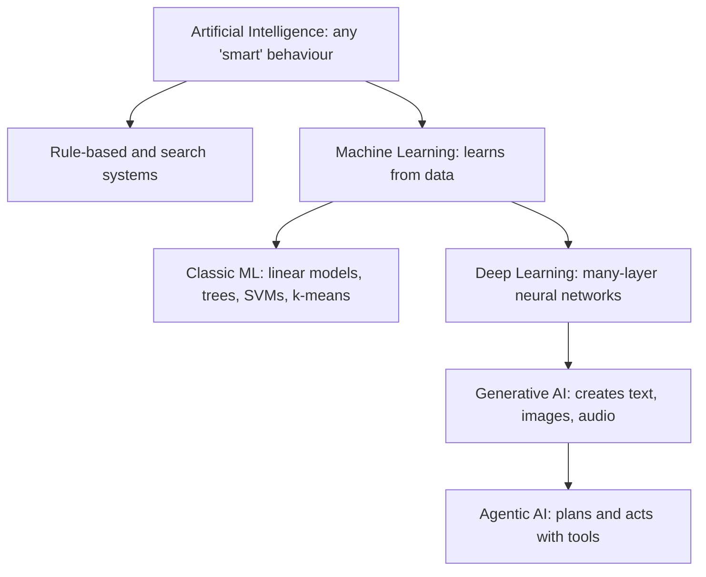
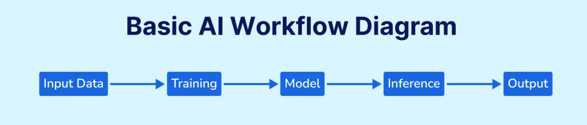
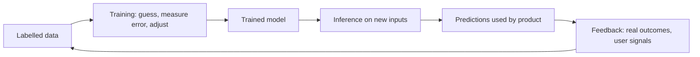
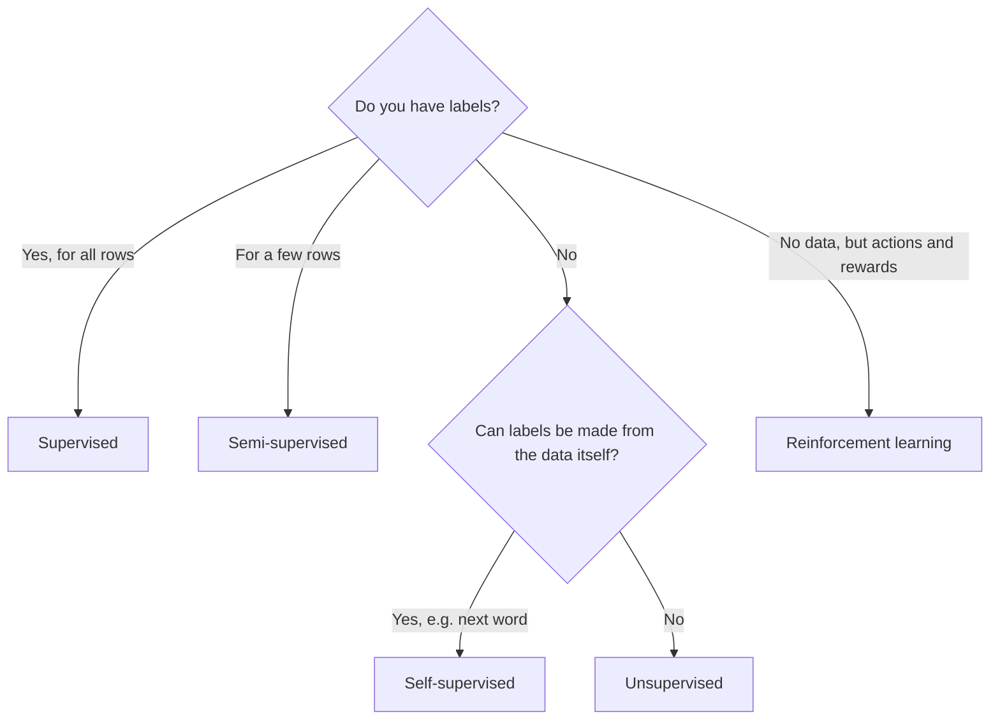
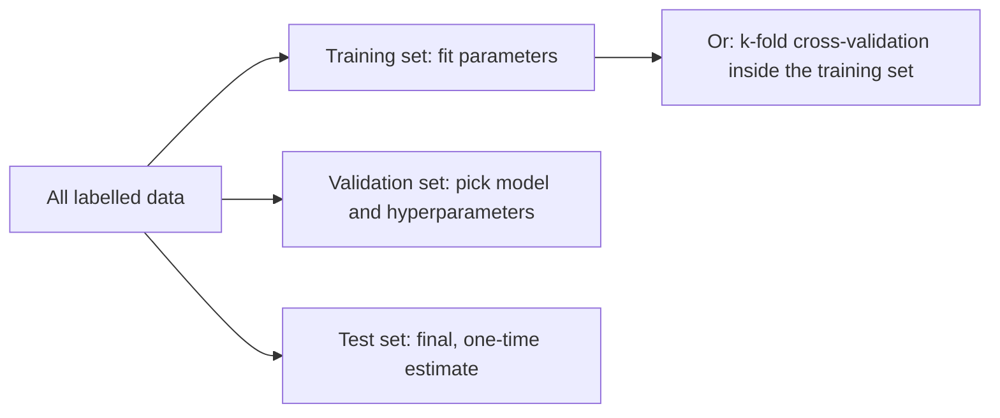
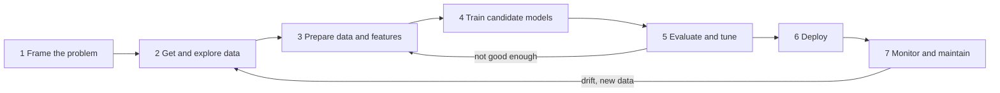
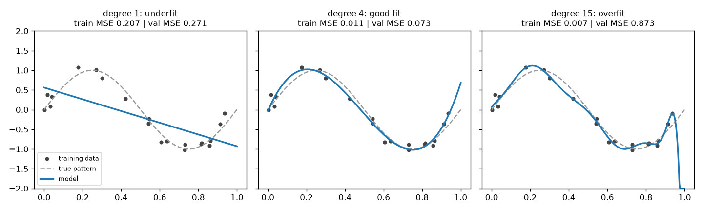

# Chapter 1 — What Machine Learning Is

Machine learning (ML) is the craft of getting a computer to improve at a task by studying examples instead of following rules a person wrote by hand. This chapter builds the map you will use for the rest of the book: where ML sits inside "AI", the different ways a machine can learn, the vocabulary everyone uses, the steps of a real project, and the problems that sink most projects. It ends with a complete, runnable scikit-learn project.

**What you'll learn**

- How AI relates to its branches: machine learning, deep learning, and the generative and agentic systems built on them
- Why "learning from data" beats "writing rules" for some problems (and when it does not)
- The five learning setups: supervised, unsupervised, semi-supervised, self-supervised, reinforcement
- Classification vs regression, batch vs online learning, instance-based vs model-based learning
- How a model learns: training, inference and feedback loops
- The end-to-end workflow: framing → data → features → model → evaluation → deployment → monitoring
- The core vocabulary: features, labels, parameters, hyperparameters, loss, train/validation/test
- The main ways projects fail: bad data, overfitting, underfitting, leakage, non-representative data
- A first end-to-end scikit-learn project you can run and modify

All code is in [`code/`](code/). Every script runs in a few seconds on a laptop: `python code/<file>.py`.

---

## 1.1 The AI family tree

### What it is

"AI" is used loosely in everyday speech, but it is really an umbrella with several branches nested inside it.


*Figure — AI and four branches people talk about most (course diagram).*

| Term | Plain definition | Relationship | Typical example |
|---|---|---|---|
| **Artificial intelligence (AI)** | Any technique that makes a machine do something we would call "intelligent": reasoning, perceiving, planning, deciding. | The whole field. Includes hand-written rules and search, not only learning. | A chess engine searching moves; a rules-based tax calculator; a route planner |
| **Machine learning (ML)** | AI systems that *learn their behaviour from data* rather than having every rule spelled out. | A subset of AI. | Spam filter, fraud detector, "customers also bought" |
| **Deep learning (DL)** | ML using *neural networks* with many layers, where each layer transforms the output of the previous one. | A subset of ML. | Face unlock, speech recognition, machine translation |
| **Generative AI (GenAI)** | Models that *produce new content* (text, images, audio, video, code) that resembles their training data. | Mostly built with deep learning today. | Chat assistants, image generators (DALL·E, Midjourney), music tools |
| **Agentic AI** | Systems that *plan and take multi-step actions* toward a goal, using tools and adapting as they go. | Usually a generative model wrapped in a loop of plan → act → observe. | A coding agent that edits files and runs tests; a warehouse robot choosing routes |



A useful way to read the tree: every deep learning model is an ML model, and every ML model is an AI system, but not the other way round. Generative and agentic AI are not strictly "inside" deep learning by definition, but nearly every practical system today is built on deep neural networks, so the diagram shows the common case.

### Why it matters

People (and job descriptions) mix these words up constantly. Knowing the boundaries lets you pick the right tool: a small tabular dataset of 10,000 loan applications calls for classic ML, not a large language model; generating product descriptions calls for GenAI; a simple VAT calculation needs neither.

### How each branch works, briefly

1. **Machine learning** — show the computer many examples (e.g. photos marked "cat" or "dog"). An algorithm finds patterns (shapes, textures, colours) that separate the groups, and uses them to label photos it has never seen. The "rules" are discovered, not typed in.
2. **Deep learning** — the same idea, but the model is a stack of layers. In an image network, early layers respond to simple things such as edges; middle layers combine edges into textures and parts; late layers respond to whole objects or faces. Because the layers learn their own features, DL shines on raw, unstructured data (pixels, audio, text). The 2012 AlexNet result on the ImageNet competition is usually cited as the moment DL overtook older computer-vision methods.
3. **Generative AI** — instead of outputting a label, the model learns the structure of its training material well enough to *sample* new material in the same style. A text model such as GPT learns to predict the next word (token); repeating that prediction produces paragraphs. Image generators learn to turn random noise into an image that matches a text prompt.
4. **Agentic AI** — a model is given a goal and a set of tools (web search, a calendar API, a code runner). It decides on a step, calls a tool, reads the result, and decides the next step, repeating until done. The difference from a plain model is autonomy over *multiple* steps in a changing environment.

### Trade-offs

| | Classic ML | Deep learning | Generative AI | Agentic AI |
|---|---|---|---|---|
| Data needed | Hundreds to millions of rows | Usually large (or a pre-trained model) | Enormous for pre-training; small for adapting | Builds on a pre-trained model |
| Best input type | Tables (spreadsheets, databases) | Images, audio, text | Text, images, audio | Tasks with tools and steps |
| Interpretability | Often good | Low | Low | Low, and actions compound |
| Compute cost | Low (CPU) | High (GPU) | Very high to train; high to run | High (many model calls) |
| Main risk | Bad data | Needs lots of data and compute | Confident but wrong output ("hallucination"), copyright and authenticity questions | Mistakes chain across steps; safety of actions |

### When not to use it

- If the rules are known, stable and few (tax brackets, unit conversion, access control), write the rules. ML adds cost and uncertainty for no benefit.
- If a mistake is unacceptable and you cannot measure the error rate, do not hand the decision to a learned model without human review.
- Do not use generative AI where a classic ML model or a database query answers the question exactly.

### Common mistakes

- Saying "AI" when you mean a specific technique; say "a gradient-boosted classifier" or "a fine-tuned language model".
- Assuming newer = better. On tabular business data, tree ensembles such as random forests and gradient boosting (Chapter 7) frequently beat deep networks.
- Believing a model "understands" or "thinks" like a person. It maps inputs to outputs using statistical patterns found in data.

### Real-world examples

- **Classic ML:** card-fraud scoring at banks and payment companies; Gmail's spam filtering; credit scoring; demand forecasting in retail.
- **Recommendations:** Netflix and YouTube rank what to show you next from your viewing history and that of similar users.
- **Deep learning:** Apple's Face ID, Google Translate, speech recognition in voice assistants, detection of abnormalities in medical scans.
- **Generative AI:** chat assistants that draft emails and articles, image generators such as DALL·E and Midjourney, tools that compose music or edit video.
- **Agentic AI:** warehouse robots that plan routes around obstacles, assistants that book appointments or troubleshoot a laptop, coding agents; automated trading systems act autonomously too, although many are rule-based rather than learned.

### In the interview

**30-second answer:** "AI is the broad goal of making machines behave intelligently. Machine learning is the part of AI where behaviour is learned from data instead of hand-coded. Deep learning is ML with many-layer neural networks, which learn their own features from raw data like pixels and text. Generative AI uses such models to create new content, and agentic AI wraps them in a loop so they can plan and take actions with tools."

- *Is a rules engine AI?* — Yes, classical AI includes rule-based expert systems; it is just not machine learning.
- *Why did deep learning take off around 2012?* — Three things arrived together: large labelled datasets (ImageNet), cheap parallel compute (GPUs), and training tricks (ReLU activations, dropout, better initialisation).
- *When would you choose classic ML over deep learning?* — Small or medium tabular data, a need for interpretability, tight latency or budget.

### Self-check

1. Is every ML model a deep learning model? → No. DL is a subset of ML; linear regression and decision trees are ML but not DL.
2. What makes a system "agentic"? → It pursues a goal over multiple steps, choosing actions and tools and adapting to what it observes.
3. Give one reason not to use ML. → The rules are simple and known, so hand-written code is cheaper, exact and easier to audit.
4. What does a generative model output that a classifier does not? → New content (text, image, audio), rather than a label or number.

### TL;DR

AI ⊃ ML ⊃ DL. Generative AI creates content, agentic AI takes multi-step actions; both are usually built on deep learning. Pick the simplest branch that solves the problem.

---

## 1.2 Learning from data vs writing rules

### What it is

In traditional programming a person writes the rules: *input + rules → output*. In machine learning a person supplies examples of inputs with the desired outputs, and an algorithm produces the rules: *inputs + outputs → rules (the model)*. The model is then used like any program: *new input + model → output*.

Tom Mitchell's classic definition (1997) makes this precise: a program *learns* from experience **E** with respect to a task **T** and a performance measure **P** if its performance on T, measured by P, improves with E. For a spam filter: T = flag spam, E = a pile of emails labelled spam/not-spam, P = the fraction of emails classified correctly.

### The problem it solves

Some rules are too many, too fuzzy, or change too often to write by hand:

- **Too complex:** nobody can write the rules for "is there a cat in this photo?" in terms of pixel values.
- **Constantly changing:** spammers adapt; a hand-written list of spam words is always out of date. A learning system can be retrained on new examples.
- **Too many cases:** recognising speech across accents, microphones and background noise.
- **Discovery:** ML can reveal patterns people had not noticed (e.g. which combinations of features predict churn). Inspecting what a model learned is sometimes called *data mining*.

### How it works

1. Collect examples of the task, with the right answers if you have them.
2. Turn each example into numbers (features).
3. Choose a model family (e.g. "a weighted sum of word counts").
4. A training algorithm adjusts the model's internal numbers until its answers match the examples as closely as possible.
5. Use the trained model on new inputs.

### Code: a hand-written rule vs a learned model

[`code/rules_vs_learning.py`](code/rules_vs_learning.py) trains a Naive Bayes spam filter (a simple probabilistic classifier, Chapter 8) on ten labelled messages and compares it with a rule "spam if it contains *free* or *prize*".

```python
def rule_based(text: str) -> int:
    return int("free" in text or "prize" in text)

vec = CountVectorizer()                  # text -> word-count features
X = vec.fit_transform(texts)
model = MultinomialNB().fit(X, labels)   # learns how often each word appears in spam vs ham
p = model.predict_proba(vec.transform([t]))[0, 1]
```

Output:

```
message                            rule  learned  P(spam)
limited offer click to claim          0        1    0.95
free coffee in the kitchen            1        1    0.61
slides for the review meeting         0        0    0.06
```

The rule misses spam that avoids its two words and cannot be taught anything new without a programmer. The learned model catches the first message from words it saw in spam ("limited", "offer", "click", "claim"). It also gets "free coffee" wrong: with only ten examples, "free" looks strongly spammy. That is the other half of the lesson: **a model is only as good as its data**. With thousands of examples the office-email use of "free" would be learned too.

### Trade-offs

| | Hand-written rules | Machine learning |
|---|---|---|
| Needs | Expert knowledge | Representative, labelled data |
| Transparency | Fully readable | Varies; often opaque |
| Adapting to change | Rewrite code | Retrain on new data |
| Handles fuzzy patterns (images, speech) | Poorly | Well |
| Guarantees | Exact behaviour | Statistical: right *most* of the time |

### When not to use it

When the logic is known and must be exact (payroll, permissions), when there is no data, or when nobody can tolerate a small error rate.

### Common mistakes

- Starting with ML before trying a simple rule or heuristic as a baseline.
- Forgetting that a learned model inherits every bias and gap in its examples.

### Self-check

1. In Mitchell's definition, what are T, E and P for a house-price model? → T: predict price; E: past sales with prices; P: e.g. average error in dollars.
2. Why can't you easily hand-code a cat detector? → The rules would have to be written in terms of raw pixels; the patterns are too numerous and varied.
3. What did the spam example show about small data? → The model over-trusted a single word ("free") because it saw too few examples.

### TL;DR

Rules come from people in programming and from data in ML. Use ML when the rules are too complex or change too often, and only when you have good examples.

---

## 1.3 How a model learns: training, inference and feedback loops

### What it is

A model's life has three phases.


*Figure — Data feeds training, which produces a model used for inference (course diagram).*

1. **Training** — the model sees examples whose answers are known, makes a guess for each, measures how wrong it was, and nudges its internal numbers to be less wrong next time. Think of a student working through practice problems with an answer key. After many rounds, it predicts well on examples it has *not* seen.
2. **Inference** — the trained model is used on new data to produce predictions. No learning happens here; it is just applying what was learned. A voice assistant turning your spoken command into text in real time is inference.
3. **Feedback loop** — in production you compare predictions to what actually happened, collect the new outcomes as fresh training data, and retrain. When you give a show a thumbs-down, a recommender can treat that as a new label and adjust future suggestions.

An analogy that covers all three: teaching a child what a cat is. You show many pictures and correct mistakes (training). Later the child spots a cat on the street without help (inference). When the child later points at a dog and says "cat", you step in again (feedback).



### How it works (the core loop)

For almost every model in this book, training is the same loop:

1. Start with some values for the model's **parameters** (its adjustable numbers, e.g. the weights in ŷ = w·x + b).
2. Predict for a batch of training examples.
3. Compute the **loss**: a single number measuring how wrong the predictions are (e.g. mean squared error).
4. Change the parameters in the direction that lowers the loss (Chapter 2 shows how, with gradient descent).
5. Repeat until the loss stops improving.

### Data is king

A model can never be better than the examples it learns from.

- **Garbage in, garbage out.** Mislabelled, outdated or one-sided data yields a model with the same flaws, often in ways that are hard to spot.
- **Diversity matters.** Just as reading widely broadens a person's judgment, a model exposed to varied examples copes with more situations. The *Gender Shades* study (Buolamwini and Gebru, 2018) found that commercial face-analysis systems made far more errors on darker-skinned women than on lighter-skinned men, a gap traced largely to unbalanced training and benchmark data.
- **High stakes.** A diagnostic model trained on patients from one population may misdiagnose patients from another.

The goal of training is **generalisation**: performing well on new, real-world data, not just on the examples it studied. Good, diverse data is the single biggest lever for generalisation.

### Self-check

1. Does a model learn during inference? → Not by default; inference only applies learned parameters. Learning resumes when you retrain (or with online learning, §1.7).
2. What is a feedback loop in production? → Capturing real outcomes of predictions and feeding them back as training data to improve the model.
3. What is generalisation? → Performing well on data the model has not seen during training.

### TL;DR

Training adjusts parameters to reduce loss on known examples; inference applies the model to new data; feedback loops turn real outcomes into new training data. Data quality and diversity decide how well a model generalises.

---

## 1.4 Types of learning by supervision

### What it is

ML systems are grouped by *how much and what kind of answer* they get during training.

| Type | What the training data contains | Goal | Typical algorithms | Example |
|---|---|---|---|---|
| **Supervised** | Inputs **with** labels (the right answer) | Predict the label for new inputs | Linear/logistic regression, trees, random forests, gradient boosting, SVMs, neural nets | Emails marked spam / not spam → classify new emails |
| **Unsupervised** | Inputs **without** labels | Find structure: groups, low-dimensional summaries, anomalies | k-means, DBSCAN, PCA, isolation forest | Group customers by behaviour; flag odd transactions |
| **Semi-supervised** | A few labelled rows + many unlabelled rows | Use the unlabelled data to do better than the labelled part alone | Self-training, label propagation | Photo app clusters faces, you name one photo per person, it names the rest |
| **Self-supervised** | Unlabelled data from which labels are *generated automatically* | Learn useful representations by predicting a hidden part of the data | Next-word prediction (GPT), masked-word prediction (BERT), contrastive learning | Language models trained to predict the next token on web text |
| **Reinforcement learning (RL)** | No fixed dataset; an *agent* acts in an *environment* and receives *rewards* | Learn a *policy* (what to do in each situation) that maximises total reward | Q-learning, policy gradients, PPO | DeepMind's AlphaGo; robots learning to walk; fine-tuning chatbots from human preferences (RLHF) |



### Why it matters

Labels are usually the most expensive part of a project (doctors labelling scans, lawyers labelling contracts). The supervision type tells you how much labelling you must pay for, which algorithms apply, and how you can evaluate the result.

### How it works (one demo each)

[`code/learning_types.py`](code/learning_types.py) runs a tiny example of every type:

```python
# supervised: iris species (classification) and diabetes progression (regression)
clf = LogisticRegression(max_iter=1000).fit(Xtr, ytr)
reg = LinearRegression().fit(Xtr, ytr)
# unsupervised: k-means never sees the true groups
labels = KMeans(n_clusters=3, n_init=10, random_state=SEED).fit_predict(X)
# semi-supervised: hide 95% of labels (-1 = unlabelled), then self-train
self_train = SelfTrainingClassifier(LogisticRegression(max_iter=2000), threshold=0.9).fit(Xtr, y_partial)
# self-supervised: the "label" is the next value of the series
X = np.stack([series[i:i + 3] for i in range(len(series) - 3)]); y = series[3:]
# reinforcement: epsilon-greedy 3-armed bandit learns which arm pays best
arm = rng.integers(3) if rng.random() < 0.1 else int(np.argmax(estimates))
```

Output:

```
[classification] iris accuracy = 1.000
[regression]     diabetes MAE = 45.1 (target std = 77.0)
[unsupervised]   k-means agreement with hidden groups (ARI) = 0.767
[semi-supervised] 69 labels only: 0.867 | + self-training on unlabelled rows: 0.882
[self-supervised] next-value MAE = 0.068
[reinforcement]  estimated payouts [0.19, 0.46, 0.8], pulls [81, 72, 1847], avg reward 0.766
```

How to read it:
- *Supervised:* near-perfect species prediction; regression error (45) well below the natural spread of the target (77).
- *Unsupervised:* k-means recovered most of the hidden grouping (ARI = 1 would be perfect agreement, 0 = random) without ever seeing it.
- *Semi-supervised:* with only 69 labelled digits, letting the model label confident unlabelled rows and retrain added about 1.5 points of accuracy. The gain varies with data; it is not guaranteed.
- *Self-supervised:* no human wrote a label; the future of the series served as the target.
- *Reinforcement:* the agent explored all three arms, discovered arm 3 pays about 80% of the time, and spent most pulls on it. The 10% of random pulls is the *exploration* cost.

### Trade-offs

| | Labelling cost | Evaluation | Main risk |
|---|---|---|---|
| Supervised | High | Easy: compare to labels | Label errors and bias |
| Unsupervised | None | Hard: no ground truth | Finds patterns that mean nothing |
| Semi-supervised | Low | Needs a labelled test set | Wrong pseudo-labels reinforce themselves |
| Self-supervised | None, but huge data and compute | Via downstream tasks | Cost; learns biases of web-scale data |
| Reinforcement | Need a reward and an environment | Total reward | Reward hacking; slow, unstable training |

### Common mistakes

- Using unsupervised clustering and then treating clusters as if they were true categories without checking.
- Designing an RL reward that can be "gamed" (the agent finds a loophole that earns reward without doing the task).
- Calling LLM pre-training "unsupervised". It is better described as self-supervised: there *is* a target (the next token), it is just generated from the data.

### In the interview

**30-second answer:** "Supervised learning has labelled examples and predicts labels. Unsupervised has no labels and finds structure like clusters. Semi-supervised mixes a few labels with lots of unlabelled data. Self-supervised creates labels from the data itself, like predicting the next word, which is how large language models are pre-trained. Reinforcement learning learns actions from rewards by trial and error."

- *Is anomaly detection supervised?* — Usually unsupervised or semi-supervised (you train mostly on normal data), because labelled anomalies are rare.
- *What is the exploration–exploitation trade-off?* — In RL, choosing between trying actions to learn more (explore) and using the best-known action (exploit).
- *How is ChatGPT-style training split?* — Self-supervised pre-training on text, then supervised fine-tuning on example conversations, then reinforcement learning from human (or AI) feedback.

### Self-check

1. Fraud labels exist for only 1% of transactions; others are unlabelled. Which setup fits? → Semi-supervised (or supervised on the labelled part plus anomaly detection).
2. What generates the labels in self-supervised learning? → The data itself, e.g. a masked word or the next token.
3. What does an RL agent learn? → A policy mapping situations to actions that maximises cumulative reward.
4. Why is unsupervised learning hard to evaluate? → There is no correct answer to compare against.

### TL;DR

Supervision type = what answers you have. Labels → supervised; none → unsupervised; a few → semi-supervised; made from the data → self-supervised; rewards from actions → reinforcement.

---

## 1.5 Classification vs regression

### What it is

The two main supervised tasks, split by the *type of the label*:

- **Classification** predicts a **category** (a discrete class): spam/ham, digit 0–9, species. With two classes it is *binary*; with more it is *multiclass*; if each example can have several labels at once (a photo tagged "beach" and "dog") it is *multilabel*.
- **Regression** predicts a **number** on a continuous scale: price, temperature, days until churn.

| | Classification | Regression |
|---|---|---|
| Output | Class (often with a probability) | Real number |
| Example losses | Log loss (cross-entropy), hinge loss | Mean squared error (MSE), mean absolute error (MAE) |
| Example metrics | Accuracy, precision, recall, F1, ROC-AUC | MAE, RMSE, R² |
| Example algorithms | Logistic regression, decision tree classifier, k-NN classifier | Linear regression, decision tree regressor, k-NN regressor |

Watch the name: **logistic regression is a classifier**. It predicts the probability of a class, then thresholds it (usually at 0.5).

### Common mistakes

- Encoding categories as numbers (red = 1, green = 2, blue = 3) and treating it as regression, which invents an order that does not exist.
- Turning a regression problem into classes too early (e.g. price "high/low"), throwing away information.
- Judging a classifier by accuracy on imbalanced data: if 99% of transactions are legitimate, "always legitimate" is 99% accurate and useless. Chapter 6 covers better metrics.

### Self-check

1. Predicting a star rating 1–5: classification or regression? → Either can work; regression respects the order, classification treats ratings as separate categories. Many teams try both.
2. Is logistic regression used for regression? → No, for classification.
3. Which metric suits regression? → MAE or RMSE (both in the target's units), or R².

### TL;DR

Category → classification. Number → regression. The label type decides the loss, the metrics and the algorithms.

---

## 1.6 Key terms

| Term | Meaning | Example (house prices) |
|---|---|---|
| **Example / instance / sample / row** | One item in the dataset | One house sale |
| **Feature (attribute, input, predictor, X)** | A measurable property used as input | Size in m², number of rooms, postcode |
| **Label (target, output, y)** | The answer we want to predict | Sale price |
| **Feature vector** | All features of one example as a list of numbers | [120, 3, 1995] |
| **Model** | A function with adjustable parts that maps features to a prediction | price = w₁·size + w₂·rooms + b |
| **Parameters** | Numbers *learned* from data during training | w₁, w₂, b |
| **Hyperparameters** | Settings *chosen by you before* training; they control the learning | Polynomial degree, regularisation strength C, learning rate, number of trees |
| **Loss (cost, objective) function** | A number measuring how wrong predictions are; training minimises it | Mean squared error |
| **Training set** | Data the model learns parameters from | 60–80% of sales |
| **Validation set** | Data used to compare models and tune hyperparameters | 10–20% |
| **Test set** | Data used once at the end to estimate real-world performance | 10–20%, never touched before |
| **Cross-validation** | Rotating the validation role through k chunks of the training data and averaging | 5-fold CV |
| **Prediction (ŷ, "y-hat")** | The model's output for an example | $412,000 |
| **Generalisation** | Doing well on new data | Accurate price for next month's listings |
| **Inference** | Using a trained model to predict | Pricing a newly listed house |

### Parameters vs hyperparameters

Parameters are what training finds; hyperparameters are knobs you set that shape how training searches. In ŷ = w·x + b, **w** and **b** are parameters. If you fit a polynomial, its **degree** is a hyperparameter. You tune hyperparameters by trying several values and comparing them on the *validation* set (or with cross-validation), never on the test set.

### Loss, with worked numbers

Three houses have true prices 300, 250, 400 (in $1000s) and the model predicts 310, 240, 380.

- Errors: −10, +10, +20 (true − predicted)
- **MSE** = (10² + 10² + 20²) / 3 = (100 + 100 + 400) / 3 = **200** (units: $1000², hard to read)
- **RMSE** = √200 ≈ **14.1** → "typically off by about $14k"
- **MAE** = (10 + 10 + 20) / 3 ≈ **13.3**

MSE punishes the big error (20) much more than the small ones, because errors are squared.

### Training, validation and test sets



Why three sets? If you tune hyperparameters by watching test performance, you slowly fit the test set too, and your reported score becomes optimistic. The validation set absorbs that tuning; the test set stays honest.

[`code/train_val_test.py`](code/train_val_test.py) makes a 60/20/20 split, picks the regularisation strength C by validation log loss, reports test accuracy once, and then simulates *drift* in production:

```python
X_tmp, X_test, y_tmp, y_test = train_test_split(X, y, test_size=0.2, random_state=SEED)
X_train, X_val, y_train, y_val = train_test_split(X_tmp, y_tmp, test_size=0.25, random_state=SEED)
for c in [0.001, 0.01, 1.0]:
    m = LogisticRegression(C=c).fit(X_train, y_train)
    loss = log_loss(y_val, m.predict_proba(X_val))
```

Output:

```
sizes train/val/test: 1800 600 600
C=0.001  validation log-loss = 0.529
C=0.01   validation log-loss = 0.287
C=1.0    validation log-loss = 0.063
chosen C=1.0; test accuracy = 0.998
after drift, live accuracy = 0.746  -> alert, retrain
after retraining on fresh labelled data, accuracy = 0.986
```

(0.25 of the remaining 80% is 20% of the total, hence 60/20/20.) The last two lines show why monitoring matters: the world changed, accuracy fell from 99.8% to 74.6%, and retraining on fresh data recovered it.

### Self-check

1. Is the learning rate a parameter or a hyperparameter? → Hyperparameter; you choose it.
2. Why not tune on the test set? → The test score would then be biased upward and no longer estimate performance on new data.
3. What does RMSE ≈ 14.1 mean for prices in $1000s? → Predictions are typically about $14,000 off.

### TL;DR

Features in, label out. Training learns parameters by minimising a loss; you choose hyperparameters with a validation set or cross-validation; the test set is used once.

---

## 1.7 Batch vs online learning

### What it is

- **Batch (offline) learning:** train on the full dataset at once, deploy the frozen model, and retrain from scratch (say nightly or weekly) to include new data.
- **Online (incremental) learning:** feed data in small chunks (mini-batches) or one example at a time; the model updates as data arrives, and old data can be thrown away.

A related idea, **out-of-core learning**, uses the online approach to train on datasets too large for memory by streaming chunks from disk.

### Why it matters

Batch learning is simple and reproducible but slow to react and expensive to retrain on huge data. Online learning adapts fast (stock prices, news trends, sensor streams) and runs on limited memory, but it can drift in bad directions if bad data arrives.

### How it works

1. Initialise the model.
2. When a mini-batch arrives, compute the loss on it and nudge the parameters (one step of gradient descent).
3. Discard the batch (or keep it for audit), wait for the next.

The **learning rate** controls how strongly each new batch moves the model. High → adapts quickly but forgets old patterns and reacts to noise. Low → stable but slow to adapt.

[`code/batch_vs_online.py`](code/batch_vs_online.py) trains `SGDClassifier` (a linear classifier trained by stochastic gradient descent) both ways:

```python
batch = SGDClassifier(average=True, random_state=SEED).fit(X[:16_000], y[:16_000])

online = SGDClassifier(average=True, random_state=SEED)
for start in range(0, 16_000, 2000):
    online.partial_fit(X[start:start + 2000], y[start:start + 2000], classes=[0, 1])
```

Output:

```
batch model (16,000 rows at once): test acc = 0.842
online after  2,000 rows: test acc = 0.833
online after  8,000 rows: test acc = 0.838
online after 16,000 rows: test acc = 0.839
```

The online model reaches almost the batch result while only ever holding 2,000 rows in memory. (`average=True` averages the weights over updates; without it, plain SGD's accuracy jumped around between 0.66 and 0.83 on this data, a real-world reminder that online learners are sensitive to their learning-rate settings.) In scikit-learn, estimators that support incremental learning expose `partial_fit`, e.g. `SGDClassifier`, `SGDRegressor`, `MultinomialNB`, `MiniBatchKMeans`.

### Trade-offs

| | Batch | Online |
|---|---|---|
| Adapts to change | At the next retrain | Continuously |
| Memory / compute | Whole dataset per retrain | One chunk at a time |
| Reproducibility | High | Lower: depends on data order |
| Risk | Stale model | Bad data corrupts the live model quickly |
| Monitoring needs | Standard | Must watch inputs and performance closely, with a rollback plan |

### When not to use online learning

When data arrives slowly, when changes are rare (retraining weekly is enough), or when you cannot monitor inputs, since poisoned or buggy data flows straight into the live model. Microsoft's Tay chatbot (2016) was taken offline within a day after users deliberately fed it offensive content it then repeated, a well-known cautionary tale about learning from unfiltered live input.

### Self-check

1. What scikit-learn method signals online learning support? → `partial_fit`.
2. What does a high learning rate do in online learning? → The model adapts quickly but also forgets older patterns and chases noise.
3. What is out-of-core learning? → Training on data larger than memory by streaming it in chunks with an online algorithm.

### TL;DR

Batch: train on everything, redeploy periodically. Online: update continuously from small chunks. Online adapts faster but needs careful monitoring.

---

## 1.8 Instance-based vs model-based learning

### What it is

Two ways a system can *generalise* from examples:

- **Instance-based:** memorise the training examples; to predict, find the most **similar** stored examples and use their answers. Example: **k-nearest neighbours (k-NN)**, which averages the labels of the k closest points.
- **Model-based:** use the examples to fit a **compact model** (a formula with parameters) and throw the examples away. Example: **linear regression** ŷ = w·x + b.

### How it works (worked example)

Data: y ≈ 3x + 2 with noise, x between 0 and 10. [`code/batch_vs_online.py`](code/batch_vs_online.py):

```python
lin = LinearRegression().fit(X, y)              # stores 2 numbers
knn = KNeighborsRegressor(n_neighbors=5).fit(X, y)  # stores all 5000 rows
x_new = np.array([[4.0], [15.0]])               # 15 lies outside 0..10
```

Output:

```
linear model: w=3.00, b=2.04 -> predicts [14. 47.]
k-NN (k=5): stores 5000 rows -> predicts [14.4 32. ]
prediction time for 10,000 queries: linear 0.22 ms vs k-NN 3.1 ms (exact times vary by machine)
```

- At x = 4 both agree (true value 3·4 + 2 = 14).
- At x = 15 the linear model extrapolates correctly (3·15 + 2 = 47). k-NN can only average its nearest stored neighbours (all near x = 10), giving ≈ 32.
- The linear model is a compressed summary (2 numbers) and predicts much faster; k-NN keeps all data and searches it at prediction time.

### Trade-offs

| | Instance-based (k-NN) | Model-based (linear model, tree, network) |
|---|---|---|
| Training | Almost instant (store data) | Takes time to fit |
| Prediction | Slower, needs all data in memory | Fast, small memory |
| Flexibility | Adapts to any shape if data is dense | Limited by the chosen model form |
| Extrapolation | Poor | Possible if the model form is right |
| Needs | A good similarity measure; scaled features | A good model family |

### Self-check

1. Why does k-NN fail at x = 15? → It can only reuse answers of stored neighbours; none exist near 15.
2. Which approach suits a system where new examples must be usable instantly without retraining? → Instance-based: just add the example to the store.
3. What does a model-based learner keep after training? → Only its parameters.

### TL;DR

Instance-based learners compare new cases to stored ones; model-based learners fit parameters and discard the data. Most algorithms in this book are model-based.

---

## 1.9 The end-to-end ML workflow

### What it is

A real ML project is a cycle of steps, and the modelling step is usually the smallest part of the work.



### How it works

1. **Frame the problem.** What decision will the prediction drive, and what is it worth? Supervised or not? Classification or regression? Batch or online? What metric reflects business value (e.g. recall on fraud, dollars of error on prices)? What does the current solution (a rule, a human) achieve? That is your **baseline**. Is ML needed at all?
2. **Get and explore the data.** Collect it, check it is legal and ethical to use, look at distributions, missing values, outliers and correlations. **Set aside the test set now**, before exploring deeply, so your choices are not influenced by it.
3. **Prepare data and engineer features.** Clean errors, handle missing values, encode categories, scale numbers, create informative features (e.g. "price per m²"). Put these steps in a pipeline so they are applied identically in training and production.
4. **Train candidate models.** Start simple (a linear model), then try a few families (trees, ensembles). Compare with cross-validation.
5. **Evaluate and tune.** Tune hyperparameters on validation data, analyse errors, check fairness across groups, then measure the final choice *once* on the test set.
6. **Deploy.** Package the whole pipeline (preprocessing + model), serve it through a batch job or a web API, and roll out gradually (shadow mode, A/B test).
7. **Monitor and maintain.** Track input distributions, prediction distributions and real performance as labels arrive. Data changes over time (**data drift**: inputs change; **concept drift**: the input→label relationship changes). Retrain on fresh data, version models and data, and keep a rollback path.

### Real-world examples

- **Spam filtering** is a textbook feedback loop: every "Report spam" click becomes a new label.
- **Google Flu Trends** estimated flu levels from search queries. It overestimated the 2012–13 peak substantially, a widely studied example of a model going stale as search behaviour changed, i.e. drift without enough monitoring and recalibration.
- **Zillow Offers** used price predictions to buy homes; in 2021 Zillow shut the business down, citing difficulty forecasting prices accurately in a fast-moving market.

### Common mistakes

- Jumping to step 4 without a clear metric or baseline.
- Preprocessing in a notebook and re-implementing it differently in production (**training–serving skew**).
- No monitoring: the model silently decays.

### In the interview

**30-second answer:** "I start by framing the problem: the decision, the metric, and a baseline. Then I collect and explore data, holding out a test set early. I build a preprocessing-plus-model pipeline, compare a few model families with cross-validation, tune on validation data and test once. Then I deploy the pipeline as a unit, and monitor drift and performance, retraining when needed."

- *What is training–serving skew?* — When features are computed differently in production than in training, so the model sees inputs unlike those it learned from.
- *How do you know it's time to retrain?* — Monitored performance drops as labels arrive, or input distributions shift noticeably from training; or on a regular schedule.

### Self-check

1. Why hold out the test set before exploring the data? → To avoid unconsciously tailoring choices to it (data snooping).
2. What is concept drift? → The relationship between inputs and the label changes over time.
3. Why ship preprocessing and model together? → So production applies exactly the same transformations as training.

### TL;DR

Frame → data → features → model → evaluate → deploy → monitor, and loop. Baseline first, test set once, pipeline everything, monitor always.

---

## 1.10 The main challenges of machine learning

The two things that can go wrong are **bad data** and **a bad model**. [`code/challenges.py`](code/challenges.py) demonstrates each problem below.

### 1. Not enough or poor-quality data

**What it is.** Too few examples, wrong labels, noise, missing values, outliers.
**Demo** — flipping a share of training labels on the breast-cancer dataset:

```
 0% wrong training labels -> test accuracy 0.958
20% wrong training labels -> test accuracy 0.951
40% wrong training labels -> test accuracy 0.636
```

Random label noise is survivable in moderation (the errors partly cancel out), but it quickly becomes fatal. Systematic errors (e.g. one annotator always mislabels a class) are worse because they do not cancel.
**Fixes:** clean and audit labels, get more data, remove or fix outliers, handle missing values deliberately.

### 2. Non-representative training data (sampling bias)

**What it is.** The training data does not look like the data the model will face. Causes: collecting only convenient data, self-selection (only happy customers answer surveys), or historical bias.
**Demo** — trained only on houses under 120 m², then used on bigger ones:

```
trained on houses < 120 m^2: mean error small houses 14,086 | big houses 43,250
```

The relationship bends outside the range the model saw, and error triples.
**Real world:** the face-analysis gaps in §1.3; a famous historical example is the 1936 *Literary Digest* poll, which predicted a Landon win over Roosevelt from about 2.4 million returned ballots. Its mailing lists leaned on sources such as telephone directories and car registrations, and only about a quarter of those mailed replied; both the skewed list and the self-selected responses pushed the sample away from the electorate.
**Fixes:** sample to match the deployment population, check performance per subgroup, collect data where the model will be used.

### 3. Irrelevant features

Garbage features add noise and invite spurious patterns. **Feature engineering** (selecting useful features, combining features, creating new ones from domain knowledge) is often where most gains come from.

### 4. Overfitting

**What it is.** The model learns the training data *too* well, including its noise and quirks, and fails on new data. Like a student who memorises past exam answers without understanding.
**Signal:** training error low, validation error much higher.
**Causes:** model too complex for the amount of data, too many features, too little data, noisy data.
**Fixes:** simpler model, fewer features, **regularisation** (a penalty on large parameters), more data, less noise, early stopping, cross-validation to choose complexity.

### 5. Underfitting

**What it is.** The model is too simple to capture the real pattern. **Signal:** training *and* validation error both high.
**Fixes:** a more powerful model, better features, less regularisation, train longer.

**Demo** — fitting polynomials of degree 1, 4 and 15 to 20 noisy points from a sine curve:

```
degree  train MSE  val MSE
     1      0.207    0.271
     4      0.011    0.073
    15      0.007    0.873
```



Degree 1 is too rigid (both errors high). Degree 15 has the *lowest* training error but a validation error 12× worse than degree 4: it bends to pass through every noisy point and swings wildly between and beyond them. Degree 4 balances the two. This is the **bias–variance trade-off**: simple models have high *bias* (systematic error), complex ones high *variance* (sensitivity to the particular training sample). Chapter 6 treats it in depth.

| Symptom | Train error | Validation error | Diagnosis | First fixes |
|---|---|---|---|---|
| Both high | High | High | Underfitting | More model capacity or better features |
| Big gap | Low | High | Overfitting | Regularise, simplify, more data |
| Both low, close | Low | Low | Good fit | Test once, ship |

### 6. Data leakage

**What it is.** Information that would not be available at prediction time sneaks into training or evaluation, making scores look far better than real performance. Two common forms:

- **Target leakage:** a feature that is really a consequence of the label (e.g. "was prescribed antibiotics" when predicting "has infection"; "account closed date" when predicting churn).
- **Train–test contamination:** a preprocessing step (scaling, feature selection, imputation) is fit on the *whole* dataset before splitting, so the model has glimpsed the test data. Also: random splits of time-series data, or the same patient appearing in both train and test.

**Demo** — 100 rows of pure random noise with random labels (the honest answer is 50%):

```python
# WRONG: select features using all rows, then cross-validate
X_leaky = SelectKBest(f_classif, k=20).fit_transform(X, y)
wrong = cross_val_score(LogisticRegression(max_iter=1000), X_leaky, y, cv=5).mean()
# RIGHT: selection inside the pipeline, refit on each training fold
pipe = make_pipeline(SelectKBest(f_classif, k=20), LogisticRegression(max_iter=1000))
right = cross_val_score(pipe, X, y, cv=5).mean()
```

```
leaky CV accuracy on pure noise: 0.85  |  honest CV accuracy: 0.48
```

85% accuracy on noise! Choosing the 20 features that best matched the labels, *using the test folds*, baked the answers in.
**Real world:** a 2018 study (Zech et al.) found chest X-ray pneumonia models could recognise *which hospital* an image came from, and hospital correlated with disease rates, so part of the apparent skill did not transfer to new hospitals.
**Fixes:** split first; put every data-dependent step in a `Pipeline`; split time series by time; group splits by patient/user; ask of every feature "would I know this at prediction time?"

### When a result is too good to be true

Suspect leakage when a simple model scores near-perfectly, when one feature dominates importance, or when production performance falls far below test performance.

### In the interview

**30-second answer:** "The main risks are data problems — too little, noisy, non-representative or leaky data — and model problems — overfitting, where the model memorises noise and generalises poorly, and underfitting, where it's too simple. I diagnose by comparing training and validation error, guard against leakage with pipelines and proper splits, and check performance across subgroups."

- *How do you detect overfitting?* — Low training error with much higher validation error; learning curves.
- *Give a leakage example.* — Scaling or selecting features on the full dataset before cross-validation; or a feature recorded after the outcome.
- *More data or a better model?* — If you are overfitting, more data helps; if underfitting, more data of the same kind barely helps and you need a better model or features.

### Self-check

1. Train MSE 0.01, validation MSE 0.9. Diagnosis? → Overfitting.
2. Why is fitting a scaler on the full dataset leakage? → The scaler's mean and std include test-set information.
3. A churn model's top feature is "cancellation reason". Problem? → Target leakage: the reason exists only after the customer churns.
4. How can a huge sample still be biased? → If it is drawn from an unrepresentative population (Literary Digest).

### TL;DR

Bad data (too little, noisy, non-representative, leaky) and bad models (overfit, underfit) cause most failures. Compare train vs validation error, use pipelines, split correctly, and check each subgroup.

---

## 1.11 A first end-to-end project with scikit-learn

### What it is

The whole workflow in one script, [`code/first_end_to_end.py`](code/first_end_to_end.py), on the **Breast Cancer Wisconsin** dataset bundled with scikit-learn: 569 tumour samples, 30 numeric features computed from cell images (radius, texture, smoothness, ...), label malignant (0) or benign (1).

**Framing:** binary classification, supervised, batch. Missing a malignant tumour is worse than a false alarm, so beyond accuracy we care about **recall on the malignant class**.

### How it works

```python
data = load_breast_cancer(as_frame=True)
X, y = data.data, data.target

# 1. hold out a stratified test set first
X_train, X_test, y_train, y_test = train_test_split(
    X, y, test_size=0.2, stratify=y, random_state=SEED)

# 2. baseline: always predict the most common class
base = DummyClassifier(strategy="most_frequent").fit(X_train, y_train)

# 3. pipeline = scaling + logistic regression; cross-validate on training data
pipe = make_pipeline(StandardScaler(), LogisticRegression(max_iter=1000))
cv = cross_val_score(pipe, X_train, y_train, cv=5)

# 4. tune the hyperparameter C with cross-validation
grid = GridSearchCV(pipe, {"logisticregression__C": [0.01, 0.1, 1, 10]}, cv=5)
grid.fit(X_train, y_train)

# 5. evaluate once on the test set
y_pred = grid.predict(X_test)

# 6. save the whole pipeline and reload it as a serving process would
joblib.dump(grid.best_estimator_, path)
served = joblib.load(path)
```

What each part does:

- `stratify=y` keeps the malignant/benign ratio equal in train and test.
- `DummyClassifier` gives the score to beat. Any real model must clearly exceed it.
- `StandardScaler` rescales each feature to mean 0, std 1; logistic regression trains better on scaled inputs. Being inside the pipeline, it is re-fit on each training fold, so no leakage.
- `GridSearchCV` tries each C with 5-fold CV and refits the best on all training data. The `step__param` naming (`logisticregression__C`) addresses a parameter inside a pipeline step.
- `joblib` saves the fitted pipeline (scaler + model) as one file; the Python docs and scikit-learn warn to load such files only from trusted sources, since unpickling can run code.

Output:

```
shape: (569, 30) | class counts: [212, 357]
train: 455 test: 114
baseline accuracy (test): 0.632
5-fold CV accuracy: 0.980 +/- 0.013
best C: 0.1 | best CV accuracy: 0.980
test accuracy: 0.974
confusion matrix [rows=true, cols=pred]:
 [[40  2]
 [ 1 71]]
              precision    recall  f1-score   support

   malignant      0.976     0.952     0.964        42
      benign      0.973     0.986     0.979        72

    accuracy                          0.974       114
   macro avg      0.974     0.969     0.972       114
weighted avg      0.974     0.974     0.974       114

prediction for a new sample: malignant | P(benign) = 0.0
learned parameters: coef_ shape (1, 30) intercept [0.504]
```

Reading it:

- Baseline 63.2% (always "benign") → model 97.4%. A real improvement.
- CV score (98.0%) and test score (97.4%) are close, so there is no sign of overfitting or leakage.
- The confusion matrix shows **2 malignant tumours predicted benign** (false negatives) — the costly error. Malignant recall is 40/42 = 0.952. In a real medical setting you might lower the decision threshold to trade some false alarms for fewer misses (Chapter 6).
- `coef_` holds 30 learned weights (parameters); C = 0.1 is the chosen hyperparameter.
- `P(benign) = 0.0` is rounded: the model is extremely confident about this particular sample.

### Common mistakes

- Reporting the CV score of a tuned model as the final estimate (it is slightly optimistic; the test set is the honest number).
- Forgetting `stratify` on small or imbalanced datasets.
- Saving only the model and not the scaler, then feeding unscaled data in production.

### Self-check

1. Why include `StandardScaler` inside the pipeline? → So it is fitted only on training folds (no leakage) and saved together with the model.
2. What is the baseline for, if it's useless? → It sets the minimum bar; a model that barely beats it is not worth deploying.
3. Which error matters most here and how many did we make? → False negatives (malignant predicted benign): 2 of 42.

### TL;DR

Split (stratified) → baseline → pipeline → cross-validate → tune → test once → save the whole pipeline. That skeleton carries through every chapter.

---

## Chapter TL;DR

- **AI ⊃ ML ⊃ DL.** GenAI creates content; agentic AI plans and acts. Choose the simplest branch that works.
- **ML learns rules from examples**; use it when rules are too complex or change too often, and you have good data.
- **Training** fits parameters by minimising a **loss**; **inference** applies the model; **feedback loops** feed real outcomes back into training.
- **Supervision types:** supervised (labels), unsupervised (none), semi-supervised (few), self-supervised (labels made from data), reinforcement (rewards).
- **Classification** predicts categories; **regression** predicts numbers.
- **Batch** learns all at once and retrains periodically; **online** updates continuously with `partial_fit`.
- **Instance-based** (k-NN) compares to stored examples; **model-based** fits parameters.
- **Workflow:** frame → data → features → model → evaluate → deploy → monitor, in a loop.
- **Parameters** are learned; **hyperparameters** are chosen on validation data; the **test set** is used once.
- **Main failures:** bad or non-representative data, overfitting (train ≪ validation error), underfitting (both high), and data leakage (too-good-to-be-true scores). Pipelines and correct splits prevent most of them.
