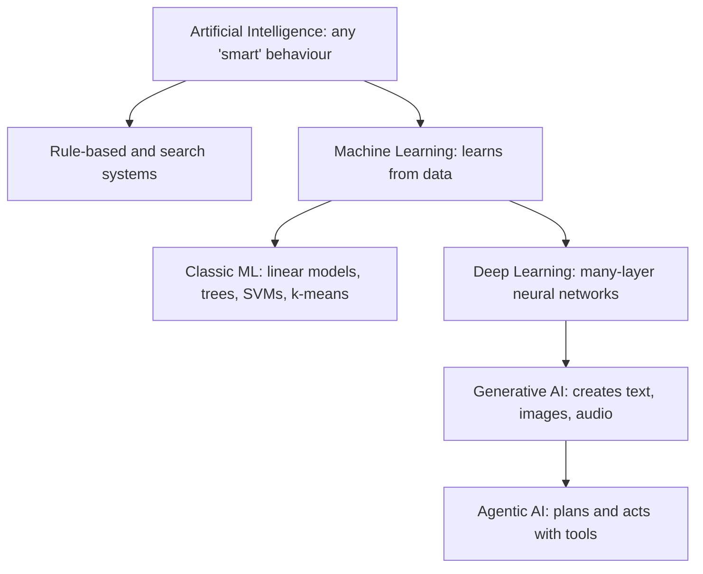
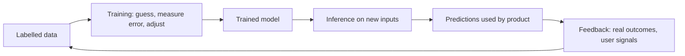
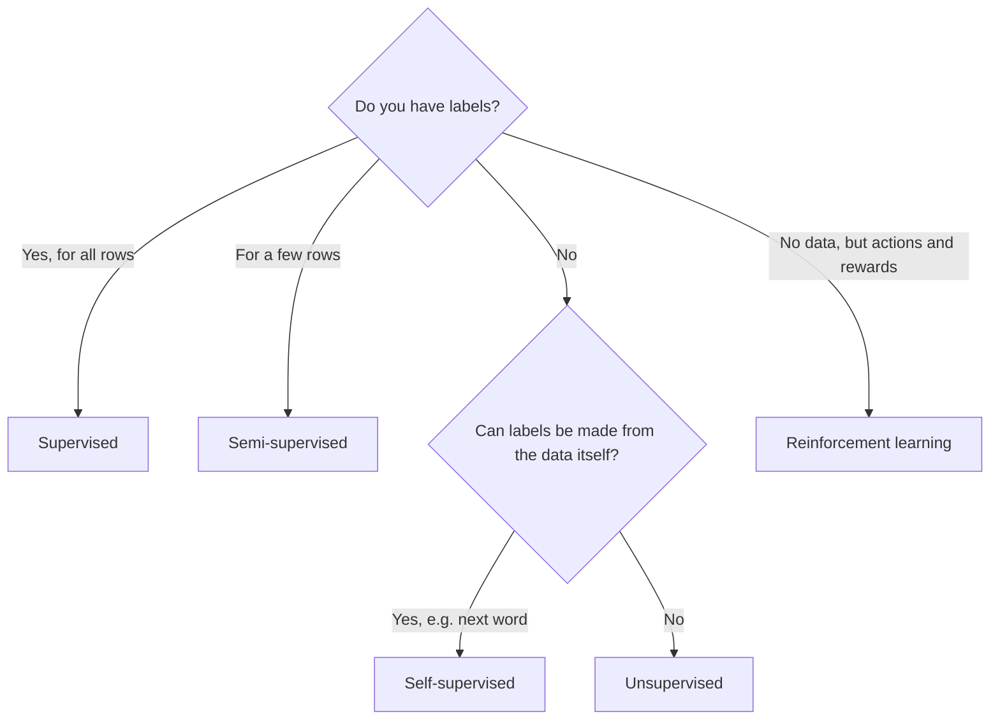
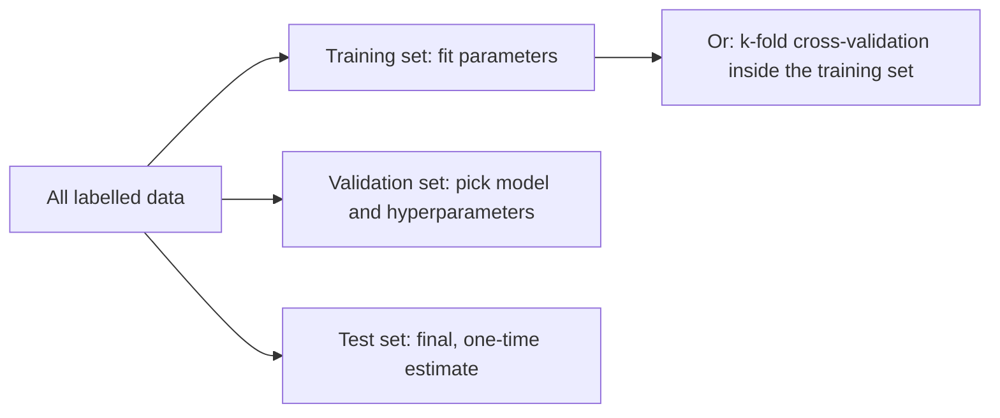
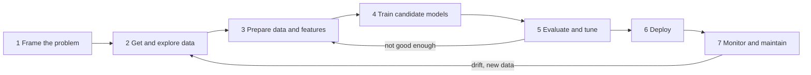

# Chapter 1 — What Machine Learning Is

Machine learning (ML) is getting a computer to improve at a task by studying examples instead of following hand-written rules. This chapter builds the map for the rest of the book and ends with a runnable **scikit-learn** project (the most widely used free Python library for classic ML: ready-made models, data-splitting tools and metrics behind one consistent interface).

**What you'll learn**

- Where ML sits inside AI (deep learning, generative and agentic AI)
- When learning from data beats writing rules, and when it does not
- The five learning setups; classification vs regression; batch vs online; instance- vs model-based
- Training, inference and feedback loops; the end-to-end workflow
- Core vocabulary: features, labels, parameters, hyperparameters, loss, train/validation/test
- How projects fail: bad data, overfitting, underfitting, leakage, non-representative data

All code is in [`code/`](code/); every script runs in seconds: `python code/<file>.py`.

---

## 1.1 The AI family tree

### What it is


*Figure — AI and four branches people talk about most (course diagram).*

| Term | Plain definition | Relationship | Typical example |
|---|---|---|---|
| **Artificial intelligence (AI)** | Any technique that makes a machine reason, perceive, plan or decide. | The whole field; includes hand-written rules and search, not only learning. | Chess engine searching moves; rules-based tax calculator; route planner |
| **Machine learning (ML)** | AI that *learns its behaviour from data* instead of having every rule spelled out. | Subset of AI. | Spam filter, fraud detector, "customers also bought" |
| **Deep learning (DL)** | ML using *neural networks* (many small units that each compute a weighted sum and pass it on) with many layers, each transforming the previous layer's output. | Subset of ML. | Face unlock, speech recognition, machine translation |
| **Generative AI (GenAI)** | Models that *produce new content* (text, images, audio, video, code) resembling their training data. | Mostly built with DL today. | Chat assistants, image generators (DALL·E, Midjourney) |
| **Agentic AI** | Systems that *plan and take multi-step actions* toward a goal, using tools and adapting. | Usually a generative model in a plan → act → observe loop. | Coding agent that edits files and runs tests; warehouse robot choosing routes |



Every DL model is an ML model and every ML model is an AI system, not the reverse. GenAI and agentic AI are not "inside" DL by definition, but nearly every practical system today is built on deep networks, so the diagram shows the common case.

### Why it matters

Knowing the boundaries lets you pick the right tool: a tabular dataset (rows and columns, like a spreadsheet) of 10,000 loan applications calls for classic ML, not a large language model (**LLM**: a very large neural network trained on huge amounts of text to predict and generate language); generating product descriptions calls for GenAI; a VAT calculation needs neither.

### How each branch works, briefly

1. **ML** — show many labelled examples (photos marked "cat"/"dog"); an algorithm finds the patterns that separate them and labels unseen photos. The rules are discovered, not typed.
2. **DL** — the model is a stack of layers: in an image network early layers detect edges, middle layers textures and parts, late layers whole objects. Because layers learn their own features, DL shines on raw unstructured data (pixels, audio, text). **AlexNet** (a deep image network) winning the 2012 **ImageNet** contest (over a million labelled photos) is the usual marker of DL overtaking older vision methods.
3. **GenAI** — learns the structure of its material well enough to *sample* new material. A text model such as GPT predicts the next **token** (a word or piece of a word) repeatedly; image generators turn random noise into an image matching a prompt.
4. **Agentic AI** — a model gets a goal and tools (web search, a calendar **API** — a defined way for one program to ask another to do something — a code runner). It picks a step, calls a tool, reads the result and repeats until done: autonomy over *multiple* steps in a changing environment.

### Trade-offs

| | Classic ML | Deep learning | Generative AI | Agentic AI |
|---|---|---|---|---|
| Data needed | Hundreds to millions of rows | Usually large (or a pre-trained model) | Enormous for pre-training (the first, general run); small for adapting | Builds on a pre-trained model |
| Best input | Tables | Images, audio, text | Text, images, audio | Tasks with tools and steps |
| Interpretability (seeing why it decided) | Often good | Low | Low | Low, and actions compound |
| Compute | Low (CPU) | High (GPU: a graphics chip doing many calculations in parallel) | Very high to train; high to run | High (many model calls) |
| Main risk | Bad data | Needs lots of data and compute | Confident wrong output ("hallucination"); copyright, authenticity | Mistakes chain across steps; safety of actions |

### When not to use it

- Rules known, stable and few (tax brackets, unit conversion, access control) → write the rules.
- A mistake is unacceptable and you cannot measure the error rate → no learned model without human review.
- A classic model or a database query answers exactly → no GenAI.

### Common mistakes

- Saying "AI" for a specific technique; say "a gradient-boosted classifier" or "a fine-tuned language model" (a *classifier* predicts a category; *fine-tuning* trains an already-trained model a little more on your smaller dataset).
- Assuming newer = better: on tabular business data, tree ensembles (many combined decision trees, i.e. flowcharts of yes/no questions) such as random forests and gradient boosting (Chapter 7) often beat deep networks.
- Believing a model "understands"; it maps inputs to outputs using statistical patterns.

### Real-world examples

- **Classic ML:** card-fraud scoring, Gmail spam filtering, credit scoring, retail demand forecasting; Netflix/YouTube recommendations from your and similar users' history.
- **DL:** Apple's Face ID, Google Translate, speech recognition, abnormality detection in medical scans.
- **GenAI:** chat assistants drafting text, DALL·E and Midjourney, music and video tools.
- **Agentic:** warehouse robots planning routes, assistants that book appointments, coding agents (automated trading acts autonomously too, though much of it is rule-based).

### In the interview

**30-second answer:** "AI is the broad goal of making machines behave intelligently. Machine learning is the part of AI where behaviour is learned from data instead of hand-coded. Deep learning is ML with many-layer neural networks, which learn their own features from raw data like pixels and text. Generative AI uses such models to create new content, and agentic AI wraps them in a loop so they can plan and take actions with tools."

- *Is a rules engine AI?* — Yes, classical AI includes rule-based expert systems; it is just not ML.
- *Why did DL take off around 2012?* — Large labelled datasets (ImageNet), cheap parallel compute (GPUs), and training tricks: ReLU activations (keep positives, zero negatives), dropout (randomly switching off units during training so the net cannot rely on any one), better initialisation (smarter starting weights).
- *Classic ML over DL when?* — Small/medium tabular data, need for interpretability, tight latency (time for one prediction; see [System Design Fundamentals](../../../system-design-patterns/modules/00-system-design-fundamentals/README.md)) or budget.

### Self-check

1. Is every ML model a DL model? → No; linear regression and decision trees are ML but not DL.
2. What makes a system "agentic"? → It pursues a goal over multiple steps, choosing actions and tools and adapting to what it observes.
3. What does a generative model output that a classifier does not? → New content rather than a label or number.

### TL;DR

AI ⊃ ML ⊃ DL. GenAI creates content, agentic AI takes multi-step actions; both usually run on DL. Pick the simplest branch that solves the problem.

---

## 1.2 Learning from data vs writing rules

### What it is

Traditional programming: *input + rules → output*. ML: *inputs + outputs → rules (the model)*, then *new input + model → output*.

**Tom Mitchell (1997):** a program *learns* from experience **E** with respect to task **T** and performance measure **P** if its performance on T, measured by P, improves with E. Spam filter: T = flag spam, E = emails labelled spam/not-spam, P = fraction classified correctly.

### The problem it solves

- **Too complex:** nobody can write "is there a cat in this photo?" in pixel values.
- **Constantly changing:** spammers adapt; a learned filter is retrained on new examples.
- **Too many cases:** speech across accents, microphones, noise.
- **Discovery:** revealing patterns people missed (e.g. which feature combinations predict churn), sometimes called *data mining*.

### How it works

Collect examples (with answers if available) → turn each into numbers (features) → choose a model family (e.g. "a weighted sum of word counts") → a training algorithm adjusts the model's internal numbers until its answers match the examples → use it on new inputs.

### Code: a hand-written rule vs a learned model

[`code/rules_vs_learning.py`](code/rules_vs_learning.py) trains a Naive Bayes spam filter (a simple probabilistic classifier, Chapter 8) on ten labelled messages and compares it with the rule "spam if it contains *free* or *prize*".

```python
def rule_based(text: str) -> int:
    return int("free" in text or "prize" in text)

vec = CountVectorizer()                  # text -> word-count features
X = vec.fit_transform(texts)
model = MultinomialNB().fit(X, labels)   # learns how often each word appears in spam vs ham
p = model.predict_proba(vec.transform([t]))[0, 1]
```

Output:

```
message                            rule  learned  P(spam)
limited offer click to claim          0        1    0.95
free coffee in the kitchen            1        1    0.61
slides for the review meeting         0        0    0.06
```

The rule misses spam without its two words and cannot learn. The model catches the first message from words seen in spam ("limited", "offer", "click", "claim") but gets "free coffee" wrong: with ten examples, "free" looks spammy. **A model is only as good as its data**; with thousands of examples the office use of "free" would be learned.

### Trade-offs

| | Hand-written rules | Machine learning |
|---|---|---|
| Needs | Expert knowledge | Representative, labelled data |
| Transparency | Fully readable | Often opaque |
| Adapting to change | Rewrite code | Retrain |
| Fuzzy patterns (images, speech) | Poorly | Well |
| Guarantees | Exact | Statistical: right *most* of the time |

### When not to use it

Logic is known and must be exact (payroll, permissions), there is no data, or no error rate is tolerable.

### Common mistakes

- Starting with ML before trying a simple rule or heuristic as a **baseline** (a simple reference solution any real model must beat).
- Forgetting that a learned model inherits every bias and gap in its examples.

### Self-check

1. Mitchell's T, E, P for a house-price model? → T: predict price; E: past sales with prices; P: e.g. average error in dollars.
2. What did the spam example show about small data? → The model over-trusted one word ("free").

### TL;DR

Rules come from people in programming and from data in ML. Use ML when rules are too complex or change too often, and only with good examples.

---

## 1.3 How a model learns: training, inference and feedback loops

### What it is


*Figure — Data feeds training, which produces a model used for inference (course diagram).*

1. **Training** — the model guesses on examples with known answers, measures how wrong it was, and nudges its internal numbers. After many rounds it predicts well on examples it has *not* seen.
2. **Inference** — the trained model is applied to new data (e.g. a voice assistant transcribing your command). No learning happens.
3. **Feedback loop** — in production, compare predictions with what actually happened, collect outcomes as fresh training data, retrain. A thumbs-down on a show becomes a new label for a recommender.



### How it works (the core loop)

1. Initialise the **parameters** (the adjustable numbers, e.g. w and b in ŷ = w·x + b).
2. Predict for a batch (small group) of training examples.
3. Compute the **loss**: one number measuring how wrong the predictions are (e.g. mean squared error, the average squared difference between prediction and truth; worked numbers in §1.6).
4. Move the parameters in the direction that lowers the loss — **gradient descent**: repeatedly take a small step in the direction that reduces the loss fastest (Chapter 2).
5. Repeat until the loss stops improving.

### Data is king

- **Garbage in, garbage out:** mislabelled, outdated or one-sided data yields a model with the same flaws, often hard to spot.
- **Diversity matters:** the *Gender Shades* study (Buolamwini and Gebru, 2018) found commercial face-analysis systems erred far more on darker-skinned women than lighter-skinned men, traced largely to unbalanced training and **benchmark** data (standard datasets used to compare models).
- **High stakes:** a diagnostic model trained on one population may misdiagnose another.

The goal is **generalisation**: performing well on new, real-world data, not just the training examples. Good, diverse data is the biggest lever.

### Self-check

1. Does a model learn during inference? → Not by default; learning resumes on retraining (or with online learning, §1.7).
2. What is generalisation? → Performing well on data not seen in training.

### TL;DR

Training adjusts parameters to reduce loss on known examples; inference applies the model; feedback loops turn real outcomes into new training data. Data quality and diversity decide generalisation.

---

## 1.4 Types of learning by supervision

### What it is

Grouped by *how much and what kind of answer* the system gets during training.

| Type | Training data | Goal | Typical algorithms | Example |
|---|---|---|---|---|
| **Supervised** | Inputs **with** labels | Predict labels for new inputs | Linear/logistic regression, trees, random forests, gradient boosting, SVMs, neural nets | Classify new emails from emails marked spam/not spam |
| **Unsupervised** | Inputs **without** labels | Find structure: groups, low-dimensional summaries, anomalies | k-means, DBSCAN, PCA, isolation forest | Group customers; flag odd transactions |
| **Semi-supervised** | Few labelled + many unlabelled rows | Beat the labelled part alone | Self-training, label propagation | Photo app clusters faces, you name one per person, it names the rest |
| **Self-supervised** | Unlabelled data, labels *generated automatically* | Learn **representations** (internal numeric summaries of the input) by predicting a hidden part of the data | Next-word (GPT), masked-word (BERT), contrastive learning | LLMs pre-trained on next-token prediction |
| **Reinforcement (RL)** | No fixed dataset; an *agent* acts in an *environment* and gets *rewards* | Learn a *policy* maximising total reward | Q-learning, policy gradients, PPO | DeepMind's AlphaGo; robots learning to walk; RLHF for chatbots |



> **Key terms (each covered later):** *SVM* draws the widest boundary between classes; *k-means*/*DBSCAN* group similar points; *PCA* squeezes many features into a few summary ones; *isolation forest* flags easily separated points as anomalies. *Self-training*/*label propagation* spread a few labels to unlabelled rows; *BERT* fills in hidden words; *contrastive learning* teaches that two views of the same thing should look alike. In RL the *agent* is the learner, the *environment* its world, the *policy* its action rule; *Q-learning*, *policy gradients*, *PPO* are training methods; *RLHF* (RL from human feedback) uses human ratings as reward.

### Why it matters

Labels are usually the most expensive part of a project (doctors labelling scans). The supervision type sets labelling cost, applicable algorithms and how you can evaluate.

### How it works (one demo each)

[`code/learning_types.py`](code/learning_types.py):

```python
# supervised: iris species (classification) and diabetes progression (regression)
clf = LogisticRegression(max_iter=1000).fit(Xtr, ytr)
reg = LinearRegression().fit(Xtr, ytr)
# unsupervised: k-means never sees the true groups
labels = KMeans(n_clusters=3, n_init=10, random_state=SEED).fit_predict(X)
# semi-supervised: hide 95% of labels (-1 = unlabelled), then self-train
self_train = SelfTrainingClassifier(LogisticRegression(max_iter=2000), threshold=0.9).fit(Xtr, y_partial)
# self-supervised: the "label" is the next value of the series
X = np.stack([series[i:i + 3] for i in range(len(series) - 3)]); y = series[3:]
# reinforcement: epsilon-greedy 3-armed bandit learns which arm pays best
arm = rng.integers(3) if rng.random() < 0.1 else int(np.argmax(estimates))
```

Output:

```
[classification] iris accuracy = 1.000
[regression]     diabetes MAE = 45.1 (target std = 77.0)
[unsupervised]   k-means agreement with hidden groups (ARI) = 0.767
[semi-supervised] 69 labels only: 0.867 | + self-training on unlabelled rows: 0.882
[self-supervised] next-value MAE = 0.068
[reinforcement]  estimated payouts [0.19, 0.46, 0.8], pulls [81, 72, 1847], avg reward 0.766
```

- *Supervised:* regression error (**MAE**, mean absolute error = average mistake size) of 45 is well below the target's **standard deviation** (std, how far a typical value sits from the average) of 77.
- *Unsupervised:* k-means recovered most of the hidden grouping without seeing it (**ARI**, adjusted Rand index: 1 = perfect agreement, 0 = random).
- *Semi-supervised:* with 69 labels, self-labelling confident rows and retraining added ~1.5 points; the gain is not guaranteed.
- *Self-supervised:* the future of the series served as the target; no human label.
- *Reinforcement:* a *multi-armed bandit* (slot machines with unknown payout rates). The *epsilon-greedy* agent usually pulls the best-looking arm but with probability epsilon (10%) a random one; it found arm 3 pays ~80% and spent most pulls there. The random pulls are the *exploration* cost.

### Trade-offs

| | Labelling cost | Evaluation | Main risk |
|---|---|---|---|
| Supervised | High | Easy: compare to labels | Label errors, bias |
| Unsupervised | None | Hard: no ground truth | Meaningless patterns |
| Semi-supervised | Low | Needs a labelled test set | Wrong pseudo-labels (self-assigned labels) reinforce themselves |
| Self-supervised | None, but huge data and compute | Via downstream tasks (the real tasks it is later adapted to) | Cost; web-scale biases |
| Reinforcement | Need reward and environment | Total reward | Reward hacking; slow, unstable training |

### Common mistakes

- Treating clusters as true categories without checking.
- An RL reward that can be "gamed" (a loophole earns reward without doing the task).
- Calling LLM pre-training "unsupervised": it is self-supervised — the target (next token) exists, generated from the data.

### In the interview

**30-second answer:** "Supervised learning has labelled examples and predicts labels. Unsupervised has no labels and finds structure like clusters. Semi-supervised mixes a few labels with lots of unlabelled data. Self-supervised creates labels from the data itself, like predicting the next word, which is how large language models are pre-trained. Reinforcement learning learns actions from rewards by trial and error."

- *Is anomaly detection supervised?* — Usually unsupervised or semi-supervised (train mostly on normal data), because labelled anomalies are rare.
- *Exploration–exploitation trade-off?* — Trying actions to learn more (explore) vs using the best-known action (exploit).
- *How is ChatGPT-style training split?* — Self-supervised pre-training, supervised fine-tuning on example conversations, then RL from human (or AI) feedback.

### Self-check

1. Fraud labels exist for 1% of transactions. Setup? → Semi-supervised (or supervised on the labelled part plus anomaly detection).
2. Why is unsupervised learning hard to evaluate? → No correct answer to compare against.

### TL;DR

Labels → supervised; none → unsupervised; a few → semi-supervised; made from the data → self-supervised; rewards from actions → reinforcement.

---

## 1.5 Classification vs regression

### What it is

The two main supervised tasks, split by label type:

- **Classification** predicts a **category**: spam/ham ("ham" = legitimate email), digit 0–9. Two classes = *binary*; more = *multiclass*; several labels per example (photo tagged "beach" and "dog") = *multilabel*.
- **Regression** predicts a **continuous number**: price, temperature, days until churn.

| | Classification | Regression |
|---|---|---|
| Output | Class (often with a probability) | Real number |
| Example losses | Log loss (cross-entropy), hinge loss | MSE, MAE |
| Example metrics | Accuracy, precision, recall, F1, ROC-AUC | MAE, RMSE, R² |
| Example algorithms | Logistic regression, tree classifier, k-NN classifier | Linear regression, tree regressor, k-NN regressor |

> **Key terms:** a *loss* is what training minimises; a *metric* is what you report. *Log loss* punishes confidently wrong probabilities; *hinge loss* (SVMs) punishes points on the wrong side of, or too close to, the boundary. *Accuracy* = share correct; *precision* = of flagged positives, share truly positive; *recall* = of true positives, share caught; *F1* balances the two; *ROC-AUC* = how well positives are ranked above negatives (1 perfect, 0.5 coin flip). *RMSE* = √MSE (target's units); *R²* = share of target variation explained (1 perfect, 0 = predicting the average). Full treatment in Chapter 6.

**Logistic regression is a classifier**: it predicts a class probability, then applies a *threshold* (cut-off, usually 0.5) above which the answer is "yes".

### Common mistakes

- Encoding categories as numbers (red = 1, green = 2) and doing regression, inventing an order.
- Binning a regression target ("high/low" price) too early, discarding information.
- Judging accuracy on imbalanced data: if 99% of transactions are legitimate, "always legitimate" is 99% accurate and useless (Chapter 6).

### Self-check

1. Star rating 1–5? → Either: regression respects order, classification treats ratings as categories; try both.

### TL;DR

Category → classification; number → regression. The label type decides loss, metrics and algorithms.

---

## 1.6 Key terms

| Term | Meaning | Example (house prices) |
|---|---|---|
| **Example / instance / sample / row** | One item in the dataset | One house sale |
| **Feature (attribute, input, predictor, X)** | Measurable property used as input | Size m², rooms, postcode |
| **Label (target, output, y)** | Answer to predict | Sale price |
| **Feature vector** | One example's features as numbers | [120, 3, 1995] |
| **Model** | Function with adjustable parts mapping features to a prediction | price = w₁·size + w₂·rooms + b |
| **Parameters** | Numbers *learned* in training | w₁, w₂, b |
| **Hyperparameters** | Settings *you choose before* training that control learning | Polynomial degree, regularisation strength C (how hard big weights are penalised), learning rate (training step size), number of trees |
| **Loss (cost, objective)** | Number measuring wrongness; training minimises it | Mean squared error |
| **Training set** | Data parameters are learned from | 60–80% |
| **Validation set** | Data to compare models and tune hyperparameters | 10–20% |
| **Test set** | Used once at the end to estimate real-world performance | 10–20%, untouched before |
| **Cross-validation** | Rotating the validation role through k chunks ("folds") of training data and averaging | 5-fold CV |
| **Prediction (ŷ, "y-hat")** | Model output | $412,000 |
| **Generalisation** | Doing well on new data | Accurate prices next month |
| **Inference** | Using a trained model to predict | Pricing a new listing |

### Parameters vs hyperparameters

Training finds parameters (w, b in ŷ = w·x + b); you set hyperparameters (e.g. polynomial **degree**) and tune them on the *validation* set or with cross-validation, never on the test set.

### Loss, with worked numbers

True prices 300, 250, 400 ($1000s); predictions 310, 240, 380. Errors (true − predicted): −10, +10, +20.

- **MSE** = (100 + 100 + 400) / 3 = **200** ($1000², hard to read)
- **RMSE** = √200 ≈ **14.1** → "typically off by about $14k"
- **MAE** = (10 + 10 + 20) / 3 ≈ **13.3**

Squaring makes MSE punish the big error (20) much more.

### Training, validation and test sets



Tuning while watching test performance slowly fits the test set and makes the reported score optimistic; the validation set absorbs tuning so the test set stays honest.

[`code/train_val_test.py`](code/train_val_test.py) splits 60/20/20, picks C by validation log loss, reports test accuracy once, then simulates *drift* (live data changing away from the training data) in production:

```python
X_tmp, X_test, y_tmp, y_test = train_test_split(X, y, test_size=0.2, random_state=SEED)
X_train, X_val, y_train, y_val = train_test_split(X_tmp, y_tmp, test_size=0.25, random_state=SEED)
for c in [0.001, 0.01, 1.0]:
    m = LogisticRegression(C=c).fit(X_train, y_train)
    loss = log_loss(y_val, m.predict_proba(X_val))
```

Output:

```
sizes train/val/test: 1800 600 600
C=0.001  validation log-loss = 0.529
C=0.01   validation log-loss = 0.287
C=1.0    validation log-loss = 0.063
chosen C=1.0; test accuracy = 0.998
after drift, live accuracy = 0.746  -> alert, retrain
after retraining on fresh labelled data, accuracy = 0.986
```

(0.25 of the remaining 80% = 20% of the total.) After drift accuracy fell from 99.8% to 74.6%; retraining on fresh data recovered it — why monitoring matters.

### Self-check

1. Learning rate: parameter or hyperparameter? → Hyperparameter.
2. Why not tune on the test set? → Its score becomes biased upward.

### TL;DR

Features in, label out. Training learns parameters by minimising a loss; hyperparameters are chosen with validation data or CV; the test set is used once.

---

## 1.7 Batch vs online learning

### What it is

- **Batch (offline):** train on the full dataset, deploy the frozen model, retrain from scratch periodically (nightly, weekly).
- **Online (incremental):** feed mini-batches or single examples; the model updates as data arrives and old data can be discarded.
- **Out-of-core learning:** online learning used to train on data too large for memory by streaming chunks from disk.

### Why it matters

Batch is simple and reproducible but slow to react and costly on huge data. Online adapts fast (stock prices, news trends, sensors) on limited memory but can drift badly if bad data arrives.

### How it works

Initialise → for each arriving mini-batch, compute the loss and take one gradient-descent step → discard (or archive) the batch. The **learning rate** sets how strongly each batch moves the model: high adapts fast but forgets old patterns and chases **noise** (random variation with no real pattern); low is stable but slow.

[`code/batch_vs_online.py`](code/batch_vs_online.py) trains `SGDClassifier` (a linear classifier trained by **stochastic gradient descent**: updates after each small random batch instead of the whole dataset) both ways:

```python
batch = SGDClassifier(average=True, random_state=SEED).fit(X[:16_000], y[:16_000])

online = SGDClassifier(average=True, random_state=SEED)
for start in range(0, 16_000, 2000):
    online.partial_fit(X[start:start + 2000], y[start:start + 2000], classes=[0, 1])
```

Output:

```
batch model (16,000 rows at once): test acc = 0.842
online after  2,000 rows: test acc = 0.833
online after  8,000 rows: test acc = 0.838
online after 16,000 rows: test acc = 0.839
```

The online model nearly matches batch while holding only 2,000 rows in memory. (`average=True` averages weights over updates; without it accuracy jumped between 0.66 and 0.83 here — online learners are sensitive to learning-rate settings.) scikit-learn **estimators** (any model/transformer object with `fit`) supporting incremental learning expose `partial_fit`: `SGDClassifier`, `SGDRegressor`, `MultinomialNB`, `MiniBatchKMeans`.

### Trade-offs

| | Batch | Online |
|---|---|---|
| Adapts to change | At next retrain | Continuously |
| Memory / compute | Whole dataset per retrain | One chunk at a time |
| Reproducibility | High | Lower: depends on data order |
| Risk | Stale model | Bad data corrupts the live model quickly |
| Monitoring | Standard | Close watch on inputs and performance, plus a rollback plan |

### When not to use online learning

Data arrives slowly, changes are rare (weekly retrain suffices), or you cannot monitor inputs — poisoned (deliberately corrupted) or buggy data flows straight into the live model. Microsoft's Tay chatbot (2016) was taken offline within a day after users fed it offensive content it then repeated.

### Self-check

1. Which scikit-learn method signals online support? → `partial_fit`.
2. Out-of-core learning? → Streaming data larger than memory in chunks through an online algorithm.

### TL;DR

Batch: train on everything, redeploy periodically. Online: update continuously from small chunks; faster to adapt, needs careful monitoring.

---

## 1.8 Instance-based vs model-based learning

### What it is

- **Instance-based:** memorise examples; predict from the most **similar** stored ones. E.g. **k-nearest neighbours (k-NN)** averages the labels of the k closest points.
- **Model-based:** fit a **compact model** (formula with parameters) and discard the examples. E.g. linear regression ŷ = w·x + b.

### How it works (worked example)

Data y ≈ 3x + 2 + noise, x in 0–10 ([`code/batch_vs_online.py`](code/batch_vs_online.py)):

```python
lin = LinearRegression().fit(X, y)              # stores 2 numbers
knn = KNeighborsRegressor(n_neighbors=5).fit(X, y)  # stores all 5000 rows
x_new = np.array([[4.0], [15.0]])               # 15 lies outside 0..10
```

Output:

```
linear model: w=3.00, b=2.04 -> predicts [14. 47.]
k-NN (k=5): stores 5000 rows -> predicts [14.4 32. ]
prediction time for 10,000 queries: linear 0.22 ms vs k-NN 3.1 ms (exact times vary by machine)
```

At x = 4 both agree (true 14). At x = 15 the linear model **extrapolates** (predicts beyond the training range) correctly (47); k-NN can only average neighbours near x = 10 (≈ 32). The linear model is 2 numbers and much faster; k-NN searches all data at prediction time.

### Trade-offs

| | Instance-based (k-NN) | Model-based |
|---|---|---|
| Training | Almost instant | Takes time |
| Prediction | Slower; all data in memory | Fast, small memory |
| Flexibility | Any shape if data is dense | Limited by model form |
| Extrapolation | Poor | Possible if form is right |
| Needs | Good similarity measure; scaled features | Good model family |

### Self-check

1. Which approach makes new examples usable instantly without retraining? → Instance-based: add them to the store.

### TL;DR

Instance-based learners compare to stored cases; model-based learners fit parameters and discard data. Most algorithms in this book are model-based.

---

## 1.9 The end-to-end ML workflow

### What it is

A cycle in which modelling is usually the smallest part.



### How it works

1. **Frame.** What decision does the prediction drive and what is it worth? Supervised? Classification/regression? Batch/online? Which metric reflects business value (fraud recall, dollars of price error)? What does the current solution achieve (the baseline)? Is ML needed at all?
2. **Get and explore data.** Check it is legal and ethical to use; look at distributions, missing values, **outliers** (values far from the rest) and **correlations** (how strongly two columns move together). **Set aside the test set now**, before deep exploration.
3. **Prepare data and features.** Clean, handle missing values, encode categories as numbers, scale features to comparable ranges, create informative features ("price per m²"). Put it all in a **pipeline** (a fixed chain of steps) so training and production apply it identically.
4. **Train candidates.** Start simple (linear), then try a few families (trees, ensembles); compare with cross-validation.
5. **Evaluate and tune.** Tune on validation data, analyse errors, check fairness across groups, then test *once*.
6. **Deploy** the whole pipeline as a batch job (scheduled scoring of many rows) or a web API (answers prediction requests over the network); roll out gradually — *shadow mode* (new model runs alongside, answers logged not used) or *A/B test* (a random share of users gets the new model). See [System Design Fundamentals](../../../system-design-patterns/modules/00-system-design-fundamentals/README.md).
7. **Monitor and maintain.** Track input and prediction distributions and real performance as labels arrive. **Data drift**: inputs change; **concept drift**: the input→label relationship changes. Retrain, version models and data, keep a rollback path.

### Real-world examples

- **Spam filtering:** every "Report spam" click is a new label.
- **Google Flu Trends** substantially overestimated the 2012–13 flu peak as search behaviour changed — drift without enough monitoring and recalibration.
- **Zillow Offers** (home buying on price predictions) shut down in 2021, citing difficulty forecasting prices in a fast-moving market.

### Common mistakes

- Jumping to modelling without a metric or baseline.
- Preprocessing in a notebook and re-implementing it differently in production (**training–serving skew**: the model sees inputs unlike those it learned from).
- No monitoring: the model silently decays.

### In the interview

**30-second answer:** "I start by framing the problem: the decision, the metric, and a baseline. Then I collect and explore data, holding out a test set early. I build a preprocessing-plus-model pipeline, compare a few model families with cross-validation, tune on validation data and test once. Then I deploy the pipeline as a unit, and monitor drift and performance, retraining when needed."

- *When to retrain?* — Monitored performance drops as labels arrive, inputs shift noticeably from training, or on a schedule.

### Self-check

1. Why hold out the test set before exploring? → To avoid tailoring choices to it (data snooping).
2. Why ship preprocessing and model together? → Production then applies exactly the training transformations.

### TL;DR

Frame → data → features → model → evaluate → deploy → monitor, and loop. Baseline first, test once, pipeline everything, monitor always.

---

## 1.10 The main challenges of machine learning

Failures come from **bad data** or **a bad model**. [`code/challenges.py`](code/challenges.py) demonstrates each.

### 1. Not enough or poor-quality data

Too few examples, wrong labels, noise, missing values, outliers. **Demo** — flipping training labels on the breast-cancer dataset:

```
 0% wrong training labels -> test accuracy 0.958
20% wrong training labels -> test accuracy 0.951
40% wrong training labels -> test accuracy 0.636
```

Moderate random label noise partly cancels out but quickly becomes fatal; systematic errors (one annotator always mislabels a class) are worse because they do not cancel. **Fixes:** audit labels, more data, fix outliers, handle missing values deliberately.

### 2. Non-representative training data (sampling bias)

Training data unlike deployment data: convenience sampling, self-selection (only happy customers answer surveys), historical bias. **Demo** — trained only on houses under 120 m²:

```
trained on houses < 120 m^2: mean error small houses 14,086 | big houses 43,250
```

The relationship bends outside the seen range; error triples. **Real world:** the face-analysis gaps in §1.3; the 1936 *Literary Digest* poll predicted Landon over Roosevelt from ~2.4 million ballots — mailing lists leaned on telephone directories and car registrations, and only about a quarter replied, so both list and responses were skewed. **Fixes:** sample to match the deployment population, check per-subgroup performance, collect data where the model will run.

### 3. Irrelevant features

They add noise and invite **spurious patterns** (coincidences in the training data). **Feature engineering** — selecting, combining and creating features from domain knowledge — is often where most gains come from.

### 4. Overfitting

The model learns training data *too* well, noise included, and fails on new data (memorising past exams). **Signal:** low training error, much higher validation error. **Causes:** model too complex for the data, too many features, too little or noisy data. **Fixes:** simpler model, fewer features, **regularisation** (penalty on large parameters), more data, less noise, **early stopping** (halt when validation error stops improving), cross-validation to choose complexity.

### 5. Underfitting

Model too simple for the pattern. **Signal:** training *and* validation error both high. **Fixes:** more powerful model, better features, less regularisation, train longer.

**Demo** — polynomials of degree 1, 4, 15 on 20 noisy sine points:

```
degree  train MSE  val MSE
     1      0.207    0.271
     4      0.011    0.073
    15      0.007    0.873
```


Degree 15 has the *lowest* training error but 12× degree 4's validation error: it threads every noisy point and swings wildly between them. This is the **bias–variance trade-off**: simple models have high *bias* (systematic error), complex ones high *variance* (sensitivity to the particular sample) — Chapter 6.

| Train error | Validation error | Diagnosis | First fixes |
|---|---|---|---|
| High | High | Underfitting | More capacity or better features |
| Low | High | Overfitting | Regularise, simplify, more data |
| Low | Low, close | Good fit | Test once, ship |

### 6. Data leakage

Information unavailable at prediction time sneaks into training or evaluation, inflating scores.

- **Target leakage:** a feature that is a consequence of the label ("was prescribed antibiotics" for "has infection"; "account closed date" for churn).
- **Train–test contamination:** preprocessing (scaling, feature selection, **imputation** = filling missing values) fit on the *whole* dataset before splitting; random splits of **time-series** data (measurements in time order); the same patient in train and test.

**Demo** — 100 rows of random noise with random labels (honest answer 50%):

```python
# WRONG: select features using all rows, then cross-validate
X_leaky = SelectKBest(f_classif, k=20).fit_transform(X, y)
wrong = cross_val_score(LogisticRegression(max_iter=1000), X_leaky, y, cv=5).mean()
# RIGHT: selection inside the pipeline, refit on each training fold
pipe = make_pipeline(SelectKBest(f_classif, k=20), LogisticRegression(max_iter=1000))
right = cross_val_score(pipe, X, y, cv=5).mean()
```

```
leaky CV accuracy on pure noise: 0.85  |  honest CV accuracy: 0.48
```

85% accuracy on noise: selecting the 20 features best matching the labels *using the test folds* baked the answers in. **Real world:** Zech et al. (2018) found chest X-ray pneumonia models could recognise *which hospital* an image came from, which correlated with disease rates, so part of the skill did not transfer. **Fixes:** split first; put every data-dependent step in a `Pipeline`; split time series by time; group splits by patient/user; ask of every feature "would I know this at prediction time?"

### When a result is too good to be true

Suspect leakage when a simple model scores near-perfectly, one feature dominates importance, or production falls far below test.

### In the interview

**30-second answer:** "The main risks are data problems — too little, noisy, non-representative or leaky data — and model problems — overfitting, where the model memorises noise and generalises poorly, and underfitting, where it's too simple. I diagnose by comparing training and validation error, guard against leakage with pipelines and proper splits, and check performance across subgroups."

- *Detect overfitting?* — Low training error with much higher validation error; **learning curves** (train and validation error vs training-set size).
- *More data or a better model?* — Overfitting: more data helps. Underfitting: more data of the same kind barely helps; improve model or features.

### Self-check

1. Why is fitting a scaler on the full dataset leakage? → Its mean and std include test-set information.
2. A churn model's top feature is "cancellation reason". Problem? → Target leakage: it exists only after churn.
3. How can a huge sample be biased? → Drawn from an unrepresentative population (Literary Digest).

### TL;DR

Bad data (too little, noisy, non-representative, leaky) and bad models (overfit, underfit) cause most failures. Compare train vs validation error, use pipelines, split correctly, check each subgroup.

---

## 1.11 A first end-to-end project with scikit-learn

### What it is

The whole workflow in [`code/first_end_to_end.py`](code/first_end_to_end.py) on the bundled **Breast Cancer Wisconsin** dataset: 569 tumour samples, 30 numeric cell-image features (radius, texture, smoothness, ...), label malignant (0) / benign (1).

**Framing:** supervised binary classification, batch. Missing a malignant tumour is worse than a false alarm, so we also care about **recall on the malignant class**.

### How it works

```python
data = load_breast_cancer(as_frame=True)
X, y = data.data, data.target

# 1. hold out a stratified test set first
X_train, X_test, y_train, y_test = train_test_split(
    X, y, test_size=0.2, stratify=y, random_state=SEED)

# 2. baseline: always predict the most common class
base = DummyClassifier(strategy="most_frequent").fit(X_train, y_train)

# 3. pipeline = scaling + logistic regression; cross-validate on training data
pipe = make_pipeline(StandardScaler(), LogisticRegression(max_iter=1000))
cv = cross_val_score(pipe, X_train, y_train, cv=5)

# 4. tune the hyperparameter C with cross-validation
grid = GridSearchCV(pipe, {"logisticregression__C": [0.01, 0.1, 1, 10]}, cv=5)
grid.fit(X_train, y_train)

# 5. evaluate once on the test set
y_pred = grid.predict(X_test)

# 6. save the whole pipeline and reload it as a serving process would
joblib.dump(grid.best_estimator_, path)
served = joblib.load(path)
```

- `stratify=y` keeps the class ratio equal in train and test.
- `DummyClassifier` is the score to beat.
- `StandardScaler` rescales features to mean 0, std 1 (logistic regression trains better); inside the pipeline it is re-fit per training fold — no leakage.
- `GridSearchCV` tries each C with 5-fold CV and refits the best on all training data; `step__param` (`logisticregression__C`) addresses a parameter inside a pipeline step.
- `joblib` saves scaler + model as one file; load such files only from trusted sources, since unpickling (turning saved bytes back into Python objects) can run code.

Output:

```
shape: (569, 30) | class counts: [212, 357]
train: 455 test: 114
baseline accuracy (test): 0.632
5-fold CV accuracy: 0.980 +/- 0.013
best C: 0.1 | best CV accuracy: 0.980
test accuracy: 0.974
confusion matrix [rows=true, cols=pred]:
 [[40  2]
 [ 1 71]]
              precision    recall  f1-score   support

   malignant      0.976     0.952     0.964        42
      benign      0.973     0.986     0.979        72

    accuracy                          0.974       114
   macro avg      0.974     0.969     0.972       114
weighted avg      0.974     0.974     0.974       114

prediction for a new sample: malignant | P(benign) = 0.0
learned parameters: coef_ shape (1, 30) intercept [0.504]
```

- Baseline 63.2% (always "benign") → model 97.4%.
- CV (98.0%) and test (97.4%) are close: no sign of overfitting or leakage.
- The **confusion matrix** (counts of each true × predicted class pair) shows **2 malignant tumours predicted benign** (false negatives), the costly error; malignant recall = 40/42 = 0.952. Lowering the decision threshold would trade false alarms for fewer misses (Chapter 6).
- `coef_` = 30 learned weights, `intercept` = b; C = 0.1 is the chosen hyperparameter.
- *Support* = test examples per class; *macro avg* weights classes equally, *weighted avg* by support. `P(benign) = 0.0` is rounded.

### Common mistakes

- Reporting the tuned model's CV score as final (slightly optimistic; the test set is the honest number).
- Forgetting `stratify` on small or imbalanced data.
- Saving the model without the scaler, then feeding unscaled data in production.

### Self-check

1. What is a useless baseline for? → It sets the minimum bar; a model barely beating it is not worth deploying.

### TL;DR

Split (stratified) → baseline → pipeline → cross-validate → tune → test once → save the whole pipeline. That skeleton carries through every chapter.

---

## Chapter TL;DR

- **AI ⊃ ML ⊃ DL.** GenAI creates content; agentic AI plans and acts. Choose the simplest branch that works.
- **ML learns rules from examples**; use it when rules are too complex or change too often and you have good data.
- **Training** minimises a **loss**; **inference** applies the model; **feedback loops** feed outcomes back.
- **Supervision:** supervised, unsupervised, semi-supervised, self-supervised, reinforcement.
- **Classification** → categories; **regression** → numbers.
- **Batch** retrains periodically; **online** updates with `partial_fit`. **Instance-based** compares to stored examples; **model-based** fits parameters.
- **Workflow:** frame → data → features → model → evaluate → deploy → monitor, looped.
- **Parameters** are learned; **hyperparameters** chosen on validation data; **test set** used once.
- **Failures:** bad or non-representative data, overfitting (train ≪ validation error), underfitting (both high), leakage (too-good scores). Pipelines and correct splits prevent most.
