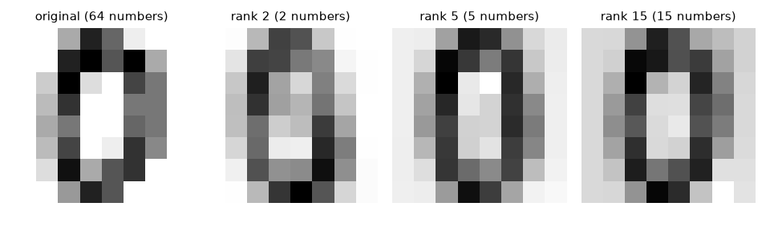
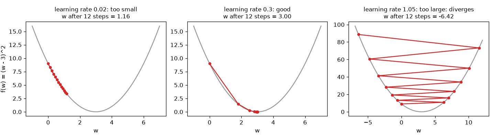
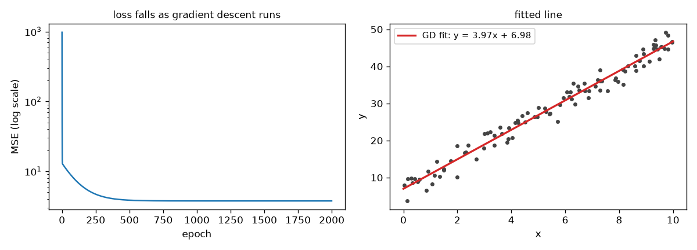
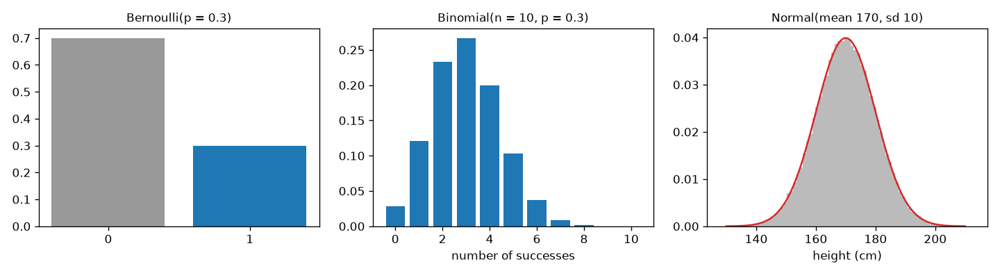
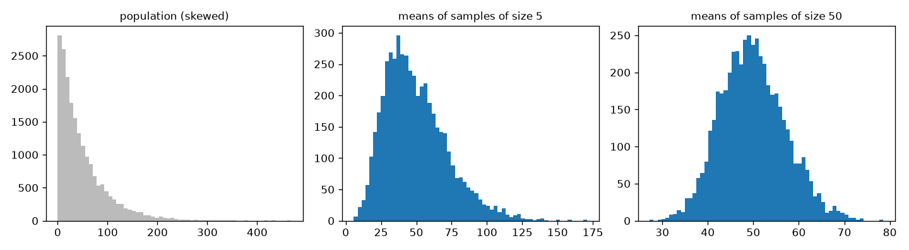

# Chapter 2 — The Math You Need for Machine Learning

You do not need to be a mathematician to do machine learning, but four areas of math appear in every model, every library call and every interview: **linear algebra** (how data and models are stored and combined), **calculus** (how models learn), **probability** (how models express uncertainty) and **statistics** (how we judge results). A fifth, small area, **information theory**, explains the most common loss function in classification.

This chapter teaches each idea with a plain definition, a small hand calculation, and NumPy code you can run. It keeps only what ML practitioners actually use.

**What you'll learn**

- Vectors, matrices, dot products and matrix multiplication, and why a model's prediction is "just" a matrix product
- Transpose, inverse, determinant and norms; the intuition behind eigenvectors and SVD
- Derivatives, partial derivatives, gradients and the chain rule
- Gradient descent: by hand, in code, with plots, and the role of the learning rate
- Random variables; Bernoulli, binomial and normal distributions; expectation and variance
- Conditional probability and Bayes' theorem with a worked medical-test example
- Mean, median, standard deviation, standardisation, correlation vs causation, sampling
- Hypothesis tests, p-values and confidence intervals, read correctly
- Entropy, cross-entropy and KL divergence, and why classifiers minimise "log loss"

All code is in [`code/`](code/). Notation: bold or plain lowercase letters (x, w) are vectors, uppercase (X, A) are matrices, ŷ is a prediction, Σ means "sum of", and · is a dot product.

---

## 2.1 Vectors

### What it is

A **vector** is an ordered list of numbers, such as [2, 5, −3]. In ML, **one data point is one vector**: a house with 120 m², 3 bedrooms and 2 bathrooms is x = [120, 3, 2]. Each position is a **feature**, and the number of positions is the vector's **dimension**. Geometrically, a vector is an arrow from the origin to a point in space; a 3-feature house is a point in 3-D space, and a 784-pixel image is a point in 784-D space.

### Why it matters

Once data is a vector, "similar houses" becomes "nearby points", "a model" becomes "a set of weights to combine the numbers", and the computer can process millions of rows with fast array operations.

### How it works

| Operation | Rule | Example with a = [1, 2, 3], b = [4, 5, 6] |
|---|---|---|
| Addition | Add position by position | a + b = [5, 7, 9] |
| Scalar multiplication | Multiply every entry | 2a = [2, 4, 6] |
| **Dot product** a · b | Multiply position by position, then sum | 1·4 + 2·5 + 3·6 = **32** |
| **L2 norm** ‖a‖₂ (length) | √(sum of squares) | √(1 + 4 + 9) = √14 ≈ 3.74 |
| L1 norm ‖a‖₁ | Sum of absolute values | 1 + 2 + 3 = 6 |
| Max norm ‖a‖∞ | Largest absolute value | 3 |
| Unit vector | a / ‖a‖₂ (length 1, same direction) | [0.27, 0.53, 0.80] |
| Cosine similarity | (a · b) / (‖a‖ ‖b‖) | 32 / (3.74 · 8.77) ≈ 0.975 |

**The dot product is the most important operation in ML.** A linear model's prediction is a dot product plus a constant:

ŷ = w · x + b = w₁x₁ + w₂x₂ + w₃x₃ + b

With weights w = [2, 10, 5] and the house x = [120, 3, 2]: w · x = 2·120 + 10·3 + 5·2 = 240 + 30 + 10 = **280**.

Geometrically, a · b = ‖a‖ ‖b‖ cos θ, where θ is the angle between the arrows. So the dot product is large when vectors point the same way, zero when they are perpendicular, and negative when they point in opposite directions. **Cosine similarity** keeps only the angle; it is how search engines and recommendation systems compare text or item **embeddings** (learned vectors that represent meaning).

**Norms** measure size. The L2 norm is ordinary distance; the distance between two points is ‖a − b‖₂. L1 and L2 norms of the *weights* appear as regularisation penalties (Lasso uses L1, Ridge uses L2).

### Code

[`code/linear_algebra.py`](code/linear_algebra.py):

```python
house = np.array([120.0, 3.0, 2.0])
w = np.array([2.0, 10.0, 5.0])
print("dot w.x =", w @ house)                      # @ is the dot / matrix product
a, b = np.array([1.0, 0.0]), np.array([1.0, 1.0])
cos = a @ b / (np.linalg.norm(a) * np.linalg.norm(b))
v = np.array([3.0, -4.0])
print(np.linalg.norm(v), np.linalg.norm(v, 1), np.linalg.norm(v, np.inf))
```

Output:

```
x = [120.   3.   2.] | w = [ 2. 10.  5.]
x + w = [122.  13.   7.] | 2 * x = [240.   6.   4.]
dot w.x = 280.0 (= 2*120 + 10*3 + 5*2)
cosine similarity of [1,0] and [1,1] = 0.707 (angle 45 deg)
L2 norm of [3,-4] = 5.0 | L1 norm = 7.0 | max norm = 4.0
unit vector = [ 0.6 -0.8]
```

### Common mistakes

- Using `*` when you meant a dot product: `a * b` in NumPy is element-wise and returns a vector; `a @ b` (or `np.dot`) returns the sum.
- Comparing distances between vectors whose features have wildly different scales (m² in hundreds, bedrooms in units). The large feature dominates. Standardise first (§2.8).

### Self-check

1. Dot product of [1, −1, 2] and [3, 4, 0.5]? → 3 − 4 + 1 = 0: the vectors are perpendicular.
2. L2 norm of [6, 8]? → 10.
3. Why is cosine similarity preferred over dot product for comparing documents? → It ignores length (document size) and compares only direction (content).

### TL;DR

A data point is a vector. The dot product (multiply and sum) is how a linear model combines features; norms measure size and distance; cosine similarity measures direction.

---

## 2.2 Matrices and matrix multiplication

### What it is

A **matrix** is a 2-D grid of numbers with m rows and n columns (shape m × n). In ML, **a dataset is a matrix**: each row is one example (a vector), each column is one feature. Four houses with three features form a 4 × 3 matrix X. Model weights are also stored as matrices: a neural-network layer that turns 3 inputs into 2 outputs has a 2 × 3 weight matrix.

### How matrix multiplication works

To multiply A (m × n) by B (n × p):

1. The inner sizes must match (n = n). The result has shape m × p.
2. Entry (i, j) of the result = dot product of **row i of A** with **column j of B**.

Worked example:

```
A = | 1 2 |     B = | 5 6 |
    | 3 4 |         | 7 8 |

(A B)[0,0] = 1·5 + 2·7 = 19      (A B)[0,1] = 1·6 + 2·8 = 22
(A B)[1,0] = 3·5 + 4·7 = 43      (A B)[1,1] = 3·6 + 4·8 = 50
```

Order matters: in general **AB ≠ BA** (here BA = [[23, 34], [31, 46]]).

**Why it matters: batch prediction is one matrix product.** For all four houses at once, ŷ = Xw + b. Each row of X dotted with w gives one prediction. Libraries run this on optimised CPU/GPU code, which is why ML code avoids Python loops. A neural-network layer computes h = activation(Wx + b) in exactly the same way; deep networks are mostly long chains of matrix multiplications, which is why GPUs, built for fast matrix maths, power deep learning.

### Transpose, identity, inverse, determinant

| Concept | Definition | Example / use |
|---|---|---|
| **Transpose** Aᵀ | Swap rows and columns (shape n × m) | [[1, 2], [3, 4]]ᵀ = [[1, 3], [2, 4]]; Xᵀ appears in gradients and covariance |
| **Identity** I | 1s on the diagonal, 0s elsewhere; AI = A | The "1" of matrices |
| **Inverse** A⁻¹ | The matrix with A A⁻¹ = I (only for square matrices with det ≠ 0) | "Undoes" A; used to solve linear equations |
| **Determinant** det(A) | One number measuring how A scales area/volume; 0 means A squashes space flat and has no inverse | For 2 × 2: det = ad − bc = 1·4 − 2·3 = **−2** |

The 2 × 2 inverse by formula: A⁻¹ = (1/det) · [[d, −b], [−c, a]] = (1/−2) · [[4, −2], [−3, 1]] = [[−2, 1], [1.5, −0.5]].

**Solving equations.** The system x₁ + 2x₂ = 5, 3x₁ + 4x₂ = 11 is Ax = c. Then x = A⁻¹c = [1, 2]. In code, use `np.linalg.solve(A, c)` rather than computing the inverse: it is faster and numerically more accurate. The closed-form linear-regression solution (the "normal equation") w = (XᵀX)⁻¹Xᵀy is solved the same way; scikit-learn's `LinearRegression` uses a least-squares solver based on matrix decompositions rather than an explicit inverse.

### Code

```python
A = np.array([[1, 2], [3, 4]]); B = np.array([[5, 6], [7, 8]])
A @ B            # matrix product
A * B            # element-wise product (different!)
A.T              # transpose
np.linalg.det(A); np.linalg.inv(A)
np.linalg.solve(A, np.array([5.0, 11.0]))
X @ w + b        # predictions for all houses at once
```

Output:

```
X shape: (4, 3) | predictions X @ w + b = [330. 235. 505. 270.]
A @ B =
 [[19 22]
 [43 50]]
B @ A =
 [[23 34]
 [31 46]]
(A @ B != B @ A: order matters)
A * B (element-wise) =
 [[ 5 12]
 [21 32]]
A.T =
 [[1 3]
 [2 4]]
det(A) = -2.0
inv(A) =
 [[-2.   1. ]
 [ 1.5 -0.5]]
A @ inv(A) =
 [[1. 0.]
 [0. 1.]]
solve A x = [5, 11] -> [1. 2.]
layer output W @ x = [2.2 0.3]
```

First house check: 2·120 + 10·3 + 5·2 + 50 = 330. ✓

### Common mistakes

- **Shape errors.** Before multiplying, write the shapes: (4 × 3)(3,) → (4,). If inner sizes differ, you need a transpose or you have the wrong matrix.
- Inverting nearly singular matrices (det ≈ 0), e.g. when two features are almost copies of each other (*multicollinearity*). Results blow up; regularisation or `solve`/`lstsq` helps.
- Confusing `*` (element-wise) with `@` (matrix product).

### In the interview

**30-second answer:** "A dataset is a matrix with examples as rows and features as columns, and a linear model's predictions for the whole dataset are one matrix-vector product, Xw + b. Neural network layers are matrix multiplications followed by nonlinearities, which is why GPUs, which are very fast at matrix math, dominate deep learning."

- *Is matrix multiplication commutative?* — No; AB ≠ BA in general, and the shapes may not even allow BA.
- *When does a matrix have no inverse?* — When it is not square or its determinant is 0 (its columns are linearly dependent).

### Self-check

1. Shape of (100 × 20) @ (20 × 5)? → 100 × 5.
2. det([[2, 1], [4, 2]])? → 2·2 − 1·4 = 0, so no inverse (the rows are multiples).
3. Why prefer `np.linalg.solve` to `inv`? → Faster and more numerically stable.

### TL;DR

A dataset is a matrix; predictions are Xw + b. Matrix multiplication = rows dotted with columns, order matters. Transpose swaps axes; the inverse undoes a matrix and exists only when det ≠ 0.

---

## 2.3 Eigenvalues, eigenvectors and SVD (intuition)

### What it is

Multiplying a vector by a matrix usually rotates and stretches it. An **eigenvector** of a square matrix A is a special direction that A only stretches (or flips), never rotates: A v = λ v. The stretch factor λ is the **eigenvalue**.

Worked example: A = [[2, 1], [1, 2]] and v = [1, 1]. A v = [2+1, 1+2] = [3, 3] = 3 · [1, 1]. So v is an eigenvector with eigenvalue 3. The other eigenvector is [1, −1] with eigenvalue 1 (A[1, −1] = [1, −1]).

**Singular value decomposition (SVD)** extends the idea to any matrix, square or not: every m × n matrix M can be written as M = U Σ Vᵀ, meaning "rotate (Vᵀ), stretch along axes (Σ), rotate again (U)". The **singular values** on Σ's diagonal, sorted largest first, say how much each direction matters.

### Why it matters

- **PCA (principal component analysis)**, the standard dimensionality-reduction method, finds the eigenvectors of the data's covariance matrix (equivalently, the SVD of the centred data). The top eigenvectors are the directions along which data varies most; the eigenvalues say how much variance each captures.
- **Compression and denoising:** keeping only the top k singular values gives the best rank-k approximation of a matrix (Eckart–Young theorem).
- **Recommender systems:** matrix-factorisation methods, made famous during the Netflix Prize (2006–2009), approximate the huge user × movie ratings matrix as a product of two thin matrices, an idea closely related to SVD.
- **PageRank**, Google's original ranking algorithm, is the leading eigenvector of a matrix built from the web's link graph.

### Code

```python
vals, vecs = np.linalg.eigh(np.array([[2.0, 1.0], [1.0, 2.0]]))  # eigh: symmetric matrices
data = rng.multivariate_normal([0, 0], [[3, 2], [2, 2]], size=2000)
vals, vecs = np.linalg.eigh(np.cov(data, rowvar=False))           # PCA in two lines
U, s, Vt = np.linalg.svd(pixels - pixels.mean(0), full_matrices=False)
approx = (x @ Vt[:k].T) @ Vt[:k] + pixels.mean(0)                  # keep top-k directions
```

Output:

```
eigenvalues: [1. 3.]
eigenvectors (columns):
 [[-0.707  0.707]
 [ 0.707  0.707]]
A @ v = [2.121 2.121] = 3 * v = [2.121 2.121]
covariance eigenvalues: [0.433 4.584] -> share of variance on main axis: 0.914
singular values: [3.464 3.162]
rebuild U @ diag(s) @ Vt =
 [[ 3.  1.  1.]
 [-1.  3.  1.]]
top  5 of 64 singular values keep 54.5% of the variance
top 10 of 64 singular values keep 73.8% of the variance
top 20 of 64 singular values keep 89.4% of the variance
```

- The eigenvectors come out normalised to length 1, so [1, 1] appears as [0.707, 0.707].
- For the 2-D cloud, one direction holds 91% of the variance: you could describe each point with one number instead of two and lose little.
- On 8 × 8 digit images (64 pixels), 20 directions keep 89% of the variance:



### Common mistakes

- Running PCA without centring (and usually standardising) the data.
- Using `np.linalg.eig` on symmetric matrices like covariance; `eigh` is faster, more stable and returns real, sorted eigenvalues.

### Self-check

1. If A v = 5 v, what is v, and what is 5? → v is an eigenvector of A, 5 its eigenvalue.
2. What does a large singular value mean? → That direction carries a lot of the matrix's "energy" (variance).
3. Which ML technique is "eigenvectors of the covariance matrix"? → PCA.

### TL;DR

Eigenvectors are directions a matrix only stretches; eigenvalues are the stretch amounts. SVD factors any matrix into rotate–stretch–rotate. Together they power PCA, compression and recommenders.

---

## 2.4 Derivatives, partial derivatives and gradients

### What it is

- A **derivative** f′(x) is the slope of a function at a point: how much the output changes per tiny change in the input. For f(x) = x², f′(x) = 2x, so at x = 3 the slope is 6: nudge x up by 0.001 and f rises by about 0.006.
- A **partial derivative** ∂f/∂x is the slope with respect to one input while holding the others fixed.
- The **gradient** ∇f is the vector of all partial derivatives. It points in the direction of steepest *increase*; its negative points downhill.

### Why it matters

A model's **loss** is a function of its parameters. The gradient of the loss tells each parameter which way to move, and by how much, to reduce the error. That is all "learning" is for most models, from linear regression to GPT-scale networks.

### How it works: rules you actually need

| Rule | Formula | Example |
|---|---|---|
| Constant | (c)′ = 0 | (7)′ = 0 |
| Power | (xⁿ)′ = n xⁿ⁻¹ | (x³)′ = 3x² |
| Sum | (f + g)′ = f′ + g′ | (x² + 3x)′ = 2x + 3 |
| Constant multiple | (c f)′ = c f′ | (5x²)′ = 10x |
| Exponential / log | (eˣ)′ = eˣ, (ln x)′ = 1/x | |
| **Chain rule** | (f(g(x)))′ = f′(g(x)) · g′(x) | ((3x + 1)²)′ = 2(3x + 1) · 3 |
| Sigmoid | σ(z) = 1/(1 + e⁻ᶻ), σ′(z) = σ(z)(1 − σ(z)) | σ(0) = 0.5, σ′(0) = 0.25 |

**Partial derivatives, worked.** f(x, y) = x²y + 3y at (2, 5):
- ∂f/∂x: treat y as a constant → 2xy = 2·2·5 = **20**
- ∂f/∂y: treat x as a constant → x² + 3 = 4 + 3 = **7**
- Gradient ∇f(2, 5) = [20, 7].

### The chain rule (the engine of backpropagation)

When functions are nested, multiply the local slopes along the chain. A one-weight "neuron" with squared error:

z = w·x → ŷ = σ(z) → L = (ŷ − y)²

With x = 2, y = 1, w = 0.5:

1. Forward: z = 1.0, ŷ = σ(1) = 0.7311, L = (0.7311 − 1)² = 0.0723
2. Local slopes: dL/dŷ = 2(ŷ − y) = −0.5379; dŷ/dz = ŷ(1 − ŷ) = 0.1966; dz/dw = x = 2
3. Chain: dL/dw = −0.5379 × 0.1966 × 2 = **−0.2115**

The negative sign says "increase w to reduce the loss" (makes sense: ŷ is below the target 1). **Backpropagation** is exactly this, applied efficiently to millions of weights, reusing shared intermediate products from the output layer backwards. Frameworks such as PyTorch compute it automatically (*autograd*).

### Code: check every derivative numerically

[`code/calculus.py`](code/calculus.py) compares hand-derived formulas with the **central difference** approximation f′(x) ≈ (f(x + h) − f(x − h)) / 2h, a standard "gradient check":

```python
def numerical_derivative(f, x, h=1e-5):
    return (f(x + h) - f(x - h)) / (2 * h)

# gradient of MSE for linear regression, vectorised: (2/n) X^T (Xw - y)
grad = 2 / len(yv) * X.T @ (X @ wv - yv)
```

Output:

```
d/dx x^2 at x=3: numeric 6.0000, exact 6
gradient of x^2*y + 3y at (2,5): numeric [20.  7.] exact [20. 7.]
d/dx (3x+1)^2 at x=2: numeric 42.0000, exact 42
z=1.0, y_hat=0.7311, dL/dyhat=-0.5379, dyhat/dz=0.1966, dz/dw=2.0
dL/dw via chain rule -0.21151 | numeric -0.21151
MSE gradient: formula [-4.         -9.33333333] | numeric [-4.     -9.3333]
```

**The MSE gradient formula**, which you will see everywhere: for L(w) = (1/n) Σ (xᵢ·w − yᵢ)², ∇L = (2/n) Xᵀ(Xw − y). In words: multiply each example's error by its features and average. Here X has a column of 1s (so w[0] acts as the bias), y = [2, 4, 6], w = [0, 1]; the errors are [−1, −2, −3], giving gradient [2/3·(−6), 2/3·(−14)] = [−4, −9.33].

### Common mistakes

- Forgetting a factor from the inner function in the chain rule (the "· 3" in ((3x + 1)²)′).
- Thinking the gradient points downhill; it points uphill, so we step along **minus** the gradient.

### Self-check

1. Derivative of 4x³ − 2x? → 12x² − 2.
2. f(x, y) = 3x + xy². ∂f/∂y at (1, 2)? → 2xy = 4.
3. Why does σ′(z) get tiny for very large |z|? → σ flattens near 0 and 1, so σ(1 − σ) → 0; this is the "vanishing gradient" problem in deep nets.

### TL;DR

Derivative = slope; partial derivative = slope along one input; gradient = vector of partials pointing uphill. The chain rule multiplies slopes through nested functions and is how backpropagation computes gradients.

---

## 2.5 Gradient descent

### What it is

**Gradient descent** is an algorithm for finding the parameters that minimise a function: start somewhere, compute the gradient, take a small step in the opposite direction, repeat. Picture walking down a foggy hill by always stepping in the steepest downhill direction you can feel under your feet.

Update rule: **w ← w − η · ∇L(w)**, where η (eta) is the **learning rate**, a hyperparameter that sets the step size.

### Worked by hand

Minimise f(w) = (w − 3)², whose minimum is at w = 3. Gradient: f′(w) = 2(w − 3). Start at w = 0 with η = 0.1.

| Step | w | f(w) | gradient 2(w − 3) | new w = w − 0.1 · gradient |
|---|---|---|---|---|
| 0 | 0.0000 | 9.0000 | −6.0000 | 0 + 0.6 = 0.6000 |
| 1 | 0.6000 | 5.7600 | −4.8000 | 0.6 + 0.48 = 1.0800 |
| 2 | 1.0800 | 3.6864 | −3.8400 | 1.4640 |
| 3 | 1.4640 | 2.3593 | −3.0720 | 1.7712 |
| 4 | 1.7712 | 1.5099 | −2.4576 | 2.0170 |

Each step closes 20% of the remaining distance to 3 (because w − 3 is multiplied by 1 − 2η = 0.8), and steps shrink as the slope flattens. The script prints the same table.

### The learning rate



- **Too small (0.02):** safe but slow; after 12 steps w is only 1.16.
- **Good (0.3):** reaches 3.00 in 12 steps.
- **Too large (1.05):** each step overshoots further than the last; w bounces across the valley and diverges (−6.42 and growing). For this function, any η > 1 diverges because |1 − 2η| > 1.

### Gradient descent for linear regression

[`code/gradient_descent.py`](code/gradient_descent.py) fits y = w·x + b to 100 noisy points generated from y = 4x + 7:

```python
w, b, lr = 0.0, 0.0, 0.01
for epoch in range(2000):
    err = (w * x + b) - y
    dw = 2 * np.mean(err * x)      # dMSE/dw
    db = 2 * np.mean(err)          # dMSE/db
    w -= lr * dw
    b -= lr * db
```

Output:

```
epoch    0: w=0.000 b=0.000 MSE=976.742
epoch    1: w=3.885 b=0.575 MSE=51.369
epoch   10: w=4.820 b=0.966 MSE=12.240
epoch  100: w=4.533 b=3.007 MSE=7.464
epoch 1999: w=3.974 b=6.984 MSE=3.760
scikit-learn closed form: w=3.974 b=6.985
```



Gradient descent lands on the same answer as scikit-learn's exact solver. Notice w shoots past 4 early on and b creeps up slowly: the loss surface is a long, narrow valley because x (0–10) and the constant 1 have very different scales. **Standardising features** makes the valley rounder and gradient descent much faster, one reason feature scaling matters.

### Variants

| Variant | Gradient computed on | Pros | Cons |
|---|---|---|---|
| **Batch GD** | All n examples per step | Smooth, exact gradient | Slow per step on big data |
| **Stochastic GD (SGD)** | One random example per step | Very cheap steps; noise can escape shallow local minima | Noisy; needs a decaying learning rate |
| **Mini-batch GD** | A small batch (e.g. 32–512) | Best of both; uses GPU parallelism | One more hyperparameter (batch size) |

One pass over the whole training set is an **epoch**. Deep-learning optimisers such as Momentum, RMSProp and Adam are mini-batch gradient descent with smarter, adaptive step sizes.

**Convex vs non-convex.** A convex loss (bowl-shaped, like MSE for linear regression or log loss for logistic regression) has no separate local minima: every minimum is a global one, so gradient descent with a suitable learning rate reaches the best possible loss. Neural-network losses are non-convex, with many local minima and saddle points; in practice, mini-batch methods still find good solutions.

### When not to use it

If a closed-form or specialised solver exists and the data fits in memory (small linear regression), use it. Gradient descent shines when data is large, the model is complex, or no closed form exists.

### Common mistakes

- Unscaled features → slow, zig-zagging convergence.
- Learning rate too large → loss grows or becomes NaN. First fix: divide η by 10.
- Not shuffling data between epochs for SGD.
- Stopping too early; plot the loss curve.

### In the interview

**30-second answer:** "Gradient descent minimises a loss by repeatedly moving parameters a small step opposite the gradient: w ← w − η∇L. The learning rate η controls step size; too small is slow, too large diverges. In practice we use mini-batch stochastic gradient descent, often with an adaptive optimiser like Adam, and we scale features so it converges quickly."

- *Why mini-batches?* — Cheaper than full-batch, less noisy than single examples, and maps well to GPU parallelism.
- *Does gradient descent always find the global minimum?* — Only guaranteed for convex problems with a suitable learning rate.
- *What is an epoch?* — One full pass through the training data.

### Self-check

1. Take one step on f(w) = w² from w = 4 with η = 0.25. → gradient 8, w = 4 − 2 = 2.
2. Loss goes up every epoch. First suspect? → Learning rate too high.
3. Why does scaling features help gradient descent? → It makes the loss surface more evenly curved, so one learning rate suits all directions.

### TL;DR

w ← w − η ∇L. Pick η carefully, scale features, use mini-batches, watch the loss curve.

---

## 2.6 Random variables and distributions

### What it is

A **random variable** is a quantity whose value comes from a random process: the outcome of a die roll, whether an email is spam, tomorrow's temperature. **Discrete** random variables take countable values (0, 1, 2, …); **continuous** ones take any value in a range. A **probability distribution** lists how likely each value is: a *probability mass function (PMF)* for discrete, a *probability density function (PDF)* for continuous (probabilities are areas under the PDF).

Probability itself is a number between 0 (impossible) and 1 (certain) measuring how likely an event is, for example P(spam) = 0.2.

### The three distributions you'll meet most

| Distribution | Models | Parameters | Mean | Variance | ML use |
|---|---|---|---|---|---|
| **Bernoulli** | One yes/no trial | p = P(1) | p | p(1 − p) | A binary label; logistic regression outputs p |
| **Binomial** | Number of successes in n independent trials | n, p | np | np(1 − p) | Count of clicks out of n impressions; A/B tests |
| **Normal (Gaussian)** | Continuous values clustered symmetrically around a mean | μ (mean), σ (std) | μ | σ² | Measurement noise, heights, errors of linear regression; weight initialisation |

Worked binomial: P(exactly 3 successes in 10 trials, p = 0.3) = C(10, 3) · 0.3³ · 0.7⁷ = 120 · 0.027 · 0.0824 ≈ **0.2668**. C(10, 3) = 120 is the number of ways to choose which 3 trials succeed.

The **68–95–99.7 rule** for normal data: about 68% of values lie within 1σ of the mean, 95% within 2σ, 99.7% within 3σ. For heights ~ Normal(170, 10): P(height > 190) is the chance of being more than z = (190 − 170)/10 = 2 standard deviations above the mean ≈ **2.3%**.



### Expectation and variance

- **Expectation (mean)** E[X] = Σ x · P(x): the long-run average. Fair die: (1 + 2 + … + 6)/6 = **3.5**.
- **Variance** Var[X] = E[(X − E[X])²]: the average squared distance from the mean. Die: [(−2.5)² + (−1.5)² + (−0.5)² + 0.5² + 1.5² + 2.5²]/6 = 17.5/6 ≈ **2.917**.
- **Standard deviation** σ = √Var, in the same units as X (die: ≈ 1.71).

Useful rules: E[aX + b] = aE[X] + b; Var[aX + b] = a²Var[X]; for independent X and Y, Var[X + Y] = Var[X] + Var[Y].

### Code

[`code/probability.py`](code/probability.py) simulates each distribution and compares to theory:

```python
flips = rng.random(100_000) < 0.3                  # Bernoulli(0.3)
draws = rng.binomial(10, 0.3, 100_000)             # Binomial(10, 0.3)
heights = rng.normal(170, 10, 100_000)             # Normal(170, 10)
stats.binom.pmf(3, 10, 0.3); 1 - stats.norm.cdf(190, 170, 10)
```

Output:

```
Bernoulli(0.3): sample mean 0.299 (theory 0.3), variance 0.210 (theory p(1-p) = 0.21)
Binomial(10, 0.3): P(X=3) = C(10,3) 0.3^3 0.7^7 = 0.2668 | scipy 0.2668
  mean 2.994 (theory np = 3.0), variance 2.093 (theory np(1-p) = 2.1)
Normal(170, 10): within 1 sd 0.683, within 2 sd 0.954 (theory 0.683, 0.954)
  P(height > 190) = 0.0228  (z = (190-170)/10 = 2)
die: E[X] = 3.500, Var[X] = 2.917 | simulated mean 3.510, var 2.925
```

### Common mistakes

- Reading a PDF value as a probability. For continuous variables, P(X = exactly 170) = 0; only ranges have probability.
- Assuming everything is normal. Incomes, session lengths and prices are usually right-skewed; a log transform often helps.

### Self-check

1. Mean and variance of Binomial(100, 0.1)? → 10 and 9.
2. Values within 2σ of the mean for normal data? → About 95%.
3. Var[3X] if Var[X] = 2? → 9 · 2 = 18.

### TL;DR

Random variables have distributions. Bernoulli = one yes/no, binomial = count of yeses, normal = symmetric bell. Expectation is the long-run average, variance the average squared spread.

---

## 2.7 Conditional probability and Bayes' theorem

### What it is

**Conditional probability** P(A | B) is the probability of A *given that* B happened: P(A | B) = P(A and B) / P(B). Knowing B narrows the world to the cases where B is true.

Worked example with counts: of 1,000 emails, 200 are spam; 120 spam emails and 40 normal emails contain "free". Given an email contains "free", P(spam | free) = 120 / (120 + 40) = **0.75**, much higher than the base rate P(spam) = 0.2.

Two events are **independent** if P(A | B) = P(A): knowing B tells you nothing about A.

**Bayes' theorem** flips a conditional around:

P(A | B) = P(B | A) · P(A) / P(B)

In words: **posterior = likelihood × prior / evidence**.
- **Prior** P(A): what you believed before seeing data.
- **Likelihood** P(B | A): how probable the data is if A is true.
- **Evidence** P(B): the overall probability of the data, = P(B | A)P(A) + P(B | not A)P(not A).
- **Posterior** P(A | B): the updated belief.

### Worked example: a medical test

A disease affects 1% of people. A test catches 90% of sick people (sensitivity, P(+ | sick) = 0.90) and wrongly flags 5% of healthy people (false-positive rate 0.05, so specificity 0.95). You test positive. How likely are you to be sick?

1. Prior: P(sick) = 0.01
2. Evidence: P(+) = 0.90 · 0.01 + 0.05 · 0.99 = 0.009 + 0.0495 = **0.0585**
3. Posterior: P(sick | +) = 0.009 / 0.0585 = **0.154**

Only about 15%! Intuition with 10,000 people: 100 are sick and 90 test positive; 9,900 are healthy and 495 test positive. Of 585 positives, only 90 are sick. When a condition is rare, false positives from the large healthy group swamp true positives. This is the **base-rate fallacy**, and it matters for every rare-event classifier (fraud, rare diseases, intrusion detection).

Bayes also chains: after a *second* independent positive test, the posterior from step 3 becomes the new prior: 0.9 · 0.154 / (0.9 · 0.154 + 0.05 · 0.846) ≈ **0.766**.

```python
evidence = sens * prior + fpr * (1 - prior)
posterior = sens * prior / evidence
```

Output (including a 1,000,000-person simulation):

```
P(free) = 0.16, P(spam | free) = 120/160 = 0.75
P(positive) = 0.9*0.01 + 0.05*0.99 = 0.0585
P(disease | positive) = 0.009 / 0.0585 = 0.154
simulation: P(disease | positive) = 0.153
after a second independent positive test: 0.766
```

### Real-world examples

- **Naive Bayes spam filters** apply Bayes' theorem with the simplifying ("naive") assumption that words are independent given the class. Paul Graham's 2002 essay "A Plan for Spam" popularised Bayesian spam filtering.
- **Probability calibration:** a fraud model's 0.9 score should mean 90% of such cases are fraud; Bayes explains why scores trained on balanced samples must be adjusted when real fraud is rare.

### Common mistakes

- Confusing P(A | B) with P(B | A): P(positive | sick) = 0.9 is not P(sick | positive) = 0.15.
- Ignoring the prior (base rate).

### In the interview

**30-second answer:** "Bayes' theorem updates a prior belief with evidence: P(A|B) = P(B|A)P(A)/P(B). A classic example is a test with 90% sensitivity and 5% false positives for a disease with 1% prevalence: a positive result gives only about a 15% chance of disease, because the healthy population is so much larger. It underlies Naive Bayes and explains why precision is low for rare-event classifiers."

- *What's "naive" in Naive Bayes?* — It assumes features are conditionally independent given the class.
- *How does this relate to precision?* — P(sick | positive) is exactly the precision of the test.

### Self-check

1. P(A and B) = 0.1, P(B) = 0.4. P(A | B)? → 0.25.
2. Why is the posterior so low in the medical example? → The prior is tiny, so false positives from healthy people outnumber true positives.
3. Name the four parts of Bayes' theorem. → Prior, likelihood, evidence, posterior.

### TL;DR

P(A | B) = P(A and B) / P(B). Bayes: posterior ∝ likelihood × prior. Rare events + imperfect tests = many false alarms.

---

## 2.8 Descriptive statistics and standardisation

### What it is

**Statistics** summarises data and quantifies how much we can trust conclusions drawn from it.

| Measure | Definition | Robust to outliers? |
|---|---|---|
| **Mean** | Sum ÷ count; the "central tendency" | No |
| **Median** | Middle value when sorted | Yes |
| **Mode** | Most frequent value | Yes |
| **Variance** | Average squared distance from the mean; high = spread out | No |
| **Standard deviation** | √variance, in original units | No |
| **Percentiles / IQR** | Values below which a % of data falls; IQR = 75th − 25th percentile | Yes |

**Worked example.** Salaries (in $1000s): 40, 42, 45, 47, 50, 52, 55, 300 (one CEO).
- Mean = 631 / 8 = **78.9**; median = (47 + 50)/2 = **48.5**. The single outlier drags the mean far above what a typical person earns; the median barely notices.
- **Population vs sample std:** dividing by n (NumPy's default `ddof=0`) describes this exact group; dividing by n − 1 (`ddof=1`, pandas' default) gives an unbiased variance estimate when the data is a sample from a bigger population. For large n the difference is negligible.

**Standardisation (z-scores).** Subtract the mean and divide by the standard deviation: z = (x − μ)/σ. The result has mean 0 and standard deviation 1, and z says "how many standard deviations from the mean". For x = [2, 4, 4, 4, 5, 5, 7, 9]: μ = 5, σ = 2, so 9 → (9 − 5)/2 = **2.0** and 2 → **−1.5**.

Standardising puts features on a common scale so that no feature dominates just because of its units. It speeds up gradient descent and is essential for distance-based methods (k-NN, k-means, SVMs) and regularised models. scikit-learn's `StandardScaler` does exactly this, learning μ and σ from the training data only.

Output of [`code/statistics_basics.py`](code/statistics_basics.py):

```
mean 78.9, median 48.5
population std (ddof=0) 83.7, sample std (ddof=1) 89.5
without the outlier: mean 47.3, median 47.0
x mean 5.0, std 2.0 -> standardised z = [-1.5 -0.5 -0.5 -0.5  0.   0.   1.   2. ]
z mean 0.0, z std 1.0
```

### Self-check

1. House prices are right-skewed. Mean or median for a "typical" price? → Median.
2. z-score of 130 when μ = 100, σ = 15? → 2.
3. Why fit the scaler on training data only? → Using test data to compute μ and σ leaks test information.

### TL;DR

Mean and std summarise centre and spread but are pulled by outliers; median and IQR are robust. Standardise features to mean 0, std 1 before distance-based or gradient-based models.

---

## 2.9 Correlation vs causation

### What it is

**Correlation** (Pearson's r, from −1 to +1) measures how strongly two variables move together *in a straight line*. r = +1: perfect increasing line; −1: perfect decreasing line; 0: no *linear* relationship. **Causation** means changing one variable actually changes the other.

Correlation does not prove causation. Common reasons for correlation without causation:

1. **Confounder:** a third variable drives both. Hot weather increases both ice-cream sales and swimming (hence drownings).
2. **Reverse causation:** the arrow runs the other way.
3. **Coincidence:** with enough variables, some correlate by chance.
4. **Selection bias:** the way data was collected creates the pattern.

```python
temp = rng.uniform(10, 35, 365)
ice_cream = 20 * temp + noise;  drownings = 0.3 * temp + noise
np.corrcoef(ice_cream, drownings)          # strong correlation
# remove temperature's effect from both, then correlate what is left
```

Output:

```
corr(ice cream, drownings) = 0.77
corr after controlling for temperature = -0.06
corr(x, x^2) = -0.00  (perfect dependence, zero LINEAR correlation)
```

Once temperature is accounted for, the relationship vanishes. The last line shows the opposite trap: y = x² is completely determined by x, yet r = 0 because the relationship is not a line.

### Why it matters for ML

Most ML models find correlations, not causes. That is fine for *prediction* (umbrella sales predict rain), but dangerous for *decisions* ("sell more umbrellas to cause rain"). To learn causal effects you need **randomised experiments (A/B tests)** or specialised causal-inference methods.

### Self-check

1. Countries with more hospitals have more deaths. Causal? → Probably a confounder: population size.
2. r = 0. Are the variables independent? → Not necessarily; there may be a non-linear relationship.

### TL;DR

Correlation measures linear co-movement; it can come from confounders, reverse causation or chance. Use experiments to establish cause.

---

## 2.10 Sampling and the central limit theorem

### What it is

A **population** is everything you care about (all customers); a **sample** is the part you measure. A **statistic** computed from a sample (e.g. the sample mean) estimates a **parameter** of the population. A good sample is **random** and **representative**; biased samples give biased estimates no matter how large (Chapter 1's *Literary Digest* poll).

The **central limit theorem (CLT)**: if you take many random samples of size n and compute each sample's mean, those means are approximately normally distributed around the true mean, even if the population itself is skewed, provided n is reasonably large. Their spread, the **standard error**, is **σ/√n**. Quadrupling the sample size halves the uncertainty.

### Code

```python
population = rng.exponential(scale=50, size=1_000_000)       # skewed
means = rng.choice(population, size=(5000, n)).mean(axis=1)  # 5000 samples of size n
```

Output:

```
population mean 49.99, std 50.07
n= 5: mean of sample means 49.81, std of sample means 22.48 (theory sigma/sqrt(n) = 22.39)
n=50: mean of sample means 49.89, std of sample means 7.11 (theory sigma/sqrt(n) = 7.08)
```



With n = 50 the sample means form a bell curve even though the population is heavily skewed. The CLT is why normal-based confidence intervals and t-tests work for averages of most real data, and why larger test sets give more reliable accuracy estimates.

### Self-check

1. Standard error of a mean with σ = 20, n = 100? → 2.
2. How much larger must a sample be to halve the standard error? → 4×.

### TL;DR

Sample means cluster normally around the truth with spread σ/√n. Random, representative samples matter more than big ones.

---

## 2.11 Hypothesis tests, p-values and confidence intervals

### What it is

A **hypothesis test** asks whether an observed effect could plausibly be random noise.

1. State the **null hypothesis H₀** (no effect: "the new model does not change load time") and the **alternative H₁** (there is an effect).
2. Choose a **significance level α** before looking, usually 0.05.
3. Compute a **test statistic** from the data (e.g. a t-statistic: the difference in means divided by its standard error).
4. Compute the **p-value**: *if H₀ were true*, the probability of seeing a result at least this extreme.
5. If p < α, **reject H₀** ("statistically significant"); otherwise you **fail to reject** it (not the same as proving H₀).

| Error | Meaning | Probability |
|---|---|---|
| **Type I (false positive)** | Reject H₀ when it is true | α |
| **Type II (false negative)** | Miss a real effect | β; **power** = 1 − β |

A **confidence interval (CI)** gives a range of plausible values for a parameter: estimate ± (critical value × standard error). A 95% CI is built by a method that, over many repeated experiments, captures the true value 95% of the time.

### Worked example: an A/B test

Page load times (ms), 60 users each: old model mean 202.7, new model mean 187.3, difference −15.4 ms. Welch's t-test (which does not assume equal variances):

```python
t, p = stats.ttest_ind(new, old, equal_var=False)
m, se = new.mean(), new.std(ddof=1) / np.sqrt(len(new))
tcrit = stats.t.ppf(0.975, df=len(new) - 1)
```

Output:

```
old mean 202.7, new mean 187.3, diff -15.4 ms
Welch t = -2.72, p-value = 0.0075 -> reject H0 at 0.05
95% CI for new mean: 187.3 +/- 2.001*4.02 = [179.2, 195.3]
accuracy 0.850, bootstrap 95% CI [0.800, 0.900]
coverage of 2000 simulated 95% CIs: 0.949
```

- p = 0.0075: if the new model truly made no difference, a gap this large would appear less than 1% of the time. We reject H₀.
- The CI for the new mean is 187.3 ± 2.001 × 4.02 (2.001 is the t critical value for 59 degrees of freedom; it approaches 1.96 for large samples).
- **Bootstrap CI** for a model's test accuracy: resample the 200 test predictions with replacement 5,000 times and take the 2.5th and 97.5th percentiles. An accuracy of 85% on 200 examples is really "somewhere between about 80% and 90%": worth remembering before celebrating a 1-point improvement on a small test set.
- The last line verifies the meaning of "95%": in 2,000 simulated experiments, 94.9% of the intervals contained the true mean.

### Common mistakes

- **"p = 0.03 means a 3% chance H₀ is true."** No. The p-value assumes H₀ is true and measures how surprising the data is.
- **Significant ≠ important.** With huge samples, trivial differences become significant; always report the effect size and its CI.
- **Multiple comparisons / p-hacking:** test 20 useless features at α = 0.05 and expect one "significant" result by chance. Correct for it (e.g. Bonferroni: use α/20) or pre-register the test.
- Stopping an A/B test the moment p dips below 0.05 ("peeking") inflates false positives.

### In the interview

**30-second answer:** "A p-value is the probability of seeing data at least as extreme as ours if the null hypothesis were true. If it's below a pre-chosen α, like 0.05, we reject the null. It's not the probability the null is true, and significance isn't practical importance, so I report effect sizes with confidence intervals and correct for multiple comparisons."

- *What's statistical power?* — The probability of detecting a real effect; it rises with sample size and effect size.
- *How would you compare two models' accuracy?* — Evaluate on the same test set and use a paired test (e.g. McNemar's test) or bootstrap the difference.

### Self-check

1. p = 0.2, α = 0.05. Conclusion? → Fail to reject H₀; the data is consistent with no effect (it doesn't prove no effect).
2. What does a 95% CI of [0.80, 0.90] for accuracy tell you? → The true accuracy is plausibly anywhere in that range; small differences inside it may be noise.
3. Type I error? → A false positive: rejecting a true null.

### TL;DR

Set α, compute p; p < α → reject H₀. p is not P(H₀ true). Report effect sizes with confidence intervals, beware multiple testing.

---

## 2.12 Information theory: entropy, cross-entropy and KL divergence

### What it is

- **Entropy** H(p) = −Σ p(x) log₂ p(x) measures the average **uncertainty** (or surprise) in a distribution, in bits. A fair coin has 1 bit; a coin that lands heads 90% of the time has 0.469 bits; a certain outcome has 0.
- **Cross-entropy** H(p, q) = −Σ p(x) log q(x) measures the average surprise when reality follows p but you *predict* with q. It is always ≥ H(p), and equals it only when q = p.
- **KL divergence** KL(p ‖ q) = Σ p(x) log (p(x)/q(x)) = H(p, q) − H(p): the *extra* surprise from using q instead of the truth. It is ≥ 0, is 0 only when q = p, and is **not symmetric**.

### Why it matters

- **Classification loss.** For a labelled example, the true distribution p is one-hot (probability 1 on the right class). Cross-entropy then simplifies to −log q(correct class): the model is penalised by how little probability it gave the right answer. Averaged over the data, this is **log loss**, the loss minimised by logistic regression and nearly every neural-network classifier, including language models predicting the next token.
- **Decision trees** choose splits that most reduce entropy (information gain).
- **KL divergence** appears in variational autoencoders, knowledge distillation, and in RLHF, where it keeps a fine-tuned language model close to its original.

### Worked numbers

True p = [0.7, 0.2, 0.1], model q = [0.5, 0.3, 0.2] (base 2):

- H(p) = −(0.7 log₂0.7 + 0.2 log₂0.2 + 0.1 log₂0.1) = 0.360 + 0.464 + 0.332 = **1.157 bits**
- H(p, q) = −(0.7 log₂0.5 + 0.2 log₂0.3 + 0.1 log₂0.2) = 0.700 + 0.347 + 0.232 = **1.280 bits**
- KL(p ‖ q) = 1.280 − 1.157 = **0.123 bits**

Log loss for labels [1, 0, 1, 1] and predicted P(class 1) = [0.9, 0.2, 0.6, 0.99] (natural log):
−¼ [ln 0.9 + ln 0.8 + ln 0.6 + ln 0.99] = ¼ [0.105 + 0.223 + 0.511 + 0.010] = **0.2123**.

```python
manual = -np.mean(y_true * np.log(p_pred) + (1 - y_true) * np.log(1 - p_pred))
log_loss(y_true, p_pred)   # scikit-learn gives the same number
```

Output of [`code/information_theory.py`](code/information_theory.py):

```
entropy of fair coin            = 1.000 bits
entropy of biased coin 0.9/0.1  = 0.469 bits
entropy of certain              = 0.000 bits
entropy of fair 8-sided die     = 3.000 bits

H(p) = 1.157, H(p, q) = 1.280, KL(p||q) = 0.123, H(p) + KL = 1.280
KL(q||p) = 0.133  (KL is not symmetric)

log loss by hand = 0.2123 | sklearn = 0.2123
  true class predicted with p=0.99: loss = 0.010
  true class predicted with p=0.6 : loss = 0.511
  true class predicted with p=0.1 : loss = 2.303
  true class predicted with p=0.01: loss = 4.605
```

The last four lines show why log loss punishes **confident mistakes** heavily: giving the true class 1% probability costs 460 times more than giving it 99%.

### Common mistakes

- Mixing log bases: information theory often uses log₂ (bits); ML libraries use the natural log (nats). Only the scale changes.
- Treating KL as a distance; it is asymmetric and does not satisfy the triangle inequality.
- Predicting exact 0 or 1 probabilities; log(0) is −∞. Libraries clip probabilities for this reason.

### Self-check

1. Entropy of a fair 4-sided die? → log₂4 = 2 bits.
2. Cross-entropy loss when the true class gets probability 0.5? → −ln 0.5 ≈ 0.693.
3. When is KL(p ‖ q) = 0? → When q = p.

### TL;DR

Entropy = uncertainty; cross-entropy = surprise when predicting with q; KL = the gap between them. Classification models minimise cross-entropy (log loss), which punishes confident errors hardest.

---

## Chapter TL;DR

| Area | Key idea | Where it shows up |
|---|---|---|
| Vectors | A data point is a vector; dot product = multiply and sum | Linear models, embeddings, similarity search |
| Matrices | A dataset is a matrix; predictions = Xw + b | Every model; neural-net layers; GPUs |
| Transpose / inverse / det | Swap axes; undo a matrix; det = 0 means no inverse | Normal equation, gradients, covariance |
| Eigen / SVD | Main directions and their strengths | PCA, compression, recommenders |
| Derivatives / gradients | Slope of the loss for each parameter | How every model learns |
| Chain rule | Multiply slopes through nested functions | Backpropagation |
| Gradient descent | w ← w − η∇L; tune η, scale features | Training almost everything |
| Distributions | Bernoulli, binomial, normal; mean and variance | Labels, noise, A/B tests |
| Bayes | Posterior ∝ likelihood × prior; mind the base rate | Naive Bayes, rare-event precision |
| Statistics | Median vs mean, standardisation, CLT, σ/√n | Preprocessing, trusting results |
| Correlation ≠ causation | Confounders; use experiments for causes | Interpreting models |
| Tests and CIs | p-value, α, CI, bootstrap; significance ≠ importance | Model comparison, A/B tests |
| Information theory | Entropy, cross-entropy, KL | Log loss, decision trees, LLM training |

A little of each goes a long way: you now have everything needed to read the math in the rest of this book.
