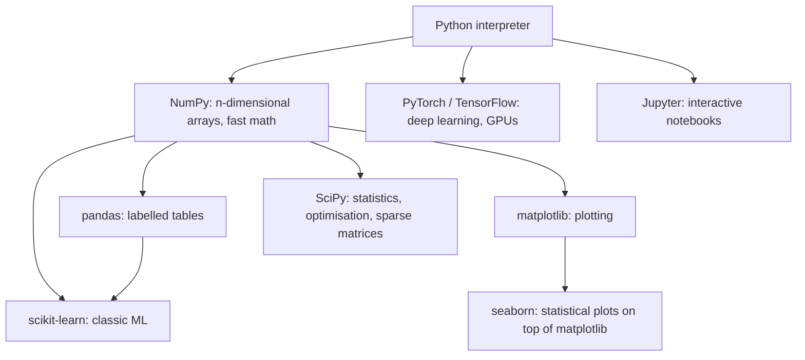
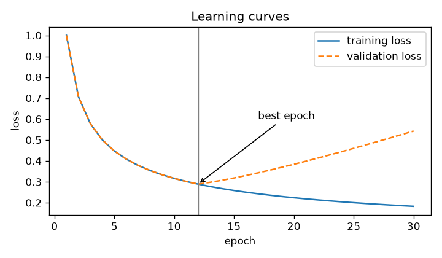
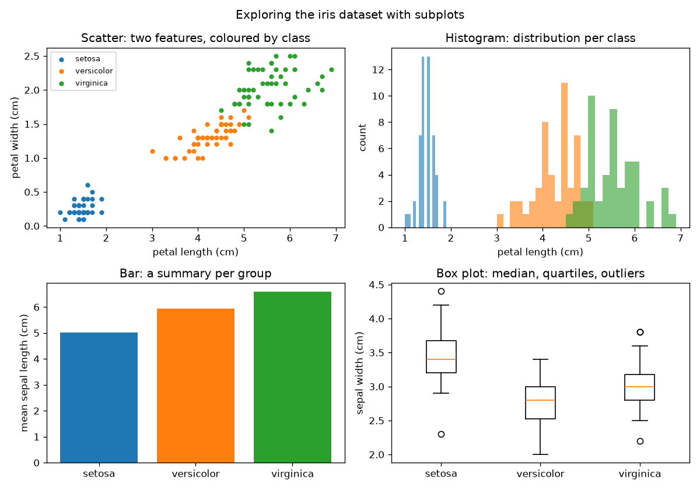
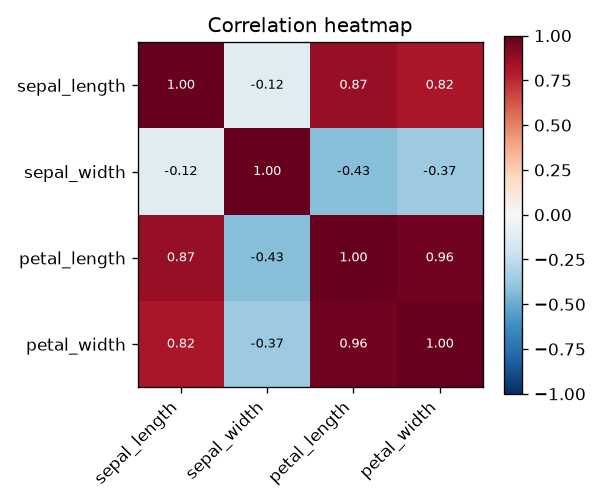
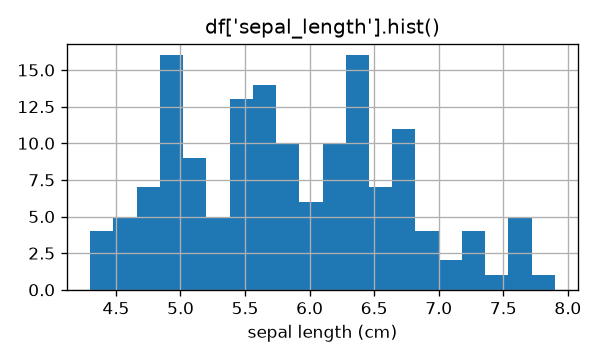
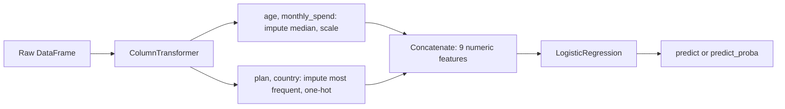

# Chapter 3 — The Python ML Stack

Almost all practical machine learning today happens in Python, not because Python is fast (it isn't), but because a small set of libraries wrap fast C, C++ and Fortran code (older *compiled* languages, whose programs are translated into machine instructions ahead of time and run far faster than Python) behind a friendly interface. This chapter teaches the five tools you will use in every later chapter: **NumPy** for arrays, **pandas** for tables, **matplotlib** for plots, **scikit-learn** for classic ML, and **Jupyter** for interactive work. It closes with a short tour of the deep-learning frameworks (libraries for building and training neural networks: PyTorch, TensorFlow/Keras) and when to reach for them.

It assumes basic Python (variables, lists, dicts, functions, loops, classes). If any of that is new, work through the **[Python Handbook](../../../python/chapters/)** first; this chapter only covers what is specific to data work.

**What you'll learn**

- How to set up Python and the core libraries in a virtual environment
- NumPy: arrays, dtypes, shapes, indexing, views vs copies, axis operations, broadcasting, vectorisation, random numbers
- pandas: Series and DataFrame, loading a CSV, inspecting, cleaning missing values and types, `loc`/`iloc`, filtering, `groupby`, `merge`, apply vs vectorised
- matplotlib: line, scatter, histogram, bar, box plot, heatmap and subplots, saved to files
- scikit-learn: the estimator API (`fit`, `predict`, `transform`), `Pipeline`, `ColumnTransformer`, cross-validation and grid search
- A Jupyter workflow that stays reproducible
- scikit-learn vs PyTorch vs TensorFlow/Keras: which to choose

All code is in [`code/`](code/).

---

## 3.1 Setting up

### What it is

The **stack** is a set of open-source (free to use, with publicly available source code) libraries that build on each other:



### How it works

1. **Install Python 3** from python.org (or your OS package manager, the operating system's built-in software installer such as `apt` or Homebrew). Check it in a terminal (the text window where you type commands): `python --version` (on macOS and many Linux systems the command is `python3`). This book uses Python 3.12 or newer.
2. **Create a virtual environment** (a self-contained project folder with its own copy of Python and its own installed libraries) per project, so each project has its own library versions:
   ```bash
   python3 -m venv .venv
   source .venv/bin/activate          # Windows: .venv\Scripts\activate
   ```
3. **Install the libraries** with pip (Python's standard package installer, which downloads libraries from the Python Package Index):
   ```bash
   pip install numpy pandas matplotlib scikit-learn scipy jupyter
   pip install seaborn                  # optional, nicer statistical plots
   pip install torch                    # only when you need deep learning
   ```
4. **Record versions** so others can reproduce your work: `pip freeze > requirements.txt`, later `pip install -r requirements.txt`. Alternatives such as conda, uv or Poetry (other package and environment managers) do the same job (the Python Handbook's packaging chapter covers them).
5. **Import with the standard aliases** (short nicknames for a library) everyone uses: `import numpy as np`, `import pandas as pd`, `import matplotlib.pyplot as plt`.

The code in this chapter was run with NumPy 2.5, pandas 3.0, scikit-learn 1.9 and matplotlib 3.11.

### Common mistakes

- Installing into the system Python (the copy your operating system itself relies on) with `sudo pip` (`sudo` runs a command with administrator rights). Use a virtual environment.
- Installing with one Python and running with another ("but I installed it!"). `python -m pip install ...` guarantees pip matches the interpreter (the program that reads and runs your Python code).

### TL;DR

One virtual environment per project; `pip install numpy pandas matplotlib scikit-learn`; freeze versions; import as `np`, `pd`, `plt`.

---

## 3.2 NumPy: fast arrays

### What it is

**NumPy** provides the `ndarray`: an n-dimensional grid of numbers, all of the same type, stored in one contiguous (side by side, with no gaps) block of memory. A 1-D array is a vector, a 2-D array is a matrix (Chapter 2), and higher dimensions hold things like colour images (height × width × 3) or batches of images.

### Why it matters

A Python list stores pointers (memory addresses) to separate Python objects, and a Python loop runs one interpreted instruction at a time. A NumPy array stores raw numbers and runs whole operations in compiled code (pre-translated machine instructions). The result is often 10–1000× faster and far more compact. pandas, scikit-learn, SciPy and matplotlib all speak NumPy arrays, and PyTorch tensors (PyTorch's name for its arrays) convert to and from them easily.

### How it works

#### Arrays, shapes and dtypes

| Attribute / function | Meaning | Example |
|---|---|---|
| `np.array([1, 2, 3])` | Create from a list | |
| `a.dtype` | Element type: `int64`, `float64`, `float32`, `bool`, ... | Mixing ints and floats upcasts (converts) to float |
| `a.shape` | Size of each dimension | `(3, 4)` = 3 rows, 4 columns |
| `a.ndim`, `a.size`, `a.nbytes` | Dimensions, element count, memory | |
| `np.zeros`, `np.ones`, `np.eye`, `np.arange`, `np.linspace` | Common constructors | `np.linspace(0, 1, 5)` → 5 evenly spaced values |
| `a.reshape(3, 4)`, `a.reshape(-1)`, `a.T` | New shape (−1 = "work it out"), flatten, transpose | |
| `a[:, None]` or `a.reshape(-1, 1)` | Turn shape (n,) into a column (n, 1) | scikit-learn wants 2-D X |

**dtype matters.** `float64` uses 8 bytes per number, `float32` uses 4: 1 million values are 8 MB vs 4 MB. Deep learning usually uses `float32` (or smaller) to save memory and speed up GPUs (graphics chips that do thousands of calculations in parallel). Small integer types silently **wrap around** on overflow (a result too large for the type to hold): `int8` 127 + 1 = −128. And floating point (the way computers store numbers with decimals, using a limited number of binary digits) is approximate: `0.1 + 0.2 == 0.3` is `False`; compare floats with `np.isclose`.

#### Indexing

```python
M = np.arange(12).reshape(3, 4)
M[1, 2]          # one element (row 1, column 2) -> 6
M[0]             # first row
M[:, 1]          # second column
M[:2, 1:3]       # rows 0-1, columns 1-2 (slices are start:stop, stop excluded)
M[M % 2 == 0]    # boolean mask: all even values
M[[2, 0]]        # "fancy" indexing with a list: rows 2 and 0
np.where(M > 5, 1, 0)   # vectorised if/else
```

**Views vs copies.** Basic slicing (`M[0]`, `M[:2, 1:3]`) returns a **view**: a window onto the same memory. Changing the view changes the original. Boolean indexing (selecting with an array of True/False values, called a *mask*) and fancy indexing return **copies**. When you need independent data, call `.copy()`.

#### Axis operations

For a 2-D array, `axis=0` runs **down the rows** (one result per column) and `axis=1` runs **across the columns** (one result per row). A way to remember: the axis you name is the one that disappears.

```python
scores = np.array([[80, 90, 70],     # rows = students, columns = exams
                   [60, 75, 85]])
scores.sum(axis=0)      # per exam:    [140 165 155]
scores.mean(axis=1)     # per student: [80. 73.33]
scores.argmax(axis=1)   # best exam per student: [1 2]
```

`keepdims=True` keeps the reduced axis with size 1 (shape (2, 1) instead of (2,)), which makes the result broadcast back against the original (broadcasting is explained next).

#### Broadcasting

**Broadcasting** lets NumPy combine arrays of different shapes without copying data. Rules, applied from the *last* dimension backwards:

1. Two dimensions are compatible if they are equal or one of them is 1.
2. Missing leading dimensions are treated as 1.
3. A size-1 dimension is stretched to match the other.

| Shapes | Result | Why |
|---|---|---|
| (3, 2) and (2,) | (3, 2) | (2,) acts as (1, 2) and is repeated for each row |
| (3, 1) and (1, 4) | (3, 4) | Both stretch: an outer "table" |
| (3, 2) and (3,) | **error** | Last dimensions 2 vs 3 clash; reshape to (3, 1) if you meant "per row" |

The most common use in ML: **standardising every column at once**.

```python
X = np.array([[1.0, 200.0], [2.0, 300.0], [3.0, 400.0]])   # (3, 2)
(X - X.mean(axis=0)) / X.std(axis=0)                        # (3, 2) - (2,) / (2,)
```

Output:

```
mean [  2. 300.] std [ 0.816 81.65 ]
standardised (X - mu) / sd =
 [[-1.225 -1.225]
 [ 0.     0.   ]
 [ 1.225  1.225]]
```

A more advanced example computes the squared distance from every point to every cluster centre (the core step of k-means, a clustering algorithm that repeatedly assigns each point to its nearest centre) with no loops, by inserting axes so shapes (4, 1, 2) and (1, 2, 2) broadcast to (4, 2, 2):

```python
d2 = ((pts[:, None, :] - centres[None, :, :]) ** 2).sum(axis=2)   # (4 points, 2 centres)
d2.argmin(axis=1)                                                 # nearest centre per point
```

```
squared distances (points x centres):
 [[ 0. 50.]
 [ 2. 32.]
 [50.  0.]
 [61.  1.]]
nearest centre: [0 0 1 1]
```

#### Vectorisation vs loops

**Vectorisation** means expressing a computation as whole-array operations instead of a Python loop.

```python
def loop():
    total = 0.0
    for v in x:            # 1,000,000 Python-level iterations
        total += v * v
    return total

def vec():
    return float(x @ x)    # one call into optimised compiled code
```

Output from [`code/numpy_basics.py`](code/numpy_basics.py):

```
sum of squares of 1M floats: loop 58 ms, vectorised 0.06 ms -> ~930x faster (varies by machine)
same answer: True
```

Rule of thumb: if you are writing a `for` loop over the rows of an array, there is probably a NumPy function or a broadcasting expression that does it faster.

#### Random numbers

Use the modern **Generator** API (application programming interface: the set of functions and objects a library offers) with an explicit seed (a starting number that fixes the whole random sequence) so results are reproducible:

```python
rng = np.random.default_rng(42)
rng.random(3)                 # uniform [0, 1)
rng.normal(0, 1, 3)           # normal, mean 0, std 1
rng.integers(0, 10, 5)        # integers 0..9
rng.choice(["a", "b", "c"], size=4)
rng.permutation(10)           # shuffled indices, e.g. for a manual train/test split
```

```
uniform [0.774 0.439 0.859]
normal [ 0.941 -1.951 -1.302]
integers [7 7 7 7 5]
choice ['a' 'c' 'b' 'b']
shuffled indices for a train/test split: [7 0 4 2 3 5 8 1 9 6] -> train [7 0 4 2 3 5 8 1] test [9 6]
same seed, same numbers: [0.774 0.439 0.859]
```

The older `np.random.seed()` / `np.random.rand()` functions still work but share one global state (a single hidden setting the whole program uses, so one part of the code can disturb another); NumPy's documentation recommends `default_rng` for new code.

### Common mistakes

- Confusing shape (n,) with (n, 1). scikit-learn expects 2-D `X`, so a single feature must be `x.reshape(-1, 1)`.
- Modifying a slice and being surprised that the original changed (views).
- Silent broadcasting that "works" but computes the wrong thing, e.g. (n,) − (n, 1) produces an (n, n) matrix. Check shapes.
- Using `*` for matrix multiplication; use `@`.

### In the interview

**30-second answer:** "NumPy arrays are homogeneous (all elements the same type), contiguous blocks of memory, so operations run in compiled code instead of the Python interpreter. Vectorising, meaning whole-array operations plus broadcasting, is typically orders of magnitude faster than Python loops. Broadcasting aligns shapes from the trailing dimension and stretches size-1 dimensions."

- *View or copy?* — Basic slices are views; boolean and fancy indexing return copies.
- *What does axis=0 mean?* — Operate down the rows, producing one result per column.

### Self-check

1. Shape of `np.zeros((5, 3)).sum(axis=0)`? → (3,).
2. Can (4, 3) and (4,) broadcast? → No, trailing dims 3 and 4 differ; use (4, 1).
3. How do you make random results repeatable? → `rng = np.random.default_rng(seed)` and draw everything from `rng`.

### TL;DR

ndarrays are typed, fixed-size and fast. Master shape, dtype, slicing (views!), `axis`, broadcasting and vectorisation, and seed a `default_rng`.

---

## 3.3 pandas: tables with labels

### What it is

**pandas** adds labels to NumPy arrays. A **Series** is a 1-D array with an **index** (row labels) and a name. A **DataFrame** is a table: a collection of Series (columns) sharing one index, each column with its own dtype. Think of it as a spreadsheet you control with code.

### Why it matters

Real data arrives as CSV files (comma-separated values: a plain-text table, one row per line), Excel sheets and database queries, with mixed types, missing values and messy text. pandas is the standard tool for loading, cleaning, exploring and reshaping it before modelling. scikit-learn accepts DataFrames directly.

### How it works

[`code/pandas_basics.py`](code/pandas_basics.py) walks through a small employee table.

#### Series and DataFrame

```python
s = pd.Series([10, 20, 30], index=["a", "b", "c"], name="points")
s["b"]        # 20  (by label)
df = pd.DataFrame({"city": ["Paris", "Lima"], "pop_m": [2.1, 10.0]})
```

#### Load and inspect

```python
df = pd.read_csv("employees.csv", parse_dates=["start_date"])
df.head(3)            # first rows
df.shape              # (rows, columns)
df.dtypes             # type of each column
df.isnull().sum()     # missing values per column
df.describe()         # count, mean, std, min, quartiles, max for numeric columns
df.info()             # dtypes, non-null counts, memory
```

Output:

```
   emp_id  name   dept    salary age start_date
0       1  Asha    Eng  120000.0  34 2019-03-01
1       2   Ben    Eng       NaN  29 2021-07-15
2       3  Chen  Sales   70000.0  41 2015-01-10

shape: (7, 6)
emp_id                 int64
name                     str
dept                     str
salary               float64
age                      str
start_date    datetime64[us]

missing values per column:
 emp_id        0
name          0
dept          0
salary        2
age           0
start_date    0
```

Two things to notice. `salary` became `float64` because an integer column cannot hold the missing-value marker **NaN** ("not a number"). And `age` was read as text (`str`, pandas 3's default string dtype) because one row contains `"unknown"`, so `isnull()` does not count it as missing. **Always check dtypes after loading.** `read_csv` also reads from URLs and compressed files, and pandas has `read_excel`, `read_parquet` (Parquet is a compressed, column-oriented file format popular for large data), `read_json` and `read_sql` for other sources.

#### Clean: types and missing values

```python
df["age"] = pd.to_numeric(df["age"], errors="coerce")     # "unknown" -> NaN
df["salary_missing"] = df["salary"].isna()                # remember what was missing
df["salary"] = df["salary"].fillna(df.groupby("dept")["salary"].transform("median"))
df["age"] = df["age"].fillna(df["age"].median())
```

Output:

```
age dtype after to_numeric: float64 | missing ages: 1
dropna() would keep 4 of 7 rows
   name   dept    salary  salary_missing   age
0  Asha    Eng  120000.0           False  34.0
1   Ben    Eng  127500.0            True  29.0
...
6   Gus     HR   60000.0            True  27.0
```

Choices for missing values:

| Strategy | Code | When |
|---|---|---|
| Drop rows | `df.dropna()` | Few missing rows, missing at random. Here it would throw away 3 of 7 rows. |
| Drop a column | `df.drop(columns="x")` | Column mostly empty or useless |
| Fill with a constant | `df["x"].fillna(0)` | 0 has a real meaning (e.g. "no purchases") |
| Fill with mean / median | `df["x"].fillna(df["x"].median())` | Numeric; median is robust to outliers |
| Fill per group | `groupby(...).transform("median")` | Groups differ (Ben's missing salary gets the Eng median, 127,500) |
| Add a "was missing" flag | `df["x_missing"] = df["x"].isna()` | Missingness itself may be informative |

In a modelling project, do the filling inside a scikit-learn `SimpleImputer` (scikit-learn's missing-value filler; *imputation* means filling in missing values) in a pipeline (a chain of processing steps plus a model, §3.5), so the fill values are learned from training data only.

#### Select: `loc` vs `iloc`

| | `df.loc[...]` | `df.iloc[...]` |
|---|---|---|
| Selects by | **Labels** (index values, column names) and boolean masks | **Integer positions** |
| Slice end | **Included** (`loc[0:2]` gives 3 rows) | Excluded (`iloc[0:2]` gives 2 rows) |
| Example | `df.loc[df["dept"] == "Eng", ["name", "salary"]]` | `df.iloc[:2, :3]` |

`df["col"]` selects one column (a Series); `df[["a", "b"]]` selects several (a DataFrame).

#### Filter

```python
df[(df["salary"] > 100_000) & (df["age"] < 40)]   # combine with & | ~ and parentheses
df.query("dept == 'Sales' and salary >= 65000")   # same idea, SQL-like string
df[df["dept"].isin(["HR", "Sales"])]
df.sort_values("years", ascending=False)
```

```
salary > 100k AND age < 40: ['Asha', 'Ben']
query(): ['Chen', 'Dana']
isin(): ['Chen', 'Dana', 'Eli', 'Gus']
```

Use `&`, `|`, `~` (not `and`, `or`, `not`), and wrap each condition in parentheses, because `&` binds tighter than `>`.

#### groupby: split, apply, combine

`groupby` splits rows into groups, applies a function to each, and combines the results, like SQL's `GROUP BY` (SQL is the standard language for querying databases).

```python
df.groupby("dept").agg(headcount=("emp_id", "count"),
                       avg_salary=("salary", "mean"),
                       max_age=("age", "max"))
df["dept"].value_counts()
df.pivot_table(index="dept", values="salary", aggfunc="median")
```

```
       headcount  avg_salary  max_age
dept
Eng            3    127500.0     45.0
HR             2     60000.0     38.0
Sales          2     67500.0     41.0
```

`agg` reduces each group to one row; `transform` returns a result the same length as the original (used above to fill each row with its group's median).

#### merge / join

`merge` combines two tables on a key column (a column, such as an ID, whose values identify which rows belong together), like SQL joins.

```python
depts = pd.DataFrame({"dept": ["Eng", "Sales", "Legal"], "floor": [3, 1, 5]})
df.merge(depts, on="dept", how="inner")   # only matching keys
df.merge(depts, on="dept", how="left")    # all rows of df, NaN where no match
```

```
inner join rows: 5 (HR has no match) | left join rows: 7 (HR kept with floor NaN: True)
```

| `how=` | Keeps |
|---|---|
| `"inner"` | Keys in both tables |
| `"left"` | All rows of the left table |
| `"right"` | All rows of the right table |
| `"outer"` | All keys from both |

Check row counts after every merge: duplicate keys in the right table multiply rows (a "many-to-many" explosion). `validate="many_to_one"` makes pandas raise an error if that happens. `pd.concat([df1, df2])` stacks tables vertically instead.

#### apply vs vectorised

`df.apply(func, axis=1)` calls a Python function once per row: flexible but slow. Column arithmetic, `np.where`, `pd.cut` and the `.str` / `.dt` accessors (ready-made text and date methods that work on a whole column) are vectorised.

```python
big.apply(lambda r: r["price"] * r["qty"], axis=1)   # row by row
big["price"] * big["qty"]                            # whole columns at once
big["band"] = np.where(big["price"] > 50, "high", "low")
big["bucket"] = pd.cut(big["price"], bins=[0, 25, 75, 100], labels=["cheap", "mid", "premium"])
```

```
row-wise apply: 430 ms | vectorised: 0.21 ms -> ~2068x faster (varies by machine)
```

Use `apply` only when no vectorised alternative exists (e.g. calling an external parser, code that reads text and turns it into structured data, on each value).

#### A pandas 3 pitfall: chained assignment

Since pandas 3.0, **copy-on-write** is always on: every indexing result behaves as a copy. So the once-common pattern of calling an in-place method (one that changes the object itself instead of returning a new one) on a selected column no longer modifies the DataFrame:

```python
df["A"].fillna(0, inplace=True)    # does NOT change df (pandas warns: ChainedAssignmentError)
df["A"] = df["A"].fillna(0)        # correct: assign the result back
```

```
after df['A'].fillna(0, inplace=True): [1.0, nan, 3.0]
after df['A'] = df['A'].fillna(0):    [1.0, 0.0, 3.0]
```

Prefer assignment over `inplace=True` in general; it is clearer and works in every pandas version.

### Common mistakes

- Not checking dtypes: numbers stored as text, dates as strings.
- `and`/`or` in filters instead of `&`/`|`, or missing parentheses.
- Confusing `loc` (labels, end inclusive) with `iloc` (positions, end exclusive).
- Row-wise `apply` on large data.
- Dropping rows with missing values without checking how many you lose, or whether missingness is related to the target.

### In the interview

**30-second answer:** "pandas gives labelled, column-typed tables on top of NumPy. My first steps on new data are `head`, `dtypes`, `info`, `describe` and `isnull().sum()`, then fixing types with `to_numeric` or `to_datetime`, handling missing values, and exploring with `groupby` and plots. I use `loc` for labels and masks, `iloc` for positions, and vectorised operations rather than `apply`."

- *`agg` vs `transform`?* — `agg` returns one row per group; `transform` returns a same-length result aligned to the original rows.
- *How do you avoid a merge blowing up the row count?* — Check key uniqueness and pass `validate="one_to_one"` or `"many_to_one"`.

### Self-check

1. `df.loc[0:2]` vs `df.iloc[0:2]` with a default index: how many rows each? → 3 and 2.
2. A numeric column shows dtype `str`. First step? → `pd.to_numeric(col, errors="coerce")` and inspect the new NaNs.
3. Why fill missing values inside a scikit-learn pipeline rather than in pandas before splitting? → To learn fill values from training data only (no leakage, i.e. no information from the test data sneaking into training).

### TL;DR

Load → check `dtypes`, `isnull().sum()`, `describe()` → fix types → handle missing values deliberately → select with `loc`/`iloc`, filter with masks, summarise with `groupby`, combine with `merge`. Vectorise; assign instead of `inplace`.

---

## 3.4 matplotlib: seeing the data

### What it is

**matplotlib** is Python's foundational plotting library. **seaborn** is a higher-level library on top of it that makes statistical plots (distributions, pair plots, a grid of scatter plots for every pair of columns, and heatmaps) in one line; pandas' `.plot()` and `.hist()` also call matplotlib. Learning matplotlib's core lets you customise anything the others produce.

### Why it matters

Plots reveal what summary numbers hide: skewed distributions, outliers, class overlap, non-linear relationships, data-entry errors, and overfitting (a model memorising its training data instead of learning patterns that generalise) in learning curves (training and validation error plotted over training time). Plot before you model.

### How it works

Use the **object-oriented API** (you create objects and call their methods, rather than relying on a hidden "current plot"): create a figure (`fig`, the whole image) and one or more axes (`ax`, individual plots), then call methods on `ax`.

```python
import matplotlib
matplotlib.use("Agg")                       # draw to files (scripts, servers); omit in Jupyter
import matplotlib.pyplot as plt

fig, ax = plt.subplots(figsize=(6, 3.5))
ax.plot(epochs, train, label="training loss")
ax.plot(epochs, val, "--", label="validation loss")
ax.set(xlabel="epoch", ylabel="loss", title="Learning curves")
ax.legend()
fig.tight_layout()
fig.savefig("img/line_learning_curves.png", dpi=120)
plt.close(fig)                              # free memory when making many figures
```



A **line plot** suits ordered x-values (time, epochs; an epoch is one full pass of training over the data). This one shows the classic overfitting signature: validation loss turns upward while training loss keeps falling.

**Subplots** put several plots in one figure: `fig, axes = plt.subplots(2, 2)` returns a 2 × 2 array of axes.

```python
ax = axes[0, 0]
for sp, g in df.groupby("species"):
    ax.scatter(g["petal_length"], g["petal_width"], s=15, label=sp)
axes[0, 1].hist(g["petal_length"], bins=15, alpha=0.6)
axes[1, 0].bar(means.index, means.values)
axes[1, 1].boxplot([...], tick_labels=[...])
```



| Plot | Shows | ML use |
|---|---|---|
| **Scatter** | Relationship between two numeric variables | Are classes separable? Is a relationship linear? |
| **Histogram** | Distribution of one variable | Skew, outliers, per-class overlap |
| **Bar** | A value per category | Class balance, group means |
| **Box plot** | Median, quartiles (the 25th and 75th percentile values; the box), whiskers (lines to the typical range), outliers (dots) | Compare distributions across groups, spot outliers |
| **Line** | Trend over an ordered axis | Learning curves, time series |
| **Heatmap** | A matrix as colours | Correlation matrices, confusion matrices |

From these four panels alone you can see that petal measurements separate *setosa* perfectly and the other two species mostly, which predicts that even a simple classifier will do well on iris.

**Correlation heatmap** (seaborn's `sns.heatmap(corr, annot=True)` in one line; here in plain matplotlib):

```python
corr = df.drop(columns=["species", "target"]).corr()
im = ax.imshow(corr, cmap="RdBu_r", vmin=-1, vmax=1)
fig.colorbar(im, ax=ax)
```



Petal length and width correlate at 0.96: they carry nearly the same information, which matters for linear models (Chapter 2's multicollinearity: features that are near-copies of each other make weights unstable) and feature selection (choosing which columns to keep).

**pandas shortcut**, handy for a first look:

```python
ax = df["sepal_length"].hist(bins=20)
```



### Common mistakes

- Mixing the state-based `plt.plot(...)` style with multiple subplots and losing track of which axes is active. Use `fig, ax = plt.subplots()`.
- No axis labels or units.
- Default 10 bins hiding structure; try several `bins` values.
- Forgetting `plt.close(fig)` in loops, which leaks memory.
- Calling `plt.show()` in a script on a server with no display; save with `savefig` instead.

### Self-check

1. Which plot to check class balance? → A bar chart of `value_counts()`.
2. Which plot to spot outliers per group? → A box plot.
3. What does `fig, axes = plt.subplots(1, 3)` return? → A figure and an array of 3 axes.

### TL;DR

`fig, ax = plt.subplots()`, call `ax.plot/scatter/hist/bar/boxplot/imshow`, label everything, `savefig`. Plot distributions, relationships and class balance before modelling.

---

## 3.5 scikit-learn: the estimator API

### What it is

**scikit-learn** is the standard Python library for classic ML: linear models, trees and forests, SVMs (support vector machines, which draw a widest-margin boundary between classes), k-NN (k-nearest neighbours, which predicts from the most similar stored examples), clustering (grouping similar rows without labels), dimensionality reduction (compressing many features into a few), preprocessing, model selection and metrics. Its power comes from **one consistent interface** that every algorithm follows, described in its API design paper (Buitinck et al., 2013).

### How it works

| Object type | Key methods | Learns in `fit` | Examples |
|---|---|---|---|
| **Estimator** (all objects) | `fit(X, y)`; hyperparameters set in the constructor; `get_params()`, `set_params()` | | Everything below |
| **Transformer** | `transform(X)`, `fit_transform(X)` | Statistics needed to transform (mean, categories, ...) | `StandardScaler`, `OneHotEncoder`, `SimpleImputer`, `PCA` |
| **Predictor** | `predict(X)`, often `predict_proba(X)`, `score(X, y)` | Model parameters | `LogisticRegression`, `RandomForestClassifier`, `KMeans` |

Conventions:

1. **Hyperparameters** go in the constructor: `LogisticRegression(C=0.1)`.
2. **`fit` learns from data and returns `self`**, so you can chain: `LogisticRegression().fit(X, y).predict(X_new)`.
3. **Learned attributes end with an underscore**: `scaler.mean_`, `model.coef_`, `model.classes_`. They exist only after fitting.
4. **X is 2-D** (n_samples × n_features: an array or DataFrame); **y is 1-D**.
5. `score` returns a default metric: accuracy for classifiers, R² (the share of the target's variation the model explains; 1 is perfect) for regressors.

```python
scaler = StandardScaler()
scaler.fit(X_train)                  # learn mean_ and scale_ from TRAINING data
scaler.transform(X_train)
scaler.transform(X_new)              # uses the training mean and std

clf = LogisticRegression().fit(X, y)
clf.predict([[1.0], [4.5]]); clf.predict_proba([[1.0], [4.5]]); clf.score(X, y)
```

Output from [`code/sklearn_api.py`](code/sklearn_api.py):

```
mean_ [  2. 200.] scale_ [ 0.816 81.65 ]
transform(new): [[2.449 2.449]] (uses the training mean/std)
hyperparameters via get_params(): {'copy': True, 'with_mean': True, 'with_std': True}
predict([[1.0],[4.5]]) = [0 1]
predict_proba = [[0.843 0.157]
 [0.096 0.904]]
score (accuracy) = 1.0 | coef_ [[1.121]] intercept_ [-2.802]
```

**`fit_transform` on training data, `transform` only on validation/test/production data.** Calling `fit` (or `fit_transform`) on test data re-learns the statistics from it, which is leakage.

### Pipeline

A **`Pipeline`** chains transformers and a final estimator into one estimator. Calling `fit` fits each step in order on the training data and passes the transformed data along; `predict` runs the same transformations and then predicts.

Why use one:
- **No leakage:** in cross-validation (splitting the training data into k chunks, or *folds*, and taking turns training on k − 1 of them and validating on the remaining one), every step is refit on each training fold.
- **One object to tune** (`GridSearchCV`, which tries every combination of the hyperparameter values you list and scores each with cross-validation, can search any step's hyperparameters) and **one object to save and deploy**, so training and serving apply identical preprocessing.

Parameters inside a pipeline are addressed as `step__parameter` (double underscore), nesting as deep as needed: `prep__num__impute__strategy`.

### ColumnTransformer

Real tables mix numeric and categorical columns (columns holding labels from a fixed set, such as a plan name or a country) that need different preprocessing. **`ColumnTransformer`** applies a different transformer to each group of columns and concatenates the results.

```python
numeric = ["age", "monthly_spend"]
categorical = ["plan", "country"]
preprocess = ColumnTransformer([
    ("num", Pipeline([("impute", SimpleImputer(strategy="median")),
                      ("scale", StandardScaler())]), numeric),
    ("cat", Pipeline([("impute", SimpleImputer(strategy="most_frequent")),
                      ("onehot", OneHotEncoder(handle_unknown="ignore"))]), categorical),
])
model = Pipeline([("prep", preprocess), ("clf", LogisticRegression(max_iter=1000))])
model.fit(X_train, y_train)

grid = GridSearchCV(model, {
    "prep__num__impute__strategy": ["mean", "median"],
    "clf": [LogisticRegression(max_iter=1000), RandomForestClassifier(n_estimators=100, random_state=0)],
}, cv=5)
grid.fit(X_train, y_train)
```



Output on a synthetic (generated by code rather than collected) 600-customer churn (customers cancelling and leaving) dataset with missing values:

```
    age  monthly_spend   plan country
0  62.0          75.10  basic      DE
1   NaN          62.60  basic      IN
2  44.0          89.69    pro      DE
missing: {'age': 43, 'monthly_spend': 0, 'plan': 32, 'country': 0} | churn rate: 0.372
output features: ['num__age', 'num__monthly_spend', 'cat__plan_basic', 'cat__plan_family', 'cat__plan_pro', 'cat__country_BR', 'cat__country_DE', 'cat__country_IN', 'cat__country_US']
test accuracy: 0.827 | baseline (always 'no churn'): 0.627
CV accuracy (5 folds): 0.773
P(churn) for a customer with unseen categories: 0.933
best: {'clf': 'LogisticRegression', 'prep__num__impute__strategy': 'mean'} | CV 0.773 | test 0.827
```

What each part shows:

- `get_feature_names_out()` lists the 9 columns the model actually sees: 2 scaled numerics plus one 0/1 column per category (**one-hot encoding**).
- `handle_unknown="ignore"` lets the model score a customer with a plan (`"enterprise"`) and country (`"JP"`) never seen in training, by setting all of that feature's one-hot columns to 0, instead of crashing in production.
- `GridSearchCV` treated the whole pipeline as one estimator and even swapped the final model; logistic regression won, which makes sense because the data was generated from a logistic formula.
- The test score (0.827) is higher than the CV mean (0.773); with only 150 test rows, a difference of this size is within normal sampling noise (Chapter 2's bootstrap CI, a range of plausible scores found by resampling the test set).

### Other scikit-learn tools you will use constantly

| Module | Tools |
|---|---|
| `sklearn.model_selection` | `train_test_split`, `cross_val_score`, `cross_validate`, `KFold`, `StratifiedKFold`, `GridSearchCV`, `RandomizedSearchCV` |
| `sklearn.preprocessing` | `StandardScaler`, `MinMaxScaler`, `OneHotEncoder`, `OrdinalEncoder`, `PolynomialFeatures`, `FunctionTransformer` |
| `sklearn.impute` | `SimpleImputer`, `KNNImputer` |
| `sklearn.metrics` | `accuracy_score`, `precision_score`, `recall_score`, `f1_score`, `roc_auc_score`, `mean_squared_error`, `confusion_matrix`, `classification_report` |
| `sklearn.datasets` | Bundled toy datasets (`load_iris`, `load_breast_cancer`, `load_digits`, `load_diabetes`) and generators (`make_classification`, `make_blobs`) |
| `sklearn.pipeline`, `sklearn.compose` | `Pipeline`, `make_pipeline`, `ColumnTransformer`, `make_column_transformer` |

`set_output(transform="pandas")` on a transformer or pipeline makes it return DataFrames with named columns, which helps debugging. Save fitted pipelines with `joblib.dump` (joblib is a library for saving Python objects to disk; Chapter 1) and only load files you trust.

### Common mistakes

- Calling `fit` or `fit_transform` on the test set.
- Preprocessing with pandas on the full dataset, then cross-validating (leakage). Put it in the pipeline.
- Passing a 1-D array as `X`; reshape to (n, 1).
- Forgetting `handle_unknown="ignore"` and crashing on a new category in production.
- Using `LabelEncoder` on input features; it is meant for targets. Use `OrdinalEncoder` or `OneHotEncoder` for features.

### In the interview

**30-second answer:** "Every scikit-learn object is an estimator with `fit`; transformers add `transform`, predictors add `predict`. Hyperparameters go in the constructor and learned attributes end in an underscore. I wrap preprocessing and the model in a Pipeline, with a ColumnTransformer for mixed column types, so cross-validation refits everything per fold without leakage, and I can tune and deploy one object."

- *`fit_transform` vs `transform`?* — `fit_transform` learns statistics and applies them (training data only); `transform` applies already-learned statistics.
- *How do you tune a hyperparameter inside a pipeline?* — `GridSearchCV` with keys like `step__param`.

### Self-check

1. What does the trailing underscore in `coef_` tell you? → It is learned from data during `fit`.
2. Why does `OneHotEncoder` need `handle_unknown="ignore"` in production? → New categories otherwise raise an error.
3. Name the key for the imputer's strategy in the pipeline above. → `prep__num__impute__strategy`.

### TL;DR

Constructor = hyperparameters; `fit` learns (attributes_); `transform`/`predict` apply. Pipeline + ColumnTransformer = leak-free, tunable, deployable preprocessing plus model.

---

## 3.6 Jupyter workflow

### What it is

**Jupyter** notebooks (`.ipynb`) mix code cells, their outputs (tables, plots) and Markdown (a simple plain-text formatting syntax for headings, lists and links) notes in one document, running against a live Python process called the **kernel**. You can use them in JupyterLab (`jupyter lab`), VS Code (a popular code editor), or hosted services such as Google Colab (free notebooks that run on Google's servers).

### Why it matters

Data work is exploratory: load, look, tweak, look again. Notebooks keep the data in memory between steps and show results inline, which makes exploration and explanation fast.

### How it works: a reproducible routine

1. **Start in the project's virtual environment** so the kernel uses its libraries: `source .venv/bin/activate && jupyter lab`. If you install from inside a notebook, use `%pip install package` (installs into the kernel's environment) rather than `!pip`.
2. **First cell: imports, settings and seeds** (`import numpy as np`, `rng = np.random.default_rng(42)`, display options).
3. **Explore top to bottom**: load → inspect → clean → plot → model, with a Markdown heading per stage.
4. **Useful magics** (special commands starting with `%` that Jupyter, not Python, understands): `%timeit expr` (benchmark), `%time` (one run), `%load_ext autoreload` + `%autoreload 2` (reload your own modules when edited), `df.head()` as the last line to display a table. Plots appear inline by default in current Jupyter.
5. **Restart & Run All before trusting or sharing results.** Cells can be run in any order, so hidden state (a variable defined in a deleted cell) is the most common source of "works on my notebook" bugs.
6. **Move stable code into `.py` modules** (plain Python files you can import) and import it; keep notebooks for exploration and reports. `jupyter nbconvert --to script notebook.ipynb` exports the code; `jupyter nbconvert --to html --execute` produces a fresh, fully executed report.
7. **Version control:** clear large outputs before committing (saving a snapshot of your changes into the project history; *version control* means tracking every change to your files over time, usually with git), or pair notebooks with scripts (e.g. the jupytext tool).

### Trade-offs

| | Notebook | `.py` script / module |
|---|---|---|
| Exploration, plots, teaching | Excellent | Clumsy |
| Reproducibility | Risky (out-of-order execution) | Good |
| Testing, code review, diffs (line-by-line change views) | Poor | Good |
| Production pipelines | Avoid | Yes |

### Common mistakes

- Running cells out of order and trusting the result.
- Huge notebooks that do everything; split into modules.
- Committing notebooks with megabytes of output or secrets (passwords, API keys) printed in cells.

### TL;DR

Notebooks for exploration, scripts for anything that must run again. Seed first, run top to bottom, Restart & Run All before sharing.

---

## 3.7 Deep-learning frameworks: when scikit-learn is not enough

### What it is

| Framework | Origin | Focus | Style |
|---|---|---|---|
| **scikit-learn** | Community project, started 2007 | Classic ML on tabular (rows-and-columns) data: regression, classification, clustering, preprocessing, evaluation | High level: `fit` / `predict`; CPU |
| **PyTorch** | Meta (Facebook) AI Research, 2016; now governed by the PyTorch Foundation | Deep learning; dominant in research and widely used in industry | Define-by-run ("dynamic graph"): the model is ordinary Python code executed each step; automatic differentiation; GPUs |
| **TensorFlow** + **Keras** | Google, 2015 | Deep learning with strong deployment tooling (TF Serving for servers, TF Lite / LiteRT for mobile) | Keras is a high-level API (`model.compile`, `model.fit`); since Keras 3 it can run on TensorFlow, JAX (Google's numerical library) or PyTorch backends (the engine doing the maths) |

### How the styles differ

[`code/frameworks_compared.py`](code/frameworks_compared.py) trains the same logistic-regression classifier on the breast-cancer data in both scikit-learn and PyTorch:

```python
# scikit-learn: the library owns the training loop
sk = LogisticRegression(max_iter=1000).fit(X_tr, y_tr)

# PyTorch: you define the model, loss and loop
model = torch.nn.Linear(X_tr.shape[1], 1)                # w.x + b
loss_fn = torch.nn.BCEWithLogitsLoss()                   # sigmoid + cross-entropy
opt = torch.optim.SGD(model.parameters(), lr=0.1, weight_decay=1e-3)
for epoch in range(300):
    opt.zero_grad()
    loss = loss_fn(model(Xt), yt)
    loss.backward()        # autograd: the chain rule from Chapter 2, automatically
    opt.step()             # gradient-descent update from Chapter 2
```

Output:

```
scikit-learn accuracy: 0.982
  epoch   0 loss 0.6904
  epoch 299 loss 0.0738
PyTorch accuracy:      0.974
device available: mps
```

Both reach about the same accuracy (they optimise slightly different objectives and stop at different points). The PyTorch version is longer, but every piece is replaceable: swap `nn.Linear` for a 50-layer network, the loss for any differentiable function (one whose slope can be computed, so gradients exist), and move tensors to a GPU (`"cuda"` on NVIDIA, `"mps"` on Apple silicon, as detected here) without changing the loop.

### Which one to choose

- **Start with scikit-learn** for tabular data, small-to-medium datasets, baselines, and anything where a linear model or tree ensemble might suffice. (Gradient-boosting libraries such as XGBoost, LightGBM and CatBoost follow the scikit-learn API and are often the strongest choice for tables.)
- **Use PyTorch or TensorFlow/Keras** for images, audio, text and other unstructured data (data without fixed columns), for very large datasets, for GPU training, and for custom neural architectures (your own network designs). PyTorch is the more common choice in current research and many companies; TensorFlow/Keras remains widespread in production and on mobile.
- They combine well: scikit-learn for splitting, preprocessing and metrics around a PyTorch model is a very common setup.

### Real-world examples

- scikit-learn is used for classic ML in many companies; its website's testimonials page includes quotes from organisations such as Spotify, J.P. Morgan and Booking.com.
- PyTorch underlies most open research code and projects such as Hugging Face Transformers' (a popular library of ready-trained language and vision models) PyTorch models, and Tesla's then AI director Andrej Karpathy described training its Autopilot vision networks with it in a 2019 PyTorch Developer Conference talk.
- TensorFlow powers many Google products, and TensorFlow Lite (renamed LiteRT in 2024) runs models on mobile and embedded devices (small computers built into products such as cameras and appliances).

### Self-check

1. Which library would you pick for a 20,000-row customer table? → scikit-learn (or a gradient-boosting library).
2. What does `loss.backward()` do? → Computes gradients of the loss with respect to every parameter via automatic differentiation.
3. What is Keras? → A high-level deep-learning API; in Keras 3 it runs on TensorFlow, JAX or PyTorch.

### TL;DR

scikit-learn for classic ML on tables; PyTorch or TensorFlow/Keras for neural networks, unstructured data and GPUs. They complement each other.

---

## Chapter TL;DR

- **Setup:** one virtual environment per project; `pip install numpy pandas matplotlib scikit-learn`; `import numpy as np, pandas as pd, matplotlib.pyplot as plt`.
- **NumPy:** typed, contiguous arrays. Know shape and dtype, slicing returns views, `axis=0` = down rows, broadcasting aligns trailing dimensions, vectorise instead of looping, seed `default_rng`.
- **pandas:** `read_csv` → `head`, `dtypes`, `isnull().sum()`, `describe` → `to_numeric(errors="coerce")`, handle missing values → `loc` (labels) / `iloc` (positions) → masks with `&`/`|` → `groupby().agg()` → `merge(how=...)`. Vectorise; assign rather than `inplace` (copy-on-write in pandas 3).
- **matplotlib:** `fig, ax = plt.subplots()`; line, scatter, histogram, bar, box, heatmap; label axes; `savefig`. Plot before modelling.
- **scikit-learn:** constructor = hyperparameters, `fit` learns attributes_, `transform`/`predict` apply. `Pipeline` + `ColumnTransformer` = leak-free, tunable, deployable.
- **Jupyter:** great for exploration; seed first, Restart & Run All, move stable code to modules.
- **Frameworks:** scikit-learn for classic ML; PyTorch or TensorFlow/Keras for deep learning.
