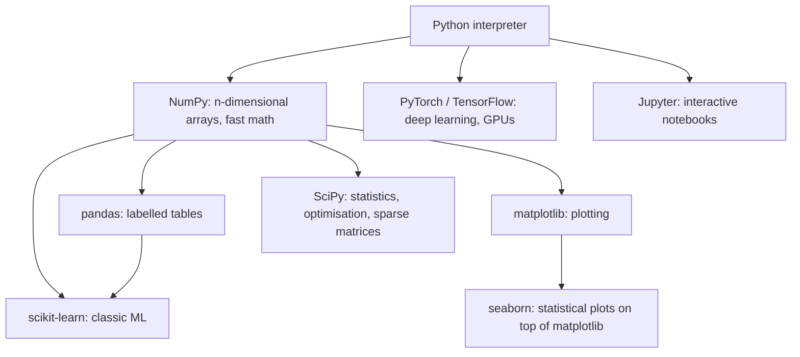
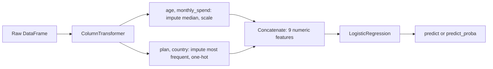

# Chapter 3 — The Python ML Stack

Practical ML happens in Python not because Python is fast (it isn't) but because a few libraries wrap fast C, C++ and Fortran code (*compiled* languages, translated to machine instructions ahead of time) behind a friendly interface. This chapter covers the five tools used in every later chapter — **NumPy** (arrays), **pandas** (tables), **matplotlib** (plots), **scikit-learn** (classic ML), **Jupyter** (interactive work) — and when to reach for the deep-learning frameworks (PyTorch, TensorFlow/Keras).

It assumes basic Python; if that is new, work through the **[Python Handbook](../../../python/chapters/)** first.

All code is in [`code/`](code/).

---

## 3.1 Setting up

### What it is

The **stack** is a set of open-source libraries that build on each other:



### How it works

1. **Install Python 3** (python.org or the OS package manager, e.g. `apt`, Homebrew); check with `python --version` (`python3` on macOS/many Linux). This book uses Python 3.12+.
2. **Create a virtual environment** (a project folder with its own Python and libraries) per project:
   ```bash
   python3 -m venv .venv
   source .venv/bin/activate          # Windows: .venv\Scripts\activate
   ```
3. **Install** with pip (Python's package installer, pulling from the Python Package Index):
   ```bash
   pip install numpy pandas matplotlib scikit-learn scipy jupyter
   pip install seaborn                  # optional, nicer statistical plots
   pip install torch                    # only when you need deep learning
   ```
4. **Record versions:** `pip freeze > requirements.txt`, later `pip install -r requirements.txt`. conda, uv and Poetry do the same job (see the Python Handbook's packaging chapter).
5. **Standard aliases:** `import numpy as np`, `import pandas as pd`, `import matplotlib.pyplot as plt`.

Code here was run with NumPy 2.5, pandas 3.0, scikit-learn 1.9 and matplotlib 3.11.

### Common mistakes

- `sudo pip` into the system Python (the copy the OS relies on). Use a virtual environment.
- Installing with one Python and running another; `python -m pip install ...` guarantees pip matches the interpreter.

### TL;DR

One virtual environment per project; `pip install numpy pandas matplotlib scikit-learn`; freeze versions; import as `np`, `pd`, `plt`.

---

## 3.2 NumPy: fast arrays

### What it is

NumPy's `ndarray` is an n-dimensional grid of same-typed numbers in one contiguous block of memory. 1-D = vector, 2-D = matrix (Chapter 2); higher dimensions hold colour images (height × width × 3) or batches.

### Why it matters

A Python list stores pointers to separate objects and loops one interpreted instruction at a time; an array stores raw numbers and runs whole operations in compiled code — often 10–1000× faster and far more compact. pandas, scikit-learn, SciPy and matplotlib all speak NumPy, and PyTorch tensors (its arrays) convert easily.

### How it works

#### Arrays, shapes and dtypes

| Attribute / function | Meaning | Example |
|---|---|---|
| `np.array([1, 2, 3])` | Create from a list | |
| `a.dtype` | Element type: `int64`, `float64`, `float32`, `bool`, ... | Mixing ints and floats upcasts to float |
| `a.shape` | Size per dimension | `(3, 4)` = 3 rows, 4 columns |
| `a.ndim`, `a.size`, `a.nbytes` | Dimensions, element count, memory | |
| `np.zeros`, `np.ones`, `np.eye`, `np.arange`, `np.linspace` | Constructors | `np.linspace(0, 1, 5)` → 5 evenly spaced values |
| `a.reshape(3, 4)`, `a.reshape(-1)`, `a.T` | New shape (−1 = "work it out"), flatten, transpose | |
| `a[:, None]` or `a.reshape(-1, 1)` | Shape (n,) → column (n, 1) | scikit-learn wants 2-D X |

**dtype matters.** `float64` = 8 bytes, `float32` = 4 (1 million values: 8 MB vs 4 MB); deep learning uses `float32` or smaller to save memory and speed up GPUs. Small integer types silently **wrap around** on overflow: `int8` 127 + 1 = −128. Floating point is approximate: `0.1 + 0.2 == 0.3` is `False`; use `np.isclose`.

#### Indexing

```python
M = np.arange(12).reshape(3, 4)
M[1, 2]          # one element (row 1, column 2) -> 6
M[0]             # first row
M[:, 1]          # second column
M[:2, 1:3]       # rows 0-1, columns 1-2 (slices are start:stop, stop excluded)
M[M % 2 == 0]    # boolean mask: all even values
M[[2, 0]]        # "fancy" indexing with a list: rows 2 and 0
np.where(M > 5, 1, 0)   # vectorised if/else
```

**Views vs copies.** Basic slicing (`M[0]`, `M[:2, 1:3]`) returns a **view** onto the same memory — changing it changes the original. Boolean indexing (a True/False *mask*) and fancy indexing return **copies**. Call `.copy()` for independent data.

#### Axis operations

For 2-D arrays `axis=0` runs **down the rows** (one result per column), `axis=1` **across columns** (one per row): the named axis disappears.

```python
scores = np.array([[80, 90, 70],     # rows = students, columns = exams
                   [60, 75, 85]])
scores.sum(axis=0)      # per exam:    [140 165 155]
scores.mean(axis=1)     # per student: [80. 73.33]
scores.argmax(axis=1)   # best exam per student: [1 2]
```

`keepdims=True` keeps the reduced axis as size 1 ((2, 1) not (2,)) so the result broadcasts back against the original.

#### Broadcasting

**Broadcasting** combines arrays of different shapes without copying, comparing dimensions from the *last* backwards: compatible if equal or one is 1; missing leading dimensions count as 1; size-1 dimensions stretch.

| Shapes | Result | Why |
|---|---|---|
| (3, 2) and (2,) | (3, 2) | (2,) acts as (1, 2), repeated per row |
| (3, 1) and (1, 4) | (3, 4) | Both stretch: an outer "table" |
| (3, 2) and (3,) | **error** | Trailing 2 vs 3 clash; reshape to (3, 1) for "per row" |

Most common ML use — **standardising every column at once**:

```python
X = np.array([[1.0, 200.0], [2.0, 300.0], [3.0, 400.0]])   # (3, 2)
(X - X.mean(axis=0)) / X.std(axis=0)                        # (3, 2) - (2,) / (2,)
```

Output:

```
mean [  2. 300.] std [ 0.816 81.65 ]
standardised (X - mu) / sd =
 [[-1.225 -1.225]
 [ 0.     0.   ]
 [ 1.225  1.225]]
```

Advanced: squared distance from every point to every cluster centre (the core step of **k-means**, which repeatedly assigns points to their nearest centre) with no loops — shapes (4, 1, 2) and (1, 2, 2) broadcast to (4, 2, 2):

```python
d2 = ((pts[:, None, :] - centres[None, :, :]) ** 2).sum(axis=2)   # (4 points, 2 centres)
d2.argmin(axis=1)                                                 # nearest centre per point
```

```
squared distances (points x centres):
 [[ 0. 50.]
 [ 2. 32.]
 [50.  0.]
 [61.  1.]]
nearest centre: [0 0 1 1]
```

#### Vectorisation vs loops

**Vectorisation** = whole-array operations instead of a Python loop.

```python
def loop():
    total = 0.0
    for v in x:            # 1,000,000 Python-level iterations
        total += v * v
    return total

def vec():
    return float(x @ x)    # one call into optimised compiled code
```

Output from [`code/numpy_basics.py`](code/numpy_basics.py):

```
sum of squares of 1M floats: loop 58 ms, vectorised 0.06 ms -> ~930x faster (varies by machine)
same answer: True
```

A `for` loop over array rows usually has a faster NumPy function or broadcasting equivalent.

#### Random numbers

Use the **Generator** API with an explicit seed (fixes the whole random sequence) for reproducibility:

```python
rng = np.random.default_rng(42)
rng.random(3)                 # uniform [0, 1)
rng.normal(0, 1, 3)           # normal, mean 0, std 1
rng.integers(0, 10, 5)        # integers 0..9
rng.choice(["a", "b", "c"], size=4)
rng.permutation(10)           # shuffled indices, e.g. for a manual train/test split
```

```
uniform [0.774 0.439 0.859]
normal [ 0.941 -1.951 -1.302]
integers [7 7 7 7 5]
choice ['a' 'c' 'b' 'b']
shuffled indices for a train/test split: [7 0 4 2 3 5 8 1 9 6] -> train [7 0 4 2 3 5 8 1] test [9 6]
same seed, same numbers: [0.774 0.439 0.859]
```

The older `np.random.seed()` / `np.random.rand()` share one global state (any code can disturb it); NumPy recommends `default_rng` for new code.

### Common mistakes

- Shape (n,) vs (n, 1): scikit-learn needs 2-D `X`, so a single feature is `x.reshape(-1, 1)`.
- Modifying a slice and changing the original (views).
- Silent wrong broadcasting: (n,) − (n, 1) gives an (n, n) matrix. Check shapes.
- `*` for matrix multiplication; use `@`.

### In the interview

**30-second answer:** "NumPy arrays are homogeneous (all elements the same type), contiguous blocks of memory, so operations run in compiled code instead of the Python interpreter. Vectorising, meaning whole-array operations plus broadcasting, is typically orders of magnitude faster than Python loops. Broadcasting aligns shapes from the trailing dimension and stretches size-1 dimensions."

- *View or copy?* — Basic slices are views; boolean and fancy indexing return copies.
- *axis=0?* — Down the rows, one result per column.

### Self-check

1. Can (4, 3) and (4,) broadcast? → No (trailing 3 vs 4); use (4, 1).

### TL;DR

ndarrays are typed, fixed-size and fast. Master shape, dtype, slicing (views!), `axis`, broadcasting and vectorisation; seed a `default_rng`.

---

## 3.3 pandas: tables with labels

### What it is

**pandas** adds labels to NumPy arrays. A **Series** is a 1-D array with an **index** (row labels) and a name; a **DataFrame** is a table of Series (columns) sharing one index, each with its own dtype — a spreadsheet controlled by code.

### Why it matters

Real data (CSV files, Excel, database queries) has mixed types, missing values and messy text; pandas is the standard tool to load, clean, explore and reshape it, and scikit-learn accepts DataFrames directly.

### How it works

[`code/pandas_basics.py`](code/pandas_basics.py) uses a small employee table.

#### Series and DataFrame

```python
s = pd.Series([10, 20, 30], index=["a", "b", "c"], name="points")
s["b"]        # 20  (by label)
df = pd.DataFrame({"city": ["Paris", "Lima"], "pop_m": [2.1, 10.0]})
```

#### Load and inspect

```python
df = pd.read_csv("employees.csv", parse_dates=["start_date"])
df.head(3)            # first rows
df.shape              # (rows, columns)
df.dtypes             # type of each column
df.isnull().sum()     # missing values per column
df.describe()         # count, mean, std, min, quartiles, max for numeric columns
df.info()             # dtypes, non-null counts, memory
```

Output:

```
   emp_id  name   dept    salary age start_date
0       1  Asha    Eng  120000.0  34 2019-03-01
1       2   Ben    Eng       NaN  29 2021-07-15
2       3  Chen  Sales   70000.0  41 2015-01-10

shape: (7, 6)
emp_id                 int64
name                     str
dept                     str
salary               float64
age                      str
start_date    datetime64[us]

missing values per column:
 emp_id        0
name          0
dept          0
salary        2
age           0
start_date    0
```

`salary` became `float64` because integer columns cannot hold **NaN** ("not a number", the missing marker). `age` was read as text (`str`, pandas 3's default string dtype) because one row says `"unknown"`, so `isnull()` misses it. **Always check dtypes after loading.** Other readers: `read_excel`, `read_parquet` (Parquet: compressed, column-oriented format for large data), `read_json`, `read_sql`; `read_csv` also reads URLs and compressed files.

#### Clean: types and missing values

```python
df["age"] = pd.to_numeric(df["age"], errors="coerce")     # "unknown" -> NaN
df["salary_missing"] = df["salary"].isna()                # remember what was missing
df["salary"] = df["salary"].fillna(df.groupby("dept")["salary"].transform("median"))
df["age"] = df["age"].fillna(df["age"].median())
```

Output:

```
age dtype after to_numeric: float64 | missing ages: 1
dropna() would keep 4 of 7 rows
   name   dept    salary  salary_missing   age
0  Asha    Eng  120000.0           False  34.0
1   Ben    Eng  127500.0            True  29.0
...
6   Gus     HR   60000.0            True  27.0
```

| Strategy | Code | When |
|---|---|---|
| Drop rows | `df.dropna()` | Few missing rows, missing at random (here it would lose 3 of 7) |
| Drop a column | `df.drop(columns="x")` | Mostly empty or useless |
| Fill with a constant | `df["x"].fillna(0)` | 0 has real meaning ("no purchases") |
| Fill with mean / median | `df["x"].fillna(df["x"].median())` | Numeric; median is outlier-robust |
| Fill per group | `groupby(...).transform("median")` | Groups differ (Ben gets the Eng median, 127,500) |
| Add a "was missing" flag | `df["x_missing"] = df["x"].isna()` | Missingness may be informative |

In a modelling project, fill inside a scikit-learn `SimpleImputer` (*imputation* = filling missing values) in a pipeline (§3.5), so fill values are learned from training data only.

#### Select: `loc` vs `iloc`

| | `df.loc[...]` | `df.iloc[...]` |
|---|---|---|
| Selects by | **Labels** (index values, column names) and boolean masks | **Integer positions** |
| Slice end | **Included** (`loc[0:2]` → 3 rows) | Excluded (`iloc[0:2]` → 2 rows) |
| Example | `df.loc[df["dept"] == "Eng", ["name", "salary"]]` | `df.iloc[:2, :3]` |

`df["col"]` returns one column (Series); `df[["a", "b"]]` several (DataFrame).

#### Filter

```python
df[(df["salary"] > 100_000) & (df["age"] < 40)]   # combine with & | ~ and parentheses
df.query("dept == 'Sales' and salary >= 65000")   # same idea, SQL-like string
df[df["dept"].isin(["HR", "Sales"])]
df.sort_values("years", ascending=False)
```

```
salary > 100k AND age < 40: ['Asha', 'Ben']
query(): ['Chen', 'Dana']
isin(): ['Chen', 'Dana', 'Eli', 'Gus']
```

Use `&`, `|`, `~` (not `and`/`or`/`not`) and parenthesise each condition, since `&` binds tighter than `>`.

#### groupby: split, apply, combine

`groupby` splits rows into groups, applies a function, combines results — like SQL's `GROUP BY`.

```python
df.groupby("dept").agg(headcount=("emp_id", "count"),
                       avg_salary=("salary", "mean"),
                       max_age=("age", "max"))
df["dept"].value_counts()
df.pivot_table(index="dept", values="salary", aggfunc="median")
```

```
       headcount  avg_salary  max_age
dept
Eng            3    127500.0     45.0
HR             2     60000.0     38.0
Sales          2     67500.0     41.0
```

`agg` reduces each group to one row; `transform` returns a same-length result (used above to fill each row with its group median).

#### merge / join

`merge` combines tables on a key column (e.g. an ID), like SQL joins.

```python
depts = pd.DataFrame({"dept": ["Eng", "Sales", "Legal"], "floor": [3, 1, 5]})
df.merge(depts, on="dept", how="inner")   # only matching keys
df.merge(depts, on="dept", how="left")    # all rows of df, NaN where no match
```

```
inner join rows: 5 (HR has no match) | left join rows: 7 (HR kept with floor NaN: True)
```

| `how=` | Keeps |
|---|---|
| `"inner"` | Keys in both tables |
| `"left"` | All left rows |
| `"right"` | All right rows |
| `"outer"` | All keys from both |

Check row counts after every merge: duplicate keys in the right table multiply rows ("many-to-many" explosion); `validate="many_to_one"` raises an error instead. `pd.concat([df1, df2])` stacks tables vertically.

#### apply vs vectorised

`df.apply(func, axis=1)` calls Python once per row: flexible but slow. Column arithmetic, `np.where`, `pd.cut` and the `.str` / `.dt` accessors (whole-column text and date methods) are vectorised.

```python
big.apply(lambda r: r["price"] * r["qty"], axis=1)   # row by row
big["price"] * big["qty"]                            # whole columns at once
big["band"] = np.where(big["price"] > 50, "high", "low")
big["bucket"] = pd.cut(big["price"], bins=[0, 25, 75, 100], labels=["cheap", "mid", "premium"])
```

```
row-wise apply: 430 ms | vectorised: 0.21 ms -> ~2068x faster (varies by machine)
```

Use `apply` only when nothing vectorised exists (e.g. an external parser per value).

#### A pandas 3 pitfall: chained assignment

Since pandas 3.0 **copy-on-write** is always on: every indexing result behaves as a copy, so calling an in-place method on a selected column no longer changes the DataFrame:

```python
df["A"].fillna(0, inplace=True)    # does NOT change df (pandas warns: ChainedAssignmentError)
df["A"] = df["A"].fillna(0)        # correct: assign the result back
```

```
after df['A'].fillna(0, inplace=True): [1.0, nan, 3.0]
after df['A'] = df['A'].fillna(0):    [1.0, 0.0, 3.0]
```

Prefer assignment over `inplace=True`; it is clearer and works in every version.

### Common mistakes

- Not checking dtypes (numbers as text, dates as strings).
- `and`/`or` in filters, or missing parentheses.
- Confusing `loc` (labels, end inclusive) with `iloc` (positions, end exclusive).
- Row-wise `apply` on large data.
- Dropping rows with missing values without checking how many, or whether missingness relates to the target.

### In the interview

**30-second answer:** "pandas gives labelled, column-typed tables on top of NumPy. My first steps on new data are `head`, `dtypes`, `info`, `describe` and `isnull().sum()`, then fixing types with `to_numeric` or `to_datetime`, handling missing values, and exploring with `groupby` and plots. I use `loc` for labels and masks, `iloc` for positions, and vectorised operations rather than `apply`."

- *`agg` vs `transform`?* — One row per group vs a same-length result aligned to the original rows.
- *Avoid a merge blowing up rows?* — Check key uniqueness; pass `validate="one_to_one"` or `"many_to_one"`.

### Self-check

1. A numeric column shows dtype `str`. First step? → `pd.to_numeric(col, errors="coerce")`, then inspect the new NaNs.
2. Why fill missing values inside a scikit-learn pipeline rather than in pandas before splitting? → Fill values come from training data only (no **leakage** of test information into training).

### TL;DR

Load → check `dtypes`, `isnull().sum()`, `describe()` → fix types → handle missing values deliberately → `loc`/`iloc`, masks, `groupby`, `merge`. Vectorise; assign instead of `inplace`.

---

## 3.4 matplotlib: seeing the data

### What it is

**matplotlib** is Python's foundational plotting library. **seaborn** sits on top and makes statistical plots (distributions, pair plots — a scatter grid of every column pair — heatmaps) in one line; pandas' `.plot()`/`.hist()` also call matplotlib, so its core lets you customise them all.

### Why it matters

Plots reveal what summaries hide: skew, outliers, class overlap, non-linear relationships, data-entry errors, and **overfitting** (memorising training data) in **learning curves** (training and validation error over training time). Plot before you model.

### How it works

Use the **object-oriented API**: create a figure (`fig`, the whole image) and axes (`ax`, individual plots) and call methods on `ax` — rather than relying on a hidden "current plot".

```python
import matplotlib
matplotlib.use("Agg")                       # draw to files (scripts, servers); omit in Jupyter
import matplotlib.pyplot as plt

fig, ax = plt.subplots(figsize=(6, 3.5))
ax.plot(epochs, train, label="training loss")
ax.plot(epochs, val, "--", label="validation loss")
ax.set(xlabel="epoch", ylabel="loss", title="Learning curves")
ax.legend()
fig.tight_layout()
fig.savefig("img/line_learning_curves.png", dpi=120)
plt.close(fig)                              # free memory when making many figures
```


A **line plot** suits ordered x (time, **epochs** = full passes over the training data). This one shows the classic overfitting signature: validation loss turns up while training loss keeps falling.

**Subplots:** `fig, axes = plt.subplots(2, 2)` returns a 2 × 2 array of axes.

```python
ax = axes[0, 0]
for sp, g in df.groupby("species"):
    ax.scatter(g["petal_length"], g["petal_width"], s=15, label=sp)
axes[0, 1].hist(g["petal_length"], bins=15, alpha=0.6)
axes[1, 0].bar(means.index, means.values)
axes[1, 1].boxplot([...], tick_labels=[...])
```


| Plot | Shows | ML use |
|---|---|---|
| **Scatter** | Relationship of two numeric variables | Separable classes? Linear relationship? |
| **Histogram** | One variable's distribution | Skew, outliers, per-class overlap |
| **Bar** | A value per category | Class balance, group means |
| **Box plot** | Median, quartiles (25th/75th percentiles; the box), whiskers (typical range), outliers (dots) | Compare groups, spot outliers |
| **Line** | Trend over an ordered axis | Learning curves, time series |
| **Heatmap** | A matrix as colours | Correlation and confusion matrices |

Petal measurements separate *setosa* perfectly and the others mostly — a simple classifier will do well.

**Correlation heatmap** (`sns.heatmap(corr, annot=True)` in seaborn; plain matplotlib here):

```python
corr = df.drop(columns=["species", "target"]).corr()
im = ax.imshow(corr, cmap="RdBu_r", vmin=-1, vmax=1)
fig.colorbar(im, ax=ax)
```


Petal length and width correlate at 0.96 — nearly the same information, which matters for linear models (multicollinearity makes weights unstable, Chapter 2) and **feature selection** (choosing which columns to keep).

**pandas shortcut** for a first look:

```python
ax = df["sepal_length"].hist(bins=20)
```


### Common mistakes

- Mixing state-based `plt.plot(...)` with multiple subplots; use `fig, ax = plt.subplots()`.
- No axis labels or units.
- Default 10 bins hiding structure; try several `bins`.
- No `plt.close(fig)` in loops (memory leak).
- `plt.show()` on a display-less server; use `savefig`.

### TL;DR

`fig, ax = plt.subplots()`, `ax.plot/scatter/hist/bar/boxplot/imshow`, label everything, `savefig`. Plot distributions, relationships and class balance before modelling.

---

## 3.5 scikit-learn: the estimator API

### What it is

**scikit-learn** is the standard Python library for classic ML: linear models, trees and forests, SVMs (support vector machines: widest-margin boundary between classes), k-NN (k-nearest neighbours: predicts from the most similar stored examples), clustering (grouping unlabelled rows), dimensionality reduction (compressing many features into a few), preprocessing, model selection and metrics. Its power is **one consistent interface** for every algorithm (API design paper: Buitinck et al., 2013).

### How it works

| Object type | Key methods | Learns in `fit` | Examples |
|---|---|---|---|
| **Estimator** (all objects) | `fit(X, y)`; hyperparameters in the constructor; `get_params()`, `set_params()` | | Everything below |
| **Transformer** | `transform(X)`, `fit_transform(X)` | Statistics to transform (mean, categories, ...) | `StandardScaler`, `OneHotEncoder`, `SimpleImputer`, `PCA` |
| **Predictor** | `predict(X)`, often `predict_proba(X)`, `score(X, y)` | Model parameters | `LogisticRegression`, `RandomForestClassifier`, `KMeans` |

Conventions:

1. **Hyperparameters** go in the constructor: `LogisticRegression(C=0.1)`.
2. **`fit` returns `self`**, so calls chain: `LogisticRegression().fit(X, y).predict(X_new)`.
3. **Learned attributes end with an underscore** (`scaler.mean_`, `model.coef_`, `model.classes_`) and exist only after fitting.
4. **X is 2-D** (n_samples × n_features); **y is 1-D**.
5. `score` = accuracy for classifiers, R² (share of target variation explained; 1 perfect) for regressors.

```python
scaler = StandardScaler()
scaler.fit(X_train)                  # learn mean_ and scale_ from TRAINING data
scaler.transform(X_train)
scaler.transform(X_new)              # uses the training mean and std

clf = LogisticRegression().fit(X, y)
clf.predict([[1.0], [4.5]]); clf.predict_proba([[1.0], [4.5]]); clf.score(X, y)
```

Output from [`code/sklearn_api.py`](code/sklearn_api.py):

```
mean_ [  2. 200.] scale_ [ 0.816 81.65 ]
transform(new): [[2.449 2.449]] (uses the training mean/std)
hyperparameters via get_params(): {'copy': True, 'with_mean': True, 'with_std': True}
predict([[1.0],[4.5]]) = [0 1]
predict_proba = [[0.843 0.157]
 [0.096 0.904]]
score (accuracy) = 1.0 | coef_ [[1.121]] intercept_ [-2.802]
```

**`fit_transform` on training data, `transform` only on validation/test/production data.** Fitting on test data re-learns its statistics — leakage.

### Pipeline

A **`Pipeline`** chains transformers and a final estimator into one estimator: `fit` fits each step in order on training data; `predict` runs the same transforms then predicts.

- **No leakage:** in **cross-validation** (split training data into k *folds*, train on k − 1, validate on the remaining one, rotate) every step is refit per training fold.
- **One object to tune** (`GridSearchCV` tries every listed hyperparameter combination with cross-validation, for any step) and **one object to save and deploy**, so training and serving preprocess identically.

Parameters inside are addressed `step__parameter` (double underscore), nesting as deep as needed: `prep__num__impute__strategy`.

### ColumnTransformer

Tables mix numeric and **categorical** columns (labels from a fixed set, like plan or country) needing different preprocessing. **`ColumnTransformer`** applies a transformer per column group and concatenates the results.

```python
numeric = ["age", "monthly_spend"]
categorical = ["plan", "country"]
preprocess = ColumnTransformer([
    ("num", Pipeline([("impute", SimpleImputer(strategy="median")),
                      ("scale", StandardScaler())]), numeric),
    ("cat", Pipeline([("impute", SimpleImputer(strategy="most_frequent")),
                      ("onehot", OneHotEncoder(handle_unknown="ignore"))]), categorical),
])
model = Pipeline([("prep", preprocess), ("clf", LogisticRegression(max_iter=1000))])
model.fit(X_train, y_train)

grid = GridSearchCV(model, {
    "prep__num__impute__strategy": ["mean", "median"],
    "clf": [LogisticRegression(max_iter=1000), RandomForestClassifier(n_estimators=100, random_state=0)],
}, cv=5)
grid.fit(X_train, y_train)
```



Output on a synthetic 600-customer **churn** (customers leaving) dataset with missing values:

```
    age  monthly_spend   plan country
0  62.0          75.10  basic      DE
1   NaN          62.60  basic      IN
2  44.0          89.69    pro      DE
missing: {'age': 43, 'monthly_spend': 0, 'plan': 32, 'country': 0} | churn rate: 0.372
output features: ['num__age', 'num__monthly_spend', 'cat__plan_basic', 'cat__plan_family', 'cat__plan_pro', 'cat__country_BR', 'cat__country_DE', 'cat__country_IN', 'cat__country_US']
test accuracy: 0.827 | baseline (always 'no churn'): 0.627
CV accuracy (5 folds): 0.773
P(churn) for a customer with unseen categories: 0.933
best: {'clf': 'LogisticRegression', 'prep__num__impute__strategy': 'mean'} | CV 0.773 | test 0.827
```

- `get_feature_names_out()` lists the 9 columns the model sees: 2 scaled numerics plus one 0/1 column per category (**one-hot encoding**).
- `handle_unknown="ignore"` scores a customer with unseen plan (`"enterprise"`) and country (`"JP"`) by zeroing those one-hot columns instead of crashing in production.
- `GridSearchCV` treated the whole pipeline as one estimator and even swapped the final model; logistic regression won (the data was generated from a logistic formula).
- Test 0.827 vs CV 0.773: with 150 test rows the gap is within sampling noise (Chapter 2's bootstrap CI).

### Other scikit-learn tools you will use constantly

| Module | Tools |
|---|---|
| `sklearn.model_selection` | `train_test_split`, `cross_val_score`, `cross_validate`, `KFold`, `StratifiedKFold`, `GridSearchCV`, `RandomizedSearchCV` |
| `sklearn.preprocessing` | `StandardScaler`, `MinMaxScaler`, `OneHotEncoder`, `OrdinalEncoder`, `PolynomialFeatures`, `FunctionTransformer` |
| `sklearn.impute` | `SimpleImputer`, `KNNImputer` |
| `sklearn.metrics` | `accuracy_score`, `precision_score`, `recall_score`, `f1_score`, `roc_auc_score`, `mean_squared_error`, `confusion_matrix`, `classification_report` |
| `sklearn.datasets` | Toy datasets (`load_iris`, `load_breast_cancer`, `load_digits`, `load_diabetes`), generators (`make_classification`, `make_blobs`) |
| `sklearn.pipeline`, `sklearn.compose` | `Pipeline`, `make_pipeline`, `ColumnTransformer`, `make_column_transformer` |

`set_output(transform="pandas")` makes transformers return DataFrames with named columns (helps debugging). Save fitted pipelines with `joblib.dump` (Chapter 1) and load only trusted files.

### Common mistakes

- `fit`/`fit_transform` on the test set; preprocessing the full dataset in pandas before cross-validating (put it in the pipeline).
- 1-D `X`; reshape to (n, 1).
- No `handle_unknown="ignore"` → crash on a new category in production.
- `LabelEncoder` on input features; it is for targets. Use `OrdinalEncoder` or `OneHotEncoder`.

### In the interview

**30-second answer:** "Every scikit-learn object is an estimator with `fit`; transformers add `transform`, predictors add `predict`. Hyperparameters go in the constructor and learned attributes end in an underscore. I wrap preprocessing and the model in a Pipeline, with a ColumnTransformer for mixed column types, so cross-validation refits everything per fold without leakage, and I can tune and deploy one object."

- *`fit_transform` vs `transform`?* — Learn statistics and apply them (training only) vs apply already-learned statistics.
- *Tune inside a pipeline?* — `GridSearchCV` with `step__param` keys.

### TL;DR

Constructor = hyperparameters; `fit` learns (attributes_); `transform`/`predict` apply. Pipeline + ColumnTransformer = leak-free, tunable, deployable preprocessing plus model.

---

## 3.6 Jupyter workflow

### What it is

**Jupyter** notebooks (`.ipynb`) mix code cells, outputs and Markdown notes, running against a live Python process, the **kernel**; they keep data in memory and show results inline, ideal for exploratory work. Use JupyterLab (`jupyter lab`), VS Code, or hosted Google Colab.

### How it works: a reproducible routine

1. **Start in the project's virtual environment** (`source .venv/bin/activate && jupyter lab`); install from a notebook with `%pip install package` (the kernel's environment), not `!pip`.
2. **First cell: imports, settings, seeds** (`rng = np.random.default_rng(42)`).
3. **Explore top to bottom:** load → inspect → clean → plot → model, a Markdown heading per stage.
4. **Magics** (`%` commands Jupyter understands): `%timeit expr` (benchmark), `%time` (one run), `%load_ext autoreload` + `%autoreload 2` (reload edited modules); a last-line `df.head()` displays a table; plots show inline by default.
5. **Restart & Run All before trusting or sharing.** Out-of-order execution leaves hidden state (a variable from a deleted cell) — the top cause of "works on my notebook" bugs.
6. **Move stable code into `.py` modules** and import it. `jupyter nbconvert --to script notebook.ipynb` exports code; `jupyter nbconvert --to html --execute` produces a freshly executed report.
7. **Version control** (tracking every change, usually with git): clear large outputs before committing, or pair notebooks with scripts (jupytext).

### Trade-offs

| | Notebook | `.py` script / module |
|---|---|---|
| Exploration, plots, teaching | Excellent | Clumsy |
| Reproducibility | Risky (out-of-order execution) | Good |
| Testing, code review, diffs | Poor | Good |
| Production pipelines | Avoid | Yes |

### Common mistakes

- Trusting out-of-order cells; giant notebooks; committing megabytes of output or printed secrets (passwords, API keys).

### TL;DR

Notebooks for exploration, scripts for anything that must run again. Seed first, run top to bottom, Restart & Run All before sharing.

---

## 3.7 Deep-learning frameworks: when scikit-learn is not enough

### What it is

| Framework | Origin | Focus | Style |
|---|---|---|---|
| **scikit-learn** | Community project, 2007 | Classic ML on tabular data: regression, classification, clustering, preprocessing, evaluation | High level `fit`/`predict`; CPU |
| **PyTorch** | Meta (Facebook) AI Research, 2016; now the PyTorch Foundation | Deep learning; dominant in research, wide in industry | Define-by-run ("dynamic graph"): the model is ordinary Python run each step; automatic differentiation; GPUs |
| **TensorFlow** + **Keras** | Google, 2015 | Deep learning with strong deployment tooling (TF Serving for servers, TF Lite / LiteRT for mobile) | Keras: high-level API (`model.compile`, `model.fit`); since Keras 3 runs on TensorFlow, JAX (Google's numerical library) or PyTorch backends |

### How the styles differ

[`code/frameworks_compared.py`](code/frameworks_compared.py) trains the same logistic-regression classifier on the breast-cancer data both ways:

```python
# scikit-learn: the library owns the training loop
sk = LogisticRegression(max_iter=1000).fit(X_tr, y_tr)

# PyTorch: you define the model, loss and loop
model = torch.nn.Linear(X_tr.shape[1], 1)                # w.x + b
loss_fn = torch.nn.BCEWithLogitsLoss()                   # sigmoid + cross-entropy
opt = torch.optim.SGD(model.parameters(), lr=0.1, weight_decay=1e-3)
for epoch in range(300):
    opt.zero_grad()
    loss = loss_fn(model(Xt), yt)
    loss.backward()        # autograd: the chain rule from Chapter 2, automatically
    opt.step()             # gradient-descent update from Chapter 2
```

Output:

```
scikit-learn accuracy: 0.982
  epoch   0 loss 0.6904
  epoch 299 loss 0.0738
PyTorch accuracy:      0.974
device available: mps
```

Similar accuracy. PyTorch is longer but every piece is replaceable: swap `nn.Linear` for a 50-layer network, the loss for any differentiable function, and move tensors to a GPU (`"cuda"` on NVIDIA, `"mps"` on Apple silicon, as detected here) without changing the loop.

### Which one to choose

- **scikit-learn** for tabular data, small-to-medium datasets, baselines, and whenever a linear model or tree ensemble may suffice. (XGBoost, LightGBM and CatBoost follow its API and are often strongest on tables.)
- **PyTorch or TensorFlow/Keras** for images, audio, text and other unstructured data, very large datasets, GPU training and custom architectures. PyTorch is more common in current research and many companies; TensorFlow/Keras remains widespread in production and mobile.
- They combine: scikit-learn splitting and metrics around a PyTorch model is common.

### Real-world examples

- scikit-learn: its testimonials page quotes Spotify, J.P. Morgan and Booking.com.
- PyTorch: most open research code and Hugging Face Transformers (library of pre-trained models); Andrej Karpathy, then Tesla's AI director, described training Autopilot vision networks with it at the 2019 PyTorch Developer Conference.
- TensorFlow: many Google products; TensorFlow Lite (renamed LiteRT in 2024) for mobile and embedded devices.

### Self-check

1. `loss.backward()`? → Computes gradients of the loss for every parameter via automatic differentiation.

### TL;DR

scikit-learn for classic ML on tables; PyTorch or TensorFlow/Keras for neural networks, unstructured data and GPUs. They complement each other.

---

## Chapter TL;DR

- **Setup:** one virtual environment per project; `pip install numpy pandas matplotlib scikit-learn`; `np`, `pd`, `plt`.
- **NumPy:** know shape and dtype; slices are views; `axis=0` = down rows; broadcasting aligns trailing dimensions; vectorise; seed `default_rng`.
- **pandas:** `read_csv` → `head`, `dtypes`, `isnull().sum()`, `describe` → `to_numeric(errors="coerce")`, missing values → `loc`/`iloc` → masks with `&`/`|` → `groupby().agg()` → `merge(how=...)`. Vectorise; assign rather than `inplace` (copy-on-write in pandas 3).
- **matplotlib:** `fig, ax = plt.subplots()`; line, scatter, histogram, bar, box, heatmap; label; `savefig`.
- **scikit-learn:** constructor = hyperparameters, `fit` learns attributes_, `transform`/`predict` apply; `Pipeline` + `ColumnTransformer` = leak-free, tunable, deployable.
- **Jupyter:** exploration; seed first, Restart & Run All, move stable code to modules.
- **Frameworks:** scikit-learn for classic ML; PyTorch or TensorFlow/Keras for deep learning.
