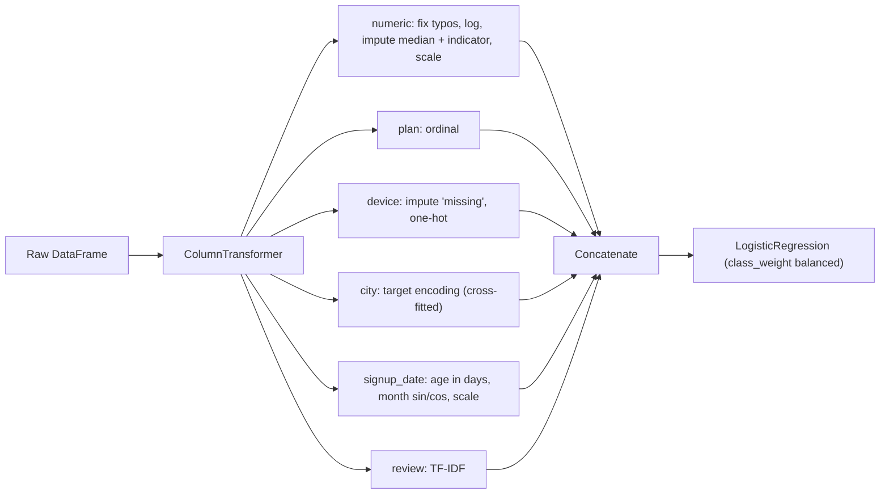

# Chapter 4 — Data, EDA and Feature Engineering

Models are only as good as the rows you feed them. In practice most of an ML project's time goes into the work in this chapter: finding labels, looking at the data, cleaning it, turning raw columns into numbers a model can use, splitting it so your scores are honest, and wrapping all of that into one reproducible pipeline. A mediocre model on well-prepared data usually beats a clever model on messy data.

**What you'll learn**

1. Where labels come from (outcomes, implicit feedback, humans, weak supervision, LLMs) and how to measure their quality.
2. Exploratory data analysis (EDA) with plots.
3. Cleaning: duplicates, impossible values, outliers, missing values.
4. Encoding categories: one-hot, ordinal, target encoding (and its leakage trap), hashing.
5. Scaling — and which models need it.
6. Creating features: interactions, binning, logs, dates, TF-IDF, feature groups.
7. Splitting: stratified, time-based and group splits.
8. Data leakage, with three runnable examples.
9. Class imbalance: weights, resampling, SMOTE, thresholds, recalibration.
10. An end-to-end scikit-learn `Pipeline` + `ColumnTransformer`.

All code is in `code/` and runs with the shared environment (Python 3.14, scikit-learn 1.9, pandas 3.0) with fixed seeds; outputs are real (long ones trimmed with "..."). Most scripts use a synthetic "subscription churn" table from `code/make_data.py`: 3,000 customers plus 25 duplicate rows, a skewed `income`, a 60-level `city`, dates, short reviews, missing values and typos (ages of 999, incomes of 9,999,999). **Churn** means a customer cancelling; about 12% churn.

---

## 4.1 Where training data comes from

### What it is
Supervised learning needs **labels**: the correct answer (the **target**, y) attached to each example's **features** (the inputs, X). A **label pipeline** is the process that produces those (features, label) pairs. Labels do not appear by magic; someone or something has to generate them, and each source has its own cost, delay and bias.

Analogy: a student learning from past exam papers. The papers are useless without the answer key — and if the answer key is late, expensive, or written by a sloppy marker, the student learns the wrong lessons.

### Why it matters
The first design question for any predictive system is "where does y come from, and when does it arrive?" Label quality caps model quality: a model can't be more accurate than the labels it's graded against.


*Figure — label sources differ mainly in delay and cost (course diagram)*

### How it works — the label sources

| Source | Example | Delay | Main weakness |
|---|---|---|---|
| **Natural (outcome) labels** — the world records the answer | Delivery took 34 min; loan defaulted; a card payment was reversed (a **chargeback**) | Minutes to weeks | Late; outcome ≠ truth (a chargeback is evidence of fraud, not proof) |
| **Behavioural labels / implicit feedback** — user actions stand in for judgments | Clicks, skips, saves, purchases, watch time | Seconds | Noisy (a click is not satisfaction) and biased toward what the system showed |
| **Human annotation** — trained reviewers follow a written guideline | Is this post harmful? Is this document relevant? | Hours to days | Costly (cents to dollars per judgment); reviewer quality needs managing |
| **Weak supervision** — many cheap, noisy rules vote | "Contains 'wire transfer' and sender is new → spam" | Instant once written | Rules are noisy and correlated; a model must combine them |
| **LLM-assisted labeling** — an LLM applies the guideline | Tag support tickets by topic | Seconds | Systematic errors (the same blind spot repeated everywhere) |

**Explicit vs implicit feedback.** *Explicit* feedback is the user telling you (a star rating); *implicit* is inferred from behaviour (they watched 90% of the video). Implicit feedback is plentiful but biased: a non-click may mean "never shown" (**exposure bias**), and top positions get clicked just for being on top (**position bias**). [Chapter 13, section 13.2](../13-recommenders-and-embeddings/README.md) covers modelling it.

**Label delay.** Outcome labels arrive late — chargebacks can take ~6 weeks to settle — so you train only on examples old enough to have a "mature" label and use faster **proxy labels** (rule hits, analyst decisions) for recent data. How delayed labels are joined to features and monitored in a live system is covered in [Chapter 16, section 16.3](../16-ml-in-production/README.md).

### Weak supervision in one paragraph
Instead of hand-labeling 100,000 items, experts write dozens of **labeling functions** — small heuristics that output a label or "abstain". A **label model** estimates each function's accuracy from where they agree and disagree, and combines their votes into a probabilistic label per item; a normal model trained on those labels usually generalises beyond the rules. This is the idea behind Stanford's **Snorkel** project.

### Human labeling, and measuring agreement
Treat annotation as a system: **versioned guidelines** (a label means what guideline v3 says, stored with the data), **gold questions** (items with known answers mixed into each queue to track reviewer accuracy), **active learning** (spend labels on items the model is least sure about) and reuse of decisions the business already makes (fraud analysts' verdicts). Chapter 16 (16.3) covers running this in production; the tool to master here is the agreement statistic.

**Inter-annotator agreement (IAA)** — have several reviewers label the same items and measure how often they agree. Raw agreement flatters: two reviewers who guess at random still agree sometimes. **Cohen's kappa** corrects for that:

κ = (p_o − p_e) / (1 − p_e)

where p_o = observed agreement (share of items with the same label) and p_e = chance agreement = Σ over labels of (A's share of that label × B's share). κ = 1 is perfect, 0 is chance level, negative is worse than chance.

*Worked example:* two reviewers label 100 emails and agree on 80 (p_o = 0.8). Each says "spam" half the time, so p_e = 0.5·0.5 (both say spam) + 0.5·0.5 (both say not spam) = 0.5. κ = (0.8 − 0.5)/(1 − 0.5) = **0.6** — "moderate" on the common Landis–Koch scale (0.41–0.60 moderate, 0.61–0.80 substantial). Low agreement usually means the guideline is unclear or the items are genuinely ambiguous; high agreement does not prove the labels are *correct* (reviewers can share a mistake).

### LLMs in the labeling loop
An LLM can label at scale from the written guideline, but inside a hierarchy: humans review a random sample plus low-confidence and disputed cases, and accuracy is measured against human-labeled slices **per important subgroup** ([Chapter 16, section 16.3](../16-ml-in-production/README.md)).


*Figure — LLM-assisted labeling with human audit (course diagram)*

### Negatives for retrieval, and privacy
- **Manufactured negatives.** Logs record clicks, never the millions of items a user would *not* have clicked, so retrieval models create **negative** examples themselves — random, **in-batch** (other users' positives in the same batch) and **hard** (shown but not clicked; some are **false negatives** the user would have liked). See [Chapter 13, section 13.7](../13-recommenders-and-embeddings/README.md).
- **Privacy.** Training data is user data: collect only what the task needs, restrict access, set retention; a hashed ID is still linkable across tables. More in [Chapter 16, section 16.3](../16-ml-in-production/README.md).

### Common mistakes
- Assuming labels "exist" in the warehouse without asking who creates them, when, and how reliably.
- Treating clicks as ground-truth relevance (they're biased toward what was shown and where).
- Changing the labeling guideline without versioning it.
- Reporting raw percent agreement instead of a chance-corrected κ.
- Letting an LLM label everything with no human-audited slices.

### Real-world examples
- **YouTube**'s 2016 recommendation paper (Covington et al.) trains its ranking model on implicit feedback — impressions that were clicked or not — and weights each clicked impression by its watch time, so a long watch counts more than a quick click.
- Content-moderation teams at large platforms run the "guidelines + reviewers + gold questions + agreement" loop above.
- Card networks and payment companies use chargebacks (slow) and analyst decisions (fast) as fraud labels.

### In the interview
**30-second answer** — "How will you get labels for this model?": *"I'd list the candidate sources — observed outcomes, user behaviour, human review, rules, LLMs — with their cost, delay and bias. I'd check label quality (agreement with κ, gold questions), train only on matured labels, and join them to features as they were at prediction time."*

- *"Two annotators agree 90% of the time — is that good?"* — Not necessarily. If each annotator says "not spam" 90% of the time, chance agreement is already p_e = 0.9² + 0.1² = 0.82, so κ = (0.90 − 0.82)/(1 − 0.82) ≈ 0.44 — only moderate. Always report a chance-corrected κ.
- *"When is weak supervision worth it?"* — When experts can state rules faster than they can label thousands of items, and labels are needed quickly or at scale; audit the result on a small hand-labeled set.
- *"Why is a click a weak label?"* — It measures the old system's exposure and position as much as the user's preference; a non-click is not a dislike.

### Self-check
1. Why is a click a biased label? → Users can only click what was shown, and position affects clicks — so it partly measures the old system.
2. κ when p_o = 0.9 and p_e = 0.5? → (0.9 − 0.5)/0.5 = 0.8.
3. What is a labeling function? → A cheap heuristic that outputs a label or abstains; many are combined by a label model in weak supervision.

### TL;DR
Labels come from outcomes (late), behaviour (fast but biased), people (costly), rules (noisy) or LLMs (scalable but correlated errors). Measure label quality with chance-corrected agreement (κ), version the guideline, and audit machine labels against human ones.

---

## 4.2 Exploratory data analysis (EDA)

### What it is
**EDA** is looking at your data — with summary tables and plots — before modeling, to learn its shape, spot problems and form hypotheses. Think of it as a doctor's first examination before any treatment.

### Why it matters
EDA finds problems that silently wreck models: impossible values, sentinel codes (like 9,999,999 meaning "unknown"), duplicates, skewed columns, leaky columns, and imbalance. It also tells you which transformations and models make sense.

### How it works — a checklist
1. **Shape and types** — numeric / categorical / dates / text columns.
2. **Missingness** — share missing per column; is it related to the target?
3. **Distributions** — histograms (skew, outliers, spikes at round numbers); category counts (**cardinality** = number of distinct values; rare levels).
4. **Target** — class balance, or the distribution for regression.
5. **Relationships** — each feature vs the target (rate per bucket, box plots) and vs each other (correlation matrix).
6. **Sanity checks** — duplicates, impossible ranges, IDs that predict the target (possible leakage).

**Correlation, briefly.** **Pearson** correlation measures *linear* association (−1 to 1). **Spearman** correlation is Pearson on the *ranks*, so it captures any **monotonic** (always-increasing or always-decreasing) relationship and is robust to outliers and skew — a good EDA default. Neither captures a U shape (correlation ≈ 0), and correlation is not causation.

```python
# code/eda.py (key parts)
df = make_churn()
print(df.isna().mean().loc[lambda s: s > 0].round(3))          # missing share
print(df[num_cols].describe().T[["mean", "50%", "std", "min", "max"]])
print(df[["plan", "device", "city"]].nunique())                   # cardinality
print(df.duplicated().sum())                                      # exact duplicates
corr = num.corr(method="spearman")                                # rank correlation
```

Output (trimmed):
```
--- missing values (share) ---
age       0.03
income    0.08
device    0.02

--- numeric summary ---
                    mean      50%       std     min        max
age                 41.1     39.0      37.2    18.0      999.0
income           70763.8  49100.0  328637.8  8600.0  9999999.0
tenure_months       23.3     23.0      13.5     1.0       47.0
support_tickets      1.2      1.0       1.1     0.0        6.0
usage_hours         12.0     10.1       8.4     0.1       58.9

--- categorical cardinality ---
plan 3 | device 3 | city 60

churn rate: 0.117
exact duplicate rows: 25

--- Spearman correlation with churn ---
tenure_months     -0.18
usage_hours       -0.08
...
support_tickets    0.12
```

How to read it: `age` has max 999 and a std of 37 years — typos. `income` has mean ≫ median (70.8k vs 49.1k): a long right tail plus a 9,999,999 sentinel. Churn is 11.7% (mildly imbalanced). Tenure (−) and support tickets (+) relate to churn, as we'd expect.


The bar charts show *shape*, which a single correlation number can't: churn drops steeply in the first year, then flattens.

### Common mistakes
- Doing EDA on the full dataset including the test set and then designing features around test-set quirks — do detailed EDA on the training split.
- Trusting `mean` on skewed columns — always compare with the median.
- Reading a near-zero correlation as "no relationship" (it only rules out a *monotonic* one).

### Real-world examples
`pandas` (`describe`, `value_counts`, `corr`), `seaborn` pair plots and `ydata-profiling` automate this checklist.

### Self-check
1. Mean income ≫ median income tells you what? → Right skew / large outliers.
2. When prefer Spearman over Pearson? → Skewed data, outliers, or monotonic-but-nonlinear relationships.
3. A customer-ID column strongly predicts the target. What do you suspect? → Leakage (IDs assigned in a way that encodes the outcome or time).

### TL;DR
Look before you model: types, missingness, distributions, target balance, feature–target and feature–feature relationships, duplicates and impossible values. Plots reveal shapes that single numbers hide.

---

## 4.3 Data cleaning

### What it is
Fixing or removing data problems so the model learns from reality, not from errors: **duplicates**, **impossible values**, **outliers**, and **missing values**.

### Why it matters
Duplicates leak between train and test and overweight some examples; typos distort means and scales; many estimators (e.g. `LinearRegression`, `SVC`) reject NaNs outright.

### How it works

**1. Duplicates.** Remove exact duplicate rows (`df.drop_duplicates()`), then check the entity key (`customer_id`) is unique. Near-duplicates (same text with different whitespace, a resized image) need fuzzy matching.

**2. Impossible values are errors, not outliers.** An age of 999 or an income of 9,999,999 is a data-entry error or a sentinel code. Convert them to missing (NaN) and handle them with the missing-value strategy.

**3. Outliers** are legitimate-but-extreme values. Detect them, then decide: keep, cap, transform, or remove.

| Method | Rule | Good for | Caveat |
|---|---|---|---|
| **IQR fences** | Flag x < Q1 − 1.5·IQR or x > Q3 + 1.5·IQR (IQR = Q3 − Q1) | Any distribution, robust | Flags many points on skewed data |
| **z-score** | Flag \|x − mean\| / std > 3 | Roughly normal data | Mean and std are themselves pulled by outliers |
| **Transform first** | Apply log, then z-score | Right-skewed positive data | — |
| **Winsorize / clip** | Cap values at e.g. the 1st and 99th percentiles | Keeping rows while limiting influence | Choose caps on training data only |
| **Model-based** | `IsolationForest`, `LocalOutlierFactor` | Multivariate outliers | More to tune |

**4. Missing values.** First ask *why* they're missing:
- **MCAR** (missing completely at random) — e.g. a sensor randomly drops readings. Any sensible imputation is fine.
- **MAR** (missing at random given other columns) — e.g. older customers skip the income field. Other columns can predict the missing value.
- **MNAR** (missing not at random) — the value itself causes the missingness, e.g. high earners hide income. Missingness is itself a signal: add a **missing-indicator** column.

Strategies:

| Strategy | What it does | Use when |
|---|---|---|
| Drop rows / column | Remove incomplete rows, or a mostly-empty feature | Very few missing rows (MCAR) / low-value column |
| Mean / median / mode (`SimpleImputer`) | Fill with a column statistic | Default baseline; median for skewed data; mode (`most_frequent`) for categories |
| Constant / "missing" category | Fill with a sentinel like `"missing"` | Categoricals — keeps the information that it was absent |
| **Missing indicator** (`add_indicator=True`) | Extra 0/1 column "was missing" | Missingness may be informative (MNAR) |
| KNN (`KNNImputer`) | Average of the k most similar rows | Other features predict this one; scale features first |
| Iterative / MICE (`IterativeImputer`) | Models each column from the others, round-robin | MAR data with correlated columns (still experimental: first `from sklearn.experimental import enable_iterative_imputer`) |
| Leave it to the model | `HistGradientBoosting*`, XGBoost, LightGBM handle NaN natively | Tree-boosting models |

```python
# code/cleaning.py (key parts)
df = df.drop_duplicates()
df.loc[df["age"] > 110, "age"] = np.nan                 # impossible -> missing
df.loc[df["income"] >= 9_999_999, "income"] = np.nan    # sentinel  -> missing

q1, q3 = inc.quantile([0.25, 0.75]); iqr = q3 - q1       # IQR fences (z-scores similar)

# Evaluate imputers honestly: hide 300 KNOWN incomes, impute them, measure the error
X_masked[hide, 1] = np.nan
for name, imp in {"mean": SimpleImputer(strategy="mean"), "median": SimpleImputer(strategy="median"),
                  "KNN (k=5)": KNNImputer(n_neighbors=5),
                  "iterative (MICE-like)": IterativeImputer(random_state=0)}.items():
    filled = imp.fit_transform(X_masked)[hide, 1]
    print(name, np.abs(filled - truth).mean())
```

Output:
```
duplicates removed: 25  -> rows now 3000
duplicate customer_ids left: 0
impossible ages -> NaN: 4, sentinel incomes -> NaN: 3

IQR fences: [-29,300, 137,100]  -> 141 flagged
|z| > 3                     -> 50 flagged
|z| > 3 on log(income)      -> 4 flagged  (skew made raw z-score over-flag)
winsorize (clip) to 1st/99th pct: [12,800, 207,332]

missing per column: {'age': 94, 'income': 243, 'device': 60}
churn rate | income missing: 0.152  | present: 0.114

imputer                 MAE on hidden incomes
drop rows (listwise)    n/a  (would keep only 79% of rows)
mean                    32,096
median                  29,903
KNN (k=5)               35,635
iterative (MICE-like)   32,096

device with 'missing' level : {'android': 1314, 'ios': 1036, 'web': 590, 'missing': 60}
...
```

What this shows:
- On a skewed column, the IQR rule flags 141 perfectly normal high earners and the raw z-score flags 50; after a log transform only 4 are extreme. **Skew is not the same as outliers.**
- Dropping every row with any missing value would throw away 21% of the data.
- **Fancy imputers are not automatically better.** Here income was generated independently of the other columns, so KNN and MICE have nothing to learn from (MICE collapses to the mean) and the median wins. The lesson is the *method*: hide known values and measure.
- Churn is 15.2% when income is missing vs 11.4% when present — but missingness was random by construction, so the gap is chance (≈1.8 standard errors with 243 rows). Test "informative missingness" rather than assume it; an indicator column lets the model use it if it's real.

### Trade-offs
Simple imputation is fast, stable and easy to reproduce at serving time; model-based imputation can be more accurate but is slower and one more thing to monitor. Any imputation shrinks variance (every filled value is "typical").

### Common mistakes
- Computing imputation statistics (mean, median, clip percentiles) on the whole dataset before splitting — leakage (4.8); fit on training data only.
- Deleting outliers that are real and important (fraud *is* the outlier).
- Filling missing categoricals with the mode and losing the "was missing" signal.

### In the interview
**30 seconds:** *"Dedupe on the entity key, turn impossible values into missing, and treat outliers by whether they're errors or real extremes — often a log transform or clipping at training-set percentiles. For missing data, start with median plus a missing indicator, compare KNN or iterative imputation by masking known values, and fit it all inside a pipeline."*

- *"Mean or median?"* — Median for skewed columns; it isn't dragged by the tail.
- *"How do you know imputation helped?"* — Mask known values and measure error, and compare downstream model scores with cross-validation.

### Self-check
1. Why convert 999 ages to NaN rather than clip them to 85? → They're errors; the true value is unknown, and clipping invents a specific wrong value.
2. What does `add_indicator=True` add? → A 0/1 column per imputed feature marking which rows were missing.
3. Why might raw z-scores over-flag outliers? → On skewed data the tail is long, and the mean/std are inflated by it.

### TL;DR
Dedupe, turn impossible values into NaN, handle outliers deliberately (log/clip, don't blindly delete), impute with training-set statistics (median + indicator is a strong default), and measure imputation quality.

---

## 4.4 Encoding categorical variables

### What it is
Most models only accept numbers. **Encoding** turns categories like `"ios"` or `"city_17"` into numeric columns. Which encoding you choose tells the model something about how categories relate.

### How it works — the four main encoders

| Encoder | Output | Example | Use for | Risk |
|---|---|---|---|---|
| **One-hot** (`OneHotEncoder`, `pd.get_dummies`) | One 0/1 column per category | `device=ios` → `[0,1,0,0]` | Nominal (unordered) categories with low–moderate cardinality | Width explodes with many levels |
| **Ordinal** (`OrdinalEncoder`) | One integer column | `basic/standard/premium` → 0/1/2 | Categories with a real order; also fine for tree models | For linear models it imposes a false order and equal spacing on nominal data |
| **Target encoding** (`TargetEncoder`) | Each category → (smoothed) mean of y for that category | `city_17` → 0.19 churn rate | High-cardinality categories (hundreds or thousands of levels) | **Target leakage** if computed on the same rows the model trains on |
| **Hashing** (`FeatureHasher`) | Category → hash(value) mod m buckets | `city_17` → column 13 | Huge or unbounded ID spaces, streaming data | **Collisions**: unrelated values share a bucket; not reversible |

Notes:
- **Label encoding** is the name often used for "category → integer code". In scikit-learn, `LabelEncoder` is meant for the *target* y; use `OrdinalEncoder` for features.
- **Dummy-variable trap**: with an intercept, the k one-hot columns always sum to 1, so they're perfectly collinear with the intercept and the coefficients aren't unique. Classical OLS (e.g. statsmodels) then needs `drop="first"`; scikit-learn's `LinearRegression` still fits (section 5.1), and regularised models and trees don't care.
- **Embeddings**: in deep learning each ID gets a learned dense vector (e.g. 32 numbers) — the standard for user and item IDs ([Chapter 13](../13-recommenders-and-embeddings/README.md)).
- Unseen categories at prediction time: `OneHotEncoder(handle_unknown="ignore")` outputs all zeros; `TargetEncoder` uses the global mean.

### Target encoding and its leakage trap
**Naive target encoding** replaces each category with its mean target on the training rows. For a category with 2–3 rows, that mean is basically *those rows' own labels* — the feature copies the answer, so the model shines on training data and fails on new data.

**The fix** (what scikit-learn's `TargetEncoder` does):
1. **Cross-fitting** — in `fit_transform`, split the training data into k folds; encode each fold using target means learned on the *other* folds, so no row sees its own label.
2. **Smoothing / shrinkage** — blend each category's mean with the global mean, weighting by the category's size, so rare categories stay close to the global rate.
3. At prediction time (`transform`), use encodings learned on the full training set.

CatBoost solves the same problem differently with "ordered target statistics" (each row is encoded using only rows before it in a random permutation).

```python
# code/encoding.py (key parts)
ohe = OneHotEncoder(handle_unknown="ignore", sparse_output=False).fit(df[["device"]].fillna("missing"))
ord_enc = OrdinalEncoder(categories=[["basic", "standard", "premium"]])      # explicit order
fh = FeatureHasher(n_features=16, input_type="string")                       # 16 buckets

df["noise_id"] = rng.integers(0, 1000, len(df)).astype(str)                  # pure noise, 1000 levels
means = pd.Series(y[tr]).groupby(df["noise_id"].iloc[tr].to_numpy()).mean()  # naive: leaky
naive_tr = df["noise_id"].iloc[tr].map(means)
te_enc = TargetEncoder(target_type="binary", cv=KFold(5, shuffle=True, random_state=0))
cf_tr = te_enc.fit_transform(df[["noise_id"]].iloc[tr], y[tr])               # cross-fitted
```

Output:
```
one-hot columns: ['device_android', 'device_ios', 'device_missing', 'device_web']
encode ['ios'], ['tablet'(unseen)]:
 [[0. 1. 0. 0.]
 [0. 0. 0. 0.]]

ordinal plan: [2. 0. 1.]

hashed city (16 buckets), row 0 non-zeros at: [13] [-1.]

Feature = target-encoded 'noise_id' (contains NO real signal):
naive target mean (leaky)              train AUC 0.941 | test AUC 0.519
TargetEncoder (cross-fitted, smoothed) train AUC 0.533 | test AUC 0.518

Feature = target-encoded 'city' (60 levels, real signal):
TargetEncoder(city)                    train AUC 0.632 | test AUC 0.555
OneHot(city)                           train AUC 0.722 | test AUC 0.554
```

Reading it: **AUC** (area under the ROC curve, Chapter 6) is 0.5 for random guessing and 1.0 for perfect ranking. Naive encoding of a pure-noise column scores **0.94 on training data** but 0.52 (chance) on test — a mirage that cross-fitting removes (train ≈ test ≈ 0.52). On the real `city` signal, target encoding matches one-hot on test with **one column instead of 60**. The hashed value is −1 because `FeatureHasher` uses a second hash to pick a sign, so collisions cancel out on average instead of piling up.

### When not to use them
- Don't one-hot a 100,000-level ID for a linear model — use hashing, target encoding, or embeddings.
- Don't ordinal-encode nominal categories for linear models or k-NN.
- Don't target-encode without cross-fitting, and never with statistics computed on validation/test rows.

### Real-world examples
- Feature hashing ("the hashing trick") was popularised for large-scale spam filtering and ad click prediction, and is built into Vowpal Wabbit and scikit-learn's `FeatureHasher`/`HashingVectorizer`.
- CatBoost (Yandex) exists largely to handle categorical features safely with ordered target statistics.

### In the interview
**30 seconds:** *"Low-cardinality nominal → one-hot. Ordered → ordinal. High-cardinality → target encoding (cross-fitted and smoothed), hashing if the ID space is unbounded, or embeddings in a neural model. Target encoding's risk is a row's own label leaking into its feature, so I encode out-of-fold."*

- *"Hashing vs target encoding?"* — Hashing needs no labels, no state and handles new values, but collides and isn't interpretable; target encoding is compact and informative but needs leakage protection and can go stale.
- *"Why is ordinal encoding OK for trees?"* — Trees split on thresholds and can isolate any level with several splits; the false order just costs a few extra splits.

### Self-check
1. What does `handle_unknown="ignore"` do for an unseen category? → Encodes it as all zeros.
2. Why did naive target encoding of noise get train AUC 0.94? → Each small category's mean was computed from the row's own label.
3. Two ways `TargetEncoder` prevents that? → Cross-fitting and shrinkage toward the global mean.

### TL;DR
One-hot for small unordered sets, ordinal for ordered ones, target encoding (out-of-fold, smoothed) or hashing for huge ones, embeddings in deep models. Target encoding is the most powerful and the easiest to leak.

---

## 4.5 Feature scaling

### What it is
**Scaling** puts numeric features on comparable ranges. Without it, a feature measured in thousands (income, proline) dominates one measured in fractions.

| Scaler | Formula | Result | Sensitive to outliers? |
|---|---|---|---|
| **Standardization** (`StandardScaler`) | z = (x − mean) / std | mean 0, std 1 | Yes (mean and std move) |
| **Min-max** (`MinMaxScaler`) | (x − min) / (max − min) | range [0, 1] | Very (one outlier squashes everyone else) |
| **Robust** (`RobustScaler`) | (x − median) / IQR | median 0, IQR 1 | No (median and IQR ignore extremes) |
| **Log / power** (`np.log1p`, `PowerTransformer`) | reshapes the distribution | less skew | Reduces their influence |

Scaling changes the *units*, not the *shape* — a skewed feature stays skewed after `StandardScaler`. To change the shape, use a log or power transform.

### Why it matters — and which models care
- **Distance-based models** (k-NN, k-means, RBF-kernel SVM): the widest feature dominates the distance.
- **Gradient-descent models** (linear/logistic regression, neural nets) converge much faster on similar scales (section 5.4 shows why).
- **Regularised models** (Ridge, Lasso, logistic regression's default L2) penalise coefficient size, which depends on units.
- **PCA** finds directions of largest variance — unscaled, that's just the column with the biggest units.
- **Trees don't care**: a split "income ≤ 50,000" works the same in dollars or thousands.

```python
# code/scaling.py (key parts)
x = np.array([[10.0], [12], [11], [13], [12], [11], [100]])
for s in [StandardScaler(), MinMaxScaler(), RobustScaler()]:
    print(type(s).__name__, s.fit_transform(x).ravel().round(2))

X, y = load_wine(return_X_y=True)     # 13 features on very different scales
for name, m in models.items():
    accs = [cross_val_score(m, X, y, cv=5).mean()]
    for sc in [StandardScaler(), MinMaxScaler(), RobustScaler()]:
        accs.append(cross_val_score(make_pipeline(sc, m), X, y, cv=5).mean())
```

Output:
```
raw       : [ 10.  12.  11.  13.  12.  11. 100.]
StandardScaler : [-0.46 -0.39 -0.42 -0.36 -0.39 -0.42  2.45]
MinMaxScaler   : [0.   0.02 0.01 0.03 0.02 0.01 1.  ]
RobustScaler   : [-1.33  0.   -0.67  0.67  0.   -0.67 58.67]

feature ranges: min std = 0.124, max std = 314.0

model             no scaling  standard  min-max  robust
k-NN (k=5)           0.691     0.949     0.950     0.938
SVM (RBF)            0.663     0.983     0.978     0.983
LogReg (lbfgs)       0.961     0.983     0.978     0.989
Decision tree        0.888     0.888     0.888     0.888
```

Worked check for the robust scaler: median = 12, Q1 = 11, Q3 = 12.5, so IQR = 1.5 and 100 → (100 − 12)/1.5 = 58.67. The six normal values keep a useful spread (−1.33 to 0.67); with min-max they are all squeezed into [0, 0.03] by the one outlier.


### Trade-offs / when to use which
**StandardScaler** is the default (linear models, SVMs, neural nets, PCA); **MinMaxScaler** when a bounded range is needed (image pixels to [0, 1]) and there are no big outliers; **RobustScaler** when there are outliers you want to keep; **nothing** for tree ensembles.

### Common mistakes
- Fitting the scaler on all data before splitting (leakage, 4.8) — fit on train, `transform` the rest.
- Scaling one-hot columns is harmless but usually unnecessary; scaling the *target* in regression requires inverting predictions (`TransformedTargetRegressor`).
- Expecting scaling to fix skew.

### In the interview
**30 seconds:** *"Scale for anything that uses distances, gradients, or penalties — k-NN, SVM, linear models, neural nets, PCA, k-means. Standardize by default, robust-scale if there are outliers, skip it for trees. Always fit the scaler on the training fold only."*

- *"Does logistic regression need scaling?"* — For correctness, not strictly; for convergence speed and fair regularisation, yes.

### Self-check
1. Why is min-max bad with outliers? → The outlier becomes 1 and squashes all other values near 0.
2. Does `StandardScaler` make data normal? → No, it only shifts and rescales.
3. Why didn't the tree's accuracy change? → Splits are thresholds; they're invariant to monotonic rescaling.

### TL;DR
Standardize for distance/gradient/penalty-based models, robust-scale with outliers, nothing for trees, log-transform for skew — and fit the scaler on training data only.

---

## 4.6 Feature creation

### What it is
**Feature engineering** is creating new inputs that make the pattern easier for a model to learn. A linear model can only draw straight lines in the features you give it; a good feature bends the problem so a straight line works.

### How it works — the core techniques

**1. Interactions and polynomials.** If the target depends on a *product* (revenue = price × quantity), add that product. `PolynomialFeatures(degree=2)` adds all squares and pairwise products.

**2. Binning (discretization).** Cut a numeric feature into intervals (equal-width, quantile or domain-chosen) and one-hot them (`KBinsDiscretizer`), so a linear model can fit non-monotonic shapes such as risk that's high for both young and old customers.

**3. Log and power transforms for heavy tails.** A **heavy tail** means most values are small but a few are enormous (income, counts, prices). `log1p(x) = log(1 + x)` compresses the tail and handles zeros.

**4. Date and time features.** Extract parts (month, day of week, hour, is_weekend, is_holiday) and durations ("days since signup"), and use **cyclical encoding** for periodic values: month m → (sin(2πm/12), cos(2πm/12)), so December and January are neighbours instead of 11 apart.

**5. Text: bag-of-words and TF-IDF.** **Bag-of-words** counts each word per document. **TF-IDF** (term frequency × inverse document frequency) down-weights words that appear in many documents. In scikit-learn's default: tf = raw count in the document, idf(t) = ln((1 + n) / (1 + df(t))) + 1 where n = number of documents and df(t) = documents containing t, then each row is scaled to unit length (L2 norm).

**6. Aggregates and ratios.** "Tickets per month of tenure", "spend in the last 7 days", "user's average order value" — often the strongest features in business data.

```python
# code/features.py (key parts)
revenue = price * qty + rng.normal(0, 1, n)
lin   = cross_val_score(LinearRegression(), X, revenue, cv=5, scoring="r2").mean()
inter = cross_val_score(make_pipeline(PolynomialFeatures(2, interaction_only=True, include_bias=False),
                                      LinearRegression()), X, revenue, cv=5, scoring="r2").mean()

p = 1 / (1 + np.exp(-(0.004 * (age - 50) ** 2 - 2)))       # U-shaped risk
binned = make_pipeline(KBinsDiscretizer(n_bins=6, encode="onehot", strategy="quantile",
                                        quantile_method="averaged_inverted_cdf"), LogisticRegression())

"month_sin": np.sin(2 * np.pi * ts.dt.month / 12), "month_cos": np.cos(2 * np.pi * ts.dt.month / 12)

docs = ["app is slow and expensive", "love the app, fast and easy",
        "slow slow slow, will cancel", "easy to use and helpful support"]
M = TfidfVectorizer().fit_transform(docs)
```

Output:
```
revenue ~ price, qty          R^2 = 0.893
revenue ~ price, qty, price*qty R^2 = 0.997
PolynomialFeatures(2) names: ['price' 'qty' 'price^2' 'price qty' 'qty^2']

U-shaped age effect: raw age AUC = 0.531 | 6 quantile bins AUC = 0.747

 signup_date  year  month  dayofweek  is_weekend  days_since  month_sin  month_cos
 2025-10-09  2025     10          3           0          84     -0.866        0.5
 2024-12-11  2024     12          2           0         386      0.000        1.0
 ...

vocabulary: ['and', 'app', 'cancel', 'easy', 'expensive', 'fast', 'helpful', 'is', 'love', 'slow', 'support', 'the', 'to', 'use', 'will']
doc 2 non-zero weights: {'cancel': 0.363, 'slow': 0.858, 'will': 0.363}
idf('slow') = 1.511, idf('and') = 1.223
churn ~ TF-IDF(review) alone: AUC = 0.736
```

**TF-IDF worked by hand** for doc 2 ("slow slow slow, will cancel"), n = 4 documents:
- idf(slow): in 2 docs → ln(5/3) + 1 = 1.511. idf(will), idf(cancel): 1 doc each → ln(5/2) + 1 = 1.916. ("and" appears in 3 docs → 1.223: common words get low weight.)
- raw tf·idf: slow 3 × 1.511 = 4.533; will 1.916; cancel 1.916.
- L2 norm = √(4.533² + 1.916² + 1.916²) = √27.89 = 5.281 → slow 0.858, will 0.363, cancel 0.363. ✓ matches the output.

The interaction feature takes R² from 0.893 to 0.997 because the true relationship is a product. Binning takes AUC from 0.53 (a single slope can't draw a U) to 0.75.

### Feature groups in production systems
When brainstorming features for a real product, think in four groups so you don't miss a whole family. For predicting a food-delivery ETA at checkout:

- **Entity** — one participant on its own, changing rarely (the restaurant's typical kitchen time, the courier's vehicle).
- **Behavioural aggregate** — a count or average over a recent window (orders received in the past 30 minutes); worthless unless fresh.
- **Context** — the moment of the request (hour, weekday, rain, trip distance).
- **Cross** — a pair of participants together (this courier's past speed at this restaurant).


*Figure — feature groups and their compute paths (course diagram)*

One rule applies from day one: **point-in-time availability** — every feature must be computable *at prediction time* from data that existed then (section 4.8 shows what happens otherwise). How each group is computed and served (nightly batch vs streaming, the offline/online **feature store**, latency budgets and fallbacks for request-time features) is the subject of [Chapter 16, section 16.4](../16-ml-in-production/README.md).

### Trade-offs
More features can capture more signal but add overfitting risk, compute, latency and maintenance (each feature is a pipeline that can break); degree-2 polynomials on 100 features give 5,150 columns. Trees and neural nets learn interactions themselves, so explicit engineering matters most for linear models and for domain knowledge (ratios, time windows) no model can invent.

### Common mistakes
- Features that use future information (a 30-day average that includes days *after* the prediction).
- Treating month or hour as a plain number (December far from January).
- Fitting `TfidfVectorizer` or bin edges on all data instead of training data.

### Real-world examples
- **Uber** and **DoorDash** have publicly described ETA models that combine entity, real-time aggregate and context features.
- Search engines long ranked with TF-IDF-style scores (BM25 is its refined descendant), still used as a first-stage retriever.
- Google's **Wide & Deep** recommender (2016) used hand-crafted cross features in the "wide" linear part.

### In the interview
**30 seconds:** *"I'd brainstorm features by group — entity, behavioural aggregates, request context, crosses — check each is available at prediction time, then transform them: log for heavy tails, one-hot or embeddings for categories, cyclical encoding for time, TF-IDF or embeddings for text, products or bins where a linear model needs curvature."*

- *"Why cyclical encoding?"* — So the model sees hour 23 and hour 0 as neighbours.

### Self-check
1. Which transform helps a linear model fit a U-shaped effect? → Binning (or a squared term).
2. Encode hour = 6 cyclically. → (sin(2π·6/24), cos(2π·6/24)) = (1, 0).
3. Why does TF-IDF give "and" a low weight? → It appears in many documents (low idf).
4. Why is "orders in the last 30 minutes" risky to compute nightly? → It's only useful if fresh; a stale value is noise (see 16.4).

### TL;DR
Give the model the shape of the problem: products for interactions, bins or polynomials for curves, logs for tails, sin/cos for cycles, TF-IDF for text, aggregates for behaviour. In production, every feature must exist at prediction time.

---

## 4.7 Train, validation and test splits

### What it is
You split data so that the score you report reflects performance on **unseen** data:
- **Training set** — the model learns its parameters here.
- **Validation set** — you compare models and tune **hyperparameters** (settings chosen before training, like tree depth) here.
- **Test set** — touched **once**, at the end, for the final unbiased estimate.

Analogy: homework (train), mock exams (validation), the real exam (test). If you practise on the real exam paper, your score means nothing.

### How it works
1. **Random split** — shuffle, then e.g. 60/20/20, or 80/20 with cross-validation on the 80% replacing a fixed validation set (Chapter 6).
2. **Stratified split** — keep the class proportions the same in every split (`stratify=y`). Essential for imbalanced or small datasets.
3. **Time-based split** — train on the past, validate/test on the future (`TimeSeriesSplit`, or cut by date). Use it whenever the model will predict the future, which is almost every production system.
4. **Group split** — keep all rows of one entity (a customer, a patient, a device) in the same split (`GroupKFold`, `GroupShuffleSplit`). Use it when the model must work for *new* entities.

```python
# code/splits_and_leakage.py (key parts)
X_tmp, X_test, y_tmp, y_test = train_test_split(X, y, test_size=0.2, stratify=y, random_state=0)
X_train, X_val, y_train, y_val = train_test_split(X_tmp, y_tmp, test_size=0.25, stratify=y_tmp,
                                                  random_state=0)      # 0.25 of 80% = 20%
for tr, va in TimeSeriesSplit(n_splits=4).split(np.arange(20)): ...
GroupKFold(n_splits=5).split(X, groups=customer_ids)
```

Output:
```
sizes train/val/test: 600 200 200
positive rate  all/train/val/test: 0.045 0.045 0.045 0.045
WITHOUT stratify, test positive rate over 200 random splits: min 0.005  max 0.080
fold 0: train t=0..3  validate t=4..7
...
fold 3: train t=0..15  validate t=16..19
GroupKFold val customers: [4]  train customers: [0, 1, 2, 3]
...
```

With 4.5% positives and a 200-row test set, an unstratified split can leave you with as few as 1 positive (0.5%) or as many as 16 (8%) — your metric would swing wildly. Stratification pins it at 4.5%.


*Figure — temporal vs random split (course diagram)*

If the goal is "future behaviour of *known* users", the same user may appear in train and test (at different times); if it is "generalise to *new* users", split by user.

### Trade-offs
| Split | Pros | Cons |
|---|---|---|
| Random | Simple, uses data efficiently | Optimistic when data has time order or repeated entities |
| Stratified | Stable class ratios | Only for classification labels (or binned targets) |
| Time-based | Matches deployment; exposes drift | Less training data for early folds; must respect label delay |
| Group | Honest for new entities | Fewer effective samples; groups vary in size |

Sizes: with millions of rows, 98/1/1 is fine (1% is still tens of thousands); with a few thousand, use cross-validation instead of a single validation set.

### Common mistakes
- Tuning on the test set ("peeking") — the test score is then biased upward.
- Random splits on time-ordered data — the model trains on the future.
- Splitting *after* oversampling or deduplication mistakes, so copies of the same row land in train and test.

### Self-check
1. Why stratify? → Keep class proportions stable across splits, especially for rare classes.
2. When do you need a group split? → When rows from the same entity are correlated and you must generalise to new entities.
3. What's the validation set for? → Model selection and tuning; the test set is for the final estimate only.

### TL;DR
Train to learn, validate to choose, test once to report. Stratify for classification, split by time when predicting the future, split by group when predicting for new entities.

---

## 4.8 Data leakage

### What it is
**Data leakage** is when information that won't be available at prediction time sneaks into training or evaluation. The model looks brilliant offline and disappoints (or fails) in production. It's the single most common reason for "too good to be true" results.

### The main kinds — and how to prevent each

| Kind | Example | Prevention |
|---|---|---|
| **Target leakage** — a feature is a consequence or proxy of the label | `refund_issued` or `case_resolution_code` is filled in only *after* churn/fraud happened | For every feature ask: *would I know this value at the moment of prediction?* |
| **Future data in aggregates** (not point-in-time correct) | A per-merchant fraud rate whose window already contains the transaction being scored | **Point-in-time joins**: take each feature's value as of the prediction time |
| **Train–test contamination** — preprocessing fitted on all data | Scaler, imputer, feature selection or target encoder fitted before the split | Split **first**; put every learned step inside a `Pipeline` so it's re-fitted per fold |
| **Duplicates across splits** | The same document, image or patient in train and test | Deduplicate (including near-duplicates) *across* splits; group splits |
| **Temporal leakage** — random split on time-ordered data | Training on next month to predict this month | Split by time |
| **Leaky identifiers** | IDs assigned in an order that correlates with the outcome | Drop IDs; be suspicious of any feature with huge importance |

A famous published case: in the KDD Cup 2008 breast-cancer challenge, patient ID numbers turned out to be predictive of the label because of how the data had been assembled — a leak, not medicine.

### Three runnable demonstrations

```python
# (a) Feature selection BEFORE cross-validation on pure noise (100 rows, 5,000 random features)
leaky_X = SelectKBest(f_classif, k=20).fit_transform(Xn, yn)         # looked at ALL labels
leaky  = cross_val_score(LogisticRegression(max_iter=1000), leaky_X, yn, cv=5).mean()
honest = cross_val_score(make_pipeline(SelectKBest(f_classif, k=20),
                                       LogisticRegression(max_iter=1000)), Xn, yn, cv=5).mean()

# (b) 'refund_issued' is set for 90% of churners, 2% of others - but only AFTER churn
# (c) Drifting data: random split vs train-on-past / test-on-future
```

Output:
```
(a) pure-noise data: select-then-CV accuracy = 0.90 | select-inside-CV = 0.57
(b) with refund_issued: offline AUC 0.975 | without: 0.751 | with it at serving time (field is empty): 0.750
    recall at threshold 0.5: offline 0.89 -> in production 0.00
(c) drifting data: random-split AUC 0.751 | train-on-past, test-on-future AUC 0.551
```

- **(a)** On pure noise honest accuracy is ~0.5 (0.57 is chance on 100 rows). Selecting the 20 "best" features with *all* labels, then cross-validating, reports **90%** — selection already saw the validation labels. Selection inside the pipeline fixes it.
- **(b)** The leaky feature lifts offline AUC from 0.75 to 0.975. In production the field is always empty at prediction time; the model relied on it, so at the offline-tuned threshold it catches **0%** of churners.
- **(c)** When the world changes over time, a random split mixes future rows into training and reports 0.75; the honest forward-in-time estimate is 0.55.

A general rule on top of the table: be suspicious of any score far above published baselines — investigate before celebrating.

### In the interview
**30 seconds:** *"Leakage is training on information you won't have at prediction time. I prevent it with point-in-time-correct features, time or entity splits that match deployment, all preprocessing inside the CV pipeline, deduplication across splits, and treating suspiciously strong features as bugs until proven otherwise."*

- *"Your offline AUC is 0.99 on fraud. What do you check first?"* — Feature timestamps vs the label time (post-outcome fields, aggregates including the current event), split method, duplicates, and top feature importances.
- *"Is fitting a StandardScaler on all data really a problem?"* — Usually a small bias, but it's the same mistake that becomes huge with target encoding or feature selection, so never do it.

### Self-check
1. Name a label-adjacent feature for fraud. → Chargeback flag, refund flag, case-resolution code.
2. Why does the pipeline fix demo (a)? → Selection is re-fitted on each training fold without seeing that fold's validation labels.
3. What is a point-in-time join? → Joining each training example to feature values as they were at that example's timestamp.

### TL;DR
If the model couldn't know it at prediction time, it mustn't see it in training. Split first, pipeline everything, split by time/group, dedupe across splits, and distrust scores that look too good.

---

## 4.9 Class imbalance

### What it is
**Class imbalance** means one class is much rarer than the other — fraud (e.g. 0.2% of transactions, about 1 in 500), disease, churn, ad clicks. The rare class is usually the one you care about.

### Why it matters
**Accuracy lies**: if 99.8% of transactions are legitimate, always saying "legitimate" is 99.8% accurate and catches no fraud. **Learning is harder**: the loss is dominated by negatives, so models tend to predict low probabilities for everything. And millions of easy negatives **waste compute**.

### How it works — the toolbox

| Technique | What it does | Effect on probabilities |
|---|---|---|
| **Better metrics** | Precision, recall, F1, PR-AUC instead of accuracy (Chapter 6) | — |
| **Threshold moving** | Keep the model; lower the decision threshold from 0.5 | None (probabilities unchanged) |
| **Class weights** (`class_weight="balanced"`) | Each positive counts more in the loss (weight ∝ 1/class frequency) | Inflated — need recalibration |
| **Random oversampling** | Duplicate minority rows | Inflated; risk of overfitting repeated rows |
| **Random undersampling / negative downsampling** | Keep all positives, a fraction w of negatives | Inflated; but the training set shrinks to about a fraction w, so training is ~1/w times cheaper |
| **SMOTE** | Create *synthetic* minority points between a minority point and one of its k nearest minority neighbours | Inflated; can blur class boundaries |
| **Recalibration** | Map scores back to real-world probabilities | Fixes the above |

**SMOTE** (Synthetic Minority Over-sampling Technique, Chawla et al., 2002): for a minority point a, pick one of its k nearest minority neighbours b, and create a + u·(b − a) with u random in [0, 1]. It's in the `imbalanced-learn` library (`imblearn.over_sampling.SMOTE`); here it's written from scratch.

**Recalibrating after negative downsampling.** If you keep a fraction w of negatives, every negative now counts w times as often, so the model's **odds** p/(1 − p) are inflated by 1/w. Multiply the odds back by w and convert to a probability:

odds_true = w · p/(1 − p)  →  p_true = odds_true / (1 + odds_true) = p·w / (p·w + (1 − p))

*Worked example:* w = 0.1, model outputs p = 0.5 on the downsampled data → p_true = 0.05 / (0.05 + 0.5) = **0.091**. (Keeping 1 in 10 negatives on a 0.2% base rate raises the positive share to about 2%.) General recalibration methods (Platt scaling, isotonic regression) are in Chapter 6.

**Resample only the training data**, and only *after* splitting — never the validation or test sets, which must reflect the real population.

```python
# code/imbalance.py (key parts) — 20,000 rows, ~2.2% positives, gradient-boosted trees
def smote(X_min, n_new, k=5, seed=0):
    rng = np.random.default_rng(seed)
    _, idx = NearestNeighbors(n_neighbors=k + 1).fit(X_min).kneighbors(X_min)
    base = rng.integers(0, len(X_min), n_new)               # random minority points a
    neigh = idx[base, rng.integers(1, k + 1, n_new)]       # one of their k neighbours b
    return X_min[base] + rng.random((n_new, 1)) * (X_min[neigh] - X_min[base])   # a + u(b - a)

report("GBM class_weight=bal.", Model(class_weight="balanced").fit(X_tr, y_tr), X_te, y_te)
keep = np.r_[pos, rng.choice(neg, int(len(neg) * 0.10), replace=False)]   # downsample negatives
p_corr = p_s * w / (p_s * w + (1 - p_s))                                   # prior correction
```

Output:
```
positive rate: train 0.0221, test 0.0222  (about 1 in 45)

method                       acc   prec    rec     F1 ROC-AUC  PR-AUC   mean p
majority-class baseline    0.978  0.000  0.000  0.000   0.500   0.022   0.0000
GBM, no fix                0.980  0.604  0.218  0.320   0.905   0.402   0.0151
GBM class_weight=bal.      0.969  0.376  0.579  0.456   0.906   0.402   0.0668
random oversampling        0.967  0.353  0.571  0.437   0.910   0.412   0.0659
SMOTE (from scratch)       0.936  0.209  0.684  0.320   0.901   0.384   0.1196
downsample negatives 1:10  0.958  0.283  0.571  0.378   0.916   0.368   0.0729

after downsampling, mean predicted p = 0.0729 vs true rate 0.0222
after prior correction p' = p*w / (p*w + 1 - p): mean p' = 0.0208 (ranking unchanged: ROC-AUC 0.916)
plain model, threshold  0.5: precision 0.604  recall 0.218
plain model, threshold  0.2: precision 0.490  recall 0.376
plain model, threshold  0.1: precision 0.426  recall 0.496
```

What to take from this:
- The do-nothing baseline has **97.8% accuracy** and zero recall — accuracy is the wrong metric.
- **Ranking metrics barely change** (ROC-AUC ≈ 0.90–0.92, PR-AUC ≈ 0.37–0.41). Resampling and weighting mostly *move the operating point* at threshold 0.5 — which threshold moving on the plain model does for free.
- Every rebalancing method inflates the mean predicted probability (0.07–0.12 vs a true 0.022); the prior correction brings the downsampled model back to 0.021 with ranking untouched.
- SMOTE isn't magic: the most recall, the worst precision, slightly lower PR-AUC.

### Trade-offs
Downsampling is the fastest (a real win at billions of rows) but discards data; class weights keep all data at more compute; oversampling/SMOTE enlarge the training set and risk overfitting copies or inventing unrealistic points (SMOTE works poorly with categorical or high-dimensional features); threshold moving is free and keeps calibrated probabilities but doesn't help the model *learn* the minority better. All but threshold moving need recalibration if scores are used as probabilities.

### When not to use it
If the model is only used for ranking (top-k alerts) or you'll choose the threshold on a precision–recall curve anyway, rebalancing is often unnecessary. Strong models like gradient boosting on moderately imbalanced data (say 5–20% positives) usually do fine without it — just use the right metric.

### Common mistakes
- Oversampling **before** splitting — copies of the same positive end up in train and test.
- Resampling the test set.
- Reading a downsampled model's scores as real probabilities (e.g. in an ad auction or an expected-cost calculation).

### Real-world examples
- Facebook's 2014 ad click-prediction paper (He et al.) used negative downsampling and re-calibrated with q = p / (p + (1 − p)/w) — the same formula as above, rearranged. The production version of this workflow, with Platt/isotonic calibration, is in [Chapter 16, section 16.3](../16-ml-in-production/README.md).

### In the interview
**30 seconds:** *"First, change the metric — precision, recall and PR-AUC, not accuracy. Then reweight the loss or downsample negatives for speed, and recalibrate scores to the true base rate if they're used as probabilities. Pick the threshold from the business cost of each error. SMOTE is an option, but I'd compare it with class weights on a stratified validation set."*

- *"Downsample or reweight?"* — Downsample when data is huge and compute matters; reweight when data is modest. Both need recalibration.
- *"Does class_weight improve ROC-AUC?"* — Often barely; it mainly shifts where a 0.5 threshold lands. Use it if it helps the chosen metric in validation.

### Self-check
1. Why is 99% accuracy meaningless at a 1% positive rate? → The all-negative model gets it.
2. Recalibrate p = 0.2 with w = 0.1. → 0.02/(0.02 + 0.8) = 0.024.
3. How does SMOTE create a sample? → A random point on the line segment between a minority point and one of its minority nearest neighbours.

### TL;DR
Imbalance breaks accuracy, not learning per se. Use precision/recall/PR-AUC, then weight, downsample or oversample the training data, move the threshold to fit business costs, and recalibrate probabilities to the real base rate.

---

## 4.10 End-to-end: `Pipeline` + `ColumnTransformer`

### What it is
A scikit-learn **`Pipeline`** chains steps (transformers, then a final model) into one estimator with `fit` and `predict`. A **`ColumnTransformer`** applies different preprocessing to different columns and concatenates the results. Together they turn "a notebook of manual steps" into **one object** that you fit, tune, save and serve.



### Why it matters
1. **No leakage** — in cross-validation every learned step (imputer medians, scaler means, TF-IDF vocabulary, target encodings) is re-fitted on each training fold only.
2. **No training–serving skew** (production features differing from training features) — the same code transforms data at training and prediction time.
3. **Tuning across steps** — `GridSearchCV` tunes preprocessing and model together via `step__param` names.
4. **One artifact to ship** — `joblib.dump(pipe, "model.joblib")`.

```python
# code/pipeline_end_to_end.py (key parts)
def fix_impossible(X):                      # stateless rule: no fitting, safe anywhere
    X = X.copy()
    X["age"] = X["age"].where(X["age"] <= 110)
    X["income"] = np.log1p(X["income"].where(X["income"] < 9_999_999))
    return X

numeric_pipe = make_pipeline(FunctionTransformer(fix_impossible, feature_names_out="one-to-one"),
                             SimpleImputer(strategy="median", add_indicator=True), StandardScaler())
pre = ColumnTransformer([
    ("num", numeric_pipe, numeric),
    ("plan", OrdinalEncoder(categories=[["basic", "standard", "premium"]]), ["plan"]),
    ("device", make_pipeline(SimpleImputer(strategy="constant", fill_value="missing"),
                             OneHotEncoder(handle_unknown="ignore")), ["device"]),
    ("city", TargetEncoder(target_type="binary", cv=KFold(5, shuffle=True, random_state=0)), ["city"]),
    ("date", make_pipeline(FunctionTransformer(date_parts, feature_names_out=date_names),
                           StandardScaler()), ["signup_date"]),
    ("text", TfidfVectorizer(min_df=2), "review"),     # string, not list: TF-IDF wants 1-D text
])                                                    # remainder="drop" drops customer_id
pipe = Pipeline([("pre", pre), ("model", LogisticRegression(max_iter=2000, class_weight="balanced"))])

X_tr, X_te, y_tr, y_te = train_test_split(X, y, test_size=0.2, stratify=y, random_state=42)
search = GridSearchCV(pipe, {"model__C": [0.01, 0.1, 1.0, 10.0, 100.0]},
                      cv=StratifiedKFold(5, shuffle=True, random_state=0), scoring="average_precision")
search.fit(X_tr, y_tr)
p = search.best_estimator_.predict_proba(X_te)[:, 1]      # test set used once
```

Output:
```
best C: 10.0 | CV PR-AUC: 0.414
features after ColumnTransformer: 27
most negative coefs:
 text__fast    -1.12
...
most positive coefs:
 ...
text__cancel    0.76
city__city      4.94
scaled numeric coefs: {'num__age': 0.0, 'num__income': 0.05, 'num__tenure_months': -0.65, 'num__support_tickets': 0.41, 'num__monthly_charges': 0.43, 'num__usage_hours': -0.49}

TEST  model   : ROC-AUC 0.836 | PR-AUC 0.413
TEST  baseline: ROC-AUC 0.500 | PR-AUC 0.117  (PR-AUC of a no-skill model = positive rate 0.117)

raw new row with unseen city + missing device -> p(churn) = 0.368
```

How to read it:
- The model recovers the real drivers: tenure and usage lower churn; tickets and negative review words raise it; age and income (pure noise here) get ≈ 0. The `city` coefficient looks huge only because a target-encoded value is a probability (0 to ~0.3), not a standardized number — compare coefficients only on the same scale.
- PR-AUC 0.41 vs 0.117 for a no-skill model: a large lift. Always report a baseline next to the model.
- The best `C` (inverse regularisation strength) is 10, with CV scores nearly flat for C ≥ 10 (0.414 at both 10 and 100). Had the winner sat at the grid's edge with scores still rising, the right move would be to extend the grid (Chapter 6).
- A raw row with a never-seen city and a missing device still gets a sensible prediction.

**Useful API details**
- `remainder="drop"` is the default (`"passthrough"` keeps untouched columns). Pass a list `["plan"]` for 2-D transformers, a single string `"review"` for text vectorizers that expect 1-D input.
- `pipe.named_steps["pre"].get_feature_names_out()` names every output column (custom `FunctionTransformer`s need `feature_names_out`); `set_output(transform="pandas")` returns DataFrames (not with sparse TF-IDF output).
- Custom functions in a pipeline must be importable (module-level) for `joblib` to save/load it.

### Common mistakes
- Preprocessing with pandas *before* the split, then using a pipeline only for the model.
- Forgetting `handle_unknown="ignore"` and crashing on a new category in production.
- Putting data-dependent logic ("clip at the 99th percentile") in a `FunctionTransformer` — it recomputes on each batch; use a fitted transformer instead.

### In the interview
**30 seconds:** *"One sklearn Pipeline with a ColumnTransformer per column type; tune it with cross-validation so every fold re-fits the preprocessing; evaluate once on a held-out test set against a baseline; ship the whole pipeline as one artifact so training and serving share code."*

- *"How does this prevent leakage?"* — `fit` is only ever called on training folds; validation folds only see `transform`.
- *"Where does this break at scale?"* — Streaming data and real-time aggregates need a feature pipeline and feature store (Chapter 16); the idea stays the same.

### Self-check
1. What does `model__C` refer to? → Parameter `C` of the step named `model`.
2. Why is `"review"` passed as a string? → `TfidfVectorizer` expects a 1-D sequence of documents.
3. What happens to `customer_id`? → Dropped by the default `remainder="drop"`.

### TL;DR
One `Pipeline` (with a `ColumnTransformer` for per-column preprocessing) = no leakage in CV, no training–serving skew, joint tuning, one artifact to deploy.

---

## Chapter TL;DR

- **Labels**: outcomes (late), implicit feedback (biased by exposure and position), humans (costly; κ agreement, versioned guidelines), weak supervision, LLMs (audit with human slices).
- **EDA and cleaning**: look first (on the training split); impossible values → NaN; outliers → log/clip, not blind deletion; median + missing indicator, measured by masking known values.
- **Encoding**: one-hot (small nominal), ordinal (ordered), target encoding (cross-fit + smooth), hashing (unbounded IDs), embeddings (deep models).
- **Scaling**: for distance/gradient/penalty models, not trees; fit on train only.
- **Features**: interactions, bins, logs, sin/cos dates, TF-IDF, aggregates — available at prediction time.
- **Splits and leakage**: stratify; split by time or group to match deployment; split first and pipeline everything.
- **Imbalance**: not accuracy; weight/resample the training data or move the threshold; recalibrate p·w / (p·w + 1 − p).
- **Pipeline + ColumnTransformer**: one leak-proof, tunable, deployable object.
