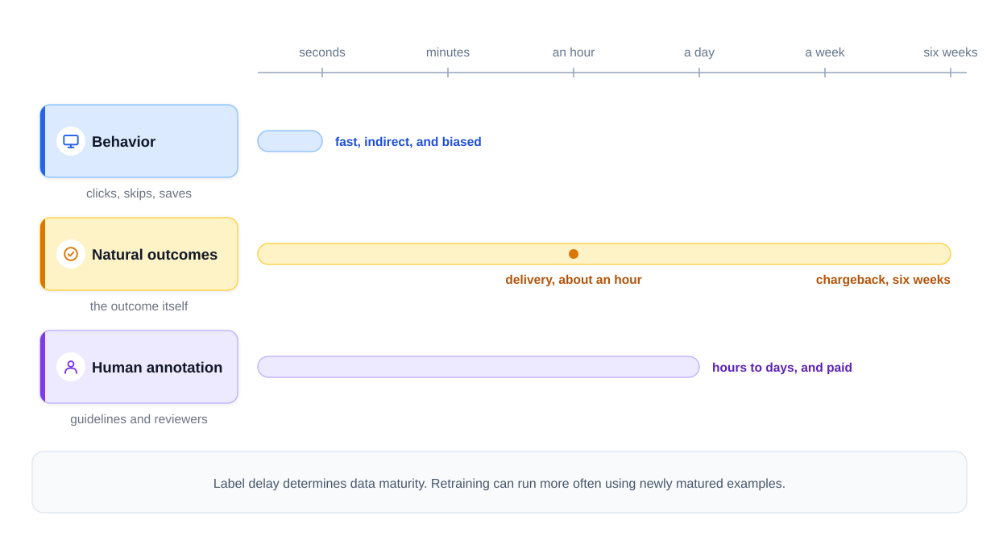
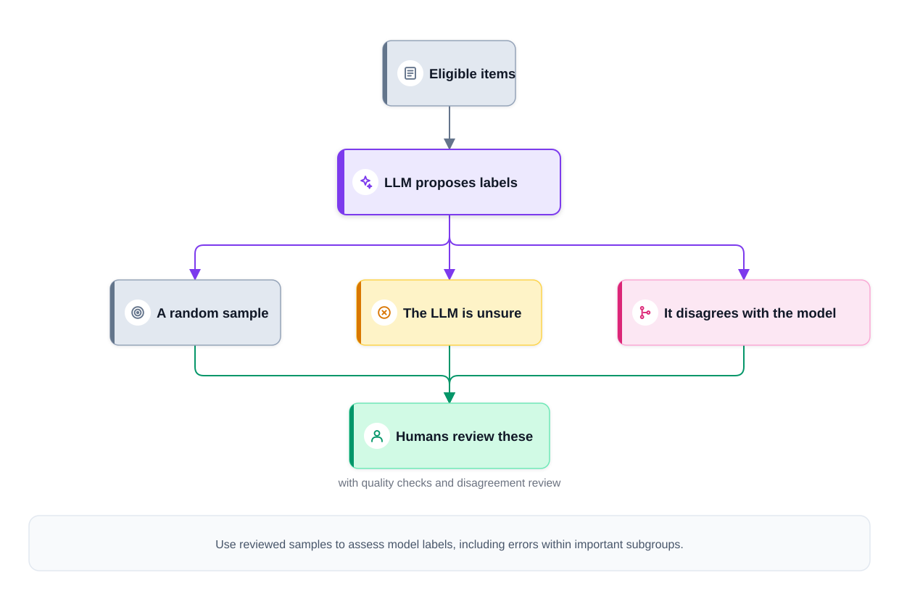
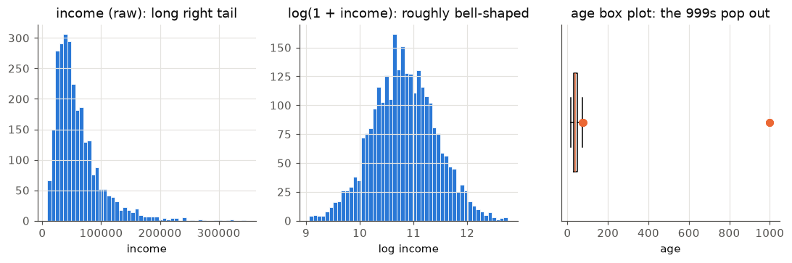
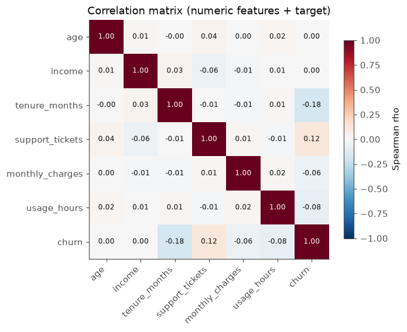
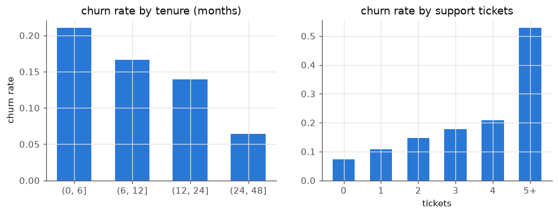
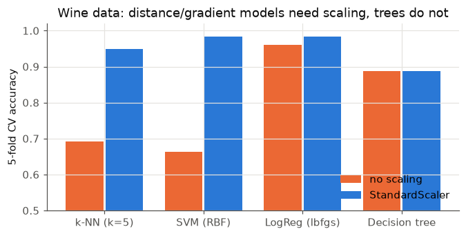
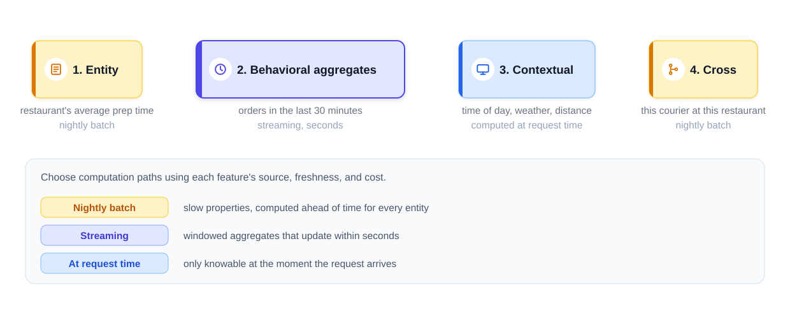
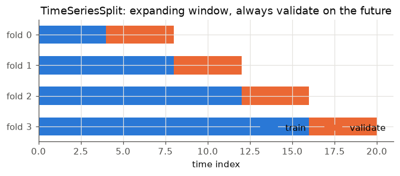
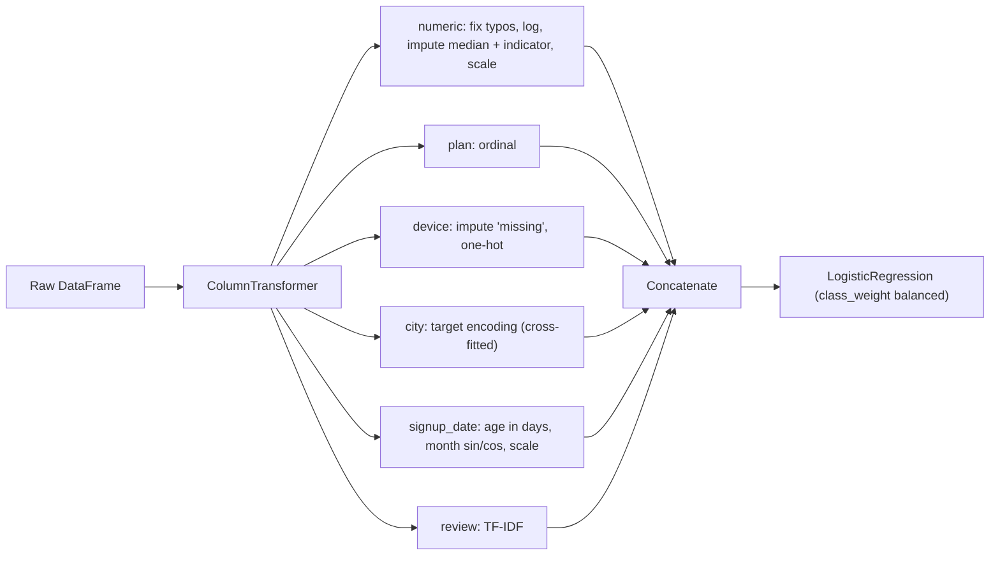

# Chapter 4 — Data, EDA and Feature Engineering

Most of an ML project's time goes into this chapter's work: finding labels, looking at data, cleaning it, turning raw columns into numbers, splitting honestly, and wrapping it all in one reproducible **pipeline** (a fixed chain of processing steps). A mediocre model on well-prepared data usually beats a clever model on messy data.

All code is in `code/` (Python 3.14, scikit-learn 1.9, pandas 3.0, fixed seeds; outputs are real, long ones trimmed with "..."). Most scripts use a synthetic "subscription churn" table from `code/make_data.py`: 3,000 customers plus 25 duplicate rows, a skewed (most values small, long tail of large ones) `income`, a 60-level `city`, dates, short reviews, missing values and typos (ages of 999, incomes of 9,999,999). **Churn** = a customer cancelling; about 12% churn.

---

## 4.1 Where training data comes from

### What it is
Supervised learning needs **labels**: the correct answer (the **target**, y) attached to each example's **features** (inputs, X). A **label pipeline** produces those (features, label) pairs. Each label source has its own cost, delay and **bias** (a systematic tilt, as opposed to random error).

### Why it matters
The first design question is "where does y come from, and when does it arrive?" Label quality caps model quality: a model can't be more accurate than the labels it's graded against.


*Figure — label sources differ mainly in delay and cost (course diagram)*

### How it works — the label sources

| Source | Example | Delay | Main weakness |
|---|---|---|---|
| **Natural (outcome) labels** — the world records the answer | Delivery took 34 min; loan defaulted; card payment reversed (a **chargeback**) | Minutes to weeks | Late; outcome ≠ truth (a chargeback is evidence of fraud, not proof) |
| **Behavioural labels / implicit feedback** — actions stand in for judgments | Clicks, skips, saves, purchases, watch time | Seconds | Noisy (a click is not satisfaction); biased toward what the system showed |
| **Human annotation** — reviewers follow a written guideline | Is this post harmful? Is this document relevant? | Hours to days | Costly (cents to dollars per judgment); reviewer quality needs managing |
| **Weak supervision** — many cheap, noisy rules vote | "Contains 'wire transfer' and sender is new → spam" | Instant once written | Rules noisy and correlated; a model must combine them |
| **LLM-assisted labeling** — an LLM (large language model) applies the guideline | Tag support tickets by topic | Seconds | Systematic errors (the same blind spot everywhere) |

**Explicit vs implicit feedback.** *Explicit* = the user tells you (star rating); *implicit* = inferred from behaviour (watched 90%). Implicit is plentiful but biased: a non-click may mean "never shown" (**exposure bias**), and top positions get clicked for being on top (**position bias**). Modelling it: [Chapter 13, section 13.2](../13-recommenders-and-embeddings/README.md).

**Label delay.** Outcome labels arrive late (chargebacks can take ~6 weeks), so train only on examples with "mature" labels and use faster **proxy labels** (rule hits, analyst decisions) for recent data. Joining delayed labels and monitoring them live: [Chapter 16, section 16.3](../16-ml-in-production/README.md).

### Weak supervision in one paragraph
Instead of hand-labeling 100,000 items, experts write dozens of **labeling functions** — small heuristics that output a label or "abstain". A **label model** estimates each function's accuracy from their agreements and disagreements and combines votes into a probabilistic label; a normal model trained on those labels usually generalises beyond the rules. This is Stanford's **Snorkel** idea.

### Human labeling, and measuring agreement
Treat annotation as a system: **versioned guidelines** (a label means what guideline v3 says, stored with the data), **gold questions** (known-answer items mixed into queues to track reviewer accuracy), **active learning** (spend labels on items the model is least sure about), and reuse of decisions the business already makes (fraud analysts' verdicts). Production details: Chapter 16 (16.3).

**Inter-annotator agreement (IAA)** — several reviewers label the same items. Raw agreement flatters (random guessers agree sometimes); **Cohen's kappa** corrects for chance:

κ = (p_o − p_e) / (1 − p_e)

p_o = observed agreement; p_e = chance agreement = Σ over labels of (A's share × B's share). κ = 1 perfect, 0 chance, negative worse than chance.

*Worked example:* two reviewers agree on 80 of 100 emails (p_o = 0.8); each says "spam" half the time, so p_e = 0.5·0.5 + 0.5·0.5 = 0.5 and κ = **0.6** — "moderate" on the Landis–Koch scale (0.41–0.60 moderate, 0.61–0.80 substantial). Low agreement usually means an unclear guideline or genuinely ambiguous items; high agreement doesn't prove labels *correct* (reviewers can share a mistake).

### LLMs in the labeling loop
An LLM can label at scale from the guideline, inside a hierarchy: humans review a random sample plus low-confidence and disputed cases, and accuracy is measured against human-labeled slices **per important subgroup** ([Chapter 16, section 16.3](../16-ml-in-production/README.md)).


*Figure — LLM-assisted labeling with human audit (course diagram)*

### Negatives for retrieval, and privacy
- **Manufactured negatives.** Logs record clicks, never the millions of items a user would *not* click, so retrieval models (which pull a shortlist from a huge catalogue) create **negatives**: random, **in-batch** (other users' positives in the same training batch) and **hard** (shown but not clicked; some are **false negatives** the user would have liked). See [Chapter 13, section 13.7](../13-recommenders-and-embeddings/README.md).
- **Privacy.** Collect only what the task needs, restrict access, set retention (how long data is kept); a hashed ID (scrambled by a one-way formula) is still linkable across tables. More in [Chapter 16, section 16.3](../16-ml-in-production/README.md).

### Common mistakes
- Assuming labels "exist" in the warehouse (central analytics database) without asking who creates them, when, how reliably; treating clicks as ground truth.
- Unversioned guidelines; raw agreement instead of κ; LLM labels with no human-audited slices.

### Real-world examples
- **YouTube**'s 2016 recommendation paper (Covington et al.) trains ranking on implicit feedback — impressions (times a video was shown) clicked or not — weighting clicked impressions by watch time.
- Content-moderation teams run the guidelines + reviewers + gold questions + agreement loop; payment companies use chargebacks (slow) and analyst decisions (fast) as fraud labels.

### In the interview
**30-second answer** — "How will you get labels for this model?": *"I'd list the candidate sources — observed outcomes, user behaviour, human review, rules, LLMs — with their cost, delay and bias. I'd check label quality (agreement with κ, gold questions), train only on matured labels, and join them to features as they were at prediction time."*

- *"Two annotators agree 90% of the time — good?"* — Not necessarily. If each says "not spam" 90% of the time, p_e = 0.9² + 0.1² = 0.82, so κ = (0.90 − 0.82)/(1 − 0.82) ≈ 0.44 — only moderate.
- *"When is weak supervision worth it?"* — When experts can state rules faster than label thousands of items and labels are needed fast or at scale; audit on a small hand-labeled set.
- *"Why is a click a weak label?"* — It measures the old system's exposure and position as much as preference; a non-click is not a dislike.

### TL;DR
Labels come from outcomes (late), behaviour (fast, biased), people (costly), rules (noisy) or LLMs (scalable, correlated errors). Measure quality with κ, version the guideline, audit machine labels against human ones.

---

## 4.2 Exploratory data analysis (EDA)

### What it is
**EDA** is examining data with summary tables and plots before modeling, to learn its shape, spot problems and form hypotheses.

### Why it matters
It catches what silently wrecks models: impossible values, **sentinel codes** (9,999,999 meaning "unknown"), duplicates, skew, leaky columns (secretly containing the answer, 4.8) and imbalance (4.9), and tells you which transformations and models make sense.

### How it works — a checklist
1. **Shape and types** — numeric / categorical / dates / text.
2. **Missingness** — share per column; related to the target?
3. **Distributions** — histograms (skew, outliers, spikes at round numbers); category counts (**cardinality** = number of distinct values; rare levels).
4. **Target** — class balance, or its distribution for regression.
5. **Relationships** — feature vs target (rate per bucket, box plots) and feature vs feature (correlation matrix).
6. **Sanity checks** — duplicates, impossible ranges, IDs that predict the target (leakage).

**Correlation.** **Pearson** measures *linear* association (−1 to 1). **Spearman** is Pearson on *ranks*, capturing any **monotonic** (always-increasing or always-decreasing) relationship, robust to outliers and skew — a good EDA default. Neither captures a U shape, and correlation is not causation.

```python
# code/eda.py (key parts)
df = make_churn()
print(df.isna().mean().loc[lambda s: s > 0].round(3))          # missing share
print(df[num_cols].describe().T[["mean", "50%", "std", "min", "max"]])
print(df[["plan", "device", "city"]].nunique())                   # cardinality
print(df.duplicated().sum())                                      # exact duplicates
corr = num.corr(method="spearman")                                # rank correlation
```

Output (trimmed):
```
--- missing values (share) ---
age       0.03
income    0.08
device    0.02

--- numeric summary ---
                    mean      50%       std     min        max
age                 41.1     39.0      37.2    18.0      999.0
income           70763.8  49100.0  328637.8  8600.0  9999999.0
tenure_months       23.3     23.0      13.5     1.0       47.0
support_tickets      1.2      1.0       1.1     0.0        6.0
usage_hours         12.0     10.1       8.4     0.1       58.9

--- categorical cardinality ---
plan 3 | device 3 | city 60

churn rate: 0.117
exact duplicate rows: 25

--- Spearman correlation with churn ---
tenure_months     -0.18
usage_hours       -0.08
...
support_tickets    0.12
```

`age` has max 999 and a std of 37 years — typos. `income` mean ≫ median (70.8k vs 49.1k): a long right tail plus a 9,999,999 sentinel. Churn is 11.7% (mildly imbalanced). Tenure (−) and support tickets (+) relate to churn as expected.







The bar charts show *shape* a single correlation can't: churn drops steeply in the first year, then flattens.

### Common mistakes
- Detailed EDA including the test set (features then fit test quirks) — use the training split.
- Trusting `mean` on skewed columns; reading near-zero correlation as "no relationship" (it only rules out a *monotonic* one).

Tools: `pandas` (`describe`, `value_counts`, `corr`), `seaborn` pair plots, `ydata-profiling`.

### Self-check
1. A customer-ID column strongly predicts the target? → Leakage (IDs assigned in a way that encodes outcome or time).

### TL;DR
Look before you model: types, missingness, distributions, target balance, relationships, duplicates, impossible values. Plots reveal shapes single numbers hide.

---

## 4.3 Data cleaning

### What it is
Fixing or removing **duplicates**, **impossible values**, **outliers** and **missing values** so the model learns from reality, not errors.

### Why it matters
Duplicates leak between train and test and overweight examples; typos distort means and scales; many **estimators** (scikit-learn models, e.g. `LinearRegression`, `SVC`) reject NaNs (the missing-value marker) outright.

### How it works

**1. Duplicates.** `df.drop_duplicates()`, then check the entity key (`customer_id`) is unique. Near-duplicates (different whitespace, a resized image) need fuzzy matching.

**2. Impossible values are errors, not outliers.** Age 999 or income 9,999,999 is a typo or sentinel: convert to NaN and use the missing-value strategy.

**3. Outliers** are legitimate-but-extreme values: detect, then keep, cap, transform or remove.

| Method | Rule | Good for | Caveat |
|---|---|---|---|
| **IQR fences** | Flag x < Q1 − 1.5·IQR or x > Q3 + 1.5·IQR (Q1, Q3 = 25th/75th percentiles; IQR = Q3 − Q1) | Any distribution, robust | Over-flags skewed data |
| **z-score** | Flag \|x − mean\| / std > 3 | Roughly normal data | Mean and std are pulled by outliers |
| **Transform first** | Log, then z-score | Right-skewed positive data | — |
| **Winsorize / clip** | Cap at e.g. 1st/99th percentiles | Keep rows, limit influence | Choose caps on training data only |
| **Model-based** | `IsolationForest`, `LocalOutlierFactor` | Multivariate outliers (odd only in combination) | More to tune |

**4. Missing values.** First ask *why*:
- **MCAR** (missing completely at random) — a sensor randomly drops readings. Any sensible **imputation** (filling in) is fine.
- **MAR** (missing at random given other columns) — older customers skip the income field; other columns predict the value.
- **MNAR** (missing not at random) — the value causes the missingness (high earners hide income); add a **missing-indicator** column, since missingness is signal.

| Strategy | What it does | Use when |
|---|---|---|
| Drop rows / column | Remove incomplete rows or a mostly-empty feature | Very few missing rows (MCAR) / low-value column |
| Mean / median / mode (`SimpleImputer`) | Fill with a column statistic | Default baseline; median for skew; mode (`most_frequent`) for categories |
| Constant / "missing" category | Fill with `"missing"` | Categoricals — keeps the absence information |
| **Missing indicator** (`add_indicator=True`) | Extra 0/1 "was missing" column | Missingness may be informative (MNAR) |
| KNN (`KNNImputer`) | Average of the k most similar rows | Other features predict this one; scale first |
| Iterative / MICE (`IterativeImputer`) | Models each column from the others, round-robin | MAR data with correlated columns (experimental: first `from sklearn.experimental import enable_iterative_imputer`) |
| Leave it to the model | `HistGradientBoosting*`, XGBoost, LightGBM handle NaN natively | Gradient-boosted trees |

```python
# code/cleaning.py (key parts)
df = df.drop_duplicates()
df.loc[df["age"] > 110, "age"] = np.nan                 # impossible -> missing
df.loc[df["income"] >= 9_999_999, "income"] = np.nan    # sentinel  -> missing

q1, q3 = inc.quantile([0.25, 0.75]); iqr = q3 - q1       # IQR fences (z-scores similar)

# Evaluate imputers honestly: hide 300 KNOWN incomes, impute them, measure the error
X_masked[hide, 1] = np.nan
for name, imp in {"mean": SimpleImputer(strategy="mean"), "median": SimpleImputer(strategy="median"),
                  "KNN (k=5)": KNNImputer(n_neighbors=5),
                  "iterative (MICE-like)": IterativeImputer(random_state=0)}.items():
    filled = imp.fit_transform(X_masked)[hide, 1]
    print(name, np.abs(filled - truth).mean())
```

Output:
```
duplicates removed: 25  -> rows now 3000
duplicate customer_ids left: 0
impossible ages -> NaN: 4, sentinel incomes -> NaN: 3

IQR fences: [-29,300, 137,100]  -> 141 flagged
|z| > 3                     -> 50 flagged
|z| > 3 on log(income)      -> 4 flagged  (skew made raw z-score over-flag)
winsorize (clip) to 1st/99th pct: [12,800, 207,332]

missing per column: {'age': 94, 'income': 243, 'device': 60}
churn rate | income missing: 0.152  | present: 0.114

imputer                 MAE on hidden incomes
drop rows (listwise)    n/a  (would keep only 79% of rows)
mean                    32,096
median                  29,903
KNN (k=5)               35,635
iterative (MICE-like)   32,096

device with 'missing' level : {'android': 1314, 'ios': 1036, 'web': 590, 'missing': 60}
...
```

- On skewed income, IQR flags 141 normal high earners and raw z flags 50; after a log only 4 are extreme. **Skew is not the same as outliers.**
- Dropping incomplete rows would discard 21% of the data.
- **Fancy imputers are not automatically better.** Income was generated independently of other columns, so KNN and MICE have nothing to learn (MICE collapses to the mean) and the median wins. The lesson is the *method*: hide known values and measure.
- Churn is 15.2% with income missing vs 11.4% present, but missingness was random by construction: the gap is chance (≈1.8 **standard errors** — the typical size of chance wobble — with 243 rows). Test informative missingness rather than assume it; an indicator lets the model use it if real.

### Trade-offs
Simple imputation is fast, stable and easy to reproduce at serving time (when the deployed model answers live requests); model-based imputation can be more accurate but is slower and one more thing to monitor. Any imputation shrinks variance, since every filled value is "typical".

### Common mistakes
- Computing imputation statistics (mean, median, clip percentiles) on all data before splitting — leakage (4.8).
- Deleting real, important outliers (fraud *is* the outlier).
- Filling categoricals with the mode and losing the "was missing" signal.

### In the interview
**30 seconds:** *"Dedupe on the entity key, turn impossible values into missing, and treat outliers by whether they're errors or real extremes — often a log transform or clipping at training-set percentiles. For missing data, start with median plus a missing indicator, compare KNN or iterative imputation by masking known values, and fit it all inside a pipeline."*

- *"Mean or median?"* — Median for skewed columns.
- *"Did imputation help?"* — Mask known values and measure error; compare downstream CV scores.

### Self-check
1. Why convert 999 ages to NaN rather than clip to 85? → They're errors; clipping invents a specific wrong value.

### TL;DR
Dedupe, impossible values → NaN, handle outliers deliberately (log/clip, don't blindly delete), impute with training-set statistics (median + indicator is a strong default), measure imputation quality.

---

## 4.4 Encoding categorical variables

### What it is
**Encoding** turns categories like `"ios"` or `"city_17"` into numbers; the choice tells the model how categories relate.

### How it works — the four main encoders

| Encoder | Output | Example | Use for | Risk |
|---|---|---|---|---|
| **One-hot** (`OneHotEncoder`, `pd.get_dummies`) | One 0/1 column per category | `device=ios` → `[0,1,0,0]` | **Nominal** (unordered) categories, low–moderate cardinality | Width explodes with many levels |
| **Ordinal** (`OrdinalEncoder`) | One integer column | `basic/standard/premium` → 0/1/2 | Truly ordered categories; fine for trees | Imposes false order and equal spacing on nominal data for linear models |
| **Target encoding** (`TargetEncoder`) | Category → (smoothed) mean of y | `city_17` → 0.19 | High cardinality (hundreds/thousands of levels) | **Target leakage** if computed on the rows the model trains on |
| **Hashing** (`FeatureHasher`) | hash(value) mod m buckets | `city_17` → column 13 | Huge or unbounded ID spaces, streaming data | **Collisions** (unrelated values share a bucket); not reversible |

- **Label encoding** = "category → integer code"; scikit-learn's `LabelEncoder` is for the *target* y — use `OrdinalEncoder` for features.
- **Dummy-variable trap:** with an intercept, k one-hot columns always sum to 1, so they are perfectly collinear with it and coefficients aren't unique. Classical **OLS** (ordinary least squares, unpenalised linear regression, e.g. statsmodels) needs `drop="first"`; scikit-learn's `LinearRegression` still fits (section 5.1); regularised models and trees don't care.
- **Embeddings:** in deep learning each ID gets a learned **dense vector** (e.g. 32 mostly non-zero numbers) — standard for user/item IDs ([Chapter 13](../13-recommenders-and-embeddings/README.md)).
- Unseen categories at prediction time: `OneHotEncoder(handle_unknown="ignore")` outputs all zeros; `TargetEncoder` uses the global mean.

### Target encoding and its leakage trap
**Naive target encoding** uses each category's mean target on the training rows. For a 2–3-row category that mean is essentially *those rows' own labels*: the feature copies the answer, shining on training data and failing on new data.

**The fix** (scikit-learn's `TargetEncoder`):
1. **Cross-fitting** — in `fit_transform`, split training data into k folds; encode each fold with means from the *other* folds, so no row sees its own label.
2. **Smoothing / shrinkage** — blend each category mean with the global mean by category size, so rare categories stay near the global rate.
3. At `transform` time, use encodings learned on the full training set.

CatBoost (Yandex's gradient-boosting library) instead uses "ordered target statistics": each row is encoded only from rows before it in a random permutation.

```python
# code/encoding.py (key parts)
ohe = OneHotEncoder(handle_unknown="ignore", sparse_output=False).fit(df[["device"]].fillna("missing"))
ord_enc = OrdinalEncoder(categories=[["basic", "standard", "premium"]])      # explicit order
fh = FeatureHasher(n_features=16, input_type="string")                       # 16 buckets

df["noise_id"] = rng.integers(0, 1000, len(df)).astype(str)                  # pure noise, 1000 levels
means = pd.Series(y[tr]).groupby(df["noise_id"].iloc[tr].to_numpy()).mean()  # naive: leaky
naive_tr = df["noise_id"].iloc[tr].map(means)
te_enc = TargetEncoder(target_type="binary", cv=KFold(5, shuffle=True, random_state=0))
cf_tr = te_enc.fit_transform(df[["noise_id"]].iloc[tr], y[tr])               # cross-fitted
```

Output:
```
one-hot columns: ['device_android', 'device_ios', 'device_missing', 'device_web']
encode ['ios'], ['tablet'(unseen)]:
 [[0. 1. 0. 0.]
 [0. 0. 0. 0.]]

ordinal plan: [2. 0. 1.]

hashed city (16 buckets), row 0 non-zeros at: [13] [-1.]

Feature = target-encoded 'noise_id' (contains NO real signal):
naive target mean (leaky)              train AUC 0.941 | test AUC 0.519
TargetEncoder (cross-fitted, smoothed) train AUC 0.533 | test AUC 0.518

Feature = target-encoded 'city' (60 levels, real signal):
TargetEncoder(city)                    train AUC 0.632 | test AUC 0.555
OneHot(city)                           train AUC 0.722 | test AUC 0.554
```

**AUC** (area under the ROC curve, Chapter 6): 0.5 = random ranking, 1.0 = perfect. Naive encoding of pure noise scores **0.94 on training** but 0.52 on test — a mirage cross-fitting removes. On real `city` signal, target encoding matches one-hot on test with **one column instead of 60**. The hashed value is −1 because `FeatureHasher` uses a second hash for the sign, so collisions cancel on average.

### When not to use them
- No one-hot of a 100,000-level ID for a linear model — hash, target-encode or embed.
- No ordinal encoding of nominal categories for linear models or k-NN.
- No target encoding without cross-fitting, nor with validation/test statistics.

### Real-world examples
Feature hashing ("the hashing trick") was popularised in large-scale spam filtering and ad click prediction; built into Vowpal Wabbit and scikit-learn's `FeatureHasher`/`HashingVectorizer`. CatBoost exists largely to handle categoricals safely.

### In the interview
**30 seconds:** *"Low-cardinality nominal → one-hot. Ordered → ordinal. High-cardinality → target encoding (cross-fitted and smoothed), hashing if the ID space is unbounded, or embeddings in a neural model. Target encoding's risk is a row's own label leaking into its feature, so I encode out-of-fold (using statistics from the other folds only)."*

- *"Hashing vs target encoding?"* — Hashing needs no labels or state and handles new values, but collides and isn't interpretable; target encoding is compact and informative but needs leakage protection and can go stale.
- *"Why is ordinal OK for trees?"* — Threshold splits can isolate any level with a few extra splits.

### TL;DR
One-hot for small unordered sets, ordinal for ordered, target encoding (out-of-fold, smoothed) or hashing for huge ones, embeddings in deep models. Target encoding is the most powerful and the easiest to leak.

---

## 4.5 Feature scaling

### What it is
**Scaling** puts numeric features on comparable ranges so one measured in thousands (income; proline in the wine dataset) doesn't dominate one in fractions.

| Scaler | Formula | Result | Sensitive to outliers? |
|---|---|---|---|
| **Standardization** (`StandardScaler`) | z = (x − mean) / std | mean 0, std 1 | Yes |
| **Min-max** (`MinMaxScaler`) | (x − min) / (max − min) | range [0, 1] | Very (one outlier squashes the rest) |
| **Robust** (`RobustScaler`) | (x − median) / IQR | median 0, IQR 1 | No |
| **Log / power** (`np.log1p`, `PowerTransformer`) | Reshapes the distribution | Less skew | Reduces their influence |

Scaling changes *units*, not *shape*: a skewed feature stays skewed after `StandardScaler`; use log/power to change shape.

### Why it matters — and which models care
- **Distance-based** (k-NN; k-means; RBF-kernel SVM, which measures similarity with a bell-shaped function of distance): the widest feature dominates distance.
- **Gradient-descent** models (linear/logistic regression, neural nets) converge much faster on similar scales (section 5.4).
- **Regularised** models (penalty on large weights: Ridge, Lasso, logistic regression's default L2): coefficient size depends on units.
- **PCA** (compresses features into summary directions) finds largest variance — unscaled, just the biggest-unit column.
- **Trees don't care**: "income ≤ 50,000" works in dollars or thousands.

```python
# code/scaling.py (key parts)
x = np.array([[10.0], [12], [11], [13], [12], [11], [100]])
for s in [StandardScaler(), MinMaxScaler(), RobustScaler()]:
    print(type(s).__name__, s.fit_transform(x).ravel().round(2))

X, y = load_wine(return_X_y=True)     # 13 features on very different scales
for name, m in models.items():
    accs = [cross_val_score(m, X, y, cv=5).mean()]
    for sc in [StandardScaler(), MinMaxScaler(), RobustScaler()]:
        accs.append(cross_val_score(make_pipeline(sc, m), X, y, cv=5).mean())
```

Output:
```
raw       : [ 10.  12.  11.  13.  12.  11. 100.]
StandardScaler : [-0.46 -0.39 -0.42 -0.36 -0.39 -0.42  2.45]
MinMaxScaler   : [0.   0.02 0.01 0.03 0.02 0.01 1.  ]
RobustScaler   : [-1.33  0.   -0.67  0.67  0.   -0.67 58.67]

feature ranges: min std = 0.124, max std = 314.0

model             no scaling  standard  min-max  robust
k-NN (k=5)           0.691     0.949     0.950     0.938
SVM (RBF)            0.663     0.983     0.978     0.983
LogReg (lbfgs)       0.961     0.983     0.978     0.989
Decision tree        0.888     0.888     0.888     0.888
```

Robust check: median 12, Q1 11, Q3 12.5, IQR 1.5, so 100 → 58.67; the six normal values keep a useful spread (−1.33 to 0.67), whereas min-max squeezes them into [0, 0.03].



### Trade-offs / when to use which
**StandardScaler** by default (linear models, SVMs, neural nets, PCA); **MinMaxScaler** for a bounded range (pixels to [0, 1]) without big outliers; **RobustScaler** with outliers you keep; **nothing** for tree ensembles.

### Common mistakes
- Fitting the scaler before splitting (leakage, 4.8) — fit on train, `transform` the rest.
- Scaling one-hot columns is harmless but unnecessary; scaling a regression *target* requires inverting predictions (`TransformedTargetRegressor`).
- Expecting scaling to fix skew.

### In the interview
**30 seconds:** *"Scale for anything that uses distances, gradients, or penalties — k-NN, SVM, linear models, neural nets, PCA, k-means. Standardize by default, robust-scale if there are outliers, skip it for trees. Always fit the scaler on the training fold only."*

- *"Does logistic regression need scaling?"* — Not for correctness; yes for convergence speed and fair regularisation.

### TL;DR
Standardize for distance/gradient/penalty models, robust-scale with outliers, nothing for trees, log for skew — fit on training data only.

---

## 4.6 Feature creation

### What it is
**Feature engineering** creates inputs that make the pattern easier to learn. A linear model draws straight lines in the features you give it; a good feature bends the problem so a straight line works.

### How it works — the core techniques

1. **Interactions and polynomials.** If the target depends on a *product* (revenue = price × quantity), add it. `PolynomialFeatures(degree=2)` adds all squares and pairwise products.
2. **Binning (discretization).** Cut a numeric feature into intervals (equal-width, quantile = equal rows per bin, or domain-chosen) and one-hot them (`KBinsDiscretizer`), so a linear model can fit non-monotonic shapes (risk high for both young and old).
3. **Log/power transforms for heavy tails** (most values small, a few enormous: income, counts, prices). `log1p(x) = log(1 + x)` compresses the tail and handles zeros.
4. **Date/time features.** Parts (month, day of week, hour, is_weekend, is_holiday), durations ("days since signup"), and **cyclical encoding** for periodic values: month m → (sin(2πm/12), cos(2πm/12)), so December and January are neighbours, not 11 apart.
5. **Text: bag-of-words and TF-IDF.** **Bag-of-words** counts words per document. **TF-IDF** (term frequency × inverse document frequency) down-weights words common across documents. scikit-learn default: tf = raw count, idf(t) = ln((1 + n) / (1 + df(t))) + 1 (n = documents, df(t) = documents containing t), then each row scaled to unit L2 length.
6. **Aggregates and ratios.** "Tickets per month of tenure", "spend in the last 7 days", "average order value" — often the strongest business features.

```python
# code/features.py (key parts)
revenue = price * qty + rng.normal(0, 1, n)
lin   = cross_val_score(LinearRegression(), X, revenue, cv=5, scoring="r2").mean()
inter = cross_val_score(make_pipeline(PolynomialFeatures(2, interaction_only=True, include_bias=False),
                                      LinearRegression()), X, revenue, cv=5, scoring="r2").mean()

p = 1 / (1 + np.exp(-(0.004 * (age - 50) ** 2 - 2)))       # U-shaped risk
binned = make_pipeline(KBinsDiscretizer(n_bins=6, encode="onehot", strategy="quantile",
                                        quantile_method="averaged_inverted_cdf"), LogisticRegression())

"month_sin": np.sin(2 * np.pi * ts.dt.month / 12), "month_cos": np.cos(2 * np.pi * ts.dt.month / 12)

docs = ["app is slow and expensive", "love the app, fast and easy",
        "slow slow slow, will cancel", "easy to use and helpful support"]
M = TfidfVectorizer().fit_transform(docs)
```

Output:
```
revenue ~ price, qty          R^2 = 0.893
revenue ~ price, qty, price*qty R^2 = 0.997
PolynomialFeatures(2) names: ['price' 'qty' 'price^2' 'price qty' 'qty^2']

U-shaped age effect: raw age AUC = 0.531 | 6 quantile bins AUC = 0.747

 signup_date  year  month  dayofweek  is_weekend  days_since  month_sin  month_cos
 2025-10-09  2025     10          3           0          84     -0.866        0.5
 2024-12-11  2024     12          2           0         386      0.000        1.0
 ...

vocabulary: ['and', 'app', 'cancel', 'easy', 'expensive', 'fast', 'helpful', 'is', 'love', 'slow', 'support', 'the', 'to', 'use', 'will']
doc 2 non-zero weights: {'cancel': 0.363, 'slow': 0.858, 'will': 0.363}
idf('slow') = 1.511, idf('and') = 1.223
churn ~ TF-IDF(review) alone: AUC = 0.736
```

**TF-IDF by hand**, doc 2 ("slow slow slow, will cancel"), n = 4:
- idf(slow) (2 docs) = ln(5/3) + 1 = 1.511; idf(will), idf(cancel) (1 doc) = ln(5/2) + 1 = 1.916; "and" (3 docs) = 1.223 — common words get low weight.
- tf·idf: slow 3 × 1.511 = 4.533; will 1.916; cancel 1.916.
- L2 norm = √27.89 = 5.281 → slow 0.858, will 0.363, cancel 0.363. ✓

The interaction lifts **R²** (share of target variation explained) from 0.893 to 0.997 because the truth is a product; binning lifts AUC from 0.53 (one slope can't draw a U) to 0.75.

### Feature groups in production systems
Brainstorm in four groups so no family is missed. For a food-delivery **ETA** (estimated time of arrival) at checkout:

- **Entity** — one participant, changing rarely (restaurant's typical kitchen time, courier's vehicle).
- **Behavioural aggregate** — count/average over a recent window (orders in the past 30 minutes); worthless unless fresh.
- **Context** — the request moment (hour, weekday, rain, trip distance).
- **Cross** — a pair of participants (this courier's past speed at this restaurant).


*Figure — feature groups and their compute paths (course diagram)*

Rule from day one: **point-in-time availability** — every feature must be computable *at prediction time* from data that existed then (4.8). How each group is computed and served (nightly batch vs streaming, the offline/online **feature store** — serving identical values to training and live prediction — latency budgets, see [System Design Fundamentals](../../../system-design-patterns/modules/00-system-design-fundamentals/README.md), and fallbacks) is in [Chapter 16, section 16.4](../16-ml-in-production/README.md).

### Trade-offs
More features capture more signal but add overfitting risk, compute, latency and maintenance (each is a pipeline that can break); degree-2 polynomials on 100 features give 5,150 columns. Trees and neural nets learn interactions themselves, so explicit engineering matters most for linear models and for domain knowledge (ratios, time windows) no model can invent.

### Common mistakes
- Features using future information (a 30-day average including days *after* the prediction).
- Month or hour as a plain number.
- Fitting `TfidfVectorizer` or bin edges on all data.

### Real-world examples
- **Uber** and **DoorDash** have described ETA models combining entity, real-time aggregate and context features.
- Search engines long ranked with TF-IDF-style scores; **BM25**, its refined descendant, is still a first-stage retriever (picks a few hundred candidates before a slower ranker).
- Google's **Wide & Deep** recommender (2016) used hand-crafted cross features in its "wide" linear part.

### In the interview
**30 seconds:** *"I'd brainstorm features by group — entity, behavioural aggregates, request context, crosses — check each is available at prediction time, then transform them: log for heavy tails, one-hot or embeddings for categories, cyclical encoding for time, TF-IDF or embeddings for text, products or bins where a linear model needs curvature."*

- *"Why cyclical encoding?"* — So hour 23 and hour 0 are neighbours.

### Self-check
1. Encode hour = 6 cyclically. → (sin(2π·6/24), cos(2π·6/24)) = (1, 0).
2. Why is "orders in the last 30 minutes" risky to compute nightly? → Useful only when fresh; stale it is noise (16.4).

### TL;DR
Give the model the problem's shape: products for interactions, bins/polynomials for curves, logs for tails, sin/cos for cycles, TF-IDF for text, aggregates for behaviour — all available at prediction time.

---

## 4.7 Train, validation and test splits

### What it is
Splits make the reported score reflect **unseen** data:
- **Training set** — learn parameters.
- **Validation set** — compare models and tune **hyperparameters** (settings chosen before training, like tree depth).
- **Test set** — touched **once**, at the end, for the unbiased estimate.

### How it works
1. **Random split** — shuffle, then e.g. 60/20/20, or 80/20 with cross-validation on the 80% instead of a fixed validation set (Chapter 6).
2. **Stratified split** — same class proportions in every split (`stratify=y`); essential for imbalanced or small data.
3. **Time-based split** — train on the past, validate/test on the future (`TimeSeriesSplit` or a date cut); needed whenever the model predicts the future (almost every production system).
4. **Group split** — all rows of one entity (customer, patient, device) in one split (`GroupKFold`, `GroupShuffleSplit`), when the model must work for *new* entities.

```python
# code/splits_and_leakage.py (key parts)
X_tmp, X_test, y_tmp, y_test = train_test_split(X, y, test_size=0.2, stratify=y, random_state=0)
X_train, X_val, y_train, y_val = train_test_split(X_tmp, y_tmp, test_size=0.25, stratify=y_tmp,
                                                  random_state=0)      # 0.25 of 80% = 20%
for tr, va in TimeSeriesSplit(n_splits=4).split(np.arange(20)): ...
GroupKFold(n_splits=5).split(X, groups=customer_ids)
```

Output:
```
sizes train/val/test: 600 200 200
positive rate  all/train/val/test: 0.045 0.045 0.045 0.045
WITHOUT stratify, test positive rate over 200 random splits: min 0.005  max 0.080
fold 0: train t=0..3  validate t=4..7
...
fold 3: train t=0..15  validate t=16..19
GroupKFold val customers: [4]  train customers: [0, 1, 2, 3]
...
```

With 4.5% positives and 200 test rows, an unstratified split can leave 1 positive (0.5%) or 16 (8%), so the metric swings wildly; stratification pins it at 4.5%.




*Figure — temporal vs random split (course diagram)*

For "future behaviour of *known* users" the same user may appear in train and test (at different times); for "generalise to *new* users", split by user.

### Trade-offs
| Split | Pros | Cons |
|---|---|---|
| Random | Simple, data-efficient | Optimistic with time order or repeated entities |
| Stratified | Stable class ratios | Classification labels (or binned targets) only |
| Time-based | Matches deployment; exposes **drift** (data changing over time) | Less training data in early folds; must respect label delay |
| Group | Honest for new entities | Fewer effective samples; uneven group sizes |

Sizes: with millions of rows 98/1/1 is fine (1% = tens of thousands); with a few thousand, cross-validate instead of one validation set.

### Common mistakes
- Tuning on the test set ("peeking") — biased upward.
- Random splits on time-ordered data — training on the future.
- Splitting *after* oversampling (4.9) or botched deduplication, so copies land in train and test.

### TL;DR
Train to learn, validate to choose, test once to report. Stratify for classification; split by time to predict the future; by group to predict for new entities.

---

## 4.8 Data leakage

### What it is
**Data leakage** is information unavailable at prediction time sneaking into training or evaluation: the model looks brilliant offline (on historical data) and disappoints in production. It is the most common cause of "too good to be true" results (introduced in [Chapter 1, section 1.10](../01-what-is-ml/README.md)).

### The main kinds — and how to prevent each

| Kind | Example | Prevention |
|---|---|---|
| **Target leakage** — feature is a consequence or proxy of the label | `refund_issued` or `case_resolution_code` filled only *after* churn/fraud | Ask of every feature: *would I know this at the moment of prediction?* |
| **Future data in aggregates** (not point-in-time correct) | Per-merchant fraud rate whose window contains the transaction being scored | **Point-in-time joins**: each feature's value as of prediction time |
| **Train–test contamination** — preprocessing fit on all data | Scaler, imputer, feature selection or target encoder fit before the split | Split **first**; every learned step inside a `Pipeline`, refit per fold |
| **Duplicates across splits** | Same document, image or patient in train and test | Deduplicate (incl. near-duplicates) *across* splits; group splits |
| **Temporal leakage** — random split on time-ordered data | Training on next month to predict this month | Split by time |
| **Leaky identifiers** | IDs assigned in an order correlated with the outcome | Drop IDs; suspect any feature with huge importance |

Famous case: in the KDD Cup 2008 breast-cancer challenge (a long-running data-mining competition), patient IDs predicted the label because of how the data was assembled — a leak, not medicine.

### Three runnable demonstrations

```python
# (a) Feature selection BEFORE cross-validation on pure noise (100 rows, 5,000 random features)
leaky_X = SelectKBest(f_classif, k=20).fit_transform(Xn, yn)         # looked at ALL labels
leaky  = cross_val_score(LogisticRegression(max_iter=1000), leaky_X, yn, cv=5).mean()
honest = cross_val_score(make_pipeline(SelectKBest(f_classif, k=20),
                                       LogisticRegression(max_iter=1000)), Xn, yn, cv=5).mean()

# (b) 'refund_issued' is set for 90% of churners, 2% of others - but only AFTER churn
# (c) Drifting data: random split vs train-on-past / test-on-future
```

Output:
```
(a) pure-noise data: select-then-CV accuracy = 0.90 | select-inside-CV = 0.57
(b) with refund_issued: offline AUC 0.975 | without: 0.751 | with it at serving time (field is empty): 0.750
    recall at threshold 0.5: offline 0.89 -> in production 0.00
(c) drifting data: random-split AUC 0.751 | train-on-past, test-on-future AUC 0.551
```

- **(a)** Honest accuracy on noise is ~0.5 (0.57 is chance on 100 rows); selecting with *all* labels reports **90%** because selection saw the validation labels. Selection inside the pipeline fixes it.
- **(b)** The leaky feature lifts offline AUC from 0.75 to 0.975; in production the field is always empty, so at the offline-tuned **threshold** (probability cut-off for "will churn") the model catches **0%** of churners.
- **(c)** With drift, a random split mixes future rows into training and reports 0.75; the honest forward-in-time estimate is 0.55.

Be suspicious of any score far above published baselines — investigate before celebrating.

### In the interview
**30 seconds:** *"Leakage is training on information you won't have at prediction time. I prevent it with point-in-time-correct features, time or entity splits that match deployment, all preprocessing inside the CV pipeline, deduplication across splits, and treating suspiciously strong features as bugs until proven otherwise."*

- *"Offline AUC is 0.99 on fraud. What first?"* — Feature timestamps vs label time (post-outcome fields, aggregates including the current event), split method, duplicates, top **feature importances** (how much the model relies on each feature).
- *"Is fitting a StandardScaler on all data really a problem?"* — Usually a small bias, but the same mistake becomes huge with target encoding or feature selection, so never do it.

### Self-check
1. A label-adjacent feature for fraud? → Chargeback flag, refund flag, case-resolution code.

### TL;DR
If the model couldn't know it at prediction time, it mustn't see it in training. Split first, pipeline everything, split by time/group, dedupe across splits, distrust scores that look too good.

---

## 4.9 Class imbalance

### What it is
**Class imbalance**: one class is much rarer — fraud (e.g. 0.2%, 1 in 500), disease, churn, ad clicks — and it is usually the one you care about.

### Why it matters
**Accuracy lies**: at 99.8% legitimate, "always legitimate" is 99.8% accurate and catches no fraud. **Learning is harder**: negatives dominate the **loss** (the error training minimises), so models predict low probabilities everywhere. Millions of easy negatives **waste compute**.

### How it works — the toolbox

| Technique | What it does | Effect on probabilities |
|---|---|---|
| **Better metrics** | Precision, recall, F1, PR-AUC instead of accuracy (Chapter 6) | — |
| **Threshold moving** | Keep the model; lower the threshold from 0.5 | None |
| **Class weights** (`class_weight="balanced"`) | Positives count more in the loss (weight ∝ 1/class frequency) | Inflated — recalibrate |
| **Random oversampling** | Duplicate minority rows | Inflated; risk overfitting repeats |
| **Random undersampling / negative downsampling** | Keep all positives, a fraction w of negatives | Inflated; training set shrinks to ~w, so ~1/w times cheaper |
| **SMOTE** | *Synthetic* minority points between a minority point and one of its k nearest minority neighbours | Inflated; can blur boundaries |
| **Recalibration** | Map scores back to real-world probabilities | Fixes the above |

> **Key terms:** *Precision* = share of flagged rows truly positive; *recall* = share of real positives caught; *F1* is high only when both are. *ROC-AUC* = how well positives rank above negatives (0.5 random, 1 perfect); *PR-AUC* summarises precision–recall across thresholds and, unlike ROC-AUC, is very sensitive to positive rarity — the more honest ranking metric for rare classes. Chapter 6 covers them.

**SMOTE** (Synthetic Minority Over-sampling Technique, Chawla et al., 2002): for minority point a, pick one of its k nearest minority neighbours b, create a + u·(b − a), u random in [0, 1]. Library: `imbalanced-learn` (`imblearn.over_sampling.SMOTE`); written from scratch here.

**Recalibrating after negative downsampling.** Keeping a fraction w of negatives inflates the **odds** p/(1 − p) by 1/w. Multiply back by w:

odds_true = w · p/(1 − p)  →  p_true = odds_true / (1 + odds_true) = p·w / (p·w + (1 − p))

*Worked example:* w = 0.1, p = 0.5 → p_true = 0.05 / 0.55 = **0.091**. (Keeping 1 in 10 negatives at a 0.2% base rate raises the positive share to ~2%.) General recalibration (Platt scaling, isotonic regression: mapping raw scores to honest probabilities) is in Chapter 6.

**Resample only the training data, after splitting** — validation and test must reflect the real population.

```python
# code/imbalance.py (key parts) — 20,000 rows, ~2.2% positives, gradient-boosted trees
def smote(X_min, n_new, k=5, seed=0):
    rng = np.random.default_rng(seed)
    _, idx = NearestNeighbors(n_neighbors=k + 1).fit(X_min).kneighbors(X_min)
    base = rng.integers(0, len(X_min), n_new)               # random minority points a
    neigh = idx[base, rng.integers(1, k + 1, n_new)]       # one of their k neighbours b
    return X_min[base] + rng.random((n_new, 1)) * (X_min[neigh] - X_min[base])   # a + u(b - a)

report("GBM class_weight=bal.", Model(class_weight="balanced").fit(X_tr, y_tr), X_te, y_te)
keep = np.r_[pos, rng.choice(neg, int(len(neg) * 0.10), replace=False)]   # downsample negatives
p_corr = p_s * w / (p_s * w + (1 - p_s))                                   # prior correction
```

Output:
```
positive rate: train 0.0221, test 0.0222  (about 1 in 45)

method                       acc   prec    rec     F1 ROC-AUC  PR-AUC   mean p
majority-class baseline    0.978  0.000  0.000  0.000   0.500   0.022   0.0000
GBM, no fix                0.980  0.604  0.218  0.320   0.905   0.402   0.0151
GBM class_weight=bal.      0.969  0.376  0.579  0.456   0.906   0.402   0.0668
random oversampling        0.967  0.353  0.571  0.437   0.910   0.412   0.0659
SMOTE (from scratch)       0.936  0.209  0.684  0.320   0.901   0.384   0.1196
downsample negatives 1:10  0.958  0.283  0.571  0.378   0.916   0.368   0.0729

after downsampling, mean predicted p = 0.0729 vs true rate 0.0222
after prior correction p' = p*w / (p*w + 1 - p): mean p' = 0.0208 (ranking unchanged: ROC-AUC 0.916)
plain model, threshold  0.5: precision 0.604  recall 0.218
plain model, threshold  0.2: precision 0.490  recall 0.376
plain model, threshold  0.1: precision 0.426  recall 0.496
```

- The do-nothing baseline has **97.8% accuracy** and zero recall.
- **Ranking metrics barely change** (ROC-AUC ≈ 0.90–0.92, PR-AUC ≈ 0.37–0.41): resampling and weighting mostly *move the operating point* (the precision/recall balance at a given threshold) — which threshold moving on the plain model does for free.
- Every rebalancing method inflates mean predicted probability (0.07–0.12 vs 0.022); the prior correction restores 0.021 with ranking untouched.
- SMOTE isn't magic: most recall, worst precision, slightly lower PR-AUC.

### Trade-offs
Downsampling is fastest (a real win at billions of rows) but discards data; class weights keep all data at more compute; oversampling/SMOTE enlarge the training set and risk overfitting copies or inventing unrealistic points (SMOTE works poorly with categorical or high-dimensional features); threshold moving is free and keeps **calibrated** probabilities (a predicted 0.3 really means ~30%) but doesn't help the model *learn* the minority. All but threshold moving need recalibration if scores are used as probabilities.

### When not to use it
If the model only ranks (top-k alerts) or you'll pick the threshold on a precision–recall curve anyway, rebalancing is often unnecessary. Gradient boosting (sequential tree ensemble, each tree fixing earlier errors) on moderately imbalanced data (5–20% positives) usually does fine — just use the right metric.

### Common mistakes
- Oversampling **before** splitting (copies of a positive in train and test); resampling the test set.
- Reading a downsampled model's scores as real probabilities (ad auctions, expected-cost calculations).

### Real-world examples
- Facebook's 2014 ad click-prediction paper (He et al.) used negative downsampling and recalibrated with q = p / (p + (1 − p)/w) — the same formula rearranged. Production version with Platt/isotonic calibration: [Chapter 16, section 16.3](../16-ml-in-production/README.md).

### In the interview
**30 seconds:** *"First, change the metric — precision, recall and PR-AUC, not accuracy. Then reweight the loss or downsample negatives for speed, and recalibrate scores to the true base rate if they're used as probabilities. Pick the threshold from the business cost of each error. SMOTE is an option, but I'd compare it with class weights on a stratified validation set."*

- *"Downsample or reweight?"* — Downsample when data is huge and compute matters; reweight when modest. Both need recalibration.
- *"Does class_weight improve ROC-AUC?"* — Often barely; it mainly shifts where 0.5 lands. Keep it if it helps the chosen validation metric.

### Self-check
1. Recalibrate p = 0.2 with w = 0.1. → 0.02/(0.02 + 0.8) = 0.024.

### TL;DR
Imbalance breaks accuracy, not learning per se. Use precision/recall/PR-AUC; weight, downsample or oversample the training data; move the threshold to business costs; recalibrate to the real base rate.

---

## 4.10 End-to-end: `Pipeline` + `ColumnTransformer`

### What it is
A **`Pipeline`** chains transformers and a final model into one estimator; a **`ColumnTransformer`** applies different preprocessing per column group and concatenates (API basics: [Chapter 3, section 3.5](../03-python-ml-stack/README.md)). Together they turn a notebook of manual steps into **one object** you fit, tune, save and serve.



### Why it matters
**No leakage** (every learned step — imputer medians, scaler means, TF-IDF vocabulary, target encodings — refit per training fold), **no training–serving skew** (same transform code at training and prediction), **tuning across steps** (`GridSearchCV` via `step__param`), **one artifact to ship** (`joblib.dump(pipe, "model.joblib")`).

```python
# code/pipeline_end_to_end.py (key parts)
def fix_impossible(X):                      # stateless rule: no fitting, safe anywhere
    X = X.copy()
    X["age"] = X["age"].where(X["age"] <= 110)
    X["income"] = np.log1p(X["income"].where(X["income"] < 9_999_999))
    return X

numeric_pipe = make_pipeline(FunctionTransformer(fix_impossible, feature_names_out="one-to-one"),
                             SimpleImputer(strategy="median", add_indicator=True), StandardScaler())
pre = ColumnTransformer([
    ("num", numeric_pipe, numeric),
    ("plan", OrdinalEncoder(categories=[["basic", "standard", "premium"]]), ["plan"]),
    ("device", make_pipeline(SimpleImputer(strategy="constant", fill_value="missing"),
                             OneHotEncoder(handle_unknown="ignore")), ["device"]),
    ("city", TargetEncoder(target_type="binary", cv=KFold(5, shuffle=True, random_state=0)), ["city"]),
    ("date", make_pipeline(FunctionTransformer(date_parts, feature_names_out=date_names),
                           StandardScaler()), ["signup_date"]),
    ("text", TfidfVectorizer(min_df=2), "review"),     # string, not list: TF-IDF wants 1-D text
])                                                    # remainder="drop" drops customer_id
pipe = Pipeline([("pre", pre), ("model", LogisticRegression(max_iter=2000, class_weight="balanced"))])

X_tr, X_te, y_tr, y_te = train_test_split(X, y, test_size=0.2, stratify=y, random_state=42)
search = GridSearchCV(pipe, {"model__C": [0.01, 0.1, 1.0, 10.0, 100.0]},
                      cv=StratifiedKFold(5, shuffle=True, random_state=0), scoring="average_precision")
search.fit(X_tr, y_tr)
p = search.best_estimator_.predict_proba(X_te)[:, 1]      # test set used once
```

Output:
```
best C: 10.0 | CV PR-AUC: 0.414
features after ColumnTransformer: 27
most negative coefs:
 text__fast    -1.12
...
most positive coefs:
 ...
text__cancel    0.76
city__city      4.94
scaled numeric coefs: {'num__age': 0.0, 'num__income': 0.05, 'num__tenure_months': -0.65, 'num__support_tickets': 0.41, 'num__monthly_charges': 0.43, 'num__usage_hours': -0.49}

TEST  model   : ROC-AUC 0.836 | PR-AUC 0.413
TEST  baseline: ROC-AUC 0.500 | PR-AUC 0.117  (PR-AUC of a no-skill model = positive rate 0.117)

raw new row with unseen city + missing device -> p(churn) = 0.368
```

- Real drivers recovered: tenure and usage lower churn; tickets and negative review words raise it; age and income (noise here) ≈ 0. `city` looks huge only because a target-encoded value is a probability (0 to ~0.3), not standardized — compare coefficients only on the same scale.
- PR-AUC 0.41 vs 0.117 no-skill: a large lift. Always report a baseline.
- Best `C` (inverse regularisation strength: smaller = stronger penalty on large weights) is 10, scores flat for C ≥ 10 (0.414 at 10 and 100). Had the winner sat at the grid edge with scores still rising, extend the grid (Chapter 6).
- A raw row with an unseen city and missing device still gets a sensible prediction.

**Useful API details**
- `remainder="drop"` is the default (`"passthrough"` keeps untouched columns). Pass a list `["plan"]` for 2-D transformers, a string `"review"` for text vectorizers expecting 1-D input.
- `pipe.named_steps["pre"].get_feature_names_out()` names every output column (custom `FunctionTransformer`s need `feature_names_out`); `set_output(transform="pandas")` returns DataFrames (not with **sparse** TF-IDF output, which stores only non-zero entries).
- Custom pipeline functions must be importable (module-level) for `joblib` save/load.

### Common mistakes
- Preprocessing in pandas *before* the split; forgetting `handle_unknown="ignore"`.
- Data-dependent logic ("clip at the 99th percentile") in a `FunctionTransformer` recomputes per batch; use a fitted transformer.

### In the interview
**30 seconds:** *"One sklearn Pipeline with a ColumnTransformer per column type; tune it with cross-validation so every fold re-fits the preprocessing; evaluate once on a held-out test set against a baseline; ship the whole pipeline as one artifact so training and serving share code."*

- *"How does this prevent leakage?"* — `fit` runs only on training folds; validation folds only see `transform`.
- *"Where does this break at scale?"* — Streaming data and real-time aggregates need a feature pipeline and feature store (Chapter 16); the idea stays.

### TL;DR
One `Pipeline` (with a `ColumnTransformer`) = no leakage in CV, no training–serving skew, joint tuning, one deployable artifact.

---

## Chapter TL;DR

- **Labels**: outcomes (late), implicit feedback (exposure and position bias), humans (costly; κ, versioned guidelines), weak supervision, LLMs (audit with human slices).
- **EDA and cleaning**: look first (training split); impossible values → NaN; outliers → log/clip, not blind deletion; median + missing indicator, measured by masking known values.
- **Encoding**: one-hot (small nominal), ordinal (ordered), target encoding (cross-fit + smooth), hashing (unbounded IDs), embeddings (deep models).
- **Scaling**: for distance/gradient/penalty models, not trees; fit on train only.
- **Features**: interactions, bins, logs, sin/cos dates, TF-IDF, aggregates — available at prediction time.
- **Splits and leakage**: stratify; split by time or group to match deployment; split first and pipeline everything.
- **Imbalance**: not accuracy; weight/resample training data or move the threshold; recalibrate p·w / (p·w + 1 − p).
- **Pipeline + ColumnTransformer**: one leak-proof, tunable, deployable object.
